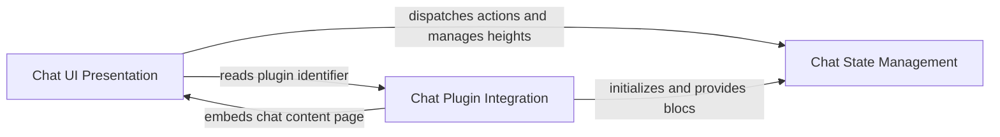

## Details

Delivers the conversational AI assistant interface, managing chat streams, message histories, and document export actions.

### Chat UI Presentation
Renders the chat interface including animated message lists, bubbles, action bars, input fields, and message layout calculations.

**Related Classes/Methods**:

- `frontend.appflowy_flutter.lib.plugins.ai_chat.presentation.chat_page.chat_content_page.ChatContentPage`:8-33
- `frontend.appflowy_flutter.lib.plugins.ai_chat.presentation.animated_chat_list._ChatAnimatedListState`:46-349
- `frontend.appflowy_flutter.lib.plugins.ai_chat.presentation.chat_message_selector_banner._SaveToPageButtonState`:131-315
- `frontend.appflowy_flutter.lib.plugins.ai_chat.presentation.message.ai_message_action_bar._SaveToPageButtonState`:511-686

**Source Files:**

- `frontend/appflowy_flutter/lib/plugins/ai_chat/presentation/animated_chat_list.dart`
  - `frontend.appflowy_flutter.lib.plugins.ai_chat.presentation.animated_chat_list.ChatAnimatedList` (L18-L44) - Class
  - `frontend.appflowy_flutter.lib.plugins.ai_chat.presentation.animated_chat_list.ChatAnimatedList.ChatAnimatedList` (L19-L30) - Constructor
  - `frontend.appflowy_flutter.lib.plugins.ai_chat.presentation.animated_chat_list.ChatAnimatedList.createState` (L43-L43) - Method
  - `frontend.appflowy_flutter.lib.plugins.ai_chat.presentation.animated_chat_list._ChatAnimatedListState` (L46-L349) - Class
  - `frontend.appflowy_flutter.lib.plugins.ai_chat.presentation.animated_chat_list._ChatAnimatedListState.initState` (L84-L159) - Method
  - `frontend.appflowy_flutter.lib.plugins.ai_chat.presentation.animated_chat_list._ChatAnimatedListState.dispose` (L162-L170) - Method
  - `frontend.appflowy_flutter.lib.plugins.ai_chat.presentation.animated_chat_list._ChatAnimatedListState.build` (L173-L237) - Method
  - `frontend.appflowy_flutter.lib.plugins.ai_chat.presentation.animated_chat_list._ChatAnimatedListState._scrollLastUserMessageToTop` (L239-L261) - Method
  - `frontend.appflowy_flutter.lib.plugins.ai_chat.presentation.animated_chat_list._ChatAnimatedListState._handleScrollToBottom` (L263-L278) - Method
  - `frontend.appflowy_flutter.lib.plugins.ai_chat.presentation.animated_chat_list._ChatAnimatedListState._handleToggleScrollToBottom` (L280-L308) - Method
  - `frontend.appflowy_flutter.lib.plugins.ai_chat.presentation.animated_chat_list._ChatAnimatedListState._handleLoadPreviousMessages` (L310-L324) - Method
  - `frontend.appflowy_flutter.lib.plugins.ai_chat.presentation.animated_chat_list._ChatAnimatedListState._cacheMessageHeight` (L326-L328) - Method
  - `frontend.appflowy_flutter.lib.plugins.ai_chat.presentation.animated_chat_list._ChatAnimatedListState._clearMessageHeightCache` (L330-L332) - Method
  - `frontend.appflowy_flutter.lib.plugins.ai_chat.presentation.animated_chat_list._ChatAnimatedListState._onInserted` (L334-L339) - Method
  - `frontend.appflowy_flutter.lib.plugins.ai_chat.presentation.animated_chat_list._ChatAnimatedListState._onRemoved` (L341-L344) - Method
  - `frontend.appflowy_flutter.lib.plugins.ai_chat.presentation.animated_chat_list._ChatAnimatedListState._onDiffUpdate` (L346-L348) - Method
- `frontend/appflowy_flutter/lib/plugins/ai_chat/presentation/animated_chat_list_reversed.dart`
  - `frontend.appflowy_flutter.lib.plugins.ai_chat.presentation.animated_chat_list_reversed.ChatAnimatedListReversed` (L14-L39) - Class
  - `frontend.appflowy_flutter.lib.plugins.ai_chat.presentation.animated_chat_list_reversed.ChatAnimatedListReversed.ChatAnimatedListReversed` (L15-L25) - Constructor
  - `frontend.appflowy_flutter.lib.plugins.ai_chat.presentation.animated_chat_list_reversed.ChatAnimatedListReversed.createState` (L37-L38) - Method
  - `frontend.appflowy_flutter.lib.plugins.ai_chat.presentation.animated_chat_list_reversed.ChatAnimatedListReversedState` (L41-L375) - Class
  - `frontend.appflowy_flutter.lib.plugins.ai_chat.presentation.animated_chat_list_reversed.ChatAnimatedListReversedState.initState` (L60-L126) - Method
  - `frontend.appflowy_flutter.lib.plugins.ai_chat.presentation.animated_chat_list_reversed.ChatAnimatedListReversedState.dispose` (L129-L135) - Method
  - `frontend.appflowy_flutter.lib.plugins.ai_chat.presentation.animated_chat_list_reversed.ChatAnimatedListReversedState.build` (L138-L205) - Method
  - `frontend.appflowy_flutter.lib.plugins.ai_chat.presentation.animated_chat_list_reversed.ChatAnimatedListReversedState._subsequentScrollToEnd` (L207-L246) - Method
  - `frontend.appflowy_flutter.lib.plugins.ai_chat.presentation.animated_chat_list_reversed.ChatAnimatedListReversedState._scrollToEnd` (L248-L256) - Method
  - `frontend.appflowy_flutter.lib.plugins.ai_chat.presentation.animated_chat_list_reversed.ChatAnimatedListReversedState._handleScrollToBottom` (L258-L287) - Method
  - `frontend.appflowy_flutter.lib.plugins.ai_chat.presentation.animated_chat_list_reversed.ChatAnimatedListReversedState._handleToggleScrollToBottom` (L289-L309) - Method
  - `frontend.appflowy_flutter.lib.plugins.ai_chat.presentation.animated_chat_list_reversed.ChatAnimatedListReversedState._onInserted` (L311-L336) - Method
  - `frontend.appflowy_flutter.lib.plugins.ai_chat.presentation.animated_chat_list_reversed.ChatAnimatedListReversedState._onRemoved` (L338-L350) - Method
  - `frontend.appflowy_flutter.lib.plugins.ai_chat.presentation.animated_chat_list_reversed.ChatAnimatedListReversedState._onChanged` (L352-L358) - Method
  - `frontend.appflowy_flutter.lib.plugins.ai_chat.presentation.animated_chat_list_reversed.ChatAnimatedListReversedState._onDiffUpdate` (L360-L367) - Method
  - `frontend.appflowy_flutter.lib.plugins.ai_chat.presentation.animated_chat_list_reversed.ChatAnimatedListReversedState._handleLoadPreviousMessages` (L369-L374) - Method
- `frontend/appflowy_flutter/lib/plugins/ai_chat/presentation/chat_avatar.dart`
  - `frontend.appflowy_flutter.lib.plugins.ai_chat.presentation.chat_avatar.ChatAIAvatar` (L12-L37) - Class
  - `frontend.appflowy_flutter.lib.plugins.ai_chat.presentation.chat_avatar.ChatAIAvatar.ChatAIAvatar` (L13-L13) - Constructor
  - `frontend.appflowy_flutter.lib.plugins.ai_chat.presentation.chat_avatar.ChatAIAvatar.build` (L16-L36) - Method
  - `frontend.appflowy_flutter.lib.plugins.ai_chat.presentation.chat_avatar.ChatUserAvatar` (L39-L135) - Class
  - `frontend.appflowy_flutter.lib.plugins.ai_chat.presentation.chat_avatar.ChatUserAvatar.ChatUserAvatar` (L40-L45) - Constructor
  - `frontend.appflowy_flutter.lib.plugins.ai_chat.presentation.chat_avatar.ChatUserAvatar.build` (L52-L73) - Method
  - `frontend.appflowy_flutter.lib.plugins.ai_chat.presentation.chat_avatar.ChatUserAvatar._buildEmptyAvatar` (L75-L98) - Method
  - `frontend.appflowy_flutter.lib.plugins.ai_chat.presentation.chat_avatar.ChatUserAvatar._buildUrlAvatar` (L100-L111) - Method
  - `frontend.appflowy_flutter.lib.plugins.ai_chat.presentation.chat_avatar.ChatUserAvatar._buildEmojiAvatar` (L113-L128) - Method
  - `frontend.appflowy_flutter.lib.plugins.ai_chat.presentation.chat_avatar.ChatUserAvatar._userName` (L133-L134) - Method
- `frontend/appflowy_flutter/lib/plugins/ai_chat/presentation/chat_editor_style.dart`
  - `frontend.appflowy_flutter.lib.plugins.ai_chat.presentation.chat_editor_style.ChatEditorStyleCustomizer` (L24-L151) - Class
  - `frontend.appflowy_flutter.lib.plugins.ai_chat.presentation.chat_editor_style.ChatEditorStyleCustomizer.ChatEditorStyleCustomizer` (L25-L29) - Constructor
  - `frontend.appflowy_flutter.lib.plugins.ai_chat.presentation.chat_editor_style.ChatEditorStyleCustomizer.desktop` (L32-L87) - Method
  - `frontend.appflowy_flutter.lib.plugins.ai_chat.presentation.chat_editor_style.ChatEditorStyleCustomizer.headingStyleBuilder` (L90-L106) - Method
  - `frontend.appflowy_flutter.lib.plugins.ai_chat.presentation.chat_editor_style.ChatEditorStyleCustomizer.codeBlockStyleBuilder` (L109-L122) - Method
  - `frontend.appflowy_flutter.lib.plugins.ai_chat.presentation.chat_editor_style.ChatEditorStyleCustomizer.calloutBlockStyleBuilder` (L125-L141) - Method
  - `frontend.appflowy_flutter.lib.plugins.ai_chat.presentation.chat_editor_style.ChatEditorStyleCustomizer.outlineBlockPlaceholderStyleBuilder` (L144-L150) - Method
- `frontend/appflowy_flutter/lib/plugins/ai_chat/presentation/chat_input/mobile_chat_input.dart`
  - `frontend.appflowy_flutter.lib.plugins.ai_chat.presentation.chat_input.mobile_chat_input.MobileChatInput` (L13-L32) - Class
  - `frontend.appflowy_flutter.lib.plugins.ai_chat.presentation.chat_input.mobile_chat_input.MobileChatInput.MobileChatInput` (L14-L21) - Constructor
  - `frontend.appflowy_flutter.lib.plugins.ai_chat.presentation.chat_input.mobile_chat_input.MobileChatInput.createState` (L31-L31) - Method
  - `frontend.appflowy_flutter.lib.plugins.ai_chat.presentation.chat_input.mobile_chat_input._MobileChatInputState` (L34-L359) - Class
  - `frontend.appflowy_flutter.lib.plugins.ai_chat.presentation.chat_input.mobile_chat_input._MobileChatInputState.initState` (L42-L54) - Method
  - `frontend.appflowy_flutter.lib.plugins.ai_chat.presentation.chat_input.mobile_chat_input._MobileChatInputState.didUpdateWidget` (L57-L60) - Method
  - `frontend.appflowy_flutter.lib.plugins.ai_chat.presentation.chat_input.mobile_chat_input._MobileChatInputState.dispose` (L63-L68) - Method
  - `frontend.appflowy_flutter.lib.plugins.ai_chat.presentation.chat_input.mobile_chat_input._MobileChatInputState.build` (L71-L164) - Method
  - `frontend.appflowy_flutter.lib.plugins.ai_chat.presentation.chat_input.mobile_chat_input._MobileChatInputState.updateSendButtonState` (L166-L174) - Method
  - `frontend.appflowy_flutter.lib.plugins.ai_chat.presentation.chat_input.mobile_chat_input._MobileChatInputState.handleSendPressed` (L176-L189) - Method
  - `frontend.appflowy_flutter.lib.plugins.ai_chat.presentation.chat_input.mobile_chat_input._MobileChatInputState.onSubmitText` (L191-L204) - Method
  - `frontend.appflowy_flutter.lib.plugins.ai_chat.presentation.chat_input.mobile_chat_input._MobileChatInputState.checkForAskingAI` (L206-L225) - Method
  - `frontend.appflowy_flutter.lib.plugins.ai_chat.presentation.chat_input.mobile_chat_input._MobileChatInputState.handleTextControllerChanged` (L227-L233) - Method
  - `frontend.appflowy_flutter.lib.plugins.ai_chat.presentation.chat_input.mobile_chat_input._MobileChatInputState.mentionPage` (L244-L283) - Method
  - `frontend.appflowy_flutter.lib.plugins.ai_chat.presentation.chat_input.mobile_chat_input._MobileChatInputState.inputTextField` (L285-L320) - Method
  - `frontend.appflowy_flutter.lib.plugins.ai_chat.presentation.chat_input.mobile_chat_input._MobileChatInputState.inputHintTextStyle` (L322-L328) - Method
  - `frontend.appflowy_flutter.lib.plugins.ai_chat.presentation.chat_input.mobile_chat_input._MobileChatInputState.leadingButtons` (L330-L350) - Method
  - `frontend.appflowy_flutter.lib.plugins.ai_chat.presentation.chat_input.mobile_chat_input._MobileChatInputState.sendButton` (L352-L358) - Method
  - `frontend.appflowy_flutter.lib.plugins.ai_chat.presentation.chat_input.mobile_chat_input._LeadingActions` (L361-L394) - Class
  - `frontend.appflowy_flutter.lib.plugins.ai_chat.presentation.chat_input.mobile_chat_input._LeadingActions._LeadingActions` (L362-L367) - Constructor
  - `frontend.appflowy_flutter.lib.plugins.ai_chat.presentation.chat_input.mobile_chat_input._LeadingActions.build` (L375-L393) - Method
- `frontend/appflowy_flutter/lib/plugins/ai_chat/presentation/chat_message_selector_banner.dart`
  - `frontend.appflowy_flutter.lib.plugins.ai_chat.presentation.chat_message_selector_banner.ChatMessageSelectorBanner` (L27-L117) - Class
  - `frontend.appflowy_flutter.lib.plugins.ai_chat.presentation.chat_message_selector_banner.ChatMessageSelectorBanner.ChatMessageSelectorBanner` (L28-L32) - Constructor
  - `frontend.appflowy_flutter.lib.plugins.ai_chat.presentation.chat_message_selector_banner.ChatMessageSelectorBanner.build` (L38-L108) - Method
  - `frontend.appflowy_flutter.lib.plugins.ai_chat.presentation.chat_message_selector_banner.ChatMessageSelectorBanner._selectAllMessages` (L110-L112) - Method
  - `frontend.appflowy_flutter.lib.plugins.ai_chat.presentation.chat_message_selector_banner.ChatMessageSelectorBanner._unselectAllMessages` (L114-L116) - Method
  - `frontend.appflowy_flutter.lib.plugins.ai_chat.presentation.chat_message_selector_banner.SaveToPageButton` (L119-L129) - Class
  - `frontend.appflowy_flutter.lib.plugins.ai_chat.presentation.chat_message_selector_banner.SaveToPageButton.SaveToPageButton` (L120-L123) - Constructor
  - `frontend.appflowy_flutter.lib.plugins.ai_chat.presentation.chat_message_selector_banner.SaveToPageButton.createState` (L128-L128) - Method
  - `frontend.appflowy_flutter.lib.plugins.ai_chat.presentation.chat_message_selector_banner._SaveToPageButtonState` (L131-L315) - Class
  - `frontend.appflowy_flutter.lib.plugins.ai_chat.presentation.chat_message_selector_banner._SaveToPageButtonState.build` (L135-L168) - Method
  - `frontend.appflowy_flutter.lib.plugins.ai_chat.presentation.chat_message_selector_banner._SaveToPageButtonState.buildButton` (L170-L210) - Method
  - `frontend.appflowy_flutter.lib.plugins.ai_chat.presentation.chat_message_selector_banner._SaveToPageButtonState.buildPopover` (L212-L232) - Method
  - `frontend.appflowy_flutter.lib.plugins.ai_chat.presentation.chat_message_selector_banner._SaveToPageButtonState.onAddToExistingPage` (L234-L257) - Method
  - `frontend.appflowy_flutter.lib.plugins.ai_chat.presentation.chat_message_selector_banner._SaveToPageButtonState.addMessageToNewPage` (L259-L280) - Method
  - `frontend.appflowy_flutter.lib.plugins.ai_chat.presentation.chat_message_selector_banner._SaveToPageButtonState.forceReload` (L282-L288) - Method
  - `frontend.appflowy_flutter.lib.plugins.ai_chat.presentation.chat_message_selector_banner._SaveToPageButtonState.updateSelection` (L290-L306) - Method
  - `frontend.appflowy_flutter.lib.plugins.ai_chat.presentation.chat_message_selector_banner._SaveToPageButtonState.getOpenedDocumentId` (L308-L314) - Method
- `frontend/appflowy_flutter/lib/plugins/ai_chat/presentation/chat_page/chat_animation_list_widget.dart`
  - `frontend.appflowy_flutter.lib.plugins.ai_chat.presentation.chat_page.chat_animation_list_widget.ChatAnimationListWidget` (L15-L32) - Class
  - `frontend.appflowy_flutter.lib.plugins.ai_chat.presentation.chat_page.chat_animation_list_widget.ChatAnimationListWidget.ChatAnimationListWidget` (L16-L22) - Constructor
  - `frontend.appflowy_flutter.lib.plugins.ai_chat.presentation.chat_page.chat_animation_list_widget.ChatAnimationListWidget.createState` (L30-L31) - Method
  - `frontend.appflowy_flutter.lib.plugins.ai_chat.presentation.chat_page.chat_animation_list_widget._ChatAnimationListWidgetState` (L34-L98) - Class
  - `frontend.appflowy_flutter.lib.plugins.ai_chat.presentation.chat_page.chat_animation_list_widget._ChatAnimationListWidgetState.build` (L36-L97) - Method
- `frontend/appflowy_flutter/lib/plugins/ai_chat/presentation/chat_page/chat_content_page.dart`
  - `frontend.appflowy_flutter.lib.plugins.ai_chat.presentation.chat_page.chat_content_page.ChatContentPage` (L8-L33) - Class
  - `frontend.appflowy_flutter.lib.plugins.ai_chat.presentation.chat_page.chat_content_page.ChatContentPage.ChatContentPage` (L9-L13) - Constructor
  - `frontend.appflowy_flutter.lib.plugins.ai_chat.presentation.chat_page.chat_content_page.ChatContentPage.build` (L19-L32) - Method
- `frontend/appflowy_flutter/lib/plugins/ai_chat/presentation/chat_page/chat_footer.dart`
  - `frontend.appflowy_flutter.lib.plugins.ai_chat.presentation.chat_page.chat_footer.ChatFooter` (L11-L21) - Class
  - `frontend.appflowy_flutter.lib.plugins.ai_chat.presentation.chat_page.chat_footer.ChatFooter.ChatFooter` (L12-L15) - Constructor
  - `frontend.appflowy_flutter.lib.plugins.ai_chat.presentation.chat_page.chat_footer.ChatFooter.createState` (L20-L20) - Method
  - `frontend.appflowy_flutter.lib.plugins.ai_chat.presentation.chat_page.chat_footer._ChatFooterState` (L23-L137) - Class
  - `frontend.appflowy_flutter.lib.plugins.ai_chat.presentation.chat_page.chat_footer._ChatFooterState.dispose` (L27-L30) - Method
  - `frontend.appflowy_flutter.lib.plugins.ai_chat.presentation.chat_page.chat_footer._ChatFooterState.build` (L33-L74) - Method
  - `frontend.appflowy_flutter.lib.plugins.ai_chat.presentation.chat_page.chat_footer._ChatFooterState._buildDesktopInput` (L76-L106) - Method
  - `frontend.appflowy_flutter.lib.plugins.ai_chat.presentation.chat_page.chat_footer._ChatFooterState._buildMobileInput` (L108-L136) - Method
- `frontend/appflowy_flutter/lib/plugins/ai_chat/presentation/chat_page/chat_message_widget.dart`
  - `frontend.appflowy_flutter.lib.plugins.ai_chat.presentation.chat_page.chat_message_widget.ChatMessage` (L5-L33) - Class
  - `frontend.appflowy_flutter.lib.plugins.ai_chat.presentation.chat_page.chat_message_widget.ChatMessage.ChatMessage` (L6-L13) - Constructor
  - `frontend.appflowy_flutter.lib.plugins.ai_chat.presentation.chat_page.chat_message_widget.ChatMessage.build` (L22-L32) - Method
- `frontend/appflowy_flutter/lib/plugins/ai_chat/presentation/chat_page/load_chat_message_status_ready.dart`
  - `frontend.appflowy_flutter.lib.plugins.ai_chat.presentation.chat_page.load_chat_message_status_ready.LoadChatMessageStatusReady` (L14-L131) - Class
  - `frontend.appflowy_flutter.lib.plugins.ai_chat.presentation.chat_page.load_chat_message_status_ready.LoadChatMessageStatusReady.LoadChatMessageStatusReady` (L15-L20) - Constructor
  - `frontend.appflowy_flutter.lib.plugins.ai_chat.presentation.chat_page.load_chat_message_status_ready.LoadChatMessageStatusReady.build` (L27-L38) - Method
  - `frontend.appflowy_flutter.lib.plugins.ai_chat.presentation.chat_page.load_chat_message_status_ready.LoadChatMessageStatusReady._buildHeader` (L40-L45) - Method
  - `frontend.appflowy_flutter.lib.plugins.ai_chat.presentation.chat_page.load_chat_message_status_ready.LoadChatMessageStatusReady._buildBody` (L47-L114) - Method
  - `frontend.appflowy_flutter.lib.plugins.ai_chat.presentation.chat_page.load_chat_message_status_ready.LoadChatMessageStatusReady._buildFooter` (L116-L120) - Method
  - `frontend.appflowy_flutter.lib.plugins.ai_chat.presentation.chat_page.load_chat_message_status_ready.LoadChatMessageStatusReady._wrapConstraints` (L122-L130) - Method
- `frontend/appflowy_flutter/lib/plugins/ai_chat/presentation/chat_page/text_message_widget.dart`
  - `frontend.appflowy_flutter.lib.plugins.ai_chat.presentation.chat_page.text_message_widget.TextMessageWidget` (L22-L174) - Class
  - `frontend.appflowy_flutter.lib.plugins.ai_chat.presentation.chat_page.text_message_widget.TextMessageWidget.TextMessageWidget` (L23-L29) - Constructor
  - `frontend.appflowy_flutter.lib.plugins.ai_chat.presentation.chat_page.text_message_widget.TextMessageWidget.build` (L37-L140) - Method
  - `frontend.appflowy_flutter.lib.plugins.ai_chat.presentation.chat_page.text_message_widget.TextMessageWidget._onSelectMetadata` (L142-L173) - Method
- `frontend/appflowy_flutter/lib/plugins/ai_chat/presentation/chat_related_question.dart`
  - `frontend.appflowy_flutter.lib.plugins.ai_chat.presentation.chat_related_question.RelatedQuestionList` (L12-L55) - Class
  - `frontend.appflowy_flutter.lib.plugins.ai_chat.presentation.chat_related_question.RelatedQuestionList.RelatedQuestionList` (L13-L17) - Constructor
  - `frontend.appflowy_flutter.lib.plugins.ai_chat.presentation.chat_related_question.RelatedQuestionList.build` (L23-L54) - Method
  - `frontend.appflowy_flutter.lib.plugins.ai_chat.presentation.chat_related_question.RelatedQuestionItem` (L57-L91) - Class
  - `frontend.appflowy_flutter.lib.plugins.ai_chat.presentation.chat_related_question.RelatedQuestionItem.RelatedQuestionItem` (L58-L62) - Constructor
  - `frontend.appflowy_flutter.lib.plugins.ai_chat.presentation.chat_related_question.RelatedQuestionItem.build` (L68-L90) - Method
- `frontend/appflowy_flutter/lib/plugins/ai_chat/presentation/chat_welcome_page.dart`
  - `frontend.appflowy_flutter.lib.plugins.ai_chat.presentation.chat_welcome_page.ChatWelcomePage` (L11-L103) - Class
  - `frontend.appflowy_flutter.lib.plugins.ai_chat.presentation.chat_welcome_page.ChatWelcomePage.ChatWelcomePage` (L12-L16) - Constructor
  - `frontend.appflowy_flutter.lib.plugins.ai_chat.presentation.chat_welcome_page.ChatWelcomePage.build` (L44-L64) - Method
  - `frontend.appflowy_flutter.lib.plugins.ai_chat.presentation.chat_welcome_page.ChatWelcomePage.buildDesktopSampleQuestions` (L66-L76) - Method
  - `frontend.appflowy_flutter.lib.plugins.ai_chat.presentation.chat_welcome_page.ChatWelcomePage.buildMobileSampleQuestions` (L78-L102) - Method
  - `frontend.appflowy_flutter.lib.plugins.ai_chat.presentation.chat_welcome_page.WelcomeSampleQuestion` (L105-L181) - Class
  - `frontend.appflowy_flutter.lib.plugins.ai_chat.presentation.chat_welcome_page.WelcomeSampleQuestion.WelcomeSampleQuestion` (L106-L110) - Constructor
  - `frontend.appflowy_flutter.lib.plugins.ai_chat.presentation.chat_welcome_page.WelcomeSampleQuestion.build` (L116-L180) - Method
  - `frontend.appflowy_flutter.lib.plugins.ai_chat.presentation.chat_welcome_page._AutoScrollingSampleQuestions` (L183-L200) - Class
  - `frontend.appflowy_flutter.lib.plugins.ai_chat.presentation.chat_welcome_page._AutoScrollingSampleQuestions._AutoScrollingSampleQuestions` (L184-L190) - Constructor
  - `frontend.appflowy_flutter.lib.plugins.ai_chat.presentation.chat_welcome_page._AutoScrollingSampleQuestions.createState` (L198-L199) - Method
  - `frontend.appflowy_flutter.lib.plugins.ai_chat.presentation.chat_welcome_page._AutoScrollingSampleQuestionsState` (L202-L226) - Class
  - `frontend.appflowy_flutter.lib.plugins.ai_chat.presentation.chat_welcome_page._AutoScrollingSampleQuestionsState.build` (L209-L225) - Method
  - `frontend.appflowy_flutter.lib.plugins.ai_chat.presentation.chat_welcome_page.InfiniteScrollView` (L228-L281) - Class
  - `frontend.appflowy_flutter.lib.plugins.ai_chat.presentation.chat_welcome_page.InfiniteScrollView.InfiniteScrollView` (L229-L236) - Constructor
  - `frontend.appflowy_flutter.lib.plugins.ai_chat.presentation.chat_welcome_page.InfiniteScrollView.build` (L246-L267) - Method
  - `frontend.appflowy_flutter.lib.plugins.ai_chat.presentation.chat_welcome_page.InfiniteScrollView._buildList` (L269-L280) - Method
- `frontend/appflowy_flutter/lib/plugins/ai_chat/presentation/layout_define.dart`
  - `frontend.appflowy_flutter.lib.plugins.ai_chat.presentation.layout_define.AIChatUILayout` (L4-L22) - Class
  - `frontend.appflowy_flutter.lib.plugins.ai_chat.presentation.layout_define.AIChatUILayout.AIChatUILayout._` (L5-L5) - Constructor
  - `frontend.appflowy_flutter.lib.plugins.ai_chat.presentation.layout_define.AIChatUILayout.safeAreaInsets` (L7-L17) - Method
  - `frontend.appflowy_flutter.lib.plugins.ai_chat.presentation.layout_define.AIChatUILayout.messageMargin` (L19-L21) - Method
  - `frontend.appflowy_flutter.lib.plugins.ai_chat.presentation.layout_define.DesktopAIChatSizes` (L24-L42) - Class
  - `frontend.appflowy_flutter.lib.plugins.ai_chat.presentation.layout_define.DesktopAIChatSizes.DesktopAIChatSizes._` (L25-L25) - Constructor
- `frontend/appflowy_flutter/lib/plugins/ai_chat/presentation/message/ai_change_format_bottom_sheet.dart`
  - `frontend.appflowy_flutter.lib.plugins.ai_chat.presentation.message.ai_change_format_bottom_sheet.showChangeFormatBottomSheet` (L11-L19) - Function
  - `frontend.appflowy_flutter.lib.plugins.ai_chat.presentation.message.ai_change_format_bottom_sheet._ChangeFormatBottomSheetContent` (L21-L27) - Class
  - `frontend.appflowy_flutter.lib.plugins.ai_chat.presentation.message.ai_change_format_bottom_sheet._ChangeFormatBottomSheetContent._ChangeFormatBottomSheetContent` (L22-L22) - Constructor
  - `frontend.appflowy_flutter.lib.plugins.ai_chat.presentation.message.ai_change_format_bottom_sheet._ChangeFormatBottomSheetContent.createState` (L25-L26) - Method
  - `frontend.appflowy_flutter.lib.plugins.ai_chat.presentation.message.ai_change_format_bottom_sheet._ChangeFormatBottomSheetContentState` (L29-L53) - Class
  - `frontend.appflowy_flutter.lib.plugins.ai_chat.presentation.message.ai_change_format_bottom_sheet._ChangeFormatBottomSheetContentState.build` (L34-L52) - Method
  - `frontend.appflowy_flutter.lib.plugins.ai_chat.presentation.message.ai_change_format_bottom_sheet._Header` (L55-L101) - Class
  - `frontend.appflowy_flutter.lib.plugins.ai_chat.presentation.message.ai_change_format_bottom_sheet._Header._Header` (L56-L59) - Constructor
  - `frontend.appflowy_flutter.lib.plugins.ai_chat.presentation.message.ai_change_format_bottom_sheet._Header.build` (L65-L100) - Method
  - `frontend.appflowy_flutter.lib.plugins.ai_chat.presentation.message.ai_change_format_bottom_sheet._Body` (L103-L196) - Class
  - `frontend.appflowy_flutter.lib.plugins.ai_chat.presentation.message.ai_change_format_bottom_sheet._Body._Body` (L104-L107) - Constructor
  - `frontend.appflowy_flutter.lib.plugins.ai_chat.presentation.message.ai_change_format_bottom_sheet._Body.build` (L113-L134) - Method
  - `frontend.appflowy_flutter.lib.plugins.ai_chat.presentation.message.ai_change_format_bottom_sheet._Body._buildFormatButton` (L136-L168) - Method
  - `frontend.appflowy_flutter.lib.plugins.ai_chat.presentation.message.ai_change_format_bottom_sheet._Body._buildTextFormatButton` (L170-L195) - Method
- `frontend/appflowy_flutter/lib/plugins/ai_chat/presentation/message/ai_change_model_bottom_sheet.dart`
  - `frontend.appflowy_flutter.lib.plugins.ai_chat.presentation.message.ai_change_model_bottom_sheet.showChangeModelBottomSheet` (L11-L20) - Function
  - `frontend.appflowy_flutter.lib.plugins.ai_chat.presentation.message.ai_change_model_bottom_sheet._ChangeModelBottomSheetContent` (L22-L32) - Class
  - `frontend.appflowy_flutter.lib.plugins.ai_chat.presentation.message.ai_change_model_bottom_sheet._ChangeModelBottomSheetContent._ChangeModelBottomSheetContent` (L23-L25) - Constructor
  - `frontend.appflowy_flutter.lib.plugins.ai_chat.presentation.message.ai_change_model_bottom_sheet._ChangeModelBottomSheetContent.createState` (L30-L31) - Method
  - `frontend.appflowy_flutter.lib.plugins.ai_chat.presentation.message.ai_change_model_bottom_sheet._ChangeModelBottomSheetContentState` (L34-L59) - Class
  - `frontend.appflowy_flutter.lib.plugins.ai_chat.presentation.message.ai_change_model_bottom_sheet._ChangeModelBottomSheetContentState.build` (L39-L58) - Method
  - `frontend.appflowy_flutter.lib.plugins.ai_chat.presentation.message.ai_change_model_bottom_sheet._Header` (L61-L107) - Class
  - `frontend.appflowy_flutter.lib.plugins.ai_chat.presentation.message.ai_change_model_bottom_sheet._Header._Header` (L62-L65) - Constructor
  - `frontend.appflowy_flutter.lib.plugins.ai_chat.presentation.message.ai_change_model_bottom_sheet._Header.build` (L71-L106) - Method
  - `frontend.appflowy_flutter.lib.plugins.ai_chat.presentation.message.ai_change_model_bottom_sheet._Body` (L109-L145) - Class
  - `frontend.appflowy_flutter.lib.plugins.ai_chat.presentation.message.ai_change_model_bottom_sheet._Body._Body` (L110-L114) - Constructor
  - `frontend.appflowy_flutter.lib.plugins.ai_chat.presentation.message.ai_change_model_bottom_sheet._Body.build` (L121-L130) - Method
  - `frontend.appflowy_flutter.lib.plugins.ai_chat.presentation.message.ai_change_model_bottom_sheet._Body._buildModelButton` (L132-L144) - Method
- `frontend/appflowy_flutter/lib/plugins/ai_chat/presentation/message/ai_markdown_text.dart`
  - `frontend.appflowy_flutter.lib.plugins.ai_chat.presentation.message.ai_markdown_text.AIMarkdownText` (L18-L39) - Class
  - `frontend.appflowy_flutter.lib.plugins.ai_chat.presentation.message.ai_markdown_text.AIMarkdownText.AIMarkdownText` (L19-L23) - Constructor
  - `frontend.appflowy_flutter.lib.plugins.ai_chat.presentation.message.ai_markdown_text.AIMarkdownText.build` (L29-L38) - Method
  - `frontend.appflowy_flutter.lib.plugins.ai_chat.presentation.message.ai_markdown_text._AppFlowyEditorMarkdown` (L41-L56) - Class
  - `frontend.appflowy_flutter.lib.plugins.ai_chat.presentation.message.ai_markdown_text._AppFlowyEditorMarkdown._AppFlowyEditorMarkdown` (L42-L45) - Constructor
  - `frontend.appflowy_flutter.lib.plugins.ai_chat.presentation.message.ai_markdown_text._AppFlowyEditorMarkdown.createState` (L54-L55) - Method
  - `frontend.appflowy_flutter.lib.plugins.ai_chat.presentation.message.ai_markdown_text._AppFlowyEditorMarkdownState` (L58-L250) - Class
  - `frontend.appflowy_flutter.lib.plugins.ai_chat.presentation.message.ai_markdown_text._AppFlowyEditorMarkdownState.initState` (L68-L109) - Method
  - `frontend.appflowy_flutter.lib.plugins.ai_chat.presentation.message.ai_markdown_text._AppFlowyEditorMarkdownState.didUpdateWidget` (L112-L128) - Method
  - `frontend.appflowy_flutter.lib.plugins.ai_chat.presentation.message.ai_markdown_text._AppFlowyEditorMarkdownState.dispose` (L131-L143) - Method
  - `frontend.appflowy_flutter.lib.plugins.ai_chat.presentation.message.ai_markdown_text._AppFlowyEditorMarkdownState.build` (L146-L221) - Method
  - `frontend.appflowy_flutter.lib.plugins.ai_chat.presentation.message.ai_markdown_text._AppFlowyEditorMarkdownState._parseMarkdown` (L223-L249) - Method
  - `frontend.appflowy_flutter.lib.plugins.ai_chat.presentation.message.ai_markdown_text._AnimatedWrapper` (L252-L286) - Class
  - `frontend.appflowy_flutter.lib.plugins.ai_chat.presentation.message.ai_markdown_text._AnimatedWrapper._AnimatedWrapper` (L253-L256) - Constructor
  - `frontend.appflowy_flutter.lib.plugins.ai_chat.presentation.message.ai_markdown_text._AnimatedWrapper.build` (L262-L285) - Method
- `frontend/appflowy_flutter/lib/plugins/ai_chat/presentation/message/ai_message_action_bar.dart`
  - `frontend.appflowy_flutter.lib.plugins.ai_chat.presentation.message.ai_message_action_bar.AIMessageActionBar` (L36-L56) - Class
  - `frontend.appflowy_flutter.lib.plugins.ai_chat.presentation.message.ai_message_action_bar.AIMessageActionBar.AIMessageActionBar` (L37-L45) - Constructor
  - `frontend.appflowy_flutter.lib.plugins.ai_chat.presentation.message.ai_message_action_bar.AIMessageActionBar.createState` (L55-L55) - Method
  - `frontend.appflowy_flutter.lib.plugins.ai_chat.presentation.message.ai_message_action_bar._AIMessageActionBarState` (L58-L144) - Class
  - `frontend.appflowy_flutter.lib.plugins.ai_chat.presentation.message.ai_message_action_bar._AIMessageActionBarState.build` (L62-L112) - Method
  - `frontend.appflowy_flutter.lib.plugins.ai_chat.presentation.message.ai_message_action_bar._AIMessageActionBarState._buildChildren` (L114-L143) - Method
  - `frontend.appflowy_flutter.lib.plugins.ai_chat.presentation.message.ai_message_action_bar.CopyButton` (L146-L203) - Class
  - `frontend.appflowy_flutter.lib.plugins.ai_chat.presentation.message.ai_message_action_bar.CopyButton.CopyButton` (L147-L151) - Constructor
  - `frontend.appflowy_flutter.lib.plugins.ai_chat.presentation.message.ai_message_action_bar.CopyButton.build` (L157-L191) - Method
  - `frontend.appflowy_flutter.lib.plugins.ai_chat.presentation.message.ai_message_action_bar.CopyButton._stripMarkdownIfNecessary` (L193-L202) - Method
  - `frontend.appflowy_flutter.lib.plugins.ai_chat.presentation.message.ai_message_action_bar.RegenerateButton` (L205-L234) - Class
  - `frontend.appflowy_flutter.lib.plugins.ai_chat.presentation.message.ai_message_action_bar.RegenerateButton.RegenerateButton` (L206-L210) - Constructor
  - `frontend.appflowy_flutter.lib.plugins.ai_chat.presentation.message.ai_message_action_bar.RegenerateButton.build` (L216-L233) - Method
  - `frontend.appflowy_flutter.lib.plugins.ai_chat.presentation.message.ai_message_action_bar.ChangeFormatButton` (L236-L252) - Class
  - `frontend.appflowy_flutter.lib.plugins.ai_chat.presentation.message.ai_message_action_bar.ChangeFormatButton.ChangeFormatButton` (L237-L243) - Constructor
  - `frontend.appflowy_flutter.lib.plugins.ai_chat.presentation.message.ai_message_action_bar.ChangeFormatButton.createState` (L251-L251) - Method
  - `frontend.appflowy_flutter.lib.plugins.ai_chat.presentation.message.ai_message_action_bar._ChangeFormatButtonState` (L254-L310) - Class
  - `frontend.appflowy_flutter.lib.plugins.ai_chat.presentation.message.ai_message_action_bar._ChangeFormatButtonState.build` (L258-L276) - Method
  - `frontend.appflowy_flutter.lib.plugins.ai_chat.presentation.message.ai_message_action_bar._ChangeFormatButtonState.buildButton` (L278-L309) - Method
  - `frontend.appflowy_flutter.lib.plugins.ai_chat.presentation.message.ai_message_action_bar._ChangeFormatPopoverContent` (L312-L322) - Class
  - `frontend.appflowy_flutter.lib.plugins.ai_chat.presentation.message.ai_message_action_bar._ChangeFormatPopoverContent._ChangeFormatPopoverContent` (L313-L315) - Constructor
  - `frontend.appflowy_flutter.lib.plugins.ai_chat.presentation.message.ai_message_action_bar._ChangeFormatPopoverContent.createState` (L320-L321) - Method
  - `frontend.appflowy_flutter.lib.plugins.ai_chat.presentation.message.ai_message_action_bar._ChangeFormatPopoverContentState` (L324-L412) - Class
  - `frontend.appflowy_flutter.lib.plugins.ai_chat.presentation.message.ai_message_action_bar._ChangeFormatPopoverContentState.build` (L329-L411) - Method
  - `frontend.appflowy_flutter.lib.plugins.ai_chat.presentation.message.ai_message_action_bar.ChangeModelButton` (L414-L430) - Class
  - `frontend.appflowy_flutter.lib.plugins.ai_chat.presentation.message.ai_message_action_bar.ChangeModelButton.ChangeModelButton` (L415-L421) - Constructor
  - `frontend.appflowy_flutter.lib.plugins.ai_chat.presentation.message.ai_message_action_bar.ChangeModelButton.createState` (L429-L429) - Method
  - `frontend.appflowy_flutter.lib.plugins.ai_chat.presentation.message.ai_message_action_bar._ChangeModelButtonState` (L432-L491) - Class
  - `frontend.appflowy_flutter.lib.plugins.ai_chat.presentation.message.ai_message_action_bar._ChangeModelButtonState.build` (L436-L457) - Method
  - `frontend.appflowy_flutter.lib.plugins.ai_chat.presentation.message.ai_message_action_bar._ChangeModelButtonState.buildButton` (L459-L490) - Method
  - `frontend.appflowy_flutter.lib.plugins.ai_chat.presentation.message.ai_message_action_bar.SaveToPageButton` (L493-L509) - Class
  - `frontend.appflowy_flutter.lib.plugins.ai_chat.presentation.message.ai_message_action_bar.SaveToPageButton.SaveToPageButton` (L494-L500) - Constructor
  - `frontend.appflowy_flutter.lib.plugins.ai_chat.presentation.message.ai_message_action_bar.SaveToPageButton.createState` (L508-L508) - Method
  - `frontend.appflowy_flutter.lib.plugins.ai_chat.presentation.message.ai_message_action_bar._SaveToPageButtonState` (L511-L686) - Class
  - `frontend.appflowy_flutter.lib.plugins.ai_chat.presentation.message.ai_message_action_bar._SaveToPageButtonState.build` (L515-L558) - Method
  - `frontend.appflowy_flutter.lib.plugins.ai_chat.presentation.message.ai_message_action_bar._SaveToPageButtonState.buildButton` (L560-L595) - Method
  - `frontend.appflowy_flutter.lib.plugins.ai_chat.presentation.message.ai_message_action_bar._SaveToPageButtonState.buildPopover` (L597-L617) - Method
  - `frontend.appflowy_flutter.lib.plugins.ai_chat.presentation.message.ai_message_action_bar._SaveToPageButtonState.onAddToExistingPage` (L619-L633) - Method
  - `frontend.appflowy_flutter.lib.plugins.ai_chat.presentation.message.ai_message_action_bar._SaveToPageButtonState.addMessageToNewPage` (L635-L651) - Method
  - `frontend.appflowy_flutter.lib.plugins.ai_chat.presentation.message.ai_message_action_bar._SaveToPageButtonState.forceReload` (L653-L659) - Method
  - `frontend.appflowy_flutter.lib.plugins.ai_chat.presentation.message.ai_message_action_bar._SaveToPageButtonState.updateSelection` (L661-L677) - Method
  - `frontend.appflowy_flutter.lib.plugins.ai_chat.presentation.message.ai_message_action_bar._SaveToPageButtonState.getOpenedDocumentId` (L679-L685) - Method
  - `frontend.appflowy_flutter.lib.plugins.ai_chat.presentation.message.ai_message_action_bar.SaveToPagePopoverContent` (L688-L774) - Class
  - `frontend.appflowy_flutter.lib.plugins.ai_chat.presentation.message.ai_message_action_bar.SaveToPagePopoverContent.SaveToPagePopoverContent` (L689-L693) - Constructor
  - `frontend.appflowy_flutter.lib.plugins.ai_chat.presentation.message.ai_message_action_bar.SaveToPagePopoverContent.build` (L699-L743) - Method
  - `frontend.appflowy_flutter.lib.plugins.ai_chat.presentation.message.ai_message_action_bar.SaveToPagePopoverContent._buildVisibleSources` (L745-L773) - Method
- `frontend/appflowy_flutter/lib/plugins/ai_chat/presentation/message/ai_message_bubble.dart`
  - `frontend.appflowy_flutter.lib.plugins.ai_chat.presentation.message.ai_message_bubble.ChatAIMessageBubble` (L35-L103) - Class
  - `frontend.appflowy_flutter.lib.plugins.ai_chat.presentation.message.ai_message_bubble.ChatAIMessageBubble.ChatAIMessageBubble` (L36-L46) - Constructor
  - `frontend.appflowy_flutter.lib.plugins.ai_chat.presentation.message.ai_message_bubble.ChatAIMessageBubble.build` (L58-L72) - Method
  - `frontend.appflowy_flutter.lib.plugins.ai_chat.presentation.message.ai_message_bubble.ChatAIMessageBubble._wrapBottomActions` (L74-L82) - Method
  - `frontend.appflowy_flutter.lib.plugins.ai_chat.presentation.message.ai_message_bubble.ChatAIMessageBubble._wrapHover` (L84-L92) - Method
  - `frontend.appflowy_flutter.lib.plugins.ai_chat.presentation.message.ai_message_bubble.ChatAIMessageBubble._wrapPopMenu` (L94-L102) - Method
  - `frontend.appflowy_flutter.lib.plugins.ai_chat.presentation.message.ai_message_bubble.ChatAIBottomInlineActions` (L105-L139) - Class
  - `frontend.appflowy_flutter.lib.plugins.ai_chat.presentation.message.ai_message_bubble.ChatAIBottomInlineActions.ChatAIBottomInlineActions` (L106-L113) - Constructor
  - `frontend.appflowy_flutter.lib.plugins.ai_chat.presentation.message.ai_message_bubble.ChatAIBottomInlineActions.build` (L122-L138) - Method
  - `frontend.appflowy_flutter.lib.plugins.ai_chat.presentation.message.ai_message_bubble.ChatAIMessageHover` (L141-L159) - Class
  - `frontend.appflowy_flutter.lib.plugins.ai_chat.presentation.message.ai_message_bubble.ChatAIMessageHover.ChatAIMessageHover` (L142-L149) - Constructor
  - `frontend.appflowy_flutter.lib.plugins.ai_chat.presentation.message.ai_message_bubble.ChatAIMessageHover.createState` (L158-L158) - Method
  - `frontend.appflowy_flutter.lib.plugins.ai_chat.presentation.message.ai_message_bubble._ChatAIMessageHoverState` (L161-L298) - Class
  - `frontend.appflowy_flutter.lib.plugins.ai_chat.presentation.message.ai_message_bubble._ChatAIMessageHoverState.initState` (L172-L178) - Method
  - `frontend.appflowy_flutter.lib.plugins.ai_chat.presentation.message.ai_message_bubble._ChatAIMessageHoverState.build` (L181-L251) - Method
  - `frontend.appflowy_flutter.lib.plugins.ai_chat.presentation.message.ai_message_bubble._ChatAIMessageHoverState.addScrollListener` (L253-L259) - Method
  - `frontend.appflowy_flutter.lib.plugins.ai_chat.presentation.message.ai_message_bubble._ChatAIMessageHoverState.handleScroll` (L261-L271) - Method
  - `frontend.appflowy_flutter.lib.plugins.ai_chat.presentation.message.ai_message_bubble._ChatAIMessageHoverState.isBottomOfWidgetVisible` (L273-L291) - Method
  - `frontend.appflowy_flutter.lib.plugins.ai_chat.presentation.message.ai_message_bubble._ChatAIMessageHoverState.dispose` (L294-L297) - Method
  - `frontend.appflowy_flutter.lib.plugins.ai_chat.presentation.message.ai_message_bubble.ChatAIMessagePopup` (L300-L455) - Class
  - `frontend.appflowy_flutter.lib.plugins.ai_chat.presentation.message.ai_message_bubble.ChatAIMessagePopup.ChatAIMessagePopup` (L301-L308) - Constructor
  - `frontend.appflowy_flutter.lib.plugins.ai_chat.presentation.message.ai_message_bubble.ChatAIMessagePopup.build` (L317-L345) - Method
  - `frontend.appflowy_flutter.lib.plugins.ai_chat.presentation.message.ai_message_bubble.ChatAIMessagePopup._divider` (L347-L347) - Method
  - `frontend.appflowy_flutter.lib.plugins.ai_chat.presentation.message.ai_message_bubble.ChatAIMessagePopup._copyButton` (L349-L376) - Method
  - `frontend.appflowy_flutter.lib.plugins.ai_chat.presentation.message.ai_message_bubble.ChatAIMessagePopup._regenerateButton` (L378-L388) - Method
  - `frontend.appflowy_flutter.lib.plugins.ai_chat.presentation.message.ai_message_bubble.ChatAIMessagePopup._changeFormatButton` (L390-L405) - Method
  - `frontend.appflowy_flutter.lib.plugins.ai_chat.presentation.message.ai_message_bubble.ChatAIMessagePopup._changeModelButton` (L407-L424) - Method
  - `frontend.appflowy_flutter.lib.plugins.ai_chat.presentation.message.ai_message_bubble.ChatAIMessagePopup._saveToPageButton` (L426-L454) - Method
  - `frontend.appflowy_flutter.lib.plugins.ai_chat.presentation.message.ai_message_bubble._WrapIsSelectingMessage` (L457-L510) - Class
  - `frontend.appflowy_flutter.lib.plugins.ai_chat.presentation.message.ai_message_bubble._WrapIsSelectingMessage._WrapIsSelectingMessage` (L458-L462) - Constructor
  - `frontend.appflowy_flutter.lib.plugins.ai_chat.presentation.message.ai_message_bubble._WrapIsSelectingMessage.build` (L469-L509) - Method
  - `frontend.appflowy_flutter.lib.plugins.ai_chat.presentation.message.ai_message_bubble.ChatSelectMessageIndicator` (L512-L536) - Class
  - `frontend.appflowy_flutter.lib.plugins.ai_chat.presentation.message.ai_message_bubble.ChatSelectMessageIndicator.ChatSelectMessageIndicator` (L513-L516) - Constructor
  - `frontend.appflowy_flutter.lib.plugins.ai_chat.presentation.message.ai_message_bubble.ChatSelectMessageIndicator.build` (L521-L535) - Method
- `frontend/appflowy_flutter/lib/plugins/ai_chat/presentation/message/ai_metadata.dart`
  - `frontend.appflowy_flutter.lib.plugins.ai_chat.presentation.message.ai_metadata.AIMessageMetadata` (L17-L29) - Class
  - `frontend.appflowy_flutter.lib.plugins.ai_chat.presentation.message.ai_metadata.AIMessageMetadata.AIMessageMetadata` (L18-L22) - Constructor
  - `frontend.appflowy_flutter.lib.plugins.ai_chat.presentation.message.ai_metadata.AIMessageMetadata.createState` (L28-L28) - Method
  - `frontend.appflowy_flutter.lib.plugins.ai_chat.presentation.message.ai_metadata._AIMessageMetadataState` (L31-L123) - Class
  - `frontend.appflowy_flutter.lib.plugins.ai_chat.presentation.message.ai_metadata._AIMessageMetadataState.build` (L35-L122) - Method
  - `frontend.appflowy_flutter.lib.plugins.ai_chat.presentation.message.ai_metadata._MetadataButton` (L125-L159) - Class
  - `frontend.appflowy_flutter.lib.plugins.ai_chat.presentation.message.ai_metadata._MetadataButton._MetadataButton` (L126-L129) - Constructor
  - `frontend.appflowy_flutter.lib.plugins.ai_chat.presentation.message.ai_metadata._MetadataButton.build` (L135-L158) - Method
- `frontend/appflowy_flutter/lib/plugins/ai_chat/presentation/message/ai_text_message.dart`
  - `frontend.appflowy_flutter.lib.plugins.ai_chat.presentation.message.ai_text_message.ChatAIMessageWidget` (L28-L202) - Class
  - `frontend.appflowy_flutter.lib.plugins.ai_chat.presentation.message.ai_text_message.ChatAIMessageWidget.ChatAIMessageWidget` (L29-L48) - Constructor
  - `frontend.appflowy_flutter.lib.plugins.ai_chat.presentation.message.ai_text_message.ChatAIMessageWidget.build` (L70-L183) - Method
  - `frontend.appflowy_flutter.lib.plugins.ai_chat.presentation.message.ai_text_message.ChatAIMessageWidget._handleMessageState` (L185-L201) - Method
  - `frontend.appflowy_flutter.lib.plugins.ai_chat.presentation.message.ai_text_message._LoadingMessage` (L204-L224) - Class
  - `frontend.appflowy_flutter.lib.plugins.ai_chat.presentation.message.ai_text_message._LoadingMessage._LoadingMessage` (L205-L208) - Constructor
  - `frontend.appflowy_flutter.lib.plugins.ai_chat.presentation.message.ai_text_message._LoadingMessage.build` (L214-L223) - Method
  - `frontend.appflowy_flutter.lib.plugins.ai_chat.presentation.message.ai_text_message._NonEmptyMessage` (L226-L298) - Class
  - `frontend.appflowy_flutter.lib.plugins.ai_chat.presentation.message.ai_text_message._NonEmptyMessage._NonEmptyMessage` (L227-L244) - Constructor
  - `frontend.appflowy_flutter.lib.plugins.ai_chat.presentation.message.ai_text_message._NonEmptyMessage.build` (L265-L297) - Method
- `frontend/appflowy_flutter/lib/plugins/ai_chat/presentation/message/error_text_message.dart`
  - `frontend.appflowy_flutter.lib.plugins.ai_chat.presentation.message.error_text_message.ChatErrorMessageWidget` (L10-L22) - Class
  - `frontend.appflowy_flutter.lib.plugins.ai_chat.presentation.message.error_text_message.ChatErrorMessageWidget.ChatErrorMessageWidget` (L11-L15) - Constructor
  - `frontend.appflowy_flutter.lib.plugins.ai_chat.presentation.message.error_text_message.ChatErrorMessageWidget.createState` (L21-L21) - Method
  - `frontend.appflowy_flutter.lib.plugins.ai_chat.presentation.message.error_text_message._ChatErrorMessageWidgetState` (L24-L107) - Class
  - `frontend.appflowy_flutter.lib.plugins.ai_chat.presentation.message.error_text_message._ChatErrorMessageWidgetState.initState` (L28-L31) - Method
  - `frontend.appflowy_flutter.lib.plugins.ai_chat.presentation.message.error_text_message._ChatErrorMessageWidgetState.dispose` (L34-L37) - Method
  - `frontend.appflowy_flutter.lib.plugins.ai_chat.presentation.message.error_text_message._ChatErrorMessageWidgetState.build` (L40-L72) - Method
  - `frontend.appflowy_flutter.lib.plugins.ai_chat.presentation.message.error_text_message._ChatErrorMessageWidgetState._buildText` (L74-L106) - Method
- `frontend/appflowy_flutter/lib/plugins/ai_chat/presentation/message/message_util.dart`
  - `frontend.appflowy_flutter.lib.plugins.ai_chat.presentation.message.message_util.openPageFromMessage` (L14-L31) - Function
  - `frontend.appflowy_flutter.lib.plugins.ai_chat.presentation.message.message_util.showSaveMessageSuccessToast` (L33-L59) - Function
- `frontend/appflowy_flutter/lib/plugins/ai_chat/presentation/message/user_message_bubble.dart`
  - `frontend.appflowy_flutter.lib.plugins.ai_chat.presentation.message.user_message_bubble.ChatUserMessageBubble` (L13-L89) - Class
  - `frontend.appflowy_flutter.lib.plugins.ai_chat.presentation.message.user_message_bubble.ChatUserMessageBubble.ChatUserMessageBubble` (L14-L19) - Constructor
  - `frontend.appflowy_flutter.lib.plugins.ai_chat.presentation.message.user_message_bubble.ChatUserMessageBubble.build` (L26-L57) - Method
  - `frontend.appflowy_flutter.lib.plugins.ai_chat.presentation.message.user_message_bubble.ChatUserMessageBubble._buildAvatar` (L59-L71) - Method
  - `frontend.appflowy_flutter.lib.plugins.ai_chat.presentation.message.user_message_bubble.ChatUserMessageBubble._buildBubble` (L73-L88) - Method
  - `frontend.appflowy_flutter.lib.plugins.ai_chat.presentation.message.user_message_bubble._MessageFileList` (L91-L114) - Class
  - `frontend.appflowy_flutter.lib.plugins.ai_chat.presentation.message.user_message_bubble._MessageFileList._MessageFileList` (L92-L92) - Constructor
  - `frontend.appflowy_flutter.lib.plugins.ai_chat.presentation.message.user_message_bubble._MessageFileList.build` (L97-L113) - Method
  - `frontend.appflowy_flutter.lib.plugins.ai_chat.presentation.message.user_message_bubble._MessageFile` (L116-L157) - Class
  - `frontend.appflowy_flutter.lib.plugins.ai_chat.presentation.message.user_message_bubble._MessageFile._MessageFile` (L117-L117) - Constructor
  - `frontend.appflowy_flutter.lib.plugins.ai_chat.presentation.message.user_message_bubble._MessageFile.build` (L122-L156) - Method
- `frontend/appflowy_flutter/lib/plugins/ai_chat/presentation/message/user_text_message.dart`
  - `frontend.appflowy_flutter.lib.plugins.ai_chat.presentation.message.user_text_message.ChatUserMessageWidget` (L13-L65) - Class
  - `frontend.appflowy_flutter.lib.plugins.ai_chat.presentation.message.user_text_message.ChatUserMessageWidget.ChatUserMessageWidget` (L14-L18) - Constructor
  - `frontend.appflowy_flutter.lib.plugins.ai_chat.presentation.message.user_text_message.ChatUserMessageWidget.build` (L24-L48) - Method
  - `frontend.appflowy_flutter.lib.plugins.ai_chat.presentation.message.user_text_message.ChatUserMessageWidget._getFiles` (L50-L64) - Method
  - `frontend.appflowy_flutter.lib.plugins.ai_chat.presentation.message.user_text_message.TextMessageText` (L68-L86) - Class
  - `frontend.appflowy_flutter.lib.plugins.ai_chat.presentation.message.user_text_message.TextMessageText.TextMessageText` (L69-L72) - Constructor
  - `frontend.appflowy_flutter.lib.plugins.ai_chat.presentation.message.user_text_message.TextMessageText.build` (L78-L85) - Method
- `frontend/appflowy_flutter/lib/plugins/ai_chat/presentation/scroll_to_bottom.dart`
  - `frontend.appflowy_flutter.lib.plugins.ai_chat.presentation.scroll_to_bottom.CustomScrollToBottom` (L8-L88) - Class
  - `frontend.appflowy_flutter.lib.plugins.ai_chat.presentation.scroll_to_bottom.CustomScrollToBottom.CustomScrollToBottom` (L9-L13) - Constructor
  - `frontend.appflowy_flutter.lib.plugins.ai_chat.presentation.scroll_to_bottom.CustomScrollToBottom.build` (L19-L87) - Method
- `frontend/appflowy_flutter/lib/plugins/ai_chat/presentation/widgets/message_height_calculator.dart`
  - `frontend.appflowy_flutter.lib.plugins.ai_chat.presentation.widgets.message_height_calculator.HeightMeasuredCallback` (L5-L5) - Class
  - `frontend.appflowy_flutter.lib.plugins.ai_chat.presentation.widgets.message_height_calculator.MessageHeightCalculator` (L8-L23) - Class
  - `frontend.appflowy_flutter.lib.plugins.ai_chat.presentation.widgets.message_height_calculator.MessageHeightCalculator.MessageHeightCalculator` (L9-L14) - Constructor
  - `frontend.appflowy_flutter.lib.plugins.ai_chat.presentation.widgets.message_height_calculator.MessageHeightCalculator.createState` (L21-L22) - Method
  - `frontend.appflowy_flutter.lib.plugins.ai_chat.presentation.widgets.message_height_calculator._MessageHeightCalculatorState` (L25-L126) - Class
  - `frontend.appflowy_flutter.lib.plugins.ai_chat.presentation.widgets.message_height_calculator._MessageHeightCalculatorState.initState` (L35-L39) - Method
  - `frontend.appflowy_flutter.lib.plugins.ai_chat.presentation.widgets.message_height_calculator._MessageHeightCalculatorState.didUpdateWidget` (L42-L49) - Method
  - `frontend.appflowy_flutter.lib.plugins.ai_chat.presentation.widgets.message_height_calculator._MessageHeightCalculatorState.dispose` (L52-L55) - Method
  - `frontend.appflowy_flutter.lib.plugins.ai_chat.presentation.widgets.message_height_calculator._MessageHeightCalculatorState.didChangeMetrics` (L58-L62) - Method
  - `frontend.appflowy_flutter.lib.plugins.ai_chat.presentation.widgets.message_height_calculator._MessageHeightCalculatorState.build` (L65-L70) - Method
  - `frontend.appflowy_flutter.lib.plugins.ai_chat.presentation.widgets.message_height_calculator._MessageHeightCalculatorState._resetMeasurement` (L72-L76) - Method
  - `frontend.appflowy_flutter.lib.plugins.ai_chat.presentation.widgets.message_height_calculator._MessageHeightCalculatorState._scheduleMeasurement` (L78-L86) - Method
  - `frontend.appflowy_flutter.lib.plugins.ai_chat.presentation.widgets.message_height_calculator._MessageHeightCalculatorState._measureHeight` (L88-L125) - Method

### Chat State Management
Manages chat state, message streaming, height caching, document editing, and selection workflows through BLoCs and services.

**Related Classes/Methods**:

- `frontend.appflowy_flutter.lib.plugins.ai_chat.application.chat_bloc.ChatBloc`:31-542
- `frontend.appflowy_flutter.lib.plugins.ai_chat.application.chat_message_height_manager.ChatMessageHeightManager`:21-160
- `frontend.appflowy_flutter.lib.plugins.ai_chat.application.chat_select_message_bloc.ChatSelectMessageBloc`:9-82
- `frontend.appflowy_flutter.lib.plugins.ai_chat.application.chat_member_bloc.ChatMemberBloc`:11-46

**Source Files:**

- `frontend/appflowy_flutter/lib/plugins/ai_chat/application/ai_model_switch_listener.dart`
  - `frontend.appflowy_flutter.lib.plugins.ai_chat.application.ai_model_switch_listener.OnUpdateSelectedModel` (L12-L12) - Class
  - `frontend.appflowy_flutter.lib.plugins.ai_chat.application.ai_model_switch_listener.AIModelSwitchListener` (L14-L53) - Class
  - `frontend.appflowy_flutter.lib.plugins.ai_chat.application.ai_model_switch_listener.AIModelSwitchListener.AIModelSwitchListener` (L15-L20) - Constructor
  - `frontend.appflowy_flutter.lib.plugins.ai_chat.application.ai_model_switch_listener.AIModelSwitchListener.start` (L26-L30) - Method
  - `frontend.appflowy_flutter.lib.plugins.ai_chat.application.ai_model_switch_listener.AIModelSwitchListener._callback` (L34-L47) - Method
  - `frontend.appflowy_flutter.lib.plugins.ai_chat.application.ai_model_switch_listener.AIModelSwitchListener.stop` (L49-L52) - Method
- `frontend/appflowy_flutter/lib/plugins/ai_chat/application/chat_ai_message_bloc.dart`
  - `frontend.appflowy_flutter.lib.plugins.ai_chat.application.chat_ai_message_bloc.ChatAIMessageBloc` (L14-L170) - Class
  - `frontend.appflowy_flutter.lib.plugins.ai_chat.application.chat_ai_message_bloc.ChatAIMessageBloc.ChatAIMessageBloc` (L15-L29) - Constructor
  - `frontend.appflowy_flutter.lib.plugins.ai_chat.application.chat_ai_message_bloc.ChatAIMessageBloc._registerEventHandlers` (L34-L128) - Method
  - `frontend.appflowy_flutter.lib.plugins.ai_chat.application.chat_ai_message_bloc.ChatAIMessageBloc._initializeStreamListener` (L130-L153) - Method
  - `frontend.appflowy_flutter.lib.plugins.ai_chat.application.chat_ai_message_bloc.ChatAIMessageBloc._checkInitialStreamState` (L155-L163) - Method
  - `frontend.appflowy_flutter.lib.plugins.ai_chat.application.chat_ai_message_bloc.ChatAIMessageBloc._safeAdd` (L165-L169) - Method
  - `frontend.appflowy_flutter.lib.plugins.ai_chat.application.chat_ai_message_bloc.ChatAIMessageEvent` (L173-L191) - Class
  - `frontend.appflowy_flutter.lib.plugins.ai_chat.application.chat_ai_message_bloc.ChatAIMessageEvent.ChatAIMessageEvent.updateText` (L174-L174) - Constructor
  - `frontend.appflowy_flutter.lib.plugins.ai_chat.application.chat_ai_message_bloc.ChatAIMessageEvent.ChatAIMessageEvent.receiveError` (L175-L175) - Constructor
  - `frontend.appflowy_flutter.lib.plugins.ai_chat.application.chat_ai_message_bloc.ChatAIMessageEvent.ChatAIMessageEvent.retry` (L176-L176) - Constructor
  - `frontend.appflowy_flutter.lib.plugins.ai_chat.application.chat_ai_message_bloc.ChatAIMessageEvent.ChatAIMessageEvent.retryResult` (L177-L177) - Constructor
  - `frontend.appflowy_flutter.lib.plugins.ai_chat.application.chat_ai_message_bloc.ChatAIMessageEvent.ChatAIMessageEvent.onAIResponseLimit` (L178-L178) - Constructor
  - `frontend.appflowy_flutter.lib.plugins.ai_chat.application.chat_ai_message_bloc.ChatAIMessageEvent.ChatAIMessageEvent.onAIImageResponseLimit` (L179-L180) - Constructor
  - `frontend.appflowy_flutter.lib.plugins.ai_chat.application.chat_ai_message_bloc.ChatAIMessageEvent.ChatAIMessageEvent.onAIMaxRequired` (L181-L182) - Constructor
  - `frontend.appflowy_flutter.lib.plugins.ai_chat.application.chat_ai_message_bloc.ChatAIMessageEvent.ChatAIMessageEvent.onLocalAIInitializing` (L183-L184) - Constructor
  - `frontend.appflowy_flutter.lib.plugins.ai_chat.application.chat_ai_message_bloc.ChatAIMessageEvent.ChatAIMessageEvent.receiveMetadata` (L185-L187) - Constructor
  - `frontend.appflowy_flutter.lib.plugins.ai_chat.application.chat_ai_message_bloc.ChatAIMessageEvent.ChatAIMessageEvent.onAIFollowUp` (L188-L190) - Constructor
  - `frontend.appflowy_flutter.lib.plugins.ai_chat.application.chat_ai_message_bloc.ChatAIMessageState` (L194-L215) - Class
  - `frontend.appflowy_flutter.lib.plugins.ai_chat.application.chat_ai_message_bloc.ChatAIMessageState.ChatAIMessageState` (L195-L201) - Constructor
  - `frontend.appflowy_flutter.lib.plugins.ai_chat.application.chat_ai_message_bloc.ChatAIMessageState.ChatAIMessageState.initial` (L203-L214) - Constructor
  - `frontend.appflowy_flutter.lib.plugins.ai_chat.application.chat_ai_message_bloc.MessageState` (L218-L228) - Class
  - `frontend.appflowy_flutter.lib.plugins.ai_chat.application.chat_ai_message_bloc.MessageState.MessageState.onError` (L219-L219) - Constructor
  - `frontend.appflowy_flutter.lib.plugins.ai_chat.application.chat_ai_message_bloc.MessageState.MessageState.onAIResponseLimit` (L220-L220) - Constructor
  - `frontend.appflowy_flutter.lib.plugins.ai_chat.application.chat_ai_message_bloc.MessageState.MessageState.onAIImageResponseLimit` (L221-L221) - Constructor
  - `frontend.appflowy_flutter.lib.plugins.ai_chat.application.chat_ai_message_bloc.MessageState.MessageState.onAIMaxRequired` (L222-L222) - Constructor
  - `frontend.appflowy_flutter.lib.plugins.ai_chat.application.chat_ai_message_bloc.MessageState.MessageState.onInitializingLocalAI` (L223-L223) - Constructor
  - `frontend.appflowy_flutter.lib.plugins.ai_chat.application.chat_ai_message_bloc.MessageState.MessageState.ready` (L224-L224) - Constructor
  - `frontend.appflowy_flutter.lib.plugins.ai_chat.application.chat_ai_message_bloc.MessageState.MessageState.loading` (L225-L225) - Constructor
  - `frontend.appflowy_flutter.lib.plugins.ai_chat.application.chat_ai_message_bloc.MessageState.MessageState.aiFollowUp` (L226-L227) - Constructor
- `frontend/appflowy_flutter/lib/plugins/ai_chat/application/chat_bloc.dart`
  - `frontend.appflowy_flutter.lib.plugins.ai_chat.application.chat_bloc.timestamp` (L27-L29) - Function
  - `frontend.appflowy_flutter.lib.plugins.ai_chat.application.chat_bloc.ChatBloc` (L31-L542) - Class
  - `frontend.appflowy_flutter.lib.plugins.ai_chat.application.chat_bloc.ChatBloc.ChatBloc` (L32-L52) - Constructor
  - `frontend.appflowy_flutter.lib.plugins.ai_chat.application.chat_bloc.ChatBloc.selectedSourcesNotifier` (L72-L73) - Method
  - `frontend.appflowy_flutter.lib.plugins.ai_chat.application.chat_bloc.ChatBloc.close` (L76-L87) - Method
  - `frontend.appflowy_flutter.lib.plugins.ai_chat.application.chat_bloc.ChatBloc._dispatch` (L89-L149) - Method
  - `frontend.appflowy_flutter.lib.plugins.ai_chat.application.chat_bloc.ChatBloc._handleChatSettings` (L152-L154) - Method
  - `frontend.appflowy_flutter.lib.plugins.ai_chat.application.chat_bloc.ChatBloc._handleUpdateSources` (L156-L158) - Method
  - `frontend.appflowy_flutter.lib.plugins.ai_chat.application.chat_bloc.ChatBloc._handleLatestMessages` (L161-L185) - Method
  - `frontend.appflowy_flutter.lib.plugins.ai_chat.application.chat_bloc.ChatBloc._handlePreviousMessages` (L187-L194) - Method
  - `frontend.appflowy_flutter.lib.plugins.ai_chat.application.chat_bloc.ChatBloc._handleReceiveMessage` (L197-L205) - Method
  - `frontend.appflowy_flutter.lib.plugins.ai_chat.application.chat_bloc.ChatBloc._handleSendMessage` (L208-L230) - Method
  - `frontend.appflowy_flutter.lib.plugins.ai_chat.application.chat_bloc.ChatBloc._handleStopStream` (L233-L253) - Method
  - `frontend.appflowy_flutter.lib.plugins.ai_chat.application.chat_bloc.ChatBloc._handleFailedSending` (L255-L261) - Method
  - `frontend.appflowy_flutter.lib.plugins.ai_chat.application.chat_bloc.ChatBloc._handleRegenerateAnswer` (L264-L282) - Method
  - `frontend.appflowy_flutter.lib.plugins.ai_chat.application.chat_bloc.ChatBloc._handleRelatedQuestions` (L285-L314) - Method
  - `frontend.appflowy_flutter.lib.plugins.ai_chat.application.chat_bloc.ChatBloc._startListening` (L316-L356) - Method
  - `frontend.appflowy_flutter.lib.plugins.ai_chat.application.chat_bloc.ChatBloc._fetchRelatedQuestionsIfNeeded` (L359-L389) - Method
  - `frontend.appflowy_flutter.lib.plugins.ai_chat.application.chat_bloc.ChatBloc._loadSettings` (L391-L403) - Method
  - `frontend.appflowy_flutter.lib.plugins.ai_chat.application.chat_bloc.ChatBloc._loadMessages` (L405-L421) - Method
  - `frontend.appflowy_flutter.lib.plugins.ai_chat.application.chat_bloc.ChatBloc._loadPreviousMessagesIfNeeded` (L423-L439) - Method
  - `frontend.appflowy_flutter.lib.plugins.ai_chat.application.chat_bloc.ChatBloc._loadPreviousMessages` (L441-L448) - Method
  - `frontend.appflowy_flutter.lib.plugins.ai_chat.application.chat_bloc.ChatBloc._startStreamingMessage` (L450-L504) - Method
  - `frontend.appflowy_flutter.lib.plugins.ai_chat.application.chat_bloc.ChatBloc._regenerateAnswer` (L507-L541) - Method
  - `frontend.appflowy_flutter.lib.plugins.ai_chat.application.chat_bloc.ChatEvent` (L545-L596) - Class
  - `frontend.appflowy_flutter.lib.plugins.ai_chat.application.chat_bloc.ChatEvent.ChatEvent.didReceiveChatSettings` (L547-L549) - Constructor
  - `frontend.appflowy_flutter.lib.plugins.ai_chat.application.chat_bloc.ChatEvent.ChatEvent.updateSelectedSources` (L550-L552) - Constructor
  - `frontend.appflowy_flutter.lib.plugins.ai_chat.application.chat_bloc.ChatEvent.ChatEvent.sendMessage` (L555-L560) - Constructor
  - `frontend.appflowy_flutter.lib.plugins.ai_chat.application.chat_bloc.ChatEvent.ChatEvent.finishSending` (L561-L561) - Constructor
  - `frontend.appflowy_flutter.lib.plugins.ai_chat.application.chat_bloc.ChatEvent.ChatEvent.failedSending` (L562-L562) - Constructor
  - `frontend.appflowy_flutter.lib.plugins.ai_chat.application.chat_bloc.ChatEvent.ChatEvent.regenerateAnswer` (L565-L569) - Constructor
  - `frontend.appflowy_flutter.lib.plugins.ai_chat.application.chat_bloc.ChatEvent.ChatEvent.stopStream` (L572-L572) - Constructor
  - `frontend.appflowy_flutter.lib.plugins.ai_chat.application.chat_bloc.ChatEvent.ChatEvent.didFinishAnswerStream` (L573-L573) - Constructor
  - `frontend.appflowy_flutter.lib.plugins.ai_chat.application.chat_bloc.ChatEvent.ChatEvent.receiveMessage` (L576-L576) - Constructor
  - `frontend.appflowy_flutter.lib.plugins.ai_chat.application.chat_bloc.ChatEvent.ChatEvent.didLoadLatestMessages` (L579-L580) - Constructor
  - `frontend.appflowy_flutter.lib.plugins.ai_chat.application.chat_bloc.ChatEvent.ChatEvent.loadPreviousMessages` (L581-L581) - Constructor
  - `frontend.appflowy_flutter.lib.plugins.ai_chat.application.chat_bloc.ChatEvent.ChatEvent.didLoadPreviousMessages` (L582-L585) - Constructor
  - `frontend.appflowy_flutter.lib.plugins.ai_chat.application.chat_bloc.ChatEvent.ChatEvent.didReceiveRelatedQuestions` (L588-L590) - Constructor
  - `frontend.appflowy_flutter.lib.plugins.ai_chat.application.chat_bloc.ChatEvent.ChatEvent.deleteMessage` (L592-L592) - Constructor
  - `frontend.appflowy_flutter.lib.plugins.ai_chat.application.chat_bloc.ChatEvent.ChatEvent.onAIFollowUp` (L594-L595) - Constructor
  - `frontend.appflowy_flutter.lib.plugins.ai_chat.application.chat_bloc.ChatState` (L599-L611) - Class
  - `frontend.appflowy_flutter.lib.plugins.ai_chat.application.chat_bloc.ChatState.ChatState` (L600-L604) - Constructor
  - `frontend.appflowy_flutter.lib.plugins.ai_chat.application.chat_bloc.ChatState.ChatState.initial` (L606-L610) - Constructor
  - `frontend.appflowy_flutter.lib.plugins.ai_chat.application.chat_bloc.isOtherUserMessage` (L613-L617) - Function
- `frontend/appflowy_flutter/lib/plugins/ai_chat/application/chat_edit_document_service.dart`
  - `frontend.appflowy_flutter.lib.plugins.ai_chat.application.chat_edit_document_service.ChatEditDocumentService` (L16-L107) - Class
  - `frontend.appflowy_flutter.lib.plugins.ai_chat.application.chat_edit_document_service.ChatEditDocumentService.ChatEditDocumentService._` (L17-L17) - Constructor
  - `frontend.appflowy_flutter.lib.plugins.ai_chat.application.chat_edit_document_service.ChatEditDocumentService.saveMessagesToNewPage` (L19-L51) - Method
  - `frontend.appflowy_flutter.lib.plugins.ai_chat.application.chat_edit_document_service.ChatEditDocumentService.addMessagesToPage` (L53-L106) - Method
- `frontend/appflowy_flutter/lib/plugins/ai_chat/application/chat_entity.dart`
  - `frontend.appflowy_flutter.lib.plugins.ai_chat.application.chat_entity.ChatMessageRefSource` (L26-L41) - Class
  - `frontend.appflowy_flutter.lib.plugins.ai_chat.application.chat_entity.ChatMessageRefSource.ChatMessageRefSource` (L27-L31) - Constructor
  - `frontend.appflowy_flutter.lib.plugins.ai_chat.application.chat_entity.ChatMessageRefSource.ChatMessageRefSource.fromJson` (L33-L34) - Constructor
  - `frontend.appflowy_flutter.lib.plugins.ai_chat.application.chat_entity.ChatMessageRefSource.toJson` (L40-L40) - Method
  - `frontend.appflowy_flutter.lib.plugins.ai_chat.application.chat_entity.AIChatProgress` (L44-L55) - Class
  - `frontend.appflowy_flutter.lib.plugins.ai_chat.application.chat_entity.AIChatProgress.AIChatProgress` (L45-L47) - Constructor
  - `frontend.appflowy_flutter.lib.plugins.ai_chat.application.chat_entity.AIChatProgress.AIChatProgress.fromJson` (L49-L50) - Constructor
  - `frontend.appflowy_flutter.lib.plugins.ai_chat.application.chat_entity.AIChatProgress.toJson` (L54-L54) - Method
  - `frontend.appflowy_flutter.lib.plugins.ai_chat.application.chat_entity.PromptResponseState` (L57-L64) - Enum
  - `frontend.appflowy_flutter.lib.plugins.ai_chat.application.chat_entity.PromptResponseState.ready` (L58-L58) - Enum
  - `frontend.appflowy_flutter.lib.plugins.ai_chat.application.chat_entity.PromptResponseState.sendingQuestion` (L59-L59) - Enum
  - `frontend.appflowy_flutter.lib.plugins.ai_chat.application.chat_entity.PromptResponseState.streamingAnswer` (L60-L60) - Enum
  - `frontend.appflowy_flutter.lib.plugins.ai_chat.application.chat_entity.PromptResponseState.relatedQuestionsReady` (L61-L61) - Enum
  - `frontend.appflowy_flutter.lib.plugins.ai_chat.application.chat_entity.PromptResponseState.isReady` (L63-L63) - Method
  - `frontend.appflowy_flutter.lib.plugins.ai_chat.application.chat_entity.ChatFile` (L66-L110) - Class
  - `frontend.appflowy_flutter.lib.plugins.ai_chat.application.chat_entity.ChatFile.ChatFile` (L67-L71) - Constructor
  - `frontend.appflowy_flutter.lib.plugins.ai_chat.application.chat_entity.ChatFile.fromFilePath` (L73-L102) - Method
  - `frontend.appflowy_flutter.lib.plugins.ai_chat.application.chat_entity.ChatFile.props` (L109-L109) - Method
  - `frontend.appflowy_flutter.lib.plugins.ai_chat.application.chat_entity.ChatLoadingState` (L116-L119) - Class
  - `frontend.appflowy_flutter.lib.plugins.ai_chat.application.chat_entity.ChatLoadingState.ChatLoadingState.loading` (L117-L117) - Constructor
  - `frontend.appflowy_flutter.lib.plugins.ai_chat.application.chat_entity.ChatLoadingState.ChatLoadingState.finish` (L118-L118) - Constructor
  - `frontend.appflowy_flutter.lib.plugins.ai_chat.application.chat_entity.ChatLoadingStateExtension.isLoading` (L122-L122) - Method
  - `frontend.appflowy_flutter.lib.plugins.ai_chat.application.chat_entity.ChatLoadingStateExtension.isFinish` (L123-L123) - Method
  - `frontend.appflowy_flutter.lib.plugins.ai_chat.application.chat_entity.OnetimeShotType` (L126-L130) - Enum
  - `frontend.appflowy_flutter.lib.plugins.ai_chat.application.chat_entity.OnetimeShotType.sendingMessage` (L127-L127) - Enum
  - `frontend.appflowy_flutter.lib.plugins.ai_chat.application.chat_entity.OnetimeShotType.relatedQuestion` (L128-L128) - Enum
  - `frontend.appflowy_flutter.lib.plugins.ai_chat.application.chat_entity.OnetimeShotType.error` (L129-L129) - Enum
  - `frontend.appflowy_flutter.lib.plugins.ai_chat.application.chat_entity.onetimeMessageTypeFromMeta` (L134-L136) - Function
  - `frontend.appflowy_flutter.lib.plugins.ai_chat.application.chat_entity.LoadChatMessageStatus` (L138-L142) - Enum
  - `frontend.appflowy_flutter.lib.plugins.ai_chat.application.chat_entity.LoadChatMessageStatus.loading` (L139-L139) - Enum
  - `frontend.appflowy_flutter.lib.plugins.ai_chat.application.chat_entity.LoadChatMessageStatus.loadingRemote` (L140-L140) - Enum
  - `frontend.appflowy_flutter.lib.plugins.ai_chat.application.chat_entity.LoadChatMessageStatus.ready` (L141-L141) - Enum
- `frontend/appflowy_flutter/lib/plugins/ai_chat/application/chat_input_control_cubit.dart`
  - `frontend.appflowy_flutter.lib.plugins.ai_chat.application.chat_input_control_cubit.ChatInputControlCubit` (L15-L232) - Class
  - `frontend.appflowy_flutter.lib.plugins.ai_chat.application.chat_input_control_cubit.ChatInputControlCubit.ChatInputControlCubit` (L16-L16) - Constructor
  - `frontend.appflowy_flutter.lib.plugins.ai_chat.application.chat_input_control_cubit.ChatInputControlCubit.inputText` (L41-L41) - Method
  - `frontend.appflowy_flutter.lib.plugins.ai_chat.application.chat_input_control_cubit.ChatInputControlCubit.filterStartPosition` (L42-L42) - Method
  - `frontend.appflowy_flutter.lib.plugins.ai_chat.application.chat_input_control_cubit.ChatInputControlCubit.filterEndPosition` (L43-L43) - Method
  - `frontend.appflowy_flutter.lib.plugins.ai_chat.application.chat_input_control_cubit.ChatInputControlCubit.refreshViews` (L45-L85) - Method
  - `frontend.appflowy_flutter.lib.plugins.ai_chat.application.chat_input_control_cubit.ChatInputControlCubit.startSearching` (L87-L103) - Method
  - `frontend.appflowy_flutter.lib.plugins.ai_chat.application.chat_input_control_cubit.ChatInputControlCubit.reset` (L105-L119) - Method
  - `frontend.appflowy_flutter.lib.plugins.ai_chat.application.chat_input_control_cubit.ChatInputControlCubit.updateFilter` (L121-L162) - Method
  - `frontend.appflowy_flutter.lib.plugins.ai_chat.application.chat_input_control_cubit.ChatInputControlCubit.updateInputText` (L164-L170) - Method
  - `frontend.appflowy_flutter.lib.plugins.ai_chat.application.chat_input_control_cubit.ChatInputControlCubit.updateSelectionUp` (L172-L185) - Method
  - `frontend.appflowy_flutter.lib.plugins.ai_chat.application.chat_input_control_cubit.ChatInputControlCubit.updateSelectionDown` (L187-L200) - Method
  - `frontend.appflowy_flutter.lib.plugins.ai_chat.application.chat_input_control_cubit.ChatInputControlCubit.selectPage` (L202-L206) - Method
  - `frontend.appflowy_flutter.lib.plugins.ai_chat.application.chat_input_control_cubit.ChatInputControlCubit.formatIntputText` (L208-L223) - Method
  - `frontend.appflowy_flutter.lib.plugins.ai_chat.application.chat_input_control_cubit.ChatInputControlCubit._notifyUpdateSelectedViews` (L225-L231) - Method
  - `frontend.appflowy_flutter.lib.plugins.ai_chat.application.chat_input_control_cubit.ChatInputControlState` (L235-L246) - Class
  - `frontend.appflowy_flutter.lib.plugins.ai_chat.application.chat_input_control_cubit.ChatInputControlState.ChatInputControlState.loading` (L236-L236) - Constructor
  - `frontend.appflowy_flutter.lib.plugins.ai_chat.application.chat_input_control_cubit.ChatInputControlState.ChatInputControlState.ready` (L238-L241) - Constructor
  - `frontend.appflowy_flutter.lib.plugins.ai_chat.application.chat_input_control_cubit.ChatInputControlState.ChatInputControlState.updateSelectedViews` (L243-L245) - Constructor
- `frontend/appflowy_flutter/lib/plugins/ai_chat/application/chat_input_file_bloc.dart`
  - `frontend.appflowy_flutter.lib.plugins.ai_chat.application.chat_input_file_bloc.ChatInputFileBloc` (L7-L23) - Class
  - `frontend.appflowy_flutter.lib.plugins.ai_chat.application.chat_input_file_bloc.ChatInputFileBloc.ChatInputFileBloc` (L8-L20) - Constructor
  - `frontend.appflowy_flutter.lib.plugins.ai_chat.application.chat_input_file_bloc.ChatInputFileEvent` (L26-L30) - Class
  - `frontend.appflowy_flutter.lib.plugins.ai_chat.application.chat_input_file_bloc.ChatInputFileEvent.ChatInputFileEvent.updateUploadState` (L27-L29) - Constructor
  - `frontend.appflowy_flutter.lib.plugins.ai_chat.application.chat_input_file_bloc.ChatInputFileState` (L33-L37) - Class
  - `frontend.appflowy_flutter.lib.plugins.ai_chat.application.chat_input_file_bloc.ChatInputFileState.ChatInputFileState` (L34-L36) - Constructor
  - `frontend.appflowy_flutter.lib.plugins.ai_chat.application.chat_input_file_bloc.UploadFileIndicator` (L40-L44) - Class
  - `frontend.appflowy_flutter.lib.plugins.ai_chat.application.chat_input_file_bloc.UploadFileIndicator.UploadFileIndicator.finish` (L41-L41) - Constructor
  - `frontend.appflowy_flutter.lib.plugins.ai_chat.application.chat_input_file_bloc.UploadFileIndicator.UploadFileIndicator.uploading` (L42-L42) - Constructor
  - `frontend.appflowy_flutter.lib.plugins.ai_chat.application.chat_input_file_bloc.UploadFileIndicator.UploadFileIndicator.error` (L43-L43) - Constructor
- `frontend/appflowy_flutter/lib/plugins/ai_chat/application/chat_member_bloc.dart`
  - `frontend.appflowy_flutter.lib.plugins.ai_chat.application.chat_member_bloc.ChatMemberBloc` (L11-L46) - Class
  - `frontend.appflowy_flutter.lib.plugins.ai_chat.application.chat_member_bloc.ChatMemberBloc.ChatMemberBloc` (L12-L45) - Constructor
  - `frontend.appflowy_flutter.lib.plugins.ai_chat.application.chat_member_bloc.ChatMemberEvent` (L49-L57) - Class
  - `frontend.appflowy_flutter.lib.plugins.ai_chat.application.chat_member_bloc.ChatMemberEvent.ChatMemberEvent.getMemberInfo` (L50-L52) - Constructor
  - `frontend.appflowy_flutter.lib.plugins.ai_chat.application.chat_member_bloc.ChatMemberEvent.ChatMemberEvent.receiveMemberInfo` (L53-L56) - Constructor
  - `frontend.appflowy_flutter.lib.plugins.ai_chat.application.chat_member_bloc.ChatMemberState` (L60-L64) - Class
  - `frontend.appflowy_flutter.lib.plugins.ai_chat.application.chat_member_bloc.ChatMemberState.ChatMemberState` (L61-L63) - Constructor
  - `frontend.appflowy_flutter.lib.plugins.ai_chat.application.chat_member_bloc.ChatMember` (L66-L75) - Class
  - `frontend.appflowy_flutter.lib.plugins.ai_chat.application.chat_member_bloc.ChatMember.ChatMember` (L67-L69) - Constructor
  - `frontend.appflowy_flutter.lib.plugins.ai_chat.application.chat_member_bloc.ChatMember.props` (L74-L74) - Method
- `frontend/appflowy_flutter/lib/plugins/ai_chat/application/chat_message_handler.dart`
  - `frontend.appflowy_flutter.lib.plugins.ai_chat.application.chat_message_handler.timestamp` (L14-L16) - Function
  - `frontend.appflowy_flutter.lib.plugins.ai_chat.application.chat_message_handler.ChatMessageHandler` (L19-L171) - Class
  - `frontend.appflowy_flutter.lib.plugins.ai_chat.application.chat_message_handler.ChatMessageHandler.ChatMessageHandler` (L20-L24) - Constructor
  - `frontend.appflowy_flutter.lib.plugins.ai_chat.application.chat_message_handler.ChatMessageHandler.getEffectiveMessageId` (L33-L38) - Method
  - `frontend.appflowy_flutter.lib.plugins.ai_chat.application.chat_message_handler.ChatMessageHandler.createTextMessage` (L44-L62) - Method
  - `frontend.appflowy_flutter.lib.plugins.ai_chat.application.chat_message_handler.ChatMessageHandler.createAnswerStreamMessage` (L65-L85) - Method
  - `frontend.appflowy_flutter.lib.plugins.ai_chat.application.chat_message_handler.ChatMessageHandler.createQuestionStreamMessage` (L88-L107) - Method
  - `frontend.appflowy_flutter.lib.plugins.ai_chat.application.chat_message_handler.ChatMessageHandler.clearErrorMessages` (L110-L122) - Method
  - `frontend.appflowy_flutter.lib.plugins.ai_chat.application.chat_message_handler.ChatMessageHandler.clearRelatedQuestions` (L125-L137) - Method
  - `frontend.appflowy_flutter.lib.plugins.ai_chat.application.chat_message_handler.ChatMessageHandler.isOneTimeMessage` (L140-L143) - Method
  - `frontend.appflowy_flutter.lib.plugins.ai_chat.application.chat_message_handler.ChatMessageHandler.getOldestMessage` (L146-L149) - Method
  - `frontend.appflowy_flutter.lib.plugins.ai_chat.application.chat_message_handler.ChatMessageHandler.processReceivedMessage` (L152-L170) - Method
- `frontend/appflowy_flutter/lib/plugins/ai_chat/application/chat_message_height_manager.dart`
  - `frontend.appflowy_flutter.lib.plugins.ai_chat.application.chat_message_height_manager.MessageHeightConstants` (L5-L19) - Class
  - `frontend.appflowy_flutter.lib.plugins.ai_chat.application.chat_message_height_manager.ChatMessageHeightManager` (L21-L160) - Class
  - `frontend.appflowy_flutter.lib.plugins.ai_chat.application.chat_message_height_manager.ChatMessageHeightManager.ChatMessageHeightManager` (L22-L22) - Constructor
  - `frontend.appflowy_flutter.lib.plugins.ai_chat.application.chat_message_height_manager.ChatMessageHeightManager.ChatMessageHeightManager._` (L24-L24) - Constructor
  - `frontend.appflowy_flutter.lib.plugins.ai_chat.application.chat_message_height_manager.ChatMessageHeightManager.defaultScreenOffset` (L31-L36) - Method
  - `frontend.appflowy_flutter.lib.plugins.ai_chat.application.chat_message_height_manager.ChatMessageHeightManager.cacheHeight` (L39-L49) - Method
  - `frontend.appflowy_flutter.lib.plugins.ai_chat.application.chat_message_height_manager.ChatMessageHeightManager.cacheWithoutMinHeight` (L51-L62) - Method
  - `frontend.appflowy_flutter.lib.plugins.ai_chat.application.chat_message_height_manager.ChatMessageHeightManager.getCachedHeight` (L64-L71) - Method
  - `frontend.appflowy_flutter.lib.plugins.ai_chat.application.chat_message_height_manager.ChatMessageHeightManager.getCachedWithoutMinHeight` (L73-L80) - Method
  - `frontend.appflowy_flutter.lib.plugins.ai_chat.application.chat_message_height_manager.ChatMessageHeightManager.calculateMinHeight` (L85-L104) - Method
  - `frontend.appflowy_flutter.lib.plugins.ai_chat.application.chat_message_height_manager.ChatMessageHeightManager.calculateRelatedQuestionMinHeight` (L109-L126) - Method
  - `frontend.appflowy_flutter.lib.plugins.ai_chat.application.chat_message_height_manager.ChatMessageHeightManager.isAnswerMessage` (L128-L130) - Method
  - `frontend.appflowy_flutter.lib.plugins.ai_chat.application.chat_message_height_manager.ChatMessageHeightManager.getOriginalMessageId` (L136-L144) - Method
  - `frontend.appflowy_flutter.lib.plugins.ai_chat.application.chat_message_height_manager.ChatMessageHeightManager.removeFromCache` (L146-L155) - Method
  - `frontend.appflowy_flutter.lib.plugins.ai_chat.application.chat_message_height_manager.ChatMessageHeightManager.clearCache` (L157-L159) - Method
- `frontend/appflowy_flutter/lib/plugins/ai_chat/application/chat_message_listener.dart`
  - `frontend.appflowy_flutter.lib.plugins.ai_chat.application.chat_message_listener.ChatMessageCallback` (L13-L13) - Class
  - `frontend.appflowy_flutter.lib.plugins.ai_chat.application.chat_message_listener.ChatErrorMessageCallback` (L14-L14) - Class
  - `frontend.appflowy_flutter.lib.plugins.ai_chat.application.chat_message_listener.LatestMessageCallback` (L15-L15) - Class
  - `frontend.appflowy_flutter.lib.plugins.ai_chat.application.chat_message_listener.PrevMessageCallback` (L16-L16) - Class
  - `frontend.appflowy_flutter.lib.plugins.ai_chat.application.chat_message_listener.ChatMessageListener` (L18-L81) - Class
  - `frontend.appflowy_flutter.lib.plugins.ai_chat.application.chat_message_listener.ChatMessageListener.ChatMessageListener` (L19-L24) - Constructor
  - `frontend.appflowy_flutter.lib.plugins.ai_chat.application.chat_message_listener.ChatMessageListener.start` (L36-L48) - Method
  - `frontend.appflowy_flutter.lib.plugins.ai_chat.application.chat_message_listener.ChatMessageListener._callback` (L50-L75) - Method
  - `frontend.appflowy_flutter.lib.plugins.ai_chat.application.chat_message_listener.ChatMessageListener.stop` (L77-L80) - Method
- `frontend/appflowy_flutter/lib/plugins/ai_chat/application/chat_message_service.dart`
  - `frontend.appflowy_flutter.lib.plugins.ai_chat.application.chat_message_service.fileListFromMessageMetadata` (L16-L29) - Function
  - `frontend.appflowy_flutter.lib.plugins.ai_chat.application.chat_message_service.chatFilesFromMetadataString` (L31-L55) - Function
  - `frontend.appflowy_flutter.lib.plugins.ai_chat.application.chat_message_service.chatFileFromMap` (L57-L67) - Function
  - `frontend.appflowy_flutter.lib.plugins.ai_chat.application.chat_message_service.MetadataCollection` (L69-L76) - Class
  - `frontend.appflowy_flutter.lib.plugins.ai_chat.application.chat_message_service.MetadataCollection.MetadataCollection` (L70-L73) - Constructor
  - `frontend.appflowy_flutter.lib.plugins.ai_chat.application.chat_message_service.parseMetadata` (L78-L121) - Function
  - `frontend.appflowy_flutter.lib.plugins.ai_chat.application.chat_message_service.parseMetadata.processMap` (L92-L100) - Function
  - `frontend.appflowy_flutter.lib.plugins.ai_chat.application.chat_message_service.metadataPBFromMetadata` (L123-L168) - Function
  - `frontend.appflowy_flutter.lib.plugins.ai_chat.application.chat_message_service.chatFilesFromMessageMetadata` (L170-L183) - Function
- `frontend/appflowy_flutter/lib/plugins/ai_chat/application/chat_message_stream.dart`
  - `frontend.appflowy_flutter.lib.plugins.ai_chat.application.chat_message_stream.AnswerStream` (L15-L159) - Class
  - `frontend.appflowy_flutter.lib.plugins.ai_chat.application.chat_message_stream.AnswerStream.AnswerStream` (L16-L23) - Constructor
  - `frontend.appflowy_flutter.lib.plugins.ai_chat.application.chat_message_stream.AnswerStream.nativePort` (L50-L50) - Method
  - `frontend.appflowy_flutter.lib.plugins.ai_chat.application.chat_message_stream.AnswerStream.hasStarted` (L51-L51) - Method
  - `frontend.appflowy_flutter.lib.plugins.ai_chat.application.chat_message_stream.AnswerStream.aiLimitReached` (L52-L52) - Method
  - `frontend.appflowy_flutter.lib.plugins.ai_chat.application.chat_message_stream.AnswerStream.aiImageLimitReached` (L53-L53) - Method
  - `frontend.appflowy_flutter.lib.plugins.ai_chat.application.chat_message_stream.AnswerStream.error` (L54-L54) - Method
  - `frontend.appflowy_flutter.lib.plugins.ai_chat.application.chat_message_stream.AnswerStream.text` (L55-L55) - Method
  - `frontend.appflowy_flutter.lib.plugins.ai_chat.application.chat_message_stream.AnswerStream.dispose` (L58-L62) - Method
  - `frontend.appflowy_flutter.lib.plugins.ai_chat.application.chat_message_stream.AnswerStream._handleEvent` (L65-L106) - Method
  - `frontend.appflowy_flutter.lib.plugins.ai_chat.application.chat_message_stream.AnswerStream._onDoneCallback` (L108-L110) - Method
  - `frontend.appflowy_flutter.lib.plugins.ai_chat.application.chat_message_stream.AnswerStream._handleError` (L112-L115) - Method
  - `frontend.appflowy_flutter.lib.plugins.ai_chat.application.chat_message_stream.AnswerStream.listen` (L121-L158) - Method
  - `frontend.appflowy_flutter.lib.plugins.ai_chat.application.chat_message_stream.QuestionStream` (L161-L257) - Class
  - `frontend.appflowy_flutter.lib.plugins.ai_chat.application.chat_message_stream.QuestionStream.QuestionStream` (L162-L204) - Constructor
  - `frontend.appflowy_flutter.lib.plugins.ai_chat.application.chat_message_stream.QuestionStream.nativePort` (L223-L223) - Method
  - `frontend.appflowy_flutter.lib.plugins.ai_chat.application.chat_message_stream.QuestionStream.hasStarted` (L224-L224) - Method
  - `frontend.appflowy_flutter.lib.plugins.ai_chat.application.chat_message_stream.QuestionStream.error` (L225-L225) - Method
  - `frontend.appflowy_flutter.lib.plugins.ai_chat.application.chat_message_stream.QuestionStream.text` (L226-L226) - Method
  - `frontend.appflowy_flutter.lib.plugins.ai_chat.application.chat_message_stream.QuestionStream.dispose` (L228-L232) - Method
  - `frontend.appflowy_flutter.lib.plugins.ai_chat.application.chat_message_stream.QuestionStream.listen` (L234-L256) - Method
  - `frontend.appflowy_flutter.lib.plugins.ai_chat.application.chat_message_stream.AIFollowUpData` (L260-L272) - Class
  - `frontend.appflowy_flutter.lib.plugins.ai_chat.application.chat_message_stream.AIFollowUpData.AIFollowUpData` (L261-L263) - Constructor
  - `frontend.appflowy_flutter.lib.plugins.ai_chat.application.chat_message_stream.AIFollowUpData.AIFollowUpData.fromJson` (L265-L266) - Constructor
  - `frontend.appflowy_flutter.lib.plugins.ai_chat.application.chat_message_stream.AIFollowUpData.toJson` (L271-L271) - Method
- `frontend/appflowy_flutter/lib/plugins/ai_chat/application/chat_notification.dart`
  - `frontend.appflowy_flutter.lib.plugins.ai_chat.application.chat_notification.ChatNotificationParser` (L11-L21) - Class
  - `frontend.appflowy_flutter.lib.plugins.ai_chat.application.chat_notification.ChatNotificationParser.ChatNotificationParser` (L13-L20) - Constructor
  - `frontend.appflowy_flutter.lib.plugins.ai_chat.application.chat_notification.ChatNotificationHandler` (L23-L26) - Class
  - `frontend.appflowy_flutter.lib.plugins.ai_chat.application.chat_notification.ChatNotificationListener` (L28-L45) - Class
  - `frontend.appflowy_flutter.lib.plugins.ai_chat.application.chat_notification.ChatNotificationListener.ChatNotificationListener` (L29-L35) - Constructor
  - `frontend.appflowy_flutter.lib.plugins.ai_chat.application.chat_notification.ChatNotificationListener.stop` (L40-L44) - Method
- `frontend/appflowy_flutter/lib/plugins/ai_chat/application/chat_select_message_bloc.dart`
  - `frontend.appflowy_flutter.lib.plugins.ai_chat.application.chat_select_message_bloc.ChatSelectMessageBloc` (L9-L82) - Class
  - `frontend.appflowy_flutter.lib.plugins.ai_chat.application.chat_select_message_bloc.ChatSelectMessageBloc.ChatSelectMessageBloc` (L11-L14) - Constructor
  - `frontend.appflowy_flutter.lib.plugins.ai_chat.application.chat_select_message_bloc.ChatSelectMessageBloc._dispatch` (L18-L72) - Method
  - `frontend.appflowy_flutter.lib.plugins.ai_chat.application.chat_select_message_bloc.ChatSelectMessageBloc.isMessageSelected` (L74-L75) - Method
  - `frontend.appflowy_flutter.lib.plugins.ai_chat.application.chat_select_message_bloc.ChatSelectMessageBloc.isAIMessage` (L77-L81) - Method
  - `frontend.appflowy_flutter.lib.plugins.ai_chat.application.chat_select_message_bloc.ChatSelectMessageEvent` (L85-L98) - Class
  - `frontend.appflowy_flutter.lib.plugins.ai_chat.application.chat_select_message_bloc.ChatSelectMessageEvent.ChatSelectMessageEvent.enableStartSelectingMessages` (L86-L87) - Constructor
  - `frontend.appflowy_flutter.lib.plugins.ai_chat.application.chat_select_message_bloc.ChatSelectMessageEvent.ChatSelectMessageEvent.toggleSelectingMessages` (L88-L89) - Constructor
  - `frontend.appflowy_flutter.lib.plugins.ai_chat.application.chat_select_message_bloc.ChatSelectMessageEvent.ChatSelectMessageEvent.toggleSelectMessage` (L90-L91) - Constructor
  - `frontend.appflowy_flutter.lib.plugins.ai_chat.application.chat_select_message_bloc.ChatSelectMessageEvent.ChatSelectMessageEvent.selectAllMessages` (L92-L94) - Constructor
  - `frontend.appflowy_flutter.lib.plugins.ai_chat.application.chat_select_message_bloc.ChatSelectMessageEvent.ChatSelectMessageEvent.unselectAllMessages` (L95-L96) - Constructor
  - `frontend.appflowy_flutter.lib.plugins.ai_chat.application.chat_select_message_bloc.ChatSelectMessageEvent.ChatSelectMessageEvent.reset` (L97-L97) - Constructor
  - `frontend.appflowy_flutter.lib.plugins.ai_chat.application.chat_select_message_bloc.ChatSelectMessageState` (L101-L113) - Class
  - `frontend.appflowy_flutter.lib.plugins.ai_chat.application.chat_select_message_bloc.ChatSelectMessageState.ChatSelectMessageState` (L102-L106) - Constructor
  - `frontend.appflowy_flutter.lib.plugins.ai_chat.application.chat_select_message_bloc.ChatSelectMessageState.ChatSelectMessageState.initial` (L108-L112) - Constructor
- `frontend/appflowy_flutter/lib/plugins/ai_chat/application/chat_settings_manager.dart`
  - `frontend.appflowy_flutter.lib.plugins.ai_chat.application.chat_settings_manager.ChatSettingsManager` (L8-L48) - Class
  - `frontend.appflowy_flutter.lib.plugins.ai_chat.application.chat_settings_manager.ChatSettingsManager.ChatSettingsManager` (L9-L11) - Constructor
  - `frontend.appflowy_flutter.lib.plugins.ai_chat.application.chat_settings_manager.ChatSettingsManager.loadSettings` (L18-L30) - Method
  - `frontend.appflowy_flutter.lib.plugins.ai_chat.application.chat_settings_manager.ChatSettingsManager.updateSelectedSources` (L33-L42) - Method
  - `frontend.appflowy_flutter.lib.plugins.ai_chat.application.chat_settings_manager.ChatSettingsManager.dispose` (L45-L47) - Method
- `frontend/appflowy_flutter/lib/plugins/ai_chat/application/chat_stream_manager.dart`
  - `frontend.appflowy_flutter.lib.plugins.ai_chat.application.chat_stream_manager.ChatStreamManager` (L13-L126) - Class
  - `frontend.appflowy_flutter.lib.plugins.ai_chat.application.chat_stream_manager.ChatStreamManager.ChatStreamManager` (L14-L14) - Constructor
  - `frontend.appflowy_flutter.lib.plugins.ai_chat.application.chat_stream_manager.ChatStreamManager.dispose` (L21-L27) - Method
  - `frontend.appflowy_flutter.lib.plugins.ai_chat.application.chat_stream_manager.ChatStreamManager.prepareStreams` (L30-L34) - Method
  - `frontend.appflowy_flutter.lib.plugins.ai_chat.application.chat_stream_manager.ChatStreamManager.buildStreamPayload` (L37-L59) - Method
  - `frontend.appflowy_flutter.lib.plugins.ai_chat.application.chat_stream_manager.ChatStreamManager.sendStreamRequest` (L62-L69) - Method
  - `frontend.appflowy_flutter.lib.plugins.ai_chat.application.chat_stream_manager.ChatStreamManager.buildRegeneratePayload` (L72-L92) - Method
  - `frontend.appflowy_flutter.lib.plugins.ai_chat.application.chat_stream_manager.ChatStreamManager.sendRegenerateRequest` (L95-L102) - Method
  - `frontend.appflowy_flutter.lib.plugins.ai_chat.application.chat_stream_manager.ChatStreamManager.stopStream` (L105-L112) - Method
  - `frontend.appflowy_flutter.lib.plugins.ai_chat.application.chat_stream_manager.ChatStreamManager.hasAnswerStreamStarted` (L115-L116) - Method
  - `frontend.appflowy_flutter.lib.plugins.ai_chat.application.chat_stream_manager.ChatStreamManager.disposeAnswerStream` (L118-L125) - Method
- `frontend/appflowy_flutter/lib/plugins/ai_chat/application/chat_user_cubit.dart`
  - `frontend.appflowy_flutter.lib.plugins.ai_chat.application.chat_user_cubit.ChatUserCubit` (L10-L49) - Class
  - `frontend.appflowy_flutter.lib.plugins.ai_chat.application.chat_user_cubit.ChatUserCubit.ChatUserCubit` (L11-L13) - Constructor
  - `frontend.appflowy_flutter.lib.plugins.ai_chat.application.chat_user_cubit.ChatUserCubit.fetchUserProfile` (L16-L24) - Method
  - `frontend.appflowy_flutter.lib.plugins.ai_chat.application.chat_user_cubit.ChatUserCubit.supportSelectSource` (L26-L34) - Method
  - `frontend.appflowy_flutter.lib.plugins.ai_chat.application.chat_user_cubit.ChatUserCubit.isValueWorkspace` (L36-L43) - Method
  - `frontend.appflowy_flutter.lib.plugins.ai_chat.application.chat_user_cubit.ChatUserCubit.refresh` (L46-L48) - Method
  - `frontend.appflowy_flutter.lib.plugins.ai_chat.application.chat_user_cubit.ChatUserState` (L52-L57) - Class
  - `frontend.appflowy_flutter.lib.plugins.ai_chat.application.chat_user_cubit.ChatUserState.ChatUserState` (L53-L53) - Constructor
  - `frontend.appflowy_flutter.lib.plugins.ai_chat.application.chat_user_cubit.ChatUserState.props` (L56-L56) - Method
  - `frontend.appflowy_flutter.lib.plugins.ai_chat.application.chat_user_cubit.ChatUserLoadingState` (L60-L60) - Class
  - `frontend.appflowy_flutter.lib.plugins.ai_chat.application.chat_user_cubit.ChatUserSuccessState` (L63-L69) - Class
  - `frontend.appflowy_flutter.lib.plugins.ai_chat.application.chat_user_cubit.ChatUserSuccessState.ChatUserSuccessState` (L64-L64) - Constructor
  - `frontend.appflowy_flutter.lib.plugins.ai_chat.application.chat_user_cubit.ChatUserSuccessState.props` (L68-L68) - Method
  - `frontend.appflowy_flutter.lib.plugins.ai_chat.application.chat_user_cubit.ChatUserFailureState` (L72-L78) - Class
  - `frontend.appflowy_flutter.lib.plugins.ai_chat.application.chat_user_cubit.ChatUserFailureState.ChatUserFailureState` (L73-L73) - Constructor
  - `frontend.appflowy_flutter.lib.plugins.ai_chat.application.chat_user_cubit.ChatUserFailureState.props` (L77-L77) - Method
- `frontend/appflowy_flutter/lib/plugins/ai_chat/application/chat_user_message_bloc.dart`
  - `frontend.appflowy_flutter.lib.plugins.ai_chat.application.chat_user_message_bloc.ChatUserMessageBloc` (L8-L94) - Class
  - `frontend.appflowy_flutter.lib.plugins.ai_chat.application.chat_user_message_bloc.ChatUserMessageBloc.ChatUserMessageBloc` (L10-L16) - Constructor
  - `frontend.appflowy_flutter.lib.plugins.ai_chat.application.chat_user_message_bloc.ChatUserMessageBloc._dispatch` (L20-L37) - Method
  - `frontend.appflowy_flutter.lib.plugins.ai_chat.application.chat_user_message_bloc.ChatUserMessageBloc._startListening` (L39-L93) - Method
  - `frontend.appflowy_flutter.lib.plugins.ai_chat.application.chat_user_message_bloc.ChatUserMessageEvent` (L97-L105) - Class
  - `frontend.appflowy_flutter.lib.plugins.ai_chat.application.chat_user_message_bloc.ChatUserMessageEvent.ChatUserMessageEvent.updateText` (L98-L98) - Constructor
  - `frontend.appflowy_flutter.lib.plugins.ai_chat.application.chat_user_message_bloc.ChatUserMessageEvent.ChatUserMessageEvent.updateQuestionState` (L99-L101) - Constructor
  - `frontend.appflowy_flutter.lib.plugins.ai_chat.application.chat_user_message_bloc.ChatUserMessageEvent.ChatUserMessageEvent.updateMessageId` (L102-L103) - Constructor
  - `frontend.appflowy_flutter.lib.plugins.ai_chat.application.chat_user_message_bloc.ChatUserMessageEvent.ChatUserMessageEvent.receiveError` (L104-L104) - Constructor
  - `frontend.appflowy_flutter.lib.plugins.ai_chat.application.chat_user_message_bloc.ChatUserMessageState` (L108-L120) - Class
  - `frontend.appflowy_flutter.lib.plugins.ai_chat.application.chat_user_message_bloc.ChatUserMessageState.ChatUserMessageState` (L109-L113) - Constructor
  - `frontend.appflowy_flutter.lib.plugins.ai_chat.application.chat_user_message_bloc.ChatUserMessageState.ChatUserMessageState.initial` (L115-L119) - Constructor
  - `frontend.appflowy_flutter.lib.plugins.ai_chat.application.chat_user_message_bloc.QuestionMessageState` (L123-L134) - Class
  - `frontend.appflowy_flutter.lib.plugins.ai_chat.application.chat_user_message_bloc.QuestionMessageState.QuestionMessageState.indexFileStart` (L124-L125) - Constructor
  - `frontend.appflowy_flutter.lib.plugins.ai_chat.application.chat_user_message_bloc.QuestionMessageState.QuestionMessageState.indexFileEnd` (L126-L127) - Constructor
  - `frontend.appflowy_flutter.lib.plugins.ai_chat.application.chat_user_message_bloc.QuestionMessageState.QuestionMessageState.indexFileFail` (L128-L129) - Constructor
  - `frontend.appflowy_flutter.lib.plugins.ai_chat.application.chat_user_message_bloc.QuestionMessageState.QuestionMessageState.indexStart` (L131-L131) - Constructor
  - `frontend.appflowy_flutter.lib.plugins.ai_chat.application.chat_user_message_bloc.QuestionMessageState.QuestionMessageState.indexEnd` (L132-L132) - Constructor
  - `frontend.appflowy_flutter.lib.plugins.ai_chat.application.chat_user_message_bloc.QuestionMessageState.QuestionMessageState.finish` (L133-L133) - Constructor
  - `frontend.appflowy_flutter.lib.plugins.ai_chat.application.chat_user_message_bloc.QuestionMessageStateX.isFinish` (L137-L137) - Method

### Chat Plugin Integration
Integrates the AI chat feature as a workspace plugin and initializes page-level BLoC providers.

**Related Classes/Methods**:

- `frontend.appflowy_flutter.lib.plugins.ai_chat.chat.AIChatPluginBuilder`:24-45
- `frontend.appflowy_flutter.lib.plugins.ai_chat.chat.AIChatPagePlugin`:52-94
- `frontend.appflowy_flutter.lib.plugins.ai_chat.chat.AIChatPagePluginWidgetBuilder`:96-218
- `frontend.appflowy_flutter.lib.plugins.ai_chat.chat_page.AIChatPage`:13-89

**Source Files:**

- `frontend/appflowy_flutter/lib/plugins/ai_chat/chat.dart`
  - `frontend.appflowy_flutter.lib.plugins.ai_chat.chat.AIChatPluginBuilder` (L24-L45) - Class
  - `frontend.appflowy_flutter.lib.plugins.ai_chat.chat.AIChatPluginBuilder.build` (L26-L32) - Method
  - `frontend.appflowy_flutter.lib.plugins.ai_chat.chat.AIChatPluginBuilder.menuName` (L35-L35) - Method
  - `frontend.appflowy_flutter.lib.plugins.ai_chat.chat.AIChatPluginBuilder.icon` (L38-L38) - Method
  - `frontend.appflowy_flutter.lib.plugins.ai_chat.chat.AIChatPluginBuilder.pluginType` (L41-L41) - Method
  - `frontend.appflowy_flutter.lib.plugins.ai_chat.chat.AIChatPluginBuilder.layoutType` (L44-L44) - Method
  - `frontend.appflowy_flutter.lib.plugins.ai_chat.chat.AIChatPluginConfig` (L47-L50) - Class
  - `frontend.appflowy_flutter.lib.plugins.ai_chat.chat.AIChatPluginConfig.creatable` (L49-L49) - Method
  - `frontend.appflowy_flutter.lib.plugins.ai_chat.chat.AIChatPagePlugin` (L52-L94) - Class
  - `frontend.appflowy_flutter.lib.plugins.ai_chat.chat.AIChatPagePlugin.AIChatPagePlugin` (L53-L55) - Constructor
  - `frontend.appflowy_flutter.lib.plugins.ai_chat.chat.AIChatPagePlugin.widgetBuilder` (L66-L71) - Method
  - `frontend.appflowy_flutter.lib.plugins.ai_chat.chat.AIChatPagePlugin.id` (L74-L74) - Method
  - `frontend.appflowy_flutter.lib.plugins.ai_chat.chat.AIChatPagePlugin.pluginType` (L77-L77) - Method
  - `frontend.appflowy_flutter.lib.plugins.ai_chat.chat.AIChatPagePlugin.init` (L80-L85) - Method
  - `frontend.appflowy_flutter.lib.plugins.ai_chat.chat.AIChatPagePlugin.dispose` (L88-L93) - Method
  - `frontend.appflowy_flutter.lib.plugins.ai_chat.chat.AIChatPagePluginWidgetBuilder` (L96-L218) - Class
  - `frontend.appflowy_flutter.lib.plugins.ai_chat.chat.AIChatPagePluginWidgetBuilder.AIChatPagePluginWidgetBuilder` (L98-L103) - Constructor
  - `frontend.appflowy_flutter.lib.plugins.ai_chat.chat.AIChatPagePluginWidgetBuilder.viewName` (L112-L112) - Method
  - `frontend.appflowy_flutter.lib.plugins.ai_chat.chat.AIChatPagePluginWidgetBuilder.leftBarItem` (L115-L120) - Method
  - `frontend.appflowy_flutter.lib.plugins.ai_chat.chat.AIChatPagePluginWidgetBuilder.tabBarItem` (L123-L124) - Method
  - `frontend.appflowy_flutter.lib.plugins.ai_chat.chat.AIChatPagePluginWidgetBuilder.buildWidget` (L127-L153) - Method
  - `frontend.appflowy_flutter.lib.plugins.ai_chat.chat.AIChatPagePluginWidgetBuilder._onDeleted` (L155-L160) - Method
  - `frontend.appflowy_flutter.lib.plugins.ai_chat.chat.AIChatPagePluginWidgetBuilder.navigationItems` (L163-L163) - Method
  - `frontend.appflowy_flutter.lib.plugins.ai_chat.chat.AIChatPagePluginWidgetBuilder.contentPadding` (L166-L166) - Method
  - `frontend.appflowy_flutter.lib.plugins.ai_chat.chat.AIChatPagePluginWidgetBuilder.rightBarItem` (L169-L217) - Method
- `frontend/appflowy_flutter/lib/plugins/ai_chat/chat_page.dart`
  - `frontend.appflowy_flutter.lib.plugins.ai_chat.chat_page.AIChatPage` (L13-L89) - Class
  - `frontend.appflowy_flutter.lib.plugins.ai_chat.chat_page.AIChatPage.AIChatPage` (L14-L19) - Constructor
  - `frontend.appflowy_flutter.lib.plugins.ai_chat.chat_page.AIChatPage.build` (L26-L88) - Method

### [FAQ](https://github.com/CodeBoarding/GeneratedOnBoardings/tree/main?tab=readme-ov-file#faq)