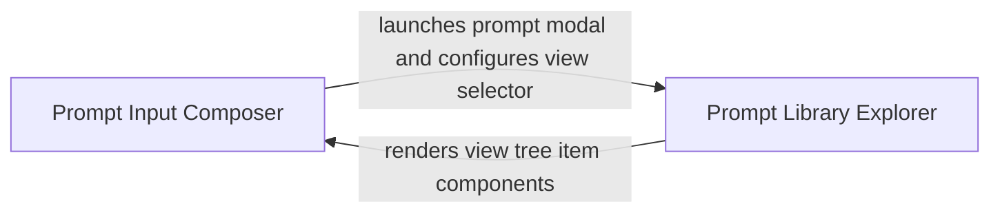

## Details

Provides Flutter widgets and modal dialogs for prompt input, format toggles, mentioned page tagging, and prompt browsing.

### Prompt Input Composer
Renders the prompt text composition interface with controls for page mentions, file attachments, source filtering, and message submission.

**Related Classes/Methods**:

- `frontend.appflowy_flutter.lib.ai.widgets.prompt_input.desktop_prompt_input.DesktopPromptInput`:25-51
- `frontend.appflowy_flutter.lib.ai.widgets.prompt_input.browse_prompts_button.BrowsePromptsButton`:11-67
- `frontend.appflowy_flutter.lib.ai.widgets.prompt_input.select_sources_menu.PromptInputDesktopSelectSourcesButton`:24-37
- `frontend.appflowy_flutter.lib.ai.widgets.prompt_input.select_sources_menu.ViewSelectorTreeItem`:279-314

**Source Files:**

- `frontend/appflowy_flutter/lib/ai/widgets/prompt_input/action_buttons.dart`
  - `frontend.appflowy_flutter.lib.ai.widgets.prompt_input.action_buttons.PromptInputAttachmentButton` (L11-L35) - Class
  - `frontend.appflowy_flutter.lib.ai.widgets.prompt_input.action_buttons.PromptInputAttachmentButton.PromptInputAttachmentButton` (L12-L12) - Constructor
  - `frontend.appflowy_flutter.lib.ai.widgets.prompt_input.action_buttons.PromptInputAttachmentButton.build` (L17-L34) - Method
  - `frontend.appflowy_flutter.lib.ai.widgets.prompt_input.action_buttons.PromptInputMentionButton` (L37-L67) - Class
  - `frontend.appflowy_flutter.lib.ai.widgets.prompt_input.action_buttons.PromptInputMentionButton.PromptInputMentionButton` (L38-L43) - Constructor
  - `frontend.appflowy_flutter.lib.ai.widgets.prompt_input.action_buttons.PromptInputMentionButton.build` (L50-L66) - Method
- `frontend/appflowy_flutter/lib/ai/widgets/prompt_input/browse_prompts_button.dart`
  - `frontend.appflowy_flutter.lib.ai.widgets.prompt_input.browse_prompts_button.BrowsePromptsButton` (L11-L67) - Class
  - `frontend.appflowy_flutter.lib.ai.widgets.prompt_input.browse_prompts_button.BrowsePromptsButton.BrowsePromptsButton` (L12-L15) - Constructor
  - `frontend.appflowy_flutter.lib.ai.widgets.prompt_input.browse_prompts_button.BrowsePromptsButton.build` (L20-L66) - Method
- `frontend/appflowy_flutter/lib/ai/widgets/prompt_input/desktop_prompt_input.dart`
  - `frontend.appflowy_flutter.lib.ai.widgets.prompt_input.desktop_prompt_input.OnPromptInputSubmitted` (L18-L23) - Class
  - `frontend.appflowy_flutter.lib.ai.widgets.prompt_input.desktop_prompt_input.DesktopPromptInput` (L25-L51) - Class
  - `frontend.appflowy_flutter.lib.ai.widgets.prompt_input.desktop_prompt_input.DesktopPromptInput.DesktopPromptInput` (L26-L37) - Constructor
  - `frontend.appflowy_flutter.lib.ai.widgets.prompt_input.desktop_prompt_input.DesktopPromptInput.createState` (L50-L50) - Method
  - `frontend.appflowy_flutter.lib.ai.widgets.prompt_input.desktop_prompt_input._DesktopPromptInputState` (L53-L557) - Class
  - `frontend.appflowy_flutter.lib.ai.widgets.prompt_input.desktop_prompt_input._DesktopPromptInputState.initState` (L65-L88) - Method
  - `frontend.appflowy_flutter.lib.ai.widgets.prompt_input.desktop_prompt_input._DesktopPromptInputState.didUpdateWidget` (L91-L94) - Method
  - `frontend.appflowy_flutter.lib.ai.widgets.prompt_input.desktop_prompt_input._DesktopPromptInputState.dispose` (L97-L103) - Method
  - `frontend.appflowy_flutter.lib.ai.widgets.prompt_input.desktop_prompt_input._DesktopPromptInputState.build` (L106-L220) - Method
  - `frontend.appflowy_flutter.lib.ai.widgets.prompt_input.desktop_prompt_input._DesktopPromptInputState.decoration` (L222-L236) - Method
  - `frontend.appflowy_flutter.lib.ai.widgets.prompt_input.desktop_prompt_input._DesktopPromptInputState.checkForAskingAI` (L238-L258) - Method
  - `frontend.appflowy_flutter.lib.ai.widgets.prompt_input.desktop_prompt_input._DesktopPromptInputState.startMentionPageFromButton` (L260-L276) - Method
  - `frontend.appflowy_flutter.lib.ai.widgets.prompt_input.desktop_prompt_input._DesktopPromptInputState.cancelMentionPage` (L278-L283) - Method
  - `frontend.appflowy_flutter.lib.ai.widgets.prompt_input.desktop_prompt_input._DesktopPromptInputState.updateSendButtonState` (L285-L293) - Method
  - `frontend.appflowy_flutter.lib.ai.widgets.prompt_input.desktop_prompt_input._DesktopPromptInputState.handleSend` (L295-L321) - Method
  - `frontend.appflowy_flutter.lib.ai.widgets.prompt_input.desktop_prompt_input._DesktopPromptInputState.handleTextControllerChanged` (L323-L389) - Method
  - `frontend.appflowy_flutter.lib.ai.widgets.prompt_input.desktop_prompt_input._DesktopPromptInputState.handleKeyEvent` (L391-L404) - Method
  - `frontend.appflowy_flutter.lib.ai.widgets.prompt_input.desktop_prompt_input._DesktopPromptInputState.handlePageSelected` (L406-L422) - Method
  - `frontend.appflowy_flutter.lib.ai.widgets.prompt_input.desktop_prompt_input._DesktopPromptInputState.inputTextField` (L424-L457) - Method
  - `frontend.appflowy_flutter.lib.ai.widgets.prompt_input.desktop_prompt_input._DesktopPromptInputState.getTextFieldConstraints` (L459-L469) - Method
  - `frontend.appflowy_flutter.lib.ai.widgets.prompt_input.desktop_prompt_input._DesktopPromptInputState.calculateContentPadding` (L471-L480) - Method
  - `frontend.appflowy_flutter.lib.ai.widgets.prompt_input.desktop_prompt_input._DesktopPromptInputState.buildShortcuts` (L482-L493) - Method
  - `frontend.appflowy_flutter.lib.ai.widgets.prompt_input.desktop_prompt_input._DesktopPromptInputState.buildActions` (L495-L534) - Method
  - `frontend.appflowy_flutter.lib.ai.widgets.prompt_input.desktop_prompt_input._DesktopPromptInputState.handleOnSelectPrompt` (L536-L556) - Method
  - `frontend.appflowy_flutter.lib.ai.widgets.prompt_input.desktop_prompt_input._SubmitOrMentionPageIntent` (L559-L561) - Class
  - `frontend.appflowy_flutter.lib.ai.widgets.prompt_input.desktop_prompt_input._SubmitOrMentionPageIntent._SubmitOrMentionPageIntent` (L560-L560) - Constructor
  - `frontend.appflowy_flutter.lib.ai.widgets.prompt_input.desktop_prompt_input._CancelMentionPageIntent` (L563-L565) - Class
  - `frontend.appflowy_flutter.lib.ai.widgets.prompt_input.desktop_prompt_input._CancelMentionPageIntent._CancelMentionPageIntent` (L564-L564) - Constructor
  - `frontend.appflowy_flutter.lib.ai.widgets.prompt_input.desktop_prompt_input._FocusPreviousItemIntent` (L567-L569) - Class
  - `frontend.appflowy_flutter.lib.ai.widgets.prompt_input.desktop_prompt_input._FocusPreviousItemIntent._FocusPreviousItemIntent` (L568-L568) - Constructor
  - `frontend.appflowy_flutter.lib.ai.widgets.prompt_input.desktop_prompt_input._FocusNextItemIntent` (L571-L573) - Class
  - `frontend.appflowy_flutter.lib.ai.widgets.prompt_input.desktop_prompt_input._FocusNextItemIntent._FocusNextItemIntent` (L572-L572) - Constructor
  - `frontend.appflowy_flutter.lib.ai.widgets.prompt_input.desktop_prompt_input.PromptInputTextField` (L575-L629) - Class
  - `frontend.appflowy_flutter.lib.ai.widgets.prompt_input.desktop_prompt_input.PromptInputTextField.PromptInputTextField` (L576-L584) - Constructor
  - `frontend.appflowy_flutter.lib.ai.widgets.prompt_input.desktop_prompt_input.PromptInputTextField.build` (L594-L620) - Method
  - `frontend.appflowy_flutter.lib.ai.widgets.prompt_input.desktop_prompt_input.PromptInputTextField.inputHintTextStyle` (L622-L628) - Method
  - `frontend.appflowy_flutter.lib.ai.widgets.prompt_input.desktop_prompt_input._PromptBottomActions` (L631-L754) - Class
  - `frontend.appflowy_flutter.lib.ai.widgets.prompt_input.desktop_prompt_input._PromptBottomActions._PromptBottomActions` (L632-L644) - Constructor
  - `frontend.appflowy_flutter.lib.ai.widgets.prompt_input.desktop_prompt_input._PromptBottomActions.build` (L659-L686) - Method
  - `frontend.appflowy_flutter.lib.ai.widgets.prompt_input.desktop_prompt_input._PromptBottomActions._predefinedFormatButton` (L688-L693) - Method
  - `frontend.appflowy_flutter.lib.ai.widgets.prompt_input.desktop_prompt_input._PromptBottomActions._selectSourcesButton` (L695-L700) - Method
  - `frontend.appflowy_flutter.lib.ai.widgets.prompt_input.desktop_prompt_input._PromptBottomActions._selectModelButton` (L702-L707) - Method
  - `frontend.appflowy_flutter.lib.ai.widgets.prompt_input.desktop_prompt_input._PromptBottomActions._buildBrowsePromptsButton` (L709-L713) - Method
  - `frontend.appflowy_flutter.lib.ai.widgets.prompt_input.desktop_prompt_input._PromptBottomActions._attachmentButton` (L723-L745) - Method
  - `frontend.appflowy_flutter.lib.ai.widgets.prompt_input.desktop_prompt_input._PromptBottomActions._sendButton` (L747-L753) - Method
- `frontend/appflowy_flutter/lib/ai/widgets/prompt_input/file_attachment_list.dart`
  - `frontend.appflowy_flutter.lib.ai.widgets.prompt_input.file_attachment_list.PromptInputFile` (L13-L45) - Class
  - `frontend.appflowy_flutter.lib.ai.widgets.prompt_input.file_attachment_list.PromptInputFile.PromptInputFile` (L14-L17) - Constructor
  - `frontend.appflowy_flutter.lib.ai.widgets.prompt_input.file_attachment_list.PromptInputFile.build` (L22-L44) - Method
  - `frontend.appflowy_flutter.lib.ai.widgets.prompt_input.file_attachment_list.ChatFilePreview` (L47-L59) - Class
  - `frontend.appflowy_flutter.lib.ai.widgets.prompt_input.file_attachment_list.ChatFilePreview.ChatFilePreview` (L48-L52) - Constructor
  - `frontend.appflowy_flutter.lib.ai.widgets.prompt_input.file_attachment_list.ChatFilePreview.createState` (L58-L58) - Method
  - `frontend.appflowy_flutter.lib.ai.widgets.prompt_input.file_attachment_list._ChatFilePreviewState` (L61-L141) - Class
  - `frontend.appflowy_flutter.lib.ai.widgets.prompt_input.file_attachment_list._ChatFilePreviewState.build` (L65-L134) - Method
  - `frontend.appflowy_flutter.lib.ai.widgets.prompt_input.file_attachment_list._ChatFilePreviewState.setHover` (L136-L140) - Method
  - `frontend.appflowy_flutter.lib.ai.widgets.prompt_input.file_attachment_list._CloseButton` (L143-L162) - Class
  - `frontend.appflowy_flutter.lib.ai.widgets.prompt_input.file_attachment_list._CloseButton._CloseButton` (L144-L144) - Constructor
  - `frontend.appflowy_flutter.lib.ai.widgets.prompt_input.file_attachment_list._CloseButton.build` (L149-L161) - Method
- `frontend/appflowy_flutter/lib/ai/widgets/prompt_input/layout_define.dart`
  - `frontend.appflowy_flutter.lib.ai.widgets.prompt_input.layout_define.DesktopAIPromptSizes` (L3-L22) - Class
  - `frontend.appflowy_flutter.lib.ai.widgets.prompt_input.layout_define.DesktopAIPromptSizes.DesktopAIPromptSizes._` (L4-L4) - Constructor
  - `frontend.appflowy_flutter.lib.ai.widgets.prompt_input.layout_define.MobileAIPromptSizes` (L24-L42) - Class
  - `frontend.appflowy_flutter.lib.ai.widgets.prompt_input.layout_define.MobileAIPromptSizes.MobileAIPromptSizes._` (L25-L25) - Constructor
- `frontend/appflowy_flutter/lib/ai/widgets/prompt_input/mention_page_bottom_sheet.dart`
  - `frontend.appflowy_flutter.lib.ai.widgets.prompt_input.mention_page_bottom_sheet.showPageSelectorSheet` (L13-L32) - Function
  - `frontend.appflowy_flutter.lib.ai.widgets.prompt_input.mention_page_bottom_sheet._MobilePageSelectorBody` (L34-L46) - Class
  - `frontend.appflowy_flutter.lib.ai.widgets.prompt_input.mention_page_bottom_sheet._MobilePageSelectorBody._MobilePageSelectorBody` (L35-L38) - Constructor
  - `frontend.appflowy_flutter.lib.ai.widgets.prompt_input.mention_page_bottom_sheet._MobilePageSelectorBody.createState` (L44-L45) - Method
  - `frontend.appflowy_flutter.lib.ai.widgets.prompt_input.mention_page_bottom_sheet._MobilePageSelectorBodyState` (L48-L176) - Class
  - `frontend.appflowy_flutter.lib.ai.widgets.prompt_input.mention_page_bottom_sheet._MobilePageSelectorBodyState.dispose` (L53-L56) - Method
  - `frontend.appflowy_flutter.lib.ai.widgets.prompt_input.mention_page_bottom_sheet._MobilePageSelectorBodyState.build` (L59-L172) - Method
  - `frontend.appflowy_flutter.lib.ai.widgets.prompt_input.mention_page_bottom_sheet._MobilePageSelectorBodyState._fetchViews` (L174-L175) - Method
  - `frontend.appflowy_flutter.lib.ai.widgets.prompt_input.mention_page_bottom_sheet._Header` (L178-L204) - Class
  - `frontend.appflowy_flutter.lib.ai.widgets.prompt_input.mention_page_bottom_sheet._Header._Header` (L179-L181) - Constructor
  - `frontend.appflowy_flutter.lib.ai.widgets.prompt_input.mention_page_bottom_sheet._Header.build` (L186-L192) - Method
  - `frontend.appflowy_flutter.lib.ai.widgets.prompt_input.mention_page_bottom_sheet._Header.maxExtent` (L195-L195) - Method
  - `frontend.appflowy_flutter.lib.ai.widgets.prompt_input.mention_page_bottom_sheet._Header.minExtent` (L198-L198) - Method
  - `frontend.appflowy_flutter.lib.ai.widgets.prompt_input.mention_page_bottom_sheet._Header.shouldRebuild` (L201-L203) - Method
- `frontend/appflowy_flutter/lib/ai/widgets/prompt_input/mention_page_menu.dart`
  - `frontend.appflowy_flutter.lib.ai.widgets.prompt_input.mention_page_menu.PromptInputAnchor` (L22-L27) - Class
  - `frontend.appflowy_flutter.lib.ai.widgets.prompt_input.mention_page_menu.PromptInputAnchor.PromptInputAnchor` (L23-L23) - Constructor
  - `frontend.appflowy_flutter.lib.ai.widgets.prompt_input.mention_page_menu.PromptInputMentionPageMenu` (L29-L44) - Class
  - `frontend.appflowy_flutter.lib.ai.widgets.prompt_input.mention_page_menu.PromptInputMentionPageMenu.PromptInputMentionPageMenu` (L30-L35) - Constructor
  - `frontend.appflowy_flutter.lib.ai.widgets.prompt_input.mention_page_menu.PromptInputMentionPageMenu.createState` (L42-L43) - Method
  - `frontend.appflowy_flutter.lib.ai.widgets.prompt_input.mention_page_menu._PromptInputMentionPageMenuState` (L46-L148) - Class
  - `frontend.appflowy_flutter.lib.ai.widgets.prompt_input.mention_page_menu._PromptInputMentionPageMenuState.initState` (L49-L56) - Method
  - `frontend.appflowy_flutter.lib.ai.widgets.prompt_input.mention_page_menu._PromptInputMentionPageMenuState.build` (L59-L109) - Method
  - `frontend.appflowy_flutter.lib.ai.widgets.prompt_input.mention_page_menu._PromptInputMentionPageMenuState.getPopupOffsetX` (L111-L147) - Method
  - `frontend.appflowy_flutter.lib.ai.widgets.prompt_input.mention_page_menu.PromptInputMentionPageList` (L150-L161) - Class
  - `frontend.appflowy_flutter.lib.ai.widgets.prompt_input.mention_page_menu.PromptInputMentionPageList.PromptInputMentionPageList` (L151-L154) - Constructor
  - `frontend.appflowy_flutter.lib.ai.widgets.prompt_input.mention_page_menu.PromptInputMentionPageList.createState` (L159-L160) - Method
  - `frontend.appflowy_flutter.lib.ai.widgets.prompt_input.mention_page_menu._PromptInputMentionPageListState` (L163-L262) - Class
  - `frontend.appflowy_flutter.lib.ai.widgets.prompt_input.mention_page_menu._PromptInputMentionPageListState.dispose` (L172-L175) - Method
  - `frontend.appflowy_flutter.lib.ai.widgets.prompt_input.mention_page_menu._PromptInputMentionPageListState.build` (L178-L261) - Method
  - `frontend.appflowy_flutter.lib.ai.widgets.prompt_input.mention_page_menu._ChatMentionPageItem` (L264-L302) - Class
  - `frontend.appflowy_flutter.lib.ai.widgets.prompt_input.mention_page_menu._ChatMentionPageItem._ChatMentionPageItem` (L265-L269) - Constructor
  - `frontend.appflowy_flutter.lib.ai.widgets.prompt_input.mention_page_menu._ChatMentionPageItem.build` (L276-L301) - Method
  - `frontend.appflowy_flutter.lib.ai.widgets.prompt_input.mention_page_menu.MentionViewIcon` (L304-L341) - Class
  - `frontend.appflowy_flutter.lib.ai.widgets.prompt_input.mention_page_menu.MentionViewIcon.MentionViewIcon` (L305-L308) - Constructor
  - `frontend.appflowy_flutter.lib.ai.widgets.prompt_input.mention_page_menu.MentionViewIcon.build` (L313-L340) - Method
  - `frontend.appflowy_flutter.lib.ai.widgets.prompt_input.mention_page_menu.MentionViewTitleAndAncestors` (L343-L435) - Class
  - `frontend.appflowy_flutter.lib.ai.widgets.prompt_input.mention_page_menu.MentionViewTitleAndAncestors.MentionViewTitleAndAncestors` (L344-L347) - Constructor
  - `frontend.appflowy_flutter.lib.ai.widgets.prompt_input.mention_page_menu.MentionViewTitleAndAncestors.build` (L352-L392) - Method
  - `frontend.appflowy_flutter.lib.ai.widgets.prompt_input.mention_page_menu.MentionViewTitleAndAncestors._getViewAncestorList` (L397-L434) - Method
- `frontend/appflowy_flutter/lib/ai/widgets/prompt_input/mentioned_page_text_span.dart`
  - `frontend.appflowy_flutter.lib.ai.widgets.prompt_input.mentioned_page_text_span.PromptInputTextSpanBuilder` (L8-L40) - Class
  - `frontend.appflowy_flutter.lib.ai.widgets.prompt_input.mentioned_page_text_span.PromptInputTextSpanBuilder.PromptInputTextSpanBuilder` (L9-L12) - Constructor
  - `frontend.appflowy_flutter.lib.ai.widgets.prompt_input.mentioned_page_text_span.PromptInputTextSpanBuilder.createSpecialText` (L18-L39) - Method
  - `frontend.appflowy_flutter.lib.ai.widgets.prompt_input.mentioned_page_text_span.MentionedPageText` (L42-L77) - Class
  - `frontend.appflowy_flutter.lib.ai.widgets.prompt_input.mentioned_page_text_span.MentionedPageText.MentionedPageText` (L43-L48) - Constructor
  - `frontend.appflowy_flutter.lib.ai.widgets.prompt_input.mentioned_page_text_span.MentionedPageText.isEnd` (L56-L56) - Method
  - `frontend.appflowy_flutter.lib.ai.widgets.prompt_input.mentioned_page_text_span.MentionedPageText.finishText` (L59-L76) - Method
- `frontend/appflowy_flutter/lib/ai/widgets/prompt_input/predefined_format_buttons.dart`
  - `frontend.appflowy_flutter.lib.ai.widgets.prompt_input.predefined_format_buttons.PromptInputDesktopToggleFormatButton` (L12-L43) - Class
  - `frontend.appflowy_flutter.lib.ai.widgets.prompt_input.predefined_format_buttons.PromptInputDesktopToggleFormatButton.PromptInputDesktopToggleFormatButton` (L13-L17) - Constructor
  - `frontend.appflowy_flutter.lib.ai.widgets.prompt_input.predefined_format_buttons.PromptInputDesktopToggleFormatButton.build` (L23-L42) - Method
  - `frontend.appflowy_flutter.lib.ai.widgets.prompt_input.predefined_format_buttons.ChangeFormatBar` (L45-L182) - Class
  - `frontend.appflowy_flutter.lib.ai.widgets.prompt_input.predefined_format_buttons.ChangeFormatBar.ChangeFormatBar` (L46-L52) - Constructor
  - `frontend.appflowy_flutter.lib.ai.widgets.prompt_input.predefined_format_buttons.ChangeFormatBar.build` (L60-L83) - Method
  - `frontend.appflowy_flutter.lib.ai.widgets.prompt_input.predefined_format_buttons.ChangeFormatBar._buildFormatButton` (L85-L124) - Method
  - `frontend.appflowy_flutter.lib.ai.widgets.prompt_input.predefined_format_buttons.ChangeFormatBar._buildDivider` (L126-L132) - Method
  - `frontend.appflowy_flutter.lib.ai.widgets.prompt_input.predefined_format_buttons.ChangeFormatBar._buildTextFormatButton` (L134-L169) - Method
  - `frontend.appflowy_flutter.lib.ai.widgets.prompt_input.predefined_format_buttons.ChangeFormatBar._buttonSize` (L171-L175) - Method
  - `frontend.appflowy_flutter.lib.ai.widgets.prompt_input.predefined_format_buttons.ChangeFormatBar._iconSize` (L177-L181) - Method
  - `frontend.appflowy_flutter.lib.ai.widgets.prompt_input.predefined_format_buttons.PromptInputMobileToggleFormatButton` (L184-L215) - Class
  - `frontend.appflowy_flutter.lib.ai.widgets.prompt_input.predefined_format_buttons.PromptInputMobileToggleFormatButton.PromptInputMobileToggleFormatButton` (L185-L189) - Constructor
  - `frontend.appflowy_flutter.lib.ai.widgets.prompt_input.predefined_format_buttons.PromptInputMobileToggleFormatButton.build` (L195-L214) - Method
- `frontend/appflowy_flutter/lib/ai/widgets/prompt_input/prompt_input_text_controller.dart`
  - `frontend.appflowy_flutter.lib.ai.widgets.prompt_input.prompt_input_text_controller.AiPromptInputTextEditingController` (L7-L79) - Class
  - `frontend.appflowy_flutter.lib.ai.widgets.prompt_input.prompt_input_text_controller.AiPromptInputTextEditingController.AiPromptInputTextEditingController` (L8-L8) - Constructor
  - `frontend.appflowy_flutter.lib.ai.widgets.prompt_input.prompt_input_text_controller.AiPromptInputTextEditingController.replace` (L10-L14) - Method
  - `frontend.appflowy_flutter.lib.ai.widgets.prompt_input.prompt_input_text_controller.AiPromptInputTextEditingController.restore` (L16-L20) - Method
  - `frontend.appflowy_flutter.lib.ai.widgets.prompt_input.prompt_input_text_controller.AiPromptInputTextEditingController.usePrompt` (L22-L29) - Method
  - `frontend.appflowy_flutter.lib.ai.widgets.prompt_input.prompt_input_text_controller.AiPromptInputTextEditingController.buildTextSpan` (L32-L41) - Method
  - `frontend.appflowy_flutter.lib.ai.widgets.prompt_input.prompt_input_text_controller.AiPromptInputTextEditingController.getTextSpans` (L43-L78) - Method
- `frontend/appflowy_flutter/lib/ai/widgets/prompt_input/select_model_menu.dart`
  - `frontend.appflowy_flutter.lib.ai.widgets.prompt_input.select_model_menu.SelectModelMenu` (L11-L21) - Class
  - `frontend.appflowy_flutter.lib.ai.widgets.prompt_input.select_model_menu.SelectModelMenu.SelectModelMenu` (L12-L15) - Constructor
  - `frontend.appflowy_flutter.lib.ai.widgets.prompt_input.select_model_menu.SelectModelMenu.createState` (L20-L20) - Method
  - `frontend.appflowy_flutter.lib.ai.widgets.prompt_input.select_model_menu._SelectModelMenuState` (L23-L67) - Class
  - `frontend.appflowy_flutter.lib.ai.widgets.prompt_input.select_model_menu._SelectModelMenuState.build` (L27-L66) - Method
  - `frontend.appflowy_flutter.lib.ai.widgets.prompt_input.select_model_menu.SelectModelPopoverContent` (L69-L130) - Class
  - `frontend.appflowy_flutter.lib.ai.widgets.prompt_input.select_model_menu.SelectModelPopoverContent.SelectModelPopoverContent` (L70-L75) - Constructor
  - `frontend.appflowy_flutter.lib.ai.widgets.prompt_input.select_model_menu.SelectModelPopoverContent.build` (L82-L129) - Method
  - `frontend.appflowy_flutter.lib.ai.widgets.prompt_input.select_model_menu._ModelSectionHeader` (L132-L152) - Class
  - `frontend.appflowy_flutter.lib.ai.widgets.prompt_input.select_model_menu._ModelSectionHeader._ModelSectionHeader` (L133-L135) - Constructor
  - `frontend.appflowy_flutter.lib.ai.widgets.prompt_input.select_model_menu._ModelSectionHeader.build` (L140-L151) - Method
  - `frontend.appflowy_flutter.lib.ai.widgets.prompt_input.select_model_menu._ModelItem` (L154-L200) - Class
  - `frontend.appflowy_flutter.lib.ai.widgets.prompt_input.select_model_menu._ModelItem._ModelItem` (L155-L159) - Constructor
  - `frontend.appflowy_flutter.lib.ai.widgets.prompt_input.select_model_menu._ModelItem.build` (L166-L199) - Method
  - `frontend.appflowy_flutter.lib.ai.widgets.prompt_input.select_model_menu._CurrentModelButton` (L202-L262) - Class
  - `frontend.appflowy_flutter.lib.ai.widgets.prompt_input.select_model_menu._CurrentModelButton._CurrentModelButton` (L203-L206) - Constructor
  - `frontend.appflowy_flutter.lib.ai.widgets.prompt_input.select_model_menu._CurrentModelButton.build` (L212-L261) - Method
- `frontend/appflowy_flutter/lib/ai/widgets/prompt_input/select_sources_bottom_sheet.dart`
  - `frontend.appflowy_flutter.lib.ai.widgets.prompt_input.select_sources_bottom_sheet.PromptInputMobileSelectSourcesButton` (L23-L36) - Class
  - `frontend.appflowy_flutter.lib.ai.widgets.prompt_input.select_sources_bottom_sheet.PromptInputMobileSelectSourcesButton.PromptInputMobileSelectSourcesButton` (L24-L28) - Constructor
  - `frontend.appflowy_flutter.lib.ai.widgets.prompt_input.select_sources_bottom_sheet.PromptInputMobileSelectSourcesButton.createState` (L34-L35) - Method
  - `frontend.appflowy_flutter.lib.ai.widgets.prompt_input.select_sources_bottom_sheet._PromptInputMobileSelectSourcesButtonState` (L38-L171) - Class
  - `frontend.appflowy_flutter.lib.ai.widgets.prompt_input.select_sources_bottom_sheet._PromptInputMobileSelectSourcesButtonState.initState` (L54-L60) - Method
  - `frontend.appflowy_flutter.lib.ai.widgets.prompt_input.select_sources_bottom_sheet._PromptInputMobileSelectSourcesButtonState.dispose` (L63-L67) - Method
  - `frontend.appflowy_flutter.lib.ai.widgets.prompt_input.select_sources_bottom_sheet._PromptInputMobileSelectSourcesButtonState.build` (L70-L164) - Method
  - `frontend.appflowy_flutter.lib.ai.widgets.prompt_input.select_sources_bottom_sheet._PromptInputMobileSelectSourcesButtonState.onSelectedSourcesChanged` (L166-L170) - Method
  - `frontend.appflowy_flutter.lib.ai.widgets.prompt_input.select_sources_bottom_sheet._MobileSelectSourcesSheetBody` (L173-L296) - Class
  - `frontend.appflowy_flutter.lib.ai.widgets.prompt_input.select_sources_bottom_sheet._MobileSelectSourcesSheetBody._MobileSelectSourcesSheetBody` (L174-L176) - Constructor
  - `frontend.appflowy_flutter.lib.ai.widgets.prompt_input.select_sources_bottom_sheet._MobileSelectSourcesSheetBody.build` (L181-L295) - Method
  - `frontend.appflowy_flutter.lib.ai.widgets.prompt_input.select_sources_bottom_sheet._Header` (L298-L324) - Class
  - `frontend.appflowy_flutter.lib.ai.widgets.prompt_input.select_sources_bottom_sheet._Header._Header` (L299-L301) - Constructor
  - `frontend.appflowy_flutter.lib.ai.widgets.prompt_input.select_sources_bottom_sheet._Header.build` (L306-L312) - Method
  - `frontend.appflowy_flutter.lib.ai.widgets.prompt_input.select_sources_bottom_sheet._Header.maxExtent` (L315-L315) - Method
  - `frontend.appflowy_flutter.lib.ai.widgets.prompt_input.select_sources_bottom_sheet._Header.minExtent` (L318-L318) - Method
  - `frontend.appflowy_flutter.lib.ai.widgets.prompt_input.select_sources_bottom_sheet._Header.shouldRebuild` (L321-L323) - Method
- `frontend/appflowy_flutter/lib/ai/widgets/prompt_input/select_sources_menu.dart`
  - `frontend.appflowy_flutter.lib.ai.widgets.prompt_input.select_sources_menu.PromptInputDesktopSelectSourcesButton` (L24-L37) - Class
  - `frontend.appflowy_flutter.lib.ai.widgets.prompt_input.select_sources_menu.PromptInputDesktopSelectSourcesButton.PromptInputDesktopSelectSourcesButton` (L25-L29) - Constructor
  - `frontend.appflowy_flutter.lib.ai.widgets.prompt_input.select_sources_menu.PromptInputDesktopSelectSourcesButton.createState` (L35-L36) - Method
  - `frontend.appflowy_flutter.lib.ai.widgets.prompt_input.select_sources_menu._PromptInputDesktopSelectSourcesButtonState` (L39-L123) - Class
  - `frontend.appflowy_flutter.lib.ai.widgets.prompt_input.select_sources_menu._PromptInputDesktopSelectSourcesButtonState.initState` (L62-L68) - Method
  - `frontend.appflowy_flutter.lib.ai.widgets.prompt_input.select_sources_menu._PromptInputDesktopSelectSourcesButtonState.dispose` (L71-L75) - Method
  - `frontend.appflowy_flutter.lib.ai.widgets.prompt_input.select_sources_menu._PromptInputDesktopSelectSourcesButtonState.build` (L78-L116) - Method
  - `frontend.appflowy_flutter.lib.ai.widgets.prompt_input.select_sources_menu._PromptInputDesktopSelectSourcesButtonState.onSelectedSourcesChanged` (L118-L122) - Method
  - `frontend.appflowy_flutter.lib.ai.widgets.prompt_input.select_sources_menu._IndicatorButton` (L125-L186) - Class
  - `frontend.appflowy_flutter.lib.ai.widgets.prompt_input.select_sources_menu._IndicatorButton._IndicatorButton` (L126-L129) - Constructor
  - `frontend.appflowy_flutter.lib.ai.widgets.prompt_input.select_sources_menu._IndicatorButton.build` (L135-L185) - Method
  - `frontend.appflowy_flutter.lib.ai.widgets.prompt_input.select_sources_menu._PopoverContent` (L188-L277) - Class
  - `frontend.appflowy_flutter.lib.ai.widgets.prompt_input.select_sources_menu._PopoverContent._PopoverContent` (L189-L189) - Constructor
  - `frontend.appflowy_flutter.lib.ai.widgets.prompt_input.select_sources_menu._PopoverContent.build` (L192-L234) - Method
  - `frontend.appflowy_flutter.lib.ai.widgets.prompt_input.select_sources_menu._PopoverContent._buildSelectedSources` (L236-L255) - Method
  - `frontend.appflowy_flutter.lib.ai.widgets.prompt_input.select_sources_menu._PopoverContent._buildVisibleSources` (L257-L276) - Method
  - `frontend.appflowy_flutter.lib.ai.widgets.prompt_input.select_sources_menu.ViewSelectorTreeItem` (L279-L314) - Class
  - `frontend.appflowy_flutter.lib.ai.widgets.prompt_input.select_sources_menu.ViewSelectorTreeItem.ViewSelectorTreeItem` (L280-L291) - Constructor
  - `frontend.appflowy_flutter.lib.ai.widgets.prompt_input.select_sources_menu.ViewSelectorTreeItem.createState` (L313-L313) - Method
  - `frontend.appflowy_flutter.lib.ai.widgets.prompt_input.select_sources_menu._ViewSelectorTreeItemState` (L316-L387) - Class
  - `frontend.appflowy_flutter.lib.ai.widgets.prompt_input.select_sources_menu._ViewSelectorTreeItemState.build` (L318-L386) - Method
  - `frontend.appflowy_flutter.lib.ai.widgets.prompt_input.select_sources_menu.ViewSelectorTreeItemInner` (L389-L492) - Class
  - `frontend.appflowy_flutter.lib.ai.widgets.prompt_input.select_sources_menu.ViewSelectorTreeItemInner.ViewSelectorTreeItemInner` (L390-L400) - Constructor
  - `frontend.appflowy_flutter.lib.ai.widgets.prompt_input.select_sources_menu.ViewSelectorTreeItemInner.build` (L412-L491) - Method
  - `frontend.appflowy_flutter.lib.ai.widgets.prompt_input.select_sources_menu.ToggleIsExpandedButton` (L494-L534) - Class
  - `frontend.appflowy_flutter.lib.ai.widgets.prompt_input.select_sources_menu.ToggleIsExpandedButton.ToggleIsExpandedButton` (L495-L499) - Constructor
  - `frontend.appflowy_flutter.lib.ai.widgets.prompt_input.select_sources_menu.ToggleIsExpandedButton.build` (L505-L533) - Method
  - `frontend.appflowy_flutter.lib.ai.widgets.prompt_input.select_sources_menu._DotIconWidget` (L536-L553) - Class
  - `frontend.appflowy_flutter.lib.ai.widgets.prompt_input.select_sources_menu._DotIconWidget._DotIconWidget` (L537-L537) - Constructor
  - `frontend.appflowy_flutter.lib.ai.widgets.prompt_input.select_sources_menu._DotIconWidget.build` (L540-L552) - Method
  - `frontend.appflowy_flutter.lib.ai.widgets.prompt_input.select_sources_menu.SourceSelectedStatusCheckbox` (L555-L578) - Class
  - `frontend.appflowy_flutter.lib.ai.widgets.prompt_input.select_sources_menu.SourceSelectedStatusCheckbox.SourceSelectedStatusCheckbox` (L556-L559) - Constructor
  - `frontend.appflowy_flutter.lib.ai.widgets.prompt_input.select_sources_menu.SourceSelectedStatusCheckbox.build` (L564-L577) - Method
- `frontend/appflowy_flutter/lib/ai/widgets/prompt_input/send_button.dart`
  - `frontend.appflowy_flutter.lib.ai.widgets.prompt_input.send_button.SendButtonState` (L10-L10) - Enum
  - `frontend.appflowy_flutter.lib.ai.widgets.prompt_input.send_button.SendButtonState.disabled` (L10-L10) - Enum
  - `frontend.appflowy_flutter.lib.ai.widgets.prompt_input.send_button.SendButtonState.enabled` (L10-L10) - Enum
  - `frontend.appflowy_flutter.lib.ai.widgets.prompt_input.send_button.SendButtonState.streaming` (L10-L10) - Enum
  - `frontend.appflowy_flutter.lib.ai.widgets.prompt_input.send_button.PromptInputSendButton` (L12-L89) - Class
  - `frontend.appflowy_flutter.lib.ai.widgets.prompt_input.send_button.PromptInputSendButton.PromptInputSendButton` (L13-L18) - Constructor
  - `frontend.appflowy_flutter.lib.ai.widgets.prompt_input.send_button.PromptInputSendButton.build` (L25-L76) - Method
  - `frontend.appflowy_flutter.lib.ai.widgets.prompt_input.send_button.PromptInputSendButton._buttonSize` (L78-L82) - Method
  - `frontend.appflowy_flutter.lib.ai.widgets.prompt_input.send_button.PromptInputSendButton._iconSize` (L84-L88) - Method

### Prompt Library Explorer
Provides modal dialogs and view selector wrappers for browsing, previewing, and configuring AI prompt templates and databases.

**Related Classes/Methods**:

- `frontend.appflowy_flutter.lib.ai.widgets.ai_prompt_modal.ai_prompt_modal.AiPromptModal`:42-159
- `frontend.appflowy_flutter.lib.ai.widgets.ai_prompt_modal.ai_prompt_modal.showAiPromptModal`:18-40
- `frontend.appflowy_flutter.lib.ai.widgets.ai_prompt_modal.ai_prompt_database_modal.AiPromptDatabaseModal`:45-52
- `frontend.appflowy_flutter.lib.ai.widgets.view_selector.ViewSelector`:8-40

**Source Files:**

- `frontend/appflowy_flutter/lib/ai/widgets/ai_prompt_modal/ai_prompt_category_list.dart`
  - `frontend.appflowy_flutter.lib.ai.widgets.ai_prompt_modal.ai_prompt_category_list.AiPromptCategoryList` (L8-L15) - Class
  - `frontend.appflowy_flutter.lib.ai.widgets.ai_prompt_modal.ai_prompt_category_list.AiPromptCategoryList.AiPromptCategoryList` (L9-L11) - Constructor
  - `frontend.appflowy_flutter.lib.ai.widgets.ai_prompt_modal.ai_prompt_category_list.AiPromptCategoryList.createState` (L14-L14) - Method
  - `frontend.appflowy_flutter.lib.ai.widgets.ai_prompt_modal.ai_prompt_category_list._AiPromptCategoryListState` (L17-L90) - Class
  - `frontend.appflowy_flutter.lib.ai.widgets.ai_prompt_modal.ai_prompt_category_list._AiPromptCategoryListState.build` (L20-L67) - Method
  - `frontend.appflowy_flutter.lib.ai.widgets.ai_prompt_modal.ai_prompt_category_list._AiPromptCategoryListState.sortedCategories` (L69-L77) - Method
  - `frontend.appflowy_flutter.lib.ai.widgets.ai_prompt_modal.ai_prompt_category_list._AiPromptCategoryListState._buildCategoryItem` (L79-L89) - Method
  - `frontend.appflowy_flutter.lib.ai.widgets.ai_prompt_modal.ai_prompt_category_list.AiPromptFeaturedSection` (L92-L138) - Class
  - `frontend.appflowy_flutter.lib.ai.widgets.ai_prompt_modal.ai_prompt_category_list.AiPromptFeaturedSection.AiPromptFeaturedSection` (L93-L95) - Constructor
  - `frontend.appflowy_flutter.lib.ai.widgets.ai_prompt_modal.ai_prompt_category_list.AiPromptFeaturedSection.build` (L98-L137) - Method
  - `frontend.appflowy_flutter.lib.ai.widgets.ai_prompt_modal.ai_prompt_category_list.AiPromptCustomPromptSection` (L140-L193) - Class
  - `frontend.appflowy_flutter.lib.ai.widgets.ai_prompt_modal.ai_prompt_category_list.AiPromptCustomPromptSection.AiPromptCustomPromptSection` (L141-L143) - Constructor
  - `frontend.appflowy_flutter.lib.ai.widgets.ai_prompt_modal.ai_prompt_category_list.AiPromptCustomPromptSection.build` (L146-L192) - Method
  - `frontend.appflowy_flutter.lib.ai.widgets.ai_prompt_modal.ai_prompt_category_list.AiPromptCategoryItem` (L195-L250) - Class
  - `frontend.appflowy_flutter.lib.ai.widgets.ai_prompt_modal.ai_prompt_category_list.AiPromptCategoryItem.AiPromptCategoryItem` (L196-L200) - Constructor
  - `frontend.appflowy_flutter.lib.ai.widgets.ai_prompt_modal.ai_prompt_category_list.AiPromptCategoryItem.build` (L206-L249) - Method
- `frontend/appflowy_flutter/lib/ai/widgets/ai_prompt_modal/ai_prompt_database_modal.dart`
  - `frontend.appflowy_flutter.lib.ai.widgets.ai_prompt_modal.ai_prompt_database_modal.changeCustomPromptDatabaseConfig` (L21-L43) - Function
  - `frontend.appflowy_flutter.lib.ai.widgets.ai_prompt_modal.ai_prompt_database_modal.AiPromptDatabaseModal` (L45-L52) - Class
  - `frontend.appflowy_flutter.lib.ai.widgets.ai_prompt_modal.ai_prompt_database_modal.AiPromptDatabaseModal.AiPromptDatabaseModal` (L46-L48) - Constructor
  - `frontend.appflowy_flutter.lib.ai.widgets.ai_prompt_modal.ai_prompt_database_modal.AiPromptDatabaseModal.createState` (L51-L51) - Method
  - `frontend.appflowy_flutter.lib.ai.widgets.ai_prompt_modal.ai_prompt_database_modal._AiPromptDatabaseModalState` (L54-L173) - Class
  - `frontend.appflowy_flutter.lib.ai.widgets.ai_prompt_modal.ai_prompt_database_modal._AiPromptDatabaseModalState.dispose` (L58-L61) - Method
  - `frontend.appflowy_flutter.lib.ai.widgets.ai_prompt_modal.ai_prompt_database_modal._AiPromptDatabaseModalState.build` (L64-L172) - Method
  - `frontend.appflowy_flutter.lib.ai.widgets.ai_prompt_modal.ai_prompt_database_modal._Header` (L175-L180) - Class
  - `frontend.appflowy_flutter.lib.ai.widgets.ai_prompt_modal.ai_prompt_database_modal._Header._Header` (L176-L176) - Constructor
  - `frontend.appflowy_flutter.lib.ai.widgets.ai_prompt_modal.ai_prompt_database_modal._Header.createState` (L179-L179) - Method
  - `frontend.appflowy_flutter.lib.ai.widgets.ai_prompt_modal.ai_prompt_database_modal._HeaderState` (L182-L351) - Class
  - `frontend.appflowy_flutter.lib.ai.widgets.ai_prompt_modal.ai_prompt_database_modal._HeaderState.dispose` (L186-L189) - Method
  - `frontend.appflowy_flutter.lib.ai.widgets.ai_prompt_modal.ai_prompt_database_modal._HeaderState.build` (L192-L319) - Method
  - `frontend.appflowy_flutter.lib.ai.widgets.ai_prompt_modal.ai_prompt_database_modal._HeaderState.getIgnoreViewType` (L321-L333) - Method
  - `frontend.appflowy_flutter.lib.ai.widgets.ai_prompt_modal.ai_prompt_database_modal._HeaderState.hasDatabaseDescendent` (L335-L350) - Method
  - `frontend.appflowy_flutter.lib.ai.widgets.ai_prompt_modal.ai_prompt_database_modal._Expanded` (L353-L433) - Class
  - `frontend.appflowy_flutter.lib.ai.widgets.ai_prompt_modal.ai_prompt_database_modal._Expanded._Expanded` (L354-L354) - Constructor
  - `frontend.appflowy_flutter.lib.ai.widgets.ai_prompt_modal.ai_prompt_database_modal._Expanded.build` (L357-L432) - Method
  - `frontend.appflowy_flutter.lib.ai.widgets.ai_prompt_modal.ai_prompt_database_modal._PopoverContent` (L435-L444) - Class
  - `frontend.appflowy_flutter.lib.ai.widgets.ai_prompt_modal.ai_prompt_database_modal._PopoverContent._PopoverContent` (L436-L438) - Constructor
  - `frontend.appflowy_flutter.lib.ai.widgets.ai_prompt_modal.ai_prompt_database_modal._PopoverContent.createState` (L443-L443) - Method
  - `frontend.appflowy_flutter.lib.ai.widgets.ai_prompt_modal.ai_prompt_database_modal._PopoverContentState` (L446-L535) - Class
  - `frontend.appflowy_flutter.lib.ai.widgets.ai_prompt_modal.ai_prompt_database_modal._PopoverContentState.initState` (L450-L455) - Method
  - `frontend.appflowy_flutter.lib.ai.widgets.ai_prompt_modal.ai_prompt_database_modal._PopoverContentState.dispose` (L458-L461) - Method
  - `frontend.appflowy_flutter.lib.ai.widgets.ai_prompt_modal.ai_prompt_database_modal._PopoverContentState.build` (L464-L508) - Method
  - `frontend.appflowy_flutter.lib.ai.widgets.ai_prompt_modal.ai_prompt_database_modal._PopoverContentState._buildVisibleSources` (L510-L534) - Method
  - `frontend.appflowy_flutter.lib.ai.widgets.ai_prompt_modal.ai_prompt_database_modal._FieldPBWrapper` (L537-L547) - Class
  - `frontend.appflowy_flutter.lib.ai.widgets.ai_prompt_modal.ai_prompt_database_modal._FieldPBWrapper._FieldPBWrapper` (L538-L538) - Constructor
  - `frontend.appflowy_flutter.lib.ai.widgets.ai_prompt_modal.ai_prompt_database_modal._FieldPBWrapper.label` (L543-L543) - Method
  - `frontend.appflowy_flutter.lib.ai.widgets.ai_prompt_modal.ai_prompt_database_modal._FieldPBWrapper.props` (L546-L546) - Method
  - `frontend.appflowy_flutter.lib.ai.widgets.ai_prompt_modal.ai_prompt_database_modal.FieldSelector` (L549-L626) - Class
  - `frontend.appflowy_flutter.lib.ai.widgets.ai_prompt_modal.ai_prompt_database_modal.FieldSelector.FieldSelector` (L550-L558) - Constructor
  - `frontend.appflowy_flutter.lib.ai.widgets.ai_prompt_modal.ai_prompt_database_modal.FieldSelector.build` (L568-L625) - Method
- `frontend/appflowy_flutter/lib/ai/widgets/ai_prompt_modal/ai_prompt_modal.dart`
  - `frontend.appflowy_flutter.lib.ai.widgets.ai_prompt_modal.ai_prompt_modal.showAiPromptModal` (L18-L40) - Function
  - `frontend.appflowy_flutter.lib.ai.widgets.ai_prompt_modal.ai_prompt_modal.AiPromptModal` (L42-L159) - Class
  - `frontend.appflowy_flutter.lib.ai.widgets.ai_prompt_modal.ai_prompt_modal.AiPromptModal.AiPromptModal` (L43-L43) - Constructor
  - `frontend.appflowy_flutter.lib.ai.widgets.ai_prompt_modal.ai_prompt_modal.AiPromptModal.build` (L46-L158) - Method
  - `frontend.appflowy_flutter.lib.ai.widgets.ai_prompt_modal.ai_prompt_modal.showLoadPromptFailedDialog` (L161-L173) - Function
- `frontend/appflowy_flutter/lib/ai/widgets/ai_prompt_modal/ai_prompt_onboarding.dart`
  - `frontend.appflowy_flutter.lib.ai.widgets.ai_prompt_modal.ai_prompt_onboarding.AiPromptOnboarding` (L11-L61) - Class
  - `frontend.appflowy_flutter.lib.ai.widgets.ai_prompt_modal.ai_prompt_onboarding.AiPromptOnboarding.AiPromptOnboarding` (L12-L12) - Constructor
  - `frontend.appflowy_flutter.lib.ai.widgets.ai_prompt_modal.ai_prompt_onboarding.AiPromptOnboarding.build` (L15-L60) - Method
- `frontend/appflowy_flutter/lib/ai/widgets/ai_prompt_modal/ai_prompt_preview.dart`
  - `frontend.appflowy_flutter.lib.ai.widgets.ai_prompt_modal.ai_prompt_preview.AiPromptPreview` (L9-L92) - Class
  - `frontend.appflowy_flutter.lib.ai.widgets.ai_prompt_modal.ai_prompt_preview.AiPromptPreview.AiPromptPreview` (L10-L13) - Constructor
  - `frontend.appflowy_flutter.lib.ai.widgets.ai_prompt_modal.ai_prompt_preview.AiPromptPreview.build` (L18-L91) - Method
  - `frontend.appflowy_flutter.lib.ai.widgets.ai_prompt_modal.ai_prompt_preview._PromptContent` (L94-L163) - Class
  - `frontend.appflowy_flutter.lib.ai.widgets.ai_prompt_modal.ai_prompt_preview._PromptContent._PromptContent` (L95-L97) - Constructor
  - `frontend.appflowy_flutter.lib.ai.widgets.ai_prompt_modal.ai_prompt_preview._PromptContent.build` (L102-L121) - Method
  - `frontend.appflowy_flutter.lib.ai.widgets.ai_prompt_modal.ai_prompt_preview._PromptContent._buildTextSpans` (L123-L142) - Method
  - `frontend.appflowy_flutter.lib.ai.widgets.ai_prompt_modal.ai_prompt_preview._PromptContent._splitPromptText` (L144-L162) - Method
  - `frontend.appflowy_flutter.lib.ai.widgets.ai_prompt_modal.ai_prompt_preview._PromptExample` (L165-L187) - Class
  - `frontend.appflowy_flutter.lib.ai.widgets.ai_prompt_modal.ai_prompt_preview._PromptExample._PromptExample` (L166-L168) - Constructor
  - `frontend.appflowy_flutter.lib.ai.widgets.ai_prompt_modal.ai_prompt_preview._PromptExample.build` (L173-L186) - Method
- `frontend/appflowy_flutter/lib/ai/widgets/ai_prompt_modal/ai_prompt_visible_list.dart`
  - `frontend.appflowy_flutter.lib.ai.widgets.ai_prompt_modal.ai_prompt_visible_list.AiPromptVisibleList` (L19-L26) - Class
  - `frontend.appflowy_flutter.lib.ai.widgets.ai_prompt_modal.ai_prompt_visible_list.AiPromptVisibleList.AiPromptVisibleList` (L20-L22) - Constructor
  - `frontend.appflowy_flutter.lib.ai.widgets.ai_prompt_modal.ai_prompt_visible_list.AiPromptVisibleList.createState` (L25-L25) - Method
  - `frontend.appflowy_flutter.lib.ai.widgets.ai_prompt_modal.ai_prompt_visible_list._AiPromptVisibleListState` (L28-L363) - Class
  - `frontend.appflowy_flutter.lib.ai.widgets.ai_prompt_modal.ai_prompt_visible_list._AiPromptVisibleListState.initState` (L37-L48) - Method
  - `frontend.appflowy_flutter.lib.ai.widgets.ai_prompt_modal.ai_prompt_visible_list._AiPromptVisibleListState.dispose` (L51-L55) - Method
  - `frontend.appflowy_flutter.lib.ai.widgets.ai_prompt_modal.ai_prompt_visible_list._AiPromptVisibleListState.build` (L58-L203) - Method
  - `frontend.appflowy_flutter.lib.ai.widgets.ai_prompt_modal.ai_prompt_visible_list._AiPromptVisibleListState.buildSearchField` (L205-L241) - Method
  - `frontend.appflowy_flutter.lib.ai.widgets.ai_prompt_modal.ai_prompt_visible_list._AiPromptVisibleListState.buildEmptyPrompts` (L243-L266) - Method
  - `frontend.appflowy_flutter.lib.ai.widgets.ai_prompt_modal.ai_prompt_visible_list._AiPromptVisibleListState.buildPromptList` (L268-L303) - Method
  - `frontend.appflowy_flutter.lib.ai.widgets.ai_prompt_modal.ai_prompt_visible_list._AiPromptVisibleListState.buildLoadingIndicator` (L305-L316) - Method
  - `frontend.appflowy_flutter.lib.ai.widgets.ai_prompt_modal.ai_prompt_visible_list._AiPromptVisibleListState.handleVisiblePromptListChanged` (L318-L356) - Method
  - `frontend.appflowy_flutter.lib.ai.widgets.ai_prompt_modal.ai_prompt_visible_list._AiPromptVisibleListState.handleFilterTextChanged` (L358-L362) - Method
  - `frontend.appflowy_flutter.lib.ai.widgets.ai_prompt_modal.ai_prompt_visible_list._AiPromptListItem` (L365-L378) - Class
  - `frontend.appflowy_flutter.lib.ai.widgets.ai_prompt_modal.ai_prompt_visible_list._AiPromptListItem._AiPromptListItem` (L366-L370) - Constructor
  - `frontend.appflowy_flutter.lib.ai.widgets.ai_prompt_modal.ai_prompt_visible_list._AiPromptListItem.createState` (L377-L377) - Method
  - `frontend.appflowy_flutter.lib.ai.widgets.ai_prompt_modal.ai_prompt_visible_list._AiPromptListItemState` (L380-L515) - Class
  - `frontend.appflowy_flutter.lib.ai.widgets.ai_prompt_modal.ai_prompt_visible_list._AiPromptListItemState.dispose` (L385-L389) - Method
  - `frontend.appflowy_flutter.lib.ai.widgets.ai_prompt_modal.ai_prompt_visible_list._AiPromptListItemState.build` (L392-L514) - Method
- `frontend/appflowy_flutter/lib/ai/widgets/loading_indicator.dart`
  - `frontend.appflowy_flutter.lib.ai.widgets.loading_indicator.AILoadingIndicator` (L6-L78) - Class
  - `frontend.appflowy_flutter.lib.ai.widgets.loading_indicator.AILoadingIndicator.AILoadingIndicator` (L7-L11) - Constructor
  - `frontend.appflowy_flutter.lib.ai.widgets.loading_indicator.AILoadingIndicator.build` (L17-L65) - Method
  - `frontend.appflowy_flutter.lib.ai.widgets.loading_indicator.AILoadingIndicator.buildDot` (L67-L77) - Method
- `frontend/appflowy_flutter/lib/ai/widgets/view_selector.dart`
  - `frontend.appflowy_flutter.lib.ai.widgets.view_selector.ViewSelector` (L8-L40) - Class
  - `frontend.appflowy_flutter.lib.ai.widgets.view_selector.ViewSelector.ViewSelector` (L9-L13) - Constructor
  - `frontend.appflowy_flutter.lib.ai.widgets.view_selector.ViewSelector.build` (L19-L39) - Method

### [FAQ](https://github.com/CodeBoarding/GeneratedOnBoardings/tree/main?tab=readme-ov-file#faq)