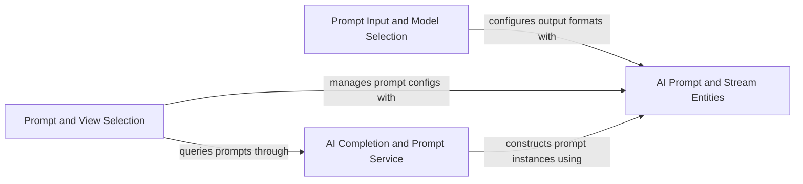

## Details

Manages prompt input state, prompt selection, model switching, and AI completion stream execution.

### Prompt Input and Model Selection
Manages AI model state transitions, prompt text input, file attachments, and predefined response formatting.

**Related Classes/Methods**:

- `frontend.appflowy_flutter.lib.ai.service.ai_prompt_input_bloc.AIPromptInputBloc`:13-139
- `frontend.appflowy_flutter.lib.ai.service.ai_model_state_notifier.AIModelStateNotifier`:42-208
- `frontend.appflowy_flutter.lib.ai.service.select_model_bloc.SelectModelBloc`:11-64

**Source Files:**

- `frontend/appflowy_flutter/lib/ai/service/ai_model_state_notifier.dart`
  - `frontend.appflowy_flutter.lib.ai.service.ai_model_state_notifier.OnModelStateChangedCallback` (L12-L12) - Class
  - `frontend.appflowy_flutter.lib.ai.service.ai_model_state_notifier.OnAvailableModelsChangedCallback` (L13-L16) - Class
  - `frontend.appflowy_flutter.lib.ai.service.ai_model_state_notifier.AIModelState` (L19-L40) - Class
  - `frontend.appflowy_flutter.lib.ai.service.ai_model_state_notifier.AIModelState.AIModelState` (L20-L26) - Constructor
  - `frontend.appflowy_flutter.lib.ai.service.ai_model_state_notifier.AIModelStateNotifier` (L42-L208) - Class
  - `frontend.appflowy_flutter.lib.ai.service.ai_model_state_notifier.AIModelStateNotifier.AIModelStateNotifier` (L43-L49) - Constructor
  - `frontend.appflowy_flutter.lib.ai.service.ai_model_state_notifier.AIModelStateNotifier._startListening` (L67-L87) - Method
  - `frontend.appflowy_flutter.lib.ai.service.ai_model_state_notifier.AIModelStateNotifier._init` (L89-L95) - Method
  - `frontend.appflowy_flutter.lib.ai.service.ai_model_state_notifier.AIModelStateNotifier.addListener` (L98-L108) - Method
  - `frontend.appflowy_flutter.lib.ai.service.ai_model_state_notifier.AIModelStateNotifier.removeListener` (L111-L121) - Method
  - `frontend.appflowy_flutter.lib.ai.service.ai_model_state_notifier.AIModelStateNotifier.dispose` (L123-L128) - Method
  - `frontend.appflowy_flutter.lib.ai.service.ai_model_state_notifier.AIModelStateNotifier.getState` (L131-L131) - Method
  - `frontend.appflowy_flutter.lib.ai.service.ai_model_state_notifier.AIModelStateNotifier.getModelSelection` (L134-L135) - Method
  - `frontend.appflowy_flutter.lib.ai.service.ai_model_state_notifier.AIModelStateNotifier._updateAll` (L137-L145) - Method
  - `frontend.appflowy_flutter.lib.ai.service.ai_model_state_notifier.AIModelStateNotifier._loadModelSelection` (L147-L158) - Method
  - `frontend.appflowy_flutter.lib.ai.service.ai_model_state_notifier.AIModelStateNotifier._loadLocalState` (L160-L165) - Method
  - `frontend.appflowy_flutter.lib.ai.service.ai_model_state_notifier.AIModelStateNotifier._defaultState` (L167-L173) - Method
  - `frontend.appflowy_flutter.lib.ai.service.ai_model_state_notifier.AIModelStateNotifier._computeState` (L176-L207) - Method
  - `frontend.appflowy_flutter.lib.ai.service.ai_model_state_notifier.AIModelPBExtension.isDefault` (L211-L211) - Method
  - `frontend.appflowy_flutter.lib.ai.service.ai_model_state_notifier.AIModelPBExtension.i18n` (L212-L213) - Method
- `frontend/appflowy_flutter/lib/ai/service/ai_prompt_input_bloc.dart`
  - `frontend.appflowy_flutter.lib.ai.service.ai_prompt_input_bloc.AIPromptInputBloc` (L13-L139) - Class
  - `frontend.appflowy_flutter.lib.ai.service.ai_prompt_input_bloc.AIPromptInputBloc.AIPromptInputBloc` (L14-L22) - Constructor
  - `frontend.appflowy_flutter.lib.ai.service.ai_prompt_input_bloc.AIPromptInputBloc.close` (L29-L32) - Method
  - `frontend.appflowy_flutter.lib.ai.service.ai_prompt_input_bloc.AIPromptInputBloc._dispatch` (L34-L108) - Method
  - `frontend.appflowy_flutter.lib.ai.service.ai_prompt_input_bloc.AIPromptInputBloc._startListening` (L110-L118) - Method
  - `frontend.appflowy_flutter.lib.ai.service.ai_prompt_input_bloc.AIPromptInputBloc._init` (L120-L125) - Method
  - `frontend.appflowy_flutter.lib.ai.service.ai_prompt_input_bloc.AIPromptInputBloc.consumeMetadata` (L127-L138) - Method
  - `frontend.appflowy_flutter.lib.ai.service.ai_prompt_input_bloc.AIPromptInputEvent` (L142-L162) - Class
  - `frontend.appflowy_flutter.lib.ai.service.ai_prompt_input_bloc.AIPromptInputEvent.AIPromptInputEvent.updateAIState` (L143-L145) - Constructor
  - `frontend.appflowy_flutter.lib.ai.service.ai_prompt_input_bloc.AIPromptInputEvent.AIPromptInputEvent.toggleShowPredefinedFormat` (L147-L148) - Constructor
  - `frontend.appflowy_flutter.lib.ai.service.ai_prompt_input_bloc.AIPromptInputEvent.AIPromptInputEvent.updatePredefinedFormat` (L149-L151) - Constructor
  - `frontend.appflowy_flutter.lib.ai.service.ai_prompt_input_bloc.AIPromptInputEvent.AIPromptInputEvent.attachFile` (L152-L155) - Constructor
  - `frontend.appflowy_flutter.lib.ai.service.ai_prompt_input_bloc.AIPromptInputEvent.AIPromptInputEvent.removeFile` (L156-L156) - Constructor
  - `frontend.appflowy_flutter.lib.ai.service.ai_prompt_input_bloc.AIPromptInputEvent.AIPromptInputEvent.updateMentionedViews` (L157-L158) - Constructor
  - `frontend.appflowy_flutter.lib.ai.service.ai_prompt_input_bloc.AIPromptInputEvent.AIPromptInputEvent.clearMetadata` (L159-L159) - Constructor
  - `frontend.appflowy_flutter.lib.ai.service.ai_prompt_input_bloc.AIPromptInputEvent.AIPromptInputEvent.updatePromptId` (L160-L161) - Constructor
  - `frontend.appflowy_flutter.lib.ai.service.ai_prompt_input_bloc.AIPromptInputState` (L165-L190) - Class
  - `frontend.appflowy_flutter.lib.ai.service.ai_prompt_input_bloc.AIPromptInputState.AIPromptInputState` (L166-L173) - Constructor
  - `frontend.appflowy_flutter.lib.ai.service.ai_prompt_input_bloc.AIPromptInputState.AIPromptInputState.initial` (L175-L189) - Constructor
- `frontend/appflowy_flutter/lib/ai/service/select_model_bloc.dart`
  - `frontend.appflowy_flutter.lib.ai.service.select_model_bloc.SelectModelBloc` (L11-L64) - Class
  - `frontend.appflowy_flutter.lib.ai.service.select_model_bloc.SelectModelBloc.SelectModelBloc` (L12-L44) - Constructor
  - `frontend.appflowy_flutter.lib.ai.service.select_model_bloc.SelectModelBloc.close` (L49-L54) - Method
  - `frontend.appflowy_flutter.lib.ai.service.select_model_bloc.SelectModelBloc._onAvailableModelsChanged` (L56-L63) - Method
  - `frontend.appflowy_flutter.lib.ai.service.select_model_bloc.SelectModelEvent` (L67-L76) - Class
  - `frontend.appflowy_flutter.lib.ai.service.select_model_bloc.SelectModelEvent.SelectModelEvent.selectModel` (L68-L70) - Constructor
  - `frontend.appflowy_flutter.lib.ai.service.select_model_bloc.SelectModelEvent.SelectModelEvent.didLoadModels` (L72-L75) - Constructor
  - `frontend.appflowy_flutter.lib.ai.service.select_model_bloc.SelectModelState` (L79-L92) - Class
  - `frontend.appflowy_flutter.lib.ai.service.select_model_bloc.SelectModelState.SelectModelState` (L80-L83) - Constructor
  - `frontend.appflowy_flutter.lib.ai.service.select_model_bloc.SelectModelState.SelectModelState.initial` (L85-L91) - Constructor

### Prompt and View Selection
Handles filtering and selection of built-in prompts, custom database prompts, and view configurations.

**Related Classes/Methods**:

- `frontend.appflowy_flutter.lib.ai.service.ai_prompt_selector_cubit.AiPromptSelectorCubit`:19-385
- `frontend.appflowy_flutter.lib.ai.service.ai_prompt_database_selector_cubit.AiPromptDatabaseSelectorCubit`:11-146
- `frontend.appflowy_flutter.lib.ai.service.view_selector_cubit.ViewSelectorCubit`:103-445

**Source Files:**

- `frontend/appflowy_flutter/lib/ai/service/ai_prompt_database_selector_cubit.dart`
  - `frontend.appflowy_flutter.lib.ai.service.ai_prompt_database_selector_cubit.AiPromptDatabaseSelectorCubit` (L11-L146) - Class
  - `frontend.appflowy_flutter.lib.ai.service.ai_prompt_database_selector_cubit.AiPromptDatabaseSelectorCubit.AiPromptDatabaseSelectorCubit` (L13-L17) - Constructor
  - `frontend.appflowy_flutter.lib.ai.service.ai_prompt_database_selector_cubit.AiPromptDatabaseSelectorCubit._init` (L19-L38) - Method
  - `frontend.appflowy_flutter.lib.ai.service.ai_prompt_database_selector_cubit.AiPromptDatabaseSelectorCubit.selectDatabaseView` (L40-L71) - Method
  - `frontend.appflowy_flutter.lib.ai.service.ai_prompt_database_selector_cubit.AiPromptDatabaseSelectorCubit.selectContentField` (L73-L89) - Method
  - `frontend.appflowy_flutter.lib.ai.service.ai_prompt_database_selector_cubit.AiPromptDatabaseSelectorCubit.selectExampleField` (L91-L111) - Method
  - `frontend.appflowy_flutter.lib.ai.service.ai_prompt_database_selector_cubit.AiPromptDatabaseSelectorCubit.selectCategoryField` (L113-L133) - Method
  - `frontend.appflowy_flutter.lib.ai.service.ai_prompt_database_selector_cubit.AiPromptDatabaseSelectorCubit._getFields` (L135-L137) - Method
  - `frontend.appflowy_flutter.lib.ai.service.ai_prompt_database_selector_cubit.AiPromptDatabaseSelectorCubit._testDatabase` (L139-L145) - Method
  - `frontend.appflowy_flutter.lib.ai.service.ai_prompt_database_selector_cubit.AiPromptDatabaseSelectorState` (L149-L161) - Class
  - `frontend.appflowy_flutter.lib.ai.service.ai_prompt_database_selector_cubit.AiPromptDatabaseSelectorState.AiPromptDatabaseSelectorState.loading` (L150-L150) - Constructor
  - `frontend.appflowy_flutter.lib.ai.service.ai_prompt_database_selector_cubit.AiPromptDatabaseSelectorState.AiPromptDatabaseSelectorState.empty` (L152-L152) - Constructor
  - `frontend.appflowy_flutter.lib.ai.service.ai_prompt_database_selector_cubit.AiPromptDatabaseSelectorState.AiPromptDatabaseSelectorState.selected` (L154-L157) - Constructor
  - `frontend.appflowy_flutter.lib.ai.service.ai_prompt_database_selector_cubit.AiPromptDatabaseSelectorState.AiPromptDatabaseSelectorState.invalidDatabase` (L159-L160) - Constructor
- `frontend/appflowy_flutter/lib/ai/service/ai_prompt_selector_cubit.dart`
  - `frontend.appflowy_flutter.lib.ai.service.ai_prompt_selector_cubit.AiPromptSelectorCubit` (L19-L385) - Class
  - `frontend.appflowy_flutter.lib.ai.service.ai_prompt_selector_cubit.AiPromptSelectorCubit.AiPromptSelectorCubit` (L20-L26) - Constructor
  - `frontend.appflowy_flutter.lib.ai.service.ai_prompt_selector_cubit.AiPromptSelectorCubit.close` (L33-L36) - Method
  - `frontend.appflowy_flutter.lib.ai.service.ai_prompt_selector_cubit.AiPromptSelectorCubit._init` (L38-L59) - Method
  - `frontend.appflowy_flutter.lib.ai.service.ai_prompt_selector_cubit.AiPromptSelectorCubit.loadCustomPrompts` (L61-L143) - Method
  - `frontend.appflowy_flutter.lib.ai.service.ai_prompt_selector_cubit.AiPromptSelectorCubit.selectCustomSection` (L145-L163) - Method
  - `frontend.appflowy_flutter.lib.ai.service.ai_prompt_selector_cubit.AiPromptSelectorCubit.selectFeaturedSection` (L165-L183) - Method
  - `frontend.appflowy_flutter.lib.ai.service.ai_prompt_selector_cubit.AiPromptSelectorCubit.selectCategory` (L185-L211) - Method
  - `frontend.appflowy_flutter.lib.ai.service.ai_prompt_selector_cubit.AiPromptSelectorCubit.selectPrompt` (L213-L226) - Method
  - `frontend.appflowy_flutter.lib.ai.service.ai_prompt_selector_cubit.AiPromptSelectorCubit.toggleFavorite` (L228-L243) - Method
  - `frontend.appflowy_flutter.lib.ai.service.ai_prompt_selector_cubit.AiPromptSelectorCubit.reset` (L245-L261) - Method
  - `frontend.appflowy_flutter.lib.ai.service.ai_prompt_selector_cubit.AiPromptSelectorCubit.updateCustomPromptDatabaseConfiguration` (L263-L306) - Method
  - `frontend.appflowy_flutter.lib.ai.service.ai_prompt_selector_cubit.AiPromptSelectorCubit._filterTextChanged` (L308-L328) - Method
  - `frontend.appflowy_flutter.lib.ai.service.ai_prompt_selector_cubit.AiPromptSelectorCubit._getFilteredPrompts` (L330-L337) - Method
  - `frontend.appflowy_flutter.lib.ai.service.ai_prompt_selector_cubit.AiPromptSelectorCubit._getPromptsByCategory` (L339-L352) - Method
  - `frontend.appflowy_flutter.lib.ai.service.ai_prompt_selector_cubit.AiPromptSelectorCubit._getVisibleSelectedPrompt` (L354-L364) - Method
  - `frontend.appflowy_flutter.lib.ai.service.ai_prompt_selector_cubit.AiPromptSelectorCubit.getDatabaseView` (L366-L384) - Method
  - `frontend.appflowy_flutter.lib.ai.service.ai_prompt_selector_cubit.AiPromptSelectorState` (L388-L415) - Class
  - `frontend.appflowy_flutter.lib.ai.service.ai_prompt_selector_cubit.AiPromptSelectorState.AiPromptSelectorState._` (L389-L389) - Constructor
  - `frontend.appflowy_flutter.lib.ai.service.ai_prompt_selector_cubit.AiPromptSelectorState.AiPromptSelectorState.loading` (L391-L391) - Constructor
  - `frontend.appflowy_flutter.lib.ai.service.ai_prompt_selector_cubit.AiPromptSelectorState.AiPromptSelectorState.invalidDatabase` (L393-L394) - Constructor
  - `frontend.appflowy_flutter.lib.ai.service.ai_prompt_selector_cubit.AiPromptSelectorState.AiPromptSelectorState.ready` (L396-L405) - Constructor
  - `frontend.appflowy_flutter.lib.ai.service.ai_prompt_selector_cubit.AiPromptSelectorState.isLoading` (L407-L407) - Method
  - `frontend.appflowy_flutter.lib.ai.service.ai_prompt_selector_cubit.AiPromptSelectorState.isReady` (L408-L408) - Method
  - `frontend.appflowy_flutter.lib.ai.service.ai_prompt_selector_cubit.AiPromptSelectorState.selectedPrompt` (L410-L414) - Method
- `frontend/appflowy_flutter/lib/ai/service/view_selector_cubit.dart`
  - `frontend.appflowy_flutter.lib.ai.service.view_selector_cubit.ViewSelectedStatus` (L15-L23) - Enum
  - `frontend.appflowy_flutter.lib.ai.service.view_selector_cubit.ViewSelectedStatus.unselected` (L16-L16) - Enum
  - `frontend.appflowy_flutter.lib.ai.service.view_selector_cubit.ViewSelectedStatus.selected` (L17-L17) - Enum
  - `frontend.appflowy_flutter.lib.ai.service.view_selector_cubit.ViewSelectedStatus.partiallySelected` (L18-L18) - Enum
  - `frontend.appflowy_flutter.lib.ai.service.view_selector_cubit.ViewSelectedStatus.isUnselected` (L20-L20) - Method
  - `frontend.appflowy_flutter.lib.ai.service.view_selector_cubit.ViewSelectedStatus.isSelected` (L21-L21) - Method
  - `frontend.appflowy_flutter.lib.ai.service.view_selector_cubit.ViewSelectedStatus.isPartiallySelected` (L22-L22) - Method
  - `frontend.appflowy_flutter.lib.ai.service.view_selector_cubit.ViewSelectorItem` (L25-L101) - Class
  - `frontend.appflowy_flutter.lib.ai.service.view_selector_cubit.ViewSelectorItem.ViewSelectorItem` (L26-L35) - Constructor
  - `frontend.appflowy_flutter.lib.ai.service.view_selector_cubit.ViewSelectorItem.isExpanded` (L44-L44) - Method
  - `frontend.appflowy_flutter.lib.ai.service.view_selector_cubit.ViewSelectorItem.selectedStatus` (L45-L45) - Method
  - `frontend.appflowy_flutter.lib.ai.service.view_selector_cubit.ViewSelectorItem.isDisabled` (L46-L46) - Method
  - `frontend.appflowy_flutter.lib.ai.service.view_selector_cubit.ViewSelectorItem.toggleIsExpanded` (L48-L50) - Method
  - `frontend.appflowy_flutter.lib.ai.service.view_selector_cubit.ViewSelectorItem.copy` (L52-L62) - Method
  - `frontend.appflowy_flutter.lib.ai.service.view_selector_cubit.ViewSelectorItem.findChildBySourceId` (L64-L75) - Method
  - `frontend.appflowy_flutter.lib.ai.service.view_selector_cubit.ViewSelectorItem.setIsDisabledRecursive` (L77-L83) - Method
  - `frontend.appflowy_flutter.lib.ai.service.view_selector_cubit.ViewSelectorItem.setIsSelectedStatusRecursive` (L85-L91) - Method
  - `frontend.appflowy_flutter.lib.ai.service.view_selector_cubit.ViewSelectorItem.dispose` (L93-L100) - Method
  - `frontend.appflowy_flutter.lib.ai.service.view_selector_cubit.ViewSelectorCubit` (L103-L445) - Class
  - `frontend.appflowy_flutter.lib.ai.service.view_selector_cubit.ViewSelectorCubit.ViewSelectorCubit` (L104-L109) - Constructor
  - `frontend.appflowy_flutter.lib.ai.service.view_selector_cubit.ViewSelectorCubit.updateSelectedSources` (L119-L122) - Method
  - `frontend.appflowy_flutter.lib.ai.service.view_selector_cubit.ViewSelectorCubit.refreshSources` (L124-L165) - Method
  - `frontend.appflowy_flutter.lib.ai.service.view_selector_cubit.ViewSelectorCubit._recursiveBuild` (L167-L216) - Method
  - `frontend.appflowy_flutter.lib.ai.service.view_selector_cubit.ViewSelectorCubit._setIsDisabledAndHideIfNecessary` (L218-L231) - Method
  - `frontend.appflowy_flutter.lib.ai.service.view_selector_cubit.ViewSelectorCubit._restrictSelectionIfNecessary` (L233-L250) - Method
  - `frontend.appflowy_flutter.lib.ai.service.view_selector_cubit.ViewSelectorCubit.onFilterChanged` (L252-L270) - Method
  - `frontend.appflowy_flutter.lib.ai.service.view_selector_cubit.ViewSelectorCubit._buildSearchResults` (L273-L296) - Method
  - `frontend.appflowy_flutter.lib.ai.service.view_selector_cubit.ViewSelectorCubit._buildSelectedSources` (L299-L320) - Method
  - `frontend.appflowy_flutter.lib.ai.service.view_selector_cubit.ViewSelectorCubit.toggleSelectedStatus` (L322-L354) - Method
  - `frontend.appflowy_flutter.lib.ai.service.view_selector_cubit.ViewSelectorCubit._recursiveGetSourceIds` (L356-L362) - Method
  - `frontend.appflowy_flutter.lib.ai.service.view_selector_cubit.ViewSelectorCubit.updateSelectedStatus` (L364-L382) - Method
  - `frontend.appflowy_flutter.lib.ai.service.view_selector_cubit.ViewSelectorCubit._recursiveUpdateSelectedStatus` (L384-L409) - Method
  - `frontend.appflowy_flutter.lib.ai.service.view_selector_cubit.ViewSelectorCubit.toggleIsExpanded` (L411-L426) - Method
  - `frontend.appflowy_flutter.lib.ai.service.view_selector_cubit.ViewSelectorCubit.close` (L429-L444) - Method
  - `frontend.appflowy_flutter.lib.ai.service.view_selector_cubit.ViewSelectorState` (L448-L458) - Class
  - `frontend.appflowy_flutter.lib.ai.service.view_selector_cubit.ViewSelectorState.ViewSelectorState` (L449-L452) - Constructor
  - `frontend.appflowy_flutter.lib.ai.service.view_selector_cubit.ViewSelectorState.ViewSelectorState.initial` (L454-L457) - Constructor

### AI Completion and Prompt Service
Executes AI text completions over native streams and loads prompt definitions from bundles or database sources.

**Related Classes/Methods**:

- `frontend.appflowy_flutter.lib.ai.service.appflowy_ai_service.AppFlowyAIService`:54-145
- `frontend.appflowy_flutter.lib.ai.service.appflowy_ai_service.AppFlowyCompletionStream`:166-259
- `frontend.appflowy_flutter.lib.ai.service.appflowy_ai_service.AIRepository`:27-52

**Source Files:**

- `frontend/appflowy_flutter/lib/ai/service/appflowy_ai_service.dart`
  - `frontend.appflowy_flutter.lib.ai.service.appflowy_ai_service.LocalAIStreamingState` (L22-L25) - Enum
  - `frontend.appflowy_flutter.lib.ai.service.appflowy_ai_service.LocalAIStreamingState.notReady` (L23-L23) - Enum
  - `frontend.appflowy_flutter.lib.ai.service.appflowy_ai_service.LocalAIStreamingState.disabled` (L24-L24) - Enum
  - `frontend.appflowy_flutter.lib.ai.service.appflowy_ai_service.AIRepository` (L27-L52) - Class
  - `frontend.appflowy_flutter.lib.ai.service.appflowy_ai_service.AIRepository.streamCompletion` (L28-L43) - Method
  - `frontend.appflowy_flutter.lib.ai.service.appflowy_ai_service.AIRepository.getBuiltInPrompts` (L45-L45) - Method
  - `frontend.appflowy_flutter.lib.ai.service.appflowy_ai_service.AIRepository.getDatabasePrompts` (L47-L49) - Method
  - `frontend.appflowy_flutter.lib.ai.service.appflowy_ai_service.AIRepository.updateFavoritePrompts` (L51-L51) - Method
  - `frontend.appflowy_flutter.lib.ai.service.appflowy_ai_service.AppFlowyAIService` (L54-L145) - Class
  - `frontend.appflowy_flutter.lib.ai.service.appflowy_ai_service.AppFlowyAIService.streamCompletion` (L56-L104) - Method
  - `frontend.appflowy_flutter.lib.ai.service.appflowy_ai_service.AppFlowyAIService.getBuiltInPrompts` (L107-L127) - Method
  - `frontend.appflowy_flutter.lib.ai.service.appflowy_ai_service.AppFlowyAIService.getDatabasePrompts` (L130-L141) - Method
  - `frontend.appflowy_flutter.lib.ai.service.appflowy_ai_service.AppFlowyAIService.updateFavoritePrompts` (L144-L144) - Method
  - `frontend.appflowy_flutter.lib.ai.service.appflowy_ai_service.CompletionStream` (L147-L164) - Class
  - `frontend.appflowy_flutter.lib.ai.service.appflowy_ai_service.CompletionStream.CompletionStream` (L148-L155) - Constructor
  - `frontend.appflowy_flutter.lib.ai.service.appflowy_ai_service.AppFlowyCompletionStream` (L166-L259) - Class
  - `frontend.appflowy_flutter.lib.ai.service.appflowy_ai_service.AppFlowyCompletionStream.AppFlowyCompletionStream` (L167-L176) - Constructor
  - `frontend.appflowy_flutter.lib.ai.service.appflowy_ai_service.AppFlowyCompletionStream.nativePort` (L181-L181) - Method
  - `frontend.appflowy_flutter.lib.ai.service.appflowy_ai_service.AppFlowyCompletionStream._startListening` (L183-L190) - Method
  - `frontend.appflowy_flutter.lib.ai.service.appflowy_ai_service.AppFlowyCompletionStream.dispose` (L192-L196) - Method
  - `frontend.appflowy_flutter.lib.ai.service.appflowy_ai_service.AppFlowyCompletionStream._handleEvent` (L198-L258) - Method
- `frontend/appflowy_flutter/lib/ai/service/error.dart`
  - `frontend.appflowy_flutter.lib.ai.service.error.AIError` (L7-L15) - Class
  - `frontend.appflowy_flutter.lib.ai.service.error.AIError.AIError` (L8-L11) - Constructor
  - `frontend.appflowy_flutter.lib.ai.service.error.AIError.AIError.fromJson` (L13-L14) - Constructor
  - `frontend.appflowy_flutter.lib.ai.service.error.AIErrorCode` (L17-L24) - Enum
  - `frontend.appflowy_flutter.lib.ai.service.error.AIErrorCode.aiResponseLimitExceeded` (L19-L19) - Enum
  - `frontend.appflowy_flutter.lib.ai.service.error.AIErrorCode.aiImageResponseLimitExceeded` (L21-L21) - Enum
  - `frontend.appflowy_flutter.lib.ai.service.error.AIErrorCode.other` (L23-L23) - Enum
  - `frontend.appflowy_flutter.lib.ai.service.error.AIErrorExtension.isLimitExceeded` (L27-L27) - Method

### AI Prompt and Stream Entities
Defines data models, categories, formatting rules, and stream event tokens for AI interactions.

**Related Classes/Methods**:

- `frontend.appflowy_flutter.lib.ai.service.ai_entities.AiPrompt`:173-263
- `frontend.appflowy_flutter.lib.ai.service.ai_entities.PredefinedFormat`:38-66
- `frontend.appflowy_flutter.lib.ai.service.ai_entities.CustomPromptDatabaseConfig`:290-386
- `frontend.appflowy_flutter.lib.ai.service.ai_entities.AIStreamEventPrefix`:15-28

**Source Files:**

- `frontend/appflowy_flutter/lib/ai/service/ai_entities.dart`
  - `frontend.appflowy_flutter.lib.ai.service.ai_entities.AIStreamEventPrefix` (L15-L28) - Class
  - `frontend.appflowy_flutter.lib.ai.service.ai_entities.AiType` (L30-L36) - Enum
  - `frontend.appflowy_flutter.lib.ai.service.ai_entities.AiType.cloud` (L31-L31) - Enum
  - `frontend.appflowy_flutter.lib.ai.service.ai_entities.AiType.local` (L32-L32) - Enum
  - `frontend.appflowy_flutter.lib.ai.service.ai_entities.AiType.isCloud` (L34-L34) - Method
  - `frontend.appflowy_flutter.lib.ai.service.ai_entities.AiType.isLocal` (L35-L35) - Method
  - `frontend.appflowy_flutter.lib.ai.service.ai_entities.PredefinedFormat` (L38-L66) - Class
  - `frontend.appflowy_flutter.lib.ai.service.ai_entities.PredefinedFormat.PredefinedFormat` (L39-L42) - Constructor
  - `frontend.appflowy_flutter.lib.ai.service.ai_entities.PredefinedFormat.toPB` (L47-L62) - Method
  - `frontend.appflowy_flutter.lib.ai.service.ai_entities.PredefinedFormat.props` (L65-L65) - Method
  - `frontend.appflowy_flutter.lib.ai.service.ai_entities.ImageFormat` (L68-L91) - Enum
  - `frontend.appflowy_flutter.lib.ai.service.ai_entities.ImageFormat.text` (L69-L69) - Enum
  - `frontend.appflowy_flutter.lib.ai.service.ai_entities.ImageFormat.image` (L70-L70) - Enum
  - `frontend.appflowy_flutter.lib.ai.service.ai_entities.ImageFormat.textAndImage` (L71-L71) - Enum
  - `frontend.appflowy_flutter.lib.ai.service.ai_entities.ImageFormat.hasText` (L73-L73) - Method
  - `frontend.appflowy_flutter.lib.ai.service.ai_entities.ImageFormat.icon` (L75-L81) - Method
  - `frontend.appflowy_flutter.lib.ai.service.ai_entities.ImageFormat.i18n` (L83-L90) - Method
  - `frontend.appflowy_flutter.lib.ai.service.ai_entities.TextFormat` (L93-L116) - Enum
  - `frontend.appflowy_flutter.lib.ai.service.ai_entities.TextFormat.paragraph` (L94-L94) - Enum
  - `frontend.appflowy_flutter.lib.ai.service.ai_entities.TextFormat.bulletList` (L95-L95) - Enum
  - `frontend.appflowy_flutter.lib.ai.service.ai_entities.TextFormat.numberedList` (L96-L96) - Enum
  - `frontend.appflowy_flutter.lib.ai.service.ai_entities.TextFormat.table` (L97-L97) - Enum
  - `frontend.appflowy_flutter.lib.ai.service.ai_entities.TextFormat.icon` (L99-L106) - Method
  - `frontend.appflowy_flutter.lib.ai.service.ai_entities.TextFormat.i18n` (L108-L115) - Method
  - `frontend.appflowy_flutter.lib.ai.service.ai_entities.AiPromptCategory` (L118-L170) - Enum
  - `frontend.appflowy_flutter.lib.ai.service.ai_entities.AiPromptCategory.other` (L119-L119) - Enum
  - `frontend.appflowy_flutter.lib.ai.service.ai_entities.AiPromptCategory.development` (L120-L120) - Enum
  - `frontend.appflowy_flutter.lib.ai.service.ai_entities.AiPromptCategory.writing` (L121-L121) - Enum
  - `frontend.appflowy_flutter.lib.ai.service.ai_entities.AiPromptCategory.healthAndFitness` (L122-L122) - Enum
  - `frontend.appflowy_flutter.lib.ai.service.ai_entities.AiPromptCategory.business` (L123-L123) - Enum
  - `frontend.appflowy_flutter.lib.ai.service.ai_entities.AiPromptCategory.marketing` (L124-L124) - Enum
  - `frontend.appflowy_flutter.lib.ai.service.ai_entities.AiPromptCategory.travel` (L125-L125) - Enum
  - `frontend.appflowy_flutter.lib.ai.service.ai_entities.AiPromptCategory.contentSeo` (L126-L126) - Enum
  - `frontend.appflowy_flutter.lib.ai.service.ai_entities.AiPromptCategory.emailMarketing` (L127-L127) - Enum
  - `frontend.appflowy_flutter.lib.ai.service.ai_entities.AiPromptCategory.paidAds` (L128-L128) - Enum
  - `frontend.appflowy_flutter.lib.ai.service.ai_entities.AiPromptCategory.prCommunication` (L129-L129) - Enum
  - `frontend.appflowy_flutter.lib.ai.service.ai_entities.AiPromptCategory.recruiting` (L130-L130) - Enum
  - `frontend.appflowy_flutter.lib.ai.service.ai_entities.AiPromptCategory.sales` (L131-L131) - Enum
  - `frontend.appflowy_flutter.lib.ai.service.ai_entities.AiPromptCategory.socialMedia` (L132-L132) - Enum
  - `frontend.appflowy_flutter.lib.ai.service.ai_entities.AiPromptCategory.strategy` (L133-L133) - Enum
  - `frontend.appflowy_flutter.lib.ai.service.ai_entities.AiPromptCategory.caseStudies` (L134-L134) - Enum
  - `frontend.appflowy_flutter.lib.ai.service.ai_entities.AiPromptCategory.salesCopy` (L135-L135) - Enum
  - `frontend.appflowy_flutter.lib.ai.service.ai_entities.AiPromptCategory.education` (L136-L136) - Enum
  - `frontend.appflowy_flutter.lib.ai.service.ai_entities.AiPromptCategory.work` (L137-L137) - Enum
  - `frontend.appflowy_flutter.lib.ai.service.ai_entities.AiPromptCategory.podcastProduction` (L138-L138) - Enum
  - `frontend.appflowy_flutter.lib.ai.service.ai_entities.AiPromptCategory.copyWriting` (L139-L139) - Enum
  - `frontend.appflowy_flutter.lib.ai.service.ai_entities.AiPromptCategory.customerSuccess` (L140-L140) - Enum
  - `frontend.appflowy_flutter.lib.ai.service.ai_entities.AiPromptCategory.i18n` (L142-L142) - Method
  - `frontend.appflowy_flutter.lib.ai.service.ai_entities.AiPromptCategory.token` (L144-L169) - Method
  - `frontend.appflowy_flutter.lib.ai.service.ai_entities.AiPrompt` (L173-L263) - Class
  - `frontend.appflowy_flutter.lib.ai.service.ai_entities.AiPrompt.AiPrompt` (L174-L182) - Constructor
  - `frontend.appflowy_flutter.lib.ai.service.ai_entities.AiPrompt.AiPrompt.fromPB` (L184-L211) - Constructor
  - `frontend.appflowy_flutter.lib.ai.service.ai_entities.AiPrompt.AiPrompt.fromJson` (L213-L214) - Constructor
  - `frontend.appflowy_flutter.lib.ai.service.ai_entities.AiPrompt.toJson` (L216-L216) - Method
  - `frontend.appflowy_flutter.lib.ai.service.ai_entities.AiPrompt.props` (L231-L232) - Method
  - `frontend.appflowy_flutter.lib.ai.service.ai_entities.AiPrompt._buildCategoryNameMap` (L234-L243) - Method
  - `frontend.appflowy_flutter.lib.ai.service.ai_entities.AiPrompt._categoryFromJson` (L245-L262) - Method
  - `frontend.appflowy_flutter.lib.ai.service.ai_entities.CustomPromptDatabaseConfig` (L290-L386) - Class
  - `frontend.appflowy_flutter.lib.ai.service.ai_entities.CustomPromptDatabaseConfig.CustomPromptDatabaseConfig` (L291-L297) - Constructor
  - `frontend.appflowy_flutter.lib.ai.service.ai_entities.CustomPromptDatabaseConfig.CustomPromptDatabaseConfig.fromAiPB` (L299-L312) - Constructor
  - `frontend.appflowy_flutter.lib.ai.service.ai_entities.CustomPromptDatabaseConfig.CustomPromptDatabaseConfig.fromDbPB` (L314-L327) - Constructor
  - `frontend.appflowy_flutter.lib.ai.service.ai_entities.CustomPromptDatabaseConfig.props` (L336-L337) - Method
  - `frontend.appflowy_flutter.lib.ai.service.ai_entities.CustomPromptDatabaseConfig.copyWith` (L339-L353) - Method
  - `frontend.appflowy_flutter.lib.ai.service.ai_entities.CustomPromptDatabaseConfig.toAiPB` (L355-L369) - Method
  - `frontend.appflowy_flutter.lib.ai.service.ai_entities.CustomPromptDatabaseConfig.toDbPB` (L371-L385) - Method

### [FAQ](https://github.com/CodeBoarding/GeneratedOnBoardings/tree/main?tab=readme-ov-file#faq)