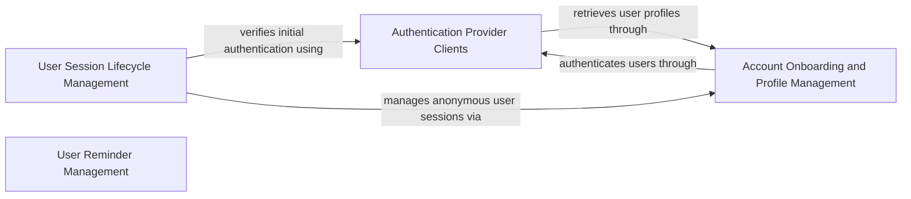

## Details

Manages authentication workflows, session states, user reminders, and account service integrations via BLoCs and services.

### Authentication Provider Clients
Implements cloud, local backend, and mock authentication protocols including OAuth, magic links, passcode verification, and session state tracking.

**Related Classes/Methods**:

- `frontend.appflowy_flutter.lib.user.application.auth.auth_service.AuthService`:17-97
- `frontend.appflowy_flutter.lib.user.application.auth.af_cloud_auth_service.AppFlowyCloudAuthService`:17-129
- `frontend.appflowy_flutter.lib.user.application.auth.backend_auth_service.BackendAuthService`:16-117

**Source Files:**

- `frontend/appflowy_flutter/lib/user/application/auth/af_cloud_auth_service.dart`
  - `frontend.appflowy_flutter.lib.user.application.auth.af_cloud_auth_service.AppFlowyCloudAuthService` (L17-L129) - Class
  - `frontend.appflowy_flutter.lib.user.application.auth.af_cloud_auth_service.AppFlowyCloudAuthService.AppFlowyCloudAuthService` (L18-L18) - Constructor
  - `frontend.appflowy_flutter.lib.user.application.auth.af_cloud_auth_service.AppFlowyCloudAuthService.signUp` (L25-L32) - Method
  - `frontend.appflowy_flutter.lib.user.application.auth.af_cloud_auth_service.AppFlowyCloudAuthService.signInWithEmailPassword` (L36-L46) - Method
  - `frontend.appflowy_flutter.lib.user.application.auth.af_cloud_auth_service.AppFlowyCloudAuthService.signUpWithOAuth` (L49-L89) - Method
  - `frontend.appflowy_flutter.lib.user.application.auth.af_cloud_auth_service.AppFlowyCloudAuthService.signOut` (L92-L94) - Method
  - `frontend.appflowy_flutter.lib.user.application.auth.af_cloud_auth_service.AppFlowyCloudAuthService.signUpAsGuest` (L97-L101) - Method
  - `frontend.appflowy_flutter.lib.user.application.auth.af_cloud_auth_service.AppFlowyCloudAuthService.signInWithMagicLink` (L104-L112) - Method
  - `frontend.appflowy_flutter.lib.user.application.auth.af_cloud_auth_service.AppFlowyCloudAuthService.signInWithPasscode` (L115-L123) - Method
  - `frontend.appflowy_flutter.lib.user.application.auth.af_cloud_auth_service.AppFlowyCloudAuthService.getUser` (L126-L128) - Method
  - `frontend.appflowy_flutter.lib.user.application.auth.af_cloud_auth_service.ProviderTypePBExtension.fromPlatform` (L132-L145) - Method
- `frontend/appflowy_flutter/lib/user/application/auth/af_cloud_mock_auth_service.dart`
  - `frontend.appflowy_flutter.lib.user.application.auth.af_cloud_mock_auth_service.AppFlowyCloudMockAuthService` (L16-L118) - Class
  - `frontend.appflowy_flutter.lib.user.application.auth.af_cloud_mock_auth_service.AppFlowyCloudMockAuthService.AppFlowyCloudMockAuthService` (L17-L18) - Constructor
  - `frontend.appflowy_flutter.lib.user.application.auth.af_cloud_mock_auth_service.AppFlowyCloudMockAuthService.signUp` (L26-L33) - Method
  - `frontend.appflowy_flutter.lib.user.application.auth.af_cloud_mock_auth_service.AppFlowyCloudMockAuthService.signInWithEmailPassword` (L37-L43) - Method
  - `frontend.appflowy_flutter.lib.user.application.auth.af_cloud_mock_auth_service.AppFlowyCloudMockAuthService.signUpWithOAuth` (L46-L84) - Method
  - `frontend.appflowy_flutter.lib.user.application.auth.af_cloud_mock_auth_service.AppFlowyCloudMockAuthService.signOut` (L87-L89) - Method
  - `frontend.appflowy_flutter.lib.user.application.auth.af_cloud_mock_auth_service.AppFlowyCloudMockAuthService.signUpAsGuest` (L92-L96) - Method
  - `frontend.appflowy_flutter.lib.user.application.auth.af_cloud_mock_auth_service.AppFlowyCloudMockAuthService.signInWithMagicLink` (L99-L104) - Method
  - `frontend.appflowy_flutter.lib.user.application.auth.af_cloud_mock_auth_service.AppFlowyCloudMockAuthService.getUser` (L107-L109) - Method
  - `frontend.appflowy_flutter.lib.user.application.auth.af_cloud_mock_auth_service.AppFlowyCloudMockAuthService.signInWithPasscode` (L112-L117) - Method
- `frontend/appflowy_flutter/lib/user/application/auth/auth_error.dart`
  - `frontend.appflowy_flutter.lib.user.application.auth.auth_error.AuthError` (L4-L20) - Class
- `frontend/appflowy_flutter/lib/user/application/auth/auth_service.dart`
  - `frontend.appflowy_flutter.lib.user.application.auth.auth_service.AuthServiceMapKeys` (L5-L11) - Class
  - `frontend.appflowy_flutter.lib.user.application.auth.auth_service.AuthServiceMapKeys.AuthServiceMapKeys._` (L6-L6) - Constructor
  - `frontend.appflowy_flutter.lib.user.application.auth.auth_service.AuthService` (L17-L97) - Class
  - `frontend.appflowy_flutter.lib.user.application.auth.auth_service.AuthService.signInWithEmailPassword` (L27-L31) - Method
  - `frontend.appflowy_flutter.lib.user.application.auth.auth_service.AuthService.signUp` (L41-L46) - Method
  - `frontend.appflowy_flutter.lib.user.application.auth.auth_service.AuthService.signUpWithOAuth` (L54-L57) - Method
  - `frontend.appflowy_flutter.lib.user.application.auth.auth_service.AuthService.signUpAsGuest` (L64-L66) - Method
  - `frontend.appflowy_flutter.lib.user.application.auth.auth_service.AuthService.signInWithMagicLink` (L74-L77) - Method
  - `frontend.appflowy_flutter.lib.user.application.auth.auth_service.AuthService.signInWithPasscode` (L85-L88) - Method
  - `frontend.appflowy_flutter.lib.user.application.auth.auth_service.AuthService.signOut` (L91-L91) - Method
  - `frontend.appflowy_flutter.lib.user.application.auth.auth_service.AuthService.getUser` (L96-L96) - Method
- `frontend/appflowy_flutter/lib/user/application/auth/backend_auth_service.dart`
  - `frontend.appflowy_flutter.lib.user.application.auth.backend_auth_service.BackendAuthService` (L16-L117) - Class
  - `frontend.appflowy_flutter.lib.user.application.auth.backend_auth_service.BackendAuthService.BackendAuthService` (L17-L17) - Constructor
  - `frontend.appflowy_flutter.lib.user.application.auth.backend_auth_service.BackendAuthService.signInWithEmailPassword` (L23-L34) - Method
  - `frontend.appflowy_flutter.lib.user.application.auth.backend_auth_service.BackendAuthService.signUp` (L37-L53) - Method
  - `frontend.appflowy_flutter.lib.user.application.auth.backend_auth_service.BackendAuthService.signOut` (L56-L61) - Method
  - `frontend.appflowy_flutter.lib.user.application.auth.backend_auth_service.BackendAuthService.signUpAsGuest` (L64-L81) - Method
  - `frontend.appflowy_flutter.lib.user.application.auth.backend_auth_service.BackendAuthService.signUpWithOAuth` (L84-L94) - Method
  - `frontend.appflowy_flutter.lib.user.application.auth.backend_auth_service.BackendAuthService.getUser` (L97-L99) - Method
  - `frontend.appflowy_flutter.lib.user.application.auth.backend_auth_service.BackendAuthService.signInWithMagicLink` (L102-L108) - Method
  - `frontend.appflowy_flutter.lib.user.application.auth.backend_auth_service.BackendAuthService.signInWithPasscode` (L111-L116) - Method
- `frontend/appflowy_flutter/lib/user/application/auth/device_id.dart`
  - `frontend.appflowy_flutter.lib.user.application.auth.device_id.getDeviceId` (L10-L37) - Function
- `frontend/appflowy_flutter/lib/user/application/user_auth_listener.dart`
  - `frontend.appflowy_flutter.lib.user.application.user_auth_listener.UserAuthStateListener` (L14-L69) - Class
  - `frontend.appflowy_flutter.lib.user.application.user_auth_listener.UserAuthStateListener.start` (L20-L34) - Method
  - `frontend.appflowy_flutter.lib.user.application.user_auth_listener.UserAuthStateListener.stop` (L36-L40) - Method
  - `frontend.appflowy_flutter.lib.user.application.user_auth_listener.UserAuthStateListener._userNotificationCallback` (L42-L68) - Method

### User Session Lifecycle Management
Coordinates splash authentication checks, anonymous user handling, workspace error states, and user configuration settings.

**Related Classes/Methods**:

- `frontend.appflowy_flutter.lib.user.application.splash_bloc.SplashBloc`:9-24
- `frontend.appflowy_flutter.lib.user.application.anon_user_bloc.AnonUserBloc`:10-41
- `frontend.appflowy_flutter.lib.user.application.user_settings_service.UserSettingsBackendService`:8-62

**Source Files:**

- `frontend/appflowy_flutter/lib/user/application/anon_user_bloc.dart`
  - `frontend.appflowy_flutter.lib.user.application.anon_user_bloc.AnonUserBloc` (L10-L41) - Class
  - `frontend.appflowy_flutter.lib.user.application.anon_user_bloc.AnonUserBloc.AnonUserBloc` (L11-L26) - Constructor
  - `frontend.appflowy_flutter.lib.user.application.anon_user_bloc.AnonUserBloc._loadHistoricalUsers` (L28-L40) - Method
  - `frontend.appflowy_flutter.lib.user.application.anon_user_bloc.AnonUserEvent` (L44-L51) - Class
  - `frontend.appflowy_flutter.lib.user.application.anon_user_bloc.AnonUserEvent.AnonUserEvent.initial` (L45-L45) - Constructor
  - `frontend.appflowy_flutter.lib.user.application.anon_user_bloc.AnonUserEvent.AnonUserEvent.didLoadAnonUsers` (L46-L48) - Constructor
  - `frontend.appflowy_flutter.lib.user.application.anon_user_bloc.AnonUserEvent.AnonUserEvent.openAnonUser` (L49-L50) - Constructor
  - `frontend.appflowy_flutter.lib.user.application.anon_user_bloc.AnonUserState` (L54-L64) - Class
  - `frontend.appflowy_flutter.lib.user.application.anon_user_bloc.AnonUserState.AnonUserState` (L55-L58) - Constructor
  - `frontend.appflowy_flutter.lib.user.application.anon_user_bloc.AnonUserState.AnonUserState.initial` (L60-L63) - Constructor
- `frontend/appflowy_flutter/lib/user/application/notification_filter/notification_filter_bloc.dart`
  - `frontend.appflowy_flutter.lib.user.application.notification_filter.notification_filter_bloc.NotificationFilterBloc` (L6-L18) - Class
  - `frontend.appflowy_flutter.lib.user.application.notification_filter.notification_filter_bloc.NotificationFilterBloc.NotificationFilterBloc` (L8-L17) - Constructor
  - `frontend.appflowy_flutter.lib.user.application.notification_filter.notification_filter_bloc.NotificationFilterEvent` (L21-L26) - Class
  - `frontend.appflowy_flutter.lib.user.application.notification_filter.notification_filter_bloc.NotificationFilterEvent.NotificationFilterEvent.toggleShowUnreadsOnly` (L22-L23) - Constructor
  - `frontend.appflowy_flutter.lib.user.application.notification_filter.notification_filter_bloc.NotificationFilterEvent.NotificationFilterEvent.reset` (L25-L25) - Constructor
  - `frontend.appflowy_flutter.lib.user.application.notification_filter.notification_filter_bloc.NotificationFilterState` (L29-L38) - Class
  - `frontend.appflowy_flutter.lib.user.application.notification_filter.notification_filter_bloc.NotificationFilterState.NotificationFilterState._` (L30-L30) - Constructor
  - `frontend.appflowy_flutter.lib.user.application.notification_filter.notification_filter_bloc.NotificationFilterState.NotificationFilterState` (L32-L34) - Constructor
  - `frontend.appflowy_flutter.lib.user.application.notification_filter.notification_filter_bloc.NotificationFilterState.hasFilters` (L37-L37) - Method
- `frontend/appflowy_flutter/lib/user/application/splash_bloc.dart`
  - `frontend.appflowy_flutter.lib.user.application.splash_bloc.SplashBloc` (L9-L24) - Class
  - `frontend.appflowy_flutter.lib.user.application.splash_bloc.SplashBloc.SplashBloc` (L10-L23) - Constructor
  - `frontend.appflowy_flutter.lib.user.application.splash_bloc.SplashEvent` (L27-L29) - Class
  - `frontend.appflowy_flutter.lib.user.application.splash_bloc.SplashEvent.SplashEvent.getUser` (L28-L28) - Constructor
  - `frontend.appflowy_flutter.lib.user.application.splash_bloc.SplashState` (L32-L40) - Class
  - `frontend.appflowy_flutter.lib.user.application.splash_bloc.SplashState.SplashState` (L33-L35) - Constructor
  - `frontend.appflowy_flutter.lib.user.application.splash_bloc.SplashState.SplashState.initial` (L37-L39) - Constructor
- `frontend/appflowy_flutter/lib/user/application/user_listener.dart`
  - `frontend.appflowy_flutter.lib.user.application.user_listener.DidUpdateUserWorkspaceCallback` (L18-L20) - Class
  - `frontend.appflowy_flutter.lib.user.application.user_listener.DidUpdateUserWorkspacesCallback` (L21-L23) - Class
  - `frontend.appflowy_flutter.lib.user.application.user_listener.DidUpdateUserWorkspaceSetting` (L25-L27) - Class
  - `frontend.appflowy_flutter.lib.user.application.user_listener.UserListener` (L29-L119) - Class
  - `frontend.appflowy_flutter.lib.user.application.user_listener.UserListener.UserListener` (L30-L32) - Constructor
  - `frontend.appflowy_flutter.lib.user.application.user_listener.UserListener.start` (L49-L69) - Method
  - `frontend.appflowy_flutter.lib.user.application.user_listener.UserListener.stop` (L71-L76) - Method
  - `frontend.appflowy_flutter.lib.user.application.user_listener.UserListener._userNotificationCallback` (L78-L118) - Method
  - `frontend.appflowy_flutter.lib.user.application.user_listener.FolderListener` (L123-L169) - Class
  - `frontend.appflowy_flutter.lib.user.application.user_listener.FolderListener.FolderListener` (L124-L126) - Constructor
  - `frontend.appflowy_flutter.lib.user.application.user_listener.FolderListener.start` (L135-L146) - Method
  - `frontend.appflowy_flutter.lib.user.application.user_listener.FolderListener._handleObservableType` (L148-L163) - Method
  - `frontend.appflowy_flutter.lib.user.application.user_listener.FolderListener.stop` (L165-L168) - Method
- `frontend/appflowy_flutter/lib/user/application/user_settings_service.dart`
  - `frontend.appflowy_flutter.lib.user.application.user_settings_service.UserSettingsBackendService` (L8-L62) - Class
  - `frontend.appflowy_flutter.lib.user.application.user_settings_service.UserSettingsBackendService.UserSettingsBackendService` (L9-L9) - Constructor
  - `frontend.appflowy_flutter.lib.user.application.user_settings_service.UserSettingsBackendService.getAppearanceSetting` (L11-L19) - Method
  - `frontend.appflowy_flutter.lib.user.application.user_settings_service.UserSettingsBackendService.getUserSetting` (L21-L23) - Method
  - `frontend.appflowy_flutter.lib.user.application.user_settings_service.UserSettingsBackendService.setAppearanceSetting` (L25-L29) - Method
  - `frontend.appflowy_flutter.lib.user.application.user_settings_service.UserSettingsBackendService.getDateTimeSettings` (L31-L39) - Method
  - `frontend.appflowy_flutter.lib.user.application.user_settings_service.UserSettingsBackendService.setDateTimeSettings` (L41-L45) - Method
  - `frontend.appflowy_flutter.lib.user.application.user_settings_service.UserSettingsBackendService.setNotificationSettings` (L47-L51) - Method
  - `frontend.appflowy_flutter.lib.user.application.user_settings_service.UserSettingsBackendService.getNotificationSettings` (L53-L61) - Method
- `frontend/appflowy_flutter/lib/user/application/workspace_error_bloc.dart`
  - `frontend.appflowy_flutter.lib.user.application.workspace_error_bloc.WorkspaceErrorBloc` (L11-L53) - Class
  - `frontend.appflowy_flutter.lib.user.application.workspace_error_bloc.WorkspaceErrorBloc.WorkspaceErrorBloc` (L13-L16) - Constructor
  - `frontend.appflowy_flutter.lib.user.application.workspace_error_bloc.WorkspaceErrorBloc._dispatch` (L20-L52) - Method
  - `frontend.appflowy_flutter.lib.user.application.workspace_error_bloc.WorkspaceErrorEvent` (L56-L62) - Class
  - `frontend.appflowy_flutter.lib.user.application.workspace_error_bloc.WorkspaceErrorEvent.WorkspaceErrorEvent.init` (L57-L57) - Constructor
  - `frontend.appflowy_flutter.lib.user.application.workspace_error_bloc.WorkspaceErrorEvent.WorkspaceErrorEvent.logout` (L58-L58) - Constructor
  - `frontend.appflowy_flutter.lib.user.application.workspace_error_bloc.WorkspaceErrorEvent.WorkspaceErrorEvent.didResetWorkspace` (L59-L61) - Constructor
  - `frontend.appflowy_flutter.lib.user.application.workspace_error_bloc.WorkspaceErrorState` (L65-L76) - Class
  - `frontend.appflowy_flutter.lib.user.application.workspace_error_bloc.WorkspaceErrorState.WorkspaceErrorState` (L66-L70) - Constructor
  - `frontend.appflowy_flutter.lib.user.application.workspace_error_bloc.WorkspaceErrorState.WorkspaceErrorState.initial` (L72-L75) - Constructor
  - `frontend.appflowy_flutter.lib.user.application.workspace_error_bloc.WorkspaceState` (L79-L85) - Class
  - `frontend.appflowy_flutter.lib.user.application.workspace_error_bloc.WorkspaceState.WorkspaceState.initial` (L80-L80) - Constructor
  - `frontend.appflowy_flutter.lib.user.application.workspace_error_bloc.WorkspaceState.WorkspaceState.logout` (L81-L81) - Constructor
  - `frontend.appflowy_flutter.lib.user.application.workspace_error_bloc.WorkspaceState.WorkspaceState.reset` (L82-L82) - Constructor
  - `frontend.appflowy_flutter.lib.user.application.workspace_error_bloc.WorkspaceState.WorkspaceState.createNewWorkspace` (L83-L83) - Constructor
  - `frontend.appflowy_flutter.lib.user.application.workspace_error_bloc.WorkspaceState.WorkspaceState.restoreFromSnapshot` (L84-L84) - Constructor

### Account Onboarding and Profile Management
Handles sign-in, account registration, password updates, and workspace profile management operations.

**Related Classes/Methods**:

- `frontend.appflowy_flutter.lib.user.application.sign_in_bloc.SignInBloc`:21-493
- `frontend.appflowy_flutter.lib.user.application.sign_up_bloc.SignUpBloc`:14-149
- `frontend.appflowy_flutter.lib.user.application.user_service.UserBackendService`:27-310

**Source Files:**

- `frontend/appflowy_flutter/lib/user/application/password/password_bloc.dart`
  - `frontend.appflowy_flutter.lib.user.application.password.password_bloc.PasswordBloc` (L15-L193) - Class
  - `frontend.appflowy_flutter.lib.user.application.password.password_bloc.PasswordBloc.PasswordBloc` (L16-L41) - Constructor
  - `frontend.appflowy_flutter.lib.user.application.password.password_bloc.PasswordBloc._init` (L48-L65) - Method
  - `frontend.appflowy_flutter.lib.user.application.password.password_bloc.PasswordBloc._onChangePassword` (L67-L95) - Method
  - `frontend.appflowy_flutter.lib.user.application.password.password_bloc.PasswordBloc._onSetupPassword` (L97-L127) - Method
  - `frontend.appflowy_flutter.lib.user.application.password.password_bloc.PasswordBloc._onForgotPassword` (L129-L153) - Method
  - `frontend.appflowy_flutter.lib.user.application.password.password_bloc.PasswordBloc._onCheckHasPassword` (L155-L180) - Method
  - `frontend.appflowy_flutter.lib.user.application.password.password_bloc.PasswordBloc._clearState` (L182-L192) - Method
  - `frontend.appflowy_flutter.lib.user.application.password.password_bloc.PasswordEvent` (L196-L220) - Class
  - `frontend.appflowy_flutter.lib.user.application.password.password_bloc.PasswordEvent.PasswordEvent.init` (L197-L197) - Constructor
  - `frontend.appflowy_flutter.lib.user.application.password.password_bloc.PasswordEvent.PasswordEvent.changePassword` (L200-L203) - Constructor
  - `frontend.appflowy_flutter.lib.user.application.password.password_bloc.PasswordEvent.PasswordEvent.setupPassword` (L206-L208) - Constructor
  - `frontend.appflowy_flutter.lib.user.application.password.password_bloc.PasswordEvent.PasswordEvent.forgotPassword` (L211-L213) - Constructor
  - `frontend.appflowy_flutter.lib.user.application.password.password_bloc.PasswordEvent.PasswordEvent.checkHasPassword` (L216-L216) - Constructor
  - `frontend.appflowy_flutter.lib.user.application.password.password_bloc.PasswordEvent.PasswordEvent.cancel` (L219-L219) - Constructor
  - `frontend.appflowy_flutter.lib.user.application.password.password_bloc.PasswordState` (L223-L241) - Class
  - `frontend.appflowy_flutter.lib.user.application.password.password_bloc.PasswordState.PasswordState` (L224-L231) - Constructor
  - `frontend.appflowy_flutter.lib.user.application.password.password_bloc.PasswordState.PasswordState.initial` (L233-L240) - Constructor
- `frontend/appflowy_flutter/lib/user/application/password/password_http_service.dart`
  - `frontend.appflowy_flutter.lib.user.application.password.password_http_service.PasswordEndpoint` (L9-L44) - Enum
  - `frontend.appflowy_flutter.lib.user.application.password.password_http_service.PasswordEndpoint.changePassword` (L10-L10) - Enum
  - `frontend.appflowy_flutter.lib.user.application.password.password_http_service.PasswordEndpoint.forgotPassword` (L11-L11) - Enum
  - `frontend.appflowy_flutter.lib.user.application.password.password_http_service.PasswordEndpoint.setupPassword` (L12-L12) - Enum
  - `frontend.appflowy_flutter.lib.user.application.password.password_http_service.PasswordEndpoint.checkHasPassword` (L13-L13) - Enum
  - `frontend.appflowy_flutter.lib.user.application.password.password_http_service.PasswordEndpoint.verifyResetPasswordToken` (L14-L14) - Enum
  - `frontend.appflowy_flutter.lib.user.application.password.password_http_service.PasswordEndpoint.path` (L16-L29) - Method
  - `frontend.appflowy_flutter.lib.user.application.password.password_http_service.PasswordEndpoint.method` (L31-L41) - Method
  - `frontend.appflowy_flutter.lib.user.application.password.password_http_service.PasswordEndpoint.uri` (L43-L43) - Method
  - `frontend.appflowy_flutter.lib.user.application.password.password_http_service.PasswordHttpService` (L46-L235) - Class
  - `frontend.appflowy_flutter.lib.user.application.password.password_http_service.PasswordHttpService.PasswordHttpService` (L47-L50) - Constructor
  - `frontend.appflowy_flutter.lib.user.application.password.password_http_service.PasswordHttpService.headers` (L58-L61) - Method
  - `frontend.appflowy_flutter.lib.user.application.password.password_http_service.PasswordHttpService.changePassword` (L67-L84) - Method
  - `frontend.appflowy_flutter.lib.user.application.password.password_http_service.PasswordHttpService.forgotPassword` (L89-L102) - Method
  - `frontend.appflowy_flutter.lib.user.application.password.password_http_service.PasswordHttpService.setupPassword` (L107-L120) - Method
  - `frontend.appflowy_flutter.lib.user.application.password.password_http_service.PasswordHttpService.checkHasPassword` (L123-L139) - Method
  - `frontend.appflowy_flutter.lib.user.application.password.password_http_service.PasswordHttpService.verifyResetPasswordToken` (L142-L169) - Method
  - `frontend.appflowy_flutter.lib.user.application.password.password_http_service.PasswordHttpService._makeRequest` (L172-L234) - Method
- `frontend/appflowy_flutter/lib/user/application/sign_in_bloc.dart`
  - `frontend.appflowy_flutter.lib.user.application.sign_in_bloc.SignInBloc` (L21-L493) - Class
  - `frontend.appflowy_flutter.lib.user.application.sign_in_bloc.SignInBloc.SignInBloc` (L22-L110) - Constructor
  - `frontend.appflowy_flutter.lib.user.application.sign_in_bloc.SignInBloc.close` (L117-L125) - Method
  - `frontend.appflowy_flutter.lib.user.application.sign_in_bloc.SignInBloc._onDeepLinkStateChange` (L127-L159) - Method
  - `frontend.appflowy_flutter.lib.user.application.sign_in_bloc.SignInBloc._onSignInWithEmailAndPassword` (L161-L191) - Method
  - `frontend.appflowy_flutter.lib.user.application.sign_in_bloc.SignInBloc._onSignInWithOAuth` (L193-L216) - Method
  - `frontend.appflowy_flutter.lib.user.application.sign_in_bloc.SignInBloc._onSignInWithMagicLink` (L218-L248) - Method
  - `frontend.appflowy_flutter.lib.user.application.sign_in_bloc.SignInBloc._onSignInWithPasscode` (L250-L289) - Method
  - `frontend.appflowy_flutter.lib.user.application.sign_in_bloc.SignInBloc._onSignInAsGuest` (L291-L313) - Method
  - `frontend.appflowy_flutter.lib.user.application.sign_in_bloc.SignInBloc._onForgotPassword` (L315-L353) - Method
  - `frontend.appflowy_flutter.lib.user.application.sign_in_bloc.SignInBloc._onValidateResetPasswordToken` (L355-L404) - Method
  - `frontend.appflowy_flutter.lib.user.application.sign_in_bloc.SignInBloc._onResetPassword` (L406-L449) - Method
  - `frontend.appflowy_flutter.lib.user.application.sign_in_bloc.SignInBloc._stateFromCode` (L451-L492) - Method
  - `frontend.appflowy_flutter.lib.user.application.sign_in_bloc.SignInEvent` (L496-L541) - Class
  - `frontend.appflowy_flutter.lib.user.application.sign_in_bloc.SignInEvent.SignInEvent.signInWithEmailAndPassword` (L498-L501) - Constructor
  - `frontend.appflowy_flutter.lib.user.application.sign_in_bloc.SignInEvent.SignInEvent.signInWithOAuth` (L502-L504) - Constructor
  - `frontend.appflowy_flutter.lib.user.application.sign_in_bloc.SignInEvent.SignInEvent.signInAsGuest` (L505-L505) - Constructor
  - `frontend.appflowy_flutter.lib.user.application.sign_in_bloc.SignInEvent.SignInEvent.signInWithMagicLink` (L506-L508) - Constructor
  - `frontend.appflowy_flutter.lib.user.application.sign_in_bloc.SignInEvent.SignInEvent.signInWithPasscode` (L509-L512) - Constructor
  - `frontend.appflowy_flutter.lib.user.application.sign_in_bloc.SignInEvent.SignInEvent.emailChanged` (L515-L517) - Constructor
  - `frontend.appflowy_flutter.lib.user.application.sign_in_bloc.SignInEvent.SignInEvent.passwordChanged` (L518-L520) - Constructor
  - `frontend.appflowy_flutter.lib.user.application.sign_in_bloc.SignInEvent.SignInEvent.deepLinkStateChange` (L521-L522) - Constructor
  - `frontend.appflowy_flutter.lib.user.application.sign_in_bloc.SignInEvent.SignInEvent.cancel` (L524-L524) - Constructor
  - `frontend.appflowy_flutter.lib.user.application.sign_in_bloc.SignInEvent.SignInEvent.switchLoginType` (L525-L525) - Constructor
  - `frontend.appflowy_flutter.lib.user.application.sign_in_bloc.SignInEvent.SignInEvent.forgotPassword` (L528-L530) - Constructor
  - `frontend.appflowy_flutter.lib.user.application.sign_in_bloc.SignInEvent.SignInEvent.validateResetPasswordToken` (L532-L535) - Constructor
  - `frontend.appflowy_flutter.lib.user.application.sign_in_bloc.SignInEvent.SignInEvent.resetPassword` (L537-L540) - Constructor
  - `frontend.appflowy_flutter.lib.user.application.sign_in_bloc.LoginType` (L545-L548) - Enum
  - `frontend.appflowy_flutter.lib.user.application.sign_in_bloc.LoginType.signIn` (L546-L546) - Enum
  - `frontend.appflowy_flutter.lib.user.application.sign_in_bloc.LoginType.signUp` (L547-L547) - Enum
  - `frontend.appflowy_flutter.lib.user.application.sign_in_bloc.SignInState` (L551-L575) - Class
  - `frontend.appflowy_flutter.lib.user.application.sign_in_bloc.SignInState.SignInState` (L552-L564) - Constructor
  - `frontend.appflowy_flutter.lib.user.application.sign_in_bloc.SignInState.SignInState.initial` (L566-L574) - Constructor
- `frontend/appflowy_flutter/lib/user/application/sign_up_bloc.dart`
  - `frontend.appflowy_flutter.lib.user.application.sign_up_bloc.SignUpBloc` (L14-L149) - Class
  - `frontend.appflowy_flutter.lib.user.application.sign_up_bloc.SignUpBloc.SignUpBloc` (L15-L17) - Constructor
  - `frontend.appflowy_flutter.lib.user.application.sign_up_bloc.SignUpBloc._dispatch` (L21-L58) - Method
  - `frontend.appflowy_flutter.lib.user.application.sign_up_bloc.SignUpBloc._performActionOnSignUp` (L60-L124) - Method
  - `frontend.appflowy_flutter.lib.user.application.sign_up_bloc.SignUpBloc.stateFromCode` (L126-L148) - Method
  - `frontend.appflowy_flutter.lib.user.application.sign_up_bloc.SignUpEvent` (L152-L159) - Class
  - `frontend.appflowy_flutter.lib.user.application.sign_up_bloc.SignUpEvent.SignUpEvent.signUpWithUserEmailAndPassword` (L153-L154) - Constructor
  - `frontend.appflowy_flutter.lib.user.application.sign_up_bloc.SignUpEvent.SignUpEvent.emailChanged` (L155-L155) - Constructor
  - `frontend.appflowy_flutter.lib.user.application.sign_up_bloc.SignUpEvent.SignUpEvent.passwordChanged` (L156-L156) - Constructor
  - `frontend.appflowy_flutter.lib.user.application.sign_up_bloc.SignUpEvent.SignUpEvent.repeatPasswordChanged` (L157-L158) - Constructor
  - `frontend.appflowy_flutter.lib.user.application.sign_up_bloc.SignUpState` (L162-L181) - Class
  - `frontend.appflowy_flutter.lib.user.application.sign_up_bloc.SignUpState.SignUpState` (L163-L172) - Constructor
  - `frontend.appflowy_flutter.lib.user.application.sign_up_bloc.SignUpState.SignUpState.initial` (L174-L180) - Constructor
- `frontend/appflowy_flutter/lib/user/application/user_service.dart`
  - `frontend.appflowy_flutter.lib.user.application.user_service.IUserBackendService` (L12-L22) - Class
  - `frontend.appflowy_flutter.lib.user.application.user_service.IUserBackendService.cancelSubscription` (L13-L17) - Method
  - `frontend.appflowy_flutter.lib.user.application.user_service.IUserBackendService.createSubscription` (L18-L21) - Method
  - `frontend.appflowy_flutter.lib.user.application.user_service.UserBackendService` (L27-L310) - Class
  - `frontend.appflowy_flutter.lib.user.application.user_service.UserBackendService.UserBackendService` (L28-L28) - Constructor
  - `frontend.appflowy_flutter.lib.user.application.user_service.UserBackendService.getCurrentUserProfile` (L33-L36) - Method
  - `frontend.appflowy_flutter.lib.user.application.user_service.UserBackendService.updateUserProfile` (L38-L63) - Method
  - `frontend.appflowy_flutter.lib.user.application.user_service.UserBackendService.deleteWorkspace` (L65-L69) - Method
  - `frontend.appflowy_flutter.lib.user.application.user_service.UserBackendService.signInWithMagicLink` (L71-L77) - Method
  - `frontend.appflowy_flutter.lib.user.application.user_service.UserBackendService.signInWithPasscode` (L80-L86) - Method
  - `frontend.appflowy_flutter.lib.user.application.user_service.UserBackendService.signInWithPassword` (L88-L97) - Method
  - `frontend.appflowy_flutter.lib.user.application.user_service.UserBackendService.signOut` (L99-L101) - Method
  - `frontend.appflowy_flutter.lib.user.application.user_service.UserBackendService.initUser` (L103-L105) - Method
  - `frontend.appflowy_flutter.lib.user.application.user_service.UserBackendService.getAnonUser` (L107-L109) - Method
  - `frontend.appflowy_flutter.lib.user.application.user_service.UserBackendService.openAnonUser` (L111-L113) - Method
  - `frontend.appflowy_flutter.lib.user.application.user_service.UserBackendService.getWorkspaces` (L115-L122) - Method
  - `frontend.appflowy_flutter.lib.user.application.user_service.UserBackendService.getWorkspaceById` (L124-L137) - Method
  - `frontend.appflowy_flutter.lib.user.application.user_service.UserBackendService.openWorkspace` (L139-L147) - Method
  - `frontend.appflowy_flutter.lib.user.application.user_service.UserBackendService.getCurrentWorkspace` (L149-L156) - Method
  - `frontend.appflowy_flutter.lib.user.application.user_service.UserBackendService.createUserWorkspace` (L158-L166) - Method
  - `frontend.appflowy_flutter.lib.user.application.user_service.UserBackendService.deleteWorkspaceById` (L168-L173) - Method
  - `frontend.appflowy_flutter.lib.user.application.user_service.UserBackendService.renameWorkspace` (L175-L183) - Method
  - `frontend.appflowy_flutter.lib.user.application.user_service.UserBackendService.updateWorkspaceIcon` (L185-L193) - Method
  - `frontend.appflowy_flutter.lib.user.application.user_service.UserBackendService.getWorkspaceMembers` (L196-L201) - Method
  - `frontend.appflowy_flutter.lib.user.application.user_service.UserBackendService.addWorkspaceMember` (L203-L211) - Method
  - `frontend.appflowy_flutter.lib.user.application.user_service.UserBackendService.inviteWorkspaceMember` (L213-L225) - Method
  - `frontend.appflowy_flutter.lib.user.application.user_service.UserBackendService.removeWorkspaceMember` (L227-L235) - Method
  - `frontend.appflowy_flutter.lib.user.application.user_service.UserBackendService.updateWorkspaceMember` (L237-L247) - Method
  - `frontend.appflowy_flutter.lib.user.application.user_service.UserBackendService.leaveWorkspace` (L249-L254) - Method
  - `frontend.appflowy_flutter.lib.user.application.user_service.UserBackendService.getWorkspaceSubscriptionInfo` (L257-L260) - Method
  - `frontend.appflowy_flutter.lib.user.application.user_service.UserBackendService.createSubscription` (L263-L274) - Method
  - `frontend.appflowy_flutter.lib.user.application.user_service.UserBackendService.cancelSubscription` (L277-L291) - Method
  - `frontend.appflowy_flutter.lib.user.application.user_service.UserBackendService.updateSubscriptionPeriod` (L293-L304) - Method
  - `frontend.appflowy_flutter.lib.user.application.user_service.UserBackendService.deleteCurrentAccount` (L307-L309) - Method

### User Reminder Management
Provides services and state management for creating, updating, retrieving, and listening to user reminders.

**Related Classes/Methods**:

- `frontend.appflowy_flutter.lib.user.application.reminder.reminder_service.ReminderService`:25-65
- `frontend.appflowy_flutter.lib.user.application.reminder.reminder_bloc.ReminderBloc`:31-561

**Source Files:**

- `frontend/appflowy_flutter/lib/user/application/reminder/reminder_bloc.dart`
  - `frontend.appflowy_flutter.lib.user.application.reminder.reminder_bloc.ReminderBloc` (L31-L561) - Class
  - `frontend.appflowy_flutter.lib.user.application.reminder.reminder_bloc.ReminderBloc.ReminderBloc` (L32-L47) - Constructor
  - `frontend.appflowy_flutter.lib.user.application.reminder.reminder_bloc.ReminderBloc.hasReminder` (L55-L56) - Method
  - `frontend.appflowy_flutter.lib.user.application.reminder.reminder_bloc.ReminderBloc._dispatch` (L60-L357) - Method
  - `frontend.appflowy_flutter.lib.user.application.reminder.reminder_bloc.ReminderBloc.close` (L360-L365) - Method
  - `frontend.appflowy_flutter.lib.user.application.reminder.reminder_bloc.ReminderBloc._onMarkAsRead` (L371-L408) - Method
  - `frontend.appflowy_flutter.lib.user.application.reminder.reminder_bloc.ReminderBloc._onArchived` (L414-L455) - Method
  - `frontend.appflowy_flutter.lib.user.application.reminder.reminder_bloc.ReminderBloc._periodicCheck` (L457-L464) - Method
  - `frontend.appflowy_flutter.lib.user.application.reminder.reminder_bloc.ReminderBloc.checkReminderAvailable` (L466-L538) - Method
  - `frontend.appflowy_flutter.lib.user.application.reminder.reminder_bloc.ReminderBloc.checkReminderAvailable.searchById` (L503-L517) - Function
  - `frontend.appflowy_flutter.lib.user.application.reminder.reminder_bloc.ReminderBloc.filterAvailableReminders` (L540-L560) - Method
  - `frontend.appflowy_flutter.lib.user.application.reminder.reminder_bloc.ReminderEvent` (L564-L616) - Class
  - `frontend.appflowy_flutter.lib.user.application.reminder.reminder_bloc.ReminderEvent.ReminderEvent.started` (L566-L566) - Constructor
  - `frontend.appflowy_flutter.lib.user.application.reminder.reminder_bloc.ReminderEvent.ReminderEvent.removeReminder` (L569-L570) - Constructor
  - `frontend.appflowy_flutter.lib.user.application.reminder.reminder_bloc.ReminderEvent.ReminderEvent.removeReminders` (L573-L574) - Constructor
  - `frontend.appflowy_flutter.lib.user.application.reminder.reminder_bloc.ReminderEvent.ReminderEvent.add` (L577-L577) - Constructor
  - `frontend.appflowy_flutter.lib.user.application.reminder.reminder_bloc.ReminderEvent.ReminderEvent.addById` (L580-L585) - Constructor
  - `frontend.appflowy_flutter.lib.user.application.reminder.reminder_bloc.ReminderEvent.ReminderEvent.update` (L588-L588) - Constructor
  - `frontend.appflowy_flutter.lib.user.application.reminder.reminder_bloc.ReminderEvent.ReminderEvent.markAsRead` (L591-L592) - Constructor
  - `frontend.appflowy_flutter.lib.user.application.reminder.reminder_bloc.ReminderEvent.ReminderEvent.markAllRead` (L595-L595) - Constructor
  - `frontend.appflowy_flutter.lib.user.application.reminder.reminder_bloc.ReminderEvent.ReminderEvent.archive` (L598-L598) - Constructor
  - `frontend.appflowy_flutter.lib.user.application.reminder.reminder_bloc.ReminderEvent.ReminderEvent.archiveAll` (L601-L601) - Constructor
  - `frontend.appflowy_flutter.lib.user.application.reminder.reminder_bloc.ReminderEvent.ReminderEvent.unarchiveAll` (L604-L604) - Constructor
  - `frontend.appflowy_flutter.lib.user.application.reminder.reminder_bloc.ReminderEvent.ReminderEvent.pressReminder` (L607-L611) - Constructor
  - `frontend.appflowy_flutter.lib.user.application.reminder.reminder_bloc.ReminderEvent.ReminderEvent.refresh` (L614-L614) - Constructor
  - `frontend.appflowy_flutter.lib.user.application.reminder.reminder_bloc.ReminderEvent.ReminderEvent.resetTimer` (L615-L615) - Constructor
  - `frontend.appflowy_flutter.lib.user.application.reminder.reminder_bloc.ReminderUpdate` (L621-L671) - Class
  - `frontend.appflowy_flutter.lib.user.application.reminder.reminder_bloc.ReminderUpdate.ReminderUpdate` (L622-L630) - Constructor
  - `frontend.appflowy_flutter.lib.user.application.reminder.reminder_bloc.ReminderUpdate.merge` (L640-L670) - Method
  - `frontend.appflowy_flutter.lib.user.application.reminder.reminder_bloc.ReminderState` (L673-L721) - Class
  - `frontend.appflowy_flutter.lib.user.application.reminder.reminder_bloc.ReminderState.ReminderState` (L674-L702) - Constructor
  - `frontend.appflowy_flutter.lib.user.application.reminder.reminder_bloc.ReminderState.reminders` (L705-L705) - Method
  - `frontend.appflowy_flutter.lib.user.application.reminder.reminder_bloc.ReminderState.allReminders` (L706-L707) - Method
  - `frontend.appflowy_flutter.lib.user.application.reminder.reminder_bloc.ReminderState.copyWith` (L713-L720) - Method
- `frontend/appflowy_flutter/lib/user/application/reminder/reminder_extension.dart`
  - `frontend.appflowy_flutter.lib.user.application.reminder.reminder_extension.ReminderMetaKeys` (L3-L10) - Class
  - `frontend.appflowy_flutter.lib.user.application.reminder.reminder_extension.ReminderType` (L12-L16) - Enum
  - `frontend.appflowy_flutter.lib.user.application.reminder.reminder_extension.ReminderType.past` (L13-L13) - Enum
  - `frontend.appflowy_flutter.lib.user.application.reminder.reminder_extension.ReminderType.today` (L14-L14) - Enum
  - `frontend.appflowy_flutter.lib.user.application.reminder.reminder_extension.ReminderType.other` (L15-L15) - Enum
  - `frontend.appflowy_flutter.lib.user.application.reminder.reminder_extension.ReminderExtension.includeTime` (L19-L23) - Method
  - `frontend.appflowy_flutter.lib.user.application.reminder.reminder_extension.ReminderExtension.blockId` (L25-L25) - Method
  - `frontend.appflowy_flutter.lib.user.application.reminder.reminder_extension.ReminderExtension.rowId` (L27-L27) - Method
  - `frontend.appflowy_flutter.lib.user.application.reminder.reminder_extension.ReminderExtension.createdAt` (L29-L32) - Method
  - `frontend.appflowy_flutter.lib.user.application.reminder.reminder_extension.ReminderExtension.isArchived` (L34-L37) - Method
  - `frontend.appflowy_flutter.lib.user.application.reminder.reminder_extension.ReminderExtension.date` (L39-L42) - Method
  - `frontend.appflowy_flutter.lib.user.application.reminder.reminder_extension.ReminderExtension.type` (L44-L65) - Method
- `frontend/appflowy_flutter/lib/user/application/reminder/reminder_listener.dart`
  - `frontend.appflowy_flutter.lib.user.application.reminder.reminder_listener.UserAwarenessListener` (L12-L65) - Class
  - `frontend.appflowy_flutter.lib.user.application.reminder.reminder_listener.UserAwarenessListener.UserAwarenessListener` (L13-L15) - Constructor
  - `frontend.appflowy_flutter.lib.user.application.reminder.reminder_listener.UserAwarenessListener.start` (L27-L42) - Method
  - `frontend.appflowy_flutter.lib.user.application.reminder.reminder_listener.UserAwarenessListener.stop` (L44-L48) - Method
  - `frontend.appflowy_flutter.lib.user.application.reminder.reminder_listener.UserAwarenessListener._userNotificationCallback` (L50-L64) - Method
- `frontend/appflowy_flutter/lib/user/application/reminder/reminder_service.dart`
  - `frontend.appflowy_flutter.lib.user.application.reminder.reminder_service.IReminderService` (L9-L23) - Class
  - `frontend.appflowy_flutter.lib.user.application.reminder.reminder_service.IReminderService.fetchReminders` (L10-L10) - Method
  - `frontend.appflowy_flutter.lib.user.application.reminder.reminder_service.IReminderService.removeReminder` (L12-L14) - Method
  - `frontend.appflowy_flutter.lib.user.application.reminder.reminder_service.IReminderService.addReminder` (L16-L18) - Method
  - `frontend.appflowy_flutter.lib.user.application.reminder.reminder_service.IReminderService.updateReminder` (L20-L22) - Method
  - `frontend.appflowy_flutter.lib.user.application.reminder.reminder_service.ReminderService` (L25-L65) - Class
  - `frontend.appflowy_flutter.lib.user.application.reminder.reminder_service.ReminderService.ReminderService` (L26-L26) - Constructor
  - `frontend.appflowy_flutter.lib.user.application.reminder.reminder_service.ReminderService.addReminder` (L29-L35) - Method
  - `frontend.appflowy_flutter.lib.user.application.reminder.reminder_service.ReminderService.updateReminder` (L38-L44) - Method
  - `frontend.appflowy_flutter.lib.user.application.reminder.reminder_service.ReminderService.fetchReminders` (L47-L54) - Method
  - `frontend.appflowy_flutter.lib.user.application.reminder.reminder_service.ReminderService.removeReminder` (L57-L64) - Method

### [FAQ](https://github.com/CodeBoarding/GeneratedOnBoardings/tree/main?tab=readme-ov-file#faq)