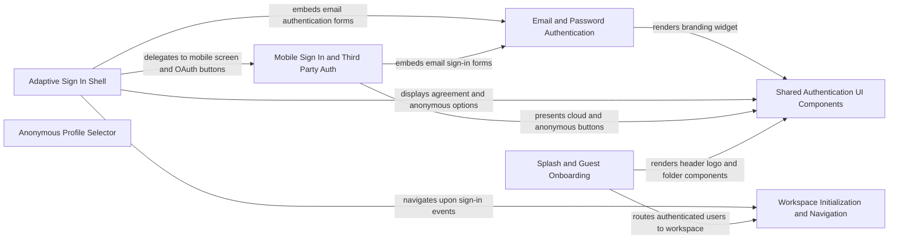

## Details

Renders authentication and onboarding UI screens, login forms, password management views, and workspace entry widgets.

### Email and Password Authentication
Provides form controls, passcode verification, and password reset workflows for email and password authentication.

**Related Classes/Methods**:

- `frontend.appflowy_flutter.lib.user.presentation.screens.sign_in_screen.widgets.continue_with.continue_with_email_and_password.ContinueWithEmailAndPassword`:14-20
- `frontend.appflowy_flutter.lib.user.presentation.screens.sign_in_screen.widgets.continue_with.continue_with_magic_link_or_passcode_page.ContinueWithMagicLinkOrPasscodePage`:14-29
- `frontend.appflowy_flutter.lib.user.presentation.screens.sign_in_screen.widgets.continue_with.forgot_password_page.ForgotPasswordPage`:17-31
- `frontend.appflowy_flutter.lib.user.presentation.screens.sign_in_screen.widgets.continue_with.reset_password_page.ResetPasswordPage`:10-24

**Source Files:**

- `frontend/appflowy_flutter/lib/user/presentation/screens/sign_in_screen/widgets/continue_with/back_to_login_in_button.dart`
  - `frontend.appflowy_flutter.lib.user.presentation.screens.sign_in_screen.widgets.continue_with.back_to_login_in_button.BackToLoginButton` (L6-L30) - Class
  - `frontend.appflowy_flutter.lib.user.presentation.screens.sign_in_screen.widgets.continue_with.back_to_login_in_button.BackToLoginButton.BackToLoginButton` (L7-L10) - Constructor
  - `frontend.appflowy_flutter.lib.user.presentation.screens.sign_in_screen.widgets.continue_with.back_to_login_in_button.BackToLoginButton.build` (L15-L29) - Method
- `frontend/appflowy_flutter/lib/user/presentation/screens/sign_in_screen/widgets/continue_with/continue_with_button.dart`
  - `frontend.appflowy_flutter.lib.user.presentation.screens.sign_in_screen.widgets.continue_with.continue_with_button.ContinueWithButton` (L4-L27) - Class
  - `frontend.appflowy_flutter.lib.user.presentation.screens.sign_in_screen.widgets.continue_with.continue_with_button.ContinueWithButton.ContinueWithButton` (L5-L9) - Constructor
  - `frontend.appflowy_flutter.lib.user.presentation.screens.sign_in_screen.widgets.continue_with.continue_with_button.ContinueWithButton.build` (L15-L26) - Method
- `frontend/appflowy_flutter/lib/user/presentation/screens/sign_in_screen/widgets/continue_with/continue_with_email.dart`
  - `frontend.appflowy_flutter.lib.user.presentation.screens.sign_in_screen.widgets.continue_with.continue_with_email.ContinueWithEmail` (L6-L23) - Class
  - `frontend.appflowy_flutter.lib.user.presentation.screens.sign_in_screen.widgets.continue_with.continue_with_email.ContinueWithEmail.ContinueWithEmail` (L7-L10) - Constructor
  - `frontend.appflowy_flutter.lib.user.presentation.screens.sign_in_screen.widgets.continue_with.continue_with_email.ContinueWithEmail.build` (L15-L22) - Method
- `frontend/appflowy_flutter/lib/user/presentation/screens/sign_in_screen/widgets/continue_with/continue_with_email_and_password.dart`
  - `frontend.appflowy_flutter.lib.user.presentation.screens.sign_in_screen.widgets.continue_with.continue_with_email_and_password.ContinueWithEmailAndPassword` (L14-L20) - Class
  - `frontend.appflowy_flutter.lib.user.presentation.screens.sign_in_screen.widgets.continue_with.continue_with_email_and_password.ContinueWithEmailAndPassword.ContinueWithEmailAndPassword` (L15-L15) - Constructor
  - `frontend.appflowy_flutter.lib.user.presentation.screens.sign_in_screen.widgets.continue_with.continue_with_email_and_password.ContinueWithEmailAndPassword.createState` (L18-L19) - Method
  - `frontend.appflowy_flutter.lib.user.presentation.screens.sign_in_screen.widgets.continue_with.continue_with_email_and_password._ContinueWithEmailAndPasswordState` (L22-L188) - Class
  - `frontend.appflowy_flutter.lib.user.presentation.screens.sign_in_screen.widgets.continue_with.continue_with_email_and_password._ContinueWithEmailAndPasswordState.dispose` (L31-L36) - Method
  - `frontend.appflowy_flutter.lib.user.presentation.screens.sign_in_screen.widgets.continue_with.continue_with_email_and_password._ContinueWithEmailAndPasswordState.build` (L39-L96) - Method
  - `frontend.appflowy_flutter.lib.user.presentation.screens.sign_in_screen.widgets.continue_with.continue_with_email_and_password._ContinueWithEmailAndPasswordState._signInWithEmail` (L98-L114) - Method
  - `frontend.appflowy_flutter.lib.user.presentation.screens.sign_in_screen.widgets.continue_with.continue_with_email_and_password._ContinueWithEmailAndPasswordState._pushContinueWithMagicLinkOrPasscodePage` (L116-L155) - Method
  - `frontend.appflowy_flutter.lib.user.presentation.screens.sign_in_screen.widgets.continue_with.continue_with_email_and_password._ContinueWithEmailAndPasswordState._pushContinueWithPasswordPage` (L157-L187) - Method
- `frontend/appflowy_flutter/lib/user/presentation/screens/sign_in_screen/widgets/continue_with/continue_with_magic_link_or_passcode_page.dart`
  - `frontend.appflowy_flutter.lib.user.presentation.screens.sign_in_screen.widgets.continue_with.continue_with_magic_link_or_passcode_page.ContinueWithMagicLinkOrPasscodePage` (L14-L29) - Class
  - `frontend.appflowy_flutter.lib.user.presentation.screens.sign_in_screen.widgets.continue_with.continue_with_magic_link_or_passcode_page.ContinueWithMagicLinkOrPasscodePage.ContinueWithMagicLinkOrPasscodePage` (L15-L20) - Constructor
  - `frontend.appflowy_flutter.lib.user.presentation.screens.sign_in_screen.widgets.continue_with.continue_with_magic_link_or_passcode_page.ContinueWithMagicLinkOrPasscodePage.createState` (L27-L28) - Method
  - `frontend.appflowy_flutter.lib.user.presentation.screens.sign_in_screen.widgets.continue_with.continue_with_magic_link_or_passcode_page._ContinueWithMagicLinkOrPasscodePageState` (L31-L178) - Class
  - `frontend.appflowy_flutter.lib.user.presentation.screens.sign_in_screen.widgets.continue_with.continue_with_magic_link_or_passcode_page._ContinueWithMagicLinkOrPasscodePageState.dispose` (L44-L48) - Method
  - `frontend.appflowy_flutter.lib.user.presentation.screens.sign_in_screen.widgets.continue_with.continue_with_magic_link_or_passcode_page._ContinueWithMagicLinkOrPasscodePageState.build` (L51-L90) - Method
  - `frontend.appflowy_flutter.lib.user.presentation.screens.sign_in_screen.widgets.continue_with.continue_with_magic_link_or_passcode_page._ContinueWithMagicLinkOrPasscodePageState._buildEnterCodeManually` (L92-L148) - Method
  - `frontend.appflowy_flutter.lib.user.presentation.screens.sign_in_screen.widgets.continue_with.continue_with_magic_link_or_passcode_page._ContinueWithMagicLinkOrPasscodePageState._buildLogoTitleAndDescription` (L150-L177) - Method
- `frontend/appflowy_flutter/lib/user/presentation/screens/sign_in_screen/widgets/continue_with/continue_with_password.dart`
  - `frontend.appflowy_flutter.lib.user.presentation.screens.sign_in_screen.widgets.continue_with.continue_with_password.ContinueWithPassword` (L6-L23) - Class
  - `frontend.appflowy_flutter.lib.user.presentation.screens.sign_in_screen.widgets.continue_with.continue_with_password.ContinueWithPassword.ContinueWithPassword` (L7-L10) - Constructor
  - `frontend.appflowy_flutter.lib.user.presentation.screens.sign_in_screen.widgets.continue_with.continue_with_password.ContinueWithPassword.build` (L15-L22) - Method
- `frontend/appflowy_flutter/lib/user/presentation/screens/sign_in_screen/widgets/continue_with/continue_with_password_page.dart`
  - `frontend.appflowy_flutter.lib.user.presentation.screens.sign_in_screen.widgets.continue_with.continue_with_password_page.ContinueWithPasswordPage` (L17-L34) - Class
  - `frontend.appflowy_flutter.lib.user.presentation.screens.sign_in_screen.widgets.continue_with.continue_with_password_page.ContinueWithPasswordPage.ContinueWithPasswordPage` (L18-L24) - Constructor
  - `frontend.appflowy_flutter.lib.user.presentation.screens.sign_in_screen.widgets.continue_with.continue_with_password_page.ContinueWithPasswordPage.createState` (L32-L33) - Method
  - `frontend.appflowy_flutter.lib.user.presentation.screens.sign_in_screen.widgets.continue_with.continue_with_password_page._ContinueWithPasswordPageState` (L36-L206) - Class
  - `frontend.appflowy_flutter.lib.user.presentation.screens.sign_in_screen.widgets.continue_with.continue_with_password_page._ContinueWithPasswordPageState.dispose` (L43-L46) - Method
  - `frontend.appflowy_flutter.lib.user.presentation.screens.sign_in_screen.widgets.continue_with.continue_with_password_page._ContinueWithPasswordPageState.build` (L49-L96) - Method
  - `frontend.appflowy_flutter.lib.user.presentation.screens.sign_in_screen.widgets.continue_with.continue_with_password_page._ContinueWithPasswordPageState._buildLogoAndTitle` (L98-L122) - Method
  - `frontend.appflowy_flutter.lib.user.presentation.screens.sign_in_screen.widgets.continue_with.continue_with_password_page._ContinueWithPasswordPageState._buildPasswordSection` (L124-L183) - Method
  - `frontend.appflowy_flutter.lib.user.presentation.screens.sign_in_screen.widgets.continue_with.continue_with_password_page._ContinueWithPasswordPageState._pushForgotPasswordPage` (L185-L205) - Method
- `frontend/appflowy_flutter/lib/user/presentation/screens/sign_in_screen/widgets/continue_with/forgot_password_page.dart`
  - `frontend.appflowy_flutter.lib.user.presentation.screens.sign_in_screen.widgets.continue_with.forgot_password_page.ForgotPasswordPage` (L17-L31) - Class
  - `frontend.appflowy_flutter.lib.user.presentation.screens.sign_in_screen.widgets.continue_with.forgot_password_page.ForgotPasswordPage.ForgotPasswordPage` (L18-L23) - Constructor
  - `frontend.appflowy_flutter.lib.user.presentation.screens.sign_in_screen.widgets.continue_with.forgot_password_page.ForgotPasswordPage.createState` (L30-L30) - Method
  - `frontend.appflowy_flutter.lib.user.presentation.screens.sign_in_screen.widgets.continue_with.forgot_password_page._ForgotPasswordPageState` (L33-L192) - Class
  - `frontend.appflowy_flutter.lib.user.presentation.screens.sign_in_screen.widgets.continue_with.forgot_password_page._ForgotPasswordPageState.initState` (L46-L50) - Method
  - `frontend.appflowy_flutter.lib.user.presentation.screens.sign_in_screen.widgets.continue_with.forgot_password_page._ForgotPasswordPageState.dispose` (L53-L56) - Method
  - `frontend.appflowy_flutter.lib.user.presentation.screens.sign_in_screen.widgets.continue_with.forgot_password_page._ForgotPasswordPageState.build` (L59-L106) - Method
  - `frontend.appflowy_flutter.lib.user.presentation.screens.sign_in_screen.widgets.continue_with.forgot_password_page._ForgotPasswordPageState._buildLogoAndTitle` (L108-L113) - Method
  - `frontend.appflowy_flutter.lib.user.presentation.screens.sign_in_screen.widgets.continue_with.forgot_password_page._ForgotPasswordPageState._buildPasswordSection` (L115-L144) - Method
  - `frontend.appflowy_flutter.lib.user.presentation.screens.sign_in_screen.widgets.continue_with.forgot_password_page._ForgotPasswordPageState._onSubmit` (L146-L191) - Method
- `frontend/appflowy_flutter/lib/user/presentation/screens/sign_in_screen/widgets/continue_with/reset_password.dart`
  - `frontend.appflowy_flutter.lib.user.presentation.screens.sign_in_screen.widgets.continue_with.reset_password.ResetPasswordWidget` (L14-L30) - Class
  - `frontend.appflowy_flutter.lib.user.presentation.screens.sign_in_screen.widgets.continue_with.reset_password.ResetPasswordWidget.ResetPasswordWidget` (L15-L21) - Constructor
  - `frontend.appflowy_flutter.lib.user.presentation.screens.sign_in_screen.widgets.continue_with.reset_password.ResetPasswordWidget.createState` (L29-L29) - Method
  - `frontend.appflowy_flutter.lib.user.presentation.screens.sign_in_screen.widgets.continue_with.reset_password._ResetPasswordWidgetState` (L32-L175) - Class
  - `frontend.appflowy_flutter.lib.user.presentation.screens.sign_in_screen.widgets.continue_with.reset_password._ResetPasswordWidgetState.dispose` (L42-L46) - Method
  - `frontend.appflowy_flutter.lib.user.presentation.screens.sign_in_screen.widgets.continue_with.reset_password._ResetPasswordWidgetState.build` (L49-L96) - Method
  - `frontend.appflowy_flutter.lib.user.presentation.screens.sign_in_screen.widgets.continue_with.reset_password._ResetPasswordWidgetState._buildEnterCodeManually` (L98-L142) - Method
  - `frontend.appflowy_flutter.lib.user.presentation.screens.sign_in_screen.widgets.continue_with.reset_password._ResetPasswordWidgetState._buildLogoTitleAndDescription` (L144-L157) - Method
  - `frontend.appflowy_flutter.lib.user.presentation.screens.sign_in_screen.widgets.continue_with.reset_password._ResetPasswordWidgetState._onSubmit` (L159-L174) - Method
- `frontend/appflowy_flutter/lib/user/presentation/screens/sign_in_screen/widgets/continue_with/reset_password_page.dart`
  - `frontend.appflowy_flutter.lib.user.presentation.screens.sign_in_screen.widgets.continue_with.reset_password_page.ResetPasswordPageState` (L5-L8) - Enum
  - `frontend.appflowy_flutter.lib.user.presentation.screens.sign_in_screen.widgets.continue_with.reset_password_page.ResetPasswordPageState.enterPasscode` (L6-L6) - Enum
  - `frontend.appflowy_flutter.lib.user.presentation.screens.sign_in_screen.widgets.continue_with.reset_password_page.ResetPasswordPageState.setNewPassword` (L7-L7) - Enum
  - `frontend.appflowy_flutter.lib.user.presentation.screens.sign_in_screen.widgets.continue_with.reset_password_page.ResetPasswordPage` (L10-L24) - Class
  - `frontend.appflowy_flutter.lib.user.presentation.screens.sign_in_screen.widgets.continue_with.reset_password_page.ResetPasswordPage.ResetPasswordPage` (L11-L16) - Constructor
  - `frontend.appflowy_flutter.lib.user.presentation.screens.sign_in_screen.widgets.continue_with.reset_password_page.ResetPasswordPage.createState` (L23-L23) - Method
  - `frontend.appflowy_flutter.lib.user.presentation.screens.sign_in_screen.widgets.continue_with.reset_password_page._ResetPasswordPageState` (L26-L53) - Class
  - `frontend.appflowy_flutter.lib.user.presentation.screens.sign_in_screen.widgets.continue_with.reset_password_page._ResetPasswordPageState.dispose` (L30-L32) - Method
  - `frontend.appflowy_flutter.lib.user.presentation.screens.sign_in_screen.widgets.continue_with.reset_password_page._ResetPasswordPageState.build` (L35-L52) - Method
- `frontend/appflowy_flutter/lib/user/presentation/screens/sign_in_screen/widgets/continue_with/set_new_password.dart`
  - `frontend.appflowy_flutter.lib.user.presentation.screens.sign_in_screen.widgets.continue_with.set_new_password.SetNewPasswordWidget` (L15-L27) - Class
  - `frontend.appflowy_flutter.lib.user.presentation.screens.sign_in_screen.widgets.continue_with.set_new_password.SetNewPasswordWidget.SetNewPasswordWidget` (L16-L20) - Constructor
  - `frontend.appflowy_flutter.lib.user.presentation.screens.sign_in_screen.widgets.continue_with.set_new_password.SetNewPasswordWidget.createState` (L26-L26) - Method
  - `frontend.appflowy_flutter.lib.user.presentation.screens.sign_in_screen.widgets.continue_with.set_new_password._SetNewPasswordWidgetState` (L29-L214) - Class
  - `frontend.appflowy_flutter.lib.user.presentation.screens.sign_in_screen.widgets.continue_with.set_new_password._SetNewPasswordWidgetState.dispose` (L39-L43) - Method
  - `frontend.appflowy_flutter.lib.user.presentation.screens.sign_in_screen.widgets.continue_with.set_new_password._SetNewPasswordWidgetState.build` (L46-L104) - Method
  - `frontend.appflowy_flutter.lib.user.presentation.screens.sign_in_screen.widgets.continue_with.set_new_password._SetNewPasswordWidgetState._buildLogoAndTitle` (L106-L130) - Method
  - `frontend.appflowy_flutter.lib.user.presentation.screens.sign_in_screen.widgets.continue_with.set_new_password._SetNewPasswordWidgetState._buildPasswordFields` (L132-L170) - Method
  - `frontend.appflowy_flutter.lib.user.presentation.screens.sign_in_screen.widgets.continue_with.set_new_password._SetNewPasswordWidgetState._buildResetButton` (L172-L179) - Method
  - `frontend.appflowy_flutter.lib.user.presentation.screens.sign_in_screen.widgets.continue_with.set_new_password._SetNewPasswordWidgetState._validateAndSubmit` (L181-L213) - Method
- `frontend/appflowy_flutter/lib/user/presentation/screens/sign_in_screen/widgets/continue_with/title_logo.dart`
  - `frontend.appflowy_flutter.lib.user.presentation.screens.sign_in_screen.widgets.continue_with.title_logo.TitleLogo` (L6-L54) - Class
  - `frontend.appflowy_flutter.lib.user.presentation.screens.sign_in_screen.widgets.continue_with.title_logo.TitleLogo.TitleLogo` (L7-L12) - Constructor
  - `frontend.appflowy_flutter.lib.user.presentation.screens.sign_in_screen.widgets.continue_with.title_logo.TitleLogo.build` (L19-L53) - Method
- `frontend/appflowy_flutter/lib/user/presentation/screens/sign_in_screen/widgets/continue_with/verifying_button.dart`
  - `frontend.appflowy_flutter.lib.user.presentation.screens.sign_in_screen.widgets.continue_with.verifying_button.VerifyingButton` (L7-L42) - Class
  - `frontend.appflowy_flutter.lib.user.presentation.screens.sign_in_screen.widgets.continue_with.verifying_button.VerifyingButton.VerifyingButton` (L8-L8) - Constructor
  - `frontend.appflowy_flutter.lib.user.presentation.screens.sign_in_screen.widgets.continue_with.verifying_button.VerifyingButton.build` (L11-L41) - Method

### Shared Authentication UI Components
Supplies shared presentation widgets including logos, terms agreements, container frames, and anonymous login triggers.

**Related Classes/Methods**:

- `frontend.appflowy_flutter.lib.user.presentation.screens.sign_in_screen.widgets.anonymous_sign_in_button.SignInAnonymousButtonV3`:10-57
- `frontend.appflowy_flutter.lib.user.presentation.screens.sign_in_screen.widgets.sign_in_agreement.SignInAgreement`:8-52
- `frontend.appflowy_flutter.lib.user.presentation.widgets.auth_form_container.AuthFormContainer`:3-24
- `frontend.appflowy_flutter.lib.user.presentation.widgets.flowy_logo_title.FlowyLogoTitle`:6-36

**Source Files:**

- `frontend/appflowy_flutter/lib/user/presentation/screens/sign_in_screen/widgets/anonymous_sign_in_button.dart`
  - `frontend.appflowy_flutter.lib.user.presentation.screens.sign_in_screen.widgets.anonymous_sign_in_button.SignInAnonymousButtonV3` (L10-L57) - Class
  - `frontend.appflowy_flutter.lib.user.presentation.screens.sign_in_screen.widgets.anonymous_sign_in_button.SignInAnonymousButtonV3.SignInAnonymousButtonV3` (L11-L13) - Constructor
  - `frontend.appflowy_flutter.lib.user.presentation.screens.sign_in_screen.widgets.anonymous_sign_in_button.SignInAnonymousButtonV3.build` (L16-L56) - Method
- `frontend/appflowy_flutter/lib/user/presentation/screens/sign_in_screen/widgets/anonymous_sign_in_button/anonymous_sign_in_button.dart`
  - `frontend.appflowy_flutter.lib.user.presentation.screens.sign_in_screen.widgets.anonymous_sign_in_button.anonymous_sign_in_button.AnonymousSignInButton` (L4-L16) - Class
  - `frontend.appflowy_flutter.lib.user.presentation.screens.sign_in_screen.widgets.anonymous_sign_in_button.anonymous_sign_in_button.AnonymousSignInButton.AnonymousSignInButton` (L5-L5) - Constructor
  - `frontend.appflowy_flutter.lib.user.presentation.screens.sign_in_screen.widgets.anonymous_sign_in_button.anonymous_sign_in_button.AnonymousSignInButton.build` (L8-L15) - Method
- `frontend/appflowy_flutter/lib/user/presentation/screens/sign_in_screen/widgets/logo/logo.dart`
  - `frontend.appflowy_flutter.lib.user.presentation.screens.sign_in_screen.widgets.logo.logo.AFLogo` (L4-L20) - Class
  - `frontend.appflowy_flutter.lib.user.presentation.screens.sign_in_screen.widgets.logo.logo.AFLogo.AFLogo` (L5-L8) - Constructor
  - `frontend.appflowy_flutter.lib.user.presentation.screens.sign_in_screen.widgets.logo.logo.AFLogo.build` (L13-L19) - Method
- `frontend/appflowy_flutter/lib/user/presentation/screens/sign_in_screen/widgets/magic_link_sign_in_buttons.dart`
  - `frontend.appflowy_flutter.lib.user.presentation.screens.sign_in_screen.widgets.magic_link_sign_in_buttons.SignInWithMagicLinkButtons` (L12-L18) - Class
  - `frontend.appflowy_flutter.lib.user.presentation.screens.sign_in_screen.widgets.magic_link_sign_in_buttons.SignInWithMagicLinkButtons.SignInWithMagicLinkButtons` (L13-L13) - Constructor
  - `frontend.appflowy_flutter.lib.user.presentation.screens.sign_in_screen.widgets.magic_link_sign_in_buttons.SignInWithMagicLinkButtons.createState` (L16-L17) - Method
  - `frontend.appflowy_flutter.lib.user.presentation.screens.sign_in_screen.widgets.magic_link_sign_in_buttons._SignInWithMagicLinkButtonsState` (L20-L84) - Class
  - `frontend.appflowy_flutter.lib.user.presentation.screens.sign_in_screen.widgets.magic_link_sign_in_buttons._SignInWithMagicLinkButtonsState.dispose` (L26-L30) - Method
  - `frontend.appflowy_flutter.lib.user.presentation.screens.sign_in_screen.widgets.magic_link_sign_in_buttons._SignInWithMagicLinkButtonsState.build` (L33-L63) - Method
  - `frontend.appflowy_flutter.lib.user.presentation.screens.sign_in_screen.widgets.magic_link_sign_in_buttons._SignInWithMagicLinkButtonsState._sendMagicLink` (L65-L83) - Method
  - `frontend.appflowy_flutter.lib.user.presentation.screens.sign_in_screen.widgets.magic_link_sign_in_buttons._ConfirmButton` (L86-L133) - Class
  - `frontend.appflowy_flutter.lib.user.presentation.screens.sign_in_screen.widgets.magic_link_sign_in_buttons._ConfirmButton._ConfirmButton` (L87-L89) - Constructor
  - `frontend.appflowy_flutter.lib.user.presentation.screens.sign_in_screen.widgets.magic_link_sign_in_buttons._ConfirmButton.build` (L94-L132) - Method
- `frontend/appflowy_flutter/lib/user/presentation/screens/sign_in_screen/widgets/sign_in_agreement.dart`
  - `frontend.appflowy_flutter.lib.user.presentation.screens.sign_in_screen.widgets.sign_in_agreement.SignInAgreement` (L8-L52) - Class
  - `frontend.appflowy_flutter.lib.user.presentation.screens.sign_in_screen.widgets.sign_in_agreement.SignInAgreement.SignInAgreement` (L9-L11) - Constructor
  - `frontend.appflowy_flutter.lib.user.presentation.screens.sign_in_screen.widgets.sign_in_agreement.SignInAgreement.build` (L14-L51) - Method
- `frontend/appflowy_flutter/lib/user/presentation/screens/sign_in_screen/widgets/sign_in_anonymous_button.dart`
  - `frontend.appflowy_flutter.lib.user.presentation.screens.sign_in_screen.widgets.sign_in_anonymous_button.SignInAnonymousButtonV2` (L12-L71) - Class
  - `frontend.appflowy_flutter.lib.user.presentation.screens.sign_in_screen.widgets.sign_in_anonymous_button.SignInAnonymousButtonV2.SignInAnonymousButtonV2` (L13-L15) - Constructor
  - `frontend.appflowy_flutter.lib.user.presentation.screens.sign_in_screen.widgets.sign_in_anonymous_button.SignInAnonymousButtonV2.build` (L18-L70) - Method
  - `frontend.appflowy_flutter.lib.user.presentation.screens.sign_in_screen.widgets.sign_in_anonymous_button.ChangeCloudModeButton` (L73-L107) - Class
  - `frontend.appflowy_flutter.lib.user.presentation.screens.sign_in_screen.widgets.sign_in_anonymous_button.ChangeCloudModeButton.ChangeCloudModeButton` (L74-L76) - Constructor
  - `frontend.appflowy_flutter.lib.user.presentation.screens.sign_in_screen.widgets.sign_in_anonymous_button.ChangeCloudModeButton.build` (L79-L106) - Method
- `frontend/appflowy_flutter/lib/user/presentation/screens/sign_in_screen/widgets/sign_in_or_logout_button.dart`
  - `frontend.appflowy_flutter.lib.user.presentation.screens.sign_in_screen.widgets.sign_in_or_logout_button.MobileLogoutButton` (L4-L25) - Class
  - `frontend.appflowy_flutter.lib.user.presentation.screens.sign_in_screen.widgets.sign_in_or_logout_button.MobileLogoutButton.MobileLogoutButton` (L5-L10) - Constructor
  - `frontend.appflowy_flutter.lib.user.presentation.screens.sign_in_screen.widgets.sign_in_or_logout_button.MobileLogoutButton.build` (L17-L24) - Method
- `frontend/appflowy_flutter/lib/user/presentation/screens/sign_in_screen/widgets/switch_sign_in_sign_up_button.dart`
  - `frontend.appflowy_flutter.lib.user.presentation.screens.sign_in_screen.widgets.switch_sign_in_sign_up_button.SwitchSignInSignUpButton` (L8-L52) - Class
  - `frontend.appflowy_flutter.lib.user.presentation.screens.sign_in_screen.widgets.switch_sign_in_sign_up_button.SwitchSignInSignUpButton.SwitchSignInSignUpButton` (L9-L12) - Constructor
  - `frontend.appflowy_flutter.lib.user.presentation.screens.sign_in_screen.widgets.switch_sign_in_sign_up_button.SwitchSignInSignUpButton.build` (L17-L51) - Method
- `frontend/appflowy_flutter/lib/user/presentation/widgets/auth_form_container.dart`
  - `frontend.appflowy_flutter.lib.user.presentation.widgets.auth_form_container.AuthFormContainer` (L3-L24) - Class
  - `frontend.appflowy_flutter.lib.user.presentation.widgets.auth_form_container.AuthFormContainer.AuthFormContainer` (L4-L7) - Constructor
  - `frontend.appflowy_flutter.lib.user.presentation.widgets.auth_form_container.AuthFormContainer.build` (L14-L23) - Method
- `frontend/appflowy_flutter/lib/user/presentation/widgets/flowy_logo_title.dart`
  - `frontend.appflowy_flutter.lib.user.presentation.widgets.flowy_logo_title.FlowyLogoTitle` (L6-L36) - Class
  - `frontend.appflowy_flutter.lib.user.presentation.widgets.flowy_logo_title.FlowyLogoTitle.FlowyLogoTitle` (L7-L11) - Constructor
  - `frontend.appflowy_flutter.lib.user.presentation.widgets.flowy_logo_title.FlowyLogoTitle.build` (L17-L35) - Method
- `frontend/appflowy_flutter/lib/user/presentation/widgets/folder_widget.dart`
  - `frontend.appflowy_flutter.lib.user.presentation.widgets.folder_widget._FolderPage` (L18-L22) - Enum
  - `frontend.appflowy_flutter.lib.user.presentation.widgets.folder_widget._FolderPage.options` (L19-L19) - Enum
  - `frontend.appflowy_flutter.lib.user.presentation.widgets.folder_widget._FolderPage.create` (L20-L20) - Enum
  - `frontend.appflowy_flutter.lib.user.presentation.widgets.folder_widget._FolderPage.open` (L21-L21) - Enum
  - `frontend.appflowy_flutter.lib.user.presentation.widgets.folder_widget.FolderWidget` (L24-L34) - Class
  - `frontend.appflowy_flutter.lib.user.presentation.widgets.folder_widget.FolderWidget.FolderWidget` (L25-L28) - Constructor
  - `frontend.appflowy_flutter.lib.user.presentation.widgets.folder_widget.FolderWidget.createState` (L33-L33) - Method
  - `frontend.appflowy_flutter.lib.user.presentation.widgets.folder_widget._FolderWidgetState` (L36-L72) - Class
  - `frontend.appflowy_flutter.lib.user.presentation.widgets.folder_widget._FolderWidgetState.build` (L40-L42) - Method
  - `frontend.appflowy_flutter.lib.user.presentation.widgets.folder_widget._FolderWidgetState._mapIndexToWidget` (L44-L62) - Method
  - `frontend.appflowy_flutter.lib.user.presentation.widgets.folder_widget._FolderWidgetState._openFolder` (L64-L71) - Method
  - `frontend.appflowy_flutter.lib.user.presentation.widgets.folder_widget.FolderOptionsWidget` (L74-L101) - Class
  - `frontend.appflowy_flutter.lib.user.presentation.widgets.folder_widget.FolderOptionsWidget.FolderOptionsWidget` (L75-L78) - Constructor
  - `frontend.appflowy_flutter.lib.user.presentation.widgets.folder_widget.FolderOptionsWidget.build` (L83-L100) - Method
  - `frontend.appflowy_flutter.lib.user.presentation.widgets.folder_widget.CreateFolderWidget` (L103-L115) - Class
  - `frontend.appflowy_flutter.lib.user.presentation.widgets.folder_widget.CreateFolderWidget.CreateFolderWidget` (L104-L108) - Constructor
  - `frontend.appflowy_flutter.lib.user.presentation.widgets.folder_widget.CreateFolderWidget.createState` (L114-L114) - Method
  - `frontend.appflowy_flutter.lib.user.presentation.widgets.folder_widget.CreateFolderWidgetState` (L118-L210) - Class
  - `frontend.appflowy_flutter.lib.user.presentation.widgets.folder_widget.CreateFolderWidgetState.initState` (L126-L129) - Method
  - `frontend.appflowy_flutter.lib.user.presentation.widgets.folder_widget.CreateFolderWidgetState.build` (L132-L191) - Method
  - `frontend.appflowy_flutter.lib.user.presentation.widgets.folder_widget.CreateFolderWidgetState._path` (L193-L202) - Method
  - `frontend.appflowy_flutter.lib.user.presentation.widgets.folder_widget.CreateFolderWidgetState._showToast` (L204-L209) - Method
  - `frontend.appflowy_flutter.lib.user.presentation.widgets.folder_widget._buildTextButton` (L212-L222) - Function
  - `frontend.appflowy_flutter.lib.user.presentation.widgets.folder_widget._FolderCard` (L224-L319) - Class
  - `frontend.appflowy_flutter.lib.user.presentation.widgets.folder_widget._FolderCard._FolderCard` (L225-L230) - Constructor
  - `frontend.appflowy_flutter.lib.user.presentation.widgets.folder_widget._FolderCard.build` (L238-L318) - Method

### Workspace Initialization and Navigation
Manages post-authentication navigation routers, initial workspace launch screens, and workspace initialization error handling.

**Related Classes/Methods**:

- `frontend.appflowy_flutter.lib.user.presentation.router.AuthRouter`:14-73
- `frontend.appflowy_flutter.lib.user.presentation.router.SplashRouter`:75-123
- `frontend.appflowy_flutter.lib.user.presentation.helpers.handle_open_workspace_error.handleOpenWorkspaceError`:10-36
- `frontend.appflowy_flutter.lib.user.presentation.screens.workspace_start_screen.workspace_start_screen.WorkspaceStartScreen`:11-39

**Source Files:**

- `frontend/appflowy_flutter/lib/user/presentation/helpers/handle_open_workspace_error.dart`
  - `frontend.appflowy_flutter.lib.user.presentation.helpers.handle_open_workspace_error.handleOpenWorkspaceError` (L10-L36) - Function
- `frontend/appflowy_flutter/lib/user/presentation/router.dart`
  - `frontend.appflowy_flutter.lib.user.presentation.router.AuthRouter` (L14-L73) - Class
  - `frontend.appflowy_flutter.lib.user.presentation.router.AuthRouter.pushForgetPasswordScreen` (L15-L15) - Method
  - `frontend.appflowy_flutter.lib.user.presentation.router.AuthRouter.pushWorkspaceStartScreen` (L17-L22) - Method
  - `frontend.appflowy_flutter.lib.user.presentation.router.AuthRouter.goHomeScreen` (L37-L58) - Method
  - `frontend.appflowy_flutter.lib.user.presentation.router.AuthRouter.pushWorkspaceErrorScreen` (L60-L72) - Method
  - `frontend.appflowy_flutter.lib.user.presentation.router.SplashRouter` (L75-L123) - Class
  - `frontend.appflowy_flutter.lib.user.presentation.router.SplashRouter.pushWorkspaceStartScreen` (L78-L94) - Method
  - `frontend.appflowy_flutter.lib.user.presentation.router.SplashRouter.pushHomeScreen` (L96-L108) - Method
  - `frontend.appflowy_flutter.lib.user.presentation.router.SplashRouter.goHomeScreen` (L110-L122) - Method
- `frontend/appflowy_flutter/lib/user/presentation/screens/workspace_error_screen.dart`
  - `frontend.appflowy_flutter.lib.user.presentation.screens.workspace_error_screen.WorkspaceErrorScreen` (L14-L106) - Class
  - `frontend.appflowy_flutter.lib.user.presentation.screens.workspace_error_screen.WorkspaceErrorScreen.WorkspaceErrorScreen` (L15-L19) - Constructor
  - `frontend.appflowy_flutter.lib.user.presentation.screens.workspace_error_screen.WorkspaceErrorScreen.build` (L30-L105) - Method
  - `frontend.appflowy_flutter.lib.user.presentation.screens.workspace_error_screen.WorkspaceErrorDescription` (L108-L134) - Class
  - `frontend.appflowy_flutter.lib.user.presentation.screens.workspace_error_screen.WorkspaceErrorDescription.WorkspaceErrorDescription` (L109-L109) - Constructor
  - `frontend.appflowy_flutter.lib.user.presentation.screens.workspace_error_screen.WorkspaceErrorDescription.build` (L114-L133) - Method
  - `frontend.appflowy_flutter.lib.user.presentation.screens.workspace_error_screen.LogoutButton` (L136-L157) - Class
  - `frontend.appflowy_flutter.lib.user.presentation.screens.workspace_error_screen.LogoutButton.LogoutButton` (L137-L137) - Constructor
  - `frontend.appflowy_flutter.lib.user.presentation.screens.workspace_error_screen.LogoutButton.build` (L140-L156) - Method
- `frontend/appflowy_flutter/lib/user/presentation/screens/workspace_start_screen/desktop_workspace_start_screen.dart`
  - `frontend.appflowy_flutter.lib.user.presentation.screens.workspace_start_screen.desktop_workspace_start_screen.DesktopWorkspaceStartScreen` (L12-L31) - Class
  - `frontend.appflowy_flutter.lib.user.presentation.screens.workspace_start_screen.desktop_workspace_start_screen.DesktopWorkspaceStartScreen.DesktopWorkspaceStartScreen` (L13-L13) - Constructor
  - `frontend.appflowy_flutter.lib.user.presentation.screens.workspace_start_screen.desktop_workspace_start_screen.DesktopWorkspaceStartScreen.build` (L18-L30) - Method
  - `frontend.appflowy_flutter.lib.user.presentation.screens.workspace_start_screen.desktop_workspace_start_screen._renderBody` (L33-L43) - Function
  - `frontend.appflowy_flutter.lib.user.presentation.screens.workspace_start_screen.desktop_workspace_start_screen._renderList` (L45-L58) - Function
  - `frontend.appflowy_flutter.lib.user.presentation.screens.workspace_start_screen.desktop_workspace_start_screen._WorkspaceItem` (L60-L81) - Class
  - `frontend.appflowy_flutter.lib.user.presentation.screens.workspace_start_screen.desktop_workspace_start_screen._WorkspaceItem._WorkspaceItem` (L61-L64) - Constructor
  - `frontend.appflowy_flutter.lib.user.presentation.screens.workspace_start_screen.desktop_workspace_start_screen._WorkspaceItem.build` (L70-L80) - Method
  - `frontend.appflowy_flutter.lib.user.presentation.screens.workspace_start_screen.desktop_workspace_start_screen._renderCreateButton` (L83-L102) - Function
  - `frontend.appflowy_flutter.lib.user.presentation.screens.workspace_start_screen.desktop_workspace_start_screen._popToWorkspace` (L105-L107) - Function
- `frontend/appflowy_flutter/lib/user/presentation/screens/workspace_start_screen/mobile_workspace_start_screen.dart`
  - `frontend.appflowy_flutter.lib.user.presentation.screens.workspace_start_screen.mobile_workspace_start_screen.MobileWorkspaceStartScreen` (L12-L22) - Class
  - `frontend.appflowy_flutter.lib.user.presentation.screens.workspace_start_screen.mobile_workspace_start_screen.MobileWorkspaceStartScreen.MobileWorkspaceStartScreen` (L13-L16) - Constructor
  - `frontend.appflowy_flutter.lib.user.presentation.screens.workspace_start_screen.mobile_workspace_start_screen.MobileWorkspaceStartScreen.createState` (L19-L20) - Method
  - `frontend.appflowy_flutter.lib.user.presentation.screens.workspace_start_screen.mobile_workspace_start_screen._MobileWorkspaceStartScreenState` (L24-L144) - Class
  - `frontend.appflowy_flutter.lib.user.presentation.screens.workspace_start_screen.mobile_workspace_start_screen._MobileWorkspaceStartScreenState.dispose` (L30-L33) - Method
  - `frontend.appflowy_flutter.lib.user.presentation.screens.workspace_start_screen.mobile_workspace_start_screen._MobileWorkspaceStartScreenState.build` (L36-L143) - Method
  - `frontend.appflowy_flutter.lib.user.presentation.screens.workspace_start_screen.mobile_workspace_start_screen._popToWorkspace` (L147-L149) - Function
- `frontend/appflowy_flutter/lib/user/presentation/screens/workspace_start_screen/workspace_start_screen.dart`
  - `frontend.appflowy_flutter.lib.user.presentation.screens.workspace_start_screen.workspace_start_screen.WorkspaceStartScreen` (L11-L39) - Class
  - `frontend.appflowy_flutter.lib.user.presentation.screens.workspace_start_screen.workspace_start_screen.WorkspaceStartScreen.WorkspaceStartScreen` (L13-L13) - Constructor
  - `frontend.appflowy_flutter.lib.user.presentation.screens.workspace_start_screen.workspace_start_screen.WorkspaceStartScreen.build` (L21-L38) - Method

### Adaptive Sign In Shell
Implements the adaptive root sign-in screen dispatch and dedicated desktop layout.

**Related Classes/Methods**:

- `frontend.appflowy_flutter.lib.user.presentation.screens.sign_in_screen.sign_in_screen.SignInScreen`:11-44
- `frontend.appflowy_flutter.lib.user.presentation.screens.sign_in_screen.desktop_sign_in_screen.DesktopSignInScreen`:19-26
- `frontend.appflowy_flutter.lib.user.presentation.screens.sign_in_screen.mobile_loading_screen.MobileLoadingScreen`:9-37

**Source Files:**

- `frontend/appflowy_flutter/lib/user/presentation/screens/sign_in_screen/desktop_sign_in_screen.dart`
  - `frontend.appflowy_flutter.lib.user.presentation.screens.sign_in_screen.desktop_sign_in_screen.DesktopSignInScreen` (L19-L26) - Class
  - `frontend.appflowy_flutter.lib.user.presentation.screens.sign_in_screen.desktop_sign_in_screen.DesktopSignInScreen.DesktopSignInScreen` (L20-L22) - Constructor
  - `frontend.appflowy_flutter.lib.user.presentation.screens.sign_in_screen.desktop_sign_in_screen.DesktopSignInScreen.createState` (L25-L25) - Method
  - `frontend.appflowy_flutter.lib.user.presentation.screens.sign_in_screen.desktop_sign_in_screen._DesktopSignInScreenState` (L28-L104) - Class
  - `frontend.appflowy_flutter.lib.user.presentation.screens.sign_in_screen.desktop_sign_in_screen._DesktopSignInScreenState.build` (L31-L87) - Method
  - `frontend.appflowy_flutter.lib.user.presentation.screens.sign_in_screen.desktop_sign_in_screen._DesktopSignInScreenState._buildAppBar` (L89-L96) - Method
  - `frontend.appflowy_flutter.lib.user.presentation.screens.sign_in_screen.desktop_sign_in_screen._DesktopSignInScreenState.onWindowFocus` (L99-L103) - Method
  - `frontend.appflowy_flutter.lib.user.presentation.screens.sign_in_screen.desktop_sign_in_screen.DesktopSignInSettingsButton` (L106-L134) - Class
  - `frontend.appflowy_flutter.lib.user.presentation.screens.sign_in_screen.desktop_sign_in_screen.DesktopSignInSettingsButton.DesktopSignInSettingsButton` (L107-L109) - Constructor
  - `frontend.appflowy_flutter.lib.user.presentation.screens.sign_in_screen.desktop_sign_in_screen.DesktopSignInSettingsButton.build` (L112-L133) - Method
  - `frontend.appflowy_flutter.lib.user.presentation.screens.sign_in_screen.desktop_sign_in_screen._OrDivider` (L136-L162) - Class
  - `frontend.appflowy_flutter.lib.user.presentation.screens.sign_in_screen.desktop_sign_in_screen._OrDivider._OrDivider` (L137-L137) - Constructor
  - `frontend.appflowy_flutter.lib.user.presentation.screens.sign_in_screen.desktop_sign_in_screen._OrDivider.build` (L140-L161) - Method
- `frontend/appflowy_flutter/lib/user/presentation/screens/sign_in_screen/mobile_loading_screen.dart`
  - `frontend.appflowy_flutter.lib.user.presentation.screens.sign_in_screen.mobile_loading_screen.MobileLoadingScreen` (L9-L37) - Class
  - `frontend.appflowy_flutter.lib.user.presentation.screens.sign_in_screen.mobile_loading_screen.MobileLoadingScreen.MobileLoadingScreen` (L10-L12) - Constructor
  - `frontend.appflowy_flutter.lib.user.presentation.screens.sign_in_screen.mobile_loading_screen.MobileLoadingScreen.build` (L15-L36) - Method
- `frontend/appflowy_flutter/lib/user/presentation/screens/sign_in_screen/sign_in_screen.dart`
  - `frontend.appflowy_flutter.lib.user.presentation.screens.sign_in_screen.sign_in_screen.SignInScreen` (L11-L44) - Class
  - `frontend.appflowy_flutter.lib.user.presentation.screens.sign_in_screen.sign_in_screen.SignInScreen.SignInScreen` (L12-L12) - Constructor
  - `frontend.appflowy_flutter.lib.user.presentation.screens.sign_in_screen.sign_in_screen.SignInScreen.build` (L17-L29) - Method
  - `frontend.appflowy_flutter.lib.user.presentation.screens.sign_in_screen.sign_in_screen.SignInScreen._showSignInError` (L31-L43) - Method

### Mobile Sign In and Third Party Auth
Renders the mobile authentication interface and buttons for third-party OAuth providers.

**Related Classes/Methods**:

- `frontend.appflowy_flutter.lib.user.presentation.screens.sign_in_screen.mobile_sign_in_screen.MobileSignInScreen`:18-119
- `frontend.appflowy_flutter.lib.user.presentation.screens.sign_in_screen.widgets.third_party_sign_in_button.third_party_sign_in_buttons.ThirdPartySignInButtons`:17-45

**Source Files:**

- `frontend/appflowy_flutter/lib/user/presentation/screens/sign_in_screen/mobile_sign_in_screen.dart`
  - `frontend.appflowy_flutter.lib.user.presentation.screens.sign_in_screen.mobile_sign_in_screen.MobileSignInScreen` (L18-L119) - Class
  - `frontend.appflowy_flutter.lib.user.presentation.screens.sign_in_screen.mobile_sign_in_screen.MobileSignInScreen.MobileSignInScreen` (L19-L21) - Constructor
  - `frontend.appflowy_flutter.lib.user.presentation.screens.sign_in_screen.mobile_sign_in_screen.MobileSignInScreen.build` (L24-L54) - Method
  - `frontend.appflowy_flutter.lib.user.presentation.screens.sign_in_screen.mobile_sign_in_screen.MobileSignInScreen._buildThirdPartySignInButtons` (L56-L85) - Method
  - `frontend.appflowy_flutter.lib.user.presentation.screens.sign_in_screen.mobile_sign_in_screen.MobileSignInScreen._buildSettingsButton` (L87-L118) - Method
- `frontend/appflowy_flutter/lib/user/presentation/screens/sign_in_screen/widgets/third_party_sign_in_button/third_party_sign_in_button.dart`
  - `frontend.appflowy_flutter.lib.user.presentation.screens.sign_in_screen.widgets.third_party_sign_in_button.third_party_sign_in_button.ThirdPartySignInButtonType` (L7-L95) - Enum
  - `frontend.appflowy_flutter.lib.user.presentation.screens.sign_in_screen.widgets.third_party_sign_in_button.third_party_sign_in_button.ThirdPartySignInButtonType.apple` (L8-L8) - Enum
  - `frontend.appflowy_flutter.lib.user.presentation.screens.sign_in_screen.widgets.third_party_sign_in_button.third_party_sign_in_button.ThirdPartySignInButtonType.google` (L9-L9) - Enum
  - `frontend.appflowy_flutter.lib.user.presentation.screens.sign_in_screen.widgets.third_party_sign_in_button.third_party_sign_in_button.ThirdPartySignInButtonType.github` (L10-L10) - Enum
  - `frontend.appflowy_flutter.lib.user.presentation.screens.sign_in_screen.widgets.third_party_sign_in_button.third_party_sign_in_button.ThirdPartySignInButtonType.discord` (L11-L11) - Enum
  - `frontend.appflowy_flutter.lib.user.presentation.screens.sign_in_screen.widgets.third_party_sign_in_button.third_party_sign_in_button.ThirdPartySignInButtonType.anonymous` (L12-L12) - Enum
  - `frontend.appflowy_flutter.lib.user.presentation.screens.sign_in_screen.widgets.third_party_sign_in_button.third_party_sign_in_button.ThirdPartySignInButtonType.provider` (L14-L27) - Method
  - `frontend.appflowy_flutter.lib.user.presentation.screens.sign_in_screen.widgets.third_party_sign_in_button.third_party_sign_in_button.ThirdPartySignInButtonType.icon` (L29-L42) - Method
  - `frontend.appflowy_flutter.lib.user.presentation.screens.sign_in_screen.widgets.third_party_sign_in_button.third_party_sign_in_button.ThirdPartySignInButtonType.labelText` (L44-L57) - Method
  - `frontend.appflowy_flutter.lib.user.presentation.screens.sign_in_screen.widgets.third_party_sign_in_button.third_party_sign_in_button.ThirdPartySignInButtonType.backgroundColor` (L60-L71) - Method
  - `frontend.appflowy_flutter.lib.user.presentation.screens.sign_in_screen.widgets.third_party_sign_in_button.third_party_sign_in_button.ThirdPartySignInButtonType.textColor` (L73-L84) - Method
  - `frontend.appflowy_flutter.lib.user.presentation.screens.sign_in_screen.widgets.third_party_sign_in_button.third_party_sign_in_button.ThirdPartySignInButtonType.blendMode` (L86-L94) - Method
  - `frontend.appflowy_flutter.lib.user.presentation.screens.sign_in_screen.widgets.third_party_sign_in_button.third_party_sign_in_button.MobileThirdPartySignInButton` (L97-L126) - Class
  - `frontend.appflowy_flutter.lib.user.presentation.screens.sign_in_screen.widgets.third_party_sign_in_button.third_party_sign_in_button.MobileThirdPartySignInButton.MobileThirdPartySignInButton` (L98-L104) - Constructor
  - `frontend.appflowy_flutter.lib.user.presentation.screens.sign_in_screen.widgets.third_party_sign_in_button.third_party_sign_in_button.MobileThirdPartySignInButton.build` (L112-L125) - Method
  - `frontend.appflowy_flutter.lib.user.presentation.screens.sign_in_screen.widgets.third_party_sign_in_button.third_party_sign_in_button.DesktopThirdPartySignInButton` (L128-L153) - Class
  - `frontend.appflowy_flutter.lib.user.presentation.screens.sign_in_screen.widgets.third_party_sign_in_button.third_party_sign_in_button.DesktopThirdPartySignInButton.DesktopThirdPartySignInButton` (L129-L133) - Constructor
  - `frontend.appflowy_flutter.lib.user.presentation.screens.sign_in_screen.widgets.third_party_sign_in_button.third_party_sign_in_button.DesktopThirdPartySignInButton.build` (L139-L152) - Method
- `frontend/appflowy_flutter/lib/user/presentation/screens/sign_in_screen/widgets/third_party_sign_in_button/third_party_sign_in_buttons.dart`
  - `frontend.appflowy_flutter.lib.user.presentation.screens.sign_in_screen.widgets.third_party_sign_in_button.third_party_sign_in_buttons._SignInCallback` (L12-L12) - Class
  - `frontend.appflowy_flutter.lib.user.presentation.screens.sign_in_screen.widgets.third_party_sign_in_button.third_party_sign_in_buttons.ThirdPartySignInButtons` (L17-L45) - Class
  - `frontend.appflowy_flutter.lib.user.presentation.screens.sign_in_screen.widgets.third_party_sign_in_button.third_party_sign_in_buttons.ThirdPartySignInButtons.ThirdPartySignInButtons` (L19-L22) - Constructor
  - `frontend.appflowy_flutter.lib.user.presentation.screens.sign_in_screen.widgets.third_party_sign_in_button.third_party_sign_in_buttons.ThirdPartySignInButtons.build` (L27-L38) - Method
  - `frontend.appflowy_flutter.lib.user.presentation.screens.sign_in_screen.widgets.third_party_sign_in_button.third_party_sign_in_buttons.ThirdPartySignInButtons._signIn` (L40-L44) - Method
  - `frontend.appflowy_flutter.lib.user.presentation.screens.sign_in_screen.widgets.third_party_sign_in_button.third_party_sign_in_buttons._DesktopThirdPartySignIn` (L47-L57) - Class
  - `frontend.appflowy_flutter.lib.user.presentation.screens.sign_in_screen.widgets.third_party_sign_in_button.third_party_sign_in_buttons._DesktopThirdPartySignIn._DesktopThirdPartySignIn` (L48-L50) - Constructor
  - `frontend.appflowy_flutter.lib.user.presentation.screens.sign_in_screen.widgets.third_party_sign_in_button.third_party_sign_in_buttons._DesktopThirdPartySignIn.createState` (L55-L56) - Method
  - `frontend.appflowy_flutter.lib.user.presentation.screens.sign_in_screen.widgets.third_party_sign_in_button.third_party_sign_in_buttons._DesktopThirdPartySignInState` (L59-L119) - Class
  - `frontend.appflowy_flutter.lib.user.presentation.screens.sign_in_screen.widgets.third_party_sign_in_button.third_party_sign_in_buttons._DesktopThirdPartySignInState.build` (L63-L80) - Method
  - `frontend.appflowy_flutter.lib.user.presentation.screens.sign_in_screen.widgets.third_party_sign_in_button.third_party_sign_in_buttons._DesktopThirdPartySignInState._buildExpandedButtons` (L82-L96) - Method
  - `frontend.appflowy_flutter.lib.user.presentation.screens.sign_in_screen.widgets.third_party_sign_in_button.third_party_sign_in_buttons._DesktopThirdPartySignInState._buildCollapsedButtons` (L98-L118) - Method
  - `frontend.appflowy_flutter.lib.user.presentation.screens.sign_in_screen.widgets.third_party_sign_in_button.third_party_sign_in_buttons._MobileThirdPartySignIn` (L121-L133) - Class
  - `frontend.appflowy_flutter.lib.user.presentation.screens.sign_in_screen.widgets.third_party_sign_in_button.third_party_sign_in_buttons._MobileThirdPartySignIn._MobileThirdPartySignIn` (L122-L125) - Constructor
  - `frontend.appflowy_flutter.lib.user.presentation.screens.sign_in_screen.widgets.third_party_sign_in_button.third_party_sign_in_buttons._MobileThirdPartySignIn.createState` (L131-L132) - Method
  - `frontend.appflowy_flutter.lib.user.presentation.screens.sign_in_screen.widgets.third_party_sign_in_button.third_party_sign_in_buttons._MobileThirdPartySignInState` (L135-L204) - Class
  - `frontend.appflowy_flutter.lib.user.presentation.screens.sign_in_screen.widgets.third_party_sign_in_button.third_party_sign_in_buttons._MobileThirdPartySignInState.initState` (L141-L145) - Method
  - `frontend.appflowy_flutter.lib.user.presentation.screens.sign_in_screen.widgets.third_party_sign_in_button.third_party_sign_in_buttons._MobileThirdPartySignInState.build` (L148-L167) - Method
  - `frontend.appflowy_flutter.lib.user.presentation.screens.sign_in_screen.widgets.third_party_sign_in_button.third_party_sign_in_buttons._MobileThirdPartySignInState._buildExpandedButtons` (L169-L182) - Method
  - `frontend.appflowy_flutter.lib.user.presentation.screens.sign_in_screen.widgets.third_party_sign_in_button.third_party_sign_in_buttons._MobileThirdPartySignInState._buildCollapsedButtons` (L184-L203) - Method

### Splash and Guest Onboarding
Coordinates application startup splash checks and the skip-login guest onboarding screen.

**Related Classes/Methods**:

- `frontend.appflowy_flutter.lib.user.presentation.screens.splash_screen.SplashScreen`:16-91
- `frontend.appflowy_flutter.lib.user.presentation.screens.skip_log_in_screen.SkipLogInScreen`:20-27

**Source Files:**

- `frontend/appflowy_flutter/lib/user/presentation/screens/skip_log_in_screen.dart`
  - `frontend.appflowy_flutter.lib.user.presentation.screens.skip_log_in_screen.SkipLogInScreen` (L20-L27) - Class
  - `frontend.appflowy_flutter.lib.user.presentation.screens.skip_log_in_screen.SkipLogInScreen.SkipLogInScreen` (L21-L21) - Constructor
  - `frontend.appflowy_flutter.lib.user.presentation.screens.skip_log_in_screen.SkipLogInScreen.createState` (L26-L26) - Method
  - `frontend.appflowy_flutter.lib.user.presentation.screens.skip_log_in_screen._SkipLogInScreenState` (L29-L90) - Class
  - `frontend.appflowy_flutter.lib.user.presentation.screens.skip_log_in_screen._SkipLogInScreenState.build` (L33-L38) - Method
  - `frontend.appflowy_flutter.lib.user.presentation.screens.skip_log_in_screen._SkipLogInScreenState._renderBody` (L40-L79) - Method
  - `frontend.appflowy_flutter.lib.user.presentation.screens.skip_log_in_screen._SkipLogInScreenState._autoRegister` (L81-L87) - Method
  - `frontend.appflowy_flutter.lib.user.presentation.screens.skip_log_in_screen._SkipLogInScreenState._relaunchAppAndAutoRegister` (L89-L89) - Method
  - `frontend.appflowy_flutter.lib.user.presentation.screens.skip_log_in_screen.SkipLoginPageFooter` (L92-L120) - Class
  - `frontend.appflowy_flutter.lib.user.presentation.screens.skip_log_in_screen.SkipLoginPageFooter.SkipLoginPageFooter` (L93-L93) - Constructor
  - `frontend.appflowy_flutter.lib.user.presentation.screens.skip_log_in_screen.SkipLoginPageFooter.build` (L96-L119) - Method
  - `frontend.appflowy_flutter.lib.user.presentation.screens.skip_log_in_screen.SubscribeButtons` (L122-L170) - Class
  - `frontend.appflowy_flutter.lib.user.presentation.screens.skip_log_in_screen.SubscribeButtons.SubscribeButtons` (L123-L123) - Constructor
  - `frontend.appflowy_flutter.lib.user.presentation.screens.skip_log_in_screen.SubscribeButtons.build` (L126-L169) - Method
  - `frontend.appflowy_flutter.lib.user.presentation.screens.skip_log_in_screen.LanguageSelectorOnWelcomePage` (L172-L211) - Class
  - `frontend.appflowy_flutter.lib.user.presentation.screens.skip_log_in_screen.LanguageSelectorOnWelcomePage.LanguageSelectorOnWelcomePage` (L173-L173) - Constructor
  - `frontend.appflowy_flutter.lib.user.presentation.screens.skip_log_in_screen.LanguageSelectorOnWelcomePage.build` (L176-L210) - Method
  - `frontend.appflowy_flutter.lib.user.presentation.screens.skip_log_in_screen.LanguageItemsListView` (L213-L233) - Class
  - `frontend.appflowy_flutter.lib.user.presentation.screens.skip_log_in_screen.LanguageItemsListView.LanguageItemsListView` (L214-L214) - Constructor
  - `frontend.appflowy_flutter.lib.user.presentation.screens.skip_log_in_screen.LanguageItemsListView.build` (L219-L232) - Method
  - `frontend.appflowy_flutter.lib.user.presentation.screens.skip_log_in_screen.LanguageItem` (L235-L264) - Class
  - `frontend.appflowy_flutter.lib.user.presentation.screens.skip_log_in_screen.LanguageItem.LanguageItem` (L236-L240) - Constructor
  - `frontend.appflowy_flutter.lib.user.presentation.screens.skip_log_in_screen.LanguageItem.build` (L246-L263) - Method
  - `frontend.appflowy_flutter.lib.user.presentation.screens.skip_log_in_screen.GoButton` (L266-L324) - Class
  - `frontend.appflowy_flutter.lib.user.presentation.screens.skip_log_in_screen.GoButton.GoButton` (L267-L267) - Constructor
  - `frontend.appflowy_flutter.lib.user.presentation.screens.skip_log_in_screen.GoButton.build` (L272-L323) - Method
  - `frontend.appflowy_flutter.lib.user.presentation.screens.skip_log_in_screen._SkipLoginMoveWindow` (L326-L336) - Class
  - `frontend.appflowy_flutter.lib.user.presentation.screens.skip_log_in_screen._SkipLoginMoveWindow._SkipLoginMoveWindow` (L328-L328) - Constructor
  - `frontend.appflowy_flutter.lib.user.presentation.screens.skip_log_in_screen._SkipLoginMoveWindow.build` (L331-L332) - Method
  - `frontend.appflowy_flutter.lib.user.presentation.screens.skip_log_in_screen._SkipLoginMoveWindow.preferredSize` (L335-L335) - Method
- `frontend/appflowy_flutter/lib/user/presentation/screens/splash_screen.dart`
  - `frontend.appflowy_flutter.lib.user.presentation.screens.splash_screen.SplashScreen` (L16-L91) - Class
  - `frontend.appflowy_flutter.lib.user.presentation.screens.splash_screen.SplashScreen.SplashScreen` (L18-L18) - Constructor
  - `frontend.appflowy_flutter.lib.user.presentation.screens.splash_screen.SplashScreen.build` (L23-L37) - Method
  - `frontend.appflowy_flutter.lib.user.presentation.screens.splash_screen.SplashScreen._buildChild` (L39-L56) - Method
  - `frontend.appflowy_flutter.lib.user.presentation.screens.splash_screen.SplashScreen._handleAuthenticated` (L59-L73) - Method
  - `frontend.appflowy_flutter.lib.user.presentation.screens.splash_screen.SplashScreen._handleUnauthenticated` (L75-L83) - Method
  - `frontend.appflowy_flutter.lib.user.presentation.screens.splash_screen.SplashScreen._registerIfNeeded` (L85-L90) - Method
  - `frontend.appflowy_flutter.lib.user.presentation.screens.splash_screen.Body` (L93-L104) - Class
  - `frontend.appflowy_flutter.lib.user.presentation.screens.splash_screen.Body.Body` (L94-L94) - Constructor
  - `frontend.appflowy_flutter.lib.user.presentation.screens.splash_screen.Body.build` (L96-L103) - Method
  - `frontend.appflowy_flutter.lib.user.presentation.screens.splash_screen._DesktopSplashBody` (L106-L129) - Class
  - `frontend.appflowy_flutter.lib.user.presentation.screens.splash_screen._DesktopSplashBody._DesktopSplashBody` (L107-L107) - Constructor
  - `frontend.appflowy_flutter.lib.user.presentation.screens.splash_screen._DesktopSplashBody.build` (L110-L128) - Method

### Anonymous Profile Selector
Presents selectable anonymous and local profile items for switching accounts.

**Related Classes/Methods**:

- `frontend.appflowy_flutter.lib.user.presentation.anon_user.AnonUserList`:10-60
- `frontend.appflowy_flutter.lib.user.presentation.anon_user.AnonUserItem`:62-96

**Source Files:**

- `frontend/appflowy_flutter/lib/user/presentation/anon_user.dart`
  - `frontend.appflowy_flutter.lib.user.presentation.anon_user.AnonUserList` (L10-L60) - Class
  - `frontend.appflowy_flutter.lib.user.presentation.anon_user.AnonUserList.AnonUserList` (L11-L11) - Constructor
  - `frontend.appflowy_flutter.lib.user.presentation.anon_user.AnonUserList.build` (L16-L59) - Method
  - `frontend.appflowy_flutter.lib.user.presentation.anon_user.AnonUserItem` (L62-L96) - Class
  - `frontend.appflowy_flutter.lib.user.presentation.anon_user.AnonUserItem.AnonUserItem` (L63-L68) - Constructor
  - `frontend.appflowy_flutter.lib.user.presentation.anon_user.AnonUserItem.build` (L75-L95) - Method

### [FAQ](https://github.com/CodeBoarding/GeneratedOnBoardings/tree/main?tab=readme-ov-file#faq)