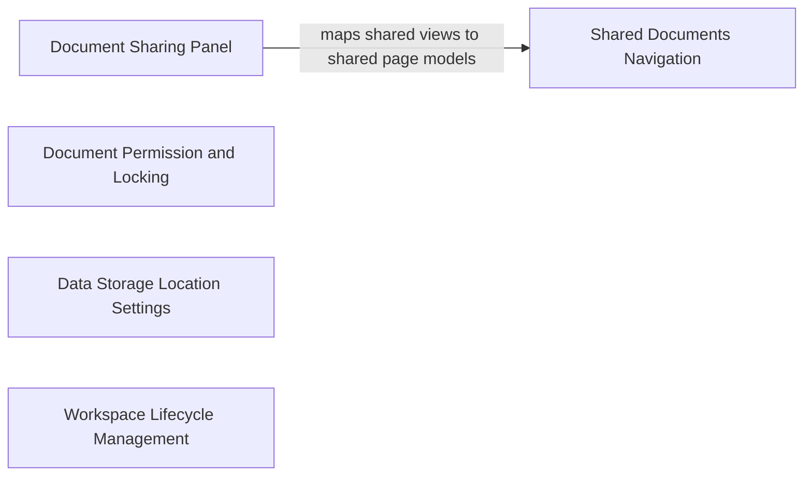

## Details

Coordinates collaboration features including page access levels, link sharing, shared workspace sections, and data storage locations.

### Document Sharing Panel [[Expand]](./Document_Sharing_Panel.md)
Provides user interfaces, state management, and repositories for inviting collaborators, managing page permissions, and generating share links.

**Related Classes/Methods**:

- `frontend.appflowy_flutter.lib.features.share_tab.logic.share_tab_bloc.ShareTabBloc`:19-420
- `frontend.appflowy_flutter.lib.features.share_tab.data.repositories.share_with_user_repository.ShareWithUserRepository`:10-60
- `frontend.appflowy_flutter.lib.features.share_tab.presentation.share_tab.ShareTab`:20-43

**Source Files:**

- `frontend/appflowy_flutter/lib/features/share_tab/data/models/share_access_level.dart`
  - `frontend.appflowy_flutter.lib.features.share_tab.data.models.share_access_level.ShareAccessLevel` (L6-L57) - Enum
  - `frontend.appflowy_flutter.lib.features.share_tab.data.models.share_access_level.ShareAccessLevel.readOnly` (L8-L8) - Enum
  - `frontend.appflowy_flutter.lib.features.share_tab.data.models.share_access_level.ShareAccessLevel.readAndComment` (L11-L11) - Enum
  - `frontend.appflowy_flutter.lib.features.share_tab.data.models.share_access_level.ShareAccessLevel.readAndWrite` (L14-L14) - Enum
  - `frontend.appflowy_flutter.lib.features.share_tab.data.models.share_access_level.ShareAccessLevel.fullAccess` (L17-L17) - Enum
  - `frontend.appflowy_flutter.lib.features.share_tab.data.models.share_access_level.ShareAccessLevel.title` (L19-L30) - Method
  - `frontend.appflowy_flutter.lib.features.share_tab.data.models.share_access_level.ShareAccessLevel.subtitle` (L32-L43) - Method
  - `frontend.appflowy_flutter.lib.features.share_tab.data.models.share_access_level.ShareAccessLevel.icon` (L45-L56) - Method
- `frontend/appflowy_flutter/lib/features/share_tab/data/models/share_popover_group_id.dart`
  - `frontend.appflowy_flutter.lib.features.share_tab.data.models.share_popover_group_id.SharePopoverGroupId` (L1-L1) - Class
- `frontend/appflowy_flutter/lib/features/share_tab/data/models/share_role.dart`
  - `frontend.appflowy_flutter.lib.features.share_tab.data.models.share_role.ShareRole` (L1-L10) - Enum
  - `frontend.appflowy_flutter.lib.features.share_tab.data.models.share_role.ShareRole.owner` (L3-L3) - Enum
  - `frontend.appflowy_flutter.lib.features.share_tab.data.models.share_role.ShareRole.guest` (L6-L6) - Enum
  - `frontend.appflowy_flutter.lib.features.share_tab.data.models.share_role.ShareRole.member` (L9-L9) - Enum
- `frontend/appflowy_flutter/lib/features/share_tab/data/models/share_section_type.dart`
  - `frontend.appflowy_flutter.lib.features.share_tab.data.models.share_section_type.SharedSectionType` (L6-L11) - Enum
  - `frontend.appflowy_flutter.lib.features.share_tab.data.models.share_section_type.SharedSectionType.unknown` (L7-L7) - Enum
  - `frontend.appflowy_flutter.lib.features.share_tab.data.models.share_section_type.SharedSectionType.public` (L8-L8) - Enum
  - `frontend.appflowy_flutter.lib.features.share_tab.data.models.share_section_type.SharedSectionType.shared` (L9-L9) - Enum
  - `frontend.appflowy_flutter.lib.features.share_tab.data.models.share_section_type.SharedSectionType.private` (L10-L10) - Enum
- `frontend/appflowy_flutter/lib/features/share_tab/data/models/shared_group.dart`
  - `frontend.appflowy_flutter.lib.features.share_tab.data.models.shared_group.SharedGroup` (L1-L25) - Class
  - `frontend.appflowy_flutter.lib.features.share_tab.data.models.shared_group.SharedGroup.SharedGroup` (L2-L6) - Constructor
  - `frontend.appflowy_flutter.lib.features.share_tab.data.models.shared_group.SharedGroup.copyWith` (L14-L24) - Method
- `frontend/appflowy_flutter/lib/features/share_tab/data/models/shared_user.dart`
  - `frontend.appflowy_flutter.lib.features.share_tab.data.models.shared_user.SharedUser` (L7-L47) - Class
  - `frontend.appflowy_flutter.lib.features.share_tab.data.models.shared_user.SharedUser.SharedUser` (L8-L14) - Constructor
  - `frontend.appflowy_flutter.lib.features.share_tab.data.models.shared_user.SharedUser.copyWith` (L32-L46) - Method
- `frontend/appflowy_flutter/lib/features/share_tab/data/repositories/local_share_with_user_repository_impl.dart`
  - `frontend.appflowy_flutter.lib.features.share_tab.data.repositories.local_share_with_user_repository_impl.LocalShareWithUserRepositoryImpl` (L11-L198) - Class
  - `frontend.appflowy_flutter.lib.features.share_tab.data.repositories.local_share_with_user_repository_impl.LocalShareWithUserRepositoryImpl.LocalShareWithUserRepositoryImpl` (L12-L12) - Constructor
  - `frontend.appflowy_flutter.lib.features.share_tab.data.repositories.local_share_with_user_repository_impl.LocalShareWithUserRepositoryImpl.getSharedUsersInPage` (L90-L94) - Method
  - `frontend.appflowy_flutter.lib.features.share_tab.data.repositories.local_share_with_user_repository_impl.LocalShareWithUserRepositoryImpl.removeSharedUserFromPage` (L97-L106) - Method
  - `frontend.appflowy_flutter.lib.features.share_tab.data.repositories.local_share_with_user_repository_impl.LocalShareWithUserRepositoryImpl.sharePageWithUser` (L109-L142) - Method
  - `frontend.appflowy_flutter.lib.features.share_tab.data.repositories.local_share_with_user_repository_impl.LocalShareWithUserRepositoryImpl.getAvailableSharedUsers` (L145-L152) - Method
  - `frontend.appflowy_flutter.lib.features.share_tab.data.repositories.local_share_with_user_repository_impl.LocalShareWithUserRepositoryImpl.changeRole` (L155-L166) - Method
  - `frontend.appflowy_flutter.lib.features.share_tab.data.repositories.local_share_with_user_repository_impl.LocalShareWithUserRepositoryImpl.getCurrentUserProfile` (L169-L176) - Method
  - `frontend.appflowy_flutter.lib.features.share_tab.data.repositories.local_share_with_user_repository_impl.LocalShareWithUserRepositoryImpl.getCurrentPageSectionType` (L179-L183) - Method
  - `frontend.appflowy_flutter.lib.features.share_tab.data.repositories.local_share_with_user_repository_impl.LocalShareWithUserRepositoryImpl.getUpgradeToProButtonClicked` (L186-L190) - Method
  - `frontend.appflowy_flutter.lib.features.share_tab.data.repositories.local_share_with_user_repository_impl.LocalShareWithUserRepositoryImpl.setUpgradeToProButtonClicked` (L193-L197) - Method
- `frontend/appflowy_flutter/lib/features/share_tab/data/repositories/rust_share_with_user_repository_impl.dart`
  - `frontend.appflowy_flutter.lib.features.share_tab.data.repositories.rust_share_with_user_repository_impl.RustShareWithUserRepositoryImpl` (L19-L191) - Class
  - `frontend.appflowy_flutter.lib.features.share_tab.data.repositories.rust_share_with_user_repository_impl.RustShareWithUserRepositoryImpl.RustShareWithUserRepositoryImpl` (L20-L20) - Constructor
  - `frontend.appflowy_flutter.lib.features.share_tab.data.repositories.rust_share_with_user_repository_impl.RustShareWithUserRepositoryImpl.getSharedUsersInPage` (L23-L43) - Method
  - `frontend.appflowy_flutter.lib.features.share_tab.data.repositories.rust_share_with_user_repository_impl.RustShareWithUserRepositoryImpl.removeSharedUserFromPage` (L46-L68) - Method
  - `frontend.appflowy_flutter.lib.features.share_tab.data.repositories.rust_share_with_user_repository_impl.RustShareWithUserRepositoryImpl.sharePageWithUser` (L71-L100) - Method
  - `frontend.appflowy_flutter.lib.features.share_tab.data.repositories.rust_share_with_user_repository_impl.RustShareWithUserRepositoryImpl.getAvailableSharedUsers` (L103-L107) - Method
  - `frontend.appflowy_flutter.lib.features.share_tab.data.repositories.rust_share_with_user_repository_impl.RustShareWithUserRepositoryImpl.changeRole` (L110-L136) - Method
  - `frontend.appflowy_flutter.lib.features.share_tab.data.repositories.rust_share_with_user_repository_impl.RustShareWithUserRepositoryImpl.getCurrentUserProfile` (L139-L142) - Method
  - `frontend.appflowy_flutter.lib.features.share_tab.data.repositories.rust_share_with_user_repository_impl.RustShareWithUserRepositoryImpl.getCurrentPageSectionType` (L145-L166) - Method
  - `frontend.appflowy_flutter.lib.features.share_tab.data.repositories.rust_share_with_user_repository_impl.RustShareWithUserRepositoryImpl.getUpgradeToProButtonClicked` (L169-L180) - Method
  - `frontend.appflowy_flutter.lib.features.share_tab.data.repositories.rust_share_with_user_repository_impl.RustShareWithUserRepositoryImpl.setUpgradeToProButtonClicked` (L183-L190) - Method
- `frontend/appflowy_flutter/lib/features/share_tab/data/repositories/share_with_user_repository.dart`
  - `frontend.appflowy_flutter.lib.features.share_tab.data.repositories.share_with_user_repository.ShareWithUserRepository` (L10-L60) - Class
  - `frontend.appflowy_flutter.lib.features.share_tab.data.repositories.share_with_user_repository.ShareWithUserRepository.getSharedUsersInPage` (L12-L14) - Method
  - `frontend.appflowy_flutter.lib.features.share_tab.data.repositories.share_with_user_repository.ShareWithUserRepository.getAvailableSharedUsers` (L17-L19) - Method
  - `frontend.appflowy_flutter.lib.features.share_tab.data.repositories.share_with_user_repository.ShareWithUserRepository.removeSharedUserFromPage` (L22-L25) - Method
  - `frontend.appflowy_flutter.lib.features.share_tab.data.repositories.share_with_user_repository.ShareWithUserRepository.sharePageWithUser` (L30-L34) - Method
  - `frontend.appflowy_flutter.lib.features.share_tab.data.repositories.share_with_user_repository.ShareWithUserRepository.changeRole` (L37-L41) - Method
  - `frontend.appflowy_flutter.lib.features.share_tab.data.repositories.share_with_user_repository.ShareWithUserRepository.getCurrentUserProfile` (L44-L44) - Method
  - `frontend.appflowy_flutter.lib.features.share_tab.data.repositories.share_with_user_repository.ShareWithUserRepository.getCurrentPageSectionType` (L47-L49) - Method
  - `frontend.appflowy_flutter.lib.features.share_tab.data.repositories.share_with_user_repository.ShareWithUserRepository.getUpgradeToProButtonClicked` (L52-L54) - Method
  - `frontend.appflowy_flutter.lib.features.share_tab.data.repositories.share_with_user_repository.ShareWithUserRepository.setUpgradeToProButtonClicked` (L57-L59) - Method
- `frontend/appflowy_flutter/lib/features/share_tab/logic/share_tab_bloc.dart`
  - `frontend.appflowy_flutter.lib.features.share_tab.logic.share_tab_bloc.ShareTabBloc` (L19-L420) - Class
  - `frontend.appflowy_flutter.lib.features.share_tab.logic.share_tab_bloc.ShareTabBloc.ShareTabBloc` (L20-L37) - Constructor
  - `frontend.appflowy_flutter.lib.features.share_tab.logic.share_tab_bloc.ShareTabBloc.close` (L47-L50) - Method
  - `frontend.appflowy_flutter.lib.features.share_tab.logic.share_tab_bloc.ShareTabBloc._onInitial` (L52-L104) - Method
  - `frontend.appflowy_flutter.lib.features.share_tab.logic.share_tab_bloc.ShareTabBloc._onGetSharedUsers` (L106-L138) - Method
  - `frontend.appflowy_flutter.lib.features.share_tab.logic.share_tab_bloc.ShareTabBloc._onShare` (L140-L176) - Method
  - `frontend.appflowy_flutter.lib.features.share_tab.logic.share_tab_bloc.ShareTabBloc._onRemove` (L178-L212) - Method
  - `frontend.appflowy_flutter.lib.features.share_tab.logic.share_tab_bloc.ShareTabBloc._onUpdateAccessLevel` (L214-L247) - Method
  - `frontend.appflowy_flutter.lib.features.share_tab.logic.share_tab_bloc.ShareTabBloc._onUpdateGeneralAccess` (L249-L258) - Method
  - `frontend.appflowy_flutter.lib.features.share_tab.logic.share_tab_bloc.ShareTabBloc._onCopyLink` (L260-L275) - Method
  - `frontend.appflowy_flutter.lib.features.share_tab.logic.share_tab_bloc.ShareTabBloc._onSearchAvailableUsers` (L277-L310) - Method
  - `frontend.appflowy_flutter.lib.features.share_tab.logic.share_tab_bloc.ShareTabBloc._onTurnIntoMember` (L312-L347) - Method
  - `frontend.appflowy_flutter.lib.features.share_tab.logic.share_tab_bloc.ShareTabBloc._getSharedUsers` (L349-L357) - Method
  - `frontend.appflowy_flutter.lib.features.share_tab.logic.share_tab_bloc.ShareTabBloc._onClearState` (L359-L368) - Method
  - `frontend.appflowy_flutter.lib.features.share_tab.logic.share_tab_bloc.ShareTabBloc._onUpdateSharedUsers` (L370-L379) - Method
  - `frontend.appflowy_flutter.lib.features.share_tab.logic.share_tab_bloc.ShareTabBloc._onUpgradeToProClicked` (L381-L393) - Method
  - `frontend.appflowy_flutter.lib.features.share_tab.logic.share_tab_bloc.ShareTabBloc._initFolderNotificationListener` (L395-L419) - Method
- `frontend/appflowy_flutter/lib/features/share_tab/logic/share_tab_event.dart`
  - `frontend.appflowy_flutter.lib.features.share_tab.logic.share_tab_event.ShareTabEvent` (L3-L61) - Class
  - `frontend.appflowy_flutter.lib.features.share_tab.logic.share_tab_event.ShareTabEvent.ShareTabEvent` (L4-L4) - Constructor
  - `frontend.appflowy_flutter.lib.features.share_tab.logic.share_tab_event.ShareTabEvent.ShareTabEvent.initialize` (L7-L7) - Constructor
  - `frontend.appflowy_flutter.lib.features.share_tab.logic.share_tab_event.ShareTabEvent.ShareTabEvent.loadSharedUsers` (L9-L10) - Constructor
  - `frontend.appflowy_flutter.lib.features.share_tab.logic.share_tab_event.ShareTabEvent.ShareTabEvent.inviteUsers` (L12-L16) - Constructor
  - `frontend.appflowy_flutter.lib.features.share_tab.logic.share_tab_event.ShareTabEvent.ShareTabEvent.removeUsers` (L18-L21) - Constructor
  - `frontend.appflowy_flutter.lib.features.share_tab.logic.share_tab_event.ShareTabEvent.ShareTabEvent.updateUserAccessLevel` (L23-L30) - Constructor
  - `frontend.appflowy_flutter.lib.features.share_tab.logic.share_tab_event.ShareTabEvent.ShareTabEvent.updateGeneralAccessLevel` (L32-L35) - Constructor
  - `frontend.appflowy_flutter.lib.features.share_tab.logic.share_tab_event.ShareTabEvent.ShareTabEvent.copyShareLink` (L37-L40) - Constructor
  - `frontend.appflowy_flutter.lib.features.share_tab.logic.share_tab_event.ShareTabEvent.ShareTabEvent.searchAvailableUsers` (L42-L45) - Constructor
  - `frontend.appflowy_flutter.lib.features.share_tab.logic.share_tab_event.ShareTabEvent.ShareTabEvent.convertToMember` (L47-L50) - Constructor
  - `frontend.appflowy_flutter.lib.features.share_tab.logic.share_tab_event.ShareTabEvent.ShareTabEvent.clearState` (L52-L52) - Constructor
  - `frontend.appflowy_flutter.lib.features.share_tab.logic.share_tab_event.ShareTabEvent.ShareTabEvent.updateSharedUsers` (L54-L57) - Constructor
  - `frontend.appflowy_flutter.lib.features.share_tab.logic.share_tab_event.ShareTabEvent.ShareTabEvent.upgradeToProClicked` (L59-L60) - Constructor
  - `frontend.appflowy_flutter.lib.features.share_tab.logic.share_tab_event.ShareTabEventInitialize` (L64-L66) - Class
  - `frontend.appflowy_flutter.lib.features.share_tab.logic.share_tab_event.ShareTabEventInitialize.ShareTabEventInitialize` (L65-L65) - Constructor
  - `frontend.appflowy_flutter.lib.features.share_tab.logic.share_tab_event.ShareTabEventLoadSharedUsers` (L69-L71) - Class
  - `frontend.appflowy_flutter.lib.features.share_tab.logic.share_tab_event.ShareTabEventLoadSharedUsers.ShareTabEventLoadSharedUsers` (L70-L70) - Constructor
  - `frontend.appflowy_flutter.lib.features.share_tab.logic.share_tab_event.ShareTabEventInviteUsers` (L74-L82) - Class
  - `frontend.appflowy_flutter.lib.features.share_tab.logic.share_tab_event.ShareTabEventInviteUsers.ShareTabEventInviteUsers` (L75-L78) - Constructor
  - `frontend.appflowy_flutter.lib.features.share_tab.logic.share_tab_event.ShareTabEventRemoveUsers` (L85-L91) - Class
  - `frontend.appflowy_flutter.lib.features.share_tab.logic.share_tab_event.ShareTabEventRemoveUsers.ShareTabEventRemoveUsers` (L86-L88) - Constructor
  - `frontend.appflowy_flutter.lib.features.share_tab.logic.share_tab_event.ShareTabEventUpdateUserAccessLevel` (L94-L102) - Class
  - `frontend.appflowy_flutter.lib.features.share_tab.logic.share_tab_event.ShareTabEventUpdateUserAccessLevel.ShareTabEventUpdateUserAccessLevel` (L95-L98) - Constructor
  - `frontend.appflowy_flutter.lib.features.share_tab.logic.share_tab_event.ShareTabEventUpdateGeneralAccessLevel` (L105-L111) - Class
  - `frontend.appflowy_flutter.lib.features.share_tab.logic.share_tab_event.ShareTabEventUpdateGeneralAccessLevel.ShareTabEventUpdateGeneralAccessLevel` (L106-L108) - Constructor
  - `frontend.appflowy_flutter.lib.features.share_tab.logic.share_tab_event.ShareTabEventCopyShareLink` (L114-L120) - Class
  - `frontend.appflowy_flutter.lib.features.share_tab.logic.share_tab_event.ShareTabEventCopyShareLink.ShareTabEventCopyShareLink` (L115-L117) - Constructor
  - `frontend.appflowy_flutter.lib.features.share_tab.logic.share_tab_event.ShareTabEventSearchAvailableUsers` (L123-L129) - Class
  - `frontend.appflowy_flutter.lib.features.share_tab.logic.share_tab_event.ShareTabEventSearchAvailableUsers.ShareTabEventSearchAvailableUsers` (L124-L126) - Constructor
  - `frontend.appflowy_flutter.lib.features.share_tab.logic.share_tab_event.ShareTabEventConvertToMember` (L132-L138) - Class
  - `frontend.appflowy_flutter.lib.features.share_tab.logic.share_tab_event.ShareTabEventConvertToMember.ShareTabEventConvertToMember` (L133-L135) - Constructor
  - `frontend.appflowy_flutter.lib.features.share_tab.logic.share_tab_event.ShareTabEventClearState` (L140-L142) - Class
  - `frontend.appflowy_flutter.lib.features.share_tab.logic.share_tab_event.ShareTabEventClearState.ShareTabEventClearState` (L141-L141) - Constructor
  - `frontend.appflowy_flutter.lib.features.share_tab.logic.share_tab_event.ShareTabEventUpdateSharedUsers` (L144-L150) - Class
  - `frontend.appflowy_flutter.lib.features.share_tab.logic.share_tab_event.ShareTabEventUpdateSharedUsers.ShareTabEventUpdateSharedUsers` (L145-L147) - Constructor
  - `frontend.appflowy_flutter.lib.features.share_tab.logic.share_tab_event.ShareTabEventUpgradeToProClicked` (L152-L154) - Class
  - `frontend.appflowy_flutter.lib.features.share_tab.logic.share_tab_event.ShareTabEventUpgradeToProClicked.ShareTabEventUpgradeToProClicked` (L153-L153) - Constructor
- `frontend/appflowy_flutter/lib/features/share_tab/logic/share_tab_state.dart`
  - `frontend.appflowy_flutter.lib.features.share_tab.logic.share_tab_state.ShareTabState` (L6-L126) - Class
  - `frontend.appflowy_flutter.lib.features.share_tab.logic.share_tab_state.ShareTabState.ShareTabState.initial` (L7-L7) - Constructor
  - `frontend.appflowy_flutter.lib.features.share_tab.logic.share_tab_state.ShareTabState.ShareTabState` (L9-L25) - Constructor
  - `frontend.appflowy_flutter.lib.features.share_tab.logic.share_tab_state.ShareTabState.copyWith` (L43-L78) - Method
  - `frontend.appflowy_flutter.lib.features.share_tab.logic.share_tab_state.ShareTabState.==` (L81-L99) - Method
  - `frontend.appflowy_flutter.lib.features.share_tab.logic.share_tab_state.ShareTabState.hashCode` (L102-L120) - Method
  - `frontend.appflowy_flutter.lib.features.share_tab.logic.share_tab_state.ShareTabState.toString` (L123-L125) - Method
- `frontend/appflowy_flutter/lib/features/share_tab/presentation/share_tab.dart`
  - `frontend.appflowy_flutter.lib.features.share_tab.presentation.share_tab.ShareTab` (L20-L43) - Class
  - `frontend.appflowy_flutter.lib.features.share_tab.presentation.share_tab.ShareTab.ShareTab` (L21-L29) - Constructor
  - `frontend.appflowy_flutter.lib.features.share_tab.presentation.share_tab.ShareTab.createState` (L42-L42) - Method
  - `frontend.appflowy_flutter.lib.features.share_tab.presentation.share_tab._ShareTabState` (L45-L282) - Class
  - `frontend.appflowy_flutter.lib.features.share_tab.presentation.share_tab._ShareTabState.initState` (L50-L54) - Method
  - `frontend.appflowy_flutter.lib.features.share_tab.presentation.share_tab._ShareTabState.dispose` (L57-L62) - Method
  - `frontend.appflowy_flutter.lib.features.share_tab.presentation.share_tab._ShareTabState.build` (L65-L145) - Method
  - `frontend.appflowy_flutter.lib.features.share_tab.presentation.share_tab._ShareTabState._onSharePageWithUser` (L147-L155) - Method
  - `frontend.appflowy_flutter.lib.features.share_tab.presentation.share_tab._ShareTabState._buildPeopleWithAccessSectionCallbacks` (L157-L203) - Method
  - `frontend.appflowy_flutter.lib.features.share_tab.presentation.share_tab._ShareTabState._onListenShareWithUserState` (L205-L281) - Method
- `frontend/appflowy_flutter/lib/features/share_tab/presentation/widgets/access_level_list_widget.dart`
  - `frontend.appflowy_flutter.lib.features.share_tab.presentation.widgets.access_level_list_widget.AccessLevelListCallbacks` (L8-L44) - Class
  - `frontend.appflowy_flutter.lib.features.share_tab.presentation.widgets.access_level_list_widget.AccessLevelListCallbacks.AccessLevelListCallbacks` (L9-L13) - Constructor
  - `frontend.appflowy_flutter.lib.features.share_tab.presentation.widgets.access_level_list_widget.AccessLevelListCallbacks.AccessLevelListCallbacks.none` (L15-L21) - Constructor
  - `frontend.appflowy_flutter.lib.features.share_tab.presentation.widgets.access_level_list_widget.AccessLevelListCallbacks.copyWith` (L33-L43) - Method
  - `frontend.appflowy_flutter.lib.features.share_tab.presentation.widgets.access_level_list_widget.AdditionalUserManagementOptions` (L46-L49) - Enum
  - `frontend.appflowy_flutter.lib.features.share_tab.presentation.widgets.access_level_list_widget.AdditionalUserManagementOptions.turnIntoMember` (L47-L47) - Enum
  - `frontend.appflowy_flutter.lib.features.share_tab.presentation.widgets.access_level_list_widget.AdditionalUserManagementOptions.removeAccess` (L48-L48) - Enum
  - `frontend.appflowy_flutter.lib.features.share_tab.presentation.widgets.access_level_list_widget.AccessLevelListWidget` (L55-L136) - Class
  - `frontend.appflowy_flutter.lib.features.share_tab.presentation.widgets.access_level_list_widget.AccessLevelListWidget.AccessLevelListWidget` (L56-L62) - Constructor
  - `frontend.appflowy_flutter.lib.features.share_tab.presentation.widgets.access_level_list_widget.AccessLevelListWidget.build` (L77-L110) - Method
  - `frontend.appflowy_flutter.lib.features.share_tab.presentation.widgets.access_level_list_widget.AccessLevelListWidget._buildAccessLevelItem` (L112-L135) - Method
- `frontend/appflowy_flutter/lib/features/share_tab/presentation/widgets/copy_link_widget.dart`
  - `frontend.appflowy_flutter.lib.features.share_tab.presentation.widgets.copy_link_widget.CopyLinkWidget` (L12-L85) - Class
  - `frontend.appflowy_flutter.lib.features.share_tab.presentation.widgets.copy_link_widget.CopyLinkWidget.CopyLinkWidget` (L13-L16) - Constructor
  - `frontend.appflowy_flutter.lib.features.share_tab.presentation.widgets.copy_link_widget.CopyLinkWidget.build` (L21-L84) - Method
- `frontend/appflowy_flutter/lib/features/share_tab/presentation/widgets/edit_access_level_widget.dart`
  - `frontend.appflowy_flutter.lib.features.share_tab.presentation.widgets.edit_access_level_widget.EditAccessLevelWidget` (L8-L35) - Class
  - `frontend.appflowy_flutter.lib.features.share_tab.presentation.widgets.edit_access_level_widget.EditAccessLevelWidget.EditAccessLevelWidget` (L9-L16) - Constructor
  - `frontend.appflowy_flutter.lib.features.share_tab.presentation.widgets.edit_access_level_widget.EditAccessLevelWidget.createState` (L34-L34) - Method
  - `frontend.appflowy_flutter.lib.features.share_tab.presentation.widgets.edit_access_level_widget._EditAccessLevelWidgetState` (L37-L106) - Class
  - `frontend.appflowy_flutter.lib.features.share_tab.presentation.widgets.edit_access_level_widget._EditAccessLevelWidgetState.dispose` (L41-L45) - Method
  - `frontend.appflowy_flutter.lib.features.share_tab.presentation.widgets.edit_access_level_widget._EditAccessLevelWidgetState.build` (L48-L105) - Method
- `frontend/appflowy_flutter/lib/features/share_tab/presentation/widgets/general_access_section.dart`
  - `frontend.appflowy_flutter.lib.features.share_tab.presentation.widgets.general_access_section.GeneralAccessSection` (L8-L32) - Class
  - `frontend.appflowy_flutter.lib.features.share_tab.presentation.widgets.general_access_section.GeneralAccessSection.GeneralAccessSection` (L9-L12) - Constructor
  - `frontend.appflowy_flutter.lib.features.share_tab.presentation.widgets.general_access_section.GeneralAccessSection.build` (L17-L31) - Method
- `frontend/appflowy_flutter/lib/features/share_tab/presentation/widgets/guest_tag.dart`
  - `frontend.appflowy_flutter.lib.features.share_tab.presentation.widgets.guest_tag.GuestTag` (L6-L34) - Class
  - `frontend.appflowy_flutter.lib.features.share_tab.presentation.widgets.guest_tag.GuestTag.GuestTag` (L7-L7) - Constructor
  - `frontend.appflowy_flutter.lib.features.share_tab.presentation.widgets.guest_tag.GuestTag.build` (L10-L33) - Method
- `frontend/appflowy_flutter/lib/features/share_tab/presentation/widgets/people_with_access_section.dart`
  - `frontend.appflowy_flutter.lib.features.share_tab.presentation.widgets.people_with_access_section.PeopleWithAccessSectionCallbacks` (L8-L32) - Class
  - `frontend.appflowy_flutter.lib.features.share_tab.presentation.widgets.people_with_access_section.PeopleWithAccessSectionCallbacks.PeopleWithAccessSectionCallbacks` (L9-L13) - Constructor
  - `frontend.appflowy_flutter.lib.features.share_tab.presentation.widgets.people_with_access_section.PeopleWithAccessSectionCallbacks.PeopleWithAccessSectionCallbacks.none` (L15-L21) - Constructor
  - `frontend.appflowy_flutter.lib.features.share_tab.presentation.widgets.people_with_access_section.PeopleWithAccessSection` (L34-L83) - Class
  - `frontend.appflowy_flutter.lib.features.share_tab.presentation.widgets.people_with_access_section.PeopleWithAccessSection.PeopleWithAccessSection` (L35-L41) - Constructor
  - `frontend.appflowy_flutter.lib.features.share_tab.presentation.widgets.people_with_access_section.PeopleWithAccessSection.build` (L49-L82) - Method
- `frontend/appflowy_flutter/lib/features/share_tab/presentation/widgets/share_with_user_widget.dart`
  - `frontend.appflowy_flutter.lib.features.share_tab.presentation.widgets.share_with_user_widget.ShareWithUserWidget` (L9-L25) - Class
  - `frontend.appflowy_flutter.lib.features.share_tab.presentation.widgets.share_with_user_widget.ShareWithUserWidget.ShareWithUserWidget` (L10-L16) - Constructor
  - `frontend.appflowy_flutter.lib.features.share_tab.presentation.widgets.share_with_user_widget.ShareWithUserWidget.createState` (L24-L24) - Method
  - `frontend.appflowy_flutter.lib.features.share_tab.presentation.widgets.share_with_user_widget._ShareWithUserWidgetState` (L27-L91) - Class
  - `frontend.appflowy_flutter.lib.features.share_tab.presentation.widgets.share_with_user_widget._ShareWithUserWidgetState.initState` (L32-L37) - Method
  - `frontend.appflowy_flutter.lib.features.share_tab.presentation.widgets.share_with_user_widget._ShareWithUserWidgetState.dispose` (L40-L46) - Method
  - `frontend.appflowy_flutter.lib.features.share_tab.presentation.widgets.share_with_user_widget._ShareWithUserWidgetState.build` (L49-L83) - Method
  - `frontend.appflowy_flutter.lib.features.share_tab.presentation.widgets.share_with_user_widget._ShareWithUserWidgetState._onTextChanged` (L85-L90) - Method
- `frontend/appflowy_flutter/lib/features/share_tab/presentation/widgets/shared_group_widget.dart`
  - `frontend.appflowy_flutter.lib.features.share_tab.presentation.widgets.shared_group_widget.SharedGroupWidget` (L11-L97) - Class
  - `frontend.appflowy_flutter.lib.features.share_tab.presentation.widgets.shared_group_widget.SharedGroupWidget.SharedGroupWidget` (L12-L15) - Constructor
  - `frontend.appflowy_flutter.lib.features.share_tab.presentation.widgets.shared_group_widget.SharedGroupWidget.build` (L20-L34) - Method
  - `frontend.appflowy_flutter.lib.features.share_tab.presentation.widgets.shared_group_widget.SharedGroupWidget._buildLeading` (L36-L49) - Method
  - `frontend.appflowy_flutter.lib.features.share_tab.presentation.widgets.shared_group_widget.SharedGroupWidget._buildTitle` (L51-L75) - Method
  - `frontend.appflowy_flutter.lib.features.share_tab.presentation.widgets.shared_group_widget.SharedGroupWidget._buildSubtitle` (L77-L86) - Method
  - `frontend.appflowy_flutter.lib.features.share_tab.presentation.widgets.shared_group_widget.SharedGroupWidget._buildTrailing` (L88-L96) - Method
- `frontend/appflowy_flutter/lib/features/share_tab/presentation/widgets/shared_user_widget.dart`
  - `frontend.appflowy_flutter.lib.features.share_tab.presentation.widgets.shared_user_widget.SharedUserWidget` (L13-L171) - Class
  - `frontend.appflowy_flutter.lib.features.share_tab.presentation.widgets.shared_user_widget.SharedUserWidget.SharedUserWidget` (L14-L20) - Constructor
  - `frontend.appflowy_flutter.lib.features.share_tab.presentation.widgets.shared_user_widget.SharedUserWidget.build` (L28-L47) - Method
  - `frontend.appflowy_flutter.lib.features.share_tab.presentation.widgets.shared_user_widget.SharedUserWidget._buildTitle` (L49-L87) - Method
  - `frontend.appflowy_flutter.lib.features.share_tab.presentation.widgets.shared_user_widget.SharedUserWidget._buildSubtitle` (L89-L99) - Method
  - `frontend.appflowy_flutter.lib.features.share_tab.presentation.widgets.shared_user_widget.SharedUserWidget._buildTrailing` (L101-L170) - Method
  - `frontend.appflowy_flutter.lib.features.share_tab.presentation.widgets.shared_user_widget.SharedUserWidget._buildTrailing.disabledAccessButton` (L106-L111) - Function
  - `frontend.appflowy_flutter.lib.features.share_tab.presentation.widgets.shared_user_widget.SharedUserWidget._buildTrailing.editAccessWidget` (L113-L121) - Function
- `frontend/appflowy_flutter/lib/features/share_tab/presentation/widgets/turn_into_member_widget.dart`
  - `frontend.appflowy_flutter.lib.features.share_tab.presentation.widgets.turn_into_member_widget.TurnIntoMemberWidget` (L8-L30) - Class
  - `frontend.appflowy_flutter.lib.features.share_tab.presentation.widgets.turn_into_member_widget.TurnIntoMemberWidget.TurnIntoMemberWidget` (L9-L12) - Constructor
  - `frontend.appflowy_flutter.lib.features.share_tab.presentation.widgets.turn_into_member_widget.TurnIntoMemberWidget.build` (L17-L29) - Method
- `frontend/appflowy_flutter/lib/features/share_tab/presentation/widgets/upgrade_to_pro_widget.dart`
  - `frontend.appflowy_flutter.lib.features.share_tab.presentation.widgets.upgrade_to_pro_widget.UpgradeToProWidget` (L11-L88) - Class
  - `frontend.appflowy_flutter.lib.features.share_tab.presentation.widgets.upgrade_to_pro_widget.UpgradeToProWidget.UpgradeToProWidget` (L12-L16) - Constructor
  - `frontend.appflowy_flutter.lib.features.share_tab.presentation.widgets.upgrade_to_pro_widget.UpgradeToProWidget.build` (L22-L87) - Method
- `frontend/appflowy_flutter/lib/features/util/extensions.dart`
  - `frontend.appflowy_flutter.lib.features.util.extensions.RepeatedSharedViewResponsePBExtension.sharedPages` (L10-L12) - Method
  - `frontend.appflowy_flutter.lib.features.util.extensions.SharedViewPBExtension.sharedPage` (L16-L21) - Method
  - `frontend.appflowy_flutter.lib.features.util.extensions.RepeatedSharedUserPBExtension.sharedUsers` (L25-L27) - Method
  - `frontend.appflowy_flutter.lib.features.util.extensions.SharedUserPBExtension.sharedUser` (L31-L39) - Method
  - `frontend.appflowy_flutter.lib.features.util.extensions.AFAccessLevelPBExtension.shareAccessLevel` (L43-L56) - Method
  - `frontend.appflowy_flutter.lib.features.util.extensions.ShareAccessLevelExtension.accessLevel` (L60-L71) - Method
  - `frontend.appflowy_flutter.lib.features.util.extensions.AFRolePBExtension.shareRole` (L75-L86) - Method
  - `frontend.appflowy_flutter.lib.features.util.extensions.ShareRoleExtension.userRole` (L90-L99) - Method
  - `frontend.appflowy_flutter.lib.features.util.extensions.ShareRoleExtension.folderRole` (L101-L110) - Method
  - `frontend.appflowy_flutter.lib.features.util.extensions.SharedSectionTypeExtension.sharedSectionType` (L114-L125) - Method

### Shared Documents Navigation [[Expand]](./Shared_Documents_Navigation.md)
Manages and renders the collection of pages shared with the current user across desktop and mobile navigation sidebars.

**Related Classes/Methods**:

- `frontend.appflowy_flutter.lib.features.shared_section.logic.shared_section_bloc.SharedSectionBloc`:16-195
- `frontend.appflowy_flutter.lib.features.shared_section.data.repositories.shared_pages_repository.SharedPagesRepository`:9-15
- `frontend.appflowy_flutter.lib.features.shared_section.models.shared_page.SharedPage`:6-14
- `frontend.appflowy_flutter.lib.features.shared_section.presentation.shared_section.SharedSection`:26-159

**Source Files:**

- `frontend/appflowy_flutter/lib/features/shared_section/data/repositories/local_shared_pages_repository_impl.dart`
  - `frontend.appflowy_flutter.lib.features.shared_section.data.repositories.local_shared_pages_repository_impl.LocalSharedPagesRepositoryImpl` (L9-L39) - Class
  - `frontend.appflowy_flutter.lib.features.shared_section.data.repositories.local_shared_pages_repository_impl.LocalSharedPagesRepositoryImpl.getSharedPages` (L11-L33) - Method
  - `frontend.appflowy_flutter.lib.features.shared_section.data.repositories.local_shared_pages_repository_impl.LocalSharedPagesRepositoryImpl.leaveSharedPage` (L36-L38) - Method
- `frontend/appflowy_flutter/lib/features/shared_section/data/repositories/rust_shared_pages_repository_impl.dart`
  - `frontend.appflowy_flutter.lib.features.shared_section.data.repositories.rust_shared_pages_repository_impl.RustSharePagesRepositoryImpl` (L10-L63) - Class
  - `frontend.appflowy_flutter.lib.features.shared_section.data.repositories.rust_shared_pages_repository_impl.RustSharePagesRepositoryImpl.getSharedPages` (L12-L28) - Method
  - `frontend.appflowy_flutter.lib.features.shared_section.data.repositories.rust_shared_pages_repository_impl.RustSharePagesRepositoryImpl.leaveSharedPage` (L31-L62) - Method
- `frontend/appflowy_flutter/lib/features/shared_section/data/repositories/shared_pages_repository.dart`
  - `frontend.appflowy_flutter.lib.features.shared_section.data.repositories.shared_pages_repository.SharedPagesRepository` (L9-L15) - Class
  - `frontend.appflowy_flutter.lib.features.shared_section.data.repositories.shared_pages_repository.SharedPagesRepository.getSharedPages` (L11-L11) - Method
  - `frontend.appflowy_flutter.lib.features.shared_section.data.repositories.shared_pages_repository.SharedPagesRepository.leaveSharedPage` (L14-L14) - Method
- `frontend/appflowy_flutter/lib/features/shared_section/logic/shared_section_bloc.dart`
  - `frontend.appflowy_flutter.lib.features.shared_section.logic.shared_section_bloc.SharedSectionBloc` (L16-L195) - Class
  - `frontend.appflowy_flutter.lib.features.shared_section.logic.shared_section_bloc.SharedSectionBloc.SharedSectionBloc` (L17-L28) - Constructor
  - `frontend.appflowy_flutter.lib.features.shared_section.logic.shared_section_bloc.SharedSectionBloc.close` (L49-L53) - Method
  - `frontend.appflowy_flutter.lib.features.shared_section.logic.shared_section_bloc.SharedSectionBloc._onInit` (L55-L87) - Method
  - `frontend.appflowy_flutter.lib.features.shared_section.logic.shared_section_bloc.SharedSectionBloc._onRefresh` (L89-L111) - Method
  - `frontend.appflowy_flutter.lib.features.shared_section.logic.shared_section_bloc.SharedSectionBloc._onUpdateSharedPages` (L113-L122) - Method
  - `frontend.appflowy_flutter.lib.features.shared_section.logic.shared_section_bloc.SharedSectionBloc._onToggleExpanded` (L124-L133) - Method
  - `frontend.appflowy_flutter.lib.features.shared_section.logic.shared_section_bloc.SharedSectionBloc._initFolderNotificationListener` (L135-L158) - Method
  - `frontend.appflowy_flutter.lib.features.shared_section.logic.shared_section_bloc.SharedSectionBloc._onLeaveSharedPage` (L160-L180) - Method
  - `frontend.appflowy_flutter.lib.features.shared_section.logic.shared_section_bloc.SharedSectionBloc._startPollingIfNeeded` (L182-L194) - Method
- `frontend/appflowy_flutter/lib/features/shared_section/logic/shared_section_event.dart`
  - `frontend.appflowy_flutter.lib.features.shared_section.logic.shared_section_event.SharedSectionEvent` (L4-L27) - Class
  - `frontend.appflowy_flutter.lib.features.shared_section.logic.shared_section_event.SharedSectionEvent.SharedSectionEvent` (L5-L5) - Constructor
  - `frontend.appflowy_flutter.lib.features.shared_section.logic.shared_section_event.SharedSectionEvent.SharedSectionEvent.init` (L9-L9) - Constructor
  - `frontend.appflowy_flutter.lib.features.shared_section.logic.shared_section_event.SharedSectionEvent.SharedSectionEvent.refresh` (L12-L12) - Constructor
  - `frontend.appflowy_flutter.lib.features.shared_section.logic.shared_section_event.SharedSectionEvent.SharedSectionEvent.updateSharedPages` (L15-L17) - Constructor
  - `frontend.appflowy_flutter.lib.features.shared_section.logic.shared_section_event.SharedSectionEvent.SharedSectionEvent.toggleExpanded` (L20-L21) - Constructor
  - `frontend.appflowy_flutter.lib.features.shared_section.logic.shared_section_event.SharedSectionEvent.SharedSectionEvent.leaveSharedPage` (L24-L26) - Constructor
  - `frontend.appflowy_flutter.lib.features.shared_section.logic.shared_section_event.SharedSectionInitEvent` (L29-L31) - Class
  - `frontend.appflowy_flutter.lib.features.shared_section.logic.shared_section_event.SharedSectionInitEvent.SharedSectionInitEvent` (L30-L30) - Constructor
  - `frontend.appflowy_flutter.lib.features.shared_section.logic.shared_section_event.SharedSectionRefreshEvent` (L33-L35) - Class
  - `frontend.appflowy_flutter.lib.features.shared_section.logic.shared_section_event.SharedSectionRefreshEvent.SharedSectionRefreshEvent` (L34-L34) - Constructor
  - `frontend.appflowy_flutter.lib.features.shared_section.logic.shared_section_event.SharedSectionUpdateSharedPagesEvent` (L37-L43) - Class
  - `frontend.appflowy_flutter.lib.features.shared_section.logic.shared_section_event.SharedSectionUpdateSharedPagesEvent.SharedSectionUpdateSharedPagesEvent` (L38-L40) - Constructor
  - `frontend.appflowy_flutter.lib.features.shared_section.logic.shared_section_event.SharedSectionToggleExpandedEvent` (L45-L47) - Class
  - `frontend.appflowy_flutter.lib.features.shared_section.logic.shared_section_event.SharedSectionToggleExpandedEvent.SharedSectionToggleExpandedEvent` (L46-L46) - Constructor
  - `frontend.appflowy_flutter.lib.features.shared_section.logic.shared_section_event.SharedSectionLeaveSharedPageEvent` (L49-L55) - Class
  - `frontend.appflowy_flutter.lib.features.shared_section.logic.shared_section_event.SharedSectionLeaveSharedPageEvent.SharedSectionLeaveSharedPageEvent` (L50-L52) - Constructor
- `frontend/appflowy_flutter/lib/features/shared_section/logic/shared_section_state.dart`
  - `frontend.appflowy_flutter.lib.features.shared_section.logic.shared_section_state.SharedSectionState` (L3-L56) - Class
  - `frontend.appflowy_flutter.lib.features.shared_section.logic.shared_section_state.SharedSectionState.SharedSectionState.initial` (L4-L4) - Constructor
  - `frontend.appflowy_flutter.lib.features.shared_section.logic.shared_section_state.SharedSectionState.SharedSectionState` (L6-L11) - Constructor
  - `frontend.appflowy_flutter.lib.features.shared_section.logic.shared_section_state.SharedSectionState.copyWith` (L18-L30) - Method
  - `frontend.appflowy_flutter.lib.features.shared_section.logic.shared_section_state.SharedSectionState.==` (L33-L40) - Method
  - `frontend.appflowy_flutter.lib.features.shared_section.logic.shared_section_state.SharedSectionState.hashCode` (L43-L50) - Method
  - `frontend.appflowy_flutter.lib.features.shared_section.logic.shared_section_state.SharedSectionState.toString` (L53-L55) - Method
- `frontend/appflowy_flutter/lib/features/shared_section/models/shared_page.dart`
  - `frontend.appflowy_flutter.lib.features.shared_section.models.shared_page.SharedPage` (L6-L14) - Class
  - `frontend.appflowy_flutter.lib.features.shared_section.models.shared_page.SharedPage.SharedPage` (L7-L10) - Constructor
- `frontend/appflowy_flutter/lib/features/shared_section/presentation/m_shared_section.dart`
  - `frontend.appflowy_flutter.lib.features.shared_section.presentation.m_shared_section.MSharedSection` (L17-L92) - Class
  - `frontend.appflowy_flutter.lib.features.shared_section.presentation.m_shared_section.MSharedSection.MSharedSection` (L18-L21) - Constructor
  - `frontend.appflowy_flutter.lib.features.shared_section.presentation.m_shared_section.MSharedSection.build` (L26-L91) - Method
- `frontend/appflowy_flutter/lib/features/shared_section/presentation/shared_section.dart`
  - `frontend.appflowy_flutter.lib.features.shared_section.presentation.shared_section.SharedSection` (L26-L159) - Class
  - `frontend.appflowy_flutter.lib.features.shared_section.presentation.shared_section.SharedSection.SharedSection` (L27-L30) - Constructor
  - `frontend.appflowy_flutter.lib.features.shared_section.presentation.shared_section.SharedSection.build` (L35-L158) - Method
- `frontend/appflowy_flutter/lib/features/shared_section/presentation/widgets/m_shared_page_list.dart`
  - `frontend.appflowy_flutter.lib.features.shared_section.presentation.widgets.m_shared_page_list.MSharedPageList` (L8-L38) - Class
  - `frontend.appflowy_flutter.lib.features.shared_section.presentation.widgets.m_shared_page_list.MSharedPageList.MSharedPageList` (L9-L13) - Constructor
  - `frontend.appflowy_flutter.lib.features.shared_section.presentation.widgets.m_shared_page_list.MSharedPageList.build` (L19-L37) - Method
- `frontend/appflowy_flutter/lib/features/shared_section/presentation/widgets/m_shared_section_header.dart`
  - `frontend.appflowy_flutter.lib.features.shared_section.presentation.widgets.m_shared_section_header.MSharedSectionHeader` (L10-L38) - Class
  - `frontend.appflowy_flutter.lib.features.shared_section.presentation.widgets.m_shared_section_header.MSharedSectionHeader.MSharedSectionHeader` (L11-L13) - Constructor
  - `frontend.appflowy_flutter.lib.features.shared_section.presentation.widgets.m_shared_section_header.MSharedSectionHeader.build` (L16-L37) - Method
- `frontend/appflowy_flutter/lib/features/shared_section/presentation/widgets/refresh_button.dart`
  - `frontend.appflowy_flutter.lib.features.shared_section.presentation.widgets.refresh_button.RefreshSharedSectionButton` (L4-L25) - Class
  - `frontend.appflowy_flutter.lib.features.shared_section.presentation.widgets.refresh_button.RefreshSharedSectionButton.RefreshSharedSectionButton` (L5-L8) - Constructor
  - `frontend.appflowy_flutter.lib.features.shared_section.presentation.widgets.refresh_button.RefreshSharedSectionButton.build` (L13-L24) - Method
- `frontend/appflowy_flutter/lib/features/shared_section/presentation/widgets/shared_page_actions_button.dart`
  - `frontend.appflowy_flutter.lib.features.shared_section.presentation.widgets.shared_page_actions_button.SharedPageActionsButtonCallback` (L8-L12) - Class
  - `frontend.appflowy_flutter.lib.features.shared_section.presentation.widgets.shared_page_actions_button.SharedPageActionsButtonSetEditingCallback` (L14-L17) - Class
  - `frontend.appflowy_flutter.lib.features.shared_section.presentation.widgets.shared_page_actions_button.SharedPageActionsButton` (L19-L40) - Class
  - `frontend.appflowy_flutter.lib.features.shared_section.presentation.widgets.shared_page_actions_button.SharedPageActionsButton.SharedPageActionsButton` (L20-L28) - Constructor
  - `frontend.appflowy_flutter.lib.features.shared_section.presentation.widgets.shared_page_actions_button.SharedPageActionsButton.createState` (L38-L39) - Method
  - `frontend.appflowy_flutter.lib.features.shared_section.presentation.widgets.shared_page_actions_button._SharedPageActionsButtonState` (L42-L158) - Class
  - `frontend.appflowy_flutter.lib.features.shared_section.presentation.widgets.shared_page_actions_button._SharedPageActionsButtonState.initState` (L46-L54) - Method
  - `frontend.appflowy_flutter.lib.features.shared_section.presentation.widgets.shared_page_actions_button._SharedPageActionsButtonState.dispose` (L57-L61) - Method
  - `frontend.appflowy_flutter.lib.features.shared_section.presentation.widgets.shared_page_actions_button._SharedPageActionsButtonState.build` (L64-L80) - Method
  - `frontend.appflowy_flutter.lib.features.shared_section.presentation.widgets.shared_page_actions_button._SharedPageActionsButtonState._buildMenuItems` (L82-L116) - Method
  - `frontend.appflowy_flutter.lib.features.shared_section.presentation.widgets.shared_page_actions_button._SharedPageActionsButtonState._buildActionTypes` (L118-L157) - Method
- `frontend/appflowy_flutter/lib/features/shared_section/presentation/widgets/shared_page_list.dart`
  - `frontend.appflowy_flutter.lib.features.shared_section.presentation.widgets.shared_page_list.SharedPageList` (L13-L82) - Class
  - `frontend.appflowy_flutter.lib.features.shared_section.presentation.widgets.shared_page_list.SharedPageList.SharedPageList` (L14-L21) - Constructor
  - `frontend.appflowy_flutter.lib.features.shared_section.presentation.widgets.shared_page_list.SharedPageList.build` (L30-L60) - Method
  - `frontend.appflowy_flutter.lib.features.shared_section.presentation.widgets.shared_page_list.SharedPageList._buildSharedPageMoreActionButton` (L62-L81) - Method
- `frontend/appflowy_flutter/lib/features/shared_section/presentation/widgets/shared_section_empty.dart`
  - `frontend.appflowy_flutter.lib.features.shared_section.presentation.widgets.shared_section_empty.SharedSectionEmpty` (L6-L41) - Class
  - `frontend.appflowy_flutter.lib.features.shared_section.presentation.widgets.shared_section_empty.SharedSectionEmpty.SharedSectionEmpty` (L7-L7) - Constructor
  - `frontend.appflowy_flutter.lib.features.shared_section.presentation.widgets.shared_section_empty.SharedSectionEmpty.build` (L10-L40) - Method
- `frontend/appflowy_flutter/lib/features/shared_section/presentation/widgets/shared_section_error.dart`
  - `frontend.appflowy_flutter.lib.features.shared_section.presentation.widgets.shared_section_error.SharedSectionError` (L4-L25) - Class
  - `frontend.appflowy_flutter.lib.features.shared_section.presentation.widgets.shared_section_error.SharedSectionError.SharedSectionError` (L5-L8) - Constructor
  - `frontend.appflowy_flutter.lib.features.shared_section.presentation.widgets.shared_section_error.SharedSectionError.build` (L13-L24) - Method
- `frontend/appflowy_flutter/lib/features/shared_section/presentation/widgets/shared_section_header.dart`
  - `frontend.appflowy_flutter.lib.features.shared_section.presentation.widgets.shared_section_header.SharedSectionHeader` (L7-L35) - Class
  - `frontend.appflowy_flutter.lib.features.shared_section.presentation.widgets.shared_section_header.SharedSectionHeader.SharedSectionHeader` (L8-L11) - Constructor
  - `frontend.appflowy_flutter.lib.features.shared_section.presentation.widgets.shared_section_header.SharedSectionHeader.build` (L16-L34) - Method
- `frontend/appflowy_flutter/lib/features/shared_section/presentation/widgets/shared_section_loading.dart`
  - `frontend.appflowy_flutter.lib.features.shared_section.presentation.widgets.shared_section_loading.SharedSectionLoading` (L4-L16) - Class
  - `frontend.appflowy_flutter.lib.features.shared_section.presentation.widgets.shared_section_loading.SharedSectionLoading.SharedSectionLoading` (L5-L5) - Constructor
  - `frontend.appflowy_flutter.lib.features.shared_section.presentation.widgets.shared_section_loading.SharedSectionLoading.build` (L8-L15) - Method

### Document Permission and Locking
Tracks and mutates page lock states and user access levels for individual views and row detail pages.

**Related Classes/Methods**:

- `frontend.appflowy_flutter.lib.features.page_access_level.logic.page_access_level_bloc.PageAccessLevelBloc`:17-163
- `frontend.appflowy_flutter.lib.features.page_access_level.data.repositories.page_access_level_repository.PageAccessLevelRepository`:11-33

**Source Files:**

- `frontend/appflowy_flutter/lib/features/page_access_level/data/repositories/page_access_level_repository.dart`
  - `frontend.appflowy_flutter.lib.features.page_access_level.data.repositories.page_access_level_repository.PageAccessLevelRepository` (L11-L33) - Class
  - `frontend.appflowy_flutter.lib.features.page_access_level.data.repositories.page_access_level_repository.PageAccessLevelRepository.getView` (L13-L13) - Method
  - `frontend.appflowy_flutter.lib.features.page_access_level.data.repositories.page_access_level_repository.PageAccessLevelRepository.lockView` (L16-L16) - Method
  - `frontend.appflowy_flutter.lib.features.page_access_level.data.repositories.page_access_level_repository.PageAccessLevelRepository.unlockView` (L19-L19) - Method
  - `frontend.appflowy_flutter.lib.features.page_access_level.data.repositories.page_access_level_repository.PageAccessLevelRepository.getAccessLevel` (L22-L24) - Method
  - `frontend.appflowy_flutter.lib.features.page_access_level.data.repositories.page_access_level_repository.PageAccessLevelRepository.getSectionType` (L27-L29) - Method
  - `frontend.appflowy_flutter.lib.features.page_access_level.data.repositories.page_access_level_repository.PageAccessLevelRepository.getCurrentWorkspace` (L32-L32) - Method
- `frontend/appflowy_flutter/lib/features/page_access_level/data/repositories/rust_page_access_level_repository_impl.dart`
  - `frontend.appflowy_flutter.lib.features.page_access_level.data.repositories.rust_page_access_level_repository_impl.RustPageAccessLevelRepositoryImpl` (L16-L206) - Class
  - `frontend.appflowy_flutter.lib.features.page_access_level.data.repositories.rust_page_access_level_repository_impl.RustPageAccessLevelRepositoryImpl.getView` (L18-L30) - Method
  - `frontend.appflowy_flutter.lib.features.page_access_level.data.repositories.rust_page_access_level_repository_impl.RustPageAccessLevelRepositoryImpl.lockView` (L33-L45) - Method
  - `frontend.appflowy_flutter.lib.features.page_access_level.data.repositories.rust_page_access_level_repository_impl.RustPageAccessLevelRepositoryImpl.unlockView` (L48-L60) - Method
  - `frontend.appflowy_flutter.lib.features.page_access_level.data.repositories.rust_page_access_level_repository_impl.RustPageAccessLevelRepositoryImpl.getAccessLevel` (L68-L160) - Method
  - `frontend.appflowy_flutter.lib.features.page_access_level.data.repositories.rust_page_access_level_repository_impl.RustPageAccessLevelRepositoryImpl.getSectionType` (L163-L182) - Method
  - `frontend.appflowy_flutter.lib.features.page_access_level.data.repositories.rust_page_access_level_repository_impl.RustPageAccessLevelRepositoryImpl.getCurrentWorkspace` (L185-L205) - Method
- `frontend/appflowy_flutter/lib/features/page_access_level/logic/page_access_level_bloc.dart`
  - `frontend.appflowy_flutter.lib.features.page_access_level.logic.page_access_level_bloc.PageAccessLevelBloc` (L17-L163) - Class
  - `frontend.appflowy_flutter.lib.features.page_access_level.logic.page_access_level_bloc.PageAccessLevelBloc.PageAccessLevelBloc` (L19-L31) - Constructor
  - `frontend.appflowy_flutter.lib.features.page_access_level.logic.page_access_level_bloc.PageAccessLevelBloc.close` (L47-L50) - Method
  - `frontend.appflowy_flutter.lib.features.page_access_level.logic.page_access_level_bloc.PageAccessLevelBloc._onInitial` (L52-L101) - Method
  - `frontend.appflowy_flutter.lib.features.page_access_level.logic.page_access_level_bloc.PageAccessLevelBloc._onLock` (L103-L117) - Method
  - `frontend.appflowy_flutter.lib.features.page_access_level.logic.page_access_level_bloc.PageAccessLevelBloc._onUnlock` (L119-L134) - Method
  - `frontend.appflowy_flutter.lib.features.page_access_level.logic.page_access_level_bloc.PageAccessLevelBloc._onUpdateLockStatus` (L136-L151) - Method
  - `frontend.appflowy_flutter.lib.features.page_access_level.logic.page_access_level_bloc.PageAccessLevelBloc._onUpdateSectionType` (L153-L162) - Method
- `frontend/appflowy_flutter/lib/features/page_access_level/logic/page_access_level_event.dart`
  - `frontend.appflowy_flutter.lib.features.page_access_level.logic.page_access_level_event.PageAccessLevelEvent` (L4-L27) - Class
  - `frontend.appflowy_flutter.lib.features.page_access_level.logic.page_access_level_event.PageAccessLevelEvent.PageAccessLevelEvent` (L5-L5) - Constructor
  - `frontend.appflowy_flutter.lib.features.page_access_level.logic.page_access_level_event.PageAccessLevelEvent.PageAccessLevelEvent.initial` (L9-L9) - Constructor
  - `frontend.appflowy_flutter.lib.features.page_access_level.logic.page_access_level_event.PageAccessLevelEvent.PageAccessLevelEvent.lock` (L12-L12) - Constructor
  - `frontend.appflowy_flutter.lib.features.page_access_level.logic.page_access_level_event.PageAccessLevelEvent.PageAccessLevelEvent.unlock` (L15-L15) - Constructor
  - `frontend.appflowy_flutter.lib.features.page_access_level.logic.page_access_level_event.PageAccessLevelEvent.PageAccessLevelEvent.updateLockStatus` (L18-L21) - Constructor
  - `frontend.appflowy_flutter.lib.features.page_access_level.logic.page_access_level_event.PageAccessLevelEvent.PageAccessLevelEvent.updateSectionType` (L24-L26) - Constructor
  - `frontend.appflowy_flutter.lib.features.page_access_level.logic.page_access_level_event.PageAccessLevelInitialEvent` (L29-L31) - Class
  - `frontend.appflowy_flutter.lib.features.page_access_level.logic.page_access_level_event.PageAccessLevelInitialEvent.PageAccessLevelInitialEvent` (L30-L30) - Constructor
  - `frontend.appflowy_flutter.lib.features.page_access_level.logic.page_access_level_event.PageAccessLevelLockEvent` (L33-L35) - Class
  - `frontend.appflowy_flutter.lib.features.page_access_level.logic.page_access_level_event.PageAccessLevelLockEvent.PageAccessLevelLockEvent` (L34-L34) - Constructor
  - `frontend.appflowy_flutter.lib.features.page_access_level.logic.page_access_level_event.PageAccessLevelUnlockEvent` (L37-L39) - Class
  - `frontend.appflowy_flutter.lib.features.page_access_level.logic.page_access_level_event.PageAccessLevelUnlockEvent.PageAccessLevelUnlockEvent` (L38-L38) - Constructor
  - `frontend.appflowy_flutter.lib.features.page_access_level.logic.page_access_level_event.PageAccessLevelUpdateLockStatusEvent` (L41-L49) - Class
  - `frontend.appflowy_flutter.lib.features.page_access_level.logic.page_access_level_event.PageAccessLevelUpdateLockStatusEvent.PageAccessLevelUpdateLockStatusEvent` (L42-L45) - Constructor
  - `frontend.appflowy_flutter.lib.features.page_access_level.logic.page_access_level_event.PageAccessLevelUpdateSectionTypeEvent` (L51-L55) - Class
  - `frontend.appflowy_flutter.lib.features.page_access_level.logic.page_access_level_event.PageAccessLevelUpdateSectionTypeEvent.PageAccessLevelUpdateSectionTypeEvent` (L52-L52) - Constructor
- `frontend/appflowy_flutter/lib/features/page_access_level/logic/page_access_level_state.dart`
  - `frontend.appflowy_flutter.lib.features.page_access_level.logic.page_access_level_state.PageAccessLevelState` (L5-L97) - Class
  - `frontend.appflowy_flutter.lib.features.page_access_level.logic.page_access_level_state.PageAccessLevelState.PageAccessLevelState.initial` (L6-L12) - Constructor
  - `frontend.appflowy_flutter.lib.features.page_access_level.logic.page_access_level_state.PageAccessLevelState.PageAccessLevelState` (L14-L22) - Constructor
  - `frontend.appflowy_flutter.lib.features.page_access_level.logic.page_access_level_state.PageAccessLevelState.isPublic` (L32-L32) - Method
  - `frontend.appflowy_flutter.lib.features.page_access_level.logic.page_access_level_state.PageAccessLevelState.isPrivate` (L33-L33) - Method
  - `frontend.appflowy_flutter.lib.features.page_access_level.logic.page_access_level_state.PageAccessLevelState.isShared` (L34-L34) - Method
  - `frontend.appflowy_flutter.lib.features.page_access_level.logic.page_access_level_state.PageAccessLevelState.shouldHideSpace` (L35-L35) - Method
  - `frontend.appflowy_flutter.lib.features.page_access_level.logic.page_access_level_state.PageAccessLevelState.isEditable` (L37-L43) - Method
  - `frontend.appflowy_flutter.lib.features.page_access_level.logic.page_access_level_state.PageAccessLevelState.isReadOnly` (L45-L45) - Method
  - `frontend.appflowy_flutter.lib.features.page_access_level.logic.page_access_level_state.PageAccessLevelState.copyWith` (L47-L65) - Method
  - `frontend.appflowy_flutter.lib.features.page_access_level.logic.page_access_level_state.PageAccessLevelState.==` (L68-L78) - Method
  - `frontend.appflowy_flutter.lib.features.page_access_level.logic.page_access_level_state.PageAccessLevelState.hashCode` (L81-L91) - Method
  - `frontend.appflowy_flutter.lib.features.page_access_level.logic.page_access_level_state.PageAccessLevelState.toString` (L94-L96) - Method

### Data Storage Location Settings
Configures and persists the user data storage path, supporting custom storage directory selection and default resets.

**Related Classes/Methods**:

- `frontend.appflowy_flutter.lib.features.settings.logic.data_location_bloc.DataLocationBloc`:8-76
- `frontend.appflowy_flutter.lib.features.settings.data.repositories.settings_repository.SettingsRepository`:6-14
- `frontend.appflowy_flutter.lib.features.settings.data.models.user_data_location.UserDataLocation`:3-14

**Source Files:**

- `frontend/appflowy_flutter/lib/features/settings/data/models/user_data_location.dart`
  - `frontend.appflowy_flutter.lib.features.settings.data.models.user_data_location.UserDataLocation` (L3-L14) - Class
  - `frontend.appflowy_flutter.lib.features.settings.data.models.user_data_location.UserDataLocation.UserDataLocation` (L4-L7) - Constructor
  - `frontend.appflowy_flutter.lib.features.settings.data.models.user_data_location.UserDataLocation.props` (L13-L13) - Method
- `frontend/appflowy_flutter/lib/features/settings/data/repositories/rust_settings_repository_impl.dart`
  - `frontend.appflowy_flutter.lib.features.settings.data.repositories.rust_settings_repository_impl.RustSettingsRepositoryImpl` (L11-L61) - Class
  - `frontend.appflowy_flutter.lib.features.settings.data.repositories.rust_settings_repository_impl.RustSettingsRepositoryImpl.RustSettingsRepositoryImpl` (L12-L12) - Constructor
  - `frontend.appflowy_flutter.lib.features.settings.data.repositories.rust_settings_repository_impl.RustSettingsRepositoryImpl.getUserDataLocation` (L18-L31) - Method
  - `frontend.appflowy_flutter.lib.features.settings.data.repositories.rust_settings_repository_impl.RustSettingsRepositoryImpl.resetUserDataLocation` (L35-L45) - Method
  - `frontend.appflowy_flutter.lib.features.settings.data.repositories.rust_settings_repository_impl.RustSettingsRepositoryImpl.setCustomLocation` (L48-L60) - Method
- `frontend/appflowy_flutter/lib/features/settings/data/repositories/settings_repository.dart`
  - `frontend.appflowy_flutter.lib.features.settings.data.repositories.settings_repository.SettingsRepository` (L6-L14) - Class
  - `frontend.appflowy_flutter.lib.features.settings.data.repositories.settings_repository.SettingsRepository.getUserDataLocation` (L7-L7) - Method
  - `frontend.appflowy_flutter.lib.features.settings.data.repositories.settings_repository.SettingsRepository.resetUserDataLocation` (L9-L9) - Method
  - `frontend.appflowy_flutter.lib.features.settings.data.repositories.settings_repository.SettingsRepository.setCustomLocation` (L11-L13) - Method
- `frontend/appflowy_flutter/lib/features/settings/logic/data_location_bloc.dart`
  - `frontend.appflowy_flutter.lib.features.settings.logic.data_location_bloc.DataLocationBloc` (L8-L76) - Class
  - `frontend.appflowy_flutter.lib.features.settings.logic.data_location_bloc.DataLocationBloc.DataLocationBloc` (L9-L17) - Constructor
  - `frontend.appflowy_flutter.lib.features.settings.logic.data_location_bloc.DataLocationBloc._onStarted` (L21-L34) - Method
  - `frontend.appflowy_flutter.lib.features.settings.logic.data_location_bloc.DataLocationBloc._onResetToDefault` (L36-L49) - Method
  - `frontend.appflowy_flutter.lib.features.settings.logic.data_location_bloc.DataLocationBloc._onClearState` (L51-L60) - Method
  - `frontend.appflowy_flutter.lib.features.settings.logic.data_location_bloc.DataLocationBloc._onSetCustomPath` (L62-L75) - Method
- `frontend/appflowy_flutter/lib/features/settings/logic/data_location_event.dart`
  - `frontend.appflowy_flutter.lib.features.settings.logic.data_location_event.DataLocationEvent` (L1-L12) - Class
  - `frontend.appflowy_flutter.lib.features.settings.logic.data_location_event.DataLocationEvent.DataLocationEvent` (L2-L2) - Constructor
  - `frontend.appflowy_flutter.lib.features.settings.logic.data_location_event.DataLocationEvent.DataLocationEvent.initial` (L4-L4) - Constructor
  - `frontend.appflowy_flutter.lib.features.settings.logic.data_location_event.DataLocationEvent.DataLocationEvent.resetToDefault` (L6-L6) - Constructor
  - `frontend.appflowy_flutter.lib.features.settings.logic.data_location_event.DataLocationEvent.DataLocationEvent.setCustomPath` (L8-L9) - Constructor
  - `frontend.appflowy_flutter.lib.features.settings.logic.data_location_event.DataLocationEvent.DataLocationEvent.clearState` (L11-L11) - Constructor
  - `frontend.appflowy_flutter.lib.features.settings.logic.data_location_event.DataLocationInitial` (L14-L14) - Class
  - `frontend.appflowy_flutter.lib.features.settings.logic.data_location_event.DataLocationResetToDefault` (L16-L16) - Class
  - `frontend.appflowy_flutter.lib.features.settings.logic.data_location_event.DataLocationSetCustomPath` (L18-L22) - Class
  - `frontend.appflowy_flutter.lib.features.settings.logic.data_location_event.DataLocationSetCustomPath.DataLocationSetCustomPath` (L19-L19) - Constructor
  - `frontend.appflowy_flutter.lib.features.settings.logic.data_location_event.DataLocationClearState` (L24-L24) - Class
- `frontend/appflowy_flutter/lib/features/settings/logic/data_location_state.dart`
  - `frontend.appflowy_flutter.lib.features.settings.logic.data_location_state.DataLocationState` (L5-L29) - Class
  - `frontend.appflowy_flutter.lib.features.settings.logic.data_location_state.DataLocationState.DataLocationState` (L6-L9) - Constructor
  - `frontend.appflowy_flutter.lib.features.settings.logic.data_location_state.DataLocationState.DataLocationState.initial` (L11-L12) - Constructor
  - `frontend.appflowy_flutter.lib.features.settings.logic.data_location_state.DataLocationState.props` (L18-L18) - Method
  - `frontend.appflowy_flutter.lib.features.settings.logic.data_location_state.DataLocationState.copyWith` (L20-L28) - Method

### Workspace Lifecycle Management
Handles workspace operations including creation, deletion, renaming, switching, and subscription status tracking.

**Related Classes/Methods**:

- `frontend.appflowy_flutter.lib.features.workspace.logic.workspace_bloc.UserWorkspaceBloc`:37-692
- `frontend.appflowy_flutter.lib.features.workspace.data.repositories.workspace_repository.WorkspaceRepository`:10-59

**Source Files:**

- `frontend/appflowy_flutter/lib/features/workspace/data/repositories/rust_workspace_repository_impl.dart`
  - `frontend.appflowy_flutter.lib.features.workspace.data.repositories.rust_workspace_repository_impl.RustWorkspaceRepositoryImpl` (L12-L87) - Class
  - `frontend.appflowy_flutter.lib.features.workspace.data.repositories.rust_workspace_repository_impl.RustWorkspaceRepositoryImpl.RustWorkspaceRepositoryImpl` (L13-L15) - Constructor
  - `frontend.appflowy_flutter.lib.features.workspace.data.repositories.rust_workspace_repository_impl.RustWorkspaceRepositoryImpl.getCurrentWorkspace` (L20-L22) - Method
  - `frontend.appflowy_flutter.lib.features.workspace.data.repositories.rust_workspace_repository_impl.RustWorkspaceRepositoryImpl.getWorkspaces` (L25-L27) - Method
  - `frontend.appflowy_flutter.lib.features.workspace.data.repositories.rust_workspace_repository_impl.RustWorkspaceRepositoryImpl.createWorkspace` (L30-L35) - Method
  - `frontend.appflowy_flutter.lib.features.workspace.data.repositories.rust_workspace_repository_impl.RustWorkspaceRepositoryImpl.deleteWorkspace` (L38-L42) - Method
  - `frontend.appflowy_flutter.lib.features.workspace.data.repositories.rust_workspace_repository_impl.RustWorkspaceRepositoryImpl.openWorkspace` (L45-L50) - Method
  - `frontend.appflowy_flutter.lib.features.workspace.data.repositories.rust_workspace_repository_impl.RustWorkspaceRepositoryImpl.renameWorkspace` (L53-L58) - Method
  - `frontend.appflowy_flutter.lib.features.workspace.data.repositories.rust_workspace_repository_impl.RustWorkspaceRepositoryImpl.updateWorkspaceIcon` (L61-L66) - Method
  - `frontend.appflowy_flutter.lib.features.workspace.data.repositories.rust_workspace_repository_impl.RustWorkspaceRepositoryImpl.leaveWorkspace` (L69-L73) - Method
  - `frontend.appflowy_flutter.lib.features.workspace.data.repositories.rust_workspace_repository_impl.RustWorkspaceRepositoryImpl.getWorkspaceSubscriptionInfo` (L77-L81) - Method
  - `frontend.appflowy_flutter.lib.features.workspace.data.repositories.rust_workspace_repository_impl.RustWorkspaceRepositoryImpl.isBillingEnabled` (L84-L86) - Method
- `frontend/appflowy_flutter/lib/features/workspace/data/repositories/workspace_repository.dart`
  - `frontend.appflowy_flutter.lib.features.workspace.data.repositories.workspace_repository.WorkspaceRepository` (L10-L59) - Class
  - `frontend.appflowy_flutter.lib.features.workspace.data.repositories.workspace_repository.WorkspaceRepository.getCurrentWorkspace` (L12-L12) - Method
  - `frontend.appflowy_flutter.lib.features.workspace.data.repositories.workspace_repository.WorkspaceRepository.getWorkspaces` (L15-L15) - Method
  - `frontend.appflowy_flutter.lib.features.workspace.data.repositories.workspace_repository.WorkspaceRepository.createWorkspace` (L18-L21) - Method
  - `frontend.appflowy_flutter.lib.features.workspace.data.repositories.workspace_repository.WorkspaceRepository.deleteWorkspace` (L24-L26) - Method
  - `frontend.appflowy_flutter.lib.features.workspace.data.repositories.workspace_repository.WorkspaceRepository.openWorkspace` (L29-L32) - Method
  - `frontend.appflowy_flutter.lib.features.workspace.data.repositories.workspace_repository.WorkspaceRepository.renameWorkspace` (L35-L38) - Method
  - `frontend.appflowy_flutter.lib.features.workspace.data.repositories.workspace_repository.WorkspaceRepository.updateWorkspaceIcon` (L41-L44) - Method
  - `frontend.appflowy_flutter.lib.features.workspace.data.repositories.workspace_repository.WorkspaceRepository.leaveWorkspace` (L47-L49) - Method
  - `frontend.appflowy_flutter.lib.features.workspace.data.repositories.workspace_repository.WorkspaceRepository.getWorkspaceSubscriptionInfo` (L53-L55) - Method
  - `frontend.appflowy_flutter.lib.features.workspace.data.repositories.workspace_repository.WorkspaceRepository.isBillingEnabled` (L58-L58) - Method
- `frontend/appflowy_flutter/lib/features/workspace/logic/workspace_bloc.dart`
  - `frontend.appflowy_flutter.lib.features.workspace.logic.workspace_bloc._WorkspaceFetchResult` (L25-L35) - Class
  - `frontend.appflowy_flutter.lib.features.workspace.logic.workspace_bloc._WorkspaceFetchResult._WorkspaceFetchResult` (L26-L30) - Constructor
  - `frontend.appflowy_flutter.lib.features.workspace.logic.workspace_bloc.UserWorkspaceBloc` (L37-L692) - Class
  - `frontend.appflowy_flutter.lib.features.workspace.logic.workspace_bloc.UserWorkspaceBloc.UserWorkspaceBloc` (L38-L61) - Constructor
  - `frontend.appflowy_flutter.lib.features.workspace.logic.workspace_bloc.UserWorkspaceBloc.close` (L69-L72) - Method
  - `frontend.appflowy_flutter.lib.features.workspace.logic.workspace_bloc.UserWorkspaceBloc._onInitialize` (L74-L80) - Method
  - `frontend.appflowy_flutter.lib.features.workspace.logic.workspace_bloc.UserWorkspaceBloc._onFetchWorkspaces` (L82-L114) - Method
  - `frontend.appflowy_flutter.lib.features.workspace.logic.workspace_bloc.UserWorkspaceBloc._onCreateWorkspace` (L116-L164) - Method
  - `frontend.appflowy_flutter.lib.features.workspace.logic.workspace_bloc.UserWorkspaceBloc._onDeleteWorkspace` (L166-L254) - Method
  - `frontend.appflowy_flutter.lib.features.workspace.logic.workspace_bloc.UserWorkspaceBloc._onOpenWorkspace` (L256-L310) - Method
  - `frontend.appflowy_flutter.lib.features.workspace.logic.workspace_bloc.UserWorkspaceBloc._onRenameWorkspace` (L312-L353) - Method
  - `frontend.appflowy_flutter.lib.features.workspace.logic.workspace_bloc.UserWorkspaceBloc._onUpdateWorkspaceIcon` (L355-L409) - Method
  - `frontend.appflowy_flutter.lib.features.workspace.logic.workspace_bloc.UserWorkspaceBloc._onLeaveWorkspace` (L411-L453) - Method
  - `frontend.appflowy_flutter.lib.features.workspace.logic.workspace_bloc.UserWorkspaceBloc._onFetchWorkspaceSubscriptionInfo` (L455-L494) - Method
  - `frontend.appflowy_flutter.lib.features.workspace.logic.workspace_bloc.UserWorkspaceBloc._onUpdateWorkspaceSubscriptionInfo` (L496-L503) - Method
  - `frontend.appflowy_flutter.lib.features.workspace.logic.workspace_bloc.UserWorkspaceBloc._onEmitWorkspaces` (L505-L514) - Method
  - `frontend.appflowy_flutter.lib.features.workspace.logic.workspace_bloc.UserWorkspaceBloc._onEmitUserProfile` (L516-L523) - Method
  - `frontend.appflowy_flutter.lib.features.workspace.logic.workspace_bloc.UserWorkspaceBloc._onEmitCurrentWorkspace` (L525-L532) - Method
  - `frontend.appflowy_flutter.lib.features.workspace.logic.workspace_bloc.UserWorkspaceBloc._setupListeners` (L534-L563) - Method
  - `frontend.appflowy_flutter.lib.features.workspace.logic.workspace_bloc.UserWorkspaceBloc._initializeWorkspaces` (L565-L608) - Method
  - `frontend.appflowy_flutter.lib.features.workspace.logic.workspace_bloc.UserWorkspaceBloc._sortWorkspaces` (L611-L617) - Method
  - `frontend.appflowy_flutter.lib.features.workspace.logic.workspace_bloc.UserWorkspaceBloc._findWorkspaceById` (L619-L625) - Method
  - `frontend.appflowy_flutter.lib.features.workspace.logic.workspace_bloc.UserWorkspaceBloc._updateWorkspaceInList` (L627-L637) - Method
  - `frontend.appflowy_flutter.lib.features.workspace.logic.workspace_bloc.UserWorkspaceBloc._fetchWorkspaces` (L639-L684) - Method
  - `frontend.appflowy_flutter.lib.features.workspace.logic.workspace_bloc.UserWorkspaceBloc._convertWorkspacePBToUserWorkspace` (L686-L691) - Method
- `frontend/appflowy_flutter/lib/features/workspace/logic/workspace_event.dart`
  - `frontend.appflowy_flutter.lib.features.workspace.logic.workspace_event.UserWorkspaceEvent` (L3-L82) - Class
  - `frontend.appflowy_flutter.lib.features.workspace.logic.workspace_event.UserWorkspaceEvent.UserWorkspaceEvent` (L4-L4) - Constructor
  - `frontend.appflowy_flutter.lib.features.workspace.logic.workspace_event.UserWorkspaceEvent.UserWorkspaceEvent.initialize` (L7-L7) - Constructor
  - `frontend.appflowy_flutter.lib.features.workspace.logic.workspace_event.UserWorkspaceEvent.UserWorkspaceEvent.fetchWorkspaces` (L9-L12) - Constructor
  - `frontend.appflowy_flutter.lib.features.workspace.logic.workspace_event.UserWorkspaceEvent.UserWorkspaceEvent.createWorkspace` (L14-L18) - Constructor
  - `frontend.appflowy_flutter.lib.features.workspace.logic.workspace_event.UserWorkspaceEvent.UserWorkspaceEvent.deleteWorkspace` (L20-L23) - Constructor
  - `frontend.appflowy_flutter.lib.features.workspace.logic.workspace_event.UserWorkspaceEvent.UserWorkspaceEvent.openWorkspace` (L25-L32) - Constructor
  - `frontend.appflowy_flutter.lib.features.workspace.logic.workspace_event.UserWorkspaceEvent.UserWorkspaceEvent.renameWorkspace` (L34-L38) - Constructor
  - `frontend.appflowy_flutter.lib.features.workspace.logic.workspace_event.UserWorkspaceEvent.UserWorkspaceEvent.updateWorkspaceIcon` (L40-L47) - Constructor
  - `frontend.appflowy_flutter.lib.features.workspace.logic.workspace_event.UserWorkspaceEvent.UserWorkspaceEvent.leaveWorkspace` (L49-L52) - Constructor
  - `frontend.appflowy_flutter.lib.features.workspace.logic.workspace_event.UserWorkspaceEvent.UserWorkspaceEvent.fetchWorkspaceSubscriptionInfo` (L54-L57) - Constructor
  - `frontend.appflowy_flutter.lib.features.workspace.logic.workspace_event.UserWorkspaceEvent.UserWorkspaceEvent.updateWorkspaceSubscriptionInfo` (L59-L66) - Constructor
  - `frontend.appflowy_flutter.lib.features.workspace.logic.workspace_event.UserWorkspaceEvent.UserWorkspaceEvent.emitWorkspaces` (L68-L71) - Constructor
  - `frontend.appflowy_flutter.lib.features.workspace.logic.workspace_event.UserWorkspaceEvent.UserWorkspaceEvent.emitUserProfile` (L73-L76) - Constructor
  - `frontend.appflowy_flutter.lib.features.workspace.logic.workspace_event.UserWorkspaceEvent.UserWorkspaceEvent.emitCurrentWorkspace` (L78-L81) - Constructor
  - `frontend.appflowy_flutter.lib.features.workspace.logic.workspace_event.WorkspaceEventInitialize` (L85-L87) - Class
  - `frontend.appflowy_flutter.lib.features.workspace.logic.workspace_event.WorkspaceEventInitialize.WorkspaceEventInitialize` (L86-L86) - Constructor
  - `frontend.appflowy_flutter.lib.features.workspace.logic.workspace_event.WorkspaceEventFetchWorkspaces` (L90-L96) - Class
  - `frontend.appflowy_flutter.lib.features.workspace.logic.workspace_event.WorkspaceEventFetchWorkspaces.WorkspaceEventFetchWorkspaces` (L91-L93) - Constructor
  - `frontend.appflowy_flutter.lib.features.workspace.logic.workspace_event.WorkspaceEventCreateWorkspace` (L99-L107) - Class
  - `frontend.appflowy_flutter.lib.features.workspace.logic.workspace_event.WorkspaceEventCreateWorkspace.WorkspaceEventCreateWorkspace` (L100-L103) - Constructor
  - `frontend.appflowy_flutter.lib.features.workspace.logic.workspace_event.WorkspaceEventDeleteWorkspace` (L110-L116) - Class
  - `frontend.appflowy_flutter.lib.features.workspace.logic.workspace_event.WorkspaceEventDeleteWorkspace.WorkspaceEventDeleteWorkspace` (L111-L113) - Constructor
  - `frontend.appflowy_flutter.lib.features.workspace.logic.workspace_event.WorkspaceEventOpenWorkspace` (L119-L127) - Class
  - `frontend.appflowy_flutter.lib.features.workspace.logic.workspace_event.WorkspaceEventOpenWorkspace.WorkspaceEventOpenWorkspace` (L120-L123) - Constructor
  - `frontend.appflowy_flutter.lib.features.workspace.logic.workspace_event.WorkspaceEventRenameWorkspace` (L130-L138) - Class
  - `frontend.appflowy_flutter.lib.features.workspace.logic.workspace_event.WorkspaceEventRenameWorkspace.WorkspaceEventRenameWorkspace` (L131-L134) - Constructor
  - `frontend.appflowy_flutter.lib.features.workspace.logic.workspace_event.WorkspaceEventUpdateWorkspaceIcon` (L141-L149) - Class
  - `frontend.appflowy_flutter.lib.features.workspace.logic.workspace_event.WorkspaceEventUpdateWorkspaceIcon.WorkspaceEventUpdateWorkspaceIcon` (L142-L145) - Constructor
  - `frontend.appflowy_flutter.lib.features.workspace.logic.workspace_event.WorkspaceEventLeaveWorkspace` (L152-L158) - Class
  - `frontend.appflowy_flutter.lib.features.workspace.logic.workspace_event.WorkspaceEventLeaveWorkspace.WorkspaceEventLeaveWorkspace` (L153-L155) - Constructor
  - `frontend.appflowy_flutter.lib.features.workspace.logic.workspace_event.WorkspaceEventFetchWorkspaceSubscriptionInfo` (L161-L167) - Class
  - `frontend.appflowy_flutter.lib.features.workspace.logic.workspace_event.WorkspaceEventFetchWorkspaceSubscriptionInfo.WorkspaceEventFetchWorkspaceSubscriptionInfo` (L162-L164) - Constructor
  - `frontend.appflowy_flutter.lib.features.workspace.logic.workspace_event.WorkspaceEventUpdateWorkspaceSubscriptionInfo` (L170-L178) - Class
  - `frontend.appflowy_flutter.lib.features.workspace.logic.workspace_event.WorkspaceEventUpdateWorkspaceSubscriptionInfo.WorkspaceEventUpdateWorkspaceSubscriptionInfo` (L171-L174) - Constructor
  - `frontend.appflowy_flutter.lib.features.workspace.logic.workspace_event.WorkspaceEventEmitWorkspaces` (L180-L186) - Class
  - `frontend.appflowy_flutter.lib.features.workspace.logic.workspace_event.WorkspaceEventEmitWorkspaces.WorkspaceEventEmitWorkspaces` (L181-L183) - Constructor
  - `frontend.appflowy_flutter.lib.features.workspace.logic.workspace_event.WorkspaceEventEmitUserProfile` (L188-L194) - Class
  - `frontend.appflowy_flutter.lib.features.workspace.logic.workspace_event.WorkspaceEventEmitUserProfile.WorkspaceEventEmitUserProfile` (L189-L191) - Constructor
  - `frontend.appflowy_flutter.lib.features.workspace.logic.workspace_event.WorkspaceEventEmitCurrentWorkspace` (L196-L202) - Class
  - `frontend.appflowy_flutter.lib.features.workspace.logic.workspace_event.WorkspaceEventEmitCurrentWorkspace.WorkspaceEventEmitCurrentWorkspace` (L197-L199) - Constructor
- `frontend/appflowy_flutter/lib/features/workspace/logic/workspace_state.dart`
  - `frontend.appflowy_flutter.lib.features.workspace.logic.workspace_state.WorkspaceActionType` (L5-L15) - Enum
  - `frontend.appflowy_flutter.lib.features.workspace.logic.workspace_state.WorkspaceActionType.none` (L6-L6) - Enum
  - `frontend.appflowy_flutter.lib.features.workspace.logic.workspace_state.WorkspaceActionType.create` (L7-L7) - Enum
  - `frontend.appflowy_flutter.lib.features.workspace.logic.workspace_state.WorkspaceActionType.delete` (L8-L8) - Enum
  - `frontend.appflowy_flutter.lib.features.workspace.logic.workspace_state.WorkspaceActionType.open` (L9-L9) - Enum
  - `frontend.appflowy_flutter.lib.features.workspace.logic.workspace_state.WorkspaceActionType.rename` (L10-L10) - Enum
  - `frontend.appflowy_flutter.lib.features.workspace.logic.workspace_state.WorkspaceActionType.updateIcon` (L11-L11) - Enum
  - `frontend.appflowy_flutter.lib.features.workspace.logic.workspace_state.WorkspaceActionType.fetchWorkspaces` (L12-L12) - Enum
  - `frontend.appflowy_flutter.lib.features.workspace.logic.workspace_state.WorkspaceActionType.leave` (L13-L13) - Enum
  - `frontend.appflowy_flutter.lib.features.workspace.logic.workspace_state.WorkspaceActionType.fetchSubscriptionInfo` (L14-L14) - Enum
  - `frontend.appflowy_flutter.lib.features.workspace.logic.workspace_state.WorkspaceActionResult` (L17-L32) - Class
  - `frontend.appflowy_flutter.lib.features.workspace.logic.workspace_state.WorkspaceActionResult.WorkspaceActionResult` (L18-L22) - Constructor
  - `frontend.appflowy_flutter.lib.features.workspace.logic.workspace_state.WorkspaceActionResult.toString` (L29-L31) - Method
  - `frontend.appflowy_flutter.lib.features.workspace.logic.workspace_state.UserWorkspaceState` (L34-L103) - Class
  - `frontend.appflowy_flutter.lib.features.workspace.logic.workspace_state.UserWorkspaceState.UserWorkspaceState.initial` (L35-L38) - Constructor
  - `frontend.appflowy_flutter.lib.features.workspace.logic.workspace_state.UserWorkspaceState.UserWorkspaceState` (L40-L47) - Constructor
  - `frontend.appflowy_flutter.lib.features.workspace.logic.workspace_state.UserWorkspaceState.copyWith` (L56-L73) - Method
  - `frontend.appflowy_flutter.lib.features.workspace.logic.workspace_state.UserWorkspaceState.==` (L76-L85) - Method
  - `frontend.appflowy_flutter.lib.features.workspace.logic.workspace_state.UserWorkspaceState.hashCode` (L88-L97) - Method
  - `frontend.appflowy_flutter.lib.features.workspace.logic.workspace_state.UserWorkspaceState.toString` (L100-L102) - Method

### [FAQ](https://github.com/CodeBoarding/GeneratedOnBoardings/tree/main?tab=readme-ov-file#faq)