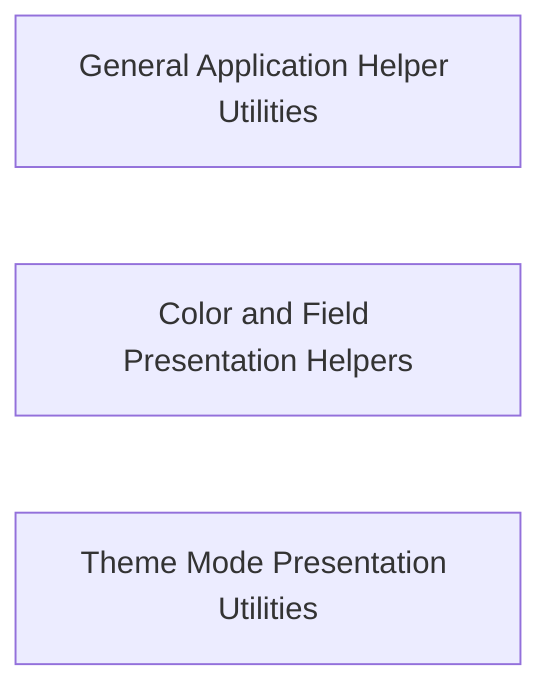

## Details

Provides shared general utilities such as debounce, throttle, color conversion, string formatting, and date helpers.

### General Application Helper Utilities
Provides utility functions and extensions for rate limiting, execution timing, string metrics, file handling, and context navigation.

**Related Classes/Methods**: _None_

**Source Files:**

- `frontend/appflowy_flutter/lib/util/debounce.dart`
  - `frontend.appflowy_flutter.lib.util.debounce.Debounce` (L3-L23) - Class
  - `frontend.appflowy_flutter.lib.util.debounce.Debounce.Debounce` (L4-L6) - Constructor
  - `frontend.appflowy_flutter.lib.util.debounce.Debounce.call` (L11-L17) - Method
  - `frontend.appflowy_flutter.lib.util.debounce.Debounce.dispose` (L19-L22) - Method
- `frontend/appflowy_flutter/lib/util/default_extensions.dart`
  - `frontend.appflowy_flutter.lib.util.default_extensions.isNotImageUrl` (L17-L23) - Function
- `frontend/appflowy_flutter/lib/util/expand_views.dart`
  - `frontend.appflowy_flutter.lib.util.expand_views.ViewExpanderRegistry` (L3-L29) - Class
  - `frontend.appflowy_flutter.lib.util.expand_views.ViewExpanderRegistry.isViewExpanded` (L7-L7) - Method
  - `frontend.appflowy_flutter.lib.util.expand_views.ViewExpanderRegistry.register` (L9-L13) - Method
  - `frontend.appflowy_flutter.lib.util.expand_views.ViewExpanderRegistry.unregister` (L15-L23) - Method
  - `frontend.appflowy_flutter.lib.util.expand_views.ViewExpanderRegistry.getExpander` (L25-L28) - Method
  - `frontend.appflowy_flutter.lib.util.expand_views.ViewExpander` (L31-L40) - Class
  - `frontend.appflowy_flutter.lib.util.expand_views.ViewExpander.ViewExpander` (L32-L32) - Constructor
  - `frontend.appflowy_flutter.lib.util.expand_views.ViewExpander.isViewExpanded` (L37-L37) - Method
  - `frontend.appflowy_flutter.lib.util.expand_views.ViewExpander.expand` (L39-L39) - Method
- `frontend/appflowy_flutter/lib/util/file_extension.dart`
  - `frontend.appflowy_flutter.lib.util.file_extension.FileSizeExtension.fileSize` (L4-L10) - Method
- `frontend/appflowy_flutter/lib/util/font_family_extension.dart`
  - `frontend.appflowy_flutter.lib.util.font_family_extension.FontFamilyExtension.parseFontFamilyName` (L8-L9) - Method
  - `frontend.appflowy_flutter.lib.util.font_family_extension.FontFamilyExtension.fontFamilyDisplayName` (L13-L15) - Method
  - `frontend.appflowy_flutter.lib.util.font_family_extension.FontFamilyExtension.fontFamilyName` (L20-L22) - Method
- `frontend/appflowy_flutter/lib/util/int64_extension.dart`
  - `frontend.appflowy_flutter.lib.util.int64_extension.DateConversion.toDateTime` (L4-L4) - Method
- `frontend/appflowy_flutter/lib/util/json_print.dart`
  - `frontend.appflowy_flutter.lib.util.json_print.prettyPrintJson` (L7-L10) - Function
- `frontend/appflowy_flutter/lib/util/levenshtein.dart`
  - `frontend.appflowy_flutter.lib.util.levenshtein.levenshtein` (L3-L26) - Function
- `frontend/appflowy_flutter/lib/util/navigator_context_extension.dart`
  - `frontend.appflowy_flutter.lib.util.navigator_context_extension.NavigatorContext.popToHome` (L4-L11) - Method
- `frontend/appflowy_flutter/lib/util/share_log_files.dart`
  - `frontend.appflowy_flutter.lib.util.share_log_files.shareLogFiles` (L13-L78) - Function
- `frontend/appflowy_flutter/lib/util/throttle.dart`
  - `frontend.appflowy_flutter.lib.util.throttle.Throttler` (L3-L27) - Class
  - `frontend.appflowy_flutter.lib.util.throttle.Throttler.Throttler` (L4-L6) - Constructor
  - `frontend.appflowy_flutter.lib.util.throttle.Throttler.call` (L11-L17) - Method
  - `frontend.appflowy_flutter.lib.util.throttle.Throttler.cancel` (L19-L21) - Method
  - `frontend.appflowy_flutter.lib.util.throttle.Throttler.dispose` (L23-L26) - Method
- `frontend/appflowy_flutter/lib/util/time.dart`
  - `frontend.appflowy_flutter.lib.util.time.parseTime` (L4-L31) - Function
  - `frontend.appflowy_flutter.lib.util.time.formatTime` (L33-L43) - Function
- `frontend/appflowy_flutter/lib/util/xfile_ext.dart`
  - `frontend.appflowy_flutter.lib.util.xfile_ext.FileType` (L5-L14) - Enum
  - `frontend.appflowy_flutter.lib.util.xfile_ext.FileType.other` (L6-L6) - Enum
  - `frontend.appflowy_flutter.lib.util.xfile_ext.FileType.image` (L7-L7) - Enum
  - `frontend.appflowy_flutter.lib.util.xfile_ext.FileType.link` (L8-L8) - Enum
  - `frontend.appflowy_flutter.lib.util.xfile_ext.FileType.document` (L9-L9) - Enum
  - `frontend.appflowy_flutter.lib.util.xfile_ext.FileType.archive` (L10-L10) - Enum
  - `frontend.appflowy_flutter.lib.util.xfile_ext.FileType.video` (L11-L11) - Enum
  - `frontend.appflowy_flutter.lib.util.xfile_ext.FileType.audio` (L12-L12) - Enum
  - `frontend.appflowy_flutter.lib.util.xfile_ext.FileType.text` (L13-L13) - Enum
  - `frontend.appflowy_flutter.lib.util.xfile_ext.TypeRecognizer.fileType` (L17-L87) - Method
  - `frontend.appflowy_flutter.lib.util.xfile_ext.ToMediaFileTypePB.toMediaFileTypePB` (L91-L108) - Method

### Color and Field Presentation Helpers
Provides extensions for color generation, hex string conversions, database field styling, and string transformations.

**Related Classes/Methods**: _None_

**Source Files:**

- `frontend/appflowy_flutter/lib/util/color_generator/color_generator.dart`
  - `frontend.appflowy_flutter.lib.util.color_generator.color_generator.ColorGenerator.toColor` (L16-L20) - Method
  - `frontend.appflowy_flutter.lib.util.color_generator.color_generator.ColorGenerator.randomColor` (L23-L27) - Method
- `frontend/appflowy_flutter/lib/util/color_to_hex_string.dart`
  - `frontend.appflowy_flutter.lib.util.color_to_hex_string.ColorExtension.toHexString` (L7-L14) - Method
  - `frontend.appflowy_flutter.lib.util.color_to_hex_string.ColorExtension.random` (L17-L20) - Method
- `frontend/appflowy_flutter/lib/util/field_type_extension.dart`
  - `frontend.appflowy_flutter.lib.util.field_type_extension.FieldTypeExtension.i18n` (L10-L30) - Method
  - `frontend.appflowy_flutter.lib.util.field_type_extension.FieldTypeExtension.svgData` (L32-L49) - Method
  - `frontend.appflowy_flutter.lib.util.field_type_extension.FieldTypeExtension.rightIcon` (L51-L55) - Method
  - `frontend.appflowy_flutter.lib.util.field_type_extension.FieldTypeExtension.mobileIconBackgroundColor` (L57-L74) - Method
  - `frontend.appflowy_flutter.lib.util.field_type_extension.FieldTypeExtension.mobileIconBackgroundColorDark` (L77-L94) - Method
  - `frontend.appflowy_flutter.lib.util.field_type_extension.FieldTypeExtension.canBeGroup` (L96-L104) - Method
  - `frontend.appflowy_flutter.lib.util.field_type_extension.FieldTypeExtension.canCreateFilter` (L106-L119) - Method
  - `frontend.appflowy_flutter.lib.util.field_type_extension.FieldTypeExtension.canCreateSort` (L121-L135) - Method
  - `frontend.appflowy_flutter.lib.util.field_type_extension.FieldTypeExtension.canEditHeader` (L137-L141) - Method
  - `frontend.appflowy_flutter.lib.util.field_type_extension.FieldTypeExtension.canCreateNewGroup` (L143-L147) - Method
  - `frontend.appflowy_flutter.lib.util.field_type_extension.FieldTypeExtension.canDeleteGroup` (L149-L156) - Method
  - `frontend.appflowy_flutter.lib.util.field_type_extension.FieldTypeExtension.groupConditions` (L158-L165) - Method
- `frontend/appflowy_flutter/lib/util/string_extension.dart`
  - `frontend.appflowy_flutter.lib.util.string_extension.StringExtension.toFileName` (L17-L27) - Method
  - `frontend.appflowy_flutter.lib.util.string_extension.StringExtension.fileSize` (L32-L38) - Method
  - `frontend.appflowy_flutter.lib.util.string_extension.StringExtension.isAppFlowyCloudUrl` (L41-L41) - Method
  - `frontend.appflowy_flutter.lib.util.string_extension.StringExtension.coverColor` (L46-L50) - Method
  - `frontend.appflowy_flutter.lib.util.string_extension.StringExtension.orDefault` (L52-L54) - Method
  - `frontend.appflowy_flutter.lib.util.string_extension.NullableStringExtension.orDefault` (L58-L60) - Method
  - `frontend.appflowy_flutter.lib.util.string_extension.IconExtension.icon` (L64-L85) - Method
  - `frontend.appflowy_flutter.lib.util.string_extension.CounterExtension.getCounter` (L89-L93) - Method

### Theme Mode Presentation Utilities
Provides convenience extensions on Flutter theme data and theme modes for brightness detection and localized label text.

**Related Classes/Methods**:

- `frontend.appflowy_flutter.lib.util.theme_extension.IsLightMode.isLightMode`

**Source Files:**

- `frontend/appflowy_flutter/lib/util/theme_extension.dart`
  - `frontend.appflowy_flutter.lib.util.theme_extension.IsLightMode.isLightMode` (L4-L4) - Method
- `frontend/appflowy_flutter/lib/util/theme_mode_extension.dart`
  - `frontend.appflowy_flutter.lib.util.theme_mode_extension.LabelTextPhrasing.labelText` (L6-L11) - Method

### [FAQ](https://github.com/CodeBoarding/GeneratedOnBoardings/tree/main?tab=readme-ov-file#faq)