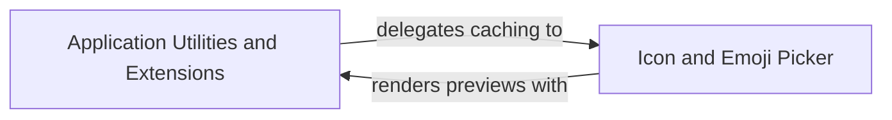

## Details

Provides reusable UI components, icon and emoji pickers, image rendering widgets, caching handlers, and utility extensions.

### Application Utilities and Extensions
Provides shared application utilities, network media display widgets, window controls, and formatting extensions.

**Related Classes/Methods**:

- `frontend.appflowy_flutter.lib.shared.appflowy_cache_manager.FlowyCacheManager`:5-42
- `frontend.appflowy_flutter.lib.shared.appflowy_network_image.FlowyNetworkImage`:18-70
- `frontend.appflowy_flutter.lib.shared.appflowy_network_svg.FlowyNetworkSvg`:10-82

**Source Files:**

- `frontend/appflowy_flutter/lib/shared/af_image.dart`
  - `frontend.appflowy_flutter.lib.shared.af_image.AFImage` (L9-L83) - Class
  - `frontend.appflowy_flutter.lib.shared.af_image.AFImage.AFImage` (L10-L22) - Constructor
  - `frontend.appflowy_flutter.lib.shared.af_image.AFImage.build` (L33-L82) - Method
- `frontend/appflowy_flutter/lib/shared/af_role_pb_extension.dart`
  - `frontend.appflowy_flutter.lib.shared.af_role_pb_extension.AFRolePBExtension.isOwner` (L6-L6) - Method
  - `frontend.appflowy_flutter.lib.shared.af_role_pb_extension.AFRolePBExtension.isMember` (L8-L8) - Method
  - `frontend.appflowy_flutter.lib.shared.af_role_pb_extension.AFRolePBExtension.canInvite` (L10-L10) - Method
  - `frontend.appflowy_flutter.lib.shared.af_role_pb_extension.AFRolePBExtension.canDelete` (L12-L12) - Method
  - `frontend.appflowy_flutter.lib.shared.af_role_pb_extension.AFRolePBExtension.canUpdate` (L14-L14) - Method
  - `frontend.appflowy_flutter.lib.shared.af_role_pb_extension.AFRolePBExtension.canLeave` (L16-L16) - Method
  - `frontend.appflowy_flutter.lib.shared.af_role_pb_extension.AFRolePBExtension.description` (L18-L28) - Method
- `frontend/appflowy_flutter/lib/shared/af_user_profile_extension.dart`
  - `frontend.appflowy_flutter.lib.shared.af_user_profile_extension.UserProfilePBExtension.authToken` (L7-L15) - Method
- `frontend/appflowy_flutter/lib/shared/appflowy_cache_manager.dart`
  - `frontend.appflowy_flutter.lib.shared.appflowy_cache_manager.FlowyCacheManager` (L5-L42) - Class
  - `frontend.appflowy_flutter.lib.shared.appflowy_cache_manager.FlowyCacheManager.registerCache` (L9-L11) - Method
  - `frontend.appflowy_flutter.lib.shared.appflowy_cache_manager.FlowyCacheManager.unregisterAllCache` (L13-L15) - Method
  - `frontend.appflowy_flutter.lib.shared.appflowy_cache_manager.FlowyCacheManager.clearAllCache` (L17-L27) - Method
  - `frontend.appflowy_flutter.lib.shared.appflowy_cache_manager.FlowyCacheManager.getCacheSize` (L29-L41) - Method
  - `frontend.appflowy_flutter.lib.shared.appflowy_cache_manager.ICache` (L44-L47) - Class
  - `frontend.appflowy_flutter.lib.shared.appflowy_cache_manager.ICache.cacheSize` (L45-L45) - Method
  - `frontend.appflowy_flutter.lib.shared.appflowy_cache_manager.ICache.clearAll` (L46-L46) - Method
  - `frontend.appflowy_flutter.lib.shared.appflowy_cache_manager.TemporaryDirectoryCache` (L49-L62) - Class
  - `frontend.appflowy_flutter.lib.shared.appflowy_cache_manager.TemporaryDirectoryCache.cacheSize` (L51-L55) - Method
  - `frontend.appflowy_flutter.lib.shared.appflowy_cache_manager.TemporaryDirectoryCache.clearAll` (L58-L61) - Method
  - `frontend.appflowy_flutter.lib.shared.appflowy_cache_manager.FeatureFlagCache` (L64-L74) - Class
  - `frontend.appflowy_flutter.lib.shared.appflowy_cache_manager.FeatureFlagCache.cacheSize` (L66-L68) - Method
  - `frontend.appflowy_flutter.lib.shared.appflowy_cache_manager.FeatureFlagCache.clearAll` (L71-L73) - Method
- `frontend/appflowy_flutter/lib/shared/appflowy_network_image.dart`
  - `frontend.appflowy_flutter.lib.shared.appflowy_network_image.FlowyNetworkImage` (L18-L70) - Class
  - `frontend.appflowy_flutter.lib.shared.appflowy_network_image.FlowyNetworkImage.FlowyNetworkImage` (L19-L32) - Constructor
  - `frontend.appflowy_flutter.lib.shared.appflowy_network_image.FlowyNetworkImage.createState` (L69-L69) - Method
  - `frontend.appflowy_flutter.lib.shared.appflowy_network_image.FlowyNetworkImageState` (L72-L212) - Class
  - `frontend.appflowy_flutter.lib.shared.appflowy_network_image.FlowyNetworkImageState.initState` (L80-L100) - Method
  - `frontend.appflowy_flutter.lib.shared.appflowy_network_image.FlowyNetworkImageState.reassemble` (L103-L113) - Method
  - `frontend.appflowy_flutter.lib.shared.appflowy_network_image.FlowyNetworkImageState.dispose` (L116-L126) - Method
  - `frontend.appflowy_flutter.lib.shared.appflowy_network_image.FlowyNetworkImageState.build` (L129-L156) - Method
  - `frontend.appflowy_flutter.lib.shared.appflowy_network_image.FlowyNetworkImageState._errorWidgetBuilder` (L159-L184) - Method
  - `frontend.appflowy_flutter.lib.shared.appflowy_network_image.FlowyNetworkImageState._buildRequestHeader` (L186-L198) - Method
  - `frontend.appflowy_flutter.lib.shared.appflowy_network_image.FlowyNetworkImageState._retryLoadImage` (L200-L211) - Method
  - `frontend.appflowy_flutter.lib.shared.appflowy_network_image.FlowyNetworkRetryCounter` (L216-L267) - Class
  - `frontend.appflowy_flutter.lib.shared.appflowy_network_image.FlowyNetworkRetryCounter.FlowyNetworkRetryCounter._` (L217-L217) - Constructor
  - `frontend.appflowy_flutter.lib.shared.appflowy_network_image.FlowyNetworkRetryCounter.FlowyNetworkRetryCounter` (L219-L219) - Constructor
  - `frontend.appflowy_flutter.lib.shared.appflowy_network_image.FlowyNetworkRetryCounter.values` (L223-L223) - Method
  - `frontend.appflowy_flutter.lib.shared.appflowy_network_image.FlowyNetworkRetryCounter.getRetryCount` (L226-L226) - Method
  - `frontend.appflowy_flutter.lib.shared.appflowy_network_image.FlowyNetworkRetryCounter.add` (L232-L235) - Method
  - `frontend.appflowy_flutter.lib.shared.appflowy_network_image.FlowyNetworkRetryCounter.increment` (L238-L246) - Method
  - `frontend.appflowy_flutter.lib.shared.appflowy_network_image.FlowyNetworkRetryCounter.clear` (L249-L261) - Method
  - `frontend.appflowy_flutter.lib.shared.appflowy_network_image.FlowyNetworkRetryCounter.reset` (L264-L266) - Method
  - `frontend.appflowy_flutter.lib.shared.appflowy_network_image._SensitiveContent` (L269-L276) - Class
  - `frontend.appflowy_flutter.lib.shared.appflowy_network_image._SensitiveContent._SensitiveContent` (L270-L270) - Constructor
  - `frontend.appflowy_flutter.lib.shared.appflowy_network_image._SensitiveContent.build` (L273-L275) - Method
- `frontend/appflowy_flutter/lib/shared/appflowy_network_svg.dart`
  - `frontend.appflowy_flutter.lib.shared.appflowy_network_svg.FlowyNetworkSvg` (L10-L82) - Class
  - `frontend.appflowy_flutter.lib.shared.appflowy_network_svg.FlowyNetworkSvg.FlowyNetworkSvg` (L11-L32) - Constructor
  - `frontend.appflowy_flutter.lib.shared.appflowy_network_svg.FlowyNetworkSvg.createState` (L54-L54) - Method
  - `frontend.appflowy_flutter.lib.shared.appflowy_network_svg.FlowyNetworkSvg.preCache` (L56-L64) - Method
  - `frontend.appflowy_flutter.lib.shared.appflowy_network_svg.FlowyNetworkSvg.clearCacheForUrl` (L66-L74) - Method
  - `frontend.appflowy_flutter.lib.shared.appflowy_network_svg.FlowyNetworkSvg.clearCache` (L76-L79) - Method
  - `frontend.appflowy_flutter.lib.shared.appflowy_network_svg.FlowyNetworkSvg._generateKeyFromUrl` (L81-L81) - Method
  - `frontend.appflowy_flutter.lib.shared.appflowy_network_svg._FlowyNetworkSvgState` (L84-L197) - Class
  - `frontend.appflowy_flutter.lib.shared.appflowy_network_svg._FlowyNetworkSvgState.initState` (L95-L105) - Method
  - `frontend.appflowy_flutter.lib.shared.appflowy_network_svg._FlowyNetworkSvgState._loadImage` (L107-L133) - Method
  - `frontend.appflowy_flutter.lib.shared.appflowy_network_svg._FlowyNetworkSvgState._setToLoadingAfter15MsIfNeeded` (L135-L143) - Method
  - `frontend.appflowy_flutter.lib.shared.appflowy_network_svg._FlowyNetworkSvgState._setState` (L145-L145) - Method
  - `frontend.appflowy_flutter.lib.shared.appflowy_network_svg._FlowyNetworkSvgState.dispose` (L148-L151) - Method
  - `frontend.appflowy_flutter.lib.shared.appflowy_network_svg._FlowyNetworkSvgState.build` (L154-L160) - Method
  - `frontend.appflowy_flutter.lib.shared.appflowy_network_svg._FlowyNetworkSvgState._buildImage` (L162-L171) - Method
  - `frontend.appflowy_flutter.lib.shared.appflowy_network_svg._FlowyNetworkSvgState._buildPlaceholderWidget` (L173-L174) - Method
  - `frontend.appflowy_flutter.lib.shared.appflowy_network_svg._FlowyNetworkSvgState._buildErrorWidget` (L176-L177) - Method
  - `frontend.appflowy_flutter.lib.shared.appflowy_network_svg._FlowyNetworkSvgState._buildSVGImage` (L179-L196) - Method
- `frontend/appflowy_flutter/lib/shared/clipboard_state.dart`
  - `frontend.appflowy_flutter.lib.shared.clipboard_state.ClipboardState` (L11-L46) - Class
  - `frontend.appflowy_flutter.lib.shared.clipboard_state.ClipboardState.ClipboardState` (L12-L12) - Constructor
  - `frontend.appflowy_flutter.lib.shared.clipboard_state.ClipboardState.isCut` (L16-L16) - Method
  - `frontend.appflowy_flutter.lib.shared.clipboard_state.ClipboardState.isHandlingPaste` (L19-L19) - Method
  - `frontend.appflowy_flutter.lib.shared.clipboard_state.ClipboardState.dispose` (L23-L25) - Method
  - `frontend.appflowy_flutter.lib.shared.clipboard_state.ClipboardState.didCut` (L27-L29) - Method
  - `frontend.appflowy_flutter.lib.shared.clipboard_state.ClipboardState.didPaste` (L31-L33) - Method
  - `frontend.appflowy_flutter.lib.shared.clipboard_state.ClipboardState.startHandlingPaste` (L35-L38) - Method
  - `frontend.appflowy_flutter.lib.shared.clipboard_state.ClipboardState.endHandlingPaste` (L40-L45) - Method
- `frontend/appflowy_flutter/lib/shared/conditional_listenable_builder.dart`
  - `frontend.appflowy_flutter.lib.shared.conditional_listenable_builder.ConditionalListenableBuilder` (L4-L44) - Class
  - `frontend.appflowy_flutter.lib.shared.conditional_listenable_builder.ConditionalListenableBuilder.ConditionalListenableBuilder` (L5-L11) - Constructor
  - `frontend.appflowy_flutter.lib.shared.conditional_listenable_builder.ConditionalListenableBuilder.createState` (L42-L43) - Method
  - `frontend.appflowy_flutter.lib.shared.conditional_listenable_builder._ConditionalListenableBuilderState` (L46-L87) - Class
  - `frontend.appflowy_flutter.lib.shared.conditional_listenable_builder._ConditionalListenableBuilderState.initState` (L51-L55) - Method
  - `frontend.appflowy_flutter.lib.shared.conditional_listenable_builder._ConditionalListenableBuilderState.didUpdateWidget` (L58-L65) - Method
  - `frontend.appflowy_flutter.lib.shared.conditional_listenable_builder._ConditionalListenableBuilderState.dispose` (L68-L71) - Method
  - `frontend.appflowy_flutter.lib.shared.conditional_listenable_builder._ConditionalListenableBuilderState._valueChanged` (L73-L81) - Method
  - `frontend.appflowy_flutter.lib.shared.conditional_listenable_builder._ConditionalListenableBuilderState.build` (L84-L86) - Method
- `frontend/appflowy_flutter/lib/shared/easy_localiation_service.dart`
  - `frontend.appflowy_flutter.lib.shared.easy_localiation_service.EasyLocalizationService` (L6-L26) - Class
  - `frontend.appflowy_flutter.lib.shared.easy_localiation_service.EasyLocalizationService.EasyLocalizationService` (L7-L7) - Constructor
  - `frontend.appflowy_flutter.lib.shared.easy_localiation_service.EasyLocalizationService.getFallbackTranslation` (L11-L15) - Method
  - `frontend.appflowy_flutter.lib.shared.easy_localiation_service.EasyLocalizationService.getTranslation` (L17-L21) - Method
  - `frontend.appflowy_flutter.lib.shared.easy_localiation_service.EasyLocalizationService.init` (L23-L25) - Method
- `frontend/appflowy_flutter/lib/shared/feature_flags.dart`
  - `frontend.appflowy_flutter.lib.shared.feature_flags.FeatureFlag` (L14-L162) - Enum
  - `frontend.appflowy_flutter.lib.shared.feature_flags.FeatureFlag.collaborativeWorkspace` (L18-L18) - Enum
  - `frontend.appflowy_flutter.lib.shared.feature_flags.FeatureFlag.membersSettings` (L22-L22) - Enum
  - `frontend.appflowy_flutter.lib.shared.feature_flags.FeatureFlag.syncDocument` (L26-L26) - Enum
  - `frontend.appflowy_flutter.lib.shared.feature_flags.FeatureFlag.syncDatabase` (L30-L30) - Enum
  - `frontend.appflowy_flutter.lib.shared.feature_flags.FeatureFlag.search` (L33-L33) - Enum
  - `frontend.appflowy_flutter.lib.shared.feature_flags.FeatureFlag.planBilling` (L36-L36) - Enum
  - `frontend.appflowy_flutter.lib.shared.feature_flags.FeatureFlag.spaceDesign` (L39-L39) - Enum
  - `frontend.appflowy_flutter.lib.shared.feature_flags.FeatureFlag.inlineSubPageMention` (L42-L42) - Enum
  - `frontend.appflowy_flutter.lib.shared.feature_flags.FeatureFlag.sharedSection` (L45-L45) - Enum
  - `frontend.appflowy_flutter.lib.shared.feature_flags.FeatureFlag.unknown` (L48-L48) - Enum
  - `frontend.appflowy_flutter.lib.shared.feature_flags.FeatureFlag.initialize` (L50-L69) - Method
  - `frontend.appflowy_flutter.lib.shared.feature_flags.FeatureFlag.data` (L71-L72) - Method
  - `frontend.appflowy_flutter.lib.shared.feature_flags.FeatureFlag.turnOn` (L74-L76) - Method
  - `frontend.appflowy_flutter.lib.shared.feature_flags.FeatureFlag.turnOff` (L78-L80) - Method
  - `frontend.appflowy_flutter.lib.shared.feature_flags.FeatureFlag.update` (L82-L91) - Method
  - `frontend.appflowy_flutter.lib.shared.feature_flags.FeatureFlag.clear` (L93-L96) - Method
  - `frontend.appflowy_flutter.lib.shared.feature_flags.FeatureFlag.isOn` (L98-L134) - Method
  - `frontend.appflowy_flutter.lib.shared.feature_flags.FeatureFlag.description` (L136-L159) - Method
  - `frontend.appflowy_flutter.lib.shared.feature_flags.FeatureFlag.key` (L161-L161) - Method
- `frontend/appflowy_flutter/lib/shared/feedback_gesture_detector.dart`
  - `frontend.appflowy_flutter.lib.shared.feedback_gesture_detector.HapticFeedbackType` (L4-L30) - Enum
  - `frontend.appflowy_flutter.lib.shared.feedback_gesture_detector.HapticFeedbackType.light` (L5-L5) - Enum
  - `frontend.appflowy_flutter.lib.shared.feedback_gesture_detector.HapticFeedbackType.medium` (L6-L6) - Enum
  - `frontend.appflowy_flutter.lib.shared.feedback_gesture_detector.HapticFeedbackType.heavy` (L7-L7) - Enum
  - `frontend.appflowy_flutter.lib.shared.feedback_gesture_detector.HapticFeedbackType.selection` (L8-L8) - Enum
  - `frontend.appflowy_flutter.lib.shared.feedback_gesture_detector.HapticFeedbackType.vibrate` (L9-L9) - Enum
  - `frontend.appflowy_flutter.lib.shared.feedback_gesture_detector.HapticFeedbackType.call` (L11-L29) - Method
  - `frontend.appflowy_flutter.lib.shared.feedback_gesture_detector.FeedbackGestureDetector` (L32-L47) - Class
  - `frontend.appflowy_flutter.lib.shared.feedback_gesture_detector.FeedbackGestureDetector.FeedbackGestureDetector` (L33-L46) - Constructor
- `frontend/appflowy_flutter/lib/shared/google_fonts_extension.dart`
  - `frontend.appflowy_flutter.lib.shared.google_fonts_extension.getGoogleFontSafely` (L12-L50) - Function
- `frontend/appflowy_flutter/lib/shared/list_extension.dart`
  - `frontend.appflowy_flutter.lib.shared.list_extension.Unique.unique` (L2-L7) - Method
- `frontend/appflowy_flutter/lib/shared/loading.dart`
  - `frontend.appflowy_flutter.lib.shared.loading.Loading` (L5-L49) - Class
  - `frontend.appflowy_flutter.lib.shared.loading.Loading.Loading` (L6-L6) - Constructor
  - `frontend.appflowy_flutter.lib.shared.loading.Loading.start` (L13-L39) - Method
  - `frontend.appflowy_flutter.lib.shared.loading.Loading.stop` (L41-L48) - Method
- `frontend/appflowy_flutter/lib/shared/markdown_to_document.dart`
  - `frontend.appflowy_flutter.lib.shared.markdown_to_document.customMarkdownToDocument` (L13-L24) - Function
  - `frontend.appflowy_flutter.lib.shared.markdown_to_document.customDocumentToMarkdown` (L26-L97) - Function
- `frontend/appflowy_flutter/lib/shared/patterns/date_time_patterns.dart`
  - `frontend.appflowy_flutter.lib.shared.patterns.date_time_patterns.isTwelveHourTime` (L9-L9) - Function
  - `frontend.appflowy_flutter.lib.shared.patterns.date_time_patterns.isTwentyFourHourTime` (L18-L19) - Function
- `frontend/appflowy_flutter/lib/shared/popup_menu/appflowy_popup_menu.dart`
  - `frontend.appflowy_flutter.lib.shared.popup_menu.appflowy_popup_menu.closePopupMenu` (L37-L40) - Function
  - `frontend.appflowy_flutter.lib.shared.popup_menu.appflowy_popup_menu.PopupMenuEntry` (L63-L89) - Class
  - `frontend.appflowy_flutter.lib.shared.popup_menu.appflowy_popup_menu.PopupMenuEntry.PopupMenuEntry` (L66-L66) - Constructor
  - `frontend.appflowy_flutter.lib.shared.popup_menu.appflowy_popup_menu.PopupMenuEntry.height` (L74-L74) - Method
  - `frontend.appflowy_flutter.lib.shared.popup_menu.appflowy_popup_menu.PopupMenuEntry.represents` (L88-L88) - Method
  - `frontend.appflowy_flutter.lib.shared.popup_menu.appflowy_popup_menu.PopupMenuDivider` (L101-L118) - Class
  - `frontend.appflowy_flutter.lib.shared.popup_menu.appflowy_popup_menu.PopupMenuDivider.PopupMenuDivider` (L105-L105) - Constructor
  - `frontend.appflowy_flutter.lib.shared.popup_menu.appflowy_popup_menu.PopupMenuDivider.represents` (L114-L114) - Method
  - `frontend.appflowy_flutter.lib.shared.popup_menu.appflowy_popup_menu.PopupMenuDivider.createState` (L117-L117) - Method
  - `frontend.appflowy_flutter.lib.shared.popup_menu.appflowy_popup_menu._PopupMenuDividerState` (L120-L123) - Class
  - `frontend.appflowy_flutter.lib.shared.popup_menu.appflowy_popup_menu._PopupMenuDividerState.build` (L122-L122) - Method
  - `frontend.appflowy_flutter.lib.shared.popup_menu.appflowy_popup_menu._MenuItem` (L129-L149) - Class
  - `frontend.appflowy_flutter.lib.shared.popup_menu.appflowy_popup_menu._MenuItem._MenuItem` (L130-L133) - Constructor
  - `frontend.appflowy_flutter.lib.shared.popup_menu.appflowy_popup_menu._MenuItem.createRenderObject` (L138-L140) - Method
  - `frontend.appflowy_flutter.lib.shared.popup_menu.appflowy_popup_menu._MenuItem.updateRenderObject` (L143-L148) - Method
  - `frontend.appflowy_flutter.lib.shared.popup_menu.appflowy_popup_menu._RenderMenuItem` (L151-L173) - Class
  - `frontend.appflowy_flutter.lib.shared.popup_menu.appflowy_popup_menu._RenderMenuItem._RenderMenuItem` (L152-L152) - Constructor
  - `frontend.appflowy_flutter.lib.shared.popup_menu.appflowy_popup_menu._RenderMenuItem.computeDryLayout` (L157-L159) - Method
  - `frontend.appflowy_flutter.lib.shared.popup_menu.appflowy_popup_menu._RenderMenuItem.performLayout` (L162-L172) - Method
  - `frontend.appflowy_flutter.lib.shared.popup_menu.appflowy_popup_menu.PopupMenuItem` (L214-L308) - Class
  - `frontend.appflowy_flutter.lib.shared.popup_menu.appflowy_popup_menu.PopupMenuItem.PopupMenuItem` (L218-L229) - Constructor
  - `frontend.appflowy_flutter.lib.shared.popup_menu.appflowy_popup_menu.PopupMenuItem.represents` (L303-L303) - Method
  - `frontend.appflowy_flutter.lib.shared.popup_menu.appflowy_popup_menu.PopupMenuItem.createState` (L306-L307) - Method
  - `frontend.appflowy_flutter.lib.shared.popup_menu.appflowy_popup_menu.PopupMenuItemState` (L326-L409) - Class
  - `frontend.appflowy_flutter.lib.shared.popup_menu.appflowy_popup_menu.PopupMenuItemState.buildChild` (L334-L334) - Method
  - `frontend.appflowy_flutter.lib.shared.popup_menu.appflowy_popup_menu.PopupMenuItemState.handleTap` (L343-L348) - Method
  - `frontend.appflowy_flutter.lib.shared.popup_menu.appflowy_popup_menu.PopupMenuItemState.build` (L351-L408) - Method
  - `frontend.appflowy_flutter.lib.shared.popup_menu.appflowy_popup_menu.CheckedPopupMenuItem` (L472-L513) - Class
  - `frontend.appflowy_flutter.lib.shared.popup_menu.appflowy_popup_menu.CheckedPopupMenuItem.CheckedPopupMenuItem` (L477-L488) - Constructor
  - `frontend.appflowy_flutter.lib.shared.popup_menu.appflowy_popup_menu.CheckedPopupMenuItem.child` (L508-L508) - Method
  - `frontend.appflowy_flutter.lib.shared.popup_menu.appflowy_popup_menu.CheckedPopupMenuItem.createState` (L511-L512) - Method
  - `frontend.appflowy_flutter.lib.shared.popup_menu.appflowy_popup_menu._CheckedPopupMenuItemState` (L515-L580) - Class
  - `frontend.appflowy_flutter.lib.shared.popup_menu.appflowy_popup_menu._CheckedPopupMenuItemState._opacity` (L520-L520) - Method
  - `frontend.appflowy_flutter.lib.shared.popup_menu.appflowy_popup_menu._CheckedPopupMenuItemState.initState` (L523-L528) - Method
  - `frontend.appflowy_flutter.lib.shared.popup_menu.appflowy_popup_menu._CheckedPopupMenuItemState._updateState` (L531-L531) - Method
  - `frontend.appflowy_flutter.lib.shared.popup_menu.appflowy_popup_menu._CheckedPopupMenuItemState.dispose` (L534-L538) - Method
  - `frontend.appflowy_flutter.lib.shared.popup_menu.appflowy_popup_menu._CheckedPopupMenuItemState.handleTap` (L541-L549) - Method
  - `frontend.appflowy_flutter.lib.shared.popup_menu.appflowy_popup_menu._CheckedPopupMenuItemState.buildChild` (L552-L579) - Method
  - `frontend.appflowy_flutter.lib.shared.popup_menu.appflowy_popup_menu._PopupMenu` (L582-L600) - Class
  - `frontend.appflowy_flutter.lib.shared.popup_menu.appflowy_popup_menu._PopupMenu._PopupMenu` (L583-L590) - Constructor
  - `frontend.appflowy_flutter.lib.shared.popup_menu.appflowy_popup_menu._PopupMenu.createState` (L599-L599) - Method
  - `frontend.appflowy_flutter.lib.shared.popup_menu.appflowy_popup_menu._PopupMenuState` (L602-L719) - Class
  - `frontend.appflowy_flutter.lib.shared.popup_menu.appflowy_popup_menu._PopupMenuState.build` (L604-L703) - Method
  - `frontend.appflowy_flutter.lib.shared.popup_menu.appflowy_popup_menu._PopupMenuState.dispose` (L706-L709) - Method
  - `frontend.appflowy_flutter.lib.shared.popup_menu.appflowy_popup_menu._PopupMenuState.dismiss` (L711-L718) - Method
  - `frontend.appflowy_flutter.lib.shared.popup_menu.appflowy_popup_menu._PopupMenuRouteLayout` (L722-L847) - Class
  - `frontend.appflowy_flutter.lib.shared.popup_menu.appflowy_popup_menu._PopupMenuRouteLayout._PopupMenuRouteLayout` (L723-L730) - Constructor
  - `frontend.appflowy_flutter.lib.shared.popup_menu.appflowy_popup_menu._PopupMenuRouteLayout.getConstraintsForChild` (L757-L763) - Method
  - `frontend.appflowy_flutter.lib.shared.popup_menu.appflowy_popup_menu._PopupMenuRouteLayout.getPositionForChild` (L766-L796) - Method
  - `frontend.appflowy_flutter.lib.shared.popup_menu.appflowy_popup_menu._PopupMenuRouteLayout._closestScreen` (L798-L807) - Method
  - `frontend.appflowy_flutter.lib.shared.popup_menu.appflowy_popup_menu._PopupMenuRouteLayout._fitInsideScreen` (L809-L831) - Method
  - `frontend.appflowy_flutter.lib.shared.popup_menu.appflowy_popup_menu._PopupMenuRouteLayout.shouldRelayout` (L834-L846) - Method
  - `frontend.appflowy_flutter.lib.shared.popup_menu.appflowy_popup_menu._PopupMenuRoute` (L849-L1007) - Class
  - `frontend.appflowy_flutter.lib.shared.popup_menu.appflowy_popup_menu._PopupMenuRoute._PopupMenuRoute` (L850-L870) - Constructor
  - `frontend.appflowy_flutter.lib.shared.popup_menu.appflowy_popup_menu._PopupMenuRoute.createAnimation` (L889-L899) - Method
  - `frontend.appflowy_flutter.lib.shared.popup_menu.appflowy_popup_menu._PopupMenuRoute.scrollTo` (L901-L907) - Method
  - `frontend.appflowy_flutter.lib.shared.popup_menu.appflowy_popup_menu._PopupMenuRoute.transitionDuration` (L910-L911) - Method
  - `frontend.appflowy_flutter.lib.shared.popup_menu.appflowy_popup_menu._PopupMenuRoute.barrierDismissible` (L914-L914) - Method
  - `frontend.appflowy_flutter.lib.shared.popup_menu.appflowy_popup_menu._PopupMenuRoute.barrierColor` (L917-L917) - Method
  - `frontend.appflowy_flutter.lib.shared.popup_menu.appflowy_popup_menu._PopupMenuRoute.buildTransitions` (L923-L948) - Method
  - `frontend.appflowy_flutter.lib.shared.popup_menu.appflowy_popup_menu._PopupMenuRoute.buildPage` (L951-L1002) - Method
  - `frontend.appflowy_flutter.lib.shared.popup_menu.appflowy_popup_menu._PopupMenuRoute._avoidBounds` (L1004-L1006) - Method
  - `frontend.appflowy_flutter.lib.shared.popup_menu.appflowy_popup_menu.showMenu` (L1067-L1123) - Function
  - `frontend.appflowy_flutter.lib.shared.popup_menu.appflowy_popup_menu.PopupMenuItemSelected` (L1130-L1130) - Class
  - `frontend.appflowy_flutter.lib.shared.popup_menu.appflowy_popup_menu.PopupMenuCanceled` (L1136-L1136) - Class
  - `frontend.appflowy_flutter.lib.shared.popup_menu.appflowy_popup_menu.PopupMenuItemBuilder` (L1142-L1144) - Class
  - `frontend.appflowy_flutter.lib.shared.popup_menu.appflowy_popup_menu.PopupMenuButton` (L1224-L1465) - Class
  - `frontend.appflowy_flutter.lib.shared.popup_menu.appflowy_popup_menu.PopupMenuButton.PopupMenuButton` (L1226-L1258) - Constructor
  - `frontend.appflowy_flutter.lib.shared.popup_menu.appflowy_popup_menu.PopupMenuButton.createState` (L1464-L1464) - Method
  - `frontend.appflowy_flutter.lib.shared.popup_menu.appflowy_popup_menu.PopupMenuButtonState` (L1471-L1580) - Class
  - `frontend.appflowy_flutter.lib.shared.popup_menu.appflowy_popup_menu.PopupMenuButtonState.showButtonMenu` (L1480-L1547) - Method
  - `frontend.appflowy_flutter.lib.shared.popup_menu.appflowy_popup_menu.PopupMenuButtonState.build` (L1550-L1579) - Method
  - `frontend.appflowy_flutter.lib.shared.popup_menu.appflowy_popup_menu._PopupMenuDefaultsM2` (L1582-L1594) - Class
  - `frontend.appflowy_flutter.lib.shared.popup_menu.appflowy_popup_menu._PopupMenuDefaultsM2._PopupMenuDefaultsM2` (L1583-L1583) - Constructor
  - `frontend.appflowy_flutter.lib.shared.popup_menu.appflowy_popup_menu._PopupMenuDefaultsM2.textStyle` (L1590-L1590) - Method
  - `frontend.appflowy_flutter.lib.shared.popup_menu.appflowy_popup_menu._PopupMenuDefaultsM3` (L1603-L1640) - Class
  - `frontend.appflowy_flutter.lib.shared.popup_menu.appflowy_popup_menu._PopupMenuDefaultsM3._PopupMenuDefaultsM3` (L1604-L1604) - Constructor
  - `frontend.appflowy_flutter.lib.shared.popup_menu.appflowy_popup_menu._PopupMenuDefaultsM3.labelTextStyle` (L1612-L1620) - Method
  - `frontend.appflowy_flutter.lib.shared.popup_menu.appflowy_popup_menu._PopupMenuDefaultsM3.color` (L1623-L1623) - Method
  - `frontend.appflowy_flutter.lib.shared.popup_menu.appflowy_popup_menu._PopupMenuDefaultsM3.shadowColor` (L1626-L1626) - Method
  - `frontend.appflowy_flutter.lib.shared.popup_menu.appflowy_popup_menu._PopupMenuDefaultsM3.surfaceTintColor` (L1629-L1629) - Method
  - `frontend.appflowy_flutter.lib.shared.popup_menu.appflowy_popup_menu._PopupMenuDefaultsM3.shape` (L1632-L1634) - Method
  - `frontend.appflowy_flutter.lib.shared.popup_menu.appflowy_popup_menu.PopupMenuColors.popupMenuBackgroundColor` (L1644-L1649) - Method
  - `frontend.appflowy_flutter.lib.shared.popup_menu.appflowy_popup_menu._CurveTween` (L1652-L1667) - Class
  - `frontend.appflowy_flutter.lib.shared.popup_menu.appflowy_popup_menu._CurveTween._CurveTween` (L1654-L1654) - Constructor
  - `frontend.appflowy_flutter.lib.shared.popup_menu.appflowy_popup_menu._CurveTween.transform` (L1660-L1662) - Method
  - `frontend.appflowy_flutter.lib.shared.popup_menu.appflowy_popup_menu._CurveTween.toString` (L1665-L1666) - Method
- `frontend/appflowy_flutter/lib/shared/settings/show_settings.dart`
  - `frontend.appflowy_flutter.lib.shared.settings.show_settings.showSettingsDialog` (L16-L55) - Function
  - `frontend.appflowy_flutter.lib.shared.settings.show_settings.showSimpleSettingsDialog` (L62-L67) - Function
- `frontend/appflowy_flutter/lib/shared/text_field/text_filed_with_metric_lines.dart`
  - `frontend.appflowy_flutter.lib.shared.text_field.text_filed_with_metric_lines.TextFieldWithMetricLines` (L3-L26) - Class
  - `frontend.appflowy_flutter.lib.shared.text_field.text_filed_with_metric_lines.TextFieldWithMetricLines.TextFieldWithMetricLines` (L4-L13) - Constructor
  - `frontend.appflowy_flutter.lib.shared.text_field.text_filed_with_metric_lines.TextFieldWithMetricLines.createState` (L24-L25) - Method
  - `frontend.appflowy_flutter.lib.shared.text_field.text_filed_with_metric_lines._TextFieldWithMetricLinesState` (L28-L91) - Class
  - `frontend.appflowy_flutter.lib.shared.text_field.text_filed_with_metric_lines._TextFieldWithMetricLinesState.initState` (L33-L39) - Method
  - `frontend.appflowy_flutter.lib.shared.text_field.text_filed_with_metric_lines._TextFieldWithMetricLinesState.dispose` (L42-L48) - Method
  - `frontend.appflowy_flutter.lib.shared.text_field.text_filed_with_metric_lines._TextFieldWithMetricLinesState.build` (L51-L62) - Method
  - `frontend.appflowy_flutter.lib.shared.text_field.text_filed_with_metric_lines._TextFieldWithMetricLinesState.updateDisplayedLineCount` (L65-L90) - Method
- `frontend/appflowy_flutter/lib/shared/time_format.dart`
  - `frontend.appflowy_flutter.lib.shared.time_format.formatTimestampWithContext` (L11-L42) - Function
- `frontend/appflowy_flutter/lib/shared/version_checker/version_checker.dart`
  - `frontend.appflowy_flutter.lib.shared.version_checker.version_checker.VersionChecker` (L13-L96) - Class
  - `frontend.appflowy_flutter.lib.shared.version_checker.version_checker.VersionChecker.VersionChecker` (L14-L14) - Constructor
  - `frontend.appflowy_flutter.lib.shared.version_checker.version_checker.VersionChecker.VersionChecker._internal` (L16-L16) - Constructor
  - `frontend.appflowy_flutter.lib.shared.version_checker.version_checker.VersionChecker.setFeedUrl` (L22-L30) - Method
  - `frontend.appflowy_flutter.lib.shared.version_checker.version_checker.VersionChecker.checkForUpdateInformation` (L34-L61) - Method
  - `frontend.appflowy_flutter.lib.shared.version_checker.version_checker.VersionChecker.checkForUpdate` (L66-L73) - Method
  - `frontend.appflowy_flutter.lib.shared.version_checker.version_checker.VersionChecker._parseAppcastItem` (L75-L95) - Method
- `frontend/appflowy_flutter/lib/shared/window_title_bar.dart`
  - `frontend.appflowy_flutter.lib.shared.window_title_bar.WindowsButtonListener` (L6-L18) - Class
  - `frontend.appflowy_flutter.lib.shared.window_title_bar.WindowsButtonListener.WindowsButtonListener` (L7-L7) - Constructor
  - `frontend.appflowy_flutter.lib.shared.window_title_bar.WindowsButtonListener.onWindowMaximize` (L12-L12) - Method
  - `frontend.appflowy_flutter.lib.shared.window_title_bar.WindowsButtonListener.onWindowUnmaximize` (L15-L15) - Method
  - `frontend.appflowy_flutter.lib.shared.window_title_bar.WindowsButtonListener.dispose` (L17-L17) - Method
  - `frontend.appflowy_flutter.lib.shared.window_title_bar.WindowTitleBar` (L20-L30) - Class
  - `frontend.appflowy_flutter.lib.shared.window_title_bar.WindowTitleBar.WindowTitleBar` (L21-L24) - Constructor
  - `frontend.appflowy_flutter.lib.shared.window_title_bar.WindowTitleBar.createState` (L29-L29) - Method
  - `frontend.appflowy_flutter.lib.shared.window_title_bar._WindowTitleBarState` (L32-L109) - Class
  - `frontend.appflowy_flutter.lib.shared.window_title_bar._WindowTitleBarState.initState` (L37-L51) - Method
  - `frontend.appflowy_flutter.lib.shared.window_title_bar._WindowTitleBarState._isMaximizedChanged` (L53-L57) - Method
  - `frontend.appflowy_flutter.lib.shared.window_title_bar._WindowTitleBarState.dispose` (L60-L68) - Method
  - `frontend.appflowy_flutter.lib.shared.window_title_bar._WindowTitleBarState.build` (L71-L108) - Method

### Icon and Emoji Picker
Provides icon and emoji pickers, color palettes, asset uploading utilities, and custom image cache storage.

**Related Classes/Methods**:

- `frontend.appflowy_flutter.lib.shared.custom_image_cache_manager.CustomImageCacheManager`:8-36
- `frontend.appflowy_flutter.lib.shared.icon_emoji_picker.icon_uploader.IconUploader`:31-45

**Source Files:**

- `frontend/appflowy_flutter/lib/shared/colors.dart`
  - `frontend.appflowy_flutter.lib.shared.colors.SharedColors.proPrimaryColor` (L5-L9) - Method
  - `frontend.appflowy_flutter.lib.shared.colors.SharedColors.proSecondaryColor` (L11-L15) - Method
- `frontend/appflowy_flutter/lib/shared/custom_image_cache_manager.dart`
  - `frontend.appflowy_flutter.lib.shared.custom_image_cache_manager.CustomImageCacheManager` (L8-L36) - Class
  - `frontend.appflowy_flutter.lib.shared.custom_image_cache_manager.CustomImageCacheManager.CustomImageCacheManager._` (L11-L17) - Constructor
  - `frontend.appflowy_flutter.lib.shared.custom_image_cache_manager.CustomImageCacheManager.CustomImageCacheManager` (L19-L19) - Constructor
  - `frontend.appflowy_flutter.lib.shared.custom_image_cache_manager.CustomImageCacheManager.cacheSize` (L26-L30) - Method
  - `frontend.appflowy_flutter.lib.shared.custom_image_cache_manager.CustomImageCacheManager.clearAll` (L33-L35) - Method
  - `frontend.appflowy_flutter.lib.shared.custom_image_cache_manager.CustomIOFileSystem` (L38-L61) - Class
  - `frontend.appflowy_flutter.lib.shared.custom_image_cache_manager.CustomIOFileSystem.CustomIOFileSystem` (L39-L39) - Constructor
  - `frontend.appflowy_flutter.lib.shared.custom_image_cache_manager.CustomIOFileSystem.createDirectory` (L43-L51) - Method
  - `frontend.appflowy_flutter.lib.shared.custom_image_cache_manager.CustomIOFileSystem.createFile` (L54-L60) - Method
- `frontend/appflowy_flutter/lib/shared/flowy_error_page.dart`
  - `frontend.appflowy_flutter.lib.shared.flowy_error_page.AppFlowyErrorPage` (L16-L32) - Class
  - `frontend.appflowy_flutter.lib.shared.flowy_error_page.AppFlowyErrorPage.AppFlowyErrorPage` (L17-L20) - Constructor
  - `frontend.appflowy_flutter.lib.shared.flowy_error_page.AppFlowyErrorPage.build` (L25-L31) - Method
  - `frontend.appflowy_flutter.lib.shared.flowy_error_page._MobileSyncErrorPage` (L34-L87) - Class
  - `frontend.appflowy_flutter.lib.shared.flowy_error_page._MobileSyncErrorPage._MobileSyncErrorPage` (L35-L37) - Constructor
  - `frontend.appflowy_flutter.lib.shared.flowy_error_page._MobileSyncErrorPage.build` (L42-L86) - Method
  - `frontend.appflowy_flutter.lib.shared.flowy_error_page._DesktopSyncErrorPage` (L89-L166) - Class
  - `frontend.appflowy_flutter.lib.shared.flowy_error_page._DesktopSyncErrorPage._DesktopSyncErrorPage` (L90-L92) - Constructor
  - `frontend.appflowy_flutter.lib.shared.flowy_error_page._DesktopSyncErrorPage.build` (L97-L165) - Method
- `frontend/appflowy_flutter/lib/shared/flowy_gradient_colors.dart`
  - `frontend.appflowy_flutter.lib.shared.flowy_gradient_colors.FlowyGradientColor` (L3-L85) - Enum
  - `frontend.appflowy_flutter.lib.shared.flowy_gradient_colors.FlowyGradientColor.gradient1` (L4-L4) - Enum
  - `frontend.appflowy_flutter.lib.shared.flowy_gradient_colors.FlowyGradientColor.gradient2` (L5-L5) - Enum
  - `frontend.appflowy_flutter.lib.shared.flowy_gradient_colors.FlowyGradientColor.gradient3` (L6-L6) - Enum
  - `frontend.appflowy_flutter.lib.shared.flowy_gradient_colors.FlowyGradientColor.gradient4` (L7-L7) - Enum
  - `frontend.appflowy_flutter.lib.shared.flowy_gradient_colors.FlowyGradientColor.gradient5` (L8-L8) - Enum
  - `frontend.appflowy_flutter.lib.shared.flowy_gradient_colors.FlowyGradientColor.gradient6` (L9-L9) - Enum
  - `frontend.appflowy_flutter.lib.shared.flowy_gradient_colors.FlowyGradientColor.gradient7` (L10-L10) - Enum
  - `frontend.appflowy_flutter.lib.shared.flowy_gradient_colors.FlowyGradientColor.fromId` (L12-L17) - Method
  - `frontend.appflowy_flutter.lib.shared.flowy_gradient_colors.FlowyGradientColor.id` (L19-L37) - Method
  - `frontend.appflowy_flutter.lib.shared.flowy_gradient_colors.FlowyGradientColor.linear` (L39-L84) - Method
- `frontend/appflowy_flutter/lib/shared/icon_emoji_picker/colors.dart`
  - `frontend.appflowy_flutter.lib.shared.icon_emoji_picker.colors.PickerColors.pickerTextColor` (L5-L9) - Method
  - `frontend.appflowy_flutter.lib.shared.icon_emoji_picker.colors.PickerColors.pickerIconColor` (L11-L13) - Method
  - `frontend.appflowy_flutter.lib.shared.icon_emoji_picker.colors.PickerColors.pickerSearchBarBorderColor` (L15-L19) - Method
  - `frontend.appflowy_flutter.lib.shared.icon_emoji_picker.colors.PickerColors.pickerButtonBoarderColor` (L21-L25) - Method
- `frontend/appflowy_flutter/lib/shared/icon_emoji_picker/emoji_search_bar.dart`
  - `frontend.appflowy_flutter.lib.shared.icon_emoji_picker.emoji_search_bar.EmojiKeywordChangedCallback` (L12-L12) - Class
  - `frontend.appflowy_flutter.lib.shared.icon_emoji_picker.emoji_search_bar.EmojiSkinToneChanged` (L13-L13) - Class
  - `frontend.appflowy_flutter.lib.shared.icon_emoji_picker.emoji_search_bar.FlowyEmojiSearchBar` (L15-L33) - Class
  - `frontend.appflowy_flutter.lib.shared.icon_emoji_picker.emoji_search_bar.FlowyEmojiSearchBar.FlowyEmojiSearchBar` (L16-L23) - Constructor
  - `frontend.appflowy_flutter.lib.shared.icon_emoji_picker.emoji_search_bar.FlowyEmojiSearchBar.createState` (L32-L32) - Method
  - `frontend.appflowy_flutter.lib.shared.icon_emoji_picker.emoji_search_bar._FlowyEmojiSearchBarState` (L35-L79) - Class
  - `frontend.appflowy_flutter.lib.shared.icon_emoji_picker.emoji_search_bar._FlowyEmojiSearchBarState.dispose` (L40-L43) - Method
  - `frontend.appflowy_flutter.lib.shared.icon_emoji_picker.emoji_search_bar._FlowyEmojiSearchBarState.build` (L46-L78) - Method
  - `frontend.appflowy_flutter.lib.shared.icon_emoji_picker.emoji_search_bar._RandomEmojiButton` (L81-L126) - Class
  - `frontend.appflowy_flutter.lib.shared.icon_emoji_picker.emoji_search_bar._RandomEmojiButton._RandomEmojiButton` (L82-L86) - Constructor
  - `frontend.appflowy_flutter.lib.shared.icon_emoji_picker.emoji_search_bar._RandomEmojiButton.build` (L93-L125) - Method
  - `frontend.appflowy_flutter.lib.shared.icon_emoji_picker.emoji_search_bar._SearchTextField` (L128-L139) - Class
  - `frontend.appflowy_flutter.lib.shared.icon_emoji_picker.emoji_search_bar._SearchTextField._SearchTextField` (L129-L132) - Constructor
  - `frontend.appflowy_flutter.lib.shared.icon_emoji_picker.emoji_search_bar._SearchTextField.createState` (L138-L138) - Method
  - `frontend.appflowy_flutter.lib.shared.icon_emoji_picker.emoji_search_bar._SearchTextFieldState` (L141-L215) - Class
  - `frontend.appflowy_flutter.lib.shared.icon_emoji_picker.emoji_search_bar._SearchTextFieldState.initState` (L146-L157) - Method
  - `frontend.appflowy_flutter.lib.shared.icon_emoji_picker.emoji_search_bar._SearchTextFieldState.dispose` (L160-L165) - Method
  - `frontend.appflowy_flutter.lib.shared.icon_emoji_picker.emoji_search_bar._SearchTextFieldState.build` (L168-L214) - Method
- `frontend/appflowy_flutter/lib/shared/icon_emoji_picker/emoji_skin_tone.dart`
  - `frontend.appflowy_flutter.lib.shared.icon_emoji_picker.emoji_skin_tone.emojiSkinToneKey` (L13-L15) - Function
  - `frontend.appflowy_flutter.lib.shared.icon_emoji_picker.emoji_skin_tone.FlowyEmojiSkinToneSelector` (L17-L28) - Class
  - `frontend.appflowy_flutter.lib.shared.icon_emoji_picker.emoji_skin_tone.FlowyEmojiSkinToneSelector.FlowyEmojiSkinToneSelector` (L18-L21) - Constructor
  - `frontend.appflowy_flutter.lib.shared.icon_emoji_picker.emoji_skin_tone.FlowyEmojiSkinToneSelector.createState` (L26-L27) - Method
  - `frontend.appflowy_flutter.lib.shared.icon_emoji_picker.emoji_skin_tone._FlowyEmojiSkinToneSelectorState` (L30-L86) - Class
  - `frontend.appflowy_flutter.lib.shared.icon_emoji_picker.emoji_skin_tone._FlowyEmojiSkinToneSelectorState.build` (L36-L65) - Method
  - `frontend.appflowy_flutter.lib.shared.icon_emoji_picker.emoji_skin_tone._FlowyEmojiSkinToneSelectorState._buildIconButton` (L67-L85) - Method
  - `frontend.appflowy_flutter.lib.shared.icon_emoji_picker.emoji_skin_tone.EmojiSkinToneIcon.icon` (L89-L104) - Method
- `frontend/appflowy_flutter/lib/shared/icon_emoji_picker/flowy_icon_emoji_picker.dart`
  - `frontend.appflowy_flutter.lib.shared.icon_emoji_picker.flowy_icon_emoji_picker.ToProto.toProto` (L17-L26) - Method
  - `frontend.appflowy_flutter.lib.shared.icon_emoji_picker.flowy_icon_emoji_picker.FromProto.fromProto` (L30-L41) - Method
  - `frontend.appflowy_flutter.lib.shared.icon_emoji_picker.flowy_icon_emoji_picker.ToEmojiIconData.toEmojiIconData` (L45-L45) - Method
  - `frontend.appflowy_flutter.lib.shared.icon_emoji_picker.flowy_icon_emoji_picker.FlowyIconType` (L48-L52) - Enum
  - `frontend.appflowy_flutter.lib.shared.icon_emoji_picker.flowy_icon_emoji_picker.FlowyIconType.emoji` (L49-L49) - Enum
  - `frontend.appflowy_flutter.lib.shared.icon_emoji_picker.flowy_icon_emoji_picker.FlowyIconType.icon` (L50-L50) - Enum
  - `frontend.appflowy_flutter.lib.shared.icon_emoji_picker.flowy_icon_emoji_picker.FlowyIconType.custom` (L51-L51) - Enum
  - `frontend.appflowy_flutter.lib.shared.icon_emoji_picker.flowy_icon_emoji_picker.FlowyIconTypeToPickerTabType.toPickerTabType` (L55-L55) - Method
  - `frontend.appflowy_flutter.lib.shared.icon_emoji_picker.flowy_icon_emoji_picker.EmojiIconData` (L58-L91) - Class
  - `frontend.appflowy_flutter.lib.shared.icon_emoji_picker.flowy_icon_emoji_picker.EmojiIconData.EmojiIconData.none` (L59-L59) - Constructor
  - `frontend.appflowy_flutter.lib.shared.icon_emoji_picker.flowy_icon_emoji_picker.EmojiIconData.EmojiIconData.emoji` (L61-L62) - Constructor
  - `frontend.appflowy_flutter.lib.shared.icon_emoji_picker.flowy_icon_emoji_picker.EmojiIconData.EmojiIconData.icon` (L64-L65) - Constructor
  - `frontend.appflowy_flutter.lib.shared.icon_emoji_picker.flowy_icon_emoji_picker.EmojiIconData.EmojiIconData.custom` (L67-L68) - Constructor
  - `frontend.appflowy_flutter.lib.shared.icon_emoji_picker.flowy_icon_emoji_picker.EmojiIconData.EmojiIconData` (L70-L73) - Constructor
  - `frontend.appflowy_flutter.lib.shared.icon_emoji_picker.flowy_icon_emoji_picker.EmojiIconData.fromViewIconPB` (L78-L80) - Method
  - `frontend.appflowy_flutter.lib.shared.icon_emoji_picker.flowy_icon_emoji_picker.EmojiIconData.toViewIcon` (L82-L86) - Method
  - `frontend.appflowy_flutter.lib.shared.icon_emoji_picker.flowy_icon_emoji_picker.EmojiIconData.isEmpty` (L88-L88) - Method
  - `frontend.appflowy_flutter.lib.shared.icon_emoji_picker.flowy_icon_emoji_picker.EmojiIconData.isNotEmpty` (L90-L90) - Method
  - `frontend.appflowy_flutter.lib.shared.icon_emoji_picker.flowy_icon_emoji_picker.SelectedEmojiIconResult` (L93-L102) - Class
  - `frontend.appflowy_flutter.lib.shared.icon_emoji_picker.flowy_icon_emoji_picker.SelectedEmojiIconResult.SelectedEmojiIconResult` (L94-L94) - Constructor
  - `frontend.appflowy_flutter.lib.shared.icon_emoji_picker.flowy_icon_emoji_picker.SelectedEmojiIconResult.type` (L99-L99) - Method
  - `frontend.appflowy_flutter.lib.shared.icon_emoji_picker.flowy_icon_emoji_picker.SelectedEmojiIconResult.emoji` (L101-L101) - Method
  - `frontend.appflowy_flutter.lib.shared.icon_emoji_picker.flowy_icon_emoji_picker.EmojiIconDataToSelectedResultExtension.toSelectedResult` (L105-L106) - Method
  - `frontend.appflowy_flutter.lib.shared.icon_emoji_picker.flowy_icon_emoji_picker.FlowyIconEmojiPicker` (L109-L130) - Class
  - `frontend.appflowy_flutter.lib.shared.icon_emoji_picker.flowy_icon_emoji_picker.FlowyIconEmojiPicker.FlowyIconEmojiPicker` (L110-L120) - Constructor
  - `frontend.appflowy_flutter.lib.shared.icon_emoji_picker.flowy_icon_emoji_picker.FlowyIconEmojiPicker.createState` (L129-L129) - Method
  - `frontend.appflowy_flutter.lib.shared.icon_emoji_picker.flowy_icon_emoji_picker._FlowyIconEmojiPickerState` (L132-L253) - Class
  - `frontend.appflowy_flutter.lib.shared.icon_emoji_picker.flowy_icon_emoji_picker._FlowyIconEmojiPickerState.initState` (L138-L155) - Method
  - `frontend.appflowy_flutter.lib.shared.icon_emoji_picker.flowy_icon_emoji_picker._FlowyIconEmojiPickerState.dispose` (L158-L161) - Method
  - `frontend.appflowy_flutter.lib.shared.icon_emoji_picker.flowy_icon_emoji_picker._FlowyIconEmojiPickerState.build` (L164-L207) - Method
  - `frontend.appflowy_flutter.lib.shared.icon_emoji_picker.flowy_icon_emoji_picker._FlowyIconEmojiPickerState._buildEmojiPicker` (L209-L220) - Method
  - `frontend.appflowy_flutter.lib.shared.icon_emoji_picker.flowy_icon_emoji_picker._FlowyIconEmojiPickerState._getEmojiPerLine` (L222-L228) - Method
  - `frontend.appflowy_flutter.lib.shared.icon_emoji_picker.flowy_icon_emoji_picker._FlowyIconEmojiPickerState._buildIconPicker` (L230-L241) - Method
  - `frontend.appflowy_flutter.lib.shared.icon_emoji_picker.flowy_icon_emoji_picker._FlowyIconEmojiPickerState._buildIconUploader` (L243-L252) - Method
  - `frontend.appflowy_flutter.lib.shared.icon_emoji_picker.flowy_icon_emoji_picker._RemoveIconButton` (L255-L277) - Class
  - `frontend.appflowy_flutter.lib.shared.icon_emoji_picker.flowy_icon_emoji_picker._RemoveIconButton._RemoveIconButton` (L256-L256) - Constructor
  - `frontend.appflowy_flutter.lib.shared.icon_emoji_picker.flowy_icon_emoji_picker._RemoveIconButton.build` (L261-L276) - Method
- `frontend/appflowy_flutter/lib/shared/icon_emoji_picker/icon.dart`
  - `frontend.appflowy_flutter.lib.shared.icon_emoji_picker.icon.IconGroup` (L6-L58) - Class
  - `frontend.appflowy_flutter.lib.shared.icon_emoji_picker.icon.IconGroup.IconGroup.fromJson` (L7-L14) - Constructor
  - `frontend.appflowy_flutter.lib.shared.icon_emoji_picker.icon.IconGroup.IconGroup.fromMapEntry` (L16-L20) - Constructor
  - `frontend.appflowy_flutter.lib.shared.icon_emoji_picker.icon.IconGroup.IconGroup` (L22-L30) - Constructor
  - `frontend.appflowy_flutter.lib.shared.icon_emoji_picker.icon.IconGroup.displayName` (L35-L35) - Method
  - `frontend.appflowy_flutter.lib.shared.icon_emoji_picker.icon.IconGroup.filter` (L37-L48) - Method
  - `frontend.appflowy_flutter.lib.shared.icon_emoji_picker.icon.IconGroup.getSvgContent` (L50-L55) - Method
  - `frontend.appflowy_flutter.lib.shared.icon_emoji_picker.icon.IconGroup.toJson` (L57-L57) - Method
  - `frontend.appflowy_flutter.lib.shared.icon_emoji_picker.icon.Icon` (L61-L87) - Class
  - `frontend.appflowy_flutter.lib.shared.icon_emoji_picker.icon.Icon.Icon.fromJson` (L62-L62) - Constructor
  - `frontend.appflowy_flutter.lib.shared.icon_emoji_picker.icon.Icon.Icon` (L64-L68) - Constructor
  - `frontend.appflowy_flutter.lib.shared.icon_emoji_picker.icon.Icon.displayName` (L77-L77) - Method
  - `frontend.appflowy_flutter.lib.shared.icon_emoji_picker.icon.Icon.toJson` (L79-L79) - Method
  - `frontend.appflowy_flutter.lib.shared.icon_emoji_picker.icon.Icon.iconPath` (L81-L86) - Method
  - `frontend.appflowy_flutter.lib.shared.icon_emoji_picker.icon.RecentIcon` (L89-L107) - Class
  - `frontend.appflowy_flutter.lib.shared.icon_emoji_picker.icon.RecentIcon.RecentIcon.fromJson` (L90-L91) - Constructor
  - `frontend.appflowy_flutter.lib.shared.icon_emoji_picker.icon.RecentIcon.RecentIcon` (L93-L93) - Constructor
  - `frontend.appflowy_flutter.lib.shared.icon_emoji_picker.icon.RecentIcon.name` (L98-L98) - Method
  - `frontend.appflowy_flutter.lib.shared.icon_emoji_picker.icon.RecentIcon.keywords` (L100-L100) - Method
  - `frontend.appflowy_flutter.lib.shared.icon_emoji_picker.icon.RecentIcon.content` (L102-L102) - Method
  - `frontend.appflowy_flutter.lib.shared.icon_emoji_picker.icon.RecentIcon.toJson` (L104-L106) - Method
- `frontend/appflowy_flutter/lib/shared/icon_emoji_picker/icon_color_picker.dart`
  - `frontend.appflowy_flutter.lib.shared.icon_emoji_picker.icon_color_picker.IconColorPicker` (L5-L44) - Class
  - `frontend.appflowy_flutter.lib.shared.icon_emoji_picker.icon_color_picker.IconColorPicker.IconColorPicker` (L6-L9) - Constructor
  - `frontend.appflowy_flutter.lib.shared.icon_emoji_picker.icon_color_picker.IconColorPicker.build` (L14-L43) - Method
- `frontend/appflowy_flutter/lib/shared/icon_emoji_picker/icon_picker.dart`
  - `frontend.appflowy_flutter.lib.shared.icon_emoji_picker.icon_picker.IconGroupFilter.findSvgContent` (L30-L47) - Method
  - `frontend.appflowy_flutter.lib.shared.icon_emoji_picker.icon_picker.IconGroupFilter.randomIcon` (L49-L54) - Method
  - `frontend.appflowy_flutter.lib.shared.icon_emoji_picker.icon_picker.loadIconGroups` (L57-L76) - Function
  - `frontend.appflowy_flutter.lib.shared.icon_emoji_picker.icon_picker.IconPickerResult` (L78-L83) - Class
  - `frontend.appflowy_flutter.lib.shared.icon_emoji_picker.icon_picker.IconPickerResult.IconPickerResult` (L79-L79) - Constructor
  - `frontend.appflowy_flutter.lib.shared.icon_emoji_picker.icon_picker.IconsDataToIconPickerResultExtension.toResult` (L86-L87) - Method
  - `frontend.appflowy_flutter.lib.shared.icon_emoji_picker.icon_picker.FlowyIconPicker` (L90-L106) - Class
  - `frontend.appflowy_flutter.lib.shared.icon_emoji_picker.icon_picker.FlowyIconPicker.FlowyIconPicker` (L91-L97) - Constructor
  - `frontend.appflowy_flutter.lib.shared.icon_emoji_picker.icon_picker.FlowyIconPicker.createState` (L105-L105) - Method
  - `frontend.appflowy_flutter.lib.shared.icon_emoji_picker.icon_picker._FlowyIconPickerState` (L108-L233) - Class
  - `frontend.appflowy_flutter.lib.shared.icon_emoji_picker.icon_picker._FlowyIconPickerState.loadIcons` (L114-L141) - Method
  - `frontend.appflowy_flutter.lib.shared.icon_emoji_picker.icon_picker._FlowyIconPickerState.initState` (L144-L147) - Method
  - `frontend.appflowy_flutter.lib.shared.icon_emoji_picker.icon_picker._FlowyIconPickerState.dispose` (L150-L156) - Method
  - `frontend.appflowy_flutter.lib.shared.icon_emoji_picker.icon_picker._FlowyIconPickerState.build` (L159-L205) - Method
  - `frontend.appflowy_flutter.lib.shared.icon_emoji_picker.icon_picker._FlowyIconPickerState._buildIcons` (L207-L232) - Method
  - `frontend.appflowy_flutter.lib.shared.icon_emoji_picker.icon_picker.IconsData` (L235-L265) - Class
  - `frontend.appflowy_flutter.lib.shared.icon_emoji_picker.icon_picker.IconsData.IconsData` (L236-L236) - Constructor
  - `frontend.appflowy_flutter.lib.shared.icon_emoji_picker.icon_picker.IconsData.iconString` (L242-L246) - Method
  - `frontend.appflowy_flutter.lib.shared.icon_emoji_picker.icon_picker.IconsData.toEmojiIconData` (L248-L248) - Method
  - `frontend.appflowy_flutter.lib.shared.icon_emoji_picker.icon_picker.IconsData.noColor` (L250-L250) - Method
  - `frontend.appflowy_flutter.lib.shared.icon_emoji_picker.icon_picker.IconsData.fromJson` (L252-L258) - Method
  - `frontend.appflowy_flutter.lib.shared.icon_emoji_picker.icon_picker.IconsData.svgString` (L260-L264) - Method
  - `frontend.appflowy_flutter.lib.shared.icon_emoji_picker.icon_picker.IconPicker` (L267-L283) - Class
  - `frontend.appflowy_flutter.lib.shared.icon_emoji_picker.icon_picker.IconPicker.IconPicker` (L268-L274) - Constructor
  - `frontend.appflowy_flutter.lib.shared.icon_emoji_picker.icon_picker.IconPicker.createState` (L282-L282) - Method
  - `frontend.appflowy_flutter.lib.shared.icon_emoji_picker.icon_picker._IconPickerState` (L285-L400) - Class
  - `frontend.appflowy_flutter.lib.shared.icon_emoji_picker.icon_picker._IconPickerState.dispose` (L290-L293) - Method
  - `frontend.appflowy_flutter.lib.shared.icon_emoji_picker.icon_picker._IconPickerState.build` (L296-L384) - Method
  - `frontend.appflowy_flutter.lib.shared.icon_emoji_picker.icon_picker._IconPickerState.hideColorSelector` (L386-L389) - Method
  - `frontend.appflowy_flutter.lib.shared.icon_emoji_picker.icon_picker._IconPickerState.getGroupName` (L391-L399) - Method
  - `frontend.appflowy_flutter.lib.shared.icon_emoji_picker.icon_picker._IconNoBackground` (L402-L434) - Class
  - `frontend.appflowy_flutter.lib.shared.icon_emoji_picker.icon_picker._IconNoBackground._IconNoBackground` (L403-L407) - Constructor
  - `frontend.appflowy_flutter.lib.shared.icon_emoji_picker.icon_picker._IconNoBackground.build` (L414-L433) - Method
  - `frontend.appflowy_flutter.lib.shared.icon_emoji_picker.icon_picker._Icon` (L436-L451) - Class
  - `frontend.appflowy_flutter.lib.shared.icon_emoji_picker.icon_picker._Icon._Icon` (L437-L442) - Constructor
  - `frontend.appflowy_flutter.lib.shared.icon_emoji_picker.icon_picker._Icon.createState` (L450-L450) - Method
  - `frontend.appflowy_flutter.lib.shared.icon_emoji_picker.icon_picker._IconState` (L453-L499) - Class
  - `frontend.appflowy_flutter.lib.shared.icon_emoji_picker.icon_picker._IconState.dispose` (L458-L461) - Method
  - `frontend.appflowy_flutter.lib.shared.icon_emoji_picker.icon_picker._IconState.build` (L464-L492) - Method
  - `frontend.appflowy_flutter.lib.shared.icon_emoji_picker.icon_picker._IconState.updateIsSelected` (L494-L498) - Method
  - `frontend.appflowy_flutter.lib.shared.icon_emoji_picker.icon_picker.StreamlinePermit` (L501-L537) - Class
  - `frontend.appflowy_flutter.lib.shared.icon_emoji_picker.icon_picker.StreamlinePermit.StreamlinePermit` (L502-L504) - Constructor
  - `frontend.appflowy_flutter.lib.shared.icon_emoji_picker.icon_picker.StreamlinePermit.build` (L507-L536) - Method
- `frontend/appflowy_flutter/lib/shared/icon_emoji_picker/icon_search_bar.dart`
  - `frontend.appflowy_flutter.lib.shared.icon_emoji_picker.icon_search_bar.IconKeywordChangedCallback` (L11-L11) - Class
  - `frontend.appflowy_flutter.lib.shared.icon_emoji_picker.icon_search_bar.EmojiSkinToneChanged` (L12-L12) - Class
  - `frontend.appflowy_flutter.lib.shared.icon_emoji_picker.icon_search_bar.IconSearchBar` (L14-L28) - Class
  - `frontend.appflowy_flutter.lib.shared.icon_emoji_picker.icon_search_bar.IconSearchBar.IconSearchBar` (L15-L20) - Constructor
  - `frontend.appflowy_flutter.lib.shared.icon_emoji_picker.icon_search_bar.IconSearchBar.createState` (L27-L27) - Method
  - `frontend.appflowy_flutter.lib.shared.icon_emoji_picker.icon_search_bar._IconSearchBarState` (L30-L62) - Class
  - `frontend.appflowy_flutter.lib.shared.icon_emoji_picker.icon_search_bar._IconSearchBarState.dispose` (L34-L37) - Method
  - `frontend.appflowy_flutter.lib.shared.icon_emoji_picker.icon_search_bar._IconSearchBarState.build` (L40-L61) - Method
  - `frontend.appflowy_flutter.lib.shared.icon_emoji_picker.icon_search_bar._RandomIconButton` (L64-L94) - Class
  - `frontend.appflowy_flutter.lib.shared.icon_emoji_picker.icon_search_bar._RandomIconButton._RandomIconButton` (L65-L67) - Constructor
  - `frontend.appflowy_flutter.lib.shared.icon_emoji_picker.icon_search_bar._RandomIconButton.build` (L72-L93) - Method
  - `frontend.appflowy_flutter.lib.shared.icon_emoji_picker.icon_search_bar._SearchTextField` (L96-L107) - Class
  - `frontend.appflowy_flutter.lib.shared.icon_emoji_picker.icon_search_bar._SearchTextField._SearchTextField` (L97-L100) - Constructor
  - `frontend.appflowy_flutter.lib.shared.icon_emoji_picker.icon_search_bar._SearchTextField.createState` (L106-L106) - Method
  - `frontend.appflowy_flutter.lib.shared.icon_emoji_picker.icon_search_bar._SearchTextFieldState` (L109-L183) - Class
  - `frontend.appflowy_flutter.lib.shared.icon_emoji_picker.icon_search_bar._SearchTextFieldState.initState` (L114-L125) - Method
  - `frontend.appflowy_flutter.lib.shared.icon_emoji_picker.icon_search_bar._SearchTextFieldState.dispose` (L128-L133) - Method
  - `frontend.appflowy_flutter.lib.shared.icon_emoji_picker.icon_search_bar._SearchTextFieldState.build` (L136-L182) - Method
- `frontend/appflowy_flutter/lib/shared/icon_emoji_picker/icon_uploader.dart`
  - `frontend.appflowy_flutter.lib.shared.icon_emoji_picker.icon_uploader.IconUploader` (L31-L45) - Class
  - `frontend.appflowy_flutter.lib.shared.icon_emoji_picker.icon_uploader.IconUploader.IconUploader` (L32-L37) - Constructor
  - `frontend.appflowy_flutter.lib.shared.icon_emoji_picker.icon_uploader.IconUploader.createState` (L44-L44) - Method
  - `frontend.appflowy_flutter.lib.shared.icon_emoji_picker.icon_uploader._IconUploaderState` (L47-L348) - Class
  - `frontend.appflowy_flutter.lib.shared.icon_emoji_picker.icon_uploader._IconUploaderState.initState` (L56-L70) - Method
  - `frontend.appflowy_flutter.lib.shared.icon_emoji_picker.icon_uploader._IconUploaderState.dispose` (L73-L79) - Method
  - `frontend.appflowy_flutter.lib.shared.icon_emoji_picker.icon_uploader._IconUploaderState.build` (L82-L168) - Method
  - `frontend.appflowy_flutter.lib.shared.icon_emoji_picker.icon_uploader._IconUploaderState.hoveringWidget` (L170-L179) - Method
  - `frontend.appflowy_flutter.lib.shared.icon_emoji_picker.icon_uploader._IconUploaderState.dragHint` (L181-L212) - Method
  - `frontend.appflowy_flutter.lib.shared.icon_emoji_picker.icon_uploader._IconUploaderState.previewImage` (L214-L245) - Method
  - `frontend.appflowy_flutter.lib.shared.icon_emoji_picker.icon_uploader._IconUploaderState.loadImage` (L247-L264) - Method
  - `frontend.appflowy_flutter.lib.shared.icon_emoji_picker.icon_uploader._IconUploaderState.pickImage` (L266-L286) - Method
  - `frontend.appflowy_flutter.lib.shared.icon_emoji_picker.icon_uploader._IconUploaderState.uploadImage` (L288-L309) - Method
  - `frontend.appflowy_flutter.lib.shared.icon_emoji_picker.icon_uploader._IconUploaderState.pasteAsAnImage` (L311-L322) - Method
  - `frontend.appflowy_flutter.lib.shared.icon_emoji_picker.icon_uploader._IconUploaderState.validateImage` (L324-L334) - Method
  - `frontend.appflowy_flutter.lib.shared.icon_emoji_picker.icon_uploader._IconUploaderState.checkIfImage` (L336-L347) - Method
  - `frontend.appflowy_flutter.lib.shared.icon_emoji_picker.icon_uploader._ChangeIconButton` (L350-L383) - Class
  - `frontend.appflowy_flutter.lib.shared.icon_emoji_picker.icon_uploader._ChangeIconButton._ChangeIconButton` (L351-L351) - Constructor
  - `frontend.appflowy_flutter.lib.shared.icon_emoji_picker.icon_uploader._ChangeIconButton.build` (L356-L382) - Method
  - `frontend.appflowy_flutter.lib.shared.icon_emoji_picker.icon_uploader._ConfirmButton` (L385-L405) - Class
  - `frontend.appflowy_flutter.lib.shared.icon_emoji_picker.icon_uploader._ConfirmButton._ConfirmButton` (L386-L386) - Constructor
  - `frontend.appflowy_flutter.lib.shared.icon_emoji_picker.icon_uploader._ConfirmButton.build` (L392-L404) - Method
  - `frontend.appflowy_flutter.lib.shared.icon_emoji_picker.icon_uploader._PasteIntent` (L409-L409) - Class
  - `frontend.appflowy_flutter.lib.shared.icon_emoji_picker.icon_uploader._Image` (L411-L419) - Class
  - `frontend.appflowy_flutter.lib.shared.icon_emoji_picker.icon_uploader._Image.url` (L412-L412) - Method
  - `frontend.appflowy_flutter.lib.shared.icon_emoji_picker.icon_uploader._Image.saveToLocal` (L414-L414) - Method
  - `frontend.appflowy_flutter.lib.shared.icon_emoji_picker.icon_uploader._Image.uploadToCloud` (L416-L416) - Method
  - `frontend.appflowy_flutter.lib.shared.icon_emoji_picker.icon_uploader._Image.pureUrl` (L418-L418) - Method
  - `frontend.appflowy_flutter.lib.shared.icon_emoji_picker.icon_uploader._FileImage` (L421-L441) - Class
  - `frontend.appflowy_flutter.lib.shared.icon_emoji_picker.icon_uploader._FileImage._FileImage` (L422-L422) - Constructor
  - `frontend.appflowy_flutter.lib.shared.icon_emoji_picker.icon_uploader._FileImage.saveToLocal` (L428-L428) - Method
  - `frontend.appflowy_flutter.lib.shared.icon_emoji_picker.icon_uploader._FileImage.uploadToCloud` (L431-L440) - Method
  - `frontend.appflowy_flutter.lib.shared.icon_emoji_picker.icon_uploader._NetworkImage` (L443-L467) - Class
  - `frontend.appflowy_flutter.lib.shared.icon_emoji_picker.icon_uploader._NetworkImage._NetworkImage` (L444-L444) - Constructor
  - `frontend.appflowy_flutter.lib.shared.icon_emoji_picker.icon_uploader._NetworkImage.saveToLocal` (L450-L453) - Method
  - `frontend.appflowy_flutter.lib.shared.icon_emoji_picker.icon_uploader._NetworkImage.uploadToCloud` (L456-L466) - Method
- `frontend/appflowy_flutter/lib/shared/icon_emoji_picker/recent_icons.dart`
  - `frontend.appflowy_flutter.lib.shared.icon_emoji_picker.recent_icons.RecentIcons` (L12-L109) - Class
  - `frontend.appflowy_flutter.lib.shared.icon_emoji_picker.recent_icons.RecentIcons.putEmoji` (L21-L23) - Method
  - `frontend.appflowy_flutter.lib.shared.icon_emoji_picker.recent_icons.RecentIcons.putIcon` (L25-L30) - Method
  - `frontend.appflowy_flutter.lib.shared.icon_emoji_picker.recent_icons.RecentIcons.getEmojiIds` (L32-L35) - Method
  - `frontend.appflowy_flutter.lib.shared.icon_emoji_picker.recent_icons.RecentIcons.getIcons` (L37-L40) - Method
  - `frontend.appflowy_flutter.lib.shared.icon_emoji_picker.recent_icons.RecentIcons.getIconsSync` (L42-L59) - Method
  - `frontend.appflowy_flutter.lib.shared.icon_emoji_picker.recent_icons.RecentIcons.clear` (L62-L65) - Method
  - `frontend.appflowy_flutter.lib.shared.icon_emoji_picker.recent_icons.RecentIcons._save` (L67-L72) - Method
  - `frontend.appflowy_flutter.lib.shared.icon_emoji_picker.recent_icons.RecentIcons._load` (L74-L97) - Method
  - `frontend.appflowy_flutter.lib.shared.icon_emoji_picker.recent_icons.RecentIcons._put` (L99-L108) - Method
- `frontend/appflowy_flutter/lib/shared/icon_emoji_picker/tab.dart`
  - `frontend.appflowy_flutter.lib.shared.icon_emoji_picker.tab.PickerTabType` (L4-L19) - Enum
  - `frontend.appflowy_flutter.lib.shared.icon_emoji_picker.tab.PickerTabType.emoji` (L5-L5) - Enum
  - `frontend.appflowy_flutter.lib.shared.icon_emoji_picker.tab.PickerTabType.icon` (L6-L6) - Enum
  - `frontend.appflowy_flutter.lib.shared.icon_emoji_picker.tab.PickerTabType.custom` (L7-L7) - Enum
  - `frontend.appflowy_flutter.lib.shared.icon_emoji_picker.tab.PickerTabType.tr` (L9-L18) - Method
  - `frontend.appflowy_flutter.lib.shared.icon_emoji_picker.tab.StringToPickerTabType.toPickerTabType` (L22-L28) - Method
  - `frontend.appflowy_flutter.lib.shared.icon_emoji_picker.tab.PickerTab` (L31-L80) - Class
  - `frontend.appflowy_flutter.lib.shared.icon_emoji_picker.tab.PickerTab.PickerTab` (L32-L37) - Constructor
  - `frontend.appflowy_flutter.lib.shared.icon_emoji_picker.tab.PickerTab.build` (L44-L79) - Method
- `frontend/appflowy_flutter/lib/shared/permission/permission_checker.dart`
  - `frontend.appflowy_flutter.lib.shared.permission.permission_checker.PermissionChecker` (L16-L103) - Class
  - `frontend.appflowy_flutter.lib.shared.permission.permission_checker.PermissionChecker.checkPhotoPermission` (L17-L63) - Method
  - `frontend.appflowy_flutter.lib.shared.permission.permission_checker.PermissionChecker.checkCameraPermission` (L65-L102) - Method

### [FAQ](https://github.com/CodeBoarding/GeneratedOnBoardings/tree/main?tab=readme-ov-file#faq)