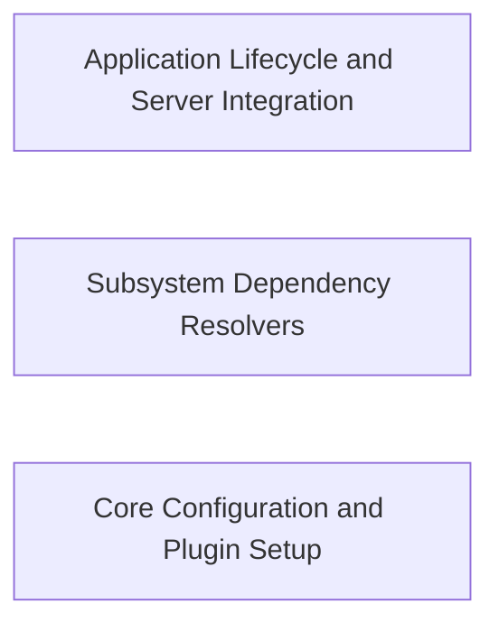

## Details

Initializes and coordinates subsystem dependencies, lifecycle events, and cloud or local server providers.

### Application Lifecycle and Server Integration
Coordinates application startup, manages lifecycle events, and implements cloud and folder server bridges.

**Related Classes/Methods**:

- `frontend.rust-lib.flowy-core.src.AppFlowyCore`:61-77
- `frontend.rust-lib.flowy-core.src.app_life_cycle.AppLifeCycleImpl`:32-49
- `frontend.rust-lib.flowy-core.src.server_layer.ServerProvider`:27-37

**Source Files:**

- `frontend/rust-lib/flowy-core/src/app_life_cycle.rs`
  - `frontend.rust-lib.flowy-core.src.app_life_cycle.AppLifeCycleImpl` (L32-L49) - Struct
  - `frontend.rust-lib.flowy-core.src.app_life_cycle.AppLifeCycleImpl.user_manager` (L52-L54) - Method
  - `frontend.rust-lib.flowy-core.src.app_life_cycle.AppLifeCycleImpl.folder_manager` (L56-L61) - Method
  - `frontend.rust-lib.flowy-core.src.app_life_cycle.AppLifeCycleImpl.database_manager` (L63-L68) - Method
  - `frontend.rust-lib.flowy-core.src.app_life_cycle.AppLifeCycleImpl.document_manager` (L70-L75) - Method
  - `frontend.rust-lib.flowy-core.src.app_life_cycle.AppLifeCycleImpl.server_provider` (L77-L82) - Method
  - `frontend.rust-lib.flowy-core.src.app_life_cycle.AppLifeCycleImpl.storage_manager` (L84-L89) - Method
  - `frontend.rust-lib.flowy-core.src.app_life_cycle.AppLifeCycleImpl.ai_manager` (L91-L93) - Method
  - `frontend.rust-lib.flowy-core.src.app_life_cycle.AppLifeCycleImpl.search_manager` (L95-L100) - Method
  - `frontend.rust-lib.flowy-core.src.app_life_cycle.AppLifeCycleImpl.folder_init_data_source` (L102-L119) - Method
  - `frontend.rust-lib.flowy-core.src.app_life_cycle.AppLifeCycleImpl.is_object_exist_on_disk` (L121-L136) - Method
  - `frontend.rust-lib.flowy-core.src.app_life_cycle.AppLifeCycleImpl.on_launch_if_authenticated` (L142-L224) - Method
  - `frontend.rust-lib.flowy-core.src.app_life_cycle.AppLifeCycleImpl.on_sign_in` (L227-L298) - Method
  - `frontend.rust-lib.flowy-core.src.app_life_cycle.AppLifeCycleImpl.on_sign_up` (L301-L384) - Method
  - `frontend.rust-lib.flowy-core.src.app_life_cycle.AppLifeCycleImpl.on_token_expired` (L386-L389) - Method
  - `frontend.rust-lib.flowy-core.src.app_life_cycle.AppLifeCycleImpl.on_workspace_closed` (L391-L394) - Method
  - `frontend.rust-lib.flowy-core.src.app_life_cycle.AppLifeCycleImpl.on_workspace_opened` (L397-L467) - Method
  - `frontend.rust-lib.flowy-core.src.app_life_cycle.AppLifeCycleImpl.on_workspace_deleted` (L469-L475) - Method
  - `frontend.rust-lib.flowy-core.src.app_life_cycle.AppLifeCycleImpl.on_network_status_changed` (L477-L486) - Method
  - `frontend.rust-lib.flowy-core.src.app_life_cycle.AppLifeCycleImpl.on_subscription_plans_updated` (L488-L501) - Method
  - `frontend.rust-lib.flowy-core.src.app_life_cycle.AppLifeCycleImpl.on_storage_permission_updated` (L503-L511) - Method
  - `frontend.rust-lib.flowy-core.src.app_life_cycle.AppLifeCycleImpl.subscribe_full_indexed_finish` (L513-L515) - Method
  - `frontend.rust-lib.flowy-core.src.app_life_cycle.resolve_data_source` (L518-L536) - Function
- `frontend/rust-lib/flowy-core/src/deps_resolve/cloud_service_impl.rs`
  - `frontend.rust-lib.flowy-core.src.deps_resolve.cloud_service_impl.ServerProvider.get_object_url` (L57-L63) - Method
  - `frontend.rust-lib.flowy-core.src.deps_resolve.cloud_service_impl.ServerProvider.put_object` (L65-L71) - Method
  - `frontend.rust-lib.flowy-core.src.deps_resolve.cloud_service_impl.ServerProvider.delete_object` (L73-L79) - Method
  - `frontend.rust-lib.flowy-core.src.deps_resolve.cloud_service_impl.ServerProvider.get_object` (L81-L87) - Method
  - `frontend.rust-lib.flowy-core.src.deps_resolve.cloud_service_impl.ServerProvider.get_object_url_v1` (L89-L100) - Method
  - `frontend.rust-lib.flowy-core.src.deps_resolve.cloud_service_impl.ServerProvider.parse_object_url_v1` (L102-L109) - Method
  - `frontend.rust-lib.flowy-core.src.deps_resolve.cloud_service_impl.ServerProvider.create_upload` (L111-L124) - Method
  - `frontend.rust-lib.flowy-core.src.deps_resolve.cloud_service_impl.ServerProvider.upload_part` (L126-L147) - Method
  - `frontend.rust-lib.flowy-core.src.deps_resolve.cloud_service_impl.ServerProvider.complete_upload` (L149-L162) - Method
  - `frontend.rust-lib.flowy-core.src.deps_resolve.cloud_service_impl.ServerProvider.set_token` (L166-L171) - Method
  - `frontend.rust-lib.flowy-core.src.deps_resolve.cloud_service_impl.ServerProvider.set_ai_model` (L173-L178) - Method
  - `frontend.rust-lib.flowy-core.src.deps_resolve.cloud_service_impl.ServerProvider.subscribe_token_state` (L180-L183) - Method
  - `frontend.rust-lib.flowy-core.src.deps_resolve.cloud_service_impl.ServerProvider.set_enable_sync` (L185-L191) - Method
  - `frontend.rust-lib.flowy-core.src.deps_resolve.cloud_service_impl.ServerProvider.set_server_auth_type` (L199-L205) - Method
  - `frontend.rust-lib.flowy-core.src.deps_resolve.cloud_service_impl.ServerProvider.get_server_auth_type` (L207-L209) - Method
  - `frontend.rust-lib.flowy-core.src.deps_resolve.cloud_service_impl.ServerProvider.set_network_reachable` (L211-L215) - Method
  - `frontend.rust-lib.flowy-core.src.deps_resolve.cloud_service_impl.ServerProvider.set_encrypt_secret` (L217-L220) - Method
  - `frontend.rust-lib.flowy-core.src.deps_resolve.cloud_service_impl.ServerProvider.get_user_service` (L224-L227) - Method
  - `frontend.rust-lib.flowy-core.src.deps_resolve.cloud_service_impl.ServerProvider.service_url` (L229-L236) - Method
  - `frontend.rust-lib.flowy-core.src.deps_resolve.cloud_service_impl.ServerProvider.get_folder_snapshots` (L241-L251) - Method
  - `frontend.rust-lib.flowy-core.src.deps_resolve.cloud_service_impl.ServerProvider.get_folder_doc_state` (L253-L265) - Method
  - `frontend.rust-lib.flowy-core.src.deps_resolve.cloud_service_impl.ServerProvider.full_sync_collab_object` (L267-L277) - Method
  - `frontend.rust-lib.flowy-core.src.deps_resolve.cloud_service_impl.ServerProvider.batch_create_folder_collab_objects` (L279-L290) - Method
  - `frontend.rust-lib.flowy-core.src.deps_resolve.cloud_service_impl.ServerProvider.service_name` (L292-L297) - Method
  - `frontend.rust-lib.flowy-core.src.deps_resolve.cloud_service_impl.ServerProvider.publish_view` (L299-L309) - Method
  - `frontend.rust-lib.flowy-core.src.deps_resolve.cloud_service_impl.ServerProvider.unpublish_views` (L311-L321) - Method
  - `frontend.rust-lib.flowy-core.src.deps_resolve.cloud_service_impl.ServerProvider.get_publish_info` (L323-L326) - Method
  - `frontend.rust-lib.flowy-core.src.deps_resolve.cloud_service_impl.ServerProvider.set_publish_name` (L328-L339) - Method
  - `frontend.rust-lib.flowy-core.src.deps_resolve.cloud_service_impl.ServerProvider.set_publish_namespace` (L341-L351) - Method
  - `frontend.rust-lib.flowy-core.src.deps_resolve.cloud_service_impl.ServerProvider.list_published_views` (L354-L363) - Method
  - `frontend.rust-lib.flowy-core.src.deps_resolve.cloud_service_impl.ServerProvider.get_default_published_view_info` (L365-L374) - Method
  - `frontend.rust-lib.flowy-core.src.deps_resolve.cloud_service_impl.ServerProvider.set_default_published_view` (L376-L386) - Method
  - `frontend.rust-lib.flowy-core.src.deps_resolve.cloud_service_impl.ServerProvider.remove_default_published_view` (L388-L394) - Method
  - `frontend.rust-lib.flowy-core.src.deps_resolve.cloud_service_impl.ServerProvider.get_publish_namespace` (L396-L402) - Method
  - `frontend.rust-lib.flowy-core.src.deps_resolve.cloud_service_impl.ServerProvider.import_zip` (L404-L410) - Method
  - `frontend.rust-lib.flowy-core.src.deps_resolve.cloud_service_impl.ServerProvider.share_page_with_user` (L412-L422) - Method
  - `frontend.rust-lib.flowy-core.src.deps_resolve.cloud_service_impl.ServerProvider.revoke_shared_page_access` (L424-L435) - Method
  - `frontend.rust-lib.flowy-core.src.deps_resolve.cloud_service_impl.ServerProvider.get_shared_page_details` (L437-L447) - Method
  - `frontend.rust-lib.flowy-core.src.deps_resolve.cloud_service_impl.ServerProvider.get_shared_views` (L449-L458) - Method
  - `frontend.rust-lib.flowy-core.src.deps_resolve.cloud_service_impl.ServerProvider.get_database_encode_collab` (L463-L474) - Method
  - `frontend.rust-lib.flowy-core.src.deps_resolve.cloud_service_impl.ServerProvider.create_database_encode_collab` (L476-L488) - Method
  - `frontend.rust-lib.flowy-core.src.deps_resolve.cloud_service_impl.ServerProvider.batch_get_database_encode_collab` (L490-L502) - Method
  - `frontend.rust-lib.flowy-core.src.deps_resolve.cloud_service_impl.ServerProvider.get_database_collab_object_snapshots` (L504-L515) - Method
  - `frontend.rust-lib.flowy-core.src.deps_resolve.cloud_service_impl.ServerProvider.summary_database_row` (L520-L532) - Method
  - `frontend.rust-lib.flowy-core.src.deps_resolve.cloud_service_impl.ServerProvider.translate_database_row` (L534-L546) - Method
  - `frontend.rust-lib.flowy-core.src.deps_resolve.cloud_service_impl.ServerProvider.get_document_doc_state` (L551-L561) - Method
  - `frontend.rust-lib.flowy-core.src.deps_resolve.cloud_service_impl.ServerProvider.get_document_snapshots` (L563-L575) - Method
  - `frontend.rust-lib.flowy-core.src.deps_resolve.cloud_service_impl.ServerProvider.get_document_data` (L577-L587) - Method
  - `frontend.rust-lib.flowy-core.src.deps_resolve.cloud_service_impl.ServerProvider.create_document_collab` (L589-L600) - Method
  - `frontend.rust-lib.flowy-core.src.deps_resolve.cloud_service_impl.ServerProvider.provider_type` (L604-L609) - Method
  - `frontend.rust-lib.flowy-core.src.deps_resolve.cloud_service_impl.ServerProvider.get_plugins` (L611-L682) - Method
  - `frontend.rust-lib.flowy-core.src.deps_resolve.cloud_service_impl.ServerProvider.is_sync_enabled` (L684-L686) - Method
  - `frontend.rust-lib.flowy-core.src.deps_resolve.cloud_service_impl.ServerProvider.create_chat` (L691-L705) - Method
  - `frontend.rust-lib.flowy-core.src.deps_resolve.cloud_service_impl.ServerProvider.create_question` (L707-L721) - Method
  - `frontend.rust-lib.flowy-core.src.deps_resolve.cloud_service_impl.ServerProvider.create_answer` (L723-L736) - Method
  - `frontend.rust-lib.flowy-core.src.deps_resolve.cloud_service_impl.ServerProvider.stream_answer` (L738-L751) - Method
  - `frontend.rust-lib.flowy-core.src.deps_resolve.cloud_service_impl.ServerProvider.get_chat_messages` (L753-L765) - Method
  - `frontend.rust-lib.flowy-core.src.deps_resolve.cloud_service_impl.ServerProvider.get_question_from_answer_id` (L767-L778) - Method
  - `frontend.rust-lib.flowy-core.src.deps_resolve.cloud_service_impl.ServerProvider.get_related_message` (L780-L792) - Method
  - `frontend.rust-lib.flowy-core.src.deps_resolve.cloud_service_impl.ServerProvider.get_answer` (L794-L805) - Method
  - `frontend.rust-lib.flowy-core.src.deps_resolve.cloud_service_impl.ServerProvider.stream_complete` (L807-L818) - Method
  - `frontend.rust-lib.flowy-core.src.deps_resolve.cloud_service_impl.ServerProvider.embed_file` (L820-L832) - Method
  - `frontend.rust-lib.flowy-core.src.deps_resolve.cloud_service_impl.ServerProvider.get_chat_settings` (L834-L844) - Method
  - `frontend.rust-lib.flowy-core.src.deps_resolve.cloud_service_impl.ServerProvider.update_chat_settings` (L846-L857) - Method
  - `frontend.rust-lib.flowy-core.src.deps_resolve.cloud_service_impl.ServerProvider.get_available_models` (L859-L865) - Method
  - `frontend.rust-lib.flowy-core.src.deps_resolve.cloud_service_impl.ServerProvider.get_workspace_default_model` (L867-L873) - Method
  - `frontend.rust-lib.flowy-core.src.deps_resolve.cloud_service_impl.ServerProvider.set_workspace_default_model` (L875-L885) - Method
  - `frontend.rust-lib.flowy-core.src.deps_resolve.cloud_service_impl.ServerProvider.document_search` (L890-L900) - Method
  - `frontend.rust-lib.flowy-core.src.deps_resolve.cloud_service_impl.ServerProvider.generate_search_summary` (L902-L917) - Method
- `frontend/rust-lib/flowy-core/src/deps_resolve/folder_deps/folder_deps_chat_impl.rs`
  - `frontend.rust-lib.flowy-core.src.deps_resolve.folder_deps.folder_deps_chat_impl.ChatFolderOperation` (L13-L13) - Struct
  - `frontend.rust-lib.flowy-core.src.deps_resolve.folder_deps.folder_deps_chat_impl.ChatFolderOperation.ai_manager` (L16-L18) - Method
  - `frontend.rust-lib.flowy-core.src.deps_resolve.folder_deps.folder_deps_chat_impl.ChatFolderOperation.name` (L23-L25) - Method
  - `frontend.rust-lib.flowy-core.src.deps_resolve.folder_deps.folder_deps_chat_impl.ChatFolderOperation.open_view` (L27-L29) - Method
  - `frontend.rust-lib.flowy-core.src.deps_resolve.folder_deps.folder_deps_chat_impl.ChatFolderOperation.close_view` (L31-L33) - Method
  - `frontend.rust-lib.flowy-core.src.deps_resolve.folder_deps.folder_deps_chat_impl.ChatFolderOperation.delete_view` (L35-L37) - Method
  - `frontend.rust-lib.flowy-core.src.deps_resolve.folder_deps.folder_deps_chat_impl.ChatFolderOperation.duplicate_view` (L39-L41) - Method
  - `frontend.rust-lib.flowy-core.src.deps_resolve.folder_deps.folder_deps_chat_impl.ChatFolderOperation.create_view_with_view_data` (L43-L49) - Method
  - `frontend.rust-lib.flowy-core.src.deps_resolve.folder_deps.folder_deps_chat_impl.ChatFolderOperation.create_default_view` (L51-L64) - Method
  - `frontend.rust-lib.flowy-core.src.deps_resolve.folder_deps.folder_deps_chat_impl.ChatFolderOperation.import_from_bytes` (L66-L75) - Method
  - `frontend.rust-lib.flowy-core.src.deps_resolve.folder_deps.folder_deps_chat_impl.ChatFolderOperation.import_from_file_path` (L77-L84) - Method
- `frontend/rust-lib/flowy-core/src/deps_resolve/folder_deps/folder_deps_database_impl.rs`
  - `frontend.rust-lib.flowy-core.src.deps_resolve.folder_deps.folder_deps_database_impl.DatabaseFolderOperation` (L25-L25) - Struct
  - `frontend.rust-lib.flowy-core.src.deps_resolve.folder_deps.folder_deps_database_impl.DatabaseFolderOperation.database_manager` (L27-L29) - Method
  - `frontend.rust-lib.flowy-core.src.deps_resolve.folder_deps.folder_deps_database_impl.DatabaseFolderOperation.open_view` (L34-L37) - Method
  - `frontend.rust-lib.flowy-core.src.deps_resolve.folder_deps.folder_deps_database_impl.DatabaseFolderOperation.close_view` (L39-L45) - Method
  - `frontend.rust-lib.flowy-core.src.deps_resolve.folder_deps.folder_deps_database_impl.DatabaseFolderOperation.delete_view` (L47-L57) - Method
  - `frontend.rust-lib.flowy-core.src.deps_resolve.folder_deps.folder_deps_database_impl.DatabaseFolderOperation.gather_publish_encode_collab` (L59-L167) - Method
  - `frontend.rust-lib.flowy-core.src.deps_resolve.folder_deps.folder_deps_database_impl.DatabaseFolderOperation.duplicate_view` (L169-L171) - Method
  - `frontend.rust-lib.flowy-core.src.deps_resolve.folder_deps.folder_deps_database_impl.DatabaseFolderOperation.create_view_with_view_data` (L176-L228) - Method
  - `frontend.rust-lib.flowy-core.src.deps_resolve.folder_deps.folder_deps_database_impl.DatabaseFolderOperation.create_default_view` (L234-L265) - Method
  - `frontend.rust-lib.flowy-core.src.deps_resolve.folder_deps.folder_deps_database_impl.DatabaseFolderOperation.import_from_bytes` (L267-L301) - Method
  - `frontend.rust-lib.flowy-core.src.deps_resolve.folder_deps.folder_deps_database_impl.DatabaseFolderOperation.import_from_file_path` (L303-L322) - Method
  - `frontend.rust-lib.flowy-core.src.deps_resolve.folder_deps.folder_deps_database_impl.DatabaseFolderOperation.did_update_view` (L324-L343) - Method
  - `frontend.rust-lib.flowy-core.src.deps_resolve.folder_deps.folder_deps_database_impl.DatabaseFolderOperation.name` (L345-L347) - Method
  - `frontend.rust-lib.flowy-core.src.deps_resolve.folder_deps.folder_deps_database_impl.CreateDatabaseExtParams` (L351-L353) - Struct
  - `frontend.rust-lib.flowy-core.src.deps_resolve.folder_deps.folder_deps_database_impl.CreateDatabaseExtParams.from_map` (L356-L359) - Function
- `frontend/rust-lib/flowy-core/src/deps_resolve/folder_deps/folder_deps_doc_impl.rs`
  - `frontend.rust-lib.flowy-core.src.deps_resolve.folder_deps.folder_deps_doc_impl.DocumentFolderOperation` (L26-L26) - Struct
  - `frontend.rust-lib.flowy-core.src.deps_resolve.folder_deps.folder_deps_doc_impl.DocumentFolderOperation.document_manager` (L29-L31) - Method
  - `frontend.rust-lib.flowy-core.src.deps_resolve.folder_deps.folder_deps_doc_impl.DocumentFolderOperation.name` (L35-L37) - Method
  - `frontend.rust-lib.flowy-core.src.deps_resolve.folder_deps.folder_deps_doc_impl.DocumentFolderOperation.create_workspace_view` (L39-L67) - Method
  - `frontend.rust-lib.flowy-core.src.deps_resolve.folder_deps.folder_deps_doc_impl.DocumentFolderOperation.open_view` (L69-L72) - Method
  - `frontend.rust-lib.flowy-core.src.deps_resolve.folder_deps.folder_deps_doc_impl.DocumentFolderOperation.close_view` (L75-L78) - Method
  - `frontend.rust-lib.flowy-core.src.deps_resolve.folder_deps.folder_deps_doc_impl.DocumentFolderOperation.delete_view` (L80-L92) - Method
  - `frontend.rust-lib.flowy-core.src.deps_resolve.folder_deps.folder_deps_doc_impl.DocumentFolderOperation.duplicate_view` (L94-L102) - Method
  - `frontend.rust-lib.flowy-core.src.deps_resolve.folder_deps.folder_deps_doc_impl.DocumentFolderOperation.gather_publish_encode_collab` (L104-L113) - Method
  - `frontend.rust-lib.flowy-core.src.deps_resolve.folder_deps.folder_deps_doc_impl.DocumentFolderOperation.create_view_with_view_data` (L115-L131) - Method
  - `frontend.rust-lib.flowy-core.src.deps_resolve.folder_deps.folder_deps_doc_impl.DocumentFolderOperation.create_default_view` (L134-L157) - Method
  - `frontend.rust-lib.flowy-core.src.deps_resolve.folder_deps.folder_deps_doc_impl.DocumentFolderOperation.import_from_bytes` (L159-L177) - Method
  - `frontend.rust-lib.flowy-core.src.deps_resolve.folder_deps.folder_deps_doc_impl.DocumentFolderOperation.import_from_file_path` (L179-L187) - Method
- `frontend/rust-lib/flowy-core/src/folder_view_observer.rs`
  - `frontend.rust-lib.flowy-core.src.folder_view_observer.FolderViewObserverImpl` (L11-L13) - Struct
  - `frontend.rust-lib.flowy-core.src.folder_view_observer.FolderViewObserverImpl.new` (L16-L18) - Function
  - `frontend.rust-lib.flowy-core.src.folder_view_observer.FolderViewObserverImpl.set_observer_rx` (L23-L61) - Method
- `frontend/rust-lib/flowy-core/src/indexed_data_consumer.rs`
  - `frontend.rust-lib.flowy-core.src.indexed_data_consumer.EmbeddingFullIndexConsumer` (L23-L23) - Struct
  - `frontend.rust-lib.flowy-core.src.indexed_data_consumer.EmbeddingFullIndexConsumer.consumer_id` (L28-L30) - Method
  - `frontend.rust-lib.flowy-core.src.indexed_data_consumer.EmbeddingFullIndexConsumer.consume_indexed_data` (L32-L51) - Method
  - `frontend.rust-lib.flowy-core.src.indexed_data_consumer.EmbeddingsInstantConsumerImpl` (L54-L56) - Struct
  - `frontend.rust-lib.flowy-core.src.indexed_data_consumer.EmbeddingsInstantConsumerImpl.new` (L59-L63) - Function
  - `frontend.rust-lib.flowy-core.src.indexed_data_consumer.EmbeddingsInstantConsumerImpl.consumer_id` (L68-L70) - Method
  - `frontend.rust-lib.flowy-core.src.indexed_data_consumer.EmbeddingsInstantConsumerImpl.consume_collab` (L72-L121) - Method
  - `frontend.rust-lib.flowy-core.src.indexed_data_consumer.EmbeddingsInstantConsumerImpl.did_delete_collab` (L123-L139) - Method
  - `frontend.rust-lib.flowy-core.src.indexed_data_consumer.SearchFullIndexConsumer` (L145-L148) - Struct
  - `frontend.rust-lib.flowy-core.src.indexed_data_consumer.SearchFullIndexConsumer.new` (L151-L157) - Function
  - `frontend.rust-lib.flowy-core.src.indexed_data_consumer.SearchFullIndexConsumer.consumer_id` (L162-L164) - Method
  - `frontend.rust-lib.flowy-core.src.indexed_data_consumer.SearchFullIndexConsumer.consume_indexed_data` (L166-L188) - Method
  - `frontend.rust-lib.flowy-core.src.indexed_data_consumer.SearchInstantIndexImpl` (L194-L203) - Struct
  - `frontend.rust-lib.flowy-core.src.indexed_data_consumer.SearchInstantIndexImpl.new` (L206-L230) - Function
  - `frontend.rust-lib.flowy-core.src.indexed_data_consumer.SearchInstantIndexImpl.refresh_search_index` (L232-L285) - Method
  - `frontend.rust-lib.flowy-core.src.indexed_data_consumer.SearchInstantIndexImpl.consumer_id` (L290-L292) - Method
  - `frontend.rust-lib.flowy-core.src.indexed_data_consumer.SearchInstantIndexImpl.consume_collab` (L294-L355) - Method
  - `frontend.rust-lib.flowy-core.src.indexed_data_consumer.SearchInstantIndexImpl.did_delete_collab` (L357-L371) - Method
  - `frontend.rust-lib.flowy-core.src.indexed_data_consumer.index_views_from_folder` (L374-L385) - Function
- `frontend/rust-lib/flowy-core/src/indexing_data_runner.rs`
  - `frontend.rust-lib.flowy-core.src.indexing_data_runner.AppLifeCycleImpl.wait_for_folder_ready` (L19-L50) - Function
  - `frontend.rust-lib.flowy-core.src.indexing_data_runner.AppLifeCycleImpl.start_instant_indexed_data_provider` (L53-L132) - Method
  - `frontend.rust-lib.flowy-core.src.indexing_data_runner.AppLifeCycleImpl.create_tanvity_state_if_not_exists` (L134-L143) - Method
  - `frontend.rust-lib.flowy-core.src.indexing_data_runner.AppLifeCycleImpl.start_full_indexed_data_provider` (L146-L234) - Method
- `frontend/rust-lib/flowy-core/src/lib.rs`
  - `frontend.rust-lib.flowy-core.src.AppFlowyCore` (L61-L77) - Struct
  - `frontend.rust-lib.flowy-core.src.AppFlowyCore.drop` (L80-L82) - Method
  - `frontend.rust-lib.flowy-core.src.AppFlowyCore.new` (L86-L117) - Function
  - `frontend.rust-lib.flowy-core.src.AppFlowyCore.close_db` (L119-L121) - Method
  - `frontend.rust-lib.flowy-core.src.AppFlowyCore.init` (L124-L332) - Function
  - `frontend.rust-lib.flowy-core.src.AppFlowyCore.dispatcher` (L335-L337) - Method
  - `frontend.rust-lib.flowy-core.src.ServerUserImpl` (L340-L340) - Struct
  - `frontend.rust-lib.flowy-core.src.ServerUserImpl.upgrade_user` (L343-L349) - Method
  - `frontend.rust-lib.flowy-core.src.ServerUserImpl.workspace_id` (L354-L356) - Method
  - `frontend.rust-lib.flowy-core.src.ServerUserImpl.workspace_type` (L358-L360) - Method
  - `frontend.rust-lib.flowy-core.src.ServerUserImpl.user_id` (L362-L364) - Method
  - `frontend.rust-lib.flowy-core.src.ServerUserImpl.is_local_mode` (L366-L368) - Method
  - `frontend.rust-lib.flowy-core.src.ServerUserImpl.get_sqlite_db` (L370-L372) - Method
  - `frontend.rust-lib.flowy-core.src.ServerUserImpl.get_collab_db` (L374-L376) - Method
  - `frontend.rust-lib.flowy-core.src.ServerUserImpl.application_root_dir` (L378-L382) - Method
- `frontend/rust-lib/flowy-core/src/server_layer.rs`
  - `frontend.rust-lib.flowy-core.src.server_layer.ServerProvider` (L27-L37) - Struct
  - `frontend.rust-lib.flowy-core.src.server_layer.current_server_type` (L42-L47) - Function
  - `frontend.rust-lib.flowy-core.src.server_layer.ServerProvider.new` (L50-L74) - Function
  - `frontend.rust-lib.flowy-core.src.server_layer.ServerProvider.set_tanvity_state` (L76-L93) - Method
  - `frontend.rust-lib.flowy-core.src.server_layer.ServerProvider.on_launch_if_authenticated` (L95-L100) - Method
  - `frontend.rust-lib.flowy-core.src.server_layer.ServerProvider.on_sign_in` (L102-L104) - Method
  - `frontend.rust-lib.flowy-core.src.server_layer.ServerProvider.on_workspace_opened` (L106-L111) - Method
  - `frontend.rust-lib.flowy-core.src.server_layer.ServerProvider.set_auth_type` (L113-L126) - Method
  - `frontend.rust-lib.flowy-core.src.server_layer.ServerProvider.get_auth_type` (L128-L130) - Method
  - `frontend.rust-lib.flowy-core.src.server_layer.ServerProvider.get_server` (L133-L173) - Method
  - `frontend.rust-lib.flowy-core.src.server_layer.EmbeddingWriterImpl` (L176-L178) - Struct
  - `frontend.rust-lib.flowy-core.src.server_layer.EmbeddingWriterImpl.index_encoded_collab` (L182-L196) - Method
  - `frontend.rust-lib.flowy-core.src.server_layer.EmbeddingWriterImpl.index_unindexed_collab` (L198-L204) - Method

### Subsystem Dependency Resolvers
Resolves and connects dependencies across user, folder, database, document, AI chat, storage, and search managers.

**Related Classes/Methods**:

- `frontend.rust-lib.flowy-core.src.deps_resolve.chat_deps.ChatDepsResolver`
- `frontend.rust-lib.flowy-core.src.deps_resolve.folder_deps.FolderDepsResolver`
- `frontend.rust-lib.flowy-core.src.deps_resolve.user_deps.UserDepsResolver`

**Source Files:**

- `frontend/rust-lib/flowy-core/src/deps_resolve/chat_deps.rs`
  - `frontend.rust-lib.flowy-core.src.deps_resolve.chat_deps.ChatDepsResolver` (L35-L35) - Struct
  - `frontend.rust-lib.flowy-core.src.deps_resolve.chat_deps.ChatDepsResolver.resolve` (L38-L59) - Function
  - `frontend.rust-lib.flowy-core.src.deps_resolve.chat_deps.ChatQueryServiceImpl` (L62-L65) - Struct
  - `frontend.rust-lib.flowy-core.src.deps_resolve.chat_deps.ChatQueryServiceImpl.query_chat_rag_ids` (L69-L84) - Method
  - `frontend.rust-lib.flowy-core.src.deps_resolve.chat_deps.ChatQueryServiceImpl.sync_rag_documents` (L85-L160) - Method
  - `frontend.rust-lib.flowy-core.src.deps_resolve.chat_deps.ChatQueryServiceImpl.notify_did_send_message` (L162-L172) - Method
  - `frontend.rust-lib.flowy-core.src.deps_resolve.chat_deps.ChatUserServiceImpl` (L175-L175) - Struct
  - `frontend.rust-lib.flowy-core.src.deps_resolve.chat_deps.ChatUserServiceImpl.upgrade_user` (L177-L183) - Method
  - `frontend.rust-lib.flowy-core.src.deps_resolve.chat_deps.ChatUserServiceImpl.user_id` (L188-L190) - Method
  - `frontend.rust-lib.flowy-core.src.deps_resolve.chat_deps.ChatUserServiceImpl.is_local_model` (L192-L194) - Method
  - `frontend.rust-lib.flowy-core.src.deps_resolve.chat_deps.ChatUserServiceImpl.workspace_id` (L196-L198) - Method
  - `frontend.rust-lib.flowy-core.src.deps_resolve.chat_deps.ChatUserServiceImpl.workspace_type` (L200-L202) - Method
  - `frontend.rust-lib.flowy-core.src.deps_resolve.chat_deps.ChatUserServiceImpl.sqlite_connection` (L204-L206) - Method
  - `frontend.rust-lib.flowy-core.src.deps_resolve.chat_deps.ChatUserServiceImpl.application_root_dir` (L208-L212) - Method
  - `frontend.rust-lib.flowy-core.src.deps_resolve.chat_deps.MultiSourceVSTanvityImpl` (L216-L218) - Struct
  - `frontend.rust-lib.flowy-core.src.deps_resolve.chat_deps.MultiSourceVSTanvityImpl.new` (L221-L223) - Function
  - `frontend.rust-lib.flowy-core.src.deps_resolve.chat_deps.MultiSourceVSTanvityImpl.retriever_name` (L228-L230) - Method
  - `frontend.rust-lib.flowy-core.src.deps_resolve.chat_deps.MultiSourceVSTanvityImpl.read_documents` (L232-L273) - Method
- `frontend/rust-lib/flowy-core/src/deps_resolve/collab_deps.rs`
  - `frontend.rust-lib.flowy-core.src.deps_resolve.collab_deps.SnapshotDBImpl` (L17-L17) - Struct
  - `frontend.rust-lib.flowy-core.src.deps_resolve.collab_deps.SnapshotDBImpl.create_snapshot` (L20-L48) - Method
  - `frontend.rust-lib.flowy-core.src.deps_resolve.collab_deps.CollabSnapshotRow` (L53-L61) - Struct
  - `frontend.rust-lib.flowy-core.src.deps_resolve.collab_deps.CollabSnapshotRow.new` (L64-L74) - Function
  - `frontend.rust-lib.flowy-core.src.deps_resolve.collab_deps.CollabSnapshot.from` (L78-L83) - Function
  - `frontend.rust-lib.flowy-core.src.deps_resolve.collab_deps.CollabSnapshotMeta` (L86-L90) - Struct
  - `frontend.rust-lib.flowy-core.src.deps_resolve.collab_deps.CollabSnapshotSql` (L92-L92) - Struct
  - `frontend.rust-lib.flowy-core.src.deps_resolve.collab_deps.CollabSnapshotSql.create` (L94-L140) - Function
  - `frontend.rust-lib.flowy-core.src.deps_resolve.collab_deps.CollabSnapshotSql.get_all_snapshots` (L142-L167) - Function
  - `frontend.rust-lib.flowy-core.src.deps_resolve.collab_deps.CollabSnapshotSql.get_snapshot` (L169-L181) - Function
  - `frontend.rust-lib.flowy-core.src.deps_resolve.collab_deps.CollabSnapshotSql.delete` (L184-L209) - Function
  - `frontend.rust-lib.flowy-core.src.deps_resolve.collab_deps.WorkspaceCollabIntegrateImpl` (L212-L212) - Struct
  - `frontend.rust-lib.flowy-core.src.deps_resolve.collab_deps.WorkspaceCollabIntegrateImpl.upgrade_user` (L215-L221) - Method
  - `frontend.rust-lib.flowy-core.src.deps_resolve.collab_deps.WorkspaceCollabIntegrateImpl.workspace_id` (L225-L228) - Method
  - `frontend.rust-lib.flowy-core.src.deps_resolve.collab_deps.WorkspaceCollabIntegrateImpl.device_id` (L230-L232) - Method
- `frontend/rust-lib/flowy-core/src/deps_resolve/database_deps.rs`
  - `frontend.rust-lib.flowy-core.src.deps_resolve.database_deps.DatabaseDepsResolver` (L17-L17) - Struct
  - `frontend.rust-lib.flowy-core.src.deps_resolve.database_deps.DatabaseDepsResolver.resolve` (L20-L39) - Function
  - `frontend.rust-lib.flowy-core.src.deps_resolve.database_deps.DatabaseAIServiceMiddleware` (L42-L45) - Struct
  - `frontend.rust-lib.flowy-core.src.deps_resolve.database_deps.DatabaseAIServiceMiddleware.summary_database_row` (L48-L74) - Method
  - `frontend.rust-lib.flowy-core.src.deps_resolve.database_deps.DatabaseAIServiceMiddleware.translate_database_row` (L76-L102) - Method
  - `frontend.rust-lib.flowy-core.src.deps_resolve.database_deps.DatabaseUserImpl` (L105-L105) - Struct
  - `frontend.rust-lib.flowy-core.src.deps_resolve.database_deps.DatabaseUserImpl.upgrade_user` (L107-L113) - Method
  - `frontend.rust-lib.flowy-core.src.deps_resolve.database_deps.DatabaseUserImpl.user_id` (L117-L119) - Method
  - `frontend.rust-lib.flowy-core.src.deps_resolve.database_deps.DatabaseUserImpl.collab_db` (L121-L123) - Method
  - `frontend.rust-lib.flowy-core.src.deps_resolve.database_deps.DatabaseUserImpl.workspace_id` (L125-L127) - Method
  - `frontend.rust-lib.flowy-core.src.deps_resolve.database_deps.DatabaseUserImpl.workspace_database_object_id` (L129-L131) - Method
- `frontend/rust-lib/flowy-core/src/deps_resolve/document_deps.rs`
  - `frontend.rust-lib.flowy-core.src.deps_resolve.document_deps.DocumentDepsResolver` (L13-L13) - Struct
  - `frontend.rust-lib.flowy-core.src.deps_resolve.document_deps.DocumentDepsResolver.resolve` (L15-L31) - Function
  - `frontend.rust-lib.flowy-core.src.deps_resolve.document_deps.DocumentSnapshotImpl` (L34-L34) - Struct
  - `frontend.rust-lib.flowy-core.src.deps_resolve.document_deps.DocumentSnapshotImpl.get_authenticate_user` (L37-L42) - Method
  - `frontend.rust-lib.flowy-core.src.deps_resolve.document_deps.DocumentSnapshotImpl.get_document_snapshot_metas` (L46-L63) - Method
  - `frontend.rust-lib.flowy-core.src.deps_resolve.document_deps.DocumentSnapshotImpl.get_document_snapshot` (L65-L77) - Method
  - `frontend.rust-lib.flowy-core.src.deps_resolve.document_deps.DocumentUserImpl` (L80-L80) - Struct
  - `frontend.rust-lib.flowy-core.src.deps_resolve.document_deps.DocumentUserImpl.user_id` (L82-L88) - Method
  - `frontend.rust-lib.flowy-core.src.deps_resolve.document_deps.DocumentUserImpl.device_id` (L90-L96) - Method
  - `frontend.rust-lib.flowy-core.src.deps_resolve.document_deps.DocumentUserImpl.workspace_id` (L98-L104) - Method
  - `frontend.rust-lib.flowy-core.src.deps_resolve.document_deps.DocumentUserImpl.collab_db` (L106-L112) - Method
- `frontend/rust-lib/flowy-core/src/deps_resolve/file_storage_deps.rs`
  - `frontend.rust-lib.flowy-core.src.deps_resolve.file_storage_deps.FileStorageResolver` (L9-L9) - Struct
  - `frontend.rust-lib.flowy-core.src.deps_resolve.file_storage_deps.FileStorageResolver.resolve` (L12-L22) - Function
  - `frontend.rust-lib.flowy-core.src.deps_resolve.file_storage_deps.FileStorageServiceImpl` (L25-L28) - Struct
  - `frontend.rust-lib.flowy-core.src.deps_resolve.file_storage_deps.FileStorageServiceImpl.upgrade_user` (L30-L36) - Method
  - `frontend.rust-lib.flowy-core.src.deps_resolve.file_storage_deps.FileStorageServiceImpl.user_id` (L40-L42) - Method
  - `frontend.rust-lib.flowy-core.src.deps_resolve.file_storage_deps.FileStorageServiceImpl.workspace_id` (L44-L46) - Method
  - `frontend.rust-lib.flowy-core.src.deps_resolve.file_storage_deps.FileStorageServiceImpl.sqlite_connection` (L48-L50) - Method
  - `frontend.rust-lib.flowy-core.src.deps_resolve.file_storage_deps.FileStorageServiceImpl.get_application_root_dir` (L52-L54) - Method
- `frontend/rust-lib/flowy-core/src/deps_resolve/folder_deps/mod.rs`
  - `frontend.rust-lib.flowy-core.src.deps_resolve.folder_deps.FolderDepsResolver` (L33-L33) - Struct
  - `frontend.rust-lib.flowy-core.src.deps_resolve.folder_deps.FolderDepsResolver.resolve` (L36-L55) - Function
  - `frontend.rust-lib.flowy-core.src.deps_resolve.folder_deps.register_handlers` (L58-L73) - Function
  - `frontend.rust-lib.flowy-core.src.deps_resolve.folder_deps.FolderUserImpl` (L75-L77) - Struct
  - `frontend.rust-lib.flowy-core.src.deps_resolve.folder_deps.FolderUserImpl.upgrade_user` (L80-L86) - Method
  - `frontend.rust-lib.flowy-core.src.deps_resolve.folder_deps.FolderUserImpl.user_id` (L90-L92) - Method
  - `frontend.rust-lib.flowy-core.src.deps_resolve.folder_deps.FolderUserImpl.workspace_id` (L94-L96) - Method
  - `frontend.rust-lib.flowy-core.src.deps_resolve.folder_deps.FolderUserImpl.collab_db` (L98-L100) - Method
  - `frontend.rust-lib.flowy-core.src.deps_resolve.folder_deps.FolderUserImpl.is_folder_exist_on_disk` (L102-L106) - Method
  - `frontend.rust-lib.flowy-core.src.deps_resolve.folder_deps.FolderUserImpl.sqlite_connection` (L108-L110) - Method
  - `frontend.rust-lib.flowy-core.src.deps_resolve.folder_deps.FolderUserImpl.get_active_user_workspace` (L112-L114) - Method
  - `frontend.rust-lib.flowy-core.src.deps_resolve.folder_deps.FolderServiceImpl` (L118-L121) - Struct
  - `frontend.rust-lib.flowy-core.src.deps_resolve.folder_deps.FolderServiceImpl.new` (L125-L134) - Function
  - `frontend.rust-lib.flowy-core.src.deps_resolve.folder_deps.FolderServiceImpl.set_view_title_if_empty` (L139-L168) - Method
  - `frontend.rust-lib.flowy-core.src.deps_resolve.folder_deps.FolderServiceImpl.get_surrounding_view_ids_with_view_layout` (L173-L212) - Method
  - `frontend.rust-lib.flowy-core.src.deps_resolve.folder_deps.FolderServiceImpl.get_collab` (L214-L224) - Method
  - `frontend.rust-lib.flowy-core.src.deps_resolve.folder_deps.get_encoded_collab_v1_from_disk` (L228-L263) - Function
- `frontend/rust-lib/flowy-core/src/deps_resolve/reminder_deps.rs`
  - `frontend.rust-lib.flowy-core.src.deps_resolve.reminder_deps.CollabInteractImpl` (L12-L17) - Struct
  - `frontend.rust-lib.flowy-core.src.deps_resolve.reminder_deps.CollabInteractImpl.add_reminder` (L21-L33) - Method
  - `frontend.rust-lib.flowy-core.src.deps_resolve.reminder_deps.CollabInteractImpl.remove_reminder` (L35-L42) - Method
  - `frontend.rust-lib.flowy-core.src.deps_resolve.reminder_deps.CollabInteractImpl.update_reminder` (L44-L56) - Method
- `frontend/rust-lib/flowy-core/src/deps_resolve/search_deps.rs`
  - `frontend.rust-lib.flowy-core.src.deps_resolve.search_deps.SearchDepsResolver` (L7-L7) - Struct
  - `frontend.rust-lib.flowy-core.src.deps_resolve.search_deps.SearchDepsResolver.resolve` (L9-L19) - Function
- `frontend/rust-lib/flowy-core/src/deps_resolve/user_deps.rs`
  - `frontend.rust-lib.flowy-core.src.deps_resolve.user_deps.UserDepsResolver` (L16-L16) - Struct
  - `frontend.rust-lib.flowy-core.src.deps_resolve.user_deps.UserDepsResolver.resolve` (L19-L38) - Function
  - `frontend.rust-lib.flowy-core.src.deps_resolve.user_deps.UserWorkspaceServiceImpl` (L41-L44) - Struct
  - `frontend.rust-lib.flowy-core.src.deps_resolve.user_deps.UserWorkspaceServiceImpl.import_views` (L48-L74) - Method
  - `frontend.rust-lib.flowy-core.src.deps_resolve.user_deps.UserWorkspaceServiceImpl.import_database_views` (L76-L87) - Method

### Core Configuration and Plugin Setup
Provides application configuration settings, log filtering, and plugin dispatch registrations.

**Related Classes/Methods**:

- `frontend.rust-lib.flowy-core.src.config.AppFlowyCoreConfig`:16-31
- `frontend.rust-lib.flowy-core.src.module.make_plugins`:12-39
- `frontend.rust-lib.flowy-core.src.log_filter.init_log`:9-26

**Source Files:**

- `frontend/rust-lib/flowy-core/src/config.rs`
  - `frontend.rust-lib.flowy-core.src.config.AppFlowyCoreConfig` (L16-L31) - Struct
  - `frontend.rust-lib.flowy-core.src.config.AppFlowyCoreConfig.new` (L33-L65) - Function
  - `frontend.rust-lib.flowy-core.src.config.AppFlowyCoreConfig.log_filter` (L67-L74) - Method
  - `frontend.rust-lib.flowy-core.src.config.AppFlowyCoreConfig.ensure_path` (L75-L91) - Method
  - `frontend.rust-lib.flowy-core.src.config.AppFlowyCoreConfig.fmt` (L94-L106) - Method
  - `frontend.rust-lib.flowy-core.src.config.make_user_data_folder` (L109-L165) - Function
- `frontend/rust-lib/flowy-core/src/full_indexed_data_provider.rs`
  - `frontend.rust-lib.flowy-core.src.full_indexed_data_provider.FullIndexedDataConsumer` (L26-L29) - Interface
  - `frontend.rust-lib.flowy-core.src.full_indexed_data_provider.FullIndexedDataConsumer.consumer_id` (L27-L27) - Method
  - `frontend.rust-lib.flowy-core.src.full_indexed_data_provider.FullIndexedDataConsumer.consume_indexed_data` (L28-L28) - Method
  - `frontend.rust-lib.flowy-core.src.full_indexed_data_provider.FullIndexedDataWriter` (L32-L38) - Struct
  - `frontend.rust-lib.flowy-core.src.full_indexed_data_provider.FullIndexedDataWriter.new` (L41-L55) - Function
  - `frontend.rust-lib.flowy-core.src.full_indexed_data_provider.FullIndexedDataWriter.num_consumers` (L57-L60) - Method
  - `frontend.rust-lib.flowy-core.src.full_indexed_data_provider.FullIndexedDataWriter.register_full_indexed_consumer` (L62-L69) - Method
  - `frontend.rust-lib.flowy-core.src.full_indexed_data_provider.FullIndexedDataWriter.cancel_indexing` (L71-L73) - Method
  - `frontend.rust-lib.flowy-core.src.full_indexed_data_provider.FullIndexedDataWriter.is_workspace_changed` (L75-L83) - Method
  - `frontend.rust-lib.flowy-core.src.full_indexed_data_provider.FullIndexedDataWriter.full_index_unindexed_documents` (L85-L214) - Method
  - `frontend.rust-lib.flowy-core.src.full_indexed_data_provider.FullIndexedDataWriter.index_views` (L216-L324) - Method
- `frontend/rust-lib/flowy-core/src/log_filter.rs`
  - `frontend.rust-lib.flowy-core.src.log_filter.init_log` (L9-L26) - Function
  - `frontend.rust-lib.flowy-core.src.log_filter.create_log_filter` (L28-L82) - Function
  - `frontend.rust-lib.flowy-core.src.log_filter.get_bool_from_env_var` (L85-L94) - Function
- `frontend/rust-lib/flowy-core/src/module.rs`
  - `frontend.rust-lib.flowy-core.src.module.make_plugins` (L12-L39) - Function

### [FAQ](https://github.com/CodeBoarding/GeneratedOnBoardings/tree/main?tab=readme-ov-file#faq)