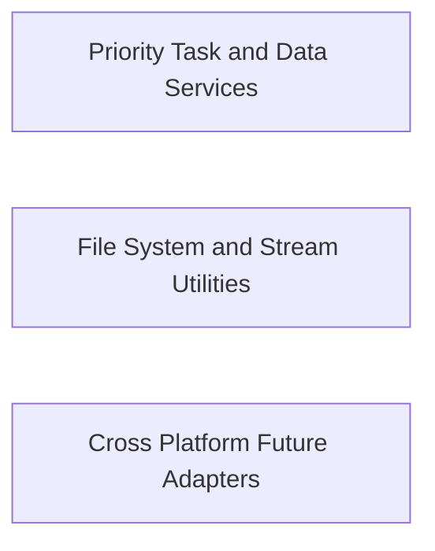

## Details

Provides foundational utilities for priority task scheduling, encryption, compression, and cross-platform async runtime abstractions.

### Priority Task and Data Services
Provides priority task queueing and scheduling, stream isolation, compression, encryption, and supporting data structures.

**Related Classes/Methods**:

- `frontend.rust-lib.lib-infra.src.priority_task.scheduler.TaskDispatcher`:14-22
- `frontend.rust-lib.lib-infra.src.priority_task.scheduler.TaskRunner`
- `frontend.rust-lib.lib-infra.src.priority_task.queue.TaskQueue`:10-14
- `frontend.rust-lib.lib-infra.src.priority_task.task.Task`:91-99

**Source Files:**

- `frontend/rust-lib/lib-infra/src/box_any.rs`
  - `frontend.rust-lib.lib-infra.src.box_any.BoxAny` (L6-L6) - Struct
  - `frontend.rust-lib.lib-infra.src.box_any.BoxAny.new` (L9-L14) - Function
  - `frontend.rust-lib.lib-infra.src.box_any.BoxAny.cloned` (L16-L21) - Method
  - `frontend.rust-lib.lib-infra.src.box_any.BoxAny.unbox_or_default` (L23-L31) - Method
  - `frontend.rust-lib.lib-infra.src.box_any.BoxAny.unbox_or_error` (L33-L45) - Method
  - `frontend.rust-lib.lib-infra.src.box_any.BoxAny.unbox_or_none` (L47-L55) - Method
  - `frontend.rust-lib.lib-infra.src.box_any.BoxAny.downcast_ref` (L58-L60) - Method
- `frontend/rust-lib/lib-infra/src/compression.rs`
  - `frontend.rust-lib.lib-infra.src.compression.compress` (L5-L10) - Function
  - `frontend.rust-lib.lib-infra.src.compression.decompress` (L12-L17) - Function
- `frontend/rust-lib/lib-infra/src/encryption/mod.rs`
  - `frontend.rust-lib.lib-infra.src.encryption.generate_encryption_secret` (L29-L33) - Function
  - `frontend.rust-lib.lib-infra.src.encryption.encrypt_data` (L40-L55) - Function
  - `frontend.rust-lib.lib-infra.src.encryption.decrypt_data` (L62-L73) - Function
  - `frontend.rust-lib.lib-infra.src.encryption.encrypt_text` (L80-L83) - Function
  - `frontend.rust-lib.lib-infra.src.encryption.decrypt_text` (L90-L94) - Function
  - `frontend.rust-lib.lib-infra.src.encryption.generate_random_passphrase` (L111-L117) - Function
  - `frontend.rust-lib.lib-infra.src.encryption.generate_random_salt` (L119-L123) - Function
  - `frontend.rust-lib.lib-infra.src.encryption.combine_passphrase_and_salt` (L125-L128) - Function
  - `frontend.rust-lib.lib-infra.src.encryption.split_passphrase_and_salt` (L130-L143) - Function
  - `frontend.rust-lib.lib-infra.src.encryption.derive_key` (L145-L149) - Function
  - `frontend.rust-lib.lib-infra.src.encryption.tests.encrypt_decrypt_test` (L156-L167) - Function
  - `frontend.rust-lib.lib-infra.src.encryption.tests.decrypt_with_invalid_secret_test` (L170-L176) - Function
- `frontend/rust-lib/lib-infra/src/isolate_stream.rs`
  - `frontend.rust-lib.lib-infra.src.isolate_stream.IsolateSink` (L11-L13) - Struct
  - `frontend.rust-lib.lib-infra.src.isolate_stream.IsolateSink.new` (L16-L18) - Function
  - `frontend.rust-lib.lib-infra.src.isolate_stream.IsolateSink.poll_ready` (L27-L29) - Method
  - `frontend.rust-lib.lib-infra.src.isolate_stream.IsolateSink.start_send` (L31-L38) - Method
  - `frontend.rust-lib.lib-infra.src.isolate_stream.IsolateSink.poll_flush` (L40-L42) - Method
  - `frontend.rust-lib.lib-infra.src.isolate_stream.IsolateSink.poll_close` (L44-L46) - Method
- `frontend/rust-lib/lib-infra/src/priority_task/queue.rs`
  - `frontend.rust-lib.lib-infra.src.priority_task.queue.TaskQueue` (L10-L14) - Struct
  - `frontend.rust-lib.lib-infra.src.priority_task.queue.TaskQueue.new` (L17-L19) - Function
  - `frontend.rust-lib.lib-infra.src.priority_task.queue.TaskQueue.push` (L21-L52) - Method
  - `frontend.rust-lib.lib-infra.src.priority_task.queue.TaskQueue.clear` (L55-L57) - Method
  - `frontend.rust-lib.lib-infra.src.priority_task.queue.TaskQueue.mut_head` (L59-L74) - Method
  - `frontend.rust-lib.lib-infra.src.priority_task.queue.TaskList` (L80-L83) - Struct
  - `frontend.rust-lib.lib-infra.src.priority_task.queue.TaskList.deref` (L88-L90) - Method
  - `frontend.rust-lib.lib-infra.src.priority_task.queue.TaskList.deref_mut` (L94-L96) - Method
  - `frontend.rust-lib.lib-infra.src.priority_task.queue.TaskList.new` (L100-L105) - Function
  - `frontend.rust-lib.lib-infra.src.priority_task.queue.TaskList.eq` (L109-L111) - Method
  - `frontend.rust-lib.lib-infra.src.priority_task.queue.TaskList.cmp` (L117-L124) - Method
  - `frontend.rust-lib.lib-infra.src.priority_task.queue.TaskList.partial_cmp` (L128-L130) - Method
- `frontend/rust-lib/lib-infra/src/priority_task/scheduler.rs`
  - `frontend.rust-lib.lib-infra.src.priority_task.scheduler.TaskDispatcher` (L14-L22) - Struct
  - `frontend.rust-lib.lib-infra.src.priority_task.scheduler.TaskDispatcher.new` (L25-L35) - Function
  - `frontend.rust-lib.lib-infra.src.priority_task.scheduler.TaskDispatcher.register_handler` (L37-L43) - Method
  - `frontend.rust-lib.lib-infra.src.priority_task.scheduler.TaskDispatcher.unregister_handler` (L45-L53) - Method
  - `frontend.rust-lib.lib-infra.src.priority_task.scheduler.TaskDispatcher.stop` (L55-L59) - Method
  - `frontend.rust-lib.lib-infra.src.priority_task.scheduler.TaskDispatcher.process_next_task` (L61-L100) - Method
  - `frontend.rust-lib.lib-infra.src.priority_task.scheduler.TaskDispatcher.add_task` (L102-L117) - Method
  - `frontend.rust-lib.lib-infra.src.priority_task.scheduler.TaskDispatcher.read_task` (L119-L121) - Method
  - `frontend.rust-lib.lib-infra.src.priority_task.scheduler.TaskDispatcher.cancel_task` (L123-L127) - Method
  - `frontend.rust-lib.lib-infra.src.priority_task.scheduler.TaskDispatcher.clear_task` (L129-L131) - Method
  - `frontend.rust-lib.lib-infra.src.priority_task.scheduler.TaskDispatcher.next_task_id` (L132-L134) - Method
  - `frontend.rust-lib.lib-infra.src.priority_task.scheduler.TaskDispatcher.notify` (L136-L138) - Method
  - `frontend.rust-lib.lib-infra.src.priority_task.scheduler.TaskRunner` (L140-L140) - Struct
  - `frontend.rust-lib.lib-infra.src.priority_task.scheduler.TaskRunner.run` (L142-L166) - Function
  - `frontend.rust-lib.lib-infra.src.priority_task.scheduler.TaskHandler` (L170-L178) - Interface
  - `frontend.rust-lib.lib-infra.src.priority_task.scheduler.TaskHandler.handler_id` (L171-L171) - Method
  - `frontend.rust-lib.lib-infra.src.priority_task.scheduler.TaskHandler.handler_name` (L173-L175) - Method
  - `frontend.rust-lib.lib-infra.src.priority_task.scheduler.TaskHandler.run` (L177-L177) - Method
  - `frontend.rust-lib.lib-infra.src.priority_task.scheduler.Box.handler_id` (L185-L187) - Method
  - `frontend.rust-lib.lib-infra.src.priority_task.scheduler.Box.handler_name` (L189-L191) - Method
  - `frontend.rust-lib.lib-infra.src.priority_task.scheduler.Box.run` (L193-L195) - Method
  - `frontend.rust-lib.lib-infra.src.priority_task.scheduler.Arc.handler_id` (L203-L205) - Method
  - `frontend.rust-lib.lib-infra.src.priority_task.scheduler.Arc.handler_name` (L207-L209) - Method
  - `frontend.rust-lib.lib-infra.src.priority_task.scheduler.Arc.run` (L211-L213) - Method
- `frontend/rust-lib/lib-infra/src/priority_task/store.rs`
  - `frontend.rust-lib.lib-infra.src.priority_task.store.TaskStore` (L7-L10) - Struct
  - `frontend.rust-lib.lib-infra.src.priority_task.store.TaskStore.new` (L13-L18) - Function
  - `frontend.rust-lib.lib-infra.src.priority_task.store.TaskStore.insert_task` (L20-L22) - Method
  - `frontend.rust-lib.lib-infra.src.priority_task.store.TaskStore.remove_task` (L24-L26) - Method
  - `frontend.rust-lib.lib-infra.src.priority_task.store.TaskStore.mut_task` (L28-L30) - Method
  - `frontend.rust-lib.lib-infra.src.priority_task.store.TaskStore.read_task` (L32-L34) - Method
  - `frontend.rust-lib.lib-infra.src.priority_task.store.TaskStore.clear` (L36-L45) - Method
  - `frontend.rust-lib.lib-infra.src.priority_task.store.TaskStore.next_task_id` (L47-L49) - Method
- `frontend/rust-lib/lib-infra/src/priority_task/task.rs`
  - `frontend.rust-lib.lib-infra.src.priority_task.task.QualityOfService` (L6-L9) - Enum
  - `frontend.rust-lib.lib-infra.src.priority_task.task.QualityOfService.eq` (L12-L17) - Method
  - `frontend.rust-lib.lib-infra.src.priority_task.task.PendingTask` (L23-L26) - Struct
  - `frontend.rust-lib.lib-infra.src.priority_task.task.PendingTask.eq` (L29-L31) - Method
  - `frontend.rust-lib.lib-infra.src.priority_task.task.PendingTask.partial_cmp` (L35-L37) - Method
  - `frontend.rust-lib.lib-infra.src.priority_task.task.PendingTask.cmp` (L41-L52) - Method
  - `frontend.rust-lib.lib-infra.src.priority_task.task.TaskContent` (L56-L59) - Enum
  - `frontend.rust-lib.lib-infra.src.priority_task.task.TaskState` (L62-L69) - Enum
  - `frontend.rust-lib.lib-infra.src.priority_task.task.TaskState.is_pending` (L72-L74) - Method
  - `frontend.rust-lib.lib-infra.src.priority_task.task.TaskState.is_done` (L75-L77) - Method
  - `frontend.rust-lib.lib-infra.src.priority_task.task.TaskState.is_cancel` (L78-L80) - Method
  - `frontend.rust-lib.lib-infra.src.priority_task.task.TaskState.is_processing` (L82-L84) - Method
  - `frontend.rust-lib.lib-infra.src.priority_task.task.TaskState.is_failed` (L86-L88) - Method
  - `frontend.rust-lib.lib-infra.src.priority_task.task.Task` (L91-L99) - Struct
  - `frontend.rust-lib.lib-infra.src.priority_task.task.Task.background` (L102-L104) - Function
  - `frontend.rust-lib.lib-infra.src.priority_task.task.Task.user_interactive` (L106-L108) - Function
  - `frontend.rust-lib.lib-infra.src.priority_task.task.Task.new` (L110-L122) - Function
  - `frontend.rust-lib.lib-infra.src.priority_task.task.Task.state` (L124-L126) - Method
  - `frontend.rust-lib.lib-infra.src.priority_task.task.Task.set_state` (L128-L130) - Method
  - `frontend.rust-lib.lib-infra.src.priority_task.task.TaskResult` (L133-L136) - Struct
  - `frontend.rust-lib.lib-infra.src.priority_task.task.TaskResult.from` (L139-L144) - Function
- `frontend/rust-lib/lib-infra/src/ref_map.rs`
  - `frontend.rust-lib.lib-infra.src.ref_map.RefCountValue` (L6-L8) - Interface
  - `frontend.rust-lib.lib-infra.src.ref_map.RefCountValue.did_remove` (L7-L7) - Method
  - `frontend.rust-lib.lib-infra.src.ref_map.RefCountHandler` (L10-L13) - Struct
  - `frontend.rust-lib.lib-infra.src.ref_map.RefCountHandler.new` (L16-L21) - Function
  - `frontend.rust-lib.lib-infra.src.ref_map.RefCountHandler.increase_ref_count` (L23-L25) - Method
  - `frontend.rust-lib.lib-infra.src.ref_map.RefCountHashMap` (L28-L28) - Struct
  - `frontend.rust-lib.lib-infra.src.ref_map.RefCountHashMap.default` (L31-L33) - Function
  - `frontend.rust-lib.lib-infra.src.ref_map.RefCountHashMap.new` (L40-L42) - Function
  - `frontend.rust-lib.lib-infra.src.ref_map.RefCountHashMap.get` (L44-L46) - Method
  - `frontend.rust-lib.lib-infra.src.ref_map.RefCountHashMap.values` (L48-L54) - Method
  - `frontend.rust-lib.lib-infra.src.ref_map.RefCountHashMap.insert` (L56-L63) - Method
  - `frontend.rust-lib.lib-infra.src.ref_map.RefCountHashMap.remove` (L65-L81) - Method
  - `frontend.rust-lib.lib-infra.src.ref_map.Arc.did_remove` (L89-L91) - Method
- `frontend/rust-lib/lib-infra/src/validator_fn.rs`
  - `frontend.rust-lib.lib-infra.src.validator_fn.required_not_empty_str` (L4-L9) - Function
  - `frontend.rust-lib.lib-infra.src.validator_fn.required_valid_path` (L11-L17) - Function
  - `frontend.rust-lib.lib-infra.src.validator_fn.impl_regex_validator` (L30-L42) - Function

### File System and Stream Utilities
Provides filesystem directory handling, archive compression, bounded channel streaming, and target operating system detection.

**Related Classes/Methods**:

- `frontend.rust-lib.lib-infra.src.file_util.copy_dir_recursive`:13-26
- `frontend.rust-lib.lib-infra.src.file_util.zip_folder`:70-131
- `frontend.rust-lib.lib-infra.src.stream_util.mpsc_channel_stream`:17-21
- `frontend.rust-lib.lib-infra.src.util.get_operating_system`:124-140

**Source Files:**

- `frontend/rust-lib/lib-infra/src/file_util.rs`
  - `frontend.rust-lib.lib-infra.src.file_util.copy_dir_recursive` (L13-L26) - Function
  - `frontend.rust-lib.lib-infra.src.file_util.find_and_sort_folders_at` (L28-L68) - Function
  - `frontend.rust-lib.lib-infra.src.file_util.zip_folder` (L70-L131) - Function
  - `frontend.rust-lib.lib-infra.src.file_util.unzip_and_replace` (L132-L188) - Function
  - `frontend.rust-lib.lib-infra.src.file_util.copy_dir_all` (L191-L203) - Function
- `frontend/rust-lib/lib-infra/src/stream_util.rs`
  - `frontend.rust-lib.lib-infra.src.stream_util.BoundedStream` (L7-L9) - Struct
  - `frontend.rust-lib.lib-infra.src.stream_util.BoundedStream.poll_next` (L12-L14) - Method
  - `frontend.rust-lib.lib-infra.src.stream_util.mpsc_channel_stream` (L17-L21) - Function
- `frontend/rust-lib/lib-infra/src/util.rs`
  - `frontend.rust-lib.lib-infra.src.util.if_native` (L5-L10) - Function
  - `frontend.rust-lib.lib-infra.src.util.if_wasm` (L13-L18) - Function
  - `frontend.rust-lib.lib-infra.src.util.conditional_send_sync_trait` (L21-L33) - Function
  - `frontend.rust-lib.lib-infra.src.util.move_vec_element` (L35-L61) - Function
  - `frontend.rust-lib.lib-infra.src.util.timestamp` (L63-L65) - Function
  - `frontend.rust-lib.lib-infra.src.util.md5` (L68-L71) - Function
  - `frontend.rust-lib.lib-infra.src.util.OperatingSystem` (L73-L80) - Enum
  - `frontend.rust-lib.lib-infra.src.util.OperatingSystem.is_not_ios` (L83-L85) - Method
  - `frontend.rust-lib.lib-infra.src.util.OperatingSystem.is_desktop` (L87-L92) - Method
  - `frontend.rust-lib.lib-infra.src.util.OperatingSystem.is_not_desktop` (L94-L96) - Method
  - `frontend.rust-lib.lib-infra.src.util.from` (L100-L102) - Function
  - `frontend.rust-lib.lib-infra.src.util.OperatingSystem.from` (L112-L121) - Function
  - `frontend.rust-lib.lib-infra.src.util.get_operating_system` (L124-L140) - Function
  - `frontend.rust-lib.lib-infra.src.util.sync_trace` (L143-L147) - Function

### Cross Platform Future Adapters
Adapts asynchronous futures and polling behaviors across native and WebAssembly compilation targets.

**Related Classes/Methods**:

- `frontend.rust-lib.lib-infra.src.wasm.future.FutureResult`:36-39

**Source Files:**

- `frontend/rust-lib/lib-infra/src/native/future.rs`
  - `frontend.rust-lib.lib-infra.src.native.future.to_fut` (L10-L15) - Function
  - `frontend.rust-lib.lib-infra.src.native.future.Fut` (L18-L21) - Struct
  - `frontend.rust-lib.lib-infra.src.native.future.Fut.poll` (L29-L32) - Method
- `frontend/rust-lib/lib-infra/src/wasm/future.rs`
  - `frontend.rust-lib.lib-infra.src.wasm.future.to_fut` (L12-L17) - Function
  - `frontend.rust-lib.lib-infra.src.wasm.future.Fut` (L20-L23) - Struct
  - `frontend.rust-lib.lib-infra.src.wasm.future.Fut.poll` (L28-L31) - Method
  - `frontend.rust-lib.lib-infra.src.wasm.future.FutureResult` (L36-L39) - Struct
  - `frontend.rust-lib.lib-infra.src.wasm.future.FutureResult.new` (L43-L48) - Function
  - `frontend.rust-lib.lib-infra.src.wasm.future.FutureResult.poll` (L57-L61) - Method

### [FAQ](https://github.com/CodeBoarding/GeneratedOnBoardings/tree/main?tab=readme-ov-file#faq)