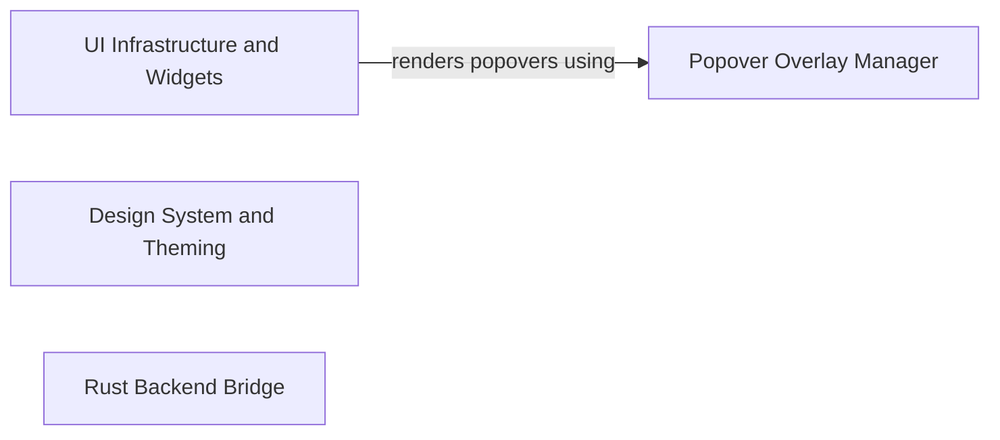

## Details

Supplies reusable UI widgets, popovers, backend FFI bindings, result abstractions, and styling infrastructure across packages.

### UI Infrastructure and Widgets [[Expand]](./UI_Infrastructure_and_Widgets.md)
Provides reusable UI styling widgets, overlays, theme color schemes, SVG rendering, and plugin infrastructure.

**Related Classes/Methods**:

- `frontend.appflowy_flutter.packages.flowy_infra_ui.lib.src.flowy_overlay.appflowy_popover.AppFlowyPopover`:24-133
- `frontend.appflowy_flutter.packages.flowy_svg.lib.src.flowy_svg.FlowySvg`:20-146

**Source Files:**

- `frontend/appflowy_flutter/packages/flowy_infra/lib/colorscheme/colorscheme.dart`
  - `frontend.appflowy_flutter.packages.flowy_infra.lib.colorscheme.colorscheme.FlowyColorScheme` (L37-L199) - Class
  - `frontend.appflowy_flutter.packages.flowy_infra.lib.colorscheme.colorscheme.FlowyColorScheme.FlowyColorScheme` (L38-L94) - Constructor
  - `frontend.appflowy_flutter.packages.flowy_infra.lib.colorscheme.colorscheme.FlowyColorScheme.FlowyColorScheme.fromJson` (L160-L161) - Constructor
  - `frontend.appflowy_flutter.packages.flowy_infra.lib.colorscheme.colorscheme.FlowyColorScheme.toJson` (L163-L163) - Method
  - `frontend.appflowy_flutter.packages.flowy_infra.lib.colorscheme.colorscheme.FlowyColorScheme.FlowyColorScheme.fromJsonSoft` (L168-L179) - Constructor
  - `frontend.appflowy_flutter.packages.flowy_infra.lib.colorscheme.colorscheme.FlowyColorScheme.getMissingKeys` (L193-L198) - Method
- `frontend/appflowy_flutter/packages/flowy_infra/lib/colorscheme/dandelion.dart`
  - `frontend.appflowy_flutter.packages.flowy_infra.lib.colorscheme.dandelion.DandelionColorScheme` (L26-L150) - Class
  - `frontend.appflowy_flutter.packages.flowy_infra.lib.colorscheme.dandelion.DandelionColorScheme.DandelionColorScheme.light` (L27-L90) - Constructor
  - `frontend.appflowy_flutter.packages.flowy_infra.lib.colorscheme.dandelion.DandelionColorScheme.DandelionColorScheme.dark` (L92-L149) - Constructor
- `frontend/appflowy_flutter/packages/flowy_infra/lib/colorscheme/default_colorscheme.dart`
  - `frontend.appflowy_flutter.packages.flowy_infra.lib.colorscheme.default_colorscheme.ColorSchemeConstants` (L5-L27) - Class
  - `frontend.appflowy_flutter.packages.flowy_infra.lib.colorscheme.default_colorscheme.DefaultColorScheme` (L29-L147) - Class
  - `frontend.appflowy_flutter.packages.flowy_infra.lib.colorscheme.default_colorscheme.DefaultColorScheme.DefaultColorScheme.light` (L30-L87) - Constructor
  - `frontend.appflowy_flutter.packages.flowy_infra.lib.colorscheme.default_colorscheme.DefaultColorScheme.DefaultColorScheme.dark` (L89-L146) - Constructor
- `frontend/appflowy_flutter/packages/flowy_infra/lib/colorscheme/lavender.dart`
  - `frontend.appflowy_flutter.packages.flowy_infra.lib.colorscheme.lavender.LavenderColorScheme` (L28-L146) - Class
  - `frontend.appflowy_flutter.packages.flowy_infra.lib.colorscheme.lavender.LavenderColorScheme.LavenderColorScheme.light` (L29-L86) - Constructor
  - `frontend.appflowy_flutter.packages.flowy_infra.lib.colorscheme.lavender.LavenderColorScheme.LavenderColorScheme.dark` (L88-L145) - Constructor
- `frontend/appflowy_flutter/packages/flowy_infra/lib/colorscheme/lemonade.dart`
  - `frontend.appflowy_flutter.packages.flowy_infra.lib.colorscheme.lemonade.LemonadeColorScheme` (L28-L151) - Class
  - `frontend.appflowy_flutter.packages.flowy_infra.lib.colorscheme.lemonade.LemonadeColorScheme.LemonadeColorScheme.light` (L29-L92) - Constructor
  - `frontend.appflowy_flutter.packages.flowy_infra.lib.colorscheme.lemonade.LemonadeColorScheme.LemonadeColorScheme.dark` (L94-L150) - Constructor
- `frontend/appflowy_flutter/packages/flowy_infra/lib/file_picker/file_picker_impl.dart`
  - `frontend.appflowy_flutter.packages.flowy_infra.lib.file_picker.file_picker_impl.FilePicker` (L6-L67) - Class
  - `frontend.appflowy_flutter.packages.flowy_infra.lib.file_picker.file_picker_impl.FilePicker.getDirectoryPath` (L8-L10) - Method
  - `frontend.appflowy_flutter.packages.flowy_infra.lib.file_picker.file_picker_impl.FilePicker.pickFiles` (L13-L38) - Method
  - `frontend.appflowy_flutter.packages.flowy_infra.lib.file_picker.file_picker_impl.FilePicker.saveFile` (L46-L66) - Method
- `frontend/appflowy_flutter/packages/flowy_infra/lib/file_picker/file_picker_service.dart`
  - `frontend.appflowy_flutter.packages.flowy_infra.lib.file_picker.file_picker_service.FilePickerResult` (L6-L11) - Class
  - `frontend.appflowy_flutter.packages.flowy_infra.lib.file_picker.file_picker_service.FilePickerResult.FilePickerResult` (L7-L7) - Constructor
  - `frontend.appflowy_flutter.packages.flowy_infra.lib.file_picker.file_picker_service.FilePickerService` (L14-L43) - Class
  - `frontend.appflowy_flutter.packages.flowy_infra.lib.file_picker.file_picker_service.FilePickerService.getDirectoryPath` (L15-L18) - Method
  - `frontend.appflowy_flutter.packages.flowy_infra.lib.file_picker.file_picker_service.FilePickerService.pickFiles` (L20-L32) - Method
  - `frontend.appflowy_flutter.packages.flowy_infra.lib.file_picker.file_picker_service.FilePickerService.saveFile` (L34-L42) - Method
- `frontend/appflowy_flutter/packages/flowy_infra/lib/icon_data.dart`
  - `frontend.appflowy_flutter.packages.flowy_infra.lib.icon_data.FlowyIconData` (L21-L31) - Class
  - `frontend.appflowy_flutter.packages.flowy_infra.lib.icon_data.FlowyIconData.FlowyIconData._` (L22-L22) - Constructor
- `frontend/appflowy_flutter/packages/flowy_infra/lib/language.dart`
  - `frontend.appflowy_flutter.packages.flowy_infra.lib.language.languageFromLocale` (L3-L95) - Function
- `frontend/appflowy_flutter/packages/flowy_infra/lib/notifier.dart`
  - `frontend.appflowy_flutter.packages.flowy_infra.lib.notifier.Comparable` (L3-L5) - Class
  - `frontend.appflowy_flutter.packages.flowy_infra.lib.notifier.Comparable.compare` (L4-L4) - Method
  - `frontend.appflowy_flutter.packages.flowy_infra.lib.notifier.ObjectComparable` (L7-L12) - Class
  - `frontend.appflowy_flutter.packages.flowy_infra.lib.notifier.ObjectComparable.compare` (L9-L11) - Method
  - `frontend.appflowy_flutter.packages.flowy_infra.lib.notifier.PublishNotifier` (L14-L50) - Class
  - `frontend.appflowy_flutter.packages.flowy_infra.lib.notifier.PublishNotifier.PublishNotifier` (L18-L18) - Constructor
  - `frontend.appflowy_flutter.packages.flowy_infra.lib.notifier.PublishNotifier.value=` (L20-L30) - Method
  - `frontend.appflowy_flutter.packages.flowy_infra.lib.notifier.PublishNotifier.currentValue` (L32-L32) - Method
  - `frontend.appflowy_flutter.packages.flowy_infra.lib.notifier.PublishNotifier.addPublishListener` (L34-L49) - Method
- `frontend/appflowy_flutter/packages/flowy_infra/lib/platform_extension.dart`
  - `frontend.appflowy_flutter.packages.flowy_infra.lib.platform_extension.PlatformExtension.isMacOS` (L7-L12) - Method
  - `frontend.appflowy_flutter.packages.flowy_infra.lib.platform_extension.PlatformExtension.isWindows` (L15-L20) - Method
  - `frontend.appflowy_flutter.packages.flowy_infra.lib.platform_extension.PlatformExtension.isLinux` (L23-L28) - Method
  - `frontend.appflowy_flutter.packages.flowy_infra.lib.platform_extension.PlatformExtension.isDesktopOrWeb` (L30-L35) - Method
  - `frontend.appflowy_flutter.packages.flowy_infra.lib.platform_extension.PlatformExtension.isDesktop` (L37-L42) - Method
  - `frontend.appflowy_flutter.packages.flowy_infra.lib.platform_extension.PlatformExtension.isMobile` (L44-L49) - Method
  - `frontend.appflowy_flutter.packages.flowy_infra.lib.platform_extension.PlatformExtension.isNotMobile` (L51-L56) - Method
- `frontend/appflowy_flutter/packages/flowy_infra/lib/plugins/bloc/dynamic_plugin_bloc.dart`
  - `frontend.appflowy_flutter.packages.flowy_infra.lib.plugins.bloc.dynamic_plugin_bloc.DynamicPluginBloc` (L10-L85) - Class
  - `frontend.appflowy_flutter.packages.flowy_infra.lib.plugins.bloc.dynamic_plugin_bloc.DynamicPluginBloc.DynamicPluginBloc` (L11-L15) - Constructor
  - `frontend.appflowy_flutter.packages.flowy_infra.lib.plugins.bloc.dynamic_plugin_bloc.DynamicPluginBloc.dispatch` (L17-L24) - Method
  - `frontend.appflowy_flutter.packages.flowy_infra.lib.plugins.bloc.dynamic_plugin_bloc.DynamicPluginBloc.onLoadRequested` (L26-L32) - Method
  - `frontend.appflowy_flutter.packages.flowy_infra.lib.plugins.bloc.dynamic_plugin_bloc.DynamicPluginBloc.addPlugin` (L34-L58) - Method
  - `frontend.appflowy_flutter.packages.flowy_infra.lib.plugins.bloc.dynamic_plugin_bloc.DynamicPluginBloc.removePlugin` (L60-L84) - Method
- `frontend/appflowy_flutter/packages/flowy_infra/lib/plugins/bloc/dynamic_plugin_event.dart`
  - `frontend.appflowy_flutter.packages.flowy_infra.lib.plugins.bloc.dynamic_plugin_event.DynamicPluginEvent` (L6-L11) - Class
  - `frontend.appflowy_flutter.packages.flowy_infra.lib.plugins.bloc.dynamic_plugin_event.DynamicPluginEvent.DynamicPluginEvent.addPlugin` (L7-L7) - Constructor
  - `frontend.appflowy_flutter.packages.flowy_infra.lib.plugins.bloc.dynamic_plugin_event.DynamicPluginEvent.DynamicPluginEvent.removePlugin` (L8-L9) - Constructor
  - `frontend.appflowy_flutter.packages.flowy_infra.lib.plugins.bloc.dynamic_plugin_event.DynamicPluginEvent.DynamicPluginEvent.load` (L10-L10) - Constructor
- `frontend/appflowy_flutter/packages/flowy_infra/lib/plugins/bloc/dynamic_plugin_state.dart`
  - `frontend.appflowy_flutter.packages.flowy_infra.lib.plugins.bloc.dynamic_plugin_state.DynamicPluginState` (L8-L21) - Class
  - `frontend.appflowy_flutter.packages.flowy_infra.lib.plugins.bloc.dynamic_plugin_state.DynamicPluginState.DynamicPluginState.uninitialized` (L9-L9) - Constructor
  - `frontend.appflowy_flutter.packages.flowy_infra.lib.plugins.bloc.dynamic_plugin_state.DynamicPluginState.DynamicPluginState.ready` (L10-L12) - Constructor
  - `frontend.appflowy_flutter.packages.flowy_infra.lib.plugins.bloc.dynamic_plugin_state.DynamicPluginState.DynamicPluginState.processing` (L13-L13) - Constructor
  - `frontend.appflowy_flutter.packages.flowy_infra.lib.plugins.bloc.dynamic_plugin_state.DynamicPluginState.DynamicPluginState.compilationFailure` (L14-L15) - Constructor
  - `frontend.appflowy_flutter.packages.flowy_infra.lib.plugins.bloc.dynamic_plugin_state.DynamicPluginState.DynamicPluginState.deletionFailure` (L16-L18) - Constructor
  - `frontend.appflowy_flutter.packages.flowy_infra.lib.plugins.bloc.dynamic_plugin_state.DynamicPluginState.DynamicPluginState.deletionSuccess` (L19-L19) - Constructor
  - `frontend.appflowy_flutter.packages.flowy_infra.lib.plugins.bloc.dynamic_plugin_state.DynamicPluginState.DynamicPluginState.compilationSuccess` (L20-L20) - Constructor
- `frontend/appflowy_flutter/packages/flowy_infra/lib/plugins/service/location_service.dart`
  - `frontend.appflowy_flutter.packages.flowy_infra.lib.plugins.service.location_service.PluginLocationService` (L3-L13) - Class
  - `frontend.appflowy_flutter.packages.flowy_infra.lib.plugins.service.location_service.PluginLocationService.PluginLocationService` (L4-L6) - Constructor
  - `frontend.appflowy_flutter.packages.flowy_infra.lib.plugins.service.location_service.PluginLocationService.fallback` (L10-L10) - Method
  - `frontend.appflowy_flutter.packages.flowy_infra.lib.plugins.service.location_service.PluginLocationService.location` (L12-L12) - Method
- `frontend/appflowy_flutter/packages/flowy_infra/lib/plugins/service/models/exceptions.dart`
  - `frontend.appflowy_flutter.packages.flowy_infra.lib.plugins.service.models.exceptions.PluginCompilationException` (L1-L5) - Class
  - `frontend.appflowy_flutter.packages.flowy_infra.lib.plugins.service.models.exceptions.PluginCompilationException.PluginCompilationException` (L4-L4) - Constructor
- `frontend/appflowy_flutter/packages/flowy_infra/lib/plugins/service/models/flowy_dynamic_plugin.dart`
  - `frontend.appflowy_flutter.packages.flowy_infra.lib.plugins.service.models.flowy_dynamic_plugin.FlowyDynamicPlugin` (L21-L161) - Class
  - `frontend.appflowy_flutter.packages.flowy_infra.lib.plugins.service.models.flowy_dynamic_plugin.FlowyDynamicPlugin.FlowyDynamicPlugin._` (L22-L27) - Constructor
  - `frontend.appflowy_flutter.packages.flowy_infra.lib.plugins.service.models.flowy_dynamic_plugin.FlowyDynamicPlugin.isPlugin` (L30-L31) - Method
  - `frontend.appflowy_flutter.packages.flowy_infra.lib.plugins.service.models.flowy_dynamic_plugin.FlowyDynamicPlugin.lightExtension` (L35-L35) - Method
  - `frontend.appflowy_flutter.packages.flowy_infra.lib.plugins.service.models.flowy_dynamic_plugin.FlowyDynamicPlugin.darkExtension` (L36-L36) - Method
  - `frontend.appflowy_flutter.packages.flowy_infra.lib.plugins.service.models.flowy_dynamic_plugin.FlowyDynamicPlugin.name` (L38-L38) - Method
  - `frontend.appflowy_flutter.packages.flowy_infra.lib.plugins.service.models.flowy_dynamic_plugin.FlowyDynamicPlugin._fsPluginName` (L41-L41) - Method
  - `frontend.appflowy_flutter.packages.flowy_infra.lib.plugins.service.models.flowy_dynamic_plugin.FlowyDynamicPlugin.source` (L46-L48) - Method
  - `frontend.appflowy_flutter.packages.flowy_infra.lib.plugins.service.models.flowy_dynamic_plugin.FlowyDynamicPlugin.decode` (L55-L70) - Method
  - `frontend.appflowy_flutter.packages.flowy_infra.lib.plugins.service.models.flowy_dynamic_plugin.FlowyDynamicPlugin.encode` (L77-L94) - Method
  - `frontend.appflowy_flutter.packages.flowy_infra.lib.plugins.service.models.flowy_dynamic_plugin.FlowyDynamicPlugin._theme` (L102-L160) - Method
- `frontend/appflowy_flutter/packages/flowy_infra/lib/plugins/service/models/plugin_type.dart`
  - `frontend.appflowy_flutter.packages.flowy_infra.lib.plugins.service.models.plugin_type.PluginType` (L7-L31) - Enum
  - `frontend.appflowy_flutter.packages.flowy_infra.lib.plugins.service.models.plugin_type.PluginType.theme` (L8-L8) - Enum
  - `frontend.appflowy_flutter.packages.flowy_infra.lib.plugins.service.models.plugin_type.PluginType.PluginType._` (L10-L10) - Constructor
  - `frontend.appflowy_flutter.packages.flowy_infra.lib.plugins.service.models.plugin_type.PluginType.PluginType.from` (L12-L18) - Constructor
  - `frontend.appflowy_flutter.packages.flowy_infra.lib.plugins.service.models.plugin_type.PluginType._isTheme` (L20-L30) - Method
- `frontend/appflowy_flutter/packages/flowy_infra/lib/plugins/service/plugin_service.dart`
  - `frontend.appflowy_flutter.packages.flowy_infra.lib.plugins.service.plugin_service.FlowyPluginService` (L12-L102) - Class
  - `frontend.appflowy_flutter.packages.flowy_infra.lib.plugins.service.plugin_service.FlowyPluginService.FlowyPluginService._` (L13-L13) - Constructor
  - `frontend.appflowy_flutter.packages.flowy_infra.lib.plugins.service.plugin_service.FlowyPluginService.instance` (L15-L15) - Method
  - `frontend.appflowy_flutter.packages.flowy_infra.lib.plugins.service.plugin_service.FlowyPluginService.setLocation` (L21-L22) - Method
  - `frontend.appflowy_flutter.packages.flowy_infra.lib.plugins.service.plugin_service.FlowyPluginService._targets` (L24-L28) - Method
  - `frontend.appflowy_flutter.packages.flowy_infra.lib.plugins.service.plugin_service.FlowyPluginService.plugins` (L31-L38) - Method
  - `frontend.appflowy_flutter.packages.flowy_infra.lib.plugins.service.plugin_service.FlowyPluginService.pick` (L43-L54) - Method
  - `frontend.appflowy_flutter.packages.flowy_infra.lib.plugins.service.plugin_service.FlowyPluginService.lookup` (L57-L64) - Method
  - `frontend.appflowy_flutter.packages.flowy_infra.lib.plugins.service.plugin_service.FlowyPluginService.addPlugin` (L68-L78) - Method
  - `frontend.appflowy_flutter.packages.flowy_infra.lib.plugins.service.plugin_service.FlowyPluginService.removePlugin` (L81-L84) - Method
  - `frontend.appflowy_flutter.packages.flowy_infra.lib.plugins.service.plugin_service.FlowyPluginService._copyDirectorySync` (L86-L101) - Method
- `frontend/appflowy_flutter/packages/flowy_infra/lib/size.dart`
  - `frontend.appflowy_flutter.packages.flowy_infra.lib.size.PageBreaks` (L3-L11) - Class
  - `frontend.appflowy_flutter.packages.flowy_infra.lib.size.PageBreaks.largePhone` (L4-L4) - Method
  - `frontend.appflowy_flutter.packages.flowy_infra.lib.size.PageBreaks.tabletPortrait` (L6-L6) - Method
  - `frontend.appflowy_flutter.packages.flowy_infra.lib.size.PageBreaks.tabletLandscape` (L8-L8) - Method
  - `frontend.appflowy_flutter.packages.flowy_infra.lib.size.PageBreaks.desktop` (L10-L10) - Method
  - `frontend.appflowy_flutter.packages.flowy_infra.lib.size.Insets` (L13-L30) - Class
  - `frontend.appflowy_flutter.packages.flowy_infra.lib.size.Insets.xs` (L17-L17) - Method
  - `frontend.appflowy_flutter.packages.flowy_infra.lib.size.Insets.sm` (L19-L19) - Method
  - `frontend.appflowy_flutter.packages.flowy_infra.lib.size.Insets.m` (L21-L21) - Method
  - `frontend.appflowy_flutter.packages.flowy_infra.lib.size.Insets.l` (L23-L23) - Method
  - `frontend.appflowy_flutter.packages.flowy_infra.lib.size.Insets.xl` (L25-L25) - Method
  - `frontend.appflowy_flutter.packages.flowy_infra.lib.size.Insets.xxl` (L27-L27) - Method
  - `frontend.appflowy_flutter.packages.flowy_infra.lib.size.Insets.xxxl` (L29-L29) - Method
  - `frontend.appflowy_flutter.packages.flowy_infra.lib.size.FontSizes` (L32-L52) - Class
  - `frontend.appflowy_flutter.packages.flowy_infra.lib.size.FontSizes.scale` (L33-L33) - Method
  - `frontend.appflowy_flutter.packages.flowy_infra.lib.size.FontSizes.s11` (L35-L35) - Method
  - `frontend.appflowy_flutter.packages.flowy_infra.lib.size.FontSizes.s12` (L37-L37) - Method
  - `frontend.appflowy_flutter.packages.flowy_infra.lib.size.FontSizes.s14` (L39-L39) - Method
  - `frontend.appflowy_flutter.packages.flowy_infra.lib.size.FontSizes.s16` (L41-L41) - Method
  - `frontend.appflowy_flutter.packages.flowy_infra.lib.size.FontSizes.s18` (L43-L43) - Method
  - `frontend.appflowy_flutter.packages.flowy_infra.lib.size.FontSizes.s20` (L45-L45) - Method
  - `frontend.appflowy_flutter.packages.flowy_infra.lib.size.FontSizes.s24` (L47-L47) - Method
  - `frontend.appflowy_flutter.packages.flowy_infra.lib.size.FontSizes.s32` (L49-L49) - Method
  - `frontend.appflowy_flutter.packages.flowy_infra.lib.size.FontSizes.s44` (L51-L51) - Method
  - `frontend.appflowy_flutter.packages.flowy_infra.lib.size.Sizes` (L54-L60) - Class
  - `frontend.appflowy_flutter.packages.flowy_infra.lib.size.Sizes.hit` (L57-L57) - Method
  - `frontend.appflowy_flutter.packages.flowy_infra.lib.size.Sizes.iconMed` (L59-L59) - Method
  - `frontend.appflowy_flutter.packages.flowy_infra.lib.size.Corners` (L62-L86) - Class
- `frontend/appflowy_flutter/packages/flowy_infra/lib/theme.dart`
  - `frontend.appflowy_flutter.packages.flowy_infra.lib.theme.BuiltInTheme` (L5-L10) - Class
  - `frontend.appflowy_flutter.packages.flowy_infra.lib.theme.AppTheme` (L12-L68) - Class
  - `frontend.appflowy_flutter.packages.flowy_infra.lib.theme.AppTheme.AppTheme` (L20-L25) - Constructor
  - `frontend.appflowy_flutter.packages.flowy_infra.lib.theme.AppTheme._plugins` (L34-L37) - Method
  - `frontend.appflowy_flutter.packages.flowy_infra.lib.theme.AppTheme.builtins` (L39-L48) - Method
  - `frontend.appflowy_flutter.packages.flowy_infra.lib.theme.AppTheme.themes` (L50-L54) - Method
  - `frontend.appflowy_flutter.packages.flowy_infra.lib.theme.AppTheme.fromName` (L56-L67) - Method
- `frontend/appflowy_flutter/packages/flowy_infra/lib/theme_extension.dart`
  - `frontend.appflowy_flutter.packages.flowy_infra.lib.theme_extension.AFThemeExtension` (L4-L226) - Class
  - `frontend.appflowy_flutter.packages.flowy_infra.lib.theme_extension.AFThemeExtension.of` (L5-L6) - Method
  - `frontend.appflowy_flutter.packages.flowy_infra.lib.theme_extension.AFThemeExtension.maybeOf` (L8-L9) - Method
  - `frontend.appflowy_flutter.packages.flowy_infra.lib.theme_extension.AFThemeExtension.AFThemeExtension` (L11-L46) - Constructor
  - `frontend.appflowy_flutter.packages.flowy_infra.lib.theme_extension.AFThemeExtension.copyWith` (L94-L166) - Method
  - `frontend.appflowy_flutter.packages.flowy_infra.lib.theme_extension.AFThemeExtension.lerp` (L169-L225) - Method
  - `frontend.appflowy_flutter.packages.flowy_infra.lib.theme_extension.FlowyTint` (L228-L282) - Enum
  - `frontend.appflowy_flutter.packages.flowy_infra.lib.theme_extension.FlowyTint.tint1` (L229-L229) - Enum
  - `frontend.appflowy_flutter.packages.flowy_infra.lib.theme_extension.FlowyTint.tint2` (L230-L230) - Enum
  - `frontend.appflowy_flutter.packages.flowy_infra.lib.theme_extension.FlowyTint.tint3` (L231-L231) - Enum
  - `frontend.appflowy_flutter.packages.flowy_infra.lib.theme_extension.FlowyTint.tint4` (L232-L232) - Enum
  - `frontend.appflowy_flutter.packages.flowy_infra.lib.theme_extension.FlowyTint.tint5` (L233-L233) - Enum
  - `frontend.appflowy_flutter.packages.flowy_infra.lib.theme_extension.FlowyTint.tint6` (L234-L234) - Enum
  - `frontend.appflowy_flutter.packages.flowy_infra.lib.theme_extension.FlowyTint.tint7` (L235-L235) - Enum
  - `frontend.appflowy_flutter.packages.flowy_infra.lib.theme_extension.FlowyTint.tint8` (L236-L236) - Enum
  - `frontend.appflowy_flutter.packages.flowy_infra.lib.theme_extension.FlowyTint.tint9` (L237-L237) - Enum
  - `frontend.appflowy_flutter.packages.flowy_infra.lib.theme_extension.FlowyTint.toJson` (L239-L239) - Method
  - `frontend.appflowy_flutter.packages.flowy_infra.lib.theme_extension.FlowyTint.fromJson` (L240-L246) - Method
  - `frontend.appflowy_flutter.packages.flowy_infra.lib.theme_extension.FlowyTint.fromId` (L248-L255) - Method
  - `frontend.appflowy_flutter.packages.flowy_infra.lib.theme_extension.FlowyTint.color` (L257-L268) - Method
  - `frontend.appflowy_flutter.packages.flowy_infra.lib.theme_extension.FlowyTint.id` (L270-L281) - Method
- `frontend/appflowy_flutter/packages/flowy_infra/lib/time/duration.dart`
  - `frontend.appflowy_flutter.packages.flowy_infra.lib.time.duration.FlowyDurations` (L5-L13) - Class
  - `frontend.appflowy_flutter.packages.flowy_infra.lib.time.duration.FlowyDurations.fastest` (L6-L6) - Method
  - `frontend.appflowy_flutter.packages.flowy_infra.lib.time.duration.FlowyDurations.fast` (L8-L8) - Method
  - `frontend.appflowy_flutter.packages.flowy_infra.lib.time.duration.FlowyDurations.medium` (L10-L10) - Method
  - `frontend.appflowy_flutter.packages.flowy_infra.lib.time.duration.FlowyDurations.slow` (L12-L12) - Method
  - `frontend.appflowy_flutter.packages.flowy_infra.lib.time.duration.RouteDurations` (L15-L18) - Class
  - `frontend.appflowy_flutter.packages.flowy_infra.lib.time.duration.RouteDurations.slow` (L16-L16) - Method
  - `frontend.appflowy_flutter.packages.flowy_infra.lib.time.duration.RouteDurations.medium` (L17-L17) - Method
- `frontend/appflowy_flutter/packages/flowy_infra/lib/utils/color_converter.dart`
  - `frontend.appflowy_flutter.packages.flowy_infra.lib.utils.color_converter.ColorConverter` (L4-L24) - Class
  - `frontend.appflowy_flutter.packages.flowy_infra.lib.utils.color_converter.ColorConverter.ColorConverter` (L5-L5) - Constructor
  - `frontend.appflowy_flutter.packages.flowy_infra.lib.utils.color_converter.ColorConverter.fromJson` (L10-L13) - Method
  - `frontend.appflowy_flutter.packages.flowy_infra.lib.utils.color_converter.ColorConverter.toJson` (L16-L23) - Method
- `frontend/appflowy_flutter/packages/flowy_infra/lib/uuid.dart`
  - `frontend.appflowy_flutter.packages.flowy_infra.lib.uuid.uuid` (L7-L9) - Function
  - `frontend.appflowy_flutter.packages.flowy_infra.lib.uuid.fixedUuid` (L11-L13) - Function
  - `frontend.appflowy_flutter.packages.flowy_infra.lib.uuid.UuidType` (L15-L19) - Enum
  - `frontend.appflowy_flutter.packages.flowy_infra.lib.uuid.UuidType.publicSpace` (L17-L17) - Enum
  - `frontend.appflowy_flutter.packages.flowy_infra.lib.uuid.UuidType.privateSpace` (L18-L18) - Enum
- `frontend/appflowy_flutter/packages/flowy_infra_ui/example/lib/home/demo_item.dart`
  - `frontend.appflowy_flutter.packages.flowy_infra_ui.example.lib.home.demo_item.ListItem` (L3-L3) - Class
  - `frontend.appflowy_flutter.packages.flowy_infra_ui.example.lib.home.demo_item.DemoItem` (L5-L9) - Class
  - `frontend.appflowy_flutter.packages.flowy_infra_ui.example.lib.home.demo_item.DemoItem.buildTitle` (L6-L6) - Method
  - `frontend.appflowy_flutter.packages.flowy_infra_ui.example.lib.home.demo_item.DemoItem.handleTap` (L8-L8) - Method
  - `frontend.appflowy_flutter.packages.flowy_infra_ui.example.lib.home.demo_item.SectionHeaderItem` (L11-L17) - Class
  - `frontend.appflowy_flutter.packages.flowy_infra_ui.example.lib.home.demo_item.SectionHeaderItem.SectionHeaderItem` (L12-L12) - Constructor
  - `frontend.appflowy_flutter.packages.flowy_infra_ui.example.lib.home.demo_item.SectionHeaderItem.buildWidget` (L16-L16) - Method
- `frontend/appflowy_flutter/packages/flowy_infra_ui/example/lib/home/home_screen.dart`
  - `frontend.appflowy_flutter.packages.flowy_infra_ui.example.lib.home.home_screen.HomeScreen` (L7-L48) - Class
  - `frontend.appflowy_flutter.packages.flowy_infra_ui.example.lib.home.home_screen.HomeScreen.HomeScreen` (L8-L8) - Constructor
  - `frontend.appflowy_flutter.packages.flowy_infra_ui.example.lib.home.home_screen.HomeScreen.build` (L17-L47) - Method
- `frontend/appflowy_flutter/packages/flowy_infra_ui/example/lib/keyboard/keyboard_screen.dart`
  - `frontend.appflowy_flutter.packages.flowy_infra_ui.example.lib.keyboard.keyboard_screen.KeyboardItem` (L5-L19) - Class
  - `frontend.appflowy_flutter.packages.flowy_infra_ui.example.lib.keyboard.keyboard_screen.KeyboardItem.buildTitle` (L7-L7) - Method
  - `frontend.appflowy_flutter.packages.flowy_infra_ui.example.lib.keyboard.keyboard_screen.KeyboardItem.handleTap` (L10-L18) - Method
  - `frontend.appflowy_flutter.packages.flowy_infra_ui.example.lib.keyboard.keyboard_screen.KeyboardScreen` (L21-L26) - Class
  - `frontend.appflowy_flutter.packages.flowy_infra_ui.example.lib.keyboard.keyboard_screen.KeyboardScreen.KeyboardScreen` (L22-L22) - Constructor
  - `frontend.appflowy_flutter.packages.flowy_infra_ui.example.lib.keyboard.keyboard_screen.KeyboardScreen.createState` (L25-L25) - Method
  - `frontend.appflowy_flutter.packages.flowy_infra_ui.example.lib.keyboard.keyboard_screen._KeyboardScreenState` (L28-L85) - Class
  - `frontend.appflowy_flutter.packages.flowy_infra_ui.example.lib.keyboard.keyboard_screen._KeyboardScreenState.dispose` (L34-L37) - Method
  - `frontend.appflowy_flutter.packages.flowy_infra_ui.example.lib.keyboard.keyboard_screen._KeyboardScreenState.build` (L40-L76) - Method
  - `frontend.appflowy_flutter.packages.flowy_infra_ui.example.lib.keyboard.keyboard_screen._KeyboardScreenState._dismissKeyboard` (L78-L84) - Method
- `frontend/appflowy_flutter/packages/flowy_infra_ui/example/lib/main.dart`
  - `frontend.appflowy_flutter.packages.flowy_infra_ui.example.lib.main.main` (L7-L9) - Function
  - `frontend.appflowy_flutter.packages.flowy_infra_ui.example.lib.main.ExampleApp` (L11-L22) - Class
  - `frontend.appflowy_flutter.packages.flowy_infra_ui.example.lib.main.ExampleApp.ExampleApp` (L12-L12) - Constructor
  - `frontend.appflowy_flutter.packages.flowy_infra_ui.example.lib.main.ExampleApp.build` (L15-L21) - Method
- `frontend/appflowy_flutter/packages/flowy_infra_ui/example/lib/overlay/overlay_screen.dart`
  - `frontend.appflowy_flutter.packages.flowy_infra_ui.example.lib.overlay.overlay_screen.OverlayItem` (L8-L22) - Class
  - `frontend.appflowy_flutter.packages.flowy_infra_ui.example.lib.overlay.overlay_screen.OverlayItem.buildTitle` (L10-L10) - Method
  - `frontend.appflowy_flutter.packages.flowy_infra_ui.example.lib.overlay.overlay_screen.OverlayItem.handleTap` (L13-L21) - Method
  - `frontend.appflowy_flutter.packages.flowy_infra_ui.example.lib.overlay.overlay_screen.OverlayDemoConfiguration` (L24-L44) - Class
  - `frontend.appflowy_flutter.packages.flowy_infra_ui.example.lib.overlay.overlay_screen.OverlayDemoConfiguration.OverlayDemoConfiguration` (L25-L25) - Constructor
  - `frontend.appflowy_flutter.packages.flowy_infra_ui.example.lib.overlay.overlay_screen.OverlayDemoConfiguration.anchorDirection` (L29-L29) - Method
  - `frontend.appflowy_flutter.packages.flowy_infra_ui.example.lib.overlay.overlay_screen.OverlayDemoConfiguration.anchorDirection=` (L31-L34) - Method
  - `frontend.appflowy_flutter.packages.flowy_infra_ui.example.lib.overlay.overlay_screen.OverlayDemoConfiguration.overlapBehaviour` (L38-L38) - Method
  - `frontend.appflowy_flutter.packages.flowy_infra_ui.example.lib.overlay.overlay_screen.OverlayDemoConfiguration.overlapBehaviour=` (L40-L43) - Method
  - `frontend.appflowy_flutter.packages.flowy_infra_ui.example.lib.overlay.overlay_screen.OverlayScreen` (L46-L269) - Class
  - `frontend.appflowy_flutter.packages.flowy_infra_ui.example.lib.overlay.overlay_screen.OverlayScreen.OverlayScreen` (L47-L47) - Constructor
  - `frontend.appflowy_flutter.packages.flowy_infra_ui.example.lib.overlay.overlay_screen.OverlayScreen.build` (L50-L268) - Method
- `frontend/appflowy_flutter/packages/flowy_infra_ui/flowy_infra_ui_platform_interface/lib/flowy_infra_ui_platform_interface.dart`
  - `frontend.appflowy_flutter.packages.flowy_infra_ui.flowy_infra_ui_platform_interface.lib.flowy_infra_ui_platform_interface.FlowyInfraUIPlatform` (L6-L29) - Class
  - `frontend.appflowy_flutter.packages.flowy_infra_ui.flowy_infra_ui_platform_interface.lib.flowy_infra_ui_platform_interface.FlowyInfraUIPlatform.FlowyInfraUIPlatform` (L7-L7) - Constructor
  - `frontend.appflowy_flutter.packages.flowy_infra_ui.flowy_infra_ui_platform_interface.lib.flowy_infra_ui_platform_interface.FlowyInfraUIPlatform.instance` (L13-L13) - Method
  - `frontend.appflowy_flutter.packages.flowy_infra_ui.flowy_infra_ui_platform_interface.lib.flowy_infra_ui_platform_interface.FlowyInfraUIPlatform.instance=` (L15-L18) - Method
  - `frontend.appflowy_flutter.packages.flowy_infra_ui.flowy_infra_ui_platform_interface.lib.flowy_infra_ui_platform_interface.FlowyInfraUIPlatform.onKeyboardVisibilityChange` (L20-L23) - Method
  - `frontend.appflowy_flutter.packages.flowy_infra_ui.flowy_infra_ui_platform_interface.lib.flowy_infra_ui_platform_interface.FlowyInfraUIPlatform.getPlatformVersion` (L25-L28) - Method
- `frontend/appflowy_flutter/packages/flowy_infra_ui/flowy_infra_ui_platform_interface/lib/src/method_channel_flowy_infra_ui.dart`
  - `frontend.appflowy_flutter.packages.flowy_infra_ui.flowy_infra_ui_platform_interface.lib.src.method_channel_flowy_infra_ui.MethodChannelFlowyInfraUI` (L9-L27) - Class
  - `frontend.appflowy_flutter.packages.flowy_infra_ui.flowy_infra_ui_platform_interface.lib.src.method_channel_flowy_infra_ui.MethodChannelFlowyInfraUI.onKeyboardVisibilityChange` (L19-L19) - Method
  - `frontend.appflowy_flutter.packages.flowy_infra_ui.flowy_infra_ui_platform_interface.lib.src.method_channel_flowy_infra_ui.MethodChannelFlowyInfraUI.getPlatformVersion` (L22-L26) - Method
- `frontend/appflowy_flutter/packages/flowy_infra_ui/flowy_infra_ui_web/lib/flowy_infra_ui_web.dart`
  - `frontend.appflowy_flutter.packages.flowy_infra_ui.flowy_infra_ui_web.lib.flowy_infra_ui_web.FlowyInfraUIPlugin` (L7-L25) - Class
  - `frontend.appflowy_flutter.packages.flowy_infra_ui.flowy_infra_ui_web.lib.flowy_infra_ui_web.FlowyInfraUIPlugin.registerWith` (L8-L10) - Method
  - `frontend.appflowy_flutter.packages.flowy_infra_ui.flowy_infra_ui_web.lib.flowy_infra_ui_web.FlowyInfraUIPlugin.onKeyboardVisibilityChange` (L15-L18) - Method
  - `frontend.appflowy_flutter.packages.flowy_infra_ui.flowy_infra_ui_web.lib.flowy_infra_ui_web.FlowyInfraUIPlugin.getPlatformVersion` (L21-L24) - Method
- `frontend/appflowy_flutter/packages/flowy_infra_ui/lib/basis.dart`
  - `frontend.appflowy_flutter.packages.flowy_infra_ui.lib.basis.IndexedCallback` (L2-L2) - Class
  - `frontend.appflowy_flutter.packages.flowy_infra_ui.lib.basis.IndexedValueCallback` (L3-L3) - Class
- `frontend/appflowy_flutter/packages/flowy_infra_ui/lib/src/flowy_overlay/appflowy_popover.dart`
  - `frontend.appflowy_flutter.packages.flowy_infra_ui.lib.src.flowy_overlay.appflowy_popover.ShadowConstants` (L7-L22) - Class
  - `frontend.appflowy_flutter.packages.flowy_infra_ui.lib.src.flowy_overlay.appflowy_popover.ShadowConstants.ShadowConstants._` (L8-L8) - Constructor
  - `frontend.appflowy_flutter.packages.flowy_infra_ui.lib.src.flowy_overlay.appflowy_popover.AppFlowyPopover` (L24-L133) - Class
  - `frontend.appflowy_flutter.packages.flowy_infra_ui.lib.src.flowy_overlay.appflowy_popover.AppFlowyPopover.AppFlowyPopover` (L25-L53) - Constructor
  - `frontend.appflowy_flutter.packages.flowy_infra_ui.lib.src.flowy_overlay.appflowy_popover.AppFlowyPopover.build` (L101-L132) - Method
  - `frontend.appflowy_flutter.packages.flowy_infra_ui.lib.src.flowy_overlay.appflowy_popover._PopoverContainer` (L135-L168) - Class
  - `frontend.appflowy_flutter.packages.flowy_infra_ui.lib.src.flowy_overlay.appflowy_popover._PopoverContainer._PopoverContainer` (L136-L143) - Constructor
  - `frontend.appflowy_flutter.packages.flowy_infra_ui.lib.src.flowy_overlay.appflowy_popover._PopoverContainer.build` (L153-L167) - Method
  - `frontend.appflowy_flutter.packages.flowy_infra_ui.lib.src.flowy_overlay.appflowy_popover.PopoverDecoration.getPopoverDecoration` (L175-L197) - Method
- `frontend/appflowy_flutter/packages/flowy_infra_ui/lib/src/flowy_overlay/flowy_dialog.dart`
  - `frontend.appflowy_flutter.packages.flowy_infra_ui.lib.src.flowy_overlay.flowy_dialog.FlowyDialog` (L9-L67) - Class
  - `frontend.appflowy_flutter.packages.flowy_infra_ui.lib.src.flowy_overlay.flowy_dialog.FlowyDialog.FlowyDialog` (L10-L22) - Constructor
  - `frontend.appflowy_flutter.packages.flowy_infra_ui.lib.src.flowy_overlay.flowy_dialog.FlowyDialog.build` (L41-L66) - Method
- `frontend/appflowy_flutter/packages/flowy_infra_ui/lib/src/flowy_overlay/flowy_overlay.dart`
  - `frontend.appflowy_flutter.packages.flowy_infra_ui.lib.src.flowy_overlay.flowy_overlay.AnchorDirection` (L11-L35) - Enum
  - `frontend.appflowy_flutter.packages.flowy_infra_ui.lib.src.flowy_overlay.flowy_overlay.AnchorDirection.topLeft` (L13-L13) - Enum
  - `frontend.appflowy_flutter.packages.flowy_infra_ui.lib.src.flowy_overlay.flowy_overlay.AnchorDirection.topRight` (L14-L14) - Enum
  - `frontend.appflowy_flutter.packages.flowy_infra_ui.lib.src.flowy_overlay.flowy_overlay.AnchorDirection.bottomLeft` (L15-L15) - Enum
  - `frontend.appflowy_flutter.packages.flowy_infra_ui.lib.src.flowy_overlay.flowy_overlay.AnchorDirection.bottomRight` (L16-L16) - Enum
  - `frontend.appflowy_flutter.packages.flowy_infra_ui.lib.src.flowy_overlay.flowy_overlay.AnchorDirection.center` (L17-L17) - Enum
  - `frontend.appflowy_flutter.packages.flowy_infra_ui.lib.src.flowy_overlay.flowy_overlay.AnchorDirection.topWithLeftAligned` (L20-L20) - Enum
  - `frontend.appflowy_flutter.packages.flowy_infra_ui.lib.src.flowy_overlay.flowy_overlay.AnchorDirection.topWithCenterAligned` (L21-L21) - Enum
  - `frontend.appflowy_flutter.packages.flowy_infra_ui.lib.src.flowy_overlay.flowy_overlay.AnchorDirection.topWithRightAligned` (L22-L22) - Enum
  - `frontend.appflowy_flutter.packages.flowy_infra_ui.lib.src.flowy_overlay.flowy_overlay.AnchorDirection.rightWithTopAligned` (L23-L23) - Enum
  - `frontend.appflowy_flutter.packages.flowy_infra_ui.lib.src.flowy_overlay.flowy_overlay.AnchorDirection.rightWithCenterAligned` (L24-L24) - Enum
  - `frontend.appflowy_flutter.packages.flowy_infra_ui.lib.src.flowy_overlay.flowy_overlay.AnchorDirection.rightWithBottomAligned` (L25-L25) - Enum
  - `frontend.appflowy_flutter.packages.flowy_infra_ui.lib.src.flowy_overlay.flowy_overlay.AnchorDirection.bottomWithLeftAligned` (L26-L26) - Enum
  - `frontend.appflowy_flutter.packages.flowy_infra_ui.lib.src.flowy_overlay.flowy_overlay.AnchorDirection.bottomWithCenterAligned` (L27-L27) - Enum
  - `frontend.appflowy_flutter.packages.flowy_infra_ui.lib.src.flowy_overlay.flowy_overlay.AnchorDirection.bottomWithRightAligned` (L28-L28) - Enum
  - `frontend.appflowy_flutter.packages.flowy_infra_ui.lib.src.flowy_overlay.flowy_overlay.AnchorDirection.leftWithTopAligned` (L29-L29) - Enum
  - `frontend.appflowy_flutter.packages.flowy_infra_ui.lib.src.flowy_overlay.flowy_overlay.AnchorDirection.leftWithCenterAligned` (L30-L30) - Enum
  - `frontend.appflowy_flutter.packages.flowy_infra_ui.lib.src.flowy_overlay.flowy_overlay.AnchorDirection.leftWithBottomAligned` (L31-L31) - Enum
  - `frontend.appflowy_flutter.packages.flowy_infra_ui.lib.src.flowy_overlay.flowy_overlay.AnchorDirection.custom` (L34-L34) - Enum
  - `frontend.appflowy_flutter.packages.flowy_infra_ui.lib.src.flowy_overlay.flowy_overlay.OverlapBehaviour` (L38-L44) - Enum
  - `frontend.appflowy_flutter.packages.flowy_infra_ui.lib.src.flowy_overlay.flowy_overlay.OverlapBehaviour.none` (L40-L40) - Enum
  - `frontend.appflowy_flutter.packages.flowy_infra_ui.lib.src.flowy_overlay.flowy_overlay.OverlapBehaviour.stretch` (L43-L43) - Enum
  - `frontend.appflowy_flutter.packages.flowy_infra_ui.lib.src.flowy_overlay.flowy_overlay.OnBackBehavior` (L46-L58) - Enum
  - `frontend.appflowy_flutter.packages.flowy_infra_ui.lib.src.flowy_overlay.flowy_overlay.OnBackBehavior.none` (L48-L48) - Enum
  - `frontend.appflowy_flutter.packages.flowy_infra_ui.lib.src.flowy_overlay.flowy_overlay.OnBackBehavior.alert` (L51-L51) - Enum
  - `frontend.appflowy_flutter.packages.flowy_infra_ui.lib.src.flowy_overlay.flowy_overlay.OnBackBehavior.abort` (L54-L54) - Enum
  - `frontend.appflowy_flutter.packages.flowy_infra_ui.lib.src.flowy_overlay.flowy_overlay.OnBackBehavior.dismiss` (L57-L57) - Enum
  - `frontend.appflowy_flutter.packages.flowy_infra_ui.lib.src.flowy_overlay.flowy_overlay.FlowyOverlayStyle` (L60-L66) - Class
  - `frontend.appflowy_flutter.packages.flowy_infra_ui.lib.src.flowy_overlay.flowy_overlay.FlowyOverlayStyle.FlowyOverlayStyle` (L64-L65) - Constructor
  - `frontend.appflowy_flutter.packages.flowy_infra_ui.lib.src.flowy_overlay.flowy_overlay.overlayManagerBuilder` (L71-L74) - Function
  - `frontend.appflowy_flutter.packages.flowy_infra_ui.lib.src.flowy_overlay.flowy_overlay.FlowyOverlayDelegate` (L76-L79) - Class
  - `frontend.appflowy_flutter.packages.flowy_infra_ui.lib.src.flowy_overlay.flowy_overlay.FlowyOverlayDelegate.asBarrier` (L77-L77) - Method
  - `frontend.appflowy_flutter.packages.flowy_infra_ui.lib.src.flowy_overlay.flowy_overlay.FlowyOverlayDelegate.didRemove` (L78-L78) - Method
  - `frontend.appflowy_flutter.packages.flowy_infra_ui.lib.src.flowy_overlay.flowy_overlay.FlowyOverlay` (L81-L131) - Class
  - `frontend.appflowy_flutter.packages.flowy_infra_ui.lib.src.flowy_overlay.flowy_overlay.FlowyOverlay.FlowyOverlay` (L82-L82) - Constructor
  - `frontend.appflowy_flutter.packages.flowy_infra_ui.lib.src.flowy_overlay.flowy_overlay.FlowyOverlay.of` (L86-L100) - Method
  - `frontend.appflowy_flutter.packages.flowy_infra_ui.lib.src.flowy_overlay.flowy_overlay.FlowyOverlay.maybeOf` (L102-L113) - Method
  - `frontend.appflowy_flutter.packages.flowy_infra_ui.lib.src.flowy_overlay.flowy_overlay.FlowyOverlay.show` (L115-L123) - Method
  - `frontend.appflowy_flutter.packages.flowy_infra_ui.lib.src.flowy_overlay.flowy_overlay.FlowyOverlay.pop` (L125-L127) - Method
  - `frontend.appflowy_flutter.packages.flowy_infra_ui.lib.src.flowy_overlay.flowy_overlay.FlowyOverlay.createState` (L130-L130) - Method
  - `frontend.appflowy_flutter.packages.flowy_infra_ui.lib.src.flowy_overlay.flowy_overlay.OverlayItem` (L133-L149) - Class
  - `frontend.appflowy_flutter.packages.flowy_infra_ui.lib.src.flowy_overlay.flowy_overlay.OverlayItem.OverlayItem` (L139-L144) - Constructor
  - `frontend.appflowy_flutter.packages.flowy_infra_ui.lib.src.flowy_overlay.flowy_overlay.OverlayItem.dispose` (L146-L148) - Method
  - `frontend.appflowy_flutter.packages.flowy_infra_ui.lib.src.flowy_overlay.flowy_overlay.FlowyOverlayState` (L151-L419) - Class
  - `frontend.appflowy_flutter.packages.flowy_infra_ui.lib.src.flowy_overlay.flowy_overlay.FlowyOverlayState.insertCustom` (L160-L171) - Method
  - `frontend.appflowy_flutter.packages.flowy_infra_ui.lib.src.flowy_overlay.flowy_overlay.FlowyOverlayState.insertWithRect` (L173-L197) - Method
  - `frontend.appflowy_flutter.packages.flowy_infra_ui.lib.src.flowy_overlay.flowy_overlay.FlowyOverlayState.insertWithAnchor` (L199-L221) - Method
  - `frontend.appflowy_flutter.packages.flowy_infra_ui.lib.src.flowy_overlay.flowy_overlay.FlowyOverlayState.remove` (L223-L233) - Method
  - `frontend.appflowy_flutter.packages.flowy_infra_ui.lib.src.flowy_overlay.flowy_overlay.FlowyOverlayState.removeAll` (L235-L262) - Method
  - `frontend.appflowy_flutter.packages.flowy_infra_ui.lib.src.flowy_overlay.flowy_overlay.FlowyOverlayState._markDirty` (L264-L268) - Method
  - `frontend.appflowy_flutter.packages.flowy_infra_ui.lib.src.flowy_overlay.flowy_overlay.FlowyOverlayState._showOverlay` (L270-L341) - Method
  - `frontend.appflowy_flutter.packages.flowy_infra_ui.lib.src.flowy_overlay.flowy_overlay.FlowyOverlayState.initState` (L344-L350) - Method
  - `frontend.appflowy_flutter.packages.flowy_infra_ui.lib.src.flowy_overlay.flowy_overlay.FlowyOverlayState.build` (L353-L395) - Method
  - `frontend.appflowy_flutter.packages.flowy_infra_ui.lib.src.flowy_overlay.flowy_overlay.FlowyOverlayState._handleTapOnBackground` (L397-L397) - Method
  - `frontend.appflowy_flutter.packages.flowy_infra_ui.lib.src.flowy_overlay.flowy_overlay.FlowyOverlayState._renderBackground` (L399-L418) - Method
- `frontend/appflowy_flutter/packages/flowy_infra_ui/lib/src/flowy_overlay/flowy_popover_layout.dart`
  - `frontend.appflowy_flutter.packages.flowy_infra_ui.lib.src.flowy_overlay.flowy_popover_layout.PopoverLayoutDelegate` (L7-L251) - Class
  - `frontend.appflowy_flutter.packages.flowy_infra_ui.lib.src.flowy_overlay.flowy_popover_layout.PopoverLayoutDelegate.PopoverLayoutDelegate` (L8-L12) - Constructor
  - `frontend.appflowy_flutter.packages.flowy_infra_ui.lib.src.flowy_overlay.flowy_popover_layout.PopoverLayoutDelegate.shouldRelayout` (L19-L23) - Method
  - `frontend.appflowy_flutter.packages.flowy_infra_ui.lib.src.flowy_overlay.flowy_popover_layout.PopoverLayoutDelegate.getConstraintsForChild` (L26-L141) - Method
  - `frontend.appflowy_flutter.packages.flowy_infra_ui.lib.src.flowy_overlay.flowy_popover_layout.PopoverLayoutDelegate.getPositionForChild` (L144-L250) - Method
- `frontend/appflowy_flutter/packages/flowy_infra_ui/lib/src/flowy_overlay/layout.dart`
  - `frontend.appflowy_flutter.packages.flowy_infra_ui.lib.src.flowy_overlay.layout.OverlayLayoutDelegate` (L7-L251) - Class
  - `frontend.appflowy_flutter.packages.flowy_infra_ui.lib.src.flowy_overlay.layout.OverlayLayoutDelegate.OverlayLayoutDelegate` (L8-L12) - Constructor
  - `frontend.appflowy_flutter.packages.flowy_infra_ui.lib.src.flowy_overlay.layout.OverlayLayoutDelegate.shouldRelayout` (L19-L23) - Method
  - `frontend.appflowy_flutter.packages.flowy_infra_ui.lib.src.flowy_overlay.layout.OverlayLayoutDelegate.getConstraintsForChild` (L26-L141) - Method
  - `frontend.appflowy_flutter.packages.flowy_infra_ui.lib.src.flowy_overlay.layout.OverlayLayoutDelegate.getPositionForChild` (L144-L250) - Method
- `frontend/appflowy_flutter/packages/flowy_infra_ui/lib/src/flowy_overlay/list_overlay.dart`
  - `frontend.appflowy_flutter.packages.flowy_infra_ui.lib.src.flowy_overlay.list_overlay.ListOverlayFooter` (L7-L16) - Class
  - `frontend.appflowy_flutter.packages.flowy_infra_ui.lib.src.flowy_overlay.list_overlay.ListOverlayFooter.ListOverlayFooter` (L11-L15) - Constructor
  - `frontend.appflowy_flutter.packages.flowy_infra_ui.lib.src.flowy_overlay.list_overlay.ListOverlay` (L18-L108) - Class
  - `frontend.appflowy_flutter.packages.flowy_infra_ui.lib.src.flowy_overlay.list_overlay.ListOverlay.ListOverlay` (L19-L26) - Constructor
  - `frontend.appflowy_flutter.packages.flowy_infra_ui.lib.src.flowy_overlay.list_overlay.ListOverlay.build` (L35-L74) - Method
  - `frontend.appflowy_flutter.packages.flowy_infra_ui.lib.src.flowy_overlay.list_overlay.ListOverlay.showWithAnchor` (L76-L107) - Method
  - `frontend.appflowy_flutter.packages.flowy_infra_ui.lib.src.flowy_overlay.list_overlay.OverlayContainer` (L112-L138) - Class
  - `frontend.appflowy_flutter.packages.flowy_infra_ui.lib.src.flowy_overlay.list_overlay.OverlayContainer.OverlayContainer` (L116-L121) - Constructor
  - `frontend.appflowy_flutter.packages.flowy_infra_ui.lib.src.flowy_overlay.list_overlay.OverlayContainer.build` (L124-L137) - Method
- `frontend/appflowy_flutter/packages/flowy_infra_ui/lib/src/flowy_overlay/option_overlay.dart`
  - `frontend.appflowy_flutter.packages.flowy_infra_ui.lib.src.flowy_overlay.option_overlay.OptionItem` (L4-L9) - Class
  - `frontend.appflowy_flutter.packages.flowy_infra_ui.lib.src.flowy_overlay.option_overlay.OptionItem.OptionItem` (L5-L5) - Constructor
  - `frontend.appflowy_flutter.packages.flowy_infra_ui.lib.src.flowy_overlay.option_overlay.OptionOverlay` (L11-L67) - Class
  - `frontend.appflowy_flutter.packages.flowy_infra_ui.lib.src.flowy_overlay.option_overlay.OptionOverlay.OptionOverlay` (L12-L17) - Constructor
  - `frontend.appflowy_flutter.packages.flowy_infra_ui.lib.src.flowy_overlay.option_overlay.OptionOverlay.showWithAnchor` (L23-L46) - Method
  - `frontend.appflowy_flutter.packages.flowy_infra_ui.lib.src.flowy_overlay.option_overlay.OptionOverlay.build` (L49-L66) - Method
  - `frontend.appflowy_flutter.packages.flowy_infra_ui.lib.src.flowy_overlay.option_overlay._OptionListItem` (L69-L99) - Class
  - `frontend.appflowy_flutter.packages.flowy_infra_ui.lib.src.flowy_overlay.option_overlay._OptionListItem._OptionListItem` (L70-L73) - Constructor
  - `frontend.appflowy_flutter.packages.flowy_infra_ui.lib.src.flowy_overlay.option_overlay._OptionListItem.build` (L78-L98) - Method
- `frontend/appflowy_flutter/packages/flowy_infra_ui/lib/src/focus/auto_unfocus_overlay.dart`
  - `frontend.appflowy_flutter.packages.flowy_infra_ui.lib.src.focus.auto_unfocus_overlay.AutoUnfocus` (L3-L26) - Class
  - `frontend.appflowy_flutter.packages.flowy_infra_ui.lib.src.focus.auto_unfocus_overlay.AutoUnfocus.AutoUnfocus` (L4-L7) - Constructor
  - `frontend.appflowy_flutter.packages.flowy_infra_ui.lib.src.focus.auto_unfocus_overlay.AutoUnfocus.build` (L12-L17) - Method
  - `frontend.appflowy_flutter.packages.flowy_infra_ui.lib.src.focus.auto_unfocus_overlay.AutoUnfocus._unfocusWidget` (L19-L25) - Method
- `frontend/appflowy_flutter/packages/flowy_infra_ui/lib/src/keyboard/keyboard_visibility_detector.dart`
  - `frontend.appflowy_flutter.packages.flowy_infra_ui.lib.src.keyboard.keyboard_visibility_detector.KeyboardVisibilityDetector` (L6-L19) - Class
  - `frontend.appflowy_flutter.packages.flowy_infra_ui.lib.src.keyboard.keyboard_visibility_detector.KeyboardVisibilityDetector.KeyboardVisibilityDetector` (L7-L11) - Constructor
  - `frontend.appflowy_flutter.packages.flowy_infra_ui.lib.src.keyboard.keyboard_visibility_detector.KeyboardVisibilityDetector.createState` (L17-L18) - Method
  - `frontend.appflowy_flutter.packages.flowy_infra_ui.lib.src.keyboard.keyboard_visibility_detector._KeyboardVisibilityDetectorState` (L21-L56) - Class
  - `frontend.appflowy_flutter.packages.flowy_infra_ui.lib.src.keyboard.keyboard_visibility_detector._KeyboardVisibilityDetectorState._platform` (L23-L23) - Method
  - `frontend.appflowy_flutter.packages.flowy_infra_ui.lib.src.keyboard.keyboard_visibility_detector._KeyboardVisibilityDetectorState.initState` (L30-L41) - Method
  - `frontend.appflowy_flutter.packages.flowy_infra_ui.lib.src.keyboard.keyboard_visibility_detector._KeyboardVisibilityDetectorState.dispose` (L44-L47) - Method
  - `frontend.appflowy_flutter.packages.flowy_infra_ui.lib.src.keyboard.keyboard_visibility_detector._KeyboardVisibilityDetectorState.build` (L50-L55) - Method
  - `frontend.appflowy_flutter.packages.flowy_infra_ui.lib.src.keyboard.keyboard_visibility_detector._KeyboardVisibilityDetectorInheritedWidget` (L58-L71) - Class
  - `frontend.appflowy_flutter.packages.flowy_infra_ui.lib.src.keyboard.keyboard_visibility_detector._KeyboardVisibilityDetectorInheritedWidget._KeyboardVisibilityDetectorInheritedWidget` (L59-L62) - Constructor
  - `frontend.appflowy_flutter.packages.flowy_infra_ui.lib.src.keyboard.keyboard_visibility_detector._KeyboardVisibilityDetectorInheritedWidget.updateShouldNotify` (L67-L70) - Method
- `frontend/appflowy_flutter/packages/flowy_infra_ui/lib/style_widget/bar_title.dart`
  - `frontend.appflowy_flutter.packages.flowy_infra_ui.lib.style_widget.bar_title.FlowyBarTitle` (L3-L18) - Class
  - `frontend.appflowy_flutter.packages.flowy_infra_ui.lib.style_widget.bar_title.FlowyBarTitle.FlowyBarTitle` (L6-L9) - Constructor
  - `frontend.appflowy_flutter.packages.flowy_infra_ui.lib.style_widget.bar_title.FlowyBarTitle.build` (L12-L17) - Method
- `frontend/appflowy_flutter/packages/flowy_infra_ui/lib/style_widget/button.dart`
  - `frontend.appflowy_flutter.packages.flowy_infra_ui.lib.style_widget.button.FlowyIconTextButton` (L10-L142) - Class
  - `frontend.appflowy_flutter.packages.flowy_infra_ui.lib.style_widget.button.FlowyIconTextButton.FlowyIconTextButton` (L34-L58) - Constructor
  - `frontend.appflowy_flutter.packages.flowy_infra_ui.lib.style_widget.button.FlowyIconTextButton.build` (L61-L82) - Method
  - `frontend.appflowy_flutter.packages.flowy_infra_ui.lib.style_widget.button.FlowyIconTextButton._render` (L84-L141) - Method
  - `frontend.appflowy_flutter.packages.flowy_infra_ui.lib.style_widget.button.FlowyButton` (L144-L308) - Class
  - `frontend.appflowy_flutter.packages.flowy_infra_ui.lib.style_widget.button.FlowyButton.FlowyButton` (L169-L194) - Constructor
  - `frontend.appflowy_flutter.packages.flowy_infra_ui.lib.style_widget.button.FlowyButton.build` (L197-L231) - Method
  - `frontend.appflowy_flutter.packages.flowy_infra_ui.lib.style_widget.button.FlowyButton._render` (L233-L307) - Method
  - `frontend.appflowy_flutter.packages.flowy_infra_ui.lib.style_widget.button.FlowyTextButton` (L310-L481) - Class
  - `frontend.appflowy_flutter.packages.flowy_infra_ui.lib.style_widget.button.FlowyTextButton.FlowyTextButton` (L311-L333) - Constructor
  - `frontend.appflowy_flutter.packages.flowy_infra_ui.lib.style_widget.button.FlowyTextButton.FlowyTextButton.primary` (L335-L348) - Constructor
  - `frontend.appflowy_flutter.packages.flowy_infra_ui.lib.style_widget.button.FlowyTextButton.FlowyTextButton.secondary` (L350-L364) - Constructor
  - `frontend.appflowy_flutter.packages.flowy_infra_ui.lib.style_widget.button.FlowyTextButton.build` (L391-L480) - Method
  - `frontend.appflowy_flutter.packages.flowy_infra_ui.lib.style_widget.button.FlowyRichTextButton` (L483-L558) - Class
  - `frontend.appflowy_flutter.packages.flowy_infra_ui.lib.style_widget.button.FlowyRichTextButton.FlowyRichTextButton` (L484-L498) - Constructor
  - `frontend.appflowy_flutter.packages.flowy_infra_ui.lib.style_widget.button.FlowyRichTextButton.build` (L516-L557) - Method
- `frontend/appflowy_flutter/packages/flowy_infra_ui/lib/style_widget/close_button.dart`
  - `frontend.appflowy_flutter.packages.flowy_infra_ui.lib.style_widget.close_button.FlowyCloseButton` (L3-L15) - Class
  - `frontend.appflowy_flutter.packages.flowy_infra_ui.lib.style_widget.close_button.FlowyCloseButton.FlowyCloseButton` (L6-L9) - Constructor
  - `frontend.appflowy_flutter.packages.flowy_infra_ui.lib.style_widget.close_button.FlowyCloseButton.build` (L12-L14) - Method
- `frontend/appflowy_flutter/packages/flowy_infra_ui/lib/style_widget/color_picker.dart`
  - `frontend.appflowy_flutter.packages.flowy_infra_ui.lib.style_widget.color_picker.FlowyColorOption` (L5-L15) - Class
  - `frontend.appflowy_flutter.packages.flowy_infra_ui.lib.style_widget.color_picker.FlowyColorOption.FlowyColorOption` (L6-L10) - Constructor
  - `frontend.appflowy_flutter.packages.flowy_infra_ui.lib.style_widget.color_picker.FlowyColorPicker` (L17-L79) - Class
  - `frontend.appflowy_flutter.packages.flowy_infra_ui.lib.style_widget.color_picker.FlowyColorPicker.FlowyColorPicker` (L26-L35) - Constructor
  - `frontend.appflowy_flutter.packages.flowy_infra_ui.lib.style_widget.color_picker.FlowyColorPicker.build` (L38-L50) - Method
  - `frontend.appflowy_flutter.packages.flowy_infra_ui.lib.style_widget.color_picker.FlowyColorPicker._buildColorOption` (L52-L78) - Method
  - `frontend.appflowy_flutter.packages.flowy_infra_ui.lib.style_widget.color_picker.ColorOptionIcon` (L81-L106) - Class
  - `frontend.appflowy_flutter.packages.flowy_infra_ui.lib.style_widget.color_picker.ColorOptionIcon.ColorOptionIcon` (L82-L86) - Constructor
  - `frontend.appflowy_flutter.packages.flowy_infra_ui.lib.style_widget.color_picker.ColorOptionIcon.build` (L92-L105) - Method
- `frontend/appflowy_flutter/packages/flowy_infra_ui/lib/style_widget/container.dart`
  - `frontend.appflowy_flutter.packages.flowy_infra_ui.lib.style_widget.container.FlowyContainer` (L4-L43) - Class
  - `frontend.appflowy_flutter.packages.flowy_infra_ui.lib.style_widget.container.FlowyContainer.FlowyContainer` (L16-L26) - Constructor
  - `frontend.appflowy_flutter.packages.flowy_infra_ui.lib.style_widget.container.FlowyContainer.build` (L29-L42) - Method
- `frontend/appflowy_flutter/packages/flowy_infra_ui/lib/style_widget/decoration.dart`
  - `frontend.appflowy_flutter.packages.flowy_infra_ui.lib.style_widget.decoration.FlowyDecoration` (L3-L27) - Class
  - `frontend.appflowy_flutter.packages.flowy_infra_ui.lib.style_widget.decoration.FlowyDecoration.decoration` (L4-L26) - Method
- `frontend/appflowy_flutter/packages/flowy_infra_ui/lib/style_widget/divider.dart`
  - `frontend.appflowy_flutter.packages.flowy_infra_ui.lib.style_widget.divider.FlowyDivider` (L4-L23) - Class
  - `frontend.appflowy_flutter.packages.flowy_infra_ui.lib.style_widget.divider.FlowyDivider.FlowyDivider` (L5-L8) - Constructor
  - `frontend.appflowy_flutter.packages.flowy_infra_ui.lib.style_widget.divider.FlowyDivider.build` (L13-L22) - Method
- `frontend/appflowy_flutter/packages/flowy_infra_ui/lib/style_widget/extension.dart`
  - `frontend.appflowy_flutter.packages.flowy_infra_ui.lib.style_widget.extension.TopBorder` (L4-L27) - Class
  - `frontend.appflowy_flutter.packages.flowy_infra_ui.lib.style_widget.extension.TopBorder.TopBorder` (L5-L10) - Constructor
  - `frontend.appflowy_flutter.packages.flowy_infra_ui.lib.style_widget.extension.TopBorder.build` (L17-L26) - Method
- `frontend/appflowy_flutter/packages/flowy_infra_ui/lib/style_widget/hover.dart`
  - `frontend.appflowy_flutter.packages.flowy_infra_ui.lib.style_widget.hover.HoverBuilder` (L3-L3) - Class
  - `frontend.appflowy_flutter.packages.flowy_infra_ui.lib.style_widget.hover.FlowyHover` (L5-L40) - Class
  - `frontend.appflowy_flutter.packages.flowy_infra_ui.lib.style_widget.hover.FlowyHover.FlowyHover` (L26-L36) - Constructor
  - `frontend.appflowy_flutter.packages.flowy_infra_ui.lib.style_widget.hover.FlowyHover.createState` (L39-L39) - Method
  - `frontend.appflowy_flutter.packages.flowy_infra_ui.lib.style_widget.hover._FlowyHoverState` (L42-L82) - Class
  - `frontend.appflowy_flutter.packages.flowy_infra_ui.lib.style_widget.hover._FlowyHoverState.didUpdateWidget` (L46-L53) - Method
  - `frontend.appflowy_flutter.packages.flowy_infra_ui.lib.style_widget.hover._FlowyHoverState.build` (L56-L70) - Method
  - `frontend.appflowy_flutter.packages.flowy_infra_ui.lib.style_widget.hover._FlowyHoverState._setOnHover` (L72-L81) - Method
  - `frontend.appflowy_flutter.packages.flowy_infra_ui.lib.style_widget.hover.HoverStyle` (L84-L108) - Class
  - `frontend.appflowy_flutter.packages.flowy_infra_ui.lib.style_widget.hover.HoverStyle.HoverStyle` (L92-L99) - Constructor
  - `frontend.appflowy_flutter.packages.flowy_infra_ui.lib.style_widget.hover.HoverStyle.HoverStyle.transparent` (L101-L107) - Constructor
  - `frontend.appflowy_flutter.packages.flowy_infra_ui.lib.style_widget.hover.FlowyHoverContainer` (L110-L154) - Class
  - `frontend.appflowy_flutter.packages.flowy_infra_ui.lib.style_widget.hover.FlowyHoverContainer.FlowyHoverContainer` (L115-L120) - Constructor
  - `frontend.appflowy_flutter.packages.flowy_infra_ui.lib.style_widget.hover.FlowyHoverContainer.build` (L123-L153) - Method
- `frontend/appflowy_flutter/packages/flowy_infra_ui/lib/style_widget/icon_button.dart`
  - `frontend.appflowy_flutter.packages.flowy_infra_ui.lib.style_widget.icon_button.FlowyIconButton` (L10-L105) - Class
  - `frontend.appflowy_flutter.packages.flowy_infra_ui.lib.style_widget.icon_button.FlowyIconButton.FlowyIconButton` (L26-L44) - Constructor
  - `frontend.appflowy_flutter.packages.flowy_infra_ui.lib.style_widget.icon_button.FlowyIconButton.build` (L47-L104) - Method
  - `frontend.appflowy_flutter.packages.flowy_infra_ui.lib.style_widget.icon_button.FlowyDropdownButton` (L107-L120) - Class
  - `frontend.appflowy_flutter.packages.flowy_infra_ui.lib.style_widget.icon_button.FlowyDropdownButton.FlowyDropdownButton` (L108-L108) - Constructor
  - `frontend.appflowy_flutter.packages.flowy_infra_ui.lib.style_widget.icon_button.FlowyDropdownButton.build` (L113-L119) - Method
- `frontend/appflowy_flutter/packages/flowy_infra_ui/lib/style_widget/image_icon.dart`
  - `frontend.appflowy_flutter.packages.flowy_infra_ui.lib.style_widget.image_icon.FlowyImageIcon` (L4-L16) - Class
  - `frontend.appflowy_flutter.packages.flowy_infra_ui.lib.style_widget.image_icon.FlowyImageIcon.FlowyImageIcon` (L9-L9) - Constructor
  - `frontend.appflowy_flutter.packages.flowy_infra_ui.lib.style_widget.image_icon.FlowyImageIcon.build` (L12-L15) - Method
- `frontend/appflowy_flutter/packages/flowy_infra_ui/lib/style_widget/primary_rounded_button.dart`
  - `frontend.appflowy_flutter.packages.flowy_infra_ui.lib.style_widget.primary_rounded_button.PrimaryRoundedButton` (L5-L62) - Class
  - `frontend.appflowy_flutter.packages.flowy_infra_ui.lib.style_widget.primary_rounded_button.PrimaryRoundedButton.PrimaryRoundedButton` (L6-L22) - Constructor
  - `frontend.appflowy_flutter.packages.flowy_infra_ui.lib.style_widget.primary_rounded_button.PrimaryRoundedButton.build` (L40-L61) - Method
  - `frontend.appflowy_flutter.packages.flowy_infra_ui.lib.style_widget.primary_rounded_button.OutlinedRoundedButton` (L64-L106) - Class
  - `frontend.appflowy_flutter.packages.flowy_infra_ui.lib.style_widget.primary_rounded_button.OutlinedRoundedButton.OutlinedRoundedButton` (L65-L71) - Constructor
  - `frontend.appflowy_flutter.packages.flowy_infra_ui.lib.style_widget.primary_rounded_button.OutlinedRoundedButton.build` (L79-L105) - Method
- `frontend/appflowy_flutter/packages/flowy_infra_ui/lib/style_widget/progress_indicator.dart`
  - `frontend.appflowy_flutter.packages.flowy_infra_ui.lib.style_widget.progress_indicator.FlowyProgressIndicator` (L15-L33) - Class
  - `frontend.appflowy_flutter.packages.flowy_infra_ui.lib.style_widget.progress_indicator.FlowyProgressIndicator.FlowyProgressIndicator` (L16-L16) - Constructor
  - `frontend.appflowy_flutter.packages.flowy_infra_ui.lib.style_widget.progress_indicator.FlowyProgressIndicator.build` (L19-L32) - Method
- `frontend/appflowy_flutter/packages/flowy_infra_ui/lib/style_widget/scrollbar.dart`
  - `frontend.appflowy_flutter.packages.flowy_infra_ui.lib.style_widget.scrollbar.FlowyScrollbar` (L3-L17) - Class
  - `frontend.appflowy_flutter.packages.flowy_infra_ui.lib.style_widget.scrollbar.FlowyScrollbar.FlowyScrollbar` (L4-L9) - Constructor
  - `frontend.appflowy_flutter.packages.flowy_infra_ui.lib.style_widget.scrollbar.FlowyScrollbar.createState` (L16-L16) - Method
  - `frontend.appflowy_flutter.packages.flowy_infra_ui.lib.style_widget.scrollbar._FlowyScrollbarState` (L19-L54) - Class
  - `frontend.appflowy_flutter.packages.flowy_infra_ui.lib.style_widget.scrollbar._FlowyScrollbarState.dispose` (L23-L27) - Method
  - `frontend.appflowy_flutter.packages.flowy_infra_ui.lib.style_widget.scrollbar._FlowyScrollbarState.build` (L30-L53) - Method
  - `frontend.appflowy_flutter.packages.flowy_infra_ui.lib.style_widget.scrollbar.ScrollControllerBuilder` (L56-L63) - Class
  - `frontend.appflowy_flutter.packages.flowy_infra_ui.lib.style_widget.scrollbar.ScrollControllerBuilder.ScrollControllerBuilder` (L57-L57) - Constructor
  - `frontend.appflowy_flutter.packages.flowy_infra_ui.lib.style_widget.scrollbar.ScrollControllerBuilder.createState` (L61-L62) - Method
  - `frontend.appflowy_flutter.packages.flowy_infra_ui.lib.style_widget.scrollbar._ScrollControllerBuilderState` (L65-L78) - Class
  - `frontend.appflowy_flutter.packages.flowy_infra_ui.lib.style_widget.scrollbar._ScrollControllerBuilderState.dispose` (L69-L72) - Method
  - `frontend.appflowy_flutter.packages.flowy_infra_ui.lib.style_widget.scrollbar._ScrollControllerBuilderState.build` (L75-L77) - Method
  - `frontend.appflowy_flutter.packages.flowy_infra_ui.lib.style_widget.scrollbar.ScrollControllerWidgetBuilder` (L80-L83) - Class
- `frontend/appflowy_flutter/packages/flowy_infra_ui/lib/style_widget/scrolling/styled_list.dart`
  - `frontend.appflowy_flutter.packages.flowy_infra_ui.lib.style_widget.scrolling.styled_list.StyledScrollPhysics` (L5-L5) - Class
  - `frontend.appflowy_flutter.packages.flowy_infra_ui.lib.style_widget.scrolling.styled_list.StyledListView` (L10-L35) - Class
  - `frontend.appflowy_flutter.packages.flowy_infra_ui.lib.style_widget.scrolling.styled_list.StyledListView.StyledListView` (L20-L31) - Constructor
  - `frontend.appflowy_flutter.packages.flowy_infra_ui.lib.style_widget.scrolling.styled_list.StyledListView.createState` (L34-L34) - Method
  - `frontend.appflowy_flutter.packages.flowy_infra_ui.lib.style_widget.scrolling.styled_list.StyledListViewState` (L38-L68) - Class
  - `frontend.appflowy_flutter.packages.flowy_infra_ui.lib.style_widget.scrolling.styled_list.StyledListViewState.dispose` (L42-L45) - Method
  - `frontend.appflowy_flutter.packages.flowy_infra_ui.lib.style_widget.scrolling.styled_list.StyledListViewState.build` (L48-L67) - Method
- `frontend/appflowy_flutter/packages/flowy_infra_ui/lib/style_widget/scrolling/styled_scroll_bar.dart`
  - `frontend.appflowy_flutter.packages.flowy_infra_ui.lib.style_widget.scrolling.styled_scroll_bar.StyledScrollbar` (L11-L41) - Class
  - `frontend.appflowy_flutter.packages.flowy_infra_ui.lib.style_widget.scrolling.styled_scroll_bar.StyledScrollbar.StyledScrollbar` (L12-L23) - Constructor
  - `frontend.appflowy_flutter.packages.flowy_infra_ui.lib.style_widget.scrolling.styled_scroll_bar.StyledScrollbar.createState` (L40-L40) - Method
  - `frontend.appflowy_flutter.packages.flowy_infra_ui.lib.style_widget.scrolling.styled_scroll_bar.ScrollbarState` (L43-L221) - Class
  - `frontend.appflowy_flutter.packages.flowy_infra_ui.lib.style_widget.scrolling.styled_scroll_bar.ScrollbarState.initState` (L49-L54) - Method
  - `frontend.appflowy_flutter.packages.flowy_infra_ui.lib.style_widget.scrolling.styled_scroll_bar.ScrollbarState.dispose` (L57-L64) - Method
  - `frontend.appflowy_flutter.packages.flowy_infra_ui.lib.style_widget.scrolling.styled_scroll_bar.ScrollbarState._onScrollChanged` (L66-L66) - Method
  - `frontend.appflowy_flutter.packages.flowy_infra_ui.lib.style_widget.scrolling.styled_scroll_bar.ScrollbarState.build` (L69-L183) - Method
  - `frontend.appflowy_flutter.packages.flowy_infra_ui.lib.style_widget.scrolling.styled_scroll_bar.ScrollbarState._hideScrollbarInTime` (L185-L202) - Method
  - `frontend.appflowy_flutter.packages.flowy_infra_ui.lib.style_widget.scrolling.styled_scroll_bar.ScrollbarState._handleHorizontalDrag` (L204-L211) - Method
  - `frontend.appflowy_flutter.packages.flowy_infra_ui.lib.style_widget.scrolling.styled_scroll_bar.ScrollbarState._handleVerticalDrag` (L213-L220) - Method
  - `frontend.appflowy_flutter.packages.flowy_infra_ui.lib.style_widget.scrolling.styled_scroll_bar.ScrollbarListStack` (L223-L285) - Class
  - `frontend.appflowy_flutter.packages.flowy_infra_ui.lib.style_widget.scrolling.styled_scroll_bar.ScrollbarListStack.ScrollbarListStack` (L224-L237) - Constructor
  - `frontend.appflowy_flutter.packages.flowy_infra_ui.lib.style_widget.scrolling.styled_scroll_bar.ScrollbarListStack.build` (L252-L284) - Method
- `frontend/appflowy_flutter/packages/flowy_infra_ui/lib/style_widget/scrolling/styled_scrollview.dart`
  - `frontend.appflowy_flutter.packages.flowy_infra_ui.lib.style_widget.scrolling.styled_scrollview.StyledSingleChildScrollView` (L6-L35) - Class
  - `frontend.appflowy_flutter.packages.flowy_infra_ui.lib.style_widget.scrolling.styled_scrollview.StyledSingleChildScrollView.StyledSingleChildScrollView` (L7-L19) - Constructor
  - `frontend.appflowy_flutter.packages.flowy_infra_ui.lib.style_widget.scrolling.styled_scrollview.StyledSingleChildScrollView.createState` (L33-L34) - Method
  - `frontend.appflowy_flutter.packages.flowy_infra_ui.lib.style_widget.scrolling.styled_scrollview.StyledSingleChildScrollViewState` (L37-L70) - Class
  - `frontend.appflowy_flutter.packages.flowy_infra_ui.lib.style_widget.scrolling.styled_scrollview.StyledSingleChildScrollViewState.dispose` (L43-L48) - Method
  - `frontend.appflowy_flutter.packages.flowy_infra_ui.lib.style_widget.scrolling.styled_scrollview.StyledSingleChildScrollViewState.build` (L51-L69) - Method
  - `frontend.appflowy_flutter.packages.flowy_infra_ui.lib.style_widget.scrolling.styled_scrollview.StyledCustomScrollView` (L72-L92) - Class
  - `frontend.appflowy_flutter.packages.flowy_infra_ui.lib.style_widget.scrolling.styled_scrollview.StyledCustomScrollView.StyledCustomScrollView` (L73-L81) - Constructor
  - `frontend.appflowy_flutter.packages.flowy_infra_ui.lib.style_widget.scrolling.styled_scrollview.StyledCustomScrollView.createState` (L91-L91) - Method
  - `frontend.appflowy_flutter.packages.flowy_infra_ui.lib.style_widget.scrolling.styled_scrollview.StyledCustomScrollViewState` (L94-L119) - Class
  - `frontend.appflowy_flutter.packages.flowy_infra_ui.lib.style_widget.scrolling.styled_scrollview.StyledCustomScrollViewState.build` (L99-L118) - Method
- `frontend/appflowy_flutter/packages/flowy_infra_ui/lib/style_widget/snap_bar.dart`
  - `frontend.appflowy_flutter.packages.flowy_infra_ui.lib.style_widget.snap_bar.showSnapBar` (L6-L27) - Function
- `frontend/appflowy_flutter/packages/flowy_infra_ui/lib/style_widget/text.dart`
  - `frontend.appflowy_flutter.packages.flowy_infra_ui.lib.style_widget.text.FlowyText` (L7-L242) - Class
  - `frontend.appflowy_flutter.packages.flowy_infra_ui.lib.style_widget.text.FlowyText.FlowyText` (L32-L53) - Constructor
  - `frontend.appflowy_flutter.packages.flowy_infra_ui.lib.style_widget.text.FlowyText.FlowyText.small` (L55-L74) - Constructor
  - `frontend.appflowy_flutter.packages.flowy_infra_ui.lib.style_widget.text.FlowyText.FlowyText.regular` (L76-L95) - Constructor
  - `frontend.appflowy_flutter.packages.flowy_infra_ui.lib.style_widget.text.FlowyText.FlowyText.medium` (L97-L116) - Constructor
  - `frontend.appflowy_flutter.packages.flowy_infra_ui.lib.style_widget.text.FlowyText.FlowyText.semibold` (L118-L137) - Constructor
  - `frontend.appflowy_flutter.packages.flowy_infra_ui.lib.style_widget.text.FlowyText.FlowyText.emoji` (L140-L159) - Constructor
  - `frontend.appflowy_flutter.packages.flowy_infra_ui.lib.style_widget.text.FlowyText.build` (L162-L231) - Method
  - `frontend.appflowy_flutter.packages.flowy_infra_ui.lib.style_widget.text.FlowyText._loadEmojiFontFamilyIfNeeded` (L233-L239) - Method
  - `frontend.appflowy_flutter.packages.flowy_infra_ui.lib.style_widget.text.FlowyText._useNotoColorEmoji` (L241-L241) - Method
- `frontend/appflowy_flutter/packages/flowy_infra_ui/lib/style_widget/text_field.dart`
  - `frontend.appflowy_flutter.packages.flowy_infra_ui.lib.style_widget.text_field.FlowyTextField` (L7-L89) - Class
  - `frontend.appflowy_flutter.packages.flowy_infra_ui.lib.style_widget.text_field.FlowyTextField.FlowyTextField` (L46-L85) - Constructor
  - `frontend.appflowy_flutter.packages.flowy_infra_ui.lib.style_widget.text_field.FlowyTextField.createState` (L88-L88) - Method
  - `frontend.appflowy_flutter.packages.flowy_infra_ui.lib.style_widget.text_field.FlowyTextFieldState` (L91-L260) - Class
  - `frontend.appflowy_flutter.packages.flowy_infra_ui.lib.style_widget.text_field.FlowyTextFieldState.initState` (L97-L119) - Method
  - `frontend.appflowy_flutter.packages.flowy_infra_ui.lib.style_widget.text_field.FlowyTextFieldState.dispose` (L122-L132) - Method
  - `frontend.appflowy_flutter.packages.flowy_infra_ui.lib.style_widget.text_field.FlowyTextFieldState._debounceOnChangedText` (L134-L141) - Method
  - `frontend.appflowy_flutter.packages.flowy_infra_ui.lib.style_widget.text_field.FlowyTextFieldState._onChanged` (L143-L146) - Method
  - `frontend.appflowy_flutter.packages.flowy_infra_ui.lib.style_widget.text_field.FlowyTextFieldState._onSubmitted` (L148-L153) - Method
  - `frontend.appflowy_flutter.packages.flowy_infra_ui.lib.style_widget.text_field.FlowyTextFieldState.build` (L156-L242) - Method
  - `frontend.appflowy_flutter.packages.flowy_infra_ui.lib.style_widget.text_field.FlowyTextFieldState.notifyDidEndEditing` (L244-L252) - Method
  - `frontend.appflowy_flutter.packages.flowy_infra_ui.lib.style_widget.text_field.FlowyTextFieldState._suffixText` (L254-L259) - Method
- `frontend/appflowy_flutter/packages/flowy_infra_ui/lib/style_widget/text_input.dart`
  - `frontend.appflowy_flutter.packages.flowy_infra_ui.lib.style_widget.text_input.FlowyFormTextInput` (L8-L77) - Class
  - `frontend.appflowy_flutter.packages.flowy_infra_ui.lib.style_widget.text_input.FlowyFormTextInput.FlowyFormTextInput` (L28-L46) - Constructor
  - `frontend.appflowy_flutter.packages.flowy_infra_ui.lib.style_widget.text_input.FlowyFormTextInput.build` (L49-L76) - Method
  - `frontend.appflowy_flutter.packages.flowy_infra_ui.lib.style_widget.text_input.StyledSearchTextInput` (L79-L156) - Class
  - `frontend.appflowy_flutter.packages.flowy_infra_ui.lib.style_widget.text_input.StyledSearchTextInput.StyledSearchTextInput` (L116-L152) - Constructor
  - `frontend.appflowy_flutter.packages.flowy_infra_ui.lib.style_widget.text_input.StyledSearchTextInput.createState` (L155-L155) - Method
  - `frontend.appflowy_flutter.packages.flowy_infra_ui.lib.style_widget.text_input.StyledSearchTextInputState` (L158-L260) - Class
  - `frontend.appflowy_flutter.packages.flowy_infra_ui.lib.style_widget.text_input.StyledSearchTextInputState.initState` (L163-L184) - Method
  - `frontend.appflowy_flutter.packages.flowy_infra_ui.lib.style_widget.text_input.StyledSearchTextInputState._onFocusChanged` (L186-L186) - Method
  - `frontend.appflowy_flutter.packages.flowy_infra_ui.lib.style_widget.text_input.StyledSearchTextInputState.dispose` (L189-L196) - Method
  - `frontend.appflowy_flutter.packages.flowy_infra_ui.lib.style_widget.text_input.StyledSearchTextInputState.clear` (L198-L198) - Method
  - `frontend.appflowy_flutter.packages.flowy_infra_ui.lib.style_widget.text_input.StyledSearchTextInputState.text` (L200-L200) - Method
  - `frontend.appflowy_flutter.packages.flowy_infra_ui.lib.style_widget.text_input.StyledSearchTextInputState.text=` (L202-L202) - Method
  - `frontend.appflowy_flutter.packages.flowy_infra_ui.lib.style_widget.text_input.StyledSearchTextInputState.build` (L205-L252) - Method
  - `frontend.appflowy_flutter.packages.flowy_infra_ui.lib.style_widget.text_input.StyledSearchTextInputState._suffixText` (L254-L259) - Method
  - `frontend.appflowy_flutter.packages.flowy_infra_ui.lib.style_widget.text_input.ThinUnderlineBorder` (L262-L388) - Class
  - `frontend.appflowy_flutter.packages.flowy_infra_ui.lib.style_widget.text_input.ThinUnderlineBorder.ThinUnderlineBorder` (L273-L279) - Constructor
  - `frontend.appflowy_flutter.packages.flowy_infra_ui.lib.style_widget.text_input.ThinUnderlineBorder.isOutline` (L293-L293) - Method
  - `frontend.appflowy_flutter.packages.flowy_infra_ui.lib.style_widget.text_input.ThinUnderlineBorder.copyWith` (L296-L304) - Method
  - `frontend.appflowy_flutter.packages.flowy_infra_ui.lib.style_widget.text_input.ThinUnderlineBorder.dimensions` (L307-L308) - Method
  - `frontend.appflowy_flutter.packages.flowy_infra_ui.lib.style_widget.text_input.ThinUnderlineBorder.scale` (L311-L312) - Method
  - `frontend.appflowy_flutter.packages.flowy_infra_ui.lib.style_widget.text_input.ThinUnderlineBorder.getInnerPath` (L315-L319) - Method
  - `frontend.appflowy_flutter.packages.flowy_infra_ui.lib.style_widget.text_input.ThinUnderlineBorder.getOuterPath` (L322-L324) - Method
  - `frontend.appflowy_flutter.packages.flowy_infra_ui.lib.style_widget.text_input.ThinUnderlineBorder.lerpFrom` (L327-L340) - Method
  - `frontend.appflowy_flutter.packages.flowy_infra_ui.lib.style_widget.text_input.ThinUnderlineBorder.lerpTo` (L343-L355) - Method
  - `frontend.appflowy_flutter.packages.flowy_infra_ui.lib.style_widget.text_input.ThinUnderlineBorder.paint` (L364-L377) - Method
  - `frontend.appflowy_flutter.packages.flowy_infra_ui.lib.style_widget.text_input.ThinUnderlineBorder.==` (L380-L384) - Method
  - `frontend.appflowy_flutter.packages.flowy_infra_ui.lib.style_widget.text_input.ThinUnderlineBorder.hashCode` (L387-L387) - Method
- `frontend/appflowy_flutter/packages/flowy_infra_ui/lib/style_widget/toolbar_button.dart`
  - `frontend.appflowy_flutter.packages.flowy_infra_ui.lib.style_widget.toolbar_button.FlowyToolbarButton` (L5-L43) - Class
  - `frontend.appflowy_flutter.packages.flowy_infra_ui.lib.style_widget.toolbar_button.FlowyToolbarButton.FlowyToolbarButton` (L11-L17) - Constructor
  - `frontend.appflowy_flutter.packages.flowy_infra_ui.lib.style_widget.toolbar_button.FlowyToolbarButton.build` (L20-L42) - Method
- `frontend/appflowy_flutter/packages/flowy_infra_ui/lib/widget/buttons/base_styled_button.dart`
  - `frontend.appflowy_flutter.packages.flowy_infra_ui.lib.widget.buttons.base_styled_button.BaseStyledButton` (L4-L46) - Class
  - `frontend.appflowy_flutter.packages.flowy_infra_ui.lib.widget.buttons.base_styled_button.BaseStyledButton.BaseStyledButton` (L24-L42) - Constructor
  - `frontend.appflowy_flutter.packages.flowy_infra_ui.lib.widget.buttons.base_styled_button.BaseStyledButton.createState` (L45-L45) - Method
  - `frontend.appflowy_flutter.packages.flowy_infra_ui.lib.widget.buttons.base_styled_button.BaseStyledBtnState` (L48-L143) - Class
  - `frontend.appflowy_flutter.packages.flowy_infra_ui.lib.widget.buttons.base_styled_button.BaseStyledBtnState.initState` (L53-L57) - Method
  - `frontend.appflowy_flutter.packages.flowy_infra_ui.lib.widget.buttons.base_styled_button.BaseStyledBtnState._onFocusChanged` (L59-L64) - Method
  - `frontend.appflowy_flutter.packages.flowy_infra_ui.lib.widget.buttons.base_styled_button.BaseStyledBtnState.dispose` (L67-L71) - Method
  - `frontend.appflowy_flutter.packages.flowy_infra_ui.lib.widget.buttons.base_styled_button.BaseStyledBtnState.build` (L74-L142) - Method
- `frontend/appflowy_flutter/packages/flowy_infra_ui/lib/widget/buttons/primary_button.dart`
  - `frontend.appflowy_flutter.packages.flowy_infra_ui.lib.widget.buttons.primary_button.PrimaryTextButton` (L7-L26) - Class
  - `frontend.appflowy_flutter.packages.flowy_infra_ui.lib.widget.buttons.primary_button.PrimaryTextButton.PrimaryTextButton` (L12-L13) - Constructor
  - `frontend.appflowy_flutter.packages.flowy_infra_ui.lib.widget.buttons.primary_button.PrimaryTextButton.build` (L16-L25) - Method
  - `frontend.appflowy_flutter.packages.flowy_infra_ui.lib.widget.buttons.primary_button.PrimaryButton` (L28-L55) - Class
  - `frontend.appflowy_flutter.packages.flowy_infra_ui.lib.widget.buttons.primary_button.PrimaryButton.PrimaryButton` (L29-L35) - Constructor
  - `frontend.appflowy_flutter.packages.flowy_infra_ui.lib.widget.buttons.primary_button.PrimaryButton.build` (L43-L54) - Method
- `frontend/appflowy_flutter/packages/flowy_infra_ui/lib/widget/buttons/secondary_button.dart`
  - `frontend.appflowy_flutter.packages.flowy_infra_ui.lib.widget.buttons.secondary_button.TextButtonMode` (L7-L33) - Enum
  - `frontend.appflowy_flutter.packages.flowy_infra_ui.lib.widget.buttons.secondary_button.TextButtonMode.normal` (L8-L8) - Enum
  - `frontend.appflowy_flutter.packages.flowy_infra_ui.lib.widget.buttons.secondary_button.TextButtonMode.big` (L9-L9) - Enum
  - `frontend.appflowy_flutter.packages.flowy_infra_ui.lib.widget.buttons.secondary_button.TextButtonMode.small` (L10-L10) - Enum
  - `frontend.appflowy_flutter.packages.flowy_infra_ui.lib.widget.buttons.secondary_button.TextButtonMode.size` (L12-L21) - Method
  - `frontend.appflowy_flutter.packages.flowy_infra_ui.lib.widget.buttons.secondary_button.TextButtonMode.borderRadius` (L23-L32) - Method
  - `frontend.appflowy_flutter.packages.flowy_infra_ui.lib.widget.buttons.secondary_button.SecondaryTextButton` (L35-L63) - Class
  - `frontend.appflowy_flutter.packages.flowy_infra_ui.lib.widget.buttons.secondary_button.SecondaryTextButton.SecondaryTextButton` (L36-L43) - Constructor
  - `frontend.appflowy_flutter.packages.flowy_infra_ui.lib.widget.buttons.secondary_button.SecondaryTextButton.build` (L52-L62) - Method
  - `frontend.appflowy_flutter.packages.flowy_infra_ui.lib.widget.buttons.secondary_button.SecondaryButton` (L65-L93) - Class
  - `frontend.appflowy_flutter.packages.flowy_infra_ui.lib.widget.buttons.secondary_button.SecondaryButton.SecondaryButton` (L66-L72) - Constructor
  - `frontend.appflowy_flutter.packages.flowy_infra_ui.lib.widget.buttons.secondary_button.SecondaryButton.build` (L80-L92) - Method
- `frontend/appflowy_flutter/packages/flowy_infra_ui/lib/widget/constraint_flex_view.dart`
  - `frontend.appflowy_flutter.packages.flowy_infra_ui.lib.widget.constraint_flex_view.ConstrainedFlexView` (L3-L37) - Class
  - `frontend.appflowy_flutter.packages.flowy_infra_ui.lib.widget.constraint_flex_view.ConstrainedFlexView.ConstrainedFlexView` (L9-L13) - Constructor
  - `frontend.appflowy_flutter.packages.flowy_infra_ui.lib.widget.constraint_flex_view.ConstrainedFlexView.isHz` (L15-L15) - Method
  - `frontend.appflowy_flutter.packages.flowy_infra_ui.lib.widget.constraint_flex_view.ConstrainedFlexView.build` (L18-L36) - Method
- `frontend/appflowy_flutter/packages/flowy_infra_ui/lib/widget/dialog/dialog_size.dart`
  - `frontend.appflowy_flutter.packages.flowy_infra_ui.lib.widget.dialog.dialog_size.DialogSize` (L1-L3) - Class
  - `frontend.appflowy_flutter.packages.flowy_infra_ui.lib.widget.dialog.dialog_size.DialogSize.minDialogWidth` (L2-L2) - Method
- `frontend/appflowy_flutter/packages/flowy_infra_ui/lib/widget/dialog/styled_dialogs.dart`
  - `frontend.appflowy_flutter.packages.flowy_infra_ui.lib.widget.dialog.styled_dialogs.IntoDialog.show` (L11-L26) - Method
  - `frontend.appflowy_flutter.packages.flowy_infra_ui.lib.widget.dialog.styled_dialogs.StyledDialog` (L29-L92) - Class
  - `frontend.appflowy_flutter.packages.flowy_infra_ui.lib.widget.dialog.styled_dialogs.StyledDialog.StyledDialog` (L39-L49) - Constructor
  - `frontend.appflowy_flutter.packages.flowy_infra_ui.lib.widget.dialog.styled_dialogs.StyledDialog.build` (L52-L91) - Method
  - `frontend.appflowy_flutter.packages.flowy_infra_ui.lib.widget.dialog.styled_dialogs.Dialogs` (L94-L107) - Class
  - `frontend.appflowy_flutter.packages.flowy_infra_ui.lib.widget.dialog.styled_dialogs.Dialogs.show` (L95-L106) - Method
  - `frontend.appflowy_flutter.packages.flowy_infra_ui.lib.widget.dialog.styled_dialogs.DialogBarrier` (L109-L121) - Class
  - `frontend.appflowy_flutter.packages.flowy_infra_ui.lib.widget.dialog.styled_dialogs.DialogBarrier.DialogBarrier` (L115-L120) - Constructor
  - `frontend.appflowy_flutter.packages.flowy_infra_ui.lib.widget.dialog.styled_dialogs.StyledDialogRoute` (L123-L176) - Class
  - `frontend.appflowy_flutter.packages.flowy_infra_ui.lib.widget.dialog.styled_dialogs.StyledDialogRoute.StyledDialogRoute` (L127-L136) - Constructor
  - `frontend.appflowy_flutter.packages.flowy_infra_ui.lib.widget.dialog.styled_dialogs.StyledDialogRoute.barrierDismissible` (L139-L141) - Method
  - `frontend.appflowy_flutter.packages.flowy_infra_ui.lib.widget.dialog.styled_dialogs.StyledDialogRoute.barrierLabel` (L144-L144) - Method
  - `frontend.appflowy_flutter.packages.flowy_infra_ui.lib.widget.dialog.styled_dialogs.StyledDialogRoute.barrierColor` (L147-L147) - Method
  - `frontend.appflowy_flutter.packages.flowy_infra_ui.lib.widget.dialog.styled_dialogs.StyledDialogRoute.transitionDuration` (L150-L150) - Method
  - `frontend.appflowy_flutter.packages.flowy_infra_ui.lib.widget.dialog.styled_dialogs.StyledDialogRoute.buildPage` (L156-L163) - Method
  - `frontend.appflowy_flutter.packages.flowy_infra_ui.lib.widget.dialog.styled_dialogs.StyledDialogRoute.buildTransitions` (L166-L175) - Method
- `frontend/appflowy_flutter/packages/flowy_infra_ui/lib/widget/flowy_tooltip.dart`
  - `frontend.appflowy_flutter.packages.flowy_infra_ui.lib.widget.flowy_tooltip.FlowyTooltip` (L5-L51) - Class
  - `frontend.appflowy_flutter.packages.flowy_infra_ui.lib.widget.flowy_tooltip.FlowyTooltip.FlowyTooltip` (L6-L15) - Constructor
  - `frontend.appflowy_flutter.packages.flowy_infra_ui.lib.widget.flowy_tooltip.FlowyTooltip.build` (L26-L50) - Method
  - `frontend.appflowy_flutter.packages.flowy_infra_ui.lib.widget.flowy_tooltip.ManualTooltip` (L53-L77) - Class
  - `frontend.appflowy_flutter.packages.flowy_infra_ui.lib.widget.flowy_tooltip.ManualTooltip.ManualTooltip` (L54-L64) - Constructor
  - `frontend.appflowy_flutter.packages.flowy_infra_ui.lib.widget.flowy_tooltip.ManualTooltip.createState` (L76-L76) - Method
  - `frontend.appflowy_flutter.packages.flowy_infra_ui.lib.widget.flowy_tooltip._ManualTooltipState` (L79-L116) - Class
  - `frontend.appflowy_flutter.packages.flowy_infra_ui.lib.widget.flowy_tooltip._ManualTooltipState.initState` (L83-L90) - Method
  - `frontend.appflowy_flutter.packages.flowy_infra_ui.lib.widget.flowy_tooltip._ManualTooltipState.build` (L93-L115) - Method
  - `frontend.appflowy_flutter.packages.flowy_infra_ui.lib.widget.flowy_tooltip.FlowyToolTipExtension.tooltipFontSize` (L119-L119) - Method
  - `frontend.appflowy_flutter.packages.flowy_infra_ui.lib.widget.flowy_tooltip.FlowyToolTipExtension.tooltipHeight` (L121-L122) - Method
  - `frontend.appflowy_flutter.packages.flowy_infra_ui.lib.widget.flowy_tooltip.FlowyToolTipExtension.tooltipFontColor` (L124-L126) - Method
  - `frontend.appflowy_flutter.packages.flowy_infra_ui.lib.widget.flowy_tooltip.FlowyToolTipExtension.tooltipTextStyle` (L128-L136) - Method
  - `frontend.appflowy_flutter.packages.flowy_infra_ui.lib.widget.flowy_tooltip.FlowyToolTipExtension.tooltipHintTextStyle` (L138-L141) - Method
  - `frontend.appflowy_flutter.packages.flowy_infra_ui.lib.widget.flowy_tooltip.FlowyToolTipExtension.tooltipBackgroundColor` (L143-L146) - Method
- `frontend/appflowy_flutter/packages/flowy_infra_ui/lib/widget/ignore_parent_gesture.dart`
  - `frontend.appflowy_flutter.packages.flowy_infra_ui.lib.widget.ignore_parent_gesture.IgnoreParentGestureWidget` (L3-L31) - Class
  - `frontend.appflowy_flutter.packages.flowy_infra_ui.lib.widget.ignore_parent_gesture.IgnoreParentGestureWidget.IgnoreParentGestureWidget` (L4-L8) - Constructor
  - `frontend.appflowy_flutter.packages.flowy_infra_ui.lib.widget.ignore_parent_gesture.IgnoreParentGestureWidget.build` (L14-L30) - Method
- `frontend/appflowy_flutter/packages/flowy_infra_ui/lib/widget/mouse_hover_builder.dart`
  - `frontend.appflowy_flutter.packages.flowy_infra_ui.lib.widget.mouse_hover_builder.HoverBuilder` (L3-L3) - Class
  - `frontend.appflowy_flutter.packages.flowy_infra_ui.lib.widget.mouse_hover_builder.MouseHoverBuilder` (L5-L15) - Class
  - `frontend.appflowy_flutter.packages.flowy_infra_ui.lib.widget.mouse_hover_builder.MouseHoverBuilder.MouseHoverBuilder` (L8-L9) - Constructor
  - `frontend.appflowy_flutter.packages.flowy_infra_ui.lib.widget.mouse_hover_builder.MouseHoverBuilder.createState` (L14-L14) - Method
  - `frontend.appflowy_flutter.packages.flowy_infra_ui.lib.widget.mouse_hover_builder._MouseHoverBuilderState` (L17-L33) - Class
  - `frontend.appflowy_flutter.packages.flowy_infra_ui.lib.widget.mouse_hover_builder._MouseHoverBuilderState.build` (L21-L30) - Method
  - `frontend.appflowy_flutter.packages.flowy_infra_ui.lib.widget.mouse_hover_builder._MouseHoverBuilderState.setOnHover` (L32-L32) - Method
- `frontend/appflowy_flutter/packages/flowy_infra_ui/lib/widget/rounded_button.dart`
  - `frontend.appflowy_flutter.packages.flowy_infra_ui.lib.widget.rounded_button.RoundedTextButton` (L5-L61) - Class
  - `frontend.appflowy_flutter.packages.flowy_infra_ui.lib.widget.rounded_button.RoundedTextButton.RoundedTextButton` (L19-L33) - Constructor
  - `frontend.appflowy_flutter.packages.flowy_infra_ui.lib.widget.rounded_button.RoundedTextButton.build` (L36-L60) - Method
  - `frontend.appflowy_flutter.packages.flowy_infra_ui.lib.widget.rounded_button.RoundedImageButton` (L63-L95) - Class
  - `frontend.appflowy_flutter.packages.flowy_infra_ui.lib.widget.rounded_button.RoundedImageButton.RoundedImageButton` (L71-L79) - Constructor
  - `frontend.appflowy_flutter.packages.flowy_infra_ui.lib.widget.rounded_button.RoundedImageButton.build` (L82-L94) - Method
- `frontend/appflowy_flutter/packages/flowy_infra_ui/lib/widget/rounded_input_field.dart`
  - `frontend.appflowy_flutter.packages.flowy_infra_ui.lib.widget.rounded_input_field.RoundedInputField` (L8-L60) - Class
  - `frontend.appflowy_flutter.packages.flowy_infra_ui.lib.widget.rounded_input_field.RoundedInputField.RoundedInputField` (L32-L56) - Constructor
  - `frontend.appflowy_flutter.packages.flowy_infra_ui.lib.widget.rounded_input_field.RoundedInputField.createState` (L59-L59) - Method
  - `frontend.appflowy_flutter.packages.flowy_infra_ui.lib.widget.rounded_input_field._RoundedInputFieldState` (L62-L185) - Class
  - `frontend.appflowy_flutter.packages.flowy_infra_ui.lib.widget.rounded_input_field._RoundedInputFieldState.initState` (L67-L73) - Method
  - `frontend.appflowy_flutter.packages.flowy_infra_ui.lib.widget.rounded_input_field._RoundedInputFieldState._suffixText` (L75-L77) - Method
  - `frontend.appflowy_flutter.packages.flowy_infra_ui.lib.widget.rounded_input_field._RoundedInputFieldState.build` (L80-L164) - Method
  - `frontend.appflowy_flutter.packages.flowy_infra_ui.lib.widget.rounded_input_field._RoundedInputFieldState.obscureIcon` (L166-L184) - Method
- `frontend/appflowy_flutter/packages/flowy_infra_ui/lib/widget/route/animation.dart`
  - `frontend.appflowy_flutter.packages.flowy_infra_ui.lib.widget.route.animation.PageBuilder` (L4-L4) - Class
  - `frontend.appflowy_flutter.packages.flowy_infra_ui.lib.widget.route.animation.PageRoutes` (L6-L84) - Class
  - `frontend.appflowy_flutter.packages.flowy_infra_ui.lib.widget.route.animation.PageRoutes.fade` (L11-L21) - Method
  - `frontend.appflowy_flutter.packages.flowy_infra_ui.lib.widget.route.animation.PageRoutes.fadeThrough` (L23-L35) - Method
  - `frontend.appflowy_flutter.packages.flowy_infra_ui.lib.widget.route.animation.PageRoutes.fadeScale` (L37-L46) - Method
  - `frontend.appflowy_flutter.packages.flowy_infra_ui.lib.widget.route.animation.PageRoutes.sharedAxis` (L48-L63) - Method
  - `frontend.appflowy_flutter.packages.flowy_infra_ui.lib.widget.route.animation.PageRoutes.slide` (L65-L83) - Method
- `frontend/appflowy_flutter/packages/flowy_infra_ui/lib/widget/separated_flex.dart`
  - `frontend.appflowy_flutter.packages.flowy_infra_ui.lib.widget.separated_flex.SeparatorBuilder` (L3-L3) - Class
  - `frontend.appflowy_flutter.packages.flowy_infra_ui.lib.widget.separated_flex._defaultColumnSeparatorBuilder` (L5-L5) - Function
  - `frontend.appflowy_flutter.packages.flowy_infra_ui.lib.widget.separated_flex._defaultRowSeparatorBuilder` (L6-L6) - Function
  - `frontend.appflowy_flutter.packages.flowy_infra_ui.lib.widget.separated_flex.SeparatedColumn` (L8-L20) - Class
  - `frontend.appflowy_flutter.packages.flowy_infra_ui.lib.widget.separated_flex.SeparatedColumn.SeparatedColumn` (L9-L19) - Constructor
  - `frontend.appflowy_flutter.packages.flowy_infra_ui.lib.widget.separated_flex.SeparatedRow` (L22-L34) - Class
  - `frontend.appflowy_flutter.packages.flowy_infra_ui.lib.widget.separated_flex.SeparatedRow.SeparatedRow` (L23-L33) - Constructor
  - `frontend.appflowy_flutter.packages.flowy_infra_ui.lib.widget.separated_flex._insertSeparators` (L36-L50) - Function
- `frontend/appflowy_flutter/packages/flowy_infra_ui/lib/widget/spacing.dart`
  - `frontend.appflowy_flutter.packages.flowy_infra_ui.lib.widget.spacing.Space` (L3-L11) - Class
  - `frontend.appflowy_flutter.packages.flowy_infra_ui.lib.widget.spacing.Space.Space` (L7-L7) - Constructor
  - `frontend.appflowy_flutter.packages.flowy_infra_ui.lib.widget.spacing.Space.build` (L10-L10) - Method
  - `frontend.appflowy_flutter.packages.flowy_infra_ui.lib.widget.spacing.VSpace` (L13-L37) - Class
  - `frontend.appflowy_flutter.packages.flowy_infra_ui.lib.widget.spacing.VSpace.VSpace` (L14-L18) - Constructor
  - `frontend.appflowy_flutter.packages.flowy_infra_ui.lib.widget.spacing.VSpace.build` (L24-L36) - Method
  - `frontend.appflowy_flutter.packages.flowy_infra_ui.lib.widget.spacing.HSpace` (L39-L63) - Class
  - `frontend.appflowy_flutter.packages.flowy_infra_ui.lib.widget.spacing.HSpace.HSpace` (L40-L44) - Constructor
  - `frontend.appflowy_flutter.packages.flowy_infra_ui.lib.widget.spacing.HSpace.build` (L50-L62) - Method
- `frontend/appflowy_flutter/packages/flowy_svg/bin/flowy_svg.dart`
  - `frontend.appflowy_flutter.packages.flowy_svg.bin.flowy_svg.main` (L81-L87) - Function
  - `frontend.appflowy_flutter.packages.flowy_svg.bin.flowy_svg._isHelpCommand` (L89-L91) - Function
  - `frontend.appflowy_flutter.packages.flowy_svg.bin.flowy_svg._printHelperDisplay` (L93-L96) - Function
  - `frontend.appflowy_flutter.packages.flowy_svg.bin.flowy_svg._generateOption` (L98-L102) - Function
  - `frontend.appflowy_flutter.packages.flowy_svg.bin.flowy_svg._generateArgParser` (L104-L129) - Function
  - `frontend.appflowy_flutter.packages.flowy_svg.bin.flowy_svg.source` (L131-L141) - Function
  - `frontend.appflowy_flutter.packages.flowy_svg.bin.flowy_svg.output` (L143-L157) - Function
  - `frontend.appflowy_flutter.packages.flowy_svg.bin.flowy_svg.generateSvgData` (L160-L171) - Function
  - `frontend.appflowy_flutter.packages.flowy_svg.bin.flowy_svg.dirContents` (L174-L183) - Function
  - `frontend.appflowy_flutter.packages.flowy_svg.bin.flowy_svg.generate` (L186-L206) - Function
  - `frontend.appflowy_flutter.packages.flowy_svg.bin.flowy_svg.lineFor` (L208-L211) - Function
  - `frontend.appflowy_flutter.packages.flowy_svg.bin.flowy_svg.pathFor` (L213-L217) - Function
  - `frontend.appflowy_flutter.packages.flowy_svg.bin.flowy_svg.varNameFor` (L219-L243) - Function
  - `frontend.appflowy_flutter.packages.flowy_svg.bin.flowy_svg.clean` (L254-L272) - Function
- `frontend/appflowy_flutter/packages/flowy_svg/bin/options.dart`
  - `frontend.appflowy_flutter.packages.flowy_svg.bin.options.Options` (L2-L21) - Class
  - `frontend.appflowy_flutter.packages.flowy_svg.bin.options.Options.toString` (L13-L20) - Method
- `frontend/appflowy_flutter/packages/flowy_svg/lib/src/flowy_svg.dart`
  - `frontend.appflowy_flutter.packages.flowy_svg.lib.src.flowy_svg.FlowySvgData` (L7-L15) - Class
  - `frontend.appflowy_flutter.packages.flowy_svg.lib.src.flowy_svg.FlowySvgData.FlowySvgData` (L9-L11) - Constructor
  - `frontend.appflowy_flutter.packages.flowy_svg.lib.src.flowy_svg.FlowySvg` (L20-L146) - Class
  - `frontend.appflowy_flutter.packages.flowy_svg.lib.src.flowy_svg.FlowySvg.FlowySvg` (L22-L30) - Constructor
  - `frontend.appflowy_flutter.packages.flowy_svg.lib.src.flowy_svg.FlowySvg.FlowySvg.string` (L33-L50) - Constructor
  - `frontend.appflowy_flutter.packages.flowy_svg.lib.src.flowy_svg.FlowySvg.build` (L82-L126) - Method
  - `frontend.appflowy_flutter.packages.flowy_svg.lib.src.flowy_svg.FlowySvg._normalized` (L133-L145) - Method

### Design System and Theming [[Expand]](./Design_System_and_Theming.md)
Defines theme specifications, design tokens, and modular UI components including buttons, menus, and text fields.

**Related Classes/Methods**:

- `frontend.appflowy_flutter.packages.appflowy_ui.lib.src.theme.appflowy_theme.AppFlowyTheme`:5-53
- `frontend.appflowy_flutter.packages.appflowy_ui.lib.src.theme.definition.theme_data.AppFlowyThemeData`:9-107

**Source Files:**

- `frontend/appflowy_flutter/packages/appflowy_ui/example/lib/main.dart`
  - `frontend.appflowy_flutter.packages.appflowy_ui.example.lib.main.ThemeMode` (L11-L14) - Enum
  - `frontend.appflowy_flutter.packages.appflowy_ui.example.lib.main.ThemeMode.light` (L12-L12) - Enum
  - `frontend.appflowy_flutter.packages.appflowy_ui.example.lib.main.ThemeMode.dark` (L13-L13) - Enum
  - `frontend.appflowy_flutter.packages.appflowy_ui.example.lib.main.main` (L18-L22) - Function
  - `frontend.appflowy_flutter.packages.appflowy_ui.example.lib.main.MyApp` (L24-L54) - Class
  - `frontend.appflowy_flutter.packages.appflowy_ui.example.lib.main.MyApp.MyApp` (L25-L25) - Constructor
  - `frontend.appflowy_flutter.packages.appflowy_ui.example.lib.main.MyApp.build` (L28-L53) - Method
  - `frontend.appflowy_flutter.packages.appflowy_ui.example.lib.main.MyHomePage` (L56-L66) - Class
  - `frontend.appflowy_flutter.packages.appflowy_ui.example.lib.main.MyHomePage.MyHomePage` (L57-L60) - Constructor
  - `frontend.appflowy_flutter.packages.appflowy_ui.example.lib.main.MyHomePage.createState` (L65-L65) - Method
  - `frontend.appflowy_flutter.packages.appflowy_ui.example.lib.main._MyHomePageState` (L68-L126) - Class
  - `frontend.appflowy_flutter.packages.appflowy_ui.example.lib.main._MyHomePageState.build` (L79-L120) - Method
  - `frontend.appflowy_flutter.packages.appflowy_ui.example.lib.main._MyHomePageState._toggleTheme` (L122-L125) - Method
- `frontend/appflowy_flutter/packages/appflowy_ui/example/lib/src/avatar/avatar_page.dart`
  - `frontend.appflowy_flutter.packages.appflowy_ui.example.lib.src.avatar.avatar_page.AvatarPage` (L4-L89) - Class
  - `frontend.appflowy_flutter.packages.appflowy_ui.example.lib.src.avatar.avatar_page.AvatarPage.AvatarPage` (L5-L5) - Constructor
  - `frontend.appflowy_flutter.packages.appflowy_ui.example.lib.src.avatar.avatar_page.AvatarPage.build` (L8-L80) - Method
  - `frontend.appflowy_flutter.packages.appflowy_ui.example.lib.src.avatar.avatar_page.AvatarPage._sectionTitle` (L82-L88) - Method
- `frontend/appflowy_flutter/packages/appflowy_ui/example/lib/src/buttons/buttons_page.dart`
  - `frontend.appflowy_flutter.packages.appflowy_ui.example.lib.src.buttons.buttons_page.ButtonsPage` (L4-L287) - Class
  - `frontend.appflowy_flutter.packages.appflowy_ui.example.lib.src.buttons.buttons_page.ButtonsPage.ButtonsPage` (L5-L5) - Constructor
  - `frontend.appflowy_flutter.packages.appflowy_ui.example.lib.src.buttons.buttons_page.ButtonsPage.build` (L8-L265) - Method
  - `frontend.appflowy_flutter.packages.appflowy_ui.example.lib.src.buttons.buttons_page.ButtonsPage._buildSection` (L267-L286) - Method
- `frontend/appflowy_flutter/packages/appflowy_ui/example/lib/src/dropdown_menu/dropdown_menu_page.dart`
  - `frontend.appflowy_flutter.packages.appflowy_ui.example.lib.src.dropdown_menu.dropdown_menu_page.AFDropDownMenuItem` (L4-L11) - Class
  - `frontend.appflowy_flutter.packages.appflowy_ui.example.lib.src.dropdown_menu.dropdown_menu_page.AFDropDownMenuItem.AFDropDownMenuItem` (L5-L7) - Constructor
  - `frontend.appflowy_flutter.packages.appflowy_ui.example.lib.src.dropdown_menu.dropdown_menu_page.DropdownMenuPage` (L13-L18) - Class
  - `frontend.appflowy_flutter.packages.appflowy_ui.example.lib.src.dropdown_menu.dropdown_menu_page.DropdownMenuPage.DropdownMenuPage` (L14-L14) - Constructor
  - `frontend.appflowy_flutter.packages.appflowy_ui.example.lib.src.dropdown_menu.dropdown_menu_page.DropdownMenuPage.createState` (L17-L17) - Method
  - `frontend.appflowy_flutter.packages.appflowy_ui.example.lib.src.dropdown_menu.dropdown_menu_page._DropdownMenuPageState` (L20-L122) - Class
  - `frontend.appflowy_flutter.packages.appflowy_ui.example.lib.src.dropdown_menu.dropdown_menu_page._DropdownMenuPageState.build` (L26-L94) - Method
  - `frontend.appflowy_flutter.packages.appflowy_ui.example.lib.src.dropdown_menu.dropdown_menu_page._DropdownMenuPageState._buildOption` (L96-L113) - Method
- `frontend/appflowy_flutter/packages/appflowy_ui/example/lib/src/menu/menu_page.dart`
  - `frontend.appflowy_flutter.packages.appflowy_ui.example.lib.src.menu.menu_page.MenuPage` (L7-L12) - Class
  - `frontend.appflowy_flutter.packages.appflowy_ui.example.lib.src.menu.menu_page.MenuPage.MenuPage` (L8-L8) - Constructor
  - `frontend.appflowy_flutter.packages.appflowy_ui.example.lib.src.menu.menu_page.MenuPage.createState` (L11-L11) - Method
  - `frontend.appflowy_flutter.packages.appflowy_ui.example.lib.src.menu.menu_page._MenuPageState` (L14-L201) - Class
  - `frontend.appflowy_flutter.packages.appflowy_ui.example.lib.src.menu.menu_page._MenuPageState.dispose` (L18-L22) - Method
  - `frontend.appflowy_flutter.packages.appflowy_ui.example.lib.src.menu.menu_page._MenuPageState.build` (L25-L200) - Method
- `frontend/appflowy_flutter/packages/appflowy_ui/example/lib/src/modal/modal_page.dart`
  - `frontend.appflowy_flutter.packages.appflowy_ui.example.lib.src.modal.modal_page.ModalPage` (L4-L9) - Class
  - `frontend.appflowy_flutter.packages.appflowy_ui.example.lib.src.modal.modal_page.ModalPage.ModalPage` (L5-L5) - Constructor
  - `frontend.appflowy_flutter.packages.appflowy_ui.example.lib.src.modal.modal_page.ModalPage.createState` (L8-L8) - Method
  - `frontend.appflowy_flutter.packages.appflowy_ui.example.lib.src.modal.modal_page._ModalPageState` (L11-L153) - Class
  - `frontend.appflowy_flutter.packages.appflowy_ui.example.lib.src.modal.modal_page._ModalPageState.build` (L15-L152) - Method
- `frontend/appflowy_flutter/packages/appflowy_ui/example/lib/src/textfield/textfield_page.dart`
  - `frontend.appflowy_flutter.packages.appflowy_ui.example.lib.src.textfield.textfield_page.TextFieldPage` (L4-L90) - Class
  - `frontend.appflowy_flutter.packages.appflowy_ui.example.lib.src.textfield.textfield_page.TextFieldPage.TextFieldPage` (L5-L5) - Constructor
  - `frontend.appflowy_flutter.packages.appflowy_ui.example.lib.src.textfield.textfield_page.TextFieldPage.build` (L8-L68) - Method
  - `frontend.appflowy_flutter.packages.appflowy_ui.example.lib.src.textfield.textfield_page.TextFieldPage._buildSection` (L70-L89) - Method
- `frontend/appflowy_flutter/packages/appflowy_ui/lib/src/component/avatar/avatar.dart`
  - `frontend.appflowy_flutter.packages.appflowy_ui.lib.src.component.avatar.avatar.AFAvatarSize` (L7-L43) - Enum
  - `frontend.appflowy_flutter.packages.appflowy_ui.lib.src.component.avatar.avatar.AFAvatarSize.xs` (L8-L8) - Enum
  - `frontend.appflowy_flutter.packages.appflowy_ui.lib.src.component.avatar.avatar.AFAvatarSize.s` (L9-L9) - Enum
  - `frontend.appflowy_flutter.packages.appflowy_ui.lib.src.component.avatar.avatar.AFAvatarSize.m` (L10-L10) - Enum
  - `frontend.appflowy_flutter.packages.appflowy_ui.lib.src.component.avatar.avatar.AFAvatarSize.l` (L11-L11) - Enum
  - `frontend.appflowy_flutter.packages.appflowy_ui.lib.src.component.avatar.avatar.AFAvatarSize.xl` (L12-L12) - Enum
  - `frontend.appflowy_flutter.packages.appflowy_ui.lib.src.component.avatar.avatar.AFAvatarSize.size` (L14-L27) - Method
  - `frontend.appflowy_flutter.packages.appflowy_ui.lib.src.component.avatar.avatar.AFAvatarSize.buildTextStyle` (L29-L42) - Method
  - `frontend.appflowy_flutter.packages.appflowy_ui.lib.src.component.avatar.avatar.AFAvatar` (L46-L234) - Class
  - `frontend.appflowy_flutter.packages.appflowy_ui.lib.src.component.avatar.avatar.AFAvatar.AFAvatar` (L50-L59) - Constructor
  - `frontend.appflowy_flutter.packages.appflowy_ui.lib.src.component.avatar.avatar.AFAvatar.build` (L85-L109) - Method
  - `frontend.appflowy_flutter.packages.appflowy_ui.lib.src.component.avatar.avatar.AFAvatar._buildAvatarContent` (L111-L146) - Method
  - `frontend.appflowy_flutter.packages.appflowy_ui.lib.src.component.avatar.avatar.AFAvatar._buildInitialsCircle` (L148-L162) - Method
  - `frontend.appflowy_flutter.packages.appflowy_ui.lib.src.component.avatar.avatar.AFAvatar._getInitials` (L164-L169) - Method
  - `frontend.appflowy_flutter.packages.appflowy_ui.lib.src.component.avatar.avatar.AFAvatar._pickColorIndexFromName` (L172-L179) - Method
  - `frontend.appflowy_flutter.packages.appflowy_ui.lib.src.component.avatar.avatar.AFAvatar._getBadgeBackgroundColor` (L182-L206) - Method
  - `frontend.appflowy_flutter.packages.appflowy_ui.lib.src.component.avatar.avatar.AFAvatar._getBadgeTextColor` (L209-L233) - Method
- `frontend/appflowy_flutter/packages/appflowy_ui/lib/src/component/button/base_button/base.dart`
  - `frontend.appflowy_flutter.packages.appflowy_ui.lib.src.component.button.base_button.base.AFButtonSize` (L4-L54) - Enum
  - `frontend.appflowy_flutter.packages.appflowy_ui.lib.src.component.button.base_button.base.AFButtonSize.s` (L5-L5) - Enum
  - `frontend.appflowy_flutter.packages.appflowy_ui.lib.src.component.button.base_button.base.AFButtonSize.m` (L6-L6) - Enum
  - `frontend.appflowy_flutter.packages.appflowy_ui.lib.src.component.button.base_button.base.AFButtonSize.l` (L7-L7) - Enum
  - `frontend.appflowy_flutter.packages.appflowy_ui.lib.src.component.button.base_button.base.AFButtonSize.xl` (L8-L8) - Enum
  - `frontend.appflowy_flutter.packages.appflowy_ui.lib.src.component.button.base_button.base.AFButtonSize.buildTextStyle` (L10-L19) - Method
  - `frontend.appflowy_flutter.packages.appflowy_ui.lib.src.component.button.base_button.base.AFButtonSize.buildPadding` (L21-L42) - Method
  - `frontend.appflowy_flutter.packages.appflowy_ui.lib.src.component.button.base_button.base.AFButtonSize.buildBorderRadius` (L44-L53) - Method
- `frontend/appflowy_flutter/packages/appflowy_ui/lib/src/component/button/base_button/base_button.dart`
  - `frontend.appflowy_flutter.packages.appflowy_ui.lib.src.component.button.base_button.base_button.AFBaseButtonColorBuilder` (L4-L8) - Class
  - `frontend.appflowy_flutter.packages.appflowy_ui.lib.src.component.button.base_button.base_button.AFBaseButtonBorderColorBuilder` (L10-L15) - Class
  - `frontend.appflowy_flutter.packages.appflowy_ui.lib.src.component.button.base_button.base_button.AFBaseButton` (L17-L52) - Class
  - `frontend.appflowy_flutter.packages.appflowy_ui.lib.src.component.button.base_button.base_button.AFBaseButton.AFBaseButton` (L18-L30) - Constructor
  - `frontend.appflowy_flutter.packages.appflowy_ui.lib.src.component.button.base_button.base_button.AFBaseButton.createState` (L51-L51) - Method
  - `frontend.appflowy_flutter.packages.appflowy_ui.lib.src.component.button.base_button.base_button._AFBaseButtonState` (L54-L159) - Class
  - `frontend.appflowy_flutter.packages.appflowy_ui.lib.src.component.button.base_button.base_button._AFBaseButtonState.dispose` (L61-L64) - Method
  - `frontend.appflowy_flutter.packages.appflowy_ui.lib.src.component.button.base_button.base_button._AFBaseButtonState.build` (L67-L130) - Method
  - `frontend.appflowy_flutter.packages.appflowy_ui.lib.src.component.button.base_button.base_button._AFBaseButtonState._buildBorderColor` (L132-L137) - Method
  - `frontend.appflowy_flutter.packages.appflowy_ui.lib.src.component.button.base_button.base_button._AFBaseButtonState._buildBackgroundColor` (L139-L143) - Method
  - `frontend.appflowy_flutter.packages.appflowy_ui.lib.src.component.button.base_button.base_button._AFBaseButtonState._buildRingColor` (L145-L158) - Method
- `frontend/appflowy_flutter/packages/appflowy_ui/lib/src/component/button/base_button/base_text_button.dart`
  - `frontend.appflowy_flutter.packages.appflowy_ui.lib.src.component.button.base_button.base_text_button.AFBaseTextButton` (L4-L55) - Class
  - `frontend.appflowy_flutter.packages.appflowy_ui.lib.src.component.button.base_button.base_text_button.AFBaseTextButton.AFBaseTextButton` (L5-L17) - Constructor
  - `frontend.appflowy_flutter.packages.appflowy_ui.lib.src.component.button.base_button.base_text_button.AFBaseTextButton.build` (L52-L54) - Method
- `frontend/appflowy_flutter/packages/appflowy_ui/lib/src/component/button/filled_button/filled_button.dart`
  - `frontend.appflowy_flutter.packages.appflowy_ui.lib.src.component.button.filled_button.filled_button.AFFilledButtonWidgetBuilder` (L5-L9) - Class
  - `frontend.appflowy_flutter.packages.appflowy_ui.lib.src.component.button.filled_button.filled_button.AFFilledButton` (L11-L127) - Class
  - `frontend.appflowy_flutter.packages.appflowy_ui.lib.src.component.button.filled_button.filled_button.AFFilledButton.AFFilledButton._` (L12-L21) - Constructor
  - `frontend.appflowy_flutter.packages.appflowy_ui.lib.src.component.button.filled_button.filled_button.AFFilledButton.AFFilledButton.primary` (L24-L51) - Constructor
  - `frontend.appflowy_flutter.packages.appflowy_ui.lib.src.component.button.filled_button.filled_button.AFFilledButton.AFFilledButton.destructive` (L54-L81) - Constructor
  - `frontend.appflowy_flutter.packages.appflowy_ui.lib.src.component.button.filled_button.filled_button.AFFilledButton.AFFilledButton.disabled` (L84-L104) - Constructor
  - `frontend.appflowy_flutter.packages.appflowy_ui.lib.src.component.button.filled_button.filled_button.AFFilledButton.build` (L116-L126) - Method
- `frontend/appflowy_flutter/packages/appflowy_ui/lib/src/component/button/filled_button/filled_icon_text_button.dart`
  - `frontend.appflowy_flutter.packages.appflowy_ui.lib.src.component.button.filled_button.filled_icon_text_button.AFFilledIconBuilder` (L5-L9) - Class
  - `frontend.appflowy_flutter.packages.appflowy_ui.lib.src.component.button.filled_button.filled_icon_text_button.AFFilledIconTextButton` (L11-L199) - Class
  - `frontend.appflowy_flutter.packages.appflowy_ui.lib.src.component.button.filled_button.filled_icon_text_button.AFFilledIconTextButton.AFFilledIconTextButton._` (L12-L22) - Constructor
  - `frontend.appflowy_flutter.packages.appflowy_ui.lib.src.component.button.filled_button.filled_icon_text_button.AFFilledIconTextButton.AFFilledIconTextButton.primary` (L25-L57) - Constructor
  - `frontend.appflowy_flutter.packages.appflowy_ui.lib.src.component.button.filled_button.filled_icon_text_button.AFFilledIconTextButton.AFFilledIconTextButton.destructive` (L60-L92) - Constructor
  - `frontend.appflowy_flutter.packages.appflowy_ui.lib.src.component.button.filled_button.filled_icon_text_button.AFFilledIconTextButton.AFFilledIconTextButton.disabled` (L95-L120) - Constructor
  - `frontend.appflowy_flutter.packages.appflowy_ui.lib.src.component.button.filled_button.filled_icon_text_button.AFFilledIconTextButton.AFFilledIconTextButton.ghost` (L123-L158) - Constructor
  - `frontend.appflowy_flutter.packages.appflowy_ui.lib.src.component.button.filled_button.filled_icon_text_button.AFFilledIconTextButton.build` (L172-L198) - Method
- `frontend/appflowy_flutter/packages/appflowy_ui/lib/src/component/button/filled_button/filled_text_button.dart`
  - `frontend.appflowy_flutter.packages.appflowy_ui.lib.src.component.button.filled_button.filled_text_button.AFFilledTextButton` (L5-L164) - Class
  - `frontend.appflowy_flutter.packages.appflowy_ui.lib.src.component.button.filled_button.filled_text_button.AFFilledTextButton.AFFilledTextButton` (L6-L18) - Constructor
  - `frontend.appflowy_flutter.packages.appflowy_ui.lib.src.component.button.filled_button.filled_text_button.AFFilledTextButton.AFFilledTextButton.primary` (L21-L58) - Constructor
  - `frontend.appflowy_flutter.packages.appflowy_ui.lib.src.component.button.filled_button.filled_text_button.AFFilledTextButton.AFFilledTextButton.destructive` (L61-L98) - Constructor
  - `frontend.appflowy_flutter.packages.appflowy_ui.lib.src.component.button.filled_button.filled_text_button.AFFilledTextButton.AFFilledTextButton.disabled` (L101-L125) - Constructor
  - `frontend.appflowy_flutter.packages.appflowy_ui.lib.src.component.button.filled_button.filled_text_button.AFFilledTextButton.build` (L128-L163) - Method
- `frontend/appflowy_flutter/packages/appflowy_ui/lib/src/component/button/ghost_button/ghost_button.dart`
  - `frontend.appflowy_flutter.packages.appflowy_ui.lib.src.component.button.ghost_button.ghost_button.AFGhostButtonWidgetBuilder` (L5-L9) - Class
  - `frontend.appflowy_flutter.packages.appflowy_ui.lib.src.component.button.ghost_button.ghost_button.AFGhostButton` (L11-L96) - Class
  - `frontend.appflowy_flutter.packages.appflowy_ui.lib.src.component.button.ghost_button.ghost_button.AFGhostButton.AFGhostButton._` (L12-L21) - Constructor
  - `frontend.appflowy_flutter.packages.appflowy_ui.lib.src.component.button.ghost_button.ghost_button.AFGhostButton.AFGhostButton.normal` (L24-L52) - Constructor
  - `frontend.appflowy_flutter.packages.appflowy_ui.lib.src.component.button.ghost_button.ghost_button.AFGhostButton.AFGhostButton.disabled` (L55-L73) - Constructor
  - `frontend.appflowy_flutter.packages.appflowy_ui.lib.src.component.button.ghost_button.ghost_button.AFGhostButton.build` (L85-L95) - Method
- `frontend/appflowy_flutter/packages/appflowy_ui/lib/src/component/button/ghost_button/ghost_icon_text_button.dart`
  - `frontend.appflowy_flutter.packages.appflowy_ui.lib.src.component.button.ghost_button.ghost_icon_text_button.AFGhostIconBuilder` (L5-L9) - Class
  - `frontend.appflowy_flutter.packages.appflowy_ui.lib.src.component.button.ghost_button.ghost_icon_text_button.AFGhostIconTextButton` (L11-L148) - Class
  - `frontend.appflowy_flutter.packages.appflowy_ui.lib.src.component.button.ghost_button.ghost_icon_text_button.AFGhostIconTextButton.AFGhostIconTextButton` (L12-L24) - Constructor
  - `frontend.appflowy_flutter.packages.appflowy_ui.lib.src.component.button.ghost_button.ghost_icon_text_button.AFGhostIconTextButton.AFGhostIconTextButton.primary` (L27-L66) - Constructor
  - `frontend.appflowy_flutter.packages.appflowy_ui.lib.src.component.button.ghost_button.ghost_icon_text_button.AFGhostIconTextButton.AFGhostIconTextButton.disabled` (L69-L96) - Constructor
  - `frontend.appflowy_flutter.packages.appflowy_ui.lib.src.component.button.ghost_button.ghost_icon_text_button.AFGhostIconTextButton.build` (L113-L147) - Method
- `frontend/appflowy_flutter/packages/appflowy_ui/lib/src/component/button/ghost_button/ghost_text_button.dart`
  - `frontend.appflowy_flutter.packages.appflowy_ui.lib.src.component.button.ghost_button.ghost_text_button.AFGhostTextButton` (L5-L129) - Class
  - `frontend.appflowy_flutter.packages.appflowy_ui.lib.src.component.button.ghost_button.ghost_text_button.AFGhostTextButton.AFGhostTextButton` (L6-L18) - Constructor
  - `frontend.appflowy_flutter.packages.appflowy_ui.lib.src.component.button.ghost_button.ghost_text_button.AFGhostTextButton.AFGhostTextButton.primary` (L21-L60) - Constructor
  - `frontend.appflowy_flutter.packages.appflowy_ui.lib.src.component.button.ghost_button.ghost_text_button.AFGhostTextButton.AFGhostTextButton.disabled` (L63-L87) - Constructor
  - `frontend.appflowy_flutter.packages.appflowy_ui.lib.src.component.button.ghost_button.ghost_text_button.AFGhostTextButton.build` (L90-L128) - Method
- `frontend/appflowy_flutter/packages/appflowy_ui/lib/src/component/button/outlined_button/outlined_button.dart`
  - `frontend.appflowy_flutter.packages.appflowy_ui.lib.src.component.button.outlined_button.outlined_button.AFOutlinedButtonWidgetBuilder` (L5-L9) - Class
  - `frontend.appflowy_flutter.packages.appflowy_ui.lib.src.component.button.outlined_button.outlined_button.AFOutlinedButton` (L11-L168) - Class
  - `frontend.appflowy_flutter.packages.appflowy_ui.lib.src.component.button.outlined_button.outlined_button.AFOutlinedButton.AFOutlinedButton._` (L12-L22) - Constructor
  - `frontend.appflowy_flutter.packages.appflowy_ui.lib.src.component.button.outlined_button.outlined_button.AFOutlinedButton.AFOutlinedButton.normal` (L25-L63) - Constructor
  - `frontend.appflowy_flutter.packages.appflowy_ui.lib.src.component.button.outlined_button.outlined_button.AFOutlinedButton.AFOutlinedButton.destructive` (L66-L104) - Constructor
  - `frontend.appflowy_flutter.packages.appflowy_ui.lib.src.component.button.outlined_button.outlined_button.AFOutlinedButton.AFOutlinedButton.disabled` (L107-L143) - Constructor
  - `frontend.appflowy_flutter.packages.appflowy_ui.lib.src.component.button.outlined_button.outlined_button.AFOutlinedButton.build` (L157-L167) - Method
- `frontend/appflowy_flutter/packages/appflowy_ui/lib/src/component/button/outlined_button/outlined_icon_text_button.dart`
  - `frontend.appflowy_flutter.packages.appflowy_ui.lib.src.component.button.outlined_button.outlined_icon_text_button.AFOutlinedIconBuilder` (L5-L9) - Class
  - `frontend.appflowy_flutter.packages.appflowy_ui.lib.src.component.button.outlined_button.outlined_icon_text_button.AFOutlinedIconTextButton` (L11-L226) - Class
  - `frontend.appflowy_flutter.packages.appflowy_ui.lib.src.component.button.outlined_button.outlined_icon_text_button.AFOutlinedIconTextButton.AFOutlinedIconTextButton._` (L12-L25) - Constructor
  - `frontend.appflowy_flutter.packages.appflowy_ui.lib.src.component.button.outlined_button.outlined_icon_text_button.AFOutlinedIconTextButton.AFOutlinedIconTextButton.normal` (L28-L80) - Constructor
  - `frontend.appflowy_flutter.packages.appflowy_ui.lib.src.component.button.outlined_button.outlined_icon_text_button.AFOutlinedIconTextButton.AFOutlinedIconTextButton.destructive` (L83-L131) - Constructor
  - `frontend.appflowy_flutter.packages.appflowy_ui.lib.src.component.button.outlined_button.outlined_icon_text_button.AFOutlinedIconTextButton.AFOutlinedIconTextButton.disabled` (L134-L180) - Constructor
  - `frontend.appflowy_flutter.packages.appflowy_ui.lib.src.component.button.outlined_button.outlined_icon_text_button.AFOutlinedIconTextButton.build` (L197-L225) - Method
- `frontend/appflowy_flutter/packages/appflowy_ui/lib/src/component/button/outlined_button/outlined_text_button.dart`
  - `frontend.appflowy_flutter.packages.appflowy_ui.lib.src.component.button.outlined_button.outlined_text_button.AFOutlinedTextButton` (L5-L221) - Class
  - `frontend.appflowy_flutter.packages.appflowy_ui.lib.src.component.button.outlined_button.outlined_text_button.AFOutlinedTextButton.AFOutlinedTextButton._` (L6-L19) - Constructor
  - `frontend.appflowy_flutter.packages.appflowy_ui.lib.src.component.button.outlined_button.outlined_text_button.AFOutlinedTextButton.AFOutlinedTextButton.normal` (L22-L76) - Constructor
  - `frontend.appflowy_flutter.packages.appflowy_ui.lib.src.component.button.outlined_button.outlined_text_button.AFOutlinedTextButton.AFOutlinedTextButton.destructive` (L79-L127) - Constructor
  - `frontend.appflowy_flutter.packages.appflowy_ui.lib.src.component.button.outlined_button.outlined_text_button.AFOutlinedTextButton.AFOutlinedTextButton.disabled` (L130-L176) - Constructor
  - `frontend.appflowy_flutter.packages.appflowy_ui.lib.src.component.button.outlined_button.outlined_text_button.AFOutlinedTextButton.build` (L181-L220) - Method
- `frontend/appflowy_flutter/packages/appflowy_ui/lib/src/component/dropdown_menu/dropdown_menu.dart`
  - `frontend.appflowy_flutter.packages.appflowy_ui.lib.src.component.dropdown_menu.dropdown_menu.AFDropDownMenuMixin` (L4-L6) - Class
  - `frontend.appflowy_flutter.packages.appflowy_ui.lib.src.component.dropdown_menu.dropdown_menu.AFDropDownMenuMixin.label` (L5-L5) - Method
  - `frontend.appflowy_flutter.packages.appflowy_ui.lib.src.component.dropdown_menu.dropdown_menu.AFDropDownMenu` (L8-L43) - Class
  - `frontend.appflowy_flutter.packages.appflowy_ui.lib.src.component.dropdown_menu.dropdown_menu.AFDropDownMenu.AFDropDownMenu` (L9-L24) - Constructor
  - `frontend.appflowy_flutter.packages.appflowy_ui.lib.src.component.dropdown_menu.dropdown_menu.AFDropDownMenu.createState` (L42-L42) - Method
  - `frontend.appflowy_flutter.packages.appflowy_ui.lib.src.component.dropdown_menu.dropdown_menu._AFDropDownMenuState` (L45-L181) - Class
  - `frontend.appflowy_flutter.packages.appflowy_ui.lib.src.component.dropdown_menu.dropdown_menu._AFDropDownMenuState.initState` (L52-L56) - Method
  - `frontend.appflowy_flutter.packages.appflowy_ui.lib.src.component.dropdown_menu.dropdown_menu._AFDropDownMenuState.dispose` (L59-L66) - Method
  - `frontend.appflowy_flutter.packages.appflowy_ui.lib.src.component.dropdown_menu.dropdown_menu._AFDropDownMenuState.build` (L69-L174) - Method
  - `frontend.appflowy_flutter.packages.appflowy_ui.lib.src.component.dropdown_menu.dropdown_menu._AFDropDownMenuState.popoverListener` (L176-L180) - Method
  - `frontend.appflowy_flutter.packages.appflowy_ui.lib.src.component.dropdown_menu.dropdown_menu._DropdownButtonContents` (L183-L275) - Class
  - `frontend.appflowy_flutter.packages.appflowy_ui.lib.src.component.dropdown_menu.dropdown_menu._DropdownButtonContents._DropdownButtonContents` (L185-L191) - Constructor
  - `frontend.appflowy_flutter.packages.appflowy_ui.lib.src.component.dropdown_menu.dropdown_menu._DropdownButtonContents.build` (L199-L274) - Method
  - `frontend.appflowy_flutter.packages.appflowy_ui.lib.src.component.dropdown_menu.dropdown_menu._DropdownPopoverContents` (L277-L360) - Class
  - `frontend.appflowy_flutter.packages.appflowy_ui.lib.src.component.dropdown_menu.dropdown_menu._DropdownPopoverContents._DropdownPopoverContents` (L279-L286) - Constructor
  - `frontend.appflowy_flutter.packages.appflowy_ui.lib.src.component.dropdown_menu.dropdown_menu._DropdownPopoverContents.build` (L295-L308) - Method
  - `frontend.appflowy_flutter.packages.appflowy_ui.lib.src.component.dropdown_menu.dropdown_menu._DropdownPopoverContents.itemBuilder` (L310-L359) - Method
- `frontend/appflowy_flutter/packages/appflowy_ui/lib/src/component/menu/menu.dart`
  - `frontend.appflowy_flutter.packages.appflowy_ui.lib.src.component.menu.menu.AFMenu` (L9-L45) - Class
  - `frontend.appflowy_flutter.packages.appflowy_ui.lib.src.component.menu.menu.AFMenu.AFMenu` (L10-L15) - Constructor
  - `frontend.appflowy_flutter.packages.appflowy_ui.lib.src.component.menu.menu.AFMenu.build` (L26-L44) - Method
- `frontend/appflowy_flutter/packages/appflowy_ui/lib/src/component/menu/menu_item.dart`
  - `frontend.appflowy_flutter.packages.appflowy_ui.lib.src.component.menu.menu_item.AFMenuItem` (L5-L102) - Class
  - `frontend.appflowy_flutter.packages.appflowy_ui.lib.src.component.menu.menu_item.AFMenuItem.AFMenuItem` (L9-L19) - Constructor
  - `frontend.appflowy_flutter.packages.appflowy_ui.lib.src.component.menu.menu_item.AFMenuItem.build` (L46-L101) - Method
- `frontend/appflowy_flutter/packages/appflowy_ui/lib/src/component/menu/section.dart`
  - `frontend.appflowy_flutter.packages.appflowy_ui.lib.src.component.menu.section.AFMenuSection` (L5-L61) - Class
  - `frontend.appflowy_flutter.packages.appflowy_ui.lib.src.component.menu.section.AFMenuSection.AFMenuSection` (L6-L12) - Constructor
  - `frontend.appflowy_flutter.packages.appflowy_ui.lib.src.component.menu.section.AFMenuSection.build` (L27-L60) - Method
- `frontend/appflowy_flutter/packages/appflowy_ui/lib/src/component/menu/text_menu_item.dart`
  - `frontend.appflowy_flutter.packages.appflowy_ui.lib.src.component.menu.text_menu_item.AFTextMenuItem` (L5-L74) - Class
  - `frontend.appflowy_flutter.packages.appflowy_ui.lib.src.component.menu.text_menu_item.AFTextMenuItem.AFTextMenuItem` (L9-L20) - Constructor
  - `frontend.appflowy_flutter.packages.appflowy_ui.lib.src.component.menu.text_menu_item.AFTextMenuItem.build` (L50-L73) - Method
- `frontend/appflowy_flutter/packages/appflowy_ui/lib/src/component/modal/dimension.dart`
  - `frontend.appflowy_flutter.packages.appflowy_ui.lib.src.component.modal.dimension.AFModalDimension` (L1-L9) - Class
  - `frontend.appflowy_flutter.packages.appflowy_ui.lib.src.component.modal.dimension.AFModalDimension.AFModalDimension._` (L2-L2) - Constructor
- `frontend/appflowy_flutter/packages/appflowy_ui/lib/src/component/modal/modal.dart`
  - `frontend.appflowy_flutter.packages.appflowy_ui.lib.src.component.modal.modal.AFModal` (L6-L42) - Class
  - `frontend.appflowy_flutter.packages.appflowy_ui.lib.src.component.modal.modal.AFModal.AFModal` (L7-L12) - Constructor
  - `frontend.appflowy_flutter.packages.appflowy_ui.lib.src.component.modal.modal.AFModal.build` (L19-L41) - Method
  - `frontend.appflowy_flutter.packages.appflowy_ui.lib.src.component.modal.modal.AFModalHeader` (L44-L78) - Class
  - `frontend.appflowy_flutter.packages.appflowy_ui.lib.src.component.modal.modal.AFModalHeader.AFModalHeader` (L45-L49) - Constructor
  - `frontend.appflowy_flutter.packages.appflowy_ui.lib.src.component.modal.modal.AFModalHeader.build` (L55-L77) - Method
  - `frontend.appflowy_flutter.packages.appflowy_ui.lib.src.component.modal.modal.AFModalFooter` (L80-L110) - Class
  - `frontend.appflowy_flutter.packages.appflowy_ui.lib.src.component.modal.modal.AFModalFooter.AFModalFooter` (L81-L85) - Constructor
  - `frontend.appflowy_flutter.packages.appflowy_ui.lib.src.component.modal.modal.AFModalFooter.build` (L91-L109) - Method
  - `frontend.appflowy_flutter.packages.appflowy_ui.lib.src.component.modal.modal.AFModalBody` (L112-L132) - Class
  - `frontend.appflowy_flutter.packages.appflowy_ui.lib.src.component.modal.modal.AFModalBody.AFModalBody` (L113-L116) - Constructor
  - `frontend.appflowy_flutter.packages.appflowy_ui.lib.src.component.modal.modal.AFModalBody.build` (L121-L131) - Method
- `frontend/appflowy_flutter/packages/appflowy_ui/lib/src/component/popover/anchor.dart`
  - `frontend.appflowy_flutter.packages.appflowy_ui.lib.src.component.popover.anchor.AFAnchorAuto` (L8-L15) - Class
  - `frontend.appflowy_flutter.packages.appflowy_ui.lib.src.component.popover.anchor.AFAnchorAuto.AFAnchorAuto` (L9-L14) - Constructor
  - `frontend.appflowy_flutter.packages.appflowy_ui.lib.src.component.popover.anchor.AFAnchor` (L20-L26) - Class
  - `frontend.appflowy_flutter.packages.appflowy_ui.lib.src.component.popover.anchor.AFAnchor.AFAnchor` (L21-L25) - Constructor
  - `frontend.appflowy_flutter.packages.appflowy_ui.lib.src.component.popover.anchor.AFGlobalAnchor` (L31-L33) - Class
  - `frontend.appflowy_flutter.packages.appflowy_ui.lib.src.component.popover.anchor.AFGlobalAnchor.AFGlobalAnchor` (L32-L32) - Constructor
- `frontend/appflowy_flutter/packages/appflowy_ui/lib/src/component/popover/popover.dart`
  - `frontend.appflowy_flutter.packages.appflowy_ui.lib.src.component.popover.popover.AFPopoverController` (L17-L47) - Class
  - `frontend.appflowy_flutter.packages.appflowy_ui.lib.src.component.popover.popover.AFPopoverController.AFPopoverController` (L18-L18) - Constructor
  - `frontend.appflowy_flutter.packages.appflowy_ui.lib.src.component.popover.popover.AFPopoverController.isOpen` (L23-L23) - Method
  - `frontend.appflowy_flutter.packages.appflowy_ui.lib.src.component.popover.popover.AFPopoverController.show` (L26-L30) - Method
  - `frontend.appflowy_flutter.packages.appflowy_ui.lib.src.component.popover.popover.AFPopoverController.hide` (L33-L37) - Method
  - `frontend.appflowy_flutter.packages.appflowy_ui.lib.src.component.popover.popover.AFPopoverController.setOpen` (L39-L43) - Method
  - `frontend.appflowy_flutter.packages.appflowy_ui.lib.src.component.popover.popover.AFPopoverController.toggle` (L46-L46) - Method
  - `frontend.appflowy_flutter.packages.appflowy_ui.lib.src.component.popover.popover.AFPopover` (L49-L158) - Class
  - `frontend.appflowy_flutter.packages.appflowy_ui.lib.src.component.popover.popover.AFPopover.AFPopover` (L50-L70) - Constructor
  - `frontend.appflowy_flutter.packages.appflowy_ui.lib.src.component.popover.popover.AFPopover.createState` (L157-L157) - Method
  - `frontend.appflowy_flutter.packages.appflowy_ui.lib.src.component.popover.popover._AFPopoverState` (L160-L328) - Class
  - `frontend.appflowy_flutter.packages.appflowy_ui.lib.src.component.popover.popover._AFPopoverState._markPopoverClosedThisFrame` (L163-L168) - Method
  - `frontend.appflowy_flutter.packages.appflowy_ui.lib.src.component.popover.popover._AFPopoverState.controller` (L171-L171) - Method
  - `frontend.appflowy_flutter.packages.appflowy_ui.lib.src.component.popover.popover._AFPopoverState.groupId` (L176-L176) - Method
  - `frontend.appflowy_flutter.packages.appflowy_ui.lib.src.component.popover.popover._AFPopoverState._isTopMostPopover` (L178-L179) - Method
  - `frontend.appflowy_flutter.packages.appflowy_ui.lib.src.component.popover.popover._AFPopoverState.initState` (L182-L191) - Method
  - `frontend.appflowy_flutter.packages.appflowy_ui.lib.src.component.popover.popover._AFPopoverState._onControllerChanged` (L193-L199) - Method
  - `frontend.appflowy_flutter.packages.appflowy_ui.lib.src.component.popover.popover._AFPopoverState.didUpdateWidget` (L202-L211) - Method
  - `frontend.appflowy_flutter.packages.appflowy_ui.lib.src.component.popover.popover._AFPopoverState.dispose` (L214-L219) - Method
  - `frontend.appflowy_flutter.packages.appflowy_ui.lib.src.component.popover.popover._AFPopoverState.build` (L222-L317) - Method
  - `frontend.appflowy_flutter.packages.appflowy_ui.lib.src.component.popover.popover._AFPopoverState._registerPopover` (L319-L323) - Method
  - `frontend.appflowy_flutter.packages.appflowy_ui.lib.src.component.popover.popover._AFPopoverState._unregisterPopover` (L325-L327) - Method
- `frontend/appflowy_flutter/packages/appflowy_ui/lib/src/component/popover/shadcn/_mouse_area.dart`
  - `frontend.appflowy_flutter.packages.appflowy_ui.lib.src.component.popover.shadcn._mouse_area.MouseAreaRegistry` (L9-L44) - Class
  - `frontend.appflowy_flutter.packages.appflowy_ui.lib.src.component.popover.shadcn._mouse_area.MouseAreaRegistry.registerMouseArea` (L11-L11) - Method
  - `frontend.appflowy_flutter.packages.appflowy_ui.lib.src.component.popover.shadcn._mouse_area.MouseAreaRegistry.unregisterMouseArea` (L14-L14) - Method
  - `frontend.appflowy_flutter.packages.appflowy_ui.lib.src.component.popover.shadcn._mouse_area.MouseAreaRegistry.maybeOf` (L18-L20) - Method
  - `frontend.appflowy_flutter.packages.appflowy_ui.lib.src.component.popover.shadcn._mouse_area.MouseAreaRegistry.of` (L26-L43) - Method
  - `frontend.appflowy_flutter.packages.appflowy_ui.lib.src.component.popover.shadcn._mouse_area.MouseAreaSurfaceRenderBox` (L46-L205) - Class
  - `frontend.appflowy_flutter.packages.appflowy_ui.lib.src.component.popover.shadcn._mouse_area.MouseAreaSurfaceRenderBox.handleEvent` (L55-L151) - Method
  - `frontend.appflowy_flutter.packages.appflowy_ui.lib.src.component.popover.shadcn._mouse_area.MouseAreaSurfaceRenderBox.hitTest` (L154-L169) - Method
  - `frontend.appflowy_flutter.packages.appflowy_ui.lib.src.component.popover.shadcn._mouse_area.MouseAreaSurfaceRenderBox.registerMouseArea` (L172-L179) - Method
  - `frontend.appflowy_flutter.packages.appflowy_ui.lib.src.component.popover.shadcn._mouse_area.MouseAreaSurfaceRenderBox.unregisterMouseArea` (L182-L192) - Method
  - `frontend.appflowy_flutter.packages.appflowy_ui.lib.src.component.popover.shadcn._mouse_area.MouseAreaSurfaceRenderBox._getRegionsHit` (L195-L204) - Method
  - `frontend.appflowy_flutter.packages.appflowy_ui.lib.src.component.popover.shadcn._mouse_area.ShadMouseArea` (L207-L326) - Class
  - `frontend.appflowy_flutter.packages.appflowy_ui.lib.src.component.popover.shadcn._mouse_area.ShadMouseArea.ShadMouseArea` (L211-L221) - Constructor
  - `frontend.appflowy_flutter.packages.appflowy_ui.lib.src.component.popover.shadcn._mouse_area.ShadMouseArea.createRenderObject` (L266-L277) - Method
  - `frontend.appflowy_flutter.packages.appflowy_ui.lib.src.component.popover.shadcn._mouse_area.ShadMouseArea.debugFillProperties` (L280-L308) - Method
  - `frontend.appflowy_flutter.packages.appflowy_ui.lib.src.component.popover.shadcn._mouse_area.ShadMouseArea.updateRenderObject` (L311-L325) - Method
  - `frontend.appflowy_flutter.packages.appflowy_ui.lib.src.component.popover.shadcn._mouse_area.ShadMouseAreaRenderBox` (L328-L491) - Class
  - `frontend.appflowy_flutter.packages.appflowy_ui.lib.src.component.popover.shadcn._mouse_area.ShadMouseAreaRenderBox.ShadMouseAreaRenderBox` (L330-L345) - Constructor
  - `frontend.appflowy_flutter.packages.appflowy_ui.lib.src.component.popover.shadcn._mouse_area.ShadMouseAreaRenderBox.cursor` (L362-L362) - Method
  - `frontend.appflowy_flutter.packages.appflowy_ui.lib.src.component.popover.shadcn._mouse_area.ShadMouseAreaRenderBox.cursor=` (L363-L370) - Method
  - `frontend.appflowy_flutter.packages.appflowy_ui.lib.src.component.popover.shadcn._mouse_area.ShadMouseAreaRenderBox.enabled` (L373-L373) - Method
  - `frontend.appflowy_flutter.packages.appflowy_ui.lib.src.component.popover.shadcn._mouse_area.ShadMouseAreaRenderBox.enabled=` (L375-L380) - Method
  - `frontend.appflowy_flutter.packages.appflowy_ui.lib.src.component.popover.shadcn._mouse_area.ShadMouseAreaRenderBox.groupId` (L388-L388) - Method
  - `frontend.appflowy_flutter.packages.appflowy_ui.lib.src.component.popover.shadcn._mouse_area.ShadMouseAreaRenderBox.groupId=` (L390-L401) - Method
  - `frontend.appflowy_flutter.packages.appflowy_ui.lib.src.component.popover.shadcn._mouse_area.ShadMouseAreaRenderBox.registry` (L409-L409) - Method
  - `frontend.appflowy_flutter.packages.appflowy_ui.lib.src.component.popover.shadcn._mouse_area.ShadMouseAreaRenderBox.registry=` (L411-L420) - Method
  - `frontend.appflowy_flutter.packages.appflowy_ui.lib.src.component.popover.shadcn._mouse_area.ShadMouseAreaRenderBox.validForMouseTracker` (L422-L422) - Method
  - `frontend.appflowy_flutter.packages.appflowy_ui.lib.src.component.popover.shadcn._mouse_area.ShadMouseAreaRenderBox.attach` (L425-L428) - Method
  - `frontend.appflowy_flutter.packages.appflowy_ui.lib.src.component.popover.shadcn._mouse_area.ShadMouseAreaRenderBox.computeSizeForNoChild` (L431-L433) - Method
  - `frontend.appflowy_flutter.packages.appflowy_ui.lib.src.component.popover.shadcn._mouse_area.ShadMouseAreaRenderBox.debugFillProperties` (L436-L457) - Method
  - `frontend.appflowy_flutter.packages.appflowy_ui.lib.src.component.popover.shadcn._mouse_area.ShadMouseAreaRenderBox.detach` (L460-L466) - Method
  - `frontend.appflowy_flutter.packages.appflowy_ui.lib.src.component.popover.shadcn._mouse_area.ShadMouseAreaRenderBox.dispose` (L469-L474) - Method
  - `frontend.appflowy_flutter.packages.appflowy_ui.lib.src.component.popover.shadcn._mouse_area.ShadMouseAreaRenderBox.layout` (L477-L490) - Method
  - `frontend.appflowy_flutter.packages.appflowy_ui.lib.src.component.popover.shadcn._mouse_area.ShadMouseAreaSurface` (L496-L515) - Class
  - `frontend.appflowy_flutter.packages.appflowy_ui.lib.src.component.popover.shadcn._mouse_area.ShadMouseAreaSurface.ShadMouseAreaSurface` (L500-L503) - Constructor
  - `frontend.appflowy_flutter.packages.appflowy_ui.lib.src.component.popover.shadcn._mouse_area.ShadMouseAreaSurface.createRenderObject` (L506-L508) - Method
  - `frontend.appflowy_flutter.packages.appflowy_ui.lib.src.component.popover.shadcn._mouse_area.ShadMouseAreaSurface.updateRenderObject` (L511-L514) - Method
- `frontend/appflowy_flutter/packages/appflowy_ui/lib/src/component/popover/shadcn/_portal.dart`
  - `frontend.appflowy_flutter.packages.appflowy_ui.lib.src.component.popover.shadcn._portal.ShadAnchorBase` (L6-L8) - Class
  - `frontend.appflowy_flutter.packages.appflowy_ui.lib.src.component.popover.shadcn._portal.ShadAnchorBase.ShadAnchorBase` (L7-L7) - Constructor
  - `frontend.appflowy_flutter.packages.appflowy_ui.lib.src.component.popover.shadcn._portal.ShadAnchorAuto` (L14-L53) - Class
  - `frontend.appflowy_flutter.packages.appflowy_ui.lib.src.component.popover.shadcn._portal.ShadAnchorAuto.ShadAnchorAuto` (L15-L20) - Constructor
  - `frontend.appflowy_flutter.packages.appflowy_ui.lib.src.component.popover.shadcn._portal.ShadAnchorAuto.==` (L37-L45) - Method
  - `frontend.appflowy_flutter.packages.appflowy_ui.lib.src.component.popover.shadcn._portal.ShadAnchorAuto.hashCode` (L48-L52) - Method
  - `frontend.appflowy_flutter.packages.appflowy_ui.lib.src.component.popover.shadcn._portal.ShadAnchor` (L58-L102) - Class
  - `frontend.appflowy_flutter.packages.appflowy_ui.lib.src.component.popover.shadcn._portal.ShadAnchor.ShadAnchor` (L59-L63) - Constructor
  - `frontend.appflowy_flutter.packages.appflowy_ui.lib.src.component.popover.shadcn._portal.ShadAnchor.copyWith` (L74-L84) - Method
  - `frontend.appflowy_flutter.packages.appflowy_ui.lib.src.component.popover.shadcn._portal.ShadAnchor.==` (L87-L94) - Method
  - `frontend.appflowy_flutter.packages.appflowy_ui.lib.src.component.popover.shadcn._portal.ShadAnchor.hashCode` (L97-L101) - Method
  - `frontend.appflowy_flutter.packages.appflowy_ui.lib.src.component.popover.shadcn._portal.ShadGlobalAnchor` (L105-L120) - Class
  - `frontend.appflowy_flutter.packages.appflowy_ui.lib.src.component.popover.shadcn._portal.ShadGlobalAnchor.ShadGlobalAnchor` (L106-L106) - Constructor
  - `frontend.appflowy_flutter.packages.appflowy_ui.lib.src.component.popover.shadcn._portal.ShadGlobalAnchor.==` (L112-L116) - Method
  - `frontend.appflowy_flutter.packages.appflowy_ui.lib.src.component.popover.shadcn._portal.ShadGlobalAnchor.hashCode` (L119-L119) - Method
  - `frontend.appflowy_flutter.packages.appflowy_ui.lib.src.component.popover.shadcn._portal.ShadPortal` (L122-L138) - Class
  - `frontend.appflowy_flutter.packages.appflowy_ui.lib.src.component.popover.shadcn._portal.ShadPortal.ShadPortal` (L123-L129) - Constructor
  - `frontend.appflowy_flutter.packages.appflowy_ui.lib.src.component.popover.shadcn._portal.ShadPortal.createState` (L137-L137) - Method
  - `frontend.appflowy_flutter.packages.appflowy_ui.lib.src.component.popover.shadcn._portal._ShadPortalState` (L140-L316) - Class
  - `frontend.appflowy_flutter.packages.appflowy_ui.lib.src.component.popover.shadcn._portal._ShadPortalState.initState` (L146-L149) - Method
  - `frontend.appflowy_flutter.packages.appflowy_ui.lib.src.component.popover.shadcn._portal._ShadPortalState.didUpdateWidget` (L152-L155) - Method
  - `frontend.appflowy_flutter.packages.appflowy_ui.lib.src.component.popover.shadcn._portal._ShadPortalState.dispose` (L158-L161) - Method
  - `frontend.appflowy_flutter.packages.appflowy_ui.lib.src.component.popover.shadcn._portal._ShadPortalState.updateVisibility` (L163-L169) - Method
  - `frontend.appflowy_flutter.packages.appflowy_ui.lib.src.component.popover.shadcn._portal._ShadPortalState.hide` (L171-L175) - Method
  - `frontend.appflowy_flutter.packages.appflowy_ui.lib.src.component.popover.shadcn._portal._ShadPortalState.show` (L177-L181) - Method
  - `frontend.appflowy_flutter.packages.appflowy_ui.lib.src.component.popover.shadcn._portal._ShadPortalState.buildAutoPosition` (L183-L261) - Method
  - `frontend.appflowy_flutter.packages.appflowy_ui.lib.src.component.popover.shadcn._portal._ShadPortalState.buildManualPosition` (L263-L274) - Method
  - `frontend.appflowy_flutter.packages.appflowy_ui.lib.src.component.popover.shadcn._portal._ShadPortalState.buildGlobalPosition` (L276-L288) - Method
  - `frontend.appflowy_flutter.packages.appflowy_ui.lib.src.component.popover.shadcn._portal._ShadPortalState.build` (L291-L315) - Method
  - `frontend.appflowy_flutter.packages.appflowy_ui.lib.src.component.popover.shadcn._portal.ShadPositionDelegate` (L320-L364) - Class
  - `frontend.appflowy_flutter.packages.appflowy_ui.lib.src.component.popover.shadcn._portal.ShadPositionDelegate.ShadPositionDelegate` (L322-L326) - Constructor
  - `frontend.appflowy_flutter.packages.appflowy_ui.lib.src.component.popover.shadcn._portal.ShadPositionDelegate.getConstraintsForChild` (L343-L344) - Method
  - `frontend.appflowy_flutter.packages.appflowy_ui.lib.src.component.popover.shadcn._portal.ShadPositionDelegate.getPositionForChild` (L347-L356) - Method
  - `frontend.appflowy_flutter.packages.appflowy_ui.lib.src.component.popover.shadcn._portal.ShadPositionDelegate.shouldRelayout` (L359-L363) - Method
- `frontend/appflowy_flutter/packages/appflowy_ui/lib/src/component/separator/divider.dart`
  - `frontend.appflowy_flutter.packages.appflowy_ui.lib.src.component.separator.divider.AFDivider` (L4-L53) - Class
  - `frontend.appflowy_flutter.packages.appflowy_ui.lib.src.component.separator.divider.AFDivider.AFDivider` (L5-L16) - Constructor
  - `frontend.appflowy_flutter.packages.appflowy_ui.lib.src.component.separator.divider.AFDivider.build` (L26-L52) - Method
- `frontend/appflowy_flutter/packages/appflowy_ui/lib/src/component/textfield/textfield.dart`
  - `frontend.appflowy_flutter.packages.appflowy_ui.lib.src.component.textfield.textfield.AFTextFieldValidator` (L5-L7) - Class
  - `frontend.appflowy_flutter.packages.appflowy_ui.lib.src.component.textfield.textfield.AFTextFieldState` (L9-L16) - Class
  - `frontend.appflowy_flutter.packages.appflowy_ui.lib.src.component.textfield.textfield.AFTextFieldState.syncError` (L11-L11) - Method
  - `frontend.appflowy_flutter.packages.appflowy_ui.lib.src.component.textfield.textfield.AFTextFieldState.clearError` (L12-L12) - Method
  - `frontend.appflowy_flutter.packages.appflowy_ui.lib.src.component.textfield.textfield.AFTextFieldState.syncObscured` (L15-L15) - Method
  - `frontend.appflowy_flutter.packages.appflowy_ui.lib.src.component.textfield.textfield.AFTextField` (L18-L96) - Class
  - `frontend.appflowy_flutter.packages.appflowy_ui.lib.src.component.textfield.textfield.AFTextField.AFTextField` (L19-L38) - Constructor
  - `frontend.appflowy_flutter.packages.appflowy_ui.lib.src.component.textfield.textfield.AFTextField.createState` (L95-L95) - Method
  - `frontend.appflowy_flutter.packages.appflowy_ui.lib.src.component.textfield.textfield._AFTextFieldState` (L98-L269) - Class
  - `frontend.appflowy_flutter.packages.appflowy_ui.lib.src.component.textfield.textfield._AFTextFieldState.initState` (L107-L120) - Method
  - `frontend.appflowy_flutter.packages.appflowy_ui.lib.src.component.textfield.textfield._AFTextFieldState.dispose` (L123-L130) - Method
  - `frontend.appflowy_flutter.packages.appflowy_ui.lib.src.component.textfield.textfield._AFTextFieldState.build` (L133-L232) - Method
  - `frontend.appflowy_flutter.packages.appflowy_ui.lib.src.component.textfield.textfield._AFTextFieldState._validate` (L234-L243) - Method
  - `frontend.appflowy_flutter.packages.appflowy_ui.lib.src.component.textfield.textfield._AFTextFieldState.syncError` (L246-L253) - Method
  - `frontend.appflowy_flutter.packages.appflowy_ui.lib.src.component.textfield.textfield._AFTextFieldState.clearError` (L256-L261) - Method
  - `frontend.appflowy_flutter.packages.appflowy_ui.lib.src.component.textfield.textfield._AFTextFieldState.syncObscured` (L264-L268) - Method
  - `frontend.appflowy_flutter.packages.appflowy_ui.lib.src.component.textfield.textfield.AFTextFieldSize` (L271-L293) - Enum
  - `frontend.appflowy_flutter.packages.appflowy_ui.lib.src.component.textfield.textfield.AFTextFieldSize.m` (L272-L272) - Enum
  - `frontend.appflowy_flutter.packages.appflowy_ui.lib.src.component.textfield.textfield.AFTextFieldSize.l` (L273-L273) - Enum
  - `frontend.appflowy_flutter.packages.appflowy_ui.lib.src.component.textfield.textfield.AFTextFieldSize.contentPadding` (L275-L283) - Method
  - `frontend.appflowy_flutter.packages.appflowy_ui.lib.src.component.textfield.textfield.AFTextFieldSize.borderRadius` (L285-L292) - Method
- `frontend/appflowy_flutter/packages/appflowy_ui/lib/src/theme/appflowy_theme.dart`
  - `frontend.appflowy_flutter.packages.appflowy_ui.lib.src.theme.appflowy_theme.AppFlowyTheme` (L5-L53) - Class
  - `frontend.appflowy_flutter.packages.appflowy_ui.lib.src.theme.appflowy_theme.AppFlowyTheme.AppFlowyTheme` (L6-L10) - Constructor
  - `frontend.appflowy_flutter.packages.appflowy_ui.lib.src.theme.appflowy_theme.AppFlowyTheme.of` (L15-L28) - Method
  - `frontend.appflowy_flutter.packages.appflowy_ui.lib.src.theme.appflowy_theme.AppFlowyTheme.maybeOf` (L30-L44) - Method
  - `frontend.appflowy_flutter.packages.appflowy_ui.lib.src.theme.appflowy_theme.AppFlowyTheme.build` (L47-L52) - Method
  - `frontend.appflowy_flutter.packages.appflowy_ui.lib.src.theme.appflowy_theme.AppFlowyInheritedTheme` (L55-L72) - Class
  - `frontend.appflowy_flutter.packages.appflowy_ui.lib.src.theme.appflowy_theme.AppFlowyInheritedTheme.AppFlowyInheritedTheme` (L56-L60) - Constructor
  - `frontend.appflowy_flutter.packages.appflowy_ui.lib.src.theme.appflowy_theme.AppFlowyInheritedTheme.wrap` (L65-L67) - Method
  - `frontend.appflowy_flutter.packages.appflowy_ui.lib.src.theme.appflowy_theme.AppFlowyInheritedTheme.updateShouldNotify` (L70-L71) - Method
  - `frontend.appflowy_flutter.packages.appflowy_ui.lib.src.theme.appflowy_theme.AppFlowyThemeDataTween` (L80-L90) - Class
  - `frontend.appflowy_flutter.packages.appflowy_ui.lib.src.theme.appflowy_theme.AppFlowyThemeDataTween.AppFlowyThemeDataTween` (L86-L86) - Constructor
  - `frontend.appflowy_flutter.packages.appflowy_ui.lib.src.theme.appflowy_theme.AppFlowyThemeDataTween.lerp` (L89-L89) - Method
  - `frontend.appflowy_flutter.packages.appflowy_ui.lib.src.theme.appflowy_theme.AnimatedAppFlowyTheme` (L92-L116) - Class
  - `frontend.appflowy_flutter.packages.appflowy_ui.lib.src.theme.appflowy_theme.AnimatedAppFlowyTheme.AnimatedAppFlowyTheme` (L96-L103) - Constructor
  - `frontend.appflowy_flutter.packages.appflowy_ui.lib.src.theme.appflowy_theme.AnimatedAppFlowyTheme.createState` (L114-L115) - Method
  - `frontend.appflowy_flutter.packages.appflowy_ui.lib.src.theme.appflowy_theme._AnimatedThemeState` (L118-L152) - Class
  - `frontend.appflowy_flutter.packages.appflowy_ui.lib.src.theme.appflowy_theme._AnimatedThemeState.forEachTween` (L123-L130) - Method
  - `frontend.appflowy_flutter.packages.appflowy_ui.lib.src.theme.appflowy_theme._AnimatedThemeState.build` (L133-L138) - Method
  - `frontend.appflowy_flutter.packages.appflowy_ui.lib.src.theme.appflowy_theme._AnimatedThemeState.debugFillProperties` (L141-L151) - Method
- `frontend/appflowy_flutter/packages/appflowy_ui/lib/src/theme/data/appflowy_default/primitive.dart`
  - `frontend.appflowy_flutter.packages.appflowy_ui.lib.src.theme.data.appflowy_default.primitive.AppFlowyPrimitiveTokens` (L14-L655) - Class
  - `frontend.appflowy_flutter.packages.appflowy_ui.lib.src.theme.data.appflowy_default.primitive.AppFlowyPrimitiveTokens.AppFlowyPrimitiveTokens._` (L15-L15) - Constructor
  - `frontend.appflowy_flutter.packages.appflowy_ui.lib.src.theme.data.appflowy_default.primitive.AppFlowyPrimitiveTokens.neutral100` (L18-L18) - Method
  - `frontend.appflowy_flutter.packages.appflowy_ui.lib.src.theme.data.appflowy_default.primitive.AppFlowyPrimitiveTokens.neutral200` (L21-L21) - Method
  - `frontend.appflowy_flutter.packages.appflowy_ui.lib.src.theme.data.appflowy_default.primitive.AppFlowyPrimitiveTokens.neutral300` (L24-L24) - Method
  - `frontend.appflowy_flutter.packages.appflowy_ui.lib.src.theme.data.appflowy_default.primitive.AppFlowyPrimitiveTokens.neutral400` (L27-L27) - Method
  - `frontend.appflowy_flutter.packages.appflowy_ui.lib.src.theme.data.appflowy_default.primitive.AppFlowyPrimitiveTokens.neutral500` (L30-L30) - Method
  - `frontend.appflowy_flutter.packages.appflowy_ui.lib.src.theme.data.appflowy_default.primitive.AppFlowyPrimitiveTokens.neutral600` (L33-L33) - Method
  - `frontend.appflowy_flutter.packages.appflowy_ui.lib.src.theme.data.appflowy_default.primitive.AppFlowyPrimitiveTokens.neutral700` (L36-L36) - Method
  - `frontend.appflowy_flutter.packages.appflowy_ui.lib.src.theme.data.appflowy_default.primitive.AppFlowyPrimitiveTokens.neutral800` (L39-L39) - Method
  - `frontend.appflowy_flutter.packages.appflowy_ui.lib.src.theme.data.appflowy_default.primitive.AppFlowyPrimitiveTokens.neutral830` (L42-L42) - Method
  - `frontend.appflowy_flutter.packages.appflowy_ui.lib.src.theme.data.appflowy_default.primitive.AppFlowyPrimitiveTokens.neutral850` (L45-L45) - Method
  - `frontend.appflowy_flutter.packages.appflowy_ui.lib.src.theme.data.appflowy_default.primitive.AppFlowyPrimitiveTokens.neutral900` (L48-L48) - Method
  - `frontend.appflowy_flutter.packages.appflowy_ui.lib.src.theme.data.appflowy_default.primitive.AppFlowyPrimitiveTokens.neutral1000` (L51-L51) - Method
  - `frontend.appflowy_flutter.packages.appflowy_ui.lib.src.theme.data.appflowy_default.primitive.AppFlowyPrimitiveTokens.neutralBlack` (L54-L54) - Method
  - `frontend.appflowy_flutter.packages.appflowy_ui.lib.src.theme.data.appflowy_default.primitive.AppFlowyPrimitiveTokens.neutralAlphaBlack60` (L57-L57) - Method
  - `frontend.appflowy_flutter.packages.appflowy_ui.lib.src.theme.data.appflowy_default.primitive.AppFlowyPrimitiveTokens.neutralWhite` (L60-L60) - Method
  - `frontend.appflowy_flutter.packages.appflowy_ui.lib.src.theme.data.appflowy_default.primitive.AppFlowyPrimitiveTokens.neutralAlphaWhite0` (L63-L63) - Method
  - `frontend.appflowy_flutter.packages.appflowy_ui.lib.src.theme.data.appflowy_default.primitive.AppFlowyPrimitiveTokens.neutralAlphaGrey10005` (L66-L66) - Method
  - `frontend.appflowy_flutter.packages.appflowy_ui.lib.src.theme.data.appflowy_default.primitive.AppFlowyPrimitiveTokens.neutralAlphaGrey10010` (L69-L69) - Method
  - `frontend.appflowy_flutter.packages.appflowy_ui.lib.src.theme.data.appflowy_default.primitive.AppFlowyPrimitiveTokens.neutralAlphaGrey100005` (L72-L72) - Method
  - `frontend.appflowy_flutter.packages.appflowy_ui.lib.src.theme.data.appflowy_default.primitive.AppFlowyPrimitiveTokens.neutralAlphaGrey100010` (L75-L75) - Method
  - `frontend.appflowy_flutter.packages.appflowy_ui.lib.src.theme.data.appflowy_default.primitive.AppFlowyPrimitiveTokens.blue100` (L78-L78) - Method
  - `frontend.appflowy_flutter.packages.appflowy_ui.lib.src.theme.data.appflowy_default.primitive.AppFlowyPrimitiveTokens.blue200` (L81-L81) - Method
  - `frontend.appflowy_flutter.packages.appflowy_ui.lib.src.theme.data.appflowy_default.primitive.AppFlowyPrimitiveTokens.blue300` (L84-L84) - Method
  - `frontend.appflowy_flutter.packages.appflowy_ui.lib.src.theme.data.appflowy_default.primitive.AppFlowyPrimitiveTokens.blue400` (L87-L87) - Method
  - `frontend.appflowy_flutter.packages.appflowy_ui.lib.src.theme.data.appflowy_default.primitive.AppFlowyPrimitiveTokens.blue500` (L90-L90) - Method
  - `frontend.appflowy_flutter.packages.appflowy_ui.lib.src.theme.data.appflowy_default.primitive.AppFlowyPrimitiveTokens.blue600` (L93-L93) - Method
  - `frontend.appflowy_flutter.packages.appflowy_ui.lib.src.theme.data.appflowy_default.primitive.AppFlowyPrimitiveTokens.blue700` (L96-L96) - Method
  - `frontend.appflowy_flutter.packages.appflowy_ui.lib.src.theme.data.appflowy_default.primitive.AppFlowyPrimitiveTokens.blue800` (L99-L99) - Method
  - `frontend.appflowy_flutter.packages.appflowy_ui.lib.src.theme.data.appflowy_default.primitive.AppFlowyPrimitiveTokens.blue900` (L102-L102) - Method
  - `frontend.appflowy_flutter.packages.appflowy_ui.lib.src.theme.data.appflowy_default.primitive.AppFlowyPrimitiveTokens.blue1000` (L105-L105) - Method
  - `frontend.appflowy_flutter.packages.appflowy_ui.lib.src.theme.data.appflowy_default.primitive.AppFlowyPrimitiveTokens.blueAlphaBlue50015` (L108-L108) - Method
  - `frontend.appflowy_flutter.packages.appflowy_ui.lib.src.theme.data.appflowy_default.primitive.AppFlowyPrimitiveTokens.blueAlphaBlue50020` (L111-L111) - Method
  - `frontend.appflowy_flutter.packages.appflowy_ui.lib.src.theme.data.appflowy_default.primitive.AppFlowyPrimitiveTokens.green100` (L114-L114) - Method
  - `frontend.appflowy_flutter.packages.appflowy_ui.lib.src.theme.data.appflowy_default.primitive.AppFlowyPrimitiveTokens.green200` (L117-L117) - Method
  - `frontend.appflowy_flutter.packages.appflowy_ui.lib.src.theme.data.appflowy_default.primitive.AppFlowyPrimitiveTokens.green300` (L120-L120) - Method
  - `frontend.appflowy_flutter.packages.appflowy_ui.lib.src.theme.data.appflowy_default.primitive.AppFlowyPrimitiveTokens.green400` (L123-L123) - Method
  - `frontend.appflowy_flutter.packages.appflowy_ui.lib.src.theme.data.appflowy_default.primitive.AppFlowyPrimitiveTokens.green500` (L126-L126) - Method
  - `frontend.appflowy_flutter.packages.appflowy_ui.lib.src.theme.data.appflowy_default.primitive.AppFlowyPrimitiveTokens.green600` (L129-L129) - Method
  - `frontend.appflowy_flutter.packages.appflowy_ui.lib.src.theme.data.appflowy_default.primitive.AppFlowyPrimitiveTokens.green700` (L132-L132) - Method
  - `frontend.appflowy_flutter.packages.appflowy_ui.lib.src.theme.data.appflowy_default.primitive.AppFlowyPrimitiveTokens.green800` (L135-L135) - Method
  - `frontend.appflowy_flutter.packages.appflowy_ui.lib.src.theme.data.appflowy_default.primitive.AppFlowyPrimitiveTokens.green900` (L138-L138) - Method
  - `frontend.appflowy_flutter.packages.appflowy_ui.lib.src.theme.data.appflowy_default.primitive.AppFlowyPrimitiveTokens.green1000` (L141-L141) - Method
  - `frontend.appflowy_flutter.packages.appflowy_ui.lib.src.theme.data.appflowy_default.primitive.AppFlowyPrimitiveTokens.purple100` (L144-L144) - Method
  - `frontend.appflowy_flutter.packages.appflowy_ui.lib.src.theme.data.appflowy_default.primitive.AppFlowyPrimitiveTokens.purple200` (L147-L147) - Method
  - `frontend.appflowy_flutter.packages.appflowy_ui.lib.src.theme.data.appflowy_default.primitive.AppFlowyPrimitiveTokens.purple300` (L150-L150) - Method
  - `frontend.appflowy_flutter.packages.appflowy_ui.lib.src.theme.data.appflowy_default.primitive.AppFlowyPrimitiveTokens.purple400` (L153-L153) - Method
  - `frontend.appflowy_flutter.packages.appflowy_ui.lib.src.theme.data.appflowy_default.primitive.AppFlowyPrimitiveTokens.purple500` (L156-L156) - Method
  - `frontend.appflowy_flutter.packages.appflowy_ui.lib.src.theme.data.appflowy_default.primitive.AppFlowyPrimitiveTokens.purple600` (L159-L159) - Method
  - `frontend.appflowy_flutter.packages.appflowy_ui.lib.src.theme.data.appflowy_default.primitive.AppFlowyPrimitiveTokens.purple700` (L162-L162) - Method
  - `frontend.appflowy_flutter.packages.appflowy_ui.lib.src.theme.data.appflowy_default.primitive.AppFlowyPrimitiveTokens.purple800` (L165-L165) - Method
  - `frontend.appflowy_flutter.packages.appflowy_ui.lib.src.theme.data.appflowy_default.primitive.AppFlowyPrimitiveTokens.purple900` (L168-L168) - Method
  - `frontend.appflowy_flutter.packages.appflowy_ui.lib.src.theme.data.appflowy_default.primitive.AppFlowyPrimitiveTokens.purple1000` (L171-L171) - Method
  - `frontend.appflowy_flutter.packages.appflowy_ui.lib.src.theme.data.appflowy_default.primitive.AppFlowyPrimitiveTokens.magenta100` (L174-L174) - Method
  - `frontend.appflowy_flutter.packages.appflowy_ui.lib.src.theme.data.appflowy_default.primitive.AppFlowyPrimitiveTokens.magenta200` (L177-L177) - Method
  - `frontend.appflowy_flutter.packages.appflowy_ui.lib.src.theme.data.appflowy_default.primitive.AppFlowyPrimitiveTokens.magenta300` (L180-L180) - Method
  - `frontend.appflowy_flutter.packages.appflowy_ui.lib.src.theme.data.appflowy_default.primitive.AppFlowyPrimitiveTokens.magenta400` (L183-L183) - Method
  - `frontend.appflowy_flutter.packages.appflowy_ui.lib.src.theme.data.appflowy_default.primitive.AppFlowyPrimitiveTokens.magenta500` (L186-L186) - Method
  - `frontend.appflowy_flutter.packages.appflowy_ui.lib.src.theme.data.appflowy_default.primitive.AppFlowyPrimitiveTokens.magenta600` (L189-L189) - Method
  - `frontend.appflowy_flutter.packages.appflowy_ui.lib.src.theme.data.appflowy_default.primitive.AppFlowyPrimitiveTokens.magenta700` (L192-L192) - Method
  - `frontend.appflowy_flutter.packages.appflowy_ui.lib.src.theme.data.appflowy_default.primitive.AppFlowyPrimitiveTokens.magenta800` (L195-L195) - Method
  - `frontend.appflowy_flutter.packages.appflowy_ui.lib.src.theme.data.appflowy_default.primitive.AppFlowyPrimitiveTokens.magenta900` (L198-L198) - Method
  - `frontend.appflowy_flutter.packages.appflowy_ui.lib.src.theme.data.appflowy_default.primitive.AppFlowyPrimitiveTokens.magenta1000` (L201-L201) - Method
  - `frontend.appflowy_flutter.packages.appflowy_ui.lib.src.theme.data.appflowy_default.primitive.AppFlowyPrimitiveTokens.red100` (L204-L204) - Method
  - `frontend.appflowy_flutter.packages.appflowy_ui.lib.src.theme.data.appflowy_default.primitive.AppFlowyPrimitiveTokens.red200` (L207-L207) - Method
  - `frontend.appflowy_flutter.packages.appflowy_ui.lib.src.theme.data.appflowy_default.primitive.AppFlowyPrimitiveTokens.red300` (L210-L210) - Method
  - `frontend.appflowy_flutter.packages.appflowy_ui.lib.src.theme.data.appflowy_default.primitive.AppFlowyPrimitiveTokens.red400` (L213-L213) - Method
  - `frontend.appflowy_flutter.packages.appflowy_ui.lib.src.theme.data.appflowy_default.primitive.AppFlowyPrimitiveTokens.red500` (L216-L216) - Method
  - `frontend.appflowy_flutter.packages.appflowy_ui.lib.src.theme.data.appflowy_default.primitive.AppFlowyPrimitiveTokens.red600` (L219-L219) - Method
  - `frontend.appflowy_flutter.packages.appflowy_ui.lib.src.theme.data.appflowy_default.primitive.AppFlowyPrimitiveTokens.red700` (L222-L222) - Method
  - `frontend.appflowy_flutter.packages.appflowy_ui.lib.src.theme.data.appflowy_default.primitive.AppFlowyPrimitiveTokens.red800` (L225-L225) - Method
  - `frontend.appflowy_flutter.packages.appflowy_ui.lib.src.theme.data.appflowy_default.primitive.AppFlowyPrimitiveTokens.red900` (L228-L228) - Method
  - `frontend.appflowy_flutter.packages.appflowy_ui.lib.src.theme.data.appflowy_default.primitive.AppFlowyPrimitiveTokens.red1000` (L231-L231) - Method
  - `frontend.appflowy_flutter.packages.appflowy_ui.lib.src.theme.data.appflowy_default.primitive.AppFlowyPrimitiveTokens.redAlphaRed50010` (L234-L234) - Method
  - `frontend.appflowy_flutter.packages.appflowy_ui.lib.src.theme.data.appflowy_default.primitive.AppFlowyPrimitiveTokens.orange100` (L237-L237) - Method
  - `frontend.appflowy_flutter.packages.appflowy_ui.lib.src.theme.data.appflowy_default.primitive.AppFlowyPrimitiveTokens.orange200` (L240-L240) - Method
  - `frontend.appflowy_flutter.packages.appflowy_ui.lib.src.theme.data.appflowy_default.primitive.AppFlowyPrimitiveTokens.orange300` (L243-L243) - Method
  - `frontend.appflowy_flutter.packages.appflowy_ui.lib.src.theme.data.appflowy_default.primitive.AppFlowyPrimitiveTokens.orange400` (L246-L246) - Method
  - `frontend.appflowy_flutter.packages.appflowy_ui.lib.src.theme.data.appflowy_default.primitive.AppFlowyPrimitiveTokens.orange500` (L249-L249) - Method
  - `frontend.appflowy_flutter.packages.appflowy_ui.lib.src.theme.data.appflowy_default.primitive.AppFlowyPrimitiveTokens.orange600` (L252-L252) - Method
  - `frontend.appflowy_flutter.packages.appflowy_ui.lib.src.theme.data.appflowy_default.primitive.AppFlowyPrimitiveTokens.orange700` (L255-L255) - Method
  - `frontend.appflowy_flutter.packages.appflowy_ui.lib.src.theme.data.appflowy_default.primitive.AppFlowyPrimitiveTokens.orange800` (L258-L258) - Method
  - `frontend.appflowy_flutter.packages.appflowy_ui.lib.src.theme.data.appflowy_default.primitive.AppFlowyPrimitiveTokens.orange900` (L261-L261) - Method
  - `frontend.appflowy_flutter.packages.appflowy_ui.lib.src.theme.data.appflowy_default.primitive.AppFlowyPrimitiveTokens.orange1000` (L264-L264) - Method
  - `frontend.appflowy_flutter.packages.appflowy_ui.lib.src.theme.data.appflowy_default.primitive.AppFlowyPrimitiveTokens.yellow100` (L267-L267) - Method
  - `frontend.appflowy_flutter.packages.appflowy_ui.lib.src.theme.data.appflowy_default.primitive.AppFlowyPrimitiveTokens.yellow200` (L270-L270) - Method
  - `frontend.appflowy_flutter.packages.appflowy_ui.lib.src.theme.data.appflowy_default.primitive.AppFlowyPrimitiveTokens.yellow300` (L273-L273) - Method
  - `frontend.appflowy_flutter.packages.appflowy_ui.lib.src.theme.data.appflowy_default.primitive.AppFlowyPrimitiveTokens.yellow400` (L276-L276) - Method
  - `frontend.appflowy_flutter.packages.appflowy_ui.lib.src.theme.data.appflowy_default.primitive.AppFlowyPrimitiveTokens.yellow500` (L279-L279) - Method
  - `frontend.appflowy_flutter.packages.appflowy_ui.lib.src.theme.data.appflowy_default.primitive.AppFlowyPrimitiveTokens.yellow600` (L282-L282) - Method
  - `frontend.appflowy_flutter.packages.appflowy_ui.lib.src.theme.data.appflowy_default.primitive.AppFlowyPrimitiveTokens.yellow700` (L285-L285) - Method
  - `frontend.appflowy_flutter.packages.appflowy_ui.lib.src.theme.data.appflowy_default.primitive.AppFlowyPrimitiveTokens.yellow800` (L288-L288) - Method
  - `frontend.appflowy_flutter.packages.appflowy_ui.lib.src.theme.data.appflowy_default.primitive.AppFlowyPrimitiveTokens.yellow900` (L291-L291) - Method
  - `frontend.appflowy_flutter.packages.appflowy_ui.lib.src.theme.data.appflowy_default.primitive.AppFlowyPrimitiveTokens.yellow1000` (L294-L294) - Method
  - `frontend.appflowy_flutter.packages.appflowy_ui.lib.src.theme.data.appflowy_default.primitive.AppFlowyPrimitiveTokens.subtleColorRose100` (L297-L297) - Method
  - `frontend.appflowy_flutter.packages.appflowy_ui.lib.src.theme.data.appflowy_default.primitive.AppFlowyPrimitiveTokens.subtleColorRose200` (L300-L300) - Method
  - `frontend.appflowy_flutter.packages.appflowy_ui.lib.src.theme.data.appflowy_default.primitive.AppFlowyPrimitiveTokens.subtleColorRose300` (L303-L303) - Method
  - `frontend.appflowy_flutter.packages.appflowy_ui.lib.src.theme.data.appflowy_default.primitive.AppFlowyPrimitiveTokens.subtleColorRose400` (L306-L306) - Method
  - `frontend.appflowy_flutter.packages.appflowy_ui.lib.src.theme.data.appflowy_default.primitive.AppFlowyPrimitiveTokens.subtleColorRose500` (L309-L309) - Method
  - `frontend.appflowy_flutter.packages.appflowy_ui.lib.src.theme.data.appflowy_default.primitive.AppFlowyPrimitiveTokens.subtleColorRose600` (L312-L312) - Method
  - `frontend.appflowy_flutter.packages.appflowy_ui.lib.src.theme.data.appflowy_default.primitive.AppFlowyPrimitiveTokens.subtleColorPapaya100` (L315-L315) - Method
  - `frontend.appflowy_flutter.packages.appflowy_ui.lib.src.theme.data.appflowy_default.primitive.AppFlowyPrimitiveTokens.subtleColorPapaya200` (L318-L318) - Method
  - `frontend.appflowy_flutter.packages.appflowy_ui.lib.src.theme.data.appflowy_default.primitive.AppFlowyPrimitiveTokens.subtleColorPapaya300` (L321-L321) - Method
  - `frontend.appflowy_flutter.packages.appflowy_ui.lib.src.theme.data.appflowy_default.primitive.AppFlowyPrimitiveTokens.subtleColorPapaya400` (L324-L324) - Method
  - `frontend.appflowy_flutter.packages.appflowy_ui.lib.src.theme.data.appflowy_default.primitive.AppFlowyPrimitiveTokens.subtleColorPapaya500` (L327-L327) - Method
  - `frontend.appflowy_flutter.packages.appflowy_ui.lib.src.theme.data.appflowy_default.primitive.AppFlowyPrimitiveTokens.subtleColorPapaya600` (L330-L330) - Method
  - `frontend.appflowy_flutter.packages.appflowy_ui.lib.src.theme.data.appflowy_default.primitive.AppFlowyPrimitiveTokens.subtleColorTangerine100` (L333-L333) - Method
  - `frontend.appflowy_flutter.packages.appflowy_ui.lib.src.theme.data.appflowy_default.primitive.AppFlowyPrimitiveTokens.subtleColorTangerine200` (L336-L336) - Method
  - `frontend.appflowy_flutter.packages.appflowy_ui.lib.src.theme.data.appflowy_default.primitive.AppFlowyPrimitiveTokens.subtleColorTangerine300` (L339-L339) - Method
  - `frontend.appflowy_flutter.packages.appflowy_ui.lib.src.theme.data.appflowy_default.primitive.AppFlowyPrimitiveTokens.subtleColorTangerine400` (L342-L342) - Method
  - `frontend.appflowy_flutter.packages.appflowy_ui.lib.src.theme.data.appflowy_default.primitive.AppFlowyPrimitiveTokens.subtleColorTangerine500` (L345-L345) - Method
  - `frontend.appflowy_flutter.packages.appflowy_ui.lib.src.theme.data.appflowy_default.primitive.AppFlowyPrimitiveTokens.subtleColorTangerine600` (L348-L348) - Method
  - `frontend.appflowy_flutter.packages.appflowy_ui.lib.src.theme.data.appflowy_default.primitive.AppFlowyPrimitiveTokens.subtleColorMango100` (L351-L351) - Method
  - `frontend.appflowy_flutter.packages.appflowy_ui.lib.src.theme.data.appflowy_default.primitive.AppFlowyPrimitiveTokens.subtleColorMango200` (L354-L354) - Method
  - `frontend.appflowy_flutter.packages.appflowy_ui.lib.src.theme.data.appflowy_default.primitive.AppFlowyPrimitiveTokens.subtleColorMango300` (L357-L357) - Method
  - `frontend.appflowy_flutter.packages.appflowy_ui.lib.src.theme.data.appflowy_default.primitive.AppFlowyPrimitiveTokens.subtleColorMango400` (L360-L360) - Method
  - `frontend.appflowy_flutter.packages.appflowy_ui.lib.src.theme.data.appflowy_default.primitive.AppFlowyPrimitiveTokens.subtleColorMango500` (L363-L363) - Method
  - `frontend.appflowy_flutter.packages.appflowy_ui.lib.src.theme.data.appflowy_default.primitive.AppFlowyPrimitiveTokens.subtleColorMango600` (L366-L366) - Method
  - `frontend.appflowy_flutter.packages.appflowy_ui.lib.src.theme.data.appflowy_default.primitive.AppFlowyPrimitiveTokens.subtleColorLemon100` (L369-L369) - Method
  - `frontend.appflowy_flutter.packages.appflowy_ui.lib.src.theme.data.appflowy_default.primitive.AppFlowyPrimitiveTokens.subtleColorLemon200` (L372-L372) - Method
  - `frontend.appflowy_flutter.packages.appflowy_ui.lib.src.theme.data.appflowy_default.primitive.AppFlowyPrimitiveTokens.subtleColorLemon300` (L375-L375) - Method
  - `frontend.appflowy_flutter.packages.appflowy_ui.lib.src.theme.data.appflowy_default.primitive.AppFlowyPrimitiveTokens.subtleColorLemon400` (L378-L378) - Method
  - `frontend.appflowy_flutter.packages.appflowy_ui.lib.src.theme.data.appflowy_default.primitive.AppFlowyPrimitiveTokens.subtleColorLemon500` (L381-L381) - Method
  - `frontend.appflowy_flutter.packages.appflowy_ui.lib.src.theme.data.appflowy_default.primitive.AppFlowyPrimitiveTokens.subtleColorLemon600` (L384-L384) - Method
  - `frontend.appflowy_flutter.packages.appflowy_ui.lib.src.theme.data.appflowy_default.primitive.AppFlowyPrimitiveTokens.subtleColorOlive100` (L387-L387) - Method
  - `frontend.appflowy_flutter.packages.appflowy_ui.lib.src.theme.data.appflowy_default.primitive.AppFlowyPrimitiveTokens.subtleColorOlive200` (L390-L390) - Method
  - `frontend.appflowy_flutter.packages.appflowy_ui.lib.src.theme.data.appflowy_default.primitive.AppFlowyPrimitiveTokens.subtleColorOlive300` (L393-L393) - Method
  - `frontend.appflowy_flutter.packages.appflowy_ui.lib.src.theme.data.appflowy_default.primitive.AppFlowyPrimitiveTokens.subtleColorOlive400` (L396-L396) - Method
  - `frontend.appflowy_flutter.packages.appflowy_ui.lib.src.theme.data.appflowy_default.primitive.AppFlowyPrimitiveTokens.subtleColorOlive500` (L399-L399) - Method
  - `frontend.appflowy_flutter.packages.appflowy_ui.lib.src.theme.data.appflowy_default.primitive.AppFlowyPrimitiveTokens.subtleColorOlive600` (L402-L402) - Method
  - `frontend.appflowy_flutter.packages.appflowy_ui.lib.src.theme.data.appflowy_default.primitive.AppFlowyPrimitiveTokens.subtleColorLime100` (L405-L405) - Method
  - `frontend.appflowy_flutter.packages.appflowy_ui.lib.src.theme.data.appflowy_default.primitive.AppFlowyPrimitiveTokens.subtleColorLime200` (L408-L408) - Method
  - `frontend.appflowy_flutter.packages.appflowy_ui.lib.src.theme.data.appflowy_default.primitive.AppFlowyPrimitiveTokens.subtleColorLime300` (L411-L411) - Method
  - `frontend.appflowy_flutter.packages.appflowy_ui.lib.src.theme.data.appflowy_default.primitive.AppFlowyPrimitiveTokens.subtleColorLime400` (L414-L414) - Method
  - `frontend.appflowy_flutter.packages.appflowy_ui.lib.src.theme.data.appflowy_default.primitive.AppFlowyPrimitiveTokens.subtleColorLime500` (L417-L417) - Method
  - `frontend.appflowy_flutter.packages.appflowy_ui.lib.src.theme.data.appflowy_default.primitive.AppFlowyPrimitiveTokens.subtleColorLime600` (L420-L420) - Method
  - `frontend.appflowy_flutter.packages.appflowy_ui.lib.src.theme.data.appflowy_default.primitive.AppFlowyPrimitiveTokens.subtleColorGrass100` (L423-L423) - Method
  - `frontend.appflowy_flutter.packages.appflowy_ui.lib.src.theme.data.appflowy_default.primitive.AppFlowyPrimitiveTokens.subtleColorGrass200` (L426-L426) - Method
  - `frontend.appflowy_flutter.packages.appflowy_ui.lib.src.theme.data.appflowy_default.primitive.AppFlowyPrimitiveTokens.subtleColorGrass300` (L429-L429) - Method
  - `frontend.appflowy_flutter.packages.appflowy_ui.lib.src.theme.data.appflowy_default.primitive.AppFlowyPrimitiveTokens.subtleColorGrass400` (L432-L432) - Method
  - `frontend.appflowy_flutter.packages.appflowy_ui.lib.src.theme.data.appflowy_default.primitive.AppFlowyPrimitiveTokens.subtleColorGrass500` (L435-L435) - Method
  - `frontend.appflowy_flutter.packages.appflowy_ui.lib.src.theme.data.appflowy_default.primitive.AppFlowyPrimitiveTokens.subtleColorGrass600` (L438-L438) - Method
  - `frontend.appflowy_flutter.packages.appflowy_ui.lib.src.theme.data.appflowy_default.primitive.AppFlowyPrimitiveTokens.subtleColorForest100` (L441-L441) - Method
  - `frontend.appflowy_flutter.packages.appflowy_ui.lib.src.theme.data.appflowy_default.primitive.AppFlowyPrimitiveTokens.subtleColorForest200` (L444-L444) - Method
  - `frontend.appflowy_flutter.packages.appflowy_ui.lib.src.theme.data.appflowy_default.primitive.AppFlowyPrimitiveTokens.subtleColorForest300` (L447-L447) - Method
  - `frontend.appflowy_flutter.packages.appflowy_ui.lib.src.theme.data.appflowy_default.primitive.AppFlowyPrimitiveTokens.subtleColorForest400` (L450-L450) - Method
  - `frontend.appflowy_flutter.packages.appflowy_ui.lib.src.theme.data.appflowy_default.primitive.AppFlowyPrimitiveTokens.subtleColorForest500` (L453-L453) - Method
  - `frontend.appflowy_flutter.packages.appflowy_ui.lib.src.theme.data.appflowy_default.primitive.AppFlowyPrimitiveTokens.subtleColorForest600` (L456-L456) - Method
  - `frontend.appflowy_flutter.packages.appflowy_ui.lib.src.theme.data.appflowy_default.primitive.AppFlowyPrimitiveTokens.subtleColorJade100` (L459-L459) - Method
  - `frontend.appflowy_flutter.packages.appflowy_ui.lib.src.theme.data.appflowy_default.primitive.AppFlowyPrimitiveTokens.subtleColorJade200` (L462-L462) - Method
  - `frontend.appflowy_flutter.packages.appflowy_ui.lib.src.theme.data.appflowy_default.primitive.AppFlowyPrimitiveTokens.subtleColorJade300` (L465-L465) - Method
  - `frontend.appflowy_flutter.packages.appflowy_ui.lib.src.theme.data.appflowy_default.primitive.AppFlowyPrimitiveTokens.subtleColorJade400` (L468-L468) - Method
  - `frontend.appflowy_flutter.packages.appflowy_ui.lib.src.theme.data.appflowy_default.primitive.AppFlowyPrimitiveTokens.subtleColorJade500` (L471-L471) - Method
  - `frontend.appflowy_flutter.packages.appflowy_ui.lib.src.theme.data.appflowy_default.primitive.AppFlowyPrimitiveTokens.subtleColorJade600` (L474-L474) - Method
  - `frontend.appflowy_flutter.packages.appflowy_ui.lib.src.theme.data.appflowy_default.primitive.AppFlowyPrimitiveTokens.subtleColorAqua100` (L477-L477) - Method
  - `frontend.appflowy_flutter.packages.appflowy_ui.lib.src.theme.data.appflowy_default.primitive.AppFlowyPrimitiveTokens.subtleColorAqua200` (L480-L480) - Method
  - `frontend.appflowy_flutter.packages.appflowy_ui.lib.src.theme.data.appflowy_default.primitive.AppFlowyPrimitiveTokens.subtleColorAqua300` (L483-L483) - Method
  - `frontend.appflowy_flutter.packages.appflowy_ui.lib.src.theme.data.appflowy_default.primitive.AppFlowyPrimitiveTokens.subtleColorAqua400` (L486-L486) - Method
  - `frontend.appflowy_flutter.packages.appflowy_ui.lib.src.theme.data.appflowy_default.primitive.AppFlowyPrimitiveTokens.subtleColorAqua500` (L489-L489) - Method
  - `frontend.appflowy_flutter.packages.appflowy_ui.lib.src.theme.data.appflowy_default.primitive.AppFlowyPrimitiveTokens.subtleColorAqua600` (L492-L492) - Method
  - `frontend.appflowy_flutter.packages.appflowy_ui.lib.src.theme.data.appflowy_default.primitive.AppFlowyPrimitiveTokens.subtleColorAzure100` (L495-L495) - Method
  - `frontend.appflowy_flutter.packages.appflowy_ui.lib.src.theme.data.appflowy_default.primitive.AppFlowyPrimitiveTokens.subtleColorAzure200` (L498-L498) - Method
  - `frontend.appflowy_flutter.packages.appflowy_ui.lib.src.theme.data.appflowy_default.primitive.AppFlowyPrimitiveTokens.subtleColorAzure300` (L501-L501) - Method
  - `frontend.appflowy_flutter.packages.appflowy_ui.lib.src.theme.data.appflowy_default.primitive.AppFlowyPrimitiveTokens.subtleColorAzure400` (L504-L504) - Method
  - `frontend.appflowy_flutter.packages.appflowy_ui.lib.src.theme.data.appflowy_default.primitive.AppFlowyPrimitiveTokens.subtleColorAzure500` (L507-L507) - Method
  - `frontend.appflowy_flutter.packages.appflowy_ui.lib.src.theme.data.appflowy_default.primitive.AppFlowyPrimitiveTokens.subtleColorAzure600` (L510-L510) - Method
  - `frontend.appflowy_flutter.packages.appflowy_ui.lib.src.theme.data.appflowy_default.primitive.AppFlowyPrimitiveTokens.subtleColorDenim100` (L513-L513) - Method
  - `frontend.appflowy_flutter.packages.appflowy_ui.lib.src.theme.data.appflowy_default.primitive.AppFlowyPrimitiveTokens.subtleColorDenim200` (L516-L516) - Method
  - `frontend.appflowy_flutter.packages.appflowy_ui.lib.src.theme.data.appflowy_default.primitive.AppFlowyPrimitiveTokens.subtleColorDenim300` (L519-L519) - Method
  - `frontend.appflowy_flutter.packages.appflowy_ui.lib.src.theme.data.appflowy_default.primitive.AppFlowyPrimitiveTokens.subtleColorDenim400` (L522-L522) - Method
  - `frontend.appflowy_flutter.packages.appflowy_ui.lib.src.theme.data.appflowy_default.primitive.AppFlowyPrimitiveTokens.subtleColorDenim500` (L525-L525) - Method
  - `frontend.appflowy_flutter.packages.appflowy_ui.lib.src.theme.data.appflowy_default.primitive.AppFlowyPrimitiveTokens.subtleColorDenim600` (L528-L528) - Method
  - `frontend.appflowy_flutter.packages.appflowy_ui.lib.src.theme.data.appflowy_default.primitive.AppFlowyPrimitiveTokens.subtleColorMauve100` (L531-L531) - Method
  - `frontend.appflowy_flutter.packages.appflowy_ui.lib.src.theme.data.appflowy_default.primitive.AppFlowyPrimitiveTokens.subtleColorMauve200` (L534-L534) - Method
  - `frontend.appflowy_flutter.packages.appflowy_ui.lib.src.theme.data.appflowy_default.primitive.AppFlowyPrimitiveTokens.subtleColorMauve300` (L537-L537) - Method
  - `frontend.appflowy_flutter.packages.appflowy_ui.lib.src.theme.data.appflowy_default.primitive.AppFlowyPrimitiveTokens.subtleColorMauve400` (L540-L540) - Method
  - `frontend.appflowy_flutter.packages.appflowy_ui.lib.src.theme.data.appflowy_default.primitive.AppFlowyPrimitiveTokens.subtleColorMauve500` (L543-L543) - Method
  - `frontend.appflowy_flutter.packages.appflowy_ui.lib.src.theme.data.appflowy_default.primitive.AppFlowyPrimitiveTokens.subtleColorMauve600` (L546-L546) - Method
  - `frontend.appflowy_flutter.packages.appflowy_ui.lib.src.theme.data.appflowy_default.primitive.AppFlowyPrimitiveTokens.subtleColorLavender100` (L549-L549) - Method
  - `frontend.appflowy_flutter.packages.appflowy_ui.lib.src.theme.data.appflowy_default.primitive.AppFlowyPrimitiveTokens.subtleColorLavender200` (L552-L552) - Method
  - `frontend.appflowy_flutter.packages.appflowy_ui.lib.src.theme.data.appflowy_default.primitive.AppFlowyPrimitiveTokens.subtleColorLavender300` (L555-L555) - Method
  - `frontend.appflowy_flutter.packages.appflowy_ui.lib.src.theme.data.appflowy_default.primitive.AppFlowyPrimitiveTokens.subtleColorLavender400` (L558-L558) - Method
  - `frontend.appflowy_flutter.packages.appflowy_ui.lib.src.theme.data.appflowy_default.primitive.AppFlowyPrimitiveTokens.subtleColorLavender500` (L561-L561) - Method
  - `frontend.appflowy_flutter.packages.appflowy_ui.lib.src.theme.data.appflowy_default.primitive.AppFlowyPrimitiveTokens.subtleColorLavender600` (L564-L564) - Method
  - `frontend.appflowy_flutter.packages.appflowy_ui.lib.src.theme.data.appflowy_default.primitive.AppFlowyPrimitiveTokens.subtleColorLilac100` (L567-L567) - Method
  - `frontend.appflowy_flutter.packages.appflowy_ui.lib.src.theme.data.appflowy_default.primitive.AppFlowyPrimitiveTokens.subtleColorLilac200` (L570-L570) - Method
  - `frontend.appflowy_flutter.packages.appflowy_ui.lib.src.theme.data.appflowy_default.primitive.AppFlowyPrimitiveTokens.subtleColorLilac300` (L573-L573) - Method
  - `frontend.appflowy_flutter.packages.appflowy_ui.lib.src.theme.data.appflowy_default.primitive.AppFlowyPrimitiveTokens.subtleColorLilac400` (L576-L576) - Method
  - `frontend.appflowy_flutter.packages.appflowy_ui.lib.src.theme.data.appflowy_default.primitive.AppFlowyPrimitiveTokens.subtleColorLilac500` (L579-L579) - Method
  - `frontend.appflowy_flutter.packages.appflowy_ui.lib.src.theme.data.appflowy_default.primitive.AppFlowyPrimitiveTokens.subtleColorLilac600` (L582-L582) - Method
  - `frontend.appflowy_flutter.packages.appflowy_ui.lib.src.theme.data.appflowy_default.primitive.AppFlowyPrimitiveTokens.subtleColorMallow100` (L585-L585) - Method
  - `frontend.appflowy_flutter.packages.appflowy_ui.lib.src.theme.data.appflowy_default.primitive.AppFlowyPrimitiveTokens.subtleColorMallow200` (L588-L588) - Method
  - `frontend.appflowy_flutter.packages.appflowy_ui.lib.src.theme.data.appflowy_default.primitive.AppFlowyPrimitiveTokens.subtleColorMallow300` (L591-L591) - Method
  - `frontend.appflowy_flutter.packages.appflowy_ui.lib.src.theme.data.appflowy_default.primitive.AppFlowyPrimitiveTokens.subtleColorMallow400` (L594-L594) - Method
  - `frontend.appflowy_flutter.packages.appflowy_ui.lib.src.theme.data.appflowy_default.primitive.AppFlowyPrimitiveTokens.subtleColorMallow500` (L597-L597) - Method
  - `frontend.appflowy_flutter.packages.appflowy_ui.lib.src.theme.data.appflowy_default.primitive.AppFlowyPrimitiveTokens.subtleColorMallow600` (L600-L600) - Method
  - `frontend.appflowy_flutter.packages.appflowy_ui.lib.src.theme.data.appflowy_default.primitive.AppFlowyPrimitiveTokens.subtleColorCamellia100` (L603-L603) - Method
  - `frontend.appflowy_flutter.packages.appflowy_ui.lib.src.theme.data.appflowy_default.primitive.AppFlowyPrimitiveTokens.subtleColorCamellia200` (L606-L606) - Method
  - `frontend.appflowy_flutter.packages.appflowy_ui.lib.src.theme.data.appflowy_default.primitive.AppFlowyPrimitiveTokens.subtleColorCamellia300` (L609-L609) - Method
  - `frontend.appflowy_flutter.packages.appflowy_ui.lib.src.theme.data.appflowy_default.primitive.AppFlowyPrimitiveTokens.subtleColorCamellia400` (L612-L612) - Method
  - `frontend.appflowy_flutter.packages.appflowy_ui.lib.src.theme.data.appflowy_default.primitive.AppFlowyPrimitiveTokens.subtleColorCamellia500` (L615-L615) - Method
  - `frontend.appflowy_flutter.packages.appflowy_ui.lib.src.theme.data.appflowy_default.primitive.AppFlowyPrimitiveTokens.subtleColorCamellia600` (L618-L618) - Method
  - `frontend.appflowy_flutter.packages.appflowy_ui.lib.src.theme.data.appflowy_default.primitive.AppFlowyPrimitiveTokens.subtleColorSmoke100` (L621-L621) - Method
  - `frontend.appflowy_flutter.packages.appflowy_ui.lib.src.theme.data.appflowy_default.primitive.AppFlowyPrimitiveTokens.subtleColorSmoke200` (L624-L624) - Method
  - `frontend.appflowy_flutter.packages.appflowy_ui.lib.src.theme.data.appflowy_default.primitive.AppFlowyPrimitiveTokens.subtleColorSmoke300` (L627-L627) - Method
  - `frontend.appflowy_flutter.packages.appflowy_ui.lib.src.theme.data.appflowy_default.primitive.AppFlowyPrimitiveTokens.subtleColorSmoke400` (L630-L630) - Method
  - `frontend.appflowy_flutter.packages.appflowy_ui.lib.src.theme.data.appflowy_default.primitive.AppFlowyPrimitiveTokens.subtleColorSmoke500` (L633-L633) - Method
  - `frontend.appflowy_flutter.packages.appflowy_ui.lib.src.theme.data.appflowy_default.primitive.AppFlowyPrimitiveTokens.subtleColorSmoke600` (L636-L636) - Method
  - `frontend.appflowy_flutter.packages.appflowy_ui.lib.src.theme.data.appflowy_default.primitive.AppFlowyPrimitiveTokens.subtleColorIron100` (L639-L639) - Method
  - `frontend.appflowy_flutter.packages.appflowy_ui.lib.src.theme.data.appflowy_default.primitive.AppFlowyPrimitiveTokens.subtleColorIron200` (L642-L642) - Method
  - `frontend.appflowy_flutter.packages.appflowy_ui.lib.src.theme.data.appflowy_default.primitive.AppFlowyPrimitiveTokens.subtleColorIron300` (L645-L645) - Method
  - `frontend.appflowy_flutter.packages.appflowy_ui.lib.src.theme.data.appflowy_default.primitive.AppFlowyPrimitiveTokens.subtleColorIron400` (L648-L648) - Method
  - `frontend.appflowy_flutter.packages.appflowy_ui.lib.src.theme.data.appflowy_default.primitive.AppFlowyPrimitiveTokens.subtleColorIron500` (L651-L651) - Method
  - `frontend.appflowy_flutter.packages.appflowy_ui.lib.src.theme.data.appflowy_default.primitive.AppFlowyPrimitiveTokens.subtleColorIron600` (L654-L654) - Method
- `frontend/appflowy_flutter/packages/appflowy_ui/lib/src/theme/data/appflowy_default/semantic.dart`
  - `frontend.appflowy_flutter.packages.appflowy_ui.lib.src.theme.data.appflowy_default.semantic.AppFlowyDefaultTheme` (L17-L591) - Class
  - `frontend.appflowy_flutter.packages.appflowy_ui.lib.src.theme.data.appflowy_default.semantic.AppFlowyDefaultTheme.light` (L19-L303) - Method
  - `frontend.appflowy_flutter.packages.appflowy_ui.lib.src.theme.data.appflowy_default.semantic.AppFlowyDefaultTheme.dark` (L306-L590) - Method
- `frontend/appflowy_flutter/packages/appflowy_ui/lib/src/theme/data/custom/custom_theme.dart`
  - `frontend.appflowy_flutter.packages.appflowy_ui.lib.src.theme.data.custom.custom_theme.CustomTheme` (L3-L25) - Class
  - `frontend.appflowy_flutter.packages.appflowy_ui.lib.src.theme.data.custom.custom_theme.CustomTheme.CustomTheme` (L4-L7) - Constructor
  - `frontend.appflowy_flutter.packages.appflowy_ui.lib.src.theme.data.custom.custom_theme.CustomTheme.light` (L13-L17) - Method
  - `frontend.appflowy_flutter.packages.appflowy_ui.lib.src.theme.data.custom.custom_theme.CustomTheme.dark` (L20-L24) - Method
- `frontend/appflowy_flutter/packages/appflowy_ui/lib/src/theme/data/shared.dart`
  - `frontend.appflowy_flutter.packages.appflowy_ui.lib.src.theme.data.shared.AppFlowySpacingConstant` (L6-L13) - Class
  - `frontend.appflowy_flutter.packages.appflowy_ui.lib.src.theme.data.shared.AppFlowyBorderRadiusConstant` (L15-L22) - Class
  - `frontend.appflowy_flutter.packages.appflowy_ui.lib.src.theme.data.shared.AppFlowySharedTokens` (L24-L87) - Class
  - `frontend.appflowy_flutter.packages.appflowy_ui.lib.src.theme.data.shared.AppFlowySharedTokens.AppFlowySharedTokens` (L25-L25) - Constructor
  - `frontend.appflowy_flutter.packages.appflowy_ui.lib.src.theme.data.shared.AppFlowySharedTokens.buildBorderRadius` (L27-L36) - Method
  - `frontend.appflowy_flutter.packages.appflowy_ui.lib.src.theme.data.shared.AppFlowySharedTokens.buildSpacing` (L38-L47) - Method
  - `frontend.appflowy_flutter.packages.appflowy_ui.lib.src.theme.data.shared.AppFlowySharedTokens.buildShadow` (L49-L86) - Method
- `frontend/appflowy_flutter/packages/appflowy_ui/lib/src/theme/definition/border_radius/border_radius.dart`
  - `frontend.appflowy_flutter.packages.appflowy_ui.lib.src.theme.definition.border_radius.border_radius.AppFlowyBorderRadius` (L1-L17) - Class
  - `frontend.appflowy_flutter.packages.appflowy_ui.lib.src.theme.definition.border_radius.border_radius.AppFlowyBorderRadius.AppFlowyBorderRadius` (L2-L9) - Constructor
- `frontend/appflowy_flutter/packages/appflowy_ui/lib/src/theme/definition/color_scheme/background_color_scheme.dart`
  - `frontend.appflowy_flutter.packages.appflowy_ui.lib.src.theme.definition.color_scheme.background_color_scheme.AppFlowyBackgroundColorScheme` (L3-L22) - Class
  - `frontend.appflowy_flutter.packages.appflowy_ui.lib.src.theme.definition.color_scheme.background_color_scheme.AppFlowyBackgroundColorScheme.AppFlowyBackgroundColorScheme` (L4-L6) - Constructor
  - `frontend.appflowy_flutter.packages.appflowy_ui.lib.src.theme.definition.color_scheme.background_color_scheme.AppFlowyBackgroundColorScheme.lerp` (L10-L21) - Method
- `frontend/appflowy_flutter/packages/appflowy_ui/lib/src/theme/definition/color_scheme/badge_color_scheme.dart`
  - `frontend.appflowy_flutter.packages.appflowy_ui.lib.src.theme.definition.color_scheme.badge_color_scheme.AppFlowyBadgeColorScheme` (L3-L855) - Class
  - `frontend.appflowy_flutter.packages.appflowy_ui.lib.src.theme.definition.color_scheme.badge_color_scheme.AppFlowyBadgeColorScheme.AppFlowyBadgeColorScheme` (L4-L125) - Constructor
  - `frontend.appflowy_flutter.packages.appflowy_ui.lib.src.theme.definition.color_scheme.badge_color_scheme.AppFlowyBadgeColorScheme.lerp` (L248-L854) - Method
- `frontend/appflowy_flutter/packages/appflowy_ui/lib/src/theme/definition/color_scheme/border_color_scheme.dart`
  - `frontend.appflowy_flutter.packages.appflowy_ui.lib.src.theme.definition.color_scheme.border_color_scheme.AppFlowyBorderColorScheme` (L3-L141) - Class
  - `frontend.appflowy_flutter.packages.appflowy_ui.lib.src.theme.definition.color_scheme.border_color_scheme.AppFlowyBorderColorScheme.AppFlowyBorderColorScheme` (L4-L23) - Constructor
  - `frontend.appflowy_flutter.packages.appflowy_ui.lib.src.theme.definition.color_scheme.border_color_scheme.AppFlowyBorderColorScheme.lerp` (L44-L140) - Method
- `frontend/appflowy_flutter/packages/appflowy_ui/lib/src/theme/definition/color_scheme/brand_color_scheme.dart`
  - `frontend.appflowy_flutter.packages.appflowy_ui.lib.src.theme.definition.color_scheme.brand_color_scheme.AppFlowyBrandColorScheme` (L3-L42) - Class
  - `frontend.appflowy_flutter.packages.appflowy_ui.lib.src.theme.definition.color_scheme.brand_color_scheme.AppFlowyBrandColorScheme.AppFlowyBrandColorScheme` (L4-L14) - Constructor
  - `frontend.appflowy_flutter.packages.appflowy_ui.lib.src.theme.definition.color_scheme.brand_color_scheme.AppFlowyBrandColorScheme.lerp` (L26-L41) - Method
- `frontend/appflowy_flutter/packages/appflowy_ui/lib/src/theme/definition/color_scheme/fill_color_scheme.dart`
  - `frontend.appflowy_flutter.packages.appflowy_ui.lib.src.theme.definition.color_scheme.fill_color_scheme.AppFlowyFillColorScheme` (L3-L246) - Class
  - `frontend.appflowy_flutter.packages.appflowy_ui.lib.src.theme.definition.color_scheme.fill_color_scheme.AppFlowyFillColorScheme.AppFlowyFillColorScheme` (L4-L38) - Constructor
  - `frontend.appflowy_flutter.packages.appflowy_ui.lib.src.theme.definition.color_scheme.fill_color_scheme.AppFlowyFillColorScheme.lerp` (L74-L245) - Method
- `frontend/appflowy_flutter/packages/appflowy_ui/lib/src/theme/definition/color_scheme/icon_color_scheme.dart`
  - `frontend.appflowy_flutter.packages.appflowy_ui.lib.src.theme.definition.color_scheme.icon_color_scheme.AppFlowyIconColorScheme` (L3-L120) - Class
  - `frontend.appflowy_flutter.packages.appflowy_ui.lib.src.theme.definition.color_scheme.icon_color_scheme.AppFlowyIconColorScheme.AppFlowyIconColorScheme` (L4-L20) - Constructor
  - `frontend.appflowy_flutter.packages.appflowy_ui.lib.src.theme.definition.color_scheme.icon_color_scheme.AppFlowyIconColorScheme.lerp` (L38-L119) - Method
- `frontend/appflowy_flutter/packages/appflowy_ui/lib/src/theme/definition/color_scheme/other_color_scheme.dart`
  - `frontend.appflowy_flutter.packages.appflowy_ui.lib.src.theme.definition.color_scheme.other_color_scheme.AppFlowyOtherColorsColorScheme` (L3-L18) - Class
  - `frontend.appflowy_flutter.packages.appflowy_ui.lib.src.theme.definition.color_scheme.other_color_scheme.AppFlowyOtherColorsColorScheme.AppFlowyOtherColorsColorScheme` (L4-L6) - Constructor
  - `frontend.appflowy_flutter.packages.appflowy_ui.lib.src.theme.definition.color_scheme.other_color_scheme.AppFlowyOtherColorsColorScheme.lerp` (L10-L17) - Method
- `frontend/appflowy_flutter/packages/appflowy_ui/lib/src/theme/definition/color_scheme/surface_color_scheme.dart`
  - `frontend.appflowy_flutter.packages.appflowy_ui.lib.src.theme.definition.color_scheme.surface_color_scheme.AppFlowySurfaceColorScheme` (L3-L106) - Class
  - `frontend.appflowy_flutter.packages.appflowy_ui.lib.src.theme.definition.color_scheme.surface_color_scheme.AppFlowySurfaceColorScheme.AppFlowySurfaceColorScheme` (L4-L18) - Constructor
  - `frontend.appflowy_flutter.packages.appflowy_ui.lib.src.theme.definition.color_scheme.surface_color_scheme.AppFlowySurfaceColorScheme.lerp` (L34-L105) - Method
- `frontend/appflowy_flutter/packages/appflowy_ui/lib/src/theme/definition/color_scheme/surface_container_color_scheme.dart`
  - `frontend.appflowy_flutter.packages.appflowy_ui.lib.src.theme.definition.color_scheme.surface_container_color_scheme.AppFlowySurfaceContainerColorScheme` (L3-L36) - Class
  - `frontend.appflowy_flutter.packages.appflowy_ui.lib.src.theme.definition.color_scheme.surface_container_color_scheme.AppFlowySurfaceContainerColorScheme.AppFlowySurfaceContainerColorScheme` (L4-L8) - Constructor
  - `frontend.appflowy_flutter.packages.appflowy_ui.lib.src.theme.definition.color_scheme.surface_container_color_scheme.AppFlowySurfaceContainerColorScheme.lerp` (L14-L35) - Method
- `frontend/appflowy_flutter/packages/appflowy_ui/lib/src/theme/definition/color_scheme/text_color_scheme.dart`
  - `frontend.appflowy_flutter.packages.appflowy_ui.lib.src.theme.definition.color_scheme.text_color_scheme.AppFlowyTextColorScheme` (L3-L134) - Class
  - `frontend.appflowy_flutter.packages.appflowy_ui.lib.src.theme.definition.color_scheme.text_color_scheme.AppFlowyTextColorScheme.AppFlowyTextColorScheme` (L4-L22) - Constructor
  - `frontend.appflowy_flutter.packages.appflowy_ui.lib.src.theme.definition.color_scheme.text_color_scheme.AppFlowyTextColorScheme.lerp` (L42-L133) - Method
- `frontend/appflowy_flutter/packages/appflowy_ui/lib/src/theme/definition/shadow/shadow.dart`
  - `frontend.appflowy_flutter.packages.appflowy_ui.lib.src.theme.definition.shadow.shadow.AppFlowyShadow` (L3-L11) - Class
  - `frontend.appflowy_flutter.packages.appflowy_ui.lib.src.theme.definition.shadow.shadow.AppFlowyShadow.AppFlowyShadow` (L4-L7) - Constructor
- `frontend/appflowy_flutter/packages/appflowy_ui/lib/src/theme/definition/spacing/spacing.dart`
  - `frontend.appflowy_flutter.packages.appflowy_ui.lib.src.theme.definition.spacing.spacing.AppFlowySpacing` (L1-L17) - Class
  - `frontend.appflowy_flutter.packages.appflowy_ui.lib.src.theme.definition.spacing.spacing.AppFlowySpacing.AppFlowySpacing` (L2-L9) - Constructor
- `frontend/appflowy_flutter/packages/appflowy_ui/lib/src/theme/definition/text_style/base/default_text_style.dart`
  - `frontend.appflowy_flutter.packages.appflowy_ui.lib.src.theme.definition.text_style.base.default_text_style.TextThemeType` (L3-L33) - Class
  - `frontend.appflowy_flutter.packages.appflowy_ui.lib.src.theme.definition.text_style.base.default_text_style.TextThemeType.TextThemeType` (L4-L6) - Constructor
  - `frontend.appflowy_flutter.packages.appflowy_ui.lib.src.theme.definition.text_style.base.default_text_style.TextThemeType.standard` (L10-L14) - Method
  - `frontend.appflowy_flutter.packages.appflowy_ui.lib.src.theme.definition.text_style.base.default_text_style.TextThemeType.enhanced` (L16-L20) - Method
  - `frontend.appflowy_flutter.packages.appflowy_ui.lib.src.theme.definition.text_style.base.default_text_style.TextThemeType.prominent` (L22-L26) - Method
  - `frontend.appflowy_flutter.packages.appflowy_ui.lib.src.theme.definition.text_style.base.default_text_style.TextThemeType.underline` (L28-L32) - Method
  - `frontend.appflowy_flutter.packages.appflowy_ui.lib.src.theme.definition.text_style.base.default_text_style.TextThemeHeading1` (L35-L117) - Class
  - `frontend.appflowy_flutter.packages.appflowy_ui.lib.src.theme.definition.text_style.base.default_text_style.TextThemeHeading1.TextThemeHeading1` (L36-L38) - Constructor
  - `frontend.appflowy_flutter.packages.appflowy_ui.lib.src.theme.definition.text_style.base.default_text_style.TextThemeHeading1.standard` (L41-L52) - Method
  - `frontend.appflowy_flutter.packages.appflowy_ui.lib.src.theme.definition.text_style.base.default_text_style.TextThemeHeading1.enhanced` (L55-L66) - Method
  - `frontend.appflowy_flutter.packages.appflowy_ui.lib.src.theme.definition.text_style.base.default_text_style.TextThemeHeading1.prominent` (L69-L80) - Method
  - `frontend.appflowy_flutter.packages.appflowy_ui.lib.src.theme.definition.text_style.base.default_text_style.TextThemeHeading1.underline` (L83-L95) - Method
  - `frontend.appflowy_flutter.packages.appflowy_ui.lib.src.theme.definition.text_style.base.default_text_style.TextThemeHeading1._defaultTextStyle` (L97-L116) - Method
  - `frontend.appflowy_flutter.packages.appflowy_ui.lib.src.theme.definition.text_style.base.default_text_style.TextThemeHeading2` (L119-L177) - Class
  - `frontend.appflowy_flutter.packages.appflowy_ui.lib.src.theme.definition.text_style.base.default_text_style.TextThemeHeading2.TextThemeHeading2` (L120-L122) - Constructor
  - `frontend.appflowy_flutter.packages.appflowy_ui.lib.src.theme.definition.text_style.base.default_text_style.TextThemeHeading2.standard` (L125-L130) - Method
  - `frontend.appflowy_flutter.packages.appflowy_ui.lib.src.theme.definition.text_style.base.default_text_style.TextThemeHeading2.enhanced` (L133-L138) - Method
  - `frontend.appflowy_flutter.packages.appflowy_ui.lib.src.theme.definition.text_style.base.default_text_style.TextThemeHeading2.prominent` (L141-L146) - Method
  - `frontend.appflowy_flutter.packages.appflowy_ui.lib.src.theme.definition.text_style.base.default_text_style.TextThemeHeading2.underline` (L149-L155) - Method
  - `frontend.appflowy_flutter.packages.appflowy_ui.lib.src.theme.definition.text_style.base.default_text_style.TextThemeHeading2._defaultTextStyle` (L157-L176) - Method
  - `frontend.appflowy_flutter.packages.appflowy_ui.lib.src.theme.definition.text_style.base.default_text_style.TextThemeHeading3` (L179-L237) - Class
  - `frontend.appflowy_flutter.packages.appflowy_ui.lib.src.theme.definition.text_style.base.default_text_style.TextThemeHeading3.TextThemeHeading3` (L180-L182) - Constructor
  - `frontend.appflowy_flutter.packages.appflowy_ui.lib.src.theme.definition.text_style.base.default_text_style.TextThemeHeading3.standard` (L185-L190) - Method
  - `frontend.appflowy_flutter.packages.appflowy_ui.lib.src.theme.definition.text_style.base.default_text_style.TextThemeHeading3.enhanced` (L193-L198) - Method
  - `frontend.appflowy_flutter.packages.appflowy_ui.lib.src.theme.definition.text_style.base.default_text_style.TextThemeHeading3.prominent` (L201-L206) - Method
  - `frontend.appflowy_flutter.packages.appflowy_ui.lib.src.theme.definition.text_style.base.default_text_style.TextThemeHeading3.underline` (L209-L215) - Method
  - `frontend.appflowy_flutter.packages.appflowy_ui.lib.src.theme.definition.text_style.base.default_text_style.TextThemeHeading3._defaultTextStyle` (L217-L236) - Method
  - `frontend.appflowy_flutter.packages.appflowy_ui.lib.src.theme.definition.text_style.base.default_text_style.TextThemeHeading4` (L239-L297) - Class
  - `frontend.appflowy_flutter.packages.appflowy_ui.lib.src.theme.definition.text_style.base.default_text_style.TextThemeHeading4.TextThemeHeading4` (L240-L242) - Constructor
  - `frontend.appflowy_flutter.packages.appflowy_ui.lib.src.theme.definition.text_style.base.default_text_style.TextThemeHeading4.standard` (L245-L250) - Method
  - `frontend.appflowy_flutter.packages.appflowy_ui.lib.src.theme.definition.text_style.base.default_text_style.TextThemeHeading4.enhanced` (L253-L258) - Method
  - `frontend.appflowy_flutter.packages.appflowy_ui.lib.src.theme.definition.text_style.base.default_text_style.TextThemeHeading4.prominent` (L261-L266) - Method
  - `frontend.appflowy_flutter.packages.appflowy_ui.lib.src.theme.definition.text_style.base.default_text_style.TextThemeHeading4.underline` (L269-L275) - Method
  - `frontend.appflowy_flutter.packages.appflowy_ui.lib.src.theme.definition.text_style.base.default_text_style.TextThemeHeading4._defaultTextStyle` (L277-L296) - Method
  - `frontend.appflowy_flutter.packages.appflowy_ui.lib.src.theme.definition.text_style.base.default_text_style.TextThemeHeadline` (L299-L357) - Class
  - `frontend.appflowy_flutter.packages.appflowy_ui.lib.src.theme.definition.text_style.base.default_text_style.TextThemeHeadline.TextThemeHeadline` (L300-L302) - Constructor
  - `frontend.appflowy_flutter.packages.appflowy_ui.lib.src.theme.definition.text_style.base.default_text_style.TextThemeHeadline.standard` (L305-L310) - Method
  - `frontend.appflowy_flutter.packages.appflowy_ui.lib.src.theme.definition.text_style.base.default_text_style.TextThemeHeadline.enhanced` (L313-L318) - Method
  - `frontend.appflowy_flutter.packages.appflowy_ui.lib.src.theme.definition.text_style.base.default_text_style.TextThemeHeadline.prominent` (L321-L326) - Method
  - `frontend.appflowy_flutter.packages.appflowy_ui.lib.src.theme.definition.text_style.base.default_text_style.TextThemeHeadline.underline` (L329-L335) - Method
  - `frontend.appflowy_flutter.packages.appflowy_ui.lib.src.theme.definition.text_style.base.default_text_style.TextThemeHeadline._defaultTextStyle` (L337-L356) - Method
  - `frontend.appflowy_flutter.packages.appflowy_ui.lib.src.theme.definition.text_style.base.default_text_style.TextThemeTitle` (L359-L417) - Class
  - `frontend.appflowy_flutter.packages.appflowy_ui.lib.src.theme.definition.text_style.base.default_text_style.TextThemeTitle.TextThemeTitle` (L360-L362) - Constructor
  - `frontend.appflowy_flutter.packages.appflowy_ui.lib.src.theme.definition.text_style.base.default_text_style.TextThemeTitle.standard` (L365-L370) - Method
  - `frontend.appflowy_flutter.packages.appflowy_ui.lib.src.theme.definition.text_style.base.default_text_style.TextThemeTitle.enhanced` (L373-L378) - Method
  - `frontend.appflowy_flutter.packages.appflowy_ui.lib.src.theme.definition.text_style.base.default_text_style.TextThemeTitle.prominent` (L381-L386) - Method
  - `frontend.appflowy_flutter.packages.appflowy_ui.lib.src.theme.definition.text_style.base.default_text_style.TextThemeTitle.underline` (L389-L395) - Method
  - `frontend.appflowy_flutter.packages.appflowy_ui.lib.src.theme.definition.text_style.base.default_text_style.TextThemeTitle._defaultTextStyle` (L397-L416) - Method
  - `frontend.appflowy_flutter.packages.appflowy_ui.lib.src.theme.definition.text_style.base.default_text_style.TextThemeBody` (L419-L477) - Class
  - `frontend.appflowy_flutter.packages.appflowy_ui.lib.src.theme.definition.text_style.base.default_text_style.TextThemeBody.TextThemeBody` (L420-L422) - Constructor
  - `frontend.appflowy_flutter.packages.appflowy_ui.lib.src.theme.definition.text_style.base.default_text_style.TextThemeBody.standard` (L425-L430) - Method
  - `frontend.appflowy_flutter.packages.appflowy_ui.lib.src.theme.definition.text_style.base.default_text_style.TextThemeBody.enhanced` (L433-L438) - Method
  - `frontend.appflowy_flutter.packages.appflowy_ui.lib.src.theme.definition.text_style.base.default_text_style.TextThemeBody.prominent` (L441-L446) - Method
  - `frontend.appflowy_flutter.packages.appflowy_ui.lib.src.theme.definition.text_style.base.default_text_style.TextThemeBody.underline` (L449-L455) - Method
  - `frontend.appflowy_flutter.packages.appflowy_ui.lib.src.theme.definition.text_style.base.default_text_style.TextThemeBody._defaultTextStyle` (L457-L476) - Method
  - `frontend.appflowy_flutter.packages.appflowy_ui.lib.src.theme.definition.text_style.base.default_text_style.TextThemeCaption` (L479-L537) - Class
  - `frontend.appflowy_flutter.packages.appflowy_ui.lib.src.theme.definition.text_style.base.default_text_style.TextThemeCaption.TextThemeCaption` (L480-L482) - Constructor
  - `frontend.appflowy_flutter.packages.appflowy_ui.lib.src.theme.definition.text_style.base.default_text_style.TextThemeCaption.standard` (L485-L490) - Method
  - `frontend.appflowy_flutter.packages.appflowy_ui.lib.src.theme.definition.text_style.base.default_text_style.TextThemeCaption.enhanced` (L493-L498) - Method
  - `frontend.appflowy_flutter.packages.appflowy_ui.lib.src.theme.definition.text_style.base.default_text_style.TextThemeCaption.prominent` (L501-L506) - Method
  - `frontend.appflowy_flutter.packages.appflowy_ui.lib.src.theme.definition.text_style.base.default_text_style.TextThemeCaption.underline` (L509-L515) - Method
  - `frontend.appflowy_flutter.packages.appflowy_ui.lib.src.theme.definition.text_style.base.default_text_style.TextThemeCaption._defaultTextStyle` (L517-L536) - Method
- `frontend/appflowy_flutter/packages/appflowy_ui/lib/src/theme/definition/text_style/text_style.dart`
  - `frontend.appflowy_flutter.packages.appflowy_ui.lib.src.theme.definition.text_style.text_style.AppFlowyBaseTextStyle` (L3-L35) - Class
  - `frontend.appflowy_flutter.packages.appflowy_ui.lib.src.theme.definition.text_style.text_style.AppFlowyBaseTextStyle.AppFlowyBaseTextStyle.customFontFamily` (L4-L14) - Constructor
  - `frontend.appflowy_flutter.packages.appflowy_ui.lib.src.theme.definition.text_style.text_style.AppFlowyBaseTextStyle.AppFlowyBaseTextStyle` (L16-L25) - Constructor
- `frontend/appflowy_flutter/packages/appflowy_ui/lib/src/theme/definition/theme_data.dart`
  - `frontend.appflowy_flutter.packages.appflowy_ui.lib.src.theme.definition.theme_data.AppFlowyThemeData` (L9-L107) - Class
  - `frontend.appflowy_flutter.packages.appflowy_ui.lib.src.theme.definition.theme_data.AppFlowyThemeData.AppFlowyThemeData` (L10-L25) - Constructor
  - `frontend.appflowy_flutter.packages.appflowy_ui.lib.src.theme.definition.theme_data.AppFlowyThemeData.lerp` (L55-L106) - Method
  - `frontend.appflowy_flutter.packages.appflowy_ui.lib.src.theme.definition.theme_data.AppFlowyThemeBuilder` (L116-L126) - Class
  - `frontend.appflowy_flutter.packages.appflowy_ui.lib.src.theme.definition.theme_data.AppFlowyThemeBuilder.AppFlowyThemeBuilder` (L117-L117) - Constructor
  - `frontend.appflowy_flutter.packages.appflowy_ui.lib.src.theme.definition.theme_data.AppFlowyThemeBuilder.light` (L119-L121) - Method
  - `frontend.appflowy_flutter.packages.appflowy_ui.lib.src.theme.definition.theme_data.AppFlowyThemeBuilder.dark` (L123-L125) - Method
- `frontend/appflowy_flutter/packages/appflowy_ui/script/generate_theme.dart`
  - `frontend.appflowy_flutter.packages.appflowy_ui.script.generate_theme.main` (L8-L11) - Function
  - `frontend.appflowy_flutter.packages.appflowy_ui.script.generate_theme.generatePrimitive` (L13-L57) - Function
  - `frontend.appflowy_flutter.packages.appflowy_ui.script.generate_theme.processPrimitiveTokenData` (L59-L83) - Function
  - `frontend.appflowy_flutter.packages.appflowy_ui.script.generate_theme.generateSemantic` (L85-L235) - Function
  - `frontend.appflowy_flutter.packages.appflowy_ui.script.generate_theme.processSemanticTokenData` (L237-L273) - Function
  - `frontend.appflowy_flutter.packages.appflowy_ui.script.generate_theme.convertColor` (L275-L283) - Function
  - `frontend.appflowy_flutter.packages.appflowy_ui.script.generate_theme.<unnamed extension>.toCamelCase` (L286-L294) - Method
  - `frontend.appflowy_flutter.packages.appflowy_ui.script.generate_theme.<unnamed extension>.toCapitalize` (L296-L301) - Method
  - `frontend.appflowy_flutter.packages.appflowy_ui.script.generate_theme.<unnamed extension>.isColor` (L303-L306) - Method

### Rust Backend Bridge [[Expand]](./Rust_Backend_Bridge.md)
Handles Dart FFI communication and event dispatching to the Rust core engine alongside functional result handling.

**Related Classes/Methods**:

- `frontend.appflowy_flutter.packages.appflowy_backend.lib.dispatch.dispatch.Dispatch`:50-73
- `frontend.appflowy_flutter.packages.appflowy_result.lib.src.result.FlowyResult`:1-25

**Source Files:**

- `frontend/appflowy_flutter/packages/appflowy_backend/example/lib/main.dart`
  - `frontend.appflowy_flutter.packages.appflowy_backend.example.lib.main.main` (L8-L10) - Function
  - `frontend.appflowy_flutter.packages.appflowy_backend.example.lib.main.MyApp` (L12-L15) - Class
  - `frontend.appflowy_flutter.packages.appflowy_backend.example.lib.main.MyApp.createState` (L14-L14) - Method
  - `frontend.appflowy_flutter.packages.appflowy_backend.example.lib.main._MyAppState` (L17-L52) - Class
  - `frontend.appflowy_flutter.packages.appflowy_backend.example.lib.main._MyAppState.initState` (L21-L24) - Method
  - `frontend.appflowy_flutter.packages.appflowy_backend.example.lib.main._MyAppState.initPlatformState` (L27-L41) - Method
  - `frontend.appflowy_flutter.packages.appflowy_backend.example.lib.main._MyAppState.build` (L44-L51) - Method
- `frontend/appflowy_flutter/packages/appflowy_backend/lib/appflowy_backend.dart`
  - `frontend.appflowy_flutter.packages.appflowy_backend.lib.appflowy_backend.ExceptionType` (L17-L19) - Enum
  - `frontend.appflowy_flutter.packages.appflowy_backend.lib.appflowy_backend.ExceptionType.AppearanceSettingsIsEmpty` (L18-L18) - Enum
  - `frontend.appflowy_flutter.packages.appflowy_backend.lib.appflowy_backend.FlowySDKException` (L21-L24) - Class
  - `frontend.appflowy_flutter.packages.appflowy_backend.lib.appflowy_backend.FlowySDKException.FlowySDKException` (L23-L23) - Constructor
  - `frontend.appflowy_flutter.packages.appflowy_backend.lib.appflowy_backend.FlowySDK` (L26-L57) - Class
  - `frontend.appflowy_flutter.packages.appflowy_backend.lib.appflowy_backend.FlowySDK.platformVersion` (L28-L31) - Method
  - `frontend.appflowy_flutter.packages.appflowy_backend.lib.appflowy_backend.FlowySDK.FlowySDK` (L33-L33) - Constructor
  - `frontend.appflowy_flutter.packages.appflowy_backend.lib.appflowy_backend.FlowySDK.dispose` (L35-L35) - Method
  - `frontend.appflowy_flutter.packages.appflowy_backend.lib.appflowy_backend.FlowySDK.init` (L37-L56) - Method
  - `frontend.appflowy_flutter.packages.appflowy_backend.lib.appflowy_backend.RustLogStreamReceiver` (L59-L86) - Class
  - `frontend.appflowy_flutter.packages.appflowy_backend.lib.appflowy_backend.RustLogStreamReceiver.port` (L64-L64) - Method
  - `frontend.appflowy_flutter.packages.appflowy_backend.lib.appflowy_backend.RustLogStreamReceiver.RustLogStreamReceiver._internal` (L66-L75) - Constructor
  - `frontend.appflowy_flutter.packages.appflowy_backend.lib.appflowy_backend.RustLogStreamReceiver.RustLogStreamReceiver` (L77-L79) - Constructor
  - `frontend.appflowy_flutter.packages.appflowy_backend.lib.appflowy_backend.RustLogStreamReceiver.dispose` (L81-L85) - Method
- `frontend/appflowy_flutter/packages/appflowy_backend/lib/appflowy_backend_method_channel.dart`
  - `frontend.appflowy_flutter.packages.appflowy_backend.lib.appflowy_backend_method_channel.MethodChannelFlowySdk` (L7-L18) - Class
  - `frontend.appflowy_flutter.packages.appflowy_backend.lib.appflowy_backend_method_channel.MethodChannelFlowySdk.getPlatformVersion` (L13-L17) - Method
- `frontend/appflowy_flutter/packages/appflowy_backend/lib/appflowy_backend_platform_interface.dart`
  - `frontend.appflowy_flutter.packages.appflowy_backend.lib.appflowy_backend_platform_interface.AppFlowyBackendPlatform` (L5-L29) - Class
  - `frontend.appflowy_flutter.packages.appflowy_backend.lib.appflowy_backend_platform_interface.AppFlowyBackendPlatform.AppFlowyBackendPlatform` (L7-L7) - Constructor
  - `frontend.appflowy_flutter.packages.appflowy_backend.lib.appflowy_backend_platform_interface.AppFlowyBackendPlatform.instance` (L16-L16) - Method
  - `frontend.appflowy_flutter.packages.appflowy_backend.lib.appflowy_backend_platform_interface.AppFlowyBackendPlatform.instance=` (L21-L24) - Method
  - `frontend.appflowy_flutter.packages.appflowy_backend.lib.appflowy_backend_platform_interface.AppFlowyBackendPlatform.getPlatformVersion` (L26-L28) - Method
- `frontend/appflowy_flutter/packages/appflowy_backend/lib/dispatch/dispatch.dart`
  - `frontend.appflowy_flutter.packages.appflowy_backend.lib.dispatch.dispatch.FFIException` (L41-L43) - Enum
  - `frontend.appflowy_flutter.packages.appflowy_backend.lib.dispatch.dispatch.FFIException.RequestIsEmpty` (L42-L42) - Enum
  - `frontend.appflowy_flutter.packages.appflowy_backend.lib.dispatch.dispatch.DispatchException` (L45-L48) - Class
  - `frontend.appflowy_flutter.packages.appflowy_backend.lib.dispatch.dispatch.DispatchException.DispatchException` (L47-L47) - Constructor
  - `frontend.appflowy_flutter.packages.appflowy_backend.lib.dispatch.dispatch.Dispatch` (L50-L73) - Class
  - `frontend.appflowy_flutter.packages.appflowy_backend.lib.dispatch.dispatch.Dispatch.asyncRequest` (L53-L72) - Method
  - `frontend.appflowy_flutter.packages.appflowy_backend.lib.dispatch.dispatch.Dispatch.asyncRequest._asyncRequest` (L56-L61) - Function
  - `frontend.appflowy_flutter.packages.appflowy_backend.lib.dispatch.dispatch._extractPayload` (L75-L101) - Function
  - `frontend.appflowy_flutter.packages.appflowy_backend.lib.dispatch.dispatch._extractResponse` (L103-L115) - Function
  - `frontend.appflowy_flutter.packages.appflowy_backend.lib.dispatch.dispatch._sendToRust` (L117-L134) - Function
  - `frontend.appflowy_flutter.packages.appflowy_backend.lib.dispatch.dispatch.requestToBytes` (L136-L148) - Function
  - `frontend.appflowy_flutter.packages.appflowy_backend.lib.dispatch.dispatch.emptyBytes` (L150-L152) - Function
- `frontend/appflowy_flutter/packages/appflowy_backend/lib/dispatch/error.dart`
  - `frontend.appflowy_flutter.packages.appflowy_backend.lib.dispatch.error.FlowyInternalError` (L7-L34) - Class
  - `frontend.appflowy_flutter.packages.appflowy_backend.lib.dispatch.error.FlowyInternalError.statusCode` (L11-L13) - Method
  - `frontend.appflowy_flutter.packages.appflowy_backend.lib.dispatch.error.FlowyInternalError.error` (L15-L17) - Method
  - `frontend.appflowy_flutter.packages.appflowy_backend.lib.dispatch.error.FlowyInternalError.has_error` (L19-L21) - Method
  - `frontend.appflowy_flutter.packages.appflowy_backend.lib.dispatch.error.FlowyInternalError.toString` (L23-L25) - Method
  - `frontend.appflowy_flutter.packages.appflowy_backend.lib.dispatch.error.FlowyInternalError.FlowyInternalError` (L27-L33) - Constructor
  - `frontend.appflowy_flutter.packages.appflowy_backend.lib.dispatch.error.StackTraceError` (L36-L52) - Class
  - `frontend.appflowy_flutter.packages.appflowy_backend.lib.dispatch.error.StackTraceError.StackTraceError` (L39-L42) - Constructor
  - `frontend.appflowy_flutter.packages.appflowy_backend.lib.dispatch.error.StackTraceError.asFlowyError` (L44-L47) - Method
  - `frontend.appflowy_flutter.packages.appflowy_backend.lib.dispatch.error.StackTraceError.toString` (L49-L51) - Method
  - `frontend.appflowy_flutter.packages.appflowy_backend.lib.dispatch.error.ErrorListener` (L54-L54) - Class
  - `frontend.appflowy_flutter.packages.appflowy_backend.lib.dispatch.error.GlobalErrorCodeNotifier` (L58-L112) - Class
  - `frontend.appflowy_flutter.packages.appflowy_backend.lib.dispatch.error.GlobalErrorCodeNotifier.GlobalErrorCodeNotifier._internal` (L66-L66) - Constructor
  - `frontend.appflowy_flutter.packages.appflowy_backend.lib.dispatch.error.GlobalErrorCodeNotifier.GlobalErrorCodeNotifier` (L69-L71) - Constructor
  - `frontend.appflowy_flutter.packages.appflowy_backend.lib.dispatch.error.GlobalErrorCodeNotifier.receiveError` (L73-L78) - Method
  - `frontend.appflowy_flutter.packages.appflowy_backend.lib.dispatch.error.GlobalErrorCodeNotifier.receiveErrorBytes` (L80-L90) - Method
  - `frontend.appflowy_flutter.packages.appflowy_backend.lib.dispatch.error.GlobalErrorCodeNotifier.add` (L92-L107) - Method
  - `frontend.appflowy_flutter.packages.appflowy_backend.lib.dispatch.error.GlobalErrorCodeNotifier.add.listener` (L96-L103) - Function
  - `frontend.appflowy_flutter.packages.appflowy_backend.lib.dispatch.error.GlobalErrorCodeNotifier.remove` (L109-L111) - Method
  - `frontend.appflowy_flutter.packages.appflowy_backend.lib.dispatch.error.FlowyErrorExtension.isAIResponseLimitExceeded` (L115-L116) - Method
  - `frontend.appflowy_flutter.packages.appflowy_backend.lib.dispatch.error.FlowyErrorExtension.isStorageLimitExceeded` (L118-L118) - Method
- `frontend/appflowy_flutter/packages/appflowy_backend/lib/ffi.dart`
  - `frontend.appflowy_flutter.packages.appflowy_backend.lib.ffi._open` (L15-L36) - Function
  - `frontend.appflowy_flutter.packages.appflowy_backend.lib.ffi.async_event` (L39-L45) - Function
  - `frontend.appflowy_flutter.packages.appflowy_backend.lib.ffi._invoke_async_C` (L49-L53) - Class
  - `frontend.appflowy_flutter.packages.appflowy_backend.lib.ffi._invoke_async_Dart` (L54-L58) - Class
  - `frontend.appflowy_flutter.packages.appflowy_backend.lib.ffi.sync_event` (L61-L66) - Function
  - `frontend.appflowy_flutter.packages.appflowy_backend.lib.ffi._invoke_sync_C` (L70-L73) - Class
  - `frontend.appflowy_flutter.packages.appflowy_backend.lib.ffi._invoke_sync_Dart` (L74-L77) - Class
  - `frontend.appflowy_flutter.packages.appflowy_backend.lib.ffi.init_sdk` (L80-L85) - Function
  - `frontend.appflowy_flutter.packages.appflowy_backend.lib.ffi._init_sdk_C` (L89-L92) - Class
  - `frontend.appflowy_flutter.packages.appflowy_backend.lib.ffi._init_sdk_Dart` (L93-L96) - Class
  - `frontend.appflowy_flutter.packages.appflowy_backend.lib.ffi.set_stream_port` (L99-L101) - Function
  - `frontend.appflowy_flutter.packages.appflowy_backend.lib.ffi._set_stream_port_C` (L107-L109) - Class
  - `frontend.appflowy_flutter.packages.appflowy_backend.lib.ffi._set_stream_port_Dart` (L110-L112) - Class
  - `frontend.appflowy_flutter.packages.appflowy_backend.lib.ffi.set_log_stream_port` (L115-L117) - Function
  - `frontend.appflowy_flutter.packages.appflowy_backend.lib.ffi._set_log_stream_port_C` (L123-L125) - Class
  - `frontend.appflowy_flutter.packages.appflowy_backend.lib.ffi._set_log_stream_port_Dart` (L126-L128) - Class
  - `frontend.appflowy_flutter.packages.appflowy_backend.lib.ffi.link_me_please` (L131-L133) - Function
  - `frontend.appflowy_flutter.packages.appflowy_backend.lib.ffi._link_me_please_C` (L137-L137) - Class
  - `frontend.appflowy_flutter.packages.appflowy_backend.lib.ffi._link_me_please_Dart` (L138-L138) - Class
  - `frontend.appflowy_flutter.packages.appflowy_backend.lib.ffi.store_dart_post_cobject` (L141-L145) - Function
  - `frontend.appflowy_flutter.packages.appflowy_backend.lib.ffi._store_dart_post_cobject_C` (L150-L152) - Class
  - `frontend.appflowy_flutter.packages.appflowy_backend.lib.ffi._store_dart_post_cobject_Dart` (L153-L155) - Class
  - `frontend.appflowy_flutter.packages.appflowy_backend.lib.ffi.rust_log` (L157-L162) - Function
  - `frontend.appflowy_flutter.packages.appflowy_backend.lib.ffi._invoke_rust_log_C` (L166-L169) - Class
  - `frontend.appflowy_flutter.packages.appflowy_backend.lib.ffi._invoke_rust_log_Dart` (L170-L173) - Class
  - `frontend.appflowy_flutter.packages.appflowy_backend.lib.ffi.set_env` (L176-L180) - Function
  - `frontend.appflowy_flutter.packages.appflowy_backend.lib.ffi._set_env_C` (L184-L186) - Class
  - `frontend.appflowy_flutter.packages.appflowy_backend.lib.ffi._set_env_Dart` (L187-L189) - Class
- `frontend/appflowy_flutter/packages/appflowy_backend/lib/log.dart`
  - `frontend.appflowy_flutter.packages.appflowy_backend.lib.log.Log` (L10-L83) - Class
  - `frontend.appflowy_flutter.packages.appflowy_backend.lib.log.Log.Log` (L20-L24) - Constructor
  - `frontend.appflowy_flutter.packages.appflowy_backend.lib.log.Log._log` (L27-L42) - Method
  - `frontend.appflowy_flutter.packages.appflowy_backend.lib.log.Log.info` (L44-L50) - Method
  - `frontend.appflowy_flutter.packages.appflowy_backend.lib.log.Log.debug` (L52-L58) - Method
  - `frontend.appflowy_flutter.packages.appflowy_backend.lib.log.Log.warn` (L60-L66) - Method
  - `frontend.appflowy_flutter.packages.appflowy_backend.lib.log.Log.trace` (L68-L74) - Method
  - `frontend.appflowy_flutter.packages.appflowy_backend.lib.log.Log.error` (L76-L82) - Method
  - `frontend.appflowy_flutter.packages.appflowy_backend.lib.log.isReleaseVersion` (L85-L87) - Function
  - `frontend.appflowy_flutter.packages.appflowy_backend.lib.log.toNativeUtf8` (L90-L92) - Function
  - `frontend.appflowy_flutter.packages.appflowy_backend.lib.log._formatMessageWithStackTrace` (L94-L99) - Function
  - `frontend.appflowy_flutter.packages.appflowy_backend.lib.log.LogLevelTalkerFilter` (L101-L107) - Class
  - `frontend.appflowy_flutter.packages.appflowy_backend.lib.log.LogLevelTalkerFilter.filter` (L103-L106) - Method
- `frontend/appflowy_flutter/packages/appflowy_backend/lib/rust_stream.dart`
  - `frontend.appflowy_flutter.packages.appflowy_backend.lib.rust_stream.ObserverCallback` (L9-L9) - Class
  - `frontend.appflowy_flutter.packages.appflowy_backend.lib.rust_stream.RustStreamReceiver` (L11-L57) - Class
  - `frontend.appflowy_flutter.packages.appflowy_backend.lib.rust_stream.RustStreamReceiver.port` (L18-L18) - Method
  - `frontend.appflowy_flutter.packages.appflowy_backend.lib.rust_stream.RustStreamReceiver.observable` (L19-L19) - Method
  - `frontend.appflowy_flutter.packages.appflowy_backend.lib.rust_stream.RustStreamReceiver.RustStreamReceiver._internal` (L21-L28) - Constructor
  - `frontend.appflowy_flutter.packages.appflowy_backend.lib.rust_stream.RustStreamReceiver.RustStreamReceiver` (L30-L32) - Constructor
  - `frontend.appflowy_flutter.packages.appflowy_backend.lib.rust_stream.RustStreamReceiver.listen` (L34-L37) - Method
  - `frontend.appflowy_flutter.packages.appflowy_backend.lib.rust_stream.RustStreamReceiver._streamCallback` (L39-L49) - Method
  - `frontend.appflowy_flutter.packages.appflowy_backend.lib.rust_stream.RustStreamReceiver.dispose` (L51-L56) - Method
- `frontend/appflowy_flutter/packages/appflowy_result/lib/src/async_result.dart`
  - `frontend.appflowy_flutter.packages.appflowy_result.lib.src.async_result.FlowyAsyncResultExtension.getOrElse` (L7-L9) - Method
  - `frontend.appflowy_flutter.packages.appflowy_result.lib.src.async_result.FlowyAsyncResultExtension.toNullable` (L11-L13) - Method
  - `frontend.appflowy_flutter.packages.appflowy_result.lib.src.async_result.FlowyAsyncResultExtension.getOrThrow` (L15-L17) - Method
  - `frontend.appflowy_flutter.packages.appflowy_result.lib.src.async_result.FlowyAsyncResultExtension.fold` (L19-L24) - Method
  - `frontend.appflowy_flutter.packages.appflowy_result.lib.src.async_result.FlowyAsyncResultExtension.isError` (L26-L28) - Method
  - `frontend.appflowy_flutter.packages.appflowy_result.lib.src.async_result.FlowyAsyncResultExtension.isSuccess` (L30-L32) - Method
  - `frontend.appflowy_flutter.packages.appflowy_result.lib.src.async_result.FlowyAsyncResultExtension.onFailure` (L34-L36) - Method
- `frontend/appflowy_flutter/packages/appflowy_result/lib/src/result.dart`
  - `frontend.appflowy_flutter.packages.appflowy_result.lib.src.result.FlowyResult` (L1-L25) - Class
  - `frontend.appflowy_flutter.packages.appflowy_result.lib.src.result.FlowyResult.FlowyResult` (L2-L2) - Constructor
  - `frontend.appflowy_flutter.packages.appflowy_result.lib.src.result.FlowyResult.FlowyResult.success` (L4-L4) - Constructor
  - `frontend.appflowy_flutter.packages.appflowy_result.lib.src.result.FlowyResult.FlowyResult.failure` (L6-L6) - Constructor
  - `frontend.appflowy_flutter.packages.appflowy_result.lib.src.result.FlowyResult.fold` (L8-L8) - Method
  - `frontend.appflowy_flutter.packages.appflowy_result.lib.src.result.FlowyResult.map` (L10-L10) - Method
  - `frontend.appflowy_flutter.packages.appflowy_result.lib.src.result.FlowyResult.mapError` (L11-L11) - Method
  - `frontend.appflowy_flutter.packages.appflowy_result.lib.src.result.FlowyResult.isSuccess` (L13-L13) - Method
  - `frontend.appflowy_flutter.packages.appflowy_result.lib.src.result.FlowyResult.isFailure` (L14-L14) - Method
  - `frontend.appflowy_flutter.packages.appflowy_result.lib.src.result.FlowyResult.toNullable` (L16-L16) - Method
  - `frontend.appflowy_flutter.packages.appflowy_result.lib.src.result.FlowyResult.onSuccess` (L18-L18) - Method
  - `frontend.appflowy_flutter.packages.appflowy_result.lib.src.result.FlowyResult.onFailure` (L19-L19) - Method
  - `frontend.appflowy_flutter.packages.appflowy_result.lib.src.result.FlowyResult.getOrElse` (L21-L21) - Method
  - `frontend.appflowy_flutter.packages.appflowy_result.lib.src.result.FlowyResult.getOrThrow` (L22-L22) - Method
  - `frontend.appflowy_flutter.packages.appflowy_result.lib.src.result.FlowyResult.getFailure` (L24-L24) - Method
  - `frontend.appflowy_flutter.packages.appflowy_result.lib.src.result.FlowySuccess` (L27-L96) - Class
  - `frontend.appflowy_flutter.packages.appflowy_result.lib.src.result.FlowySuccess.FlowySuccess` (L30-L30) - Constructor
  - `frontend.appflowy_flutter.packages.appflowy_result.lib.src.result.FlowySuccess.value` (L32-L32) - Method
  - `frontend.appflowy_flutter.packages.appflowy_result.lib.src.result.FlowySuccess.==` (L35-L39) - Method
  - `frontend.appflowy_flutter.packages.appflowy_result.lib.src.result.FlowySuccess.hashCode` (L42-L42) - Method
  - `frontend.appflowy_flutter.packages.appflowy_result.lib.src.result.FlowySuccess.toString` (L45-L45) - Method
  - `frontend.appflowy_flutter.packages.appflowy_result.lib.src.result.FlowySuccess.fold` (L48-L49) - Method
  - `frontend.appflowy_flutter.packages.appflowy_result.lib.src.result.FlowySuccess.map` (L52-L54) - Method
  - `frontend.appflowy_flutter.packages.appflowy_result.lib.src.result.FlowySuccess.mapError` (L57-L59) - Method
  - `frontend.appflowy_flutter.packages.appflowy_result.lib.src.result.FlowySuccess.isSuccess` (L62-L62) - Method
  - `frontend.appflowy_flutter.packages.appflowy_result.lib.src.result.FlowySuccess.isFailure` (L65-L65) - Method
  - `frontend.appflowy_flutter.packages.appflowy_result.lib.src.result.FlowySuccess.toNullable` (L68-L70) - Method
  - `frontend.appflowy_flutter.packages.appflowy_result.lib.src.result.FlowySuccess.onSuccess` (L73-L75) - Method
  - `frontend.appflowy_flutter.packages.appflowy_result.lib.src.result.FlowySuccess.onFailure` (L78-L80) - Method
  - `frontend.appflowy_flutter.packages.appflowy_result.lib.src.result.FlowySuccess.getOrElse` (L83-L85) - Method
  - `frontend.appflowy_flutter.packages.appflowy_result.lib.src.result.FlowySuccess.getOrThrow` (L88-L90) - Method
  - `frontend.appflowy_flutter.packages.appflowy_result.lib.src.result.FlowySuccess.getFailure` (L93-L95) - Method
  - `frontend.appflowy_flutter.packages.appflowy_result.lib.src.result.FlowyFailure` (L98-L167) - Class
  - `frontend.appflowy_flutter.packages.appflowy_result.lib.src.result.FlowyFailure.FlowyFailure` (L101-L101) - Constructor
  - `frontend.appflowy_flutter.packages.appflowy_result.lib.src.result.FlowyFailure.error` (L103-L103) - Method
  - `frontend.appflowy_flutter.packages.appflowy_result.lib.src.result.FlowyFailure.==` (L106-L110) - Method
  - `frontend.appflowy_flutter.packages.appflowy_result.lib.src.result.FlowyFailure.hashCode` (L113-L113) - Method
  - `frontend.appflowy_flutter.packages.appflowy_result.lib.src.result.FlowyFailure.toString` (L116-L116) - Method
  - `frontend.appflowy_flutter.packages.appflowy_result.lib.src.result.FlowyFailure.fold` (L119-L120) - Method
  - `frontend.appflowy_flutter.packages.appflowy_result.lib.src.result.FlowyFailure.map` (L123-L125) - Method
  - `frontend.appflowy_flutter.packages.appflowy_result.lib.src.result.FlowyFailure.mapError` (L128-L130) - Method
  - `frontend.appflowy_flutter.packages.appflowy_result.lib.src.result.FlowyFailure.isSuccess` (L133-L133) - Method
  - `frontend.appflowy_flutter.packages.appflowy_result.lib.src.result.FlowyFailure.isFailure` (L136-L136) - Method
  - `frontend.appflowy_flutter.packages.appflowy_result.lib.src.result.FlowyFailure.toNullable` (L139-L141) - Method
  - `frontend.appflowy_flutter.packages.appflowy_result.lib.src.result.FlowyFailure.onSuccess` (L144-L146) - Method
  - `frontend.appflowy_flutter.packages.appflowy_result.lib.src.result.FlowyFailure.onFailure` (L149-L151) - Method
  - `frontend.appflowy_flutter.packages.appflowy_result.lib.src.result.FlowyFailure.getOrElse` (L154-L156) - Method
  - `frontend.appflowy_flutter.packages.appflowy_result.lib.src.result.FlowyFailure.getOrThrow` (L159-L161) - Method
  - `frontend.appflowy_flutter.packages.appflowy_result.lib.src.result.FlowyFailure.getFailure` (L164-L166) - Method

### Popover Overlay Manager
Manages floating popover positioning, overlay entry lifecycles, mutual exclusion, and follower layouts.

**Related Classes/Methods**:

- `frontend.appflowy_flutter.packages.appflowy_popover.lib.src.popover.Popover`:54-153
- `frontend.appflowy_flutter.packages.appflowy_popover.lib.src.popover.PopoverController`:9-15
- `frontend.appflowy_flutter.packages.appflowy_popover.lib.src.mutex.PopoverMutex`:7-33

**Source Files:**

- `frontend/appflowy_flutter/packages/appflowy_popover/example/lib/example_button.dart`
  - `frontend.appflowy_flutter.packages.appflowy_popover.example.lib.example_button.PopoverMenu` (L4-L9) - Class
  - `frontend.appflowy_flutter.packages.appflowy_popover.example.lib.example_button.PopoverMenu.PopoverMenu` (L5-L5) - Constructor
  - `frontend.appflowy_flutter.packages.appflowy_popover.example.lib.example_button.PopoverMenu.createState` (L8-L8) - Method
  - `frontend.appflowy_flutter.packages.appflowy_popover.example.lib.example_button._PopoverMenuState` (L11-L80) - Class
  - `frontend.appflowy_flutter.packages.appflowy_popover.example.lib.example_button._PopoverMenuState.build` (L15-L79) - Method
  - `frontend.appflowy_flutter.packages.appflowy_popover.example.lib.example_button.ExampleButton` (L82-L111) - Class
  - `frontend.appflowy_flutter.packages.appflowy_popover.example.lib.example_button.ExampleButton.ExampleButton` (L83-L88) - Constructor
  - `frontend.appflowy_flutter.packages.appflowy_popover.example.lib.example_button.ExampleButton.build` (L95-L110) - Method
- `frontend/appflowy_flutter/packages/appflowy_popover/example/lib/main.dart`
  - `frontend.appflowy_flutter.packages.appflowy_popover.example.lib.main.main` (L6-L8) - Function
  - `frontend.appflowy_flutter.packages.appflowy_popover.example.lib.main.MyApp` (L10-L23) - Class
  - `frontend.appflowy_flutter.packages.appflowy_popover.example.lib.main.MyApp.MyApp` (L11-L11) - Constructor
  - `frontend.appflowy_flutter.packages.appflowy_popover.example.lib.main.MyApp.build` (L14-L22) - Method
  - `frontend.appflowy_flutter.packages.appflowy_popover.example.lib.main.MyHomePage` (L25-L32) - Class
  - `frontend.appflowy_flutter.packages.appflowy_popover.example.lib.main.MyHomePage.MyHomePage` (L26-L26) - Constructor
  - `frontend.appflowy_flutter.packages.appflowy_popover.example.lib.main.MyHomePage.createState` (L31-L31) - Method
  - `frontend.appflowy_flutter.packages.appflowy_popover.example.lib.main._MyHomePageState` (L34-L116) - Class
  - `frontend.appflowy_flutter.packages.appflowy_popover.example.lib.main._MyHomePageState.build` (L36-L115) - Method
- `frontend/appflowy_flutter/packages/appflowy_popover/lib/src/follower.dart`
  - `frontend.appflowy_flutter.packages.appflowy_popover.lib.src.follower.PopoverCompositedTransformFollower` (L4-L42) - Class
  - `frontend.appflowy_flutter.packages.appflowy_popover.lib.src.follower.PopoverCompositedTransformFollower.PopoverCompositedTransformFollower` (L5-L13) - Constructor
  - `frontend.appflowy_flutter.packages.appflowy_popover.lib.src.follower.PopoverCompositedTransformFollower.createRenderObject` (L16-L26) - Method
  - `frontend.appflowy_flutter.packages.appflowy_popover.lib.src.follower.PopoverCompositedTransformFollower.updateRenderObject` (L29-L41) - Method
  - `frontend.appflowy_flutter.packages.appflowy_popover.lib.src.follower.PopoverRenderFollowerLayer` (L44-L65) - Class
  - `frontend.appflowy_flutter.packages.appflowy_popover.lib.src.follower.PopoverRenderFollowerLayer.PopoverRenderFollowerLayer` (L45-L53) - Constructor
  - `frontend.appflowy_flutter.packages.appflowy_popover.lib.src.follower.PopoverRenderFollowerLayer.paint` (L58-L64) - Method
  - `frontend.appflowy_flutter.packages.appflowy_popover.lib.src.follower.EdgeFollowerLayer` (L67-L74) - Class
  - `frontend.appflowy_flutter.packages.appflowy_popover.lib.src.follower.EdgeFollowerLayer.EdgeFollowerLayer` (L68-L73) - Constructor
- `frontend/appflowy_flutter/packages/appflowy_popover/lib/src/layout.dart`
  - `frontend.appflowy_flutter.packages.appflowy_popover.lib.src.layout.PopoverLayoutDelegate` (L8-L231) - Class
  - `frontend.appflowy_flutter.packages.appflowy_popover.lib.src.layout.PopoverLayoutDelegate.PopoverLayoutDelegate` (L9-L16) - Constructor
  - `frontend.appflowy_flutter.packages.appflowy_popover.lib.src.layout.PopoverLayoutDelegate.shouldRelayout` (L33-L51) - Method
  - `frontend.appflowy_flutter.packages.appflowy_popover.lib.src.layout.PopoverLayoutDelegate.getSize` (L54-L59) - Method
  - `frontend.appflowy_flutter.packages.appflowy_popover.lib.src.layout.PopoverLayoutDelegate.getConstraintsForChild` (L62-L68) - Method
  - `frontend.appflowy_flutter.packages.appflowy_popover.lib.src.layout.PopoverLayoutDelegate.getPositionForChild` (L71-L212) - Method
  - `frontend.appflowy_flutter.packages.appflowy_popover.lib.src.layout.PopoverLayoutDelegate.copyWith` (L214-L230) - Method
  - `frontend.appflowy_flutter.packages.appflowy_popover.lib.src.layout.PopoverTarget` (L233-L256) - Class
  - `frontend.appflowy_flutter.packages.appflowy_popover.lib.src.layout.PopoverTarget.PopoverTarget` (L234-L238) - Constructor
  - `frontend.appflowy_flutter.packages.appflowy_popover.lib.src.layout.PopoverTarget.createRenderObject` (L243-L247) - Method
  - `frontend.appflowy_flutter.packages.appflowy_popover.lib.src.layout.PopoverTarget.updateRenderObject` (L250-L255) - Method
  - `frontend.appflowy_flutter.packages.appflowy_popover.lib.src.layout.PopoverTargetRenderBox` (L258-L305) - Class
  - `frontend.appflowy_flutter.packages.appflowy_popover.lib.src.layout.PopoverTargetRenderBox.PopoverTargetRenderBox` (L259-L262) - Constructor
  - `frontend.appflowy_flutter.packages.appflowy_popover.lib.src.layout.PopoverTargetRenderBox.alwaysNeedsCompositing` (L267-L267) - Method
  - `frontend.appflowy_flutter.packages.appflowy_popover.lib.src.layout.PopoverTargetRenderBox.performLayout` (L270-L273) - Method
  - `frontend.appflowy_flutter.packages.appflowy_popover.lib.src.layout.PopoverTargetRenderBox.paint` (L276-L279) - Method
  - `frontend.appflowy_flutter.packages.appflowy_popover.lib.src.layout.PopoverTargetRenderBox.detach` (L282-L286) - Method
  - `frontend.appflowy_flutter.packages.appflowy_popover.lib.src.layout.PopoverTargetRenderBox.attach` (L289-L298) - Method
  - `frontend.appflowy_flutter.packages.appflowy_popover.lib.src.layout.PopoverTargetRenderBox.debugFillProperties` (L301-L304) - Method
  - `frontend.appflowy_flutter.packages.appflowy_popover.lib.src.layout.PopoverLink` (L307-L310) - Class
- `frontend/appflowy_flutter/packages/appflowy_popover/lib/src/mask.dart`
  - `frontend.appflowy_flutter.packages.appflowy_popover.lib.src.mask.RootOverlayEntry` (L8-L61) - Class
  - `frontend.appflowy_flutter.packages.appflowy_popover.lib.src.mask.RootOverlayEntry.contains` (L11-L11) - Method
  - `frontend.appflowy_flutter.packages.appflowy_popover.lib.src.mask.RootOverlayEntry.isEmpty` (L13-L13) - Method
  - `frontend.appflowy_flutter.packages.appflowy_popover.lib.src.mask.RootOverlayEntry.isNotEmpty` (L14-L14) - Method
  - `frontend.appflowy_flutter.packages.appflowy_popover.lib.src.mask.RootOverlayEntry.addEntry` (L16-L32) - Method
  - `frontend.appflowy_flutter.packages.appflowy_popover.lib.src.mask.RootOverlayEntry.removeEntry` (L34-L37) - Method
  - `frontend.appflowy_flutter.packages.appflowy_popover.lib.src.mask.RootOverlayEntry.popEntry` (L39-L52) - Method
  - `frontend.appflowy_flutter.packages.appflowy_popover.lib.src.mask.RootOverlayEntry.isLastEntryAsBarrier` (L54-L60) - Method
  - `frontend.appflowy_flutter.packages.appflowy_popover.lib.src.mask.OverlayEntryContext` (L63-L82) - Class
  - `frontend.appflowy_flutter.packages.appflowy_popover.lib.src.mask.OverlayEntryContext.OverlayEntryContext` (L64-L70) - Constructor
  - `frontend.appflowy_flutter.packages.appflowy_popover.lib.src.mask.OverlayEntryContext.toString` (L79-L81) - Method
  - `frontend.appflowy_flutter.packages.appflowy_popover.lib.src.mask.PopoverMask` (L84-L103) - Class
  - `frontend.appflowy_flutter.packages.appflowy_popover.lib.src.mask.PopoverMask.PopoverMask` (L85-L89) - Constructor
  - `frontend.appflowy_flutter.packages.appflowy_popover.lib.src.mask.PopoverMask.build` (L95-L102) - Method
- `frontend/appflowy_flutter/packages/appflowy_popover/lib/src/mutex.dart`
  - `frontend.appflowy_flutter.packages.appflowy_popover.lib.src.mutex.PopoverMutex` (L7-L33) - Class
  - `frontend.appflowy_flutter.packages.appflowy_popover.lib.src.mutex.PopoverMutex.PopoverMutex` (L8-L8) - Constructor
  - `frontend.appflowy_flutter.packages.appflowy_popover.lib.src.mutex.PopoverMutex.addPopoverListener` (L12-L14) - Method
  - `frontend.appflowy_flutter.packages.appflowy_popover.lib.src.mutex.PopoverMutex.removePopoverListener` (L16-L18) - Method
  - `frontend.appflowy_flutter.packages.appflowy_popover.lib.src.mutex.PopoverMutex.close` (L20-L20) - Method
  - `frontend.appflowy_flutter.packages.appflowy_popover.lib.src.mutex.PopoverMutex.state` (L22-L22) - Method
  - `frontend.appflowy_flutter.packages.appflowy_popover.lib.src.mutex.PopoverMutex.state=` (L24-L24) - Method
  - `frontend.appflowy_flutter.packages.appflowy_popover.lib.src.mutex.PopoverMutex.removeState` (L26-L28) - Method
  - `frontend.appflowy_flutter.packages.appflowy_popover.lib.src.mutex.PopoverMutex.dispose` (L30-L32) - Method
  - `frontend.appflowy_flutter.packages.appflowy_popover.lib.src.mutex._PopoverStateNotifier` (L35-L47) - Class
  - `frontend.appflowy_flutter.packages.appflowy_popover.lib.src.mutex._PopoverStateNotifier.state` (L38-L38) - Method
  - `frontend.appflowy_flutter.packages.appflowy_popover.lib.src.mutex._PopoverStateNotifier.state=` (L40-L46) - Method
- `frontend/appflowy_flutter/packages/appflowy_popover/lib/src/popover.dart`
  - `frontend.appflowy_flutter.packages.appflowy_popover.lib.src.popover.PopoverController` (L9-L15) - Class
  - `frontend.appflowy_flutter.packages.appflowy_popover.lib.src.popover.PopoverController.close` (L12-L12) - Method
  - `frontend.appflowy_flutter.packages.appflowy_popover.lib.src.popover.PopoverController.show` (L13-L13) - Method
  - `frontend.appflowy_flutter.packages.appflowy_popover.lib.src.popover.PopoverController.showAt` (L14-L14) - Method
  - `frontend.appflowy_flutter.packages.appflowy_popover.lib.src.popover.PopoverTriggerFlags` (L17-L22) - Class
  - `frontend.appflowy_flutter.packages.appflowy_popover.lib.src.popover.PopoverDirection` (L24-L47) - Enum
  - `frontend.appflowy_flutter.packages.appflowy_popover.lib.src.popover.PopoverDirection.topLeft` (L26-L26) - Enum
  - `frontend.appflowy_flutter.packages.appflowy_popover.lib.src.popover.PopoverDirection.topRight` (L27-L27) - Enum
  - `frontend.appflowy_flutter.packages.appflowy_popover.lib.src.popover.PopoverDirection.bottomLeft` (L28-L28) - Enum
  - `frontend.appflowy_flutter.packages.appflowy_popover.lib.src.popover.PopoverDirection.bottomRight` (L29-L29) - Enum
  - `frontend.appflowy_flutter.packages.appflowy_popover.lib.src.popover.PopoverDirection.center` (L30-L30) - Enum
  - `frontend.appflowy_flutter.packages.appflowy_popover.lib.src.popover.PopoverDirection.topWithLeftAligned` (L33-L33) - Enum
  - `frontend.appflowy_flutter.packages.appflowy_popover.lib.src.popover.PopoverDirection.topWithCenterAligned` (L34-L34) - Enum
  - `frontend.appflowy_flutter.packages.appflowy_popover.lib.src.popover.PopoverDirection.topWithRightAligned` (L35-L35) - Enum
  - `frontend.appflowy_flutter.packages.appflowy_popover.lib.src.popover.PopoverDirection.rightWithTopAligned` (L36-L36) - Enum
  - `frontend.appflowy_flutter.packages.appflowy_popover.lib.src.popover.PopoverDirection.rightWithCenterAligned` (L37-L37) - Enum
  - `frontend.appflowy_flutter.packages.appflowy_popover.lib.src.popover.PopoverDirection.rightWithBottomAligned` (L38-L38) - Enum
  - `frontend.appflowy_flutter.packages.appflowy_popover.lib.src.popover.PopoverDirection.bottomWithLeftAligned` (L39-L39) - Enum
  - `frontend.appflowy_flutter.packages.appflowy_popover.lib.src.popover.PopoverDirection.bottomWithCenterAligned` (L40-L40) - Enum
  - `frontend.appflowy_flutter.packages.appflowy_popover.lib.src.popover.PopoverDirection.bottomWithRightAligned` (L41-L41) - Enum
  - `frontend.appflowy_flutter.packages.appflowy_popover.lib.src.popover.PopoverDirection.leftWithTopAligned` (L42-L42) - Enum
  - `frontend.appflowy_flutter.packages.appflowy_popover.lib.src.popover.PopoverDirection.leftWithCenterAligned` (L43-L43) - Enum
  - `frontend.appflowy_flutter.packages.appflowy_popover.lib.src.popover.PopoverDirection.leftWithBottomAligned` (L44-L44) - Enum
  - `frontend.appflowy_flutter.packages.appflowy_popover.lib.src.popover.PopoverDirection.custom` (L46-L46) - Enum
  - `frontend.appflowy_flutter.packages.appflowy_popover.lib.src.popover.PopoverClickHandler` (L49-L52) - Enum
  - `frontend.appflowy_flutter.packages.appflowy_popover.lib.src.popover.PopoverClickHandler.listener` (L50-L50) - Enum
  - `frontend.appflowy_flutter.packages.appflowy_popover.lib.src.popover.PopoverClickHandler.gestureDetector` (L51-L51) - Enum
  - `frontend.appflowy_flutter.packages.appflowy_popover.lib.src.popover.Popover` (L54-L153) - Class
  - `frontend.appflowy_flutter.packages.appflowy_popover.lib.src.popover.Popover.Popover` (L55-L82) - Constructor
  - `frontend.appflowy_flutter.packages.appflowy_popover.lib.src.popover.Popover.createState` (L152-L152) - Method
  - `frontend.appflowy_flutter.packages.appflowy_popover.lib.src.popover.PopoverState` (L155-L507) - Class
  - `frontend.appflowy_flutter.packages.appflowy_popover.lib.src.popover.PopoverState.initState` (L177-L182) - Method
  - `frontend.appflowy_flutter.packages.appflowy_popover.lib.src.popover.PopoverState.deactivate` (L185-L189) - Method
  - `frontend.appflowy_flutter.packages.appflowy_popover.lib.src.popover.PopoverState.dispose` (L192-L197) - Method
  - `frontend.appflowy_flutter.packages.appflowy_popover.lib.src.popover.PopoverState.build` (L200-L205) - Method
  - `frontend.appflowy_flutter.packages.appflowy_popover.lib.src.popover.PopoverState.reassemble` (L208-L215) - Method
  - `frontend.appflowy_flutter.packages.appflowy_popover.lib.src.popover.PopoverState.showOverlay` (L217-L247) - Method
  - `frontend.appflowy_flutter.packages.appflowy_popover.lib.src.popover.PopoverState.close` (L249-L269) - Method
  - `frontend.appflowy_flutter.packages.appflowy_popover.lib.src.popover.PopoverState.close.callback` (L254-L259) - Function
  - `frontend.appflowy_flutter.packages.appflowy_popover.lib.src.popover.PopoverState._removeRootOverlay` (L271-L277) - Method
  - `frontend.appflowy_flutter.packages.appflowy_popover.lib.src.popover.PopoverState._buildChild` (L279-L306) - Method
  - `frontend.appflowy_flutter.packages.appflowy_popover.lib.src.popover.PopoverState._buildClickHandler` (L308-L342) - Method
  - `frontend.appflowy_flutter.packages.appflowy_popover.lib.src.popover.PopoverState._callHandler` (L344-L350) - Method
  - `frontend.appflowy_flutter.packages.appflowy_popover.lib.src.popover.PopoverState._buildOverlayContent` (L352-L366) - Method
  - `frontend.appflowy_flutter.packages.appflowy_popover.lib.src.popover.PopoverState._buildMask` (L368-L377) - Method
  - `frontend.appflowy_flutter.packages.appflowy_popover.lib.src.popover.PopoverState._buildPopoverContainer` (L379-L406) - Method
  - `frontend.appflowy_flutter.packages.appflowy_popover.lib.src.popover.PopoverState._buildAnimations` (L408-L416) - Method
  - `frontend.appflowy_flutter.packages.appflowy_popover.lib.src.popover.PopoverState._buildFadeAnimation` (L418-L428) - Method
  - `frontend.appflowy_flutter.packages.appflowy_popover.lib.src.popover.PopoverState._buildScaleAnimation` (L430-L440) - Method
  - `frontend.appflowy_flutter.packages.appflowy_popover.lib.src.popover.PopoverState._buildSlideAnimation` (L442-L453) - Method
  - `frontend.appflowy_flutter.packages.appflowy_popover.lib.src.popover.PopoverState._getSlideAnimationValues` (L455-L506) - Method
  - `frontend.appflowy_flutter.packages.appflowy_popover.lib.src.popover.PopoverContainer` (L509-L541) - Class
  - `frontend.appflowy_flutter.packages.appflowy_popover.lib.src.popover.PopoverContainer.PopoverContainer` (L510-L517) - Constructor
  - `frontend.appflowy_flutter.packages.appflowy_popover.lib.src.popover.PopoverContainer.createState` (L526-L526) - Method
  - `frontend.appflowy_flutter.packages.appflowy_popover.lib.src.popover.PopoverContainer.of` (L528-L533) - Method
  - `frontend.appflowy_flutter.packages.appflowy_popover.lib.src.popover.PopoverContainer.maybeOf` (L535-L540) - Method
  - `frontend.appflowy_flutter.packages.appflowy_popover.lib.src.popover.PopoverContainerState` (L543-L559) - Class
  - `frontend.appflowy_flutter.packages.appflowy_popover.lib.src.popover.PopoverContainerState.build` (L545-L554) - Method
  - `frontend.appflowy_flutter.packages.appflowy_popover.lib.src.popover.PopoverContainerState.close` (L556-L556) - Method
  - `frontend.appflowy_flutter.packages.appflowy_popover.lib.src.popover.PopoverContainerState.closeAll` (L558-L558) - Method

### [FAQ](https://github.com/CodeBoarding/GeneratedOnBoardings/tree/main?tab=readme-ov-file#faq)