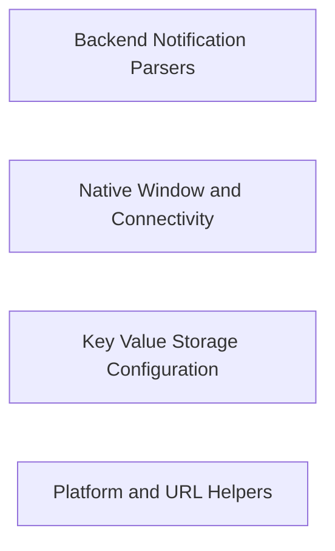

## Details

Supplies low-level key-value persistence, window framing, URL launching, and backend notification dispatchers.

### Backend Notification Parsers
Decodes and dispatches asynchronous backend notification payloads and errors for user, document, folder, grid, and search domains.

**Related Classes/Methods**: _None_

**Source Files:**

- `frontend/appflowy_flutter/lib/core/notification/document_notification.dart`
  - `frontend.appflowy_flutter.lib.core.notification.document_notification.DocumentNotificationParser` (L8-L18) - Class
  - `frontend.appflowy_flutter.lib.core.notification.document_notification.DocumentNotificationParser.DocumentNotificationParser` (L10-L17) - Constructor
- `frontend/appflowy_flutter/lib/core/notification/folder_notification.dart`
  - `frontend.appflowy_flutter.lib.core.notification.folder_notification.FolderNotificationParser` (L15-L25) - Class
  - `frontend.appflowy_flutter.lib.core.notification.folder_notification.FolderNotificationParser.FolderNotificationParser` (L17-L24) - Constructor
  - `frontend.appflowy_flutter.lib.core.notification.folder_notification.FolderNotificationHandler` (L27-L30) - Class
  - `frontend.appflowy_flutter.lib.core.notification.folder_notification.FolderNotificationListener` (L32-L51) - Class
  - `frontend.appflowy_flutter.lib.core.notification.folder_notification.FolderNotificationListener.FolderNotificationListener` (L33-L42) - Constructor
  - `frontend.appflowy_flutter.lib.core.notification.folder_notification.FolderNotificationListener.stop` (L47-L50) - Method
- `frontend/appflowy_flutter/lib/core/notification/grid_notification.dart`
  - `frontend.appflowy_flutter.lib.core.notification.grid_notification.DatabaseNotificationParser` (L15-L25) - Class
  - `frontend.appflowy_flutter.lib.core.notification.grid_notification.DatabaseNotificationParser.DatabaseNotificationParser` (L17-L24) - Constructor
  - `frontend.appflowy_flutter.lib.core.notification.grid_notification.DatabaseNotificationHandler` (L27-L30) - Class
  - `frontend.appflowy_flutter.lib.core.notification.grid_notification.DatabaseNotificationListener` (L32-L49) - Class
  - `frontend.appflowy_flutter.lib.core.notification.grid_notification.DatabaseNotificationListener.DatabaseNotificationListener` (L33-L39) - Constructor
  - `frontend.appflowy_flutter.lib.core.notification.grid_notification.DatabaseNotificationListener.stop` (L44-L48) - Method
- `frontend/appflowy_flutter/lib/core/notification/notification_helper.dart`
  - `frontend.appflowy_flutter.lib.core.notification.notification_helper.NotificationParser` (L6-L40) - Class
  - `frontend.appflowy_flutter.lib.core.notification.notification_helper.NotificationParser.NotificationParser` (L7-L12) - Constructor
  - `frontend.appflowy_flutter.lib.core.notification.notification_helper.NotificationParser.parse` (L19-L39) - Method
- `frontend/appflowy_flutter/lib/core/notification/search_notification.dart`
  - `frontend.appflowy_flutter.lib.core.notification.search_notification.SearchNotificationParser` (L16-L28) - Class
  - `frontend.appflowy_flutter.lib.core.notification.search_notification.SearchNotificationParser.SearchNotificationParser` (L18-L27) - Constructor
  - `frontend.appflowy_flutter.lib.core.notification.search_notification.SearchNotificationHandler` (L30-L33) - Class
  - `frontend.appflowy_flutter.lib.core.notification.search_notification.SearchNotificationListener` (L35-L57) - Class
  - `frontend.appflowy_flutter.lib.core.notification.search_notification.SearchNotificationListener.SearchNotificationListener` (L36-L47) - Constructor
  - `frontend.appflowy_flutter.lib.core.notification.search_notification.SearchNotificationListener.stop` (L52-L56) - Method
- `frontend/appflowy_flutter/lib/core/notification/user_notification.dart`
  - `frontend.appflowy_flutter.lib.core.notification.user_notification.UserNotificationParser` (L9-L19) - Class
  - `frontend.appflowy_flutter.lib.core.notification.user_notification.UserNotificationParser.UserNotificationParser` (L11-L18) - Constructor

### Native Window and Connectivity
Manages desktop window movement and zooming channels alongside real-time network connectivity status monitoring.

**Related Classes/Methods**:

- `frontend.appflowy_flutter.lib.core.frameless_window.CocoaWindowChannel`:6-27

**Source Files:**

- `frontend/appflowy_flutter/lib/core/frameless_window.dart`
  - `frontend.appflowy_flutter.lib.core.frameless_window.CocoaWindowChannel` (L6-L27) - Class
  - `frontend.appflowy_flutter.lib.core.frameless_window.CocoaWindowChannel.CocoaWindowChannel._` (L7-L7) - Constructor
  - `frontend.appflowy_flutter.lib.core.frameless_window.CocoaWindowChannel.setWindowPosition` (L13-L15) - Method
  - `frontend.appflowy_flutter.lib.core.frameless_window.CocoaWindowChannel.getWindowPosition` (L17-L22) - Method
  - `frontend.appflowy_flutter.lib.core.frameless_window.CocoaWindowChannel.zoom` (L24-L26) - Method
  - `frontend.appflowy_flutter.lib.core.frameless_window.MoveWindowDetector` (L29-L39) - Class
  - `frontend.appflowy_flutter.lib.core.frameless_window.MoveWindowDetector.MoveWindowDetector` (L30-L33) - Constructor
  - `frontend.appflowy_flutter.lib.core.frameless_window.MoveWindowDetector.createState` (L38-L38) - Method
  - `frontend.appflowy_flutter.lib.core.frameless_window.MoveWindowDetectorState` (L41-L78) - Class
  - `frontend.appflowy_flutter.lib.core.frameless_window.MoveWindowDetectorState.build` (L46-L77) - Method
- `frontend/appflowy_flutter/lib/core/network_monitor.dart`
  - `frontend.appflowy_flutter.lib.core.network_monitor.NetworkListener` (L9-L57) - Class
  - `frontend.appflowy_flutter.lib.core.network_monitor.NetworkListener.NetworkListener` (L10-L13) - Constructor
  - `frontend.appflowy_flutter.lib.core.network_monitor.NetworkListener.start` (L18-L28) - Method
  - `frontend.appflowy_flutter.lib.core.network_monitor.NetworkListener.stop` (L30-L32) - Method
  - `frontend.appflowy_flutter.lib.core.network_monitor.NetworkListener._updateConnectionStatus` (L34-L56) - Method

### Key Value Storage Configuration
Provides persistent key-value configuration storage interfaces and key constants backed by shared preferences.

**Related Classes/Methods**:

- `frontend.appflowy_flutter.lib.core.config.kv.KeyValueStorage`:3-12
- `frontend.appflowy_flutter.lib.core.config.kv.DartKeyValue`:14-65
- `frontend.appflowy_flutter.lib.core.config.kv_keys.KVKeys`:1-128

**Source Files:**

- `frontend/appflowy_flutter/lib/core/config/kv.dart`
  - `frontend.appflowy_flutter.lib.core.config.kv.KeyValueStorage` (L3-L12) - Class
  - `frontend.appflowy_flutter.lib.core.config.kv.KeyValueStorage.set` (L4-L4) - Method
  - `frontend.appflowy_flutter.lib.core.config.kv.KeyValueStorage.get` (L5-L5) - Method
  - `frontend.appflowy_flutter.lib.core.config.kv.KeyValueStorage.getWithFormat` (L6-L9) - Method
  - `frontend.appflowy_flutter.lib.core.config.kv.KeyValueStorage.remove` (L10-L10) - Method
  - `frontend.appflowy_flutter.lib.core.config.kv.KeyValueStorage.clear` (L11-L11) - Method
  - `frontend.appflowy_flutter.lib.core.config.kv.DartKeyValue` (L14-L65) - Class
  - `frontend.appflowy_flutter.lib.core.config.kv.DartKeyValue.sharedPreferences` (L16-L16) - Method
  - `frontend.appflowy_flutter.lib.core.config.kv.DartKeyValue.get` (L19-L27) - Method
  - `frontend.appflowy_flutter.lib.core.config.kv.DartKeyValue.getWithFormat` (L30-L39) - Method
  - `frontend.appflowy_flutter.lib.core.config.kv.DartKeyValue.remove` (L42-L46) - Method
  - `frontend.appflowy_flutter.lib.core.config.kv.DartKeyValue.set` (L49-L53) - Method
  - `frontend.appflowy_flutter.lib.core.config.kv.DartKeyValue.clear` (L56-L60) - Method
  - `frontend.appflowy_flutter.lib.core.config.kv.DartKeyValue._initSharedPreferencesIfNeeded` (L62-L64) - Method
- `frontend/appflowy_flutter/lib/core/config/kv_keys.dart`
  - `frontend.appflowy_flutter.lib.core.config.kv_keys.KVKeys` (L1-L128) - Class
  - `frontend.appflowy_flutter.lib.core.config.kv_keys.KVKeys.KVKeys._` (L2-L2) - Constructor

### Platform and URL Helpers
Supplies cross-platform runtime environment detection and external URL launching helper utilities.

**Related Classes/Methods**: _None_

**Source Files:**

- `frontend/appflowy_flutter/lib/core/helpers/target_platform.dart`
  - `frontend.appflowy_flutter.lib.core.helpers.target_platform.TargetPlatformHelper.isDesktop` (L7-L11) - Method
- `frontend/appflowy_flutter/lib/core/helpers/url_launcher.dart`
  - `frontend.appflowy_flutter.lib.core.helpers.url_launcher.OnFailureCallback` (L16-L16) - Class
  - `frontend.appflowy_flutter.lib.core.helpers.url_launcher.afLaunchUri` (L22-L94) - Function
  - `frontend.appflowy_flutter.lib.core.helpers.url_launcher.afLaunchUrlString` (L99-L120) - Function
  - `frontend.appflowy_flutter.lib.core.helpers.url_launcher._afLaunchLocalUri` (L125-L161) - Function
  - `frontend.appflowy_flutter.lib.core.helpers.url_launcher._errorHandler` (L163-L179) - Function

### [FAQ](https://github.com/CodeBoarding/GeneratedOnBoardings/tree/main?tab=readme-ov-file#faq)