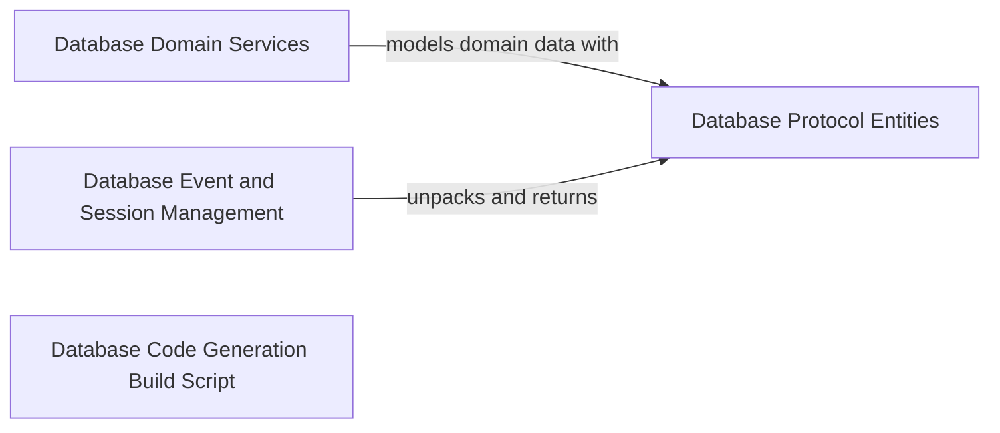

## Details

Implements relational and grid database tables, supporting field configurations, cell operations, view layouts, sorting, grouping, and calculation services.

### Database Domain Services
Executes database business logic including views, fields, cells, filters, sorting, grouping, calculations, and CSV data interchange.

**Related Classes/Methods**:

- `frontend.rust-lib.flowy-database2.src.services.database.database_editor.DatabaseEditor`:61-75
- `frontend.rust-lib.flowy-database2.src.services.database_view.views.DatabaseViews`:17-23
- `frontend.rust-lib.flowy-database2.src.services.database_view.view_editor.DatabaseViewEditor`:46-62
- `frontend.rust-lib.flowy-database2.src.services.share.csv.import.CSVImporter`
- `frontend.rust-lib.flowy-database2.src.services.share.csv.export.CSVExport`

**Source Files:**

- `frontend/rust-lib/flowy-database2/src/services/calculations/controller.rs`
  - `frontend.rust-lib.flowy-database2.src.services.calculations.controller.CalculationsDelegate` (L24-L31) - Interface
  - `frontend.rust-lib.flowy-database2.src.services.calculations.controller.CalculationsDelegate.get_cells_for_field` (L25-L25) - Method
  - `frontend.rust-lib.flowy-database2.src.services.calculations.controller.CalculationsDelegate.get_field` (L26-L26) - Method
  - `frontend.rust-lib.flowy-database2.src.services.calculations.controller.CalculationsDelegate.get_calculation` (L27-L27) - Method
  - `frontend.rust-lib.flowy-database2.src.services.calculations.controller.CalculationsDelegate.get_all_calculations` (L28-L28) - Method
  - `frontend.rust-lib.flowy-database2.src.services.calculations.controller.CalculationsDelegate.update_calculation` (L29-L29) - Method
  - `frontend.rust-lib.flowy-database2.src.services.calculations.controller.CalculationsDelegate.remove_calculation` (L30-L30) - Method
  - `frontend.rust-lib.flowy-database2.src.services.calculations.controller.CalculationsController` (L33-L41) - Struct
  - `frontend.rust-lib.flowy-database2.src.services.calculations.controller.CalculationsController.drop` (L44-L46) - Method
  - `frontend.rust-lib.flowy-database2.src.services.calculations.controller.CalculationsController.new` (L50-L72) - Function
  - `frontend.rust-lib.flowy-database2.src.services.calculations.controller.CalculationsController.close` (L74-L81) - Method
  - `frontend.rust-lib.flowy-database2.src.services.calculations.controller.CalculationsController.gen_task` (L84-L93) - Method
  - `frontend.rust-lib.flowy-database2.src.services.calculations.controller.CalculationsController.process` (L102-L120) - Method
  - `frontend.rust-lib.flowy-database2.src.services.calculations.controller.CalculationsController.did_receive_field_deleted` (L122-L129) - Method
  - `frontend.rust-lib.flowy-database2.src.services.calculations.controller.CalculationsController.handle_field_deleted` (L131-L154) - Method
  - `frontend.rust-lib.flowy-database2.src.services.calculations.controller.CalculationsController.did_receive_field_type_changed` (L156-L163) - Method
  - `frontend.rust-lib.flowy-database2.src.services.calculations.controller.CalculationsController.handle_field_type_changed` (L165-L191) - Method
  - `frontend.rust-lib.flowy-database2.src.services.calculations.controller.CalculationsController.did_receive_cell_changed` (L193-L200) - Method
  - `frontend.rust-lib.flowy-database2.src.services.calculations.controller.CalculationsController.handle_cell_changed` (L202-L242) - Method
  - `frontend.rust-lib.flowy-database2.src.services.calculations.controller.CalculationsController.did_receive_row_changed` (L244-L251) - Method
  - `frontend.rust-lib.flowy-database2.src.services.calculations.controller.CalculationsController.handle_row_changed` (L253-L305) - Method
  - `frontend.rust-lib.flowy-database2.src.services.calculations.controller.CalculationsController.get_or_fetch_cells` (L307-L324) - Method
  - `frontend.rust-lib.flowy-database2.src.services.calculations.controller.CalculationsController.handle_cells_changed` (L327-L346) - Method
  - `frontend.rust-lib.flowy-database2.src.services.calculations.controller.CalculationsController.update_calculation` (L349-L364) - Method
  - `frontend.rust-lib.flowy-database2.src.services.calculations.controller.CalculationsController.did_receive_changes` (L366-L408) - Method
  - `frontend.rust-lib.flowy-database2.src.services.calculations.controller.CalculationsController.update_cache` (L410-L417) - Method
  - `frontend.rust-lib.flowy-database2.src.services.calculations.controller.CalculationEvent` (L421-L426) - Enum
  - `frontend.rust-lib.flowy-database2.src.services.calculations.controller.CalculationEvent.to_json_string` (L429-L431) - Method
  - `frontend.rust-lib.flowy-database2.src.services.calculations.controller.CalculationEvent.from_str` (L436-L438) - Function
- `frontend/rust-lib/flowy-database2/src/services/calculations/entities.rs`
  - `frontend.rust-lib.flowy-database2.src.services.calculations.entities.Calculation` (L7-L14) - Struct
  - `frontend.rust-lib.flowy-database2.src.services.calculations.entities.CalculationMap.from` (L22-L29) - Function
  - `frontend.rust-lib.flowy-database2.src.services.calculations.entities.Calculation.try_from` (L35-L37) - Function
  - `frontend.rust-lib.flowy-database2.src.services.calculations.entities.CalculationUpdatedNotification` (L41-L45) - Struct
  - `frontend.rust-lib.flowy-database2.src.services.calculations.entities.CalculationUpdatedNotification.new` (L48-L53) - Function
  - `frontend.rust-lib.flowy-database2.src.services.calculations.entities.Calculation.none` (L57-L64) - Function
  - `frontend.rust-lib.flowy-database2.src.services.calculations.entities.Calculation.with_value` (L66-L73) - Method
  - `frontend.rust-lib.flowy-database2.src.services.calculations.entities.CalculationChangeset` (L77-L80) - Struct
  - `frontend.rust-lib.flowy-database2.src.services.calculations.entities.CalculationChangeset.from_insert` (L83-L88) - Function
  - `frontend.rust-lib.flowy-database2.src.services.calculations.entities.CalculationChangeset.from_delete` (L90-L95) - Function
- `frontend/rust-lib/flowy-database2/src/services/calculations/service.rs`
  - `frontend.rust-lib.flowy-database2.src.services.calculations.service.CalculationsService` (L10-L10) - Struct
  - `frontend.rust-lib.flowy-database2.src.services.calculations.service.CalculationsService.new` (L12-L14) - Function
  - `frontend.rust-lib.flowy-database2.src.services.calculations.service.CalculationsService.calculate` (L16-L29) - Method
  - `frontend.rust-lib.flowy-database2.src.services.calculations.service.CalculationsService.calculate_average` (L31-L50) - Method
  - `frontend.rust-lib.flowy-database2.src.services.calculations.service.CalculationsService.calculate_median` (L52-L61) - Method
  - `frontend.rust-lib.flowy-database2.src.services.calculations.service.CalculationsService.calculate_min` (L63-L70) - Method
  - `frontend.rust-lib.flowy-database2.src.services.calculations.service.CalculationsService.calculate_max` (L72-L79) - Method
  - `frontend.rust-lib.flowy-database2.src.services.calculations.service.CalculationsService.calculate_sum` (L81-L88) - Method
  - `frontend.rust-lib.flowy-database2.src.services.calculations.service.CalculationsService.calculate_count` (L90-L92) - Method
  - `frontend.rust-lib.flowy-database2.src.services.calculations.service.CalculationsService.calculate_count_empty` (L94-L104) - Method
  - `frontend.rust-lib.flowy-database2.src.services.calculations.service.CalculationsService.calculate_count_non_empty` (L106-L116) - Method
  - `frontend.rust-lib.flowy-database2.src.services.calculations.service.CalculationsService.reduce_values_f64` (L118-L127) - Method
  - `frontend.rust-lib.flowy-database2.src.services.calculations.service.CalculationsService.median` (L129-L137) - Function
- `frontend/rust-lib/flowy-database2/src/services/calculations/task.rs`
  - `frontend.rust-lib.flowy-database2.src.services.calculations.task.CalculationsTaskHandler` (L7-L10) - Struct
  - `frontend.rust-lib.flowy-database2.src.services.calculations.task.CalculationsTaskHandler.new` (L13-L18) - Function
  - `frontend.rust-lib.flowy-database2.src.services.calculations.task.CalculationsTaskHandler.handler_id` (L23-L25) - Method
  - `frontend.rust-lib.flowy-database2.src.services.calculations.task.CalculationsTaskHandler.handler_name` (L27-L29) - Method
  - `frontend.rust-lib.flowy-database2.src.services.calculations.task.CalculationsTaskHandler.run` (L31-L40) - Method
- `frontend/rust-lib/flowy-database2/src/services/cell/cell_operation.rs`
  - `frontend.rust-lib.flowy-database2.src.services.cell.cell_operation.CellDataDecoder` (L23-L58) - Interface
  - `frontend.rust-lib.flowy-database2.src.services.cell.cell_operation.CellDataDecoder.decode_cell` (L32-L34) - Method
  - `frontend.rust-lib.flowy-database2.src.services.cell.cell_operation.CellDataDecoder.decode_cell_with_transform` (L44-L51) - Method
  - `frontend.rust-lib.flowy-database2.src.services.cell.cell_operation.CellDataDecoder.stringify_cell_data` (L57-L57) - Method
  - `frontend.rust-lib.flowy-database2.src.services.cell.cell_operation.CellDataChangeset` (L60-L74) - Interface
  - `frontend.rust-lib.flowy-database2.src.services.cell.cell_operation.CellDataChangeset.apply_changeset` (L69-L73) - Method
  - `frontend.rust-lib.flowy-database2.src.services.cell.cell_operation.apply_cell_changeset` (L87-L97) - Function
  - `frontend.rust-lib.flowy-database2.src.services.cell.cell_operation.get_cell_protobuf` (L111-L122) - Function
  - `frontend.rust-lib.flowy-database2.src.services.cell.cell_operation.stringify_cell` (L132-L141) - Function
  - `frontend.rust-lib.flowy-database2.src.services.cell.cell_operation.insert_text_cell` (L143-L145) - Function
  - `frontend.rust-lib.flowy-database2.src.services.cell.cell_operation.insert_number_cell` (L147-L149) - Function
  - `frontend.rust-lib.flowy-database2.src.services.cell.cell_operation.insert_url_cell` (L151-L163) - Function
  - `frontend.rust-lib.flowy-database2.src.services.cell.cell_operation.insert_checkbox_cell` (L165-L172) - Function
  - `frontend.rust-lib.flowy-database2.src.services.cell.cell_operation.insert_date_cell` (L174-L187) - Function
  - `frontend.rust-lib.flowy-database2.src.services.cell.cell_operation.insert_select_option_cell` (L189-L192) - Function
  - `frontend.rust-lib.flowy-database2.src.services.cell.cell_operation.insert_checklist_cell` (L194-L203) - Function
  - `frontend.rust-lib.flowy-database2.src.services.cell.cell_operation.delete_select_option_cell` (L205-L208) - Function
  - `frontend.rust-lib.flowy-database2.src.services.cell.cell_operation.CellBuilder` (L210-L213) - Struct
  - `frontend.rust-lib.flowy-database2.src.services.cell.cell_operation.CellBuilder.with_cells` (L217-L283) - Function
  - `frontend.rust-lib.flowy-database2.src.services.cell.cell_operation.CellBuilder.build` (L285-L287) - Method
  - `frontend.rust-lib.flowy-database2.src.services.cell.cell_operation.CellBuilder.insert_text_cell` (L289-L298) - Method
  - `frontend.rust-lib.flowy-database2.src.services.cell.cell_operation.CellBuilder.insert_url_cell` (L300-L309) - Method
  - `frontend.rust-lib.flowy-database2.src.services.cell.cell_operation.CellBuilder.insert_number_cell` (L311-L320) - Method
  - `frontend.rust-lib.flowy-database2.src.services.cell.cell_operation.CellBuilder.insert_checkbox_cell` (L322-L331) - Method
  - `frontend.rust-lib.flowy-database2.src.services.cell.cell_operation.CellBuilder.insert_date_cell` (L333-L343) - Method
  - `frontend.rust-lib.flowy-database2.src.services.cell.cell_operation.CellBuilder.insert_select_option_cell` (L345-L355) - Method
  - `frontend.rust-lib.flowy-database2.src.services.cell.cell_operation.CellBuilder.insert_checklist_cell` (L356-L369) - Method
- `frontend/rust-lib/flowy-database2/src/services/cell/type_cell_data.rs`
  - `frontend.rust-lib.flowy-database2.src.services.cell.type_cell_data.CellProtobufBlob` (L15-L15) - Struct
  - `frontend.rust-lib.flowy-database2.src.services.cell.type_cell_data.CellProtobufBlobParser` (L17-L20) - Interface
  - `frontend.rust-lib.flowy-database2.src.services.cell.type_cell_data.CellProtobufBlobParser.parser` (L19-L19) - Function
  - `frontend.rust-lib.flowy-database2.src.services.cell.type_cell_data.CellStringParser` (L22-L25) - Interface
  - `frontend.rust-lib.flowy-database2.src.services.cell.type_cell_data.CellStringParser.parser_cell_str` (L24-L24) - Method
  - `frontend.rust-lib.flowy-database2.src.services.cell.type_cell_data.CellBytesCustomParser` (L27-L30) - Interface
  - `frontend.rust-lib.flowy-database2.src.services.cell.type_cell_data.CellBytesCustomParser.parse` (L29-L29) - Method
  - `frontend.rust-lib.flowy-database2.src.services.cell.type_cell_data.CellProtobufBlob.new` (L33-L36) - Function
  - `frontend.rust-lib.flowy-database2.src.services.cell.type_cell_data.CellProtobufBlob.from` (L38-L44) - Function
  - `frontend.rust-lib.flowy-database2.src.services.cell.type_cell_data.CellProtobufBlob.parser` (L46-L51) - Method
  - `frontend.rust-lib.flowy-database2.src.services.cell.type_cell_data.CellProtobufBlob.custom_parser` (L53-L58) - Method
  - `frontend.rust-lib.flowy-database2.src.services.cell.type_cell_data.CellProtobufBlob.fmt` (L69-L72) - Method
  - `frontend.rust-lib.flowy-database2.src.services.cell.type_cell_data.CellProtobufBlob.deref` (L78-L80) - Method
- `frontend/rust-lib/flowy-database2/src/services/database/database_editor.rs`
  - `frontend.rust-lib.flowy-database2.src.services.database.database_editor.DatabaseEditor` (L61-L75) - Struct
  - `frontend.rust-lib.flowy-database2.src.services.database.database_editor.DatabaseEditor.new` (L78-L151) - Function
  - `frontend.rust-lib.flowy-database2.src.services.database.database_editor.DatabaseEditor.collab_builder` (L153-L158) - Method
  - `frontend.rust-lib.flowy-database2.src.services.database.database_editor.DatabaseEditor.close_view` (L160-L162) - Method
  - `frontend.rust-lib.flowy-database2.src.services.database.database_editor.DatabaseEditor.get_row_ids` (L164-L174) - Method
  - `frontend.rust-lib.flowy-database2.src.services.database.database_editor.DatabaseEditor.num_of_opening_views` (L176-L178) - Method
  - `frontend.rust-lib.flowy-database2.src.services.database.database_editor.DatabaseEditor.close_all_views` (L181-L185) - Method
  - `frontend.rust-lib.flowy-database2.src.services.database.database_editor.DatabaseEditor.get_layout_type` (L187-L198) - Method
  - `frontend.rust-lib.flowy-database2.src.services.database.database_editor.DatabaseEditor.update_view_layout` (L200-L209) - Method
  - `frontend.rust-lib.flowy-database2.src.services.database.database_editor.DatabaseEditor.subscribe_view_changed` (L211-L217) - Method
  - `frontend.rust-lib.flowy-database2.src.services.database.database_editor.DatabaseEditor.get_field` (L219-L221) - Method
  - `frontend.rust-lib.flowy-database2.src.services.database.database_editor.DatabaseEditor.set_group_by_field` (L223-L255) - Method
  - `frontend.rust-lib.flowy-database2.src.services.database.database_editor.DatabaseEditor.delete_group` (L257-L272) - Method
  - `frontend.rust-lib.flowy-database2.src.services.database.database_editor.DatabaseEditor.delete_database_view` (L278-L280) - Method
  - `frontend.rust-lib.flowy-database2.src.services.database.database_editor.DatabaseEditor.update_group` (L282-L290) - Method
  - `frontend.rust-lib.flowy-database2.src.services.database.database_editor.DatabaseEditor.modify_view_filters` (L292-L300) - Method
  - `frontend.rust-lib.flowy-database2.src.services.database.database_editor.DatabaseEditor.create_or_update_sort` (L302-L309) - Method
  - `frontend.rust-lib.flowy-database2.src.services.database.database_editor.DatabaseEditor.reorder_sort` (L311-L318) - Method
  - `frontend.rust-lib.flowy-database2.src.services.database.database_editor.DatabaseEditor.delete_sort` (L320-L327) - Method
  - `frontend.rust-lib.flowy-database2.src.services.database.database_editor.DatabaseEditor.get_all_calculations` (L329-L335) - Method
  - `frontend.rust-lib.flowy-database2.src.services.database.database_editor.DatabaseEditor.update_calculation` (L337-L344) - Method
  - `frontend.rust-lib.flowy-database2.src.services.database.database_editor.DatabaseEditor.remove_calculation` (L346-L353) - Method
  - `frontend.rust-lib.flowy-database2.src.services.database.database_editor.DatabaseEditor.get_all_filters` (L355-L362) - Method
  - `frontend.rust-lib.flowy-database2.src.services.database.database_editor.DatabaseEditor.get_filter` (L364-L370) - Method
  - `frontend.rust-lib.flowy-database2.src.services.database.database_editor.DatabaseEditor.get_all_sorts` (L371-L377) - Method
  - `frontend.rust-lib.flowy-database2.src.services.database.database_editor.DatabaseEditor.delete_all_sorts` (L379-L383) - Method
  - `frontend.rust-lib.flowy-database2.src.services.database.database_editor.DatabaseEditor.get_fields` (L388-L398) - Method
  - `frontend.rust-lib.flowy-database2.src.services.database.database_editor.DatabaseEditor.update_field` (L400-L409) - Method
  - `frontend.rust-lib.flowy-database2.src.services.database.database_editor.DatabaseEditor.delete_field` (L411-L441) - Method
  - `frontend.rust-lib.flowy-database2.src.services.database.database_editor.DatabaseEditor.clear_field` (L443-L466) - Method
  - `frontend.rust-lib.flowy-database2.src.services.database.database_editor.DatabaseEditor.update_field_type_option` (L470-L489) - Method
  - `frontend.rust-lib.flowy-database2.src.services.database.database_editor.DatabaseEditor.switch_to_field_type` (L491-L543) - Method
  - `frontend.rust-lib.flowy-database2.src.services.database.database_editor.DatabaseEditor.duplicate_field` (L545-L579) - Method
  - `frontend.rust-lib.flowy-database2.src.services.database.database_editor.DatabaseEditor.duplicate_row` (L581-L610) - Method
  - `frontend.rust-lib.flowy-database2.src.services.database.database_editor.DatabaseEditor.move_row` (L613-L625) - Method
  - `frontend.rust-lib.flowy-database2.src.services.database.database_editor.DatabaseEditor.move_group_row` (L628-L680) - Method
  - `frontend.rust-lib.flowy-database2.src.services.database.database_editor.DatabaseEditor.create_row` (L682-L704) - Method
  - `frontend.rust-lib.flowy-database2.src.services.database.database_editor.DatabaseEditor.create_field_with_type_option` (L706-L738) - Method
  - `frontend.rust-lib.flowy-database2.src.services.database.database_editor.DatabaseEditor.move_field` (L740-L777) - Method
  - `frontend.rust-lib.flowy-database2.src.services.database.database_editor.DatabaseEditor.get_all_rows` (L779-L782) - Method
  - `frontend.rust-lib.flowy-database2.src.services.database.database_editor.DatabaseEditor.get_row` (L784-L791) - Method
  - `frontend.rust-lib.flowy-database2.src.services.database.database_editor.DatabaseEditor.init_database_row` (L793-L838) - Method
  - `frontend.rust-lib.flowy-database2.src.services.database.database_editor.DatabaseEditor.get_row_meta` (L840-L861) - Method
  - `frontend.rust-lib.flowy-database2.src.services.database.database_editor.DatabaseEditor.delete_rows` (L863-L865) - Method
  - `frontend.rust-lib.flowy-database2.src.services.database.database_editor.DatabaseEditor.update_row_meta` (L868-L894) - Method
  - `frontend.rust-lib.flowy-database2.src.services.database.database_editor.DatabaseEditor.get_cell` (L896-L913) - Method
  - `frontend.rust-lib.flowy-database2.src.services.database.database_editor.DatabaseEditor.get_cell_pb` (L915-L930) - Method
  - `frontend.rust-lib.flowy-database2.src.services.database.database_editor.DatabaseEditor.get_cells_for_field` (L932-L965) - Method
  - `frontend.rust-lib.flowy-database2.src.services.database.database_editor.DatabaseEditor.update_cell_with_changeset` (L968-L990) - Method
  - `frontend.rust-lib.flowy-database2.src.services.database.database_editor.DatabaseEditor.update_cell` (L995-L1020) - Method
  - `frontend.rust-lib.flowy-database2.src.services.database.database_editor.DatabaseEditor.update_row` (L1022-L1035) - Method
  - `frontend.rust-lib.flowy-database2.src.services.database.database_editor.DatabaseEditor.clear_cell` (L1037-L1055) - Method
  - `frontend.rust-lib.flowy-database2.src.services.database.database_editor.DatabaseEditor.did_update_row` (L1057-L1092) - Method
  - `frontend.rust-lib.flowy-database2.src.services.database.database_editor.DatabaseEditor.did_update_attachments` (L1094-L1162) - Method
  - `frontend.rust-lib.flowy-database2.src.services.database.database_editor.DatabaseEditor.get_auto_updated_fields_changesets` (L1164-L1186) - Method
  - `frontend.rust-lib.flowy-database2.src.services.database.database_editor.DatabaseEditor.create_select_option` (L1189-L1198) - Method
  - `frontend.rust-lib.flowy-database2.src.services.database.database_editor.DatabaseEditor.insert_select_options` (L1202-L1238) - Method
  - `frontend.rust-lib.flowy-database2.src.services.database.database_editor.DatabaseEditor.delete_select_options` (L1240-L1279) - Method
  - `frontend.rust-lib.flowy-database2.src.services.database.database_editor.DatabaseEditor.set_checklist_options` (L1281-L1303) - Method
  - `frontend.rust-lib.flowy-database2.src.services.database.database_editor.DatabaseEditor.load_groups` (L1306-L1310) - Method
  - `frontend.rust-lib.flowy-database2.src.services.database.database_editor.DatabaseEditor.get_group` (L1313-L1317) - Method
  - `frontend.rust-lib.flowy-database2.src.services.database.database_editor.DatabaseEditor.move_group` (L1320-L1334) - Method
  - `frontend.rust-lib.flowy-database2.src.services.database.database_editor.DatabaseEditor.group_by_field` (L1336-L1340) - Method
  - `frontend.rust-lib.flowy-database2.src.services.database.database_editor.DatabaseEditor.create_group` (L1342-L1346) - Method
  - `frontend.rust-lib.flowy-database2.src.services.database.database_editor.DatabaseEditor.set_layout_setting` (L1349-L1357) - Method
  - `frontend.rust-lib.flowy-database2.src.services.database.database_editor.DatabaseEditor.get_layout_setting` (L1359-L1371) - Method
  - `frontend.rust-lib.flowy-database2.src.services.database.database_editor.DatabaseEditor.get_all_calendar_events` (L1374-L1382) - Method
  - `frontend.rust-lib.flowy-database2.src.services.database.database_editor.DatabaseEditor.get_all_no_date_calendar_events` (L1385-L1391) - Method
  - `frontend.rust-lib.flowy-database2.src.services.database.database_editor.DatabaseEditor.get_calendar_event` (L1394-L1401) - Method
  - `frontend.rust-lib.flowy-database2.src.services.database.database_editor.DatabaseEditor.notify_did_insert_database_field` (L1404-L1413) - Method
  - `frontend.rust-lib.flowy-database2.src.services.database.database_editor.DatabaseEditor.notify_did_update_database` (L1415-L1427) - Method
  - `frontend.rust-lib.flowy-database2.src.services.database.database_editor.DatabaseEditor.get_database_view_setting` (L1429-L1443) - Method
  - `frontend.rust-lib.flowy-database2.src.services.database.database_editor.DatabaseEditor.close_database` (L1445-L1475) - Method
  - `frontend.rust-lib.flowy-database2.src.services.database.database_editor.DatabaseEditor.open_database_view` (L1482-L1583) - Method
  - `frontend.rust-lib.flowy-database2.src.services.database.database_editor.DatabaseEditor.async_load_rows` (L1585-L1700) - Method
  - `frontend.rust-lib.flowy-database2.src.services.database.database_editor.DatabaseEditor.export_csv` (L1702-L1710) - Method
  - `frontend.rust-lib.flowy-database2.src.services.database.database_editor.DatabaseEditor.get_field_settings` (L1712-L1726) - Method
  - `frontend.rust-lib.flowy-database2.src.services.database.database_editor.DatabaseEditor.get_all_field_settings` (L1728-L1737) - Method
  - `frontend.rust-lib.flowy-database2.src.services.database.database_editor.DatabaseEditor.update_field_settings_with_changeset` (L1739-L1750) - Method
  - `frontend.rust-lib.flowy-database2.src.services.database.database_editor.DatabaseEditor.get_related_database_id` (L1752-L1765) - Method
  - `frontend.rust-lib.flowy-database2.src.services.database.database_editor.DatabaseEditor.get_row_index` (L1767-L1769) - Method
  - `frontend.rust-lib.flowy-database2.src.services.database.database_editor.DatabaseEditor.get_row_order_at_index` (L1771-L1778) - Method
  - `frontend.rust-lib.flowy-database2.src.services.database.database_editor.DatabaseEditor.get_related_rows` (L1780-L1853) - Method
  - `frontend.rust-lib.flowy-database2.src.services.database.database_editor.DatabaseEditor.get_prompts_from_database` (L1855-L1931) - Method
  - `frontend.rust-lib.flowy-database2.src.services.database.database_editor.DatabaseEditor.get_prompts_from_database.extract_cell_value` (L1886-L1891) - Function
  - `frontend.rust-lib.flowy-database2.src.services.database.database_editor.DatabaseEditor.test_custom_prompt_database_configuration` (L1933-L1984) - Method
  - `frontend.rust-lib.flowy-database2.src.services.database.database_editor.DatabaseEditor.get_auto_updated_fields` (L1986-L1995) - Method
  - `frontend.rust-lib.flowy-database2.src.services.database.database_editor.DatabaseEditor.get_mutex_database` (L1999-L2001) - Method
  - `frontend.rust-lib.flowy-database2.src.services.database.database_editor.DatabaseViewOperationImpl` (L2004-L2011) - Struct
  - `frontend.rust-lib.flowy-database2.src.services.database.database_editor.DatabaseViewOperationImpl.get_database` (L2015-L2017) - Method
  - `frontend.rust-lib.flowy-database2.src.services.database.database_editor.DatabaseViewOperationImpl.get_view` (L2019-L2021) - Method
  - `frontend.rust-lib.flowy-database2.src.services.database.database_editor.DatabaseViewOperationImpl.get_fields` (L2023-L2029) - Method
  - `frontend.rust-lib.flowy-database2.src.services.database.database_editor.DatabaseViewOperationImpl.get_field` (L2031-L2033) - Method
  - `frontend.rust-lib.flowy-database2.src.services.database.database_editor.DatabaseViewOperationImpl.create_field` (L2035-L2055) - Method
  - `frontend.rust-lib.flowy-database2.src.services.database.database_editor.DatabaseViewOperationImpl.update_field` (L2057-L2083) - Method
  - `frontend.rust-lib.flowy-database2.src.services.database.database_editor.DatabaseViewOperationImpl.get_primary_field` (L2085-L2087) - Method
  - `frontend.rust-lib.flowy-database2.src.services.database.database_editor.DatabaseViewOperationImpl.index_of_row` (L2089-L2091) - Method
  - `frontend.rust-lib.flowy-database2.src.services.database.database_editor.DatabaseViewOperationImpl.get_row_detail` (L2093-L2101) - Method
  - `frontend.rust-lib.flowy-database2.src.services.database.database_editor.DatabaseViewOperationImpl.get_all_rows` (L2103-L2124) - Method
  - `frontend.rust-lib.flowy-database2.src.services.database.database_editor.DatabaseViewOperationImpl.get_all_row_orders` (L2126-L2128) - Method
  - `frontend.rust-lib.flowy-database2.src.services.database.database_editor.DatabaseViewOperationImpl.remove_row` (L2130-L2132) - Method
  - `frontend.rust-lib.flowy-database2.src.services.database.database_editor.DatabaseViewOperationImpl.get_cells_for_field` (L2134-L2140) - Method
  - `frontend.rust-lib.flowy-database2.src.services.database.database_editor.DatabaseViewOperationImpl.get_cell_in_row` (L2142-L2145) - Method
  - `frontend.rust-lib.flowy-database2.src.services.database.database_editor.DatabaseViewOperationImpl.get_layout_for_view` (L2147-L2149) - Method
  - `frontend.rust-lib.flowy-database2.src.services.database.database_editor.DatabaseViewOperationImpl.get_group_setting` (L2151-L2153) - Method
  - `frontend.rust-lib.flowy-database2.src.services.database.database_editor.DatabaseViewOperationImpl.insert_group_setting` (L2155-L2161) - Method
  - `frontend.rust-lib.flowy-database2.src.services.database.database_editor.DatabaseViewOperationImpl.get_sort` (L2163-L2169) - Method
  - `frontend.rust-lib.flowy-database2.src.services.database.database_editor.DatabaseViewOperationImpl.insert_sort` (L2171-L2173) - Method
  - `frontend.rust-lib.flowy-database2.src.services.database.database_editor.DatabaseViewOperationImpl.move_sort` (L2175-L2181) - Method
  - `frontend.rust-lib.flowy-database2.src.services.database.database_editor.DatabaseViewOperationImpl.remove_sort` (L2183-L2185) - Method
  - `frontend.rust-lib.flowy-database2.src.services.database.database_editor.DatabaseViewOperationImpl.get_all_sorts` (L2187-L2189) - Method
  - `frontend.rust-lib.flowy-database2.src.services.database.database_editor.DatabaseViewOperationImpl.remove_all_sorts` (L2191-L2193) - Method
  - `frontend.rust-lib.flowy-database2.src.services.database.database_editor.DatabaseViewOperationImpl.get_all_calculations` (L2195-L2204) - Method
  - `frontend.rust-lib.flowy-database2.src.services.database.database_editor.DatabaseViewOperationImpl.get_calculation` (L2206-L2212) - Method
  - `frontend.rust-lib.flowy-database2.src.services.database.database_editor.DatabaseViewOperationImpl.get_all_filters` (L2214-L2222) - Method
  - `frontend.rust-lib.flowy-database2.src.services.database.database_editor.DatabaseViewOperationImpl.delete_filter` (L2224-L2230) - Method
  - `frontend.rust-lib.flowy-database2.src.services.database.database_editor.DatabaseViewOperationImpl.insert_filter` (L2232-L2234) - Method
  - `frontend.rust-lib.flowy-database2.src.services.database.database_editor.DatabaseViewOperationImpl.save_filters` (L2236-L2242) - Method
  - `frontend.rust-lib.flowy-database2.src.services.database.database_editor.DatabaseViewOperationImpl.get_filter` (L2244-L2250) - Method
  - `frontend.rust-lib.flowy-database2.src.services.database.database_editor.DatabaseViewOperationImpl.get_layout_setting` (L2252-L2262) - Method
  - `frontend.rust-lib.flowy-database2.src.services.database.database_editor.DatabaseViewOperationImpl.insert_layout_setting` (L2264-L2275) - Method
  - `frontend.rust-lib.flowy-database2.src.services.database.database_editor.DatabaseViewOperationImpl.update_layout_type` (L2277-L2283) - Method
  - `frontend.rust-lib.flowy-database2.src.services.database.database_editor.DatabaseViewOperationImpl.get_task_scheduler` (L2285-L2287) - Method
  - `frontend.rust-lib.flowy-database2.src.services.database.database_editor.DatabaseViewOperationImpl.get_type_option_cell_handler` (L2289-L2294) - Method
  - `frontend.rust-lib.flowy-database2.src.services.database.database_editor.DatabaseViewOperationImpl.get_field_settings` (L2296-L2332) - Method
  - `frontend.rust-lib.flowy-database2.src.services.database.database_editor.DatabaseViewOperationImpl.update_field_settings` (L2334-L2372) - Method
  - `frontend.rust-lib.flowy-database2.src.services.database.database_editor.DatabaseViewOperationImpl.update_calculation` (L2374-L2380) - Method
  - `frontend.rust-lib.flowy-database2.src.services.database.database_editor.DatabaseViewOperationImpl.remove_calculation` (L2382-L2388) - Method
  - `frontend.rust-lib.flowy-database2.src.services.database.database_editor.update_field_type_option_fn` (L2392-L2420) - Function
  - `frontend.rust-lib.flowy-database2.src.services.database.database_editor.notify_did_update_database_field` (L2423-L2447) - Function
  - `frontend.rust-lib.flowy-database2.src.services.database.database_editor.database_row_evict_listener` (L2449-L2451) - Function
  - `frontend.rust-lib.flowy-database2.src.services.database.database_editor.remove_row_sync_plugin` (L2453-L2464) - Function
- `frontend/rust-lib/flowy-database2/src/services/database/database_observe.rs`
  - `frontend.rust-lib.flowy-database2.src.services.database.database_observe.observe_sync_state` (L21-L39) - Function
  - `frontend.rust-lib.flowy-database2.src.services.database.database_observe.observe_rows_change` (L41-L86) - Function
  - `frontend.rust-lib.flowy-database2.src.services.database.database_observe.observe_field_change` (L88-L111) - Function
  - `frontend.rust-lib.flowy-database2.src.services.database.database_observe.observe_view_change` (L114-L165) - Function
  - `frontend.rust-lib.flowy-database2.src.services.database.database_observe.handle_did_update_row_orders` (L167-L283) - Function
  - `frontend.rust-lib.flowy-database2.src.services.database.database_observe.observe_block_event` (L285-L317) - Function
  - `frontend.rust-lib.flowy-database2.src.services.database.database_observe.notify_row` (L319-L335) - Function
  - `frontend.rust-lib.flowy-database2.src.services.database.database_observe.notify_cell` (L337-L345) - Function
  - `frontend.rust-lib.flowy-database2.src.services.database.database_observe.is_move_row` (L347-L368) - Function
- `frontend/rust-lib/flowy-database2/src/services/database/entities.rs`
  - `frontend.rust-lib.flowy-database2.src.services.database.entities.DatabaseRowEvent` (L5-L13) - Enum
  - `frontend.rust-lib.flowy-database2.src.services.database.entities.InsertedRow` (L16-L20) - Struct
  - `frontend.rust-lib.flowy-database2.src.services.database.entities.UpdatedRow` (L23-L33) - Struct
  - `frontend.rust-lib.flowy-database2.src.services.database.entities.UpdatedRow.new` (L36-L43) - Function
  - `frontend.rust-lib.flowy-database2.src.services.database.entities.UpdatedRow.with_field_ids` (L45-L48) - Method
  - `frontend.rust-lib.flowy-database2.src.services.database.entities.UpdatedRow.with_height` (L50-L53) - Method
  - `frontend.rust-lib.flowy-database2.src.services.database.entities.UpdatedRow.with_row_meta` (L55-L58) - Method
  - `frontend.rust-lib.flowy-database2.src.services.database.entities.CreateDatabaseViewParams` (L62-L66) - Struct
- `frontend/rust-lib/flowy-database2/src/services/database/util.rs`
  - `frontend.rust-lib.flowy-database2.src.services.database.util.database_view_setting_pb_from_view` (L13-L85) - Function
- `frontend/rust-lib/flowy-database2/src/services/database_view/layout_deps.rs`
  - `frontend.rust-lib.flowy-database2.src.services.database_view.layout_deps.DatabaseLayoutDepsResolver` (L18-L22) - Struct
  - `frontend.rust-lib.flowy-database2.src.services.database_view.layout_deps.DatabaseLayoutDepsResolver.new` (L25-L30) - Function
  - `frontend.rust-lib.flowy-database2.src.services.database_view.layout_deps.DatabaseLayoutDepsResolver.resolve_deps_when_create_database_linked_view` (L32-L89) - Method
  - `frontend.rust-lib.flowy-database2.src.services.database_view.layout_deps.DatabaseLayoutDepsResolver.resolve_deps_when_update_layout_type` (L93-L136) - Method
  - `frontend.rust-lib.flowy-database2.src.services.database_view.layout_deps.DatabaseLayoutDepsResolver.create_date_field` (L138-L144) - Method
  - `frontend.rust-lib.flowy-database2.src.services.database_view.layout_deps.DatabaseLayoutDepsResolver.create_select_field` (L146-L152) - Method
- `frontend/rust-lib/flowy-database2/src/services/database_view/notifier.rs`
  - `frontend.rust-lib.flowy-database2.src.services.database_view.notifier.DatabaseViewChanged` (L15-L20) - Enum
  - `frontend.rust-lib.flowy-database2.src.services.database_view.notifier.DatabaseViewChangedReceiverRunner` (L24-L26) - Struct
  - `frontend.rust-lib.flowy-database2.src.services.database_view.notifier.DatabaseViewChangedReceiverRunner.run` (L29-L95) - Method
  - `frontend.rust-lib.flowy-database2.src.services.database_view.notifier.notify_did_update_group_rows` (L98-L102) - Function
  - `frontend.rust-lib.flowy-database2.src.services.database_view.notifier.notify_did_update_filter` (L104-L108) - Function
  - `frontend.rust-lib.flowy-database2.src.services.database_view.notifier.notify_did_update_calculation` (L110-L117) - Function
  - `frontend.rust-lib.flowy-database2.src.services.database_view.notifier.notify_did_update_sort` (L119-L125) - Function
  - `frontend.rust-lib.flowy-database2.src.services.database_view.notifier.notify_did_update_num_of_groups` (L127-L131) - Function
  - `frontend.rust-lib.flowy-database2.src.services.database_view.notifier.notify_did_update_setting` (L133-L137) - Function
- `frontend/rust-lib/flowy-database2/src/services/database_view/view_calculations.rs`
  - `frontend.rust-lib.flowy-database2.src.services.database_view.view_calculations.make_calculations_controller` (L15-L43) - Function
  - `frontend.rust-lib.flowy-database2.src.services.database_view.view_calculations.DatabaseViewCalculationsDelegateImpl` (L45-L45) - Struct
  - `frontend.rust-lib.flowy-database2.src.services.database_view.view_calculations.DatabaseViewCalculationsDelegateImpl.get_cells_for_field` (L49-L57) - Method
  - `frontend.rust-lib.flowy-database2.src.services.database_view.view_calculations.DatabaseViewCalculationsDelegateImpl.get_field` (L59-L61) - Method
  - `frontend.rust-lib.flowy-database2.src.services.database_view.view_calculations.DatabaseViewCalculationsDelegateImpl.get_calculation` (L63-L69) - Method
  - `frontend.rust-lib.flowy-database2.src.services.database_view.view_calculations.DatabaseViewCalculationsDelegateImpl.update_calculation` (L71-L73) - Method
  - `frontend.rust-lib.flowy-database2.src.services.database_view.view_calculations.DatabaseViewCalculationsDelegateImpl.remove_calculation` (L75-L77) - Method
  - `frontend.rust-lib.flowy-database2.src.services.database_view.view_calculations.DatabaseViewCalculationsDelegateImpl.get_all_calculations` (L79-L81) - Method
- `frontend/rust-lib/flowy-database2/src/services/database_view/view_editor.rs`
  - `frontend.rust-lib.flowy-database2.src.services.database_view.view_editor.DatabaseViewEditor` (L46-L62) - Struct
  - `frontend.rust-lib.flowy-database2.src.services.database_view.view_editor.DatabaseViewEditor.drop` (L65-L67) - Method
  - `frontend.rust-lib.flowy-database2.src.services.database_view.view_editor.DatabaseViewEditor.new` (L79-L134) - Function
  - `frontend.rust-lib.flowy-database2.src.services.database_view.view_editor.DatabaseViewEditor.initialize` (L138-L144) - Method
  - `frontend.rust-lib.flowy-database2.src.services.database_view.view_editor.DatabaseViewEditor.insert_row` (L146-L160) - Method
  - `frontend.rust-lib.flowy-database2.src.services.database_view.view_editor.DatabaseViewEditor.set_row_orders` (L162-L164) - Method
  - `frontend.rust-lib.flowy-database2.src.services.database_view.view_editor.DatabaseViewEditor.get_all_row_orders` (L166-L169) - Method
  - `frontend.rust-lib.flowy-database2.src.services.database_view.view_editor.DatabaseViewEditor.close` (L171-L175) - Method
  - `frontend.rust-lib.flowy-database2.src.services.database_view.view_editor.DatabaseViewEditor.has_filters` (L177-L179) - Method
  - `frontend.rust-lib.flowy-database2.src.services.database_view.view_editor.DatabaseViewEditor.has_sorts` (L181-L183) - Method
  - `frontend.rust-lib.flowy-database2.src.services.database_view.view_editor.DatabaseViewEditor.v_get_view` (L185-L187) - Method
  - `frontend.rust-lib.flowy-database2.src.services.database_view.view_editor.DatabaseViewEditor.v_will_create_row` (L189-L228) - Method
  - `frontend.rust-lib.flowy-database2.src.services.database_view.view_editor.DatabaseViewEditor.v_did_update_row_meta` (L230-L240) - Method
  - `frontend.rust-lib.flowy-database2.src.services.database_view.view_editor.DatabaseViewEditor.v_did_create_row` (L242-L287) - Method
  - `frontend.rust-lib.flowy-database2.src.services.database_view.view_editor.DatabaseViewEditor.v_did_delete_row` (L290-L315) - Method
  - `frontend.rust-lib.flowy-database2.src.services.database_view.view_editor.DatabaseViewEditor.v_did_update_row` (L321-L380) - Method
  - `frontend.rust-lib.flowy-database2.src.services.database_view.view_editor.DatabaseViewEditor.v_filter_rows` (L382-L384) - Method
  - `frontend.rust-lib.flowy-database2.src.services.database_view.view_editor.DatabaseViewEditor.v_filter_rows_and_notify` (L386-L388) - Method
  - `frontend.rust-lib.flowy-database2.src.services.database_view.view_editor.DatabaseViewEditor.v_sort_rows` (L390-L392) - Method
  - `frontend.rust-lib.flowy-database2.src.services.database_view.view_editor.DatabaseViewEditor.v_sort_rows_and_notify` (L394-L401) - Method
  - `frontend.rust-lib.flowy-database2.src.services.database_view.view_editor.DatabaseViewEditor.v_get_all_rows` (L404-L410) - Method
  - `frontend.rust-lib.flowy-database2.src.services.database_view.view_editor.DatabaseViewEditor.v_get_cells_for_field` (L412-L431) - Method
  - `frontend.rust-lib.flowy-database2.src.services.database_view.view_editor.DatabaseViewEditor.v_get_row` (L433-L435) - Method
  - `frontend.rust-lib.flowy-database2.src.services.database_view.view_editor.DatabaseViewEditor.v_move_group_row` (L437-L459) - Method
  - `frontend.rust-lib.flowy-database2.src.services.database_view.view_editor.DatabaseViewEditor.v_load_groups` (L463-L475) - Method
  - `frontend.rust-lib.flowy-database2.src.services.database_view.view_editor.DatabaseViewEditor.v_get_group` (L478-L489) - Method
  - `frontend.rust-lib.flowy-database2.src.services.database_view.view_editor.DatabaseViewEditor.v_move_group` (L492-L497) - Method
  - `frontend.rust-lib.flowy-database2.src.services.database_view.view_editor.DatabaseViewEditor.is_grouping_field` (L499-L504) - Method
  - `frontend.rust-lib.flowy-database2.src.services.database_view.view_editor.DatabaseViewEditor.v_initialize_new_group` (L507-L515) - Method
  - `frontend.rust-lib.flowy-database2.src.services.database_view.view_editor.DatabaseViewEditor.v_create_group` (L517-L548) - Method
  - `frontend.rust-lib.flowy-database2.src.services.database_view.view_editor.DatabaseViewEditor.v_delete_group` (L550-L585) - Method
  - `frontend.rust-lib.flowy-database2.src.services.database_view.view_editor.DatabaseViewEditor.v_update_group` (L587-L623) - Method
  - `frontend.rust-lib.flowy-database2.src.services.database_view.view_editor.DatabaseViewEditor.v_get_all_sorts` (L625-L627) - Method
  - `frontend.rust-lib.flowy-database2.src.services.database_view.view_editor.DatabaseViewEditor.v_create_or_update_sort` (L630-L657) - Method
  - `frontend.rust-lib.flowy-database2.src.services.database_view.view_editor.DatabaseViewEditor.v_reorder_sort` (L659-L677) - Method
  - `frontend.rust-lib.flowy-database2.src.services.database_view.view_editor.DatabaseViewEditor.v_delete_sort` (L679-L694) - Method
  - `frontend.rust-lib.flowy-database2.src.services.database_view.view_editor.DatabaseViewEditor.v_update_calculate` (L696-L729) - Method
  - `frontend.rust-lib.flowy-database2.src.services.database_view.view_editor.DatabaseViewEditor.v_calculate_rows` (L731-L784) - Method
  - `frontend.rust-lib.flowy-database2.src.services.database_view.view_editor.DatabaseViewEditor.v_delete_all_sorts` (L786-L795) - Method
  - `frontend.rust-lib.flowy-database2.src.services.database_view.view_editor.DatabaseViewEditor.v_get_all_calculations` (L797-L799) - Method
  - `frontend.rust-lib.flowy-database2.src.services.database_view.view_editor.DatabaseViewEditor.v_update_calculations` (L801-L834) - Method
  - `frontend.rust-lib.flowy-database2.src.services.database_view.view_editor.DatabaseViewEditor.v_remove_calculation` (L836-L857) - Method
  - `frontend.rust-lib.flowy-database2.src.services.database_view.view_editor.DatabaseViewEditor.v_get_all_filters` (L859-L861) - Method
  - `frontend.rust-lib.flowy-database2.src.services.database_view.view_editor.DatabaseViewEditor.v_get_filter` (L863-L865) - Method
  - `frontend.rust-lib.flowy-database2.src.services.database_view.view_editor.DatabaseViewEditor.v_modify_filters` (L868-L887) - Method
  - `frontend.rust-lib.flowy-database2.src.services.database_view.view_editor.DatabaseViewEditor.v_get_layout_settings` (L891-L929) - Method
  - `frontend.rust-lib.flowy-database2.src.services.database_view.view_editor.DatabaseViewEditor.v_set_layout_settings` (L932-L984) - Method
  - `frontend.rust-lib.flowy-database2.src.services.database_view.view_editor.DatabaseViewEditor.v_did_delete_field` (L986-L1012) - Method
  - `frontend.rust-lib.flowy-database2.src.services.database_view.view_editor.DatabaseViewEditor.v_did_update_field_type` (L1014-L1035) - Method
  - `frontend.rust-lib.flowy-database2.src.services.database_view.view_editor.DatabaseViewEditor.v_did_update_field_type_option` (L1041-L1065) - Method
  - `frontend.rust-lib.flowy-database2.src.services.database_view.view_editor.DatabaseViewEditor.v_group_by_field` (L1069-L1110) - Method
  - `frontend.rust-lib.flowy-database2.src.services.database_view.view_editor.DatabaseViewEditor.v_get_calendar_event` (L1112-L1142) - Method
  - `frontend.rust-lib.flowy-database2.src.services.database_view.view_editor.DatabaseViewEditor.v_get_all_calendar_events` (L1144-L1190) - Method
  - `frontend.rust-lib.flowy-database2.src.services.database_view.view_editor.DatabaseViewEditor.v_get_layout_type` (L1192-L1194) - Method
  - `frontend.rust-lib.flowy-database2.src.services.database_view.view_editor.DatabaseViewEditor.v_update_layout_type` (L1197-L1239) - Method
  - `frontend.rust-lib.flowy-database2.src.services.database_view.view_editor.DatabaseViewEditor.handle_row_event` (L1241-L1255) - Method
  - `frontend.rust-lib.flowy-database2.src.services.database_view.view_editor.DatabaseViewEditor.v_get_field_settings` (L1257-L1262) - Method
  - `frontend.rust-lib.flowy-database2.src.services.database_view.view_editor.DatabaseViewEditor.v_update_field_settings` (L1264-L1267) - Method
  - `frontend.rust-lib.flowy-database2.src.services.database_view.view_editor.DatabaseViewEditor.mut_group_controller` (L1269-L1286) - Method
  - `frontend.rust-lib.flowy-database2.src.services.database_view.view_editor.DatabaseViewEditor.gen_did_update_row_view_tasks` (L1288-L1314) - Method
  - `frontend.rust-lib.flowy-database2.src.services.database_view.view_editor.DatabaseViewEditor.gen_did_create_row_view_tasks` (L1316-L1325) - Method
  - `frontend.rust-lib.flowy-database2.src.services.database_view.view_editor.handle_mut_group_result` (L1328-L1344) - Function
- `frontend/rust-lib/flowy-database2/src/services/database_view/view_filter.rs`
  - `frontend.rust-lib.flowy-database2.src.services.database_view.view_filter.make_filter_controller` (L12-L40) - Function
  - `frontend.rust-lib.flowy-database2.src.services.database_view.view_filter.DatabaseViewFilterDelegateImpl` (L42-L42) - Struct
  - `frontend.rust-lib.flowy-database2.src.services.database_view.view_filter.DatabaseViewFilterDelegateImpl.get_field` (L46-L48) - Method
  - `frontend.rust-lib.flowy-database2.src.services.database_view.view_filter.DatabaseViewFilterDelegateImpl.get_fields` (L50-L52) - Method
  - `frontend.rust-lib.flowy-database2.src.services.database_view.view_filter.DatabaseViewFilterDelegateImpl.get_rows` (L54-L57) - Method
  - `frontend.rust-lib.flowy-database2.src.services.database_view.view_filter.DatabaseViewFilterDelegateImpl.get_row` (L59-L61) - Method
  - `frontend.rust-lib.flowy-database2.src.services.database_view.view_filter.DatabaseViewFilterDelegateImpl.get_all_filters` (L63-L65) - Method
  - `frontend.rust-lib.flowy-database2.src.services.database_view.view_filter.DatabaseViewFilterDelegateImpl.save_filters` (L67-L69) - Method
- `frontend/rust-lib/flowy-database2/src/services/database_view/view_group.rs`
  - `frontend.rust-lib.flowy-database2.src.services.database_view.view_group.new_group_controller` (L18-L56) - Function
  - `frontend.rust-lib.flowy-database2.src.services.database_view.view_group.GroupControllerDelegateImpl` (L58-L61) - Struct
  - `frontend.rust-lib.flowy-database2.src.services.database_view.view_group.GroupControllerDelegateImpl.get_group_setting` (L65-L72) - Method
  - `frontend.rust-lib.flowy-database2.src.services.database_view.view_group.GroupControllerDelegateImpl.get_configuration_cells` (L74-L77) - Method
  - `frontend.rust-lib.flowy-database2.src.services.database_view.view_group.GroupControllerDelegateImpl.save_configuration` (L79-L89) - Method
  - `frontend.rust-lib.flowy-database2.src.services.database_view.view_group.GroupControllerDelegateImpl.get_field` (L94-L96) - Method
  - `frontend.rust-lib.flowy-database2.src.services.database_view.view_group.GroupControllerDelegateImpl.get_all_rows` (L98-L103) - Method
  - `frontend.rust-lib.flowy-database2.src.services.database_view.view_group.get_cell_for_row` (L106-L126) - Function
  - `frontend.rust-lib.flowy-database2.src.services.database_view.view_group.get_cells_for_field` (L129-L157) - Function
  - `frontend.rust-lib.flowy-database2.src.services.database_view.view_group.find_suitable_grouping_field` (L159-L169) - Function
- `frontend/rust-lib/flowy-database2/src/services/database_view/view_operation.rs`
  - `frontend.rust-lib.flowy-database2.src.services.database_view.view_operation.DatabaseViewOperation` (L25-L137) - Interface
  - `frontend.rust-lib.flowy-database2.src.services.database_view.view_operation.DatabaseViewOperation.get_database` (L27-L27) - Method
  - `frontend.rust-lib.flowy-database2.src.services.database_view.view_operation.DatabaseViewOperation.get_view` (L30-L30) - Method
  - `frontend.rust-lib.flowy-database2.src.services.database_view.view_operation.DatabaseViewOperation.get_fields` (L32-L32) - Method
  - `frontend.rust-lib.flowy-database2.src.services.database_view.view_operation.DatabaseViewOperation.get_field` (L35-L35) - Method
  - `frontend.rust-lib.flowy-database2.src.services.database_view.view_operation.DatabaseViewOperation.create_field` (L37-L43) - Method
  - `frontend.rust-lib.flowy-database2.src.services.database_view.view_operation.DatabaseViewOperation.update_field` (L45-L49) - Method
  - `frontend.rust-lib.flowy-database2.src.services.database_view.view_operation.DatabaseViewOperation.get_primary_field` (L51-L51) - Method
  - `frontend.rust-lib.flowy-database2.src.services.database_view.view_operation.DatabaseViewOperation.index_of_row` (L54-L54) - Method
  - `frontend.rust-lib.flowy-database2.src.services.database_view.view_operation.DatabaseViewOperation.get_row_detail` (L57-L57) - Method
  - `frontend.rust-lib.flowy-database2.src.services.database_view.view_operation.DatabaseViewOperation.get_all_rows` (L60-L60) - Method
  - `frontend.rust-lib.flowy-database2.src.services.database_view.view_operation.DatabaseViewOperation.get_all_row_orders` (L61-L61) - Method
  - `frontend.rust-lib.flowy-database2.src.services.database_view.view_operation.DatabaseViewOperation.remove_row` (L63-L63) - Method
  - `frontend.rust-lib.flowy-database2.src.services.database_view.view_operation.DatabaseViewOperation.get_cells_for_field` (L65-L65) - Method
  - `frontend.rust-lib.flowy-database2.src.services.database_view.view_operation.DatabaseViewOperation.get_cell_in_row` (L67-L67) - Method
  - `frontend.rust-lib.flowy-database2.src.services.database_view.view_operation.DatabaseViewOperation.get_layout_for_view` (L71-L71) - Method
  - `frontend.rust-lib.flowy-database2.src.services.database_view.view_operation.DatabaseViewOperation.get_group_setting` (L73-L73) - Method
  - `frontend.rust-lib.flowy-database2.src.services.database_view.view_operation.DatabaseViewOperation.insert_group_setting` (L75-L75) - Method
  - `frontend.rust-lib.flowy-database2.src.services.database_view.view_operation.DatabaseViewOperation.get_sort` (L77-L77) - Method
  - `frontend.rust-lib.flowy-database2.src.services.database_view.view_operation.DatabaseViewOperation.insert_sort` (L79-L79) - Method
  - `frontend.rust-lib.flowy-database2.src.services.database_view.view_operation.DatabaseViewOperation.move_sort` (L81-L81) - Method
  - `frontend.rust-lib.flowy-database2.src.services.database_view.view_operation.DatabaseViewOperation.remove_sort` (L83-L83) - Method
  - `frontend.rust-lib.flowy-database2.src.services.database_view.view_operation.DatabaseViewOperation.get_all_sorts` (L85-L85) - Method
  - `frontend.rust-lib.flowy-database2.src.services.database_view.view_operation.DatabaseViewOperation.remove_all_sorts` (L87-L87) - Method
  - `frontend.rust-lib.flowy-database2.src.services.database_view.view_operation.DatabaseViewOperation.get_all_calculations` (L89-L89) - Method
  - `frontend.rust-lib.flowy-database2.src.services.database_view.view_operation.DatabaseViewOperation.get_calculation` (L91-L91) - Method
  - `frontend.rust-lib.flowy-database2.src.services.database_view.view_operation.DatabaseViewOperation.update_calculation` (L93-L93) - Method
  - `frontend.rust-lib.flowy-database2.src.services.database_view.view_operation.DatabaseViewOperation.remove_calculation` (L95-L95) - Method
  - `frontend.rust-lib.flowy-database2.src.services.database_view.view_operation.DatabaseViewOperation.get_all_filters` (L97-L97) - Method
  - `frontend.rust-lib.flowy-database2.src.services.database_view.view_operation.DatabaseViewOperation.get_filter` (L99-L99) - Method
  - `frontend.rust-lib.flowy-database2.src.services.database_view.view_operation.DatabaseViewOperation.delete_filter` (L101-L101) - Method
  - `frontend.rust-lib.flowy-database2.src.services.database_view.view_operation.DatabaseViewOperation.insert_filter` (L103-L103) - Method
  - `frontend.rust-lib.flowy-database2.src.services.database_view.view_operation.DatabaseViewOperation.save_filters` (L105-L105) - Method
  - `frontend.rust-lib.flowy-database2.src.services.database_view.view_operation.DatabaseViewOperation.get_layout_setting` (L107-L111) - Method
  - `frontend.rust-lib.flowy-database2.src.services.database_view.view_operation.DatabaseViewOperation.insert_layout_setting` (L113-L118) - Method
  - `frontend.rust-lib.flowy-database2.src.services.database_view.view_operation.DatabaseViewOperation.update_layout_type` (L120-L120) - Method
  - `frontend.rust-lib.flowy-database2.src.services.database_view.view_operation.DatabaseViewOperation.get_task_scheduler` (L123-L123) - Method
  - `frontend.rust-lib.flowy-database2.src.services.database_view.view_operation.DatabaseViewOperation.get_type_option_cell_handler` (L125-L128) - Method
  - `frontend.rust-lib.flowy-database2.src.services.database_view.view_operation.DatabaseViewOperation.get_field_settings` (L130-L134) - Method
  - `frontend.rust-lib.flowy-database2.src.services.database_view.view_operation.DatabaseViewOperation.update_field_settings` (L136-L136) - Method
- `frontend/rust-lib/flowy-database2/src/services/database_view/view_sort.rs`
  - `frontend.rust-lib.flowy-database2.src.services.database_view.view_sort.make_sort_controller` (L15-L49) - Function
  - `frontend.rust-lib.flowy-database2.src.services.database_view.view_sort.DatabaseViewSortDelegateImpl` (L51-L54) - Struct
  - `frontend.rust-lib.flowy-database2.src.services.database_view.view_sort.DatabaseViewSortDelegateImpl.get_sort` (L58-L60) - Method
  - `frontend.rust-lib.flowy-database2.src.services.database_view.view_sort.DatabaseViewSortDelegateImpl.get_rows` (L62-L68) - Method
  - `frontend.rust-lib.flowy-database2.src.services.database_view.view_sort.DatabaseViewSortDelegateImpl.filter_row` (L70-L74) - Method
  - `frontend.rust-lib.flowy-database2.src.services.database_view.view_sort.DatabaseViewSortDelegateImpl.get_field` (L76-L78) - Method
  - `frontend.rust-lib.flowy-database2.src.services.database_view.view_sort.DatabaseViewSortDelegateImpl.get_fields` (L80-L82) - Method
- `frontend/rust-lib/flowy-database2/src/services/database_view/views.rs`
  - `frontend.rust-lib.flowy-database2.src.services.database_view.views.DatabaseViews` (L17-L23) - Struct
  - `frontend.rust-lib.flowy-database2.src.services.database_view.views.DatabaseViews.new` (L26-L38) - Function
  - `frontend.rust-lib.flowy-database2.src.services.database_view.views.DatabaseViews.remove_view` (L40-L45) - Method
  - `frontend.rust-lib.flowy-database2.src.services.database_view.views.DatabaseViews.num_editors` (L47-L49) - Method
  - `frontend.rust-lib.flowy-database2.src.services.database_view.views.DatabaseViews.editors` (L51-L53) - Method
  - `frontend.rust-lib.flowy-database2.src.services.database_view.views.DatabaseViews.get_or_init_view_editor` (L55-L82) - Method
  - `frontend.rust-lib.flowy-database2.src.services.database_view.views.DatabaseViews.get_view_editor` (L84-L86) - Method
  - `frontend.rust-lib.flowy-database2.src.services.database_view.views.gen_handler_id` (L89-L91) - Function
- `frontend/rust-lib/flowy-database2/src/services/field/field_builder.rs`
  - `frontend.rust-lib.flowy-database2.src.services.field.field_builder.FieldBuilder` (L6-L8) - Struct
  - `frontend.rust-lib.flowy-database2.src.services.field.field_builder.FieldBuilder.new` (L11-L17) - Function
  - `frontend.rust-lib.flowy-database2.src.services.field.field_builder.FieldBuilder.from_field_type` (L19-L22) - Function
  - `frontend.rust-lib.flowy-database2.src.services.field.field_builder.FieldBuilder.name` (L24-L27) - Method
  - `frontend.rust-lib.flowy-database2.src.services.field.field_builder.FieldBuilder.primary` (L29-L32) - Method
  - `frontend.rust-lib.flowy-database2.src.services.field.field_builder.FieldBuilder.build` (L34-L36) - Method
- `frontend/rust-lib/flowy-database2/src/services/field/field_operation.rs`
  - `frontend.rust-lib.flowy-database2.src.services.field.field_operation.edit_field_type_option` (L9-L32) - Function
  - `frontend.rust-lib.flowy-database2.src.services.field.field_operation.edit_single_select_type_option` (L34-L40) - Function
  - `frontend.rust-lib.flowy-database2.src.services.field.field_operation.edit_multi_select_type_option` (L42-L48) - Function
- `frontend/rust-lib/flowy-database2/src/services/field/type_option_transform.rs`
  - `frontend.rust-lib.flowy-database2.src.services.field.type_option_transform.transform_type_option` (L19-L45) - Function
  - `frontend.rust-lib.flowy-database2.src.services.field.type_option_transform.TypeOptionTransformHandler` (L49-L61) - Interface
  - `frontend.rust-lib.flowy-database2.src.services.field.type_option_transform.TypeOptionTransformHandler.transform` (L50-L58) - Method
  - `frontend.rust-lib.flowy-database2.src.services.field.type_option_transform.TypeOptionTransformHandler.to_type_option_data` (L60-L60) - Method
  - `frontend.rust-lib.flowy-database2.src.services.field.type_option_transform.T.transform` (L68-L87) - Method
  - `frontend.rust-lib.flowy-database2.src.services.field.type_option_transform.T.to_type_option_data` (L89-L91) - Method
  - `frontend.rust-lib.flowy-database2.src.services.field.type_option_transform.get_type_option_transform_handler` (L94-L140) - Function
- `frontend/rust-lib/flowy-database2/src/services/field/type_options/checkbox_type_option/checkbox_filter.rs`
  - `frontend.rust-lib.flowy-database2.src.services.field.type_options.checkbox_type_option.checkbox_filter.CheckboxFilterPB.is_visible` (L7-L12) - Method
  - `frontend.rust-lib.flowy-database2.src.services.field.type_options.checkbox_type_option.checkbox_filter.CheckboxFilterPB.get_compliant_cell` (L16-L23) - Method
  - `frontend.rust-lib.flowy-database2.src.services.field.type_options.checkbox_type_option.checkbox_filter.tests.checkbox_filter_is_check_test` (L32-L46) - Function
  - `frontend.rust-lib.flowy-database2.src.services.field.type_options.checkbox_type_option.checkbox_filter.tests.checkbox_filter_is_uncheck_test` (L49-L63) - Function
- `frontend/rust-lib/flowy-database2/src/services/field/type_options/checkbox_type_option/checkbox_tests.rs`
  - `frontend.rust-lib.flowy-database2.src.services.field.type_options.checkbox_type_option.checkbox_tests.tests.checkout_box_description_test` (L16-L37) - Function
  - `frontend.rust-lib.flowy-database2.src.services.field.type_options.checkbox_type_option.checkbox_tests.tests.assert_checkbox` (L39-L53) - Function
- `frontend/rust-lib/flowy-database2/src/services/field/type_options/checkbox_type_option/checkbox_type_option.rs`
  - `frontend.rust-lib.flowy-database2.src.services.field.type_options.checkbox_type_option.checkbox_type_option.CheckboxTypeOption.protobuf_encode` (L28-L33) - Method
  - `frontend.rust-lib.flowy-database2.src.services.field.type_options.checkbox_type_option.checkbox_type_option.CheckboxTypeOption.decode_cell_with_transform` (L37-L48) - Method
  - `frontend.rust-lib.flowy-database2.src.services.field.type_options.checkbox_type_option.checkbox_type_option.CheckboxTypeOption.stringify_cell_data` (L50-L52) - Method
  - `frontend.rust-lib.flowy-database2.src.services.field.type_options.checkbox_type_option.checkbox_type_option.CheckboxTypeOption.apply_changeset` (L58-L65) - Method
  - `frontend.rust-lib.flowy-database2.src.services.field.type_options.checkbox_type_option.checkbox_type_option.CheckboxTypeOption.apply_filter` (L69-L75) - Method
  - `frontend.rust-lib.flowy-database2.src.services.field.type_options.checkbox_type_option.checkbox_type_option.CheckboxTypeOption.apply_cmp` (L79-L87) - Method
  - `frontend.rust-lib.flowy-database2.src.services.field.type_options.checkbox_type_option.checkbox_type_option.CheckboxTypeOption.apply_cmp_with_uninitialized` (L95-L110) - Method
- `frontend/rust-lib/flowy-database2/src/services/field/type_options/checkbox_type_option/checkbox_type_option_entities.rs`
  - `frontend.rust-lib.flowy-database2.src.services.field.type_options.checkbox_type_option.checkbox_type_option_entities.CheckboxCellDataPB.is_cell_empty` (L17-L19) - Method
  - `frontend.rust-lib.flowy-database2.src.services.field.type_options.checkbox_type_option.checkbox_type_option_entities.CheckboxCellDataPB.from` (L23-L26) - Function
  - `frontend.rust-lib.flowy-database2.src.services.field.type_options.checkbox_type_option.checkbox_type_option_entities.Cell.from` (L30-L34) - Function
  - `frontend.rust-lib.flowy-database2.src.services.field.type_options.checkbox_type_option.checkbox_type_option_entities.CheckboxCellDataPB.from_str` (L40-L49) - Function
  - `frontend.rust-lib.flowy-database2.src.services.field.type_options.checkbox_type_option.checkbox_type_option_entities.CheckboxCellDataParser` (L52-L52) - Struct
  - `frontend.rust-lib.flowy-database2.src.services.field.type_options.checkbox_type_option.checkbox_type_option_entities.CheckboxCellDataParser.parser` (L56-L58) - Function
- `frontend/rust-lib/flowy-database2/src/services/field/type_options/checklist_type_option/checklist_filter.rs`
  - `frontend.rust-lib.flowy-database2.src.services.field.type_options.checklist_type_option.checklist_filter.ChecklistFilterPB.is_visible` (L13-L46) - Method
  - `frontend.rust-lib.flowy-database2.src.services.field.type_options.checklist_type_option.checklist_filter.ChecklistFilterPB.get_compliant_cell` (L50-L52) - Method
  - `frontend.rust-lib.flowy-database2.src.services.field.type_options.checklist_type_option.checklist_filter.checklist_from_options` (L55-L70) - Function
  - `frontend.rust-lib.flowy-database2.src.services.field.type_options.checklist_type_option.checklist_filter.ChecklistCellChangeset` (L73-L79) - Struct
  - `frontend.rust-lib.flowy-database2.src.services.field.type_options.checklist_type_option.checklist_filter.ChecklistCellChangeset.from` (L82-L102) - Function
  - `frontend.rust-lib.flowy-database2.src.services.field.type_options.checklist_type_option.checklist_filter.ChecklistCellInsertChangeset` (L106-L110) - Struct
  - `frontend.rust-lib.flowy-database2.src.services.field.type_options.checklist_type_option.checklist_filter.ChecklistCellInsertChangeset.new` (L113-L119) - Function
  - `frontend.rust-lib.flowy-database2.src.services.field.type_options.checklist_type_option.checklist_filter.tests.test` (L125-L131) - Function
- `frontend/rust-lib/flowy-database2/src/services/field/type_options/checklist_type_option/checklist_type_option.rs`
  - `frontend.rust-lib.flowy-database2.src.services.field.type_options.checklist_type_option.checklist_type_option.ChecklistTypeOption.protobuf_encode` (L25-L48) - Method
  - `frontend.rust-lib.flowy-database2.src.services.field.type_options.checklist_type_option.checklist_type_option.ChecklistTypeOption.apply_changeset` (L52-L68) - Method
  - `frontend.rust-lib.flowy-database2.src.services.field.type_options.checklist_type_option.checklist_type_option.update_cell_data_with_changeset` (L72-L140) - Function
  - `frontend.rust-lib.flowy-database2.src.services.field.type_options.checklist_type_option.checklist_type_option.ChecklistTypeOption.stringify_cell_data` (L143-L150) - Method
  - `frontend.rust-lib.flowy-database2.src.services.field.type_options.checklist_type_option.checklist_type_option.ChecklistTypeOption.apply_filter` (L154-L161) - Method
  - `frontend.rust-lib.flowy-database2.src.services.field.type_options.checklist_type_option.checklist_type_option.ChecklistTypeOption.apply_cmp` (L165-L183) - Method
- `frontend/rust-lib/flowy-database2/src/services/field/type_options/date_type_option/date_filter.rs`
  - `frontend.rust-lib.flowy-database2.src.services.field.type_options.date_type_option.date_filter.DateFilterPB.is_visible` (L20-L30) - Method
  - `frontend.rust-lib.flowy-database2.src.services.field.type_options.date_type_option.date_filter.DateFilterPB.is_timestamp_cell_data_visible` (L32-L36) - Method
  - `frontend.rust-lib.flowy-database2.src.services.field.type_options.date_type_option.date_filter.DateFilterPB.get_strategy` (L38-L70) - Method
  - `frontend.rust-lib.flowy-database2.src.services.field.type_options.date_type_option.date_filter.naive_date_from_timestamp` (L74-L79) - Function
  - `frontend.rust-lib.flowy-database2.src.services.field.type_options.date_type_option.date_filter.DateFilterStrategy` (L81-L90) - Enum
  - `frontend.rust-lib.flowy-database2.src.services.field.type_options.date_type_option.date_filter.DateFilterStrategy.filter` (L93-L135) - Method
  - `frontend.rust-lib.flowy-database2.src.services.field.type_options.date_type_option.date_filter.DateFilterPB.get_compliant_cell` (L139-L184) - Method
  - `frontend.rust-lib.flowy-database2.src.services.field.type_options.date_type_option.date_filter.DateCellChangeset` (L188-L195) - Struct
  - `frontend.rust-lib.flowy-database2.src.services.field.type_options.date_type_option.date_filter.DateCellDataParser` (L197-L197) - Struct
  - `frontend.rust-lib.flowy-database2.src.services.field.type_options.date_type_option.date_filter.DateCellDataParser.parser` (L201-L203) - Function
  - `frontend.rust-lib.flowy-database2.src.services.field.type_options.date_type_option.date_filter.tests.to_cell_data` (L211-L217) - Function
  - `frontend.rust-lib.flowy-database2.src.services.field.type_options.date_type_option.date_filter.tests.date_filter_is_test` (L220-L256) - Function
  - `frontend.rust-lib.flowy-database2.src.services.field.type_options.date_type_option.date_filter.tests.date_filter_before_test` (L259-L276) - Function
  - `frontend.rust-lib.flowy-database2.src.services.field.type_options.date_type_option.date_filter.tests.date_filter_before_or_on_test` (L279-L296) - Function
  - `frontend.rust-lib.flowy-database2.src.services.field.type_options.date_type_option.date_filter.tests.date_filter_after_test` (L298-L316) - Function
  - `frontend.rust-lib.flowy-database2.src.services.field.type_options.date_type_option.date_filter.tests.date_filter_within_test` (L319-L359) - Function
  - `frontend.rust-lib.flowy-database2.src.services.field.type_options.date_type_option.date_filter.tests.date_filter_is_empty_test` (L362-L376) - Function
  - `frontend.rust-lib.flowy-database2.src.services.field.type_options.date_type_option.date_filter.tests.date_filter_end_test` (L379-L422) - Function
- `frontend/rust-lib/flowy-database2/src/services/field/type_options/date_type_option/date_tests.rs`
  - `frontend.rust-lib.flowy-database2.src.services.field.type_options.date_type_option.date_tests.tests.apply_changeset_to_empty_cell` (L10-L44) - Function
  - `frontend.rust-lib.flowy-database2.src.services.field.type_options.date_type_option.date_tests.tests.apply_changeset_to_exsiting_cell` (L47-L139) - Function
  - `frontend.rust-lib.flowy-database2.src.services.field.type_options.date_type_option.date_tests.tests.apply_invalid_changeset_to_empty_cell` (L142-L168) - Function
  - `frontend.rust-lib.flowy-database2.src.services.field.type_options.date_type_option.date_tests.tests.apply_invalid_changeset_to_existing_cell` (L171-L214) - Function
  - `frontend.rust-lib.flowy-database2.src.services.field.type_options.date_type_option.date_tests.tests.assert_date` (L216-L232) - Function
  - `frontend.rust-lib.flowy-database2.src.services.field.type_options.date_type_option.date_tests.tests.decode_cell_data` (L234-L236) - Function
  - `frontend.rust-lib.flowy-database2.src.services.field.type_options.date_type_option.date_tests.tests.initialize_date_cell` (L238-L241) - Function
- `frontend/rust-lib/flowy-database2/src/services/field/type_options/date_type_option/date_type_option.rs`
  - `frontend.rust-lib.flowy-database2.src.services.field.type_options.date_type_option.date_type_option.DateTypeOption.protobuf_encode` (L30-L53) - Method
  - `frontend.rust-lib.flowy-database2.src.services.field.type_options.date_type_option.date_type_option.DateTypeOption.transform_type_option` (L58-L100) - Method
  - `frontend.rust-lib.flowy-database2.src.services.field.type_options.date_type_option.date_type_option.DateTypeOption.stringify_cell_data` (L104-L130) - Method
  - `frontend.rust-lib.flowy-database2.src.services.field.type_options.date_type_option.date_type_option.DateTypeOption.decode_cell_with_transform` (L132-L141) - Method
  - `frontend.rust-lib.flowy-database2.src.services.field.type_options.date_type_option.date_type_option.DateTypeOption.apply_changeset` (L145-L200) - Method
  - `frontend.rust-lib.flowy-database2.src.services.field.type_options.date_type_option.date_type_option.DateTypeOption.apply_filter` (L204-L210) - Method
  - `frontend.rust-lib.flowy-database2.src.services.field.type_options.date_type_option.date_type_option.DateTypeOption.apply_cmp` (L214-L229) - Method
- `frontend/rust-lib/flowy-database2/src/services/field/type_options/media_type_option/media_file.rs`
  - `frontend.rust-lib.flowy-database2.src.services.field.type_options.media_type_option.media_file.MediaUploadType` (L10-L15) - Enum
  - `frontend.rust-lib.flowy-database2.src.services.field.type_options.media_type_option.media_file.FileUploadTypePB.from` (L18-L24) - Function
  - `frontend.rust-lib.flowy-database2.src.services.field.type_options.media_type_option.media_file.FileUploadType.from` (L38-L44) - Function
  - `frontend.rust-lib.flowy-database2.src.services.field.type_options.media_type_option.media_file.MediaUploadType.from` (L48-L54) - Function
  - `frontend.rust-lib.flowy-database2.src.services.field.type_options.media_type_option.media_file.MediaFile` (L58-L64) - Struct
  - `frontend.rust-lib.flowy-database2.src.services.field.type_options.media_type_option.media_file.MediaFile.rename` (L67-L75) - Method
  - `frontend.rust-lib.flowy-database2.src.services.field.type_options.media_type_option.media_file.MediaFile.fmt` (L79-L85) - Method
  - `frontend.rust-lib.flowy-database2.src.services.field.type_options.media_type_option.media_file.MediaFileType` (L90-L100) - Enum
- `frontend/rust-lib/flowy-database2/src/services/field/type_options/media_type_option/media_filter.rs`
  - `frontend.rust-lib.flowy-database2.src.services.field.type_options.media_type_option.media_filter.MediaFilterPB.is_visible` (L9-L15) - Method
  - `frontend.rust-lib.flowy-database2.src.services.field.type_options.media_type_option.media_filter.MediaFilterPB.get_compliant_cell` (L19-L21) - Method
- `frontend/rust-lib/flowy-database2/src/services/field/type_options/media_type_option/media_type_option.rs`
  - `frontend.rust-lib.flowy-database2.src.services.field.type_options.media_type_option.media_type_option.MediaTypeOption.protobuf_encode` (L28-L33) - Method
  - `frontend.rust-lib.flowy-database2.src.services.field.type_options.media_type_option.media_type_option.MediaTypeOption.decode_cell_with_transform` (L37-L60) - Method
  - `frontend.rust-lib.flowy-database2.src.services.field.type_options.media_type_option.media_type_option.MediaTypeOption.stringify_cell_data` (L62-L64) - Method
  - `frontend.rust-lib.flowy-database2.src.services.field.type_options.media_type_option.media_type_option.MediaTypeOption.apply_changeset` (L68-L97) - Method
  - `frontend.rust-lib.flowy-database2.src.services.field.type_options.media_type_option.media_type_option.MediaTypeOption.apply_filter` (L101-L107) - Method
  - `frontend.rust-lib.flowy-database2.src.services.field.type_options.media_type_option.media_type_option.MediaTypeOption.apply_cmp` (L111-L123) - Method
- `frontend/rust-lib/flowy-database2/src/services/field/type_options/number_type_option/number_filter.rs`
  - `frontend.rust-lib.flowy-database2.src.services.field.type_options.number_type_option.number_filter.NumberFilterPB.is_visible` (L13-L34) - Method
  - `frontend.rust-lib.flowy-database2.src.services.field.type_options.number_type_option.number_filter.NumberFilterPB.get_compliant_cell` (L38-L66) - Method
  - `frontend.rust-lib.flowy-database2.src.services.field.type_options.number_type_option.number_filter.NumberFilterStrategy` (L68-L77) - Enum
  - `frontend.rust-lib.flowy-database2.src.services.field.type_options.number_type_option.number_filter.NumberFilterStrategy.filter` (L80-L103) - Method
  - `frontend.rust-lib.flowy-database2.src.services.field.type_options.number_type_option.number_filter.tests.number_filter_equal_test` (L112-L128) - Function
  - `frontend.rust-lib.flowy-database2.src.services.field.type_options.number_type_option.number_filter.tests.number_filter_greater_than_test` (L131-L140) - Function
  - `frontend.rust-lib.flowy-database2.src.services.field.type_options.number_type_option.number_filter.tests.number_filter_less_than_test` (L143-L152) - Function
- `frontend/rust-lib/flowy-database2/src/services/field/type_options/number_type_option/number_type_option.rs`
  - `frontend.rust-lib.flowy-database2.src.services.field.type_options.number_type_option.number_type_option.NumberTypeOption.protobuf_encode` (L35-L40) - Method
  - `frontend.rust-lib.flowy-database2.src.services.field.type_options.number_type_option.number_type_option.NumberTypeOption.transform_type_option` (L45-L86) - Method
  - `frontend.rust-lib.flowy-database2.src.services.field.type_options.number_type_option.number_type_option.NumberTypeOption.decode_cell` (L90-L95) - Method
  - `frontend.rust-lib.flowy-database2.src.services.field.type_options.number_type_option.number_type_option.NumberTypeOption.stringify_cell_data` (L97-L102) - Method
  - `frontend.rust-lib.flowy-database2.src.services.field.type_options.number_type_option.number_type_option.NumberTypeOption.decode_cell_with_transform` (L104-L114) - Method
  - `frontend.rust-lib.flowy-database2.src.services.field.type_options.number_type_option.number_type_option.NumberTypeOption.apply_changeset` (L120-L145) - Method
  - `frontend.rust-lib.flowy-database2.src.services.field.type_options.number_type_option.number_type_option.NumberTypeOption.apply_filter` (L149-L158) - Method
  - `frontend.rust-lib.flowy-database2.src.services.field.type_options.number_type_option.number_type_option.NumberTypeOption.apply_cmp` (L170-L194) - Method
- `frontend/rust-lib/flowy-database2/src/services/field/type_options/number_type_option/number_type_option_entities.rs`
  - `frontend.rust-lib.flowy-database2.src.services.field.type_options.number_type_option.number_type_option_entities.NumberCellDataParser` (L6-L6) - Struct
  - `frontend.rust-lib.flowy-database2.src.services.field.type_options.number_type_option.number_type_option_entities.NumberCellDataParser.parser` (L9-L14) - Function
  - `frontend.rust-lib.flowy-database2.src.services.field.type_options.number_type_option.number_type_option_entities.NumberCellCustomDataParser` (L17-L17) - Struct
  - `frontend.rust-lib.flowy-database2.src.services.field.type_options.number_type_option.number_type_option_entities.NumberCellCustomDataParser.parse` (L20-L25) - Method
- `frontend/rust-lib/flowy-database2/src/services/field/type_options/relation_type_option/relation.rs`
  - `frontend.rust-lib.flowy-database2.src.services.field.type_options.relation_type_option.relation.RelationTypeOption.apply_changeset` (L28-L56) - Method
  - `frontend.rust-lib.flowy-database2.src.services.field.type_options.relation_type_option.relation.RelationTypeOption.stringify_cell_data` (L60-L62) - Method
  - `frontend.rust-lib.flowy-database2.src.services.field.type_options.relation_type_option.relation.RelationTypeOption.apply_cmp` (L66-L73) - Method
  - `frontend.rust-lib.flowy-database2.src.services.field.type_options.relation_type_option.relation.RelationTypeOption.apply_filter` (L77-L79) - Method
  - `frontend.rust-lib.flowy-database2.src.services.field.type_options.relation_type_option.relation.RelationTypeOption.protobuf_encode` (L85-L87) - Method
- `frontend/rust-lib/flowy-database2/src/services/field/type_options/relation_type_option/relation_entities.rs`
  - `frontend.rust-lib.flowy-database2.src.services.field.type_options.relation_type_option.relation_entities.RelationCellChangeset` (L4-L7) - Struct
- `frontend/rust-lib/flowy-database2/src/services/field/type_options/selection_type_option/multi_select_type_option.rs`
  - `frontend.rust-lib.flowy-database2.src.services.field.type_options.selection_type_option.multi_select_type_option.MultiSelectTypeOption.protobuf_encode` (L26-L31) - Method
  - `frontend.rust-lib.flowy-database2.src.services.field.type_options.selection_type_option.multi_select_type_option.MultiSelectTypeOption.number_of_max_options` (L35-L37) - Method
  - `frontend.rust-lib.flowy-database2.src.services.field.type_options.selection_type_option.multi_select_type_option.MultiSelectTypeOption.to_type_option_data` (L39-L41) - Method
  - `frontend.rust-lib.flowy-database2.src.services.field.type_options.selection_type_option.multi_select_type_option.MultiSelectTypeOption.options` (L43-L45) - Method
  - `frontend.rust-lib.flowy-database2.src.services.field.type_options.selection_type_option.multi_select_type_option.MultiSelectTypeOption.mut_options` (L47-L49) - Method
  - `frontend.rust-lib.flowy-database2.src.services.field.type_options.selection_type_option.multi_select_type_option.MultiSelectTypeOption.apply_changeset` (L53-L81) - Method
  - `frontend.rust-lib.flowy-database2.src.services.field.type_options.selection_type_option.multi_select_type_option.MultiSelectTypeOption.apply_filter` (L85-L92) - Method
  - `frontend.rust-lib.flowy-database2.src.services.field.type_options.selection_type_option.multi_select_type_option.MultiSelectTypeOption.apply_cmp` (L107-L136) - Method
- `frontend/rust-lib/flowy-database2/src/services/field/type_options/selection_type_option/select_filter.rs`
  - `frontend.rust-lib.flowy-database2.src.services.field.type_options.selection_type_option.select_filter.SelectOptionFilterPB.is_visible` (L11-L38) - Method
  - `frontend.rust-lib.flowy-database2.src.services.field.type_options.selection_type_option.select_filter.SelectOptionFilterStrategy` (L41-L48) - Enum
  - `frontend.rust-lib.flowy-database2.src.services.field.type_options.selection_type_option.select_filter.SelectOptionFilterStrategy.filter` (L51-L94) - Method
  - `frontend.rust-lib.flowy-database2.src.services.field.type_options.selection_type_option.select_filter.SelectOptionFilterPB.get_compliant_cell` (L98-L117) - Method
  - `frontend.rust-lib.flowy-database2.src.services.field.type_options.selection_type_option.select_filter.tests.select_option_filter_is_empty_test` (L126-L135) - Function
  - `frontend.rust-lib.flowy-database2.src.services.field.type_options.selection_type_option.select_filter.tests.select_option_filter_is_not_empty_test` (L138-L149) - Function
  - `frontend.rust-lib.flowy-database2.src.services.field.type_options.selection_type_option.select_filter.tests.select_option_filter_is_test` (L152-L196) - Function
  - `frontend.rust-lib.flowy-database2.src.services.field.type_options.selection_type_option.select_filter.tests.select_option_filter_is_not_test` (L199-L244) - Function
  - `frontend.rust-lib.flowy-database2.src.services.field.type_options.selection_type_option.select_filter.tests.select_option_filter_contains_test` (L247-L300) - Function
  - `frontend.rust-lib.flowy-database2.src.services.field.type_options.selection_type_option.select_filter.tests.select_option_filter_does_not_contain_test` (L303-L356) - Function
- `frontend/rust-lib/flowy-database2/src/services/field/type_options/selection_type_option/select_option_tests.rs`
  - `frontend.rust-lib.flowy-database2.src.services.field.type_options.selection_type_option.select_option_tests.tests.empty_select_type_option_test` (L14-L51) - Function
  - `frontend.rust-lib.flowy-database2.src.services.field.type_options.selection_type_option.select_option_tests.tests.single_select_insert_option_test` (L54-L88) - Function
  - `frontend.rust-lib.flowy-database2.src.services.field.type_options.selection_type_option.select_option_tests.tests.multi_select_insert_option_test` (L91-L134) - Function
  - `frontend.rust-lib.flowy-database2.src.services.field.type_options.selection_type_option.select_option_tests.tests.single_select_unselect_multi_option_test` (L137-L158) - Function
  - `frontend.rust-lib.flowy-database2.src.services.field.type_options.selection_type_option.select_option_tests.tests.multi_select_unselect_multi_option_test` (L161-L182) - Function
- `frontend/rust-lib/flowy-database2/src/services/field/type_options/selection_type_option/select_type_option.rs`
  - `frontend.rust-lib.flowy-database2.src.services.field.type_options.selection_type_option.select_type_option.SelectTypeOptionSharedAction` (L21-L71) - Interface
  - `frontend.rust-lib.flowy-database2.src.services.field.type_options.selection_type_option.select_type_option.SelectTypeOptionSharedAction.number_of_max_options` (L23-L23) - Method
  - `frontend.rust-lib.flowy-database2.src.services.field.type_options.selection_type_option.select_type_option.SelectTypeOptionSharedAction.insert_option` (L28-L40) - Method
  - `frontend.rust-lib.flowy-database2.src.services.field.type_options.selection_type_option.select_type_option.SelectTypeOptionSharedAction.delete_option` (L42-L47) - Method
  - `frontend.rust-lib.flowy-database2.src.services.field.type_options.selection_type_option.select_type_option.SelectTypeOptionSharedAction.create_option` (L49-L52) - Method
  - `frontend.rust-lib.flowy-database2.src.services.field.type_options.selection_type_option.select_type_option.SelectTypeOptionSharedAction.get_selected_options` (L55-L64) - Method
  - `frontend.rust-lib.flowy-database2.src.services.field.type_options.selection_type_option.select_type_option.SelectTypeOptionSharedAction.to_type_option_data` (L66-L66) - Method
  - `frontend.rust-lib.flowy-database2.src.services.field.type_options.selection_type_option.select_type_option.SelectTypeOptionSharedAction.options` (L68-L68) - Method
  - `frontend.rust-lib.flowy-database2.src.services.field.type_options.selection_type_option.select_type_option.SelectTypeOptionSharedAction.mut_options` (L70-L70) - Method
  - `frontend.rust-lib.flowy-database2.src.services.field.type_options.selection_type_option.select_type_option.T.transform_type_option` (L78-L97) - Method
  - `frontend.rust-lib.flowy-database2.src.services.field.type_options.selection_type_option.select_type_option.T.decode_cell_with_transform` (L105-L133) - Method
  - `frontend.rust-lib.flowy-database2.src.services.field.type_options.selection_type_option.select_type_option.T.stringify_cell_data` (L135-L143) - Method
  - `frontend.rust-lib.flowy-database2.src.services.field.type_options.selection_type_option.select_type_option.select_type_option_from_field` (L146-L168) - Function
  - `frontend.rust-lib.flowy-database2.src.services.field.type_options.selection_type_option.select_type_option.new_select_option_color` (L170-L195) - Function
  - `frontend.rust-lib.flowy-database2.src.services.field.type_options.selection_type_option.select_type_option.SelectOptionIdsParser` (L197-L197) - Struct
  - `frontend.rust-lib.flowy-database2.src.services.field.type_options.selection_type_option.select_type_option.SelectOptionIdsParser.parser` (L200-L205) - Function
  - `frontend.rust-lib.flowy-database2.src.services.field.type_options.selection_type_option.select_type_option.SelectOptionCellDataParser` (L208-L208) - Struct
  - `frontend.rust-lib.flowy-database2.src.services.field.type_options.selection_type_option.select_type_option.SelectOptionCellDataParser.parser` (L212-L214) - Function
  - `frontend.rust-lib.flowy-database2.src.services.field.type_options.selection_type_option.select_type_option.SelectOptionCellChangeset` (L218-L221) - Struct
  - `frontend.rust-lib.flowy-database2.src.services.field.type_options.selection_type_option.select_type_option.SelectOptionCellChangeset.from_insert_option_id` (L224-L229) - Function
  - `frontend.rust-lib.flowy-database2.src.services.field.type_options.selection_type_option.select_type_option.SelectOptionCellChangeset.from_insert_options` (L231-L236) - Function
  - `frontend.rust-lib.flowy-database2.src.services.field.type_options.selection_type_option.select_type_option.SelectOptionCellChangeset.from_delete_option_id` (L238-L243) - Function
  - `frontend.rust-lib.flowy-database2.src.services.field.type_options.selection_type_option.select_type_option.SelectOptionCellChangeset.from_delete_options` (L245-L250) - Function
  - `frontend.rust-lib.flowy-database2.src.services.field.type_options.selection_type_option.select_type_option.SelectOptionCellData` (L254-L256) - Struct
  - `frontend.rust-lib.flowy-database2.src.services.field.type_options.selection_type_option.select_type_option.SelectOptionCellDataPB.from` (L259-L267) - Function
  - `frontend.rust-lib.flowy-database2.src.services.field.type_options.selection_type_option.select_type_option.make_selected_options` (L270-L280) - Function
- `frontend/rust-lib/flowy-database2/src/services/field/type_options/selection_type_option/single_select_type_option.rs`
  - `frontend.rust-lib.flowy-database2.src.services.field.type_options.selection_type_option.single_select_type_option.SingleSelectTypeOption.protobuf_encode` (L29-L34) - Method
  - `frontend.rust-lib.flowy-database2.src.services.field.type_options.selection_type_option.single_select_type_option.SingleSelectTypeOption.number_of_max_options` (L38-L40) - Method
  - `frontend.rust-lib.flowy-database2.src.services.field.type_options.selection_type_option.single_select_type_option.SingleSelectTypeOption.to_type_option_data` (L42-L44) - Method
  - `frontend.rust-lib.flowy-database2.src.services.field.type_options.selection_type_option.single_select_type_option.SingleSelectTypeOption.options` (L46-L48) - Method
  - `frontend.rust-lib.flowy-database2.src.services.field.type_options.selection_type_option.single_select_type_option.SingleSelectTypeOption.mut_options` (L50-L52) - Method
  - `frontend.rust-lib.flowy-database2.src.services.field.type_options.selection_type_option.single_select_type_option.SingleSelectTypeOption.apply_changeset` (L56-L83) - Method
  - `frontend.rust-lib.flowy-database2.src.services.field.type_options.selection_type_option.single_select_type_option.SingleSelectTypeOption.apply_filter` (L87-L94) - Method
  - `frontend.rust-lib.flowy-database2.src.services.field.type_options.selection_type_option.single_select_type_option.SingleSelectTypeOption.apply_cmp` (L98-L120) - Method
- `frontend/rust-lib/flowy-database2/src/services/field/type_options/selection_type_option/type_option_transform.rs`
  - `frontend.rust-lib.flowy-database2.src.services.field.type_options.selection_type_option.type_option_transform.SelectOptionTypeOptionTransformHelper` (L14-L14) - Struct
  - `frontend.rust-lib.flowy-database2.src.services.field.type_options.selection_type_option.type_option_transform.SelectOptionTypeOptionTransformHelper.transform_type_option` (L22-L124) - Function
- `frontend/rust-lib/flowy-database2/src/services/field/type_options/summary_type_option/summary.rs`
  - `frontend.rust-lib.flowy-database2.src.services.field.type_options.summary_type_option.summary.SummarizationTypeOption.apply_changeset` (L23-L30) - Method
  - `frontend.rust-lib.flowy-database2.src.services.field.type_options.summary_type_option.summary.SummarizationTypeOption.apply_filter` (L34-L40) - Method
  - `frontend.rust-lib.flowy-database2.src.services.field.type_options.summary_type_option.summary.SummarizationTypeOption.apply_cmp` (L44-L59) - Method
  - `frontend.rust-lib.flowy-database2.src.services.field.type_options.summary_type_option.summary.SummarizationTypeOption.stringify_cell_data` (L63-L65) - Method
  - `frontend.rust-lib.flowy-database2.src.services.field.type_options.summary_type_option.summary.SummarizationTypeOption.protobuf_encode` (L70-L75) - Method
- `frontend/rust-lib/flowy-database2/src/services/field/type_options/text_type_option/text_filter.rs`
  - `frontend.rust-lib.flowy-database2.src.services.field.type_options.text_type_option.text_filter.TextFilterPB.is_visible` (L8-L32) - Method
  - `frontend.rust-lib.flowy-database2.src.services.field.type_options.text_type_option.text_filter.TextFilterPB.get_compliant_cell` (L36-L50) - Method
  - `frontend.rust-lib.flowy-database2.src.services.field.type_options.text_type_option.text_filter.tests.text_filter_equal_test` (L59-L81) - Function
  - `frontend.rust-lib.flowy-database2.src.services.field.type_options.text_type_option.text_filter.tests.text_filter_start_with_test` (L83-L103) - Function
  - `frontend.rust-lib.flowy-database2.src.services.field.type_options.text_type_option.text_filter.tests.text_filter_end_with_test` (L106-L126) - Function
  - `frontend.rust-lib.flowy-database2.src.services.field.type_options.text_type_option.text_filter.tests.text_filter_empty_test` (L128-L144) - Function
  - `frontend.rust-lib.flowy-database2.src.services.field.type_options.text_type_option.text_filter.tests.text_filter_contain_test` (L146-L168) - Function
- `frontend/rust-lib/flowy-database2/src/services/field/type_options/text_type_option/text_tests.rs`
  - `frontend.rust-lib.flowy-database2.src.services.field.type_options.text_type_option.text_tests.tests.date_type_to_text_type` (L13-L62) - Function
  - `frontend.rust-lib.flowy-database2.src.services.field.type_options.text_type_option.text_tests.tests.single_select_to_text_type` (L67-L81) - Function
  - `frontend.rust-lib.flowy-database2.src.services.field.type_options.text_type_option.text_tests.tests.multiselect_to_text_type` (L84-L105) - Function
- `frontend/rust-lib/flowy-database2/src/services/field/type_options/text_type_option/text_type_option.rs`
  - `frontend.rust-lib.flowy-database2.src.services.field.type_options.text_type_option.text_type_option.RichTextTypeOption.protobuf_encode` (L29-L34) - Method
  - `frontend.rust-lib.flowy-database2.src.services.field.type_options.text_type_option.text_type_option.RichTextTypeOption.decode_cell_with_transform` (L38-L61) - Method
  - `frontend.rust-lib.flowy-database2.src.services.field.type_options.text_type_option.text_type_option.RichTextTypeOption.stringify_cell_data` (L63-L65) - Method
  - `frontend.rust-lib.flowy-database2.src.services.field.type_options.text_type_option.text_type_option.RichTextTypeOption.apply_changeset` (L69-L83) - Method
  - `frontend.rust-lib.flowy-database2.src.services.field.type_options.text_type_option.text_type_option.RichTextTypeOption.apply_filter` (L87-L93) - Method
  - `frontend.rust-lib.flowy-database2.src.services.field.type_options.text_type_option.text_type_option.RichTextTypeOption.apply_cmp` (L97-L112) - Method
  - `frontend.rust-lib.flowy-database2.src.services.field.type_options.text_type_option.text_type_option.StringCellData` (L116-L116) - Struct
  - `frontend.rust-lib.flowy-database2.src.services.field.type_options.text_type_option.text_type_option.StringCellData.into_inner` (L118-L120) - Method
  - `frontend.rust-lib.flowy-database2.src.services.field.type_options.text_type_option.text_type_option.StringCellData.deref` (L125-L127) - Method
  - `frontend.rust-lib.flowy-database2.src.services.field.type_options.text_type_option.text_type_option.StringCellData.is_cell_empty` (L131-L133) - Method
  - `frontend.rust-lib.flowy-database2.src.services.field.type_options.text_type_option.text_type_option.from` (L137-L139) - Function
  - `frontend.rust-lib.flowy-database2.src.services.field.type_options.text_type_option.text_type_option.Cell.from` (L143-L147) - Function
  - `frontend.rust-lib.flowy-database2.src.services.field.type_options.text_type_option.text_type_option.StringCellData.deref_mut` (L151-L153) - Method
  - `frontend.rust-lib.flowy-database2.src.services.field.type_options.text_type_option.text_type_option.StringCellData.to_cell_string` (L163-L165) - Method
  - `frontend.rust-lib.flowy-database2.src.services.field.type_options.text_type_option.text_type_option.String.from` (L169-L171) - Function
  - `frontend.rust-lib.flowy-database2.src.services.field.type_options.text_type_option.text_type_option.StringCellData.from` (L175-L177) - Function
  - `frontend.rust-lib.flowy-database2.src.services.field.type_options.text_type_option.text_type_option.StringCellData.as_ref` (L181-L183) - Method
- `frontend/rust-lib/flowy-database2/src/services/field/type_options/time_type_option/time.rs`
  - `frontend.rust-lib.flowy-database2.src.services.field.type_options.time_type_option.time.TimeTypeOption.protobuf_encode` (L24-L34) - Method
  - `frontend.rust-lib.flowy-database2.src.services.field.type_options.time_type_option.time.TimeTypeOption.stringify_cell_data` (L40-L45) - Method
  - `frontend.rust-lib.flowy-database2.src.services.field.type_options.time_type_option.time.TimeTypeOption.apply_changeset` (L51-L60) - Method
  - `frontend.rust-lib.flowy-database2.src.services.field.type_options.time_type_option.time.TimeTypeOption.apply_filter` (L64-L70) - Method
  - `frontend.rust-lib.flowy-database2.src.services.field.type_options.time_type_option.time.TimeTypeOption.apply_cmp` (L74-L82) - Method
- `frontend/rust-lib/flowy-database2/src/services/field/type_options/time_type_option/time_filter.rs`
  - `frontend.rust-lib.flowy-database2.src.services.field.type_options.time_type_option.time_filter.TimeFilterPB.is_visible` (L9-L37) - Method
  - `frontend.rust-lib.flowy-database2.src.services.field.type_options.time_type_option.time_filter.TimeFilterPB.get_compliant_cell` (L41-L69) - Method
- `frontend/rust-lib/flowy-database2/src/services/field/type_options/timestamp_type_option/timestamp_type_option.rs`
  - `frontend.rust-lib.flowy-database2.src.services.field.type_options.timestamp_type_option.timestamp_type_option.TimestampTypeOption.protobuf_encode` (L22-L33) - Method
  - `frontend.rust-lib.flowy-database2.src.services.field.type_options.timestamp_type_option.timestamp_type_option.TimestampTypeOption.stringify_cell_data` (L39-L47) - Method
  - `frontend.rust-lib.flowy-database2.src.services.field.type_options.timestamp_type_option.timestamp_type_option.TimestampTypeOption.apply_changeset` (L51-L60) - Method
  - `frontend.rust-lib.flowy-database2.src.services.field.type_options.timestamp_type_option.timestamp_type_option.TimestampTypeOption.apply_filter` (L64-L72) - Method
  - `frontend.rust-lib.flowy-database2.src.services.field.type_options.timestamp_type_option.timestamp_type_option.TimestampTypeOption.apply_cmp` (L76-L91) - Method
- `frontend/rust-lib/flowy-database2/src/services/field/type_options/translate_type_option/translate.rs`
  - `frontend.rust-lib.flowy-database2.src.services.field.type_options.translate_type_option.translate.TranslateTypeOption.apply_changeset` (L23-L30) - Method
  - `frontend.rust-lib.flowy-database2.src.services.field.type_options.translate_type_option.translate.TranslateTypeOption.apply_filter` (L34-L40) - Method
  - `frontend.rust-lib.flowy-database2.src.services.field.type_options.translate_type_option.translate.TranslateTypeOption.apply_cmp` (L44-L59) - Method
  - `frontend.rust-lib.flowy-database2.src.services.field.type_options.translate_type_option.translate.TranslateTypeOption.stringify_cell_data` (L63-L65) - Method
  - `frontend.rust-lib.flowy-database2.src.services.field.type_options.translate_type_option.translate.TranslateTypeOption.protobuf_encode` (L70-L75) - Method
- `frontend/rust-lib/flowy-database2/src/services/field/type_options/type_option.rs`
  - `frontend.rust-lib.flowy-database2.src.services.field.type_options.type_option.TypeOption` (L33-L70) - Interface
  - `frontend.rust-lib.flowy-database2.src.services.field.type_options.type_option.CellDataProtobufEncoder` (L75-L84) - Interface
  - `frontend.rust-lib.flowy-database2.src.services.field.type_options.type_option.CellDataProtobufEncoder.protobuf_encode` (L80-L83) - Method
  - `frontend.rust-lib.flowy-database2.src.services.field.type_options.type_option.TypeOptionTransform` (L87-L109) - Interface
  - `frontend.rust-lib.flowy-database2.src.services.field.type_options.type_option.TypeOptionTransform.transform_type_option` (L99-L108) - Method
  - `frontend.rust-lib.flowy-database2.src.services.field.type_options.type_option.TypeOptionCellDataFilter` (L111-L117) - Interface
  - `frontend.rust-lib.flowy-database2.src.services.field.type_options.type_option.TypeOptionCellDataFilter.apply_filter` (L112-L116) - Method
  - `frontend.rust-lib.flowy-database2.src.services.field.type_options.type_option.default_order` (L120-L122) - Function
  - `frontend.rust-lib.flowy-database2.src.services.field.type_options.type_option.TypeOptionCellDataCompare` (L124-L147) - Interface
  - `frontend.rust-lib.flowy-database2.src.services.field.type_options.type_option.TypeOptionCellDataCompare.apply_cmp` (L127-L132) - Method
  - `frontend.rust-lib.flowy-database2.src.services.field.type_options.type_option.TypeOptionCellDataCompare.apply_cmp_with_uninitialized` (L135-L146) - Method
  - `frontend.rust-lib.flowy-database2.src.services.field.type_options.type_option.type_option_data_from_pb` (L149-L194) - Function
  - `frontend.rust-lib.flowy-database2.src.services.field.type_options.type_option.type_option_to_pb` (L196-L277) - Function
  - `frontend.rust-lib.flowy-database2.src.services.field.type_options.type_option.default_type_option_data_from_type` (L279-L300) - Function
- `frontend/rust-lib/flowy-database2/src/services/field/type_options/type_option_cell.rs`
  - `frontend.rust-lib.flowy-database2.src.services.field.type_options.type_option_cell.TypeOptionCellDataHandler` (L41-L99) - Interface
  - `frontend.rust-lib.flowy-database2.src.services.field.type_options.type_option_cell.TypeOptionCellDataHandler.handle_get_boxed_cell_data` (L44-L44) - Method
  - `frontend.rust-lib.flowy-database2.src.services.field.type_options.type_option_cell.TypeOptionCellDataHandler.handle_get_protobuf_cell_data` (L46-L50) - Method
  - `frontend.rust-lib.flowy-database2.src.services.field.type_options.type_option_cell.TypeOptionCellDataHandler.handle_cell_changeset` (L52-L57) - Method
  - `frontend.rust-lib.flowy-database2.src.services.field.type_options.type_option_cell.TypeOptionCellDataHandler.handle_cell_compare` (L80-L86) - Method
  - `frontend.rust-lib.flowy-database2.src.services.field.type_options.type_option_cell.TypeOptionCellDataHandler.handle_cell_filter` (L88-L88) - Method
  - `frontend.rust-lib.flowy-database2.src.services.field.type_options.type_option_cell.TypeOptionCellDataHandler.handle_stringify_cell` (L94-L94) - Method
  - `frontend.rust-lib.flowy-database2.src.services.field.type_options.type_option_cell.TypeOptionCellDataHandler.handle_numeric_cell` (L96-L96) - Method
  - `frontend.rust-lib.flowy-database2.src.services.field.type_options.type_option_cell.TypeOptionCellDataHandler.handle_is_empty` (L98-L98) - Method
  - `frontend.rust-lib.flowy-database2.src.services.field.type_options.type_option_cell.CellDataCacheKey` (L102-L102) - Struct
  - `frontend.rust-lib.flowy-database2.src.services.field.type_options.type_option_cell.CellDataCacheKey.new` (L104-L113) - Function
  - `frontend.rust-lib.flowy-database2.src.services.field.type_options.type_option_cell.any_hash` (L116-L132) - Function
  - `frontend.rust-lib.flowy-database2.src.services.field.type_options.type_option_cell.map_hash` (L134-L139) - Function
  - `frontend.rust-lib.flowy-database2.src.services.field.type_options.type_option_cell.CellDataCacheKey.as_ref` (L142-L144) - Method
  - `frontend.rust-lib.flowy-database2.src.services.field.type_options.type_option_cell.TypeOptionCellDataHandlerImpl` (L147-L151) - Struct
  - `frontend.rust-lib.flowy-database2.src.services.field.type_options.type_option_cell.TypeOptionCellDataHandlerImpl.into_boxed` (L166-L168) - Method
  - `frontend.rust-lib.flowy-database2.src.services.field.type_options.type_option_cell.TypeOptionCellDataHandlerImpl.new_with_boxed` (L170-L181) - Function
  - `frontend.rust-lib.flowy-database2.src.services.field.type_options.type_option_cell.TypeOptionCellDataHandlerImpl.get_cell_data_cache_key` (L188-L190) - Method
  - `frontend.rust-lib.flowy-database2.src.services.field.type_options.type_option_cell.TypeOptionCellDataHandlerImpl.get_cell_data_from_cache` (L192-L197) - Method
  - `frontend.rust-lib.flowy-database2.src.services.field.type_options.type_option_cell.TypeOptionCellDataHandlerImpl.set_cell_data_in_cache` (L199-L211) - Method
  - `frontend.rust-lib.flowy-database2.src.services.field.type_options.type_option_cell.TypeOptionCellDataHandlerImpl.get_cell_data` (L213-L238) - Method
  - `frontend.rust-lib.flowy-database2.src.services.field.type_options.type_option_cell.TypeOptionCellDataHandlerImpl.deref` (L244-L246) - Method
  - `frontend.rust-lib.flowy-database2.src.services.field.type_options.type_option_cell.TypeOptionCellDataHandlerImpl.handle_get_boxed_cell_data` (L262-L265) - Method
  - `frontend.rust-lib.flowy-database2.src.services.field.type_options.type_option_cell.TypeOptionCellDataHandlerImpl.handle_get_protobuf_cell_data` (L267-L274) - Method
  - `frontend.rust-lib.flowy-database2.src.services.field.type_options.type_option_cell.TypeOptionCellDataHandlerImpl.handle_cell_changeset` (L276-L286) - Method
  - `frontend.rust-lib.flowy-database2.src.services.field.type_options.type_option_cell.TypeOptionCellDataHandlerImpl.handle_cell_compare` (L288-L314) - Method
  - `frontend.rust-lib.flowy-database2.src.services.field.type_options.type_option_cell.TypeOptionCellDataHandlerImpl.handle_cell_filter` (L316-L324) - Method
  - `frontend.rust-lib.flowy-database2.src.services.field.type_options.type_option_cell.TypeOptionCellDataHandlerImpl.handle_stringify_cell` (L333-L341) - Method
  - `frontend.rust-lib.flowy-database2.src.services.field.type_options.type_option_cell.TypeOptionCellDataHandlerImpl.handle_numeric_cell` (L343-L345) - Method
  - `frontend.rust-lib.flowy-database2.src.services.field.type_options.type_option_cell.TypeOptionCellDataHandlerImpl.handle_is_empty` (L347-L351) - Method
  - `frontend.rust-lib.flowy-database2.src.services.field.type_options.type_option_cell.TypeOptionCellExt` (L354-L357) - Struct
  - `frontend.rust-lib.flowy-database2.src.services.field.type_options.type_option_cell.TypeOptionCellExt.new` (L360-L365) - Function
  - `frontend.rust-lib.flowy-database2.src.services.field.type_options.type_option_cell.TypeOptionCellExt.get_type_option_cell_data_handler_with_field_type` (L367-L515) - Method
  - `frontend.rust-lib.flowy-database2.src.services.field.type_options.type_option_cell.TypeOptionCellExt.get_type_option_cell_data_handler` (L517-L520) - Method
  - `frontend.rust-lib.flowy-database2.src.services.field.type_options.type_option_cell.is_type_option_cell_transformable` (L524-L544) - Function
  - `frontend.rust-lib.flowy-database2.src.services.field.type_options.type_option_cell.RowSingleCellData` (L548-L553) - Struct
  - `frontend.rust-lib.flowy-database2.src.services.field.type_options.type_option_cell.into_cell_data` (L555-L562) - Function
- `frontend/rust-lib/flowy-database2/src/services/field/type_options/url_type_option/url_tests.rs`
  - `frontend.rust-lib.flowy-database2.src.services.field.type_options.url_type_option.url_tests.tests.url_test` (L11-L23) - Function
  - `frontend.rust-lib.flowy-database2.src.services.field.type_options.url_type_option.url_tests.tests.assert_url` (L25-L31) - Function
- `frontend/rust-lib/flowy-database2/src/services/field/type_options/url_type_option/url_type_option.rs`
  - `frontend.rust-lib.flowy-database2.src.services.field.type_options.url_type_option.url_type_option.URLTypeOption.transform_type_option` (L27-L63) - Method
  - `frontend.rust-lib.flowy-database2.src.services.field.type_options.url_type_option.url_type_option.URLTypeOption.protobuf_encode` (L67-L72) - Method
  - `frontend.rust-lib.flowy-database2.src.services.field.type_options.url_type_option.url_type_option.URLTypeOption.decode_cell_with_transform` (L76-L86) - Method
  - `frontend.rust-lib.flowy-database2.src.services.field.type_options.url_type_option.url_type_option.URLTypeOption.stringify_cell_data` (L88-L90) - Method
  - `frontend.rust-lib.flowy-database2.src.services.field.type_options.url_type_option.url_type_option.URLTypeOption.apply_changeset` (L96-L103) - Method
  - `frontend.rust-lib.flowy-database2.src.services.field.type_options.url_type_option.url_type_option.URLTypeOption.apply_filter` (L107-L113) - Method
  - `frontend.rust-lib.flowy-database2.src.services.field.type_options.url_type_option.url_type_option.URLTypeOption.apply_cmp` (L117-L134) - Method
- `frontend/rust-lib/flowy-database2/src/services/field/type_options/url_type_option/url_type_option_entities.rs`
  - `frontend.rust-lib.flowy-database2.src.services.field.type_options.url_type_option.url_type_option_entities.URLCellDataPB.from` (L11-L13) - Function
  - `frontend.rust-lib.flowy-database2.src.services.field.type_options.url_type_option.url_type_option_entities.URLCellData.from` (L17-L19) - Function
  - `frontend.rust-lib.flowy-database2.src.services.field.type_options.url_type_option.url_type_option_entities.URLCellDataParser` (L22-L22) - Struct
  - `frontend.rust-lib.flowy-database2.src.services.field.type_options.url_type_option.url_type_option_entities.URLCellDataParser.parser` (L26-L28) - Function
- `frontend/rust-lib/flowy-database2/src/services/field/type_options/util.rs`
  - `frontend.rust-lib.flowy-database2.src.services.field.type_options.util.ProtobufStr` (L6-L6) - Struct
  - `frontend.rust-lib.flowy-database2.src.services.field.type_options.util.ProtobufStr.deref` (L10-L12) - Method
  - `frontend.rust-lib.flowy-database2.src.services.field.type_options.util.ProtobufStr.deref_mut` (L16-L18) - Method
  - `frontend.rust-lib.flowy-database2.src.services.field.type_options.util.ProtobufStr.from` (L22-L24) - Function
  - `frontend.rust-lib.flowy-database2.src.services.field.type_options.util.ProtobufStr.fmt` (L28-L30) - Method
  - `frontend.rust-lib.flowy-database2.src.services.field.type_options.util.Bytes.try_from` (L36-L38) - Function
  - `frontend.rust-lib.flowy-database2.src.services.field.type_options.util.as_ref` (L42-L44) - Method
  - `frontend.rust-lib.flowy-database2.src.services.field.type_options.util.ProtobufStr.as_ref` (L47-L49) - Method
- `frontend/rust-lib/flowy-database2/src/services/field_settings/entities.rs`
  - `frontend.rust-lib.flowy-database2.src.services.field_settings.entities.FieldSettings` (L10-L15) - Struct
  - `frontend.rust-lib.flowy-database2.src.services.field_settings.entities.FieldSettings.from_any_map` (L23-L41) - Function
  - `frontend.rust-lib.flowy-database2.src.services.field_settings.entities.FieldSettingsMap.from` (L45-L57) - Function
- `frontend/rust-lib/flowy-database2/src/services/field_settings/field_settings_builder.rs`
  - `frontend.rust-lib.flowy-database2.src.services.field_settings.field_settings_builder.FieldSettingsBuilder` (L13-L15) - Struct
  - `frontend.rust-lib.flowy-database2.src.services.field_settings.field_settings_builder.FieldSettingsBuilder.new` (L18-L29) - Function
  - `frontend.rust-lib.flowy-database2.src.services.field_settings.field_settings_builder.FieldSettingsBuilder.visibility` (L31-L34) - Method
  - `frontend.rust-lib.flowy-database2.src.services.field_settings.field_settings_builder.FieldSettingsBuilder.width` (L36-L39) - Method
  - `frontend.rust-lib.flowy-database2.src.services.field_settings.field_settings_builder.FieldSettingsBuilder.build` (L41-L43) - Method
  - `frontend.rust-lib.flowy-database2.src.services.field_settings.field_settings_builder.default_field_visibility` (L47-L53) - Function
  - `frontend.rust-lib.flowy-database2.src.services.field_settings.field_settings_builder.default_field_settings_for_fields` (L55-L67) - Function
  - `frontend.rust-lib.flowy-database2.src.services.field_settings.field_settings_builder.field_settings_for_field` (L69-L83) - Function
  - `frontend.rust-lib.flowy-database2.src.services.field_settings.field_settings_builder.default_field_settings_by_layout_map` (L85-L95) - Function
- `frontend/rust-lib/flowy-database2/src/services/filter/controller.rs`
  - `frontend.rust-lib.flowy-database2.src.services.filter.controller.FilterDelegate` (L28-L35) - Interface
  - `frontend.rust-lib.flowy-database2.src.services.filter.controller.FilterDelegate.get_field` (L29-L29) - Method
  - `frontend.rust-lib.flowy-database2.src.services.filter.controller.FilterDelegate.get_fields` (L30-L30) - Method
  - `frontend.rust-lib.flowy-database2.src.services.filter.controller.FilterDelegate.get_rows` (L31-L31) - Method
  - `frontend.rust-lib.flowy-database2.src.services.filter.controller.FilterDelegate.get_row` (L32-L32) - Method
  - `frontend.rust-lib.flowy-database2.src.services.filter.controller.FilterDelegate.get_all_filters` (L33-L33) - Method
  - `frontend.rust-lib.flowy-database2.src.services.filter.controller.FilterDelegate.save_filters` (L34-L34) - Method
  - `frontend.rust-lib.flowy-database2.src.services.filter.controller.PreFillCellsWithFilter` (L37-L39) - Interface
  - `frontend.rust-lib.flowy-database2.src.services.filter.controller.PreFillCellsWithFilter.get_compliant_cell` (L38-L38) - Method
  - `frontend.rust-lib.flowy-database2.src.services.filter.controller.FilterController` (L41-L50) - Struct
  - `frontend.rust-lib.flowy-database2.src.services.filter.controller.FilterController.drop` (L53-L55) - Method
  - `frontend.rust-lib.flowy-database2.src.services.filter.controller.FilterController.new` (L59-L113) - Function
  - `frontend.rust-lib.flowy-database2.src.services.filter.controller.FilterController.has_filters` (L115-L117) - Method
  - `frontend.rust-lib.flowy-database2.src.services.filter.controller.FilterController.close` (L119-L126) - Method
  - `frontend.rust-lib.flowy-database2.src.services.filter.controller.FilterController.gen_task` (L129-L138) - Method
  - `frontend.rust-lib.flowy-database2.src.services.filter.controller.FilterController.did_receive_row_changed` (L140-L149) - Method
  - `frontend.rust-lib.flowy-database2.src.services.filter.controller.FilterController.apply_changeset` (L152-L224) - Method
  - `frontend.rust-lib.flowy-database2.src.services.filter.controller.FilterController.fill_cells` (L226-L299) - Method
  - `frontend.rust-lib.flowy-database2.src.services.filter.controller.FilterController.process` (L308-L318) - Method
  - `frontend.rust-lib.flowy-database2.src.services.filter.controller.FilterController.filter_single_row_handler` (L320-L348) - Method
  - `frontend.rust-lib.flowy-database2.src.services.filter.controller.FilterController.filter_rows_and_notify` (L350-L384) - Method
  - `frontend.rust-lib.flowy-database2.src.services.filter.controller.FilterController.filter_rows` (L386-L409) - Method
  - `frontend.rust-lib.flowy-database2.src.services.filter.controller.FilterController.get_field_map` (L411-L419) - Method
  - `frontend.rust-lib.flowy-database2.src.services.filter.controller.FilterController.delete_filter` (L421-L443) - Function
  - `frontend.rust-lib.flowy-database2.src.services.filter.controller.filter_row` (L449-L472) - Function
  - `frontend.rust-lib.flowy-database2.src.services.filter.controller.apply_filter` (L475-L542) - Function
  - `frontend.rust-lib.flowy-database2.src.services.filter.controller.FilterEvent` (L545-L548) - Enum
  - `frontend.rust-lib.flowy-database2.src.services.filter.controller.FilterEvent.to_json_string` (L551-L553) - Method
  - `frontend.rust-lib.flowy-database2.src.services.filter.controller.FilterEvent.from_str` (L559-L561) - Function
- `frontend/rust-lib/flowy-database2/src/services/filter/entities.rs`
  - `frontend.rust-lib.flowy-database2.src.services.filter.entities.ParseFilterData` (L23-L25) - Interface
  - `frontend.rust-lib.flowy-database2.src.services.filter.entities.ParseFilterData.parse` (L24-L24) - Function
  - `frontend.rust-lib.flowy-database2.src.services.filter.entities.Filter` (L28-L31) - Struct
  - `frontend.rust-lib.flowy-database2.src.services.filter.entities.Filter.is_empty` (L36-L43) - Method
  - `frontend.rust-lib.flowy-database2.src.services.filter.entities.Filter.find_filter` (L46-L62) - Method
  - `frontend.rust-lib.flowy-database2.src.services.filter.entities.Filter.find_parent_of_filter` (L66-L85) - Method
  - `frontend.rust-lib.flowy-database2.src.services.filter.entities.Filter.convert_to_and_or_filter_type` (L89-L128) - Method
  - `frontend.rust-lib.flowy-database2.src.services.filter.entities.Filter.insert_filter` (L134-L155) - Method
  - `frontend.rust-lib.flowy-database2.src.services.filter.entities.Filter.update_filter_data` (L159-L169) - Method
  - `frontend.rust-lib.flowy-database2.src.services.filter.entities.Filter.delete_filter` (L174-L190) - Method
  - `frontend.rust-lib.flowy-database2.src.services.filter.entities.Filter.find_all_filters_with_field_id` (L194-L207) - Method
  - `frontend.rust-lib.flowy-database2.src.services.filter.entities.Filter.get_min_effective_filters` (L217-L231) - Method
  - `frontend.rust-lib.flowy-database2.src.services.filter.entities.Filter.get_all_filtering_field_ids` (L234-L248) - Method
  - `frontend.rust-lib.flowy-database2.src.services.filter.entities.FilterInner` (L252-L264) - Enum
  - `frontend.rust-lib.flowy-database2.src.services.filter.entities.FilterInner.new_data` (L267-L306) - Function
  - `frontend.rust-lib.flowy-database2.src.services.filter.entities.FilterInner.get_int_repr` (L308-L314) - Method
  - `frontend.rust-lib.flowy-database2.src.services.filter.entities.FilterMap.from` (L330-L422) - Function
  - `frontend.rust-lib.flowy-database2.src.services.filter.entities.Filter.try_from` (L428-L461) - Function
  - `frontend.rust-lib.flowy-database2.src.services.filter.entities.get_children` (L464-L483) - Function
  - `frontend.rust-lib.flowy-database2.src.services.filter.entities.FilterChangeset` (L486-L505) - Enum
  - `frontend.rust-lib.flowy-database2.src.services.filter.entities.FilterResultNotification` (L508-L516) - Struct
  - `frontend.rust-lib.flowy-database2.src.services.filter.entities.FilterResultNotification.new` (L519-L525) - Function
- `frontend/rust-lib/flowy-database2/src/services/filter/task.rs`
  - `frontend.rust-lib.flowy-database2.src.services.filter.task.FilterTaskHandler` (L7-L10) - Struct
  - `frontend.rust-lib.flowy-database2.src.services.filter.task.FilterTaskHandler.new` (L13-L18) - Function
  - `frontend.rust-lib.flowy-database2.src.services.filter.task.FilterTaskHandler.handler_id` (L23-L25) - Method
  - `frontend.rust-lib.flowy-database2.src.services.filter.task.FilterTaskHandler.handler_name` (L27-L29) - Method
  - `frontend.rust-lib.flowy-database2.src.services.filter.task.FilterTaskHandler.run` (L31-L40) - Method
- `frontend/rust-lib/flowy-database2/src/services/group/action.rs`
  - `frontend.rust-lib.flowy-database2.src.services.group.action.GroupCustomize` (L15-L89) - Interface
  - `frontend.rust-lib.flowy-database2.src.services.group.action.GroupCustomize.placeholder_cell` (L23-L25) - Method
  - `frontend.rust-lib.flowy-database2.src.services.group.action.GroupCustomize.can_group` (L28-L32) - Method
  - `frontend.rust-lib.flowy-database2.src.services.group.action.GroupCustomize.create_or_delete_group_when_cell_changed` (L34-L41) - Method
  - `frontend.rust-lib.flowy-database2.src.services.group.action.GroupCustomize.add_or_remove_row_when_cell_changed` (L46-L50) - Method
  - `frontend.rust-lib.flowy-database2.src.services.group.action.GroupCustomize.delete_row` (L53-L57) - Method
  - `frontend.rust-lib.flowy-database2.src.services.group.action.GroupCustomize.move_row` (L60-L60) - Method
  - `frontend.rust-lib.flowy-database2.src.services.group.action.GroupCustomize.delete_group_after_moving_row` (L63-L69) - Method
  - `frontend.rust-lib.flowy-database2.src.services.group.action.GroupCustomize.create_group` (L71-L76) - Method
  - `frontend.rust-lib.flowy-database2.src.services.group.action.GroupCustomize.delete_group` (L78-L78) - Method
  - `frontend.rust-lib.flowy-database2.src.services.group.action.GroupCustomize.update_type_option_when_update_group` (L80-L86) - Method
  - `frontend.rust-lib.flowy-database2.src.services.group.action.GroupCustomize.will_create_row` (L88-L88) - Method
  - `frontend.rust-lib.flowy-database2.src.services.group.action.GroupController` (L100-L193) - Interface
  - `frontend.rust-lib.flowy-database2.src.services.group.action.GroupController.load_group_data` (L101-L101) - Method
  - `frontend.rust-lib.flowy-database2.src.services.group.action.GroupController.get_grouping_field_id` (L103-L103) - Method
  - `frontend.rust-lib.flowy-database2.src.services.group.action.GroupController.get_all_groups` (L106-L106) - Method
  - `frontend.rust-lib.flowy-database2.src.services.group.action.GroupController.get_group` (L111-L111) - Method
  - `frontend.rust-lib.flowy-database2.src.services.group.action.GroupController.fill_groups` (L117-L117) - Method
  - `frontend.rust-lib.flowy-database2.src.services.group.action.GroupController.create_group` (L124-L127) - Method
  - `frontend.rust-lib.flowy-database2.src.services.group.action.GroupController.move_group` (L134-L134) - Method
  - `frontend.rust-lib.flowy-database2.src.services.group.action.GroupController.did_create_row` (L141-L141) - Method
  - `frontend.rust-lib.flowy-database2.src.services.group.action.GroupController.did_update_group_row` (L151-L156) - Method
  - `frontend.rust-lib.flowy-database2.src.services.group.action.GroupController.did_delete_row` (L162-L162) - Method
  - `frontend.rust-lib.flowy-database2.src.services.group.action.GroupController.move_group_row` (L167-L167) - Method
  - `frontend.rust-lib.flowy-database2.src.services.group.action.GroupController.delete_group` (L175-L178) - Method
  - `frontend.rust-lib.flowy-database2.src.services.group.action.GroupController.apply_group_changeset` (L186-L189) - Method
  - `frontend.rust-lib.flowy-database2.src.services.group.action.GroupController.will_create_row` (L192-L192) - Method
  - `frontend.rust-lib.flowy-database2.src.services.group.action.DidUpdateGroupRowResult` (L196-L200) - Struct
  - `frontend.rust-lib.flowy-database2.src.services.group.action.DidMoveGroupRowResult` (L203-L206) - Struct
- `frontend/rust-lib/flowy-database2/src/services/group/configuration.rs`
  - `frontend.rust-lib.flowy-database2.src.services.group.configuration.GroupContextDelegate` (L21-L28) - Interface
  - `frontend.rust-lib.flowy-database2.src.services.group.configuration.GroupContextDelegate.get_group_setting` (L22-L22) - Method
  - `frontend.rust-lib.flowy-database2.src.services.group.configuration.GroupContextDelegate.get_configuration_cells` (L24-L24) - Method
  - `frontend.rust-lib.flowy-database2.src.services.group.configuration.GroupContextDelegate.save_configuration` (L26-L27) - Method
  - `frontend.rust-lib.flowy-database2.src.services.group.configuration.GroupControllerContext.fmt` (L31-L41) - Method
  - `frontend.rust-lib.flowy-database2.src.services.group.configuration.GroupControllerContext` (L49-L67) - Struct
  - `frontend.rust-lib.flowy-database2.src.services.group.configuration.GroupControllerContext.new` (L74-L99) - Function
  - `frontend.rust-lib.flowy-database2.src.services.group.configuration.GroupControllerContext.get_no_status_group` (L105-L107) - Method
  - `frontend.rust-lib.flowy-database2.src.services.group.configuration.GroupControllerContext.get_mut_no_status_group` (L109-L111) - Method
  - `frontend.rust-lib.flowy-database2.src.services.group.configuration.GroupControllerContext.groups` (L113-L115) - Method
  - `frontend.rust-lib.flowy-database2.src.services.group.configuration.GroupControllerContext.get_mut_group` (L117-L119) - Method
  - `frontend.rust-lib.flowy-database2.src.services.group.configuration.GroupControllerContext.get_group` (L122-L130) - Method
  - `frontend.rust-lib.flowy-database2.src.services.group.configuration.GroupControllerContext.iter_mut_status_groups` (L133-L139) - Method
  - `frontend.rust-lib.flowy-database2.src.services.group.configuration.GroupControllerContext.iter_mut_groups` (L141-L145) - Method
  - `frontend.rust-lib.flowy-database2.src.services.group.configuration.GroupControllerContext.add_new_group` (L147-L162) - Method
  - `frontend.rust-lib.flowy-database2.src.services.group.configuration.GroupControllerContext.delete_group` (L165-L174) - Method
  - `frontend.rust-lib.flowy-database2.src.services.group.configuration.GroupControllerContext.move_group` (L176-L219) - Method
  - `frontend.rust-lib.flowy-database2.src.services.group.configuration.GroupControllerContext.init_groups` (L236-L323) - Method
  - `frontend.rust-lib.flowy-database2.src.services.group.configuration.GroupControllerContext.update_group` (L325-L338) - Method
  - `frontend.rust-lib.flowy-database2.src.services.group.configuration.GroupControllerContext.get_all_cells` (L340-L345) - Method
  - `frontend.rust-lib.flowy-database2.src.services.group.configuration.GroupControllerContext.get_setting_content` (L347-L349) - Method
  - `frontend.rust-lib.flowy-database2.src.services.group.configuration.GroupControllerContext.mut_configuration` (L356-L376) - Method
  - `frontend.rust-lib.flowy-database2.src.services.group.configuration.GroupControllerContext.mut_group` (L378-L399) - Method
  - `frontend.rust-lib.flowy-database2.src.services.group.configuration.merge_groups` (L404-L443) - Function
  - `frontend.rust-lib.flowy-database2.src.services.group.configuration.MergeGroupResult` (L445-L450) - Struct
  - `frontend.rust-lib.flowy-database2.src.services.group.configuration.MergeGroupResult.new` (L453-L459) - Function
  - `frontend.rust-lib.flowy-database2.src.services.group.configuration.tests.merge_groups_test` (L469-L530) - Function
  - `frontend.rust-lib.flowy-database2.src.services.group.configuration.tests.merge_groups_test.GroupMergeTest` (L470-L477) - Struct
- `frontend/rust-lib/flowy-database2/src/services/group/controller.rs`
  - `frontend.rust-lib.flowy-database2.src.services.group.controller.GroupControllerDelegate` (L25-L29) - Interface
  - `frontend.rust-lib.flowy-database2.src.services.group.controller.GroupControllerDelegate.get_field` (L26-L26) - Method
  - `frontend.rust-lib.flowy-database2.src.services.group.controller.GroupControllerDelegate.get_all_rows` (L28-L28) - Method
  - `frontend.rust-lib.flowy-database2.src.services.group.controller.BaseGroupController` (L40-L46) - Struct
  - `frontend.rust-lib.flowy-database2.src.services.group.controller.BaseGroupController.new` (L54-L66) - Function
  - `frontend.rust-lib.flowy-database2.src.services.group.controller.BaseGroupController.get_grouping_field_type_option` (L68-L74) - Method
  - `frontend.rust-lib.flowy-database2.src.services.group.controller.BaseGroupController.update_no_status_group` (L76-L145) - Method
  - `frontend.rust-lib.flowy-database2.src.services.group.controller.BaseGroupController.load_group_data` (L157-L179) - Method
  - `frontend.rust-lib.flowy-database2.src.services.group.controller.BaseGroupController.get_grouping_field_id` (L181-L183) - Method
  - `frontend.rust-lib.flowy-database2.src.services.group.controller.BaseGroupController.get_all_groups` (L185-L187) - Method
  - `frontend.rust-lib.flowy-database2.src.services.group.controller.BaseGroupController.get_group` (L189-L192) - Method
  - `frontend.rust-lib.flowy-database2.src.services.group.controller.BaseGroupController.fill_groups` (L195-L232) - Method
  - `frontend.rust-lib.flowy-database2.src.services.group.controller.BaseGroupController.create_group` (L234-L239) - Method
  - `frontend.rust-lib.flowy-database2.src.services.group.controller.BaseGroupController.move_group` (L241-L243) - Method
  - `frontend.rust-lib.flowy-database2.src.services.group.controller.BaseGroupController.did_create_row` (L245-L293) - Method
  - `frontend.rust-lib.flowy-database2.src.services.group.controller.BaseGroupController.did_update_group_row` (L295-L325) - Method
  - `frontend.rust-lib.flowy-database2.src.services.group.controller.BaseGroupController.did_delete_row` (L327-L360) - Method
  - `frontend.rust-lib.flowy-database2.src.services.group.controller.BaseGroupController.move_group_row` (L363-L382) - Method
  - `frontend.rust-lib.flowy-database2.src.services.group.controller.BaseGroupController.delete_group` (L384-L402) - Method
  - `frontend.rust-lib.flowy-database2.src.services.group.controller.BaseGroupController.apply_group_changeset` (L404-L442) - Method
  - `frontend.rust-lib.flowy-database2.src.services.group.controller.BaseGroupController.will_create_row` (L444-L446) - Method
  - `frontend.rust-lib.flowy-database2.src.services.group.controller.GroupedRow` (L449-L452) - Struct
  - `frontend.rust-lib.flowy-database2.src.services.group.controller.get_cell_data_from_row` (L454-L461) - Function
- `frontend/rust-lib/flowy-database2/src/services/group/controller_impls/checkbox_controller.rs`
  - `frontend.rust-lib.flowy-database2.src.services.group.controller_impls.checkbox_controller.CheckboxGroupConfiguration` (L19-L21) - Struct
  - `frontend.rust-lib.flowy-database2.src.services.group.controller_impls.checkbox_controller.CheckboxGroupController.placeholder_cell` (L31-L35) - Method
  - `frontend.rust-lib.flowy-database2.src.services.group.controller_impls.checkbox_controller.CheckboxGroupController.can_group` (L37-L47) - Method
  - `frontend.rust-lib.flowy-database2.src.services.group.controller_impls.checkbox_controller.CheckboxGroupController.add_or_remove_row_when_cell_changed` (L49-L95) - Method
  - `frontend.rust-lib.flowy-database2.src.services.group.controller_impls.checkbox_controller.CheckboxGroupController.delete_row` (L97-L115) - Method
  - `frontend.rust-lib.flowy-database2.src.services.group.controller_impls.checkbox_controller.CheckboxGroupController.move_row` (L117-L125) - Method
  - `frontend.rust-lib.flowy-database2.src.services.group.controller_impls.checkbox_controller.CheckboxGroupController.delete_group` (L127-L129) - Method
  - `frontend.rust-lib.flowy-database2.src.services.group.controller_impls.checkbox_controller.CheckboxGroupController.will_create_row` (L131-L140) - Method
  - `frontend.rust-lib.flowy-database2.src.services.group.controller_impls.checkbox_controller.CheckboxGroupBuilder` (L143-L143) - Struct
  - `frontend.rust-lib.flowy-database2.src.services.group.controller_impls.checkbox_controller.CheckboxGroupBuilder.build` (L149-L161) - Function
- `frontend/rust-lib/flowy-database2/src/services/group/controller_impls/date_controller.rs`
  - `frontend.rust-lib.flowy-database2.src.services.group.controller_impls.date_controller.DateGroupConfiguration` (L25-L28) - Struct
  - `frontend.rust-lib.flowy-database2.src.services.group.controller_impls.date_controller.DateGroupConfiguration.from_json` (L31-L33) - Function
  - `frontend.rust-lib.flowy-database2.src.services.group.controller_impls.date_controller.DateGroupConfiguration.to_json` (L36-L38) - Method
  - `frontend.rust-lib.flowy-database2.src.services.group.controller_impls.date_controller.DateCondition` (L43-L50) - Enum
  - `frontend.rust-lib.flowy-database2.src.services.group.controller_impls.date_controller.DateGroupController.placeholder_cell` (L61-L65) - Method
  - `frontend.rust-lib.flowy-database2.src.services.group.controller_impls.date_controller.DateGroupController.can_group` (L67-L73) - Method
  - `frontend.rust-lib.flowy-database2.src.services.group.controller_impls.date_controller.DateGroupController.create_or_delete_group_when_cell_changed` (L75-L119) - Method
  - `frontend.rust-lib.flowy-database2.src.services.group.controller_impls.date_controller.DateGroupController.add_or_remove_row_when_cell_changed` (L121-L147) - Method
  - `frontend.rust-lib.flowy-database2.src.services.group.controller_impls.date_controller.DateGroupController.delete_row` (L149-L182) - Method
  - `frontend.rust-lib.flowy-database2.src.services.group.controller_impls.date_controller.DateGroupController.move_row` (L184-L192) - Method
  - `frontend.rust-lib.flowy-database2.src.services.group.controller_impls.date_controller.DateGroupController.delete_group_after_moving_row` (L194-L213) - Method
  - `frontend.rust-lib.flowy-database2.src.services.group.controller_impls.date_controller.DateGroupController.delete_group` (L215-L218) - Method
  - `frontend.rust-lib.flowy-database2.src.services.group.controller_impls.date_controller.DateGroupController.will_create_row` (L220-L229) - Method
  - `frontend.rust-lib.flowy-database2.src.services.group.controller_impls.date_controller.DateGroupBuilder` (L232-L232) - Struct
  - `frontend.rust-lib.flowy-database2.src.services.group.controller_impls.date_controller.DateGroupBuilder.build` (L238-L261) - Function
  - `frontend.rust-lib.flowy-database2.src.services.group.controller_impls.date_controller.make_group_from_date_cell` (L264-L267) - Function
  - `frontend.rust-lib.flowy-database2.src.services.group.controller_impls.date_controller.get_date_group_id` (L271-L326) - Function
  - `frontend.rust-lib.flowy-database2.src.services.group.controller_impls.date_controller.date_time_from_timestamp` (L328-L340) - Function
  - `frontend.rust-lib.flowy-database2.src.services.group.controller_impls.date_controller.tests.group_id_name_test` (L351-L456) - Function
  - `frontend.rust-lib.flowy-database2.src.services.group.controller_impls.date_controller.tests.group_id_name_test.GroupIDTest` (L352-L356) - Struct
- `frontend/rust-lib/flowy-database2/src/services/group/controller_impls/default_controller.rs`
  - `frontend.rust-lib.flowy-database2.src.services.group.controller_impls.default_controller.DefaultGroupController` (L21-L26) - Struct
  - `frontend.rust-lib.flowy-database2.src.services.group.controller_impls.default_controller.DefaultGroupController.new` (L31-L39) - Function
  - `frontend.rust-lib.flowy-database2.src.services.group.controller_impls.default_controller.DefaultGroupController.load_group_data` (L44-L55) - Method
  - `frontend.rust-lib.flowy-database2.src.services.group.controller_impls.default_controller.DefaultGroupController.get_grouping_field_id` (L57-L59) - Method
  - `frontend.rust-lib.flowy-database2.src.services.group.controller_impls.default_controller.DefaultGroupController.get_all_groups` (L61-L63) - Method
  - `frontend.rust-lib.flowy-database2.src.services.group.controller_impls.default_controller.DefaultGroupController.get_group` (L65-L67) - Method
  - `frontend.rust-lib.flowy-database2.src.services.group.controller_impls.default_controller.DefaultGroupController.fill_groups` (L69-L74) - Method
  - `frontend.rust-lib.flowy-database2.src.services.group.controller_impls.default_controller.DefaultGroupController.create_group` (L76-L81) - Method
  - `frontend.rust-lib.flowy-database2.src.services.group.controller_impls.default_controller.DefaultGroupController.move_group` (L83-L85) - Method
  - `frontend.rust-lib.flowy-database2.src.services.group.controller_impls.default_controller.DefaultGroupController.did_create_row` (L87-L99) - Method
  - `frontend.rust-lib.flowy-database2.src.services.group.controller_impls.default_controller.DefaultGroupController.did_update_group_row` (L101-L112) - Method
  - `frontend.rust-lib.flowy-database2.src.services.group.controller_impls.default_controller.DefaultGroupController.did_delete_row` (L114-L128) - Method
  - `frontend.rust-lib.flowy-database2.src.services.group.controller_impls.default_controller.DefaultGroupController.move_group_row` (L130-L138) - Method
  - `frontend.rust-lib.flowy-database2.src.services.group.controller_impls.default_controller.DefaultGroupController.delete_group` (L140-L145) - Method
  - `frontend.rust-lib.flowy-database2.src.services.group.controller_impls.default_controller.DefaultGroupController.apply_group_changeset` (L147-L152) - Method
  - `frontend.rust-lib.flowy-database2.src.services.group.controller_impls.default_controller.DefaultGroupController.will_create_row` (L154-L154) - Method
- `frontend/rust-lib/flowy-database2/src/services/group/controller_impls/select_option_controller/multi_select_controller.rs`
  - `frontend.rust-lib.flowy-database2.src.services.group.controller_impls.select_option_controller.multi_select_controller.MultiSelectGroupConfiguration` (L22-L24) - Struct
  - `frontend.rust-lib.flowy-database2.src.services.group.controller_impls.select_option_controller.multi_select_controller.MultiSelectGroupController.can_group` (L38-L44) - Method
  - `frontend.rust-lib.flowy-database2.src.services.group.controller_impls.select_option_controller.multi_select_controller.MultiSelectGroupController.placeholder_cell` (L46-L50) - Method
  - `frontend.rust-lib.flowy-database2.src.services.group.controller_impls.select_option_controller.multi_select_controller.MultiSelectGroupController.add_or_remove_row_when_cell_changed` (L52-L64) - Method
  - `frontend.rust-lib.flowy-database2.src.services.group.controller_impls.select_option_controller.multi_select_controller.MultiSelectGroupController.delete_row` (L66-L78) - Method
  - `frontend.rust-lib.flowy-database2.src.services.group.controller_impls.select_option_controller.multi_select_controller.MultiSelectGroupController.move_row` (L80-L88) - Method
  - `frontend.rust-lib.flowy-database2.src.services.group.controller_impls.select_option_controller.multi_select_controller.MultiSelectGroupController.create_group` (L90-L104) - Method
  - `frontend.rust-lib.flowy-database2.src.services.group.controller_impls.select_option_controller.multi_select_controller.MultiSelectGroupController.delete_group` (L106-L122) - Method
  - `frontend.rust-lib.flowy-database2.src.services.group.controller_impls.select_option_controller.multi_select_controller.MultiSelectGroupController.update_type_option_when_update_group` (L124-L148) - Method
  - `frontend.rust-lib.flowy-database2.src.services.group.controller_impls.select_option_controller.multi_select_controller.MultiSelectGroupController.will_create_row` (L150-L158) - Method
  - `frontend.rust-lib.flowy-database2.src.services.group.controller_impls.select_option_controller.multi_select_controller.MultiSelectGroupBuilder` (L161-L161) - Struct
  - `frontend.rust-lib.flowy-database2.src.services.group.controller_impls.select_option_controller.multi_select_controller.MultiSelectGroupBuilder.build` (L167-L178) - Function
- `frontend/rust-lib/flowy-database2/src/services/group/controller_impls/select_option_controller/single_select_controller.rs`
  - `frontend.rust-lib.flowy-database2.src.services.group.controller_impls.select_option_controller.single_select_controller.SingleSelectGroupConfiguration` (L22-L24) - Struct
  - `frontend.rust-lib.flowy-database2.src.services.group.controller_impls.select_option_controller.single_select_controller.SingleSelectGroupController.can_group` (L40-L46) - Method
  - `frontend.rust-lib.flowy-database2.src.services.group.controller_impls.select_option_controller.single_select_controller.SingleSelectGroupController.placeholder_cell` (L48-L52) - Method
  - `frontend.rust-lib.flowy-database2.src.services.group.controller_impls.select_option_controller.single_select_controller.SingleSelectGroupController.add_or_remove_row_when_cell_changed` (L54-L66) - Method
  - `frontend.rust-lib.flowy-database2.src.services.group.controller_impls.select_option_controller.single_select_controller.SingleSelectGroupController.delete_row` (L68-L80) - Method
  - `frontend.rust-lib.flowy-database2.src.services.group.controller_impls.select_option_controller.single_select_controller.SingleSelectGroupController.move_row` (L82-L90) - Method
  - `frontend.rust-lib.flowy-database2.src.services.group.controller_impls.select_option_controller.single_select_controller.SingleSelectGroupController.create_group` (L92-L106) - Method
  - `frontend.rust-lib.flowy-database2.src.services.group.controller_impls.select_option_controller.single_select_controller.SingleSelectGroupController.delete_group` (L108-L124) - Method
  - `frontend.rust-lib.flowy-database2.src.services.group.controller_impls.select_option_controller.single_select_controller.SingleSelectGroupController.update_type_option_when_update_group` (L126-L150) - Method
  - `frontend.rust-lib.flowy-database2.src.services.group.controller_impls.select_option_controller.single_select_controller.SingleSelectGroupController.will_create_row` (L152-L160) - Method
  - `frontend.rust-lib.flowy-database2.src.services.group.controller_impls.select_option_controller.single_select_controller.SingleSelectGroupBuilder` (L163-L163) - Struct
  - `frontend.rust-lib.flowy-database2.src.services.group.controller_impls.select_option_controller.single_select_controller.SingleSelectGroupBuilder.build` (L168-L179) - Function
- `frontend/rust-lib/flowy-database2/src/services/group/controller_impls/select_option_controller/util.rs`
  - `frontend.rust-lib.flowy-database2.src.services.group.controller_impls.select_option_controller.util.add_or_remove_select_option_row` (L15-L47) - Function
  - `frontend.rust-lib.flowy-database2.src.services.group.controller_impls.select_option_controller.util.remove_select_option_row` (L49-L67) - Function
  - `frontend.rust-lib.flowy-database2.src.services.group.controller_impls.select_option_controller.util.move_group_row` (L69-L135) - Function
  - `frontend.rust-lib.flowy-database2.src.services.group.controller_impls.select_option_controller.util.make_inserted_cell` (L137-L168) - Function
  - `frontend.rust-lib.flowy-database2.src.services.group.controller_impls.select_option_controller.util.generate_select_option_groups` (L170-L177) - Function
- `frontend/rust-lib/flowy-database2/src/services/group/controller_impls/url_controller.rs`
  - `frontend.rust-lib.flowy-database2.src.services.group.controller_impls.url_controller.URLGroupConfiguration` (L22-L24) - Struct
  - `frontend.rust-lib.flowy-database2.src.services.group.controller_impls.url_controller.URLGroupController.placeholder_cell` (L35-L39) - Method
  - `frontend.rust-lib.flowy-database2.src.services.group.controller_impls.url_controller.URLGroupController.can_group` (L41-L47) - Method
  - `frontend.rust-lib.flowy-database2.src.services.group.controller_impls.url_controller.URLGroupController.create_or_delete_group_when_cell_changed` (L49-L88) - Method
  - `frontend.rust-lib.flowy-database2.src.services.group.controller_impls.url_controller.URLGroupController.add_or_remove_row_when_cell_changed` (L90-L115) - Method
  - `frontend.rust-lib.flowy-database2.src.services.group.controller_impls.url_controller.URLGroupController.delete_row` (L117-L146) - Method
  - `frontend.rust-lib.flowy-database2.src.services.group.controller_impls.url_controller.URLGroupController.move_row` (L148-L156) - Method
  - `frontend.rust-lib.flowy-database2.src.services.group.controller_impls.url_controller.URLGroupController.delete_group_after_moving_row` (L158-L173) - Method
  - `frontend.rust-lib.flowy-database2.src.services.group.controller_impls.url_controller.URLGroupController.delete_group` (L175-L178) - Method
  - `frontend.rust-lib.flowy-database2.src.services.group.controller_impls.url_controller.URLGroupController.will_create_row` (L180-L188) - Method
  - `frontend.rust-lib.flowy-database2.src.services.group.controller_impls.url_controller.URLGroupGenerator` (L191-L191) - Struct
  - `frontend.rust-lib.flowy-database2.src.services.group.controller_impls.url_controller.URLGroupGenerator.build` (L197-L219) - Function
- `frontend/rust-lib/flowy-database2/src/services/group/entities.rs`
  - `frontend.rust-lib.flowy-database2.src.services.group.entities.GroupSetting` (L11-L20) - Struct
  - `frontend.rust-lib.flowy-database2.src.services.group.entities.GroupChangeset` (L23-L27) - Struct
  - `frontend.rust-lib.flowy-database2.src.services.group.entities.GroupSetting.new` (L30-L38) - Function
  - `frontend.rust-lib.flowy-database2.src.services.group.entities.GroupSetting.try_from` (L50-L52) - Function
  - `frontend.rust-lib.flowy-database2.src.services.group.entities.GroupSettingMap.from` (L56-L65) - Function
  - `frontend.rust-lib.flowy-database2.src.services.group.entities.Group` (L69-L73) - Struct
  - `frontend.rust-lib.flowy-database2.src.services.group.entities.Group.try_from` (L78-L80) - Function
  - `frontend.rust-lib.flowy-database2.src.services.group.entities.GroupMap.from` (L84-L89) - Function
  - `frontend.rust-lib.flowy-database2.src.services.group.entities.Group.new` (L95-L97) - Function
  - `frontend.rust-lib.flowy-database2.src.services.group.entities.GroupData` (L101-L107) - Struct
  - `frontend.rust-lib.flowy-database2.src.services.group.entities.GroupData.fmt` (L110-L112) - Method
  - `frontend.rust-lib.flowy-database2.src.services.group.entities.GroupData.new` (L116-L125) - Function
  - `frontend.rust-lib.flowy-database2.src.services.group.entities.GroupData.contains_row` (L127-L129) - Method
  - `frontend.rust-lib.flowy-database2.src.services.group.entities.GroupData.remove_row` (L131-L145) - Method
  - `frontend.rust-lib.flowy-database2.src.services.group.entities.GroupData.add_row` (L147-L153) - Method
  - `frontend.rust-lib.flowy-database2.src.services.group.entities.GroupData.insert_row` (L155-L172) - Method
  - `frontend.rust-lib.flowy-database2.src.services.group.entities.GroupData.index_of_row` (L174-L176) - Method
  - `frontend.rust-lib.flowy-database2.src.services.group.entities.GroupData.number_of_row` (L178-L180) - Method
  - `frontend.rust-lib.flowy-database2.src.services.group.entities.GroupData.is_empty` (L182-L184) - Method
- `frontend/rust-lib/flowy-database2/src/services/group/group_builder.rs`
  - `frontend.rust-lib.flowy-database2.src.services.group.group_builder.GroupsBuilder` (L21-L30) - Interface
  - `frontend.rust-lib.flowy-database2.src.services.group.group_builder.GroupsBuilder.build` (L25-L29) - Function
  - `frontend.rust-lib.flowy-database2.src.services.group.group_builder.GeneratedGroups` (L32-L35) - Struct
  - `frontend.rust-lib.flowy-database2.src.services.group.group_builder.MoveGroupRowContext` (L37-L43) - Struct
  - `frontend.rust-lib.flowy-database2.src.services.group.group_builder.make_group_controller` (L66-L152) - Function
  - `frontend.rust-lib.flowy-database2.src.services.group.group_builder.default_group_setting` (L160-L163) - Function
  - `frontend.rust-lib.flowy-database2.src.services.group.group_builder.make_no_status_group` (L165-L170) - Function
- `frontend/rust-lib/flowy-database2/src/services/setting/entities.rs`
  - `frontend.rust-lib.flowy-database2.src.services.setting.entities.CalendarLayoutSetting` (L8-L19) - Struct
  - `frontend.rust-lib.flowy-database2.src.services.setting.entities.CalendarLayoutSetting.from` (L22-L24) - Function
  - `frontend.rust-lib.flowy-database2.src.services.setting.entities.CalendarLayoutSetting.new` (L46-L54) - Function
  - `frontend.rust-lib.flowy-database2.src.services.setting.entities.CalendarLayout` (L59-L64) - Enum
  - `frontend.rust-lib.flowy-database2.src.services.setting.entities.CalendarLayout.from` (L67-L74) - Function
  - `frontend.rust-lib.flowy-database2.src.services.setting.entities.CalendarLayout.value` (L78-L80) - Method
  - `frontend.rust-lib.flowy-database2.src.services.setting.entities.BoardLayoutSetting` (L88-L93) - Struct
  - `frontend.rust-lib.flowy-database2.src.services.setting.entities.BoardLayoutSetting.new` (L96-L101) - Function
  - `frontend.rust-lib.flowy-database2.src.services.setting.entities.BoardLayoutSetting.from` (L105-L107) - Function
  - `frontend.rust-lib.flowy-database2.src.services.setting.entities.LayoutSetting.from` (L111-L122) - Function
- `frontend/rust-lib/flowy-database2/src/services/share/csv/export.rs`
  - `frontend.rust-lib.flowy-database2.src.services.share.csv.export.CSVFormat` (L14-L21) - Enum
  - `frontend.rust-lib.flowy-database2.src.services.share.csv.export.CSVExport` (L23-L23) - Struct
  - `frontend.rust-lib.flowy-database2.src.services.share.csv.export.CSVExport.export_database` (L25-L98) - Method
- `frontend/rust-lib/flowy-database2/src/services/share/csv/import.rs`
  - `frontend.rust-lib.flowy-database2.src.services.share.csv.import.CSVImporter` (L16-L16) - Struct
  - `frontend.rust-lib.flowy-database2.src.services.share.csv.import.CSVImporter.import_csv_from_file` (L19-L31) - Method
  - `frontend.rust-lib.flowy-database2.src.services.share.csv.import.CSVImporter.import_csv_from_string` (L33-L42) - Method
  - `frontend.rust-lib.flowy-database2.src.services.share.csv.import.CSVImporter.get_fields_and_rows` (L44-L71) - Method
  - `frontend.rust-lib.flowy-database2.src.services.share.csv.import.database_from_fields_and_rows` (L74-L147) - Function
  - `frontend.rust-lib.flowy-database2.src.services.share.csv.import.default_field` (L149-L154) - Function
  - `frontend.rust-lib.flowy-database2.src.services.share.csv.import.FieldsRows` (L156-L159) - Struct
  - `frontend.rust-lib.flowy-database2.src.services.share.csv.import.FieldsRows.split` (L161-L163) - Method
  - `frontend.rust-lib.flowy-database2.src.services.share.csv.import.ImportResult` (L166-L170) - Struct
  - `frontend.rust-lib.flowy-database2.src.services.share.csv.import.ImportResult.fmt` (L173-L187) - Method
  - `frontend.rust-lib.flowy-database2.src.services.share.csv.import.tests.test_import_csv_from_str` (L196-L220) - Function
  - `frontend.rust-lib.flowy-database2.src.services.share.csv.import.tests.import_empty_csv_data_test` (L223-L229) - Function
- `frontend/rust-lib/flowy-database2/src/services/sort/controller.rs`
  - `frontend.rust-lib.flowy-database2.src.services.sort.controller.SortDelegate` (L27-L34) - Interface
  - `frontend.rust-lib.flowy-database2.src.services.sort.controller.SortDelegate.get_sort` (L28-L28) - Method
  - `frontend.rust-lib.flowy-database2.src.services.sort.controller.SortDelegate.get_rows` (L30-L30) - Method
  - `frontend.rust-lib.flowy-database2.src.services.sort.controller.SortDelegate.filter_row` (L31-L31) - Method
  - `frontend.rust-lib.flowy-database2.src.services.sort.controller.SortDelegate.get_field` (L32-L32) - Method
  - `frontend.rust-lib.flowy-database2.src.services.sort.controller.SortDelegate.get_fields` (L33-L33) - Method
  - `frontend.rust-lib.flowy-database2.src.services.sort.controller.SortController` (L36-L45) - Struct
  - `frontend.rust-lib.flowy-database2.src.services.sort.controller.SortController.drop` (L48-L50) - Method
  - `frontend.rust-lib.flowy-database2.src.services.sort.controller.SortController.new` (L54-L76) - Function
  - `frontend.rust-lib.flowy-database2.src.services.sort.controller.SortController.close` (L78-L84) - Method
  - `frontend.rust-lib.flowy-database2.src.services.sort.controller.SortController.has_sorts` (L86-L88) - Method
  - `frontend.rust-lib.flowy-database2.src.services.sort.controller.SortController.did_receive_row_changed` (L90-L99) - Method
  - `frontend.rust-lib.flowy-database2.src.services.sort.controller.SortController.did_create_row` (L101-L127) - Method
  - `frontend.rust-lib.flowy-database2.src.services.sort.controller.SortController.did_update_field_type` (L129-L135) - Method
  - `frontend.rust-lib.flowy-database2.src.services.sort.controller.SortController.process` (L138-L172) - Method
  - `frontend.rust-lib.flowy-database2.src.services.sort.controller.SortController.gen_task` (L175-L184) - Method
  - `frontend.rust-lib.flowy-database2.src.services.sort.controller.SortController.sort_rows_and_notify` (L186-L203) - Method
  - `frontend.rust-lib.flowy-database2.src.services.sort.controller.SortController.sort_rows` (L205-L213) - Method
  - `frontend.rust-lib.flowy-database2.src.services.sort.controller.SortController.delete_all_sorts` (L215-L220) - Method
  - `frontend.rust-lib.flowy-database2.src.services.sort.controller.SortController.did_update_field_type_option` (L222-L224) - Method
  - `frontend.rust-lib.flowy-database2.src.services.sort.controller.SortController.apply_changeset` (L227-L284) - Method
  - `frontend.rust-lib.flowy-database2.src.services.sort.controller.cmp_row` (L287-L330) - Function
  - `frontend.rust-lib.flowy-database2.src.services.sort.controller.cmp_cell` (L332-L345) - Function
  - `frontend.rust-lib.flowy-database2.src.services.sort.controller.SortEvent` (L348-L352) - Enum
  - `frontend.rust-lib.flowy-database2.src.services.sort.controller.SortEvent.to_json_string` (L355-L357) - Method
  - `frontend.rust-lib.flowy-database2.src.services.sort.controller.SortEvent.from_str` (L362-L364) - Function
- `frontend/rust-lib/flowy-database2/src/services/sort/entities.rs`
  - `frontend.rust-lib.flowy-database2.src.services.sort.entities.Sort` (L10-L14) - Struct
  - `frontend.rust-lib.flowy-database2.src.services.sort.entities.Sort.try_from` (L23-L43) - Function
  - `frontend.rust-lib.flowy-database2.src.services.sort.entities.SortMap.from` (L47-L53) - Function
  - `frontend.rust-lib.flowy-database2.src.services.sort.entities.SortCondition` (L58-L62) - Enum
  - `frontend.rust-lib.flowy-database2.src.services.sort.entities.SortCondition.value` (L65-L67) - Method
  - `frontend.rust-lib.flowy-database2.src.services.sort.entities.SortCondition.evaluate_order` (L72-L77) - Method
  - `frontend.rust-lib.flowy-database2.src.services.sort.entities.SortCondition.from` (L81-L87) - Function
  - `frontend.rust-lib.flowy-database2.src.services.sort.entities.ReorderAllRowsResult` (L91-L94) - Struct
  - `frontend.rust-lib.flowy-database2.src.services.sort.entities.ReorderAllRowsResult.new` (L97-L102) - Function
  - `frontend.rust-lib.flowy-database2.src.services.sort.entities.ReorderSingleRowResult` (L106-L111) - Struct
  - `frontend.rust-lib.flowy-database2.src.services.sort.entities.SortChangeset` (L114-L119) - Struct
  - `frontend.rust-lib.flowy-database2.src.services.sort.entities.SortChangeset.from_insert` (L122-L127) - Function
  - `frontend.rust-lib.flowy-database2.src.services.sort.entities.SortChangeset.from_update` (L129-L134) - Function
  - `frontend.rust-lib.flowy-database2.src.services.sort.entities.SortChangeset.from_delete` (L136-L141) - Function
  - `frontend.rust-lib.flowy-database2.src.services.sort.entities.SortChangeset.from_reorder` (L143-L148) - Function
- `frontend/rust-lib/flowy-database2/src/services/sort/task.rs`
  - `frontend.rust-lib.flowy-database2.src.services.sort.task.SortTaskHandler` (L8-L12) - Struct
  - `frontend.rust-lib.flowy-database2.src.services.sort.task.SortTaskHandler.new` (L15-L20) - Function
  - `frontend.rust-lib.flowy-database2.src.services.sort.task.SortTaskHandler.handler_id` (L25-L27) - Method
  - `frontend.rust-lib.flowy-database2.src.services.sort.task.SortTaskHandler.handler_name` (L29-L31) - Method
  - `frontend.rust-lib.flowy-database2.src.services.sort.task.SortTaskHandler.run` (L33-L44) - Method

### Database Protocol Entities
Defines protocol buffer data transfer structures, changesets, and view configurations used across database operations.

**Related Classes/Methods**:

- `frontend.rust-lib.flowy-database2.src.entities.database_entities.DatabasePB`:18-30
- `frontend.rust-lib.flowy-database2.src.entities.field_entities.FieldPB`:23-41
- `frontend.rust-lib.flowy-database2.src.entities.row_entities.RowMetaPB`:57-75
- `frontend.rust-lib.flowy-database2.src.entities.database_entities.DatabaseViewIdPB`:76-80

**Source Files:**

- `frontend/rust-lib/flowy-database2/src/entities/board_entities.rs`
  - `frontend.rust-lib.flowy-database2.src.entities.board_entities.BoardLayoutSettingPB` (L6-L12) - Struct
  - `frontend.rust-lib.flowy-database2.src.entities.board_entities.BoardLayoutSettingPB.from` (L15-L20) - Function
  - `frontend.rust-lib.flowy-database2.src.entities.board_entities.BoardLayoutSetting.from` (L24-L29) - Function
- `frontend/rust-lib/flowy-database2/src/entities/calculation/calculation_changeset.rs`
  - `frontend.rust-lib.flowy-database2.src.entities.calculation.calculation_changeset.UpdateCalculationChangesetPB` (L9-L23) - Struct
  - `frontend.rust-lib.flowy-database2.src.entities.calculation.calculation_changeset.RemoveCalculationChangesetPB` (L26-L38) - Struct
  - `frontend.rust-lib.flowy-database2.src.entities.calculation.calculation_changeset.CalculationChangesetNotificationPB` (L41-L53) - Struct
  - `frontend.rust-lib.flowy-database2.src.entities.calculation.calculation_changeset.CalculationChangesetNotificationPB.from_insert` (L56-L63) - Function
  - `frontend.rust-lib.flowy-database2.src.entities.calculation.calculation_changeset.CalculationChangesetNotificationPB.from_delete` (L64-L71) - Function
  - `frontend.rust-lib.flowy-database2.src.entities.calculation.calculation_changeset.CalculationChangesetNotificationPB.from_update` (L73-L80) - Function
- `frontend/rust-lib/flowy-database2/src/entities/calculation/calculation_entities.rs`
  - `frontend.rust-lib.flowy-database2.src.entities.calculation.calculation_entities.CalculationPB` (L12-L24) - Struct
  - `frontend.rust-lib.flowy-database2.src.entities.calculation.calculation_entities.Calculation.from` (L27-L36) - Function
  - `frontend.rust-lib.flowy-database2.src.entities.calculation.calculation_entities.CalculationPB.from` (L53-L62) - Function
  - `frontend.rust-lib.flowy-database2.src.entities.calculation.calculation_entities.CalculationType` (L69-L79) - Enum
  - `frontend.rust-lib.flowy-database2.src.entities.calculation.calculation_entities.CalculationType.fmt` (L82-L85) - Method
  - `frontend.rust-lib.flowy-database2.src.entities.calculation.calculation_entities.CalculationType.as_ref` (L89-L91) - Method
  - `frontend.rust-lib.flowy-database2.src.entities.calculation.calculation_entities.CalculationType.from` (L95-L97) - Function
  - `frontend.rust-lib.flowy-database2.src.entities.calculation.calculation_entities.CalculationType.value` (L101-L103) - Method
  - `frontend.rust-lib.flowy-database2.src.entities.calculation.calculation_entities.i64.from` (L116-L118) - Function
  - `frontend.rust-lib.flowy-database2.src.entities.calculation.calculation_entities.CalculationType.is_allowed` (L122-L140) - Method
  - `frontend.rust-lib.flowy-database2.src.entities.calculation.calculation_entities.RepeatedCalculationsPB` (L144-L147) - Struct
  - `frontend.rust-lib.flowy-database2.src.entities.calculation.calculation_entities.RepeatedCalculationsPB.from` (L161-L163) - Function
- `frontend/rust-lib/flowy-database2/src/entities/calendar_entities.rs`
  - `frontend.rust-lib.flowy-database2.src.entities.calendar_entities.CalendarLayoutSettingPB` (L11-L26) - Struct
  - `frontend.rust-lib.flowy-database2.src.entities.calendar_entities.CalendarLayoutSetting.from` (L29-L37) - Function
  - `frontend.rust-lib.flowy-database2.src.entities.calendar_entities.CalendarLayoutSettingPB.from` (L41-L49) - Function
  - `frontend.rust-lib.flowy-database2.src.entities.calendar_entities.CalendarLayoutPB` (L54-L59) - Enum
  - `frontend.rust-lib.flowy-database2.src.entities.calendar_entities.CalendarLayout.from` (L62-L68) - Function
  - `frontend.rust-lib.flowy-database2.src.entities.calendar_entities.CalendarLayoutPB.from` (L71-L77) - Function
  - `frontend.rust-lib.flowy-database2.src.entities.calendar_entities.CalendarEventRequestPB` (L81-L84) - Struct
  - `frontend.rust-lib.flowy-database2.src.entities.calendar_entities.CalendarEventRequestParams` (L87-L89) - Struct
  - `frontend.rust-lib.flowy-database2.src.entities.calendar_entities.CalendarEventRequestPB.try_into` (L94-L97) - Method
  - `frontend.rust-lib.flowy-database2.src.entities.calendar_entities.CalendarEventPB` (L101-L113) - Struct
  - `frontend.rust-lib.flowy-database2.src.entities.calendar_entities.RepeatedCalendarEventPB` (L116-L119) - Struct
  - `frontend.rust-lib.flowy-database2.src.entities.calendar_entities.MoveCalendarEventPB` (L122-L128) - Struct
  - `frontend.rust-lib.flowy-database2.src.entities.calendar_entities.NoDateCalendarEventPB` (L131-L137) - Struct
  - `frontend.rust-lib.flowy-database2.src.entities.calendar_entities.RepeatedNoDateCalendarEventPB` (L140-L143) - Struct
- `frontend/rust-lib/flowy-database2/src/entities/cell_entities.rs`
  - `frontend.rust-lib.flowy-database2.src.entities.cell_entities.CreateSelectOptionPayloadPB` (L12-L21) - Struct
  - `frontend.rust-lib.flowy-database2.src.entities.cell_entities.CreateSelectOptionParams` (L23-L27) - Struct
  - `frontend.rust-lib.flowy-database2.src.entities.cell_entities.CreateSelectOptionPayloadPB.try_into` (L32-L42) - Method
  - `frontend.rust-lib.flowy-database2.src.entities.cell_entities.CellIdPB` (L46-L58) - Struct
  - `frontend.rust-lib.flowy-database2.src.entities.cell_entities.CellIdParams` (L62-L66) - Struct
  - `frontend.rust-lib.flowy-database2.src.entities.cell_entities.CellIdPB.try_into` (L71-L79) - Method
  - `frontend.rust-lib.flowy-database2.src.entities.cell_entities.CellPB` (L84-L99) - Struct
  - `frontend.rust-lib.flowy-database2.src.entities.cell_entities.CellPB.new` (L102-L109) - Function
  - `frontend.rust-lib.flowy-database2.src.entities.cell_entities.CellPB.empty` (L111-L118) - Function
  - `frontend.rust-lib.flowy-database2.src.entities.cell_entities.RepeatedCellPB` (L122-L125) - Struct
  - `frontend.rust-lib.flowy-database2.src.entities.cell_entities.RepeatedCellPB.deref` (L129-L131) - Method
  - `frontend.rust-lib.flowy-database2.src.entities.cell_entities.RepeatedCellPB.deref_mut` (L135-L137) - Method
  - `frontend.rust-lib.flowy-database2.src.entities.cell_entities.RepeatedCellPB.from` (L141-L143) - Function
  - `frontend.rust-lib.flowy-database2.src.entities.cell_entities.CellChangesetPB` (L147-L159) - Struct
  - `frontend.rust-lib.flowy-database2.src.entities.cell_entities.CellChangesetNotifyPB` (L162-L171) - Struct
- `frontend/rust-lib/flowy-database2/src/entities/database_entities.rs`
  - `frontend.rust-lib.flowy-database2.src.entities.database_entities.DatabasePB` (L18-L30) - Struct
  - `frontend.rust-lib.flowy-database2.src.entities.database_entities.CreateDatabaseViewPayloadPB` (L33-L42) - Struct
  - `frontend.rust-lib.flowy-database2.src.entities.database_entities.CreateDatabaseViewPayloadPB.try_into` (L47-L54) - Method
  - `frontend.rust-lib.flowy-database2.src.entities.database_entities.DatabaseIdPB` (L58-L61) - Struct
  - `frontend.rust-lib.flowy-database2.src.entities.database_entities.DatabaseIdPB.as_ref` (L64-L66) - Method
  - `frontend.rust-lib.flowy-database2.src.entities.database_entities.RepeatedDatabaseIdPB` (L70-L73) - Struct
  - `frontend.rust-lib.flowy-database2.src.entities.database_entities.DatabaseViewIdPB` (L76-L80) - Struct
  - `frontend.rust-lib.flowy-database2.src.entities.database_entities.DatabaseViewIdPB.as_ref` (L83-L85) - Method
  - `frontend.rust-lib.flowy-database2.src.entities.database_entities.MoveFieldPayloadPB` (L89-L98) - Struct
  - `frontend.rust-lib.flowy-database2.src.entities.database_entities.MoveFieldParams` (L101-L105) - Struct
  - `frontend.rust-lib.flowy-database2.src.entities.database_entities.MoveFieldPayloadPB.try_into` (L110-L120) - Method
  - `frontend.rust-lib.flowy-database2.src.entities.database_entities.MoveRowPayloadPB` (L124-L133) - Struct
  - `frontend.rust-lib.flowy-database2.src.entities.database_entities.MoveRowParams` (L135-L139) - Struct
  - `frontend.rust-lib.flowy-database2.src.entities.database_entities.MoveRowPayloadPB.try_into` (L144-L154) - Method
  - `frontend.rust-lib.flowy-database2.src.entities.database_entities.MoveGroupRowPayloadPB` (L158-L173) - Struct
  - `frontend.rust-lib.flowy-database2.src.entities.database_entities.MoveGroupRowParams` (L175-L181) - Struct
  - `frontend.rust-lib.flowy-database2.src.entities.database_entities.MoveGroupRowPayloadPB.try_into` (L186-L200) - Method
  - `frontend.rust-lib.flowy-database2.src.entities.database_entities.DatabaseMetaPB` (L204-L210) - Struct
  - `frontend.rust-lib.flowy-database2.src.entities.database_entities.RepeatedDatabaseDescriptionPB` (L213-L216) - Struct
  - `frontend.rust-lib.flowy-database2.src.entities.database_entities.DatabaseGroupIdPB` (L219-L225) - Struct
  - `frontend.rust-lib.flowy-database2.src.entities.database_entities.DatabaseGroupIdParams` (L227-L230) - Struct
  - `frontend.rust-lib.flowy-database2.src.entities.database_entities.DatabaseGroupIdPB.try_into` (L235-L242) - Method
  - `frontend.rust-lib.flowy-database2.src.entities.database_entities.DatabaseLayoutMetaPB` (L245-L251) - Struct
  - `frontend.rust-lib.flowy-database2.src.entities.database_entities.DatabaseLayoutMeta` (L254-L257) - Struct
  - `frontend.rust-lib.flowy-database2.src.entities.database_entities.DatabaseLayoutMetaPB.try_into` (L262-L269) - Method
  - `frontend.rust-lib.flowy-database2.src.entities.database_entities.DatabaseSyncStatePB` (L273-L276) - Struct
  - `frontend.rust-lib.flowy-database2.src.entities.database_entities.DatabaseSyncState` (L279-L285) - Enum
  - `frontend.rust-lib.flowy-database2.src.entities.database_entities.DatabaseSyncStatePB.from` (L288-L296) - Function
  - `frontend.rust-lib.flowy-database2.src.entities.database_entities.DatabaseSnapshotStatePB` (L300-L303) - Struct
  - `frontend.rust-lib.flowy-database2.src.entities.database_entities.RepeatedDatabaseSnapshotPB` (L306-L309) - Struct
  - `frontend.rust-lib.flowy-database2.src.entities.database_entities.DatabaseSnapshotPB` (L312-L324) - Struct
  - `frontend.rust-lib.flowy-database2.src.entities.database_entities.RemoveCoverPayloadPB` (L327-L333) - Struct
  - `frontend.rust-lib.flowy-database2.src.entities.database_entities.RemoveCoverParams` (L335-L338) - Struct
  - `frontend.rust-lib.flowy-database2.src.entities.database_entities.RemoveCoverPayloadPB.try_into` (L343-L351) - Method
  - `frontend.rust-lib.flowy-database2.src.entities.database_entities.RepeatedCustomPromptPB` (L355-L358) - Struct
  - `frontend.rust-lib.flowy-database2.src.entities.database_entities.CustomPromptPB` (L361-L376) - Struct
  - `frontend.rust-lib.flowy-database2.src.entities.database_entities.CustomPromptDatabaseConfigPB` (L379-L394) - Struct
- `frontend/rust-lib/flowy-database2/src/entities/field_entities.rs`
  - `frontend.rust-lib.flowy-database2.src.entities.field_entities.FieldPB` (L23-L41) - Struct
  - `frontend.rust-lib.flowy-database2.src.entities.field_entities.FieldPB.new` (L44-L57) - Function
  - `frontend.rust-lib.flowy-database2.src.entities.field_entities.FieldIdPB` (L62-L65) - Struct
  - `frontend.rust-lib.flowy-database2.src.entities.field_entities.from` (L68-L72) - Function
  - `frontend.rust-lib.flowy-database2.src.entities.field_entities.FieldIdPB.from` (L90-L94) - Function
  - `frontend.rust-lib.flowy-database2.src.entities.field_entities.DatabaseFieldChangesetPB` (L97-L109) - Struct
  - `frontend.rust-lib.flowy-database2.src.entities.field_entities.DatabaseFieldChangesetPB.insert` (L112-L119) - Function
  - `frontend.rust-lib.flowy-database2.src.entities.field_entities.DatabaseFieldChangesetPB.delete` (L121-L128) - Function
  - `frontend.rust-lib.flowy-database2.src.entities.field_entities.DatabaseFieldChangesetPB.update` (L130-L137) - Function
  - `frontend.rust-lib.flowy-database2.src.entities.field_entities.IndexFieldPB` (L141-L147) - Struct
  - `frontend.rust-lib.flowy-database2.src.entities.field_entities.CreateFieldPayloadPB` (L150-L170) - Struct
  - `frontend.rust-lib.flowy-database2.src.entities.field_entities.CreateFieldParams` (L173-L179) - Struct
  - `frontend.rust-lib.flowy-database2.src.entities.field_entities.CreateFieldPayloadPB.try_into` (L184-L205) - Method
  - `frontend.rust-lib.flowy-database2.src.entities.field_entities.UpdateFieldTypePayloadPB` (L209-L221) - Struct
  - `frontend.rust-lib.flowy-database2.src.entities.field_entities.EditFieldParams` (L223-L228) - Struct
  - `frontend.rust-lib.flowy-database2.src.entities.field_entities.UpdateFieldTypePayloadPB.try_into` (L233-L242) - Method
  - `frontend.rust-lib.flowy-database2.src.entities.field_entities.RepeatedFieldPB` (L247-L250) - Struct
  - `frontend.rust-lib.flowy-database2.src.entities.field_entities.RepeatedFieldPB.deref` (L253-L255) - Method
  - `frontend.rust-lib.flowy-database2.src.entities.field_entities.RepeatedFieldPB.deref_mut` (L259-L261) - Method
  - `frontend.rust-lib.flowy-database2.src.entities.field_entities.RepeatedFieldPB.from` (L265-L267) - Function
  - `frontend.rust-lib.flowy-database2.src.entities.field_entities.RepeatedFieldIdPB` (L271-L274) - Struct
  - `frontend.rust-lib.flowy-database2.src.entities.field_entities.RepeatedFieldIdPB.deref` (L278-L280) - Method
  - `frontend.rust-lib.flowy-database2.src.entities.field_entities.RepeatedFieldIdPB.from` (L298-L301) - Function
  - `frontend.rust-lib.flowy-database2.src.entities.field_entities.TypeOptionChangesetPB` (L306-L316) - Struct
  - `frontend.rust-lib.flowy-database2.src.entities.field_entities.TypeOptionChangesetParams` (L319-L323) - Struct
  - `frontend.rust-lib.flowy-database2.src.entities.field_entities.TypeOptionChangesetPB.try_into` (L328-L337) - Method
  - `frontend.rust-lib.flowy-database2.src.entities.field_entities.GetFieldPayloadPB` (L341-L347) - Struct
  - `frontend.rust-lib.flowy-database2.src.entities.field_entities.GetFieldParams` (L349-L352) - Struct
  - `frontend.rust-lib.flowy-database2.src.entities.field_entities.GetFieldPayloadPB.try_into` (L357-L371) - Method
  - `frontend.rust-lib.flowy-database2.src.entities.field_entities.FieldChangesetPB` (L381-L401) - Struct
  - `frontend.rust-lib.flowy-database2.src.entities.field_entities.FieldType` (L427-L444) - Enum
  - `frontend.rust-lib.flowy-database2.src.entities.field_entities.FieldType.fmt` (L447-L450) - Method
  - `frontend.rust-lib.flowy-database2.src.entities.field_entities.FieldType.as_ref` (L454-L456) - Method
  - `frontend.rust-lib.flowy-database2.src.entities.field_entities.FieldType.from` (L460-L462) - Function
  - `frontend.rust-lib.flowy-database2.src.entities.field_entities.FieldType.value` (L466-L468) - Method
  - `frontend.rust-lib.flowy-database2.src.entities.field_entities.FieldType.default_name` (L470-L489) - Method
  - `frontend.rust-lib.flowy-database2.src.entities.field_entities.FieldType.is_ai_field` (L491-L493) - Method
  - `frontend.rust-lib.flowy-database2.src.entities.field_entities.FieldType.is_number` (L495-L497) - Method
  - `frontend.rust-lib.flowy-database2.src.entities.field_entities.FieldType.is_text` (L499-L501) - Method
  - `frontend.rust-lib.flowy-database2.src.entities.field_entities.FieldType.is_checkbox` (L503-L505) - Method
  - `frontend.rust-lib.flowy-database2.src.entities.field_entities.FieldType.is_date` (L507-L509) - Method
  - `frontend.rust-lib.flowy-database2.src.entities.field_entities.FieldType.is_single_select` (L511-L513) - Method
  - `frontend.rust-lib.flowy-database2.src.entities.field_entities.FieldType.is_multi_select` (L515-L517) - Method
  - `frontend.rust-lib.flowy-database2.src.entities.field_entities.FieldType.is_last_edited_time` (L519-L521) - Method
  - `frontend.rust-lib.flowy-database2.src.entities.field_entities.FieldType.is_created_time` (L523-L525) - Method
  - `frontend.rust-lib.flowy-database2.src.entities.field_entities.FieldType.is_url` (L527-L529) - Method
  - `frontend.rust-lib.flowy-database2.src.entities.field_entities.FieldType.is_select_option` (L531-L533) - Method
  - `frontend.rust-lib.flowy-database2.src.entities.field_entities.FieldType.is_checklist` (L535-L537) - Method
  - `frontend.rust-lib.flowy-database2.src.entities.field_entities.FieldType.is_relation` (L539-L541) - Method
  - `frontend.rust-lib.flowy-database2.src.entities.field_entities.FieldType.is_time` (L543-L545) - Method
  - `frontend.rust-lib.flowy-database2.src.entities.field_entities.FieldType.is_media` (L547-L549) - Method
  - `frontend.rust-lib.flowy-database2.src.entities.field_entities.FieldType.can_be_group` (L551-L553) - Method
  - `frontend.rust-lib.flowy-database2.src.entities.field_entities.FieldType.is_auto_update` (L555-L557) - Method
  - `frontend.rust-lib.flowy-database2.src.entities.field_entities.i64.from` (L570-L572) - Function
  - `frontend.rust-lib.flowy-database2.src.entities.field_entities.DuplicateFieldPayloadPB` (L576-L582) - Struct
  - `frontend.rust-lib.flowy-database2.src.entities.field_entities.DuplicateFieldPayloadPB.try_into` (L596-L603) - Method
  - `frontend.rust-lib.flowy-database2.src.entities.field_entities.ClearFieldPayloadPB` (L607-L615) - Struct
  - `frontend.rust-lib.flowy-database2.src.entities.field_entities.ClearFieldPayloadPB.try_into` (L620-L627) - Method
  - `frontend.rust-lib.flowy-database2.src.entities.field_entities.DeleteFieldPayloadPB` (L631-L637) - Struct
  - `frontend.rust-lib.flowy-database2.src.entities.field_entities.DeleteFieldPayloadPB.try_into` (L642-L649) - Method
  - `frontend.rust-lib.flowy-database2.src.entities.field_entities.FieldIdParams` (L652-L655) - Struct
- `frontend/rust-lib/flowy-database2/src/entities/field_settings_entities.rs`
  - `frontend.rust-lib.flowy-database2.src.entities.field_settings_entities.FieldSettingsPB` (L14-L26) - Struct
  - `frontend.rust-lib.flowy-database2.src.entities.field_settings_entities.FieldSettingsPB.from` (L29-L36) - Function
  - `frontend.rust-lib.flowy-database2.src.entities.field_settings_entities.FieldVisibility` (L41-L46) - Enum
  - `frontend.rust-lib.flowy-database2.src.entities.field_settings_entities.i64.from` (L52-L54) - Function
  - `frontend.rust-lib.flowy-database2.src.entities.field_settings_entities.FieldIdsPB` (L58-L64) - Struct
  - `frontend.rust-lib.flowy-database2.src.entities.field_settings_entities.FieldIdsParams` (L67-L70) - Struct
  - `frontend.rust-lib.flowy-database2.src.entities.field_settings_entities.FieldIdsPB.try_into` (L75-L87) - Method
  - `frontend.rust-lib.flowy-database2.src.entities.field_settings_entities.RepeatedFieldSettingsPB` (L91-L94) - Struct
  - `frontend.rust-lib.flowy-database2.src.entities.field_settings_entities.RepeatedFieldSettingsPB.from` (L97-L99) - Function
  - `frontend.rust-lib.flowy-database2.src.entities.field_settings_entities.FieldSettingsChangesetPB` (L103-L120) - Struct
- `frontend/rust-lib/flowy-database2/src/entities/file_entities.rs`
  - `frontend.rust-lib.flowy-database2.src.entities.file_entities.FileUploadTypePB` (L8-L13) - Enum
  - `frontend.rust-lib.flowy-database2.src.entities.file_entities.MediaUploadType.from` (L16-L22) - Function
  - `frontend.rust-lib.flowy-database2.src.entities.file_entities.FileUploadTypePB.from` (L36-L42) - Function
  - `frontend.rust-lib.flowy-database2.src.entities.file_entities.FileUploadType.from` (L46-L52) - Function
- `frontend/rust-lib/flowy-database2/src/entities/filter_entities/checkbox_filter.rs`
  - `frontend.rust-lib.flowy-database2.src.entities.filter_entities.checkbox_filter.CheckboxFilterPB` (L7-L10) - Struct
  - `frontend.rust-lib.flowy-database2.src.entities.filter_entities.checkbox_filter.CheckboxFilterConditionPB` (L14-L18) - Enum
  - `frontend.rust-lib.flowy-database2.src.entities.filter_entities.checkbox_filter.u32.from` (L21-L23) - Function
  - `frontend.rust-lib.flowy-database2.src.entities.filter_entities.checkbox_filter.CheckboxFilterConditionPB.try_from` (L29-L35) - Function
  - `frontend.rust-lib.flowy-database2.src.entities.filter_entities.checkbox_filter.CheckboxFilterPB.parse` (L39-L44) - Function
- `frontend/rust-lib/flowy-database2/src/entities/filter_entities/checklist_filter.rs`
  - `frontend.rust-lib.flowy-database2.src.entities.filter_entities.checklist_filter.ChecklistFilterPB` (L7-L10) - Struct
  - `frontend.rust-lib.flowy-database2.src.entities.filter_entities.checklist_filter.ChecklistFilterConditionPB` (L14-L18) - Enum
  - `frontend.rust-lib.flowy-database2.src.entities.filter_entities.checklist_filter.u32.from` (L21-L23) - Function
  - `frontend.rust-lib.flowy-database2.src.entities.filter_entities.checklist_filter.ChecklistFilterConditionPB.try_from` (L29-L35) - Function
  - `frontend.rust-lib.flowy-database2.src.entities.filter_entities.checklist_filter.ChecklistFilterPB.parse` (L39-L44) - Function
- `frontend/rust-lib/flowy-database2/src/entities/filter_entities/date_filter.rs`
  - `frontend.rust-lib.flowy-database2.src.entities.filter_entities.date_filter.DateFilterPB` (L11-L23) - Struct
  - `frontend.rust-lib.flowy-database2.src.entities.filter_entities.date_filter.DateFilterContent` (L26-L30) - Struct
  - `frontend.rust-lib.flowy-database2.src.entities.filter_entities.date_filter.DateFilterContent.to_json_string` (L33-L35) - Method
  - `frontend.rust-lib.flowy-database2.src.entities.filter_entities.date_filter.DateFilterContent.from_str` (L41-L43) - Function
  - `frontend.rust-lib.flowy-database2.src.entities.filter_entities.date_filter.DateFilterConditionPB` (L48-L66) - Enum
  - `frontend.rust-lib.flowy-database2.src.entities.filter_entities.date_filter.DateFilterConditionPB.is_filter_on_start_timestamp` (L69-L81) - Method
  - `frontend.rust-lib.flowy-database2.src.entities.filter_entities.date_filter.u32.from` (L85-L87) - Function
  - `frontend.rust-lib.flowy-database2.src.entities.filter_entities.date_filter.DateFilterConditionPB.try_from` (L93-L113) - Function
  - `frontend.rust-lib.flowy-database2.src.entities.filter_entities.date_filter.DateFilterPB.parse` (L117-L132) - Function
  - `frontend.rust-lib.flowy-database2.src.entities.filter_entities.date_filter.DateFilterPB.remove_end_date_conditions` (L136-L142) - Method
- `frontend/rust-lib/flowy-database2/src/entities/filter_entities/filter_changeset.rs`
  - `frontend.rust-lib.flowy-database2.src.entities.filter_entities.filter_changeset.FilterChangesetNotificationPB` (L7-L13) - Struct
  - `frontend.rust-lib.flowy-database2.src.entities.filter_entities.filter_changeset.FilterChangesetNotificationPB.from_filters` (L16-L21) - Function
- `frontend/rust-lib/flowy-database2/src/entities/filter_entities/media_filter.rs`
  - `frontend.rust-lib.flowy-database2.src.entities.filter_entities.media_filter.MediaFilterPB` (L7-L13) - Struct
  - `frontend.rust-lib.flowy-database2.src.entities.filter_entities.media_filter.MediaFilterConditionPB` (L17-L21) - Enum
  - `frontend.rust-lib.flowy-database2.src.entities.filter_entities.media_filter.u32.from` (L24-L26) - Function
  - `frontend.rust-lib.flowy-database2.src.entities.filter_entities.media_filter.MediaFilterConditionPB.try_from` (L32-L38) - Function
  - `frontend.rust-lib.flowy-database2.src.entities.filter_entities.media_filter.MediaFilterPB.parse` (L42-L48) - Function
- `frontend/rust-lib/flowy-database2/src/entities/filter_entities/number_filter.rs`
  - `frontend.rust-lib.flowy-database2.src.entities.filter_entities.number_filter.NumberFilterPB` (L7-L13) - Struct
  - `frontend.rust-lib.flowy-database2.src.entities.filter_entities.number_filter.NumberFilterConditionPB` (L17-L27) - Enum
  - `frontend.rust-lib.flowy-database2.src.entities.filter_entities.number_filter.u32.from` (L30-L32) - Function
  - `frontend.rust-lib.flowy-database2.src.entities.filter_entities.number_filter.NumberFilterConditionPB.try_from` (L37-L49) - Function
  - `frontend.rust-lib.flowy-database2.src.entities.filter_entities.number_filter.NumberFilterPB.parse` (L53-L59) - Function
- `frontend/rust-lib/flowy-database2/src/entities/filter_entities/relation_filter.rs`
  - `frontend.rust-lib.flowy-database2.src.entities.filter_entities.relation_filter.RelationFilterPB` (L7-L10) - Struct
  - `frontend.rust-lib.flowy-database2.src.entities.filter_entities.relation_filter.RelationFilterPB.parse` (L13-L15) - Function
  - `frontend.rust-lib.flowy-database2.src.entities.filter_entities.relation_filter.RelationFilterPB.get_compliant_cell` (L19-L21) - Method
- `frontend/rust-lib/flowy-database2/src/entities/filter_entities/select_option_filter.rs`
  - `frontend.rust-lib.flowy-database2.src.entities.filter_entities.select_option_filter.SelectOptionFilterPB` (L9-L15) - Struct
  - `frontend.rust-lib.flowy-database2.src.entities.filter_entities.select_option_filter.SelectOptionFilterConditionPB` (L19-L27) - Enum
  - `frontend.rust-lib.flowy-database2.src.entities.filter_entities.select_option_filter.u32.from` (L30-L32) - Function
  - `frontend.rust-lib.flowy-database2.src.entities.filter_entities.select_option_filter.SelectOptionFilterConditionPB.try_from` (L38-L48) - Function
  - `frontend.rust-lib.flowy-database2.src.entities.filter_entities.select_option_filter.SelectOptionFilterPB.parse` (L51-L59) - Function
  - `frontend.rust-lib.flowy-database2.src.entities.filter_entities.select_option_filter.SelectOptionFilterPB.to_single_select_filter` (L63-L73) - Method
  - `frontend.rust-lib.flowy-database2.src.entities.filter_entities.select_option_filter.SelectOptionFilterPB.to_multi_select_filter` (L75-L84) - Method
- `frontend/rust-lib/flowy-database2/src/entities/filter_entities/text_filter.rs`
  - `frontend.rust-lib.flowy-database2.src.entities.filter_entities.text_filter.TextFilterPB` (L7-L13) - Struct
  - `frontend.rust-lib.flowy-database2.src.entities.filter_entities.text_filter.TextFilterConditionPB` (L17-L27) - Enum
  - `frontend.rust-lib.flowy-database2.src.entities.filter_entities.text_filter.u32.from` (L30-L32) - Function
  - `frontend.rust-lib.flowy-database2.src.entities.filter_entities.text_filter.TextFilterConditionPB.try_from` (L38-L50) - Function
  - `frontend.rust-lib.flowy-database2.src.entities.filter_entities.text_filter.TextFilterPB.parse` (L54-L60) - Function
- `frontend/rust-lib/flowy-database2/src/entities/filter_entities/time_filter.rs`
  - `frontend.rust-lib.flowy-database2.src.entities.filter_entities.time_filter.TimeFilterPB` (L7-L13) - Struct
  - `frontend.rust-lib.flowy-database2.src.entities.filter_entities.time_filter.TimeFilterPB.parse` (L16-L22) - Function
- `frontend/rust-lib/flowy-database2/src/entities/filter_entities/util.rs`
  - `frontend.rust-lib.flowy-database2.src.entities.filter_entities.util.FilterType` (L21-L26) - Enum
  - `frontend.rust-lib.flowy-database2.src.entities.filter_entities.util.FilterType.from` (L29-L35) - Function
  - `frontend.rust-lib.flowy-database2.src.entities.filter_entities.util.FilterPB` (L39-L51) - Struct
  - `frontend.rust-lib.flowy-database2.src.entities.filter_entities.util.FilterDataPB` (L54-L63) - Struct
  - `frontend.rust-lib.flowy-database2.src.entities.filter_entities.util.FilterPB.from` (L66-L140) - Function
  - `frontend.rust-lib.flowy-database2.src.entities.filter_entities.util.FilterInner.try_from` (L146-L189) - Function
  - `frontend.rust-lib.flowy-database2.src.entities.filter_entities.util.RepeatedFilterPB` (L193-L196) - Struct
  - `frontend.rust-lib.flowy-database2.src.entities.filter_entities.util.RepeatedFilterPB.from` (L207-L209) - Function
  - `frontend.rust-lib.flowy-database2.src.entities.filter_entities.util.InsertFilterPB` (L213-L221) - Struct
  - `frontend.rust-lib.flowy-database2.src.entities.filter_entities.util.UpdateFilterTypePB` (L224-L231) - Struct
  - `frontend.rust-lib.flowy-database2.src.entities.filter_entities.util.UpdateFilterDataPB` (L234-L241) - Struct
  - `frontend.rust-lib.flowy-database2.src.entities.filter_entities.util.DeleteFilterPB` (L244-L248) - Struct
  - `frontend.rust-lib.flowy-database2.src.entities.filter_entities.util.FilterChangeset.try_from` (L279-L289) - Function
  - `frontend.rust-lib.flowy-database2.src.entities.filter_entities.util.FilterChangeset.from` (L293-L297) - Function
- `frontend/rust-lib/flowy-database2/src/entities/group_entities/configuration.rs`
  - `frontend.rust-lib.flowy-database2.src.entities.group_entities.configuration.URLGroupConfigurationPB` (L10-L13) - Struct
  - `frontend.rust-lib.flowy-database2.src.entities.group_entities.configuration.TextGroupConfigurationPB` (L16-L19) - Struct
  - `frontend.rust-lib.flowy-database2.src.entities.group_entities.configuration.SelectOptionGroupConfigurationPB` (L22-L25) - Struct
  - `frontend.rust-lib.flowy-database2.src.entities.group_entities.configuration.GroupRecordPB` (L28-L34) - Struct
  - `frontend.rust-lib.flowy-database2.src.entities.group_entities.configuration.GroupRecordPB.from` (L37-L42) - Function
  - `frontend.rust-lib.flowy-database2.src.entities.group_entities.configuration.NumberGroupConfigurationPB` (L46-L49) - Struct
  - `frontend.rust-lib.flowy-database2.src.entities.group_entities.configuration.DateGroupConfigurationPB` (L52-L58) - Struct
  - `frontend.rust-lib.flowy-database2.src.entities.group_entities.configuration.DateGroupConfiguration.from` (L61-L66) - Function
  - `frontend.rust-lib.flowy-database2.src.entities.group_entities.configuration.DateGroupConfigurationPB.from` (L70-L75) - Function
  - `frontend.rust-lib.flowy-database2.src.entities.group_entities.configuration.DateConditionPB` (L80-L87) - Enum
  - `frontend.rust-lib.flowy-database2.src.entities.group_entities.configuration.DateCondition.from` (L90-L98) - Function
  - `frontend.rust-lib.flowy-database2.src.entities.group_entities.configuration.DateConditionPB.from` (L102-L110) - Function
  - `frontend.rust-lib.flowy-database2.src.entities.group_entities.configuration.CheckboxGroupConfigurationPB` (L114-L117) - Struct
  - `frontend.rust-lib.flowy-database2.src.entities.group_entities.configuration.group_config_pb_to_json_str` (L119-L129) - Function
  - `frontend.rust-lib.flowy-database2.src.entities.group_entities.configuration.group_config_json_to_pb` (L131-L141) - Function
- `frontend/rust-lib/flowy-database2/src/entities/group_entities/group.rs`
  - `frontend.rust-lib.flowy-database2.src.entities.group_entities.group.GroupSettingPB` (L15-L24) - Struct
  - `frontend.rust-lib.flowy-database2.src.entities.group_entities.group.GroupSettingPB.from` (L27-L34) - Function
  - `frontend.rust-lib.flowy-database2.src.entities.group_entities.group.RepeatedGroupSettingPB` (L38-L41) - Struct
  - `frontend.rust-lib.flowy-database2.src.entities.group_entities.group.RepeatedGroupSettingPB.from` (L50-L57) - Function
  - `frontend.rust-lib.flowy-database2.src.entities.group_entities.group.RepeatedGroupPB` (L61-L64) - Struct
  - `frontend.rust-lib.flowy-database2.src.entities.group_entities.group.RepeatedGroupPB.deref` (L68-L70) - Method
  - `frontend.rust-lib.flowy-database2.src.entities.group_entities.group.RepeatedGroupPB.deref_mut` (L74-L76) - Method
  - `frontend.rust-lib.flowy-database2.src.entities.group_entities.group.GroupPB` (L80-L95) - Struct
  - `frontend.rust-lib.flowy-database2.src.entities.group_entities.group.GroupPB.from` (L98-L106) - Function
  - `frontend.rust-lib.flowy-database2.src.entities.group_entities.group.GroupByFieldPayloadPB` (L110-L119) - Struct
  - `frontend.rust-lib.flowy-database2.src.entities.group_entities.group.GroupByFieldPayloadPB.try_into` (L124-L137) - Method
  - `frontend.rust-lib.flowy-database2.src.entities.group_entities.group.GroupByFieldParams` (L140-L144) - Struct
  - `frontend.rust-lib.flowy-database2.src.entities.group_entities.group.UpdateGroupPB` (L147-L161) - Struct
  - `frontend.rust-lib.flowy-database2.src.entities.group_entities.group.UpdateGroupPB.try_into` (L166-L180) - Method
  - `frontend.rust-lib.flowy-database2.src.entities.group_entities.group.UpdateGroupParams` (L183-L188) - Struct
  - `frontend.rust-lib.flowy-database2.src.entities.group_entities.group.GroupChangeset.from` (L191-L197) - Function
  - `frontend.rust-lib.flowy-database2.src.entities.group_entities.group.CreateGroupPayloadPB` (L201-L210) - Struct
  - `frontend.rust-lib.flowy-database2.src.entities.group_entities.group.CreateGroupParams` (L213-L217) - Struct
  - `frontend.rust-lib.flowy-database2.src.entities.group_entities.group.CreateGroupParams.try_from` (L222-L230) - Function
  - `frontend.rust-lib.flowy-database2.src.entities.group_entities.group.DeleteGroupPayloadPB` (L234-L240) - Struct
  - `frontend.rust-lib.flowy-database2.src.entities.group_entities.group.DeleteGroupParams` (L242-L245) - Struct
  - `frontend.rust-lib.flowy-database2.src.entities.group_entities.group.DeleteGroupParams.try_from` (L250-L259) - Function
- `frontend/rust-lib/flowy-database2/src/entities/group_entities/group_changeset.rs`
  - `frontend.rust-lib.flowy-database2.src.entities.group_entities.group_changeset.GroupRowsNotificationPB` (L10-L22) - Struct
  - `frontend.rust-lib.flowy-database2.src.entities.group_entities.group_changeset.GroupRowsNotificationPB.fmt` (L25-L38) - Method
  - `frontend.rust-lib.flowy-database2.src.entities.group_entities.group_changeset.GroupRowsNotificationPB.is_empty` (L42-L44) - Method
  - `frontend.rust-lib.flowy-database2.src.entities.group_entities.group_changeset.GroupRowsNotificationPB.new` (L46-L51) - Function
  - `frontend.rust-lib.flowy-database2.src.entities.group_entities.group_changeset.GroupRowsNotificationPB.insert` (L53-L59) - Function
  - `frontend.rust-lib.flowy-database2.src.entities.group_entities.group_changeset.GroupRowsNotificationPB.delete` (L61-L67) - Function
  - `frontend.rust-lib.flowy-database2.src.entities.group_entities.group_changeset.GroupRowsNotificationPB.update` (L69-L75) - Function
  - `frontend.rust-lib.flowy-database2.src.entities.group_entities.group_changeset.MoveGroupPayloadPB` (L78-L87) - Struct
  - `frontend.rust-lib.flowy-database2.src.entities.group_entities.group_changeset.MoveGroupParams` (L90-L94) - Struct
  - `frontend.rust-lib.flowy-database2.src.entities.group_entities.group_changeset.MoveGroupPayloadPB.try_into` (L99-L114) - Method
  - `frontend.rust-lib.flowy-database2.src.entities.group_entities.group_changeset.GroupChangesPB` (L118-L133) - Struct
  - `frontend.rust-lib.flowy-database2.src.entities.group_entities.group_changeset.GroupChangesPB.is_empty` (L136-L141) - Method
  - `frontend.rust-lib.flowy-database2.src.entities.group_entities.group_changeset.InsertedGroupPB` (L145-L151) - Struct
- `frontend/rust-lib/flowy-database2/src/entities/macros.rs`
  - `frontend.rust-lib.flowy-database2.src.entities.macros.impl_into_field_type` (L2-L30) - Function
  - `frontend.rust-lib.flowy-database2.src.entities.macros.impl_into_field_visibility` (L33-L49) - Function
  - `frontend.rust-lib.flowy-database2.src.entities.macros.impl_into_calculation_type` (L52-L73) - Function
- `frontend/rust-lib/flowy-database2/src/entities/parser.rs`
  - `frontend.rust-lib.flowy-database2.src.entities.parser.NotEmptyStr` (L2-L2) - Struct
  - `frontend.rust-lib.flowy-database2.src.entities.parser.NotEmptyStr.parse` (L5-L10) - Function
  - `frontend.rust-lib.flowy-database2.src.entities.parser.NotEmptyStr.as_ref` (L14-L16) - Method
- `frontend/rust-lib/flowy-database2/src/entities/position_entities.rs`
  - `frontend.rust-lib.flowy-database2.src.entities.position_entities.OrderObjectPositionPB` (L8-L14) - Struct
  - `frontend.rust-lib.flowy-database2.src.entities.position_entities.OrderObjectPositionPB.start` (L17-L22) - Function
  - `frontend.rust-lib.flowy-database2.src.entities.position_entities.OrderObjectPositionPB.end` (L24-L29) - Function
  - `frontend.rust-lib.flowy-database2.src.entities.position_entities.OrderObjectPositionPB.before` (L31-L36) - Function
  - `frontend.rust-lib.flowy-database2.src.entities.position_entities.OrderObjectPositionPB.after` (L38-L43) - Function
  - `frontend.rust-lib.flowy-database2.src.entities.position_entities.OrderObjectPositionTypePB` (L48-L54) - Enum
  - `frontend.rust-lib.flowy-database2.src.entities.position_entities.OrderObjectPosition.try_from` (L59-L88) - Function
- `frontend/rust-lib/flowy-database2/src/entities/row_entities.rs`
  - `frontend.rust-lib.flowy-database2.src.entities.row_entities.RowPB` (L21-L27) - Struct
  - `frontend.rust-lib.flowy-database2.src.entities.row_entities.from` (L30-L35) - Function
  - `frontend.rust-lib.flowy-database2.src.entities.row_entities.RowPB.from` (L48-L53) - Function
  - `frontend.rust-lib.flowy-database2.src.entities.row_entities.RowMetaPB` (L57-L75) - Struct
  - `frontend.rust-lib.flowy-database2.src.entities.row_entities.RowCoverPB` (L78-L87) - Struct
  - `frontend.rust-lib.flowy-database2.src.entities.row_entities.RowCover.from` (L90-L96) - Function
  - `frontend.rust-lib.flowy-database2.src.entities.row_entities.RowCoverPB.from` (L100-L106) - Function
  - `frontend.rust-lib.flowy-database2.src.entities.row_entities.CoverTypePB` (L111-L117) - Enum
  - `frontend.rust-lib.flowy-database2.src.entities.row_entities.CoverType.from` (L120-L127) - Function
  - `frontend.rust-lib.flowy-database2.src.entities.row_entities.CoverTypePB.from` (L131-L138) - Function
  - `frontend.rust-lib.flowy-database2.src.entities.row_entities.RepeatedRowMetaPB` (L142-L145) - Struct
  - `frontend.rust-lib.flowy-database2.src.entities.row_entities.RowMetaPB.from` (L200-L209) - Function
  - `frontend.rust-lib.flowy-database2.src.entities.row_entities.UpdateRowMetaChangesetPB` (L213-L231) - Struct
  - `frontend.rust-lib.flowy-database2.src.entities.row_entities.UpdateRowMetaParams` (L234-L241) - Struct
  - `frontend.rust-lib.flowy-database2.src.entities.row_entities.UpdateRowMetaChangesetPB.try_into` (L246-L262) - Method
  - `frontend.rust-lib.flowy-database2.src.entities.row_entities.UpdateRowPayloadPB` (L266-L275) - Struct
  - `frontend.rust-lib.flowy-database2.src.entities.row_entities.UpdateRowParams` (L278-L281) - Struct
  - `frontend.rust-lib.flowy-database2.src.entities.row_entities.UpdateRowPayloadPB.try_into` (L286-L299) - Method
  - `frontend.rust-lib.flowy-database2.src.entities.row_entities.RowCommentPayloadPB` (L303-L309) - Struct
  - `frontend.rust-lib.flowy-database2.src.entities.row_entities.RowCommentParams` (L312-L315) - Struct
  - `frontend.rust-lib.flowy-database2.src.entities.row_entities.RowCommentPayloadPB.try_into` (L320-L329) - Method
  - `frontend.rust-lib.flowy-database2.src.entities.row_entities.OptionalRowPB` (L333-L336) - Struct
  - `frontend.rust-lib.flowy-database2.src.entities.row_entities.InsertedRowPB` (L339-L351) - Struct
  - `frontend.rust-lib.flowy-database2.src.entities.row_entities.InsertedRowPB.new` (L354-L361) - Function
  - `frontend.rust-lib.flowy-database2.src.entities.row_entities.InsertedRowPB.with_index` (L363-L366) - Method
  - `frontend.rust-lib.flowy-database2.src.entities.row_entities.InsertedRowPB.from` (L381-L388) - Function
  - `frontend.rust-lib.flowy-database2.src.entities.row_entities.UpdatedRowPB` (L392-L403) - Struct
  - `frontend.rust-lib.flowy-database2.src.entities.row_entities.UpdatedRowPB.from` (L406-L413) - Function
  - `frontend.rust-lib.flowy-database2.src.entities.row_entities.DatabaseViewRowIdPB` (L417-L426) - Struct
  - `frontend.rust-lib.flowy-database2.src.entities.row_entities.RowIdParams` (L428-L432) - Struct
  - `frontend.rust-lib.flowy-database2.src.entities.row_entities.DatabaseViewRowIdPB.try_into` (L437-L454) - Method
  - `frontend.rust-lib.flowy-database2.src.entities.row_entities.RepeatedRowIdPB` (L458-L464) - Struct
  - `frontend.rust-lib.flowy-database2.src.entities.row_entities.CreateRowPayloadPB` (L467-L481) - Struct
  - `frontend.rust-lib.flowy-database2.src.entities.row_entities.SummaryRowPB` (L484-L493) - Struct
  - `frontend.rust-lib.flowy-database2.src.entities.row_entities.TranslateRowPB` (L496-L508) - Struct
- `frontend/rust-lib/flowy-database2/src/entities/setting_entities.rs`
  - `frontend.rust-lib.flowy-database2.src.entities.setting_entities.DatabaseViewSettingPB` (L22-L40) - Struct
  - `frontend.rust-lib.flowy-database2.src.entities.setting_entities.DatabaseLayoutPB` (L44-L49) - Enum
  - `frontend.rust-lib.flowy-database2.src.entities.setting_entities.DatabaseLayoutPB.from` (L52-L58) - Function
  - `frontend.rust-lib.flowy-database2.src.entities.setting_entities.DatabaseLayout.from` (L62-L68) - Function
  - `frontend.rust-lib.flowy-database2.src.entities.setting_entities.DatabaseSettingChangesetPB` (L72-L111) - Struct
  - `frontend.rust-lib.flowy-database2.src.entities.setting_entities.DatabaseLayoutSettingPB` (L114-L123) - Struct
  - `frontend.rust-lib.flowy-database2.src.entities.setting_entities.DatabaseLayoutSettingPB.from_board` (L126-L132) - Function
  - `frontend.rust-lib.flowy-database2.src.entities.setting_entities.DatabaseLayoutSettingPB.from_calendar` (L134-L140) - Function
  - `frontend.rust-lib.flowy-database2.src.entities.setting_entities.LayoutSettingParams` (L144-L148) - Struct
  - `frontend.rust-lib.flowy-database2.src.entities.setting_entities.LayoutSettingParams.new` (L151-L156) - Function
  - `frontend.rust-lib.flowy-database2.src.entities.setting_entities.DatabaseLayoutSettingPB.from` (L160-L166) - Function
  - `frontend.rust-lib.flowy-database2.src.entities.setting_entities.LayoutSettingChangesetPB` (L170-L182) - Struct
  - `frontend.rust-lib.flowy-database2.src.entities.setting_entities.LayoutSettingChangeset` (L185-L190) - Struct
  - `frontend.rust-lib.flowy-database2.src.entities.setting_entities.LayoutSettingChangeset.is_valid` (L193-L196) - Method
  - `frontend.rust-lib.flowy-database2.src.entities.setting_entities.LayoutSettingChangesetPB.try_into` (L202-L213) - Method
- `frontend/rust-lib/flowy-database2/src/entities/share_entities.rs`
  - `frontend.rust-lib.flowy-database2.src.entities.share_entities.DatabaseExportDataType` (L4-L10) - Enum
  - `frontend.rust-lib.flowy-database2.src.entities.share_entities.DatabaseExportDataPB` (L13-L19) - Struct
- `frontend/rust-lib/flowy-database2/src/entities/sort_entities.rs`
  - `frontend.rust-lib.flowy-database2.src.entities.sort_entities.SortPB` (L8-L17) - Struct
  - `frontend.rust-lib.flowy-database2.src.entities.sort_entities.from` (L20-L26) - Function
  - `frontend.rust-lib.flowy-database2.src.entities.sort_entities.SortPB.from` (L30-L36) - Function
  - `frontend.rust-lib.flowy-database2.src.entities.sort_entities.SortWithIndexPB` (L40-L46) - Struct
  - `frontend.rust-lib.flowy-database2.src.entities.sort_entities.RepeatedSortPB` (L49-L52) - Struct
  - `frontend.rust-lib.flowy-database2.src.entities.sort_entities.RepeatedSortPB.from` (L63-L65) - Function
  - `frontend.rust-lib.flowy-database2.src.entities.sort_entities.SortConditionPB` (L70-L73) - Enum
  - `frontend.rust-lib.flowy-database2.src.entities.sort_entities.SortConditionPB.default` (L75-L77) - Function
  - `frontend.rust-lib.flowy-database2.src.entities.sort_entities.SortConditionPB.from` (L81-L86) - Function
  - `frontend.rust-lib.flowy-database2.src.entities.sort_entities.SortCondition.from` (L89-L94) - Function
  - `frontend.rust-lib.flowy-database2.src.entities.sort_entities.UpdateSortPayloadPB` (L98-L114) - Struct
  - `frontend.rust-lib.flowy-database2.src.entities.sort_entities.ReorderSortPayloadPB` (L117-L129) - Struct
  - `frontend.rust-lib.flowy-database2.src.entities.sort_entities.DeleteSortPayloadPB` (L132-L140) - Struct
  - `frontend.rust-lib.flowy-database2.src.entities.sort_entities.SortChangesetNotificationPB` (L143-L155) - Struct
  - `frontend.rust-lib.flowy-database2.src.entities.sort_entities.SortChangesetNotificationPB.new` (L158-L165) - Function
  - `frontend.rust-lib.flowy-database2.src.entities.sort_entities.SortChangesetNotificationPB.extend` (L167-L171) - Method
  - `frontend.rust-lib.flowy-database2.src.entities.sort_entities.SortChangesetNotificationPB.is_empty` (L173-L175) - Method
  - `frontend.rust-lib.flowy-database2.src.entities.sort_entities.ReorderAllRowsPB` (L179-L182) - Struct
  - `frontend.rust-lib.flowy-database2.src.entities.sort_entities.ReorderSingleRowPB` (L185-L194) - Struct
- `frontend/rust-lib/flowy-database2/src/entities/type_option_entities/checkbox_entities.rs`
  - `frontend.rust-lib.flowy-database2.src.entities.type_option_entities.checkbox_entities.CheckboxCellDataPB` (L7-L10) - Struct
  - `frontend.rust-lib.flowy-database2.src.entities.type_option_entities.checkbox_entities.CheckboxCellDataPB.new` (L13-L15) - Function
  - `frontend.rust-lib.flowy-database2.src.entities.type_option_entities.checkbox_entities.CheckboxCellDataPB.to_cell_string` (L19-L25) - Method
  - `frontend.rust-lib.flowy-database2.src.entities.type_option_entities.checkbox_entities.CheckboxTypeOptionPB` (L29-L33) - Struct
  - `frontend.rust-lib.flowy-database2.src.entities.type_option_entities.checkbox_entities.CheckboxTypeOptionPB.from` (L36-L38) - Function
  - `frontend.rust-lib.flowy-database2.src.entities.type_option_entities.checkbox_entities.CheckboxTypeOption.from` (L42-L44) - Function
- `frontend/rust-lib/flowy-database2/src/entities/type_option_entities/checklist_entities.rs`
  - `frontend.rust-lib.flowy-database2.src.entities.type_option_entities.checklist_entities.ChecklistCellDataPB` (L7-L16) - Struct
  - `frontend.rust-lib.flowy-database2.src.entities.type_option_entities.checklist_entities.ChecklistCellDataChangesetPB` (L19-L38) - Struct
  - `frontend.rust-lib.flowy-database2.src.entities.type_option_entities.checklist_entities.ChecklistCellInsertPB` (L41-L47) - Struct
- `frontend/rust-lib/flowy-database2/src/entities/type_option_entities/date_entities.rs`
  - `frontend.rust-lib.flowy-database2.src.entities.type_option_entities.date_entities.DateCellDataPB` (L13-L28) - Struct
  - `frontend.rust-lib.flowy-database2.src.entities.type_option_entities.date_entities.DateCellData.from` (L31-L39) - Function
  - `frontend.rust-lib.flowy-database2.src.entities.type_option_entities.date_entities.DateCellChangesetPB` (L43-L64) - Struct
  - `frontend.rust-lib.flowy-database2.src.entities.type_option_entities.date_entities.DateTypeOptionPB` (L68-L77) - Struct
  - `frontend.rust-lib.flowy-database2.src.entities.type_option_entities.date_entities.DateTypeOptionPB.from` (L80-L86) - Function
  - `frontend.rust-lib.flowy-database2.src.entities.type_option_entities.date_entities.DateTypeOption.from` (L90-L96) - Function
  - `frontend.rust-lib.flowy-database2.src.entities.type_option_entities.date_entities.DateFormatPB` (L100-L108) - Enum
  - `frontend.rust-lib.flowy-database2.src.entities.type_option_entities.date_entities.DateFormat.from` (L111-L120) - Function
  - `frontend.rust-lib.flowy-database2.src.entities.type_option_entities.date_entities.DateFormatPB.from` (L124-L133) - Function
  - `frontend.rust-lib.flowy-database2.src.entities.type_option_entities.date_entities.TimeFormatPB` (L137-L141) - Enum
  - `frontend.rust-lib.flowy-database2.src.entities.type_option_entities.date_entities.TimeFormat.from` (L144-L149) - Function
  - `frontend.rust-lib.flowy-database2.src.entities.type_option_entities.date_entities.TimeFormatPB.from` (L153-L158) - Function
- `frontend/rust-lib/flowy-database2/src/entities/type_option_entities/media_entities.rs`
  - `frontend.rust-lib.flowy-database2.src.entities.type_option_entities.media_entities.MediaCellDataPB` (L9-L12) - Struct
  - `frontend.rust-lib.flowy-database2.src.entities.type_option_entities.media_entities.MediaCellDataPB.from` (L15-L19) - Function
  - `frontend.rust-lib.flowy-database2.src.entities.type_option_entities.media_entities.MediaCellData.from` (L23-L27) - Function
  - `frontend.rust-lib.flowy-database2.src.entities.type_option_entities.media_entities.MediaTypeOptionPB` (L31-L34) - Struct
  - `frontend.rust-lib.flowy-database2.src.entities.type_option_entities.media_entities.MediaTypeOptionPB.from` (L37-L41) - Function
  - `frontend.rust-lib.flowy-database2.src.entities.type_option_entities.media_entities.MediaTypeOption.from` (L45-L49) - Function
  - `frontend.rust-lib.flowy-database2.src.entities.type_option_entities.media_entities.MediaFilePB` (L53-L68) - Struct
  - `frontend.rust-lib.flowy-database2.src.entities.type_option_entities.media_entities.MediaFileTypePB` (L72-L89) - Enum
  - `frontend.rust-lib.flowy-database2.src.entities.type_option_entities.media_entities.MediaFileTypePB.from` (L92-L103) - Function
  - `frontend.rust-lib.flowy-database2.src.entities.type_option_entities.media_entities.MediaFileType.from` (L107-L118) - Function
  - `frontend.rust-lib.flowy-database2.src.entities.type_option_entities.media_entities.MediaFilePB.from` (L122-L130) - Function
  - `frontend.rust-lib.flowy-database2.src.entities.type_option_entities.media_entities.MediaFile.from` (L134-L142) - Function
  - `frontend.rust-lib.flowy-database2.src.entities.type_option_entities.media_entities.MediaCellChangesetPB` (L146-L158) - Struct
  - `frontend.rust-lib.flowy-database2.src.entities.type_option_entities.media_entities.MediaCellChangeset` (L161-L164) - Struct
  - `frontend.rust-lib.flowy-database2.src.entities.type_option_entities.media_entities.RenameMediaChangesetPB` (L167-L179) - Struct
- `frontend/rust-lib/flowy-database2/src/entities/type_option_entities/number_entities.rs`
  - `frontend.rust-lib.flowy-database2.src.entities.type_option_entities.number_entities.NumberTypeOptionPB` (L6-L18) - Struct
  - `frontend.rust-lib.flowy-database2.src.entities.type_option_entities.number_entities.NumberTypeOptionPB.from` (L21-L28) - Function
  - `frontend.rust-lib.flowy-database2.src.entities.type_option_entities.number_entities.NumberTypeOption.from` (L32-L39) - Function
  - `frontend.rust-lib.flowy-database2.src.entities.type_option_entities.number_entities.NumberFormatPB` (L43-L81) - Enum
  - `frontend.rust-lib.flowy-database2.src.entities.type_option_entities.number_entities.NumberFormatPB.from` (L84-L123) - Function
  - `frontend.rust-lib.flowy-database2.src.entities.type_option_entities.number_entities.NumberFormat.from` (L127-L166) - Function
- `frontend/rust-lib/flowy-database2/src/entities/type_option_entities/relation_entities.rs`
  - `frontend.rust-lib.flowy-database2.src.entities.type_option_entities.relation_entities.RelationCellDataPB` (L8-L11) - Struct
  - `frontend.rust-lib.flowy-database2.src.entities.type_option_entities.relation_entities.RelationCellDataPB.from` (L14-L18) - Function
  - `frontend.rust-lib.flowy-database2.src.entities.type_option_entities.relation_entities.RelationCellData.from` (L22-L26) - Function
  - `frontend.rust-lib.flowy-database2.src.entities.type_option_entities.relation_entities.RelationCellChangesetPB` (L30-L42) - Struct
  - `frontend.rust-lib.flowy-database2.src.entities.type_option_entities.relation_entities.RelationTypeOptionPB` (L45-L48) - Struct
  - `frontend.rust-lib.flowy-database2.src.entities.type_option_entities.relation_entities.RelationTypeOptionPB.from` (L51-L55) - Function
  - `frontend.rust-lib.flowy-database2.src.entities.type_option_entities.relation_entities.RelationTypeOption.from` (L59-L63) - Function
  - `frontend.rust-lib.flowy-database2.src.entities.type_option_entities.relation_entities.RelatedRowDataPB` (L67-L73) - Struct
  - `frontend.rust-lib.flowy-database2.src.entities.type_option_entities.relation_entities.RepeatedRelatedRowDataPB` (L76-L79) - Struct
  - `frontend.rust-lib.flowy-database2.src.entities.type_option_entities.relation_entities.GetRelatedRowDataPB` (L82-L88) - Struct
- `frontend/rust-lib/flowy-database2/src/entities/type_option_entities/select_option_entities.rs`
  - `frontend.rust-lib.flowy-database2.src.entities.type_option_entities.select_option_entities.SelectOptionPB` (L12-L21) - Struct
  - `frontend.rust-lib.flowy-database2.src.entities.type_option_entities.select_option_entities.SelectOptionPB.from` (L24-L30) - Function
  - `frontend.rust-lib.flowy-database2.src.entities.type_option_entities.select_option_entities.SelectOption.from` (L34-L40) - Function
  - `frontend.rust-lib.flowy-database2.src.entities.type_option_entities.select_option_entities.RepeatedSelectOptionPayload` (L44-L56) - Struct
  - `frontend.rust-lib.flowy-database2.src.entities.type_option_entities.select_option_entities.SelectOptionColorPB` (L60-L71) - Enum
  - `frontend.rust-lib.flowy-database2.src.entities.type_option_entities.select_option_entities.SelectOptionColorPB.from` (L74-L86) - Function
  - `frontend.rust-lib.flowy-database2.src.entities.type_option_entities.select_option_entities.SelectOptionColor.from` (L90-L102) - Function
  - `frontend.rust-lib.flowy-database2.src.entities.type_option_entities.select_option_entities.SelectOptionCellDataPB` (L107-L110) - Struct
  - `frontend.rust-lib.flowy-database2.src.entities.type_option_entities.select_option_entities.SelectOptionChangesetPB` (L115-L127) - Struct
  - `frontend.rust-lib.flowy-database2.src.entities.type_option_entities.select_option_entities.SelectOptionChangeset` (L129-L134) - Struct
  - `frontend.rust-lib.flowy-database2.src.entities.type_option_entities.select_option_entities.SelectOptionChangesetPB.try_into` (L139-L147) - Method
  - `frontend.rust-lib.flowy-database2.src.entities.type_option_entities.select_option_entities.SelectOptionCellChangesetPB` (L151-L160) - Struct
  - `frontend.rust-lib.flowy-database2.src.entities.type_option_entities.select_option_entities.SelectOptionCellChangesetParams` (L162-L166) - Struct
  - `frontend.rust-lib.flowy-database2.src.entities.type_option_entities.select_option_entities.SelectOptionCellChangesetPB.try_into` (L171-L202) - Method
  - `frontend.rust-lib.flowy-database2.src.entities.type_option_entities.select_option_entities.SingleSelectTypeOptionPB` (L207-L213) - Struct
  - `frontend.rust-lib.flowy-database2.src.entities.type_option_entities.select_option_entities.SingleSelectTypeOptionPB.from` (L216-L225) - Function
  - `frontend.rust-lib.flowy-database2.src.entities.type_option_entities.select_option_entities.SingleSelectTypeOption.from` (L229-L238) - Function
  - `frontend.rust-lib.flowy-database2.src.entities.type_option_entities.select_option_entities.MultiSelectTypeOptionPB` (L242-L248) - Struct
  - `frontend.rust-lib.flowy-database2.src.entities.type_option_entities.select_option_entities.MultiSelectTypeOptionPB.from` (L251-L260) - Function
  - `frontend.rust-lib.flowy-database2.src.entities.type_option_entities.select_option_entities.MultiSelectTypeOption.from` (L264-L273) - Function
  - `frontend.rust-lib.flowy-database2.src.entities.type_option_entities.select_option_entities.ChecklistTypeOptionPB` (L277-L280) - Struct
  - `frontend.rust-lib.flowy-database2.src.entities.type_option_entities.select_option_entities.ChecklistTypeOptionPB.from` (L283-L287) - Function
  - `frontend.rust-lib.flowy-database2.src.entities.type_option_entities.select_option_entities.ChecklistTypeOption.from` (L291-L293) - Function
- `frontend/rust-lib/flowy-database2/src/entities/type_option_entities/summary_entities.rs`
  - `frontend.rust-lib.flowy-database2.src.entities.type_option_entities.summary_entities.SummarizationTypeOptionPB` (L5-L8) - Struct
  - `frontend.rust-lib.flowy-database2.src.entities.type_option_entities.summary_entities.SummarizationTypeOptionPB.from` (L11-L15) - Function
  - `frontend.rust-lib.flowy-database2.src.entities.type_option_entities.summary_entities.SummarizationTypeOption.from` (L19-L23) - Function
- `frontend/rust-lib/flowy-database2/src/entities/type_option_entities/text_entities.rs`
  - `frontend.rust-lib.flowy-database2.src.entities.type_option_entities.text_entities.RichTextTypeOptionPB` (L5-L8) - Struct
  - `frontend.rust-lib.flowy-database2.src.entities.type_option_entities.text_entities.RichTextTypeOptionPB.from` (L11-L15) - Function
  - `frontend.rust-lib.flowy-database2.src.entities.type_option_entities.text_entities.RichTextTypeOption.from` (L19-L21) - Function
- `frontend/rust-lib/flowy-database2/src/entities/type_option_entities/time_entities.rs`
  - `frontend.rust-lib.flowy-database2.src.entities.type_option_entities.time_entities.TimeTypeOptionPB` (L5-L8) - Struct
  - `frontend.rust-lib.flowy-database2.src.entities.type_option_entities.time_entities.TimeTypeOptionPB.from` (L11-L15) - Function
  - `frontend.rust-lib.flowy-database2.src.entities.type_option_entities.time_entities.TimeTypeOption.from` (L19-L21) - Function
  - `frontend.rust-lib.flowy-database2.src.entities.type_option_entities.time_entities.TimeCellDataPB` (L25-L28) - Struct
- `frontend/rust-lib/flowy-database2/src/entities/type_option_entities/timestamp_entities.rs`
  - `frontend.rust-lib.flowy-database2.src.entities.type_option_entities.timestamp_entities.TimestampCellDataPB` (L7-L13) - Struct
  - `frontend.rust-lib.flowy-database2.src.entities.type_option_entities.timestamp_entities.TimestampTypeOptionPB` (L16-L28) - Struct
  - `frontend.rust-lib.flowy-database2.src.entities.type_option_entities.timestamp_entities.TimestampTypeOptionPB.from` (L31-L38) - Function
  - `frontend.rust-lib.flowy-database2.src.entities.type_option_entities.timestamp_entities.TimestampTypeOption.from` (L42-L50) - Function
- `frontend/rust-lib/flowy-database2/src/entities/type_option_entities/translate_entities.rs`
  - `frontend.rust-lib.flowy-database2.src.entities.type_option_entities.translate_entities.TranslateTypeOptionPB` (L5-L11) - Struct
  - `frontend.rust-lib.flowy-database2.src.entities.type_option_entities.translate_entities.TranslateTypeOptionPB.from` (L14-L19) - Function
  - `frontend.rust-lib.flowy-database2.src.entities.type_option_entities.translate_entities.TranslateTypeOption.from` (L23-L28) - Function
  - `frontend.rust-lib.flowy-database2.src.entities.type_option_entities.translate_entities.TranslateLanguagePB` (L32-L43) - Enum
  - `frontend.rust-lib.flowy-database2.src.entities.type_option_entities.translate_entities.TranslateLanguagePB.from` (L46-L59) - Function
- `frontend/rust-lib/flowy-database2/src/entities/type_option_entities/url_entities.rs`
  - `frontend.rust-lib.flowy-database2.src.entities.type_option_entities.url_entities.URLCellDataPB` (L5-L8) - Struct
  - `frontend.rust-lib.flowy-database2.src.entities.type_option_entities.url_entities.URLTypeOptionPB` (L11-L17) - Struct
  - `frontend.rust-lib.flowy-database2.src.entities.type_option_entities.url_entities.URLTypeOptionPB.from` (L20-L25) - Function
  - `frontend.rust-lib.flowy-database2.src.entities.type_option_entities.url_entities.URLTypeOption.from` (L29-L34) - Function
- `frontend/rust-lib/flowy-database2/src/entities/view_entities.rs`
  - `frontend.rust-lib.flowy-database2.src.entities.view_entities.RowsVisibilityChangePB` (L9-L18) - Struct
  - `frontend.rust-lib.flowy-database2.src.entities.view_entities.RowsChangePB` (L21-L33) - Struct
  - `frontend.rust-lib.flowy-database2.src.entities.view_entities.RowsChangePB.new` (L36-L38) - Function
  - `frontend.rust-lib.flowy-database2.src.entities.view_entities.RowsChangePB.fmt` (L41-L77) - Method
  - `frontend.rust-lib.flowy-database2.src.entities.view_entities.RowsChangePB.from_insert` (L81-L86) - Function
  - `frontend.rust-lib.flowy-database2.src.entities.view_entities.RowsChangePB.from_delete` (L88-L93) - Function
  - `frontend.rust-lib.flowy-database2.src.entities.view_entities.RowsChangePB.from_update` (L95-L100) - Function
  - `frontend.rust-lib.flowy-database2.src.entities.view_entities.RowsChangePB.from_move` (L102-L108) - Function
  - `frontend.rust-lib.flowy-database2.src.entities.view_entities.RowsChangePB.is_empty` (L110-L112) - Method
  - `frontend.rust-lib.flowy-database2.src.entities.view_entities.DidFetchRowPB` (L116-L134) - Struct
  - `frontend.rust-lib.flowy-database2.src.entities.view_entities.DidFetchRowPB.from` (L137-L146) - Function

### Database Event and Session Management
Manages database session lifecycles, dispatches incoming plugin events, and broadcasts change notifications.

**Related Classes/Methods**:

- `frontend.rust-lib.flowy-database2.src.manager.DatabaseManager`:56-65
- `frontend.rust-lib.flowy-database2.src.event_map.DatabaseEvent`:109-415
- `frontend.rust-lib.flowy-database2.src.notification.DatabaseNotification`:7-55
- `frontend.rust-lib.flowy-database2.src.notification.database_notification_builder`:93-98

**Source Files:**

- `frontend/rust-lib/flowy-database2/src/event_handler.rs`
  - `frontend.rust-lib.flowy-database2.src.event_handler.upgrade_manager` (L21-L28) - Function
  - `frontend.rust-lib.flowy-database2.src.event_handler.get_database_data_handler` (L31-L54) - Function
  - `frontend.rust-lib.flowy-database2.src.event_handler.get_all_rows_handler` (L57-L73) - Function
  - `frontend.rust-lib.flowy-database2.src.event_handler.open_database_handler` (L75-L86) - Function
  - `frontend.rust-lib.flowy-database2.src.event_handler.get_database_id_handler` (L89-L99) - Function
  - `frontend.rust-lib.flowy-database2.src.event_handler.get_database_setting_handler` (L102-L115) - Function
  - `frontend.rust-lib.flowy-database2.src.event_handler.update_database_setting_handler` (L118-L170) - Function
  - `frontend.rust-lib.flowy-database2.src.event_handler.get_all_filters_handler` (L173-L184) - Function
  - `frontend.rust-lib.flowy-database2.src.event_handler.get_all_sorts_handler` (L187-L198) - Function
  - `frontend.rust-lib.flowy-database2.src.event_handler.delete_all_sorts_handler` (L201-L212) - Function
  - `frontend.rust-lib.flowy-database2.src.event_handler.get_fields_handler` (L215-L232) - Function
  - `frontend.rust-lib.flowy-database2.src.event_handler.get_primary_field_handler` (L235-L262) - Function
  - `frontend.rust-lib.flowy-database2.src.event_handler.update_field_handler` (L265-L276) - Function
  - `frontend.rust-lib.flowy-database2.src.event_handler.update_field_type_option_handler` (L279-L296) - Function
  - `frontend.rust-lib.flowy-database2.src.event_handler.delete_field_handler` (L299-L310) - Function
  - `frontend.rust-lib.flowy-database2.src.event_handler.clear_field_handler` (L313-L326) - Function
  - `frontend.rust-lib.flowy-database2.src.event_handler.switch_to_field_handler` (L329-L348) - Function
  - `frontend.rust-lib.flowy-database2.src.event_handler.duplicate_field_handler` (L351-L364) - Function
  - `frontend.rust-lib.flowy-database2.src.event_handler.create_field_handler` (L368-L382) - Function
  - `frontend.rust-lib.flowy-database2.src.event_handler.move_field_handler` (L385-L396) - Function
  - `frontend.rust-lib.flowy-database2.src.event_handler.get_row_handler` (L399-L413) - Function
  - `frontend.rust-lib.flowy-database2.src.event_handler.init_row_handler` (L415-L426) - Function
  - `frontend.rust-lib.flowy-database2.src.event_handler.get_row_meta_handler` (L428-L444) - Function
  - `frontend.rust-lib.flowy-database2.src.event_handler.update_row_meta_handler` (L446-L460) - Function
  - `frontend.rust-lib.flowy-database2.src.event_handler.delete_rows_handler` (L463-L479) - Function
  - `frontend.rust-lib.flowy-database2.src.event_handler.duplicate_row_handler` (L482-L495) - Function
  - `frontend.rust-lib.flowy-database2.src.event_handler.move_row_handler` (L498-L511) - Function
  - `frontend.rust-lib.flowy-database2.src.event_handler.remove_cover_handler` (L514-L536) - Function
  - `frontend.rust-lib.flowy-database2.src.event_handler.create_row_handler` (L539-L553) - Function
  - `frontend.rust-lib.flowy-database2.src.event_handler.get_cell_handler` (L556-L570) - Function
  - `frontend.rust-lib.flowy-database2.src.event_handler.update_cell_handler` (L573-L591) - Function
  - `frontend.rust-lib.flowy-database2.src.event_handler.new_select_option_handler` (L594-L613) - Function
  - `frontend.rust-lib.flowy-database2.src.event_handler.insert_or_update_select_option_handler` (L616-L634) - Function
  - `frontend.rust-lib.flowy-database2.src.event_handler.delete_select_option_handler` (L637-L655) - Function
  - `frontend.rust-lib.flowy-database2.src.event_handler.update_select_option_cell_handler` (L658-L680) - Function
  - `frontend.rust-lib.flowy-database2.src.event_handler.update_checklist_cell_handler` (L683-L704) - Function
  - `frontend.rust-lib.flowy-database2.src.event_handler.update_date_cell_handler` (L707-L735) - Function
  - `frontend.rust-lib.flowy-database2.src.event_handler.get_groups_handler` (L738-L749) - Function
  - `frontend.rust-lib.flowy-database2.src.event_handler.get_group_handler` (L752-L765) - Function
  - `frontend.rust-lib.flowy-database2.src.event_handler.set_group_by_field_handler` (L768-L781) - Function
  - `frontend.rust-lib.flowy-database2.src.event_handler.update_group_handler` (L784-L797) - Function
  - `frontend.rust-lib.flowy-database2.src.event_handler.move_group_handler` (L800-L813) - Function
  - `frontend.rust-lib.flowy-database2.src.event_handler.move_group_row_handler` (L816-L835) - Function
  - `frontend.rust-lib.flowy-database2.src.event_handler.create_group_handler` (L838-L851) - Function
  - `frontend.rust-lib.flowy-database2.src.event_handler.delete_group_handler` (L854-L865) - Function
  - `frontend.rust-lib.flowy-database2.src.event_handler.get_default_database_view_id_handler` (L868-L889) - Function
  - `frontend.rust-lib.flowy-database2.src.event_handler.get_databases_handler` (L892-L910) - Function
  - `frontend.rust-lib.flowy-database2.src.event_handler.set_layout_setting_handler` (L913-L924) - Function
  - `frontend.rust-lib.flowy-database2.src.event_handler.get_layout_setting_handler` (L925-L940) - Function
  - `frontend.rust-lib.flowy-database2.src.event_handler.get_calendar_events_handler` (L943-L956) - Function
  - `frontend.rust-lib.flowy-database2.src.event_handler.get_no_date_calendar_events_handler` (L959-L972) - Function
  - `frontend.rust-lib.flowy-database2.src.event_handler.get_calendar_event_handler` (L975-L991) - Function
  - `frontend.rust-lib.flowy-database2.src.event_handler.move_calendar_event_handler` (L994-L1017) - Function
  - `frontend.rust-lib.flowy-database2.src.event_handler.create_database_view` (L1020-L1026) - Function
  - `frontend.rust-lib.flowy-database2.src.event_handler.export_csv_handler` (L1029-L1041) - Function
  - `frontend.rust-lib.flowy-database2.src.event_handler.export_raw_database_data_handler` (L1044-L1055) - Function
  - `frontend.rust-lib.flowy-database2.src.event_handler.get_snapshots_handler` (L1058-L1066) - Function
  - `frontend.rust-lib.flowy-database2.src.event_handler.get_field_settings_handler` (L1069-L1087) - Function
  - `frontend.rust-lib.flowy-database2.src.event_handler.get_all_field_settings_handler` (L1090-L1110) - Function
  - `frontend.rust-lib.flowy-database2.src.event_handler.update_field_settings_handler` (L1113-L1126) - Function
  - `frontend.rust-lib.flowy-database2.src.event_handler.get_all_calculations_handler` (L1129-L1141) - Function
  - `frontend.rust-lib.flowy-database2.src.event_handler.update_calculation_handler` (L1144-L1157) - Function
  - `frontend.rust-lib.flowy-database2.src.event_handler.remove_calculation_handler` (L1160-L1173) - Function
  - `frontend.rust-lib.flowy-database2.src.event_handler.get_related_database_ids_handler` (L1175-L1180) - Function
  - `frontend.rust-lib.flowy-database2.src.event_handler.update_relation_cell_handler` (L1183-L1225) - Function
  - `frontend.rust-lib.flowy-database2.src.event_handler.get_related_row_datas_handler` (L1228-L1243) - Function
  - `frontend.rust-lib.flowy-database2.src.event_handler.get_related_database_rows_handler` (L1246-L1260) - Function
  - `frontend.rust-lib.flowy-database2.src.event_handler.summarize_row_handler` (L1262-L1279) - Function
  - `frontend.rust-lib.flowy-database2.src.event_handler.translate_row_handler` (L1281-L1298) - Function
  - `frontend.rust-lib.flowy-database2.src.event_handler.update_media_cell_handler` (L1301-L1332) - Function
  - `frontend.rust-lib.flowy-database2.src.event_handler.rename_media_cell_file_handler` (L1341-L1415) - Function
  - `frontend.rust-lib.flowy-database2.src.event_handler.get_database_custom_prompts_handler` (L1418-L1432) - Function
  - `frontend.rust-lib.flowy-database2.src.event_handler.test_custom_prompt_database_configuration_handler` (L1435-L1450) - Function
- `frontend/rust-lib/flowy-database2/src/event_map.rs`
  - `frontend.rust-lib.flowy-database2.src.event_map.init` (L11-L103) - Function
  - `frontend.rust-lib.flowy-database2.src.event_map.DatabaseEvent` (L109-L415) - Enum
- `frontend/rust-lib/flowy-database2/src/manager.rs`
  - `frontend.rust-lib.flowy-database2.src.manager.DatabaseUser` (L48-L53) - Interface
  - `frontend.rust-lib.flowy-database2.src.manager.DatabaseUser.user_id` (L49-L49) - Method
  - `frontend.rust-lib.flowy-database2.src.manager.DatabaseUser.collab_db` (L50-L50) - Method
  - `frontend.rust-lib.flowy-database2.src.manager.DatabaseUser.workspace_id` (L51-L51) - Method
  - `frontend.rust-lib.flowy-database2.src.manager.DatabaseUser.workspace_database_object_id` (L52-L52) - Method
  - `frontend.rust-lib.flowy-database2.src.manager.DatabaseManager` (L56-L65) - Struct
  - `frontend.rust-lib.flowy-database2.src.manager.DatabaseManager.drop` (L68-L70) - Method
  - `frontend.rust-lib.flowy-database2.src.manager.DatabaseManager.new` (L74-L91) - Function
  - `frontend.rust-lib.flowy-database2.src.manager.DatabaseManager.collab_builder` (L93-L95) - Method
  - `frontend.rust-lib.flowy-database2.src.manager.DatabaseManager.initialize` (L98-L144) - Method
  - `frontend.rust-lib.flowy-database2.src.manager.DatabaseManager.initialize_after_sign_up` (L152-L159) - Method
  - `frontend.rust-lib.flowy-database2.src.manager.DatabaseManager.initialize_after_open_workspace` (L161-L168) - Method
  - `frontend.rust-lib.flowy-database2.src.manager.DatabaseManager.initialize_after_sign_in` (L170-L177) - Method
  - `frontend.rust-lib.flowy-database2.src.manager.DatabaseManager.get_all_databases_meta` (L179-L186) - Method
  - `frontend.rust-lib.flowy-database2.src.manager.DatabaseManager.get_database_meta` (L188-L195) - Method
  - `frontend.rust-lib.flowy-database2.src.manager.DatabaseManager.update_database_indexing` (L198-L210) - Method
  - `frontend.rust-lib.flowy-database2.src.manager.DatabaseManager.get_database_id_with_view_id` (L212-L220) - Method
  - `frontend.rust-lib.flowy-database2.src.manager.DatabaseManager.encode_database` (L222-L233) - Method
  - `frontend.rust-lib.flowy-database2.src.manager.DatabaseManager.get_database_row_ids_with_view_id` (L235-L238) - Method
  - `frontend.rust-lib.flowy-database2.src.manager.DatabaseManager.get_database_row_metas_with_view_id` (L240-L256) - Method
  - `frontend.rust-lib.flowy-database2.src.manager.DatabaseManager.get_database_editor_with_view_id` (L258-L264) - Method
  - `frontend.rust-lib.flowy-database2.src.manager.DatabaseManager.get_or_init_database_editor` (L266-L275) - Method
  - `frontend.rust-lib.flowy-database2.src.manager.DatabaseManager.open_database` (L278-L309) - Method
  - `frontend.rust-lib.flowy-database2.src.manager.DatabaseManager.open_database_view` (L313-L327) - Method
  - `frontend.rust-lib.flowy-database2.src.manager.DatabaseManager.close_database_view` (L330-L380) - Method
  - `frontend.rust-lib.flowy-database2.src.manager.DatabaseManager.delete_database_view` (L382-L386) - Method
  - `frontend.rust-lib.flowy-database2.src.manager.DatabaseManager.get_database_data` (L388-L393) - Method
  - `frontend.rust-lib.flowy-database2.src.manager.DatabaseManager.get_database_json_string` (L395-L401) - Method
  - `frontend.rust-lib.flowy-database2.src.manager.DatabaseManager.create_database_with_data` (L405-L434) - Method
  - `frontend.rust-lib.flowy-database2.src.manager.DatabaseManager.duplicate_database` (L439-L457) - Method
  - `frontend.rust-lib.flowy-database2.src.manager.DatabaseManager.import_database` (L459-L476) - Method
  - `frontend.rust-lib.flowy-database2.src.manager.DatabaseManager.create_linked_view` (L480-L508) - Method
  - `frontend.rust-lib.flowy-database2.src.manager.DatabaseManager.import_csv` (L510-L549) - Method
  - `frontend.rust-lib.flowy-database2.src.manager.DatabaseManager.export_csv` (L551-L554) - Method
  - `frontend.rust-lib.flowy-database2.src.manager.DatabaseManager.update_database_layout` (L556-L565) - Method
  - `frontend.rust-lib.flowy-database2.src.manager.DatabaseManager.get_database_snapshots` (L567-L587) - Method
  - `frontend.rust-lib.flowy-database2.src.manager.DatabaseManager.workspace_database` (L589-L594) - Method
  - `frontend.rust-lib.flowy-database2.src.manager.DatabaseManager.summarize_row` (L597-L641) - Method
  - `frontend.rust-lib.flowy-database2.src.manager.DatabaseManager.translate_row` (L644-L716) - Method
  - `frontend.rust-lib.flowy-database2.src.manager.DatabaseManager.get_cloud_service` (L720-L722) - Method
  - `frontend.rust-lib.flowy-database2.src.manager.WorkspaceDatabaseCollabServiceImpl` (L725-L731) - Struct
  - `frontend.rust-lib.flowy-database2.src.manager.WorkspaceDatabaseCollabServiceImpl.new` (L734-L748) - Function
  - `frontend.rust-lib.flowy-database2.src.manager.WorkspaceDatabaseCollabServiceImpl.collab_builder` (L750-L755) - Method
  - `frontend.rust-lib.flowy-database2.src.manager.WorkspaceDatabaseCollabServiceImpl.get_encode_collab` (L757-L773) - Method
  - `frontend.rust-lib.flowy-database2.src.manager.WorkspaceDatabaseCollabServiceImpl.batch_get_encode_collab` (L775-L796) - Method
  - `frontend.rust-lib.flowy-database2.src.manager.WorkspaceDatabaseCollabServiceImpl.collab_db` (L798-L807) - Method
  - `frontend.rust-lib.flowy-database2.src.manager.WorkspaceDatabaseCollabServiceImpl.build_collab_object` (L809-L827) - Method
  - `frontend.rust-lib.flowy-database2.src.manager.WorkspaceDatabaseCollabServiceImpl.build_collab` (L835-L935) - Method
  - `frontend.rust-lib.flowy-database2.src.manager.WorkspaceDatabaseCollabServiceImpl.get_collabs` (L937-L987) - Method
  - `frontend.rust-lib.flowy-database2.src.manager.WorkspaceDatabaseCollabServiceImpl.persistence` (L989-L991) - Method
  - `frontend.rust-lib.flowy-database2.src.manager.DatabasePersistenceImpl` (L994-L996) - Struct
  - `frontend.rust-lib.flowy-database2.src.manager.DatabasePersistenceImpl.workspace_id` (L999-L1005) - Method
  - `frontend.rust-lib.flowy-database2.src.manager.DatabasePersistenceImpl.load_collab` (L1009-L1049) - Method
  - `frontend.rust-lib.flowy-database2.src.manager.DatabasePersistenceImpl.get_encoded_collab` (L1051-L1068) - Method
  - `frontend.rust-lib.flowy-database2.src.manager.DatabasePersistenceImpl.delete_collab` (L1070-L1086) - Method
  - `frontend.rust-lib.flowy-database2.src.manager.DatabasePersistenceImpl.save_collab` (L1088-L1114) - Method
  - `frontend.rust-lib.flowy-database2.src.manager.DatabasePersistenceImpl.is_collab_exist` (L1116-L1136) - Method
  - `frontend.rust-lib.flowy-database2.src.manager.DatabasePersistenceImpl.flush_collabs` (L1138-L1170) - Method
  - `frontend.rust-lib.flowy-database2.src.manager.open_database_with_retry` (L1172-L1226) - Function
- `frontend/rust-lib/flowy-database2/src/notification.rs`
  - `frontend.rust-lib.flowy-database2.src.notification.DatabaseNotification` (L7-L55) - Enum
  - `frontend.rust-lib.flowy-database2.src.notification.i32.from` (L58-L60) - Function
  - `frontend.rust-lib.flowy-database2.src.notification.DatabaseNotification.from` (L64-L89) - Function
  - `frontend.rust-lib.flowy-database2.src.notification.database_notification_builder` (L93-L98) - Function
- `frontend/rust-lib/flowy-database2/src/template.rs`
  - `frontend.rust-lib.flowy-database2.src.template.make_default_grid` (L15-L59) - Function
  - `frontend.rust-lib.flowy-database2.src.template.make_default_board` (L61-L125) - Function
  - `frontend.rust-lib.flowy-database2.src.template.make_default_calendar` (L127-L177) - Function
- `frontend/rust-lib/flowy-database2/src/utils/cache.rs`
  - `frontend.rust-lib.flowy-database2.src.utils.cache.AnyTypeCache` (L10-L12) - Struct
  - `frontend.rust-lib.flowy-database2.src.utils.cache.AnyTypeCache.new` (L18-L20) - Function
  - `frontend.rust-lib.flowy-database2.src.utils.cache.AnyTypeCache.insert` (L22-L30) - Method
  - `frontend.rust-lib.flowy-database2.src.utils.cache.AnyTypeCache.remove` (L32-L34) - Method
  - `frontend.rust-lib.flowy-database2.src.utils.cache.AnyTypeCache.get` (L36-L42) - Method
  - `frontend.rust-lib.flowy-database2.src.utils.cache.AnyTypeCache.get_mut` (L44-L50) - Method
  - `frontend.rust-lib.flowy-database2.src.utils.cache.AnyTypeCache.contains` (L52-L54) - Method
  - `frontend.rust-lib.flowy-database2.src.utils.cache.AnyTypeCache.is_empty` (L56-L58) - Method
  - `frontend.rust-lib.flowy-database2.src.utils.cache.downcast_owned` (L61-L63) - Function
  - `frontend.rust-lib.flowy-database2.src.utils.cache.TypeValue` (L66-L70) - Struct
  - `frontend.rust-lib.flowy-database2.src.utils.cache.TypeValue.new` (L73-L81) - Function
  - `frontend.rust-lib.flowy-database2.src.utils.cache.TypeValue.deref` (L87-L89) - Method
  - `frontend.rust-lib.flowy-database2.src.utils.cache.TypeValue.deref_mut` (L93-L95) - Method

### Database Code Generation Build Script
Executes build-time code generation for Dart protobuf and event bindings during compilation.

**Related Classes/Methods**:

- `frontend.rust-lib.flowy-database2.build.main`:1-23

**Source Files:**

- `frontend/rust-lib/flowy-database2/build.rs`
  - `frontend.rust-lib.flowy-database2.build.main` (L1-L23) - Function

### [FAQ](https://github.com/CodeBoarding/GeneratedOnBoardings/tree/main?tab=readme-ov-file#faq)