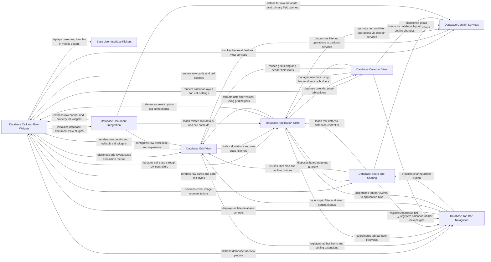

## Details

Provides database view presentations including grid, board, and calendar layouts, along with row/cell controllers and sharing capabilities.

### Database Cell and Row Widgets
Provides reusable visual components including cell formatters, cell editors, row details, and property configuration panels across views.

**Related Classes/Methods**:

- `frontend.appflowy_flutter.lib.plugins.database.widgets.card.card.RowCard`:28-83
- `frontend.appflowy_flutter.lib.plugins.database.widgets.cell.editable_cell_builder.EditableCellBuilder`:34-247
- `frontend.appflowy_flutter.lib.plugins.database.widgets.row.row_detail.RowDetailPage`:26-42
- `frontend.appflowy_flutter.lib.plugins.database.widgets.field.field_editor.FieldEditor`:35-55

**Source Files:**

- `frontend/appflowy_flutter/lib/plugins/database/widgets/card/card.dart`
  - `frontend.appflowy_flutter.lib.plugins.database.widgets.card.card.RowCard` (L28-L83) - Class
  - `frontend.appflowy_flutter.lib.plugins.database.widgets.card.card.RowCard.RowCard` (L29-L46) - Constructor
  - `frontend.appflowy_flutter.lib.plugins.database.widgets.card.card.RowCard.createState` (L82-L82) - Method
  - `frontend.appflowy_flutter.lib.plugins.database.widgets.card.card._RowCardState` (L85-L210) - Class
  - `frontend.appflowy_flutter.lib.plugins.database.widgets.card.card._RowCardState.initState` (L90-L105) - Method
  - `frontend.appflowy_flutter.lib.plugins.database.widgets.card.card._RowCardState.didUpdateWidget` (L108-L113) - Method
  - `frontend.appflowy_flutter.lib.plugins.database.widgets.card.card._RowCardState.dispose` (L116-L119) - Method
  - `frontend.appflowy_flutter.lib.plugins.database.widgets.card.card._RowCardState.build` (L122-L136) - Method
  - `frontend.appflowy_flutter.lib.plugins.database.widgets.card.card._RowCardState._mobile` (L138-L154) - Method
  - `frontend.appflowy_flutter.lib.plugins.database.widgets.card.card._RowCardState._desktop` (L156-L198) - Method
  - `frontend.appflowy_flutter.lib.plugins.database.widgets.card.card._RowCardState._handleOpenAccessory` (L200-L209) - Method
  - `frontend.appflowy_flutter.lib.plugins.database.widgets.card.card._CardContent` (L212-L274) - Class
  - `frontend.appflowy_flutter.lib.plugins.database.widgets.card.card._CardContent._CardContent` (L213-L220) - Constructor
  - `frontend.appflowy_flutter.lib.plugins.database.widgets.card.card._CardContent.build` (L230-L255) - Method
  - `frontend.appflowy_flutter.lib.plugins.database.widgets.card.card._CardContent._makeCells` (L257-L273) - Method
  - `frontend.appflowy_flutter.lib.plugins.database.widgets.card.card._CardContentCell` (L276-L293) - Class
  - `frontend.appflowy_flutter.lib.plugins.database.widgets.card.card._CardContentCell._CardContentCell` (L277-L283) - Constructor
  - `frontend.appflowy_flutter.lib.plugins.database.widgets.card.card._CardContentCell.createState` (L292-L292) - Method
  - `frontend.appflowy_flutter.lib.plugins.database.widgets.card.card._CardContentCellState` (L295-L333) - Class
  - `frontend.appflowy_flutter.lib.plugins.database.widgets.card.card._CardContentCellState.initState` (L299-L303) - Method
  - `frontend.appflowy_flutter.lib.plugins.database.widgets.card.card._CardContentCellState.listener` (L305-L308) - Method
  - `frontend.appflowy_flutter.lib.plugins.database.widgets.card.card._CardContentCellState.dispose` (L311-L315) - Method
  - `frontend.appflowy_flutter.lib.plugins.database.widgets.card.card._CardContentCellState.build` (L318-L332) - Method
  - `frontend.appflowy_flutter.lib.plugins.database.widgets.card.card.CardCover` (L335-L421) - Class
  - `frontend.appflowy_flutter.lib.plugins.database.widgets.card.card.CardCover.CardCover` (L336-L341) - Constructor
  - `frontend.appflowy_flutter.lib.plugins.database.widgets.card.card.CardCover.build` (L348-L371) - Method
  - `frontend.appflowy_flutter.lib.plugins.database.widgets.card.card.CardCover._renderCover` (L373-L420) - Method
  - `frontend.appflowy_flutter.lib.plugins.database.widgets.card.card.EditCardAccessory` (L423-L439) - Class
  - `frontend.appflowy_flutter.lib.plugins.database.widgets.card.card.EditCardAccessory.EditCardAccessory` (L424-L424) - Constructor
  - `frontend.appflowy_flutter.lib.plugins.database.widgets.card.card.EditCardAccessory.build` (L427-L435) - Method
  - `frontend.appflowy_flutter.lib.plugins.database.widgets.card.card.EditCardAccessory.type` (L438-L438) - Method
  - `frontend.appflowy_flutter.lib.plugins.database.widgets.card.card.MoreCardOptionsAccessory` (L441-L457) - Class
  - `frontend.appflowy_flutter.lib.plugins.database.widgets.card.card.MoreCardOptionsAccessory.MoreCardOptionsAccessory` (L442-L442) - Constructor
  - `frontend.appflowy_flutter.lib.plugins.database.widgets.card.card.MoreCardOptionsAccessory.build` (L445-L453) - Method
  - `frontend.appflowy_flutter.lib.plugins.database.widgets.card.card.MoreCardOptionsAccessory.type` (L456-L456) - Method
  - `frontend.appflowy_flutter.lib.plugins.database.widgets.card.card.RowCardStyleConfiguration` (L459-L471) - Class
  - `frontend.appflowy_flutter.lib.plugins.database.widgets.card.card.RowCardStyleConfiguration.RowCardStyleConfiguration` (L460-L465) - Constructor
- `frontend/appflowy_flutter/lib/plugins/database/widgets/card/card_bloc.dart`
  - `frontend.appflowy_flutter.lib.plugins.database.widgets.card.card_bloc.CardBloc` (L17-L99) - Class
  - `frontend.appflowy_flutter.lib.plugins.database.widgets.card.card_bloc.CardBloc.CardBloc` (L18-L37) - Constructor
  - `frontend.appflowy_flutter.lib.plugins.database.widgets.card.card_bloc.CardBloc.close` (L47-L53) - Method
  - `frontend.appflowy_flutter.lib.plugins.database.widgets.card.card_bloc.CardBloc._dispatch` (L55-L81) - Method
  - `frontend.appflowy_flutter.lib.plugins.database.widgets.card.card_bloc.CardBloc._startListening` (L83-L98) - Method
  - `frontend.appflowy_flutter.lib.plugins.database.widgets.card.card_bloc._makeCells` (L101-L124) - Function
  - `frontend.appflowy_flutter.lib.plugins.database.widgets.card.card_bloc.CardEvent` (L127-L136) - Class
  - `frontend.appflowy_flutter.lib.plugins.database.widgets.card.card_bloc.CardEvent.CardEvent.initial` (L128-L128) - Constructor
  - `frontend.appflowy_flutter.lib.plugins.database.widgets.card.card_bloc.CardEvent.CardEvent.setIsEditing` (L129-L129) - Constructor
  - `frontend.appflowy_flutter.lib.plugins.database.widgets.card.card_bloc.CardEvent.CardEvent.didReceiveCells` (L130-L133) - Constructor
  - `frontend.appflowy_flutter.lib.plugins.database.widgets.card.card_bloc.CardEvent.CardEvent.didUpdateRowMeta` (L134-L135) - Constructor
  - `frontend.appflowy_flutter.lib.plugins.database.widgets.card.card_bloc.CellMeta` (L139-L149) - Class
  - `frontend.appflowy_flutter.lib.plugins.database.widgets.card.card_bloc.CellMeta.CellMeta._` (L140-L140) - Constructor
  - `frontend.appflowy_flutter.lib.plugins.database.widgets.card.card_bloc.CellMeta.CellMeta` (L142-L146) - Constructor
  - `frontend.appflowy_flutter.lib.plugins.database.widgets.card.card_bloc.CellMeta.cellContext` (L148-L148) - Method
  - `frontend.appflowy_flutter.lib.plugins.database.widgets.card.card_bloc.CardState` (L152-L170) - Class
  - `frontend.appflowy_flutter.lib.plugins.database.widgets.card.card_bloc.CardState.CardState` (L153-L158) - Constructor
  - `frontend.appflowy_flutter.lib.plugins.database.widgets.card.card_bloc.CardState.CardState.initial` (L160-L169) - Constructor
- `frontend/appflowy_flutter/lib/plugins/database/widgets/card/container/accessory.dart`
  - `frontend.appflowy_flutter.lib.plugins.database.widgets.card.container.accessory.AccessoryType` (L4-L7) - Enum
  - `frontend.appflowy_flutter.lib.plugins.database.widgets.card.container.accessory.AccessoryType.edit` (L5-L5) - Enum
  - `frontend.appflowy_flutter.lib.plugins.database.widgets.card.container.accessory.AccessoryType.more` (L6-L6) - Enum
  - `frontend.appflowy_flutter.lib.plugins.database.widgets.card.container.accessory.CardAccessory` (L9-L12) - Class
  - `frontend.appflowy_flutter.lib.plugins.database.widgets.card.container.accessory.CardAccessory.type` (L10-L10) - Method
  - `frontend.appflowy_flutter.lib.plugins.database.widgets.card.container.accessory.CardAccessory.onTap` (L11-L11) - Method
  - `frontend.appflowy_flutter.lib.plugins.database.widgets.card.container.accessory.CardAccessoryContainer` (L14-L104) - Class
  - `frontend.appflowy_flutter.lib.plugins.database.widgets.card.container.accessory.CardAccessoryContainer.CardAccessoryContainer` (L15-L19) - Constructor
  - `frontend.appflowy_flutter.lib.plugins.database.widgets.card.container.accessory.CardAccessoryContainer.build` (L25-L56) - Method
  - `frontend.appflowy_flutter.lib.plugins.database.widgets.card.container.accessory.CardAccessoryContainer._wrapHover` (L58-L70) - Method
  - `frontend.appflowy_flutter.lib.plugins.database.widgets.card.container.accessory.CardAccessoryContainer._wrapDecoration` (L72-L103) - Method
- `frontend/appflowy_flutter/lib/plugins/database/widgets/card/container/card_container.dart`
  - `frontend.appflowy_flutter.lib.plugins.database.widgets.card.container.card_container.RowCardContainer` (L7-L56) - Class
  - `frontend.appflowy_flutter.lib.plugins.database.widgets.card.container.card_container.RowCardContainer.RowCardContainer` (L8-L16) - Constructor
  - `frontend.appflowy_flutter.lib.plugins.database.widgets.card.container.card_container.RowCardContainer.build` (L26-L55) - Method
  - `frontend.appflowy_flutter.lib.plugins.database.widgets.card.container.card_container._CardEnterRegion` (L58-L108) - Class
  - `frontend.appflowy_flutter.lib.plugins.database.widgets.card.container.card_container._CardEnterRegion._CardEnterRegion` (L59-L64) - Constructor
  - `frontend.appflowy_flutter.lib.plugins.database.widgets.card.container.card_container._CardEnterRegion.build` (L72-L107) - Method
  - `frontend.appflowy_flutter.lib.plugins.database.widgets.card.container.card_container._CardContainerNotifier` (L110-L123) - Class
  - `frontend.appflowy_flutter.lib.plugins.database.widgets.card.container.card_container._CardContainerNotifier._CardContainerNotifier` (L111-L111) - Constructor
  - `frontend.appflowy_flutter.lib.plugins.database.widgets.card.container.card_container._CardContainerNotifier.onEnter=` (L115-L120) - Method
  - `frontend.appflowy_flutter.lib.plugins.database.widgets.card.container.card_container._CardContainerNotifier.onEnter` (L122-L122) - Method
- `frontend/appflowy_flutter/lib/plugins/database/widgets/cell/card_cell_builder.dart`
  - `frontend.appflowy_flutter.lib.plugins.database.widgets.cell.card_cell_builder.CardCellBuilder` (L24-L126) - Class
  - `frontend.appflowy_flutter.lib.plugins.database.widgets.cell.card_cell_builder.CardCellBuilder.CardCellBuilder` (L25-L25) - Constructor
  - `frontend.appflowy_flutter.lib.plugins.database.widgets.cell.card_cell_builder.CardCellBuilder.build` (L29-L125) - Method
- `frontend/appflowy_flutter/lib/plugins/database/widgets/cell/card_cell_skeleton/card_cell.dart`
  - `frontend.appflowy_flutter.lib.plugins.database.widgets.cell.card_cell_skeleton.card_cell.CardCell` (L3-L7) - Class
  - `frontend.appflowy_flutter.lib.plugins.database.widgets.cell.card_cell_skeleton.card_cell.CardCell.CardCell` (L4-L4) - Constructor
  - `frontend.appflowy_flutter.lib.plugins.database.widgets.cell.card_cell_skeleton.card_cell.CardCellStyle` (L9-L13) - Class
  - `frontend.appflowy_flutter.lib.plugins.database.widgets.cell.card_cell_skeleton.card_cell.CardCellStyle.CardCellStyle` (L10-L10) - Constructor
  - `frontend.appflowy_flutter.lib.plugins.database.widgets.cell.card_cell_skeleton.card_cell.isStyleOrNull` (L15-L21) - Function
  - `frontend.appflowy_flutter.lib.plugins.database.widgets.cell.card_cell_skeleton.card_cell.EditableCardNotifier` (L23-L32) - Class
  - `frontend.appflowy_flutter.lib.plugins.database.widgets.cell.card_cell_skeleton.card_cell.EditableCardNotifier.EditableCardNotifier` (L24-L25) - Constructor
  - `frontend.appflowy_flutter.lib.plugins.database.widgets.cell.card_cell_skeleton.card_cell.EditableCardNotifier.dispose` (L29-L31) - Method
  - `frontend.appflowy_flutter.lib.plugins.database.widgets.cell.card_cell_skeleton.card_cell.EditableCell` (L34-L40) - Class
  - `frontend.appflowy_flutter.lib.plugins.database.widgets.cell.card_cell_skeleton.card_cell.EditableCell.editableNotifier` (L39-L39) - Method
- `frontend/appflowy_flutter/lib/plugins/database/widgets/cell/card_cell_skeleton/checkbox_card_cell.dart`
  - `frontend.appflowy_flutter.lib.plugins.database.widgets.cell.card_cell_skeleton.checkbox_card_cell.CheckboxCardCellStyle` (L13-L24) - Class
  - `frontend.appflowy_flutter.lib.plugins.database.widgets.cell.card_cell_skeleton.checkbox_card_cell.CheckboxCardCellStyle.CheckboxCardCellStyle` (L14-L19) - Constructor
  - `frontend.appflowy_flutter.lib.plugins.database.widgets.cell.card_cell_skeleton.checkbox_card_cell.CheckboxCardCell` (L26-L39) - Class
  - `frontend.appflowy_flutter.lib.plugins.database.widgets.cell.card_cell_skeleton.checkbox_card_cell.CheckboxCardCell.CheckboxCardCell` (L27-L32) - Constructor
  - `frontend.appflowy_flutter.lib.plugins.database.widgets.cell.card_cell_skeleton.checkbox_card_cell.CheckboxCardCell.createState` (L38-L38) - Method
  - `frontend.appflowy_flutter.lib.plugins.database.widgets.cell.card_cell_skeleton.checkbox_card_cell._CheckboxCellState` (L41-L87) - Class
  - `frontend.appflowy_flutter.lib.plugins.database.widgets.cell.card_cell_skeleton.checkbox_card_cell._CheckboxCellState.build` (L43-L86) - Method
- `frontend/appflowy_flutter/lib/plugins/database/widgets/cell/card_cell_skeleton/checklist_card_cell.dart`
  - `frontend.appflowy_flutter.lib.plugins.database.widgets.cell.card_cell_skeleton.checklist_card_cell.ChecklistCardCellStyle` (L11-L18) - Class
  - `frontend.appflowy_flutter.lib.plugins.database.widgets.cell.card_cell_skeleton.checklist_card_cell.ChecklistCardCellStyle.ChecklistCardCellStyle` (L12-L15) - Constructor
  - `frontend.appflowy_flutter.lib.plugins.database.widgets.cell.card_cell_skeleton.checklist_card_cell.ChecklistCardCell` (L20-L33) - Class
  - `frontend.appflowy_flutter.lib.plugins.database.widgets.cell.card_cell_skeleton.checklist_card_cell.ChecklistCardCell.ChecklistCardCell` (L21-L26) - Constructor
  - `frontend.appflowy_flutter.lib.plugins.database.widgets.cell.card_cell_skeleton.checklist_card_cell.ChecklistCardCell.createState` (L32-L32) - Method
  - `frontend.appflowy_flutter.lib.plugins.database.widgets.cell.card_cell_skeleton.checklist_card_cell._ChecklistCellState` (L35-L64) - Class
  - `frontend.appflowy_flutter.lib.plugins.database.widgets.cell.card_cell_skeleton.checklist_card_cell._ChecklistCellState.build` (L37-L63) - Method
- `frontend/appflowy_flutter/lib/plugins/database/widgets/cell/card_cell_skeleton/date_card_cell.dart`
  - `frontend.appflowy_flutter.lib.plugins.database.widgets.cell.card_cell_skeleton.date_card_cell.DateCardCellStyle` (L13-L20) - Class
  - `frontend.appflowy_flutter.lib.plugins.database.widgets.cell.card_cell_skeleton.date_card_cell.DateCardCellStyle.DateCardCellStyle` (L14-L17) - Constructor
  - `frontend.appflowy_flutter.lib.plugins.database.widgets.cell.card_cell_skeleton.date_card_cell.DateCardCell` (L22-L35) - Class
  - `frontend.appflowy_flutter.lib.plugins.database.widgets.cell.card_cell_skeleton.date_card_cell.DateCardCell.DateCardCell` (L23-L28) - Constructor
  - `frontend.appflowy_flutter.lib.plugins.database.widgets.cell.card_cell_skeleton.date_card_cell.DateCardCell.createState` (L34-L34) - Method
  - `frontend.appflowy_flutter.lib.plugins.database.widgets.cell.card_cell_skeleton.date_card_cell._DateCellState` (L37-L83) - Class
  - `frontend.appflowy_flutter.lib.plugins.database.widgets.cell.card_cell_skeleton.date_card_cell._DateCellState.build` (L39-L82) - Method
- `frontend/appflowy_flutter/lib/plugins/database/widgets/cell/card_cell_skeleton/media_card_cell.dart`
  - `frontend.appflowy_flutter.lib.plugins.database.widgets.cell.card_cell_skeleton.media_card_cell.MediaCardCellStyle` (L16-L23) - Class
  - `frontend.appflowy_flutter.lib.plugins.database.widgets.cell.card_cell_skeleton.media_card_cell.MediaCardCellStyle.MediaCardCellStyle` (L17-L20) - Constructor
  - `frontend.appflowy_flutter.lib.plugins.database.widgets.cell.card_cell_skeleton.media_card_cell.MediaCardCell` (L25-L38) - Class
  - `frontend.appflowy_flutter.lib.plugins.database.widgets.cell.card_cell_skeleton.media_card_cell.MediaCardCell.MediaCardCell` (L26-L31) - Constructor
  - `frontend.appflowy_flutter.lib.plugins.database.widgets.cell.card_cell_skeleton.media_card_cell.MediaCardCell.createState` (L37-L37) - Method
  - `frontend.appflowy_flutter.lib.plugins.database.widgets.cell.card_cell_skeleton.media_card_cell._MediaCellState` (L40-L81) - Class
  - `frontend.appflowy_flutter.lib.plugins.database.widgets.cell.card_cell_skeleton.media_card_cell._MediaCellState.build` (L42-L80) - Method
- `frontend/appflowy_flutter/lib/plugins/database/widgets/cell/card_cell_skeleton/number_card_cell.dart`
  - `frontend.appflowy_flutter.lib.plugins.database.widgets.cell.card_cell_skeleton.number_card_cell.NumberCardCellStyle` (L10-L17) - Class
  - `frontend.appflowy_flutter.lib.plugins.database.widgets.cell.card_cell_skeleton.number_card_cell.NumberCardCellStyle.NumberCardCellStyle` (L11-L14) - Constructor
  - `frontend.appflowy_flutter.lib.plugins.database.widgets.cell.card_cell_skeleton.number_card_cell.NumberCardCell` (L19-L32) - Class
  - `frontend.appflowy_flutter.lib.plugins.database.widgets.cell.card_cell_skeleton.number_card_cell.NumberCardCell.NumberCardCell` (L20-L25) - Constructor
  - `frontend.appflowy_flutter.lib.plugins.database.widgets.cell.card_cell_skeleton.number_card_cell.NumberCardCell.createState` (L31-L31) - Method
  - `frontend.appflowy_flutter.lib.plugins.database.widgets.cell.card_cell_skeleton.number_card_cell._NumberCellState` (L34-L62) - Class
  - `frontend.appflowy_flutter.lib.plugins.database.widgets.cell.card_cell_skeleton.number_card_cell._NumberCellState.build` (L36-L61) - Method
- `frontend/appflowy_flutter/lib/plugins/database/widgets/cell/card_cell_skeleton/relation_card_cell.dart`
  - `frontend.appflowy_flutter.lib.plugins.database.widgets.cell.card_cell_skeleton.relation_card_cell.RelationCardCellStyle` (L12-L21) - Class
  - `frontend.appflowy_flutter.lib.plugins.database.widgets.cell.card_cell_skeleton.relation_card_cell.RelationCardCellStyle.RelationCardCellStyle` (L13-L17) - Constructor
  - `frontend.appflowy_flutter.lib.plugins.database.widgets.cell.card_cell_skeleton.relation_card_cell.RelationCardCell` (L23-L36) - Class
  - `frontend.appflowy_flutter.lib.plugins.database.widgets.cell.card_cell_skeleton.relation_card_cell.RelationCardCell.RelationCardCell` (L24-L29) - Constructor
  - `frontend.appflowy_flutter.lib.plugins.database.widgets.cell.card_cell_skeleton.relation_card_cell.RelationCardCell.createState` (L35-L35) - Method
  - `frontend.appflowy_flutter.lib.plugins.database.widgets.cell.card_cell_skeleton.relation_card_cell._RelationCellState` (L38-L87) - Class
  - `frontend.appflowy_flutter.lib.plugins.database.widgets.cell.card_cell_skeleton.relation_card_cell._RelationCellState.build` (L40-L86) - Method
- `frontend/appflowy_flutter/lib/plugins/database/widgets/cell/card_cell_skeleton/select_option_card_cell.dart`
  - `frontend.appflowy_flutter.lib.plugins.database.widgets.cell.card_cell_skeleton.select_option_card_cell.SelectOptionCardCellStyle` (L11-L22) - Class
  - `frontend.appflowy_flutter.lib.plugins.database.widgets.cell.card_cell_skeleton.select_option_card_cell.SelectOptionCardCellStyle.SelectOptionCardCellStyle` (L12-L17) - Constructor
  - `frontend.appflowy_flutter.lib.plugins.database.widgets.cell.card_cell_skeleton.select_option_card_cell.SelectOptionCardCell` (L24-L37) - Class
  - `frontend.appflowy_flutter.lib.plugins.database.widgets.cell.card_cell_skeleton.select_option_card_cell.SelectOptionCardCell.SelectOptionCardCell` (L25-L30) - Constructor
  - `frontend.appflowy_flutter.lib.plugins.database.widgets.cell.card_cell_skeleton.select_option_card_cell.SelectOptionCardCell.createState` (L36-L36) - Method
  - `frontend.appflowy_flutter.lib.plugins.database.widgets.cell.card_cell_skeleton.select_option_card_cell._SelectOptionCellState` (L39-L87) - Class
  - `frontend.appflowy_flutter.lib.plugins.database.widgets.cell.card_cell_skeleton.select_option_card_cell._SelectOptionCellState.build` (L41-L86) - Method
- `frontend/appflowy_flutter/lib/plugins/database/widgets/cell/card_cell_skeleton/summary_card_cell.dart`
  - `frontend.appflowy_flutter.lib.plugins.database.widgets.cell.card_cell_skeleton.summary_card_cell.SummaryCardCellStyle` (L10-L17) - Class
  - `frontend.appflowy_flutter.lib.plugins.database.widgets.cell.card_cell_skeleton.summary_card_cell.SummaryCardCellStyle.SummaryCardCellStyle` (L11-L14) - Constructor
  - `frontend.appflowy_flutter.lib.plugins.database.widgets.cell.card_cell_skeleton.summary_card_cell.SummaryCardCell` (L19-L32) - Class
  - `frontend.appflowy_flutter.lib.plugins.database.widgets.cell.card_cell_skeleton.summary_card_cell.SummaryCardCell.SummaryCardCell` (L20-L25) - Constructor
  - `frontend.appflowy_flutter.lib.plugins.database.widgets.cell.card_cell_skeleton.summary_card_cell.SummaryCardCell.createState` (L31-L31) - Method
  - `frontend.appflowy_flutter.lib.plugins.database.widgets.cell.card_cell_skeleton.summary_card_cell._SummaryCellState` (L34-L62) - Class
  - `frontend.appflowy_flutter.lib.plugins.database.widgets.cell.card_cell_skeleton.summary_card_cell._SummaryCellState.build` (L36-L61) - Method
- `frontend/appflowy_flutter/lib/plugins/database/widgets/cell/card_cell_skeleton/text_card_cell.dart`
  - `frontend.appflowy_flutter.lib.plugins.database.widgets.cell.card_cell_skeleton.text_card_cell.TextCardCellStyle` (L18-L29) - Class
  - `frontend.appflowy_flutter.lib.plugins.database.widgets.cell.card_cell_skeleton.text_card_cell.TextCardCellStyle.TextCardCellStyle` (L19-L24) - Constructor
  - `frontend.appflowy_flutter.lib.plugins.database.widgets.cell.card_cell_skeleton.text_card_cell.TextCardCell` (L31-L50) - Class
  - `frontend.appflowy_flutter.lib.plugins.database.widgets.cell.card_cell_skeleton.text_card_cell.TextCardCell.TextCardCell` (L32-L39) - Constructor
  - `frontend.appflowy_flutter.lib.plugins.database.widgets.cell.card_cell_skeleton.text_card_cell.TextCardCell.createState` (L49-L49) - Method
  - `frontend.appflowy_flutter.lib.plugins.database.widgets.cell.card_cell_skeleton.text_card_cell._TextCellState` (L52-L252) - Class
  - `frontend.appflowy_flutter.lib.plugins.database.widgets.cell.card_cell_skeleton.text_card_cell._TextCellState.initState` (L63-L80) - Method
  - `frontend.appflowy_flutter.lib.plugins.database.widgets.cell.card_cell_skeleton.text_card_cell._TextCellState._onFocusChanged` (L82-L88) - Method
  - `frontend.appflowy_flutter.lib.plugins.database.widgets.cell.card_cell_skeleton.text_card_cell._TextCellState._bindEditableNotifier` (L90-L103) - Method
  - `frontend.appflowy_flutter.lib.plugins.database.widgets.cell.card_cell_skeleton.text_card_cell._TextCellState.didUpdateWidget` (L106-L111) - Method
  - `frontend.appflowy_flutter.lib.plugins.database.widgets.cell.card_cell_skeleton.text_card_cell._TextCellState.build` (L114-L126) - Method
  - `frontend.appflowy_flutter.lib.plugins.database.widgets.cell.card_cell_skeleton.text_card_cell._TextCellState.dispose` (L129-L136) - Method
  - `frontend.appflowy_flutter.lib.plugins.database.widgets.cell.card_cell_skeleton.text_card_cell._TextCellState._buildIcon` (L138-L159) - Method
  - `frontend.appflowy_flutter.lib.plugins.database.widgets.cell.card_cell_skeleton.text_card_cell._TextCellState._buildText` (L161-L179) - Method
  - `frontend.appflowy_flutter.lib.plugins.database.widgets.cell.card_cell_skeleton.text_card_cell._TextCellState._buildTitle` (L181-L208) - Method
  - `frontend.appflowy_flutter.lib.plugins.database.widgets.cell.card_cell_skeleton.text_card_cell._TextCellState._buildTextField` (L210-L251) - Method
  - `frontend.appflowy_flutter.lib.plugins.database.widgets.cell.card_cell_skeleton.text_card_cell.SimpleActivator` (L254-L276) - Class
  - `frontend.appflowy_flutter.lib.plugins.database.widgets.cell.card_cell_skeleton.text_card_cell.SimpleActivator.SimpleActivator` (L255-L258) - Constructor
  - `frontend.appflowy_flutter.lib.plugins.database.widgets.cell.card_cell_skeleton.text_card_cell.SimpleActivator.accepts` (L264-L268) - Method
  - `frontend.appflowy_flutter.lib.plugins.database.widgets.cell.card_cell_skeleton.text_card_cell.SimpleActivator.debugDescribeKeys` (L271-L272) - Method
  - `frontend.appflowy_flutter.lib.plugins.database.widgets.cell.card_cell_skeleton.text_card_cell.SimpleActivator.triggers` (L275-L275) - Method
- `frontend/appflowy_flutter/lib/plugins/database/widgets/cell/card_cell_skeleton/time_card_cell.dart`
  - `frontend.appflowy_flutter.lib.plugins.database.widgets.cell.card_cell_skeleton.time_card_cell.TimeCardCellStyle` (L10-L17) - Class
  - `frontend.appflowy_flutter.lib.plugins.database.widgets.cell.card_cell_skeleton.time_card_cell.TimeCardCellStyle.TimeCardCellStyle` (L11-L14) - Constructor
  - `frontend.appflowy_flutter.lib.plugins.database.widgets.cell.card_cell_skeleton.time_card_cell.TimeCardCell` (L19-L32) - Class
  - `frontend.appflowy_flutter.lib.plugins.database.widgets.cell.card_cell_skeleton.time_card_cell.TimeCardCell.TimeCardCell` (L20-L25) - Constructor
  - `frontend.appflowy_flutter.lib.plugins.database.widgets.cell.card_cell_skeleton.time_card_cell.TimeCardCell.createState` (L31-L31) - Method
  - `frontend.appflowy_flutter.lib.plugins.database.widgets.cell.card_cell_skeleton.time_card_cell._TimeCellState` (L34-L62) - Class
  - `frontend.appflowy_flutter.lib.plugins.database.widgets.cell.card_cell_skeleton.time_card_cell._TimeCellState.build` (L36-L61) - Method
- `frontend/appflowy_flutter/lib/plugins/database/widgets/cell/card_cell_skeleton/timestamp_card_cell.dart`
  - `frontend.appflowy_flutter.lib.plugins.database.widgets.cell.card_cell_skeleton.timestamp_card_cell.TimestampCardCellStyle` (L10-L17) - Class
  - `frontend.appflowy_flutter.lib.plugins.database.widgets.cell.card_cell_skeleton.timestamp_card_cell.TimestampCardCellStyle.TimestampCardCellStyle` (L11-L14) - Constructor
  - `frontend.appflowy_flutter.lib.plugins.database.widgets.cell.card_cell_skeleton.timestamp_card_cell.TimestampCardCell` (L19-L32) - Class
  - `frontend.appflowy_flutter.lib.plugins.database.widgets.cell.card_cell_skeleton.timestamp_card_cell.TimestampCardCell.TimestampCardCell` (L20-L25) - Constructor
  - `frontend.appflowy_flutter.lib.plugins.database.widgets.cell.card_cell_skeleton.timestamp_card_cell.TimestampCardCell.createState` (L31-L31) - Method
  - `frontend.appflowy_flutter.lib.plugins.database.widgets.cell.card_cell_skeleton.timestamp_card_cell._TimestampCellState` (L34-L65) - Class
  - `frontend.appflowy_flutter.lib.plugins.database.widgets.cell.card_cell_skeleton.timestamp_card_cell._TimestampCellState.build` (L36-L64) - Method
- `frontend/appflowy_flutter/lib/plugins/database/widgets/cell/card_cell_skeleton/translate_card_cell.dart`
  - `frontend.appflowy_flutter.lib.plugins.database.widgets.cell.card_cell_skeleton.translate_card_cell.TranslateCardCellStyle` (L10-L17) - Class
  - `frontend.appflowy_flutter.lib.plugins.database.widgets.cell.card_cell_skeleton.translate_card_cell.TranslateCardCellStyle.TranslateCardCellStyle` (L11-L14) - Constructor
  - `frontend.appflowy_flutter.lib.plugins.database.widgets.cell.card_cell_skeleton.translate_card_cell.TranslateCardCell` (L19-L32) - Class
  - `frontend.appflowy_flutter.lib.plugins.database.widgets.cell.card_cell_skeleton.translate_card_cell.TranslateCardCell.TranslateCardCell` (L20-L25) - Constructor
  - `frontend.appflowy_flutter.lib.plugins.database.widgets.cell.card_cell_skeleton.translate_card_cell.TranslateCardCell.createState` (L31-L31) - Method
  - `frontend.appflowy_flutter.lib.plugins.database.widgets.cell.card_cell_skeleton.translate_card_cell._TranslateCellState` (L34-L62) - Class
  - `frontend.appflowy_flutter.lib.plugins.database.widgets.cell.card_cell_skeleton.translate_card_cell._TranslateCellState.build` (L36-L61) - Method
- `frontend/appflowy_flutter/lib/plugins/database/widgets/cell/card_cell_skeleton/url_card_cell.dart`
  - `frontend.appflowy_flutter.lib.plugins.database.widgets.cell.card_cell_skeleton.url_card_cell.URLCardCellStyle` (L10-L17) - Class
  - `frontend.appflowy_flutter.lib.plugins.database.widgets.cell.card_cell_skeleton.url_card_cell.URLCardCellStyle.URLCardCellStyle` (L11-L14) - Constructor
  - `frontend.appflowy_flutter.lib.plugins.database.widgets.cell.card_cell_skeleton.url_card_cell.URLCardCell` (L19-L32) - Class
  - `frontend.appflowy_flutter.lib.plugins.database.widgets.cell.card_cell_skeleton.url_card_cell.URLCardCell.URLCardCell` (L20-L25) - Constructor
  - `frontend.appflowy_flutter.lib.plugins.database.widgets.cell.card_cell_skeleton.url_card_cell.URLCardCell.createState` (L31-L31) - Method
  - `frontend.appflowy_flutter.lib.plugins.database.widgets.cell.card_cell_skeleton.url_card_cell._URLCellState` (L34-L64) - Class
  - `frontend.appflowy_flutter.lib.plugins.database.widgets.cell.card_cell_skeleton.url_card_cell._URLCellState.build` (L36-L63) - Method
- `frontend/appflowy_flutter/lib/plugins/database/widgets/cell/card_cell_style_maps/calendar_card_cell_style.dart`
  - `frontend.appflowy_flutter.lib.plugins.database.widgets.cell.card_cell_style_maps.calendar_card_cell_style.desktopCalendarCardCellStyleMap` (L19-L99) - Function
- `frontend/appflowy_flutter/lib/plugins/database/widgets/cell/card_cell_style_maps/desktop_board_card_cell_style.dart`
  - `frontend.appflowy_flutter.lib.plugins.database.widgets.cell.card_cell_style_maps.desktop_board_card_cell_style.desktopBoardCardCellStyleMap` (L20-L103) - Function
- `frontend/appflowy_flutter/lib/plugins/database/widgets/cell/card_cell_style_maps/mobile_board_card_cell_style.dart`
  - `frontend.appflowy_flutter.lib.plugins.database.widgets.cell.card_cell_style_maps.mobile_board_card_cell_style.mobileBoardCardCellStyleMap` (L20-L103) - Function
- `frontend/appflowy_flutter/lib/plugins/database/widgets/cell/desktop_grid/desktop_grid_checkbox_cell.dart`
  - `frontend.appflowy_flutter.lib.plugins.database.widgets.cell.desktop_grid.desktop_grid_checkbox_cell.DesktopGridCheckboxCellSkin` (L10-L42) - Class
  - `frontend.appflowy_flutter.lib.plugins.database.widgets.cell.desktop_grid.desktop_grid_checkbox_cell.DesktopGridCheckboxCellSkin.build` (L12-L41) - Method
- `frontend/appflowy_flutter/lib/plugins/database/widgets/cell/desktop_grid/desktop_grid_checklist_cell.dart`
  - `frontend.appflowy_flutter.lib.plugins.database.widgets.cell.desktop_grid.desktop_grid_checklist_cell.DesktopGridChecklistCellSkin` (L12-L65) - Class
  - `frontend.appflowy_flutter.lib.plugins.database.widgets.cell.desktop_grid.desktop_grid_checklist_cell.DesktopGridChecklistCellSkin.build` (L14-L64) - Method
- `frontend/appflowy_flutter/lib/plugins/database/widgets/cell/desktop_grid/desktop_grid_date_cell.dart`
  - `frontend.appflowy_flutter.lib.plugins.database.widgets.cell.desktop_grid.desktop_grid_date_cell.DesktopGridDateCellSkin` (L13-L91) - Class
  - `frontend.appflowy_flutter.lib.plugins.database.widgets.cell.desktop_grid.desktop_grid_date_cell.DesktopGridDateCellSkin.build` (L15-L49) - Method
  - `frontend.appflowy_flutter.lib.plugins.database.widgets.cell.desktop_grid.desktop_grid_date_cell.DesktopGridDateCellSkin._buildCellContent` (L51-L90) - Method
- `frontend/appflowy_flutter/lib/plugins/database/widgets/cell/desktop_grid/desktop_grid_media_cell.dart`
  - `frontend.appflowy_flutter.lib.plugins.database.widgets.cell.desktop_grid.desktop_grid_media_cell.GridMediaCellSkin` (L24-L220) - Class
  - `frontend.appflowy_flutter.lib.plugins.database.widgets.cell.desktop_grid.desktop_grid_media_cell.GridMediaCellSkin.GridMediaCellSkin` (L25-L25) - Constructor
  - `frontend.appflowy_flutter.lib.plugins.database.widgets.cell.desktop_grid.desktop_grid_media_cell.GridMediaCellSkin.dispose` (L30-L30) - Method
  - `frontend.appflowy_flutter.lib.plugins.database.widgets.cell.desktop_grid.desktop_grid_media_cell.GridMediaCellSkin.build` (L33-L153) - Method
  - `frontend.appflowy_flutter.lib.plugins.database.widgets.cell.desktop_grid.desktop_grid_media_cell.GridMediaCellSkin._openOrExpandFile` (L155-L190) - Method
  - `frontend.appflowy_flutter.lib.plugins.database.widgets.cell.desktop_grid.desktop_grid_media_cell.GridMediaCellSkin._tapCellMobile` (L192-L219) - Method
  - `frontend.appflowy_flutter.lib.plugins.database.widgets.cell.desktop_grid.desktop_grid_media_cell._FilePreviewRender` (L222-L265) - Class
  - `frontend.appflowy_flutter.lib.plugins.database.widgets.cell.desktop_grid.desktop_grid_media_cell._FilePreviewRender._FilePreviewRender` (L223-L223) - Constructor
  - `frontend.appflowy_flutter.lib.plugins.database.widgets.cell.desktop_grid.desktop_grid_media_cell._FilePreviewRender.build` (L228-L264) - Method
- `frontend/appflowy_flutter/lib/plugins/database/widgets/cell/desktop_grid/desktop_grid_number_cell.dart`
  - `frontend.appflowy_flutter.lib.plugins.database.widgets.cell.desktop_grid.desktop_grid_number_cell.DesktopGridNumberCellSkin` (L9-L47) - Class
  - `frontend.appflowy_flutter.lib.plugins.database.widgets.cell.desktop_grid.desktop_grid_number_cell.DesktopGridNumberCellSkin.build` (L11-L46) - Method
- `frontend/appflowy_flutter/lib/plugins/database/widgets/cell/desktop_grid/desktop_grid_relation_cell.dart`
  - `frontend.appflowy_flutter.lib.plugins.database.widgets.cell.desktop_grid.desktop_grid_relation_cell.DesktopGridRelationCellSkin` (L15-L110) - Class
  - `frontend.appflowy_flutter.lib.plugins.database.widgets.cell.desktop_grid.desktop_grid_relation_cell.DesktopGridRelationCellSkin.build` (L17-L53) - Method
  - `frontend.appflowy_flutter.lib.plugins.database.widgets.cell.desktop_grid.desktop_grid_relation_cell.DesktopGridRelationCellSkin._buildWrapRows` (L55-L80) - Method
  - `frontend.appflowy_flutter.lib.plugins.database.widgets.cell.desktop_grid.desktop_grid_relation_cell.DesktopGridRelationCellSkin._buildNoWrapRows` (L82-L109) - Method
- `frontend/appflowy_flutter/lib/plugins/database/widgets/cell/desktop_grid/desktop_grid_select_option_cell.dart`
  - `frontend.appflowy_flutter.lib.plugins.database.widgets.cell.desktop_grid.desktop_grid_select_option_cell.DesktopGridSelectOptionCellSkin` (L13-L128) - Class
  - `frontend.appflowy_flutter.lib.plugins.database.widgets.cell.desktop_grid.desktop_grid_select_option_cell.DesktopGridSelectOptionCellSkin.build` (L15-L53) - Method
  - `frontend.appflowy_flutter.lib.plugins.database.widgets.cell.desktop_grid.desktop_grid_select_option_cell.DesktopGridSelectOptionCellSkin._buildWrapOptions` (L55-L88) - Method
  - `frontend.appflowy_flutter.lib.plugins.database.widgets.cell.desktop_grid.desktop_grid_select_option_cell.DesktopGridSelectOptionCellSkin._buildNoWrapOptions` (L90-L127) - Method
- `frontend/appflowy_flutter/lib/plugins/database/widgets/cell/desktop_grid/desktop_grid_summary_cell.dart`
  - `frontend.appflowy_flutter.lib.plugins.database.widgets.cell.desktop_grid.desktop_grid_summary_cell.DesktopGridSummaryCellSkin` (L9-L99) - Class
  - `frontend.appflowy_flutter.lib.plugins.database.widgets.cell.desktop_grid.desktop_grid_summary_cell.DesktopGridSummaryCellSkin.build` (L11-L98) - Method
  - `frontend.appflowy_flutter.lib.plugins.database.widgets.cell.desktop_grid.desktop_grid_summary_cell.SummaryMouseNotifier` (L101-L114) - Class
  - `frontend.appflowy_flutter.lib.plugins.database.widgets.cell.desktop_grid.desktop_grid_summary_cell.SummaryMouseNotifier.SummaryMouseNotifier` (L102-L102) - Constructor
  - `frontend.appflowy_flutter.lib.plugins.database.widgets.cell.desktop_grid.desktop_grid_summary_cell.SummaryMouseNotifier.onEnter=` (L106-L111) - Method
  - `frontend.appflowy_flutter.lib.plugins.database.widgets.cell.desktop_grid.desktop_grid_summary_cell.SummaryMouseNotifier.onEnter` (L113-L113) - Method
- `frontend/appflowy_flutter/lib/plugins/database/widgets/cell/desktop_grid/desktop_grid_text_cell.dart`
  - `frontend.appflowy_flutter.lib.plugins.database.widgets.cell.desktop_grid.desktop_grid_text_cell.DesktopGridTextCellSkin` (L11-L64) - Class
  - `frontend.appflowy_flutter.lib.plugins.database.widgets.cell.desktop_grid.desktop_grid_text_cell.DesktopGridTextCellSkin.build` (L13-L63) - Method
  - `frontend.appflowy_flutter.lib.plugins.database.widgets.cell.desktop_grid.desktop_grid_text_cell._IconOrEmoji` (L66-L110) - Class
  - `frontend.appflowy_flutter.lib.plugins.database.widgets.cell.desktop_grid.desktop_grid_text_cell._IconOrEmoji._IconOrEmoji` (L67-L67) - Constructor
  - `frontend.appflowy_flutter.lib.plugins.database.widgets.cell.desktop_grid.desktop_grid_text_cell._IconOrEmoji.build` (L70-L109) - Method
- `frontend/appflowy_flutter/lib/plugins/database/widgets/cell/desktop_grid/desktop_grid_time_cell.dart`
  - `frontend.appflowy_flutter.lib.plugins.database.widgets.cell.desktop_grid.desktop_grid_time_cell.DesktopGridTimeCellSkin` (L9-L37) - Class
  - `frontend.appflowy_flutter.lib.plugins.database.widgets.cell.desktop_grid.desktop_grid_time_cell.DesktopGridTimeCellSkin.build` (L11-L36) - Method
- `frontend/appflowy_flutter/lib/plugins/database/widgets/cell/desktop_grid/desktop_grid_timestamp_cell.dart`
  - `frontend.appflowy_flutter.lib.plugins.database.widgets.cell.desktop_grid.desktop_grid_timestamp_cell.DesktopGridTimestampCellSkin` (L9-L51) - Class
  - `frontend.appflowy_flutter.lib.plugins.database.widgets.cell.desktop_grid.desktop_grid_timestamp_cell.DesktopGridTimestampCellSkin.build` (L11-L28) - Method
  - `frontend.appflowy_flutter.lib.plugins.database.widgets.cell.desktop_grid.desktop_grid_timestamp_cell.DesktopGridTimestampCellSkin._buildCellContent` (L30-L50) - Method
- `frontend/appflowy_flutter/lib/plugins/database/widgets/cell/desktop_grid/desktop_grid_translate_cell.dart`
  - `frontend.appflowy_flutter.lib.plugins.database.widgets.cell.desktop_grid.desktop_grid_translate_cell.DesktopGridTranslateCellSkin` (L9-L99) - Class
  - `frontend.appflowy_flutter.lib.plugins.database.widgets.cell.desktop_grid.desktop_grid_translate_cell.DesktopGridTranslateCellSkin.build` (L11-L98) - Method
  - `frontend.appflowy_flutter.lib.plugins.database.widgets.cell.desktop_grid.desktop_grid_translate_cell.TranslateMouseNotifier` (L101-L114) - Class
  - `frontend.appflowy_flutter.lib.plugins.database.widgets.cell.desktop_grid.desktop_grid_translate_cell.TranslateMouseNotifier.TranslateMouseNotifier` (L102-L102) - Constructor
  - `frontend.appflowy_flutter.lib.plugins.database.widgets.cell.desktop_grid.desktop_grid_translate_cell.TranslateMouseNotifier.onEnter=` (L106-L111) - Method
  - `frontend.appflowy_flutter.lib.plugins.database.widgets.cell.desktop_grid.desktop_grid_translate_cell.TranslateMouseNotifier.onEnter` (L113-L113) - Method
- `frontend/appflowy_flutter/lib/plugins/database/widgets/cell/desktop_grid/desktop_grid_url_cell.dart`
  - `frontend.appflowy_flutter.lib.plugins.database.widgets.cell.desktop_grid.desktop_grid_url_cell.DesktopGridURLSkin` (L19-L82) - Class
  - `frontend.appflowy_flutter.lib.plugins.database.widgets.cell.desktop_grid.desktop_grid_url_cell.DesktopGridURLSkin.build` (L21-L64) - Method
  - `frontend.appflowy_flutter.lib.plugins.database.widgets.cell.desktop_grid.desktop_grid_url_cell.DesktopGridURLSkin.accessoryBuilder` (L67-L81) - Method
  - `frontend.appflowy_flutter.lib.plugins.database.widgets.cell.desktop_grid.desktop_grid_url_cell.accessoryFromType` (L84-L104) - Function
  - `frontend.appflowy_flutter.lib.plugins.database.widgets.cell.desktop_grid.desktop_grid_url_cell.GridURLCellAccessoryType` (L106-L109) - Enum
  - `frontend.appflowy_flutter.lib.plugins.database.widgets.cell.desktop_grid.desktop_grid_url_cell.GridURLCellAccessoryType.copyURL` (L107-L107) - Enum
  - `frontend.appflowy_flutter.lib.plugins.database.widgets.cell.desktop_grid.desktop_grid_url_cell.GridURLCellAccessoryType.visitURL` (L108-L108) - Enum
  - `frontend.appflowy_flutter.lib.plugins.database.widgets.cell.desktop_grid.desktop_grid_url_cell._CopyURLAccessory` (L114-L124) - Class
  - `frontend.appflowy_flutter.lib.plugins.database.widgets.cell.desktop_grid.desktop_grid_url_cell._CopyURLAccessory._CopyURLAccessory` (L115-L118) - Constructor
  - `frontend.appflowy_flutter.lib.plugins.database.widgets.cell.desktop_grid.desktop_grid_url_cell._CopyURLAccessory.createState` (L123-L123) - Method
  - `frontend.appflowy_flutter.lib.plugins.database.widgets.cell.desktop_grid.desktop_grid_url_cell._CopyURLAccessoryState` (L126-L155) - Class
  - `frontend.appflowy_flutter.lib.plugins.database.widgets.cell.desktop_grid.desktop_grid_url_cell._CopyURLAccessoryState.build` (L129-L144) - Method
  - `frontend.appflowy_flutter.lib.plugins.database.widgets.cell.desktop_grid.desktop_grid_url_cell._CopyURLAccessoryState.onTap` (L147-L154) - Method
  - `frontend.appflowy_flutter.lib.plugins.database.widgets.cell.desktop_grid.desktop_grid_url_cell._VisitURLAccessory` (L160-L170) - Class
  - `frontend.appflowy_flutter.lib.plugins.database.widgets.cell.desktop_grid.desktop_grid_url_cell._VisitURLAccessory._VisitURLAccessory` (L161-L164) - Constructor
  - `frontend.appflowy_flutter.lib.plugins.database.widgets.cell.desktop_grid.desktop_grid_url_cell._VisitURLAccessory.createState` (L169-L169) - Method
  - `frontend.appflowy_flutter.lib.plugins.database.widgets.cell.desktop_grid.desktop_grid_url_cell._VisitURLAccessoryState` (L172-L197) - Class
  - `frontend.appflowy_flutter.lib.plugins.database.widgets.cell.desktop_grid.desktop_grid_url_cell._VisitURLAccessoryState.build` (L175-L190) - Method
  - `frontend.appflowy_flutter.lib.plugins.database.widgets.cell.desktop_grid.desktop_grid_url_cell._VisitURLAccessoryState.enable` (L193-L193) - Method
  - `frontend.appflowy_flutter.lib.plugins.database.widgets.cell.desktop_grid.desktop_grid_url_cell._VisitURLAccessoryState.onTap` (L196-L196) - Method
  - `frontend.appflowy_flutter.lib.plugins.database.widgets.cell.desktop_grid.desktop_grid_url_cell._URLAccessoryIconContainer` (L199-L226) - Class
  - `frontend.appflowy_flutter.lib.plugins.database.widgets.cell.desktop_grid.desktop_grid_url_cell._URLAccessoryIconContainer._URLAccessoryIconContainer` (L200-L200) - Constructor
  - `frontend.appflowy_flutter.lib.plugins.database.widgets.cell.desktop_grid.desktop_grid_url_cell._URLAccessoryIconContainer.build` (L205-L225) - Method
- `frontend/appflowy_flutter/lib/plugins/database/widgets/cell/desktop_row_detail/desktop_row_detail_checkbox_cell.dart`
  - `frontend.appflowy_flutter.lib.plugins.database.widgets.cell.desktop_row_detail.desktop_row_detail_checkbox_cell.DesktopRowDetailCheckboxCellSkin` (L9-L33) - Class
  - `frontend.appflowy_flutter.lib.plugins.database.widgets.cell.desktop_row_detail.desktop_row_detail_checkbox_cell.DesktopRowDetailCheckboxCellSkin.build` (L11-L32) - Method
- `frontend/appflowy_flutter/lib/plugins/database/widgets/cell/desktop_row_detail/desktop_row_detail_checklist_cell.dart`
  - `frontend.appflowy_flutter.lib.plugins.database.widgets.cell.desktop_row_detail.desktop_row_detail_checklist_cell.DesktopRowDetailChecklistCellSkin` (L21-L37) - Class
  - `frontend.appflowy_flutter.lib.plugins.database.widgets.cell.desktop_row_detail.desktop_row_detail_checklist_cell.DesktopRowDetailChecklistCellSkin.build` (L23-L36) - Method
  - `frontend.appflowy_flutter.lib.plugins.database.widgets.cell.desktop_row_detail.desktop_row_detail_checklist_cell.ChecklistRowDetailCell` (L39-L55) - Class
  - `frontend.appflowy_flutter.lib.plugins.database.widgets.cell.desktop_row_detail.desktop_row_detail_checklist_cell.ChecklistRowDetailCell.ChecklistRowDetailCell` (L40-L46) - Constructor
  - `frontend.appflowy_flutter.lib.plugins.database.widgets.cell.desktop_row_detail.desktop_row_detail_checklist_cell.ChecklistRowDetailCell.createState` (L54-L54) - Method
  - `frontend.appflowy_flutter.lib.plugins.database.widgets.cell.desktop_row_detail.desktop_row_detail_checklist_cell._ChecklistRowDetailCellState` (L57-L116) - Class
  - `frontend.appflowy_flutter.lib.plugins.database.widgets.cell.desktop_row_detail.desktop_row_detail_checklist_cell._ChecklistRowDetailCellState.dispose` (L61-L64) - Method
  - `frontend.appflowy_flutter.lib.plugins.database.widgets.cell.desktop_row_detail.desktop_row_detail_checklist_cell._ChecklistRowDetailCellState.build` (L67-L115) - Method
  - `frontend.appflowy_flutter.lib.plugins.database.widgets.cell.desktop_row_detail.desktop_row_detail_checklist_cell.ProgressAndHideCompleteButton` (L119-L169) - Class
  - `frontend.appflowy_flutter.lib.plugins.database.widgets.cell.desktop_row_detail.desktop_row_detail_checklist_cell.ProgressAndHideCompleteButton.ProgressAndHideCompleteButton` (L120-L123) - Constructor
  - `frontend.appflowy_flutter.lib.plugins.database.widgets.cell.desktop_row_detail.desktop_row_detail_checklist_cell.ProgressAndHideCompleteButton.build` (L128-L168) - Method
  - `frontend.appflowy_flutter.lib.plugins.database.widgets.cell.desktop_row_detail.desktop_row_detail_checklist_cell._ChecklistItems` (L171-L270) - Class
  - `frontend.appflowy_flutter.lib.plugins.database.widgets.cell.desktop_row_detail.desktop_row_detail_checklist_cell._ChecklistItems._ChecklistItems` (L172-L175) - Constructor
  - `frontend.appflowy_flutter.lib.plugins.database.widgets.cell.desktop_row_detail.desktop_row_detail_checklist_cell._ChecklistItems.build` (L181-L227) - Method
  - `frontend.appflowy_flutter.lib.plugins.database.widgets.cell.desktop_row_detail.desktop_row_detail_checklist_cell._ChecklistItems._makeChildren` (L229-L269) - Method
  - `frontend.appflowy_flutter.lib.plugins.database.widgets.cell.desktop_row_detail.desktop_row_detail_checklist_cell._CancelCreatingFromPhantomIntent` (L272-L274) - Class
  - `frontend.appflowy_flutter.lib.plugins.database.widgets.cell.desktop_row_detail.desktop_row_detail_checklist_cell._CancelCreatingFromPhantomIntent._CancelCreatingFromPhantomIntent` (L273-L273) - Constructor
  - `frontend.appflowy_flutter.lib.plugins.database.widgets.cell.desktop_row_detail.desktop_row_detail_checklist_cell._SubmitPhantomTaskIntent` (L276-L284) - Class
  - `frontend.appflowy_flutter.lib.plugins.database.widgets.cell.desktop_row_detail.desktop_row_detail_checklist_cell._SubmitPhantomTaskIntent._SubmitPhantomTaskIntent` (L277-L280) - Constructor
  - `frontend.appflowy_flutter.lib.plugins.database.widgets.cell.desktop_row_detail.desktop_row_detail_checklist_cell.PhantomChecklistItem` (L287-L299) - Class
  - `frontend.appflowy_flutter.lib.plugins.database.widgets.cell.desktop_row_detail.desktop_row_detail_checklist_cell.PhantomChecklistItem.PhantomChecklistItem` (L288-L292) - Constructor
  - `frontend.appflowy_flutter.lib.plugins.database.widgets.cell.desktop_row_detail.desktop_row_detail_checklist_cell.PhantomChecklistItem.createState` (L298-L298) - Method
  - `frontend.appflowy_flutter.lib.plugins.database.widgets.cell.desktop_row_detail.desktop_row_detail_checklist_cell._PhantomChecklistItemState` (L301-L390) - Class
  - `frontend.appflowy_flutter.lib.plugins.database.widgets.cell.desktop_row_detail.desktop_row_detail_checklist_cell._PhantomChecklistItemState.initState` (L307-L313) - Method
  - `frontend.appflowy_flutter.lib.plugins.database.widgets.cell.desktop_row_detail.desktop_row_detail_checklist_cell._PhantomChecklistItemState._onTextChanged` (L315-L317) - Method
  - `frontend.appflowy_flutter.lib.plugins.database.widgets.cell.desktop_row_detail.desktop_row_detail_checklist_cell._PhantomChecklistItemState._onFocusChanged` (L319-L327) - Method
  - `frontend.appflowy_flutter.lib.plugins.database.widgets.cell.desktop_row_detail.desktop_row_detail_checklist_cell._PhantomChecklistItemState.dispose` (L330-L335) - Method
  - `frontend.appflowy_flutter.lib.plugins.database.widgets.cell.desktop_row_detail.desktop_row_detail_checklist_cell._PhantomChecklistItemState.build` (L338-L375) - Method
  - `frontend.appflowy_flutter.lib.plugins.database.widgets.cell.desktop_row_detail.desktop_row_detail_checklist_cell._PhantomChecklistItemState._buildShortcuts` (L377-L389) - Method
  - `frontend.appflowy_flutter.lib.plugins.database.widgets.cell.desktop_row_detail.desktop_row_detail_checklist_cell.ChecklistItemControl` (L393-L449) - Class
  - `frontend.appflowy_flutter.lib.plugins.database.widgets.cell.desktop_row_detail.desktop_row_detail_checklist_cell.ChecklistItemControl.ChecklistItemControl` (L394-L398) - Constructor
  - `frontend.appflowy_flutter.lib.plugins.database.widgets.cell.desktop_row_detail.desktop_row_detail_checklist_cell.ChecklistItemControl.build` (L404-L448) - Method
- `frontend/appflowy_flutter/lib/plugins/database/widgets/cell/desktop_row_detail/desktop_row_detail_date_cell.dart`
  - `frontend.appflowy_flutter.lib.plugins.database.widgets.cell.desktop_row_detail.desktop_row_detail_date_cell.DesktopRowDetailDateCellSkin` (L11-L70) - Class
  - `frontend.appflowy_flutter.lib.plugins.database.widgets.cell.desktop_row_detail.desktop_row_detail_date_cell.DesktopRowDetailDateCellSkin.build` (L13-L69) - Method
- `frontend/appflowy_flutter/lib/plugins/database/widgets/cell/desktop_row_detail/desktop_row_detail_media_cell.dart`
  - `frontend.appflowy_flutter.lib.plugins.database.widgets.cell.desktop_row_detail.desktop_row_detail_media_cell.DekstopRowDetailMediaCellSkin` (L35-L183) - Class
  - `frontend.appflowy_flutter.lib.plugins.database.widgets.cell.desktop_row_detail.desktop_row_detail_media_cell.DekstopRowDetailMediaCellSkin.dispose` (L39-L41) - Method
  - `frontend.appflowy_flutter.lib.plugins.database.widgets.cell.desktop_row_detail.desktop_row_detail_media_cell.DekstopRowDetailMediaCellSkin.build` (L44-L176) - Method
  - `frontend.appflowy_flutter.lib.plugins.database.widgets.cell.desktop_row_detail.desktop_row_detail_media_cell.DekstopRowDetailMediaCellSkin._toggleShowAllFiles` (L178-L182) - Method
  - `frontend.appflowy_flutter.lib.plugins.database.widgets.cell.desktop_row_detail.desktop_row_detail_media_cell._FilePreviewFeedback` (L185-L221) - Class
  - `frontend.appflowy_flutter.lib.plugins.database.widgets.cell.desktop_row_detail.desktop_row_detail_media_cell._FilePreviewFeedback._FilePreviewFeedback` (L186-L186) - Constructor
  - `frontend.appflowy_flutter.lib.plugins.database.widgets.cell.desktop_row_detail.desktop_row_detail_media_cell._FilePreviewFeedback.build` (L191-L220) - Method
  - `frontend.appflowy_flutter.lib.plugins.database.widgets.cell.desktop_row_detail.desktop_row_detail_media_cell._AddFileButton` (L225-L240) - Class
  - `frontend.appflowy_flutter.lib.plugins.database.widgets.cell.desktop_row_detail.desktop_row_detail_media_cell._AddFileButton._AddFileButton` (L226-L231) - Constructor
  - `frontend.appflowy_flutter.lib.plugins.database.widgets.cell.desktop_row_detail.desktop_row_detail_media_cell._AddFileButton.createState` (L239-L239) - Method
  - `frontend.appflowy_flutter.lib.plugins.database.widgets.cell.desktop_row_detail.desktop_row_detail_media_cell._AddFileButtonState` (L242-L342) - Class
  - `frontend.appflowy_flutter.lib.plugins.database.widgets.cell.desktop_row_detail.desktop_row_detail_media_cell._AddFileButtonState.build` (L246-L341) - Method
  - `frontend.appflowy_flutter.lib.plugins.database.widgets.cell.desktop_row_detail.desktop_row_detail_media_cell._FilePreviewRender` (L344-L366) - Class
  - `frontend.appflowy_flutter.lib.plugins.database.widgets.cell.desktop_row_detail.desktop_row_detail_media_cell._FilePreviewRender._FilePreviewRender` (L345-L354) - Constructor
  - `frontend.appflowy_flutter.lib.plugins.database.widgets.cell.desktop_row_detail.desktop_row_detail_media_cell._FilePreviewRender.createState` (L365-L365) - Method
  - `frontend.appflowy_flutter.lib.plugins.database.widgets.cell.desktop_row_detail.desktop_row_detail_media_cell._FilePreviewRenderState` (L368-L565) - Class
  - `frontend.appflowy_flutter.lib.plugins.database.widgets.cell.desktop_row_detail.desktop_row_detail_media_cell._FilePreviewRenderState.file` (L376-L376) - Method
  - `frontend.appflowy_flutter.lib.plugins.database.widgets.cell.desktop_row_detail.desktop_row_detail_media_cell._FilePreviewRenderState.initState` (L379-L382) - Method
  - `frontend.appflowy_flutter.lib.plugins.database.widgets.cell.desktop_row_detail.desktop_row_detail_media_cell._FilePreviewRenderState.dispose` (L385-L389) - Method
  - `frontend.appflowy_flutter.lib.plugins.database.widgets.cell.desktop_row_detail.desktop_row_detail_media_cell._FilePreviewRenderState.didUpdateWidget` (L392-L395) - Method
  - `frontend.appflowy_flutter.lib.plugins.database.widgets.cell.desktop_row_detail.desktop_row_detail_media_cell._FilePreviewRenderState.build` (L398-L564) - Method
  - `frontend.appflowy_flutter.lib.plugins.database.widgets.cell.desktop_row_detail.desktop_row_detail_media_cell._FileMenu` (L567-L597) - Class
  - `frontend.appflowy_flutter.lib.plugins.database.widgets.cell.desktop_row_detail.desktop_row_detail_media_cell._FileMenu._FileMenu` (L568-L575) - Constructor
  - `frontend.appflowy_flutter.lib.plugins.database.widgets.cell.desktop_row_detail.desktop_row_detail_media_cell._FileMenu.createState` (L596-L596) - Method
  - `frontend.appflowy_flutter.lib.plugins.database.widgets.cell.desktop_row_detail.desktop_row_detail_media_cell._FileMenuState` (L599-L749) - Class
  - `frontend.appflowy_flutter.lib.plugins.database.widgets.cell.desktop_row_detail.desktop_row_detail_media_cell._FileMenuState.dispose` (L603-L606) - Method
  - `frontend.appflowy_flutter.lib.plugins.database.widgets.cell.desktop_row_detail.desktop_row_detail_media_cell._FileMenuState.build` (L609-L682) - Method
  - `frontend.appflowy_flutter.lib.plugins.database.widgets.cell.desktop_row_detail.desktop_row_detail_media_cell._FileMenuState._saveName` (L684-L694) - Method
  - `frontend.appflowy_flutter.lib.plugins.database.widgets.cell.desktop_row_detail.desktop_row_detail_media_cell._FileMenuState._showRenameConfirmDialog` (L696-L713) - Method
  - `frontend.appflowy_flutter.lib.plugins.database.widgets.cell.desktop_row_detail.desktop_row_detail_media_cell._FileMenuState._setCover` (L715-L723) - Method
  - `frontend.appflowy_flutter.lib.plugins.database.widgets.cell.desktop_row_detail.desktop_row_detail_media_cell._FileMenuState._showInteractiveViewer` (L725-L748) - Method
- `frontend/appflowy_flutter/lib/plugins/database/widgets/cell/desktop_row_detail/desktop_row_detail_number_cell.dart`
  - `frontend.appflowy_flutter.lib.plugins.database.widgets.cell.desktop_row_detail.desktop_row_detail_number_cell.DesktopRowDetailNumberCellSkin` (L9-L41) - Class
  - `frontend.appflowy_flutter.lib.plugins.database.widgets.cell.desktop_row_detail.desktop_row_detail_number_cell.DesktopRowDetailNumberCellSkin.build` (L11-L40) - Method
- `frontend/appflowy_flutter/lib/plugins/database/widgets/cell/desktop_row_detail/desktop_row_detail_relation_cell.dart`
  - `frontend.appflowy_flutter.lib.plugins.database.widgets.cell.desktop_row_detail.desktop_row_detail_relation_cell.DesktopRowDetailRelationCellSkin` (L14-L75) - Class
  - `frontend.appflowy_flutter.lib.plugins.database.widgets.cell.desktop_row_detail.desktop_row_detail_relation_cell.DesktopRowDetailRelationCellSkin.build` (L16-L49) - Method
  - `frontend.appflowy_flutter.lib.plugins.database.widgets.cell.desktop_row_detail.desktop_row_detail_relation_cell.DesktopRowDetailRelationCellSkin._buildPlaceholder` (L51-L56) - Method
  - `frontend.appflowy_flutter.lib.plugins.database.widgets.cell.desktop_row_detail.desktop_row_detail_relation_cell.DesktopRowDetailRelationCellSkin._buildRows` (L58-L74) - Method
- `frontend/appflowy_flutter/lib/plugins/database/widgets/cell/desktop_row_detail/desktop_row_detail_select_option_cell.dart`
  - `frontend.appflowy_flutter.lib.plugins.database.widgets.cell.desktop_row_detail.desktop_row_detail_select_option_cell.DesktopRowDetailSelectOptionCellSkin` (L14-L76) - Class
  - `frontend.appflowy_flutter.lib.plugins.database.widgets.cell.desktop_row_detail.desktop_row_detail_select_option_cell.DesktopRowDetailSelectOptionCellSkin.build` (L17-L50) - Method
  - `frontend.appflowy_flutter.lib.plugins.database.widgets.cell.desktop_row_detail.desktop_row_detail_select_option_cell.DesktopRowDetailSelectOptionCellSkin._buildPlaceholder` (L52-L57) - Method
  - `frontend.appflowy_flutter.lib.plugins.database.widgets.cell.desktop_row_detail.desktop_row_detail_select_option_cell.DesktopRowDetailSelectOptionCellSkin._buildOptions` (L59-L75) - Method
- `frontend/appflowy_flutter/lib/plugins/database/widgets/cell/desktop_row_detail/desktop_row_detail_summary_cell.dart`
  - `frontend.appflowy_flutter.lib.plugins.database.widgets.cell.desktop_row_detail.desktop_row_detail_summary_cell.DesktopRowDetailSummaryCellSkin` (L8-L67) - Class
  - `frontend.appflowy_flutter.lib.plugins.database.widgets.cell.desktop_row_detail.desktop_row_detail_summary_cell.DesktopRowDetailSummaryCellSkin.build` (L10-L66) - Method
- `frontend/appflowy_flutter/lib/plugins/database/widgets/cell/desktop_row_detail/desktop_row_detail_text_cell.dart`
  - `frontend.appflowy_flutter.lib.plugins.database.widgets.cell.desktop_row_detail.desktop_row_detail_text_cell.DesktopRowDetailTextCellSkin` (L9-L39) - Class
  - `frontend.appflowy_flutter.lib.plugins.database.widgets.cell.desktop_row_detail.desktop_row_detail_text_cell.DesktopRowDetailTextCellSkin.build` (L11-L38) - Method
- `frontend/appflowy_flutter/lib/plugins/database/widgets/cell/desktop_row_detail/desktop_row_detail_time_cell.dart`
  - `frontend.appflowy_flutter.lib.plugins.database.widgets.cell.desktop_row_detail.desktop_row_detail_time_cell.DesktopRowDetailTimeCellSkin` (L9-L40) - Class
  - `frontend.appflowy_flutter.lib.plugins.database.widgets.cell.desktop_row_detail.desktop_row_detail_time_cell.DesktopRowDetailTimeCellSkin.build` (L11-L39) - Method
- `frontend/appflowy_flutter/lib/plugins/database/widgets/cell/desktop_row_detail/desktop_row_detail_timestamp_cell.dart`
  - `frontend.appflowy_flutter.lib.plugins.database.widgets.cell.desktop_row_detail.desktop_row_detail_timestamp_cell.DesktopRowDetailTimestampCellSkin` (L8-L26) - Class
  - `frontend.appflowy_flutter.lib.plugins.database.widgets.cell.desktop_row_detail.desktop_row_detail_timestamp_cell.DesktopRowDetailTimestampCellSkin.build` (L10-L25) - Method
- `frontend/appflowy_flutter/lib/plugins/database/widgets/cell/desktop_row_detail/desktop_row_detail_url_cell.dart`
  - `frontend.appflowy_flutter.lib.plugins.database.widgets.cell.desktop_row_detail.desktop_row_detail_url_cell.DesktopRowDetailURLSkin` (L12-L41) - Class
  - `frontend.appflowy_flutter.lib.plugins.database.widgets.cell.desktop_row_detail.desktop_row_detail_url_cell.DesktopRowDetailURLSkin.build` (L14-L27) - Method
  - `frontend.appflowy_flutter.lib.plugins.database.widgets.cell.desktop_row_detail.desktop_row_detail_url_cell.DesktopRowDetailURLSkin.accessoryBuilder` (L30-L40) - Method
  - `frontend.appflowy_flutter.lib.plugins.database.widgets.cell.desktop_row_detail.desktop_row_detail_url_cell.LinkTextField` (L43-L55) - Class
  - `frontend.appflowy_flutter.lib.plugins.database.widgets.cell.desktop_row_detail.desktop_row_detail_url_cell.LinkTextField.LinkTextField` (L44-L48) - Constructor
  - `frontend.appflowy_flutter.lib.plugins.database.widgets.cell.desktop_row_detail.desktop_row_detail_url_cell.LinkTextField.createState` (L54-L54) - Method
  - `frontend.appflowy_flutter.lib.plugins.database.widgets.cell.desktop_row_detail.desktop_row_detail_url_cell._LinkTextFieldState` (L57-L114) - Class
  - `frontend.appflowy_flutter.lib.plugins.database.widgets.cell.desktop_row_detail.desktop_row_detail_url_cell._LinkTextFieldState.initState` (L61-L64) - Method
  - `frontend.appflowy_flutter.lib.plugins.database.widgets.cell.desktop_row_detail.desktop_row_detail_url_cell._LinkTextFieldState.dispose` (L67-L70) - Method
  - `frontend.appflowy_flutter.lib.plugins.database.widgets.cell.desktop_row_detail.desktop_row_detail_url_cell._LinkTextFieldState._handleGlobalKeyEvent` (L72-L81) - Method
  - `frontend.appflowy_flutter.lib.plugins.database.widgets.cell.desktop_row_detail.desktop_row_detail_url_cell._LinkTextFieldState.build` (L84-L113) - Method
- `frontend/appflowy_flutter/lib/plugins/database/widgets/cell/desktop_row_detail/destop_row_detail_translate_cell.dart`
  - `frontend.appflowy_flutter.lib.plugins.database.widgets.cell.desktop_row_detail.destop_row_detail_translate_cell.DesktopRowDetailTranslateCellSkin` (L8-L67) - Class
  - `frontend.appflowy_flutter.lib.plugins.database.widgets.cell.desktop_row_detail.destop_row_detail_translate_cell.DesktopRowDetailTranslateCellSkin.build` (L10-L66) - Method
- `frontend/appflowy_flutter/lib/plugins/database/widgets/cell/editable_cell_builder.dart`
  - `frontend.appflowy_flutter.lib.plugins.database.widgets.cell.editable_cell_builder.EditableCellStyle` (L26-L31) - Enum
  - `frontend.appflowy_flutter.lib.plugins.database.widgets.cell.editable_cell_builder.EditableCellStyle.desktopGrid` (L27-L27) - Enum
  - `frontend.appflowy_flutter.lib.plugins.database.widgets.cell.editable_cell_builder.EditableCellStyle.desktopRowDetail` (L28-L28) - Enum
  - `frontend.appflowy_flutter.lib.plugins.database.widgets.cell.editable_cell_builder.EditableCellStyle.mobileGrid` (L29-L29) - Enum
  - `frontend.appflowy_flutter.lib.plugins.database.widgets.cell.editable_cell_builder.EditableCellStyle.mobileRowDetail` (L30-L30) - Enum
  - `frontend.appflowy_flutter.lib.plugins.database.widgets.cell.editable_cell_builder.EditableCellBuilder` (L34-L247) - Class
  - `frontend.appflowy_flutter.lib.plugins.database.widgets.cell.editable_cell_builder.EditableCellBuilder.EditableCellBuilder` (L35-L35) - Constructor
  - `frontend.appflowy_flutter.lib.plugins.database.widgets.cell.editable_cell_builder.EditableCellBuilder.buildStyled` (L39-L147) - Method
  - `frontend.appflowy_flutter.lib.plugins.database.widgets.cell.editable_cell_builder.EditableCellBuilder.buildCustom` (L149-L246) - Method
  - `frontend.appflowy_flutter.lib.plugins.database.widgets.cell.editable_cell_builder.CellEditable` (L249-L253) - Class
  - `frontend.appflowy_flutter.lib.plugins.database.widgets.cell.editable_cell_builder.CellEditable.requestFocus` (L250-L250) - Method
  - `frontend.appflowy_flutter.lib.plugins.database.widgets.cell.editable_cell_builder.CellEditable.cellContainerNotifier` (L252-L252) - Method
  - `frontend.appflowy_flutter.lib.plugins.database.widgets.cell.editable_cell_builder.AccessoryBuilder` (L255-L257) - Class
  - `frontend.appflowy_flutter.lib.plugins.database.widgets.cell.editable_cell_builder.CellAccessory` (L259-L263) - Class
  - `frontend.appflowy_flutter.lib.plugins.database.widgets.cell.editable_cell_builder.CellAccessory.CellAccessory` (L260-L260) - Constructor
  - `frontend.appflowy_flutter.lib.plugins.database.widgets.cell.editable_cell_builder.CellAccessory.accessoryBuilder` (L262-L262) - Method
  - `frontend.appflowy_flutter.lib.plugins.database.widgets.cell.editable_cell_builder.EditableCellWidget` (L265-L280) - Class
  - `frontend.appflowy_flutter.lib.plugins.database.widgets.cell.editable_cell_builder.EditableCellWidget.EditableCellWidget` (L267-L267) - Constructor
  - `frontend.appflowy_flutter.lib.plugins.database.widgets.cell.editable_cell_builder.EditableCellWidget.accessoryBuilder` (L273-L273) - Method
  - `frontend.appflowy_flutter.lib.plugins.database.widgets.cell.editable_cell_builder.GridCellState` (L282-L309) - Class
  - `frontend.appflowy_flutter.lib.plugins.database.widgets.cell.editable_cell_builder.GridCellState.initState` (L284-L287) - Method
  - `frontend.appflowy_flutter.lib.plugins.database.widgets.cell.editable_cell_builder.GridCellState.didUpdateWidget` (L290-L296) - Method
  - `frontend.appflowy_flutter.lib.plugins.database.widgets.cell.editable_cell_builder.GridCellState.dispose` (L299-L303) - Method
  - `frontend.appflowy_flutter.lib.plugins.database.widgets.cell.editable_cell_builder.GridCellState.onRequestFocus` (L306-L306) - Method
  - `frontend.appflowy_flutter.lib.plugins.database.widgets.cell.editable_cell_builder.GridCellState.onCopy` (L308-L308) - Method
  - `frontend.appflowy_flutter.lib.plugins.database.widgets.cell.editable_cell_builder.GridEditableTextCell` (L311-L347) - Class
  - `frontend.appflowy_flutter.lib.plugins.database.widgets.cell.editable_cell_builder.GridEditableTextCell.focusNode` (L313-L313) - Method
  - `frontend.appflowy_flutter.lib.plugins.database.widgets.cell.editable_cell_builder.GridEditableTextCell.initState` (L316-L321) - Method
  - `frontend.appflowy_flutter.lib.plugins.database.widgets.cell.editable_cell_builder.GridEditableTextCell.dispose` (L324-L329) - Method
  - `frontend.appflowy_flutter.lib.plugins.database.widgets.cell.editable_cell_builder.GridEditableTextCell.onRequestFocus` (L332-L336) - Method
  - `frontend.appflowy_flutter.lib.plugins.database.widgets.cell.editable_cell_builder.GridEditableTextCell._listenOnFocusNodeChanged` (L338-L344) - Method
  - `frontend.appflowy_flutter.lib.plugins.database.widgets.cell.editable_cell_builder.GridEditableTextCell.focusChanged` (L346-L346) - Method
  - `frontend.appflowy_flutter.lib.plugins.database.widgets.cell.editable_cell_builder.SingleListenerChangeNotifier` (L349-L368) - Class
  - `frontend.appflowy_flutter.lib.plugins.database.widgets.cell.editable_cell_builder.SingleListenerChangeNotifier.addListener` (L353-L359) - Method
  - `frontend.appflowy_flutter.lib.plugins.database.widgets.cell.editable_cell_builder.SingleListenerChangeNotifier.dispose` (L362-L365) - Method
  - `frontend.appflowy_flutter.lib.plugins.database.widgets.cell.editable_cell_builder.SingleListenerChangeNotifier.notify` (L367-L367) - Method
  - `frontend.appflowy_flutter.lib.plugins.database.widgets.cell.editable_cell_builder.SingleListenerFocusNode` (L370-L393) - Class
  - `frontend.appflowy_flutter.lib.plugins.database.widgets.cell.editable_cell_builder.SingleListenerFocusNode.setListener` (L373-L380) - Method
  - `frontend.appflowy_flutter.lib.plugins.database.widgets.cell.editable_cell_builder.SingleListenerFocusNode.removeAllListener` (L382-L386) - Method
  - `frontend.appflowy_flutter.lib.plugins.database.widgets.cell.editable_cell_builder.SingleListenerFocusNode.dispose` (L389-L392) - Method
  - `frontend.appflowy_flutter.lib.plugins.database.widgets.cell.editable_cell_builder.EditableCellSkinMap` (L395-L441) - Class
  - `frontend.appflowy_flutter.lib.plugins.database.widgets.cell.editable_cell_builder.EditableCellSkinMap.EditableCellSkinMap` (L396-L408) - Constructor
  - `frontend.appflowy_flutter.lib.plugins.database.widgets.cell.editable_cell_builder.EditableCellSkinMap.has` (L422-L440) - Method
- `frontend/appflowy_flutter/lib/plugins/database/widgets/cell/editable_cell_skeleton/checkbox.dart`
  - `frontend.appflowy_flutter.lib.plugins.database.widgets.cell.editable_cell_skeleton.checkbox.IEditableCheckboxCellSkin` (L15-L34) - Class
  - `frontend.appflowy_flutter.lib.plugins.database.widgets.cell.editable_cell_skeleton.checkbox.IEditableCheckboxCellSkin.IEditableCheckboxCellSkin` (L16-L16) - Constructor
  - `frontend.appflowy_flutter.lib.plugins.database.widgets.cell.editable_cell_skeleton.checkbox.IEditableCheckboxCellSkin.IEditableCheckboxCellSkin.fromStyle` (L18-L25) - Constructor
  - `frontend.appflowy_flutter.lib.plugins.database.widgets.cell.editable_cell_skeleton.checkbox.IEditableCheckboxCellSkin.build` (L27-L33) - Method
  - `frontend.appflowy_flutter.lib.plugins.database.widgets.cell.editable_cell_skeleton.checkbox.EditableCheckboxCell` (L36-L50) - Class
  - `frontend.appflowy_flutter.lib.plugins.database.widgets.cell.editable_cell_skeleton.checkbox.EditableCheckboxCell.EditableCheckboxCell` (L37-L42) - Constructor
  - `frontend.appflowy_flutter.lib.plugins.database.widgets.cell.editable_cell_skeleton.checkbox.EditableCheckboxCell.createState` (L49-L49) - Method
  - `frontend.appflowy_flutter.lib.plugins.database.widgets.cell.editable_cell_skeleton.checkbox._CheckboxCellState` (L52-L95) - Class
  - `frontend.appflowy_flutter.lib.plugins.database.widgets.cell.editable_cell_skeleton.checkbox._CheckboxCellState.dispose` (L61-L64) - Method
  - `frontend.appflowy_flutter.lib.plugins.database.widgets.cell.editable_cell_skeleton.checkbox._CheckboxCellState.build` (L67-L82) - Method
  - `frontend.appflowy_flutter.lib.plugins.database.widgets.cell.editable_cell_skeleton.checkbox._CheckboxCellState.onRequestFocus` (L85-L85) - Method
  - `frontend.appflowy_flutter.lib.plugins.database.widgets.cell.editable_cell_skeleton.checkbox._CheckboxCellState.onCopy` (L88-L94) - Method
- `frontend/appflowy_flutter/lib/plugins/database/widgets/cell/editable_cell_skeleton/checklist.dart`
  - `frontend.appflowy_flutter.lib.plugins.database.widgets.cell.editable_cell_skeleton.checklist.IEditableChecklistCellSkin` (L16-L35) - Class
  - `frontend.appflowy_flutter.lib.plugins.database.widgets.cell.editable_cell_skeleton.checklist.IEditableChecklistCellSkin.IEditableChecklistCellSkin` (L17-L17) - Constructor
  - `frontend.appflowy_flutter.lib.plugins.database.widgets.cell.editable_cell_skeleton.checklist.IEditableChecklistCellSkin.IEditableChecklistCellSkin.fromStyle` (L19-L26) - Constructor
  - `frontend.appflowy_flutter.lib.plugins.database.widgets.cell.editable_cell_skeleton.checklist.IEditableChecklistCellSkin.build` (L28-L34) - Method
  - `frontend.appflowy_flutter.lib.plugins.database.widgets.cell.editable_cell_skeleton.checklist.EditableChecklistCell` (L37-L52) - Class
  - `frontend.appflowy_flutter.lib.plugins.database.widgets.cell.editable_cell_skeleton.checklist.EditableChecklistCell.EditableChecklistCell` (L38-L43) - Constructor
  - `frontend.appflowy_flutter.lib.plugins.database.widgets.cell.editable_cell_skeleton.checklist.EditableChecklistCell.createState` (L50-L51) - Method
  - `frontend.appflowy_flutter.lib.plugins.database.widgets.cell.editable_cell_skeleton.checklist.GridChecklistCellState` (L54-L89) - Class
  - `frontend.appflowy_flutter.lib.plugins.database.widgets.cell.editable_cell_skeleton.checklist.GridChecklistCellState.dispose` (L64-L67) - Method
  - `frontend.appflowy_flutter.lib.plugins.database.widgets.cell.editable_cell_skeleton.checklist.GridChecklistCellState.build` (L70-L81) - Method
  - `frontend.appflowy_flutter.lib.plugins.database.widgets.cell.editable_cell_skeleton.checklist.GridChecklistCellState.onRequestFocus` (L84-L88) - Method
- `frontend/appflowy_flutter/lib/plugins/database/widgets/cell/editable_cell_skeleton/date.dart`
  - `frontend.appflowy_flutter.lib.plugins.database.widgets.cell.editable_cell_skeleton.date.IEditableDateCellSkin` (L21-L41) - Class
  - `frontend.appflowy_flutter.lib.plugins.database.widgets.cell.editable_cell_skeleton.date.IEditableDateCellSkin.IEditableDateCellSkin` (L22-L22) - Constructor
  - `frontend.appflowy_flutter.lib.plugins.database.widgets.cell.editable_cell_skeleton.date.IEditableDateCellSkin.IEditableDateCellSkin.fromStyle` (L24-L31) - Constructor
  - `frontend.appflowy_flutter.lib.plugins.database.widgets.cell.editable_cell_skeleton.date.IEditableDateCellSkin.build` (L33-L40) - Method
  - `frontend.appflowy_flutter.lib.plugins.database.widgets.cell.editable_cell_skeleton.date.EditableDateCell` (L43-L57) - Class
  - `frontend.appflowy_flutter.lib.plugins.database.widgets.cell.editable_cell_skeleton.date.EditableDateCell.EditableDateCell` (L44-L49) - Constructor
  - `frontend.appflowy_flutter.lib.plugins.database.widgets.cell.editable_cell_skeleton.date.EditableDateCell.createState` (L56-L56) - Method
  - `frontend.appflowy_flutter.lib.plugins.database.widgets.cell.editable_cell_skeleton.date._DateCellState` (L59-L104) - Class
  - `frontend.appflowy_flutter.lib.plugins.database.widgets.cell.editable_cell_skeleton.date._DateCellState.dispose` (L69-L72) - Method
  - `frontend.appflowy_flutter.lib.plugins.database.widgets.cell.editable_cell_skeleton.date._DateCellState.build` (L75-L91) - Method
  - `frontend.appflowy_flutter.lib.plugins.database.widgets.cell.editable_cell_skeleton.date._DateCellState.onRequestFocus` (L94-L97) - Method
  - `frontend.appflowy_flutter.lib.plugins.database.widgets.cell.editable_cell_skeleton.date._DateCellState.onCopy` (L100-L103) - Method
  - `frontend.appflowy_flutter.lib.plugins.database.widgets.cell.editable_cell_skeleton.date.getDateCellStrFromCellData` (L106-L123) - Function
  - `frontend.appflowy_flutter.lib.plugins.database.widgets.cell.editable_cell_skeleton.date.GetDateFormatExtension.pattern` (L126-L133) - Method
  - `frontend.appflowy_flutter.lib.plugins.database.widgets.cell.editable_cell_skeleton.date.GetTimeFormatExtension.pattern` (L137-L140) - Method
- `frontend/appflowy_flutter/lib/plugins/database/widgets/cell/editable_cell_skeleton/media.dart`
  - `frontend.appflowy_flutter.lib.plugins.database.widgets.cell.editable_cell_skeleton.media.IEditableMediaCellSkin` (L15-L43) - Class
  - `frontend.appflowy_flutter.lib.plugins.database.widgets.cell.editable_cell_skeleton.media.IEditableMediaCellSkin.IEditableMediaCellSkin` (L16-L16) - Constructor
  - `frontend.appflowy_flutter.lib.plugins.database.widgets.cell.editable_cell_skeleton.media.IEditableMediaCellSkin.IEditableMediaCellSkin.fromStyle` (L18-L26) - Constructor
  - `frontend.appflowy_flutter.lib.plugins.database.widgets.cell.editable_cell_skeleton.media.IEditableMediaCellSkin.autoShowPopover` (L28-L33) - Method
  - `frontend.appflowy_flutter.lib.plugins.database.widgets.cell.editable_cell_skeleton.media.IEditableMediaCellSkin.build` (L35-L40) - Method
  - `frontend.appflowy_flutter.lib.plugins.database.widgets.cell.editable_cell_skeleton.media.IEditableMediaCellSkin.dispose` (L42-L42) - Method
  - `frontend.appflowy_flutter.lib.plugins.database.widgets.cell.editable_cell_skeleton.media.EditableMediaCell` (L45-L62) - Class
  - `frontend.appflowy_flutter.lib.plugins.database.widgets.cell.editable_cell_skeleton.media.EditableMediaCell.EditableMediaCell` (L46-L52) - Constructor
  - `frontend.appflowy_flutter.lib.plugins.database.widgets.cell.editable_cell_skeleton.media.EditableMediaCell.createState` (L60-L61) - Method
  - `frontend.appflowy_flutter.lib.plugins.database.widgets.cell.editable_cell_skeleton.media._EditableMediaCellState` (L64-L106) - Class
  - `frontend.appflowy_flutter.lib.plugins.database.widgets.cell.editable_cell_skeleton.media._EditableMediaCellState.dispose` (L75-L79) - Method
  - `frontend.appflowy_flutter.lib.plugins.database.widgets.cell.editable_cell_skeleton.media._EditableMediaCellState.build` (L82-L94) - Method
  - `frontend.appflowy_flutter.lib.plugins.database.widgets.cell.editable_cell_skeleton.media._EditableMediaCellState.onRequestFocus` (L100-L102) - Method
  - `frontend.appflowy_flutter.lib.plugins.database.widgets.cell.editable_cell_skeleton.media._EditableMediaCellState.onCopy` (L105-L105) - Method
- `frontend/appflowy_flutter/lib/plugins/database/widgets/cell/editable_cell_skeleton/number.dart`
  - `frontend.appflowy_flutter.lib.plugins.database.widgets.cell.editable_cell_skeleton.number.IEditableNumberCellSkin` (L17-L37) - Class
  - `frontend.appflowy_flutter.lib.plugins.database.widgets.cell.editable_cell_skeleton.number.IEditableNumberCellSkin.IEditableNumberCellSkin` (L18-L18) - Constructor
  - `frontend.appflowy_flutter.lib.plugins.database.widgets.cell.editable_cell_skeleton.number.IEditableNumberCellSkin.IEditableNumberCellSkin.fromStyle` (L20-L27) - Constructor
  - `frontend.appflowy_flutter.lib.plugins.database.widgets.cell.editable_cell_skeleton.number.IEditableNumberCellSkin.build` (L29-L36) - Method
  - `frontend.appflowy_flutter.lib.plugins.database.widgets.cell.editable_cell_skeleton.number.EditableNumberCell` (L39-L53) - Class
  - `frontend.appflowy_flutter.lib.plugins.database.widgets.cell.editable_cell_skeleton.number.EditableNumberCell.EditableNumberCell` (L40-L45) - Constructor
  - `frontend.appflowy_flutter.lib.plugins.database.widgets.cell.editable_cell_skeleton.number.EditableNumberCell.createState` (L52-L52) - Method
  - `frontend.appflowy_flutter.lib.plugins.database.widgets.cell.editable_cell_skeleton.number._NumberCellState` (L55-L125) - Class
  - `frontend.appflowy_flutter.lib.plugins.database.widgets.cell.editable_cell_skeleton.number._NumberCellState.initState` (L65-L69) - Method
  - `frontend.appflowy_flutter.lib.plugins.database.widgets.cell.editable_cell_skeleton.number._NumberCellState.dispose` (L72-L76) - Method
  - `frontend.appflowy_flutter.lib.plugins.database.widgets.cell.editable_cell_skeleton.number._NumberCellState.build` (L79-L102) - Method
  - `frontend.appflowy_flutter.lib.plugins.database.widgets.cell.editable_cell_skeleton.number._NumberCellState.onRequestFocus` (L108-L110) - Method
  - `frontend.appflowy_flutter.lib.plugins.database.widgets.cell.editable_cell_skeleton.number._NumberCellState.onCopy` (L113-L113) - Method
  - `frontend.appflowy_flutter.lib.plugins.database.widgets.cell.editable_cell_skeleton.number._NumberCellState.focusChanged` (L116-L124) - Method
- `frontend/appflowy_flutter/lib/plugins/database/widgets/cell/editable_cell_skeleton/relation.dart`
  - `frontend.appflowy_flutter.lib.plugins.database.widgets.cell.editable_cell_skeleton.relation.IEditableRelationCellSkin` (L16-L36) - Class
  - `frontend.appflowy_flutter.lib.plugins.database.widgets.cell.editable_cell_skeleton.relation.IEditableRelationCellSkin.IEditableRelationCellSkin.fromStyle` (L17-L24) - Constructor
  - `frontend.appflowy_flutter.lib.plugins.database.widgets.cell.editable_cell_skeleton.relation.IEditableRelationCellSkin.IEditableRelationCellSkin` (L26-L26) - Constructor
  - `frontend.appflowy_flutter.lib.plugins.database.widgets.cell.editable_cell_skeleton.relation.IEditableRelationCellSkin.build` (L28-L35) - Method
  - `frontend.appflowy_flutter.lib.plugins.database.widgets.cell.editable_cell_skeleton.relation.EditableRelationCell` (L38-L52) - Class
  - `frontend.appflowy_flutter.lib.plugins.database.widgets.cell.editable_cell_skeleton.relation.EditableRelationCell.EditableRelationCell` (L39-L44) - Constructor
  - `frontend.appflowy_flutter.lib.plugins.database.widgets.cell.editable_cell_skeleton.relation.EditableRelationCell.createState` (L51-L51) - Method
  - `frontend.appflowy_flutter.lib.plugins.database.widgets.cell.editable_cell_skeleton.relation._RelationCellState` (L54-L96) - Class
  - `frontend.appflowy_flutter.lib.plugins.database.widgets.cell.editable_cell_skeleton.relation._RelationCellState.dispose` (L64-L67) - Method
  - `frontend.appflowy_flutter.lib.plugins.database.widgets.cell.editable_cell_skeleton.relation._RelationCellState.build` (L70-L86) - Method
  - `frontend.appflowy_flutter.lib.plugins.database.widgets.cell.editable_cell_skeleton.relation._RelationCellState.onRequestFocus` (L89-L92) - Method
  - `frontend.appflowy_flutter.lib.plugins.database.widgets.cell.editable_cell_skeleton.relation._RelationCellState.onCopy` (L95-L95) - Method
- `frontend/appflowy_flutter/lib/plugins/database/widgets/cell/editable_cell_skeleton/select_option.dart`
  - `frontend.appflowy_flutter.lib.plugins.database.widgets.cell.editable_cell_skeleton.select_option.IEditableSelectOptionCellSkin` (L17-L38) - Class
  - `frontend.appflowy_flutter.lib.plugins.database.widgets.cell.editable_cell_skeleton.select_option.IEditableSelectOptionCellSkin.IEditableSelectOptionCellSkin` (L18-L18) - Constructor
  - `frontend.appflowy_flutter.lib.plugins.database.widgets.cell.editable_cell_skeleton.select_option.IEditableSelectOptionCellSkin.IEditableSelectOptionCellSkin.fromStyle` (L20-L29) - Constructor
  - `frontend.appflowy_flutter.lib.plugins.database.widgets.cell.editable_cell_skeleton.select_option.IEditableSelectOptionCellSkin.build` (L31-L37) - Method
  - `frontend.appflowy_flutter.lib.plugins.database.widgets.cell.editable_cell_skeleton.select_option.EditableSelectOptionCell` (L40-L58) - Class
  - `frontend.appflowy_flutter.lib.plugins.database.widgets.cell.editable_cell_skeleton.select_option.EditableSelectOptionCell.EditableSelectOptionCell` (L41-L47) - Constructor
  - `frontend.appflowy_flutter.lib.plugins.database.widgets.cell.editable_cell_skeleton.select_option.EditableSelectOptionCell.createState` (L56-L57) - Method
  - `frontend.appflowy_flutter.lib.plugins.database.widgets.cell.editable_cell_skeleton.select_option._SelectOptionCellState` (L60-L92) - Class
  - `frontend.appflowy_flutter.lib.plugins.database.widgets.cell.editable_cell_skeleton.select_option._SelectOptionCellState.dispose` (L71-L74) - Method
  - `frontend.appflowy_flutter.lib.plugins.database.widgets.cell.editable_cell_skeleton.select_option._SelectOptionCellState.build` (L77-L88) - Method
  - `frontend.appflowy_flutter.lib.plugins.database.widgets.cell.editable_cell_skeleton.select_option._SelectOptionCellState.onRequestFocus` (L91-L91) - Method
- `frontend/appflowy_flutter/lib/plugins/database/widgets/cell/editable_cell_skeleton/summary.dart`
  - `frontend.appflowy_flutter.lib.plugins.database.widgets.cell.editable_cell_skeleton.summary.IEditableSummaryCellSkin` (L26-L46) - Class
  - `frontend.appflowy_flutter.lib.plugins.database.widgets.cell.editable_cell_skeleton.summary.IEditableSummaryCellSkin.IEditableSummaryCellSkin` (L27-L27) - Constructor
  - `frontend.appflowy_flutter.lib.plugins.database.widgets.cell.editable_cell_skeleton.summary.IEditableSummaryCellSkin.IEditableSummaryCellSkin.fromStyle` (L29-L36) - Constructor
  - `frontend.appflowy_flutter.lib.plugins.database.widgets.cell.editable_cell_skeleton.summary.IEditableSummaryCellSkin.build` (L38-L45) - Method
  - `frontend.appflowy_flutter.lib.plugins.database.widgets.cell.editable_cell_skeleton.summary.EditableSummaryCell` (L48-L63) - Class
  - `frontend.appflowy_flutter.lib.plugins.database.widgets.cell.editable_cell_skeleton.summary.EditableSummaryCell.EditableSummaryCell` (L49-L54) - Constructor
  - `frontend.appflowy_flutter.lib.plugins.database.widgets.cell.editable_cell_skeleton.summary.EditableSummaryCell.createState` (L61-L62) - Method
  - `frontend.appflowy_flutter.lib.plugins.database.widgets.cell.editable_cell_skeleton.summary._SummaryCellState` (L65-L133) - Class
  - `frontend.appflowy_flutter.lib.plugins.database.widgets.cell.editable_cell_skeleton.summary._SummaryCellState.initState` (L75-L79) - Method
  - `frontend.appflowy_flutter.lib.plugins.database.widgets.cell.editable_cell_skeleton.summary._SummaryCellState.dispose` (L82-L86) - Method
  - `frontend.appflowy_flutter.lib.plugins.database.widgets.cell.editable_cell_skeleton.summary._SummaryCellState.build` (L89-L110) - Method
  - `frontend.appflowy_flutter.lib.plugins.database.widgets.cell.editable_cell_skeleton.summary._SummaryCellState.onRequestFocus` (L116-L118) - Method
  - `frontend.appflowy_flutter.lib.plugins.database.widgets.cell.editable_cell_skeleton.summary._SummaryCellState.onCopy` (L121-L121) - Method
  - `frontend.appflowy_flutter.lib.plugins.database.widgets.cell.editable_cell_skeleton.summary._SummaryCellState.focusChanged` (L124-L132) - Method
  - `frontend.appflowy_flutter.lib.plugins.database.widgets.cell.editable_cell_skeleton.summary.SummaryCellAccessory` (L135-L179) - Class
  - `frontend.appflowy_flutter.lib.plugins.database.widgets.cell.editable_cell_skeleton.summary.SummaryCellAccessory.SummaryCellAccessory` (L136-L141) - Constructor
  - `frontend.appflowy_flutter.lib.plugins.database.widgets.cell.editable_cell_skeleton.summary.SummaryCellAccessory.build` (L148-L178) - Method
  - `frontend.appflowy_flutter.lib.plugins.database.widgets.cell.editable_cell_skeleton.summary.SummaryButton` (L181-L228) - Class
  - `frontend.appflowy_flutter.lib.plugins.database.widgets.cell.editable_cell_skeleton.summary.SummaryButton.SummaryButton` (L182-L184) - Constructor
  - `frontend.appflowy_flutter.lib.plugins.database.widgets.cell.editable_cell_skeleton.summary.SummaryButton.build` (L187-L227) - Method
  - `frontend.appflowy_flutter.lib.plugins.database.widgets.cell.editable_cell_skeleton.summary.CopyButton` (L230-L267) - Class
  - `frontend.appflowy_flutter.lib.plugins.database.widgets.cell.editable_cell_skeleton.summary.CopyButton.CopyButton` (L231-L233) - Constructor
  - `frontend.appflowy_flutter.lib.plugins.database.widgets.cell.editable_cell_skeleton.summary.CopyButton.build` (L236-L266) - Method
- `frontend/appflowy_flutter/lib/plugins/database/widgets/cell/editable_cell_skeleton/text.dart`
  - `frontend.appflowy_flutter.lib.plugins.database.widgets.cell.editable_cell_skeleton.text.IEditableTextCellSkin` (L17-L37) - Class
  - `frontend.appflowy_flutter.lib.plugins.database.widgets.cell.editable_cell_skeleton.text.IEditableTextCellSkin.IEditableTextCellSkin` (L18-L18) - Constructor
  - `frontend.appflowy_flutter.lib.plugins.database.widgets.cell.editable_cell_skeleton.text.IEditableTextCellSkin.IEditableTextCellSkin.fromStyle` (L20-L27) - Constructor
  - `frontend.appflowy_flutter.lib.plugins.database.widgets.cell.editable_cell_skeleton.text.IEditableTextCellSkin.build` (L29-L36) - Method
  - `frontend.appflowy_flutter.lib.plugins.database.widgets.cell.editable_cell_skeleton.text.EditableTextCell` (L39-L53) - Class
  - `frontend.appflowy_flutter.lib.plugins.database.widgets.cell.editable_cell_skeleton.text.EditableTextCell.EditableTextCell` (L40-L45) - Constructor
  - `frontend.appflowy_flutter.lib.plugins.database.widgets.cell.editable_cell_skeleton.text.EditableTextCell.createState` (L52-L52) - Method
  - `frontend.appflowy_flutter.lib.plugins.database.widgets.cell.editable_cell_skeleton.text._TextCellState` (L55-L128) - Class
  - `frontend.appflowy_flutter.lib.plugins.database.widgets.cell.editable_cell_skeleton.text._TextCellState.initState` (L65-L69) - Method
  - `frontend.appflowy_flutter.lib.plugins.database.widgets.cell.editable_cell_skeleton.text._TextCellState.dispose` (L72-L76) - Method
  - `frontend.appflowy_flutter.lib.plugins.database.widgets.cell.editable_cell_skeleton.text._TextCellState.build` (L79-L105) - Method
  - `frontend.appflowy_flutter.lib.plugins.database.widgets.cell.editable_cell_skeleton.text._TextCellState.onRequestFocus` (L111-L113) - Method
  - `frontend.appflowy_flutter.lib.plugins.database.widgets.cell.editable_cell_skeleton.text._TextCellState.onCopy` (L116-L116) - Method
  - `frontend.appflowy_flutter.lib.plugins.database.widgets.cell.editable_cell_skeleton.text._TextCellState.focusChanged` (L119-L127) - Method
- `frontend/appflowy_flutter/lib/plugins/database/widgets/cell/editable_cell_skeleton/time.dart`
  - `frontend.appflowy_flutter.lib.plugins.database.widgets.cell.editable_cell_skeleton.time.IEditableTimeCellSkin` (L17-L36) - Class
  - `frontend.appflowy_flutter.lib.plugins.database.widgets.cell.editable_cell_skeleton.time.IEditableTimeCellSkin.IEditableTimeCellSkin` (L18-L18) - Constructor
  - `frontend.appflowy_flutter.lib.plugins.database.widgets.cell.editable_cell_skeleton.time.IEditableTimeCellSkin.IEditableTimeCellSkin.fromStyle` (L20-L27) - Constructor
  - `frontend.appflowy_flutter.lib.plugins.database.widgets.cell.editable_cell_skeleton.time.IEditableTimeCellSkin.build` (L29-L35) - Method
  - `frontend.appflowy_flutter.lib.plugins.database.widgets.cell.editable_cell_skeleton.time.EditableTimeCell` (L38-L52) - Class
  - `frontend.appflowy_flutter.lib.plugins.database.widgets.cell.editable_cell_skeleton.time.EditableTimeCell.EditableTimeCell` (L39-L44) - Constructor
  - `frontend.appflowy_flutter.lib.plugins.database.widgets.cell.editable_cell_skeleton.time.EditableTimeCell.createState` (L51-L51) - Method
  - `frontend.appflowy_flutter.lib.plugins.database.widgets.cell.editable_cell_skeleton.time._TimeCellState` (L54-L120) - Class
  - `frontend.appflowy_flutter.lib.plugins.database.widgets.cell.editable_cell_skeleton.time._TimeCellState.initState` (L64-L68) - Method
  - `frontend.appflowy_flutter.lib.plugins.database.widgets.cell.editable_cell_skeleton.time._TimeCellState.dispose` (L71-L75) - Method
  - `frontend.appflowy_flutter.lib.plugins.database.widgets.cell.editable_cell_skeleton.time._TimeCellState.build` (L78-L97) - Method
  - `frontend.appflowy_flutter.lib.plugins.database.widgets.cell.editable_cell_skeleton.time._TimeCellState.onRequestFocus` (L103-L105) - Method
  - `frontend.appflowy_flutter.lib.plugins.database.widgets.cell.editable_cell_skeleton.time._TimeCellState.onCopy` (L108-L108) - Method
  - `frontend.appflowy_flutter.lib.plugins.database.widgets.cell.editable_cell_skeleton.time._TimeCellState.focusChanged` (L111-L119) - Method
- `frontend/appflowy_flutter/lib/plugins/database/widgets/cell/editable_cell_skeleton/timestamp.dart`
  - `frontend.appflowy_flutter.lib.plugins.database.widgets.cell.editable_cell_skeleton.timestamp.IEditableTimestampCellSkin` (L16-L35) - Class
  - `frontend.appflowy_flutter.lib.plugins.database.widgets.cell.editable_cell_skeleton.timestamp.IEditableTimestampCellSkin.IEditableTimestampCellSkin` (L17-L17) - Constructor
  - `frontend.appflowy_flutter.lib.plugins.database.widgets.cell.editable_cell_skeleton.timestamp.IEditableTimestampCellSkin.IEditableTimestampCellSkin.fromStyle` (L19-L26) - Constructor
  - `frontend.appflowy_flutter.lib.plugins.database.widgets.cell.editable_cell_skeleton.timestamp.IEditableTimestampCellSkin.build` (L28-L34) - Method
  - `frontend.appflowy_flutter.lib.plugins.database.widgets.cell.editable_cell_skeleton.timestamp.EditableTimestampCell` (L37-L53) - Class
  - `frontend.appflowy_flutter.lib.plugins.database.widgets.cell.editable_cell_skeleton.timestamp.EditableTimestampCell.EditableTimestampCell` (L38-L44) - Constructor
  - `frontend.appflowy_flutter.lib.plugins.database.widgets.cell.editable_cell_skeleton.timestamp.EditableTimestampCell.createState` (L52-L52) - Method
  - `frontend.appflowy_flutter.lib.plugins.database.widgets.cell.editable_cell_skeleton.timestamp._TimestampCellState` (L55-L94) - Class
  - `frontend.appflowy_flutter.lib.plugins.database.widgets.cell.editable_cell_skeleton.timestamp._TimestampCellState.dispose` (L64-L67) - Method
  - `frontend.appflowy_flutter.lib.plugins.database.widgets.cell.editable_cell_skeleton.timestamp._TimestampCellState.build` (L70-L85) - Method
  - `frontend.appflowy_flutter.lib.plugins.database.widgets.cell.editable_cell_skeleton.timestamp._TimestampCellState.onRequestFocus` (L88-L90) - Method
  - `frontend.appflowy_flutter.lib.plugins.database.widgets.cell.editable_cell_skeleton.timestamp._TimestampCellState.onCopy` (L93-L93) - Method
- `frontend/appflowy_flutter/lib/plugins/database/widgets/cell/editable_cell_skeleton/translate.dart`
  - `frontend.appflowy_flutter.lib.plugins.database.widgets.cell.editable_cell_skeleton.translate.IEditableTranslateCellSkin` (L26-L46) - Class
  - `frontend.appflowy_flutter.lib.plugins.database.widgets.cell.editable_cell_skeleton.translate.IEditableTranslateCellSkin.IEditableTranslateCellSkin` (L27-L27) - Constructor
  - `frontend.appflowy_flutter.lib.plugins.database.widgets.cell.editable_cell_skeleton.translate.IEditableTranslateCellSkin.IEditableTranslateCellSkin.fromStyle` (L29-L36) - Constructor
  - `frontend.appflowy_flutter.lib.plugins.database.widgets.cell.editable_cell_skeleton.translate.IEditableTranslateCellSkin.build` (L38-L45) - Method
  - `frontend.appflowy_flutter.lib.plugins.database.widgets.cell.editable_cell_skeleton.translate.EditableTranslateCell` (L48-L63) - Class
  - `frontend.appflowy_flutter.lib.plugins.database.widgets.cell.editable_cell_skeleton.translate.EditableTranslateCell.EditableTranslateCell` (L49-L54) - Constructor
  - `frontend.appflowy_flutter.lib.plugins.database.widgets.cell.editable_cell_skeleton.translate.EditableTranslateCell.createState` (L61-L62) - Method
  - `frontend.appflowy_flutter.lib.plugins.database.widgets.cell.editable_cell_skeleton.translate._TranslateCellState` (L65-L134) - Class
  - `frontend.appflowy_flutter.lib.plugins.database.widgets.cell.editable_cell_skeleton.translate._TranslateCellState.initState` (L75-L79) - Method
  - `frontend.appflowy_flutter.lib.plugins.database.widgets.cell.editable_cell_skeleton.translate._TranslateCellState.dispose` (L82-L86) - Method
  - `frontend.appflowy_flutter.lib.plugins.database.widgets.cell.editable_cell_skeleton.translate._TranslateCellState.build` (L89-L110) - Method
  - `frontend.appflowy_flutter.lib.plugins.database.widgets.cell.editable_cell_skeleton.translate._TranslateCellState.onRequestFocus` (L116-L118) - Method
  - `frontend.appflowy_flutter.lib.plugins.database.widgets.cell.editable_cell_skeleton.translate._TranslateCellState.onCopy` (L121-L121) - Method
  - `frontend.appflowy_flutter.lib.plugins.database.widgets.cell.editable_cell_skeleton.translate._TranslateCellState.focusChanged` (L124-L133) - Method
  - `frontend.appflowy_flutter.lib.plugins.database.widgets.cell.editable_cell_skeleton.translate.TranslateCellAccessory` (L136-L180) - Class
  - `frontend.appflowy_flutter.lib.plugins.database.widgets.cell.editable_cell_skeleton.translate.TranslateCellAccessory.TranslateCellAccessory` (L137-L142) - Constructor
  - `frontend.appflowy_flutter.lib.plugins.database.widgets.cell.editable_cell_skeleton.translate.TranslateCellAccessory.build` (L149-L179) - Method
  - `frontend.appflowy_flutter.lib.plugins.database.widgets.cell.editable_cell_skeleton.translate.TranslateButton` (L182-L229) - Class
  - `frontend.appflowy_flutter.lib.plugins.database.widgets.cell.editable_cell_skeleton.translate.TranslateButton.TranslateButton` (L183-L185) - Constructor
  - `frontend.appflowy_flutter.lib.plugins.database.widgets.cell.editable_cell_skeleton.translate.TranslateButton.build` (L188-L228) - Method
  - `frontend.appflowy_flutter.lib.plugins.database.widgets.cell.editable_cell_skeleton.translate.CopyButton` (L231-L268) - Class
  - `frontend.appflowy_flutter.lib.plugins.database.widgets.cell.editable_cell_skeleton.translate.CopyButton.CopyButton` (L232-L234) - Constructor
  - `frontend.appflowy_flutter.lib.plugins.database.widgets.cell.editable_cell_skeleton.translate.CopyButton.build` (L237-L267) - Method
- `frontend/appflowy_flutter/lib/plugins/database/widgets/cell/editable_cell_skeleton/url.dart`
  - `frontend.appflowy_flutter.lib.plugins.database.widgets.cell.editable_cell_skeleton.url.IEditableURLCellSkin` (L28-L54) - Class
  - `frontend.appflowy_flutter.lib.plugins.database.widgets.cell.editable_cell_skeleton.url.IEditableURLCellSkin.IEditableURLCellSkin` (L29-L29) - Constructor
  - `frontend.appflowy_flutter.lib.plugins.database.widgets.cell.editable_cell_skeleton.url.IEditableURLCellSkin.IEditableURLCellSkin.fromStyle` (L31-L38) - Constructor
  - `frontend.appflowy_flutter.lib.plugins.database.widgets.cell.editable_cell_skeleton.url.IEditableURLCellSkin.build` (L40-L48) - Method
  - `frontend.appflowy_flutter.lib.plugins.database.widgets.cell.editable_cell_skeleton.url.IEditableURLCellSkin.accessoryBuilder` (L50-L53) - Method
  - `frontend.appflowy_flutter.lib.plugins.database.widgets.cell.editable_cell_skeleton.url.EditableURLCell` (L58-L80) - Class
  - `frontend.appflowy_flutter.lib.plugins.database.widgets.cell.editable_cell_skeleton.url.EditableURLCell.EditableURLCell` (L59-L64) - Constructor
  - `frontend.appflowy_flutter.lib.plugins.database.widgets.cell.editable_cell_skeleton.url.EditableURLCell.accessoryBuilder` (L74-L76) - Method
  - `frontend.appflowy_flutter.lib.plugins.database.widgets.cell.editable_cell_skeleton.url.EditableURLCell.createState` (L79-L79) - Method
  - `frontend.appflowy_flutter.lib.plugins.database.widgets.cell.editable_cell_skeleton.url._GridURLCellState` (L82-L147) - Class
  - `frontend.appflowy_flutter.lib.plugins.database.widgets.cell.editable_cell_skeleton.url._GridURLCellState.initState` (L95-L99) - Method
  - `frontend.appflowy_flutter.lib.plugins.database.widgets.cell.editable_cell_skeleton.url._GridURLCellState.dispose` (L102-L107) - Method
  - `frontend.appflowy_flutter.lib.plugins.database.widgets.cell.editable_cell_skeleton.url._GridURLCellState.build` (L110-L133) - Method
  - `frontend.appflowy_flutter.lib.plugins.database.widgets.cell.editable_cell_skeleton.url._GridURLCellState.focusChanged` (L136-L143) - Method
  - `frontend.appflowy_flutter.lib.plugins.database.widgets.cell.editable_cell_skeleton.url._GridURLCellState.onCopy` (L146-L146) - Method
  - `frontend.appflowy_flutter.lib.plugins.database.widgets.cell.editable_cell_skeleton.url.MobileURLEditor` (L149-L217) - Class
  - `frontend.appflowy_flutter.lib.plugins.database.widgets.cell.editable_cell_skeleton.url.MobileURLEditor.MobileURLEditor` (L150-L153) - Constructor
  - `frontend.appflowy_flutter.lib.plugins.database.widgets.cell.editable_cell_skeleton.url.MobileURLEditor.build` (L158-L216) - Method
  - `frontend.appflowy_flutter.lib.plugins.database.widgets.cell.editable_cell_skeleton.url.openUrlCellLink` (L219-L236) - Function
- `frontend/appflowy_flutter/lib/plugins/database/widgets/cell/mobile_grid/mobile_grid_checkbox_cell.dart`
  - `frontend.appflowy_flutter.lib.plugins.database.widgets.cell.mobile_grid.mobile_grid_checkbox_cell.MobileGridCheckboxCellSkin` (L8-L29) - Class
  - `frontend.appflowy_flutter.lib.plugins.database.widgets.cell.mobile_grid.mobile_grid_checkbox_cell.MobileGridCheckboxCellSkin.build` (L10-L28) - Method
- `frontend/appflowy_flutter/lib/plugins/database/widgets/cell/mobile_grid/mobile_grid_checklist_cell.dart`
  - `frontend.appflowy_flutter.lib.plugins.database.widgets.cell.mobile_grid.mobile_grid_checklist_cell.MobileGridChecklistCellSkin` (L13-L54) - Class
  - `frontend.appflowy_flutter.lib.plugins.database.widgets.cell.mobile_grid.mobile_grid_checklist_cell.MobileGridChecklistCellSkin.build` (L15-L53) - Method
- `frontend/appflowy_flutter/lib/plugins/database/widgets/cell/mobile_grid/mobile_grid_date_cell.dart`
  - `frontend.appflowy_flutter.lib.plugins.database.widgets.cell.mobile_grid.mobile_grid_date_cell.MobileGridDateCellSkin` (L10-L60) - Class
  - `frontend.appflowy_flutter.lib.plugins.database.widgets.cell.mobile_grid.mobile_grid_date_cell.MobileGridDateCellSkin.build` (L12-L59) - Method
- `frontend/appflowy_flutter/lib/plugins/database/widgets/cell/mobile_grid/mobile_grid_number_cell.dart`
  - `frontend.appflowy_flutter.lib.plugins.database.widgets.cell.mobile_grid.mobile_grid_number_cell.MobileGridNumberCellSkin` (L7-L30) - Class
  - `frontend.appflowy_flutter.lib.plugins.database.widgets.cell.mobile_grid.mobile_grid_number_cell.MobileGridNumberCellSkin.build` (L9-L29) - Method
- `frontend/appflowy_flutter/lib/plugins/database/widgets/cell/mobile_grid/mobile_grid_relation_cell.dart`
  - `frontend.appflowy_flutter.lib.plugins.database.widgets.cell.mobile_grid.mobile_grid_relation_cell.MobileGridRelationCellSkin` (L9-L53) - Class
  - `frontend.appflowy_flutter.lib.plugins.database.widgets.cell.mobile_grid.mobile_grid_relation_cell.MobileGridRelationCellSkin.build` (L11-L52) - Method
- `frontend/appflowy_flutter/lib/plugins/database/widgets/cell/mobile_grid/mobile_grid_select_option_cell.dart`
  - `frontend.appflowy_flutter.lib.plugins.database.widgets.cell.mobile_grid.mobile_grid_select_option_cell.MobileGridSelectOptionCellSkin` (L14-L69) - Class
  - `frontend.appflowy_flutter.lib.plugins.database.widgets.cell.mobile_grid.mobile_grid_select_option_cell.MobileGridSelectOptionCellSkin.build` (L16-L48) - Method
  - `frontend.appflowy_flutter.lib.plugins.database.widgets.cell.mobile_grid.mobile_grid_select_option_cell.MobileGridSelectOptionCellSkin._buildOptions` (L50-L68) - Method
- `frontend/appflowy_flutter/lib/plugins/database/widgets/cell/mobile_grid/mobile_grid_summary_cell.dart`
  - `frontend.appflowy_flutter.lib.plugins.database.widgets.cell.mobile_grid.mobile_grid_summary_cell.MobileGridSummaryCellSkin` (L10-L80) - Class
  - `frontend.appflowy_flutter.lib.plugins.database.widgets.cell.mobile_grid.mobile_grid_summary_cell.MobileGridSummaryCellSkin.build` (L12-L79) - Method
- `frontend/appflowy_flutter/lib/plugins/database/widgets/cell/mobile_grid/mobile_grid_text_cell.dart`
  - `frontend.appflowy_flutter.lib.plugins.database.widgets.cell.mobile_grid.mobile_grid_text_cell.MobileGridTextCellSkin` (L9-L51) - Class
  - `frontend.appflowy_flutter.lib.plugins.database.widgets.cell.mobile_grid.mobile_grid_text_cell.MobileGridTextCellSkin.build` (L11-L50) - Method
- `frontend/appflowy_flutter/lib/plugins/database/widgets/cell/mobile_grid/mobile_grid_time_cell.dart`
  - `frontend.appflowy_flutter.lib.plugins.database.widgets.cell.mobile_grid.mobile_grid_time_cell.MobileGridTimeCellSkin` (L7-L29) - Class
  - `frontend.appflowy_flutter.lib.plugins.database.widgets.cell.mobile_grid.mobile_grid_time_cell.MobileGridTimeCellSkin.build` (L9-L28) - Method
- `frontend/appflowy_flutter/lib/plugins/database/widgets/cell/mobile_grid/mobile_grid_timestamp_cell.dart`
  - `frontend.appflowy_flutter.lib.plugins.database.widgets.cell.mobile_grid.mobile_grid_timestamp_cell.MobileGridTimestampCellSkin` (L8-L27) - Class
  - `frontend.appflowy_flutter.lib.plugins.database.widgets.cell.mobile_grid.mobile_grid_timestamp_cell.MobileGridTimestampCellSkin.build` (L10-L26) - Method
- `frontend/appflowy_flutter/lib/plugins/database/widgets/cell/mobile_grid/mobile_grid_translate_cell.dart`
  - `frontend.appflowy_flutter.lib.plugins.database.widgets.cell.mobile_grid.mobile_grid_translate_cell.MobileGridTranslateCellSkin` (L10-L80) - Class
  - `frontend.appflowy_flutter.lib.plugins.database.widgets.cell.mobile_grid.mobile_grid_translate_cell.MobileGridTranslateCellSkin.build` (L12-L79) - Method
- `frontend/appflowy_flutter/lib/plugins/database/widgets/cell/mobile_grid/mobile_grid_url_cell.dart`
  - `frontend.appflowy_flutter.lib.plugins.database.widgets.cell.mobile_grid.mobile_grid_url_cell.MobileGridURLCellSkin` (L11-L72) - Class
  - `frontend.appflowy_flutter.lib.plugins.database.widgets.cell.mobile_grid.mobile_grid_url_cell.MobileGridURLCellSkin.build` (L13-L46) - Method
  - `frontend.appflowy_flutter.lib.plugins.database.widgets.cell.mobile_grid.mobile_grid_url_cell.MobileGridURLCellSkin._showURLEditor` (L48-L64) - Method
  - `frontend.appflowy_flutter.lib.plugins.database.widgets.cell.mobile_grid.mobile_grid_url_cell.MobileGridURLCellSkin.accessoryBuilder` (L67-L71) - Method
- `frontend/appflowy_flutter/lib/plugins/database/widgets/cell/mobile_row_detail/mobile_row_detail_checkbox_cell.dart`
  - `frontend.appflowy_flutter.lib.plugins.database.widgets.cell.mobile_row_detail.mobile_row_detail_checkbox_cell.MobileRowDetailCheckboxCellSkin` (L9-L43) - Class
  - `frontend.appflowy_flutter.lib.plugins.database.widgets.cell.mobile_row_detail.mobile_row_detail_checkbox_cell.MobileRowDetailCheckboxCellSkin.build` (L11-L42) - Method
- `frontend/appflowy_flutter/lib/plugins/database/widgets/cell/mobile_row_detail/mobile_row_detail_checklist_cell.dart`
  - `frontend.appflowy_flutter.lib.plugins.database.widgets.cell.mobile_row_detail.mobile_row_detail_checklist_cell.MobileRowDetailChecklistCellSkin` (L15-L70) - Class
  - `frontend.appflowy_flutter.lib.plugins.database.widgets.cell.mobile_row_detail.mobile_row_detail_checklist_cell.MobileRowDetailChecklistCellSkin.build` (L17-L69) - Method
- `frontend/appflowy_flutter/lib/plugins/database/widgets/cell/mobile_row_detail/mobile_row_detail_date_cell.dart`
  - `frontend.appflowy_flutter.lib.plugins.database.widgets.cell.mobile_row_detail.mobile_row_detail_date_cell.MobileRowDetailDateCellSkin` (L12-L70) - Class
  - `frontend.appflowy_flutter.lib.plugins.database.widgets.cell.mobile_row_detail.mobile_row_detail_date_cell.MobileRowDetailDateCellSkin.build` (L14-L69) - Method
- `frontend/appflowy_flutter/lib/plugins/database/widgets/cell/mobile_row_detail/mobile_row_detail_number_cell.dart`
  - `frontend.appflowy_flutter.lib.plugins.database.widgets.cell.mobile_row_detail.mobile_row_detail_number_cell.MobileRowDetailNumberCellSkin` (L9-L51) - Class
  - `frontend.appflowy_flutter.lib.plugins.database.widgets.cell.mobile_row_detail.mobile_row_detail_number_cell.MobileRowDetailNumberCellSkin.build` (L11-L42) - Method
  - `frontend.appflowy_flutter.lib.plugins.database.widgets.cell.mobile_row_detail.mobile_row_detail_number_cell.MobileRowDetailNumberCellSkin._getInputBorder` (L44-L50) - Method
- `frontend/appflowy_flutter/lib/plugins/database/widgets/cell/mobile_row_detail/mobile_row_detail_relation_cell.dart`
  - `frontend.appflowy_flutter.lib.plugins.database.widgets.cell.mobile_row_detail.mobile_row_detail_relation_cell.MobileRowDetailRelationCellSkin` (L8-L55) - Class
  - `frontend.appflowy_flutter.lib.plugins.database.widgets.cell.mobile_row_detail.mobile_row_detail_relation_cell.MobileRowDetailRelationCellSkin.build` (L10-L54) - Method
- `frontend/appflowy_flutter/lib/plugins/database/widgets/cell/mobile_row_detail/mobile_row_detail_select_cell_option.dart`
  - `frontend.appflowy_flutter.lib.plugins.database.widgets.cell.mobile_row_detail.mobile_row_detail_select_cell_option.MobileRowDetailSelectOptionCellSkin` (L16-L110) - Class
  - `frontend.appflowy_flutter.lib.plugins.database.widgets.cell.mobile_row_detail.mobile_row_detail_select_cell_option.MobileRowDetailSelectOptionCellSkin.build` (L19-L75) - Method
  - `frontend.appflowy_flutter.lib.plugins.database.widgets.cell.mobile_row_detail.mobile_row_detail_select_cell_option.MobileRowDetailSelectOptionCellSkin._buildPlaceholder` (L77-L86) - Method
  - `frontend.appflowy_flutter.lib.plugins.database.widgets.cell.mobile_row_detail.mobile_row_detail_select_cell_option.MobileRowDetailSelectOptionCellSkin._buildOptions` (L88-L109) - Method
- `frontend/appflowy_flutter/lib/plugins/database/widgets/cell/mobile_row_detail/mobile_row_detail_summary_cell.dart`
  - `frontend.appflowy_flutter.lib.plugins.database.widgets.cell.mobile_row_detail.mobile_row_detail_summary_cell.MobileRowDetailSummaryCellSkin` (L7-L67) - Class
  - `frontend.appflowy_flutter.lib.plugins.database.widgets.cell.mobile_row_detail.mobile_row_detail_summary_cell.MobileRowDetailSummaryCellSkin.build` (L9-L66) - Method
- `frontend/appflowy_flutter/lib/plugins/database/widgets/cell/mobile_row_detail/mobile_row_detail_text_cell.dart`
  - `frontend.appflowy_flutter.lib.plugins.database.widgets.cell.mobile_row_detail.mobile_row_detail_text_cell.MobileRowDetailTextCellSkin` (L9-L50) - Class
  - `frontend.appflowy_flutter.lib.plugins.database.widgets.cell.mobile_row_detail.mobile_row_detail_text_cell.MobileRowDetailTextCellSkin.build` (L11-L41) - Method
  - `frontend.appflowy_flutter.lib.plugins.database.widgets.cell.mobile_row_detail.mobile_row_detail_text_cell.MobileRowDetailTextCellSkin._getInputBorder` (L43-L49) - Method
- `frontend/appflowy_flutter/lib/plugins/database/widgets/cell/mobile_row_detail/mobile_row_detail_time_cell.dart`
  - `frontend.appflowy_flutter.lib.plugins.database.widgets.cell.mobile_row_detail.mobile_row_detail_time_cell.MobileRowDetailTimeCellSkin` (L9-L46) - Class
  - `frontend.appflowy_flutter.lib.plugins.database.widgets.cell.mobile_row_detail.mobile_row_detail_time_cell.MobileRowDetailTimeCellSkin.build` (L11-L37) - Method
  - `frontend.appflowy_flutter.lib.plugins.database.widgets.cell.mobile_row_detail.mobile_row_detail_time_cell.MobileRowDetailTimeCellSkin._getInputBorder` (L39-L45) - Method
- `frontend/appflowy_flutter/lib/plugins/database/widgets/cell/mobile_row_detail/mobile_row_detail_timestamp_cell.dart`
  - `frontend.appflowy_flutter.lib.plugins.database.widgets.cell.mobile_row_detail.mobile_row_detail_timestamp_cell.MobileRowDetailTimestampCellSkin` (L10-L41) - Class
  - `frontend.appflowy_flutter.lib.plugins.database.widgets.cell.mobile_row_detail.mobile_row_detail_timestamp_cell.MobileRowDetailTimestampCellSkin.build` (L12-L40) - Method
- `frontend/appflowy_flutter/lib/plugins/database/widgets/cell/mobile_row_detail/mobile_row_detail_translate_cell.dart`
  - `frontend.appflowy_flutter.lib.plugins.database.widgets.cell.mobile_row_detail.mobile_row_detail_translate_cell.MobileRowDetailTranslateCellSkin` (L7-L67) - Class
  - `frontend.appflowy_flutter.lib.plugins.database.widgets.cell.mobile_row_detail.mobile_row_detail_translate_cell.MobileRowDetailTranslateCellSkin.build` (L9-L66) - Method
- `frontend/appflowy_flutter/lib/plugins/database/widgets/cell/mobile_row_detail/mobile_row_detail_url_cell.dart`
  - `frontend.appflowy_flutter.lib.plugins.database.widgets.cell.mobile_row_detail.mobile_row_detail_url_cell.MobileRowDetailURLCellSkin` (L13-L81) - Class
  - `frontend.appflowy_flutter.lib.plugins.database.widgets.cell.mobile_row_detail.mobile_row_detail_url_cell.MobileRowDetailURLCellSkin.build` (L15-L73) - Method
  - `frontend.appflowy_flutter.lib.plugins.database.widgets.cell.mobile_row_detail.mobile_row_detail_url_cell.MobileRowDetailURLCellSkin.accessoryBuilder` (L76-L80) - Method
- `frontend/appflowy_flutter/lib/plugins/database/widgets/cell_editor/checklist_cell_editor.dart`
  - `frontend.appflowy_flutter.lib.plugins.database.widgets.cell_editor.checklist_cell_editor.ChecklistCellEditor` (L23-L30) - Class
  - `frontend.appflowy_flutter.lib.plugins.database.widgets.cell_editor.checklist_cell_editor.ChecklistCellEditor.ChecklistCellEditor` (L24-L24) - Constructor
  - `frontend.appflowy_flutter.lib.plugins.database.widgets.cell_editor.checklist_cell_editor.ChecklistCellEditor.createState` (L29-L29) - Method
  - `frontend.appflowy_flutter.lib.plugins.database.widgets.cell_editor.checklist_cell_editor._ChecklistCellEditorState` (L32-L90) - Class
  - `frontend.appflowy_flutter.lib.plugins.database.widgets.cell_editor.checklist_cell_editor._ChecklistCellEditorState.initState` (L37-L48) - Method
  - `frontend.appflowy_flutter.lib.plugins.database.widgets.cell_editor.checklist_cell_editor._ChecklistCellEditorState.build` (L51-L83) - Method
  - `frontend.appflowy_flutter.lib.plugins.database.widgets.cell_editor.checklist_cell_editor._ChecklistCellEditorState.dispose` (L86-L89) - Method
  - `frontend.appflowy_flutter.lib.plugins.database.widgets.cell_editor.checklist_cell_editor.ChecklistItemList` (L94-L153) - Class
  - `frontend.appflowy_flutter.lib.plugins.database.widgets.cell_editor.checklist_cell_editor.ChecklistItemList.ChecklistItemList` (L95-L99) - Constructor
  - `frontend.appflowy_flutter.lib.plugins.database.widgets.cell_editor.checklist_cell_editor.ChecklistItemList.build` (L105-L152) - Method
  - `frontend.appflowy_flutter.lib.plugins.database.widgets.cell_editor.checklist_cell_editor._SelectTaskIntent` (L155-L157) - Class
  - `frontend.appflowy_flutter.lib.plugins.database.widgets.cell_editor.checklist_cell_editor._SelectTaskIntent._SelectTaskIntent` (L156-L156) - Constructor
  - `frontend.appflowy_flutter.lib.plugins.database.widgets.cell_editor.checklist_cell_editor._EndEditingTaskIntent` (L159-L161) - Class
  - `frontend.appflowy_flutter.lib.plugins.database.widgets.cell_editor.checklist_cell_editor._EndEditingTaskIntent._EndEditingTaskIntent` (L160-L160) - Constructor
  - `frontend.appflowy_flutter.lib.plugins.database.widgets.cell_editor.checklist_cell_editor._UpdateTaskDescriptionIntent` (L163-L165) - Class
  - `frontend.appflowy_flutter.lib.plugins.database.widgets.cell_editor.checklist_cell_editor._UpdateTaskDescriptionIntent._UpdateTaskDescriptionIntent` (L164-L164) - Constructor
  - `frontend.appflowy_flutter.lib.plugins.database.widgets.cell_editor.checklist_cell_editor.ChecklistItem` (L167-L183) - Class
  - `frontend.appflowy_flutter.lib.plugins.database.widgets.cell_editor.checklist_cell_editor.ChecklistItem.ChecklistItem` (L168-L174) - Constructor
  - `frontend.appflowy_flutter.lib.plugins.database.widgets.cell_editor.checklist_cell_editor.ChecklistItem.createState` (L182-L182) - Method
  - `frontend.appflowy_flutter.lib.plugins.database.widgets.cell_editor.checklist_cell_editor._ChecklistItemState` (L185-L358) - Class
  - `frontend.appflowy_flutter.lib.plugins.database.widgets.cell_editor.checklist_cell_editor._ChecklistItemState.initState` (L199-L209) - Method
  - `frontend.appflowy_flutter.lib.plugins.database.widgets.cell_editor.checklist_cell_editor._ChecklistItemState._onTextChanged` (L211-L212) - Method
  - `frontend.appflowy_flutter.lib.plugins.database.widgets.cell_editor.checklist_cell_editor._ChecklistItemState.didUpdateWidget` (L215-L221) - Method
  - `frontend.appflowy_flutter.lib.plugins.database.widgets.cell_editor.checklist_cell_editor._ChecklistItemState.dispose` (L224-L232) - Method
  - `frontend.appflowy_flutter.lib.plugins.database.widgets.cell_editor.checklist_cell_editor._ChecklistItemState.build` (L235-L252) - Method
  - `frontend.appflowy_flutter.lib.plugins.database.widgets.cell_editor.checklist_cell_editor._ChecklistItemState._buildChild` (L254-L310) - Method
  - `frontend.appflowy_flutter.lib.plugins.database.widgets.cell_editor.checklist_cell_editor._ChecklistItemState._buildShortcuts` (L312-L326) - Method
  - `frontend.appflowy_flutter.lib.plugins.database.widgets.cell_editor.checklist_cell_editor._ChecklistItemState._buildActions` (L328-L353) - Method
  - `frontend.appflowy_flutter.lib.plugins.database.widgets.cell_editor.checklist_cell_editor._ChecklistItemState._submitUpdateTaskDescription` (L355-L357) - Method
  - `frontend.appflowy_flutter.lib.plugins.database.widgets.cell_editor.checklist_cell_editor.NewTaskItem` (L363-L370) - Class
  - `frontend.appflowy_flutter.lib.plugins.database.widgets.cell_editor.checklist_cell_editor.NewTaskItem.NewTaskItem` (L364-L364) - Constructor
  - `frontend.appflowy_flutter.lib.plugins.database.widgets.cell_editor.checklist_cell_editor.NewTaskItem.createState` (L369-L369) - Method
  - `frontend.appflowy_flutter.lib.plugins.database.widgets.cell_editor.checklist_cell_editor._NewTaskItemState` (L372-L470) - Class
  - `frontend.appflowy_flutter.lib.plugins.database.widgets.cell_editor.checklist_cell_editor._NewTaskItemState.initState` (L379-L385) - Method
  - `frontend.appflowy_flutter.lib.plugins.database.widgets.cell_editor.checklist_cell_editor._NewTaskItemState._onTextChanged` (L387-L388) - Method
  - `frontend.appflowy_flutter.lib.plugins.database.widgets.cell_editor.checklist_cell_editor._NewTaskItemState.dispose` (L391-L395) - Method
  - `frontend.appflowy_flutter.lib.plugins.database.widgets.cell_editor.checklist_cell_editor._NewTaskItemState.build` (L398-L458) - Method
  - `frontend.appflowy_flutter.lib.plugins.database.widgets.cell_editor.checklist_cell_editor._NewTaskItemState._createNewTask` (L460-L469) - Method
- `frontend/appflowy_flutter/lib/plugins/database/widgets/cell_editor/checklist_cell_textfield.dart`
  - `frontend.appflowy_flutter.lib.plugins.database.widgets.cell_editor.checklist_cell_textfield.ChecklistCellCheckIcon` (L12-L36) - Class
  - `frontend.appflowy_flutter.lib.plugins.database.widgets.cell_editor.checklist_cell_textfield.ChecklistCellCheckIcon.ChecklistCellCheckIcon` (L13-L16) - Constructor
  - `frontend.appflowy_flutter.lib.plugins.database.widgets.cell_editor.checklist_cell_textfield.ChecklistCellCheckIcon.build` (L21-L35) - Method
  - `frontend.appflowy_flutter.lib.plugins.database.widgets.cell_editor.checklist_cell_textfield.ChecklistCellTextfield` (L38-L81) - Class
  - `frontend.appflowy_flutter.lib.plugins.database.widgets.cell_editor.checklist_cell_textfield.ChecklistCellTextfield.ChecklistCellTextfield` (L39-L50) - Constructor
  - `frontend.appflowy_flutter.lib.plugins.database.widgets.cell_editor.checklist_cell_textfield.ChecklistCellTextfield.build` (L60-L80) - Method
  - `frontend.appflowy_flutter.lib.plugins.database.widgets.cell_editor.checklist_cell_textfield.ChecklistCellDeleteButton` (L83-L94) - Class
  - `frontend.appflowy_flutter.lib.plugins.database.widgets.cell_editor.checklist_cell_textfield.ChecklistCellDeleteButton.ChecklistCellDeleteButton` (L84-L87) - Constructor
  - `frontend.appflowy_flutter.lib.plugins.database.widgets.cell_editor.checklist_cell_textfield.ChecklistCellDeleteButton.createState` (L92-L93) - Method
  - `frontend.appflowy_flutter.lib.plugins.database.widgets.cell_editor.checklist_cell_textfield._ChecklistCellDeleteButtonState` (L96-L135) - Class
  - `frontend.appflowy_flutter.lib.plugins.database.widgets.cell_editor.checklist_cell_textfield._ChecklistCellDeleteButtonState.dispose` (L100-L103) - Method
  - `frontend.appflowy_flutter.lib.plugins.database.widgets.cell_editor.checklist_cell_textfield._ChecklistCellDeleteButtonState.build` (L106-L134) - Method
- `frontend/appflowy_flutter/lib/plugins/database/widgets/cell_editor/checklist_progress_bar.dart`
  - `frontend.appflowy_flutter.lib.plugins.database.widgets.cell_editor.checklist_progress_bar.ChecklistProgressBar` (L7-L22) - Class
  - `frontend.appflowy_flutter.lib.plugins.database.widgets.cell_editor.checklist_progress_bar.ChecklistProgressBar.ChecklistProgressBar` (L8-L13) - Constructor
  - `frontend.appflowy_flutter.lib.plugins.database.widgets.cell_editor.checklist_progress_bar.ChecklistProgressBar.createState` (L21-L21) - Method
  - `frontend.appflowy_flutter.lib.plugins.database.widgets.cell_editor.checklist_progress_bar._ChecklistProgressBarState` (L24-L81) - Class
  - `frontend.appflowy_flutter.lib.plugins.database.widgets.cell_editor.checklist_progress_bar._ChecklistProgressBarState.build` (L26-L80) - Method
- `frontend/appflowy_flutter/lib/plugins/database/widgets/cell_editor/date_cell_editor.dart`
  - `frontend.appflowy_flutter.lib.plugins.database.widgets.cell_editor.date_cell_editor.DateCellEditor` (L14-L26) - Class
  - `frontend.appflowy_flutter.lib.plugins.database.widgets.cell_editor.date_cell_editor.DateCellEditor.DateCellEditor` (L15-L19) - Constructor
  - `frontend.appflowy_flutter.lib.plugins.database.widgets.cell_editor.date_cell_editor.DateCellEditor.createState` (L25-L25) - Method
  - `frontend.appflowy_flutter.lib.plugins.database.widgets.cell_editor.date_cell_editor._DateCellEditor` (L28-L108) - Class
  - `frontend.appflowy_flutter.lib.plugins.database.widgets.cell_editor.date_cell_editor._DateCellEditor.dispose` (L32-L35) - Method
  - `frontend.appflowy_flutter.lib.plugins.database.widgets.cell_editor.date_cell_editor._DateCellEditor.build` (L38-L107) - Method
- `frontend/appflowy_flutter/lib/plugins/database/widgets/cell_editor/extension.dart`
  - `frontend.appflowy_flutter.lib.plugins.database.widgets.cell_editor.extension.SelectOptionColorExtension.toColor` (L11-L34) - Method
  - `frontend.appflowy_flutter.lib.plugins.database.widgets.cell_editor.extension.SelectOptionColorExtension.colorName` (L36-L59) - Method
  - `frontend.appflowy_flutter.lib.plugins.database.widgets.cell_editor.extension.SelectOptionTag` (L62-L124) - Class
  - `frontend.appflowy_flutter.lib.plugins.database.widgets.cell_editor.extension.SelectOptionTag.SelectOptionTag` (L63-L75) - Constructor
  - `frontend.appflowy_flutter.lib.plugins.database.widgets.cell_editor.extension.SelectOptionTag.build` (L89-L123) - Method
- `frontend/appflowy_flutter/lib/plugins/database/widgets/cell_editor/media_cell_editor.dart`
  - `frontend.appflowy_flutter.lib.plugins.database.widgets.cell_editor.media_cell_editor.MediaCellEditor` (L27-L32) - Class
  - `frontend.appflowy_flutter.lib.plugins.database.widgets.cell_editor.media_cell_editor.MediaCellEditor.MediaCellEditor` (L28-L28) - Constructor
  - `frontend.appflowy_flutter.lib.plugins.database.widgets.cell_editor.media_cell_editor.MediaCellEditor.createState` (L31-L31) - Method
  - `frontend.appflowy_flutter.lib.plugins.database.widgets.cell_editor.media_cell_editor._MediaCellEditorState` (L34-L100) - Class
  - `frontend.appflowy_flutter.lib.plugins.database.widgets.cell_editor.media_cell_editor._MediaCellEditorState.dispose` (L39-L43) - Method
  - `frontend.appflowy_flutter.lib.plugins.database.widgets.cell_editor.media_cell_editor._MediaCellEditorState.build` (L46-L99) - Method
  - `frontend.appflowy_flutter.lib.plugins.database.widgets.cell_editor.media_cell_editor._AddButton` (L102-L215) - Class
  - `frontend.appflowy_flutter.lib.plugins.database.widgets.cell_editor.media_cell_editor._AddButton._AddButton` (L103-L103) - Constructor
  - `frontend.appflowy_flutter.lib.plugins.database.widgets.cell_editor.media_cell_editor._AddButton.build` (L108-L214) - Method
  - `frontend.appflowy_flutter.lib.plugins.database.widgets.cell_editor.media_cell_editor.ToCustomImageType.toCustomImageType` (L218-L222) - Method
  - `frontend.appflowy_flutter.lib.plugins.database.widgets.cell_editor.media_cell_editor.RenderMedia` (L226-L244) - Class
  - `frontend.appflowy_flutter.lib.plugins.database.widgets.cell_editor.media_cell_editor.RenderMedia.RenderMedia` (L227-L234) - Constructor
  - `frontend.appflowy_flutter.lib.plugins.database.widgets.cell_editor.media_cell_editor.RenderMedia.createState` (L243-L243) - Method
  - `frontend.appflowy_flutter.lib.plugins.database.widgets.cell_editor.media_cell_editor._RenderMediaState` (L246-L400) - Class
  - `frontend.appflowy_flutter.lib.plugins.database.widgets.cell_editor.media_cell_editor._RenderMediaState.file` (L250-L250) - Method
  - `frontend.appflowy_flutter.lib.plugins.database.widgets.cell_editor.media_cell_editor._RenderMediaState.initState` (L255-L258) - Method
  - `frontend.appflowy_flutter.lib.plugins.database.widgets.cell_editor.media_cell_editor._RenderMediaState.didUpdateWidget` (L261-L264) - Method
  - `frontend.appflowy_flutter.lib.plugins.database.widgets.cell_editor.media_cell_editor._RenderMediaState.build` (L267-L378) - Method
  - `frontend.appflowy_flutter.lib.plugins.database.widgets.cell_editor.media_cell_editor._RenderMediaState._openInteractiveViewer` (L380-L399) - Method
  - `frontend.appflowy_flutter.lib.plugins.database.widgets.cell_editor.media_cell_editor.MediaItemMenu` (L402-L430) - Class
  - `frontend.appflowy_flutter.lib.plugins.database.widgets.cell_editor.media_cell_editor.MediaItemMenu.MediaItemMenu` (L403-L410) - Constructor
  - `frontend.appflowy_flutter.lib.plugins.database.widgets.cell_editor.media_cell_editor.MediaItemMenu.createState` (L429-L429) - Method
  - `frontend.appflowy_flutter.lib.plugins.database.widgets.cell_editor.media_cell_editor._MediaItemMenuState` (L432-L593) - Class
  - `frontend.appflowy_flutter.lib.plugins.database.widgets.cell_editor.media_cell_editor._MediaItemMenuState.dispose` (L439-L443) - Method
  - `frontend.appflowy_flutter.lib.plugins.database.widgets.cell_editor.media_cell_editor._MediaItemMenuState.build` (L446-L524) - Method
  - `frontend.appflowy_flutter.lib.plugins.database.widgets.cell_editor.media_cell_editor._MediaItemMenuState._showRenameDialog` (L526-L549) - Method
  - `frontend.appflowy_flutter.lib.plugins.database.widgets.cell_editor.media_cell_editor._MediaItemMenuState._saveName` (L551-L568) - Method
  - `frontend.appflowy_flutter.lib.plugins.database.widgets.cell_editor.media_cell_editor._MediaItemMenuState._showInteractiveViewer` (L570-L592) - Method
  - `frontend.appflowy_flutter.lib.plugins.database.widgets.cell_editor.media_cell_editor.MediaMenuItem` (L595-L622) - Class
  - `frontend.appflowy_flutter.lib.plugins.database.widgets.cell_editor.media_cell_editor.MediaMenuItem.MediaMenuItem` (L596-L601) - Constructor
  - `frontend.appflowy_flutter.lib.plugins.database.widgets.cell_editor.media_cell_editor.MediaMenuItem.build` (L608-L621) - Method
- `frontend/appflowy_flutter/lib/plugins/database/widgets/cell_editor/mobile_checklist_cell_editor.dart`
  - `frontend.appflowy_flutter.lib.plugins.database.widgets.cell_editor.mobile_checklist_cell_editor.MobileChecklistCellEditScreen` (L16-L22) - Class
  - `frontend.appflowy_flutter.lib.plugins.database.widgets.cell_editor.mobile_checklist_cell_editor.MobileChecklistCellEditScreen.MobileChecklistCellEditScreen` (L17-L17) - Constructor
  - `frontend.appflowy_flutter.lib.plugins.database.widgets.cell_editor.mobile_checklist_cell_editor.MobileChecklistCellEditScreen.createState` (L20-L21) - Method
  - `frontend.appflowy_flutter.lib.plugins.database.widgets.cell_editor.mobile_checklist_cell_editor._MobileChecklistCellEditScreenState` (L24-L60) - Class
  - `frontend.appflowy_flutter.lib.plugins.database.widgets.cell_editor.mobile_checklist_cell_editor._MobileChecklistCellEditScreenState.build` (L27-L43) - Method
  - `frontend.appflowy_flutter.lib.plugins.database.widgets.cell_editor.mobile_checklist_cell_editor._MobileChecklistCellEditScreenState._buildHeader` (L45-L59) - Method
  - `frontend.appflowy_flutter.lib.plugins.database.widgets.cell_editor.mobile_checklist_cell_editor._TaskList` (L62-L114) - Class
  - `frontend.appflowy_flutter.lib.plugins.database.widgets.cell_editor.mobile_checklist_cell_editor._TaskList._TaskList` (L63-L63) - Constructor
  - `frontend.appflowy_flutter.lib.plugins.database.widgets.cell_editor.mobile_checklist_cell_editor._TaskList.build` (L66-L113) - Method
  - `frontend.appflowy_flutter.lib.plugins.database.widgets.cell_editor.mobile_checklist_cell_editor._ChecklistItem` (L116-L132) - Class
  - `frontend.appflowy_flutter.lib.plugins.database.widgets.cell_editor.mobile_checklist_cell_editor._ChecklistItem._ChecklistItem` (L117-L123) - Constructor
  - `frontend.appflowy_flutter.lib.plugins.database.widgets.cell_editor.mobile_checklist_cell_editor._ChecklistItem.createState` (L131-L131) - Method
  - `frontend.appflowy_flutter.lib.plugins.database.widgets.cell_editor.mobile_checklist_cell_editor._ChecklistItemState` (L134-L294) - Class
  - `frontend.appflowy_flutter.lib.plugins.database.widgets.cell_editor.mobile_checklist_cell_editor._ChecklistItemState.initState` (L140-L149) - Method
  - `frontend.appflowy_flutter.lib.plugins.database.widgets.cell_editor.mobile_checklist_cell_editor._ChecklistItemState.didUpdateWidget` (L152-L158) - Method
  - `frontend.appflowy_flutter.lib.plugins.database.widgets.cell_editor.mobile_checklist_cell_editor._ChecklistItemState.dispose` (L161-L165) - Method
  - `frontend.appflowy_flutter.lib.plugins.database.widgets.cell_editor.mobile_checklist_cell_editor._ChecklistItemState.build` (L168-L233) - Method
  - `frontend.appflowy_flutter.lib.plugins.database.widgets.cell_editor.mobile_checklist_cell_editor._ChecklistItemState._debounceOnChangedText` (L235-L240) - Method
  - `frontend.appflowy_flutter.lib.plugins.database.widgets.cell_editor.mobile_checklist_cell_editor._ChecklistItemState._submitUpdateTaskDescription` (L242-L249) - Method
  - `frontend.appflowy_flutter.lib.plugins.database.widgets.cell_editor.mobile_checklist_cell_editor._ChecklistItemState._showDeleteTaskBottomSheet` (L251-L293) - Method
  - `frontend.appflowy_flutter.lib.plugins.database.widgets.cell_editor.mobile_checklist_cell_editor._NewTaskButton` (L296-L326) - Class
  - `frontend.appflowy_flutter.lib.plugins.database.widgets.cell_editor.mobile_checklist_cell_editor._NewTaskButton._NewTaskButton` (L297-L297) - Constructor
  - `frontend.appflowy_flutter.lib.plugins.database.widgets.cell_editor.mobile_checklist_cell_editor._NewTaskButton.build` (L300-L325) - Method
- `frontend/appflowy_flutter/lib/plugins/database/widgets/cell_editor/mobile_media_cell_editor.dart`
  - `frontend.appflowy_flutter.lib.plugins.database.widgets.cell_editor.mobile_media_cell_editor.MobileMediaCellEditor` (L25-L97) - Class
  - `frontend.appflowy_flutter.lib.plugins.database.widgets.cell_editor.mobile_media_cell_editor.MobileMediaCellEditor.MobileMediaCellEditor` (L26-L26) - Constructor
  - `frontend.appflowy_flutter.lib.plugins.database.widgets.cell_editor.mobile_media_cell_editor.MobileMediaCellEditor.build` (L29-L96) - Method
  - `frontend.appflowy_flutter.lib.plugins.database.widgets.cell_editor.mobile_media_cell_editor._FileItem` (L99-L189) - Class
  - `frontend.appflowy_flutter.lib.plugins.database.widgets.cell_editor.mobile_media_cell_editor._FileItem._FileItem` (L100-L100) - Constructor
  - `frontend.appflowy_flutter.lib.plugins.database.widgets.cell_editor.mobile_media_cell_editor._FileItem.build` (L105-L180) - Method
  - `frontend.appflowy_flutter.lib.plugins.database.widgets.cell_editor.mobile_media_cell_editor._FileItem.openInteractiveViewer` (L182-L188) - Method
  - `frontend.appflowy_flutter.lib.plugins.database.widgets.cell_editor.mobile_media_cell_editor._EditFileSheet` (L191-L198) - Class
  - `frontend.appflowy_flutter.lib.plugins.database.widgets.cell_editor.mobile_media_cell_editor._EditFileSheet._EditFileSheet` (L192-L192) - Constructor
  - `frontend.appflowy_flutter.lib.plugins.database.widgets.cell_editor.mobile_media_cell_editor._EditFileSheet.createState` (L197-L197) - Method
  - `frontend.appflowy_flutter.lib.plugins.database.widgets.cell_editor.mobile_media_cell_editor._EditFileSheetState` (L200-L310) - Class
  - `frontend.appflowy_flutter.lib.plugins.database.widgets.cell_editor.mobile_media_cell_editor._EditFileSheetState.file` (L204-L204) - Method
  - `frontend.appflowy_flutter.lib.plugins.database.widgets.cell_editor.mobile_media_cell_editor._EditFileSheetState.dispose` (L207-L211) - Method
  - `frontend.appflowy_flutter.lib.plugins.database.widgets.cell_editor.mobile_media_cell_editor._EditFileSheetState.build` (L214-L301) - Method
  - `frontend.appflowy_flutter.lib.plugins.database.widgets.cell_editor.mobile_media_cell_editor._EditFileSheetState.openInteractiveViewer` (L303-L309) - Method
- `frontend/appflowy_flutter/lib/plugins/database/widgets/cell_editor/mobile_select_option_editor.dart`
  - `frontend.appflowy_flutter.lib.plugins.database.widgets.cell_editor.mobile_select_option_editor.MobileSelectOptionEditor` (L22-L33) - Class
  - `frontend.appflowy_flutter.lib.plugins.database.widgets.cell_editor.mobile_select_option_editor.MobileSelectOptionEditor.MobileSelectOptionEditor` (L23-L26) - Constructor
  - `frontend.appflowy_flutter.lib.plugins.database.widgets.cell_editor.mobile_select_option_editor.MobileSelectOptionEditor.createState` (L31-L32) - Method
  - `frontend.appflowy_flutter.lib.plugins.database.widgets.cell_editor.mobile_select_option_editor._MobileSelectOptionEditorState` (L35-L217) - Class
  - `frontend.appflowy_flutter.lib.plugins.database.widgets.cell_editor.mobile_select_option_editor._MobileSelectOptionEditorState.fieldType` (L40-L40) - Method
  - `frontend.appflowy_flutter.lib.plugins.database.widgets.cell_editor.mobile_select_option_editor._MobileSelectOptionEditorState.dispose` (L46-L50) - Method
  - `frontend.appflowy_flutter.lib.plugins.database.widgets.cell_editor.mobile_select_option_editor._MobileSelectOptionEditorState.build` (L53-L83) - Method
  - `frontend.appflowy_flutter.lib.plugins.database.widgets.cell_editor.mobile_select_option_editor._MobileSelectOptionEditorState._buildHeader` (L85-L105) - Method
  - `frontend.appflowy_flutter.lib.plugins.database.widgets.cell_editor.mobile_select_option_editor._MobileSelectOptionEditorState._buildBody` (L107-L194) - Method
  - `frontend.appflowy_flutter.lib.plugins.database.widgets.cell_editor.mobile_select_option_editor._MobileSelectOptionEditorState._headerTitle` (L196-L205) - Method
  - `frontend.appflowy_flutter.lib.plugins.database.widgets.cell_editor.mobile_select_option_editor._MobileSelectOptionEditorState._popOrBack` (L207-L216) - Method
  - `frontend.appflowy_flutter.lib.plugins.database.widgets.cell_editor.mobile_select_option_editor._SearchField` (L219-L241) - Class
  - `frontend.appflowy_flutter.lib.plugins.database.widgets.cell_editor.mobile_select_option_editor._SearchField._SearchField` (L220-L225) - Constructor
  - `frontend.appflowy_flutter.lib.plugins.database.widgets.cell_editor.mobile_select_option_editor._SearchField.build` (L233-L240) - Method
  - `frontend.appflowy_flutter.lib.plugins.database.widgets.cell_editor.mobile_select_option_editor._OptionList` (L243-L301) - Class
  - `frontend.appflowy_flutter.lib.plugins.database.widgets.cell_editor.mobile_select_option_editor._OptionList._OptionList` (L244-L249) - Constructor
  - `frontend.appflowy_flutter.lib.plugins.database.widgets.cell_editor.mobile_select_option_editor._OptionList.build` (L257-L300) - Method
  - `frontend.appflowy_flutter.lib.plugins.database.widgets.cell_editor.mobile_select_option_editor.MobileSelectOption` (L303-L372) - Class
  - `frontend.appflowy_flutter.lib.plugins.database.widgets.cell_editor.mobile_select_option_editor.MobileSelectOption.MobileSelectOption` (L304-L312) - Constructor
  - `frontend.appflowy_flutter.lib.plugins.database.widgets.cell_editor.mobile_select_option_editor.MobileSelectOption.build` (L322-L371) - Method
  - `frontend.appflowy_flutter.lib.plugins.database.widgets.cell_editor.mobile_select_option_editor._CreateOptionCell` (L374-L418) - Class
  - `frontend.appflowy_flutter.lib.plugins.database.widgets.cell_editor.mobile_select_option_editor._CreateOptionCell._CreateOptionCell` (L375-L379) - Constructor
  - `frontend.appflowy_flutter.lib.plugins.database.widgets.cell_editor.mobile_select_option_editor._CreateOptionCell.build` (L386-L417) - Method
  - `frontend.appflowy_flutter.lib.plugins.database.widgets.cell_editor.mobile_select_option_editor._MoreOptions` (L420-L435) - Class
  - `frontend.appflowy_flutter.lib.plugins.database.widgets.cell_editor.mobile_select_option_editor._MoreOptions._MoreOptions` (L421-L426) - Constructor
  - `frontend.appflowy_flutter.lib.plugins.database.widgets.cell_editor.mobile_select_option_editor._MoreOptions.createState` (L434-L434) - Method
  - `frontend.appflowy_flutter.lib.plugins.database.widgets.cell_editor.mobile_select_option_editor._MoreOptionsState` (L437-L504) - Class
  - `frontend.appflowy_flutter.lib.plugins.database.widgets.cell_editor.mobile_select_option_editor._MoreOptionsState.build` (L441-L480) - Method
  - `frontend.appflowy_flutter.lib.plugins.database.widgets.cell_editor.mobile_select_option_editor._MoreOptionsState._buildRenameTextField` (L482-L491) - Method
  - `frontend.appflowy_flutter.lib.plugins.database.widgets.cell_editor.mobile_select_option_editor._MoreOptionsState._buildDeleteButton` (L493-L503) - Method
  - `frontend.appflowy_flutter.lib.plugins.database.widgets.cell_editor.mobile_select_option_editor.MobileSelectedOptionIndicator` (L506-L506) - Enum
  - `frontend.appflowy_flutter.lib.plugins.database.widgets.cell_editor.mobile_select_option_editor.MobileSelectedOptionIndicator.multi` (L506-L506) - Enum
  - `frontend.appflowy_flutter.lib.plugins.database.widgets.cell_editor.mobile_select_option_editor.MobileSelectedOptionIndicator.single` (L506-L506) - Enum
  - `frontend.appflowy_flutter.lib.plugins.database.widgets.cell_editor.mobile_select_option_editor._IsSelectedIndicator` (L508-L552) - Class
  - `frontend.appflowy_flutter.lib.plugins.database.widgets.cell_editor.mobile_select_option_editor._IsSelectedIndicator._IsSelectedIndicator` (L509-L512) - Constructor
  - `frontend.appflowy_flutter.lib.plugins.database.widgets.cell_editor.mobile_select_option_editor._IsSelectedIndicator.build` (L518-L551) - Method
- `frontend/appflowy_flutter/lib/plugins/database/widgets/cell_editor/relation_cell_editor.dart`
  - `frontend.appflowy_flutter.lib.plugins.database.widgets.cell_editor.relation_cell_editor.RelationCellEditor` (L28-L46) - Class
  - `frontend.appflowy_flutter.lib.plugins.database.widgets.cell_editor.relation_cell_editor.RelationCellEditor.RelationCellEditor` (L29-L31) - Constructor
  - `frontend.appflowy_flutter.lib.plugins.database.widgets.cell_editor.relation_cell_editor.RelationCellEditor.build` (L34-L45) - Method
  - `frontend.appflowy_flutter.lib.plugins.database.widgets.cell_editor.relation_cell_editor._RelationCellEditorContent` (L48-L60) - Class
  - `frontend.appflowy_flutter.lib.plugins.database.widgets.cell_editor.relation_cell_editor._RelationCellEditorContent._RelationCellEditorContent` (L49-L52) - Constructor
  - `frontend.appflowy_flutter.lib.plugins.database.widgets.cell_editor.relation_cell_editor._RelationCellEditorContent.createState` (L58-L59) - Method
  - `frontend.appflowy_flutter.lib.plugins.database.widgets.cell_editor.relation_cell_editor._RelationCellEditorContentState` (L62-L213) - Class
  - `frontend.appflowy_flutter.lib.plugins.database.widgets.cell_editor.relation_cell_editor._RelationCellEditorContentState.initState` (L71-L104) - Method
  - `frontend.appflowy_flutter.lib.plugins.database.widgets.cell_editor.relation_cell_editor._RelationCellEditorContentState.dispose` (L107-L112) - Method
  - `frontend.appflowy_flutter.lib.plugins.database.widgets.cell_editor.relation_cell_editor._RelationCellEditorContentState.build` (L115-L212) - Method
  - `frontend.appflowy_flutter.lib.plugins.database.widgets.cell_editor.relation_cell_editor._CellEditorTitle` (L215-L279) - Class
  - `frontend.appflowy_flutter.lib.plugins.database.widgets.cell_editor.relation_cell_editor._CellEditorTitle._CellEditorTitle` (L216-L218) - Constructor
  - `frontend.appflowy_flutter.lib.plugins.database.widgets.cell_editor.relation_cell_editor._CellEditorTitle.build` (L223-L256) - Method
  - `frontend.appflowy_flutter.lib.plugins.database.widgets.cell_editor.relation_cell_editor._CellEditorTitle._openRelatedDatbase` (L258-L278) - Method
  - `frontend.appflowy_flutter.lib.plugins.database.widgets.cell_editor.relation_cell_editor._SearchField` (L281-L349) - Class
  - `frontend.appflowy_flutter.lib.plugins.database.widgets.cell_editor.relation_cell_editor._SearchField._SearchField` (L282-L285) - Constructor
  - `frontend.appflowy_flutter.lib.plugins.database.widgets.cell_editor.relation_cell_editor._SearchField.build` (L291-L348) - Method
  - `frontend.appflowy_flutter.lib.plugins.database.widgets.cell_editor.relation_cell_editor._RowList` (L351-L375) - Class
  - `frontend.appflowy_flutter.lib.plugins.database.widgets.cell_editor.relation_cell_editor._RowList._RowList` (L352-L356) - Constructor
  - `frontend.appflowy_flutter.lib.plugins.database.widgets.cell_editor.relation_cell_editor._RowList.build` (L363-L374) - Method
  - `frontend.appflowy_flutter.lib.plugins.database.widgets.cell_editor.relation_cell_editor._RowListItem` (L377-L455) - Class
  - `frontend.appflowy_flutter.lib.plugins.database.widgets.cell_editor.relation_cell_editor._RowListItem._RowListItem` (L378-L382) - Constructor
  - `frontend.appflowy_flutter.lib.plugins.database.widgets.cell_editor.relation_cell_editor._RowListItem.build` (L389-L454) - Method
  - `frontend.appflowy_flutter.lib.plugins.database.widgets.cell_editor.relation_cell_editor._UnselectRowButton` (L457-L466) - Class
  - `frontend.appflowy_flutter.lib.plugins.database.widgets.cell_editor.relation_cell_editor._UnselectRowButton._UnselectRowButton` (L458-L460) - Constructor
  - `frontend.appflowy_flutter.lib.plugins.database.widgets.cell_editor.relation_cell_editor._UnselectRowButton.createState` (L465-L465) - Method
  - `frontend.appflowy_flutter.lib.plugins.database.widgets.cell_editor.relation_cell_editor._UnselectRowButtonState` (L468-L508) - Class
  - `frontend.appflowy_flutter.lib.plugins.database.widgets.cell_editor.relation_cell_editor._UnselectRowButtonState.dispose` (L472-L475) - Method
  - `frontend.appflowy_flutter.lib.plugins.database.widgets.cell_editor.relation_cell_editor._UnselectRowButtonState.build` (L478-L507) - Method
  - `frontend.appflowy_flutter.lib.plugins.database.widgets.cell_editor.relation_cell_editor._RelationCellEditorDatabasePicker` (L510-L564) - Class
  - `frontend.appflowy_flutter.lib.plugins.database.widgets.cell_editor.relation_cell_editor._RelationCellEditorDatabasePicker._RelationCellEditorDatabasePicker` (L511-L511) - Constructor
  - `frontend.appflowy_flutter.lib.plugins.database.widgets.cell_editor.relation_cell_editor._RelationCellEditorDatabasePicker.build` (L514-L563) - Method
- `frontend/appflowy_flutter/lib/plugins/database/widgets/cell_editor/select_option_cell_editor.dart`
  - `frontend.appflowy_flutter.lib.plugins.database.widgets.cell_editor.select_option_cell_editor.SelectOptionCellEditor` (L26-L33) - Class
  - `frontend.appflowy_flutter.lib.plugins.database.widgets.cell_editor.select_option_cell_editor.SelectOptionCellEditor.SelectOptionCellEditor` (L27-L27) - Constructor
  - `frontend.appflowy_flutter.lib.plugins.database.widgets.cell_editor.select_option_cell_editor.SelectOptionCellEditor.createState` (L32-L32) - Method
  - `frontend.appflowy_flutter.lib.plugins.database.widgets.cell_editor.select_option_cell_editor._SelectOptionCellEditorState` (L35-L125) - Class
  - `frontend.appflowy_flutter.lib.plugins.database.widgets.cell_editor.select_option_cell_editor._SelectOptionCellEditorState.initState` (L45-L84) - Method
  - `frontend.appflowy_flutter.lib.plugins.database.widgets.cell_editor.select_option_cell_editor._SelectOptionCellEditorState.dispose` (L87-L94) - Method
  - `frontend.appflowy_flutter.lib.plugins.database.widgets.cell_editor.select_option_cell_editor._SelectOptionCellEditorState.build` (L97-L124) - Method
  - `frontend.appflowy_flutter.lib.plugins.database.widgets.cell_editor.select_option_cell_editor._OptionList` (L127-L215) - Class
  - `frontend.appflowy_flutter.lib.plugins.database.widgets.cell_editor.select_option_cell_editor._OptionList._OptionList` (L128-L131) - Constructor
  - `frontend.appflowy_flutter.lib.plugins.database.widgets.cell_editor.select_option_cell_editor._OptionList.build` (L137-L214) - Method
  - `frontend.appflowy_flutter.lib.plugins.database.widgets.cell_editor.select_option_cell_editor._TextField` (L217-L282) - Class
  - `frontend.appflowy_flutter.lib.plugins.database.widgets.cell_editor.select_option_cell_editor._TextField._TextField` (L218-L223) - Constructor
  - `frontend.appflowy_flutter.lib.plugins.database.widgets.cell_editor.select_option_cell_editor._TextField.build` (L231-L281) - Method
  - `frontend.appflowy_flutter.lib.plugins.database.widgets.cell_editor.select_option_cell_editor._Title` (L284-L297) - Class
  - `frontend.appflowy_flutter.lib.plugins.database.widgets.cell_editor.select_option_cell_editor._Title._Title` (L285-L285) - Constructor
  - `frontend.appflowy_flutter.lib.plugins.database.widgets.cell_editor.select_option_cell_editor._Title.build` (L288-L296) - Method
  - `frontend.appflowy_flutter.lib.plugins.database.widgets.cell_editor.select_option_cell_editor._SelectOptionCell` (L299-L313) - Class
  - `frontend.appflowy_flutter.lib.plugins.database.widgets.cell_editor.select_option_cell_editor._SelectOptionCell._SelectOptionCell` (L300-L305) - Constructor
  - `frontend.appflowy_flutter.lib.plugins.database.widgets.cell_editor.select_option_cell_editor._SelectOptionCell.createState` (L312-L312) - Method
  - `frontend.appflowy_flutter.lib.plugins.database.widgets.cell_editor.select_option_cell_editor._SelectOptionCellState` (L315-L407) - Class
  - `frontend.appflowy_flutter.lib.plugins.database.widgets.cell_editor.select_option_cell_editor._SelectOptionCellState.build` (L319-L396) - Method
  - `frontend.appflowy_flutter.lib.plugins.database.widgets.cell_editor.select_option_cell_editor._SelectOptionCellState._onTap` (L398-L406) - Method
  - `frontend.appflowy_flutter.lib.plugins.database.widgets.cell_editor.select_option_cell_editor.SelectOptionTagCell` (L409-L475) - Class
  - `frontend.appflowy_flutter.lib.plugins.database.widgets.cell_editor.select_option_cell_editor.SelectOptionTagCell.SelectOptionTagCell` (L410-L416) - Constructor
  - `frontend.appflowy_flutter.lib.plugins.database.widgets.cell_editor.select_option_cell_editor.SelectOptionTagCell.build` (L424-L474) - Method
  - `frontend.appflowy_flutter.lib.plugins.database.widgets.cell_editor.select_option_cell_editor._CreateOptionCell` (L477-L535) - Class
  - `frontend.appflowy_flutter.lib.plugins.database.widgets.cell_editor.select_option_cell_editor._CreateOptionCell._CreateOptionCell` (L478-L478) - Constructor
  - `frontend.appflowy_flutter.lib.plugins.database.widgets.cell_editor.select_option_cell_editor._CreateOptionCell.build` (L483-L534) - Method
- `frontend/appflowy_flutter/lib/plugins/database/widgets/cell_editor/select_option_text_field.dart`
  - `frontend.appflowy_flutter.lib.plugins.database.widgets.cell_editor.select_option_text_field.SelectOptionTextField` (L10-L43) - Class
  - `frontend.appflowy_flutter.lib.plugins.database.widgets.cell_editor.select_option_text_field.SelectOptionTextField.SelectOptionTextField` (L11-L25) - Constructor
  - `frontend.appflowy_flutter.lib.plugins.database.widgets.cell_editor.select_option_text_field.SelectOptionTextField.createState` (L42-L42) - Method
  - `frontend.appflowy_flutter.lib.plugins.database.widgets.cell_editor.select_option_text_field._SelectOptionTextFieldState` (L45-L175) - Class
  - `frontend.appflowy_flutter.lib.plugins.database.widgets.cell_editor.select_option_text_field._SelectOptionTextFieldState.initState` (L47-L54) - Method
  - `frontend.appflowy_flutter.lib.plugins.database.widgets.cell_editor.select_option_text_field._SelectOptionTextFieldState.didUpdateWidget` (L57-L70) - Method
  - `frontend.appflowy_flutter.lib.plugins.database.widgets.cell_editor.select_option_text_field._SelectOptionTextFieldState.dispose` (L73-L76) - Method
  - `frontend.appflowy_flutter.lib.plugins.database.widgets.cell_editor.select_option_text_field._SelectOptionTextFieldState.build` (L79-L100) - Method
  - `frontend.appflowy_flutter.lib.plugins.database.widgets.cell_editor.select_option_text_field._SelectOptionTextFieldState._scrollToEnd` (L102-L110) - Method
  - `frontend.appflowy_flutter.lib.plugins.database.widgets.cell_editor.select_option_text_field._SelectOptionTextFieldState._onChanged` (L112-L129) - Method
  - `frontend.appflowy_flutter.lib.plugins.database.widgets.cell_editor.select_option_text_field._SelectOptionTextFieldState._renderTags` (L131-L174) - Method
  - `frontend.appflowy_flutter.lib.plugins.database.widgets.cell_editor.select_option_text_field.splitInput` (L178-L200) - Function
- `frontend/appflowy_flutter/lib/plugins/database/widgets/database_layout_ext.dart`
  - `frontend.appflowy_flutter.lib.plugins.database.widgets.database_layout_ext.DatabaseLayoutExtension.layoutName` (L8-L15) - Method
  - `frontend.appflowy_flutter.lib.plugins.database.widgets.database_layout_ext.DatabaseLayoutExtension.layoutType` (L17-L24) - Method
  - `frontend.appflowy_flutter.lib.plugins.database.widgets.database_layout_ext.DatabaseLayoutExtension.icon` (L26-L33) - Method
- `frontend/appflowy_flutter/lib/plugins/database/widgets/database_view_widget.dart`
  - `frontend.appflowy_flutter.lib.plugins.database.widgets.database_view_widget.DatabaseViewWidget` (L10-L28) - Class
  - `frontend.appflowy_flutter.lib.plugins.database.widgets.database_view_widget.DatabaseViewWidget.DatabaseViewWidget` (L11-L18) - Constructor
  - `frontend.appflowy_flutter.lib.plugins.database.widgets.database_view_widget.DatabaseViewWidget.createState` (L27-L27) - Method
  - `frontend.appflowy_flutter.lib.plugins.database.widgets.database_view_widget._DatabaseViewWidgetState` (L30-L99) - Class
  - `frontend.appflowy_flutter.lib.plugins.database.widgets.database_view_widget._DatabaseViewWidgetState.initState` (L44-L49) - Method
  - `frontend.appflowy_flutter.lib.plugins.database.widgets.database_view_widget._DatabaseViewWidgetState.dispose` (L52-L57) - Method
  - `frontend.appflowy_flutter.lib.plugins.database.widgets.database_view_widget._DatabaseViewWidgetState.build` (L60-L84) - Method
  - `frontend.appflowy_flutter.lib.plugins.database.widgets.database_view_widget._DatabaseViewWidgetState._listenOnViewUpdated` (L86-L98) - Method
- `frontend/appflowy_flutter/lib/plugins/database/widgets/field/field_editor.dart`
  - `frontend.appflowy_flutter.lib.plugins.database.widgets.field.field_editor.FieldEditorPage` (L30-L33) - Enum
  - `frontend.appflowy_flutter.lib.plugins.database.widgets.field.field_editor.FieldEditorPage.general` (L31-L31) - Enum
  - `frontend.appflowy_flutter.lib.plugins.database.widgets.field.field_editor.FieldEditorPage.details` (L32-L32) - Enum
  - `frontend.appflowy_flutter.lib.plugins.database.widgets.field.field_editor.FieldEditor` (L35-L55) - Class
  - `frontend.appflowy_flutter.lib.plugins.database.widgets.field.field_editor.FieldEditor.FieldEditor` (L36-L44) - Constructor
  - `frontend.appflowy_flutter.lib.plugins.database.widgets.field.field_editor.FieldEditor.createState` (L54-L54) - Method
  - `frontend.appflowy_flutter.lib.plugins.database.widgets.field.field_editor._FieldEditorState` (L57-L155) - Class
  - `frontend.appflowy_flutter.lib.plugins.database.widgets.field.field_editor._FieldEditorState.initState` (L64-L67) - Method
  - `frontend.appflowy_flutter.lib.plugins.database.widgets.field.field_editor._FieldEditorState.dispose` (L70-L74) - Method
  - `frontend.appflowy_flutter.lib.plugins.database.widgets.field.field_editor._FieldEditorState.build` (L77-L90) - Method
  - `frontend.appflowy_flutter.lib.plugins.database.widgets.field.field_editor._FieldEditorState._fieldGeneral` (L92-L129) - Method
  - `frontend.appflowy_flutter.lib.plugins.database.widgets.field.field_editor._FieldEditorState._actionCell` (L131-L144) - Method
  - `frontend.appflowy_flutter.lib.plugins.database.widgets.field.field_editor._FieldEditorState._fieldDetails` (L146-L154) - Method
  - `frontend.appflowy_flutter.lib.plugins.database.widgets.field.field_editor._EditFieldButton` (L157-L181) - Class
  - `frontend.appflowy_flutter.lib.plugins.database.widgets.field.field_editor._EditFieldButton._EditFieldButton` (L158-L161) - Constructor
  - `frontend.appflowy_flutter.lib.plugins.database.widgets.field.field_editor._EditFieldButton.build` (L167-L180) - Method
  - `frontend.appflowy_flutter.lib.plugins.database.widgets.field.field_editor.FieldActionCell` (L183-L231) - Class
  - `frontend.appflowy_flutter.lib.plugins.database.widgets.field.field_editor.FieldActionCell.FieldActionCell` (L184-L190) - Constructor
  - `frontend.appflowy_flutter.lib.plugins.database.widgets.field.field_editor.FieldActionCell.build` (L198-L230) - Method
  - `frontend.appflowy_flutter.lib.plugins.database.widgets.field.field_editor.FieldAction` (L233-L379) - Enum
  - `frontend.appflowy_flutter.lib.plugins.database.widgets.field.field_editor.FieldAction.insertLeft` (L234-L234) - Enum
  - `frontend.appflowy_flutter.lib.plugins.database.widgets.field.field_editor.FieldAction.insertRight` (L235-L235) - Enum
  - `frontend.appflowy_flutter.lib.plugins.database.widgets.field.field_editor.FieldAction.toggleVisibility` (L236-L236) - Enum
  - `frontend.appflowy_flutter.lib.plugins.database.widgets.field.field_editor.FieldAction.duplicate` (L237-L237) - Enum
  - `frontend.appflowy_flutter.lib.plugins.database.widgets.field.field_editor.FieldAction.clearData` (L238-L238) - Enum
  - `frontend.appflowy_flutter.lib.plugins.database.widgets.field.field_editor.FieldAction.delete` (L239-L239) - Enum
  - `frontend.appflowy_flutter.lib.plugins.database.widgets.field.field_editor.FieldAction.wrap` (L240-L240) - Enum
  - `frontend.appflowy_flutter.lib.plugins.database.widgets.field.field_editor.FieldAction.leading` (L242-L276) - Method
  - `frontend.appflowy_flutter.lib.plugins.database.widgets.field.field_editor.FieldAction.trailing` (L278-L290) - Method
  - `frontend.appflowy_flutter.lib.plugins.database.widgets.field.field_editor.FieldAction.title` (L292-L314) - Method
  - `frontend.appflowy_flutter.lib.plugins.database.widgets.field.field_editor.FieldAction.run` (L316-L378) - Method
  - `frontend.appflowy_flutter.lib.plugins.database.widgets.field.field_editor.FieldDetailsEditor` (L381-L395) - Class
  - `frontend.appflowy_flutter.lib.plugins.database.widgets.field.field_editor.FieldDetailsEditor.FieldDetailsEditor` (L382-L387) - Constructor
  - `frontend.appflowy_flutter.lib.plugins.database.widgets.field.field_editor.FieldDetailsEditor.createState` (L394-L394) - Method
  - `frontend.appflowy_flutter.lib.plugins.database.widgets.field.field_editor._FieldDetailsEditorState` (L397-L484) - Class
  - `frontend.appflowy_flutter.lib.plugins.database.widgets.field.field_editor._FieldDetailsEditorState.dispose` (L401-L404) - Method
  - `frontend.appflowy_flutter.lib.plugins.database.widgets.field.field_editor._FieldDetailsEditorState.build` (L407-L435) - Method
  - `frontend.appflowy_flutter.lib.plugins.database.widgets.field.field_editor._FieldDetailsEditorState._addFieldVisibilityToggleButton` (L437-L451) - Method
  - `frontend.appflowy_flutter.lib.plugins.database.widgets.field.field_editor._FieldDetailsEditorState._addDeleteFieldButton` (L453-L467) - Method
  - `frontend.appflowy_flutter.lib.plugins.database.widgets.field.field_editor._FieldDetailsEditorState._addDuplicateFieldButton` (L469-L483) - Method
  - `frontend.appflowy_flutter.lib.plugins.database.widgets.field.field_editor.FieldTypeOptionEditor` (L486-L529) - Class
  - `frontend.appflowy_flutter.lib.plugins.database.widgets.field.field_editor.FieldTypeOptionEditor.FieldTypeOptionEditor` (L487-L491) - Constructor
  - `frontend.appflowy_flutter.lib.plugins.database.widgets.field.field_editor.FieldTypeOptionEditor.build` (L497-L528) - Method
  - `frontend.appflowy_flutter.lib.plugins.database.widgets.field.field_editor._NameAndIcon` (L531-L562) - Class
  - `frontend.appflowy_flutter.lib.plugins.database.widgets.field.field_editor._NameAndIcon._NameAndIcon` (L532-L536) - Constructor
  - `frontend.appflowy_flutter.lib.plugins.database.widgets.field.field_editor._NameAndIcon.build` (L543-L561) - Method
  - `frontend.appflowy_flutter.lib.plugins.database.widgets.field.field_editor.FieldEditIconButton` (L564-L574) - Class
  - `frontend.appflowy_flutter.lib.plugins.database.widgets.field.field_editor.FieldEditIconButton.FieldEditIconButton` (L565-L568) - Constructor
  - `frontend.appflowy_flutter.lib.plugins.database.widgets.field.field_editor.FieldEditIconButton.createState` (L573-L573) - Method
  - `frontend.appflowy_flutter.lib.plugins.database.widgets.field.field_editor._FieldEditIconButtonState` (L576-L631) - Class
  - `frontend.appflowy_flutter.lib.plugins.database.widgets.field.field_editor._FieldEditIconButtonState.build` (L580-L630) - Method
  - `frontend.appflowy_flutter.lib.plugins.database.widgets.field.field_editor.FieldNameTextField` (L633-L645) - Class
  - `frontend.appflowy_flutter.lib.plugins.database.widgets.field.field_editor.FieldNameTextField.FieldNameTextField` (L634-L638) - Constructor
  - `frontend.appflowy_flutter.lib.plugins.database.widgets.field.field_editor.FieldNameTextField.createState` (L644-L644) - Method
  - `frontend.appflowy_flutter.lib.plugins.database.widgets.field.field_editor._FieldNameTextFieldState` (L647-L692) - Class
  - `frontend.appflowy_flutter.lib.plugins.database.widgets.field.field_editor._FieldNameTextFieldState.initState` (L651-L656) - Method
  - `frontend.appflowy_flutter.lib.plugins.database.widgets.field.field_editor._FieldNameTextFieldState.dispose` (L659-L665) - Method
  - `frontend.appflowy_flutter.lib.plugins.database.widgets.field.field_editor._FieldNameTextFieldState.build` (L668-L679) - Method
  - `frontend.appflowy_flutter.lib.plugins.database.widgets.field.field_editor._FieldNameTextFieldState._onFocusChanged` (L681-L685) - Method
  - `frontend.appflowy_flutter.lib.plugins.database.widgets.field.field_editor._FieldNameTextFieldState._onPopoverChanged` (L687-L691) - Method
  - `frontend.appflowy_flutter.lib.plugins.database.widgets.field.field_editor.SwitchFieldButton` (L694-L704) - Class
  - `frontend.appflowy_flutter.lib.plugins.database.widgets.field.field_editor.SwitchFieldButton.SwitchFieldButton` (L695-L698) - Constructor
  - `frontend.appflowy_flutter.lib.plugins.database.widgets.field.field_editor.SwitchFieldButton.createState` (L703-L703) - Method
  - `frontend.appflowy_flutter.lib.plugins.database.widgets.field.field_editor._SwitchFieldButtonState` (L706-L778) - Class
  - `frontend.appflowy_flutter.lib.plugins.database.widgets.field.field_editor._SwitchFieldButtonState.build` (L710-L777) - Method
- `frontend/appflowy_flutter/lib/plugins/database/widgets/field/field_type_list.dart`
  - `frontend.appflowy_flutter.lib.plugins.database.widgets.field.field_type_list.SelectFieldCallback` (L9-L9) - Class
  - `frontend.appflowy_flutter.lib.plugins.database.widgets.field.field_type_list.FieldTypeList` (L29-L61) - Class
  - `frontend.appflowy_flutter.lib.plugins.database.widgets.field.field_type_list.FieldTypeList.FieldTypeList` (L30-L30) - Constructor
  - `frontend.appflowy_flutter.lib.plugins.database.widgets.field.field_type_list.FieldTypeList.build` (L35-L60) - Method
  - `frontend.appflowy_flutter.lib.plugins.database.widgets.field.field_type_list.FieldTypeCell` (L63-L86) - Class
  - `frontend.appflowy_flutter.lib.plugins.database.widgets.field.field_type_list.FieldTypeCell.FieldTypeCell` (L64-L68) - Constructor
  - `frontend.appflowy_flutter.lib.plugins.database.widgets.field.field_type_list.FieldTypeCell.build` (L74-L85) - Method
- `frontend/appflowy_flutter/lib/plugins/database/widgets/field/type_option_editor/builder.dart`
  - `frontend.appflowy_flutter.lib.plugins.database.widgets.field.type_option_editor.builder.TypeOptionDataCallback` (L23-L23) - Class
  - `frontend.appflowy_flutter.lib.plugins.database.widgets.field.type_option_editor.builder.TypeOptionEditorFactory` (L25-L54) - Class
  - `frontend.appflowy_flutter.lib.plugins.database.widgets.field.type_option_editor.builder.TypeOptionEditorFactory.TypeOptionEditorFactory.makeBuilder` (L26-L45) - Constructor
  - `frontend.appflowy_flutter.lib.plugins.database.widgets.field.type_option_editor.builder.TypeOptionEditorFactory.build` (L47-L53) - Method
  - `frontend.appflowy_flutter.lib.plugins.database.widgets.field.type_option_editor.builder.makeTypeOptionEditor` (L56-L71) - Function
- `frontend/appflowy_flutter/lib/plugins/database/widgets/field/type_option_editor/checkbox.dart`
  - `frontend.appflowy_flutter.lib.plugins.database.widgets.field.type_option_editor.checkbox.CheckboxTypeOptionEditorFactory` (L7-L19) - Class
  - `frontend.appflowy_flutter.lib.plugins.database.widgets.field.type_option_editor.checkbox.CheckboxTypeOptionEditorFactory.CheckboxTypeOptionEditorFactory` (L8-L8) - Constructor
  - `frontend.appflowy_flutter.lib.plugins.database.widgets.field.type_option_editor.checkbox.CheckboxTypeOptionEditorFactory.build` (L11-L18) - Method
- `frontend/appflowy_flutter/lib/plugins/database/widgets/field/type_option_editor/checklist.dart`
  - `frontend.appflowy_flutter.lib.plugins.database.widgets.field.type_option_editor.checklist.ChecklistTypeOptionEditorFactory` (L7-L19) - Class
  - `frontend.appflowy_flutter.lib.plugins.database.widgets.field.type_option_editor.checklist.ChecklistTypeOptionEditorFactory.ChecklistTypeOptionEditorFactory` (L8-L8) - Constructor
  - `frontend.appflowy_flutter.lib.plugins.database.widgets.field.type_option_editor.checklist.ChecklistTypeOptionEditorFactory.build` (L11-L18) - Method
- `frontend/appflowy_flutter/lib/plugins/database/widgets/field/type_option_editor/date.dart`
  - `frontend.appflowy_flutter.lib.plugins.database.widgets.field.type_option_editor.date.DateTypeOptionEditorFactory` (L11-L120) - Class
  - `frontend.appflowy_flutter.lib.plugins.database.widgets.field.type_option_editor.date.DateTypeOptionEditorFactory.DateTypeOptionEditorFactory` (L12-L12) - Constructor
  - `frontend.appflowy_flutter.lib.plugins.database.widgets.field.type_option_editor.date.DateTypeOptionEditorFactory.build` (L15-L40) - Method
  - `frontend.appflowy_flutter.lib.plugins.database.widgets.field.type_option_editor.date.DateTypeOptionEditorFactory._renderDateFormatButton` (L42-L69) - Method
  - `frontend.appflowy_flutter.lib.plugins.database.widgets.field.type_option_editor.date.DateTypeOptionEditorFactory._renderTimeFormatButton` (L71-L98) - Method
  - `frontend.appflowy_flutter.lib.plugins.database.widgets.field.type_option_editor.date.DateTypeOptionEditorFactory._parseTypeOptionData` (L100-L102) - Method
  - `frontend.appflowy_flutter.lib.plugins.database.widgets.field.type_option_editor.date.DateTypeOptionEditorFactory._updateTypeOption` (L104-L119) - Method
- `frontend/appflowy_flutter/lib/plugins/database/widgets/field/type_option_editor/date/date_time_format.dart`
  - `frontend.appflowy_flutter.lib.plugins.database.widgets.field.type_option_editor.date.date_time_format.DateFormatButton` (L11-L36) - Class
  - `frontend.appflowy_flutter.lib.plugins.database.widgets.field.type_option_editor.date.date_time_format.DateFormatButton.DateFormatButton` (L12-L16) - Constructor
  - `frontend.appflowy_flutter.lib.plugins.database.widgets.field.type_option_editor.date.date_time_format.DateFormatButton.build` (L22-L35) - Method
  - `frontend.appflowy_flutter.lib.plugins.database.widgets.field.type_option_editor.date.date_time_format.TimeFormatButton` (L38-L63) - Class
  - `frontend.appflowy_flutter.lib.plugins.database.widgets.field.type_option_editor.date.date_time_format.TimeFormatButton.TimeFormatButton` (L39-L43) - Constructor
  - `frontend.appflowy_flutter.lib.plugins.database.widgets.field.type_option_editor.date.date_time_format.TimeFormatButton.build` (L49-L62) - Method
  - `frontend.appflowy_flutter.lib.plugins.database.widgets.field.type_option_editor.date.date_time_format.DateFormatList` (L65-L101) - Class
  - `frontend.appflowy_flutter.lib.plugins.database.widgets.field.type_option_editor.date.date_time_format.DateFormatList.DateFormatList` (L66-L70) - Constructor
  - `frontend.appflowy_flutter.lib.plugins.database.widgets.field.type_option_editor.date.date_time_format.DateFormatList.build` (L76-L100) - Method
  - `frontend.appflowy_flutter.lib.plugins.database.widgets.field.type_option_editor.date.date_time_format.DateFormatCell` (L103-L134) - Class
  - `frontend.appflowy_flutter.lib.plugins.database.widgets.field.type_option_editor.date.date_time_format.DateFormatCell.DateFormatCell` (L104-L109) - Constructor
  - `frontend.appflowy_flutter.lib.plugins.database.widgets.field.type_option_editor.date.date_time_format.DateFormatCell.build` (L116-L133) - Method
  - `frontend.appflowy_flutter.lib.plugins.database.widgets.field.type_option_editor.date.date_time_format.DateFormatExtension.title` (L137-L154) - Method
  - `frontend.appflowy_flutter.lib.plugins.database.widgets.field.type_option_editor.date.date_time_format.TimeFormatList` (L157-L191) - Class
  - `frontend.appflowy_flutter.lib.plugins.database.widgets.field.type_option_editor.date.date_time_format.TimeFormatList.TimeFormatList` (L158-L162) - Constructor
  - `frontend.appflowy_flutter.lib.plugins.database.widgets.field.type_option_editor.date.date_time_format.TimeFormatList.build` (L168-L190) - Method
  - `frontend.appflowy_flutter.lib.plugins.database.widgets.field.type_option_editor.date.date_time_format.TimeFormatCell` (L193-L224) - Class
  - `frontend.appflowy_flutter.lib.plugins.database.widgets.field.type_option_editor.date.date_time_format.TimeFormatCell.TimeFormatCell` (L194-L199) - Constructor
  - `frontend.appflowy_flutter.lib.plugins.database.widgets.field.type_option_editor.date.date_time_format.TimeFormatCell.build` (L206-L223) - Method
  - `frontend.appflowy_flutter.lib.plugins.database.widgets.field.type_option_editor.date.date_time_format.TimeFormatExtension.title` (L227-L236) - Method
  - `frontend.appflowy_flutter.lib.plugins.database.widgets.field.type_option_editor.date.date_time_format.IncludeTimeButton` (L239-L279) - Class
  - `frontend.appflowy_flutter.lib.plugins.database.widgets.field.type_option_editor.date.date_time_format.IncludeTimeButton.IncludeTimeButton` (L240-L245) - Constructor
  - `frontend.appflowy_flutter.lib.plugins.database.widgets.field.type_option_editor.date.date_time_format.IncludeTimeButton.build` (L252-L278) - Method
- `frontend/appflowy_flutter/lib/plugins/database/widgets/field/type_option_editor/media.dart`
  - `frontend.appflowy_flutter.lib.plugins.database.widgets.field.type_option_editor.media.MediaTypeOptionEditorFactory` (L16-L62) - Class
  - `frontend.appflowy_flutter.lib.plugins.database.widgets.field.type_option_editor.media.MediaTypeOptionEditorFactory.MediaTypeOptionEditorFactory` (L17-L17) - Constructor
  - `frontend.appflowy_flutter.lib.plugins.database.widgets.field.type_option_editor.media.MediaTypeOptionEditorFactory.build` (L20-L49) - Method
  - `frontend.appflowy_flutter.lib.plugins.database.widgets.field.type_option_editor.media.MediaTypeOptionEditorFactory._parseTypeOptionData` (L51-L53) - Method
  - `frontend.appflowy_flutter.lib.plugins.database.widgets.field.type_option_editor.media.MediaTypeOptionEditorFactory._toggleHideFiles` (L55-L61) - Method
- `frontend/appflowy_flutter/lib/plugins/database/widgets/field/type_option_editor/multi_select.dart`
  - `frontend.appflowy_flutter.lib.plugins.database.widgets.field.type_option_editor.multi_select.MultiSelectTypeOptionEditorFactory` (L10-L38) - Class
  - `frontend.appflowy_flutter.lib.plugins.database.widgets.field.type_option_editor.multi_select.MultiSelectTypeOptionEditorFactory.MultiSelectTypeOptionEditorFactory` (L11-L11) - Constructor
  - `frontend.appflowy_flutter.lib.plugins.database.widgets.field.type_option_editor.multi_select.MultiSelectTypeOptionEditorFactory.build` (L14-L33) - Method
  - `frontend.appflowy_flutter.lib.plugins.database.widgets.field.type_option_editor.multi_select.MultiSelectTypeOptionEditorFactory._parseTypeOptionData` (L35-L37) - Method
- `frontend/appflowy_flutter/lib/plugins/database/widgets/field/type_option_editor/number.dart`
  - `frontend.appflowy_flutter.lib.plugins.database.widgets.field.type_option_editor.number.NumberTypeOptionEditorFactory` (L16-L93) - Class
  - `frontend.appflowy_flutter.lib.plugins.database.widgets.field.type_option_editor.number.NumberTypeOptionEditorFactory.NumberTypeOptionEditorFactory` (L17-L17) - Constructor
  - `frontend.appflowy_flutter.lib.plugins.database.widgets.field.type_option_editor.number.NumberTypeOptionEditorFactory.build` (L20-L80) - Method
  - `frontend.appflowy_flutter.lib.plugins.database.widgets.field.type_option_editor.number.NumberTypeOptionEditorFactory._parseTypeOptionData` (L82-L84) - Method
  - `frontend.appflowy_flutter.lib.plugins.database.widgets.field.type_option_editor.number.NumberTypeOptionEditorFactory._updateNumberFormat` (L86-L92) - Method
  - `frontend.appflowy_flutter.lib.plugins.database.widgets.field.type_option_editor.number.SelectNumberFormatCallback` (L95-L95) - Class
  - `frontend.appflowy_flutter.lib.plugins.database.widgets.field.type_option_editor.number.NumberFormatList` (L97-L149) - Class
  - `frontend.appflowy_flutter.lib.plugins.database.widgets.field.type_option_editor.number.NumberFormatList.NumberFormatList` (L98-L102) - Constructor
  - `frontend.appflowy_flutter.lib.plugins.database.widgets.field.type_option_editor.number.NumberFormatList.build` (L108-L148) - Method
  - `frontend.appflowy_flutter.lib.plugins.database.widgets.field.type_option_editor.number.NumberFormatCell` (L151-L179) - Class
  - `frontend.appflowy_flutter.lib.plugins.database.widgets.field.type_option_editor.number.NumberFormatCell.NumberFormatCell` (L152-L157) - Constructor
  - `frontend.appflowy_flutter.lib.plugins.database.widgets.field.type_option_editor.number.NumberFormatCell.build` (L164-L178) - Method
  - `frontend.appflowy_flutter.lib.plugins.database.widgets.field.type_option_editor.number._FilterTextField` (L181-L194) - Class
  - `frontend.appflowy_flutter.lib.plugins.database.widgets.field.type_option_editor.number._FilterTextField._FilterTextField` (L182-L182) - Constructor
  - `frontend.appflowy_flutter.lib.plugins.database.widgets.field.type_option_editor.number._FilterTextField.build` (L184-L193) - Method
- `frontend/appflowy_flutter/lib/plugins/database/widgets/field/type_option_editor/relation.dart`
  - `frontend.appflowy_flutter.lib.plugins.database.widgets.field.type_option_editor.relation.RelationTypeOptionEditorFactory` (L16-L116) - Class
  - `frontend.appflowy_flutter.lib.plugins.database.widgets.field.type_option_editor.relation.RelationTypeOptionEditorFactory.RelationTypeOptionEditorFactory` (L17-L17) - Constructor
  - `frontend.appflowy_flutter.lib.plugins.database.widgets.field.type_option_editor.relation.RelationTypeOptionEditorFactory.build` (L20-L101) - Method
  - `frontend.appflowy_flutter.lib.plugins.database.widgets.field.type_option_editor.relation.RelationTypeOptionEditorFactory._parseTypeOptionData` (L103-L105) - Method
  - `frontend.appflowy_flutter.lib.plugins.database.widgets.field.type_option_editor.relation.RelationTypeOptionEditorFactory._updateTypeOption` (L107-L115) - Method
  - `frontend.appflowy_flutter.lib.plugins.database.widgets.field.type_option_editor.relation._DatabaseList` (L118-L161) - Class
  - `frontend.appflowy_flutter.lib.plugins.database.widgets.field.type_option_editor.relation._DatabaseList._DatabaseList` (L119-L122) - Constructor
  - `frontend.appflowy_flutter.lib.plugins.database.widgets.field.type_option_editor.relation._DatabaseList.build` (L128-L160) - Method
- `frontend/appflowy_flutter/lib/plugins/database/widgets/field/type_option_editor/rich_text.dart`
  - `frontend.appflowy_flutter.lib.plugins.database.widgets.field.type_option_editor.rich_text.RichTextTypeOptionEditorFactory` (L6-L18) - Class
  - `frontend.appflowy_flutter.lib.plugins.database.widgets.field.type_option_editor.rich_text.RichTextTypeOptionEditorFactory.RichTextTypeOptionEditorFactory` (L7-L7) - Constructor
  - `frontend.appflowy_flutter.lib.plugins.database.widgets.field.type_option_editor.rich_text.RichTextTypeOptionEditorFactory.build` (L10-L17) - Method
- `frontend/appflowy_flutter/lib/plugins/database/widgets/field/type_option_editor/select/select_option.dart`
  - `frontend.appflowy_flutter.lib.plugins.database.widgets.field.type_option_editor.select.select_option.SelectOptionTypeOptionWidget` (L19-L67) - Class
  - `frontend.appflowy_flutter.lib.plugins.database.widgets.field.type_option_editor.select.select_option.SelectOptionTypeOptionWidget.SelectOptionTypeOptionWidget` (L20-L26) - Constructor
  - `frontend.appflowy_flutter.lib.plugins.database.widgets.field.type_option_editor.select.select_option.SelectOptionTypeOptionWidget.build` (L34-L66) - Method
  - `frontend.appflowy_flutter.lib.plugins.database.widgets.field.type_option_editor.select.select_option._OptionTitle` (L69-L90) - Class
  - `frontend.appflowy_flutter.lib.plugins.database.widgets.field.type_option_editor.select.select_option._OptionTitle._OptionTitle` (L70-L70) - Constructor
  - `frontend.appflowy_flutter.lib.plugins.database.widgets.field.type_option_editor.select.select_option._OptionTitle.build` (L73-L89) - Method
  - `frontend.appflowy_flutter.lib.plugins.database.widgets.field.type_option_editor.select.select_option._OptionCell` (L92-L106) - Class
  - `frontend.appflowy_flutter.lib.plugins.database.widgets.field.type_option_editor.select.select_option._OptionCell._OptionCell` (L93-L98) - Constructor
  - `frontend.appflowy_flutter.lib.plugins.database.widgets.field.type_option_editor.select.select_option._OptionCell.createState` (L105-L105) - Method
  - `frontend.appflowy_flutter.lib.plugins.database.widgets.field.type_option_editor.select.select_option._OptionCellState` (L108-L170) - Class
  - `frontend.appflowy_flutter.lib.plugins.database.widgets.field.type_option_editor.select.select_option._OptionCellState.build` (L112-L169) - Method
  - `frontend.appflowy_flutter.lib.plugins.database.widgets.field.type_option_editor.select.select_option._AddOptionButton` (L172-L196) - Class
  - `frontend.appflowy_flutter.lib.plugins.database.widgets.field.type_option_editor.select.select_option._AddOptionButton._AddOptionButton` (L173-L173) - Constructor
  - `frontend.appflowy_flutter.lib.plugins.database.widgets.field.type_option_editor.select.select_option._AddOptionButton.build` (L176-L195) - Method
  - `frontend.appflowy_flutter.lib.plugins.database.widgets.field.type_option_editor.select.select_option.CreateOptionTextField` (L198-L205) - Class
  - `frontend.appflowy_flutter.lib.plugins.database.widgets.field.type_option_editor.select.select_option.CreateOptionTextField.CreateOptionTextField` (L199-L199) - Constructor
  - `frontend.appflowy_flutter.lib.plugins.database.widgets.field.type_option_editor.select.select_option.CreateOptionTextField.createState` (L204-L204) - Method
  - `frontend.appflowy_flutter.lib.plugins.database.widgets.field.type_option_editor.select.select_option._CreateOptionTextFieldState` (L207-L266) - Class
  - `frontend.appflowy_flutter.lib.plugins.database.widgets.field.type_option_editor.select.select_option._CreateOptionTextFieldState.initState` (L211-L216) - Method
  - `frontend.appflowy_flutter.lib.plugins.database.widgets.field.type_option_editor.select.select_option._CreateOptionTextFieldState.dispose` (L219-L225) - Method
  - `frontend.appflowy_flutter.lib.plugins.database.widgets.field.type_option_editor.select.select_option._CreateOptionTextFieldState.build` (L228-L253) - Method
  - `frontend.appflowy_flutter.lib.plugins.database.widgets.field.type_option_editor.select.select_option._CreateOptionTextFieldState._onFocusChanged` (L255-L259) - Method
  - `frontend.appflowy_flutter.lib.plugins.database.widgets.field.type_option_editor.select.select_option._CreateOptionTextFieldState._onPopoverChanged` (L261-L265) - Method
  - `frontend.appflowy_flutter.lib.plugins.database.widgets.field.type_option_editor.select.select_option._OptionList` (L268-L324) - Class
  - `frontend.appflowy_flutter.lib.plugins.database.widgets.field.type_option_editor.select.select_option._OptionList._OptionList` (L269-L271) - Constructor
  - `frontend.appflowy_flutter.lib.plugins.database.widgets.field.type_option_editor.select.select_option._OptionList.build` (L276-L323) - Method
- `frontend/appflowy_flutter/lib/plugins/database/widgets/field/type_option_editor/select/select_option_editor.dart`
  - `frontend.appflowy_flutter.lib.plugins.database.widgets.field.type_option_editor.select.select_option_editor.SelectOptionEditor` (L19-L99) - Class
  - `frontend.appflowy_flutter.lib.plugins.database.widgets.field.type_option_editor.select.select_option_editor.SelectOptionEditor.SelectOptionEditor` (L20-L27) - Constructor
  - `frontend.appflowy_flutter.lib.plugins.database.widgets.field.type_option_editor.select.select_option_editor.SelectOptionEditor.identifier` (L35-L35) - Method
  - `frontend.appflowy_flutter.lib.plugins.database.widgets.field.type_option_editor.select.select_option_editor.SelectOptionEditor.build` (L38-L98) - Method
  - `frontend.appflowy_flutter.lib.plugins.database.widgets.field.type_option_editor.select.select_option_editor._DeleteTag` (L101-L122) - Class
  - `frontend.appflowy_flutter.lib.plugins.database.widgets.field.type_option_editor.select.select_option_editor._DeleteTag._DeleteTag` (L102-L102) - Constructor
  - `frontend.appflowy_flutter.lib.plugins.database.widgets.field.type_option_editor.select.select_option_editor._DeleteTag.build` (L105-L121) - Method
  - `frontend.appflowy_flutter.lib.plugins.database.widgets.field.type_option_editor.select.select_option_editor._OptionNameTextField` (L124-L148) - Class
  - `frontend.appflowy_flutter.lib.plugins.database.widgets.field.type_option_editor.select.select_option_editor._OptionNameTextField._OptionNameTextField` (L125-L128) - Constructor
  - `frontend.appflowy_flutter.lib.plugins.database.widgets.field.type_option_editor.select.select_option_editor._OptionNameTextField.build` (L134-L147) - Method
  - `frontend.appflowy_flutter.lib.plugins.database.widgets.field.type_option_editor.select.select_option_editor.SelectOptionColorList` (L150-L199) - Class
  - `frontend.appflowy_flutter.lib.plugins.database.widgets.field.type_option_editor.select.select_option_editor.SelectOptionColorList.SelectOptionColorList` (L151-L155) - Constructor
  - `frontend.appflowy_flutter.lib.plugins.database.widgets.field.type_option_editor.select.select_option_editor.SelectOptionColorList.build` (L161-L198) - Method
  - `frontend.appflowy_flutter.lib.plugins.database.widgets.field.type_option_editor.select.select_option_editor._SelectOptionColorCell` (L201-L244) - Class
  - `frontend.appflowy_flutter.lib.plugins.database.widgets.field.type_option_editor.select.select_option_editor._SelectOptionColorCell._SelectOptionColorCell` (L202-L206) - Constructor
  - `frontend.appflowy_flutter.lib.plugins.database.widgets.field.type_option_editor.select.select_option_editor._SelectOptionColorCell.build` (L213-L243) - Method
- `frontend/appflowy_flutter/lib/plugins/database/widgets/field/type_option_editor/single_select.dart`
  - `frontend.appflowy_flutter.lib.plugins.database.widgets.field.type_option_editor.single_select.SingleSelectTypeOptionEditorFactory` (L10-L38) - Class
  - `frontend.appflowy_flutter.lib.plugins.database.widgets.field.type_option_editor.single_select.SingleSelectTypeOptionEditorFactory.SingleSelectTypeOptionEditorFactory` (L11-L11) - Constructor
  - `frontend.appflowy_flutter.lib.plugins.database.widgets.field.type_option_editor.single_select.SingleSelectTypeOptionEditorFactory.build` (L14-L33) - Method
  - `frontend.appflowy_flutter.lib.plugins.database.widgets.field.type_option_editor.single_select.SingleSelectTypeOptionEditorFactory._parseTypeOptionData` (L35-L37) - Method
- `frontend/appflowy_flutter/lib/plugins/database/widgets/field/type_option_editor/summary.dart`
  - `frontend.appflowy_flutter.lib.plugins.database.widgets.field.type_option_editor.summary.SummaryTypeOptionEditorFactory` (L7-L19) - Class
  - `frontend.appflowy_flutter.lib.plugins.database.widgets.field.type_option_editor.summary.SummaryTypeOptionEditorFactory.SummaryTypeOptionEditorFactory` (L8-L8) - Constructor
  - `frontend.appflowy_flutter.lib.plugins.database.widgets.field.type_option_editor.summary.SummaryTypeOptionEditorFactory.build` (L11-L18) - Method
- `frontend/appflowy_flutter/lib/plugins/database/widgets/field/type_option_editor/time.dart`
  - `frontend.appflowy_flutter.lib.plugins.database.widgets.field.type_option_editor.time.TimeTypeOptionEditorFactory` (L7-L19) - Class
  - `frontend.appflowy_flutter.lib.plugins.database.widgets.field.type_option_editor.time.TimeTypeOptionEditorFactory.TimeTypeOptionEditorFactory` (L8-L8) - Constructor
  - `frontend.appflowy_flutter.lib.plugins.database.widgets.field.type_option_editor.time.TimeTypeOptionEditorFactory.build` (L11-L18) - Method
- `frontend/appflowy_flutter/lib/plugins/database/widgets/field/type_option_editor/timestamp.dart`
  - `frontend.appflowy_flutter.lib.plugins.database.widgets.field.type_option_editor.timestamp.TimestampTypeOptionEditorFactory` (L11-L131) - Class
  - `frontend.appflowy_flutter.lib.plugins.database.widgets.field.type_option_editor.timestamp.TimestampTypeOptionEditorFactory.TimestampTypeOptionEditorFactory` (L12-L12) - Constructor
  - `frontend.appflowy_flutter.lib.plugins.database.widgets.field.type_option_editor.timestamp.TimestampTypeOptionEditorFactory.build` (L15-L46) - Method
  - `frontend.appflowy_flutter.lib.plugins.database.widgets.field.type_option_editor.timestamp.TimestampTypeOptionEditorFactory._renderDateFormatButton` (L48-L75) - Method
  - `frontend.appflowy_flutter.lib.plugins.database.widgets.field.type_option_editor.timestamp.TimestampTypeOptionEditorFactory._renderTimeFormatButton` (L77-L104) - Method
  - `frontend.appflowy_flutter.lib.plugins.database.widgets.field.type_option_editor.timestamp.TimestampTypeOptionEditorFactory._parseTypeOptionData` (L106-L108) - Method
  - `frontend.appflowy_flutter.lib.plugins.database.widgets.field.type_option_editor.timestamp.TimestampTypeOptionEditorFactory._updateTypeOption` (L110-L130) - Method
- `frontend/appflowy_flutter/lib/plugins/database/widgets/field/type_option_editor/translate.dart`
  - `frontend.appflowy_flutter.lib.plugins.database.widgets.field.type_option_editor.translate.TranslateTypeOptionEditorFactory` (L12-L89) - Class
  - `frontend.appflowy_flutter.lib.plugins.database.widgets.field.type_option_editor.translate.TranslateTypeOptionEditorFactory.TranslateTypeOptionEditorFactory` (L13-L13) - Constructor
  - `frontend.appflowy_flutter.lib.plugins.database.widgets.field.type_option_editor.translate.TranslateTypeOptionEditorFactory.build` (L16-L61) - Method
  - `frontend.appflowy_flutter.lib.plugins.database.widgets.field.type_option_editor.translate.TranslateTypeOptionEditorFactory._wrapLanguageListPopover` (L63-L88) - Method
  - `frontend.appflowy_flutter.lib.plugins.database.widgets.field.type_option_editor.translate.SelectLanguageButton` (L91-L107) - Class
  - `frontend.appflowy_flutter.lib.plugins.database.widgets.field.type_option_editor.translate.SelectLanguageButton.SelectLanguageButton` (L92-L92) - Constructor
  - `frontend.appflowy_flutter.lib.plugins.database.widgets.field.type_option_editor.translate.SelectLanguageButton.build` (L96-L106) - Method
  - `frontend.appflowy_flutter.lib.plugins.database.widgets.field.type_option_editor.translate.LanguageList` (L109-L143) - Class
  - `frontend.appflowy_flutter.lib.plugins.database.widgets.field.type_option_editor.translate.LanguageList.LanguageList` (L110-L114) - Constructor
  - `frontend.appflowy_flutter.lib.plugins.database.widgets.field.type_option_editor.translate.LanguageList.build` (L120-L142) - Method
  - `frontend.appflowy_flutter.lib.plugins.database.widgets.field.type_option_editor.translate.LanguageCell` (L145-L175) - Class
  - `frontend.appflowy_flutter.lib.plugins.database.widgets.field.type_option_editor.translate.LanguageCell.LanguageCell` (L146-L151) - Constructor
  - `frontend.appflowy_flutter.lib.plugins.database.widgets.field.type_option_editor.translate.LanguageCell.build` (L157-L174) - Method
- `frontend/appflowy_flutter/lib/plugins/database/widgets/field/type_option_editor/url.dart`
  - `frontend.appflowy_flutter.lib.plugins.database.widgets.field.type_option_editor.url.URLTypeOptionEditorFactory` (L6-L18) - Class
  - `frontend.appflowy_flutter.lib.plugins.database.widgets.field.type_option_editor.url.URLTypeOptionEditorFactory.URLTypeOptionEditorFactory` (L7-L7) - Constructor
  - `frontend.appflowy_flutter.lib.plugins.database.widgets.field.type_option_editor.url.URLTypeOptionEditorFactory.build` (L10-L17) - Method
- `frontend/appflowy_flutter/lib/plugins/database/widgets/group/database_group.dart`
  - `frontend.appflowy_flutter.lib.plugins.database.widgets.group.database_group.DatabaseGroupList` (L22-L161) - Class
  - `frontend.appflowy_flutter.lib.plugins.database.widgets.group.database_group.DatabaseGroupList.DatabaseGroupList` (L23-L28) - Constructor
  - `frontend.appflowy_flutter.lib.plugins.database.widgets.group.database_group.DatabaseGroupList.build` (L35-L147) - Method
  - `frontend.appflowy_flutter.lib.plugins.database.widgets.group.database_group.DatabaseGroupList._updateLayoutSettings` (L149-L160) - Method
  - `frontend.appflowy_flutter.lib.plugins.database.widgets.group.database_group._GridGroupCell` (L163-L225) - Class
  - `frontend.appflowy_flutter.lib.plugins.database.widgets.group.database_group._GridGroupCell._GridGroupCell` (L164-L171) - Constructor
  - `frontend.appflowy_flutter.lib.plugins.database.widgets.group.database_group._GridGroupCell.build` (L180-L224) - Method
- `frontend/appflowy_flutter/lib/plugins/database/widgets/media_file_type_ext.dart`
  - `frontend.appflowy_flutter.lib.plugins.database.widgets.media_file_type_ext.FileTypeDisplay.icon` (L7-L16) - Method
  - `frontend.appflowy_flutter.lib.plugins.database.widgets.media_file_type_ext.FileTypeDisplay.color` (L18-L29) - Method
- `frontend/appflowy_flutter/lib/plugins/database/widgets/row/accessory/cell_accessory.dart`
  - `frontend.appflowy_flutter.lib.plugins.database.widgets.row.accessory.cell_accessory.GridCellAccessoryBuildContext` (L16-L24) - Class
  - `frontend.appflowy_flutter.lib.plugins.database.widgets.row.accessory.cell_accessory.GridCellAccessoryBuildContext.GridCellAccessoryBuildContext` (L17-L20) - Constructor
  - `frontend.appflowy_flutter.lib.plugins.database.widgets.row.accessory.cell_accessory.GridCellAccessoryBuilder` (L26-L46) - Class
  - `frontend.appflowy_flutter.lib.plugins.database.widgets.row.accessory.cell_accessory.GridCellAccessoryBuilder.GridCellAccessoryBuilder` (L27-L28) - Constructor
  - `frontend.appflowy_flutter.lib.plugins.database.widgets.row.accessory.cell_accessory.GridCellAccessoryBuilder.build` (L34-L34) - Method
  - `frontend.appflowy_flutter.lib.plugins.database.widgets.row.accessory.cell_accessory.GridCellAccessoryBuilder.onTap` (L36-L38) - Method
  - `frontend.appflowy_flutter.lib.plugins.database.widgets.row.accessory.cell_accessory.GridCellAccessoryBuilder.enable` (L40-L45) - Method
  - `frontend.appflowy_flutter.lib.plugins.database.widgets.row.accessory.cell_accessory.GridCellAccessoryState` (L48-L53) - Class
  - `frontend.appflowy_flutter.lib.plugins.database.widgets.row.accessory.cell_accessory.GridCellAccessoryState.onTap` (L49-L49) - Method
  - `frontend.appflowy_flutter.lib.plugins.database.widgets.row.accessory.cell_accessory.GridCellAccessoryState.enable` (L52-L52) - Method
  - `frontend.appflowy_flutter.lib.plugins.database.widgets.row.accessory.cell_accessory.PrimaryCellAccessory` (L55-L67) - Class
  - `frontend.appflowy_flutter.lib.plugins.database.widgets.row.accessory.cell_accessory.PrimaryCellAccessory.PrimaryCellAccessory` (L56-L60) - Constructor
  - `frontend.appflowy_flutter.lib.plugins.database.widgets.row.accessory.cell_accessory.PrimaryCellAccessory.createState` (L66-L66) - Method
  - `frontend.appflowy_flutter.lib.plugins.database.widgets.row.accessory.cell_accessory._PrimaryCellAccessoryState` (L69-L107) - Class
  - `frontend.appflowy_flutter.lib.plugins.database.widgets.row.accessory.cell_accessory._PrimaryCellAccessoryState.build` (L72-L100) - Method
  - `frontend.appflowy_flutter.lib.plugins.database.widgets.row.accessory.cell_accessory._PrimaryCellAccessoryState.onTap` (L103-L103) - Method
  - `frontend.appflowy_flutter.lib.plugins.database.widgets.row.accessory.cell_accessory._PrimaryCellAccessoryState.enable` (L106-L106) - Method
  - `frontend.appflowy_flutter.lib.plugins.database.widgets.row.accessory.cell_accessory.AccessoryHover` (L109-L121) - Class
  - `frontend.appflowy_flutter.lib.plugins.database.widgets.row.accessory.cell_accessory.AccessoryHover.AccessoryHover` (L110-L114) - Constructor
  - `frontend.appflowy_flutter.lib.plugins.database.widgets.row.accessory.cell_accessory.AccessoryHover.createState` (L120-L120) - Method
  - `frontend.appflowy_flutter.lib.plugins.database.widgets.row.accessory.cell_accessory._AccessoryHoverState` (L123-L173) - Class
  - `frontend.appflowy_flutter.lib.plugins.database.widgets.row.accessory.cell_accessory._AccessoryHoverState.build` (L127-L172) - Method
  - `frontend.appflowy_flutter.lib.plugins.database.widgets.row.accessory.cell_accessory.CellAccessoryContainer` (L175-L196) - Class
  - `frontend.appflowy_flutter.lib.plugins.database.widgets.row.accessory.cell_accessory.CellAccessoryContainer.CellAccessoryContainer` (L176-L176) - Constructor
  - `frontend.appflowy_flutter.lib.plugins.database.widgets.row.accessory.cell_accessory.CellAccessoryContainer.build` (L181-L195) - Method
- `frontend/appflowy_flutter/lib/plugins/database/widgets/row/accessory/cell_shortcuts.dart`
  - `frontend.appflowy_flutter.lib.plugins.database.widgets.row.accessory.cell_shortcuts.CellKeyboardAction` (L6-L6) - Class
  - `frontend.appflowy_flutter.lib.plugins.database.widgets.row.accessory.cell_shortcuts.CellKeyboardKey` (L8-L12) - Enum
  - `frontend.appflowy_flutter.lib.plugins.database.widgets.row.accessory.cell_shortcuts.CellKeyboardKey.onEnter` (L9-L9) - Enum
  - `frontend.appflowy_flutter.lib.plugins.database.widgets.row.accessory.cell_shortcuts.CellKeyboardKey.onCopy` (L10-L10) - Enum
  - `frontend.appflowy_flutter.lib.plugins.database.widgets.row.accessory.cell_shortcuts.CellKeyboardKey.onInsert` (L11-L11) - Enum
  - `frontend.appflowy_flutter.lib.plugins.database.widgets.row.accessory.cell_shortcuts.CellShortcuts` (L14-L18) - Class
  - `frontend.appflowy_flutter.lib.plugins.database.widgets.row.accessory.cell_shortcuts.CellShortcuts.CellShortcuts` (L15-L15) - Constructor
  - `frontend.appflowy_flutter.lib.plugins.database.widgets.row.accessory.cell_shortcuts.CellShortcuts.shortcutHandlers` (L17-L17) - Method
  - `frontend.appflowy_flutter.lib.plugins.database.widgets.row.accessory.cell_shortcuts.GridCellShortcuts` (L20-L57) - Class
  - `frontend.appflowy_flutter.lib.plugins.database.widgets.row.accessory.cell_shortcuts.GridCellShortcuts.GridCellShortcuts` (L21-L21) - Constructor
  - `frontend.appflowy_flutter.lib.plugins.database.widgets.row.accessory.cell_shortcuts.GridCellShortcuts.build` (L26-L34) - Method
  - `frontend.appflowy_flutter.lib.plugins.database.widgets.row.accessory.cell_shortcuts.GridCellShortcuts.shortcuts` (L36-L46) - Method
  - `frontend.appflowy_flutter.lib.plugins.database.widgets.row.accessory.cell_shortcuts.GridCellShortcuts.actions` (L48-L53) - Method
  - `frontend.appflowy_flutter.lib.plugins.database.widgets.row.accessory.cell_shortcuts.GridCellShortcuts.shouldAddKeyboardKey` (L55-L56) - Method
  - `frontend.appflowy_flutter.lib.plugins.database.widgets.row.accessory.cell_shortcuts.GridCellEnterIdent` (L59-L61) - Class
  - `frontend.appflowy_flutter.lib.plugins.database.widgets.row.accessory.cell_shortcuts.GridCellEnterIdent.GridCellEnterIdent` (L60-L60) - Constructor
  - `frontend.appflowy_flutter.lib.plugins.database.widgets.row.accessory.cell_shortcuts.GridCellEnterAction` (L63-L75) - Class
  - `frontend.appflowy_flutter.lib.plugins.database.widgets.row.accessory.cell_shortcuts.GridCellEnterAction.GridCellEnterAction` (L64-L64) - Constructor
  - `frontend.appflowy_flutter.lib.plugins.database.widgets.row.accessory.cell_shortcuts.GridCellEnterAction.invoke` (L69-L74) - Method
  - `frontend.appflowy_flutter.lib.plugins.database.widgets.row.accessory.cell_shortcuts.GridCellCopyIntent` (L77-L79) - Class
  - `frontend.appflowy_flutter.lib.plugins.database.widgets.row.accessory.cell_shortcuts.GridCellCopyIntent.GridCellCopyIntent` (L78-L78) - Constructor
  - `frontend.appflowy_flutter.lib.plugins.database.widgets.row.accessory.cell_shortcuts.GridCellCopyAction` (L81-L98) - Class
  - `frontend.appflowy_flutter.lib.plugins.database.widgets.row.accessory.cell_shortcuts.GridCellCopyAction.GridCellCopyAction` (L82-L82) - Constructor
  - `frontend.appflowy_flutter.lib.plugins.database.widgets.row.accessory.cell_shortcuts.GridCellCopyAction.invoke` (L87-L97) - Method
- `frontend/appflowy_flutter/lib/plugins/database/widgets/row/cells/cell_container.dart`
  - `frontend.appflowy_flutter.lib.plugins.database.widgets.row.cells.cell_container.CellContainer` (L12-L85) - Class
  - `frontend.appflowy_flutter.lib.plugins.database.widgets.row.cells.cell_container.CellContainer.CellContainer` (L13-L19) - Constructor
  - `frontend.appflowy_flutter.lib.plugins.database.widgets.row.cells.cell_container.CellContainer.build` (L27-L68) - Method
  - `frontend.appflowy_flutter.lib.plugins.database.widgets.row.cells.cell_container.CellContainer._makeBoxDecoration` (L70-L84) - Method
  - `frontend.appflowy_flutter.lib.plugins.database.widgets.row.cells.cell_container._GridCellEnterRegion` (L87-L130) - Class
  - `frontend.appflowy_flutter.lib.plugins.database.widgets.row.cells.cell_container._GridCellEnterRegion._GridCellEnterRegion` (L88-L92) - Constructor
  - `frontend.appflowy_flutter.lib.plugins.database.widgets.row.cells.cell_container._GridCellEnterRegion.build` (L99-L129) - Method
  - `frontend.appflowy_flutter.lib.plugins.database.widgets.row.cells.cell_container.CellContainerNotifier` (L132-L157) - Class
  - `frontend.appflowy_flutter.lib.plugins.database.widgets.row.cells.cell_container.CellContainerNotifier.isFocus=` (L136-L141) - Method
  - `frontend.appflowy_flutter.lib.plugins.database.widgets.row.cells.cell_container.CellContainerNotifier.isHover=` (L143-L148) - Method
  - `frontend.appflowy_flutter.lib.plugins.database.widgets.row.cells.cell_container.CellContainerNotifier.isFocus` (L150-L150) - Method
  - `frontend.appflowy_flutter.lib.plugins.database.widgets.row.cells.cell_container.CellContainerNotifier.isHover` (L152-L152) - Method
  - `frontend.appflowy_flutter.lib.plugins.database.widgets.row.cells.cell_container.CellContainerNotifier.of` (L154-L156) - Method
- `frontend/appflowy_flutter/lib/plugins/database/widgets/row/cells/mobile_cell_container.dart`
  - `frontend.appflowy_flutter.lib.plugins.database.widgets.row.cells.mobile_cell_container.MobileCellContainer` (L7-L78) - Class
  - `frontend.appflowy_flutter.lib.plugins.database.widgets.row.cells.mobile_cell_container.MobileCellContainer.MobileCellContainer` (L8-L13) - Constructor
  - `frontend.appflowy_flutter.lib.plugins.database.widgets.row.cells.mobile_cell_container.MobileCellContainer.build` (L20-L52) - Method
  - `frontend.appflowy_flutter.lib.plugins.database.widgets.row.cells.mobile_cell_container.MobileCellContainer._makeBoxDecoration` (L54-L77) - Method
- `frontend/appflowy_flutter/lib/plugins/database/widgets/row/relation_row_detail.dart`
  - `frontend.appflowy_flutter.lib.plugins.database.widgets.row.relation_row_detail.RelatedRowDetailPage` (L8-L44) - Class
  - `frontend.appflowy_flutter.lib.plugins.database.widgets.row.relation_row_detail.RelatedRowDetailPage.RelatedRowDetailPage` (L9-L13) - Constructor
  - `frontend.appflowy_flutter.lib.plugins.database.widgets.row.relation_row_detail.RelatedRowDetailPage.build` (L19-L43) - Method
- `frontend/appflowy_flutter/lib/plugins/database/widgets/row/row_action.dart`
  - `frontend.appflowy_flutter.lib.plugins.database.widgets.row.row_action.RowActionList` (L11-L36) - Class
  - `frontend.appflowy_flutter.lib.plugins.database.widgets.row.row_action.RowActionList.RowActionList` (L12-L12) - Constructor
  - `frontend.appflowy_flutter.lib.plugins.database.widgets.row.row_action.RowActionList.build` (L17-L35) - Method
  - `frontend.appflowy_flutter.lib.plugins.database.widgets.row.row_action.RowDetailPageDeleteButton` (L38-L65) - Class
  - `frontend.appflowy_flutter.lib.plugins.database.widgets.row.row_action.RowDetailPageDeleteButton.RowDetailPageDeleteButton` (L39-L43) - Constructor
  - `frontend.appflowy_flutter.lib.plugins.database.widgets.row.row_action.RowDetailPageDeleteButton.build` (L49-L64) - Method
  - `frontend.appflowy_flutter.lib.plugins.database.widgets.row.row_action.RowDetailPageDuplicateButton` (L67-L94) - Class
  - `frontend.appflowy_flutter.lib.plugins.database.widgets.row.row_action.RowDetailPageDuplicateButton.RowDetailPageDuplicateButton` (L68-L72) - Constructor
  - `frontend.appflowy_flutter.lib.plugins.database.widgets.row.row_action.RowDetailPageDuplicateButton.build` (L78-L93) - Method
- `frontend/appflowy_flutter/lib/plugins/database/widgets/row/row_banner.dart`
  - `frontend.appflowy_flutter.lib.plugins.database.widgets.row.row_banner.RowBanner` (L49-L67) - Class
  - `frontend.appflowy_flutter.lib.plugins.database.widgets.row.row_banner.RowBanner.RowBanner` (L50-L57) - Constructor
  - `frontend.appflowy_flutter.lib.plugins.database.widgets.row.row_banner.RowBanner.createState` (L66-L66) - Method
  - `frontend.appflowy_flutter.lib.plugins.database.widgets.row.row_banner._RowBannerState` (L69-L200) - Class
  - `frontend.appflowy_flutter.lib.plugins.database.widgets.row.row_banner._RowBannerState.dispose` (L76-L79) - Method
  - `frontend.appflowy_flutter.lib.plugins.database.widgets.row.row_banner._RowBannerState.build` (L82-L186) - Method
  - `frontend.appflowy_flutter.lib.plugins.database.widgets.row.row_banner._RowBannerState._calculateOverallHeight` (L188-L199) - Method
  - `frontend.appflowy_flutter.lib.plugins.database.widgets.row.row_banner.RowCover` (L202-L224) - Class
  - `frontend.appflowy_flutter.lib.plugins.database.widgets.row.row_banner.RowCover.RowCover` (L203-L210) - Constructor
  - `frontend.appflowy_flutter.lib.plugins.database.widgets.row.row_banner.RowCover.createState` (L223-L223) - Method
  - `frontend.appflowy_flutter.lib.plugins.database.widgets.row.row_banner._RowCoverState` (L226-L357) - Class
  - `frontend.appflowy_flutter.lib.plugins.database.widgets.row.row_banner._RowCoverState.build` (L232-L253) - Method
  - `frontend.appflowy_flutter.lib.plugins.database.widgets.row.row_banner._RowCoverState._buildCoverOverlayButtons` (L255-L340) - Method
  - `frontend.appflowy_flutter.lib.plugins.database.widgets.row.row_banner._RowCoverState.onCoverChanged` (L342-L356) - Method
  - `frontend.appflowy_flutter.lib.plugins.database.widgets.row.row_banner.DesktopRowCover` (L359-L367) - Class
  - `frontend.appflowy_flutter.lib.plugins.database.widgets.row.row_banner.DesktopRowCover.DesktopRowCover` (L360-L360) - Constructor
  - `frontend.appflowy_flutter.lib.plugins.database.widgets.row.row_banner.DesktopRowCover.createState` (L366-L366) - Method
  - `frontend.appflowy_flutter.lib.plugins.database.widgets.row.row_banner._DesktopRowCoverState` (L369-L419) - Class
  - `frontend.appflowy_flutter.lib.plugins.database.widgets.row.row_banner._DesktopRowCoverState.cover` (L370-L370) - Method
  - `frontend.appflowy_flutter.lib.plugins.database.widgets.row.row_banner._DesktopRowCoverState.build` (L373-L418) - Method
  - `frontend.appflowy_flutter.lib.plugins.database.widgets.row.row_banner.RowHeaderToolbar` (L421-L445) - Class
  - `frontend.appflowy_flutter.lib.plugins.database.widgets.row.row_banner.RowHeaderToolbar.RowHeaderToolbar` (L422-L429) - Constructor
  - `frontend.appflowy_flutter.lib.plugins.database.widgets.row.row_banner.RowHeaderToolbar.createState` (L444-L444) - Method
  - `frontend.appflowy_flutter.lib.plugins.database.widgets.row.row_banner._RowHeaderToolbarState` (L447-L544) - Class
  - `frontend.appflowy_flutter.lib.plugins.database.widgets.row.row_banner._RowHeaderToolbarState.build` (L455-L543) - Method
  - `frontend.appflowy_flutter.lib.plugins.database.widgets.row.row_banner.RowIcon` (L546-L558) - Class
  - `frontend.appflowy_flutter.lib.plugins.database.widgets.row.row_banner.RowIcon.RowIcon` (L547-L551) - Constructor
  - `frontend.appflowy_flutter.lib.plugins.database.widgets.row.row_banner.RowIcon.createState` (L557-L557) - Method
  - `frontend.appflowy_flutter.lib.plugins.database.widgets.row.row_banner._RowIconState` (L560-L585) - Class
  - `frontend.appflowy_flutter.lib.plugins.database.widgets.row.row_banner._RowIconState.build` (L564-L584) - Method
  - `frontend.appflowy_flutter.lib.plugins.database.widgets.row.row_banner._BannerTitle` (L587-L620) - Class
  - `frontend.appflowy_flutter.lib.plugins.database.widgets.row.row_banner._BannerTitle._BannerTitle` (L588-L591) - Constructor
  - `frontend.appflowy_flutter.lib.plugins.database.widgets.row.row_banner._BannerTitle.build` (L597-L619) - Method
  - `frontend.appflowy_flutter.lib.plugins.database.widgets.row.row_banner._TitleSkin` (L622-L662) - Class
  - `frontend.appflowy_flutter.lib.plugins.database.widgets.row.row_banner._TitleSkin.build` (L624-L661) - Method
  - `frontend.appflowy_flutter.lib.plugins.database.widgets.row.row_banner.RowActionButton` (L664-L685) - Class
  - `frontend.appflowy_flutter.lib.plugins.database.widgets.row.row_banner.RowActionButton.RowActionButton` (L665-L665) - Constructor
  - `frontend.appflowy_flutter.lib.plugins.database.widgets.row.row_banner.RowActionButton.build` (L670-L684) - Method
- `frontend/appflowy_flutter/lib/plugins/database/widgets/row/row_detail.dart`
  - `frontend.appflowy_flutter.lib.plugins.database.widgets.row.row_detail.RowDetailPage` (L26-L42) - Class
  - `frontend.appflowy_flutter.lib.plugins.database.widgets.row.row_detail.RowDetailPage.RowDetailPage` (L27-L33) - Constructor
  - `frontend.appflowy_flutter.lib.plugins.database.widgets.row.row_detail.RowDetailPage.createState` (L41-L41) - Method
  - `frontend.appflowy_flutter.lib.plugins.database.widgets.row.row_detail._RowDetailPageState` (L44-L210) - Class
  - `frontend.appflowy_flutter.lib.plugins.database.widgets.row.row_detail._RowDetailPageState.initState` (L56-L60) - Method
  - `frontend.appflowy_flutter.lib.plugins.database.widgets.row.row_detail._RowDetailPageState.attachScrollListener` (L62-L62) - Method
  - `frontend.appflowy_flutter.lib.plugins.database.widgets.row.row_detail._RowDetailPageState.dispose` (L65-L69) - Method
  - `frontend.appflowy_flutter.lib.plugins.database.widgets.row.row_detail._RowDetailPageState.build` (L72-L147) - Method
  - `frontend.appflowy_flutter.lib.plugins.database.widgets.row.row_detail._RowDetailPageState.onScrollChanged` (L149-L153) - Method
  - `frontend.appflowy_flutter.lib.plugins.database.widgets.row.row_detail._RowDetailPageState.calculateActionsOffset` (L155-L166) - Method
  - `frontend.appflowy_flutter.lib.plugins.database.widgets.row.row_detail._RowDetailPageState.actions` (L168-L209) - Method
- `frontend/appflowy_flutter/lib/plugins/database/widgets/row/row_document.dart`
  - `frontend.appflowy_flutter.lib.plugins.database.widgets.row.row_document.RowDocument` (L22-L63) - Class
  - `frontend.appflowy_flutter.lib.plugins.database.widgets.row.row_document.RowDocument.RowDocument` (L23-L27) - Constructor
  - `frontend.appflowy_flutter.lib.plugins.database.widgets.row.row_document.RowDocument.build` (L33-L62) - Method
  - `frontend.appflowy_flutter.lib.plugins.database.widgets.row.row_document._RowEditor` (L65-L163) - Class
  - `frontend.appflowy_flutter.lib.plugins.database.widgets.row.row_document._RowEditor._RowEditor` (L66-L69) - Constructor
  - `frontend.appflowy_flutter.lib.plugins.database.widgets.row.row_document._RowEditor.build` (L75-L162) - Method
- `frontend/appflowy_flutter/lib/plugins/database/widgets/row/row_property.dart`
  - `frontend.appflowy_flutter.lib.plugins.database.widgets.row.row_property.RowPropertyList` (L27-L107) - Class
  - `frontend.appflowy_flutter.lib.plugins.database.widgets.row.row_property.RowPropertyList.RowPropertyList` (L28-L33) - Constructor
  - `frontend.appflowy_flutter.lib.plugins.database.widgets.row.row_property.RowPropertyList.build` (L40-L106) - Method
  - `frontend.appflowy_flutter.lib.plugins.database.widgets.row.row_property._PropertyCell` (L109-L125) - Class
  - `frontend.appflowy_flutter.lib.plugins.database.widgets.row.row_property._PropertyCell._PropertyCell` (L110-L116) - Constructor
  - `frontend.appflowy_flutter.lib.plugins.database.widgets.row.row_property._PropertyCell.createState` (L124-L124) - Method
  - `frontend.appflowy_flutter.lib.plugins.database.widgets.row.row_property._PropertyCellState` (L127-L273) - Class
  - `frontend.appflowy_flutter.lib.plugins.database.widgets.row.row_property._PropertyCellState.build` (L133-L182) - Method
  - `frontend.appflowy_flutter.lib.plugins.database.widgets.row.row_property._PropertyCellState._buildDragHandle` (L184-L222) - Method
  - `frontend.appflowy_flutter.lib.plugins.database.widgets.row.row_property._PropertyCellState._buildFieldButton` (L224-L272) - Method
  - `frontend.appflowy_flutter.lib.plugins.database.widgets.row.row_property.ToggleHiddenFieldsVisibilityButton` (L275-L364) - Class
  - `frontend.appflowy_flutter.lib.plugins.database.widgets.row.row_property.ToggleHiddenFieldsVisibilityButton.ToggleHiddenFieldsVisibilityButton` (L276-L276) - Constructor
  - `frontend.appflowy_flutter.lib.plugins.database.widgets.row.row_property.ToggleHiddenFieldsVisibilityButton.build` (L279-L300) - Method
  - `frontend.appflowy_flutter.lib.plugins.database.widgets.row.row_property.ToggleHiddenFieldsVisibilityButton._desktop` (L302-L325) - Method
  - `frontend.appflowy_flutter.lib.plugins.database.widgets.row.row_property.ToggleHiddenFieldsVisibilityButton._mobile` (L327-L363) - Method
  - `frontend.appflowy_flutter.lib.plugins.database.widgets.row.row_property.CreateRowFieldButton` (L366-L407) - Class
  - `frontend.appflowy_flutter.lib.plugins.database.widgets.row.row_property.CreateRowFieldButton.CreateRowFieldButton` (L367-L371) - Constructor
  - `frontend.appflowy_flutter.lib.plugins.database.widgets.row.row_property.CreateRowFieldButton.build` (L377-L406) - Method
- `frontend/appflowy_flutter/lib/plugins/database/widgets/setting/database_layout_selector.dart`
  - `frontend.appflowy_flutter.lib.plugins.database.widgets.setting.database_layout_selector.DatabaseLayoutSelector` (L15-L101) - Class
  - `frontend.appflowy_flutter.lib.plugins.database.widgets.setting.database_layout_selector.DatabaseLayoutSelector.DatabaseLayoutSelector` (L16-L20) - Constructor
  - `frontend.appflowy_flutter.lib.plugins.database.widgets.setting.database_layout_selector.DatabaseLayoutSelector.build` (L26-L100) - Method
  - `frontend.appflowy_flutter.lib.plugins.database.widgets.setting.database_layout_selector.DatabaseViewLayoutCell` (L103-L138) - Class
  - `frontend.appflowy_flutter.lib.plugins.database.widgets.setting.database_layout_selector.DatabaseViewLayoutCell.DatabaseViewLayoutCell` (L104-L109) - Constructor
  - `frontend.appflowy_flutter.lib.plugins.database.widgets.setting.database_layout_selector.DatabaseViewLayoutCell.build` (L116-L137) - Method
- `frontend/appflowy_flutter/lib/plugins/database/widgets/setting/database_setting_action.dart`
  - `frontend.appflowy_flutter.lib.plugins.database.widgets.setting.database_setting_action.DatabaseSettingAction` (L14-L19) - Enum
  - `frontend.appflowy_flutter.lib.plugins.database.widgets.setting.database_setting_action.DatabaseSettingAction.showProperties` (L15-L15) - Enum
  - `frontend.appflowy_flutter.lib.plugins.database.widgets.setting.database_setting_action.DatabaseSettingAction.showLayout` (L16-L16) - Enum
  - `frontend.appflowy_flutter.lib.plugins.database.widgets.setting.database_setting_action.DatabaseSettingAction.showGroup` (L17-L17) - Enum
  - `frontend.appflowy_flutter.lib.plugins.database.widgets.setting.database_setting_action.DatabaseSettingAction.showCalendarLayout` (L18-L18) - Enum
  - `frontend.appflowy_flutter.lib.plugins.database.widgets.setting.database_setting_action.DatabaseSettingActionExtension.iconData` (L22-L33) - Method
  - `frontend.appflowy_flutter.lib.plugins.database.widgets.setting.database_setting_action.DatabaseSettingActionExtension.title` (L35-L46) - Method
  - `frontend.appflowy_flutter.lib.plugins.database.widgets.setting.database_setting_action.DatabaseSettingActionExtension.build` (L48-L96) - Method
- `frontend/appflowy_flutter/lib/plugins/database/widgets/setting/database_settings_list.dart`
  - `frontend.appflowy_flutter.lib.plugins.database.widgets.setting.database_settings_list.DatabaseSettingsList` (L11-L21) - Class
  - `frontend.appflowy_flutter.lib.plugins.database.widgets.setting.database_settings_list.DatabaseSettingsList.DatabaseSettingsList` (L12-L15) - Constructor
  - `frontend.appflowy_flutter.lib.plugins.database.widgets.setting.database_settings_list.DatabaseSettingsList.createState` (L20-L20) - Method
  - `frontend.appflowy_flutter.lib.plugins.database.widgets.setting.database_settings_list._DatabaseSettingsListState` (L23-L55) - Class
  - `frontend.appflowy_flutter.lib.plugins.database.widgets.setting.database_settings_list._DatabaseSettingsListState.dispose` (L27-L30) - Method
  - `frontend.appflowy_flutter.lib.plugins.database.widgets.setting.database_settings_list._DatabaseSettingsListState.build` (L33-L54) - Method
  - `frontend.appflowy_flutter.lib.plugins.database.widgets.setting.database_settings_list.actionsForDatabaseLayout` (L58-L80) - Function
- `frontend/appflowy_flutter/lib/plugins/database/widgets/setting/field_visibility_extension.dart`
  - `frontend.appflowy_flutter.lib.plugins.database.widgets.setting.field_visibility_extension.ToggleVisibility.toggle` (L4-L8) - Method
  - `frontend.appflowy_flutter.lib.plugins.database.widgets.setting.field_visibility_extension.ToggleVisibility.isVisibleState` (L10-L15) - Method
- `frontend/appflowy_flutter/lib/plugins/database/widgets/setting/mobile_database_controls.dart`
  - `frontend.appflowy_flutter.lib.plugins.database.widgets.setting.mobile_database_controls.MobileDatabaseControlFeatures` (L17-L17) - Enum
  - `frontend.appflowy_flutter.lib.plugins.database.widgets.setting.mobile_database_controls.MobileDatabaseControlFeatures.filter` (L17-L17) - Enum
  - `frontend.appflowy_flutter.lib.plugins.database.widgets.setting.mobile_database_controls.MobileDatabaseControlFeatures.sort` (L17-L17) - Enum
  - `frontend.appflowy_flutter.lib.plugins.database.widgets.setting.mobile_database_controls.MobileDatabaseControls` (L19-L87) - Class
  - `frontend.appflowy_flutter.lib.plugins.database.widgets.setting.mobile_database_controls.MobileDatabaseControls.MobileDatabaseControls` (L20-L24) - Constructor
  - `frontend.appflowy_flutter.lib.plugins.database.widgets.setting.mobile_database_controls.MobileDatabaseControls.build` (L30-L86) - Method
  - `frontend.appflowy_flutter.lib.plugins.database.widgets.setting.mobile_database_controls._DatabaseControlButton` (L89-L129) - Class
  - `frontend.appflowy_flutter.lib.plugins.database.widgets.setting.mobile_database_controls._DatabaseControlButton._DatabaseControlButton` (L90-L94) - Constructor
  - `frontend.appflowy_flutter.lib.plugins.database.widgets.setting.mobile_database_controls._DatabaseControlButton.build` (L101-L128) - Method
  - `frontend.appflowy_flutter.lib.plugins.database.widgets.setting.mobile_database_controls._showDatabaseFieldListFromToolbar` (L131-L150) - Function
  - `frontend.appflowy_flutter.lib.plugins.database.widgets.setting.mobile_database_controls._showEditSortPanelFromToolbar` (L152-L169) - Function
  - `frontend.appflowy_flutter.lib.plugins.database.widgets.setting.mobile_database_controls._showEditFilterPanelFromToolbar` (L171-L188) - Function
- `frontend/appflowy_flutter/lib/plugins/database/widgets/setting/setting_button.dart`
  - `frontend.appflowy_flutter.lib.plugins.database.widgets.setting.setting_button.SettingButton` (L10-L17) - Class
  - `frontend.appflowy_flutter.lib.plugins.database.widgets.setting.setting_button.SettingButton.SettingButton` (L11-L11) - Constructor
  - `frontend.appflowy_flutter.lib.plugins.database.widgets.setting.setting_button.SettingButton.createState` (L16-L16) - Method
  - `frontend.appflowy_flutter.lib.plugins.database.widgets.setting.setting_button._SettingButtonState` (L19-L46) - Class
  - `frontend.appflowy_flutter.lib.plugins.database.widgets.setting.setting_button._SettingButtonState.build` (L23-L45) - Method
- `frontend/appflowy_flutter/lib/plugins/database/widgets/setting/setting_property_list.dart`
  - `frontend.appflowy_flutter.lib.plugins.database.widgets.setting.setting_property_list.DatabasePropertyList` (L18-L30) - Class
  - `frontend.appflowy_flutter.lib.plugins.database.widgets.setting.setting_property_list.DatabasePropertyList.DatabasePropertyList` (L19-L23) - Constructor
  - `frontend.appflowy_flutter.lib.plugins.database.widgets.setting.setting_property_list.DatabasePropertyList.createState` (L29-L29) - Method
  - `frontend.appflowy_flutter.lib.plugins.database.widgets.setting.setting_property_list._DatabasePropertyListState` (L32-L100) - Class
  - `frontend.appflowy_flutter.lib.plugins.database.widgets.setting.setting_property_list._DatabasePropertyListState.initState` (L37-L43) - Method
  - `frontend.appflowy_flutter.lib.plugins.database.widgets.setting.setting_property_list._DatabasePropertyListState.dispose` (L46-L49) - Method
  - `frontend.appflowy_flutter.lib.plugins.database.widgets.setting.setting_property_list._DatabasePropertyListState.build` (L52-L99) - Method
  - `frontend.appflowy_flutter.lib.plugins.database.widgets.setting.setting_property_list.DatabasePropertyCell` (L103-L121) - Class
  - `frontend.appflowy_flutter.lib.plugins.database.widgets.setting.setting_property_list.DatabasePropertyCell.DatabasePropertyCell` (L104-L111) - Constructor
  - `frontend.appflowy_flutter.lib.plugins.database.widgets.setting.setting_property_list.DatabasePropertyCell.createState` (L120-L120) - Method
  - `frontend.appflowy_flutter.lib.plugins.database.widgets.setting.setting_property_list._DatabasePropertyCellState` (L123-L210) - Class
  - `frontend.appflowy_flutter.lib.plugins.database.widgets.setting.setting_property_list._DatabasePropertyCellState.build` (L127-L209) - Method
- `frontend/appflowy_flutter/lib/plugins/database/widgets/share_button.dart`
  - `frontend.appflowy_flutter.lib.plugins.database.widgets.share_button.DatabaseShareButton` (L17-L59) - Class
  - `frontend.appflowy_flutter.lib.plugins.database.widgets.share_button.DatabaseShareButton.DatabaseShareButton` (L18-L21) - Constructor
  - `frontend.appflowy_flutter.lib.plugins.database.widgets.share_button.DatabaseShareButton.build` (L26-L47) - Method
  - `frontend.appflowy_flutter.lib.plugins.database.widgets.share_button.DatabaseShareButton._handleExportData` (L49-L54) - Method
  - `frontend.appflowy_flutter.lib.plugins.database.widgets.share_button.DatabaseShareButton._handleExportError` (L56-L58) - Method
  - `frontend.appflowy_flutter.lib.plugins.database.widgets.share_button.DatabaseShareActionList` (L61-L72) - Class
  - `frontend.appflowy_flutter.lib.plugins.database.widgets.share_button.DatabaseShareActionList.DatabaseShareActionList` (L62-L65) - Constructor
  - `frontend.appflowy_flutter.lib.plugins.database.widgets.share_button.DatabaseShareActionList.createState` (L70-L71) - Method
  - `frontend.appflowy_flutter.lib.plugins.database.widgets.share_button.DatabaseShareActionListState` (L75-L135) - Class
  - `frontend.appflowy_flutter.lib.plugins.database.widgets.share_button.DatabaseShareActionListState.initState` (L80-L83) - Method
  - `frontend.appflowy_flutter.lib.plugins.database.widgets.share_button.DatabaseShareActionListState.dispose` (L86-L89) - Method
  - `frontend.appflowy_flutter.lib.plugins.database.widgets.share_button.DatabaseShareActionListState.build` (L92-L125) - Method
  - `frontend.appflowy_flutter.lib.plugins.database.widgets.share_button.DatabaseShareActionListState.listenOnViewUpdated` (L127-L134) - Method
  - `frontend.appflowy_flutter.lib.plugins.database.widgets.share_button.ShareAction` (L137-L139) - Enum
  - `frontend.appflowy_flutter.lib.plugins.database.widgets.share_button.ShareAction.csv` (L138-L138) - Enum
  - `frontend.appflowy_flutter.lib.plugins.database.widgets.share_button.ShareActionWrapper` (L141-L155) - Class
  - `frontend.appflowy_flutter.lib.plugins.database.widgets.share_button.ShareActionWrapper.ShareActionWrapper` (L142-L142) - Constructor
  - `frontend.appflowy_flutter.lib.plugins.database.widgets.share_button.ShareActionWrapper.icon` (L146-L146) - Method
  - `frontend.appflowy_flutter.lib.plugins.database.widgets.share_button.ShareActionWrapper.name` (L149-L154) - Method

### Database Grid View
Implements the tabular grid layout with column calculation bars, filtering controls, sorting menus, and grid row rendering.

**Related Classes/Methods**:

- `frontend.appflowy_flutter.lib.plugins.database.grid.presentation.grid_page.GridPage`:105-123
- `frontend.appflowy_flutter.lib.plugins.database.grid.application.grid_bloc.GridBloc`:22-199
- `frontend.appflowy_flutter.lib.plugins.database.grid.application.filter.filter_editor_bloc.FilterEditorBloc`:16-182
- `frontend.appflowy_flutter.lib.plugins.database.grid.application.calculations.calculations_bloc.CalculationsBloc`:12-151

**Source Files:**

- `frontend/appflowy_flutter/lib/plugins/database/grid/application/calculations/calculations_bloc.dart`
  - `frontend.appflowy_flutter.lib.plugins.database.grid.application.calculations.calculations_bloc.CalculationsBloc` (L12-L151) - Class
  - `frontend.appflowy_flutter.lib.plugins.database.grid.application.calculations.calculations_bloc.CalculationsBloc.CalculationsBloc` (L13-L21) - Constructor
  - `frontend.appflowy_flutter.lib.plugins.database.grid.application.calculations.calculations_bloc.CalculationsBloc.close` (L29-L33) - Method
  - `frontend.appflowy_flutter.lib.plugins.database.grid.application.calculations.calculations_bloc.CalculationsBloc._dispatch` (L35-L82) - Method
  - `frontend.appflowy_flutter.lib.plugins.database.grid.application.calculations.calculations_bloc.CalculationsBloc._startListening` (L84-L128) - Method
  - `frontend.appflowy_flutter.lib.plugins.database.grid.application.calculations.calculations_bloc.CalculationsBloc._onReceiveFields` (L130-L131) - Method
  - `frontend.appflowy_flutter.lib.plugins.database.grid.application.calculations.calculations_bloc.CalculationsBloc._getAllCalculations` (L133-L150) - Method
  - `frontend.appflowy_flutter.lib.plugins.database.grid.application.calculations.calculations_bloc.CalculationsEvent` (L154-L175) - Class
  - `frontend.appflowy_flutter.lib.plugins.database.grid.application.calculations.calculations_bloc.CalculationsEvent.CalculationsEvent.started` (L155-L155) - Constructor
  - `frontend.appflowy_flutter.lib.plugins.database.grid.application.calculations.calculations_bloc.CalculationsEvent.CalculationsEvent.didReceiveFieldUpdate` (L157-L159) - Constructor
  - `frontend.appflowy_flutter.lib.plugins.database.grid.application.calculations.calculations_bloc.CalculationsEvent.CalculationsEvent.didReceiveCalculationsUpdate` (L161-L163) - Constructor
  - `frontend.appflowy_flutter.lib.plugins.database.grid.application.calculations.calculations_bloc.CalculationsEvent.CalculationsEvent.updateCalculationType` (L165-L169) - Constructor
  - `frontend.appflowy_flutter.lib.plugins.database.grid.application.calculations.calculations_bloc.CalculationsEvent.CalculationsEvent.removeCalculation` (L171-L174) - Constructor
  - `frontend.appflowy_flutter.lib.plugins.database.grid.application.calculations.calculations_bloc.CalculationsState` (L178-L188) - Class
  - `frontend.appflowy_flutter.lib.plugins.database.grid.application.calculations.calculations_bloc.CalculationsState.CalculationsState` (L179-L182) - Constructor
  - `frontend.appflowy_flutter.lib.plugins.database.grid.application.calculations.calculations_bloc.CalculationsState.CalculationsState.initial` (L184-L187) - Constructor
- `frontend/appflowy_flutter/lib/plugins/database/grid/application/calculations/field_type_calc_ext.dart`
  - `frontend.appflowy_flutter.lib.plugins.database.grid.application.calculations.field_type_calc_ext.AvailableCalculations.calculationsForFieldType` (L4-L39) - Method
- `frontend/appflowy_flutter/lib/plugins/database/grid/application/filter/filter_editor_bloc.dart`
  - `frontend.appflowy_flutter.lib.plugins.database.grid.application.filter.filter_editor_bloc.FilterEditorBloc` (L16-L182) - Class
  - `frontend.appflowy_flutter.lib.plugins.database.grid.application.filter.filter_editor_bloc.FilterEditorBloc.FilterEditorBloc` (L17-L28) - Constructor
  - `frontend.appflowy_flutter.lib.plugins.database.grid.application.filter.filter_editor_bloc.FilterEditorBloc._dispatch` (L37-L71) - Method
  - `frontend.appflowy_flutter.lib.plugins.database.grid.application.filter.filter_editor_bloc.FilterEditorBloc._startListening` (L73-L86) - Method
  - `frontend.appflowy_flutter.lib.plugins.database.grid.application.filter.filter_editor_bloc.FilterEditorBloc.close` (L89-L99) - Method
  - `frontend.appflowy_flutter.lib.plugins.database.grid.application.filter.filter_editor_bloc.FilterEditorBloc._createDefaultFilter` (L101-L181) - Method
  - `frontend.appflowy_flutter.lib.plugins.database.grid.application.filter.filter_editor_bloc.FilterEditorEvent` (L185-L199) - Class
  - `frontend.appflowy_flutter.lib.plugins.database.grid.application.filter.filter_editor_bloc.FilterEditorEvent.FilterEditorEvent.didReceiveFilters` (L186-L188) - Constructor
  - `frontend.appflowy_flutter.lib.plugins.database.grid.application.filter.filter_editor_bloc.FilterEditorEvent.FilterEditorEvent.didReceiveFields` (L189-L190) - Constructor
  - `frontend.appflowy_flutter.lib.plugins.database.grid.application.filter.filter_editor_bloc.FilterEditorEvent.FilterEditorEvent.createFilter` (L191-L191) - Constructor
  - `frontend.appflowy_flutter.lib.plugins.database.grid.application.filter.filter_editor_bloc.FilterEditorEvent.FilterEditorEvent.updateFilter` (L192-L193) - Constructor
  - `frontend.appflowy_flutter.lib.plugins.database.grid.application.filter.filter_editor_bloc.FilterEditorEvent.FilterEditorEvent.changeFilteringField` (L194-L197) - Constructor
  - `frontend.appflowy_flutter.lib.plugins.database.grid.application.filter.filter_editor_bloc.FilterEditorEvent.FilterEditorEvent.deleteFilter` (L198-L198) - Constructor
  - `frontend.appflowy_flutter.lib.plugins.database.grid.application.filter.filter_editor_bloc.FilterEditorState` (L202-L219) - Class
  - `frontend.appflowy_flutter.lib.plugins.database.grid.application.filter.filter_editor_bloc.FilterEditorState.FilterEditorState` (L203-L207) - Constructor
  - `frontend.appflowy_flutter.lib.plugins.database.grid.application.filter.filter_editor_bloc.FilterEditorState.FilterEditorState.initial` (L209-L218) - Constructor
  - `frontend.appflowy_flutter.lib.plugins.database.grid.application.filter.filter_editor_bloc._getCreatableFilter` (L221-L227) - Function
- `frontend/appflowy_flutter/lib/plugins/database/grid/application/filter/select_option_loader.dart`
  - `frontend.appflowy_flutter.lib.plugins.database.grid.application.filter.select_option_loader.SelectOptionFilterDelegate` (L5-L9) - Class
  - `frontend.appflowy_flutter.lib.plugins.database.grid.application.filter.select_option_loader.SelectOptionFilterDelegate.SelectOptionFilterDelegate` (L6-L6) - Constructor
  - `frontend.appflowy_flutter.lib.plugins.database.grid.application.filter.select_option_loader.SelectOptionFilterDelegate.getOptions` (L8-L8) - Method
  - `frontend.appflowy_flutter.lib.plugins.database.grid.application.filter.select_option_loader.SingleSelectOptionFilterDelegateImpl` (L11-L20) - Class
  - `frontend.appflowy_flutter.lib.plugins.database.grid.application.filter.select_option_loader.SingleSelectOptionFilterDelegateImpl.SingleSelectOptionFilterDelegateImpl` (L13-L13) - Constructor
  - `frontend.appflowy_flutter.lib.plugins.database.grid.application.filter.select_option_loader.SingleSelectOptionFilterDelegateImpl.getOptions` (L16-L19) - Method
  - `frontend.appflowy_flutter.lib.plugins.database.grid.application.filter.select_option_loader.MultiSelectOptionFilterDelegateImpl` (L22-L32) - Class
  - `frontend.appflowy_flutter.lib.plugins.database.grid.application.filter.select_option_loader.MultiSelectOptionFilterDelegateImpl.MultiSelectOptionFilterDelegateImpl` (L24-L24) - Constructor
  - `frontend.appflowy_flutter.lib.plugins.database.grid.application.filter.select_option_loader.MultiSelectOptionFilterDelegateImpl.getOptions` (L27-L31) - Method
- `frontend/appflowy_flutter/lib/plugins/database/grid/application/grid_accessory_bloc.dart`
  - `frontend.appflowy_flutter.lib.plugins.database.grid.application.grid_accessory_bloc.DatabaseViewSettingExtensionBloc` (L6-L23) - Class
  - `frontend.appflowy_flutter.lib.plugins.database.grid.application.grid_accessory_bloc.DatabaseViewSettingExtensionBloc.DatabaseViewSettingExtensionBloc` (L8-L20) - Constructor
  - `frontend.appflowy_flutter.lib.plugins.database.grid.application.grid_accessory_bloc.DatabaseViewSettingExtensionEvent` (L26-L31) - Class
  - `frontend.appflowy_flutter.lib.plugins.database.grid.application.grid_accessory_bloc.DatabaseViewSettingExtensionEvent.DatabaseViewSettingExtensionEvent.initial` (L28-L28) - Constructor
  - `frontend.appflowy_flutter.lib.plugins.database.grid.application.grid_accessory_bloc.DatabaseViewSettingExtensionEvent.DatabaseViewSettingExtensionEvent.toggleMenu` (L29-L30) - Constructor
  - `frontend.appflowy_flutter.lib.plugins.database.grid.application.grid_accessory_bloc.DatabaseViewSettingExtensionState` (L34-L48) - Class
  - `frontend.appflowy_flutter.lib.plugins.database.grid.application.grid_accessory_bloc.DatabaseViewSettingExtensionState.DatabaseViewSettingExtensionState` (L36-L39) - Constructor
  - `frontend.appflowy_flutter.lib.plugins.database.grid.application.grid_accessory_bloc.DatabaseViewSettingExtensionState.DatabaseViewSettingExtensionState.initial` (L41-L47) - Constructor
- `frontend/appflowy_flutter/lib/plugins/database/grid/application/grid_bloc.dart`
  - `frontend.appflowy_flutter.lib.plugins.database.grid.application.grid_bloc.GridBloc` (L22-L199) - Class
  - `frontend.appflowy_flutter.lib.plugins.database.grid.application.grid_bloc.GridBloc.GridBloc` (L23-L29) - Constructor
  - `frontend.appflowy_flutter.lib.plugins.database.grid.application.grid_bloc.GridBloc.viewId` (L37-L37) - Method
  - `frontend.appflowy_flutter.lib.plugins.database.grid.application.grid_bloc.GridBloc.userProfile` (L40-L40) - Method
  - `frontend.appflowy_flutter.lib.plugins.database.grid.application.grid_bloc.GridBloc.close` (L45-L49) - Method
  - `frontend.appflowy_flutter.lib.plugins.database.grid.application.grid_bloc.GridBloc._dispatch` (L51-L136) - Method
  - `frontend.appflowy_flutter.lib.plugins.database.grid.application.grid_bloc.GridBloc.rowCache` (L138-L138) - Method
  - `frontend.appflowy_flutter.lib.plugins.database.grid.application.grid_bloc.GridBloc._startListening` (L140-L179) - Method
  - `frontend.appflowy_flutter.lib.plugins.database.grid.application.grid_bloc.GridBloc._openGrid` (L181-L198) - Method
  - `frontend.appflowy_flutter.lib.plugins.database.grid.application.grid_bloc.GridEvent` (L202-L221) - Class
  - `frontend.appflowy_flutter.lib.plugins.database.grid.application.grid_bloc.GridEvent.GridEvent.initial` (L203-L203) - Constructor
  - `frontend.appflowy_flutter.lib.plugins.database.grid.application.grid_bloc.GridEvent.GridEvent.openRowDetail` (L204-L204) - Constructor
  - `frontend.appflowy_flutter.lib.plugins.database.grid.application.grid_bloc.GridEvent.GridEvent.createRow` (L205-L205) - Constructor
  - `frontend.appflowy_flutter.lib.plugins.database.grid.application.grid_bloc.GridEvent.GridEvent.resetCreatedRow` (L206-L206) - Constructor
  - `frontend.appflowy_flutter.lib.plugins.database.grid.application.grid_bloc.GridEvent.GridEvent.deleteRow` (L207-L207) - Constructor
  - `frontend.appflowy_flutter.lib.plugins.database.grid.application.grid_bloc.GridEvent.GridEvent.moveRow` (L208-L208) - Constructor
  - `frontend.appflowy_flutter.lib.plugins.database.grid.application.grid_bloc.GridEvent.GridEvent.didLoadRows` (L209-L212) - Constructor
  - `frontend.appflowy_flutter.lib.plugins.database.grid.application.grid_bloc.GridEvent.GridEvent.didReceiveFieldUpdate` (L213-L215) - Constructor
  - `frontend.appflowy_flutter.lib.plugins.database.grid.application.grid_bloc.GridEvent.GridEvent.didReceveFilters` (L216-L217) - Constructor
  - `frontend.appflowy_flutter.lib.plugins.database.grid.application.grid_bloc.GridEvent.GridEvent.didReceveSorts` (L218-L219) - Constructor
  - `frontend.appflowy_flutter.lib.plugins.database.grid.application.grid_bloc.GridEvent.GridEvent.loadMoreRows` (L220-L220) - Constructor
  - `frontend.appflowy_flutter.lib.plugins.database.grid.application.grid_bloc.GridState` (L224-L254) - Class
  - `frontend.appflowy_flutter.lib.plugins.database.grid.application.grid_bloc.GridState.GridState` (L225-L238) - Constructor
  - `frontend.appflowy_flutter.lib.plugins.database.grid.application.grid_bloc.GridState.GridState.initial` (L240-L253) - Constructor
  - `frontend.appflowy_flutter.lib.plugins.database.grid.application.grid_bloc._LastVisibleRow.lastVisibleRow` (L260-L266) - Method
- `frontend/appflowy_flutter/lib/plugins/database/grid/application/grid_header_bloc.dart`
  - `frontend.appflowy_flutter.lib.plugins.database.grid.application.grid_header_bloc.GridHeaderBloc` (L14-L98) - Class
  - `frontend.appflowy_flutter.lib.plugins.database.grid.application.grid_header_bloc.GridHeaderBloc.GridHeaderBloc` (L15-L18) - Constructor
  - `frontend.appflowy_flutter.lib.plugins.database.grid.application.grid_header_bloc.GridHeaderBloc.close` (L24-L27) - Method
  - `frontend.appflowy_flutter.lib.plugins.database.grid.application.grid_header_bloc.GridHeaderBloc._dispatch` (L29-L67) - Method
  - `frontend.appflowy_flutter.lib.plugins.database.grid.application.grid_header_bloc.GridHeaderBloc._moveField` (L69-L87) - Method
  - `frontend.appflowy_flutter.lib.plugins.database.grid.application.grid_header_bloc.GridHeaderBloc._startListening` (L89-L94) - Method
  - `frontend.appflowy_flutter.lib.plugins.database.grid.application.grid_header_bloc.GridHeaderBloc._onReceiveFields` (L96-L97) - Method
  - `frontend.appflowy_flutter.lib.plugins.database.grid.application.grid_header_bloc.GridHeaderEvent` (L101-L114) - Class
  - `frontend.appflowy_flutter.lib.plugins.database.grid.application.grid_header_bloc.GridHeaderEvent.GridHeaderEvent.initial` (L102-L102) - Constructor
  - `frontend.appflowy_flutter.lib.plugins.database.grid.application.grid_header_bloc.GridHeaderEvent.GridHeaderEvent.didReceiveFieldUpdate` (L103-L104) - Constructor
  - `frontend.appflowy_flutter.lib.plugins.database.grid.application.grid_header_bloc.GridHeaderEvent.GridHeaderEvent.startEditingField` (L105-L106) - Constructor
  - `frontend.appflowy_flutter.lib.plugins.database.grid.application.grid_header_bloc.GridHeaderEvent.GridHeaderEvent.startEditingNewField` (L107-L108) - Constructor
  - `frontend.appflowy_flutter.lib.plugins.database.grid.application.grid_header_bloc.GridHeaderEvent.GridHeaderEvent.endEditingField` (L109-L109) - Constructor
  - `frontend.appflowy_flutter.lib.plugins.database.grid.application.grid_header_bloc.GridHeaderEvent.GridHeaderEvent.moveField` (L110-L113) - Constructor
  - `frontend.appflowy_flutter.lib.plugins.database.grid.application.grid_header_bloc.GridHeaderState` (L117-L126) - Class
  - `frontend.appflowy_flutter.lib.plugins.database.grid.application.grid_header_bloc.GridHeaderState.GridHeaderState` (L118-L122) - Constructor
  - `frontend.appflowy_flutter.lib.plugins.database.grid.application.grid_header_bloc.GridHeaderState.GridHeaderState.initial` (L124-L125) - Constructor
- `frontend/appflowy_flutter/lib/plugins/database/grid/application/row/mobile_row_detail_bloc.dart`
  - `frontend.appflowy_flutter.lib.plugins.database.grid.application.row.mobile_row_detail_bloc.MobileRowDetailBloc` (L13-L97) - Class
  - `frontend.appflowy_flutter.lib.plugins.database.grid.application.row.mobile_row_detail_bloc.MobileRowDetailBloc.MobileRowDetailBloc` (L15-L19) - Constructor
  - `frontend.appflowy_flutter.lib.plugins.database.grid.application.row.mobile_row_detail_bloc.MobileRowDetailBloc.userProfile` (L25-L25) - Method
  - `frontend.appflowy_flutter.lib.plugins.database.grid.application.row.mobile_row_detail_bloc.MobileRowDetailBloc.close` (L30-L34) - Method
  - `frontend.appflowy_flutter.lib.plugins.database.grid.application.row.mobile_row_detail_bloc.MobileRowDetailBloc._dispatch` (L36-L76) - Method
  - `frontend.appflowy_flutter.lib.plugins.database.grid.application.row.mobile_row_detail_bloc.MobileRowDetailBloc._startListening` (L78-L96) - Method
  - `frontend.appflowy_flutter.lib.plugins.database.grid.application.row.mobile_row_detail_bloc.MobileRowDetailEvent` (L100-L106) - Class
  - `frontend.appflowy_flutter.lib.plugins.database.grid.application.row.mobile_row_detail_bloc.MobileRowDetailEvent.MobileRowDetailEvent.initial` (L101-L101) - Constructor
  - `frontend.appflowy_flutter.lib.plugins.database.grid.application.row.mobile_row_detail_bloc.MobileRowDetailEvent.MobileRowDetailEvent.didLoadRows` (L102-L103) - Constructor
  - `frontend.appflowy_flutter.lib.plugins.database.grid.application.row.mobile_row_detail_bloc.MobileRowDetailEvent.MobileRowDetailEvent.changeRowId` (L104-L104) - Constructor
  - `frontend.appflowy_flutter.lib.plugins.database.grid.application.row.mobile_row_detail_bloc.MobileRowDetailEvent.MobileRowDetailEvent.addCover` (L105-L105) - Constructor
  - `frontend.appflowy_flutter.lib.plugins.database.grid.application.row.mobile_row_detail_bloc.MobileRowDetailState` (L109-L123) - Class
  - `frontend.appflowy_flutter.lib.plugins.database.grid.application.row.mobile_row_detail_bloc.MobileRowDetailState.MobileRowDetailState` (L110-L114) - Constructor
  - `frontend.appflowy_flutter.lib.plugins.database.grid.application.row.mobile_row_detail_bloc.MobileRowDetailState.MobileRowDetailState.initial` (L116-L122) - Constructor
- `frontend/appflowy_flutter/lib/plugins/database/grid/application/row/row_bloc.dart`
  - `frontend.appflowy_flutter.lib.plugins.database.grid.application.row.row_bloc.RowBloc` (L17-L90) - Class
  - `frontend.appflowy_flutter.lib.plugins.database.grid.application.row.row_bloc.RowBloc.RowBloc` (L18-L30) - Constructor
  - `frontend.appflowy_flutter.lib.plugins.database.grid.application.row.row_bloc.RowBloc.close` (L39-L42) - Method
  - `frontend.appflowy_flutter.lib.plugins.database.grid.application.row.row_bloc.RowBloc._dispatch` (L44-L71) - Method
  - `frontend.appflowy_flutter.lib.plugins.database.grid.application.row.row_bloc.RowBloc._startListening` (L73-L74) - Method
  - `frontend.appflowy_flutter.lib.plugins.database.grid.application.row.row_bloc.RowBloc._onRowChanged` (L76-L80) - Method
  - `frontend.appflowy_flutter.lib.plugins.database.grid.application.row.row_bloc.RowBloc._init` (L82-L89) - Method
  - `frontend.appflowy_flutter.lib.plugins.database.grid.application.row.row_bloc.RowEvent` (L93-L99) - Class
  - `frontend.appflowy_flutter.lib.plugins.database.grid.application.row.row_bloc.RowEvent.RowEvent.createRow` (L94-L94) - Constructor
  - `frontend.appflowy_flutter.lib.plugins.database.grid.application.row.row_bloc.RowEvent.RowEvent.didReceiveCells` (L95-L98) - Constructor
  - `frontend.appflowy_flutter.lib.plugins.database.grid.application.row.row_bloc.RowState` (L102-L109) - Class
  - `frontend.appflowy_flutter.lib.plugins.database.grid.application.row.row_bloc.RowState.RowState` (L103-L106) - Constructor
  - `frontend.appflowy_flutter.lib.plugins.database.grid.application.row.row_bloc.RowState.RowState.initial` (L108-L108) - Constructor
- `frontend/appflowy_flutter/lib/plugins/database/grid/application/row/row_detail_bloc.dart`
  - `frontend.appflowy_flutter.lib.plugins.database.grid.application.row.row_detail_bloc.RowDetailBloc` (L20-L225) - Class
  - `frontend.appflowy_flutter.lib.plugins.database.grid.application.row.row_detail_bloc.RowDetailBloc.RowDetailBloc` (L21-L32) - Constructor
  - `frontend.appflowy_flutter.lib.plugins.database.grid.application.row.row_detail_bloc.RowDetailBloc.close` (L41-L45) - Method
  - `frontend.appflowy_flutter.lib.plugins.database.grid.application.row.row_detail_bloc.RowDetailBloc._dispatch` (L47-L112) - Method
  - `frontend.appflowy_flutter.lib.plugins.database.grid.application.row.row_detail_bloc.RowDetailBloc._startListening` (L114-L159) - Method
  - `frontend.appflowy_flutter.lib.plugins.database.grid.application.row.row_detail_bloc.RowDetailBloc._init` (L161-L184) - Method
  - `frontend.appflowy_flutter.lib.plugins.database.grid.application.row.row_detail_bloc.RowDetailBloc._toggleFieldVisibility` (L186-L201) - Method
  - `frontend.appflowy_flutter.lib.plugins.database.grid.application.row.row_detail_bloc.RowDetailBloc._reorderField` (L203-L224) - Method
  - `frontend.appflowy_flutter.lib.plugins.database.grid.application.row.row_detail_bloc.RowDetailEvent` (L228-L271) - Class
  - `frontend.appflowy_flutter.lib.plugins.database.grid.application.row.row_detail_bloc.RowDetailEvent.RowDetailEvent.didUpdateFields` (L229-L230) - Constructor
  - `frontend.appflowy_flutter.lib.plugins.database.grid.application.row.row_detail_bloc.RowDetailEvent.RowDetailEvent.didReceiveCellDatas` (L233-L236) - Constructor
  - `frontend.appflowy_flutter.lib.plugins.database.grid.application.row.row_detail_bloc.RowDetailEvent.RowDetailEvent.deleteField` (L239-L239) - Constructor
  - `frontend.appflowy_flutter.lib.plugins.database.grid.application.row.row_detail_bloc.RowDetailEvent.RowDetailEvent.toggleFieldVisibility` (L242-L243) - Constructor
  - `frontend.appflowy_flutter.lib.plugins.database.grid.application.row.row_detail_bloc.RowDetailEvent.RowDetailEvent.reorderField` (L246-L249) - Constructor
  - `frontend.appflowy_flutter.lib.plugins.database.grid.application.row.row_detail_bloc.RowDetailEvent.RowDetailEvent.toggleHiddenFieldVisibility` (L252-L253) - Constructor
  - `frontend.appflowy_flutter.lib.plugins.database.grid.application.row.row_detail_bloc.RowDetailEvent.RowDetailEvent.startEditingField` (L256-L257) - Constructor
  - `frontend.appflowy_flutter.lib.plugins.database.grid.application.row.row_detail_bloc.RowDetailEvent.RowDetailEvent.startEditingNewField` (L259-L260) - Constructor
  - `frontend.appflowy_flutter.lib.plugins.database.grid.application.row.row_detail_bloc.RowDetailEvent.RowDetailEvent.endEditingField` (L263-L263) - Constructor
  - `frontend.appflowy_flutter.lib.plugins.database.grid.application.row.row_detail_bloc.RowDetailEvent.RowDetailEvent.removeCover` (L265-L265) - Constructor
  - `frontend.appflowy_flutter.lib.plugins.database.grid.application.row.row_detail_bloc.RowDetailEvent.RowDetailEvent.setCover` (L267-L267) - Constructor
  - `frontend.appflowy_flutter.lib.plugins.database.grid.application.row.row_detail_bloc.RowDetailEvent.RowDetailEvent.didReceiveRowMeta` (L269-L270) - Constructor
  - `frontend.appflowy_flutter.lib.plugins.database.grid.application.row.row_detail_bloc.RowDetailState` (L274-L294) - Class
  - `frontend.appflowy_flutter.lib.plugins.database.grid.application.row.row_detail_bloc.RowDetailState.RowDetailState` (L275-L283) - Constructor
  - `frontend.appflowy_flutter.lib.plugins.database.grid.application.row.row_detail_bloc.RowDetailState.RowDetailState.initial` (L285-L293) - Constructor
- `frontend/appflowy_flutter/lib/plugins/database/grid/application/row/row_document_bloc.dart`
  - `frontend.appflowy_flutter.lib.plugins.database.grid.application.row.row_document_bloc.RowDocumentBloc` (L18-L112) - Class
  - `frontend.appflowy_flutter.lib.plugins.database.grid.application.row.row_document_bloc.RowDocumentBloc.RowDocumentBloc` (L19-L25) - Constructor
  - `frontend.appflowy_flutter.lib.plugins.database.grid.application.row.row_document_bloc.RowDocumentBloc._dispatch` (L30-L63) - Method
  - `frontend.appflowy_flutter.lib.plugins.database.grid.application.row.row_document_bloc.RowDocumentBloc._getRowDocumentView` (L65-L95) - Method
  - `frontend.appflowy_flutter.lib.plugins.database.grid.application.row.row_document_bloc.RowDocumentBloc._createRowDocumentView` (L97-L111) - Method
  - `frontend.appflowy_flutter.lib.plugins.database.grid.application.row.row_document_bloc.RowDocumentEvent` (L115-L123) - Class
  - `frontend.appflowy_flutter.lib.plugins.database.grid.application.row.row_document_bloc.RowDocumentEvent.RowDocumentEvent.initial` (L116-L116) - Constructor
  - `frontend.appflowy_flutter.lib.plugins.database.grid.application.row.row_document_bloc.RowDocumentEvent.RowDocumentEvent.didReceiveRowDocument` (L117-L118) - Constructor
  - `frontend.appflowy_flutter.lib.plugins.database.grid.application.row.row_document_bloc.RowDocumentEvent.RowDocumentEvent.didReceiveError` (L119-L120) - Constructor
  - `frontend.appflowy_flutter.lib.plugins.database.grid.application.row.row_document_bloc.RowDocumentEvent.RowDocumentEvent.updateIsEmpty` (L121-L122) - Constructor
  - `frontend.appflowy_flutter.lib.plugins.database.grid.application.row.row_document_bloc.RowDocumentState` (L126-L135) - Class
  - `frontend.appflowy_flutter.lib.plugins.database.grid.application.row.row_document_bloc.RowDocumentState.RowDocumentState` (L127-L130) - Constructor
  - `frontend.appflowy_flutter.lib.plugins.database.grid.application.row.row_document_bloc.RowDocumentState.RowDocumentState.initial` (L132-L134) - Constructor
  - `frontend.appflowy_flutter.lib.plugins.database.grid.application.row.row_document_bloc.LoadingState` (L138-L142) - Class
  - `frontend.appflowy_flutter.lib.plugins.database.grid.application.row.row_document_bloc.LoadingState.LoadingState.loading` (L139-L139) - Constructor
  - `frontend.appflowy_flutter.lib.plugins.database.grid.application.row.row_document_bloc.LoadingState.LoadingState.error` (L140-L140) - Constructor
  - `frontend.appflowy_flutter.lib.plugins.database.grid.application.row.row_document_bloc.LoadingState.LoadingState.finish` (L141-L141) - Constructor
- `frontend/appflowy_flutter/lib/plugins/database/grid/application/simple_text_filter_bloc.dart`
  - `frontend.appflowy_flutter.lib.plugins.database.grid.application.simple_text_filter_bloc.SimpleTextFilterBloc` (L6-L50) - Class
  - `frontend.appflowy_flutter.lib.plugins.database.grid.application.simple_text_filter_bloc.SimpleTextFilterBloc.SimpleTextFilterBloc` (L8-L14) - Constructor
  - `frontend.appflowy_flutter.lib.plugins.database.grid.application.simple_text_filter_bloc.SimpleTextFilterBloc._dispatch` (L21-L36) - Method
  - `frontend.appflowy_flutter.lib.plugins.database.grid.application.simple_text_filter_bloc.SimpleTextFilterBloc._filter` (L38-L49) - Method
  - `frontend.appflowy_flutter.lib.plugins.database.grid.application.simple_text_filter_bloc.SimpleTextFilterEvent` (L53-L58) - Class
  - `frontend.appflowy_flutter.lib.plugins.database.grid.application.simple_text_filter_bloc.SimpleTextFilterEvent.SimpleTextFilterEvent.updateFilter` (L54-L55) - Constructor
  - `frontend.appflowy_flutter.lib.plugins.database.grid.application.simple_text_filter_bloc.SimpleTextFilterEvent.SimpleTextFilterEvent.receiveNewValues` (L56-L57) - Constructor
  - `frontend.appflowy_flutter.lib.plugins.database.grid.application.simple_text_filter_bloc.SimpleTextFilterState` (L61-L65) - Class
  - `frontend.appflowy_flutter.lib.plugins.database.grid.application.simple_text_filter_bloc.SimpleTextFilterState.SimpleTextFilterState` (L62-L64) - Constructor
- `frontend/appflowy_flutter/lib/plugins/database/grid/application/sort/sort_editor_bloc.dart`
  - `frontend.appflowy_flutter.lib.plugins.database.grid.application.sort.sort_editor_bloc.SortEditorBloc` (L16-L138) - Class
  - `frontend.appflowy_flutter.lib.plugins.database.grid.application.sort.sort_editor_bloc.SortEditorBloc.SortEditorBloc` (L17-L29) - Constructor
  - `frontend.appflowy_flutter.lib.plugins.database.grid.application.sort.sort_editor_bloc.SortEditorBloc._dispatch` (L38-L111) - Method
  - `frontend.appflowy_flutter.lib.plugins.database.grid.application.sort.sort_editor_bloc.SortEditorBloc._startListening` (L113-L126) - Method
  - `frontend.appflowy_flutter.lib.plugins.database.grid.application.sort.sort_editor_bloc.SortEditorBloc.close` (L129-L137) - Method
  - `frontend.appflowy_flutter.lib.plugins.database.grid.application.sort.sort_editor_bloc.SortEditorEvent` (L141-L159) - Class
  - `frontend.appflowy_flutter.lib.plugins.database.grid.application.sort.sort_editor_bloc.SortEditorEvent.SortEditorEvent.didReceiveFields` (L142-L143) - Constructor
  - `frontend.appflowy_flutter.lib.plugins.database.grid.application.sort.sort_editor_bloc.SortEditorEvent.SortEditorEvent.didReceiveSorts` (L144-L145) - Constructor
  - `frontend.appflowy_flutter.lib.plugins.database.grid.application.sort.sort_editor_bloc.SortEditorEvent.SortEditorEvent.createSort` (L146-L149) - Constructor
  - `frontend.appflowy_flutter.lib.plugins.database.grid.application.sort.sort_editor_bloc.SortEditorEvent.SortEditorEvent.editSort` (L150-L154) - Constructor
  - `frontend.appflowy_flutter.lib.plugins.database.grid.application.sort.sort_editor_bloc.SortEditorEvent.SortEditorEvent.reorderSort` (L155-L156) - Constructor
  - `frontend.appflowy_flutter.lib.plugins.database.grid.application.sort.sort_editor_bloc.SortEditorEvent.SortEditorEvent.deleteSort` (L157-L157) - Constructor
  - `frontend.appflowy_flutter.lib.plugins.database.grid.application.sort.sort_editor_bloc.SortEditorEvent.SortEditorEvent.deleteAllSorts` (L158-L158) - Constructor
  - `frontend.appflowy_flutter.lib.plugins.database.grid.application.sort.sort_editor_bloc.SortEditorState` (L162-L179) - Class
  - `frontend.appflowy_flutter.lib.plugins.database.grid.application.sort.sort_editor_bloc.SortEditorState.SortEditorState` (L163-L167) - Constructor
  - `frontend.appflowy_flutter.lib.plugins.database.grid.application.sort.sort_editor_bloc.SortEditorState.SortEditorState.initial` (L169-L178) - Constructor
  - `frontend.appflowy_flutter.lib.plugins.database.grid.application.sort.sort_editor_bloc._getCreatableSorts` (L181-L187) - Function
- `frontend/appflowy_flutter/lib/plugins/database/grid/grid.dart`
  - `frontend.appflowy_flutter.lib.plugins.database.grid.grid.GridPluginBuilder` (L8-L29) - Class
  - `frontend.appflowy_flutter.lib.plugins.database.grid.grid.GridPluginBuilder.build` (L10-L16) - Method
  - `frontend.appflowy_flutter.lib.plugins.database.grid.grid.GridPluginBuilder.menuName` (L19-L19) - Method
  - `frontend.appflowy_flutter.lib.plugins.database.grid.grid.GridPluginBuilder.icon` (L22-L22) - Method
  - `frontend.appflowy_flutter.lib.plugins.database.grid.grid.GridPluginBuilder.pluginType` (L25-L25) - Method
  - `frontend.appflowy_flutter.lib.plugins.database.grid.grid.GridPluginBuilder.layoutType` (L28-L28) - Method
  - `frontend.appflowy_flutter.lib.plugins.database.grid.grid.GridPluginConfig` (L31-L34) - Class
  - `frontend.appflowy_flutter.lib.plugins.database.grid.grid.GridPluginConfig.creatable` (L33-L33) - Method
- `frontend/appflowy_flutter/lib/plugins/database/grid/presentation/grid_page.dart`
  - `frontend.appflowy_flutter.lib.plugins.database.grid.presentation.grid_page.ToggleExtensionNotifier` (L41-L50) - Class
  - `frontend.appflowy_flutter.lib.plugins.database.grid.presentation.grid_page.ToggleExtensionNotifier.isToggled` (L44-L44) - Method
  - `frontend.appflowy_flutter.lib.plugins.database.grid.presentation.grid_page.ToggleExtensionNotifier.toggle` (L46-L49) - Method
  - `frontend.appflowy_flutter.lib.plugins.database.grid.presentation.grid_page.DesktopGridTabBarBuilderImpl` (L52-L103) - Class
  - `frontend.appflowy_flutter.lib.plugins.database.grid.presentation.grid_page.DesktopGridTabBarBuilderImpl.content` (L56-L70) - Method
  - `frontend.appflowy_flutter.lib.plugins.database.grid.presentation.grid_page.DesktopGridTabBarBuilderImpl.settingBar` (L73-L79) - Method
  - `frontend.appflowy_flutter.lib.plugins.database.grid.presentation.grid_page.DesktopGridTabBarBuilderImpl.settingBarExtension` (L82-L92) - Method
  - `frontend.appflowy_flutter.lib.plugins.database.grid.presentation.grid_page.DesktopGridTabBarBuilderImpl.dispose` (L95-L98) - Method
  - `frontend.appflowy_flutter.lib.plugins.database.grid.presentation.grid_page.DesktopGridTabBarBuilderImpl._makeValueKey` (L100-L102) - Method
  - `frontend.appflowy_flutter.lib.plugins.database.grid.presentation.grid_page.GridPage` (L105-L123) - Class
  - `frontend.appflowy_flutter.lib.plugins.database.grid.presentation.grid_page.GridPage.GridPage` (L106-L113) - Constructor
  - `frontend.appflowy_flutter.lib.plugins.database.grid.presentation.grid_page.GridPage.createState` (L122-L122) - Method
  - `frontend.appflowy_flutter.lib.plugins.database.grid.presentation.grid_page._GridPageState` (L125-L258) - Class
  - `frontend.appflowy_flutter.lib.plugins.database.grid.presentation.grid_page._GridPageState.dispose` (L135-L138) - Method
  - `frontend.appflowy_flutter.lib.plugins.database.grid.presentation.grid_page._GridPageState.build` (L141-L186) - Method
  - `frontend.appflowy_flutter.lib.plugins.database.grid.presentation.grid_page._GridPageState._openRow` (L188-L215) - Method
  - `frontend.appflowy_flutter.lib.plugins.database.grid.presentation.grid_page._GridPageState.listener` (L217-L257) - Method
  - `frontend.appflowy_flutter.lib.plugins.database.grid.presentation.grid_page.GridPageContent` (L260-L272) - Class
  - `frontend.appflowy_flutter.lib.plugins.database.grid.presentation.grid_page.GridPageContent.GridPageContent` (L261-L265) - Constructor
  - `frontend.appflowy_flutter.lib.plugins.database.grid.presentation.grid_page.GridPageContent.createState` (L271-L271) - Method
  - `frontend.appflowy_flutter.lib.plugins.database.grid.presentation.grid_page._GridPageContentState` (L274-L311) - Class
  - `frontend.appflowy_flutter.lib.plugins.database.grid.presentation.grid_page._GridPageContentState.initState` (L281-L284) - Method
  - `frontend.appflowy_flutter.lib.plugins.database.grid.presentation.grid_page._GridPageContentState.dispose` (L287-L290) - Method
  - `frontend.appflowy_flutter.lib.plugins.database.grid.presentation.grid_page._GridPageContentState.build` (L293-L310) - Method
  - `frontend.appflowy_flutter.lib.plugins.database.grid.presentation.grid_page._GridHeader` (L313-L342) - Class
  - `frontend.appflowy_flutter.lib.plugins.database.grid.presentation.grid_page._GridHeader._GridHeader` (L314-L318) - Constructor
  - `frontend.appflowy_flutter.lib.plugins.database.grid.presentation.grid_page._GridHeader.build` (L325-L341) - Method
  - `frontend.appflowy_flutter.lib.plugins.database.grid.presentation.grid_page._GridRows` (L344-L361) - Class
  - `frontend.appflowy_flutter.lib.plugins.database.grid.presentation.grid_page._GridRows._GridRows` (L345-L349) - Constructor
  - `frontend.appflowy_flutter.lib.plugins.database.grid.presentation.grid_page._GridRows.createState` (L360-L360) - Method
  - `frontend.appflowy_flutter.lib.plugins.database.grid.presentation.grid_page._GridRowsState` (L363-L656) - Class
  - `frontend.appflowy_flutter.lib.plugins.database.grid.presentation.grid_page._GridRowsState.initState` (L368-L374) - Method
  - `frontend.appflowy_flutter.lib.plugins.database.grid.presentation.grid_page._GridRowsState._onScrollChanged` (L376-L383) - Method
  - `frontend.appflowy_flutter.lib.plugins.database.grid.presentation.grid_page._GridRowsState.dispose` (L386-L392) - Method
  - `frontend.appflowy_flutter.lib.plugins.database.grid.presentation.grid_page._GridRowsState._evaluateFloatingCalculations` (L394-L408) - Method
  - `frontend.appflowy_flutter.lib.plugins.database.grid.presentation.grid_page._GridRowsState.build` (L411-L463) - Method
  - `frontend.appflowy_flutter.lib.plugins.database.grid.presentation.grid_page._GridRowsState._shrinkWrapRenderList` (L465-L489) - Method
  - `frontend.appflowy_flutter.lib.plugins.database.grid.presentation.grid_page._GridRowsState._renderList` (L491-L508) - Method
  - `frontend.appflowy_flutter.lib.plugins.database.grid.presentation.grid_page._GridRowsState._reorderableListView` (L510-L588) - Method
  - `frontend.appflowy_flutter.lib.plugins.database.grid.presentation.grid_page._GridRowsState._renderRow` (L590-L649) - Method
  - `frontend.appflowy_flutter.lib.plugins.database.grid.presentation.grid_page._GridRowsState.moveRow` (L651-L655) - Method
  - `frontend.appflowy_flutter.lib.plugins.database.grid.presentation.grid_page._WrapScrollView` (L658-L689) - Class
  - `frontend.appflowy_flutter.lib.plugins.database.grid.presentation.grid_page._WrapScrollView._WrapScrollView` (L659-L663) - Constructor
  - `frontend.appflowy_flutter.lib.plugins.database.grid.presentation.grid_page._WrapScrollView.build` (L670-L688) - Method
  - `frontend.appflowy_flutter.lib.plugins.database.grid.presentation.grid_page._PositionedCalculationsRow` (L694-L710) - Class
  - `frontend.appflowy_flutter.lib.plugins.database.grid.presentation.grid_page._PositionedCalculationsRow._PositionedCalculationsRow` (L695-L698) - Constructor
  - `frontend.appflowy_flutter.lib.plugins.database.grid.presentation.grid_page._PositionedCalculationsRow.createState` (L708-L709) - Method
  - `frontend.appflowy_flutter.lib.plugins.database.grid.presentation.grid_page._PositionedCalculationsRowState` (L712-L742) - Class
  - `frontend.appflowy_flutter.lib.plugins.database.grid.presentation.grid_page._PositionedCalculationsRowState.build` (L715-L741) - Method
- `frontend/appflowy_flutter/lib/plugins/database/grid/presentation/grid_scroll.dart`
  - `frontend.appflowy_flutter.lib.plugins.database.grid.presentation.grid_scroll.GridScrollController` (L4-L30) - Class
  - `frontend.appflowy_flutter.lib.plugins.database.grid.presentation.grid_scroll.GridScrollController.GridScrollController` (L5-L9) - Constructor
  - `frontend.appflowy_flutter.lib.plugins.database.grid.presentation.grid_scroll.GridScrollController.linkHorizontalController` (L17-L21) - Method
  - `frontend.appflowy_flutter.lib.plugins.database.grid.presentation.grid_scroll.GridScrollController.dispose` (L23-L29) - Method
- `frontend/appflowy_flutter/lib/plugins/database/grid/presentation/layout/layout.dart`
  - `frontend.appflowy_flutter.lib.plugins.database.grid.presentation.layout.layout.GridLayout` (L6-L21) - Class
  - `frontend.appflowy_flutter.lib.plugins.database.grid.presentation.layout.layout.GridLayout.headerWidth` (L7-L20) - Method
- `frontend/appflowy_flutter/lib/plugins/database/grid/presentation/layout/sizes.dart`
  - `frontend.appflowy_flutter.lib.plugins.database.grid.presentation.layout.sizes.GridSize` (L4-L53) - Class
  - `frontend.appflowy_flutter.lib.plugins.database.grid.presentation.layout.sizes.GridSize.scrollBarSize` (L7-L7) - Method
  - `frontend.appflowy_flutter.lib.plugins.database.grid.presentation.layout.sizes.GridSize.headerHeight` (L9-L9) - Method
  - `frontend.appflowy_flutter.lib.plugins.database.grid.presentation.layout.sizes.GridSize.buttonHeight` (L11-L11) - Method
  - `frontend.appflowy_flutter.lib.plugins.database.grid.presentation.layout.sizes.GridSize.footerHeight` (L13-L13) - Method
  - `frontend.appflowy_flutter.lib.plugins.database.grid.presentation.layout.sizes.GridSize.horizontalHeaderPadding` (L15-L16) - Method
  - `frontend.appflowy_flutter.lib.plugins.database.grid.presentation.layout.sizes.GridSize.cellHPadding` (L18-L18) - Method
  - `frontend.appflowy_flutter.lib.plugins.database.grid.presentation.layout.sizes.GridSize.cellVPadding` (L20-L20) - Method
  - `frontend.appflowy_flutter.lib.plugins.database.grid.presentation.layout.sizes.GridSize.popoverItemHeight` (L22-L22) - Method
  - `frontend.appflowy_flutter.lib.plugins.database.grid.presentation.layout.sizes.GridSize.typeOptionSeparatorHeight` (L24-L24) - Method
  - `frontend.appflowy_flutter.lib.plugins.database.grid.presentation.layout.sizes.GridSize.newPropertyButtonWidth` (L26-L26) - Method
  - `frontend.appflowy_flutter.lib.plugins.database.grid.presentation.layout.sizes.GridSize.mobileNewPropertyButtonWidth` (L28-L28) - Method
  - `frontend.appflowy_flutter.lib.plugins.database.grid.presentation.layout.sizes.GridSize.cellContentInsets` (L30-L33) - Method
  - `frontend.appflowy_flutter.lib.plugins.database.grid.presentation.layout.sizes.GridSize.compactCellContentInsets` (L35-L36) - Method
  - `frontend.appflowy_flutter.lib.plugins.database.grid.presentation.layout.sizes.GridSize.typeOptionContentInsets` (L38-L38) - Method
  - `frontend.appflowy_flutter.lib.plugins.database.grid.presentation.layout.sizes.GridSize.toolbarSettingButtonInsets` (L40-L41) - Method
  - `frontend.appflowy_flutter.lib.plugins.database.grid.presentation.layout.sizes.GridSize.footerContentInsets` (L43-L48) - Method
  - `frontend.appflowy_flutter.lib.plugins.database.grid.presentation.layout.sizes.GridSize.contentInsets` (L50-L52) - Method
- `frontend/appflowy_flutter/lib/plugins/database/grid/presentation/mobile_grid_page.dart`
  - `frontend.appflowy_flutter.lib.plugins.database.grid.presentation.mobile_grid_page.MobileGridTabBarBuilderImpl` (L31-L63) - Class
  - `frontend.appflowy_flutter.lib.plugins.database.grid.presentation.mobile_grid_page.MobileGridTabBarBuilderImpl.content` (L33-L47) - Method
  - `frontend.appflowy_flutter.lib.plugins.database.grid.presentation.mobile_grid_page.MobileGridTabBarBuilderImpl.settingBar` (L50-L51) - Method
  - `frontend.appflowy_flutter.lib.plugins.database.grid.presentation.mobile_grid_page.MobileGridTabBarBuilderImpl.settingBarExtension` (L54-L58) - Method
  - `frontend.appflowy_flutter.lib.plugins.database.grid.presentation.mobile_grid_page.MobileGridTabBarBuilderImpl._makeValueKey` (L60-L62) - Method
  - `frontend.appflowy_flutter.lib.plugins.database.grid.presentation.mobile_grid_page.MobileGridPage` (L65-L83) - Class
  - `frontend.appflowy_flutter.lib.plugins.database.grid.presentation.mobile_grid_page.MobileGridPage.MobileGridPage` (L66-L73) - Constructor
  - `frontend.appflowy_flutter.lib.plugins.database.grid.presentation.mobile_grid_page.MobileGridPage.createState` (L82-L82) - Method
  - `frontend.appflowy_flutter.lib.plugins.database.grid.presentation.mobile_grid_page._MobileGridPageState` (L85-L148) - Class
  - `frontend.appflowy_flutter.lib.plugins.database.grid.presentation.mobile_grid_page._MobileGridPageState.build` (L89-L126) - Method
  - `frontend.appflowy_flutter.lib.plugins.database.grid.presentation.mobile_grid_page._MobileGridPageState._openRow` (L128-L147) - Method
  - `frontend.appflowy_flutter.lib.plugins.database.grid.presentation.mobile_grid_page.GridPageContent` (L150-L162) - Class
  - `frontend.appflowy_flutter.lib.plugins.database.grid.presentation.mobile_grid_page.GridPageContent.GridPageContent` (L151-L155) - Constructor
  - `frontend.appflowy_flutter.lib.plugins.database.grid.presentation.mobile_grid_page.GridPageContent.createState` (L161-L161) - Method
  - `frontend.appflowy_flutter.lib.plugins.database.grid.presentation.mobile_grid_page._GridPageContentState` (L164-L231) - Class
  - `frontend.appflowy_flutter.lib.plugins.database.grid.presentation.mobile_grid_page._GridPageContentState.initState` (L172-L176) - Method
  - `frontend.appflowy_flutter.lib.plugins.database.grid.presentation.mobile_grid_page._GridPageContentState.dispose` (L179-L182) - Method
  - `frontend.appflowy_flutter.lib.plugins.database.grid.presentation.mobile_grid_page._GridPageContentState.build` (L185-L230) - Method
  - `frontend.appflowy_flutter.lib.plugins.database.grid.presentation.mobile_grid_page._GridHeader` (L233-L254) - Class
  - `frontend.appflowy_flutter.lib.plugins.database.grid.presentation.mobile_grid_page._GridHeader._GridHeader` (L234-L237) - Constructor
  - `frontend.appflowy_flutter.lib.plugins.database.grid.presentation.mobile_grid_page._GridHeader.build` (L243-L253) - Method
  - `frontend.appflowy_flutter.lib.plugins.database.grid.presentation.mobile_grid_page._GridRows` (L256-L395) - Class
  - `frontend.appflowy_flutter.lib.plugins.database.grid.presentation.mobile_grid_page._GridRows._GridRows` (L257-L260) - Constructor
  - `frontend.appflowy_flutter.lib.plugins.database.grid.presentation.mobile_grid_page._GridRows.build` (L266-L298) - Method
  - `frontend.appflowy_flutter.lib.plugins.database.grid.presentation.mobile_grid_page._GridRows._renderList` (L300-L339) - Method
  - `frontend.appflowy_flutter.lib.plugins.database.grid.presentation.mobile_grid_page._GridRows._renderRow` (L341-L394) - Method
  - `frontend.appflowy_flutter.lib.plugins.database.grid.presentation.mobile_grid_page._WrapScrollView` (L397-L419) - Class
  - `frontend.appflowy_flutter.lib.plugins.database.grid.presentation.mobile_grid_page._WrapScrollView._WrapScrollView` (L398-L402) - Constructor
  - `frontend.appflowy_flutter.lib.plugins.database.grid.presentation.mobile_grid_page._WrapScrollView.build` (L409-L418) - Method
  - `frontend.appflowy_flutter.lib.plugins.database.grid.presentation.mobile_grid_page._AddRowButton` (L421-L461) - Class
  - `frontend.appflowy_flutter.lib.plugins.database.grid.presentation.mobile_grid_page._AddRowButton.build` (L423-L460) - Method
  - `frontend.appflowy_flutter.lib.plugins.database.grid.presentation.mobile_grid_page.getMobileGridContentWidth` (L463-L469) - Function
- `frontend/appflowy_flutter/lib/plugins/database/grid/presentation/widgets/calculations/calculate_cell.dart`
  - `frontend.appflowy_flutter.lib.plugins.database.grid.presentation.widgets.calculations.calculate_cell.CalculateCell` (L18-L32) - Class
  - `frontend.appflowy_flutter.lib.plugins.database.grid.presentation.widgets.calculations.calculate_cell.CalculateCell.CalculateCell` (L19-L24) - Constructor
  - `frontend.appflowy_flutter.lib.plugins.database.grid.presentation.widgets.calculations.calculate_cell.CalculateCell.createState` (L31-L31) - Method
  - `frontend.appflowy_flutter.lib.plugins.database.grid.presentation.widgets.calculations.calculate_cell._CalculateCellState` (L34-L210) - Class
  - `frontend.appflowy_flutter.lib.plugins.database.grid.presentation.widgets.calculations.calculate_cell._CalculateCellState.initState` (L40-L43) - Method
  - `frontend.appflowy_flutter.lib.plugins.database.grid.presentation.widgets.calculations.calculate_cell._CalculateCellState.didUpdateWidget` (L46-L49) - Method
  - `frontend.appflowy_flutter.lib.plugins.database.grid.presentation.widgets.calculations.calculate_cell._CalculateCellState._checkScrollable` (L51-L60) - Method
  - `frontend.appflowy_flutter.lib.plugins.database.grid.presentation.widgets.calculations.calculate_cell._CalculateCellState.dispose` (L63-L66) - Method
  - `frontend.appflowy_flutter.lib.plugins.database.grid.presentation.widgets.calculations.calculate_cell._CalculateCellState.setIsSelected` (L68-L68) - Method
  - `frontend.appflowy_flutter.lib.plugins.database.grid.presentation.widgets.calculations.calculate_cell._CalculateCellState.build` (L71-L125) - Method
  - `frontend.appflowy_flutter.lib.plugins.database.grid.presentation.widgets.calculations.calculate_cell._CalculateCellState._showCalculateValue` (L127-L192) - Method
  - `frontend.appflowy_flutter.lib.plugins.database.grid.presentation.widgets.calculations.calculate_cell._CalculateCellState._withoutTrailingZeros` (L194-L201) - Method
  - `frontend.appflowy_flutter.lib.plugins.database.grid.presentation.widgets.calculations.calculate_cell._CalculateCellState._prefixFromFieldType` (L203-L209) - Method
- `frontend/appflowy_flutter/lib/plugins/database/grid/presentation/widgets/calculations/calculation_selector.dart`
  - `frontend.appflowy_flutter.lib.plugins.database.grid.presentation.widgets.calculations.calculation_selector.CalculationSelector` (L11-L21) - Class
  - `frontend.appflowy_flutter.lib.plugins.database.grid.presentation.widgets.calculations.calculation_selector.CalculationSelector.CalculationSelector` (L12-L15) - Constructor
  - `frontend.appflowy_flutter.lib.plugins.database.grid.presentation.widgets.calculations.calculation_selector.CalculationSelector.createState` (L20-L20) - Method
  - `frontend.appflowy_flutter.lib.plugins.database.grid.presentation.widgets.calculations.calculation_selector._CalculationSelectorState` (L23-L61) - Class
  - `frontend.appflowy_flutter.lib.plugins.database.grid.presentation.widgets.calculations.calculation_selector._CalculationSelectorState._setHovering` (L26-L27) - Method
  - `frontend.appflowy_flutter.lib.plugins.database.grid.presentation.widgets.calculations.calculation_selector._CalculationSelectorState.build` (L30-L60) - Method
- `frontend/appflowy_flutter/lib/plugins/database/grid/presentation/widgets/calculations/calculation_type_item.dart`
  - `frontend.appflowy_flutter.lib.plugins.database.grid.presentation.widgets.calculations.calculation_type_item.CalculationTypeItem` (L10-L37) - Class
  - `frontend.appflowy_flutter.lib.plugins.database.grid.presentation.widgets.calculations.calculation_type_item.CalculationTypeItem.CalculationTypeItem` (L11-L15) - Constructor
  - `frontend.appflowy_flutter.lib.plugins.database.grid.presentation.widgets.calculations.calculation_type_item.CalculationTypeItem.build` (L21-L36) - Method
- `frontend/appflowy_flutter/lib/plugins/database/grid/presentation/widgets/calculations/calculations_row.dart`
  - `frontend.appflowy_flutter.lib.plugins.database.grid.presentation.widgets.calculations.calculations_row.GridCalculationsRow` (L8-L54) - Class
  - `frontend.appflowy_flutter.lib.plugins.database.grid.presentation.widgets.calculations.calculations_row.GridCalculationsRow.GridCalculationsRow` (L9-L13) - Constructor
  - `frontend.appflowy_flutter.lib.plugins.database.grid.presentation.widgets.calculations.calculations_row.GridCalculationsRow.build` (L19-L53) - Method
- `frontend/appflowy_flutter/lib/plugins/database/grid/presentation/widgets/calculations/remove_calculation_button.dart`
  - `frontend.appflowy_flutter.lib.plugins.database.grid.presentation.widgets.calculations.remove_calculation_button.RemoveCalculationButton` (L10-L34) - Class
  - `frontend.appflowy_flutter.lib.plugins.database.grid.presentation.widgets.calculations.remove_calculation_button.RemoveCalculationButton.RemoveCalculationButton` (L11-L14) - Constructor
  - `frontend.appflowy_flutter.lib.plugins.database.grid.presentation.widgets.calculations.remove_calculation_button.RemoveCalculationButton.build` (L19-L33) - Method
- `frontend/appflowy_flutter/lib/plugins/database/grid/presentation/widgets/common/type_option_separator.dart`
  - `frontend.appflowy_flutter.lib.plugins.database.grid.presentation.widgets.common.type_option_separator.TypeOptionSeparator` (L3-L18) - Class
  - `frontend.appflowy_flutter.lib.plugins.database.grid.presentation.widgets.common.type_option_separator.TypeOptionSeparator.TypeOptionSeparator` (L4-L4) - Constructor
  - `frontend.appflowy_flutter.lib.plugins.database.grid.presentation.widgets.common.type_option_separator.TypeOptionSeparator.build` (L9-L17) - Method
- `frontend/appflowy_flutter/lib/plugins/database/grid/presentation/widgets/filter/choicechip/checkbox.dart`
  - `frontend.appflowy_flutter.lib.plugins.database.grid.presentation.widgets.filter.choicechip.checkbox.CheckboxFilterChoicechip` (L17-L49) - Class
  - `frontend.appflowy_flutter.lib.plugins.database.grid.presentation.widgets.filter.choicechip.checkbox.CheckboxFilterChoicechip.CheckboxFilterChoicechip` (L18-L21) - Constructor
  - `frontend.appflowy_flutter.lib.plugins.database.grid.presentation.widgets.filter.choicechip.checkbox.CheckboxFilterChoicechip.build` (L26-L48) - Method
  - `frontend.appflowy_flutter.lib.plugins.database.grid.presentation.widgets.filter.choicechip.checkbox.CheckboxFilterEditor` (L51-L61) - Class
  - `frontend.appflowy_flutter.lib.plugins.database.grid.presentation.widgets.filter.choicechip.checkbox.CheckboxFilterEditor.CheckboxFilterEditor` (L52-L55) - Constructor
  - `frontend.appflowy_flutter.lib.plugins.database.grid.presentation.widgets.filter.choicechip.checkbox.CheckboxFilterEditor.createState` (L60-L60) - Method
  - `frontend.appflowy_flutter.lib.plugins.database.grid.presentation.widgets.filter.choicechip.checkbox._CheckboxFilterEditorState` (L63-L120) - Class
  - `frontend.appflowy_flutter.lib.plugins.database.grid.presentation.widgets.filter.choicechip.checkbox._CheckboxFilterEditorState.dispose` (L67-L70) - Method
  - `frontend.appflowy_flutter.lib.plugins.database.grid.presentation.widgets.filter.choicechip.checkbox._CheckboxFilterEditorState.build` (L73-L119) - Method
  - `frontend.appflowy_flutter.lib.plugins.database.grid.presentation.widgets.filter.choicechip.checkbox.CheckboxFilterConditionList` (L122-L160) - Class
  - `frontend.appflowy_flutter.lib.plugins.database.grid.presentation.widgets.filter.choicechip.checkbox.CheckboxFilterConditionList.CheckboxFilterConditionList` (L123-L128) - Constructor
  - `frontend.appflowy_flutter.lib.plugins.database.grid.presentation.widgets.filter.choicechip.checkbox.CheckboxFilterConditionList.build` (L135-L159) - Method
  - `frontend.appflowy_flutter.lib.plugins.database.grid.presentation.widgets.filter.choicechip.checkbox.ConditionWrapper` (L162-L174) - Class
  - `frontend.appflowy_flutter.lib.plugins.database.grid.presentation.widgets.filter.choicechip.checkbox.ConditionWrapper.ConditionWrapper` (L163-L163) - Constructor
  - `frontend.appflowy_flutter.lib.plugins.database.grid.presentation.widgets.filter.choicechip.checkbox.ConditionWrapper.rightIcon` (L169-L170) - Method
  - `frontend.appflowy_flutter.lib.plugins.database.grid.presentation.widgets.filter.choicechip.checkbox.ConditionWrapper.name` (L173-L173) - Method
  - `frontend.appflowy_flutter.lib.plugins.database.grid.presentation.widgets.filter.choicechip.checkbox.TextFilterConditionPBExtension.filterName` (L177-L186) - Method
- `frontend/appflowy_flutter/lib/plugins/database/grid/presentation/widgets/filter/choicechip/checklist.dart`
  - `frontend.appflowy_flutter.lib.plugins.database.grid.presentation.widgets.filter.choicechip.checklist.ChecklistFilterChoicechip` (L15-L46) - Class
  - `frontend.appflowy_flutter.lib.plugins.database.grid.presentation.widgets.filter.choicechip.checklist.ChecklistFilterChoicechip.ChecklistFilterChoicechip` (L16-L19) - Constructor
  - `frontend.appflowy_flutter.lib.plugins.database.grid.presentation.widgets.filter.choicechip.checklist.ChecklistFilterChoicechip.build` (L24-L45) - Method
  - `frontend.appflowy_flutter.lib.plugins.database.grid.presentation.widgets.filter.choicechip.checklist.ChecklistFilterEditor` (L48-L58) - Class
  - `frontend.appflowy_flutter.lib.plugins.database.grid.presentation.widgets.filter.choicechip.checklist.ChecklistFilterEditor.ChecklistFilterEditor` (L49-L52) - Constructor
  - `frontend.appflowy_flutter.lib.plugins.database.grid.presentation.widgets.filter.choicechip.checklist.ChecklistFilterEditor.createState` (L57-L57) - Method
  - `frontend.appflowy_flutter.lib.plugins.database.grid.presentation.widgets.filter.choicechip.checklist.ChecklistState` (L60-L113) - Class
  - `frontend.appflowy_flutter.lib.plugins.database.grid.presentation.widgets.filter.choicechip.checklist.ChecklistState.dispose` (L64-L67) - Method
  - `frontend.appflowy_flutter.lib.plugins.database.grid.presentation.widgets.filter.choicechip.checklist.ChecklistState.build` (L70-L112) - Method
  - `frontend.appflowy_flutter.lib.plugins.database.grid.presentation.widgets.filter.choicechip.checklist.ChecklistFilterConditionList` (L115-L148) - Class
  - `frontend.appflowy_flutter.lib.plugins.database.grid.presentation.widgets.filter.choicechip.checklist.ChecklistFilterConditionList.ChecklistFilterConditionList` (L116-L121) - Constructor
  - `frontend.appflowy_flutter.lib.plugins.database.grid.presentation.widgets.filter.choicechip.checklist.ChecklistFilterConditionList.build` (L128-L147) - Method
  - `frontend.appflowy_flutter.lib.plugins.database.grid.presentation.widgets.filter.choicechip.checklist.ConditionWrapper` (L150-L157) - Class
  - `frontend.appflowy_flutter.lib.plugins.database.grid.presentation.widgets.filter.choicechip.checklist.ConditionWrapper.ConditionWrapper` (L151-L151) - Constructor
  - `frontend.appflowy_flutter.lib.plugins.database.grid.presentation.widgets.filter.choicechip.checklist.ConditionWrapper.name` (L156-L156) - Method
  - `frontend.appflowy_flutter.lib.plugins.database.grid.presentation.widgets.filter.choicechip.checklist.ChecklistFilterConditionPBExtension.filterName` (L160-L169) - Method
- `frontend/appflowy_flutter/lib/plugins/database/grid/presentation/widgets/filter/choicechip/choicechip.dart`
  - `frontend.appflowy_flutter.lib.plugins.database.grid.presentation.widgets.filter.choicechip.choicechip.ChoiceChipButton` (L15-L61) - Class
  - `frontend.appflowy_flutter.lib.plugins.database.grid.presentation.widgets.filter.choicechip.choicechip.ChoiceChipButton.ChoiceChipButton` (L16-L21) - Constructor
  - `frontend.appflowy_flutter.lib.plugins.database.grid.presentation.widgets.filter.choicechip.choicechip.ChoiceChipButton.build` (L28-L60) - Method
  - `frontend.appflowy_flutter.lib.plugins.database.grid.presentation.widgets.filter.choicechip.choicechip._ChoicechipDownArrow` (L63-L76) - Class
  - `frontend.appflowy_flutter.lib.plugins.database.grid.presentation.widgets.filter.choicechip.choicechip._ChoicechipDownArrow._ChoicechipDownArrow` (L64-L64) - Constructor
  - `frontend.appflowy_flutter.lib.plugins.database.grid.presentation.widgets.filter.choicechip.choicechip._ChoicechipDownArrow.build` (L67-L75) - Method
  - `frontend.appflowy_flutter.lib.plugins.database.grid.presentation.widgets.filter.choicechip.choicechip.SingleFilterBlocSelector` (L78-L113) - Class
  - `frontend.appflowy_flutter.lib.plugins.database.grid.presentation.widgets.filter.choicechip.choicechip.SingleFilterBlocSelector.SingleFilterBlocSelector` (L80-L84) - Constructor
  - `frontend.appflowy_flutter.lib.plugins.database.grid.presentation.widgets.filter.choicechip.choicechip.SingleFilterBlocSelector.build` (L90-L112) - Method
- `frontend/appflowy_flutter/lib/plugins/database/grid/presentation/widgets/filter/choicechip/date.dart`
  - `frontend.appflowy_flutter.lib.plugins.database.grid.presentation.widgets.filter.choicechip.date.DateFilterChoicechip` (L20-L50) - Class
  - `frontend.appflowy_flutter.lib.plugins.database.grid.presentation.widgets.filter.choicechip.date.DateFilterChoicechip.DateFilterChoicechip` (L21-L24) - Constructor
  - `frontend.appflowy_flutter.lib.plugins.database.grid.presentation.widgets.filter.choicechip.date.DateFilterChoicechip.build` (L29-L49) - Method
  - `frontend.appflowy_flutter.lib.plugins.database.grid.presentation.widgets.filter.choicechip.date.DateFilterEditor` (L52-L62) - Class
  - `frontend.appflowy_flutter.lib.plugins.database.grid.presentation.widgets.filter.choicechip.date.DateFilterEditor.DateFilterEditor` (L53-L56) - Constructor
  - `frontend.appflowy_flutter.lib.plugins.database.grid.presentation.widgets.filter.choicechip.date.DateFilterEditor.createState` (L61-L61) - Method
  - `frontend.appflowy_flutter.lib.plugins.database.grid.presentation.widgets.filter.choicechip.date._DateFilterEditorState` (L64-L235) - Class
  - `frontend.appflowy_flutter.lib.plugins.database.grid.presentation.widgets.filter.choicechip.date._DateFilterEditorState.dispose` (L69-L72) - Method
  - `frontend.appflowy_flutter.lib.plugins.database.grid.presentation.widgets.filter.choicechip.date._DateFilterEditorState.build` (L75-L98) - Method
  - `frontend.appflowy_flutter.lib.plugins.database.grid.presentation.widgets.filter.choicechip.date._DateFilterEditorState._buildFilterPanel` (L100-L160) - Method
  - `frontend.appflowy_flutter.lib.plugins.database.grid.presentation.widgets.filter.choicechip.date._DateFilterEditorState._buildFilterContentField` (L162-L234) - Method
  - `frontend.appflowy_flutter.lib.plugins.database.grid.presentation.widgets.filter.choicechip.date.DateFilterIsStartList` (L237-L279) - Class
  - `frontend.appflowy_flutter.lib.plugins.database.grid.presentation.widgets.filter.choicechip.date.DateFilterIsStartList.DateFilterIsStartList` (L238-L243) - Constructor
  - `frontend.appflowy_flutter.lib.plugins.database.grid.presentation.widgets.filter.choicechip.date.DateFilterIsStartList.build` (L250-L278) - Method
  - `frontend.appflowy_flutter.lib.plugins.database.grid.presentation.widgets.filter.choicechip.date._IsStartWrapper` (L281-L295) - Class
  - `frontend.appflowy_flutter.lib.plugins.database.grid.presentation.widgets.filter.choicechip.date._IsStartWrapper._IsStartWrapper` (L282-L282) - Constructor
  - `frontend.appflowy_flutter.lib.plugins.database.grid.presentation.widgets.filter.choicechip.date._IsStartWrapper.rightIcon` (L288-L289) - Method
  - `frontend.appflowy_flutter.lib.plugins.database.grid.presentation.widgets.filter.choicechip.date._IsStartWrapper.name` (L292-L294) - Method
  - `frontend.appflowy_flutter.lib.plugins.database.grid.presentation.widgets.filter.choicechip.date.DateFilterConditionList` (L297-L338) - Class
  - `frontend.appflowy_flutter.lib.plugins.database.grid.presentation.widgets.filter.choicechip.date.DateFilterConditionList.DateFilterConditionList` (L298-L303) - Constructor
  - `frontend.appflowy_flutter.lib.plugins.database.grid.presentation.widgets.filter.choicechip.date.DateFilterConditionList.build` (L310-L337) - Method
  - `frontend.appflowy_flutter.lib.plugins.database.grid.presentation.widgets.filter.choicechip.date.ConditionWrapper` (L340-L352) - Class
  - `frontend.appflowy_flutter.lib.plugins.database.grid.presentation.widgets.filter.choicechip.date.ConditionWrapper.ConditionWrapper` (L341-L341) - Constructor
  - `frontend.appflowy_flutter.lib.plugins.database.grid.presentation.widgets.filter.choicechip.date.ConditionWrapper.rightIcon` (L347-L348) - Method
  - `frontend.appflowy_flutter.lib.plugins.database.grid.presentation.widgets.filter.choicechip.date.ConditionWrapper.name` (L351-L351) - Method
  - `frontend.appflowy_flutter.lib.plugins.database.grid.presentation.widgets.filter.choicechip.date.DateFilterConditionPBExtension.isStart` (L355-L368) - Method
  - `frontend.appflowy_flutter.lib.plugins.database.grid.presentation.widgets.filter.choicechip.date.DateFilterConditionPBExtension.isRange` (L370-L377) - Method
  - `frontend.appflowy_flutter.lib.plugins.database.grid.presentation.widgets.filter.choicechip.date.DateFilterConditionPBExtension.toCondition` (L379-L407) - Method
  - `frontend.appflowy_flutter.lib.plugins.database.grid.presentation.widgets.filter.choicechip.date.DateTimeChoicechipExtension.considerLocal` (L411-L413) - Method
  - `frontend.appflowy_flutter.lib.plugins.database.grid.presentation.widgets.filter.choicechip.date.DateTimeDefaultFormatExtension.defaultFormat` (L417-L419) - Method
- `frontend/appflowy_flutter/lib/plugins/database/grid/presentation/widgets/filter/choicechip/number.dart`
  - `frontend.appflowy_flutter.lib.plugins.database.grid.presentation.widgets.filter.choicechip.number.NumberFilterChoiceChip` (L18-L48) - Class
  - `frontend.appflowy_flutter.lib.plugins.database.grid.presentation.widgets.filter.choicechip.number.NumberFilterChoiceChip.NumberFilterChoiceChip` (L19-L22) - Constructor
  - `frontend.appflowy_flutter.lib.plugins.database.grid.presentation.widgets.filter.choicechip.number.NumberFilterChoiceChip.build` (L27-L47) - Method
  - `frontend.appflowy_flutter.lib.plugins.database.grid.presentation.widgets.filter.choicechip.number.NumberFilterEditor` (L50-L60) - Class
  - `frontend.appflowy_flutter.lib.plugins.database.grid.presentation.widgets.filter.choicechip.number.NumberFilterEditor.NumberFilterEditor` (L51-L54) - Constructor
  - `frontend.appflowy_flutter.lib.plugins.database.grid.presentation.widgets.filter.choicechip.number.NumberFilterEditor.createState` (L59-L59) - Method
  - `frontend.appflowy_flutter.lib.plugins.database.grid.presentation.widgets.filter.choicechip.number._NumberFilterEditorState` (L62-L156) - Class
  - `frontend.appflowy_flutter.lib.plugins.database.grid.presentation.widgets.filter.choicechip.number._NumberFilterEditorState.dispose` (L66-L69) - Method
  - `frontend.appflowy_flutter.lib.plugins.database.grid.presentation.widgets.filter.choicechip.number._NumberFilterEditorState.build` (L72-L91) - Method
  - `frontend.appflowy_flutter.lib.plugins.database.grid.presentation.widgets.filter.choicechip.number._NumberFilterEditorState._buildFilterPanel` (L93-L138) - Method
  - `frontend.appflowy_flutter.lib.plugins.database.grid.presentation.widgets.filter.choicechip.number._NumberFilterEditorState._buildFilterNumberField` (L140-L155) - Method
  - `frontend.appflowy_flutter.lib.plugins.database.grid.presentation.widgets.filter.choicechip.number.NumberFilterConditionList` (L158-L196) - Class
  - `frontend.appflowy_flutter.lib.plugins.database.grid.presentation.widgets.filter.choicechip.number.NumberFilterConditionList.NumberFilterConditionList` (L159-L164) - Constructor
  - `frontend.appflowy_flutter.lib.plugins.database.grid.presentation.widgets.filter.choicechip.number.NumberFilterConditionList.build` (L171-L195) - Method
  - `frontend.appflowy_flutter.lib.plugins.database.grid.presentation.widgets.filter.choicechip.number.ConditionWrapper` (L198-L210) - Class
  - `frontend.appflowy_flutter.lib.plugins.database.grid.presentation.widgets.filter.choicechip.number.ConditionWrapper.ConditionWrapper` (L199-L199) - Constructor
  - `frontend.appflowy_flutter.lib.plugins.database.grid.presentation.widgets.filter.choicechip.number.ConditionWrapper.rightIcon` (L205-L206) - Method
  - `frontend.appflowy_flutter.lib.plugins.database.grid.presentation.widgets.filter.choicechip.number.ConditionWrapper.name` (L209-L209) - Method
  - `frontend.appflowy_flutter.lib.plugins.database.grid.presentation.widgets.filter.choicechip.number.NumberFilterConditionPBExtension.shortName` (L213-L227) - Method
  - `frontend.appflowy_flutter.lib.plugins.database.grid.presentation.widgets.filter.choicechip.number.NumberFilterConditionPBExtension.filterName` (L229-L248) - Method
- `frontend/appflowy_flutter/lib/plugins/database/grid/presentation/widgets/filter/choicechip/select_option/condition_list.dart`
  - `frontend.appflowy_flutter.lib.plugins.database.grid.presentation.widgets.filter.choicechip.select_option.condition_list.SelectOptionFilterConditionList` (L12-L55) - Class
  - `frontend.appflowy_flutter.lib.plugins.database.grid.presentation.widgets.filter.choicechip.select_option.condition_list.SelectOptionFilterConditionList.SelectOptionFilterConditionList` (L13-L19) - Constructor
  - `frontend.appflowy_flutter.lib.plugins.database.grid.presentation.widgets.filter.choicechip.select_option.condition_list.SelectOptionFilterConditionList.build` (L27-L54) - Method
  - `frontend.appflowy_flutter.lib.plugins.database.grid.presentation.widgets.filter.choicechip.select_option.condition_list.ConditionWrapper` (L57-L70) - Class
  - `frontend.appflowy_flutter.lib.plugins.database.grid.presentation.widgets.filter.choicechip.select_option.condition_list.ConditionWrapper.ConditionWrapper` (L58-L58) - Constructor
  - `frontend.appflowy_flutter.lib.plugins.database.grid.presentation.widgets.filter.choicechip.select_option.condition_list.ConditionWrapper.rightIcon` (L64-L66) - Method
  - `frontend.appflowy_flutter.lib.plugins.database.grid.presentation.widgets.filter.choicechip.select_option.condition_list.ConditionWrapper.name` (L69-L69) - Method
  - `frontend.appflowy_flutter.lib.plugins.database.grid.presentation.widgets.filter.choicechip.select_option.condition_list.SelectOptionFilterConditionPBExtension.i18n` (L74-L90) - Method
- `frontend/appflowy_flutter/lib/plugins/database/grid/presentation/widgets/filter/choicechip/select_option/option_list.dart`
  - `frontend.appflowy_flutter.lib.plugins.database.grid.presentation.widgets.filter.choicechip.select_option.option_list.SelectOptionFilterList` (L14-L75) - Class
  - `frontend.appflowy_flutter.lib.plugins.database.grid.presentation.widgets.filter.choicechip.select_option.option_list.SelectOptionFilterList.SelectOptionFilterList` (L15-L21) - Constructor
  - `frontend.appflowy_flutter.lib.plugins.database.grid.presentation.widgets.filter.choicechip.select_option.option_list.SelectOptionFilterList.build` (L29-L46) - Method
  - `frontend.appflowy_flutter.lib.plugins.database.grid.presentation.widgets.filter.choicechip.select_option.option_list.SelectOptionFilterList._onTapHandler` (L48-L61) - Method
  - `frontend.appflowy_flutter.lib.plugins.database.grid.presentation.widgets.filter.choicechip.select_option.option_list.SelectOptionFilterList._updateSelectOptions` (L63-L74) - Method
  - `frontend.appflowy_flutter.lib.plugins.database.grid.presentation.widgets.filter.choicechip.select_option.option_list.SelectOptionFilterCell` (L77-L112) - Class
  - `frontend.appflowy_flutter.lib.plugins.database.grid.presentation.widgets.filter.choicechip.select_option.option_list.SelectOptionFilterCell.SelectOptionFilterCell` (L78-L83) - Constructor
  - `frontend.appflowy_flutter.lib.plugins.database.grid.presentation.widgets.filter.choicechip.select_option.option_list.SelectOptionFilterCell.build` (L90-L111) - Method
- `frontend/appflowy_flutter/lib/plugins/database/grid/presentation/widgets/filter/choicechip/select_option/select_option.dart`
  - `frontend.appflowy_flutter.lib.plugins.database.grid.presentation.widgets.filter.choicechip.select_option.select_option.SelectOptionFilterChoicechip` (L14-L44) - Class
  - `frontend.appflowy_flutter.lib.plugins.database.grid.presentation.widgets.filter.choicechip.select_option.select_option.SelectOptionFilterChoicechip.SelectOptionFilterChoicechip` (L15-L18) - Constructor
  - `frontend.appflowy_flutter.lib.plugins.database.grid.presentation.widgets.filter.choicechip.select_option.select_option.SelectOptionFilterChoicechip.build` (L23-L43) - Method
  - `frontend.appflowy_flutter.lib.plugins.database.grid.presentation.widgets.filter.choicechip.select_option.select_option.SelectOptionFilterEditor` (L46-L57) - Class
  - `frontend.appflowy_flutter.lib.plugins.database.grid.presentation.widgets.filter.choicechip.select_option.select_option.SelectOptionFilterEditor.SelectOptionFilterEditor` (L47-L50) - Constructor
  - `frontend.appflowy_flutter.lib.plugins.database.grid.presentation.widgets.filter.choicechip.select_option.select_option.SelectOptionFilterEditor.createState` (L55-L56) - Method
  - `frontend.appflowy_flutter.lib.plugins.database.grid.presentation.widgets.filter.choicechip.select_option.select_option._SelectOptionFilterEditorState` (L59-L146) - Class
  - `frontend.appflowy_flutter.lib.plugins.database.grid.presentation.widgets.filter.choicechip.select_option.select_option._SelectOptionFilterEditorState.dispose` (L63-L66) - Method
  - `frontend.appflowy_flutter.lib.plugins.database.grid.presentation.widgets.filter.choicechip.select_option.select_option._SelectOptionFilterEditorState.build` (L69-L102) - Method
  - `frontend.appflowy_flutter.lib.plugins.database.grid.presentation.widgets.filter.choicechip.select_option.select_option._SelectOptionFilterEditorState._buildFilterPanel` (L104-L145) - Method
- `frontend/appflowy_flutter/lib/plugins/database/grid/presentation/widgets/filter/choicechip/text.dart`
  - `frontend.appflowy_flutter.lib.plugins.database.grid.presentation.widgets.filter.choicechip.text.TextFilterChoicechip` (L18-L48) - Class
  - `frontend.appflowy_flutter.lib.plugins.database.grid.presentation.widgets.filter.choicechip.text.TextFilterChoicechip.TextFilterChoicechip` (L19-L22) - Constructor
  - `frontend.appflowy_flutter.lib.plugins.database.grid.presentation.widgets.filter.choicechip.text.TextFilterChoicechip.build` (L27-L47) - Method
  - `frontend.appflowy_flutter.lib.plugins.database.grid.presentation.widgets.filter.choicechip.text.TextFilterEditor` (L50-L60) - Class
  - `frontend.appflowy_flutter.lib.plugins.database.grid.presentation.widgets.filter.choicechip.text.TextFilterEditor.TextFilterEditor` (L51-L54) - Constructor
  - `frontend.appflowy_flutter.lib.plugins.database.grid.presentation.widgets.filter.choicechip.text.TextFilterEditor.createState` (L59-L59) - Method
  - `frontend.appflowy_flutter.lib.plugins.database.grid.presentation.widgets.filter.choicechip.text._TextFilterEditorState` (L62-L150) - Class
  - `frontend.appflowy_flutter.lib.plugins.database.grid.presentation.widgets.filter.choicechip.text._TextFilterEditorState.dispose` (L66-L69) - Method
  - `frontend.appflowy_flutter.lib.plugins.database.grid.presentation.widgets.filter.choicechip.text._TextFilterEditorState.build` (L72-L92) - Method
  - `frontend.appflowy_flutter.lib.plugins.database.grid.presentation.widgets.filter.choicechip.text._TextFilterEditorState._buildFilterPanel` (L94-L134) - Method
  - `frontend.appflowy_flutter.lib.plugins.database.grid.presentation.widgets.filter.choicechip.text._TextFilterEditorState._buildFilterTextField` (L136-L149) - Method
  - `frontend.appflowy_flutter.lib.plugins.database.grid.presentation.widgets.filter.choicechip.text.TextFilterConditionList` (L152-L190) - Class
  - `frontend.appflowy_flutter.lib.plugins.database.grid.presentation.widgets.filter.choicechip.text.TextFilterConditionList.TextFilterConditionList` (L153-L158) - Constructor
  - `frontend.appflowy_flutter.lib.plugins.database.grid.presentation.widgets.filter.choicechip.text.TextFilterConditionList.build` (L165-L189) - Method
  - `frontend.appflowy_flutter.lib.plugins.database.grid.presentation.widgets.filter.choicechip.text.ConditionWrapper` (L192-L209) - Class
  - `frontend.appflowy_flutter.lib.plugins.database.grid.presentation.widgets.filter.choicechip.text.ConditionWrapper.ConditionWrapper` (L193-L193) - Constructor
  - `frontend.appflowy_flutter.lib.plugins.database.grid.presentation.widgets.filter.choicechip.text.ConditionWrapper.rightIcon` (L199-L205) - Method
  - `frontend.appflowy_flutter.lib.plugins.database.grid.presentation.widgets.filter.choicechip.text.ConditionWrapper.name` (L208-L208) - Method
  - `frontend.appflowy_flutter.lib.plugins.database.grid.presentation.widgets.filter.choicechip.text.TextFilterConditionPBExtension.filterName` (L212-L233) - Method
  - `frontend.appflowy_flutter.lib.plugins.database.grid.presentation.widgets.filter.choicechip.text.TextFilterConditionPBExtension.choicechipPrefix` (L235-L252) - Method
- `frontend/appflowy_flutter/lib/plugins/database/grid/presentation/widgets/filter/choicechip/time.dart`
  - `frontend.appflowy_flutter.lib.plugins.database.grid.presentation.widgets.filter.choicechip.time.TimeFilterChoiceChip` (L18-L47) - Class
  - `frontend.appflowy_flutter.lib.plugins.database.grid.presentation.widgets.filter.choicechip.time.TimeFilterChoiceChip.TimeFilterChoiceChip` (L19-L22) - Constructor
  - `frontend.appflowy_flutter.lib.plugins.database.grid.presentation.widgets.filter.choicechip.time.TimeFilterChoiceChip.build` (L27-L46) - Method
  - `frontend.appflowy_flutter.lib.plugins.database.grid.presentation.widgets.filter.choicechip.time.TimeFilterEditor` (L49-L58) - Class
  - `frontend.appflowy_flutter.lib.plugins.database.grid.presentation.widgets.filter.choicechip.time.TimeFilterEditor.TimeFilterEditor` (L50-L53) - Constructor
  - `frontend.appflowy_flutter.lib.plugins.database.grid.presentation.widgets.filter.choicechip.time.TimeFilterEditor.createState` (L57-L57) - Method
  - `frontend.appflowy_flutter.lib.plugins.database.grid.presentation.widgets.filter.choicechip.time._TimeFilterEditorState` (L60-L153) - Class
  - `frontend.appflowy_flutter.lib.plugins.database.grid.presentation.widgets.filter.choicechip.time._TimeFilterEditorState.dispose` (L64-L67) - Method
  - `frontend.appflowy_flutter.lib.plugins.database.grid.presentation.widgets.filter.choicechip.time._TimeFilterEditorState.build` (L70-L89) - Method
  - `frontend.appflowy_flutter.lib.plugins.database.grid.presentation.widgets.filter.choicechip.time._TimeFilterEditorState._buildFilterPanel` (L91-L134) - Method
  - `frontend.appflowy_flutter.lib.plugins.database.grid.presentation.widgets.filter.choicechip.time._TimeFilterEditorState._buildFilterTimeField` (L136-L152) - Method
  - `frontend.appflowy_flutter.lib.plugins.database.grid.presentation.widgets.filter.choicechip.time.TimeFilterConditionList` (L155-L193) - Class
  - `frontend.appflowy_flutter.lib.plugins.database.grid.presentation.widgets.filter.choicechip.time.TimeFilterConditionList.TimeFilterConditionList` (L156-L161) - Constructor
  - `frontend.appflowy_flutter.lib.plugins.database.grid.presentation.widgets.filter.choicechip.time.TimeFilterConditionList.build` (L168-L192) - Method
  - `frontend.appflowy_flutter.lib.plugins.database.grid.presentation.widgets.filter.choicechip.time.ConditionWrapper` (L195-L207) - Class
  - `frontend.appflowy_flutter.lib.plugins.database.grid.presentation.widgets.filter.choicechip.time.ConditionWrapper.ConditionWrapper` (L196-L196) - Constructor
  - `frontend.appflowy_flutter.lib.plugins.database.grid.presentation.widgets.filter.choicechip.time.ConditionWrapper.rightIcon` (L202-L203) - Method
  - `frontend.appflowy_flutter.lib.plugins.database.grid.presentation.widgets.filter.choicechip.time.ConditionWrapper.name` (L206-L206) - Method
  - `frontend.appflowy_flutter.lib.plugins.database.grid.presentation.widgets.filter.choicechip.time.TimeFilterConditionPBExtension.filterName` (L210-L229) - Method
- `frontend/appflowy_flutter/lib/plugins/database/grid/presentation/widgets/filter/choicechip/url.dart`
  - `frontend.appflowy_flutter.lib.plugins.database.grid.presentation.widgets.filter.choicechip.url.URLFilterChoicechip` (L10-L40) - Class
  - `frontend.appflowy_flutter.lib.plugins.database.grid.presentation.widgets.filter.choicechip.url.URLFilterChoicechip.URLFilterChoicechip` (L11-L14) - Constructor
  - `frontend.appflowy_flutter.lib.plugins.database.grid.presentation.widgets.filter.choicechip.url.URLFilterChoicechip.build` (L19-L39) - Method
- `frontend/appflowy_flutter/lib/plugins/database/grid/presentation/widgets/filter/condition_button.dart`
  - `frontend.appflowy_flutter.lib.plugins.database.grid.presentation.widgets.filter.condition_button.ConditionButton` (L10-L49) - Class
  - `frontend.appflowy_flutter.lib.plugins.database.grid.presentation.widgets.filter.condition_button.ConditionButton.ConditionButton` (L11-L15) - Constructor
  - `frontend.appflowy_flutter.lib.plugins.database.grid.presentation.widgets.filter.condition_button.ConditionButton.build` (L21-L48) - Method
- `frontend/appflowy_flutter/lib/plugins/database/grid/presentation/widgets/filter/create_filter_list.dart`
  - `frontend.appflowy_flutter.lib.plugins.database.grid.presentation.widgets.filter.create_filter_list.CreateDatabaseViewFilterList` (L17-L83) - Class
  - `frontend.appflowy_flutter.lib.plugins.database.grid.presentation.widgets.filter.create_filter_list.CreateDatabaseViewFilterList.CreateDatabaseViewFilterList` (L18-L21) - Constructor
  - `frontend.appflowy_flutter.lib.plugins.database.grid.presentation.widgets.filter.create_filter_list.CreateDatabaseViewFilterList.build` (L26-L82) - Method
  - `frontend.appflowy_flutter.lib.plugins.database.grid.presentation.widgets.filter.create_filter_list._FilterTextFieldDelegate` (L85-L121) - Class
  - `frontend.appflowy_flutter.lib.plugins.database.grid.presentation.widgets.filter.create_filter_list._FilterTextFieldDelegate._FilterTextFieldDelegate` (L86-L86) - Constructor
  - `frontend.appflowy_flutter.lib.plugins.database.grid.presentation.widgets.filter.create_filter_list._FilterTextFieldDelegate.build` (L91-L109) - Method
  - `frontend.appflowy_flutter.lib.plugins.database.grid.presentation.widgets.filter.create_filter_list._FilterTextFieldDelegate.maxExtent` (L112-L112) - Method
  - `frontend.appflowy_flutter.lib.plugins.database.grid.presentation.widgets.filter.create_filter_list._FilterTextFieldDelegate.minExtent` (L115-L115) - Method
  - `frontend.appflowy_flutter.lib.plugins.database.grid.presentation.widgets.filter.create_filter_list._FilterTextFieldDelegate.shouldRebuild` (L118-L120) - Method
  - `frontend.appflowy_flutter.lib.plugins.database.grid.presentation.widgets.filter.create_filter_list.FilterableFieldButton` (L123-L148) - Class
  - `frontend.appflowy_flutter.lib.plugins.database.grid.presentation.widgets.filter.create_filter_list.FilterableFieldButton.FilterableFieldButton` (L124-L128) - Constructor
  - `frontend.appflowy_flutter.lib.plugins.database.grid.presentation.widgets.filter.create_filter_list.FilterableFieldButton.build` (L134-L147) - Method
- `frontend/appflowy_flutter/lib/plugins/database/grid/presentation/widgets/filter/disclosure_button.dart`
  - `frontend.appflowy_flutter.lib.plugins.database.grid.presentation.widgets.filter.disclosure_button.DisclosureButton` (L11-L23) - Class
  - `frontend.appflowy_flutter.lib.plugins.database.grid.presentation.widgets.filter.disclosure_button.DisclosureButton.DisclosureButton` (L12-L16) - Constructor
  - `frontend.appflowy_flutter.lib.plugins.database.grid.presentation.widgets.filter.disclosure_button.DisclosureButton.createState` (L22-L22) - Method
  - `frontend.appflowy_flutter.lib.plugins.database.grid.presentation.widgets.filter.disclosure_button._DisclosureButtonState` (L25-L51) - Class
  - `frontend.appflowy_flutter.lib.plugins.database.grid.presentation.widgets.filter.disclosure_button._DisclosureButtonState.build` (L27-L50) - Method
  - `frontend.appflowy_flutter.lib.plugins.database.grid.presentation.widgets.filter.disclosure_button.FilterDisclosureAction` (L53-L55) - Enum
  - `frontend.appflowy_flutter.lib.plugins.database.grid.presentation.widgets.filter.disclosure_button.FilterDisclosureAction.delete` (L54-L54) - Enum
  - `frontend.appflowy_flutter.lib.plugins.database.grid.presentation.widgets.filter.disclosure_button.FilterDisclosureActionWrapper` (L57-L67) - Class
  - `frontend.appflowy_flutter.lib.plugins.database.grid.presentation.widgets.filter.disclosure_button.FilterDisclosureActionWrapper.FilterDisclosureActionWrapper` (L58-L58) - Constructor
  - `frontend.appflowy_flutter.lib.plugins.database.grid.presentation.widgets.filter.disclosure_button.FilterDisclosureActionWrapper.leftIcon` (L63-L63) - Method
  - `frontend.appflowy_flutter.lib.plugins.database.grid.presentation.widgets.filter.disclosure_button.FilterDisclosureActionWrapper.name` (L66-L66) - Method
  - `frontend.appflowy_flutter.lib.plugins.database.grid.presentation.widgets.filter.disclosure_button.FilterDisclosureActionExtension.name` (L70-L75) - Method
- `frontend/appflowy_flutter/lib/plugins/database/grid/presentation/widgets/filter/filter_menu.dart`
  - `frontend.appflowy_flutter.lib.plugins.database.grid.presentation.widgets.filter.filter_menu.FilterMenu` (L15-L71) - Class
  - `frontend.appflowy_flutter.lib.plugins.database.grid.presentation.widgets.filter.filter_menu.FilterMenu.FilterMenu` (L16-L19) - Constructor
  - `frontend.appflowy_flutter.lib.plugins.database.grid.presentation.widgets.filter.filter_menu.FilterMenu.build` (L24-L70) - Method
  - `frontend.appflowy_flutter.lib.plugins.database.grid.presentation.widgets.filter.filter_menu.AddFilterButton` (L73-L80) - Class
  - `frontend.appflowy_flutter.lib.plugins.database.grid.presentation.widgets.filter.filter_menu.AddFilterButton.AddFilterButton` (L74-L74) - Constructor
  - `frontend.appflowy_flutter.lib.plugins.database.grid.presentation.widgets.filter.filter_menu.AddFilterButton.createState` (L79-L79) - Method
  - `frontend.appflowy_flutter.lib.plugins.database.grid.presentation.widgets.filter.filter_menu._AddFilterButtonState` (L82-L124) - Class
  - `frontend.appflowy_flutter.lib.plugins.database.grid.presentation.widgets.filter.filter_menu._AddFilterButtonState.build` (L86-L106) - Method
  - `frontend.appflowy_flutter.lib.plugins.database.grid.presentation.widgets.filter.filter_menu._AddFilterButtonState.wrapPopover` (L108-L123) - Method
- `frontend/appflowy_flutter/lib/plugins/database/grid/presentation/widgets/filter/filter_menu_item.dart`
  - `frontend.appflowy_flutter.lib.plugins.database.grid.presentation.widgets.filter.filter_menu_item.FilterMenuItem` (L12-L42) - Class
  - `frontend.appflowy_flutter.lib.plugins.database.grid.presentation.widgets.filter.filter_menu_item.FilterMenuItem.FilterMenuItem` (L13-L17) - Constructor
  - `frontend.appflowy_flutter.lib.plugins.database.grid.presentation.widgets.filter.filter_menu_item.FilterMenuItem.build` (L23-L41) - Method
- `frontend/appflowy_flutter/lib/plugins/database/grid/presentation/widgets/footer/grid_footer.dart`
  - `frontend.appflowy_flutter.lib.plugins.database.grid.presentation.widgets.footer.grid_footer.GridAddRowButton` (L13-L42) - Class
  - `frontend.appflowy_flutter.lib.plugins.database.grid.presentation.widgets.footer.grid_footer.GridAddRowButton.GridAddRowButton` (L14-L14) - Constructor
  - `frontend.appflowy_flutter.lib.plugins.database.grid.presentation.widgets.footer.grid_footer.GridAddRowButton.build` (L17-L41) - Method
  - `frontend.appflowy_flutter.lib.plugins.database.grid.presentation.widgets.footer.grid_footer.GridRowBottomBar` (L44-L58) - Class
  - `frontend.appflowy_flutter.lib.plugins.database.grid.presentation.widgets.footer.grid_footer.GridRowBottomBar.GridRowBottomBar` (L45-L45) - Constructor
  - `frontend.appflowy_flutter.lib.plugins.database.grid.presentation.widgets.footer.grid_footer.GridRowBottomBar.build` (L48-L57) - Method
  - `frontend.appflowy_flutter.lib.plugins.database.grid.presentation.widgets.footer.grid_footer.GridRowLoadMoreButton` (L60-L99) - Class
  - `frontend.appflowy_flutter.lib.plugins.database.grid.presentation.widgets.footer.grid_footer.GridRowLoadMoreButton.GridRowLoadMoreButton` (L61-L61) - Constructor
  - `frontend.appflowy_flutter.lib.plugins.database.grid.presentation.widgets.footer.grid_footer.GridRowLoadMoreButton.build` (L64-L98) - Method
- `frontend/appflowy_flutter/lib/plugins/database/grid/presentation/widgets/header/desktop_field_cell.dart`
  - `frontend.appflowy_flutter.lib.plugins.database.grid.presentation.widgets.header.desktop_field_cell.GridFieldCell` (L18-L42) - Class
  - `frontend.appflowy_flutter.lib.plugins.database.grid.presentation.widgets.header.desktop_field_cell.GridFieldCell.GridFieldCell` (L19-L29) - Constructor
  - `frontend.appflowy_flutter.lib.plugins.database.grid.presentation.widgets.header.desktop_field_cell.GridFieldCell.createState` (L41-L41) - Method
  - `frontend.appflowy_flutter.lib.plugins.database.grid.presentation.widgets.header.desktop_field_cell._GridFieldCellState` (L44-L135) - Class
  - `frontend.appflowy_flutter.lib.plugins.database.grid.presentation.widgets.header.desktop_field_cell._GridFieldCellState.initState` (L49-L57) - Method
  - `frontend.appflowy_flutter.lib.plugins.database.grid.presentation.widgets.header.desktop_field_cell._GridFieldCellState.didUpdateWidget` (L60-L70) - Method
  - `frontend.appflowy_flutter.lib.plugins.database.grid.presentation.widgets.header.desktop_field_cell._GridFieldCellState.build` (L73-L128) - Method
  - `frontend.appflowy_flutter.lib.plugins.database.grid.presentation.widgets.header.desktop_field_cell._GridFieldCellState.dispose` (L131-L134) - Method
  - `frontend.appflowy_flutter.lib.plugins.database.grid.presentation.widgets.header.desktop_field_cell._GridHeaderCellContainer` (L137-L163) - Class
  - `frontend.appflowy_flutter.lib.plugins.database.grid.presentation.widgets.header.desktop_field_cell._GridHeaderCellContainer._GridHeaderCellContainer` (L138-L141) - Constructor
  - `frontend.appflowy_flutter.lib.plugins.database.grid.presentation.widgets.header.desktop_field_cell._GridHeaderCellContainer.build` (L147-L162) - Method
  - `frontend.appflowy_flutter.lib.plugins.database.grid.presentation.widgets.header.desktop_field_cell.DragToExpandLine` (L166-L204) - Class
  - `frontend.appflowy_flutter.lib.plugins.database.grid.presentation.widgets.header.desktop_field_cell.DragToExpandLine.DragToExpandLine` (L167-L169) - Constructor
  - `frontend.appflowy_flutter.lib.plugins.database.grid.presentation.widgets.header.desktop_field_cell.DragToExpandLine.build` (L172-L203) - Method
  - `frontend.appflowy_flutter.lib.plugins.database.grid.presentation.widgets.header.desktop_field_cell.FieldCellButton` (L206-L248) - Class
  - `frontend.appflowy_flutter.lib.plugins.database.grid.presentation.widgets.header.desktop_field_cell.FieldCellButton.FieldCellButton` (L207-L214) - Constructor
  - `frontend.appflowy_flutter.lib.plugins.database.grid.presentation.widgets.header.desktop_field_cell.FieldCellButton.build` (L223-L247) - Method
  - `frontend.appflowy_flutter.lib.plugins.database.grid.presentation.widgets.header.desktop_field_cell.FieldIcon` (L250-L284) - Class
  - `frontend.appflowy_flutter.lib.plugins.database.grid.presentation.widgets.header.desktop_field_cell.FieldIcon.FieldIcon` (L251-L255) - Constructor
  - `frontend.appflowy_flutter.lib.plugins.database.grid.presentation.widgets.header.desktop_field_cell.FieldIcon.build` (L261-L283) - Method
- `frontend/appflowy_flutter/lib/plugins/database/grid/presentation/widgets/header/field_type_extension.dart`
  - `frontend.appflowy_flutter.lib.plugins.database.grid.presentation.widgets.header.field_type_extension.RowDetailAccessoryExtension.showRowDetailAccessory` (L4-L7) - Method
- `frontend/appflowy_flutter/lib/plugins/database/grid/presentation/widgets/header/grid_header.dart`
  - `frontend.appflowy_flutter.lib.plugins.database.grid.presentation.widgets.header.grid_header.GridHeaderSliverAdaptor` (L20-L35) - Class
  - `frontend.appflowy_flutter.lib.plugins.database.grid.presentation.widgets.header.grid_header.GridHeaderSliverAdaptor.GridHeaderSliverAdaptor` (L21-L26) - Constructor
  - `frontend.appflowy_flutter.lib.plugins.database.grid.presentation.widgets.header.grid_header.GridHeaderSliverAdaptor.createState` (L33-L34) - Method
  - `frontend.appflowy_flutter.lib.plugins.database.grid.presentation.widgets.header.grid_header._GridHeaderSliverAdaptorState` (L37-L72) - Class
  - `frontend.appflowy_flutter.lib.plugins.database.grid.presentation.widgets.header.grid_header._GridHeaderSliverAdaptorState.build` (L39-L71) - Method
  - `frontend.appflowy_flutter.lib.plugins.database.grid.presentation.widgets.header.grid_header._GridHeader` (L74-L82) - Class
  - `frontend.appflowy_flutter.lib.plugins.database.grid.presentation.widgets.header.grid_header._GridHeader._GridHeader` (L75-L75) - Constructor
  - `frontend.appflowy_flutter.lib.plugins.database.grid.presentation.widgets.header.grid_header._GridHeader.createState` (L81-L81) - Method
  - `frontend.appflowy_flutter.lib.plugins.database.grid.presentation.widgets.header.grid_header._GridHeaderState` (L84-L161) - Class
  - `frontend.appflowy_flutter.lib.plugins.database.grid.presentation.widgets.header.grid_header._GridHeaderState.dispose` (L89-L92) - Method
  - `frontend.appflowy_flutter.lib.plugins.database.grid.presentation.widgets.header.grid_header._GridHeaderState.build` (L95-L141) - Method
  - `frontend.appflowy_flutter.lib.plugins.database.grid.presentation.widgets.header.grid_header._GridHeaderState._getKeyById` (L147-L154) - Method
  - `frontend.appflowy_flutter.lib.plugins.database.grid.presentation.widgets.header.grid_header._GridHeaderState._cellLeading` (L156-L160) - Method
  - `frontend.appflowy_flutter.lib.plugins.database.grid.presentation.widgets.header.grid_header._CellTrailing` (L163-L186) - Class
  - `frontend.appflowy_flutter.lib.plugins.database.grid.presentation.widgets.header.grid_header._CellTrailing._CellTrailing` (L164-L164) - Constructor
  - `frontend.appflowy_flutter.lib.plugins.database.grid.presentation.widgets.header.grid_header._CellTrailing.build` (L169-L185) - Method
  - `frontend.appflowy_flutter.lib.plugins.database.grid.presentation.widgets.header.grid_header.CreateFieldButton` (L188-L224) - Class
  - `frontend.appflowy_flutter.lib.plugins.database.grid.presentation.widgets.header.grid_header.CreateFieldButton.CreateFieldButton` (L189-L193) - Constructor
  - `frontend.appflowy_flutter.lib.plugins.database.grid.presentation.widgets.header.grid_header.CreateFieldButton.build` (L199-L223) - Method
- `frontend/appflowy_flutter/lib/plugins/database/grid/presentation/widgets/header/mobile_field_button.dart`
  - `frontend.appflowy_flutter.lib.plugins.database.grid.presentation.widgets.header.mobile_field_button.MobileFieldButton` (L8-L83) - Class
  - `frontend.appflowy_flutter.lib.plugins.database.grid.presentation.widgets.header.mobile_field_button.MobileFieldButton.MobileFieldButton.first` (L9-L16) - Constructor
  - `frontend.appflowy_flutter.lib.plugins.database.grid.presentation.widgets.header.mobile_field_button.MobileFieldButton.MobileFieldButton` (L18-L25) - Constructor
  - `frontend.appflowy_flutter.lib.plugins.database.grid.presentation.widgets.header.mobile_field_button.MobileFieldButton.build` (L35-L62) - Method
  - `frontend.appflowy_flutter.lib.plugins.database.grid.presentation.widgets.header.mobile_field_button.MobileFieldButton._getDecoration` (L64-L82) - Method
- `frontend/appflowy_flutter/lib/plugins/database/grid/presentation/widgets/header/mobile_grid_header.dart`
  - `frontend.appflowy_flutter.lib.plugins.database.grid.presentation.widgets.header.mobile_grid_header.MobileGridHeader` (L22-L36) - Class
  - `frontend.appflowy_flutter.lib.plugins.database.grid.presentation.widgets.header.mobile_grid_header.MobileGridHeader.MobileGridHeader` (L23-L28) - Constructor
  - `frontend.appflowy_flutter.lib.plugins.database.grid.presentation.widgets.header.mobile_grid_header.MobileGridHeader.createState` (L35-L35) - Method
  - `frontend.appflowy_flutter.lib.plugins.database.grid.presentation.widgets.header.mobile_grid_header._MobileGridHeaderState` (L38-L105) - Class
  - `frontend.appflowy_flutter.lib.plugins.database.grid.presentation.widgets.header.mobile_grid_header._MobileGridHeaderState.build` (L40-L96) - Method
  - `frontend.appflowy_flutter.lib.plugins.database.grid.presentation.widgets.header.mobile_grid_header._MobileGridHeaderState._divider` (L98-L104) - Method
  - `frontend.appflowy_flutter.lib.plugins.database.grid.presentation.widgets.header.mobile_grid_header._GridHeader` (L107-L120) - Class
  - `frontend.appflowy_flutter.lib.plugins.database.grid.presentation.widgets.header.mobile_grid_header._GridHeader._GridHeader` (L108-L112) - Constructor
  - `frontend.appflowy_flutter.lib.plugins.database.grid.presentation.widgets.header.mobile_grid_header._GridHeader.createState` (L119-L119) - Method
  - `frontend.appflowy_flutter.lib.plugins.database.grid.presentation.widgets.header.mobile_grid_header._GridHeaderState` (L122-L185) - Class
  - `frontend.appflowy_flutter.lib.plugins.database.grid.presentation.widgets.header.mobile_grid_header._GridHeaderState.build` (L124-L184) - Method
  - `frontend.appflowy_flutter.lib.plugins.database.grid.presentation.widgets.header.mobile_grid_header.CreateFieldButton` (L187-L241) - Class
  - `frontend.appflowy_flutter.lib.plugins.database.grid.presentation.widgets.header.mobile_grid_header.CreateFieldButton.CreateFieldButton` (L188-L192) - Constructor
  - `frontend.appflowy_flutter.lib.plugins.database.grid.presentation.widgets.header.mobile_grid_header.CreateFieldButton.build` (L198-L224) - Method
  - `frontend.appflowy_flutter.lib.plugins.database.grid.presentation.widgets.header.mobile_grid_header.CreateFieldButton._getDecoration` (L226-L240) - Method
- `frontend/appflowy_flutter/lib/plugins/database/grid/presentation/widgets/mobile_fab.dart`
  - `frontend.appflowy_flutter.lib.plugins.database.grid.presentation.widgets.mobile_fab.getGridFabs` (L9-L58) - Function
  - `frontend.appflowy_flutter.lib.plugins.database.grid.presentation.widgets.mobile_fab.MobileGridFab` (L60-L114) - Class
  - `frontend.appflowy_flutter.lib.plugins.database.grid.presentation.widgets.mobile_fab.MobileGridFab.MobileGridFab` (L61-L70) - Constructor
  - `frontend.appflowy_flutter.lib.plugins.database.grid.presentation.widgets.mobile_fab.MobileGridFab.build` (L81-L113) - Method
- `frontend/appflowy_flutter/lib/plugins/database/grid/presentation/widgets/row/action.dart`
  - `frontend.appflowy_flutter.lib.plugins.database.grid.presentation.widgets.row.action.RowActionMenu` (L14-L69) - Class
  - `frontend.appflowy_flutter.lib.plugins.database.grid.presentation.widgets.row.action.RowActionMenu.RowActionMenu` (L15-L21) - Constructor
  - `frontend.appflowy_flutter.lib.plugins.database.grid.presentation.widgets.row.action.RowActionMenu.RowActionMenu.board` (L23-L28) - Constructor
  - `frontend.appflowy_flutter.lib.plugins.database.grid.presentation.widgets.row.action.RowActionMenu.build` (L36-L46) - Method
  - `frontend.appflowy_flutter.lib.plugins.database.grid.presentation.widgets.row.action.RowActionMenu._actionCell` (L48-L68) - Method
  - `frontend.appflowy_flutter.lib.plugins.database.grid.presentation.widgets.row.action.RowAction` (L71-L144) - Enum
  - `frontend.appflowy_flutter.lib.plugins.database.grid.presentation.widgets.row.action.RowAction.insertAbove` (L72-L72) - Enum
  - `frontend.appflowy_flutter.lib.plugins.database.grid.presentation.widgets.row.action.RowAction.insertBelow` (L73-L73) - Enum
  - `frontend.appflowy_flutter.lib.plugins.database.grid.presentation.widgets.row.action.RowAction.duplicate` (L74-L74) - Enum
  - `frontend.appflowy_flutter.lib.plugins.database.grid.presentation.widgets.row.action.RowAction.delete` (L75-L75) - Enum
  - `frontend.appflowy_flutter.lib.plugins.database.grid.presentation.widgets.row.action.RowAction.icon` (L77-L84) - Method
  - `frontend.appflowy_flutter.lib.plugins.database.grid.presentation.widgets.row.action.RowAction.text` (L86-L93) - Method
  - `frontend.appflowy_flutter.lib.plugins.database.grid.presentation.widgets.row.action.RowAction.performAction` (L95-L143) - Method
- `frontend/appflowy_flutter/lib/plugins/database/grid/presentation/widgets/row/mobile_row.dart`
  - `frontend.appflowy_flutter.lib.plugins.database.grid.presentation.widgets.row.mobile_row.MobileGridRow` (L16-L32) - Class
  - `frontend.appflowy_flutter.lib.plugins.database.grid.presentation.widgets.row.mobile_row.MobileGridRow.MobileGridRow` (L17-L23) - Constructor
  - `frontend.appflowy_flutter.lib.plugins.database.grid.presentation.widgets.row.mobile_row.MobileGridRow.createState` (L31-L31) - Method
  - `frontend.appflowy_flutter.lib.plugins.database.grid.presentation.widgets.row.mobile_row._MobileGridRowState` (L34-L87) - Class
  - `frontend.appflowy_flutter.lib.plugins.database.grid.presentation.widgets.row.mobile_row._MobileGridRowState.viewId` (L38-L38) - Method
  - `frontend.appflowy_flutter.lib.plugins.database.grid.presentation.widgets.row.mobile_row._MobileGridRowState.rowCache` (L39-L39) - Method
  - `frontend.appflowy_flutter.lib.plugins.database.grid.presentation.widgets.row.mobile_row._MobileGridRowState.initState` (L42-L52) - Method
  - `frontend.appflowy_flutter.lib.plugins.database.grid.presentation.widgets.row.mobile_row._MobileGridRowState.build` (L55-L80) - Method
  - `frontend.appflowy_flutter.lib.plugins.database.grid.presentation.widgets.row.mobile_row._MobileGridRowState.dispose` (L83-L86) - Method
  - `frontend.appflowy_flutter.lib.plugins.database.grid.presentation.widgets.row.mobile_row.RowContent` (L89-L151) - Class
  - `frontend.appflowy_flutter.lib.plugins.database.grid.presentation.widgets.row.mobile_row.RowContent.RowContent` (L90-L95) - Constructor
  - `frontend.appflowy_flutter.lib.plugins.database.grid.presentation.widgets.row.mobile_row.RowContent.build` (L102-L117) - Method
  - `frontend.appflowy_flutter.lib.plugins.database.grid.presentation.widgets.row.mobile_row.RowContent._makeCells` (L119-L137) - Method
  - `frontend.appflowy_flutter.lib.plugins.database.grid.presentation.widgets.row.mobile_row.RowContent._finalCellDecoration` (L139-L150) - Method
- `frontend/appflowy_flutter/lib/plugins/database/grid/presentation/widgets/row/row.dart`
  - `frontend.appflowy_flutter.lib.plugins.database.grid.presentation.widgets.row.row.GridRow` (L25-L86) - Class
  - `frontend.appflowy_flutter.lib.plugins.database.grid.presentation.widgets.row.row.GridRow.GridRow` (L26-L37) - Constructor
  - `frontend.appflowy_flutter.lib.plugins.database.grid.presentation.widgets.row.row.GridRow.build` (L50-L85) - Method
  - `frontend.appflowy_flutter.lib.plugins.database.grid.presentation.widgets.row.row._RowLeading` (L88-L99) - Class
  - `frontend.appflowy_flutter.lib.plugins.database.grid.presentation.widgets.row.row._RowLeading._RowLeading` (L89-L92) - Constructor
  - `frontend.appflowy_flutter.lib.plugins.database.grid.presentation.widgets.row.row._RowLeading.createState` (L98-L98) - Method
  - `frontend.appflowy_flutter.lib.plugins.database.grid.presentation.widgets.row.row._RowLeadingState` (L101-L149) - Class
  - `frontend.appflowy_flutter.lib.plugins.database.grid.presentation.widgets.row.row._RowLeadingState.build` (L105-L133) - Method
  - `frontend.appflowy_flutter.lib.plugins.database.grid.presentation.widgets.row.row._RowLeadingState._activeWidget` (L135-L148) - Method
  - `frontend.appflowy_flutter.lib.plugins.database.grid.presentation.widgets.row.row.InsertRowButton` (L151-L195) - Class
  - `frontend.appflowy_flutter.lib.plugins.database.grid.presentation.widgets.row.row.InsertRowButton.InsertRowButton` (L152-L155) - Constructor
  - `frontend.appflowy_flutter.lib.plugins.database.grid.presentation.widgets.row.row.InsertRowButton.build` (L160-L194) - Method
  - `frontend.appflowy_flutter.lib.plugins.database.grid.presentation.widgets.row.row.RowMenuButton` (L197-L207) - Class
  - `frontend.appflowy_flutter.lib.plugins.database.grid.presentation.widgets.row.row.RowMenuButton.RowMenuButton` (L198-L201) - Constructor
  - `frontend.appflowy_flutter.lib.plugins.database.grid.presentation.widgets.row.row.RowMenuButton.createState` (L206-L206) - Method
  - `frontend.appflowy_flutter.lib.plugins.database.grid.presentation.widgets.row.row._RowMenuButtonState` (L209-L236) - Class
  - `frontend.appflowy_flutter.lib.plugins.database.grid.presentation.widgets.row.row._RowMenuButtonState.build` (L211-L235) - Method
  - `frontend.appflowy_flutter.lib.plugins.database.grid.presentation.widgets.row.row.RowContent` (L238-L328) - Class
  - `frontend.appflowy_flutter.lib.plugins.database.grid.presentation.widgets.row.row.RowContent.RowContent` (L239-L244) - Constructor
  - `frontend.appflowy_flutter.lib.plugins.database.grid.presentation.widgets.row.row.RowContent.build` (L251-L265) - Method
  - `frontend.appflowy_flutter.lib.plugins.database.grid.presentation.widgets.row.row.RowContent._makeCells` (L267-L306) - Method
  - `frontend.appflowy_flutter.lib.plugins.database.grid.presentation.widgets.row.row.RowContent._finalCellDecoration` (L308-L327) - Method
  - `frontend.appflowy_flutter.lib.plugins.database.grid.presentation.widgets.row.row.RegionStateNotifier` (L330-L341) - Class
  - `frontend.appflowy_flutter.lib.plugins.database.grid.presentation.widgets.row.row.RegionStateNotifier.onEnter=` (L333-L338) - Method
  - `frontend.appflowy_flutter.lib.plugins.database.grid.presentation.widgets.row.row.RegionStateNotifier.onEnter` (L340-L340) - Method
  - `frontend.appflowy_flutter.lib.plugins.database.grid.presentation.widgets.row.row._RowEnterRegion` (L343-L350) - Class
  - `frontend.appflowy_flutter.lib.plugins.database.grid.presentation.widgets.row.row._RowEnterRegion._RowEnterRegion` (L344-L344) - Constructor
  - `frontend.appflowy_flutter.lib.plugins.database.grid.presentation.widgets.row.row._RowEnterRegion.createState` (L349-L349) - Method
  - `frontend.appflowy_flutter.lib.plugins.database.grid.presentation.widgets.row.row._RowEnterRegionState` (L352-L379) - Class
  - `frontend.appflowy_flutter.lib.plugins.database.grid.presentation.widgets.row.row._RowEnterRegionState.initState` (L356-L359) - Method
  - `frontend.appflowy_flutter.lib.plugins.database.grid.presentation.widgets.row.row._RowEnterRegionState.dispose` (L362-L365) - Method
  - `frontend.appflowy_flutter.lib.plugins.database.grid.presentation.widgets.row.row._RowEnterRegionState.build` (L368-L378) - Method
- `frontend/appflowy_flutter/lib/plugins/database/grid/presentation/widgets/shortcuts.dart`
  - `frontend.appflowy_flutter.lib.plugins.database.grid.presentation.widgets.shortcuts.GridShortcuts` (L4-L20) - Class
  - `frontend.appflowy_flutter.lib.plugins.database.grid.presentation.widgets.shortcuts.GridShortcuts.GridShortcuts` (L5-L5) - Constructor
  - `frontend.appflowy_flutter.lib.plugins.database.grid.presentation.widgets.shortcuts.GridShortcuts.build` (L10-L19) - Method
  - `frontend.appflowy_flutter.lib.plugins.database.grid.presentation.widgets.shortcuts.bindKeys` (L22-L24) - Function
  - `frontend.appflowy_flutter.lib.plugins.database.grid.presentation.widgets.shortcuts.KeyboardKeyIdent` (L26-L30) - Class
  - `frontend.appflowy_flutter.lib.plugins.database.grid.presentation.widgets.shortcuts.KeyboardKeyIdent.KeyboardKeyIdent` (L27-L27) - Constructor
  - `frontend.appflowy_flutter.lib.plugins.database.grid.presentation.widgets.shortcuts.LoggingActionDispatcher` (L32-L44) - Class
  - `frontend.appflowy_flutter.lib.plugins.database.grid.presentation.widgets.shortcuts.LoggingActionDispatcher.invokeAction` (L34-L43) - Method
- `frontend/appflowy_flutter/lib/plugins/database/grid/presentation/widgets/sort/create_sort_list.dart`
  - `frontend.appflowy_flutter.lib.plugins.database.grid.presentation.widgets.sort.create_sort_list.CreateDatabaseViewSortList` (L17-L81) - Class
  - `frontend.appflowy_flutter.lib.plugins.database.grid.presentation.widgets.sort.create_sort_list.CreateDatabaseViewSortList.CreateDatabaseViewSortList` (L18-L21) - Constructor
  - `frontend.appflowy_flutter.lib.plugins.database.grid.presentation.widgets.sort.create_sort_list.CreateDatabaseViewSortList.build` (L26-L80) - Method
  - `frontend.appflowy_flutter.lib.plugins.database.grid.presentation.widgets.sort.create_sort_list._SortTextFieldDelegate` (L83-L117) - Class
  - `frontend.appflowy_flutter.lib.plugins.database.grid.presentation.widgets.sort.create_sort_list._SortTextFieldDelegate._SortTextFieldDelegate` (L84-L84) - Constructor
  - `frontend.appflowy_flutter.lib.plugins.database.grid.presentation.widgets.sort.create_sort_list._SortTextFieldDelegate.build` (L89-L107) - Method
  - `frontend.appflowy_flutter.lib.plugins.database.grid.presentation.widgets.sort.create_sort_list._SortTextFieldDelegate.maxExtent` (L110-L110) - Method
  - `frontend.appflowy_flutter.lib.plugins.database.grid.presentation.widgets.sort.create_sort_list._SortTextFieldDelegate.minExtent` (L113-L113) - Method
  - `frontend.appflowy_flutter.lib.plugins.database.grid.presentation.widgets.sort.create_sort_list._SortTextFieldDelegate.shouldRebuild` (L116-L116) - Method
  - `frontend.appflowy_flutter.lib.plugins.database.grid.presentation.widgets.sort.create_sort_list.GridSortPropertyCell` (L119-L147) - Class
  - `frontend.appflowy_flutter.lib.plugins.database.grid.presentation.widgets.sort.create_sort_list.GridSortPropertyCell.GridSortPropertyCell` (L120-L124) - Constructor
  - `frontend.appflowy_flutter.lib.plugins.database.grid.presentation.widgets.sort.create_sort_list.GridSortPropertyCell.build` (L130-L146) - Method
- `frontend/appflowy_flutter/lib/plugins/database/grid/presentation/widgets/sort/order_panel.dart`
  - `frontend.appflowy_flutter.lib.plugins.database.grid.presentation.widgets.sort.order_panel.OrderPanel` (L8-L33) - Class
  - `frontend.appflowy_flutter.lib.plugins.database.grid.presentation.widgets.sort.order_panel.OrderPanel.OrderPanel` (L9-L9) - Constructor
  - `frontend.appflowy_flutter.lib.plugins.database.grid.presentation.widgets.sort.order_panel.OrderPanel.build` (L14-L32) - Method
  - `frontend.appflowy_flutter.lib.plugins.database.grid.presentation.widgets.sort.order_panel.OrderPanelItem` (L35-L55) - Class
  - `frontend.appflowy_flutter.lib.plugins.database.grid.presentation.widgets.sort.order_panel.OrderPanelItem.OrderPanelItem` (L36-L40) - Constructor
  - `frontend.appflowy_flutter.lib.plugins.database.grid.presentation.widgets.sort.order_panel.OrderPanelItem.build` (L46-L54) - Method
- `frontend/appflowy_flutter/lib/plugins/database/grid/presentation/widgets/sort/sort_choice_button.dart`
  - `frontend.appflowy_flutter.lib.plugins.database.grid.presentation.widgets.sort.sort_choice_button.SortChoiceButton` (L6-L51) - Class
  - `frontend.appflowy_flutter.lib.plugins.database.grid.presentation.widgets.sort.sort_choice_button.SortChoiceButton.SortChoiceButton` (L7-L15) - Constructor
  - `frontend.appflowy_flutter.lib.plugins.database.grid.presentation.widgets.sort.sort_choice_button.SortChoiceButton.build` (L25-L50) - Method
- `frontend/appflowy_flutter/lib/plugins/database/grid/presentation/widgets/sort/sort_editor.dart`
  - `frontend.appflowy_flutter.lib.plugins.database.grid.presentation.widgets.sort.sort_editor.SortEditor` (L22-L27) - Class
  - `frontend.appflowy_flutter.lib.plugins.database.grid.presentation.widgets.sort.sort_editor.SortEditor.SortEditor` (L23-L23) - Constructor
  - `frontend.appflowy_flutter.lib.plugins.database.grid.presentation.widgets.sort.sort_editor.SortEditor.createState` (L26-L26) - Method
  - `frontend.appflowy_flutter.lib.plugins.database.grid.presentation.widgets.sort.sort_editor._SortEditorState` (L29-L92) - Class
  - `frontend.appflowy_flutter.lib.plugins.database.grid.presentation.widgets.sort.sort_editor._SortEditorState.dispose` (L33-L36) - Method
  - `frontend.appflowy_flutter.lib.plugins.database.grid.presentation.widgets.sort.sort_editor._SortEditorState.build` (L39-L91) - Method
  - `frontend.appflowy_flutter.lib.plugins.database.grid.presentation.widgets.sort.sort_editor.DatabaseSortItem` (L94-L178) - Class
  - `frontend.appflowy_flutter.lib.plugins.database.grid.presentation.widgets.sort.sort_editor.DatabaseSortItem.DatabaseSortItem` (L95-L100) - Constructor
  - `frontend.appflowy_flutter.lib.plugins.database.grid.presentation.widgets.sort.sort_editor.DatabaseSortItem.build` (L107-L177) - Method
  - `frontend.appflowy_flutter.lib.plugins.database.grid.presentation.widgets.sort.sort_editor.SortConditionExtension.title` (L181-L187) - Method
  - `frontend.appflowy_flutter.lib.plugins.database.grid.presentation.widgets.sort.sort_editor.DatabaseAddSortButton` (L190-L202) - Class
  - `frontend.appflowy_flutter.lib.plugins.database.grid.presentation.widgets.sort.sort_editor.DatabaseAddSortButton.DatabaseAddSortButton` (L191-L195) - Constructor
  - `frontend.appflowy_flutter.lib.plugins.database.grid.presentation.widgets.sort.sort_editor.DatabaseAddSortButton.createState` (L201-L201) - Method
  - `frontend.appflowy_flutter.lib.plugins.database.grid.presentation.widgets.sort.sort_editor._DatabaseAddSortButtonState` (L204-L237) - Class
  - `frontend.appflowy_flutter.lib.plugins.database.grid.presentation.widgets.sort.sort_editor._DatabaseAddSortButtonState.build` (L208-L236) - Method
  - `frontend.appflowy_flutter.lib.plugins.database.grid.presentation.widgets.sort.sort_editor.DeleteAllSortsButton` (L239-L264) - Class
  - `frontend.appflowy_flutter.lib.plugins.database.grid.presentation.widgets.sort.sort_editor.DeleteAllSortsButton.DeleteAllSortsButton` (L240-L240) - Constructor
  - `frontend.appflowy_flutter.lib.plugins.database.grid.presentation.widgets.sort.sort_editor.DeleteAllSortsButton.build` (L245-L263) - Method
  - `frontend.appflowy_flutter.lib.plugins.database.grid.presentation.widgets.sort.sort_editor.SortConditionButton` (L266-L278) - Class
  - `frontend.appflowy_flutter.lib.plugins.database.grid.presentation.widgets.sort.sort_editor.SortConditionButton.SortConditionButton` (L267-L271) - Constructor
  - `frontend.appflowy_flutter.lib.plugins.database.grid.presentation.widgets.sort.sort_editor.SortConditionButton.createState` (L277-L277) - Method
  - `frontend.appflowy_flutter.lib.plugins.database.grid.presentation.widgets.sort.sort_editor._SortConditionButtonState` (L280-L314) - Class
  - `frontend.appflowy_flutter.lib.plugins.database.grid.presentation.widgets.sort.sort_editor._SortConditionButtonState.build` (L284-L313) - Method
- `frontend/appflowy_flutter/lib/plugins/database/grid/presentation/widgets/sort/sort_menu.dart`
  - `frontend.appflowy_flutter.lib.plugins.database.grid.presentation.widgets.sort.sort_menu.SortMenu` (L16-L55) - Class
  - `frontend.appflowy_flutter.lib.plugins.database.grid.presentation.widgets.sort.sort_menu.SortMenu.SortMenu` (L17-L20) - Constructor
  - `frontend.appflowy_flutter.lib.plugins.database.grid.presentation.widgets.sort.sort_menu.SortMenu.build` (L25-L54) - Method
  - `frontend.appflowy_flutter.lib.plugins.database.grid.presentation.widgets.sort.sort_menu.SortChoiceChip` (L57-L93) - Class
  - `frontend.appflowy_flutter.lib.plugins.database.grid.presentation.widgets.sort.sort_menu.SortChoiceChip.SortChoiceChip` (L58-L62) - Constructor
  - `frontend.appflowy_flutter.lib.plugins.database.grid.presentation.widgets.sort.sort_menu.SortChoiceChip.build` (L68-L92) - Method
- `frontend/appflowy_flutter/lib/plugins/database/grid/presentation/widgets/toolbar/filter_button.dart`
  - `frontend.appflowy_flutter.lib.plugins.database.grid.presentation.widgets.toolbar.filter_button.FilterButton` (L13-L23) - Class
  - `frontend.appflowy_flutter.lib.plugins.database.grid.presentation.widgets.toolbar.filter_button.FilterButton.FilterButton` (L14-L17) - Constructor
  - `frontend.appflowy_flutter.lib.plugins.database.grid.presentation.widgets.toolbar.filter_button.FilterButton.createState` (L22-L22) - Method
  - `frontend.appflowy_flutter.lib.plugins.database.grid.presentation.widgets.toolbar.filter_button._FilterButtonState` (L25-L80) - Class
  - `frontend.appflowy_flutter.lib.plugins.database.grid.presentation.widgets.toolbar.filter_button._FilterButtonState.build` (L29-L55) - Method
  - `frontend.appflowy_flutter.lib.plugins.database.grid.presentation.widgets.toolbar.filter_button._FilterButtonState._wrapPopover` (L57-L79) - Method
- `frontend/appflowy_flutter/lib/plugins/database/grid/presentation/widgets/toolbar/grid_setting_bar.dart`
  - `frontend.appflowy_flutter.lib.plugins.database.grid.presentation.widgets.toolbar.grid_setting_bar.GridSettingBar` (L16-L72) - Class
  - `frontend.appflowy_flutter.lib.plugins.database.grid.presentation.widgets.toolbar.grid_setting_bar.GridSettingBar.GridSettingBar` (L17-L21) - Constructor
  - `frontend.appflowy_flutter.lib.plugins.database.grid.presentation.widgets.toolbar.grid_setting_bar.GridSettingBar.build` (L27-L71) - Method
- `frontend/appflowy_flutter/lib/plugins/database/grid/presentation/widgets/toolbar/sort_button.dart`
  - `frontend.appflowy_flutter.lib.plugins.database.grid.presentation.widgets.toolbar.sort_button.SortButton` (L13-L20) - Class
  - `frontend.appflowy_flutter.lib.plugins.database.grid.presentation.widgets.toolbar.sort_button.SortButton.SortButton` (L14-L14) - Constructor
  - `frontend.appflowy_flutter.lib.plugins.database.grid.presentation.widgets.toolbar.sort_button.SortButton.createState` (L19-L19) - Method
  - `frontend.appflowy_flutter.lib.plugins.database.grid.presentation.widgets.toolbar.sort_button._SortButtonState` (L22-L76) - Class
  - `frontend.appflowy_flutter.lib.plugins.database.grid.presentation.widgets.toolbar.sort_button._SortButtonState.build` (L26-L51) - Method
  - `frontend.appflowy_flutter.lib.plugins.database.grid.presentation.widgets.toolbar.sort_button._SortButtonState.wrapPopover` (L53-L75) - Method
- `frontend/appflowy_flutter/lib/plugins/database/grid/presentation/widgets/toolbar/view_database_button.dart`
  - `frontend.appflowy_flutter.lib.plugins.database.grid.presentation.widgets.toolbar.view_database_button.ViewDatabaseButton` (L11-L37) - Class
  - `frontend.appflowy_flutter.lib.plugins.database.grid.presentation.widgets.toolbar.view_database_button.ViewDatabaseButton.ViewDatabaseButton` (L12-L12) - Constructor
  - `frontend.appflowy_flutter.lib.plugins.database.grid.presentation.widgets.toolbar.view_database_button.ViewDatabaseButton.build` (L17-L36) - Method

### Database Application State
Coordinates business logic, state management BLoCs, and controllers for database rows, fields, layouts, and sync events.

**Related Classes/Methods**:

- `frontend.appflowy_flutter.lib.plugins.database.application.database_controller.DatabaseController`:72-407
- `frontend.appflowy_flutter.lib.plugins.database.application.row.row_controller.RowController`:14-106
- `frontend.appflowy_flutter.lib.plugins.database.application.field.field_controller.FieldController`:77-744
- `frontend.appflowy_flutter.lib.plugins.database.application.tab_bar_bloc.DatabaseTabBarBloc`:19-216

**Source Files:**

- `frontend/appflowy_flutter/lib/plugins/database/application/calculations/calculation_type_ext.dart`
  - `frontend.appflowy_flutter.lib.plugins.database.application.calculations.calculation_type_ext.CalcTypeLabel.label` (L6-L23) - Method
  - `frontend.appflowy_flutter.lib.plugins.database.application.calculations.calculation_type_ext.CalcTypeLabel.shortLabel` (L25-L31) - Method
- `frontend/appflowy_flutter/lib/plugins/database/application/calculations/calculations_listener.dart`
  - `frontend.appflowy_flutter.lib.plugins.database.application.calculations.calculations_listener.CalculationsListener` (L13-L54) - Class
  - `frontend.appflowy_flutter.lib.plugins.database.application.calculations.calculations_listener.CalculationsListener.CalculationsListener` (L14-L14) - Constructor
  - `frontend.appflowy_flutter.lib.plugins.database.application.calculations.calculations_listener.CalculationsListener.start` (L22-L30) - Method
  - `frontend.appflowy_flutter.lib.plugins.database.application.calculations.calculations_listener.CalculationsListener._handler` (L32-L47) - Method
  - `frontend.appflowy_flutter.lib.plugins.database.application.calculations.calculations_listener.CalculationsListener.stop` (L49-L53) - Method
- `frontend/appflowy_flutter/lib/plugins/database/application/calculations/calculations_service.dart`
  - `frontend.appflowy_flutter.lib.plugins.database.application.calculations.calculations_service.CalculationsBackendService` (L6-L48) - Class
  - `frontend.appflowy_flutter.lib.plugins.database.application.calculations.calculations_service.CalculationsBackendService.CalculationsBackendService` (L7-L7) - Constructor
  - `frontend.appflowy_flutter.lib.plugins.database.application.calculations.calculations_service.CalculationsBackendService.getCalculations` (L14-L18) - Method
  - `frontend.appflowy_flutter.lib.plugins.database.application.calculations.calculations_service.CalculationsBackendService.updateCalculation` (L20-L35) - Method
  - `frontend.appflowy_flutter.lib.plugins.database.application.calculations.calculations_service.CalculationsBackendService.removeCalculation` (L37-L47) - Method
- `frontend/appflowy_flutter/lib/plugins/database/application/cell/bloc/checkbox_cell_bloc.dart`
  - `frontend.appflowy_flutter.lib.plugins.database.application.cell.bloc.checkbox_cell_bloc.CheckboxCellBloc` (L11-L68) - Class
  - `frontend.appflowy_flutter.lib.plugins.database.application.cell.bloc.checkbox_cell_bloc.CheckboxCellBloc.CheckboxCellBloc` (L12-L16) - Constructor
  - `frontend.appflowy_flutter.lib.plugins.database.application.cell.bloc.checkbox_cell_bloc.CheckboxCellBloc.close` (L22-L31) - Method
  - `frontend.appflowy_flutter.lib.plugins.database.application.cell.bloc.checkbox_cell_bloc.CheckboxCellBloc._dispatch` (L33-L50) - Method
  - `frontend.appflowy_flutter.lib.plugins.database.application.cell.bloc.checkbox_cell_bloc.CheckboxCellBloc._startListening` (L52-L61) - Method
  - `frontend.appflowy_flutter.lib.plugins.database.application.cell.bloc.checkbox_cell_bloc.CheckboxCellBloc._onFieldChangedListener` (L63-L67) - Method
  - `frontend.appflowy_flutter.lib.plugins.database.application.cell.bloc.checkbox_cell_bloc.CheckboxCellEvent` (L71-L78) - Class
  - `frontend.appflowy_flutter.lib.plugins.database.application.cell.bloc.checkbox_cell_bloc.CheckboxCellEvent.CheckboxCellEvent.initial` (L72-L72) - Constructor
  - `frontend.appflowy_flutter.lib.plugins.database.application.cell.bloc.checkbox_cell_bloc.CheckboxCellEvent.CheckboxCellEvent.select` (L73-L73) - Constructor
  - `frontend.appflowy_flutter.lib.plugins.database.application.cell.bloc.checkbox_cell_bloc.CheckboxCellEvent.CheckboxCellEvent.didUpdateCell` (L74-L75) - Constructor
  - `frontend.appflowy_flutter.lib.plugins.database.application.cell.bloc.checkbox_cell_bloc.CheckboxCellEvent.CheckboxCellEvent.didUpdateField` (L76-L77) - Constructor
  - `frontend.appflowy_flutter.lib.plugins.database.application.cell.bloc.checkbox_cell_bloc.CheckboxCellState` (L81-L93) - Class
  - `frontend.appflowy_flutter.lib.plugins.database.application.cell.bloc.checkbox_cell_bloc.CheckboxCellState.CheckboxCellState` (L82-L85) - Constructor
  - `frontend.appflowy_flutter.lib.plugins.database.application.cell.bloc.checkbox_cell_bloc.CheckboxCellState.CheckboxCellState.initial` (L87-L92) - Constructor
  - `frontend.appflowy_flutter.lib.plugins.database.application.cell.bloc.checkbox_cell_bloc._isSelected` (L95-L97) - Function
- `frontend/appflowy_flutter/lib/plugins/database/application/cell/bloc/checklist_cell_bloc.dart`
  - `frontend.appflowy_flutter.lib.plugins.database.application.cell.bloc.checklist_cell_bloc.ChecklistSelectOption` (L13-L18) - Class
  - `frontend.appflowy_flutter.lib.plugins.database.application.cell.bloc.checklist_cell_bloc.ChecklistSelectOption.ChecklistSelectOption` (L14-L14) - Constructor
  - `frontend.appflowy_flutter.lib.plugins.database.application.cell.bloc.checklist_cell_bloc.ChecklistCellBloc` (L20-L179) - Class
  - `frontend.appflowy_flutter.lib.plugins.database.application.cell.bloc.checklist_cell_bloc.ChecklistCellBloc.ChecklistCellBloc` (L21-L30) - Constructor
  - `frontend.appflowy_flutter.lib.plugins.database.application.cell.bloc.checklist_cell_bloc.ChecklistCellBloc.close` (L39-L45) - Method
  - `frontend.appflowy_flutter.lib.plugins.database.application.cell.bloc.checklist_cell_bloc.ChecklistCellBloc._dispatch` (L47-L106) - Method
  - `frontend.appflowy_flutter.lib.plugins.database.application.cell.bloc.checklist_cell_bloc.ChecklistCellBloc._startListening` (L108-L116) - Method
  - `frontend.appflowy_flutter.lib.plugins.database.application.cell.bloc.checklist_cell_bloc.ChecklistCellBloc._createTask` (L118-L141) - Method
  - `frontend.appflowy_flutter.lib.plugins.database.application.cell.bloc.checklist_cell_bloc.ChecklistCellBloc._updateOption` (L143-L147) - Method
  - `frontend.appflowy_flutter.lib.plugins.database.application.cell.bloc.checklist_cell_bloc.ChecklistCellBloc._deleteOption` (L149-L152) - Method
  - `frontend.appflowy_flutter.lib.plugins.database.application.cell.bloc.checklist_cell_bloc.ChecklistCellBloc._reorderTask` (L154-L178) - Method
  - `frontend.appflowy_flutter.lib.plugins.database.application.cell.bloc.checklist_cell_bloc.ChecklistCellEvent` (L182-L202) - Class
  - `frontend.appflowy_flutter.lib.plugins.database.application.cell.bloc.checklist_cell_bloc.ChecklistCellEvent.ChecklistCellEvent.didUpdateCell` (L183-L185) - Constructor
  - `frontend.appflowy_flutter.lib.plugins.database.application.cell.bloc.checklist_cell_bloc.ChecklistCellEvent.ChecklistCellEvent.updateTaskName` (L186-L189) - Constructor
  - `frontend.appflowy_flutter.lib.plugins.database.application.cell.bloc.checklist_cell_bloc.ChecklistCellEvent.ChecklistCellEvent.selectTask` (L190-L190) - Constructor
  - `frontend.appflowy_flutter.lib.plugins.database.application.cell.bloc.checklist_cell_bloc.ChecklistCellEvent.ChecklistCellEvent.createNewTask` (L191-L194) - Constructor
  - `frontend.appflowy_flutter.lib.plugins.database.application.cell.bloc.checklist_cell_bloc.ChecklistCellEvent.ChecklistCellEvent.deleteTask` (L195-L195) - Constructor
  - `frontend.appflowy_flutter.lib.plugins.database.application.cell.bloc.checklist_cell_bloc.ChecklistCellEvent.ChecklistCellEvent.reorderTask` (L196-L197) - Constructor
  - `frontend.appflowy_flutter.lib.plugins.database.application.cell.bloc.checklist_cell_bloc.ChecklistCellEvent.ChecklistCellEvent.toggleShowIncompleteOnly` (L199-L199) - Constructor
  - `frontend.appflowy_flutter.lib.plugins.database.application.cell.bloc.checklist_cell_bloc.ChecklistCellEvent.ChecklistCellEvent.updatePhantomIndex` (L200-L201) - Constructor
  - `frontend.appflowy_flutter.lib.plugins.database.application.cell.bloc.checklist_cell_bloc.ChecklistCellState` (L205-L223) - Class
  - `frontend.appflowy_flutter.lib.plugins.database.application.cell.bloc.checklist_cell_bloc.ChecklistCellState.ChecklistCellState` (L206-L211) - Constructor
  - `frontend.appflowy_flutter.lib.plugins.database.application.cell.bloc.checklist_cell_bloc.ChecklistCellState.ChecklistCellState.initial` (L213-L222) - Constructor
  - `frontend.appflowy_flutter.lib.plugins.database.application.cell.bloc.checklist_cell_bloc._makeChecklistSelectOptions` (L225-L241) - Function
- `frontend/appflowy_flutter/lib/plugins/database/application/cell/bloc/date_cell_bloc.dart`
  - `frontend.appflowy_flutter.lib.plugins.database.application.cell.bloc.date_cell_bloc.DateCellBloc` (L14-L76) - Class
  - `frontend.appflowy_flutter.lib.plugins.database.application.cell.bloc.date_cell_bloc.DateCellBloc.DateCellBloc` (L15-L19) - Constructor
  - `frontend.appflowy_flutter.lib.plugins.database.application.cell.bloc.date_cell_bloc.DateCellBloc.close` (L25-L34) - Method
  - `frontend.appflowy_flutter.lib.plugins.database.application.cell.bloc.date_cell_bloc.DateCellBloc._dispatch` (L36-L58) - Method
  - `frontend.appflowy_flutter.lib.plugins.database.application.cell.bloc.date_cell_bloc.DateCellBloc._startListening` (L60-L69) - Method
  - `frontend.appflowy_flutter.lib.plugins.database.application.cell.bloc.date_cell_bloc.DateCellBloc._onFieldChangedListener` (L71-L75) - Method
  - `frontend.appflowy_flutter.lib.plugins.database.application.cell.bloc.date_cell_bloc.DateCellEvent` (L79-L84) - Class
  - `frontend.appflowy_flutter.lib.plugins.database.application.cell.bloc.date_cell_bloc.DateCellEvent.DateCellEvent.didReceiveCellUpdate` (L80-L81) - Constructor
  - `frontend.appflowy_flutter.lib.plugins.database.application.cell.bloc.date_cell_bloc.DateCellEvent.DateCellEvent.didUpdateField` (L82-L83) - Constructor
  - `frontend.appflowy_flutter.lib.plugins.database.application.cell.bloc.date_cell_bloc.DateCellState` (L87-L101) - Class
  - `frontend.appflowy_flutter.lib.plugins.database.application.cell.bloc.date_cell_bloc.DateCellState.DateCellState` (L88-L91) - Constructor
  - `frontend.appflowy_flutter.lib.plugins.database.application.cell.bloc.date_cell_bloc.DateCellState.DateCellState.initial` (L93-L100) - Constructor
- `frontend/appflowy_flutter/lib/plugins/database/application/cell/bloc/date_cell_editor_bloc.dart`
  - `frontend.appflowy_flutter.lib.plugins.database.application.cell.bloc.date_cell_editor_bloc.DateCellEditorBloc` (L29-L333) - Class
  - `frontend.appflowy_flutter.lib.plugins.database.application.cell.bloc.date_cell_editor_bloc.DateCellEditorBloc.DateCellEditorBloc` (L31-L43) - Constructor
  - `frontend.appflowy_flutter.lib.plugins.database.application.cell.bloc.date_cell_editor_bloc.DateCellEditorBloc._dispatch` (L51-L130) - Method
  - `frontend.appflowy_flutter.lib.plugins.database.application.cell.bloc.date_cell_editor_bloc.DateCellEditorBloc._updateDateData` (L132-L145) - Method
  - `frontend.appflowy_flutter.lib.plugins.database.application.cell.bloc.date_cell_editor_bloc.DateCellEditorBloc._updateIsRange` (L147-L159) - Method
  - `frontend.appflowy_flutter.lib.plugins.database.application.cell.bloc.date_cell_editor_bloc.DateCellEditorBloc._updateIncludeTime` (L161-L173) - Method
  - `frontend.appflowy_flutter.lib.plugins.database.application.cell.bloc.date_cell_editor_bloc.DateCellEditorBloc._clearDate` (L175-L178) - Method
  - `frontend.appflowy_flutter.lib.plugins.database.application.cell.bloc.date_cell_editor_bloc.DateCellEditorBloc._setReminderOption` (L180-L239) - Method
  - `frontend.appflowy_flutter.lib.plugins.database.application.cell.bloc.date_cell_editor_bloc.DateCellEditorBloc._updateCellReminderId` (L241-L248) - Method
  - `frontend.appflowy_flutter.lib.plugins.database.application.cell.bloc.date_cell_editor_bloc.DateCellEditorBloc._updateReminderIfNecessary` (L250-L269) - Method
  - `frontend.appflowy_flutter.lib.plugins.database.application.cell.bloc.date_cell_editor_bloc.DateCellEditorBloc.timeFormatPrompt` (L271-L279) - Method
  - `frontend.appflowy_flutter.lib.plugins.database.application.cell.bloc.date_cell_editor_bloc.DateCellEditorBloc.close` (L282-L290) - Method
  - `frontend.appflowy_flutter.lib.plugins.database.application.cell.bloc.date_cell_editor_bloc.DateCellEditorBloc._startListening` (L292-L301) - Method
  - `frontend.appflowy_flutter.lib.plugins.database.application.cell.bloc.date_cell_editor_bloc.DateCellEditorBloc._onFieldChangedListener` (L303-L307) - Method
  - `frontend.appflowy_flutter.lib.plugins.database.application.cell.bloc.date_cell_editor_bloc.DateCellEditorBloc._updateTypeOption` (L309-L332) - Method
  - `frontend.appflowy_flutter.lib.plugins.database.application.cell.bloc.date_cell_editor_bloc.DateCellEditorEvent` (L336-L377) - Class
  - `frontend.appflowy_flutter.lib.plugins.database.application.cell.bloc.date_cell_editor_bloc.DateCellEditorEvent.DateCellEditorEvent.didUpdateField` (L337-L339) - Constructor
  - `frontend.appflowy_flutter.lib.plugins.database.application.cell.bloc.date_cell_editor_bloc.DateCellEditorEvent.DateCellEditorEvent.didReceiveCellUpdate` (L342-L344) - Constructor
  - `frontend.appflowy_flutter.lib.plugins.database.application.cell.bloc.date_cell_editor_bloc.DateCellEditorEvent.DateCellEditorEvent.updateDateTime` (L346-L347) - Constructor
  - `frontend.appflowy_flutter.lib.plugins.database.application.cell.bloc.date_cell_editor_bloc.DateCellEditorEvent.DateCellEditorEvent.updateDateRange` (L349-L352) - Constructor
  - `frontend.appflowy_flutter.lib.plugins.database.application.cell.bloc.date_cell_editor_bloc.DateCellEditorEvent.DateCellEditorEvent.setIncludeTime` (L354-L358) - Constructor
  - `frontend.appflowy_flutter.lib.plugins.database.application.cell.bloc.date_cell_editor_bloc.DateCellEditorEvent.DateCellEditorEvent.setIsRange` (L360-L364) - Constructor
  - `frontend.appflowy_flutter.lib.plugins.database.application.cell.bloc.date_cell_editor_bloc.DateCellEditorEvent.DateCellEditorEvent.setReminderOption` (L366-L367) - Constructor
  - `frontend.appflowy_flutter.lib.plugins.database.application.cell.bloc.date_cell_editor_bloc.DateCellEditorEvent.DateCellEditorEvent.setTimeFormat` (L370-L371) - Constructor
  - `frontend.appflowy_flutter.lib.plugins.database.application.cell.bloc.date_cell_editor_bloc.DateCellEditorEvent.DateCellEditorEvent.setDateFormat` (L373-L374) - Constructor
  - `frontend.appflowy_flutter.lib.plugins.database.application.cell.bloc.date_cell_editor_bloc.DateCellEditorEvent.DateCellEditorEvent.clearDate` (L376-L376) - Constructor
  - `frontend.appflowy_flutter.lib.plugins.database.application.cell.bloc.date_cell_editor_bloc.DateCellEditorState` (L380-L428) - Class
  - `frontend.appflowy_flutter.lib.plugins.database.application.cell.bloc.date_cell_editor_bloc.DateCellEditorState.DateCellEditorState` (L381-L392) - Constructor
  - `frontend.appflowy_flutter.lib.plugins.database.application.cell.bloc.date_cell_editor_bloc.DateCellEditorState.DateCellEditorState.initial` (L394-L427) - Constructor
  - `frontend.appflowy_flutter.lib.plugins.database.application.cell.bloc.date_cell_editor_bloc.DateCellData` (L431-L476) - Class
  - `frontend.appflowy_flutter.lib.plugins.database.application.cell.bloc.date_cell_editor_bloc.DateCellData.DateCellData` (L432-L438) - Constructor
  - `frontend.appflowy_flutter.lib.plugins.database.application.cell.bloc.date_cell_editor_bloc.DateCellData.DateCellData.empty` (L440-L445) - Constructor
  - `frontend.appflowy_flutter.lib.plugins.database.application.cell.bloc.date_cell_editor_bloc.DateCellData.DateCellData.fromPB` (L447-L469) - Constructor
- `frontend/appflowy_flutter/lib/plugins/database/application/cell/bloc/media_cell_bloc.dart`
  - `frontend.appflowy_flutter.lib.plugins.database.application.cell.bloc.media_cell_bloc.MediaCellBloc` (L21-L188) - Class
  - `frontend.appflowy_flutter.lib.plugins.database.application.cell.bloc.media_cell_bloc.MediaCellBloc.MediaCellBloc` (L22-L27) - Constructor
  - `frontend.appflowy_flutter.lib.plugins.database.application.cell.bloc.media_cell_bloc.MediaCellBloc.databaseId` (L35-L35) - Method
  - `frontend.appflowy_flutter.lib.plugins.database.application.cell.bloc.media_cell_bloc.MediaCellBloc.rowId` (L36-L36) - Method
  - `frontend.appflowy_flutter.lib.plugins.database.application.cell.bloc.media_cell_bloc.MediaCellBloc.wrapContent` (L37-L37) - Method
  - `frontend.appflowy_flutter.lib.plugins.database.application.cell.bloc.media_cell_bloc.MediaCellBloc.close` (L40-L49) - Method
  - `frontend.appflowy_flutter.lib.plugins.database.application.cell.bloc.media_cell_bloc.MediaCellBloc._dispatch` (L51-L164) - Method
  - `frontend.appflowy_flutter.lib.plugins.database.application.cell.bloc.media_cell_bloc.MediaCellBloc._startListening` (L166-L175) - Method
  - `frontend.appflowy_flutter.lib.plugins.database.application.cell.bloc.media_cell_bloc.MediaCellBloc._onFieldChangedListener` (L177-L181) - Method
  - `frontend.appflowy_flutter.lib.plugins.database.application.cell.bloc.media_cell_bloc.MediaCellBloc.renameFile` (L183-L184) - Method
  - `frontend.appflowy_flutter.lib.plugins.database.application.cell.bloc.media_cell_bloc.MediaCellBloc.deleteFile` (L186-L187) - Method
  - `frontend.appflowy_flutter.lib.plugins.database.application.cell.bloc.media_cell_bloc.MediaCellEvent` (L191-L224) - Class
  - `frontend.appflowy_flutter.lib.plugins.database.application.cell.bloc.media_cell_bloc.MediaCellEvent.MediaCellEvent.initial` (L192-L192) - Constructor
  - `frontend.appflowy_flutter.lib.plugins.database.application.cell.bloc.media_cell_bloc.MediaCellEvent.MediaCellEvent.didUpdateCell` (L194-L195) - Constructor
  - `frontend.appflowy_flutter.lib.plugins.database.application.cell.bloc.media_cell_bloc.MediaCellEvent.MediaCellEvent.didUpdateField` (L197-L198) - Constructor
  - `frontend.appflowy_flutter.lib.plugins.database.application.cell.bloc.media_cell_bloc.MediaCellEvent.MediaCellEvent.addFile` (L200-L205) - Constructor
  - `frontend.appflowy_flutter.lib.plugins.database.application.cell.bloc.media_cell_bloc.MediaCellEvent.MediaCellEvent.removeFile` (L207-L209) - Constructor
  - `frontend.appflowy_flutter.lib.plugins.database.application.cell.bloc.media_cell_bloc.MediaCellEvent.MediaCellEvent.reorderFiles` (L211-L214) - Constructor
  - `frontend.appflowy_flutter.lib.plugins.database.application.cell.bloc.media_cell_bloc.MediaCellEvent.MediaCellEvent.renameFile` (L216-L219) - Constructor
  - `frontend.appflowy_flutter.lib.plugins.database.application.cell.bloc.media_cell_bloc.MediaCellEvent.MediaCellEvent.toggleShowAllFiles` (L221-L221) - Constructor
  - `frontend.appflowy_flutter.lib.plugins.database.application.cell.bloc.media_cell_bloc.MediaCellEvent.MediaCellEvent.setCover` (L223-L223) - Constructor
  - `frontend.appflowy_flutter.lib.plugins.database.application.cell.bloc.media_cell_bloc.MediaCellState` (L227-L247) - Class
  - `frontend.appflowy_flutter.lib.plugins.database.application.cell.bloc.media_cell_bloc.MediaCellState.MediaCellState` (L228-L234) - Constructor
  - `frontend.appflowy_flutter.lib.plugins.database.application.cell.bloc.media_cell_bloc.MediaCellState.MediaCellState.initial` (L236-L246) - Constructor
- `frontend/appflowy_flutter/lib/plugins/database/application/cell/bloc/number_cell_bloc.dart`
  - `frontend.appflowy_flutter.lib.plugins.database.application.cell.bloc.number_cell_bloc.NumberCellBloc` (L10-L73) - Class
  - `frontend.appflowy_flutter.lib.plugins.database.application.cell.bloc.number_cell_bloc.NumberCellBloc.NumberCellBloc` (L11-L16) - Constructor
  - `frontend.appflowy_flutter.lib.plugins.database.application.cell.bloc.number_cell_bloc.NumberCellBloc.close` (L22-L31) - Method
  - `frontend.appflowy_flutter.lib.plugins.database.application.cell.bloc.number_cell_bloc.NumberCellBloc._dispatch` (L33-L55) - Method
  - `frontend.appflowy_flutter.lib.plugins.database.application.cell.bloc.number_cell_bloc.NumberCellBloc._startListening` (L57-L66) - Method
  - `frontend.appflowy_flutter.lib.plugins.database.application.cell.bloc.number_cell_bloc.NumberCellBloc._onFieldChangedListener` (L68-L72) - Method
  - `frontend.appflowy_flutter.lib.plugins.database.application.cell.bloc.number_cell_bloc.NumberCellEvent` (L76-L82) - Class
  - `frontend.appflowy_flutter.lib.plugins.database.application.cell.bloc.number_cell_bloc.NumberCellEvent.NumberCellEvent.didReceiveCellUpdate` (L77-L78) - Constructor
  - `frontend.appflowy_flutter.lib.plugins.database.application.cell.bloc.number_cell_bloc.NumberCellEvent.NumberCellEvent.didUpdateField` (L79-L80) - Constructor
  - `frontend.appflowy_flutter.lib.plugins.database.application.cell.bloc.number_cell_bloc.NumberCellEvent.NumberCellEvent.updateCell` (L81-L81) - Constructor
  - `frontend.appflowy_flutter.lib.plugins.database.application.cell.bloc.number_cell_bloc.NumberCellState` (L85-L98) - Class
  - `frontend.appflowy_flutter.lib.plugins.database.application.cell.bloc.number_cell_bloc.NumberCellState.NumberCellState` (L86-L89) - Constructor
  - `frontend.appflowy_flutter.lib.plugins.database.application.cell.bloc.number_cell_bloc.NumberCellState.NumberCellState.initial` (L91-L97) - Constructor
- `frontend/appflowy_flutter/lib/plugins/database/application/cell/bloc/relation_cell_bloc.dart`
  - `frontend.appflowy_flutter.lib.plugins.database.application.cell.bloc.relation_cell_bloc.RelationCellBloc` (L18-L171) - Class
  - `frontend.appflowy_flutter.lib.plugins.database.application.cell.bloc.relation_cell_bloc.RelationCellBloc.RelationCellBloc` (L19-L24) - Constructor
  - `frontend.appflowy_flutter.lib.plugins.database.application.cell.bloc.relation_cell_bloc.RelationCellBloc.close` (L30-L38) - Method
  - `frontend.appflowy_flutter.lib.plugins.database.application.cell.bloc.relation_cell_bloc.RelationCellBloc._dispatch` (L40-L89) - Method
  - `frontend.appflowy_flutter.lib.plugins.database.application.cell.bloc.relation_cell_bloc.RelationCellBloc._startListening` (L91-L100) - Method
  - `frontend.appflowy_flutter.lib.plugins.database.application.cell.bloc.relation_cell_bloc.RelationCellBloc._onFieldChangedListener` (L102-L106) - Method
  - `frontend.appflowy_flutter.lib.plugins.database.application.cell.bloc.relation_cell_bloc.RelationCellBloc._init` (L108-L110) - Method
  - `frontend.appflowy_flutter.lib.plugins.database.application.cell.bloc.relation_cell_bloc.RelationCellBloc._loadCellData` (L112-L117) - Method
  - `frontend.appflowy_flutter.lib.plugins.database.application.cell.bloc.relation_cell_bloc.RelationCellBloc._handleSelectRow` (L119-L135) - Method
  - `frontend.appflowy_flutter.lib.plugins.database.application.cell.bloc.relation_cell_bloc.RelationCellBloc._loadDatabaseMeta` (L137-L157) - Method
  - `frontend.appflowy_flutter.lib.plugins.database.application.cell.bloc.relation_cell_bloc.RelationCellBloc._updateTypeOption` (L159-L170) - Method
  - `frontend.appflowy_flutter.lib.plugins.database.application.cell.bloc.relation_cell_bloc.RelationCellEvent` (L174-L183) - Class
  - `frontend.appflowy_flutter.lib.plugins.database.application.cell.bloc.relation_cell_bloc.RelationCellEvent.RelationCellEvent.didUpdateCell` (L175-L176) - Constructor
  - `frontend.appflowy_flutter.lib.plugins.database.application.cell.bloc.relation_cell_bloc.RelationCellEvent.RelationCellEvent.didUpdateField` (L177-L178) - Constructor
  - `frontend.appflowy_flutter.lib.plugins.database.application.cell.bloc.relation_cell_bloc.RelationCellEvent.RelationCellEvent.selectDatabaseId` (L179-L181) - Constructor
  - `frontend.appflowy_flutter.lib.plugins.database.application.cell.bloc.relation_cell_bloc.RelationCellEvent.RelationCellEvent.selectRow` (L182-L182) - Constructor
  - `frontend.appflowy_flutter.lib.plugins.database.application.cell.bloc.relation_cell_bloc.RelationCellState` (L186-L201) - Class
  - `frontend.appflowy_flutter.lib.plugins.database.application.cell.bloc.relation_cell_bloc.RelationCellState.RelationCellState` (L187-L191) - Constructor
  - `frontend.appflowy_flutter.lib.plugins.database.application.cell.bloc.relation_cell_bloc.RelationCellState.RelationCellState.initial` (L193-L200) - Constructor
- `frontend/appflowy_flutter/lib/plugins/database/application/cell/bloc/relation_row_search_bloc.dart`
  - `frontend.appflowy_flutter.lib.plugins.database.application.cell.bloc.relation_row_search_bloc.RelationRowSearchBloc` (L12-L106) - Class
  - `frontend.appflowy_flutter.lib.plugins.database.application.cell.bloc.relation_row_search_bloc.RelationRowSearchBloc.RelationRowSearchBloc` (L14-L19) - Constructor
  - `frontend.appflowy_flutter.lib.plugins.database.application.cell.bloc.relation_row_search_bloc.RelationRowSearchBloc._dispatch` (L24-L48) - Method
  - `frontend.appflowy_flutter.lib.plugins.database.application.cell.bloc.relation_row_search_bloc.RelationRowSearchBloc._init` (L50-L57) - Method
  - `frontend.appflowy_flutter.lib.plugins.database.application.cell.bloc.relation_row_search_bloc.RelationRowSearchBloc._updateFilter` (L59-L86) - Method
  - `frontend.appflowy_flutter.lib.plugins.database.application.cell.bloc.relation_row_search_bloc.RelationRowSearchBloc._focusOption` (L88-L105) - Method
  - `frontend.appflowy_flutter.lib.plugins.database.application.cell.bloc.relation_row_search_bloc.RelationRowSearchEvent` (L109-L121) - Class
  - `frontend.appflowy_flutter.lib.plugins.database.application.cell.bloc.relation_row_search_bloc.RelationRowSearchEvent.RelationRowSearchEvent.didUpdateRowList` (L110-L112) - Constructor
  - `frontend.appflowy_flutter.lib.plugins.database.application.cell.bloc.relation_row_search_bloc.RelationRowSearchEvent.RelationRowSearchEvent.updateFilter` (L113-L114) - Constructor
  - `frontend.appflowy_flutter.lib.plugins.database.application.cell.bloc.relation_row_search_bloc.RelationRowSearchEvent.RelationRowSearchEvent.updateFocusedOption` (L115-L117) - Constructor
  - `frontend.appflowy_flutter.lib.plugins.database.application.cell.bloc.relation_row_search_bloc.RelationRowSearchEvent.RelationRowSearchEvent.focusPreviousOption` (L118-L119) - Constructor
  - `frontend.appflowy_flutter.lib.plugins.database.application.cell.bloc.relation_row_search_bloc.RelationRowSearchEvent.RelationRowSearchEvent.focusNextOption` (L120-L120) - Constructor
  - `frontend.appflowy_flutter.lib.plugins.database.application.cell.bloc.relation_row_search_bloc.RelationRowSearchState` (L124-L134) - Class
  - `frontend.appflowy_flutter.lib.plugins.database.application.cell.bloc.relation_row_search_bloc.RelationRowSearchState.RelationRowSearchState` (L125-L128) - Constructor
  - `frontend.appflowy_flutter.lib.plugins.database.application.cell.bloc.relation_row_search_bloc.RelationRowSearchState.RelationRowSearchState.initial` (L130-L133) - Constructor
- `frontend/appflowy_flutter/lib/plugins/database/application/cell/bloc/select_option_cell_bloc.dart`
  - `frontend.appflowy_flutter.lib.plugins.database.application.cell.bloc.select_option_cell_bloc.SelectOptionCellBloc` (L11-L77) - Class
  - `frontend.appflowy_flutter.lib.plugins.database.application.cell.bloc.select_option_cell_bloc.SelectOptionCellBloc.SelectOptionCellBloc` (L13-L18) - Constructor
  - `frontend.appflowy_flutter.lib.plugins.database.application.cell.bloc.select_option_cell_bloc.SelectOptionCellBloc.close` (L24-L33) - Method
  - `frontend.appflowy_flutter.lib.plugins.database.application.cell.bloc.select_option_cell_bloc.SelectOptionCellBloc._dispatch` (L35-L55) - Method
  - `frontend.appflowy_flutter.lib.plugins.database.application.cell.bloc.select_option_cell_bloc.SelectOptionCellBloc._startListening` (L57-L70) - Method
  - `frontend.appflowy_flutter.lib.plugins.database.application.cell.bloc.select_option_cell_bloc.SelectOptionCellBloc._onFieldChangedListener` (L72-L76) - Method
  - `frontend.appflowy_flutter.lib.plugins.database.application.cell.bloc.select_option_cell_bloc.SelectOptionCellEvent` (L80-L86) - Class
  - `frontend.appflowy_flutter.lib.plugins.database.application.cell.bloc.select_option_cell_bloc.SelectOptionCellEvent.SelectOptionCellEvent.didReceiveOptions` (L81-L83) - Constructor
  - `frontend.appflowy_flutter.lib.plugins.database.application.cell.bloc.select_option_cell_bloc.SelectOptionCellEvent.SelectOptionCellEvent.didUpdateField` (L84-L85) - Constructor
  - `frontend.appflowy_flutter.lib.plugins.database.application.cell.bloc.select_option_cell_bloc.SelectOptionCellState` (L89-L105) - Class
  - `frontend.appflowy_flutter.lib.plugins.database.application.cell.bloc.select_option_cell_bloc.SelectOptionCellState.SelectOptionCellState` (L90-L93) - Constructor
  - `frontend.appflowy_flutter.lib.plugins.database.application.cell.bloc.select_option_cell_bloc.SelectOptionCellState.SelectOptionCellState.initial` (L95-L104) - Constructor
- `frontend/appflowy_flutter/lib/plugins/database/application/cell/bloc/select_option_cell_editor_bloc.dart`
  - `frontend.appflowy_flutter.lib.plugins.database.application.cell.bloc.select_option_cell_editor_bloc.SelectOptionCellEditorBloc` (L22-L349) - Class
  - `frontend.appflowy_flutter.lib.plugins.database.application.cell.bloc.select_option_cell_editor_bloc.SelectOptionCellEditorBloc.SelectOptionCellEditorBloc` (L24-L57) - Constructor
  - `frontend.appflowy_flutter.lib.plugins.database.application.cell.bloc.select_option_cell_editor_bloc.SelectOptionCellEditorBloc._dispatch` (L68-L163) - Method
  - `frontend.appflowy_flutter.lib.plugins.database.application.cell.bloc.select_option_cell_editor_bloc.SelectOptionCellEditorBloc.close` (L166-L174) - Method
  - `frontend.appflowy_flutter.lib.plugins.database.application.cell.bloc.select_option_cell_editor_bloc.SelectOptionCellEditorBloc._startListening` (L176-L189) - Method
  - `frontend.appflowy_flutter.lib.plugins.database.application.cell.bloc.select_option_cell_editor_bloc.SelectOptionCellEditorBloc._onFieldChangedListener` (L191-L196) - Method
  - `frontend.appflowy_flutter.lib.plugins.database.application.cell.bloc.select_option_cell_editor_bloc.SelectOptionCellEditorBloc._createOption` (L198-L207) - Method
  - `frontend.appflowy_flutter.lib.plugins.database.application.cell.bloc.select_option_cell_editor_bloc.SelectOptionCellEditorBloc._deleteOption` (L209-L212) - Method
  - `frontend.appflowy_flutter.lib.plugins.database.application.cell.bloc.select_option_cell_editor_bloc.SelectOptionCellEditorBloc._updateOption` (L214-L220) - Method
  - `frontend.appflowy_flutter.lib.plugins.database.application.cell.bloc.select_option_cell_editor_bloc.SelectOptionCellEditorBloc._submitTextFieldValue` (L222-L250) - Method
  - `frontend.appflowy_flutter.lib.plugins.database.application.cell.bloc.select_option_cell_editor_bloc.SelectOptionCellEditorBloc._selectMultipleOptions` (L252-L264) - Method
  - `frontend.appflowy_flutter.lib.plugins.database.application.cell.bloc.select_option_cell_editor_bloc.SelectOptionCellEditorBloc._filterOption` (L266-L288) - Method
  - `frontend.appflowy_flutter.lib.plugins.database.application.cell.bloc.select_option_cell_editor_bloc.SelectOptionCellEditorBloc._getVisibleOptions` (L290-L318) - Method
  - `frontend.appflowy_flutter.lib.plugins.database.application.cell.bloc.select_option_cell_editor_bloc.SelectOptionCellEditorBloc._focusOption` (L320-L348) - Method
  - `frontend.appflowy_flutter.lib.plugins.database.application.cell.bloc.select_option_cell_editor_bloc.SelectOptionCellEditorEvent` (L352-L395) - Class
  - `frontend.appflowy_flutter.lib.plugins.database.application.cell.bloc.select_option_cell_editor_bloc.SelectOptionCellEditorEvent.SelectOptionCellEditorEvent.didUpdateCell` (L353-L355) - Constructor
  - `frontend.appflowy_flutter.lib.plugins.database.application.cell.bloc.select_option_cell_editor_bloc.SelectOptionCellEditorEvent.SelectOptionCellEditorEvent.didUpdateOptions` (L356-L358) - Constructor
  - `frontend.appflowy_flutter.lib.plugins.database.application.cell.bloc.select_option_cell_editor_bloc.SelectOptionCellEditorEvent.SelectOptionCellEditorEvent.createOption` (L359-L359) - Constructor
  - `frontend.appflowy_flutter.lib.plugins.database.application.cell.bloc.select_option_cell_editor_bloc.SelectOptionCellEditorEvent.SelectOptionCellEditorEvent.selectOption` (L360-L361) - Constructor
  - `frontend.appflowy_flutter.lib.plugins.database.application.cell.bloc.select_option_cell_editor_bloc.SelectOptionCellEditorEvent.SelectOptionCellEditorEvent.unselectOption` (L362-L363) - Constructor
  - `frontend.appflowy_flutter.lib.plugins.database.application.cell.bloc.select_option_cell_editor_bloc.SelectOptionCellEditorEvent.SelectOptionCellEditorEvent.unselectLastOption` (L364-L365) - Constructor
  - `frontend.appflowy_flutter.lib.plugins.database.application.cell.bloc.select_option_cell_editor_bloc.SelectOptionCellEditorEvent.SelectOptionCellEditorEvent.updateOption` (L366-L368) - Constructor
  - `frontend.appflowy_flutter.lib.plugins.database.application.cell.bloc.select_option_cell_editor_bloc.SelectOptionCellEditorEvent.SelectOptionCellEditorEvent.deleteOption` (L369-L371) - Constructor
  - `frontend.appflowy_flutter.lib.plugins.database.application.cell.bloc.select_option_cell_editor_bloc.SelectOptionCellEditorEvent.SelectOptionCellEditorEvent.deleteAllOptions` (L372-L373) - Constructor
  - `frontend.appflowy_flutter.lib.plugins.database.application.cell.bloc.select_option_cell_editor_bloc.SelectOptionCellEditorEvent.SelectOptionCellEditorEvent.reorderOption` (L374-L377) - Constructor
  - `frontend.appflowy_flutter.lib.plugins.database.application.cell.bloc.select_option_cell_editor_bloc.SelectOptionCellEditorEvent.SelectOptionCellEditorEvent.filterOption` (L378-L379) - Constructor
  - `frontend.appflowy_flutter.lib.plugins.database.application.cell.bloc.select_option_cell_editor_bloc.SelectOptionCellEditorEvent.SelectOptionCellEditorEvent.submitTextField` (L380-L381) - Constructor
  - `frontend.appflowy_flutter.lib.plugins.database.application.cell.bloc.select_option_cell_editor_bloc.SelectOptionCellEditorEvent.SelectOptionCellEditorEvent.selectMultipleOptions` (L382-L385) - Constructor
  - `frontend.appflowy_flutter.lib.plugins.database.application.cell.bloc.select_option_cell_editor_bloc.SelectOptionCellEditorEvent.SelectOptionCellEditorEvent.focusPreviousOption` (L386-L387) - Constructor
  - `frontend.appflowy_flutter.lib.plugins.database.application.cell.bloc.select_option_cell_editor_bloc.SelectOptionCellEditorEvent.SelectOptionCellEditorEvent.focusNextOption` (L388-L389) - Constructor
  - `frontend.appflowy_flutter.lib.plugins.database.application.cell.bloc.select_option_cell_editor_bloc.SelectOptionCellEditorEvent.SelectOptionCellEditorEvent.updateFocusedOption` (L390-L392) - Constructor
  - `frontend.appflowy_flutter.lib.plugins.database.application.cell.bloc.select_option_cell_editor_bloc.SelectOptionCellEditorEvent.SelectOptionCellEditorEvent.resetClearFilterFlag` (L393-L394) - Constructor
  - `frontend.appflowy_flutter.lib.plugins.database.application.cell.bloc.select_option_cell_editor_bloc.SelectOptionCellEditorState` (L398-L420) - Class
  - `frontend.appflowy_flutter.lib.plugins.database.application.cell.bloc.select_option_cell_editor_bloc.SelectOptionCellEditorState.SelectOptionCellEditorState` (L399-L405) - Constructor
  - `frontend.appflowy_flutter.lib.plugins.database.application.cell.bloc.select_option_cell_editor_bloc.SelectOptionCellEditorState.SelectOptionCellEditorState.initial` (L407-L419) - Constructor
  - `frontend.appflowy_flutter.lib.plugins.database.application.cell.bloc.select_option_cell_editor_bloc._MakeOptionResult` (L422-L430) - Class
  - `frontend.appflowy_flutter.lib.plugins.database.application.cell.bloc.select_option_cell_editor_bloc._MakeOptionResult._MakeOptionResult` (L423-L426) - Constructor
  - `frontend.appflowy_flutter.lib.plugins.database.application.cell.bloc.select_option_cell_editor_bloc.CreateSelectOptionSuggestion` (L432-L440) - Class
  - `frontend.appflowy_flutter.lib.plugins.database.application.cell.bloc.select_option_cell_editor_bloc.CreateSelectOptionSuggestion.CreateSelectOptionSuggestion` (L433-L436) - Constructor
  - `frontend.appflowy_flutter.lib.plugins.database.application.cell.bloc.select_option_cell_editor_bloc._loadAllOptions` (L442-L458) - Function
- `frontend/appflowy_flutter/lib/plugins/database/application/cell/bloc/summary_cell_bloc.dart`
  - `frontend.appflowy_flutter.lib.plugins.database.application.cell.bloc.summary_cell_bloc.SummaryCellBloc` (L10-L86) - Class
  - `frontend.appflowy_flutter.lib.plugins.database.application.cell.bloc.summary_cell_bloc.SummaryCellBloc.SummaryCellBloc` (L11-L16) - Constructor
  - `frontend.appflowy_flutter.lib.plugins.database.application.cell.bloc.summary_cell_bloc.SummaryCellBloc.close` (L22-L31) - Method
  - `frontend.appflowy_flutter.lib.plugins.database.application.cell.bloc.summary_cell_bloc.SummaryCellBloc._dispatch` (L33-L66) - Method
  - `frontend.appflowy_flutter.lib.plugins.database.application.cell.bloc.summary_cell_bloc.SummaryCellBloc._startListening` (L68-L79) - Method
  - `frontend.appflowy_flutter.lib.plugins.database.application.cell.bloc.summary_cell_bloc.SummaryCellBloc._onFieldChangedListener` (L81-L85) - Method
  - `frontend.appflowy_flutter.lib.plugins.database.application.cell.bloc.summary_cell_bloc.SummaryCellEvent` (L89-L95) - Class
  - `frontend.appflowy_flutter.lib.plugins.database.application.cell.bloc.summary_cell_bloc.SummaryCellEvent.SummaryCellEvent.didReceiveCellUpdate` (L90-L91) - Constructor
  - `frontend.appflowy_flutter.lib.plugins.database.application.cell.bloc.summary_cell_bloc.SummaryCellEvent.SummaryCellEvent.didUpdateField` (L92-L93) - Constructor
  - `frontend.appflowy_flutter.lib.plugins.database.application.cell.bloc.summary_cell_bloc.SummaryCellEvent.SummaryCellEvent.updateCell` (L94-L94) - Constructor
  - `frontend.appflowy_flutter.lib.plugins.database.application.cell.bloc.summary_cell_bloc.SummaryCellState` (L98-L111) - Class
  - `frontend.appflowy_flutter.lib.plugins.database.application.cell.bloc.summary_cell_bloc.SummaryCellState.SummaryCellState` (L99-L102) - Constructor
  - `frontend.appflowy_flutter.lib.plugins.database.application.cell.bloc.summary_cell_bloc.SummaryCellState.SummaryCellState.initial` (L104-L110) - Constructor
- `frontend/appflowy_flutter/lib/plugins/database/application/cell/bloc/summary_row_bloc.dart`
  - `frontend.appflowy_flutter.lib.plugins.database.application.cell.bloc.summary_row_bloc.SummaryRowBloc` (L10-L70) - Class
  - `frontend.appflowy_flutter.lib.plugins.database.application.cell.bloc.summary_row_bloc.SummaryRowBloc.SummaryRowBloc` (L11-L17) - Constructor
  - `frontend.appflowy_flutter.lib.plugins.database.application.cell.bloc.summary_row_bloc.SummaryRowBloc._dispatch` (L23-L69) - Method
  - `frontend.appflowy_flutter.lib.plugins.database.application.cell.bloc.summary_row_bloc.SummaryRowEvent` (L73-L78) - Class
  - `frontend.appflowy_flutter.lib.plugins.database.application.cell.bloc.summary_row_bloc.SummaryRowEvent.SummaryRowEvent.startSummary` (L74-L74) - Constructor
  - `frontend.appflowy_flutter.lib.plugins.database.application.cell.bloc.summary_row_bloc.SummaryRowEvent.SummaryRowEvent.finishSummary` (L75-L77) - Constructor
  - `frontend.appflowy_flutter.lib.plugins.database.application.cell.bloc.summary_row_bloc.SummaryRowState` (L81-L93) - Class
  - `frontend.appflowy_flutter.lib.plugins.database.application.cell.bloc.summary_row_bloc.SummaryRowState.SummaryRowState` (L82-L85) - Constructor
  - `frontend.appflowy_flutter.lib.plugins.database.application.cell.bloc.summary_row_bloc.SummaryRowState.SummaryRowState.initial` (L87-L92) - Constructor
  - `frontend.appflowy_flutter.lib.plugins.database.application.cell.bloc.summary_row_bloc.LoadingState` (L96-L99) - Class
  - `frontend.appflowy_flutter.lib.plugins.database.application.cell.bloc.summary_row_bloc.LoadingState.LoadingState.loading` (L97-L97) - Constructor
  - `frontend.appflowy_flutter.lib.plugins.database.application.cell.bloc.summary_row_bloc.LoadingState.LoadingState.finish` (L98-L98) - Constructor
- `frontend/appflowy_flutter/lib/plugins/database/application/cell/bloc/text_cell_bloc.dart`
  - `frontend.appflowy_flutter.lib.plugins.database.application.cell.bloc.text_cell_bloc.TextCellBloc` (L11-L77) - Class
  - `frontend.appflowy_flutter.lib.plugins.database.application.cell.bloc.text_cell_bloc.TextCellBloc.TextCellBloc` (L12-L16) - Constructor
  - `frontend.appflowy_flutter.lib.plugins.database.application.cell.bloc.text_cell_bloc.TextCellBloc.close` (L22-L31) - Method
  - `frontend.appflowy_flutter.lib.plugins.database.application.cell.bloc.text_cell_bloc.TextCellBloc._dispatch` (L33-L59) - Method
  - `frontend.appflowy_flutter.lib.plugins.database.application.cell.bloc.text_cell_bloc.TextCellBloc._startListening` (L61-L70) - Method
  - `frontend.appflowy_flutter.lib.plugins.database.application.cell.bloc.text_cell_bloc.TextCellBloc._onFieldChangedListener` (L72-L76) - Method
  - `frontend.appflowy_flutter.lib.plugins.database.application.cell.bloc.text_cell_bloc.TextCellEvent` (L80-L87) - Class
  - `frontend.appflowy_flutter.lib.plugins.database.application.cell.bloc.text_cell_bloc.TextCellEvent.TextCellEvent.didReceiveCellUpdate` (L81-L82) - Constructor
  - `frontend.appflowy_flutter.lib.plugins.database.application.cell.bloc.text_cell_bloc.TextCellEvent.TextCellEvent.didUpdateField` (L83-L84) - Constructor
  - `frontend.appflowy_flutter.lib.plugins.database.application.cell.bloc.text_cell_bloc.TextCellEvent.TextCellEvent.updateText` (L85-L85) - Constructor
  - `frontend.appflowy_flutter.lib.plugins.database.application.cell.bloc.text_cell_bloc.TextCellEvent.TextCellEvent.enableEdit` (L86-L86) - Constructor
  - `frontend.appflowy_flutter.lib.plugins.database.application.cell.bloc.text_cell_bloc.TextCellState` (L90-L117) - Class
  - `frontend.appflowy_flutter.lib.plugins.database.application.cell.bloc.text_cell_bloc.TextCellState.TextCellState` (L91-L97) - Constructor
  - `frontend.appflowy_flutter.lib.plugins.database.application.cell.bloc.text_cell_bloc.TextCellState.TextCellState.initial` (L99-L116) - Constructor
- `frontend/appflowy_flutter/lib/plugins/database/application/cell/bloc/time_cell_bloc.dart`
  - `frontend.appflowy_flutter.lib.plugins.database.application.cell.bloc.time_cell_bloc.TimeCellBloc` (L12-L91) - Class
  - `frontend.appflowy_flutter.lib.plugins.database.application.cell.bloc.time_cell_bloc.TimeCellBloc.TimeCellBloc` (L13-L18) - Constructor
  - `frontend.appflowy_flutter.lib.plugins.database.application.cell.bloc.time_cell_bloc.TimeCellBloc.close` (L24-L33) - Method
  - `frontend.appflowy_flutter.lib.plugins.database.application.cell.bloc.time_cell_bloc.TimeCellBloc._dispatch` (L35-L73) - Method
  - `frontend.appflowy_flutter.lib.plugins.database.application.cell.bloc.time_cell_bloc.TimeCellBloc._startListening` (L75-L84) - Method
  - `frontend.appflowy_flutter.lib.plugins.database.application.cell.bloc.time_cell_bloc.TimeCellBloc._onFieldChangedListener` (L86-L90) - Method
  - `frontend.appflowy_flutter.lib.plugins.database.application.cell.bloc.time_cell_bloc.TimeCellEvent` (L94-L100) - Class
  - `frontend.appflowy_flutter.lib.plugins.database.application.cell.bloc.time_cell_bloc.TimeCellEvent.TimeCellEvent.didReceiveCellUpdate` (L95-L96) - Constructor
  - `frontend.appflowy_flutter.lib.plugins.database.application.cell.bloc.time_cell_bloc.TimeCellEvent.TimeCellEvent.didUpdateField` (L97-L98) - Constructor
  - `frontend.appflowy_flutter.lib.plugins.database.application.cell.bloc.time_cell_bloc.TimeCellEvent.TimeCellEvent.updateCell` (L99-L99) - Constructor
  - `frontend.appflowy_flutter.lib.plugins.database.application.cell.bloc.time_cell_bloc.TimeCellState` (L103-L117) - Class
  - `frontend.appflowy_flutter.lib.plugins.database.application.cell.bloc.time_cell_bloc.TimeCellState.TimeCellState` (L104-L107) - Constructor
  - `frontend.appflowy_flutter.lib.plugins.database.application.cell.bloc.time_cell_bloc.TimeCellState.TimeCellState.initial` (L109-L116) - Constructor
- `frontend/appflowy_flutter/lib/plugins/database/application/cell/bloc/timestamp_cell_bloc.dart`
  - `frontend.appflowy_flutter.lib.plugins.database.application.cell.bloc.timestamp_cell_bloc.TimestampCellBloc` (L11-L73) - Class
  - `frontend.appflowy_flutter.lib.plugins.database.application.cell.bloc.timestamp_cell_bloc.TimestampCellBloc.TimestampCellBloc` (L12-L17) - Constructor
  - `frontend.appflowy_flutter.lib.plugins.database.application.cell.bloc.timestamp_cell_bloc.TimestampCellBloc.close` (L23-L32) - Method
  - `frontend.appflowy_flutter.lib.plugins.database.application.cell.bloc.timestamp_cell_bloc.TimestampCellBloc._dispatch` (L34-L55) - Method
  - `frontend.appflowy_flutter.lib.plugins.database.application.cell.bloc.timestamp_cell_bloc.TimestampCellBloc._startListening` (L57-L66) - Method
  - `frontend.appflowy_flutter.lib.plugins.database.application.cell.bloc.timestamp_cell_bloc.TimestampCellBloc._onFieldChangedListener` (L68-L72) - Method
  - `frontend.appflowy_flutter.lib.plugins.database.application.cell.bloc.timestamp_cell_bloc.TimestampCellEvent` (L76-L82) - Class
  - `frontend.appflowy_flutter.lib.plugins.database.application.cell.bloc.timestamp_cell_bloc.TimestampCellEvent.TimestampCellEvent.didReceiveCellUpdate` (L77-L79) - Constructor
  - `frontend.appflowy_flutter.lib.plugins.database.application.cell.bloc.timestamp_cell_bloc.TimestampCellEvent.TimestampCellEvent.didUpdateField` (L80-L81) - Constructor
  - `frontend.appflowy_flutter.lib.plugins.database.application.cell.bloc.timestamp_cell_bloc.TimestampCellState` (L85-L104) - Class
  - `frontend.appflowy_flutter.lib.plugins.database.application.cell.bloc.timestamp_cell_bloc.TimestampCellState.TimestampCellState` (L86-L91) - Constructor
  - `frontend.appflowy_flutter.lib.plugins.database.application.cell.bloc.timestamp_cell_bloc.TimestampCellState.TimestampCellState.initial` (L93-L103) - Constructor
- `frontend/appflowy_flutter/lib/plugins/database/application/cell/bloc/translate_cell_bloc.dart`
  - `frontend.appflowy_flutter.lib.plugins.database.application.cell.bloc.translate_cell_bloc.TranslateCellBloc` (L10-L86) - Class
  - `frontend.appflowy_flutter.lib.plugins.database.application.cell.bloc.translate_cell_bloc.TranslateCellBloc.TranslateCellBloc` (L11-L16) - Constructor
  - `frontend.appflowy_flutter.lib.plugins.database.application.cell.bloc.translate_cell_bloc.TranslateCellBloc.close` (L22-L31) - Method
  - `frontend.appflowy_flutter.lib.plugins.database.application.cell.bloc.translate_cell_bloc.TranslateCellBloc._dispatch` (L33-L66) - Method
  - `frontend.appflowy_flutter.lib.plugins.database.application.cell.bloc.translate_cell_bloc.TranslateCellBloc._startListening` (L68-L79) - Method
  - `frontend.appflowy_flutter.lib.plugins.database.application.cell.bloc.translate_cell_bloc.TranslateCellBloc._onFieldChangedListener` (L81-L85) - Method
  - `frontend.appflowy_flutter.lib.plugins.database.application.cell.bloc.translate_cell_bloc.TranslateCellEvent` (L89-L95) - Class
  - `frontend.appflowy_flutter.lib.plugins.database.application.cell.bloc.translate_cell_bloc.TranslateCellEvent.TranslateCellEvent.didReceiveCellUpdate` (L90-L91) - Constructor
  - `frontend.appflowy_flutter.lib.plugins.database.application.cell.bloc.translate_cell_bloc.TranslateCellEvent.TranslateCellEvent.didUpdateField` (L92-L93) - Constructor
  - `frontend.appflowy_flutter.lib.plugins.database.application.cell.bloc.translate_cell_bloc.TranslateCellEvent.TranslateCellEvent.updateCell` (L94-L94) - Constructor
  - `frontend.appflowy_flutter.lib.plugins.database.application.cell.bloc.translate_cell_bloc.TranslateCellState` (L98-L111) - Class
  - `frontend.appflowy_flutter.lib.plugins.database.application.cell.bloc.translate_cell_bloc.TranslateCellState.TranslateCellState` (L99-L102) - Constructor
  - `frontend.appflowy_flutter.lib.plugins.database.application.cell.bloc.translate_cell_bloc.TranslateCellState.TranslateCellState.initial` (L104-L110) - Constructor
- `frontend/appflowy_flutter/lib/plugins/database/application/cell/bloc/translate_row_bloc.dart`
  - `frontend.appflowy_flutter.lib.plugins.database.application.cell.bloc.translate_row_bloc.TranslateRowBloc` (L10-L71) - Class
  - `frontend.appflowy_flutter.lib.plugins.database.application.cell.bloc.translate_row_bloc.TranslateRowBloc.TranslateRowBloc` (L11-L17) - Constructor
  - `frontend.appflowy_flutter.lib.plugins.database.application.cell.bloc.translate_row_bloc.TranslateRowBloc._dispatch` (L23-L70) - Method
  - `frontend.appflowy_flutter.lib.plugins.database.application.cell.bloc.translate_row_bloc.TranslateRowEvent` (L74-L79) - Class
  - `frontend.appflowy_flutter.lib.plugins.database.application.cell.bloc.translate_row_bloc.TranslateRowEvent.TranslateRowEvent.startTranslate` (L75-L75) - Constructor
  - `frontend.appflowy_flutter.lib.plugins.database.application.cell.bloc.translate_row_bloc.TranslateRowEvent.TranslateRowEvent.finishTranslate` (L76-L78) - Constructor
  - `frontend.appflowy_flutter.lib.plugins.database.application.cell.bloc.translate_row_bloc.TranslateRowState` (L82-L94) - Class
  - `frontend.appflowy_flutter.lib.plugins.database.application.cell.bloc.translate_row_bloc.TranslateRowState.TranslateRowState` (L83-L86) - Constructor
  - `frontend.appflowy_flutter.lib.plugins.database.application.cell.bloc.translate_row_bloc.TranslateRowState.TranslateRowState.initial` (L88-L93) - Constructor
  - `frontend.appflowy_flutter.lib.plugins.database.application.cell.bloc.translate_row_bloc.LoadingState` (L97-L100) - Class
  - `frontend.appflowy_flutter.lib.plugins.database.application.cell.bloc.translate_row_bloc.LoadingState.LoadingState.loading` (L98-L98) - Constructor
  - `frontend.appflowy_flutter.lib.plugins.database.application.cell.bloc.translate_row_bloc.LoadingState.LoadingState.finish` (L99-L99) - Constructor
- `frontend/appflowy_flutter/lib/plugins/database/application/cell/bloc/url_cell_bloc.dart`
  - `frontend.appflowy_flutter.lib.plugins.database.application.cell.bloc.url_cell_bloc.URLCellBloc` (L12-L104) - Class
  - `frontend.appflowy_flutter.lib.plugins.database.application.cell.bloc.url_cell_bloc.URLCellBloc.URLCellBloc` (L13-L18) - Constructor
  - `frontend.appflowy_flutter.lib.plugins.database.application.cell.bloc.url_cell_bloc.URLCellBloc.close` (L24-L33) - Method
  - `frontend.appflowy_flutter.lib.plugins.database.application.cell.bloc.url_cell_bloc.URLCellBloc._dispatch` (L35-L61) - Method
  - `frontend.appflowy_flutter.lib.plugins.database.application.cell.bloc.url_cell_bloc.URLCellBloc._startListening` (L63-L72) - Method
  - `frontend.appflowy_flutter.lib.plugins.database.application.cell.bloc.url_cell_bloc.URLCellBloc._onFieldChangedListener` (L74-L78) - Method
  - `frontend.appflowy_flutter.lib.plugins.database.application.cell.bloc.url_cell_bloc.URLCellBloc._isUrlValid` (L80-L103) - Method
  - `frontend.appflowy_flutter.lib.plugins.database.application.cell.bloc.url_cell_bloc.URLCellEvent` (L107-L113) - Class
  - `frontend.appflowy_flutter.lib.plugins.database.application.cell.bloc.url_cell_bloc.URLCellEvent.URLCellEvent.updateURL` (L108-L108) - Constructor
  - `frontend.appflowy_flutter.lib.plugins.database.application.cell.bloc.url_cell_bloc.URLCellEvent.URLCellEvent.didUpdateCell` (L109-L110) - Constructor
  - `frontend.appflowy_flutter.lib.plugins.database.application.cell.bloc.url_cell_bloc.URLCellEvent.URLCellEvent.didUpdateField` (L111-L112) - Constructor
  - `frontend.appflowy_flutter.lib.plugins.database.application.cell.bloc.url_cell_bloc.URLCellState` (L116-L132) - Class
  - `frontend.appflowy_flutter.lib.plugins.database.application.cell.bloc.url_cell_bloc.URLCellState.URLCellState` (L117-L121) - Constructor
  - `frontend.appflowy_flutter.lib.plugins.database.application.cell.bloc.url_cell_bloc.URLCellState.URLCellState.initial` (L123-L131) - Constructor
- `frontend/appflowy_flutter/lib/plugins/database/application/cell/cell_cache.dart`
  - `frontend.appflowy_flutter.lib.plugins.database.application.cell.cell_cache.CellMemCache` (L9-L36) - Class
  - `frontend.appflowy_flutter.lib.plugins.database.application.cell.cell_cache.CellMemCache.CellMemCache` (L10-L10) - Constructor
  - `frontend.appflowy_flutter.lib.plugins.database.application.cell.cell_cache.CellMemCache.removeCellWithFieldId` (L15-L17) - Method
  - `frontend.appflowy_flutter.lib.plugins.database.application.cell.cell_cache.CellMemCache.remove` (L19-L21) - Method
  - `frontend.appflowy_flutter.lib.plugins.database.application.cell.cell_cache.CellMemCache.insert` (L23-L26) - Method
  - `frontend.appflowy_flutter.lib.plugins.database.application.cell.cell_cache.CellMemCache.get` (L28-L31) - Method
  - `frontend.appflowy_flutter.lib.plugins.database.application.cell.cell_cache.CellMemCache.dispose` (L33-L35) - Method
- `frontend/appflowy_flutter/lib/plugins/database/application/cell/cell_controller.dart`
  - `frontend.appflowy_flutter.lib.plugins.database.application.cell.cell_controller.CellContext` (L22-L27) - Class
  - `frontend.appflowy_flutter.lib.plugins.database.application.cell.cell_controller.CellContext.CellContext` (L23-L26) - Constructor
  - `frontend.appflowy_flutter.lib.plugins.database.application.cell.cell_controller.CellController` (L37-L235) - Class
  - `frontend.appflowy_flutter.lib.plugins.database.application.cell.cell_controller.CellController.CellController` (L38-L53) - Constructor
  - `frontend.appflowy_flutter.lib.plugins.database.application.cell.cell_controller.CellController.rowId` (L70-L70) - Method
  - `frontend.appflowy_flutter.lib.plugins.database.application.cell.cell_controller.CellController.fieldId` (L71-L71) - Method
  - `frontend.appflowy_flutter.lib.plugins.database.application.cell.cell_controller.CellController.fieldInfo` (L72-L72) - Method
  - `frontend.appflowy_flutter.lib.plugins.database.application.cell.cell_controller.CellController.fieldType` (L73-L74) - Method
  - `frontend.appflowy_flutter.lib.plugins.database.application.cell.cell_controller.CellController.icon` (L75-L75) - Method
  - `frontend.appflowy_flutter.lib.plugins.database.application.cell.cell_controller.CellController.hasDocument` (L76-L77) - Method
  - `frontend.appflowy_flutter.lib.plugins.database.application.cell.cell_controller.CellController._cellCache` (L78-L78) - Method
  - `frontend.appflowy_flutter.lib.plugins.database.application.cell.cell_controller.CellController.as` (L81-L81) - Method
  - `frontend.appflowy_flutter.lib.plugins.database.application.cell.cell_controller.CellController._startListening` (L84-L108) - Method
  - `frontend.appflowy_flutter.lib.plugins.database.application.cell.cell_controller.CellController.addListener` (L111-L128) - Method
  - `frontend.appflowy_flutter.lib.plugins.database.application.cell.cell_controller.CellController.addListener.onCellChangedFn` (L116-L116) - Function
  - `frontend.appflowy_flutter.lib.plugins.database.application.cell.cell_controller.CellController.removeListener` (L130-L143) - Method
  - `frontend.appflowy_flutter.lib.plugins.database.application.cell.cell_controller.CellController._onFieldChangedListener` (L145-L153) - Method
  - `frontend.appflowy_flutter.lib.plugins.database.application.cell.cell_controller.CellController.getCellData` (L158-L164) - Method
  - `frontend.appflowy_flutter.lib.plugins.database.application.cell.cell_controller.CellController.getTypeOption` (L168-L170) - Method
  - `frontend.appflowy_flutter.lib.plugins.database.application.cell.cell_controller.CellController.saveCellData` (L174-L200) - Method
  - `frontend.appflowy_flutter.lib.plugins.database.application.cell.cell_controller.CellController._loadData` (L202-L218) - Method
  - `frontend.appflowy_flutter.lib.plugins.database.application.cell.cell_controller.CellController.dispose` (L220-L234) - Method
  - `frontend.appflowy_flutter.lib.plugins.database.application.cell.cell_controller.CellDataNotifier` (L237-L252) - Class
  - `frontend.appflowy_flutter.lib.plugins.database.application.cell.cell_controller.CellDataNotifier.CellDataNotifier` (L238-L238) - Constructor
  - `frontend.appflowy_flutter.lib.plugins.database.application.cell.cell_controller.CellDataNotifier.value=` (L243-L249) - Method
  - `frontend.appflowy_flutter.lib.plugins.database.application.cell.cell_controller.CellDataNotifier.value` (L251-L251) - Method
- `frontend/appflowy_flutter/lib/plugins/database/application/cell/cell_controller_builder.dart`
  - `frontend.appflowy_flutter.lib.plugins.database.application.cell.cell_controller_builder.makeCellController` (L23-L188) - Function
- `frontend/appflowy_flutter/lib/plugins/database/application/cell/cell_data_loader.dart`
  - `frontend.appflowy_flutter.lib.plugins.database.application.cell.cell_data_loader.CellDataParser` (L9-L11) - Class
  - `frontend.appflowy_flutter.lib.plugins.database.application.cell.cell_data_loader.CellDataParser.parserData` (L10-L10) - Method
  - `frontend.appflowy_flutter.lib.plugins.database.application.cell.cell_data_loader.CellDataLoader` (L13-L49) - Class
  - `frontend.appflowy_flutter.lib.plugins.database.application.cell.cell_data_loader.CellDataLoader.CellDataLoader` (L14-L17) - Constructor
  - `frontend.appflowy_flutter.lib.plugins.database.application.cell.cell_data_loader.CellDataLoader.loadData` (L24-L48) - Method
  - `frontend.appflowy_flutter.lib.plugins.database.application.cell.cell_data_loader.StringCellDataParser` (L51-L62) - Class
  - `frontend.appflowy_flutter.lib.plugins.database.application.cell.cell_data_loader.StringCellDataParser.parserData` (L53-L61) - Method
  - `frontend.appflowy_flutter.lib.plugins.database.application.cell.cell_data_loader.CheckboxCellDataParser` (L64-L78) - Class
  - `frontend.appflowy_flutter.lib.plugins.database.application.cell.cell_data_loader.CheckboxCellDataParser.parserData` (L66-L77) - Method
  - `frontend.appflowy_flutter.lib.plugins.database.application.cell.cell_data_loader.NumberCellDataParser` (L80-L90) - Class
  - `frontend.appflowy_flutter.lib.plugins.database.application.cell.cell_data_loader.NumberCellDataParser.parserData` (L82-L89) - Method
  - `frontend.appflowy_flutter.lib.plugins.database.application.cell.cell_data_loader.DateCellDataParser` (L92-L105) - Class
  - `frontend.appflowy_flutter.lib.plugins.database.application.cell.cell_data_loader.DateCellDataParser.parserData` (L94-L104) - Method
  - `frontend.appflowy_flutter.lib.plugins.database.application.cell.cell_data_loader.TimestampCellDataParser` (L107-L120) - Class
  - `frontend.appflowy_flutter.lib.plugins.database.application.cell.cell_data_loader.TimestampCellDataParser.parserData` (L109-L119) - Method
  - `frontend.appflowy_flutter.lib.plugins.database.application.cell.cell_data_loader.SelectOptionCellDataParser` (L122-L136) - Class
  - `frontend.appflowy_flutter.lib.plugins.database.application.cell.cell_data_loader.SelectOptionCellDataParser.parserData` (L125-L135) - Method
  - `frontend.appflowy_flutter.lib.plugins.database.application.cell.cell_data_loader.ChecklistCellDataParser` (L138-L152) - Class
  - `frontend.appflowy_flutter.lib.plugins.database.application.cell.cell_data_loader.ChecklistCellDataParser.parserData` (L140-L151) - Method
  - `frontend.appflowy_flutter.lib.plugins.database.application.cell.cell_data_loader.URLCellDataParser` (L154-L167) - Class
  - `frontend.appflowy_flutter.lib.plugins.database.application.cell.cell_data_loader.URLCellDataParser.parserData` (L156-L166) - Method
  - `frontend.appflowy_flutter.lib.plugins.database.application.cell.cell_data_loader.RelationCellDataParser` (L169-L183) - Class
  - `frontend.appflowy_flutter.lib.plugins.database.application.cell.cell_data_loader.RelationCellDataParser.parserData` (L171-L182) - Method
  - `frontend.appflowy_flutter.lib.plugins.database.application.cell.cell_data_loader.TimeCellDataParser` (L185-L198) - Class
  - `frontend.appflowy_flutter.lib.plugins.database.application.cell.cell_data_loader.TimeCellDataParser.parserData` (L187-L197) - Method
  - `frontend.appflowy_flutter.lib.plugins.database.application.cell.cell_data_loader.MediaCellDataParser` (L200-L214) - Class
  - `frontend.appflowy_flutter.lib.plugins.database.application.cell.cell_data_loader.MediaCellDataParser.parserData` (L202-L213) - Method
- `frontend/appflowy_flutter/lib/plugins/database/application/cell/cell_data_persistence.dart`
  - `frontend.appflowy_flutter.lib.plugins.database.application.cell.cell_data_persistence.CellDataPersistence` (L8-L14) - Class
  - `frontend.appflowy_flutter.lib.plugins.database.application.cell.cell_data_persistence.CellDataPersistence.save` (L9-L13) - Method
  - `frontend.appflowy_flutter.lib.plugins.database.application.cell.cell_data_persistence.TextCellDataPersistence` (L16-L37) - Class
  - `frontend.appflowy_flutter.lib.plugins.database.application.cell.cell_data_persistence.TextCellDataPersistence.TextCellDataPersistence` (L17-L17) - Constructor
  - `frontend.appflowy_flutter.lib.plugins.database.application.cell.cell_data_persistence.TextCellDataPersistence.save` (L20-L36) - Method
- `frontend/appflowy_flutter/lib/plugins/database/application/database_controller.dart`
  - `frontend.appflowy_flutter.lib.plugins.database.application.database_controller.OnGroupConfigurationChanged` (L20-L20) - Class
  - `frontend.appflowy_flutter.lib.plugins.database.application.database_controller.OnGroupByField` (L21-L21) - Class
  - `frontend.appflowy_flutter.lib.plugins.database.application.database_controller.OnUpdateGroup` (L22-L22) - Class
  - `frontend.appflowy_flutter.lib.plugins.database.application.database_controller.OnDeleteGroup` (L23-L23) - Class
  - `frontend.appflowy_flutter.lib.plugins.database.application.database_controller.OnInsertGroup` (L24-L24) - Class
  - `frontend.appflowy_flutter.lib.plugins.database.application.database_controller.GroupCallbacks` (L26-L40) - Class
  - `frontend.appflowy_flutter.lib.plugins.database.application.database_controller.GroupCallbacks.GroupCallbacks` (L27-L33) - Constructor
  - `frontend.appflowy_flutter.lib.plugins.database.application.database_controller.DatabaseLayoutSettingCallbacks` (L42-L48) - Class
  - `frontend.appflowy_flutter.lib.plugins.database.application.database_controller.DatabaseLayoutSettingCallbacks.DatabaseLayoutSettingCallbacks` (L43-L45) - Constructor
  - `frontend.appflowy_flutter.lib.plugins.database.application.database_controller.DatabaseCallbacks` (L50-L70) - Class
  - `frontend.appflowy_flutter.lib.plugins.database.application.database_controller.DatabaseCallbacks.DatabaseCallbacks` (L51-L60) - Constructor
  - `frontend.appflowy_flutter.lib.plugins.database.application.database_controller.DatabaseController` (L72-L407) - Class
  - `frontend.appflowy_flutter.lib.plugins.database.application.database_controller.DatabaseController.DatabaseController` (L73-L88) - Constructor
  - `frontend.appflowy_flutter.lib.plugins.database.application.database_controller.DatabaseController.rowCache` (L104-L104) - Method
  - `frontend.appflowy_flutter.lib.plugins.database.application.database_controller.DatabaseController.viewId` (L106-L106) - Method
  - `frontend.appflowy_flutter.lib.plugins.database.application.database_controller.DatabaseController.setIsLoading` (L115-L115) - Method
  - `frontend.appflowy_flutter.lib.plugins.database.application.database_controller.DatabaseController.isLoading` (L117-L117) - Method
  - `frontend.appflowy_flutter.lib.plugins.database.application.database_controller.DatabaseController.setCompactMode` (L119-L124) - Method
  - `frontend.appflowy_flutter.lib.plugins.database.application.database_controller.DatabaseController.compactModeNotifier` (L126-L126) - Method
  - `frontend.appflowy_flutter.lib.plugins.database.application.database_controller.DatabaseController.addListener` (L128-L149) - Method
  - `frontend.appflowy_flutter.lib.plugins.database.application.database_controller.DatabaseController.removeListener` (L151-L172) - Method
  - `frontend.appflowy_flutter.lib.plugins.database.application.database_controller.DatabaseController.open` (L174-L207) - Method
  - `frontend.appflowy_flutter.lib.plugins.database.application.database_controller.DatabaseController.moveGroupRow` (L209-L221) - Method
  - `frontend.appflowy_flutter.lib.plugins.database.application.database_controller.DatabaseController.moveRow` (L223-L231) - Method
  - `frontend.appflowy_flutter.lib.plugins.database.application.database_controller.DatabaseController.moveGroup` (L233-L241) - Method
  - `frontend.appflowy_flutter.lib.plugins.database.application.database_controller.DatabaseController.updateLayoutSetting` (L243-L256) - Method
  - `frontend.appflowy_flutter.lib.plugins.database.application.database_controller.DatabaseController.dispose` (L258-L268) - Method
  - `frontend.appflowy_flutter.lib.plugins.database.application.database_controller.DatabaseController._loadGroups` (L270-L280) - Method
  - `frontend.appflowy_flutter.lib.plugins.database.application.database_controller.DatabaseController._loadLayoutSetting` (L282-L297) - Method
  - `frontend.appflowy_flutter.lib.plugins.database.application.database_controller.DatabaseController._listenOnRowsChanged` (L299-L323) - Method
  - `frontend.appflowy_flutter.lib.plugins.database.application.database_controller.DatabaseController._listenOnFieldsChanged` (L325-L343) - Method
  - `frontend.appflowy_flutter.lib.plugins.database.application.database_controller.DatabaseController._listenOnGroupChanged` (L345-L382) - Method
  - `frontend.appflowy_flutter.lib.plugins.database.application.database_controller.DatabaseController._listenOnLayoutChanged` (L384-L400) - Method
  - `frontend.appflowy_flutter.lib.plugins.database.application.database_controller.DatabaseController.initCompactMode` (L402-L406) - Method
- `frontend/appflowy_flutter/lib/plugins/database/application/defines.dart`
  - `frontend.appflowy_flutter.lib.plugins.database.application.defines.OnFieldsChanged` (L16-L16) - Class
  - `frontend.appflowy_flutter.lib.plugins.database.application.defines.OnFiltersChanged` (L17-L17) - Class
  - `frontend.appflowy_flutter.lib.plugins.database.application.defines.OnSortsChanged` (L18-L18) - Class
  - `frontend.appflowy_flutter.lib.plugins.database.application.defines.OnDatabaseChanged` (L19-L19) - Class
  - `frontend.appflowy_flutter.lib.plugins.database.application.defines.OnRowsCreated` (L21-L21) - Class
  - `frontend.appflowy_flutter.lib.plugins.database.application.defines.OnRowsUpdated` (L22-L25) - Class
  - `frontend.appflowy_flutter.lib.plugins.database.application.defines.OnRowsDeleted` (L26-L26) - Class
  - `frontend.appflowy_flutter.lib.plugins.database.application.defines.OnNumOfRowsChanged` (L27-L31) - Class
  - `frontend.appflowy_flutter.lib.plugins.database.application.defines.OnRowsVisibilityChanged` (L32-L34) - Class
  - `frontend.appflowy_flutter.lib.plugins.database.application.defines.LoadingState` (L37-L46) - Class
  - `frontend.appflowy_flutter.lib.plugins.database.application.defines.LoadingState.LoadingState.idle` (L38-L38) - Constructor
  - `frontend.appflowy_flutter.lib.plugins.database.application.defines.LoadingState.LoadingState.loading` (L39-L39) - Constructor
  - `frontend.appflowy_flutter.lib.plugins.database.application.defines.LoadingState.LoadingState.finish` (L40-L42) - Constructor
  - `frontend.appflowy_flutter.lib.plugins.database.application.defines.LoadingState.LoadingState._` (L44-L44) - Constructor
  - `frontend.appflowy_flutter.lib.plugins.database.application.defines.LoadingState.isLoading` (L45-L45) - Method
- `frontend/appflowy_flutter/lib/plugins/database/application/field/field_cell_bloc.dart`
  - `frontend.appflowy_flutter.lib.plugins.database.application.field.field_cell_bloc.FieldCellBloc` (L11-L45) - Class
  - `frontend.appflowy_flutter.lib.plugins.database.application.field.field_cell_bloc.FieldCellBloc.FieldCellBloc` (L12-L16) - Constructor
  - `frontend.appflowy_flutter.lib.plugins.database.application.field.field_cell_bloc.FieldCellBloc._dispatch` (L20-L44) - Method
  - `frontend.appflowy_flutter.lib.plugins.database.application.field.field_cell_bloc.FieldCellEvent` (L48-L55) - Class
  - `frontend.appflowy_flutter.lib.plugins.database.application.field.field_cell_bloc.FieldCellEvent.FieldCellEvent.onFieldChanged` (L49-L50) - Constructor
  - `frontend.appflowy_flutter.lib.plugins.database.application.field.field_cell_bloc.FieldCellEvent.FieldCellEvent.onResizeStart` (L51-L51) - Constructor
  - `frontend.appflowy_flutter.lib.plugins.database.application.field.field_cell_bloc.FieldCellEvent.FieldCellEvent.startUpdateWidth` (L52-L53) - Constructor
  - `frontend.appflowy_flutter.lib.plugins.database.application.field.field_cell_bloc.FieldCellEvent.FieldCellEvent.endUpdateWidth` (L54-L54) - Constructor
  - `frontend.appflowy_flutter.lib.plugins.database.application.field.field_cell_bloc.FieldCellState` (L58-L72) - Class
  - `frontend.appflowy_flutter.lib.plugins.database.application.field.field_cell_bloc.FieldCellState.FieldCellState.initial` (L59-L64) - Constructor
  - `frontend.appflowy_flutter.lib.plugins.database.application.field.field_cell_bloc.FieldCellState.FieldCellState` (L66-L71) - Constructor
- `frontend/appflowy_flutter/lib/plugins/database/application/field/field_controller.dart`
  - `frontend.appflowy_flutter.lib.plugins.database.application.field.field_controller._GridFieldNotifier` (L25-L39) - Class
  - `frontend.appflowy_flutter.lib.plugins.database.application.field.field_controller._GridFieldNotifier.fieldInfos=` (L28-L31) - Method
  - `frontend.appflowy_flutter.lib.plugins.database.application.field.field_controller._GridFieldNotifier.notify` (L33-L35) - Method
  - `frontend.appflowy_flutter.lib.plugins.database.application.field.field_controller._GridFieldNotifier.fieldInfos` (L37-L38) - Method
  - `frontend.appflowy_flutter.lib.plugins.database.application.field.field_controller._GridFilterNotifier` (L41-L54) - Class
  - `frontend.appflowy_flutter.lib.plugins.database.application.field.field_controller._GridFilterNotifier.filters=` (L44-L47) - Method
  - `frontend.appflowy_flutter.lib.plugins.database.application.field.field_controller._GridFilterNotifier.notify` (L49-L51) - Method
  - `frontend.appflowy_flutter.lib.plugins.database.application.field.field_controller._GridFilterNotifier.filters` (L53-L53) - Method
  - `frontend.appflowy_flutter.lib.plugins.database.application.field.field_controller._GridSortNotifier` (L56-L69) - Class
  - `frontend.appflowy_flutter.lib.plugins.database.application.field.field_controller._GridSortNotifier.sorts=` (L59-L62) - Method
  - `frontend.appflowy_flutter.lib.plugins.database.application.field.field_controller._GridSortNotifier.notify` (L64-L66) - Method
  - `frontend.appflowy_flutter.lib.plugins.database.application.field.field_controller._GridSortNotifier.sorts` (L68-L68) - Method
  - `frontend.appflowy_flutter.lib.plugins.database.application.field.field_controller.OnReceiveUpdateFields` (L71-L71) - Class
  - `frontend.appflowy_flutter.lib.plugins.database.application.field.field_controller.OnReceiveField` (L72-L72) - Class
  - `frontend.appflowy_flutter.lib.plugins.database.application.field.field_controller.OnReceiveFields` (L73-L73) - Class
  - `frontend.appflowy_flutter.lib.plugins.database.application.field.field_controller.OnReceiveFilters` (L74-L74) - Class
  - `frontend.appflowy_flutter.lib.plugins.database.application.field.field_controller.OnReceiveSorts` (L75-L75) - Class
  - `frontend.appflowy_flutter.lib.plugins.database.application.field.field_controller.FieldController` (L77-L744) - Class
  - `frontend.appflowy_flutter.lib.plugins.database.application.field.field_controller.FieldController.FieldController` (L78-L94) - Constructor
  - `frontend.appflowy_flutter.lib.plugins.database.application.field.field_controller.FieldController.fieldInfos` (L134-L134) - Method
  - `frontend.appflowy_flutter.lib.plugins.database.application.field.field_controller.FieldController.filters` (L135-L135) - Method
  - `frontend.appflowy_flutter.lib.plugins.database.application.field.field_controller.FieldController.sorts` (L136-L136) - Method
  - `frontend.appflowy_flutter.lib.plugins.database.application.field.field_controller.FieldController.groupSettings` (L137-L138) - Method
  - `frontend.appflowy_flutter.lib.plugins.database.application.field.field_controller.FieldController.getField` (L140-L143) - Method
  - `frontend.appflowy_flutter.lib.plugins.database.application.field.field_controller.FieldController.getFilterByFilterId` (L145-L148) - Method
  - `frontend.appflowy_flutter.lib.plugins.database.application.field.field_controller.FieldController.getFilterByFieldId` (L150-L153) - Method
  - `frontend.appflowy_flutter.lib.plugins.database.application.field.field_controller.FieldController.getSortBySortId` (L155-L158) - Method
  - `frontend.appflowy_flutter.lib.plugins.database.application.field.field_controller.FieldController.getSortByFieldId` (L160-L163) - Method
  - `frontend.appflowy_flutter.lib.plugins.database.application.field.field_controller.FieldController._listenOnFilterChanges` (L166-L184) - Method
  - `frontend.appflowy_flutter.lib.plugins.database.application.field.field_controller.FieldController._listenOnSortChanged` (L187-L282) - Method
  - `frontend.appflowy_flutter.lib.plugins.database.application.field.field_controller.FieldController._listenOnSortChanged.deleteSortFromChangeset` (L188-L198) - Function
  - `frontend.appflowy_flutter.lib.plugins.database.application.field.field_controller.FieldController._listenOnSortChanged.insertSortFromChangeset` (L200-L214) - Function
  - `frontend.appflowy_flutter.lib.plugins.database.application.field.field_controller.FieldController._listenOnSortChanged.updateSortFromChangeset` (L216-L234) - Function
  - `frontend.appflowy_flutter.lib.plugins.database.application.field.field_controller.FieldController._listenOnSortChanged.updateFieldInfos` (L236-L261) - Function
  - `frontend.appflowy_flutter.lib.plugins.database.application.field.field_controller.FieldController._listenOnSettingChanges` (L285-L298) - Method
  - `frontend.appflowy_flutter.lib.plugins.database.application.field.field_controller.FieldController._listenOnFieldChanges` (L301-L409) - Method
  - `frontend.appflowy_flutter.lib.plugins.database.application.field.field_controller.FieldController._listenOnFieldChanges.attachFieldSettings` (L302-L325) - Function
  - `frontend.appflowy_flutter.lib.plugins.database.application.field.field_controller.FieldController._listenOnFieldChanges.deleteFields` (L327-L338) - Function
  - `frontend.appflowy_flutter.lib.plugins.database.application.field.field_controller.FieldController._listenOnFieldChanges.insertFields` (L340-L358) - Function
  - `frontend.appflowy_flutter.lib.plugins.database.application.field.field_controller.FieldController._listenOnFieldChanges.updateFields` (L360-L383) - Function
  - `frontend.appflowy_flutter.lib.plugins.database.application.field.field_controller.FieldController._listenOnFieldSettingsChanged` (L412-L458) - Method
  - `frontend.appflowy_flutter.lib.plugins.database.application.field.field_controller.FieldController._listenOnFieldSettingsChanged.updateFieldSettings` (L413-L436) - Function
  - `frontend.appflowy_flutter.lib.plugins.database.application.field.field_controller.FieldController._updateSetting` (L461-L475) - Method
  - `frontend.appflowy_flutter.lib.plugins.database.application.field.field_controller.FieldController._updateFieldInfos` (L478-L490) - Method
  - `frontend.appflowy_flutter.lib.plugins.database.application.field.field_controller.FieldController.loadFields` (L493-L520) - Method
  - `frontend.appflowy_flutter.lib.plugins.database.application.field.field_controller.FieldController._loadFilters` (L523-L533) - Method
  - `frontend.appflowy_flutter.lib.plugins.database.application.field.field_controller.FieldController._loadSorts` (L536-L546) - Method
  - `frontend.appflowy_flutter.lib.plugins.database.application.field.field_controller.FieldController._loadAllFieldSettings` (L549-L560) - Method
  - `frontend.appflowy_flutter.lib.plugins.database.application.field.field_controller.FieldController._loadSettings` (L562-L576) - Method
  - `frontend.appflowy_flutter.lib.plugins.database.application.field.field_controller.FieldController._filterListFromPBs` (L579-L581) - Method
  - `frontend.appflowy_flutter.lib.plugins.database.application.field.field_controller.FieldController._sortListFromPBs` (L584-L586) - Method
  - `frontend.appflowy_flutter.lib.plugins.database.application.field.field_controller.FieldController.addListener` (L588-L641) - Method
  - `frontend.appflowy_flutter.lib.plugins.database.application.field.field_controller.addListener.callback` (L596-L601) - Function
  - `frontend.appflowy_flutter.lib.plugins.database.application.field.field_controller.FieldController.addListener.callback` (L631-L636) - Function
  - `frontend.appflowy_flutter.lib.plugins.database.application.field.field_controller.FieldController.addSingleFieldListener` (L643-L666) - Method
  - `frontend.appflowy_flutter.lib.plugins.database.application.field.field_controller.FieldController.addSingleFieldListener.key` (L648-L655) - Function
  - `frontend.appflowy_flutter.lib.plugins.database.application.field.field_controller.FieldController.addSingleFieldListener.callback` (L657-L662) - Function
  - `frontend.appflowy_flutter.lib.plugins.database.application.field.field_controller.FieldController.removeListener` (L668-L693) - Method
  - `frontend.appflowy_flutter.lib.plugins.database.application.field.field_controller.FieldController.removeSingleFieldListener` (L695-L712) - Method
  - `frontend.appflowy_flutter.lib.plugins.database.application.field.field_controller.FieldController.removeSingleFieldListener.key` (L699-L706) - Function
  - `frontend.appflowy_flutter.lib.plugins.database.application.field.field_controller.FieldController.dispose` (L715-L743) - Method
  - `frontend.appflowy_flutter.lib.plugins.database.application.field.field_controller.RowCacheDependenciesImpl` (L746-L773) - Class
  - `frontend.appflowy_flutter.lib.plugins.database.application.field.field_controller.RowCacheDependenciesImpl.RowCacheDependenciesImpl` (L747-L747) - Constructor
  - `frontend.appflowy_flutter.lib.plugins.database.application.field.field_controller.RowCacheDependenciesImpl.fieldInfos` (L753-L754) - Method
  - `frontend.appflowy_flutter.lib.plugins.database.application.field.field_controller.RowCacheDependenciesImpl.onFieldsChanged` (L757-L764) - Method
  - `frontend.appflowy_flutter.lib.plugins.database.application.field.field_controller.RowCacheDependenciesImpl.onRowDisposed` (L767-L772) - Method
- `frontend/appflowy_flutter/lib/plugins/database/application/field/field_editor_bloc.dart`
  - `frontend.appflowy_flutter.lib.plugins.database.application.field.field_editor_bloc.FieldEditorBloc` (L18-L160) - Class
  - `frontend.appflowy_flutter.lib.plugins.database.application.field.field_editor_bloc.FieldEditorBloc.FieldEditorBloc` (L19-L34) - Constructor
  - `frontend.appflowy_flutter.lib.plugins.database.application.field.field_editor_bloc.FieldEditorBloc.fieldId` (L46-L46) - Method
  - `frontend.appflowy_flutter.lib.plugins.database.application.field.field_editor_bloc.FieldEditorBloc.close` (L49-L55) - Method
  - `frontend.appflowy_flutter.lib.plugins.database.application.field.field_editor_bloc.FieldEditorBloc._dispatch` (L57-L130) - Method
  - `frontend.appflowy_flutter.lib.plugins.database.application.field.field_editor_bloc.FieldEditorBloc._startListening` (L132-L142) - Method
  - `frontend.appflowy_flutter.lib.plugins.database.application.field.field_editor_bloc.FieldEditorBloc._init` (L144-L152) - Method
  - `frontend.appflowy_flutter.lib.plugins.database.application.field.field_editor_bloc.FieldEditorBloc._logIfError` (L154-L159) - Method
  - `frontend.appflowy_flutter.lib.plugins.database.application.field.field_editor_bloc.FieldEditorEvent` (L163-L179) - Class
  - `frontend.appflowy_flutter.lib.plugins.database.application.field.field_editor_bloc.FieldEditorEvent.FieldEditorEvent.didUpdateField` (L164-L165) - Constructor
  - `frontend.appflowy_flutter.lib.plugins.database.application.field.field_editor_bloc.FieldEditorEvent.FieldEditorEvent.switchFieldType` (L166-L167) - Constructor
  - `frontend.appflowy_flutter.lib.plugins.database.application.field.field_editor_bloc.FieldEditorEvent.FieldEditorEvent.updateTypeOption` (L168-L170) - Constructor
  - `frontend.appflowy_flutter.lib.plugins.database.application.field.field_editor_bloc.FieldEditorEvent.FieldEditorEvent.renameField` (L171-L171) - Constructor
  - `frontend.appflowy_flutter.lib.plugins.database.application.field.field_editor_bloc.FieldEditorEvent.FieldEditorEvent.updateIcon` (L172-L172) - Constructor
  - `frontend.appflowy_flutter.lib.plugins.database.application.field.field_editor_bloc.FieldEditorEvent.FieldEditorEvent.insertLeft` (L173-L173) - Constructor
  - `frontend.appflowy_flutter.lib.plugins.database.application.field.field_editor_bloc.FieldEditorEvent.FieldEditorEvent.insertRight` (L174-L174) - Constructor
  - `frontend.appflowy_flutter.lib.plugins.database.application.field.field_editor_bloc.FieldEditorEvent.FieldEditorEvent.toggleFieldVisibility` (L175-L176) - Constructor
  - `frontend.appflowy_flutter.lib.plugins.database.application.field.field_editor_bloc.FieldEditorEvent.FieldEditorEvent.toggleWrapCellContent` (L177-L178) - Constructor
  - `frontend.appflowy_flutter.lib.plugins.database.application.field.field_editor_bloc.FieldEditorState` (L182-L187) - Class
  - `frontend.appflowy_flutter.lib.plugins.database.application.field.field_editor_bloc.FieldEditorState.FieldEditorState` (L183-L186) - Constructor
- `frontend/appflowy_flutter/lib/plugins/database/application/field/field_info.dart`
  - `frontend.appflowy_flutter.lib.plugins.database.application.field.field_info.FieldInfo` (L7-L41) - Class
  - `frontend.appflowy_flutter.lib.plugins.database.application.field.field_info.FieldInfo.FieldInfo._` (L8-L8) - Constructor
  - `frontend.appflowy_flutter.lib.plugins.database.application.field.field_info.FieldInfo.FieldInfo.initial` (L10-L16) - Constructor
  - `frontend.appflowy_flutter.lib.plugins.database.application.field.field_info.FieldInfo.FieldInfo` (L18-L24) - Constructor
  - `frontend.appflowy_flutter.lib.plugins.database.application.field.field_info.FieldInfo.id` (L26-L26) - Method
  - `frontend.appflowy_flutter.lib.plugins.database.application.field.field_info.FieldInfo.fieldType` (L28-L28) - Method
  - `frontend.appflowy_flutter.lib.plugins.database.application.field.field_info.FieldInfo.name` (L30-L30) - Method
  - `frontend.appflowy_flutter.lib.plugins.database.application.field.field_info.FieldInfo.icon` (L32-L32) - Method
  - `frontend.appflowy_flutter.lib.plugins.database.application.field.field_info.FieldInfo.isPrimary` (L34-L34) - Method
  - `frontend.appflowy_flutter.lib.plugins.database.application.field.field_info.FieldInfo.width` (L36-L36) - Method
  - `frontend.appflowy_flutter.lib.plugins.database.application.field.field_info.FieldInfo.visibility` (L38-L38) - Method
  - `frontend.appflowy_flutter.lib.plugins.database.application.field.field_info.FieldInfo.wrapCellContent` (L40-L40) - Method
- `frontend/appflowy_flutter/lib/plugins/database/application/field/filter_entities.dart`
  - `frontend.appflowy_flutter.lib.plugins.database.application.field.filter_entities.DatabaseFilter` (L22-L113) - Class
  - `frontend.appflowy_flutter.lib.plugins.database.application.field.filter_entities.DatabaseFilter.DatabaseFilter` (L23-L27) - Constructor
  - `frontend.appflowy_flutter.lib.plugins.database.application.field.filter_entities.DatabaseFilter.DatabaseFilter.fromPB` (L29-L93) - Constructor
  - `frontend.appflowy_flutter.lib.plugins.database.application.field.filter_entities.DatabaseFilter.conditionName` (L99-L99) - Method
  - `frontend.appflowy_flutter.lib.plugins.database.application.field.filter_entities.DatabaseFilter.canAttachContent` (L101-L101) - Method
  - `frontend.appflowy_flutter.lib.plugins.database.application.field.filter_entities.DatabaseFilter.getContentDescription` (L103-L103) - Method
  - `frontend.appflowy_flutter.lib.plugins.database.application.field.filter_entities.DatabaseFilter.getMobileDescription` (L105-L110) - Method
  - `frontend.appflowy_flutter.lib.plugins.database.application.field.filter_entities.DatabaseFilter.writeToBuffer` (L112-L112) - Method
  - `frontend.appflowy_flutter.lib.plugins.database.application.field.filter_entities.TextFilter` (L115-L191) - Class
  - `frontend.appflowy_flutter.lib.plugins.database.application.field.filter_entities.TextFilter.TextFilter` (L116-L124) - Constructor
  - `frontend.appflowy_flutter.lib.plugins.database.application.field.filter_entities.TextFilter.conditionName` (L130-L130) - Method
  - `frontend.appflowy_flutter.lib.plugins.database.application.field.filter_entities.TextFilter.canAttachContent` (L133-L135) - Method
  - `frontend.appflowy_flutter.lib.plugins.database.application.field.filter_entities.TextFilter.getContentDescription` (L138-L147) - Method
  - `frontend.appflowy_flutter.lib.plugins.database.application.field.filter_entities.TextFilter.getMobileDescription` (L150-L163) - Method
  - `frontend.appflowy_flutter.lib.plugins.database.application.field.filter_entities.TextFilter.writeToBuffer` (L166-L174) - Method
  - `frontend.appflowy_flutter.lib.plugins.database.application.field.filter_entities.TextFilter.copyWith` (L176-L187) - Method
  - `frontend.appflowy_flutter.lib.plugins.database.application.field.filter_entities.TextFilter.props` (L190-L190) - Method
  - `frontend.appflowy_flutter.lib.plugins.database.application.field.filter_entities.NumberFilter` (L193-L267) - Class
  - `frontend.appflowy_flutter.lib.plugins.database.application.field.filter_entities.NumberFilter.NumberFilter` (L194-L202) - Constructor
  - `frontend.appflowy_flutter.lib.plugins.database.application.field.filter_entities.NumberFilter.conditionName` (L208-L208) - Method
  - `frontend.appflowy_flutter.lib.plugins.database.application.field.filter_entities.NumberFilter.canAttachContent` (L211-L213) - Method
  - `frontend.appflowy_flutter.lib.plugins.database.application.field.filter_entities.NumberFilter.getContentDescription` (L216-L223) - Method
  - `frontend.appflowy_flutter.lib.plugins.database.application.field.filter_entities.NumberFilter.getMobileDescription` (L226-L239) - Method
  - `frontend.appflowy_flutter.lib.plugins.database.application.field.filter_entities.NumberFilter.writeToBuffer` (L242-L250) - Method
  - `frontend.appflowy_flutter.lib.plugins.database.application.field.filter_entities.NumberFilter.copyWith` (L252-L263) - Method
  - `frontend.appflowy_flutter.lib.plugins.database.application.field.filter_entities.NumberFilter.props` (L266-L266) - Method
  - `frontend.appflowy_flutter.lib.plugins.database.application.field.filter_entities.CheckboxFilter` (L269-L306) - Class
  - `frontend.appflowy_flutter.lib.plugins.database.application.field.filter_entities.CheckboxFilter.CheckboxFilter` (L270-L275) - Constructor
  - `frontend.appflowy_flutter.lib.plugins.database.application.field.filter_entities.CheckboxFilter.conditionName` (L280-L280) - Method
  - `frontend.appflowy_flutter.lib.plugins.database.application.field.filter_entities.CheckboxFilter.canAttachContent` (L283-L283) - Method
  - `frontend.appflowy_flutter.lib.plugins.database.application.field.filter_entities.CheckboxFilter.getContentDescription` (L286-L286) - Method
  - `frontend.appflowy_flutter.lib.plugins.database.application.field.filter_entities.CheckboxFilter.writeToBuffer` (L289-L291) - Method
  - `frontend.appflowy_flutter.lib.plugins.database.application.field.filter_entities.CheckboxFilter.copyWith` (L293-L302) - Method
  - `frontend.appflowy_flutter.lib.plugins.database.application.field.filter_entities.CheckboxFilter.props` (L305-L305) - Method
  - `frontend.appflowy_flutter.lib.plugins.database.application.field.filter_entities.ChecklistFilter` (L308-L345) - Class
  - `frontend.appflowy_flutter.lib.plugins.database.application.field.filter_entities.ChecklistFilter.ChecklistFilter` (L309-L314) - Constructor
  - `frontend.appflowy_flutter.lib.plugins.database.application.field.filter_entities.ChecklistFilter.conditionName` (L319-L319) - Method
  - `frontend.appflowy_flutter.lib.plugins.database.application.field.filter_entities.ChecklistFilter.canAttachContent` (L322-L322) - Method
  - `frontend.appflowy_flutter.lib.plugins.database.application.field.filter_entities.ChecklistFilter.getContentDescription` (L325-L325) - Method
  - `frontend.appflowy_flutter.lib.plugins.database.application.field.filter_entities.ChecklistFilter.writeToBuffer` (L328-L330) - Method
  - `frontend.appflowy_flutter.lib.plugins.database.application.field.filter_entities.ChecklistFilter.copyWith` (L332-L341) - Method
  - `frontend.appflowy_flutter.lib.plugins.database.application.field.filter_entities.ChecklistFilter.props` (L344-L344) - Method
  - `frontend.appflowy_flutter.lib.plugins.database.application.field.filter_entities.SelectOptionFilter` (L347-L448) - Class
  - `frontend.appflowy_flutter.lib.plugins.database.application.field.filter_entities.SelectOptionFilter.SelectOptionFilter` (L348-L358) - Constructor
  - `frontend.appflowy_flutter.lib.plugins.database.application.field.filter_entities.SelectOptionFilter.conditionName` (L364-L364) - Method
  - `frontend.appflowy_flutter.lib.plugins.database.application.field.filter_entities.SelectOptionFilter.canAttachContent` (L367-L369) - Method
  - `frontend.appflowy_flutter.lib.plugins.database.application.field.filter_entities.SelectOptionFilter.getContentDescription` (L372-L385) - Method
  - `frontend.appflowy_flutter.lib.plugins.database.application.field.filter_entities.SelectOptionFilter.getMobileDescription` (L388-L415) - Method
  - `frontend.appflowy_flutter.lib.plugins.database.application.field.filter_entities.SelectOptionFilter.writeToBuffer` (L418-L426) - Method
  - `frontend.appflowy_flutter.lib.plugins.database.application.field.filter_entities.SelectOptionFilter.copyWith` (L428-L439) - Method
  - `frontend.appflowy_flutter.lib.plugins.database.application.field.filter_entities.SelectOptionFilter.makeDelegate` (L441-L444) - Method
  - `frontend.appflowy_flutter.lib.plugins.database.application.field.filter_entities.SelectOptionFilter.props` (L447-L447) - Method
  - `frontend.appflowy_flutter.lib.plugins.database.application.field.filter_entities.DateTimeFilterCondition` (L450-L522) - Enum
  - `frontend.appflowy_flutter.lib.plugins.database.application.field.filter_entities.DateTimeFilterCondition.on` (L451-L451) - Enum
  - `frontend.appflowy_flutter.lib.plugins.database.application.field.filter_entities.DateTimeFilterCondition.before` (L452-L452) - Enum
  - `frontend.appflowy_flutter.lib.plugins.database.application.field.filter_entities.DateTimeFilterCondition.after` (L453-L453) - Enum
  - `frontend.appflowy_flutter.lib.plugins.database.application.field.filter_entities.DateTimeFilterCondition.onOrBefore` (L454-L454) - Enum
  - `frontend.appflowy_flutter.lib.plugins.database.application.field.filter_entities.DateTimeFilterCondition.onOrAfter` (L455-L455) - Enum
  - `frontend.appflowy_flutter.lib.plugins.database.application.field.filter_entities.DateTimeFilterCondition.between` (L456-L456) - Enum
  - `frontend.appflowy_flutter.lib.plugins.database.application.field.filter_entities.DateTimeFilterCondition.isEmpty` (L457-L457) - Enum
  - `frontend.appflowy_flutter.lib.plugins.database.application.field.filter_entities.DateTimeFilterCondition.isNotEmpty` (L458-L458) - Enum
  - `frontend.appflowy_flutter.lib.plugins.database.application.field.filter_entities.DateTimeFilterCondition.toPB` (L460-L482) - Method
  - `frontend.appflowy_flutter.lib.plugins.database.application.field.filter_entities.DateTimeFilterCondition.choiceChipPrefix` (L484-L495) - Method
  - `frontend.appflowy_flutter.lib.plugins.database.application.field.filter_entities.DateTimeFilterCondition.filterName` (L497-L508) - Method
  - `frontend.appflowy_flutter.lib.plugins.database.application.field.filter_entities.DateTimeFilterCondition.availableConditionsForFieldType` (L510-L521) - Method
  - `frontend.appflowy_flutter.lib.plugins.database.application.field.filter_entities.DateTimeFilter` (L524-L696) - Class
  - `frontend.appflowy_flutter.lib.plugins.database.application.field.filter_entities.DateTimeFilter.DateTimeFilter` (L525-L550) - Constructor
  - `frontend.appflowy_flutter.lib.plugins.database.application.field.filter_entities.DateTimeFilter.conditionName` (L558-L558) - Method
  - `frontend.appflowy_flutter.lib.plugins.database.application.field.filter_entities.DateTimeFilter.canAttachContent` (L561-L566) - Method
  - `frontend.appflowy_flutter.lib.plugins.database.application.field.filter_entities.DateTimeFilter.getContentDescription` (L569-L585) - Method
  - `frontend.appflowy_flutter.lib.plugins.database.application.field.filter_entities.DateTimeFilter.getMobileDescription` (L588-L608) - Method
  - `frontend.appflowy_flutter.lib.plugins.database.application.field.filter_entities.DateTimeFilter.writeToBuffer` (L611-L647) - Method
  - `frontend.appflowy_flutter.lib.plugins.database.application.field.filter_entities.DateTimeFilter.writeToBuffer.dateTimeToInt` (L614-L616) - Function
  - `frontend.appflowy_flutter.lib.plugins.database.application.field.filter_entities.DateTimeFilter.copyWithCondition` (L649-L662) - Method
  - `frontend.appflowy_flutter.lib.plugins.database.application.field.filter_entities.DateTimeFilter.copyWithTimestamp` (L664-L676) - Method
  - `frontend.appflowy_flutter.lib.plugins.database.application.field.filter_entities.DateTimeFilter.copyWithRange` (L678-L691) - Method
  - `frontend.appflowy_flutter.lib.plugins.database.application.field.filter_entities.DateTimeFilter.props` (L694-L695) - Method
  - `frontend.appflowy_flutter.lib.plugins.database.application.field.filter_entities.TimeFilter` (L698-L748) - Class
  - `frontend.appflowy_flutter.lib.plugins.database.application.field.filter_entities.TimeFilter.TimeFilter` (L699-L705) - Constructor
  - `frontend.appflowy_flutter.lib.plugins.database.application.field.filter_entities.TimeFilter.conditionName` (L711-L711) - Method
  - `frontend.appflowy_flutter.lib.plugins.database.application.field.filter_entities.TimeFilter.canAttachContent` (L714-L716) - Method
  - `frontend.appflowy_flutter.lib.plugins.database.application.field.filter_entities.TimeFilter.getContentDescription` (L719-L726) - Method
  - `frontend.appflowy_flutter.lib.plugins.database.application.field.filter_entities.TimeFilter.writeToBuffer` (L729-L734) - Method
  - `frontend.appflowy_flutter.lib.plugins.database.application.field.filter_entities.TimeFilter.copyWith` (L736-L744) - Method
  - `frontend.appflowy_flutter.lib.plugins.database.application.field.filter_entities.TimeFilter.props` (L747-L747) - Method
- `frontend/appflowy_flutter/lib/plugins/database/application/field/sort_entities.dart`
  - `frontend.appflowy_flutter.lib.plugins.database.application.field.sort_entities.DatabaseSort` (L4-L22) - Class
  - `frontend.appflowy_flutter.lib.plugins.database.application.field.sort_entities.DatabaseSort.DatabaseSort` (L5-L9) - Constructor
  - `frontend.appflowy_flutter.lib.plugins.database.application.field.sort_entities.DatabaseSort.DatabaseSort.fromPB` (L11-L14) - Constructor
  - `frontend.appflowy_flutter.lib.plugins.database.application.field.sort_entities.DatabaseSort.props` (L21-L21) - Method
- `frontend/appflowy_flutter/lib/plugins/database/application/field/type_option/edit_select_option_bloc.dart`
  - `frontend.appflowy_flutter.lib.plugins.database.application.field.type_option.edit_select_option_bloc.EditSelectOptionBloc` (L8-L42) - Class
  - `frontend.appflowy_flutter.lib.plugins.database.application.field.type_option.edit_select_option_bloc.EditSelectOptionBloc.EditSelectOptionBloc` (L10-L27) - Constructor
  - `frontend.appflowy_flutter.lib.plugins.database.application.field.type_option.edit_select_option_bloc.EditSelectOptionBloc._updateColor` (L29-L34) - Method
  - `frontend.appflowy_flutter.lib.plugins.database.application.field.type_option.edit_select_option_bloc.EditSelectOptionBloc._updateName` (L36-L41) - Method
  - `frontend.appflowy_flutter.lib.plugins.database.application.field.type_option.edit_select_option_bloc.EditSelectOptionEvent` (L45-L50) - Class
  - `frontend.appflowy_flutter.lib.plugins.database.application.field.type_option.edit_select_option_bloc.EditSelectOptionEvent.EditSelectOptionEvent.updateName` (L46-L46) - Constructor
  - `frontend.appflowy_flutter.lib.plugins.database.application.field.type_option.edit_select_option_bloc.EditSelectOptionEvent.EditSelectOptionEvent.updateColor` (L47-L48) - Constructor
  - `frontend.appflowy_flutter.lib.plugins.database.application.field.type_option.edit_select_option_bloc.EditSelectOptionEvent.EditSelectOptionEvent.delete` (L49-L49) - Constructor
  - `frontend.appflowy_flutter.lib.plugins.database.application.field.type_option.edit_select_option_bloc.EditSelectOptionState` (L53-L64) - Class
  - `frontend.appflowy_flutter.lib.plugins.database.application.field.type_option.edit_select_option_bloc.EditSelectOptionState.EditSelectOptionState` (L54-L57) - Constructor
  - `frontend.appflowy_flutter.lib.plugins.database.application.field.type_option.edit_select_option_bloc.EditSelectOptionState.EditSelectOptionState.initial` (L59-L63) - Constructor
- `frontend/appflowy_flutter/lib/plugins/database/application/field/type_option/number_format_bloc.dart`
  - `frontend.appflowy_flutter.lib.plugins.database.application.field.type_option.number_format_bloc.NumberFormatBloc` (L7-L29) - Class
  - `frontend.appflowy_flutter.lib.plugins.database.application.field.type_option.number_format_bloc.NumberFormatBloc.NumberFormatBloc` (L8-L28) - Constructor
  - `frontend.appflowy_flutter.lib.plugins.database.application.field.type_option.number_format_bloc.NumberFormatEvent` (L32-L34) - Class
  - `frontend.appflowy_flutter.lib.plugins.database.application.field.type_option.number_format_bloc.NumberFormatEvent.NumberFormatEvent.setFilter` (L33-L33) - Constructor
  - `frontend.appflowy_flutter.lib.plugins.database.application.field.type_option.number_format_bloc.NumberFormatState` (L37-L49) - Class
  - `frontend.appflowy_flutter.lib.plugins.database.application.field.type_option.number_format_bloc.NumberFormatState.NumberFormatState` (L38-L41) - Constructor
  - `frontend.appflowy_flutter.lib.plugins.database.application.field.type_option.number_format_bloc.NumberFormatState.NumberFormatState.initial` (L43-L48) - Constructor
  - `frontend.appflowy_flutter.lib.plugins.database.application.field.type_option.number_format_bloc.NumberFormatExtension.title` (L52-L129) - Method
  - `frontend.appflowy_flutter.lib.plugins.database.application.field.type_option.number_format_bloc.NumberFormatExtension.iconSymbol` (L131-L208) - Method
- `frontend/appflowy_flutter/lib/plugins/database/application/field/type_option/relation_type_option_cubit.dart`
  - `frontend.appflowy_flutter.lib.plugins.database.application.field.type_option.relation_type_option_cubit.RelationDatabaseListCubit` (L10-L38) - Class
  - `frontend.appflowy_flutter.lib.plugins.database.application.field.type_option.relation_type_option_cubit.RelationDatabaseListCubit.RelationDatabaseListCubit` (L11-L13) - Constructor
  - `frontend.appflowy_flutter.lib.plugins.database.application.field.type_option.relation_type_option_cubit.RelationDatabaseListCubit._loadDatabaseMetas` (L15-L37) - Method
  - `frontend.appflowy_flutter.lib.plugins.database.application.field.type_option.relation_type_option_cubit.DatabaseMeta` (L41-L52) - Class
  - `frontend.appflowy_flutter.lib.plugins.database.application.field.type_option.relation_type_option_cubit.DatabaseMeta.DatabaseMeta` (L42-L51) - Constructor
  - `frontend.appflowy_flutter.lib.plugins.database.application.field.type_option.relation_type_option_cubit.RelationDatabaseListState` (L55-L62) - Class
  - `frontend.appflowy_flutter.lib.plugins.database.application.field.type_option.relation_type_option_cubit.RelationDatabaseListState.RelationDatabaseListState` (L56-L58) - Constructor
  - `frontend.appflowy_flutter.lib.plugins.database.application.field.type_option.relation_type_option_cubit.RelationDatabaseListState.RelationDatabaseListState.initial` (L60-L61) - Constructor
- `frontend/appflowy_flutter/lib/plugins/database/application/field/type_option/select_option_type_option_bloc.dart`
  - `frontend.appflowy_flutter.lib.plugins.database.application.field.type_option.select_option_type_option_bloc.SelectOptionTypeOptionBloc` (L9-L57) - Class
  - `frontend.appflowy_flutter.lib.plugins.database.application.field.type_option.select_option_type_option_bloc.SelectOptionTypeOptionBloc.SelectOptionTypeOptionBloc` (L11-L16) - Constructor
  - `frontend.appflowy_flutter.lib.plugins.database.application.field.type_option.select_option_type_option_bloc.SelectOptionTypeOptionBloc._dispatch` (L20-L56) - Method
  - `frontend.appflowy_flutter.lib.plugins.database.application.field.type_option.select_option_type_option_bloc.SelectOptionTypeOptionEvent` (L60-L76) - Class
  - `frontend.appflowy_flutter.lib.plugins.database.application.field.type_option.select_option_type_option_bloc.SelectOptionTypeOptionEvent.SelectOptionTypeOptionEvent.createOption` (L61-L62) - Constructor
  - `frontend.appflowy_flutter.lib.plugins.database.application.field.type_option.select_option_type_option_bloc.SelectOptionTypeOptionEvent.SelectOptionTypeOptionEvent.addingOption` (L63-L63) - Constructor
  - `frontend.appflowy_flutter.lib.plugins.database.application.field.type_option.select_option_type_option_bloc.SelectOptionTypeOptionEvent.SelectOptionTypeOptionEvent.endAddingOption` (L64-L65) - Constructor
  - `frontend.appflowy_flutter.lib.plugins.database.application.field.type_option.select_option_type_option_bloc.SelectOptionTypeOptionEvent.SelectOptionTypeOptionEvent.updateOption` (L66-L68) - Constructor
  - `frontend.appflowy_flutter.lib.plugins.database.application.field.type_option.select_option_type_option_bloc.SelectOptionTypeOptionEvent.SelectOptionTypeOptionEvent.deleteOption` (L69-L71) - Constructor
  - `frontend.appflowy_flutter.lib.plugins.database.application.field.type_option.select_option_type_option_bloc.SelectOptionTypeOptionEvent.SelectOptionTypeOptionEvent.reorderOption` (L72-L75) - Constructor
  - `frontend.appflowy_flutter.lib.plugins.database.application.field.type_option.select_option_type_option_bloc.SelectOptionTypeOptionState` (L79-L92) - Class
  - `frontend.appflowy_flutter.lib.plugins.database.application.field.type_option.select_option_type_option_bloc.SelectOptionTypeOptionState.SelectOptionTypeOptionState` (L80-L84) - Constructor
  - `frontend.appflowy_flutter.lib.plugins.database.application.field.type_option.select_option_type_option_bloc.SelectOptionTypeOptionState.SelectOptionTypeOptionState.initial` (L86-L91) - Constructor
- `frontend/appflowy_flutter/lib/plugins/database/application/field/type_option/select_type_option_actions.dart`
  - `frontend.appflowy_flutter.lib.plugins.database.application.field.type_option.select_type_option_actions.ISelectOptionAction` (L6-L89) - Class
  - `frontend.appflowy_flutter.lib.plugins.database.application.field.type_option.select_type_option_actions.ISelectOptionAction.ISelectOptionAction` (L7-L11) - Constructor
  - `frontend.appflowy_flutter.lib.plugins.database.application.field.type_option.select_type_option_actions.ISelectOptionAction.updateTypeOption` (L16-L19) - Method
  - `frontend.appflowy_flutter.lib.plugins.database.application.field.type_option.select_type_option_actions.ISelectOptionAction.insertOption` (L21-L40) - Method
  - `frontend.appflowy_flutter.lib.plugins.database.application.field.type_option.select_type_option_actions.ISelectOptionAction.deleteOption` (L42-L55) - Method
  - `frontend.appflowy_flutter.lib.plugins.database.application.field.type_option.select_type_option_actions.ISelectOptionAction.updateOption` (L57-L69) - Method
  - `frontend.appflowy_flutter.lib.plugins.database.application.field.type_option.select_type_option_actions.ISelectOptionAction.reorderOption` (L71-L88) - Method
  - `frontend.appflowy_flutter.lib.plugins.database.application.field.type_option.select_type_option_actions.MultiSelectAction` (L91-L103) - Class
  - `frontend.appflowy_flutter.lib.plugins.database.application.field.type_option.select_type_option_actions.MultiSelectAction.MultiSelectAction` (L92-L96) - Constructor
  - `frontend.appflowy_flutter.lib.plugins.database.application.field.type_option.select_type_option_actions.MultiSelectAction.updateTypeOption` (L99-L102) - Method
  - `frontend.appflowy_flutter.lib.plugins.database.application.field.type_option.select_type_option_actions.SingleSelectAction` (L105-L117) - Class
  - `frontend.appflowy_flutter.lib.plugins.database.application.field.type_option.select_type_option_actions.SingleSelectAction.SingleSelectAction` (L106-L110) - Constructor
  - `frontend.appflowy_flutter.lib.plugins.database.application.field.type_option.select_type_option_actions.SingleSelectAction.updateTypeOption` (L113-L116) - Method
  - `frontend.appflowy_flutter.lib.plugins.database.application.field.type_option.select_type_option_actions.newSelectOptionColor` (L119-L133) - Function
- `frontend/appflowy_flutter/lib/plugins/database/application/field/type_option/translate_type_option_bloc.dart`
  - `frontend.appflowy_flutter.lib.plugins.database.application.field.type_option.translate_type_option_bloc.TranslateTypeOptionBloc` (L9-L35) - Class
  - `frontend.appflowy_flutter.lib.plugins.database.application.field.type_option.translate_type_option_bloc.TranslateTypeOptionBloc.TranslateTypeOptionBloc` (L11-L27) - Constructor
  - `frontend.appflowy_flutter.lib.plugins.database.application.field.type_option.translate_type_option_bloc.TranslateTypeOptionBloc._updateLanguage` (L29-L34) - Method
  - `frontend.appflowy_flutter.lib.plugins.database.application.field.type_option.translate_type_option_bloc.TranslateTypeOptionEvent` (L38-L42) - Class
  - `frontend.appflowy_flutter.lib.plugins.database.application.field.type_option.translate_type_option_bloc.TranslateTypeOptionEvent.TranslateTypeOptionEvent.selectLanguage` (L39-L41) - Constructor
  - `frontend.appflowy_flutter.lib.plugins.database.application.field.type_option.translate_type_option_bloc.TranslateTypeOptionState` (L45-L56) - Class
  - `frontend.appflowy_flutter.lib.plugins.database.application.field.type_option.translate_type_option_bloc.TranslateTypeOptionState.TranslateTypeOptionState` (L46-L49) - Constructor
  - `frontend.appflowy_flutter.lib.plugins.database.application.field.type_option.translate_type_option_bloc.TranslateTypeOptionState.TranslateTypeOptionState.initial` (L51-L55) - Constructor
  - `frontend.appflowy_flutter.lib.plugins.database.application.field.type_option.translate_type_option_bloc.languageTypeToLanguage` (L58-L82) - Function
- `frontend/appflowy_flutter/lib/plugins/database/application/field/type_option/type_option_data_parser.dart`
  - `frontend.appflowy_flutter.lib.plugins.database.application.field.type_option.type_option_data_parser.TypeOptionParser` (L3-L5) - Class
  - `frontend.appflowy_flutter.lib.plugins.database.application.field.type_option.type_option_data_parser.TypeOptionParser.fromBuffer` (L4-L4) - Method
  - `frontend.appflowy_flutter.lib.plugins.database.application.field.type_option.type_option_data_parser.NumberTypeOptionDataParser` (L7-L12) - Class
  - `frontend.appflowy_flutter.lib.plugins.database.application.field.type_option.type_option_data_parser.NumberTypeOptionDataParser.fromBuffer` (L9-L11) - Method
  - `frontend.appflowy_flutter.lib.plugins.database.application.field.type_option.type_option_data_parser.DateTypeOptionDataParser` (L14-L19) - Class
  - `frontend.appflowy_flutter.lib.plugins.database.application.field.type_option.type_option_data_parser.DateTypeOptionDataParser.fromBuffer` (L16-L18) - Method
  - `frontend.appflowy_flutter.lib.plugins.database.application.field.type_option.type_option_data_parser.TimestampTypeOptionDataParser` (L21-L27) - Class
  - `frontend.appflowy_flutter.lib.plugins.database.application.field.type_option.type_option_data_parser.TimestampTypeOptionDataParser.fromBuffer` (L24-L26) - Method
  - `frontend.appflowy_flutter.lib.plugins.database.application.field.type_option.type_option_data_parser.SingleSelectTypeOptionDataParser` (L29-L35) - Class
  - `frontend.appflowy_flutter.lib.plugins.database.application.field.type_option.type_option_data_parser.SingleSelectTypeOptionDataParser.fromBuffer` (L32-L34) - Method
  - `frontend.appflowy_flutter.lib.plugins.database.application.field.type_option.type_option_data_parser.MultiSelectTypeOptionDataParser` (L37-L43) - Class
  - `frontend.appflowy_flutter.lib.plugins.database.application.field.type_option.type_option_data_parser.MultiSelectTypeOptionDataParser.fromBuffer` (L40-L42) - Method
  - `frontend.appflowy_flutter.lib.plugins.database.application.field.type_option.type_option_data_parser.RelationTypeOptionDataParser` (L45-L51) - Class
  - `frontend.appflowy_flutter.lib.plugins.database.application.field.type_option.type_option_data_parser.RelationTypeOptionDataParser.fromBuffer` (L48-L50) - Method
  - `frontend.appflowy_flutter.lib.plugins.database.application.field.type_option.type_option_data_parser.TranslateTypeOptionDataParser` (L53-L59) - Class
  - `frontend.appflowy_flutter.lib.plugins.database.application.field.type_option.type_option_data_parser.TranslateTypeOptionDataParser.fromBuffer` (L56-L58) - Method
  - `frontend.appflowy_flutter.lib.plugins.database.application.field.type_option.type_option_data_parser.MediaTypeOptionDataParser` (L61-L66) - Class
  - `frontend.appflowy_flutter.lib.plugins.database.application.field.type_option.type_option_data_parser.MediaTypeOptionDataParser.fromBuffer` (L63-L65) - Method
- `frontend/appflowy_flutter/lib/plugins/database/application/layout/layout_bloc.dart`
  - `frontend.appflowy_flutter.lib.plugins.database.application.layout.layout_bloc.DatabaseLayoutBloc` (L8-L29) - Class
  - `frontend.appflowy_flutter.lib.plugins.database.application.layout.layout_bloc.DatabaseLayoutBloc.DatabaseLayoutBloc` (L10-L28) - Constructor
  - `frontend.appflowy_flutter.lib.plugins.database.application.layout.layout_bloc.DatabaseLayoutEvent` (L32-L37) - Class
  - `frontend.appflowy_flutter.lib.plugins.database.application.layout.layout_bloc.DatabaseLayoutEvent.DatabaseLayoutEvent.initial` (L33-L33) - Constructor
  - `frontend.appflowy_flutter.lib.plugins.database.application.layout.layout_bloc.DatabaseLayoutEvent.DatabaseLayoutEvent.updateLayout` (L35-L36) - Constructor
  - `frontend.appflowy_flutter.lib.plugins.database.application.layout.layout_bloc.DatabaseLayoutState` (L40-L54) - Class
  - `frontend.appflowy_flutter.lib.plugins.database.application.layout.layout_bloc.DatabaseLayoutState.DatabaseLayoutState` (L41-L44) - Constructor
  - `frontend.appflowy_flutter.lib.plugins.database.application.layout.layout_bloc.DatabaseLayoutState.DatabaseLayoutState.initial` (L46-L53) - Constructor
- `frontend/appflowy_flutter/lib/plugins/database/application/row/related_row_detail_bloc.dart`
  - `frontend.appflowy_flutter.lib.plugins.database.application.row.related_row_detail_bloc.RelatedRowDetailPageBloc` (L16-L115) - Class
  - `frontend.appflowy_flutter.lib.plugins.database.application.row.related_row_detail_bloc.RelatedRowDetailPageBloc.RelatedRowDetailPageBloc` (L18-L24) - Constructor
  - `frontend.appflowy_flutter.lib.plugins.database.application.row.related_row_detail_bloc.RelatedRowDetailPageBloc.userProfile` (L27-L27) - Method
  - `frontend.appflowy_flutter.lib.plugins.database.application.row.related_row_detail_bloc.RelatedRowDetailPageBloc.close` (L30-L38) - Method
  - `frontend.appflowy_flutter.lib.plugins.database.application.row.related_row_detail_bloc.RelatedRowDetailPageBloc._dispatch` (L40-L74) - Method
  - `frontend.appflowy_flutter.lib.plugins.database.application.row.related_row_detail_bloc.RelatedRowDetailPageBloc._init` (L76-L114) - Method
  - `frontend.appflowy_flutter.lib.plugins.database.application.row.related_row_detail_bloc.RelatedRowDetailPageEvent` (L118-L123) - Class
  - `frontend.appflowy_flutter.lib.plugins.database.application.row.related_row_detail_bloc.RelatedRowDetailPageEvent.RelatedRowDetailPageEvent.didInitialize` (L119-L122) - Constructor
  - `frontend.appflowy_flutter.lib.plugins.database.application.row.related_row_detail_bloc.RelatedRowDetailPageState` (L126-L132) - Class
  - `frontend.appflowy_flutter.lib.plugins.database.application.row.related_row_detail_bloc.RelatedRowDetailPageState.RelatedRowDetailPageState.loading` (L127-L127) - Constructor
  - `frontend.appflowy_flutter.lib.plugins.database.application.row.related_row_detail_bloc.RelatedRowDetailPageState.RelatedRowDetailPageState.ready` (L128-L131) - Constructor
- `frontend/appflowy_flutter/lib/plugins/database/application/row/row_banner_bloc.dart`
  - `frontend.appflowy_flutter.lib.plugins.database.application.row.row_banner_bloc.RowBannerBloc` (L18-L123) - Class
  - `frontend.appflowy_flutter.lib.plugins.database.application.row.row_banner_bloc.RowBannerBloc.RowBannerBloc` (L19-L27) - Constructor
  - `frontend.appflowy_flutter.lib.plugins.database.application.row.row_banner_bloc.RowBannerBloc.userProfile` (L35-L35) - Method
  - `frontend.appflowy_flutter.lib.plugins.database.application.row.row_banner_bloc.RowBannerBloc.hasCover` (L37-L37) - Method
  - `frontend.appflowy_flutter.lib.plugins.database.application.row.row_banner_bloc.RowBannerBloc.close` (L40-L43) - Method
  - `frontend.appflowy_flutter.lib.plugins.database.application.row.row_banner_bloc.RowBannerBloc._dispatch` (L45-L75) - Method
  - `frontend.appflowy_flutter.lib.plugins.database.application.row.row_banner_bloc.RowBannerBloc._loadPrimaryField` (L77-L96) - Method
  - `frontend.appflowy_flutter.lib.plugins.database.application.row.row_banner_bloc.RowBannerBloc._listenRowMetaChanged` (L99-L107) - Method
  - `frontend.appflowy_flutter.lib.plugins.database.application.row.row_banner_bloc.RowBannerBloc._updateMeta` (L110-L117) - Method
  - `frontend.appflowy_flutter.lib.plugins.database.application.row.row_banner_bloc.RowBannerBloc._removeCover` (L119-L122) - Method
  - `frontend.appflowy_flutter.lib.plugins.database.application.row.row_banner_bloc.RowBannerEvent` (L126-L135) - Class
  - `frontend.appflowy_flutter.lib.plugins.database.application.row.row_banner_bloc.RowBannerEvent.RowBannerEvent.initial` (L127-L127) - Constructor
  - `frontend.appflowy_flutter.lib.plugins.database.application.row.row_banner_bloc.RowBannerEvent.RowBannerEvent.didReceiveRowMeta` (L128-L129) - Constructor
  - `frontend.appflowy_flutter.lib.plugins.database.application.row.row_banner_bloc.RowBannerEvent.RowBannerEvent.didReceiveFieldUpdate` (L130-L131) - Constructor
  - `frontend.appflowy_flutter.lib.plugins.database.application.row.row_banner_bloc.RowBannerEvent.RowBannerEvent.setIcon` (L132-L132) - Constructor
  - `frontend.appflowy_flutter.lib.plugins.database.application.row.row_banner_bloc.RowBannerEvent.RowBannerEvent.setCover` (L133-L133) - Constructor
  - `frontend.appflowy_flutter.lib.plugins.database.application.row.row_banner_bloc.RowBannerEvent.RowBannerEvent.removeCover` (L134-L134) - Constructor
  - `frontend.appflowy_flutter.lib.plugins.database.application.row.row_banner_bloc.RowBannerState` (L138-L160) - Class
  - `frontend.appflowy_flutter.lib.plugins.database.application.row.row_banner_bloc.RowBannerState.RowBannerState._` (L139-L139) - Constructor
  - `frontend.appflowy_flutter.lib.plugins.database.application.row.row_banner_bloc.RowBannerState.RowBannerState` (L141-L145) - Constructor
  - `frontend.appflowy_flutter.lib.plugins.database.application.row.row_banner_bloc.RowBannerState.RowBannerState.initial` (L147-L151) - Constructor
  - `frontend.appflowy_flutter.lib.plugins.database.application.row.row_banner_bloc.RowBannerState.props` (L154-L159) - Method
  - `frontend.appflowy_flutter.lib.plugins.database.application.row.row_banner_bloc.LoadingState` (L163-L166) - Class
  - `frontend.appflowy_flutter.lib.plugins.database.application.row.row_banner_bloc.LoadingState.LoadingState.loading` (L164-L164) - Constructor
  - `frontend.appflowy_flutter.lib.plugins.database.application.row.row_banner_bloc.LoadingState.LoadingState.finish` (L165-L165) - Constructor
- `frontend/appflowy_flutter/lib/plugins/database/application/row/row_cache.dart`
  - `frontend.appflowy_flutter.lib.plugins.database.application.row.row_cache.RowUpdateCallback` (L19-L19) - Class
  - `frontend.appflowy_flutter.lib.plugins.database.application.row.row_cache.RowFieldsDelegate` (L22-L25) - Class
  - `frontend.appflowy_flutter.lib.plugins.database.application.row.row_cache.RowFieldsDelegate.fieldInfos` (L23-L23) - Method
  - `frontend.appflowy_flutter.lib.plugins.database.application.row.row_cache.RowFieldsDelegate.onFieldsChanged` (L24-L24) - Method
  - `frontend.appflowy_flutter.lib.plugins.database.application.row.row_cache.RowLifeCycle` (L27-L29) - Class
  - `frontend.appflowy_flutter.lib.plugins.database.application.row.row_cache.RowLifeCycle.onRowDisposed` (L28-L28) - Method
  - `frontend.appflowy_flutter.lib.plugins.database.application.row.row_cache.RowCache` (L33-L302) - Class
  - `frontend.appflowy_flutter.lib.plugins.database.application.row.row_cache.RowCache.RowCache` (L34-L51) - Constructor
  - `frontend.appflowy_flutter.lib.plugins.database.application.row.row_cache.RowCache.rowInfos` (L63-L66) - Method
  - `frontend.appflowy_flutter.lib.plugins.database.application.row.row_cache.RowCache.rowByRowId` (L69-L71) - Method
  - `frontend.appflowy_flutter.lib.plugins.database.application.row.row_cache.RowCache.cellCache` (L73-L73) - Method
  - `frontend.appflowy_flutter.lib.plugins.database.application.row.row_cache.RowCache.changeReason` (L74-L75) - Method
  - `frontend.appflowy_flutter.lib.plugins.database.application.row.row_cache.RowCache.getRow` (L77-L79) - Method
  - `frontend.appflowy_flutter.lib.plugins.database.application.row.row_cache.RowCache.setInitialRows` (L81-L93) - Method
  - `frontend.appflowy_flutter.lib.plugins.database.application.row.row_cache.RowCache.setRowMeta` (L95-L102) - Method
  - `frontend.appflowy_flutter.lib.plugins.database.application.row.row_cache.RowCache.dispose` (L104-L110) - Method
  - `frontend.appflowy_flutter.lib.plugins.database.application.row.row_cache.RowCache.applyRowsChanged` (L112-L116) - Method
  - `frontend.appflowy_flutter.lib.plugins.database.application.row.row_cache.RowCache.applyRowsVisibility` (L118-L128) - Method
  - `frontend.appflowy_flutter.lib.plugins.database.application.row.row_cache.RowCache.reorderAllRows` (L130-L133) - Method
  - `frontend.appflowy_flutter.lib.plugins.database.application.row.row_cache.RowCache.reorderSingleRow` (L135-L150) - Method
  - `frontend.appflowy_flutter.lib.plugins.database.application.row.row_cache.RowCache._deleteRows` (L152-L159) - Method
  - `frontend.appflowy_flutter.lib.plugins.database.application.row.row_cache.RowCache._insertRows` (L161-L175) - Method
  - `frontend.appflowy_flutter.lib.plugins.database.application.row.row_cache.RowCache._updateRows` (L177-L201) - Method
  - `frontend.appflowy_flutter.lib.plugins.database.application.row.row_cache.RowCache._hideRows` (L203-L210) - Method
  - `frontend.appflowy_flutter.lib.plugins.database.application.row.row_cache.RowCache._showRows` (L212-L220) - Method
  - `frontend.appflowy_flutter.lib.plugins.database.application.row.row_cache.RowCache.onRowsChanged` (L222-L228) - Method
  - `frontend.appflowy_flutter.lib.plugins.database.application.row.row_cache.RowCache.addListener` (L230-L248) - Method
  - `frontend.appflowy_flutter.lib.plugins.database.application.row.row_cache.RowCache.addListener.listenerHandler` (L234-L244) - Function
  - `frontend.appflowy_flutter.lib.plugins.database.application.row.row_cache.RowCache.removeRowListener` (L250-L252) - Method
  - `frontend.appflowy_flutter.lib.plugins.database.application.row.row_cache.RowCache.loadCells` (L254-L261) - Method
  - `frontend.appflowy_flutter.lib.plugins.database.application.row.row_cache.RowCache._loadRow` (L263-L283) - Method
  - `frontend.appflowy_flutter.lib.plugins.database.application.row.row_cache.RowCache._makeCells` (L285-L294) - Method
  - `frontend.appflowy_flutter.lib.plugins.database.application.row.row_cache.RowCache.buildGridRow` (L296-L301) - Method
  - `frontend.appflowy_flutter.lib.plugins.database.application.row.row_cache.RowChangesetNotifier` (L304-L324) - Class
  - `frontend.appflowy_flutter.lib.plugins.database.application.row.row_cache.RowChangesetNotifier.RowChangesetNotifier` (L305-L305) - Constructor
  - `frontend.appflowy_flutter.lib.plugins.database.application.row.row_cache.RowChangesetNotifier.receive` (L309-L323) - Method
  - `frontend.appflowy_flutter.lib.plugins.database.application.row.row_cache.RowInfo` (L326-L361) - Class
  - `frontend.appflowy_flutter.lib.plugins.database.application.row.row_cache.RowInfo.RowInfo` (L327-L334) - Constructor
  - `frontend.appflowy_flutter.lib.plugins.database.application.row.row_cache.RowInfo.rowId` (L341-L341) - Method
  - `frontend.appflowy_flutter.lib.plugins.database.application.row.row_cache.RowInfo.rowMeta` (L343-L343) - Method
  - `frontend.appflowy_flutter.lib.plugins.database.application.row.row_cache.RowInfo.updateRowMeta` (L346-L350) - Method
  - `frontend.appflowy_flutter.lib.plugins.database.application.row.row_cache.RowInfo.dispose` (L353-L357) - Method
  - `frontend.appflowy_flutter.lib.plugins.database.application.row.row_cache.RowInfo.props` (L360-L360) - Method
  - `frontend.appflowy_flutter.lib.plugins.database.application.row.row_cache.ChangedReason` (L370-L386) - Class
  - `frontend.appflowy_flutter.lib.plugins.database.application.row.row_cache.ChangedReason.ChangedReason.insert` (L371-L371) - Constructor
  - `frontend.appflowy_flutter.lib.plugins.database.application.row.row_cache.ChangedReason.ChangedReason.delete` (L372-L372) - Constructor
  - `frontend.appflowy_flutter.lib.plugins.database.application.row.row_cache.ChangedReason.ChangedReason.update` (L373-L373) - Constructor
  - `frontend.appflowy_flutter.lib.plugins.database.application.row.row_cache.ChangedReason.ChangedReason.fieldDidChange` (L374-L374) - Constructor
  - `frontend.appflowy_flutter.lib.plugins.database.application.row.row_cache.ChangedReason.ChangedReason.initial` (L375-L375) - Constructor
  - `frontend.appflowy_flutter.lib.plugins.database.application.row.row_cache.ChangedReason.ChangedReason.didFetchRow` (L376-L376) - Constructor
  - `frontend.appflowy_flutter.lib.plugins.database.application.row.row_cache.ChangedReason.ChangedReason.reorderRows` (L377-L377) - Constructor
  - `frontend.appflowy_flutter.lib.plugins.database.application.row.row_cache.ChangedReason.ChangedReason.reorderSingleRow` (L378-L381) - Constructor
  - `frontend.appflowy_flutter.lib.plugins.database.application.row.row_cache.ChangedReason.ChangedReason.updateRowsVisibility` (L382-L384) - Constructor
  - `frontend.appflowy_flutter.lib.plugins.database.application.row.row_cache.ChangedReason.ChangedReason.setInitialRows` (L385-L385) - Constructor
  - `frontend.appflowy_flutter.lib.plugins.database.application.row.row_cache.InsertedIndex` (L388-L396) - Class
  - `frontend.appflowy_flutter.lib.plugins.database.application.row.row_cache.InsertedIndex.InsertedIndex` (L389-L392) - Constructor
  - `frontend.appflowy_flutter.lib.plugins.database.application.row.row_cache.DeletedIndex` (L398-L406) - Class
  - `frontend.appflowy_flutter.lib.plugins.database.application.row.row_cache.DeletedIndex.DeletedIndex` (L399-L402) - Constructor
  - `frontend.appflowy_flutter.lib.plugins.database.application.row.row_cache.UpdatedIndex` (L408-L416) - Class
  - `frontend.appflowy_flutter.lib.plugins.database.application.row.row_cache.UpdatedIndex.UpdatedIndex` (L409-L412) - Constructor
- `frontend/appflowy_flutter/lib/plugins/database/application/row/row_controller.dart`
  - `frontend.appflowy_flutter.lib.plugins.database.application.row.row_controller.OnRowChanged` (L12-L12) - Class
  - `frontend.appflowy_flutter.lib.plugins.database.application.row.row_controller.RowController` (L14-L106) - Class
  - `frontend.appflowy_flutter.lib.plugins.database.application.row.row_controller.RowController.RowController` (L15-L23) - Constructor
  - `frontend.appflowy_flutter.lib.plugins.database.application.row.row_controller.RowController.rowId` (L35-L35) - Method
  - `frontend.appflowy_flutter.lib.plugins.database.application.row.row_controller.RowController.rowMeta` (L36-L36) - Method
  - `frontend.appflowy_flutter.lib.plugins.database.application.row.row_controller.RowController.cellCache` (L37-L37) - Method
  - `frontend.appflowy_flutter.lib.plugins.database.application.row.row_controller.RowController.loadCells` (L39-L39) - Method
  - `frontend.appflowy_flutter.lib.plugins.database.application.row.row_controller.RowController.initialize` (L44-L78) - Method
  - `frontend.appflowy_flutter.lib.plugins.database.application.row.row_controller.RowController.addListener` (L80-L97) - Method
  - `frontend.appflowy_flutter.lib.plugins.database.application.row.row_controller.RowController.dispose` (L99-L105) - Method
- `frontend/appflowy_flutter/lib/plugins/database/application/row/row_list.dart`
  - `frontend.appflowy_flutter.lib.plugins.database.application.row.row_list.RowList` (L9-L176) - Class
  - `frontend.appflowy_flutter.lib.plugins.database.application.row.row_list.RowList.rows` (L13-L13) - Method
  - `frontend.appflowy_flutter.lib.plugins.database.application.row.row_list.RowList.get` (L18-L20) - Method
  - `frontend.appflowy_flutter.lib.plugins.database.application.row.row_list.RowList.indexOfRow` (L22-L28) - Method
  - `frontend.appflowy_flutter.lib.plugins.database.application.row.row_list.RowList.add` (L30-L40) - Method
  - `frontend.appflowy_flutter.lib.plugins.database.application.row.row_list.RowList.insert` (L42-L60) - Method
  - `frontend.appflowy_flutter.lib.plugins.database.application.row.row_list.RowList.remove` (L62-L74) - Method
  - `frontend.appflowy_flutter.lib.plugins.database.application.row.row_list.RowList.insertRows` (L76-L100) - Method
  - `frontend.appflowy_flutter.lib.plugins.database.application.row.row_list.RowList.removeRows` (L102-L119) - Method
  - `frontend.appflowy_flutter.lib.plugins.database.application.row.row_list.RowList.updateRows` (L121-L143) - Method
  - `frontend.appflowy_flutter.lib.plugins.database.application.row.row_list.RowList.reorderWithRowIds` (L145-L154) - Method
  - `frontend.appflowy_flutter.lib.plugins.database.application.row.row_list.RowList.moveRow` (L156-L164) - Method
  - `frontend.appflowy_flutter.lib.plugins.database.application.row.row_list.RowList.contains` (L166-L168) - Method
  - `frontend.appflowy_flutter.lib.plugins.database.application.row.row_list.RowList.dispose` (L170-L175) - Method
- `frontend/appflowy_flutter/lib/plugins/database/application/row/row_service.dart`
  - `frontend.appflowy_flutter.lib.plugins.database.application.row.row_service.RowBackendService` (L10-L137) - Class
  - `frontend.appflowy_flutter.lib.plugins.database.application.row.row_service.RowBackendService.RowBackendService` (L11-L11) - Constructor
  - `frontend.appflowy_flutter.lib.plugins.database.application.row.row_service.RowBackendService.createRow` (L15-L38) - Method
  - `frontend.appflowy_flutter.lib.plugins.database.application.row.row_service.RowBackendService.initRow` (L40-L46) - Method
  - `frontend.appflowy_flutter.lib.plugins.database.application.row.row_service.RowBackendService.createRowBefore` (L48-L54) - Method
  - `frontend.appflowy_flutter.lib.plugins.database.application.row.row_service.RowBackendService.createRowAfter` (L56-L62) - Method
  - `frontend.appflowy_flutter.lib.plugins.database.application.row.row_service.RowBackendService.getRow` (L64-L73) - Method
  - `frontend.appflowy_flutter.lib.plugins.database.application.row.row_service.RowBackendService.getRowMeta` (L75-L81) - Method
  - `frontend.appflowy_flutter.lib.plugins.database.application.row.row_service.RowBackendService.updateMeta` (L83-L105) - Method
  - `frontend.appflowy_flutter.lib.plugins.database.application.row.row_service.RowBackendService.removeCover` (L107-L113) - Method
  - `frontend.appflowy_flutter.lib.plugins.database.application.row.row_service.RowBackendService.deleteRows` (L115-L124) - Method
  - `frontend.appflowy_flutter.lib.plugins.database.application.row.row_service.RowBackendService.duplicateRow` (L126-L136) - Method
  - `frontend.appflowy_flutter.lib.plugins.database.application.row.row_service.RowDataBuilder` (L139-L161) - Class
  - `frontend.appflowy_flutter.lib.plugins.database.application.row.row_service.RowDataBuilder.insertText` (L142-L145) - Method
  - `frontend.appflowy_flutter.lib.plugins.database.application.row.row_service.RowDataBuilder.insertNumber` (L147-L150) - Method
  - `frontend.appflowy_flutter.lib.plugins.database.application.row.row_service.RowDataBuilder.insertDate` (L152-L156) - Method
  - `frontend.appflowy_flutter.lib.plugins.database.application.row.row_service.RowDataBuilder.build` (L158-L160) - Method
- `frontend/appflowy_flutter/lib/plugins/database/application/setting/group_bloc.dart`
  - `frontend.appflowy_flutter.lib.plugins.database.application.setting.group_bloc.DatabaseGroupBloc` (L15-L103) - Class
  - `frontend.appflowy_flutter.lib.plugins.database.application.setting.group_bloc.DatabaseGroupBloc.DatabaseGroupBloc` (L16-L30) - Constructor
  - `frontend.appflowy_flutter.lib.plugins.database.application.setting.group_bloc.DatabaseGroupBloc.close` (L38-L46) - Method
  - `frontend.appflowy_flutter.lib.plugins.database.application.setting.group_bloc.DatabaseGroupBloc._dispatch` (L48-L79) - Method
  - `frontend.appflowy_flutter.lib.plugins.database.application.setting.group_bloc.DatabaseGroupBloc._startListening` (L81-L102) - Method
  - `frontend.appflowy_flutter.lib.plugins.database.application.setting.group_bloc.DatabaseGroupEvent` (L106-L119) - Class
  - `frontend.appflowy_flutter.lib.plugins.database.application.setting.group_bloc.DatabaseGroupEvent.DatabaseGroupEvent.initial` (L107-L107) - Constructor
  - `frontend.appflowy_flutter.lib.plugins.database.application.setting.group_bloc.DatabaseGroupEvent.DatabaseGroupEvent.setGroupByField` (L108-L112) - Constructor
  - `frontend.appflowy_flutter.lib.plugins.database.application.setting.group_bloc.DatabaseGroupEvent.DatabaseGroupEvent.didReceiveFieldUpdate` (L113-L115) - Constructor
  - `frontend.appflowy_flutter.lib.plugins.database.application.setting.group_bloc.DatabaseGroupEvent.DatabaseGroupEvent.didUpdateLayoutSettings` (L116-L118) - Constructor
  - `frontend.appflowy_flutter.lib.plugins.database.application.setting.group_bloc.DatabaseGroupState` (L122-L142) - Class
  - `frontend.appflowy_flutter.lib.plugins.database.application.setting.group_bloc.DatabaseGroupState.DatabaseGroupState` (L123-L128) - Constructor
  - `frontend.appflowy_flutter.lib.plugins.database.application.setting.group_bloc.DatabaseGroupState.DatabaseGroupState.initial` (L130-L141) - Constructor
- `frontend/appflowy_flutter/lib/plugins/database/application/setting/property_bloc.dart`
  - `frontend.appflowy_flutter.lib.plugins.database.application.setting.property_bloc.DatabasePropertyBloc` (L14-L94) - Class
  - `frontend.appflowy_flutter.lib.plugins.database.application.setting.property_bloc.DatabasePropertyBloc.DatabasePropertyBloc` (L16-L27) - Constructor
  - `frontend.appflowy_flutter.lib.plugins.database.application.setting.property_bloc.DatabasePropertyBloc.close` (L33-L39) - Method
  - `frontend.appflowy_flutter.lib.plugins.database.application.setting.property_bloc.DatabasePropertyBloc._dispatch` (L41-L84) - Method
  - `frontend.appflowy_flutter.lib.plugins.database.application.setting.property_bloc.DatabasePropertyBloc._startListening` (L86-L93) - Method
  - `frontend.appflowy_flutter.lib.plugins.database.application.setting.property_bloc.DatabasePropertyEvent` (L97-L108) - Class
  - `frontend.appflowy_flutter.lib.plugins.database.application.setting.property_bloc.DatabasePropertyEvent.DatabasePropertyEvent.initial` (L98-L98) - Constructor
  - `frontend.appflowy_flutter.lib.plugins.database.application.setting.property_bloc.DatabasePropertyEvent.DatabasePropertyEvent.setFieldVisibility` (L99-L102) - Constructor
  - `frontend.appflowy_flutter.lib.plugins.database.application.setting.property_bloc.DatabasePropertyEvent.DatabasePropertyEvent.didReceiveFieldUpdate` (L103-L105) - Constructor
  - `frontend.appflowy_flutter.lib.plugins.database.application.setting.property_bloc.DatabasePropertyEvent.DatabasePropertyEvent.moveField` (L106-L107) - Constructor
  - `frontend.appflowy_flutter.lib.plugins.database.application.setting.property_bloc.DatabasePropertyState` (L111-L125) - Class
  - `frontend.appflowy_flutter.lib.plugins.database.application.setting.property_bloc.DatabasePropertyState.DatabasePropertyState` (L112-L115) - Constructor
  - `frontend.appflowy_flutter.lib.plugins.database.application.setting.property_bloc.DatabasePropertyState.DatabasePropertyState.initial` (L117-L124) - Constructor
- `frontend/appflowy_flutter/lib/plugins/database/application/setting/setting_listener.dart`
  - `frontend.appflowy_flutter.lib.plugins.database.application.setting.setting_listener.DatabaseSettingListener` (L13-L53) - Class
  - `frontend.appflowy_flutter.lib.plugins.database.application.setting.setting_listener.DatabaseSettingListener.DatabaseSettingListener` (L14-L14) - Constructor
  - `frontend.appflowy_flutter.lib.plugins.database.application.setting.setting_listener.DatabaseSettingListener.start` (L22-L28) - Method
  - `frontend.appflowy_flutter.lib.plugins.database.application.setting.setting_listener.DatabaseSettingListener._handler` (L30-L46) - Method
  - `frontend.appflowy_flutter.lib.plugins.database.application.setting.setting_listener.DatabaseSettingListener.stop` (L48-L52) - Method
- `frontend/appflowy_flutter/lib/plugins/database/application/setting/setting_service.dart`
  - `frontend.appflowy_flutter.lib.plugins.database.application.setting.setting_service.SettingBackendService` (L7-L16) - Class
  - `frontend.appflowy_flutter.lib.plugins.database.application.setting.setting_service.SettingBackendService.SettingBackendService` (L8-L8) - Constructor
  - `frontend.appflowy_flutter.lib.plugins.database.application.setting.setting_service.SettingBackendService.getSetting` (L12-L15) - Method
- `frontend/appflowy_flutter/lib/plugins/database/application/share_bloc.dart`
  - `frontend.appflowy_flutter.lib.plugins.database.application.share_bloc.DatabaseShareBloc` (L14-L54) - Class
  - `frontend.appflowy_flutter.lib.plugins.database.application.share_bloc.DatabaseShareBloc.DatabaseShareBloc` (L15-L19) - Constructor
  - `frontend.appflowy_flutter.lib.plugins.database.application.share_bloc.DatabaseShareBloc._onShareCSV` (L23-L46) - Method
  - `frontend.appflowy_flutter.lib.plugins.database.application.share_bloc.DatabaseShareBloc._saveCSVToPath` (L48-L53) - Method
  - `frontend.appflowy_flutter.lib.plugins.database.application.share_bloc.DatabaseShareEvent` (L57-L59) - Class
  - `frontend.appflowy_flutter.lib.plugins.database.application.share_bloc.DatabaseShareEvent.DatabaseShareEvent.shareCSV` (L58-L58) - Constructor
  - `frontend.appflowy_flutter.lib.plugins.database.application.share_bloc.DatabaseShareState` (L62-L68) - Class
  - `frontend.appflowy_flutter.lib.plugins.database.application.share_bloc.DatabaseShareState.DatabaseShareState.initial` (L63-L63) - Constructor
  - `frontend.appflowy_flutter.lib.plugins.database.application.share_bloc.DatabaseShareState.DatabaseShareState.loading` (L64-L64) - Constructor
  - `frontend.appflowy_flutter.lib.plugins.database.application.share_bloc.DatabaseShareState.DatabaseShareState.finish` (L65-L67) - Constructor
- `frontend/appflowy_flutter/lib/plugins/database/application/sync/database_sync_bloc.dart`
  - `frontend.appflowy_flutter.lib.plugins.database.application.sync.database_sync_bloc.DatabaseSyncBloc` (L17-L88) - Class
  - `frontend.appflowy_flutter.lib.plugins.database.application.sync.database_sync_bloc.DatabaseSyncBloc.DatabaseSyncBloc` (L18-L74) - Constructor
  - `frontend.appflowy_flutter.lib.plugins.database.application.sync.database_sync_bloc.DatabaseSyncBloc.close` (L83-L87) - Method
  - `frontend.appflowy_flutter.lib.plugins.database.application.sync.database_sync_bloc.DatabaseSyncEvent` (L91-L99) - Class
  - `frontend.appflowy_flutter.lib.plugins.database.application.sync.database_sync_bloc.DatabaseSyncEvent.DatabaseSyncEvent.initial` (L92-L92) - Constructor
  - `frontend.appflowy_flutter.lib.plugins.database.application.sync.database_sync_bloc.DatabaseSyncEvent.DatabaseSyncEvent.syncStateChanged` (L93-L95) - Constructor
  - `frontend.appflowy_flutter.lib.plugins.database.application.sync.database_sync_bloc.DatabaseSyncEvent.DatabaseSyncEvent.networkStateChanged` (L96-L98) - Constructor
  - `frontend.appflowy_flutter.lib.plugins.database.application.sync.database_sync_bloc.DatabaseSyncBlocState` (L102-L112) - Class
  - `frontend.appflowy_flutter.lib.plugins.database.application.sync.database_sync_bloc.DatabaseSyncBlocState.DatabaseSyncBlocState` (L103-L107) - Constructor
  - `frontend.appflowy_flutter.lib.plugins.database.application.sync.database_sync_bloc.DatabaseSyncBlocState.DatabaseSyncBlocState.initial` (L109-L111) - Constructor
- `frontend/appflowy_flutter/lib/plugins/database/application/sync/database_sync_state_listener.dart`
  - `frontend.appflowy_flutter.lib.plugins.database.application.sync.database_sync_state_listener.DatabaseSyncStateCallback` (L11-L13) - Class
  - `frontend.appflowy_flutter.lib.plugins.database.application.sync.database_sync_state_listener.DatabaseSyncStateListener` (L15-L63) - Class
  - `frontend.appflowy_flutter.lib.plugins.database.application.sync.database_sync_state_listener.DatabaseSyncStateListener.DatabaseSyncStateListener` (L16-L19) - Constructor
  - `frontend.appflowy_flutter.lib.plugins.database.application.sync.database_sync_state_listener.DatabaseSyncStateListener.start` (L27-L39) - Method
  - `frontend.appflowy_flutter.lib.plugins.database.application.sync.database_sync_state_listener.DatabaseSyncStateListener._callback` (L41-L57) - Method
  - `frontend.appflowy_flutter.lib.plugins.database.application.sync.database_sync_state_listener.DatabaseSyncStateListener.stop` (L59-L62) - Method
- `frontend/appflowy_flutter/lib/plugins/database/application/tab_bar_bloc.dart`
  - `frontend.appflowy_flutter.lib.plugins.database.application.tab_bar_bloc.DatabaseTabBarBloc` (L19-L216) - Class
  - `frontend.appflowy_flutter.lib.plugins.database.application.tab_bar_bloc.DatabaseTabBarBloc.DatabaseTabBarBloc` (L21-L138) - Constructor
  - `frontend.appflowy_flutter.lib.plugins.database.application.tab_bar_bloc.DatabaseTabBarBloc.close` (L141-L147) - Method
  - `frontend.appflowy_flutter.lib.plugins.database.application.tab_bar_bloc.DatabaseTabBarBloc._listenInlineViewChanged` (L149-L159) - Method
  - `frontend.appflowy_flutter.lib.plugins.database.application.tab_bar_bloc.DatabaseTabBarBloc._extendsTabBarController` (L162-L178) - Method
  - `frontend.appflowy_flutter.lib.plugins.database.application.tab_bar_bloc.DatabaseTabBarBloc._createLinkedView` (L180-L201) - Method
  - `frontend.appflowy_flutter.lib.plugins.database.application.tab_bar_bloc.DatabaseTabBarBloc._loadChildView` (L203-L215) - Method
  - `frontend.appflowy_flutter.lib.plugins.database.application.tab_bar_bloc.DatabaseTabBarEvent` (L219-L243) - Class
  - `frontend.appflowy_flutter.lib.plugins.database.application.tab_bar_bloc.DatabaseTabBarEvent.DatabaseTabBarEvent.initial` (L220-L220) - Constructor
  - `frontend.appflowy_flutter.lib.plugins.database.application.tab_bar_bloc.DatabaseTabBarEvent.DatabaseTabBarEvent.didLoadChildViews` (L222-L224) - Constructor
  - `frontend.appflowy_flutter.lib.plugins.database.application.tab_bar_bloc.DatabaseTabBarEvent.DatabaseTabBarEvent.selectView` (L226-L226) - Constructor
  - `frontend.appflowy_flutter.lib.plugins.database.application.tab_bar_bloc.DatabaseTabBarEvent.DatabaseTabBarEvent.createView` (L228-L231) - Constructor
  - `frontend.appflowy_flutter.lib.plugins.database.application.tab_bar_bloc.DatabaseTabBarEvent.DatabaseTabBarEvent.renameView` (L233-L234) - Constructor
  - `frontend.appflowy_flutter.lib.plugins.database.application.tab_bar_bloc.DatabaseTabBarEvent.DatabaseTabBarEvent.deleteView` (L236-L236) - Constructor
  - `frontend.appflowy_flutter.lib.plugins.database.application.tab_bar_bloc.DatabaseTabBarEvent.DatabaseTabBarEvent.didUpdateChildViews` (L238-L240) - Constructor
  - `frontend.appflowy_flutter.lib.plugins.database.application.tab_bar_bloc.DatabaseTabBarEvent.DatabaseTabBarEvent.viewDidUpdate` (L242-L242) - Constructor
  - `frontend.appflowy_flutter.lib.plugins.database.application.tab_bar_bloc.DatabaseTabBarState` (L246-L277) - Class
  - `frontend.appflowy_flutter.lib.plugins.database.application.tab_bar_bloc.DatabaseTabBarState.DatabaseTabBarState` (L247-L254) - Constructor
  - `frontend.appflowy_flutter.lib.plugins.database.application.tab_bar_bloc.DatabaseTabBarState.DatabaseTabBarState.initial` (L256-L276) - Constructor
  - `frontend.appflowy_flutter.lib.plugins.database.application.tab_bar_bloc.DatabaseTabBar` (L279-L301) - Class
  - `frontend.appflowy_flutter.lib.plugins.database.application.tab_bar_bloc.DatabaseTabBar.DatabaseTabBar` (L280-L284) - Constructor
  - `frontend.appflowy_flutter.lib.plugins.database.application.tab_bar_bloc.DatabaseTabBar.viewId` (L289-L289) - Method
  - `frontend.appflowy_flutter.lib.plugins.database.application.tab_bar_bloc.DatabaseTabBar.builder` (L291-L291) - Method
  - `frontend.appflowy_flutter.lib.plugins.database.application.tab_bar_bloc.DatabaseTabBar.layout` (L293-L293) - Method
  - `frontend.appflowy_flutter.lib.plugins.database.application.tab_bar_bloc.DatabaseTabBar.props` (L296-L296) - Method
  - `frontend.appflowy_flutter.lib.plugins.database.application.tab_bar_bloc.DatabaseTabBar.dispose` (L298-L300) - Method
  - `frontend.appflowy_flutter.lib.plugins.database.application.tab_bar_bloc.OnViewUpdated` (L303-L303) - Class
  - `frontend.appflowy_flutter.lib.plugins.database.application.tab_bar_bloc.OnViewChildViewChanged` (L304-L306) - Class
  - `frontend.appflowy_flutter.lib.plugins.database.application.tab_bar_bloc.DatabaseTabBarController` (L308-L340) - Class
  - `frontend.appflowy_flutter.lib.plugins.database.application.tab_bar_bloc.DatabaseTabBarController.DatabaseTabBarController` (L309-L329) - Constructor
  - `frontend.appflowy_flutter.lib.plugins.database.application.tab_bar_bloc.DatabaseTabBarController.dispose` (L337-L339) - Method
- `frontend/appflowy_flutter/lib/plugins/database/application/view/view_cache.dart`
  - `frontend.appflowy_flutter.lib.plugins.database.application.view.view_cache.DatabaseViewCallbacks` (L13-L34) - Class
  - `frontend.appflowy_flutter.lib.plugins.database.application.view.view_cache.DatabaseViewCallbacks.DatabaseViewCallbacks` (L14-L19) - Constructor
  - `frontend.appflowy_flutter.lib.plugins.database.application.view.view_cache.DatabaseViewCache` (L37-L121) - Class
  - `frontend.appflowy_flutter.lib.plugins.database.application.view.view_cache.DatabaseViewCache.DatabaseViewCache` (L38-L100) - Constructor
  - `frontend.appflowy_flutter.lib.plugins.database.application.view.view_cache.DatabaseViewCache.rowInfos` (L107-L107) - Method
  - `frontend.appflowy_flutter.lib.plugins.database.application.view.view_cache.DatabaseViewCache.rowCache` (L108-L108) - Method
  - `frontend.appflowy_flutter.lib.plugins.database.application.view.view_cache.DatabaseViewCache.getRow` (L110-L110) - Method
  - `frontend.appflowy_flutter.lib.plugins.database.application.view.view_cache.DatabaseViewCache.dispose` (L112-L116) - Method
  - `frontend.appflowy_flutter.lib.plugins.database.application.view.view_cache.DatabaseViewCache.addListener` (L118-L120) - Method
- `frontend/appflowy_flutter/lib/plugins/database/application/view/view_listener.dart`
  - `frontend.appflowy_flutter.lib.plugins.database.application.view.view_listener.RowsVisibilityCallback` (L11-L13) - Class
  - `frontend.appflowy_flutter.lib.plugins.database.application.view.view_listener.NumberOfRowsCallback` (L14-L16) - Class
  - `frontend.appflowy_flutter.lib.plugins.database.application.view.view_listener.ReorderAllRowsCallback` (L17-L19) - Class
  - `frontend.appflowy_flutter.lib.plugins.database.application.view.view_listener.SingleRowCallback` (L20-L22) - Class
  - `frontend.appflowy_flutter.lib.plugins.database.application.view.view_listener.DatabaseViewListener` (L24-L103) - Class
  - `frontend.appflowy_flutter.lib.plugins.database.application.view.view_listener.DatabaseViewListener.DatabaseViewListener` (L25-L25) - Constructor
  - `frontend.appflowy_flutter.lib.plugins.database.application.view.view_listener.DatabaseViewListener.start` (L30-L51) - Method
  - `frontend.appflowy_flutter.lib.plugins.database.application.view.view_listener.DatabaseViewListener._handler` (L53-L97) - Method
  - `frontend.appflowy_flutter.lib.plugins.database.application.view.view_listener.DatabaseViewListener.stop` (L99-L102) - Method

### Database Board and Sharing
Renders the kanban board layout grouped by column values and provides document sharing and export workflows.

**Related Classes/Methods**:

- `frontend.appflowy_flutter.lib.plugins.database.board.application.board_bloc.BoardBloc`:31-575
- `frontend.appflowy_flutter.lib.plugins.database.board.application.board_actions_bloc.BoardActionsCubit`:9-60
- `frontend.appflowy_flutter.lib.plugins.shared.share.share_bloc.ShareBloc`:22-351

**Source Files:**

- `frontend/appflowy_flutter/lib/plugins/database/board/application/board_actions_bloc.dart`
  - `frontend.appflowy_flutter.lib.plugins.database.board.application.board_actions_bloc.BoardActionsCubit` (L9-L60) - Class
  - `frontend.appflowy_flutter.lib.plugins.database.board.application.board_actions_bloc.BoardActionsCubit.BoardActionsCubit` (L10-L12) - Constructor
  - `frontend.appflowy_flutter.lib.plugins.database.board.application.board_actions_bloc.BoardActionsCubit.startEditingRow` (L16-L19) - Method
  - `frontend.appflowy_flutter.lib.plugins.database.board.application.board_actions_bloc.BoardActionsCubit.endEditing` (L21-L25) - Method
  - `frontend.appflowy_flutter.lib.plugins.database.board.application.board_actions_bloc.BoardActionsCubit.openCard` (L27-L30) - Method
  - `frontend.appflowy_flutter.lib.plugins.database.board.application.board_actions_bloc.BoardActionsCubit.openCardWithRowId` (L32-L35) - Method
  - `frontend.appflowy_flutter.lib.plugins.database.board.application.board_actions_bloc.BoardActionsCubit.setFocus` (L37-L40) - Method
  - `frontend.appflowy_flutter.lib.plugins.database.board.application.board_actions_bloc.BoardActionsCubit.startCreateBottomRow` (L42-L46) - Method
  - `frontend.appflowy_flutter.lib.plugins.database.board.application.board_actions_bloc.BoardActionsCubit.createRow` (L48-L59) - Method
  - `frontend.appflowy_flutter.lib.plugins.database.board.application.board_actions_bloc.BoardActionsState` (L63-L89) - Class
  - `frontend.appflowy_flutter.lib.plugins.database.board.application.board_actions_bloc.BoardActionsState.BoardActionsState.initial` (L64-L64) - Constructor
  - `frontend.appflowy_flutter.lib.plugins.database.board.application.board_actions_bloc.BoardActionsState.BoardActionsState.openCard` (L66-L68) - Constructor
  - `frontend.appflowy_flutter.lib.plugins.database.board.application.board_actions_bloc.BoardActionsState.BoardActionsState.startEditingRow` (L70-L72) - Constructor
  - `frontend.appflowy_flutter.lib.plugins.database.board.application.board_actions_bloc.BoardActionsState.BoardActionsState.endEditingRow` (L74-L75) - Constructor
  - `frontend.appflowy_flutter.lib.plugins.database.board.application.board_actions_bloc.BoardActionsState.BoardActionsState.setFocus` (L77-L79) - Constructor
  - `frontend.appflowy_flutter.lib.plugins.database.board.application.board_actions_bloc.BoardActionsState.BoardActionsState.startCreateBottomRow` (L81-L83) - Constructor
  - `frontend.appflowy_flutter.lib.plugins.database.board.application.board_actions_bloc.BoardActionsState.BoardActionsState.createRow` (L85-L88) - Constructor
  - `frontend.appflowy_flutter.lib.plugins.database.board.application.board_actions_bloc.CreateBoardCardRelativePosition` (L91-L94) - Enum
  - `frontend.appflowy_flutter.lib.plugins.database.board.application.board_actions_bloc.CreateBoardCardRelativePosition.before` (L92-L92) - Enum
  - `frontend.appflowy_flutter.lib.plugins.database.board.application.board_actions_bloc.CreateBoardCardRelativePosition.after` (L93-L93) - Enum
- `frontend/appflowy_flutter/lib/plugins/database/board/application/board_bloc.dart`
  - `frontend.appflowy_flutter.lib.plugins.database.board.application.board_bloc.BoardBloc` (L31-L575) - Class
  - `frontend.appflowy_flutter.lib.plugins.database.board.application.board_bloc.BoardBloc.BoardBloc` (L32-L40) - Constructor
  - `frontend.appflowy_flutter.lib.plugins.database.board.application.board_bloc.BoardBloc.userProfile` (L53-L53) - Method
  - `frontend.appflowy_flutter.lib.plugins.database.board.application.board_bloc.BoardBloc.fieldController` (L55-L55) - Method
  - `frontend.appflowy_flutter.lib.plugins.database.board.application.board_bloc.BoardBloc.viewId` (L56-L56) - Method
  - `frontend.appflowy_flutter.lib.plugins.database.board.application.board_bloc.BoardBloc._initBoardController` (L62-L96) - Method
  - `frontend.appflowy_flutter.lib.plugins.database.board.application.board_bloc.BoardBloc._dispatch` (L98-L288) - Method
  - `frontend.appflowy_flutter.lib.plugins.database.board.application.board_bloc.BoardBloc._setGroupVisibility` (L290-L313) - Method
  - `frontend.appflowy_flutter.lib.plugins.database.board.application.board_bloc.BoardBloc._reorderGroup` (L315-L330) - Method
  - `frontend.appflowy_flutter.lib.plugins.database.board.application.board_bloc.BoardBloc.close` (L333-L350) - Method
  - `frontend.appflowy_flutter.lib.plugins.database.board.application.board_bloc.BoardBloc.hideUngrouped` (L352-L354) - Method
  - `frontend.appflowy_flutter.lib.plugins.database.board.application.board_bloc.BoardBloc.groupingFieldType` (L356-L363) - Method
  - `frontend.appflowy_flutter.lib.plugins.database.board.application.board_bloc.BoardBloc.initializeGroups` (L365-L393) - Method
  - `frontend.appflowy_flutter.lib.plugins.database.board.application.board_bloc.BoardBloc.rowCache` (L395-L395) - Method
  - `frontend.appflowy_flutter.lib.plugins.database.board.application.board_bloc.BoardBloc._startListening` (L397-L515) - Method
  - `frontend.appflowy_flutter.lib.plugins.database.board.application.board_bloc.BoardBloc._buildGroupItems` (L517-L527) - Method
  - `frontend.appflowy_flutter.lib.plugins.database.board.application.board_bloc.BoardBloc._openDatabase` (L529-L534) - Method
  - `frontend.appflowy_flutter.lib.plugins.database.board.application.board_bloc.BoardBloc._initializeGroupController` (L536-L562) - Method
  - `frontend.appflowy_flutter.lib.plugins.database.board.application.board_bloc.BoardBloc._initializeGroupData` (L564-L574) - Method
  - `frontend.appflowy_flutter.lib.plugins.database.board.application.board_bloc.BoardEvent` (L578-L615) - Class
  - `frontend.appflowy_flutter.lib.plugins.database.board.application.board_bloc.BoardEvent.BoardEvent.initial` (L579-L579) - Constructor
  - `frontend.appflowy_flutter.lib.plugins.database.board.application.board_bloc.BoardEvent.BoardEvent.createRow` (L580-L585) - Constructor
  - `frontend.appflowy_flutter.lib.plugins.database.board.application.board_bloc.BoardEvent.BoardEvent.createGroup` (L586-L586) - Constructor
  - `frontend.appflowy_flutter.lib.plugins.database.board.application.board_bloc.BoardEvent.BoardEvent.startEditingHeader` (L587-L588) - Constructor
  - `frontend.appflowy_flutter.lib.plugins.database.board.application.board_bloc.BoardEvent.BoardEvent.endEditingHeader` (L589-L590) - Constructor
  - `frontend.appflowy_flutter.lib.plugins.database.board.application.board_bloc.BoardEvent.BoardEvent.setGroupVisibility` (L591-L594) - Constructor
  - `frontend.appflowy_flutter.lib.plugins.database.board.application.board_bloc.BoardEvent.BoardEvent.toggleHiddenSectionVisibility` (L595-L596) - Constructor
  - `frontend.appflowy_flutter.lib.plugins.database.board.application.board_bloc.BoardEvent.BoardEvent.renameGroup` (L597-L598) - Constructor
  - `frontend.appflowy_flutter.lib.plugins.database.board.application.board_bloc.BoardEvent.BoardEvent.deleteGroup` (L599-L599) - Constructor
  - `frontend.appflowy_flutter.lib.plugins.database.board.application.board_bloc.BoardEvent.BoardEvent.reorderGroup` (L600-L601) - Constructor
  - `frontend.appflowy_flutter.lib.plugins.database.board.application.board_bloc.BoardEvent.BoardEvent.didReceiveError` (L602-L602) - Constructor
  - `frontend.appflowy_flutter.lib.plugins.database.board.application.board_bloc.BoardEvent.BoardEvent.didReceiveGroups` (L603-L604) - Constructor
  - `frontend.appflowy_flutter.lib.plugins.database.board.application.board_bloc.BoardEvent.BoardEvent.didUpdateLayoutSettings` (L605-L607) - Constructor
  - `frontend.appflowy_flutter.lib.plugins.database.board.application.board_bloc.BoardEvent.BoardEvent.deleteCards` (L608-L609) - Constructor
  - `frontend.appflowy_flutter.lib.plugins.database.board.application.board_bloc.BoardEvent.BoardEvent.moveGroupToAdjacentGroup` (L610-L613) - Constructor
  - `frontend.appflowy_flutter.lib.plugins.database.board.application.board_bloc.BoardEvent.BoardEvent.openRowDetail` (L614-L614) - Constructor
  - `frontend.appflowy_flutter.lib.plugins.database.board.application.board_bloc.BoardState` (L618-L658) - Class
  - `frontend.appflowy_flutter.lib.plugins.database.board.application.board_bloc.BoardState.BoardState._` (L619-L619) - Constructor
  - `frontend.appflowy_flutter.lib.plugins.database.board.application.board_bloc.BoardState.BoardState.loading` (L621-L621) - Constructor
  - `frontend.appflowy_flutter.lib.plugins.database.board.application.board_bloc.BoardState.BoardState.error` (L623-L625) - Constructor
  - `frontend.appflowy_flutter.lib.plugins.database.board.application.board_bloc.BoardState.BoardState.ready` (L627-L635) - Constructor
  - `frontend.appflowy_flutter.lib.plugins.database.board.application.board_bloc.BoardState.BoardState.setFocus` (L637-L639) - Constructor
  - `frontend.appflowy_flutter.lib.plugins.database.board.application.board_bloc.BoardState.BoardState.openRowDetail` (L641-L643) - Constructor
  - `frontend.appflowy_flutter.lib.plugins.database.board.application.board_bloc.BoardState.BoardState.initial` (L645-L652) - Constructor
  - `frontend.appflowy_flutter.lib.plugins.database.board.application.board_bloc.BoardState.isLoading` (L654-L654) - Method
  - `frontend.appflowy_flutter.lib.plugins.database.board.application.board_bloc.BoardState.isError` (L655-L655) - Method
  - `frontend.appflowy_flutter.lib.plugins.database.board.application.board_bloc.BoardState.isReady` (L656-L656) - Method
  - `frontend.appflowy_flutter.lib.plugins.database.board.application.board_bloc.BoardState.isSetFocus` (L657-L657) - Method
  - `frontend.appflowy_flutter.lib.plugins.database.board.application.board_bloc._filterHiddenGroups` (L660-L664) - Function
  - `frontend.appflowy_flutter.lib.plugins.database.board.application.board_bloc.GroupItem` (L666-L677) - Class
  - `frontend.appflowy_flutter.lib.plugins.database.board.application.board_bloc.GroupItem.GroupItem` (L667-L670) - Constructor
  - `frontend.appflowy_flutter.lib.plugins.database.board.application.board_bloc.GroupItem.id` (L676-L676) - Method
  - `frontend.appflowy_flutter.lib.plugins.database.board.application.board_bloc.GroupedRowId` (L683-L694) - Class
  - `frontend.appflowy_flutter.lib.plugins.database.board.application.board_bloc.GroupedRowId.GroupedRowId` (L684-L687) - Constructor
  - `frontend.appflowy_flutter.lib.plugins.database.board.application.board_bloc.GroupedRowId.props` (L693-L693) - Method
  - `frontend.appflowy_flutter.lib.plugins.database.board.application.board_bloc.GroupControllerDelegateImpl` (L696-L769) - Class
  - `frontend.appflowy_flutter.lib.plugins.database.board.application.board_bloc.GroupControllerDelegateImpl.GroupControllerDelegateImpl` (L697-L701) - Constructor
  - `frontend.appflowy_flutter.lib.plugins.database.board.application.board_bloc.GroupControllerDelegateImpl.hasGroup` (L708-L708) - Method
  - `frontend.appflowy_flutter.lib.plugins.database.board.application.board_bloc.GroupControllerDelegateImpl.insertRow` (L711-L730) - Method
  - `frontend.appflowy_flutter.lib.plugins.database.board.application.board_bloc.GroupControllerDelegateImpl.removeRow` (L733-L734) - Method
  - `frontend.appflowy_flutter.lib.plugins.database.board.application.board_bloc.GroupControllerDelegateImpl.updateRow` (L737-L750) - Method
  - `frontend.appflowy_flutter.lib.plugins.database.board.application.board_bloc.GroupControllerDelegateImpl.addNewRow` (L753-L768) - Method
  - `frontend.appflowy_flutter.lib.plugins.database.board.application.board_bloc.GroupData` (L771-L784) - Class
  - `frontend.appflowy_flutter.lib.plugins.database.board.application.board_bloc.GroupData.GroupData` (L772-L775) - Constructor
  - `frontend.appflowy_flutter.lib.plugins.database.board.application.board_bloc.GroupData.asCheckboxGroup` (L780-L781) - Method
  - `frontend.appflowy_flutter.lib.plugins.database.board.application.board_bloc.GroupData.fieldType` (L783-L783) - Method
  - `frontend.appflowy_flutter.lib.plugins.database.board.application.board_bloc.CheckboxGroup` (L786-L794) - Class
  - `frontend.appflowy_flutter.lib.plugins.database.board.application.board_bloc.CheckboxGroup.CheckboxGroup` (L787-L787) - Constructor
  - `frontend.appflowy_flutter.lib.plugins.database.board.application.board_bloc.CheckboxGroup.isCheck` (L793-L793) - Method
  - `frontend.appflowy_flutter.lib.plugins.database.board.application.board_bloc.DidCreateRowAction` (L796-L800) - Enum
  - `frontend.appflowy_flutter.lib.plugins.database.board.application.board_bloc.DidCreateRowAction.none` (L797-L797) - Enum
  - `frontend.appflowy_flutter.lib.plugins.database.board.application.board_bloc.DidCreateRowAction.openAsPage` (L798-L798) - Enum
  - `frontend.appflowy_flutter.lib.plugins.database.board.application.board_bloc.DidCreateRowAction.startEditing` (L799-L799) - Enum
  - `frontend.appflowy_flutter.lib.plugins.database.board.application.board_bloc.DidCreateRowResult` (L802-L812) - Class
  - `frontend.appflowy_flutter.lib.plugins.database.board.application.board_bloc.DidCreateRowResult.DidCreateRowResult` (L803-L807) - Constructor
- `frontend/appflowy_flutter/lib/plugins/database/board/application/group_controller.dart`
  - `frontend.appflowy_flutter.lib.plugins.database.board.application.group_controller.GroupControllerDelegate` (L12-L18) - Class
  - `frontend.appflowy_flutter.lib.plugins.database.board.application.group_controller.GroupControllerDelegate.hasGroup` (L13-L13) - Method
  - `frontend.appflowy_flutter.lib.plugins.database.board.application.group_controller.GroupControllerDelegate.removeRow` (L14-L14) - Method
  - `frontend.appflowy_flutter.lib.plugins.database.board.application.group_controller.GroupControllerDelegate.insertRow` (L15-L15) - Method
  - `frontend.appflowy_flutter.lib.plugins.database.board.application.group_controller.GroupControllerDelegate.updateRow` (L16-L16) - Method
  - `frontend.appflowy_flutter.lib.plugins.database.board.application.group_controller.GroupControllerDelegate.addNewRow` (L17-L17) - Method
  - `frontend.appflowy_flutter.lib.plugins.database.board.application.group_controller.GroupController` (L20-L106) - Class
  - `frontend.appflowy_flutter.lib.plugins.database.board.application.group_controller.GroupController.GroupController` (L21-L25) - Constructor
  - `frontend.appflowy_flutter.lib.plugins.database.board.application.group_controller.GroupController.rowAtIndex` (L32-L32) - Method
  - `frontend.appflowy_flutter.lib.plugins.database.board.application.group_controller.GroupController.firstRow` (L34-L34) - Method
  - `frontend.appflowy_flutter.lib.plugins.database.board.application.group_controller.GroupController.lastRow` (L36-L36) - Method
  - `frontend.appflowy_flutter.lib.plugins.database.board.application.group_controller.GroupController.startListening` (L38-L101) - Method
  - `frontend.appflowy_flutter.lib.plugins.database.board.application.group_controller.GroupController.dispose` (L103-L105) - Method
  - `frontend.appflowy_flutter.lib.plugins.database.board.application.group_controller.SingleGroupListener` (L111-L151) - Class
  - `frontend.appflowy_flutter.lib.plugins.database.board.application.group_controller.SingleGroupListener.SingleGroupListener` (L112-L112) - Constructor
  - `frontend.appflowy_flutter.lib.plugins.database.board.application.group_controller.SingleGroupListener.start` (L119-L127) - Method
  - `frontend.appflowy_flutter.lib.plugins.database.board.application.group_controller.SingleGroupListener._handler` (L129-L144) - Method
  - `frontend.appflowy_flutter.lib.plugins.database.board.application.group_controller.SingleGroupListener.stop` (L146-L150) - Method
- `frontend/appflowy_flutter/lib/plugins/database/board/board.dart`
  - `frontend.appflowy_flutter.lib.plugins.database.board.board.BoardPluginBuilder` (L8-L29) - Class
  - `frontend.appflowy_flutter.lib.plugins.database.board.board.BoardPluginBuilder.build` (L10-L16) - Method
  - `frontend.appflowy_flutter.lib.plugins.database.board.board.BoardPluginBuilder.menuName` (L19-L19) - Method
  - `frontend.appflowy_flutter.lib.plugins.database.board.board.BoardPluginBuilder.icon` (L22-L22) - Method
  - `frontend.appflowy_flutter.lib.plugins.database.board.board.BoardPluginBuilder.pluginType` (L25-L25) - Method
  - `frontend.appflowy_flutter.lib.plugins.database.board.board.BoardPluginBuilder.layoutType` (L28-L28) - Method
  - `frontend.appflowy_flutter.lib.plugins.database.board.board.BoardPluginConfig` (L31-L34) - Class
  - `frontend.appflowy_flutter.lib.plugins.database.board.board.BoardPluginConfig.creatable` (L33-L33) - Method
- `frontend/appflowy_flutter/lib/plugins/database/board/group_ext.dart`
  - `frontend.appflowy_flutter.lib.plugins.database.board.group_ext.GroupName.generateGroupName` (L9-L105) - Method
- `frontend/appflowy_flutter/lib/plugins/database/board/presentation/board_page.dart`
  - `frontend.appflowy_flutter.lib.plugins.database.board.presentation.board_page.BoardPageTabBarBuilderImpl` (L41-L94) - Class
  - `frontend.appflowy_flutter.lib.plugins.database.board.presentation.board_page.BoardPageTabBarBuilderImpl.content` (L45-L63) - Method
  - `frontend.appflowy_flutter.lib.plugins.database.board.presentation.board_page.BoardPageTabBarBuilderImpl.settingBar` (L66-L71) - Method
  - `frontend.appflowy_flutter.lib.plugins.database.board.presentation.board_page.BoardPageTabBarBuilderImpl.settingBarExtension` (L74-L84) - Method
  - `frontend.appflowy_flutter.lib.plugins.database.board.presentation.board_page.BoardPageTabBarBuilderImpl.dispose` (L87-L90) - Method
  - `frontend.appflowy_flutter.lib.plugins.database.board.presentation.board_page.BoardPageTabBarBuilderImpl._makeValueKey` (L92-L93) - Method
  - `frontend.appflowy_flutter.lib.plugins.database.board.presentation.board_page.DesktopBoardPage` (L96-L117) - Class
  - `frontend.appflowy_flutter.lib.plugins.database.board.presentation.board_page.DesktopBoardPage.DesktopBoardPage` (L97-L103) - Constructor
  - `frontend.appflowy_flutter.lib.plugins.database.board.presentation.board_page.DesktopBoardPage.createState` (L116-L116) - Method
  - `frontend.appflowy_flutter.lib.plugins.database.board.presentation.board_page._DesktopBoardPageState` (L119-L238) - Class
  - `frontend.appflowy_flutter.lib.plugins.database.board.presentation.board_page._DesktopBoardPageState.initState` (L169-L180) - Method
  - `frontend.appflowy_flutter.lib.plugins.database.board.presentation.board_page._DesktopBoardPageState.dispose` (L183-L189) - Method
  - `frontend.appflowy_flutter.lib.plugins.database.board.presentation.board_page._DesktopBoardPageState.build` (L192-L214) - Method
  - `frontend.appflowy_flutter.lib.plugins.database.board.presentation.board_page._DesktopBoardPageState._handleDidCreateRow` (L216-L237) - Method
  - `frontend.appflowy_flutter.lib.plugins.database.board.presentation.board_page._BoardContent` (L240-L257) - Class
  - `frontend.appflowy_flutter.lib.plugins.database.board.presentation.board_page._BoardContent._BoardContent` (L241-L247) - Constructor
  - `frontend.appflowy_flutter.lib.plugins.database.board.presentation.board_page._BoardContent.createState` (L256-L256) - Method
  - `frontend.appflowy_flutter.lib.plugins.database.board.presentation.board_page._BoardContentState` (L259-L438) - Class
  - `frontend.appflowy_flutter.lib.plugins.database.board.presentation.board_page._BoardContentState.databaseController` (L277-L278) - Method
  - `frontend.appflowy_flutter.lib.plugins.database.board.presentation.board_page._BoardContentState.dispose` (L281-L284) - Method
  - `frontend.appflowy_flutter.lib.plugins.database.board.presentation.board_page._BoardContentState.build` (L287-L437) - Method
  - `frontend.appflowy_flutter.lib.plugins.database.board.presentation.board_page.BoardColumnFooter` (L441-L455) - Class
  - `frontend.appflowy_flutter.lib.plugins.database.board.presentation.board_page.BoardColumnFooter.BoardColumnFooter` (L442-L447) - Constructor
  - `frontend.appflowy_flutter.lib.plugins.database.board.presentation.board_page.BoardColumnFooter.createState` (L454-L454) - Method
  - `frontend.appflowy_flutter.lib.plugins.database.board.presentation.board_page._BoardColumnFooterState` (L457-L584) - Class
  - `frontend.appflowy_flutter.lib.plugins.database.board.presentation.board_page._BoardColumnFooterState.initState` (L463-L479) - Method
  - `frontend.appflowy_flutter.lib.plugins.database.board.presentation.board_page._BoardColumnFooterState.dispose` (L482-L486) - Method
  - `frontend.appflowy_flutter.lib.plugins.database.board.presentation.board_page._BoardColumnFooterState.build` (L489-L503) - Method
  - `frontend.appflowy_flutter.lib.plugins.database.board.presentation.board_page._BoardColumnFooterState._createCardsTextField` (L505-L547) - Method
  - `frontend.appflowy_flutter.lib.plugins.database.board.presentation.board_page._BoardColumnFooterState._startCreatingCardsButton` (L549-L583) - Method
  - `frontend.appflowy_flutter.lib.plugins.database.board.presentation.board_page._BoardCard` (L586-L607) - Class
  - `frontend.appflowy_flutter.lib.plugins.database.board.presentation.board_page._BoardCard._BoardCard` (L587-L595) - Constructor
  - `frontend.appflowy_flutter.lib.plugins.database.board.presentation.board_page._BoardCard.createState` (L606-L606) - Method
  - `frontend.appflowy_flutter.lib.plugins.database.board.presentation.board_page._BoardCardState` (L609-L786) - Class
  - `frontend.appflowy_flutter.lib.plugins.database.board.presentation.board_page._BoardCardState.build` (L613-L753) - Method
  - `frontend.appflowy_flutter.lib.plugins.database.board.presentation.board_page._BoardCardState._makeBoxDecoration` (L755-L785) - Method
  - `frontend.appflowy_flutter.lib.plugins.database.board.presentation.board_page.BoardTrailing` (L788-L795) - Class
  - `frontend.appflowy_flutter.lib.plugins.database.board.presentation.board_page.BoardTrailing.BoardTrailing` (L789-L789) - Constructor
  - `frontend.appflowy_flutter.lib.plugins.database.board.presentation.board_page.BoardTrailing.createState` (L794-L794) - Method
  - `frontend.appflowy_flutter.lib.plugins.database.board.presentation.board_page._BoardTrailingState` (L797-L896) - Class
  - `frontend.appflowy_flutter.lib.plugins.database.board.presentation.board_page._BoardTrailingState._cancelAddNewGroup` (L803-L806) - Method
  - `frontend.appflowy_flutter.lib.plugins.database.board.presentation.board_page._BoardTrailingState.initState` (L809-L821) - Method
  - `frontend.appflowy_flutter.lib.plugins.database.board.presentation.board_page._BoardTrailingState.dispose` (L824-L829) - Method
  - `frontend.appflowy_flutter.lib.plugins.database.board.presentation.board_page._BoardTrailingState.build` (L832-L889) - Method
  - `frontend.appflowy_flutter.lib.plugins.database.board.presentation.board_page._BoardTrailingState._onFocusChanged` (L891-L895) - Method
  - `frontend.appflowy_flutter.lib.plugins.database.board.presentation.board_page._openCard` (L898-L920) - Function
- `frontend/appflowy_flutter/lib/plugins/database/board/presentation/toolbar/board_setting_bar.dart`
  - `frontend.appflowy_flutter.lib.plugins.database.board.presentation.toolbar.board_setting_bar.BoardSettingBar` (L13-L61) - Class
  - `frontend.appflowy_flutter.lib.plugins.database.board.presentation.toolbar.board_setting_bar.BoardSettingBar.BoardSettingBar` (L14-L18) - Constructor
  - `frontend.appflowy_flutter.lib.plugins.database.board.presentation.toolbar.board_setting_bar.BoardSettingBar.build` (L24-L60) - Method
- `frontend/appflowy_flutter/lib/plugins/database/board/presentation/widgets/board_checkbox_column_header.dart`
  - `frontend.appflowy_flutter.lib.plugins.database.board.presentation.widgets.board_checkbox_column_header.CheckboxColumnHeader` (L11-L58) - Class
  - `frontend.appflowy_flutter.lib.plugins.database.board.presentation.widgets.board_checkbox_column_header.CheckboxColumnHeader.CheckboxColumnHeader` (L12-L16) - Constructor
  - `frontend.appflowy_flutter.lib.plugins.database.board.presentation.widgets.board_checkbox_column_header.CheckboxColumnHeader.build` (L22-L57) - Method
- `frontend/appflowy_flutter/lib/plugins/database/board/presentation/widgets/board_column_header.dart`
  - `frontend.appflowy_flutter.lib.plugins.database.board.presentation.widgets.board_column_header.BoardColumnHeader` (L19-L33) - Class
  - `frontend.appflowy_flutter.lib.plugins.database.board.presentation.widgets.board_column_header.BoardColumnHeader.BoardColumnHeader` (L20-L25) - Constructor
  - `frontend.appflowy_flutter.lib.plugins.database.board.presentation.widgets.board_column_header.BoardColumnHeader.createState` (L32-L32) - Method
  - `frontend.appflowy_flutter.lib.plugins.database.board.presentation.widgets.board_column_header._BoardColumnHeaderState` (L35-L77) - Class
  - `frontend.appflowy_flutter.lib.plugins.database.board.presentation.widgets.board_column_header._BoardColumnHeaderState.customData` (L38-L38) - Method
  - `frontend.appflowy_flutter.lib.plugins.database.board.presentation.widgets.board_column_header._BoardColumnHeaderState.dispose` (L41-L44) - Method
  - `frontend.appflowy_flutter.lib.plugins.database.board.presentation.widgets.board_column_header._BoardColumnHeaderState.build` (L47-L76) - Method
  - `frontend.appflowy_flutter.lib.plugins.database.board.presentation.widgets.board_column_header.GroupOptionsButton` (L79-L162) - Class
  - `frontend.appflowy_flutter.lib.plugins.database.board.presentation.widgets.board_column_header.GroupOptionsButton.GroupOptionsButton` (L80-L84) - Constructor
  - `frontend.appflowy_flutter.lib.plugins.database.board.presentation.widgets.board_column_header.GroupOptionsButton.build` (L90-L136) - Method
  - `frontend.appflowy_flutter.lib.plugins.database.board.presentation.widgets.board_column_header.GroupOptionsButton.run` (L138-L161) - Method
  - `frontend.appflowy_flutter.lib.plugins.database.board.presentation.widgets.board_column_header.CreateCardFromTopButton` (L164-L192) - Class
  - `frontend.appflowy_flutter.lib.plugins.database.board.presentation.widgets.board_column_header.CreateCardFromTopButton.CreateCardFromTopButton` (L165-L168) - Constructor
  - `frontend.appflowy_flutter.lib.plugins.database.board.presentation.widgets.board_column_header.CreateCardFromTopButton.build` (L173-L191) - Method
  - `frontend.appflowy_flutter.lib.plugins.database.board.presentation.widgets.board_column_header._DefaultColumnHeaderContent` (L194-L232) - Class
  - `frontend.appflowy_flutter.lib.plugins.database.board.presentation.widgets.board_column_header._DefaultColumnHeaderContent._DefaultColumnHeaderContent` (L195-L198) - Constructor
  - `frontend.appflowy_flutter.lib.plugins.database.board.presentation.widgets.board_column_header._DefaultColumnHeaderContent.build` (L204-L231) - Method
  - `frontend.appflowy_flutter.lib.plugins.database.board.presentation.widgets.board_column_header.GroupOption` (L234-L250) - Enum
  - `frontend.appflowy_flutter.lib.plugins.database.board.presentation.widgets.board_column_header.GroupOption.rename` (L235-L235) - Enum
  - `frontend.appflowy_flutter.lib.plugins.database.board.presentation.widgets.board_column_header.GroupOption.hide` (L236-L236) - Enum
  - `frontend.appflowy_flutter.lib.plugins.database.board.presentation.widgets.board_column_header.GroupOption.delete` (L237-L237) - Enum
  - `frontend.appflowy_flutter.lib.plugins.database.board.presentation.widgets.board_column_header.GroupOption.icon` (L239-L243) - Method
  - `frontend.appflowy_flutter.lib.plugins.database.board.presentation.widgets.board_column_header.GroupOption.text` (L245-L249) - Method
- `frontend/appflowy_flutter/lib/plugins/database/board/presentation/widgets/board_editable_column_header.dart`
  - `frontend.appflowy_flutter.lib.plugins.database.board.presentation.widgets.board_editable_column_header.EditableColumnHeader` (L16-L32) - Class
  - `frontend.appflowy_flutter.lib.plugins.database.board.presentation.widgets.board_editable_column_header.EditableColumnHeader.EditableColumnHeader` (L17-L23) - Constructor
  - `frontend.appflowy_flutter.lib.plugins.database.board.presentation.widgets.board_editable_column_header.EditableColumnHeader.createState` (L31-L31) - Method
  - `frontend.appflowy_flutter.lib.plugins.database.board.presentation.widgets.board_editable_column_header._EditableColumnHeaderState` (L34-L262) - Class
  - `frontend.appflowy_flutter.lib.plugins.database.board.presentation.widgets.board_editable_column_header._EditableColumnHeaderState.customData` (L40-L40) - Method
  - `frontend.appflowy_flutter.lib.plugins.database.board.presentation.widgets.board_editable_column_header._EditableColumnHeaderState.initState` (L43-L55) - Method
  - `frontend.appflowy_flutter.lib.plugins.database.board.presentation.widgets.board_editable_column_header._EditableColumnHeaderState.didUpdateWidget` (L58-L63) - Method
  - `frontend.appflowy_flutter.lib.plugins.database.board.presentation.widgets.board_editable_column_header._EditableColumnHeaderState.dispose` (L66-L72) - Method
  - `frontend.appflowy_flutter.lib.plugins.database.board.presentation.widgets.board_editable_column_header._EditableColumnHeaderState.onFocusChanged` (L74-L84) - Method
  - `frontend.appflowy_flutter.lib.plugins.database.board.presentation.widgets.board_editable_column_header._EditableColumnHeaderState.build` (L87-L112) - Method
  - `frontend.appflowy_flutter.lib.plugins.database.board.presentation.widgets.board_editable_column_header._EditableColumnHeaderState._buildTitle` (L114-L163) - Method
  - `frontend.appflowy_flutter.lib.plugins.database.board.presentation.widgets.board_editable_column_header._EditableColumnHeaderState._buildTextField` (L165-L197) - Method
  - `frontend.appflowy_flutter.lib.plugins.database.board.presentation.widgets.board_editable_column_header._EditableColumnHeaderState._generateGroupName` (L199-L201) - Method
  - `frontend.appflowy_flutter.lib.plugins.database.board.presentation.widgets.board_editable_column_header._EditableColumnHeaderState._generateGroupColor` (L203-L231) - Method
  - `frontend.appflowy_flutter.lib.plugins.database.board.presentation.widgets.board_editable_column_header._EditableColumnHeaderState.getColorOfDot` (L234-L261) - Method
- `frontend/appflowy_flutter/lib/plugins/database/board/presentation/widgets/board_focus_scope.dart`
  - `frontend.appflowy_flutter.lib.plugins.database.board.presentation.widgets.board_focus_scope.BoardFocusScope` (L6-L373) - Class
  - `frontend.appflowy_flutter.lib.plugins.database.board.presentation.widgets.board_focus_scope.BoardFocusScope.BoardFocusScope` (L8-L10) - Constructor
  - `frontend.appflowy_flutter.lib.plugins.database.board.presentation.widgets.board_focus_scope.BoardFocusScope.value` (L16-L16) - Method
  - `frontend.appflowy_flutter.lib.plugins.database.board.presentation.widgets.board_focus_scope.BoardFocusScope.focusedGroupedRows` (L18-L19) - Method
  - `frontend.appflowy_flutter.lib.plugins.database.board.presentation.widgets.board_focus_scope.BoardFocusScope.focusedGroupedRows=` (L21-L27) - Method
  - `frontend.appflowy_flutter.lib.plugins.database.board.presentation.widgets.board_focus_scope.BoardFocusScope.isFocused` (L29-L30) - Method
  - `frontend.appflowy_flutter.lib.plugins.database.board.presentation.widgets.board_focus_scope.BoardFocusScope.toggle` (L32-L40) - Method
  - `frontend.appflowy_flutter.lib.plugins.database.board.presentation.widgets.board_focus_scope.BoardFocusScope.focusNext` (L42-L95) - Method
  - `frontend.appflowy_flutter.lib.plugins.database.board.presentation.widgets.board_focus_scope.BoardFocusScope.focusPrevious` (L97-L150) - Method
  - `frontend.appflowy_flutter.lib.plugins.database.board.presentation.widgets.board_focus_scope.BoardFocusScope.adjustRangeDown` (L152-L244) - Method
  - `frontend.appflowy_flutter.lib.plugins.database.board.presentation.widgets.board_focus_scope.BoardFocusScope.adjustRangeUp` (L246-L339) - Method
  - `frontend.appflowy_flutter.lib.plugins.database.board.presentation.widgets.board_focus_scope.BoardFocusScope.clear` (L341-L346) - Method
  - `frontend.appflowy_flutter.lib.plugins.database.board.presentation.widgets.board_focus_scope.BoardFocusScope._focusFirstCard` (L348-L357) - Method
  - `frontend.appflowy_flutter.lib.plugins.database.board.presentation.widgets.board_focus_scope.BoardFocusScope._focusLastCard` (L359-L368) - Method
  - `frontend.appflowy_flutter.lib.plugins.database.board.presentation.widgets.board_focus_scope.BoardFocusScope._deepCopy` (L370-L372) - Method
- `frontend/appflowy_flutter/lib/plugins/database/board/presentation/widgets/board_hidden_groups.dart`
  - `frontend.appflowy_flutter.lib.plugins.database.board.presentation.widgets.board_hidden_groups.HiddenGroupsColumn` (L25-L133) - Class
  - `frontend.appflowy_flutter.lib.plugins.database.board.presentation.widgets.board_hidden_groups.HiddenGroupsColumn.HiddenGroupsColumn` (L26-L30) - Constructor
  - `frontend.appflowy_flutter.lib.plugins.database.board.presentation.widgets.board_hidden_groups.HiddenGroupsColumn.build` (L36-L102) - Method
  - `frontend.appflowy_flutter.lib.plugins.database.board.presentation.widgets.board_hidden_groups.HiddenGroupsColumn._hiddenGroupList` (L104-L110) - Method
  - `frontend.appflowy_flutter.lib.plugins.database.board.presentation.widgets.board_hidden_groups.HiddenGroupsColumn._collapseExpandIcon` (L112-L132) - Method
  - `frontend.appflowy_flutter.lib.plugins.database.board.presentation.widgets.board_hidden_groups.HiddenGroupList` (L135-L193) - Class
  - `frontend.appflowy_flutter.lib.plugins.database.board.presentation.widgets.board_hidden_groups.HiddenGroupList.HiddenGroupList` (L136-L140) - Constructor
  - `frontend.appflowy_flutter.lib.plugins.database.board.presentation.widgets.board_hidden_groups.HiddenGroupList.build` (L146-L192) - Method
  - `frontend.appflowy_flutter.lib.plugins.database.board.presentation.widgets.board_hidden_groups.HiddenGroupCard` (L195-L209) - Class
  - `frontend.appflowy_flutter.lib.plugins.database.board.presentation.widgets.board_hidden_groups.HiddenGroupCard.HiddenGroupCard` (L196-L201) - Constructor
  - `frontend.appflowy_flutter.lib.plugins.database.board.presentation.widgets.board_hidden_groups.HiddenGroupCard.createState` (L208-L208) - Method
  - `frontend.appflowy_flutter.lib.plugins.database.board.presentation.widgets.board_hidden_groups._HiddenGroupCardState` (L211-L243) - Class
  - `frontend.appflowy_flutter.lib.plugins.database.board.presentation.widgets.board_hidden_groups._HiddenGroupCardState.build` (L215-L242) - Method
  - `frontend.appflowy_flutter.lib.plugins.database.board.presentation.widgets.board_hidden_groups.HiddenGroupButtonContent` (L245-L347) - Class
  - `frontend.appflowy_flutter.lib.plugins.database.board.presentation.widgets.board_hidden_groups.HiddenGroupButtonContent.HiddenGroupButtonContent` (L246-L252) - Constructor
  - `frontend.appflowy_flutter.lib.plugins.database.board.presentation.widgets.board_hidden_groups.HiddenGroupButtonContent.build` (L260-L346) - Method
  - `frontend.appflowy_flutter.lib.plugins.database.board.presentation.widgets.board_hidden_groups.HiddenGroupCardActions` (L349-L379) - Class
  - `frontend.appflowy_flutter.lib.plugins.database.board.presentation.widgets.board_hidden_groups.HiddenGroupCardActions.HiddenGroupCardActions` (L350-L354) - Constructor
  - `frontend.appflowy_flutter.lib.plugins.database.board.presentation.widgets.board_hidden_groups.HiddenGroupCardActions.build` (L360-L378) - Method
  - `frontend.appflowy_flutter.lib.plugins.database.board.presentation.widgets.board_hidden_groups.HiddenGroupPopupItemList` (L381-L472) - Class
  - `frontend.appflowy_flutter.lib.plugins.database.board.presentation.widgets.board_hidden_groups.HiddenGroupPopupItemList.HiddenGroupPopupItemList` (L382-L388) - Constructor
  - `frontend.appflowy_flutter.lib.plugins.database.board.presentation.widgets.board_hidden_groups.HiddenGroupPopupItemList.build` (L396-L471) - Method
  - `frontend.appflowy_flutter.lib.plugins.database.board.presentation.widgets.board_hidden_groups.HiddenGroupPopupItem` (L474-L516) - Class
  - `frontend.appflowy_flutter.lib.plugins.database.board.presentation.widgets.board_hidden_groups.HiddenGroupPopupItem.HiddenGroupPopupItem` (L475-L482) - Constructor
  - `frontend.appflowy_flutter.lib.plugins.database.board.presentation.widgets.board_hidden_groups.HiddenGroupPopupItem.build` (L491-L504) - Method
  - `frontend.appflowy_flutter.lib.plugins.database.board.presentation.widgets.board_hidden_groups.HiddenGroupPopupItem._titleCellStyle` (L506-L515) - Method
- `frontend/appflowy_flutter/lib/plugins/database/board/presentation/widgets/board_shortcut_container.dart`
  - `frontend.appflowy_flutter.lib.plugins.database.board.presentation.widgets.board_shortcut_container.BoardShortcutContainer` (L15-L177) - Class
  - `frontend.appflowy_flutter.lib.plugins.database.board.presentation.widgets.board_shortcut_container.BoardShortcutContainer.BoardShortcutContainer` (L16-L20) - Constructor
  - `frontend.appflowy_flutter.lib.plugins.database.board.presentation.widgets.board_shortcut_container.BoardShortcutContainer.build` (L26-L47) - Method
  - `frontend.appflowy_flutter.lib.plugins.database.board.presentation.widgets.board_shortcut_container.BoardShortcutContainer._shortcutBindings` (L49-L86) - Method
  - `frontend.appflowy_flutter.lib.plugins.database.board.presentation.widgets.board_shortcut_container.BoardShortcutContainer._keyEHandler` (L88-L94) - Method
  - `frontend.appflowy_flutter.lib.plugins.database.board.presentation.widgets.board_shortcut_container.BoardShortcutContainer._keyNHandler` (L96-L105) - Method
  - `frontend.appflowy_flutter.lib.plugins.database.board.presentation.widgets.board_shortcut_container.BoardShortcutContainer._enterHandler` (L107-L115) - Method
  - `frontend.appflowy_flutter.lib.plugins.database.board.presentation.widgets.board_shortcut_container.BoardShortcutContainer._shiftEnterHandler` (L117-L131) - Method
  - `frontend.appflowy_flutter.lib.plugins.database.board.presentation.widgets.board_shortcut_container.BoardShortcutContainer._shiftCmdUpHandler` (L133-L147) - Method
  - `frontend.appflowy_flutter.lib.plugins.database.board.presentation.widgets.board_shortcut_container.BoardShortcutContainer._removeHandler` (L149-L162) - Method
  - `frontend.appflowy_flutter.lib.plugins.database.board.presentation.widgets.board_shortcut_container.BoardShortcutContainer._moveGroupToAdjacentGroup` (L164-L176) - Method
- `frontend/appflowy_flutter/lib/plugins/shared/callback_shortcuts.dart`
  - `frontend.appflowy_flutter.lib.plugins.shared.callback_shortcuts.AFBindingCallback` (L4-L4) - Class
  - `frontend.appflowy_flutter.lib.plugins.shared.callback_shortcuts.AFCallbackShortcuts` (L6-L43) - Class
  - `frontend.appflowy_flutter.lib.plugins.shared.callback_shortcuts.AFCallbackShortcuts.AFCallbackShortcuts` (L7-L11) - Constructor
  - `frontend.appflowy_flutter.lib.plugins.shared.callback_shortcuts.AFCallbackShortcuts._applyKeyEventBinding` (L19-L24) - Method
  - `frontend.appflowy_flutter.lib.plugins.shared.callback_shortcuts.AFCallbackShortcuts.build` (L27-L42) - Method
- `frontend/appflowy_flutter/lib/plugins/shared/cover_type_ext.dart`
  - `frontend.appflowy_flutter.lib.plugins.shared.cover_type_ext.IntoCoverTypePB.into` (L5-L10) - Method
- `frontend/appflowy_flutter/lib/plugins/shared/share/_shared.dart`
  - `frontend.appflowy_flutter.lib.plugins.shared.share._shared.ShareMenuButton` (L14-L24) - Class
  - `frontend.appflowy_flutter.lib.plugins.shared.share._shared.ShareMenuButton.ShareMenuButton` (L15-L18) - Constructor
  - `frontend.appflowy_flutter.lib.plugins.shared.share._shared.ShareMenuButton.createState` (L23-L23) - Method
  - `frontend.appflowy_flutter.lib.plugins.shared.share._shared._ShareMenuButtonState` (L26-L120) - Class
  - `frontend.appflowy_flutter.lib.plugins.shared.share._shared._ShareMenuButtonState.initState` (L31-L39) - Method
  - `frontend.appflowy_flutter.lib.plugins.shared.share._shared._ShareMenuButtonState.dispose` (L42-L45) - Method
  - `frontend.appflowy_flutter.lib.plugins.shared.share._shared._ShareMenuButtonState.build` (L48-L119) - Method
- `frontend/appflowy_flutter/lib/plugins/shared/share/constants.dart`
  - `frontend.appflowy_flutter.lib.plugins.shared.share.constants.ShareConstants` (L4-L44) - Class
  - `frontend.appflowy_flutter.lib.plugins.shared.share.constants.ShareConstants.buildPublishUrl` (L8-L16) - Method
  - `frontend.appflowy_flutter.lib.plugins.shared.share.constants.ShareConstants.buildNamespaceUrl` (L18-L29) - Method
  - `frontend.appflowy_flutter.lib.plugins.shared.share.constants.ShareConstants.buildShareUrl` (L31-L43) - Method
  - `frontend.appflowy_flutter.lib.plugins.shared.share.constants.<unnamed extension>.addSchemaIfNeeded` (L47-L54) - Method
- `frontend/appflowy_flutter/lib/plugins/shared/share/export_tab.dart`
  - `frontend.appflowy_flutter.lib.plugins.shared.share.export_tab.ExportTab` (L18-L183) - Class
  - `frontend.appflowy_flutter.lib.plugins.shared.share.export_tab.ExportTab.ExportTab` (L19-L21) - Constructor
  - `frontend.appflowy_flutter.lib.plugins.shared.share.export_tab.ExportTab.build` (L24-L32) - Method
  - `frontend.appflowy_flutter.lib.plugins.shared.share.export_tab.ExportTab._buildDocumentExportTab` (L34-L65) - Method
  - `frontend.appflowy_flutter.lib.plugins.shared.share.export_tab.ExportTab._buildDatabaseExportTab` (L67-L86) - Method
  - `frontend.appflowy_flutter.lib.plugins.shared.share.export_tab.ExportTab._exportHTML` (L88-L102) - Method
  - `frontend.appflowy_flutter.lib.plugins.shared.share.export_tab.ExportTab._exportMarkdown` (L104-L118) - Method
  - `frontend.appflowy_flutter.lib.plugins.shared.share.export_tab.ExportTab._exportJSON` (L120-L134) - Method
  - `frontend.appflowy_flutter.lib.plugins.shared.share.export_tab.ExportTab._exportCSV` (L136-L150) - Method
  - `frontend.appflowy_flutter.lib.plugins.shared.share.export_tab.ExportTab._exportRawDatabaseData` (L152-L166) - Method
  - `frontend.appflowy_flutter.lib.plugins.shared.share.export_tab.ExportTab._exportToClipboard` (L168-L182) - Method
  - `frontend.appflowy_flutter.lib.plugins.shared.share.export_tab._ExportButton` (L185-L220) - Class
  - `frontend.appflowy_flutter.lib.plugins.shared.share.export_tab._ExportButton._ExportButton` (L186-L190) - Constructor
  - `frontend.appflowy_flutter.lib.plugins.shared.share.export_tab._ExportButton.build` (L197-L219) - Method
- `frontend/appflowy_flutter/lib/plugins/shared/share/publish_color_extension.dart`
  - `frontend.appflowy_flutter.lib.plugins.shared.share.publish_color_extension.ShareMenuColors` (L4-L11) - Class
  - `frontend.appflowy_flutter.lib.plugins.shared.share.publish_color_extension.ShareMenuColors.borderColor` (L5-L10) - Method
- `frontend/appflowy_flutter/lib/plugins/shared/share/publish_name_generator.dart`
  - `frontend.appflowy_flutter.lib.plugins.shared.share.publish_name_generator.replaceInvalidChars` (L1-L4) - Function
  - `frontend.appflowy_flutter.lib.plugins.shared.share.publish_name_generator.generateNameSpace` (L6-L8) - Function
  - `frontend.appflowy_flutter.lib.plugins.shared.share.publish_name_generator.generatePublishName` (L14-L19) - Function
- `frontend/appflowy_flutter/lib/plugins/shared/share/publish_tab.dart`
  - `frontend.appflowy_flutter.lib.plugins.shared.share.publish_tab.PublishTab` (L27-L125) - Class
  - `frontend.appflowy_flutter.lib.plugins.shared.share.publish_tab.PublishTab.PublishTab` (L28-L31) - Constructor
  - `frontend.appflowy_flutter.lib.plugins.shared.share.publish_tab.PublishTab.build` (L36-L84) - Method
  - `frontend.appflowy_flutter.lib.plugins.shared.share.publish_tab.PublishTab._showToast` (L86-L124) - Method
  - `frontend.appflowy_flutter.lib.plugins.shared.share.publish_tab._PublishedWidget` (L127-L144) - Class
  - `frontend.appflowy_flutter.lib.plugins.shared.share.publish_tab._PublishedWidget._PublishedWidget` (L128-L134) - Constructor
  - `frontend.appflowy_flutter.lib.plugins.shared.share.publish_tab._PublishedWidget.createState` (L143-L143) - Method
  - `frontend.appflowy_flutter.lib.plugins.shared.share.publish_tab._PublishedWidgetState` (L146-L219) - Class
  - `frontend.appflowy_flutter.lib.plugins.shared.share.publish_tab._PublishedWidgetState.initState` (L150-L153) - Method
  - `frontend.appflowy_flutter.lib.plugins.shared.share.publish_tab._PublishedWidgetState.dispose` (L156-L159) - Method
  - `frontend.appflowy_flutter.lib.plugins.shared.share.publish_tab._PublishedWidgetState.build` (L162-L202) - Method
  - `frontend.appflowy_flutter.lib.plugins.shared.share.publish_tab._PublishedWidgetState._buildVisitSiteButton` (L204-L218) - Method
  - `frontend.appflowy_flutter.lib.plugins.shared.share.publish_tab.UnPublishButton` (L221-L249) - Class
  - `frontend.appflowy_flutter.lib.plugins.shared.share.publish_tab.UnPublishButton.UnPublishButton` (L222-L225) - Constructor
  - `frontend.appflowy_flutter.lib.plugins.shared.share.publish_tab.UnPublishButton.build` (L230-L248) - Method
  - `frontend.appflowy_flutter.lib.plugins.shared.share.publish_tab._PublishWidget` (L251-L260) - Class
  - `frontend.appflowy_flutter.lib.plugins.shared.share.publish_tab._PublishWidget._PublishWidget` (L252-L254) - Constructor
  - `frontend.appflowy_flutter.lib.plugins.shared.share.publish_tab._PublishWidget.createState` (L259-L259) - Method
  - `frontend.appflowy_flutter.lib.plugins.shared.share.publish_tab._PublishWidgetState` (L262-L316) - Class
  - `frontend.appflowy_flutter.lib.plugins.shared.share.publish_tab._PublishWidgetState.build` (L266-L315) - Method
  - `frontend.appflowy_flutter.lib.plugins.shared.share.publish_tab.PublishButton` (L318-L337) - Class
  - `frontend.appflowy_flutter.lib.plugins.shared.share.publish_tab.PublishButton.PublishButton` (L319-L322) - Constructor
  - `frontend.appflowy_flutter.lib.plugins.shared.share.publish_tab.PublishButton.build` (L327-L336) - Method
  - `frontend.appflowy_flutter.lib.plugins.shared.share.publish_tab._PublishTabHeader` (L339-L365) - Class
  - `frontend.appflowy_flutter.lib.plugins.shared.share.publish_tab._PublishTabHeader._PublishTabHeader` (L340-L340) - Constructor
  - `frontend.appflowy_flutter.lib.plugins.shared.share.publish_tab._PublishTabHeader.build` (L343-L364) - Method
  - `frontend.appflowy_flutter.lib.plugins.shared.share.publish_tab._PublishUrl` (L367-L382) - Class
  - `frontend.appflowy_flutter.lib.plugins.shared.share.publish_tab._PublishUrl._PublishUrl` (L368-L373) - Constructor
  - `frontend.appflowy_flutter.lib.plugins.shared.share.publish_tab._PublishUrl.createState` (L381-L381) - Method
  - `frontend.appflowy_flutter.lib.plugins.shared.share.publish_tab._PublishUrlState` (L384-L499) - Class
  - `frontend.appflowy_flutter.lib.plugins.shared.share.publish_tab._PublishUrlState.initState` (L389-L392) - Method
  - `frontend.appflowy_flutter.lib.plugins.shared.share.publish_tab._PublishUrlState._onFocusChanged` (L394-L394) - Method
  - `frontend.appflowy_flutter.lib.plugins.shared.share.publish_tab._PublishUrlState.dispose` (L397-L401) - Method
  - `frontend.appflowy_flutter.lib.plugins.shared.share.publish_tab._PublishUrlState.build` (L404-L420) - Method
  - `frontend.appflowy_flutter.lib.plugins.shared.share.publish_tab._PublishUrlState._buildPrefixIcon` (L422-L451) - Method
  - `frontend.appflowy_flutter.lib.plugins.shared.share.publish_tab._PublishUrlState._buildSuffixIcon` (L453-L457) - Method
  - `frontend.appflowy_flutter.lib.plugins.shared.share.publish_tab._PublishUrlState._buildSaveButton` (L459-L474) - Method
  - `frontend.appflowy_flutter.lib.plugins.shared.share.publish_tab._PublishUrlState._buildCopyLinkIcon` (L476-L498) - Method
  - `frontend.appflowy_flutter.lib.plugins.shared.share.publish_tab._PublishDatabaseSelector` (L502-L514) - Class
  - `frontend.appflowy_flutter.lib.plugins.shared.share.publish_tab._PublishDatabaseSelector._PublishDatabaseSelector` (L503-L506) - Constructor
  - `frontend.appflowy_flutter.lib.plugins.shared.share.publish_tab._PublishDatabaseSelector.createState` (L512-L513) - Method
  - `frontend.appflowy_flutter.lib.plugins.shared.share.publish_tab._PublishDatabaseSelectorState` (L516-L640) - Class
  - `frontend.appflowy_flutter.lib.plugins.shared.share.publish_tab._PublishDatabaseSelectorState.initState` (L522-L532) - Method
  - `frontend.appflowy_flutter.lib.plugins.shared.share.publish_tab._PublishDatabaseSelectorState._onDatabaseStatusChanged` (L534-L538) - Method
  - `frontend.appflowy_flutter.lib.plugins.shared.share.publish_tab._PublishDatabaseSelectorState.dispose` (L541-L545) - Method
  - `frontend.appflowy_flutter.lib.plugins.shared.share.publish_tab._PublishDatabaseSelectorState.build` (L548-L576) - Method
  - `frontend.appflowy_flutter.lib.plugins.shared.share.publish_tab._PublishDatabaseSelectorState._buildDivider` (L578-L587) - Method
  - `frontend.appflowy_flutter.lib.plugins.shared.share.publish_tab._PublishDatabaseSelectorState._buildSelectedDatabaseCount` (L589-L604) - Method
  - `frontend.appflowy_flutter.lib.plugins.shared.share.publish_tab._PublishDatabaseSelectorState._buildDatabaseSelector` (L606-L639) - Method
  - `frontend.appflowy_flutter.lib.plugins.shared.share.publish_tab._DatabaseSelectorItem` (L642-L715) - Class
  - `frontend.appflowy_flutter.lib.plugins.shared.share.publish_tab._DatabaseSelectorItem._DatabaseSelectorItem` (L643-L648) - Constructor
  - `frontend.appflowy_flutter.lib.plugins.shared.share.publish_tab._DatabaseSelectorItem.build` (L656-L681) - Method
  - `frontend.appflowy_flutter.lib.plugins.shared.share.publish_tab._DatabaseSelectorItem._buildItem` (L683-L714) - Method
- `frontend/appflowy_flutter/lib/plugins/shared/share/share_bloc.dart`
  - `frontend.appflowy_flutter.lib.plugins.shared.share.share_bloc.ShareBloc` (L22-L351) - Class
  - `frontend.appflowy_flutter.lib.plugins.shared.share.share_bloc.ShareBloc.ShareBloc` (L23-L86) - Constructor
  - `frontend.appflowy_flutter.lib.plugins.shared.share.share_bloc.ShareBloc.close` (L94-L97) - Method
  - `frontend.appflowy_flutter.lib.plugins.shared.share.share_bloc.ShareBloc._share` (L99-L119) - Method
  - `frontend.appflowy_flutter.lib.plugins.shared.share.share_bloc.ShareBloc._publish` (L121-L167) - Method
  - `frontend.appflowy_flutter.lib.plugins.shared.share.share_bloc.ShareBloc._unpublish` (L169-L191) - Method
  - `frontend.appflowy_flutter.lib.plugins.shared.share.share_bloc.ShareBloc._updatePublishStatus` (L193-L255) - Method
  - `frontend.appflowy_flutter.lib.plugins.shared.share.share_bloc.ShareBloc._updatePathName` (L257-L303) - Method
  - `frontend.appflowy_flutter.lib.plugins.shared.share.share_bloc.ShareBloc._export` (L305-L350) - Method
  - `frontend.appflowy_flutter.lib.plugins.shared.share.share_bloc.ShareType` (L353-L387) - Enum
  - `frontend.appflowy_flutter.lib.plugins.shared.share.share_bloc.ShareType.markdown` (L355-L355) - Enum
  - `frontend.appflowy_flutter.lib.plugins.shared.share.share_bloc.ShareType.html` (L356-L356) - Enum
  - `frontend.appflowy_flutter.lib.plugins.shared.share.share_bloc.ShareType.text` (L357-L357) - Enum
  - `frontend.appflowy_flutter.lib.plugins.shared.share.share_bloc.ShareType.link` (L358-L358) - Enum
  - `frontend.appflowy_flutter.lib.plugins.shared.share.share_bloc.ShareType.json` (L359-L359) - Enum
  - `frontend.appflowy_flutter.lib.plugins.shared.share.share_bloc.ShareType.csv` (L362-L362) - Enum
  - `frontend.appflowy_flutter.lib.plugins.shared.share.share_bloc.ShareType.rawDatabaseData` (L363-L363) - Enum
  - `frontend.appflowy_flutter.lib.plugins.shared.share.share_bloc.ShareType.unimplemented` (L365-L365) - Method
  - `frontend.appflowy_flutter.lib.plugins.shared.share.share_bloc.ShareType.documentExportType` (L367-L386) - Method
  - `frontend.appflowy_flutter.lib.plugins.shared.share.share_bloc.ShareEvent` (L390-L417) - Class
  - `frontend.appflowy_flutter.lib.plugins.shared.share.share_bloc.ShareEvent.ShareEvent.initial` (L391-L391) - Constructor
  - `frontend.appflowy_flutter.lib.plugins.shared.share.share_bloc.ShareEvent.ShareEvent.share` (L393-L396) - Constructor
  - `frontend.appflowy_flutter.lib.plugins.shared.share.share_bloc.ShareEvent.ShareEvent.publish` (L398-L402) - Constructor
  - `frontend.appflowy_flutter.lib.plugins.shared.share.share_bloc.ShareEvent.ShareEvent.unPublish` (L404-L404) - Constructor
  - `frontend.appflowy_flutter.lib.plugins.shared.share.share_bloc.ShareEvent.ShareEvent.updateViewName` (L406-L407) - Constructor
  - `frontend.appflowy_flutter.lib.plugins.shared.share.share_bloc.ShareEvent.ShareEvent.updatePublishStatus` (L409-L409) - Constructor
  - `frontend.appflowy_flutter.lib.plugins.shared.share.share_bloc.ShareEvent.ShareEvent.setPublishStatus` (L411-L412) - Constructor
  - `frontend.appflowy_flutter.lib.plugins.shared.share.share_bloc.ShareEvent.ShareEvent.updatePathName` (L414-L414) - Constructor
  - `frontend.appflowy_flutter.lib.plugins.shared.share.share_bloc.ShareEvent.ShareEvent.clearPathNameResult` (L416-L416) - Constructor
  - `frontend.appflowy_flutter.lib.plugins.shared.share.share_bloc.ShareState` (L420-L448) - Class
  - `frontend.appflowy_flutter.lib.plugins.shared.share.share_bloc.ShareState.ShareState` (L421-L435) - Constructor
  - `frontend.appflowy_flutter.lib.plugins.shared.share.share_bloc.ShareState.ShareState.initial` (L437-L447) - Constructor
- `frontend/appflowy_flutter/lib/plugins/shared/share/share_button.dart`
  - `frontend.appflowy_flutter.lib.plugins.shared.share.share_button.ShareButton` (L19-L110) - Class
  - `frontend.appflowy_flutter.lib.plugins.shared.share.share_button.ShareButton.ShareButton` (L20-L23) - Constructor
  - `frontend.appflowy_flutter.lib.plugins.shared.share.share_button.ShareButton.build` (L28-L88) - Method
  - `frontend.appflowy_flutter.lib.plugins.shared.share.share_button.ShareButton._handleExportSuccess` (L90-L102) - Method
  - `frontend.appflowy_flutter.lib.plugins.shared.share.share_button.ShareButton._handleExportError` (L104-L109) - Method
- `frontend/appflowy_flutter/lib/plugins/shared/share/share_menu.dart`
  - `frontend.appflowy_flutter.lib.plugins.shared.share.share_menu.ShareMenuTab` (L25-L40) - Enum
  - `frontend.appflowy_flutter.lib.plugins.shared.share.share_menu.ShareMenuTab.share` (L26-L26) - Enum
  - `frontend.appflowy_flutter.lib.plugins.shared.share.share_menu.ShareMenuTab.publish` (L27-L27) - Enum
  - `frontend.appflowy_flutter.lib.plugins.shared.share.share_menu.ShareMenuTab.exportAs` (L28-L28) - Enum
  - `frontend.appflowy_flutter.lib.plugins.shared.share.share_menu.ShareMenuTab.i18n` (L30-L39) - Method
  - `frontend.appflowy_flutter.lib.plugins.shared.share.share_menu.ShareMenu` (L42-L56) - Class
  - `frontend.appflowy_flutter.lib.plugins.shared.share.share_menu.ShareMenu.ShareMenu` (L43-L48) - Constructor
  - `frontend.appflowy_flutter.lib.plugins.shared.share.share_menu.ShareMenu.createState` (L55-L55) - Method
  - `frontend.appflowy_flutter.lib.plugins.shared.share.share_menu._ShareMenuState` (L58-L244) - Class
  - `frontend.appflowy_flutter.lib.plugins.shared.share.share_menu._ShareMenuState.build` (L68-L91) - Method
  - `frontend.appflowy_flutter.lib.plugins.shared.share.share_menu._ShareMenuState.dispose` (L94-L97) - Method
  - `frontend.appflowy_flutter.lib.plugins.shared.share.share_menu._ShareMenuState._buildTabBar` (L99-L130) - Method
  - `frontend.appflowy_flutter.lib.plugins.shared.share.share_menu._ShareMenuState._buildTab` (L132-L170) - Method
  - `frontend.appflowy_flutter.lib.plugins.shared.share.share_menu._ShareMenuState._showUpgradeToProDialog` (L172-L243) - Method
  - `frontend.appflowy_flutter.lib.plugins.shared.share.share_menu._Segment` (L246-L257) - Class
  - `frontend.appflowy_flutter.lib.plugins.shared.share.share_menu._Segment._Segment` (L247-L250) - Constructor
  - `frontend.appflowy_flutter.lib.plugins.shared.share.share_menu._Segment.createState` (L256-L256) - Method
  - `frontend.appflowy_flutter.lib.plugins.shared.share.share_menu._SegmentState` (L259-L301) - Class
  - `frontend.appflowy_flutter.lib.plugins.shared.share.share_menu._SegmentState.build` (L263-L300) - Method
- `frontend/appflowy_flutter/lib/plugins/shared/share/share_tab.dart`
  - `frontend.appflowy_flutter.lib.plugins.shared.share.share_tab.ShareTab` (L14-L34) - Class
  - `frontend.appflowy_flutter.lib.plugins.shared.share.share_tab.ShareTab.ShareTab` (L15-L17) - Constructor
  - `frontend.appflowy_flutter.lib.plugins.shared.share.share_tab.ShareTab.build` (L20-L33) - Method
  - `frontend.appflowy_flutter.lib.plugins.shared.share.share_tab._ShareTabHeader` (L36-L52) - Class
  - `frontend.appflowy_flutter.lib.plugins.shared.share.share_tab._ShareTabHeader._ShareTabHeader` (L37-L37) - Constructor
  - `frontend.appflowy_flutter.lib.plugins.shared.share.share_tab._ShareTabHeader.build` (L40-L51) - Method
  - `frontend.appflowy_flutter.lib.plugins.shared.share.share_tab._ShareTabDescription` (L54-L69) - Class
  - `frontend.appflowy_flutter.lib.plugins.shared.share.share_tab._ShareTabDescription._ShareTabDescription` (L55-L55) - Constructor
  - `frontend.appflowy_flutter.lib.plugins.shared.share.share_tab._ShareTabDescription.build` (L58-L68) - Method
  - `frontend.appflowy_flutter.lib.plugins.shared.share.share_tab._ShareTabContent` (L71-L123) - Class
  - `frontend.appflowy_flutter.lib.plugins.shared.share.share_tab._ShareTabContent._ShareTabContent` (L72-L72) - Constructor
  - `frontend.appflowy_flutter.lib.plugins.shared.share.share_tab._ShareTabContent.build` (L75-L112) - Method
  - `frontend.appflowy_flutter.lib.plugins.shared.share.share_tab._ShareTabContent._copy` (L114-L122) - Method
- `frontend/appflowy_flutter/lib/plugins/shared/sync_indicator.dart`
  - `frontend.appflowy_flutter.lib.plugins.shared.sync_indicator.DocumentSyncIndicator` (L12-L68) - Class
  - `frontend.appflowy_flutter.lib.plugins.shared.sync_indicator.DocumentSyncIndicator.DocumentSyncIndicator` (L13-L16) - Constructor
  - `frontend.appflowy_flutter.lib.plugins.shared.sync_indicator.DocumentSyncIndicator.build` (L21-L67) - Method
  - `frontend.appflowy_flutter.lib.plugins.shared.sync_indicator.DatabaseSyncIndicator` (L70-L126) - Class
  - `frontend.appflowy_flutter.lib.plugins.shared.sync_indicator.DatabaseSyncIndicator.DatabaseSyncIndicator` (L71-L74) - Constructor
  - `frontend.appflowy_flutter.lib.plugins.shared.sync_indicator.DatabaseSyncIndicator.build` (L79-L125) - Method

### Database Domain Services
Provides backend services, event listeners, and communication channels interfacing with the underlying database storage engine.

**Related Classes/Methods**:

- `frontend.appflowy_flutter.lib.plugins.database.domain.field_service.FieldBackendService`:11-217
- `frontend.appflowy_flutter.lib.plugins.database.domain.filter_service.FilterBackendService`:8-320
- `frontend.appflowy_flutter.lib.plugins.database.domain.group_service.GroupBackendService`:6-61
- `frontend.appflowy_flutter.lib.plugins.database.domain.database_view_service.DatabaseViewBackendService`:10-136

**Source Files:**

- `frontend/appflowy_flutter/lib/plugins/database/domain/cell_listener.dart`
  - `frontend.appflowy_flutter.lib.plugins.database.domain.cell_listener.CellListener` (L14-L53) - Class
  - `frontend.appflowy_flutter.lib.plugins.database.domain.cell_listener.CellListener.CellListener` (L15-L15) - Constructor
  - `frontend.appflowy_flutter.lib.plugins.database.domain.cell_listener.CellListener.start` (L24-L30) - Method
  - `frontend.appflowy_flutter.lib.plugins.database.domain.cell_listener.CellListener._handler` (L32-L46) - Method
  - `frontend.appflowy_flutter.lib.plugins.database.domain.cell_listener.CellListener.stop` (L48-L52) - Method
- `frontend/appflowy_flutter/lib/plugins/database/domain/cell_service.dart`
  - `frontend.appflowy_flutter.lib.plugins.database.domain.cell_service.CellBackendService` (L10-L36) - Class
  - `frontend.appflowy_flutter.lib.plugins.database.domain.cell_service.CellBackendService.CellBackendService` (L11-L11) - Constructor
  - `frontend.appflowy_flutter.lib.plugins.database.domain.cell_service.CellBackendService.updateCell` (L13-L24) - Method
  - `frontend.appflowy_flutter.lib.plugins.database.domain.cell_service.CellBackendService.getCell` (L26-L35) - Method
- `frontend/appflowy_flutter/lib/plugins/database/domain/checklist_cell_service.dart`
  - `frontend.appflowy_flutter.lib.plugins.database.domain.checklist_cell_service.ChecklistCellBackendService` (L7-L86) - Class
  - `frontend.appflowy_flutter.lib.plugins.database.domain.checklist_cell_service.ChecklistCellBackendService.ChecklistCellBackendService` (L8-L12) - Constructor
  - `frontend.appflowy_flutter.lib.plugins.database.domain.checklist_cell_service.ChecklistCellBackendService.create` (L18-L32) - Method
  - `frontend.appflowy_flutter.lib.plugins.database.domain.checklist_cell_service.ChecklistCellBackendService.delete` (L34-L42) - Method
  - `frontend.appflowy_flutter.lib.plugins.database.domain.checklist_cell_service.ChecklistCellBackendService.select` (L44-L52) - Method
  - `frontend.appflowy_flutter.lib.plugins.database.domain.checklist_cell_service.ChecklistCellBackendService.updateName` (L54-L67) - Method
  - `frontend.appflowy_flutter.lib.plugins.database.domain.checklist_cell_service.ChecklistCellBackendService.reorder` (L69-L78) - Method
  - `frontend.appflowy_flutter.lib.plugins.database.domain.checklist_cell_service.ChecklistCellBackendService._makdeCellId` (L80-L85) - Method
- `frontend/appflowy_flutter/lib/plugins/database/domain/database_view_service.dart`
  - `frontend.appflowy_flutter.lib.plugins.database.domain.database_view_service.DatabaseViewBackendService` (L10-L136) - Class
  - `frontend.appflowy_flutter.lib.plugins.database.domain.database_view_service.DatabaseViewBackendService.DatabaseViewBackendService` (L11-L11) - Constructor
  - `frontend.appflowy_flutter.lib.plugins.database.domain.database_view_service.DatabaseViewBackendService.getDatabaseId` (L16-L21) - Method
  - `frontend.appflowy_flutter.lib.plugins.database.domain.database_view_service.DatabaseViewBackendService.updateLayout` (L23-L32) - Method
  - `frontend.appflowy_flutter.lib.plugins.database.domain.database_view_service.DatabaseViewBackendService.openDatabase` (L34-L37) - Method
  - `frontend.appflowy_flutter.lib.plugins.database.domain.database_view_service.DatabaseViewBackendService.moveGroupRow` (L39-L56) - Method
  - `frontend.appflowy_flutter.lib.plugins.database.domain.database_view_service.DatabaseViewBackendService.moveRow` (L58-L68) - Method
  - `frontend.appflowy_flutter.lib.plugins.database.domain.database_view_service.DatabaseViewBackendService.moveGroup` (L70-L80) - Method
  - `frontend.appflowy_flutter.lib.plugins.database.domain.database_view_service.DatabaseViewBackendService.getFields` (L82-L96) - Method
  - `frontend.appflowy_flutter.lib.plugins.database.domain.database_view_service.DatabaseViewBackendService.getLayoutSetting` (L98-L105) - Method
  - `frontend.appflowy_flutter.lib.plugins.database.domain.database_view_service.DatabaseViewBackendService.updateLayoutSetting` (L107-L125) - Method
  - `frontend.appflowy_flutter.lib.plugins.database.domain.database_view_service.DatabaseViewBackendService.closeView` (L127-L130) - Method
  - `frontend.appflowy_flutter.lib.plugins.database.domain.database_view_service.DatabaseViewBackendService.loadGroups` (L132-L135) - Method
- `frontend/appflowy_flutter/lib/plugins/database/domain/date_cell_service.dart`
  - `frontend.appflowy_flutter.lib.plugins.database.domain.date_cell_service.DateCellBackendService` (L8-L57) - Class
  - `frontend.appflowy_flutter.lib.plugins.database.domain.date_cell_service.DateCellBackendService.DateCellBackendService` (L9-L16) - Constructor
  - `frontend.appflowy_flutter.lib.plugins.database.domain.date_cell_service.DateCellBackendService.update` (L20-L48) - Method
  - `frontend.appflowy_flutter.lib.plugins.database.domain.date_cell_service.DateCellBackendService.clear` (L50-L56) - Method
- `frontend/appflowy_flutter/lib/plugins/database/domain/field_backend_service.dart`
  - `frontend.appflowy_flutter.lib.plugins.database.domain.field_backend_service.FieldServices` (L14-L79) - Class
  - `frontend.appflowy_flutter.lib.plugins.database.domain.field_backend_service.FieldServices.FieldServices` (L15-L24) - Constructor
  - `frontend.appflowy_flutter.lib.plugins.database.domain.field_backend_service.FieldServices.hide` (L32-L37) - Method
  - `frontend.appflowy_flutter.lib.plugins.database.domain.field_backend_service.FieldServices.show` (L39-L44) - Method
  - `frontend.appflowy_flutter.lib.plugins.database.domain.field_backend_service.FieldServices.delete` (L46-L48) - Method
  - `frontend.appflowy_flutter.lib.plugins.database.domain.field_backend_service.FieldServices.duplicate` (L50-L52) - Method
  - `frontend.appflowy_flutter.lib.plugins.database.domain.field_backend_service.FieldServices.insertLeft` (L54-L62) - Method
  - `frontend.appflowy_flutter.lib.plugins.database.domain.field_backend_service.FieldServices.insertRight` (L64-L72) - Method
  - `frontend.appflowy_flutter.lib.plugins.database.domain.field_backend_service.FieldServices.updateName` (L74-L78) - Method
- `frontend/appflowy_flutter/lib/plugins/database/domain/field_listener.dart`
  - `frontend.appflowy_flutter.lib.plugins.database.domain.field_listener.FieldsListener` (L13-L54) - Class
  - `frontend.appflowy_flutter.lib.plugins.database.domain.field_listener.FieldsListener.FieldsListener` (L14-L14) - Constructor
  - `frontend.appflowy_flutter.lib.plugins.database.domain.field_listener.FieldsListener.start` (L22-L30) - Method
  - `frontend.appflowy_flutter.lib.plugins.database.domain.field_listener.FieldsListener._handler` (L32-L47) - Method
  - `frontend.appflowy_flutter.lib.plugins.database.domain.field_listener.FieldsListener.stop` (L49-L53) - Method
- `frontend/appflowy_flutter/lib/plugins/database/domain/field_service.dart`
  - `frontend.appflowy_flutter.lib.plugins.database.domain.field_service.FieldBackendService` (L11-L217) - Class
  - `frontend.appflowy_flutter.lib.plugins.database.domain.field_service.FieldBackendService.FieldBackendService` (L12-L12) - Constructor
  - `frontend.appflowy_flutter.lib.plugins.database.domain.field_service.FieldBackendService.createField` (L19-L36) - Method
  - `frontend.appflowy_flutter.lib.plugins.database.domain.field_service.FieldBackendService.moveField` (L39-L51) - Method
  - `frontend.appflowy_flutter.lib.plugins.database.domain.field_service.FieldBackendService.deleteField` (L54-L64) - Method
  - `frontend.appflowy_flutter.lib.plugins.database.domain.field_service.FieldBackendService.clearField` (L67-L77) - Method
  - `frontend.appflowy_flutter.lib.plugins.database.domain.field_service.FieldBackendService.duplicateField` (L80-L87) - Method
  - `frontend.appflowy_flutter.lib.plugins.database.domain.field_service.FieldBackendService.updateField` (L90-L112) - Method
  - `frontend.appflowy_flutter.lib.plugins.database.domain.field_service.FieldBackendService.updateFieldType` (L115-L132) - Method
  - `frontend.appflowy_flutter.lib.plugins.database.domain.field_service.FieldBackendService.updateFieldTypeOption` (L135-L146) - Method
  - `frontend.appflowy_flutter.lib.plugins.database.domain.field_service.FieldBackendService.getFields` (L148-L157) - Method
  - `frontend.appflowy_flutter.lib.plugins.database.domain.field_service.FieldBackendService.getPrimaryField` (L160-L165) - Method
  - `frontend.appflowy_flutter.lib.plugins.database.domain.field_service.FieldBackendService.createBefore` (L167-L182) - Method
  - `frontend.appflowy_flutter.lib.plugins.database.domain.field_service.FieldBackendService.createAfter` (L184-L199) - Method
  - `frontend.appflowy_flutter.lib.plugins.database.domain.field_service.FieldBackendService.updateType` (L201-L210) - Method
  - `frontend.appflowy_flutter.lib.plugins.database.domain.field_service.FieldBackendService.delete` (L212-L213) - Method
  - `frontend.appflowy_flutter.lib.plugins.database.domain.field_service.FieldBackendService.duplicate` (L215-L216) - Method
- `frontend/appflowy_flutter/lib/plugins/database/domain/field_settings_listener.dart`
  - `frontend.appflowy_flutter.lib.plugins.database.domain.field_settings_listener.FieldSettingsListener` (L11-L52) - Class
  - `frontend.appflowy_flutter.lib.plugins.database.domain.field_settings_listener.FieldSettingsListener.FieldSettingsListener` (L12-L12) - Constructor
  - `frontend.appflowy_flutter.lib.plugins.database.domain.field_settings_listener.FieldSettingsListener.start` (L20-L28) - Method
  - `frontend.appflowy_flutter.lib.plugins.database.domain.field_settings_listener.FieldSettingsListener._handler` (L30-L45) - Method
  - `frontend.appflowy_flutter.lib.plugins.database.domain.field_settings_listener.FieldSettingsListener.stop` (L47-L51) - Method
- `frontend/appflowy_flutter/lib/plugins/database/domain/field_settings_service.dart`
  - `frontend.appflowy_flutter.lib.plugins.database.domain.field_settings_service.FieldSettingsBackendService` (L6-L81) - Class
  - `frontend.appflowy_flutter.lib.plugins.database.domain.field_settings_service.FieldSettingsBackendService.FieldSettingsBackendService` (L7-L7) - Constructor
  - `frontend.appflowy_flutter.lib.plugins.database.domain.field_settings_service.FieldSettingsBackendService.getFieldSettings` (L11-L33) - Method
  - `frontend.appflowy_flutter.lib.plugins.database.domain.field_settings_service.FieldSettingsBackendService.getAllFieldSettings` (L35-L55) - Method
  - `frontend.appflowy_flutter.lib.plugins.database.domain.field_settings_service.FieldSettingsBackendService.updateFieldSettings` (L57-L80) - Method
- `frontend/appflowy_flutter/lib/plugins/database/domain/filter_listener.dart`
  - `frontend.appflowy_flutter.lib.plugins.database.domain.filter_listener.FiltersListener` (L14-L56) - Class
  - `frontend.appflowy_flutter.lib.plugins.database.domain.filter_listener.FiltersListener.FiltersListener` (L15-L15) - Constructor
  - `frontend.appflowy_flutter.lib.plugins.database.domain.filter_listener.FiltersListener.start` (L23-L31) - Method
  - `frontend.appflowy_flutter.lib.plugins.database.domain.filter_listener.FiltersListener._handler` (L33-L49) - Method
  - `frontend.appflowy_flutter.lib.plugins.database.domain.filter_listener.FiltersListener.stop` (L51-L55) - Method
  - `frontend.appflowy_flutter.lib.plugins.database.domain.filter_listener.FilterListener` (L58-L112) - Class
  - `frontend.appflowy_flutter.lib.plugins.database.domain.filter_listener.FilterListener.FilterListener` (L59-L59) - Constructor
  - `frontend.appflowy_flutter.lib.plugins.database.domain.filter_listener.FilterListener.start` (L68-L77) - Method
  - `frontend.appflowy_flutter.lib.plugins.database.domain.filter_listener.FilterListener.handleChangeset` (L79-L87) - Method
  - `frontend.appflowy_flutter.lib.plugins.database.domain.filter_listener.FilterListener._handler` (L89-L105) - Method
  - `frontend.appflowy_flutter.lib.plugins.database.domain.filter_listener.FilterListener.stop` (L107-L111) - Method
- `frontend/appflowy_flutter/lib/plugins/database/domain/filter_service.dart`
  - `frontend.appflowy_flutter.lib.plugins.database.domain.filter_service.FilterBackendService` (L8-L320) - Class
  - `frontend.appflowy_flutter.lib.plugins.database.domain.filter_service.FilterBackendService.FilterBackendService` (L9-L9) - Constructor
  - `frontend.appflowy_flutter.lib.plugins.database.domain.filter_service.FilterBackendService.getAllFilters` (L13-L22) - Method
  - `frontend.appflowy_flutter.lib.plugins.database.domain.filter_service.FilterBackendService.insertTextFilter` (L24-L46) - Method
  - `frontend.appflowy_flutter.lib.plugins.database.domain.filter_service.FilterBackendService.insertCheckboxFilter` (L48-L67) - Method
  - `frontend.appflowy_flutter.lib.plugins.database.domain.filter_service.FilterBackendService.insertNumberFilter` (L69-L91) - Method
  - `frontend.appflowy_flutter.lib.plugins.database.domain.filter_service.FilterBackendService.insertDateFilter` (L93-L126) - Method
  - `frontend.appflowy_flutter.lib.plugins.database.domain.filter_service.FilterBackendService.insertURLFilter` (L128-L150) - Method
  - `frontend.appflowy_flutter.lib.plugins.database.domain.filter_service.FilterBackendService.insertSelectOptionFilter` (L152-L175) - Method
  - `frontend.appflowy_flutter.lib.plugins.database.domain.filter_service.FilterBackendService.insertChecklistFilter` (L177-L197) - Method
  - `frontend.appflowy_flutter.lib.plugins.database.domain.filter_service.FilterBackendService.insertTimeFilter` (L199-L221) - Method
  - `frontend.appflowy_flutter.lib.plugins.database.domain.filter_service.FilterBackendService.insertFilter` (L223-L247) - Method
  - `frontend.appflowy_flutter.lib.plugins.database.domain.filter_service.FilterBackendService.updateFilter` (L249-L276) - Method
  - `frontend.appflowy_flutter.lib.plugins.database.domain.filter_service.FilterBackendService.insertMediaFilter` (L278-L300) - Method
  - `frontend.appflowy_flutter.lib.plugins.database.domain.filter_service.FilterBackendService.deleteFilter` (L302-L319) - Method
- `frontend/appflowy_flutter/lib/plugins/database/domain/group_listener.dart`
  - `frontend.appflowy_flutter.lib.plugins.database.domain.group_listener.DatabaseGroupListener` (L14-L69) - Class
  - `frontend.appflowy_flutter.lib.plugins.database.domain.group_listener.DatabaseGroupListener.DatabaseGroupListener` (L15-L15) - Constructor
  - `frontend.appflowy_flutter.lib.plugins.database.domain.group_listener.DatabaseGroupListener.start` (L24-L34) - Method
  - `frontend.appflowy_flutter.lib.plugins.database.domain.group_listener.DatabaseGroupListener._handler` (L36-L59) - Method
  - `frontend.appflowy_flutter.lib.plugins.database.domain.group_listener.DatabaseGroupListener.stop` (L61-L68) - Method
- `frontend/appflowy_flutter/lib/plugins/database/domain/group_service.dart`
  - `frontend.appflowy_flutter.lib.plugins.database.domain.group_service.GroupBackendService` (L6-L61) - Class
  - `frontend.appflowy_flutter.lib.plugins.database.domain.group_service.GroupBackendService.GroupBackendService` (L7-L7) - Constructor
  - `frontend.appflowy_flutter.lib.plugins.database.domain.group_service.GroupBackendService.groupByField` (L11-L21) - Method
  - `frontend.appflowy_flutter.lib.plugins.database.domain.group_service.GroupBackendService.updateGroup` (L23-L39) - Method
  - `frontend.appflowy_flutter.lib.plugins.database.domain.group_service.GroupBackendService.createGroup` (L41-L50) - Method
  - `frontend.appflowy_flutter.lib.plugins.database.domain.group_service.GroupBackendService.deleteGroup` (L52-L60) - Method
- `frontend/appflowy_flutter/lib/plugins/database/domain/layout_service.dart`
  - `frontend.appflowy_flutter.lib.plugins.database.domain.layout_service.viewLayoutFromDatabaseLayout` (L4-L15) - Function
  - `frontend.appflowy_flutter.lib.plugins.database.domain.layout_service.databaseLayoutFromViewLayout` (L17-L28) - Function
- `frontend/appflowy_flutter/lib/plugins/database/domain/layout_setting_listener.dart`
  - `frontend.appflowy_flutter.lib.plugins.database.domain.layout_setting_listener.DatabaseLayoutSettingListener` (L11-L53) - Class
  - `frontend.appflowy_flutter.lib.plugins.database.domain.layout_setting_listener.DatabaseLayoutSettingListener.DatabaseLayoutSettingListener` (L12-L12) - Constructor
  - `frontend.appflowy_flutter.lib.plugins.database.domain.layout_setting_listener.DatabaseLayoutSettingListener.start` (L20-L29) - Method
  - `frontend.appflowy_flutter.lib.plugins.database.domain.layout_setting_listener.DatabaseLayoutSettingListener._handler` (L31-L46) - Method
  - `frontend.appflowy_flutter.lib.plugins.database.domain.layout_setting_listener.DatabaseLayoutSettingListener.stop` (L48-L52) - Method
- `frontend/appflowy_flutter/lib/plugins/database/domain/row_listener.dart`
  - `frontend.appflowy_flutter.lib.plugins.database.domain.row_listener.DidFetchRowCallback` (L9-L9) - Class
  - `frontend.appflowy_flutter.lib.plugins.database.domain.row_listener.RowMetaCallback` (L10-L10) - Class
  - `frontend.appflowy_flutter.lib.plugins.database.domain.row_listener.RowListener` (L12-L70) - Class
  - `frontend.appflowy_flutter.lib.plugins.database.domain.row_listener.RowListener.RowListener` (L13-L13) - Constructor
  - `frontend.appflowy_flutter.lib.plugins.database.domain.row_listener.RowListener.start` (L23-L33) - Method
  - `frontend.appflowy_flutter.lib.plugins.database.domain.row_listener.RowListener._handler` (L35-L63) - Method
  - `frontend.appflowy_flutter.lib.plugins.database.domain.row_listener.RowListener.stop` (L65-L69) - Method
- `frontend/appflowy_flutter/lib/plugins/database/domain/row_meta_listener.dart`
  - `frontend.appflowy_flutter.lib.plugins.database.domain.row_meta_listener.RowMetaCallback` (L9-L9) - Class
  - `frontend.appflowy_flutter.lib.plugins.database.domain.row_meta_listener.RowMetaListener` (L11-L51) - Class
  - `frontend.appflowy_flutter.lib.plugins.database.domain.row_meta_listener.RowMetaListener.RowMetaListener` (L12-L12) - Constructor
  - `frontend.appflowy_flutter.lib.plugins.database.domain.row_meta_listener.RowMetaListener.start` (L19-L25) - Method
  - `frontend.appflowy_flutter.lib.plugins.database.domain.row_meta_listener.RowMetaListener._handler` (L27-L45) - Method
  - `frontend.appflowy_flutter.lib.plugins.database.domain.row_meta_listener.RowMetaListener.stop` (L47-L50) - Method
- `frontend/appflowy_flutter/lib/plugins/database/domain/select_option_cell_service.dart`
  - `frontend.appflowy_flutter.lib.plugins.database.domain.select_option_cell_service.SelectOptionCellBackendService` (L7-L89) - Class
  - `frontend.appflowy_flutter.lib.plugins.database.domain.select_option_cell_service.SelectOptionCellBackendService.SelectOptionCellBackendService` (L8-L12) - Constructor
  - `frontend.appflowy_flutter.lib.plugins.database.domain.select_option_cell_service.SelectOptionCellBackendService.create` (L18-L37) - Method
  - `frontend.appflowy_flutter.lib.plugins.database.domain.select_option_cell_service.SelectOptionCellBackendService.update` (L39-L49) - Method
  - `frontend.appflowy_flutter.lib.plugins.database.domain.select_option_cell_service.SelectOptionCellBackendService.delete` (L51-L61) - Method
  - `frontend.appflowy_flutter.lib.plugins.database.domain.select_option_cell_service.SelectOptionCellBackendService.select` (L63-L71) - Method
  - `frontend.appflowy_flutter.lib.plugins.database.domain.select_option_cell_service.SelectOptionCellBackendService.unselect` (L73-L81) - Method
  - `frontend.appflowy_flutter.lib.plugins.database.domain.select_option_cell_service.SelectOptionCellBackendService._cellIdentifier` (L83-L88) - Method
- `frontend/appflowy_flutter/lib/plugins/database/domain/sort_listener.dart`
  - `frontend.appflowy_flutter.lib.plugins.database.domain.sort_listener.SortsListener` (L13-L54) - Class
  - `frontend.appflowy_flutter.lib.plugins.database.domain.sort_listener.SortsListener.SortsListener` (L14-L14) - Constructor
  - `frontend.appflowy_flutter.lib.plugins.database.domain.sort_listener.SortsListener.start` (L21-L29) - Method
  - `frontend.appflowy_flutter.lib.plugins.database.domain.sort_listener.SortsListener._handler` (L31-L47) - Method
  - `frontend.appflowy_flutter.lib.plugins.database.domain.sort_listener.SortsListener.stop` (L49-L53) - Method
- `frontend/appflowy_flutter/lib/plugins/database/domain/sort_service.dart`
  - `frontend.appflowy_flutter.lib.plugins.database.domain.sort_service.SortBackendService` (L9-L121) - Class
  - `frontend.appflowy_flutter.lib.plugins.database.domain.sort_service.SortBackendService.SortBackendService` (L10-L10) - Constructor
  - `frontend.appflowy_flutter.lib.plugins.database.domain.sort_service.SortBackendService.getAllSorts` (L14-L23) - Method
  - `frontend.appflowy_flutter.lib.plugins.database.domain.sort_service.SortBackendService.updateSort` (L25-L48) - Method
  - `frontend.appflowy_flutter.lib.plugins.database.domain.sort_service.SortBackendService.insertSort` (L50-L71) - Method
  - `frontend.appflowy_flutter.lib.plugins.database.domain.sort_service.SortBackendService.reorderSort` (L73-L85) - Method
  - `frontend.appflowy_flutter.lib.plugins.database.domain.sort_service.SortBackendService.deleteSort` (L87-L107) - Method
  - `frontend.appflowy_flutter.lib.plugins.database.domain.sort_service.SortBackendService.deleteAllSorts` (L109-L120) - Method
- `frontend/appflowy_flutter/lib/plugins/database/domain/type_option_service.dart`
  - `frontend.appflowy_flutter.lib.plugins.database.domain.type_option_service.TypeOptionBackendService` (L6-L25) - Class
  - `frontend.appflowy_flutter.lib.plugins.database.domain.type_option_service.TypeOptionBackendService.TypeOptionBackendService` (L7-L10) - Constructor
  - `frontend.appflowy_flutter.lib.plugins.database.domain.type_option_service.TypeOptionBackendService.newOption` (L15-L24) - Method

### Database Calendar View
Provides calendar-based visualization of database rows mapped to dates, scheduling controls, and event card editing.

**Related Classes/Methods**:

- `frontend.appflowy_flutter.lib.plugins.database.calendar.presentation.calendar_page.CalendarPage`:85-99
- `frontend.appflowy_flutter.lib.plugins.database.calendar.application.calendar_bloc.CalendarBloc`:22-430
- `frontend.appflowy_flutter.lib.plugins.database.calendar.presentation.calendar_event_editor.CalendarEventEditor`:23-71

**Source Files:**

- `frontend/appflowy_flutter/lib/plugins/database/calendar/application/calendar_bloc.dart`
  - `frontend.appflowy_flutter.lib.plugins.database.calendar.application.calendar_bloc.CalendarBloc` (L22-L430) - Class
  - `frontend.appflowy_flutter.lib.plugins.database.calendar.application.calendar_bloc.CalendarBloc.CalendarBloc` (L23-L26) - Constructor
  - `frontend.appflowy_flutter.lib.plugins.database.calendar.application.calendar_bloc.CalendarBloc.viewId` (L32-L32) - Method
  - `frontend.appflowy_flutter.lib.plugins.database.calendar.application.calendar_bloc.CalendarBloc.fieldController` (L33-L33) - Method
  - `frontend.appflowy_flutter.lib.plugins.database.calendar.application.calendar_bloc.CalendarBloc.cellCache` (L34-L34) - Method
  - `frontend.appflowy_flutter.lib.plugins.database.calendar.application.calendar_bloc.CalendarBloc.rowCache` (L35-L35) - Method
  - `frontend.appflowy_flutter.lib.plugins.database.calendar.application.calendar_bloc.CalendarBloc.userProfile` (L38-L38) - Method
  - `frontend.appflowy_flutter.lib.plugins.database.calendar.application.calendar_bloc.CalendarBloc.close` (L44-L52) - Method
  - `frontend.appflowy_flutter.lib.plugins.database.calendar.application.calendar_bloc.CalendarBloc._dispatch` (L54-L157) - Method
  - `frontend.appflowy_flutter.lib.plugins.database.calendar.application.calendar_bloc.CalendarBloc._getCalendarFieldInfo` (L159-L169) - Method
  - `frontend.appflowy_flutter.lib.plugins.database.calendar.application.calendar_bloc.CalendarBloc._openDatabase` (L171-L188) - Method
  - `frontend.appflowy_flutter.lib.plugins.database.calendar.application.calendar_bloc.CalendarBloc._createEvent` (L190-L218) - Method
  - `frontend.appflowy_flutter.lib.plugins.database.calendar.application.calendar_bloc.CalendarBloc._moveEvent` (L220-L242) - Method
  - `frontend.appflowy_flutter.lib.plugins.database.calendar.application.calendar_bloc.CalendarBloc._updateCalendarLayoutSetting` (L244-L250) - Method
  - `frontend.appflowy_flutter.lib.plugins.database.calendar.application.calendar_bloc.CalendarBloc._loadEvent` (L252-L261) - Method
  - `frontend.appflowy_flutter.lib.plugins.database.calendar.application.calendar_bloc.CalendarBloc._loadAllEvents` (L263-L274) - Method
  - `frontend.appflowy_flutter.lib.plugins.database.calendar.application.calendar_bloc.CalendarBloc._calendarEventDataFromEventPBs` (L276-L287) - Method
  - `frontend.appflowy_flutter.lib.plugins.database.calendar.application.calendar_bloc.CalendarBloc._calendarEventDataFromEventPB` (L289-L314) - Method
  - `frontend.appflowy_flutter.lib.plugins.database.calendar.application.calendar_bloc.CalendarBloc._startListening` (L316-L400) - Method
  - `frontend.appflowy_flutter.lib.plugins.database.calendar.application.calendar_bloc.CalendarBloc._didReceiveLayoutSetting` (L402-L409) - Method
  - `frontend.appflowy_flutter.lib.plugins.database.calendar.application.calendar_bloc.CalendarBloc.isEventDayChanged` (L411-L419) - Method
  - `frontend.appflowy_flutter.lib.plugins.database.calendar.application.calendar_bloc.CalendarBloc._containsEvent` (L421-L423) - Method
  - `frontend.appflowy_flutter.lib.plugins.database.calendar.application.calendar_bloc.CalendarBloc._eventTimestamp` (L425-L429) - Method
  - `frontend.appflowy_flutter.lib.plugins.database.calendar.application.calendar_bloc.CalendarEvent` (L435-L492) - Class
  - `frontend.appflowy_flutter.lib.plugins.database.calendar.application.calendar_bloc.CalendarEvent.CalendarEvent.initial` (L436-L436) - Constructor
  - `frontend.appflowy_flutter.lib.plugins.database.calendar.application.calendar_bloc.CalendarEvent.CalendarEvent.didReceiveCalendarSettings` (L439-L441) - Constructor
  - `frontend.appflowy_flutter.lib.plugins.database.calendar.application.calendar_bloc.CalendarEvent.CalendarEvent.didLoadAllEvents` (L444-L445) - Constructor
  - `frontend.appflowy_flutter.lib.plugins.database.calendar.application.calendar_bloc.CalendarEvent.CalendarEvent.didUpdateEvent` (L448-L450) - Constructor
  - `frontend.appflowy_flutter.lib.plugins.database.calendar.application.calendar_bloc.CalendarEvent.CalendarEvent.didCreateEvent` (L453-L455) - Constructor
  - `frontend.appflowy_flutter.lib.plugins.database.calendar.application.calendar_bloc.CalendarEvent.CalendarEvent.newEventPopupDisplayed` (L458-L459) - Constructor
  - `frontend.appflowy_flutter.lib.plugins.database.calendar.application.calendar_bloc.CalendarEvent.CalendarEvent.didReceiveEvent` (L462-L464) - Constructor
  - `frontend.appflowy_flutter.lib.plugins.database.calendar.application.calendar_bloc.CalendarEvent.CalendarEvent.didDeleteEvents` (L467-L468) - Constructor
  - `frontend.appflowy_flutter.lib.plugins.database.calendar.application.calendar_bloc.CalendarEvent.CalendarEvent.createEvent` (L471-L471) - Constructor
  - `frontend.appflowy_flutter.lib.plugins.database.calendar.application.calendar_bloc.CalendarEvent.CalendarEvent.moveEvent` (L474-L475) - Constructor
  - `frontend.appflowy_flutter.lib.plugins.database.calendar.application.calendar_bloc.CalendarEvent.CalendarEvent.updateCalendarLayoutSetting` (L478-L480) - Constructor
  - `frontend.appflowy_flutter.lib.plugins.database.calendar.application.calendar_bloc.CalendarEvent.CalendarEvent.didReceiveDatabaseUpdate` (L482-L483) - Constructor
  - `frontend.appflowy_flutter.lib.plugins.database.calendar.application.calendar_bloc.CalendarEvent.CalendarEvent.duplicateEvent` (L485-L486) - Constructor
  - `frontend.appflowy_flutter.lib.plugins.database.calendar.application.calendar_bloc.CalendarEvent.CalendarEvent.deleteEvent` (L488-L489) - Constructor
  - `frontend.appflowy_flutter.lib.plugins.database.calendar.application.calendar_bloc.CalendarEvent.CalendarEvent.openRowDetail` (L491-L491) - Constructor
  - `frontend.appflowy_flutter.lib.plugins.database.calendar.application.calendar_bloc.CalendarState` (L495-L521) - Class
  - `frontend.appflowy_flutter.lib.plugins.database.calendar.application.calendar_bloc.CalendarState.CalendarState` (L496-L509) - Constructor
  - `frontend.appflowy_flutter.lib.plugins.database.calendar.application.calendar_bloc.CalendarState.CalendarState.initial` (L511-L520) - Constructor
  - `frontend.appflowy_flutter.lib.plugins.database.calendar.application.calendar_bloc.CalendarDayEvent` (L524-L531) - Class
  - `frontend.appflowy_flutter.lib.plugins.database.calendar.application.calendar_bloc.CalendarDayEvent.CalendarDayEvent` (L525-L530) - Constructor
- `frontend/appflowy_flutter/lib/plugins/database/calendar/application/calendar_event_editor_bloc.dart`
  - `frontend.appflowy_flutter.lib.plugins.database.calendar.application.calendar_event_editor_bloc.CalendarEventEditorBloc` (L13-L96) - Class
  - `frontend.appflowy_flutter.lib.plugins.database.calendar.application.calendar_event_editor_bloc.CalendarEventEditorBloc.CalendarEventEditorBloc` (L15-L21) - Constructor
  - `frontend.appflowy_flutter.lib.plugins.database.calendar.application.calendar_event_editor_bloc.CalendarEventEditorBloc._dispatch` (L27-L60) - Method
  - `frontend.appflowy_flutter.lib.plugins.database.calendar.application.calendar_event_editor_bloc.CalendarEventEditorBloc._startListening` (L62-L79) - Method
  - `frontend.appflowy_flutter.lib.plugins.database.calendar.application.calendar_event_editor_bloc.CalendarEventEditorBloc._filterCellContext` (L81-L89) - Method
  - `frontend.appflowy_flutter.lib.plugins.database.calendar.application.calendar_event_editor_bloc.CalendarEventEditorBloc.close` (L92-L95) - Method
  - `frontend.appflowy_flutter.lib.plugins.database.calendar.application.calendar_event_editor_bloc.CalendarEventEditorEvent` (L99-L105) - Class
  - `frontend.appflowy_flutter.lib.plugins.database.calendar.application.calendar_event_editor_bloc.CalendarEventEditorEvent.CalendarEventEditorEvent.initial` (L100-L100) - Constructor
  - `frontend.appflowy_flutter.lib.plugins.database.calendar.application.calendar_event_editor_bloc.CalendarEventEditorEvent.CalendarEventEditorEvent.didReceiveCellDatas` (L101-L103) - Constructor
  - `frontend.appflowy_flutter.lib.plugins.database.calendar.application.calendar_event_editor_bloc.CalendarEventEditorEvent.CalendarEventEditorEvent.delete` (L104-L104) - Constructor
  - `frontend.appflowy_flutter.lib.plugins.database.calendar.application.calendar_event_editor_bloc.CalendarEventEditorState` (L108-L115) - Class
  - `frontend.appflowy_flutter.lib.plugins.database.calendar.application.calendar_event_editor_bloc.CalendarEventEditorState.CalendarEventEditorState` (L109-L111) - Constructor
  - `frontend.appflowy_flutter.lib.plugins.database.calendar.application.calendar_event_editor_bloc.CalendarEventEditorState.CalendarEventEditorState.initial` (L113-L114) - Constructor
- `frontend/appflowy_flutter/lib/plugins/database/calendar/application/calendar_setting_bloc.dart`
  - `frontend.appflowy_flutter.lib.plugins.database.calendar.application.calendar_setting_bloc.CalendarSettingBloc` (L11-L115) - Class
  - `frontend.appflowy_flutter.lib.plugins.database.calendar.application.calendar_setting_bloc.CalendarSettingBloc.CalendarSettingBloc` (L13-L22) - Constructor
  - `frontend.appflowy_flutter.lib.plugins.database.calendar.application.calendar_setting_bloc.CalendarSettingBloc.close` (L28-L31) - Method
  - `frontend.appflowy_flutter.lib.plugins.database.calendar.application.calendar_setting_bloc.CalendarSettingBloc._dispatch` (L33-L58) - Method
  - `frontend.appflowy_flutter.lib.plugins.database.calendar.application.calendar_setting_bloc.CalendarSettingBloc._updateLayoutSettings` (L60-L94) - Method
  - `frontend.appflowy_flutter.lib.plugins.database.calendar.application.calendar_setting_bloc.CalendarSettingBloc.layoutSetting` (L96-L97) - Method
  - `frontend.appflowy_flutter.lib.plugins.database.calendar.application.calendar_setting_bloc.CalendarSettingBloc._startListening` (L99-L114) - Method
  - `frontend.appflowy_flutter.lib.plugins.database.calendar.application.calendar_setting_bloc.CalendarSettingState` (L118-L128) - Class
  - `frontend.appflowy_flutter.lib.plugins.database.calendar.application.calendar_setting_bloc.CalendarSettingState.CalendarSettingState` (L119-L121) - Constructor
  - `frontend.appflowy_flutter.lib.plugins.database.calendar.application.calendar_setting_bloc.CalendarSettingState.CalendarSettingState.initial` (L123-L127) - Constructor
  - `frontend.appflowy_flutter.lib.plugins.database.calendar.application.calendar_setting_bloc.CalendarSettingEvent` (L131-L142) - Class
  - `frontend.appflowy_flutter.lib.plugins.database.calendar.application.calendar_setting_bloc.CalendarSettingEvent.CalendarSettingEvent.initial` (L132-L132) - Constructor
  - `frontend.appflowy_flutter.lib.plugins.database.calendar.application.calendar_setting_bloc.CalendarSettingEvent.CalendarSettingEvent.didUpdateLayoutSetting` (L133-L135) - Constructor
  - `frontend.appflowy_flutter.lib.plugins.database.calendar.application.calendar_setting_bloc.CalendarSettingEvent.CalendarSettingEvent.updateLayoutSetting` (L136-L141) - Constructor
- `frontend/appflowy_flutter/lib/plugins/database/calendar/application/unschedule_event_bloc.dart`
  - `frontend.appflowy_flutter.lib.plugins.database.calendar.application.unschedule_event_bloc.UnscheduleEventsBloc` (L16-L149) - Class
  - `frontend.appflowy_flutter.lib.plugins.database.calendar.application.unschedule_event_bloc.UnscheduleEventsBloc.UnscheduleEventsBloc` (L18-L21) - Constructor
  - `frontend.appflowy_flutter.lib.plugins.database.calendar.application.unschedule_event_bloc.UnscheduleEventsBloc.viewId` (L27-L27) - Method
  - `frontend.appflowy_flutter.lib.plugins.database.calendar.application.unschedule_event_bloc.UnscheduleEventsBloc.fieldController` (L28-L28) - Method
  - `frontend.appflowy_flutter.lib.plugins.database.calendar.application.unschedule_event_bloc.UnscheduleEventsBloc.cellCache` (L29-L29) - Method
  - `frontend.appflowy_flutter.lib.plugins.database.calendar.application.unschedule_event_bloc.UnscheduleEventsBloc.rowCache` (L30-L30) - Method
  - `frontend.appflowy_flutter.lib.plugins.database.calendar.application.unschedule_event_bloc.UnscheduleEventsBloc.close` (L35-L39) - Method
  - `frontend.appflowy_flutter.lib.plugins.database.calendar.application.unschedule_event_bloc.UnscheduleEventsBloc._dispatch` (L41-L84) - Method
  - `frontend.appflowy_flutter.lib.plugins.database.calendar.application.unschedule_event_bloc.UnscheduleEventsBloc._loadEvent` (L86-L99) - Method
  - `frontend.appflowy_flutter.lib.plugins.database.calendar.application.unschedule_event_bloc.UnscheduleEventsBloc._loadAllEvents` (L101-L112) - Method
  - `frontend.appflowy_flutter.lib.plugins.database.calendar.application.unschedule_event_bloc.UnscheduleEventsBloc._startListening` (L114-L148) - Method
  - `frontend.appflowy_flutter.lib.plugins.database.calendar.application.unschedule_event_bloc.UnscheduleEventsEvent` (L152-L166) - Class
  - `frontend.appflowy_flutter.lib.plugins.database.calendar.application.unschedule_event_bloc.UnscheduleEventsEvent.UnscheduleEventsEvent.initial` (L153-L153) - Constructor
  - `frontend.appflowy_flutter.lib.plugins.database.calendar.application.unschedule_event_bloc.UnscheduleEventsEvent.UnscheduleEventsEvent.didLoadAllEvents` (L156-L158) - Constructor
  - `frontend.appflowy_flutter.lib.plugins.database.calendar.application.unschedule_event_bloc.UnscheduleEventsEvent.UnscheduleEventsEvent.didDeleteEvents` (L160-L161) - Constructor
  - `frontend.appflowy_flutter.lib.plugins.database.calendar.application.unschedule_event_bloc.UnscheduleEventsEvent.UnscheduleEventsEvent.didReceiveEvent` (L163-L165) - Constructor
  - `frontend.appflowy_flutter.lib.plugins.database.calendar.application.unschedule_event_bloc.UnscheduleEventsState` (L169-L181) - Class
  - `frontend.appflowy_flutter.lib.plugins.database.calendar.application.unschedule_event_bloc.UnscheduleEventsState.UnscheduleEventsState` (L170-L174) - Constructor
  - `frontend.appflowy_flutter.lib.plugins.database.calendar.application.unschedule_event_bloc.UnscheduleEventsState.UnscheduleEventsState.initial` (L176-L180) - Constructor
- `frontend/appflowy_flutter/lib/plugins/database/calendar/calendar.dart`
  - `frontend.appflowy_flutter.lib.plugins.database.calendar.calendar.CalendarPluginBuilder` (L8-L29) - Class
  - `frontend.appflowy_flutter.lib.plugins.database.calendar.calendar.CalendarPluginBuilder.build` (L10-L16) - Method
  - `frontend.appflowy_flutter.lib.plugins.database.calendar.calendar.CalendarPluginBuilder.menuName` (L19-L19) - Method
  - `frontend.appflowy_flutter.lib.plugins.database.calendar.calendar.CalendarPluginBuilder.icon` (L22-L22) - Method
  - `frontend.appflowy_flutter.lib.plugins.database.calendar.calendar.CalendarPluginBuilder.pluginType` (L25-L25) - Method
  - `frontend.appflowy_flutter.lib.plugins.database.calendar.calendar.CalendarPluginBuilder.layoutType` (L28-L28) - Method
  - `frontend.appflowy_flutter.lib.plugins.database.calendar.calendar.CalendarPluginConfig` (L31-L34) - Class
  - `frontend.appflowy_flutter.lib.plugins.database.calendar.calendar.CalendarPluginConfig.creatable` (L33-L33) - Method
- `frontend/appflowy_flutter/lib/plugins/database/calendar/presentation/calendar_day.dart`
  - `frontend.appflowy_flutter.lib.plugins.database.calendar.presentation.calendar_day.CalendarDayCard` (L20-L179) - Class
  - `frontend.appflowy_flutter.lib.plugins.database.calendar.presentation.calendar_day.CalendarDayCard.CalendarDayCard` (L21-L31) - Constructor
  - `frontend.appflowy_flutter.lib.plugins.database.calendar.presentation.calendar_day.CalendarDayCard.build` (L43-L137) - Method
  - `frontend.appflowy_flutter.lib.plugins.database.calendar.presentation.calendar_day.CalendarDayCard._mobileOnTap` (L139-L151) - Method
  - `frontend.appflowy_flutter.lib.plugins.database.calendar.presentation.calendar_day.CalendarDayCard.notifyEnter` (L153-L154) - Method
  - `frontend.appflowy_flutter.lib.plugins.database.calendar.presentation.calendar_day.CalendarDayCard._borderFromPosition` (L156-L178) - Method
  - `frontend.appflowy_flutter.lib.plugins.database.calendar.presentation.calendar_day._EventIndicator` (L181-L200) - Class
  - `frontend.appflowy_flutter.lib.plugins.database.calendar.presentation.calendar_day._EventIndicator._EventIndicator` (L182-L182) - Constructor
  - `frontend.appflowy_flutter.lib.plugins.database.calendar.presentation.calendar_day._EventIndicator.build` (L185-L199) - Method
  - `frontend.appflowy_flutter.lib.plugins.database.calendar.presentation.calendar_day._Header` (L202-L220) - Class
  - `frontend.appflowy_flutter.lib.plugins.database.calendar.presentation.calendar_day._Header._Header` (L203-L207) - Constructor
  - `frontend.appflowy_flutter.lib.plugins.database.calendar.presentation.calendar_day._Header.build` (L214-L219) - Method
  - `frontend.appflowy_flutter.lib.plugins.database.calendar.presentation.calendar_day.NewEventButton` (L223-L278) - Class
  - `frontend.appflowy_flutter.lib.plugins.database.calendar.presentation.calendar_day.NewEventButton.NewEventButton` (L224-L224) - Constructor
  - `frontend.appflowy_flutter.lib.plugins.database.calendar.presentation.calendar_day.NewEventButton.build` (L229-L277) - Method
  - `frontend.appflowy_flutter.lib.plugins.database.calendar.presentation.calendar_day._DayBadge` (L280-L341) - Class
  - `frontend.appflowy_flutter.lib.plugins.database.calendar.presentation.calendar_day._DayBadge._DayBadge` (L281-L285) - Constructor
  - `frontend.appflowy_flutter.lib.plugins.database.calendar.presentation.calendar_day._DayBadge.build` (L292-L340) - Method
  - `frontend.appflowy_flutter.lib.plugins.database.calendar.presentation.calendar_day._EventList` (L343-L384) - Class
  - `frontend.appflowy_flutter.lib.plugins.database.calendar.presentation.calendar_day._EventList._EventList` (L344-L349) - Constructor
  - `frontend.appflowy_flutter.lib.plugins.database.calendar.presentation.calendar_day._EventList.build` (L357-L383) - Method
  - `frontend.appflowy_flutter.lib.plugins.database.calendar.presentation.calendar_day._CardEnterNotifier` (L386-L399) - Class
  - `frontend.appflowy_flutter.lib.plugins.database.calendar.presentation.calendar_day._CardEnterNotifier._CardEnterNotifier` (L387-L387) - Constructor
  - `frontend.appflowy_flutter.lib.plugins.database.calendar.presentation.calendar_day._CardEnterNotifier.onEnter=` (L391-L396) - Method
  - `frontend.appflowy_flutter.lib.plugins.database.calendar.presentation.calendar_day._CardEnterNotifier.onEnter` (L398-L398) - Method
- `frontend/appflowy_flutter/lib/plugins/database/calendar/presentation/calendar_event_card.dart`
  - `frontend.appflowy_flutter.lib.plugins.database.calendar.presentation.calendar_event_card.EventCard` (L23-L43) - Class
  - `frontend.appflowy_flutter.lib.plugins.database.calendar.presentation.calendar_event_card.EventCard.EventCard` (L24-L32) - Constructor
  - `frontend.appflowy_flutter.lib.plugins.database.calendar.presentation.calendar_event_card.EventCard.createState` (L42-L42) - Method
  - `frontend.appflowy_flutter.lib.plugins.database.calendar.presentation.calendar_event_card._EventCardState` (L45-L224) - Class
  - `frontend.appflowy_flutter.lib.plugins.database.calendar.presentation.calendar_event_card._EventCardState.viewId` (L48-L48) - Method
  - `frontend.appflowy_flutter.lib.plugins.database.calendar.presentation.calendar_event_card._EventCardState.rowCache` (L49-L49) - Method
  - `frontend.appflowy_flutter.lib.plugins.database.calendar.presentation.calendar_event_card._EventCardState.initState` (L52-L62) - Method
  - `frontend.appflowy_flutter.lib.plugins.database.calendar.presentation.calendar_event_card._EventCardState.build` (L65-L223) - Method
- `frontend/appflowy_flutter/lib/plugins/database/calendar/presentation/calendar_event_editor.dart`
  - `frontend.appflowy_flutter.lib.plugins.database.calendar.presentation.calendar_event_editor.CalendarEventEditor` (L23-L71) - Class
  - `frontend.appflowy_flutter.lib.plugins.database.calendar.presentation.calendar_event_editor.CalendarEventEditor.CalendarEventEditor` (L24-L36) - Constructor
  - `frontend.appflowy_flutter.lib.plugins.database.calendar.presentation.calendar_event_editor.CalendarEventEditor.build` (L45-L70) - Method
  - `frontend.appflowy_flutter.lib.plugins.database.calendar.presentation.calendar_event_editor.EventEditorControls` (L73-L154) - Class
  - `frontend.appflowy_flutter.lib.plugins.database.calendar.presentation.calendar_event_editor.EventEditorControls.EventEditorControls` (L74-L79) - Constructor
  - `frontend.appflowy_flutter.lib.plugins.database.calendar.presentation.calendar_event_editor.EventEditorControls.build` (L86-L153) - Method
  - `frontend.appflowy_flutter.lib.plugins.database.calendar.presentation.calendar_event_editor.EventPropertyList` (L156-L214) - Class
  - `frontend.appflowy_flutter.lib.plugins.database.calendar.presentation.calendar_event_editor.EventPropertyList.EventPropertyList` (L157-L162) - Constructor
  - `frontend.appflowy_flutter.lib.plugins.database.calendar.presentation.calendar_event_editor.EventPropertyList.build` (L169-L213) - Method
  - `frontend.appflowy_flutter.lib.plugins.database.calendar.presentation.calendar_event_editor.PropertyCell` (L216-L230) - Class
  - `frontend.appflowy_flutter.lib.plugins.database.calendar.presentation.calendar_event_editor.PropertyCell.PropertyCell` (L217-L222) - Constructor
  - `frontend.appflowy_flutter.lib.plugins.database.calendar.presentation.calendar_event_editor.PropertyCell.createState` (L229-L229) - Method
  - `frontend.appflowy_flutter.lib.plugins.database.calendar.presentation.calendar_event_editor._PropertyCellState` (L232-L285) - Class
  - `frontend.appflowy_flutter.lib.plugins.database.calendar.presentation.calendar_event_editor._PropertyCellState.build` (L234-L284) - Method
  - `frontend.appflowy_flutter.lib.plugins.database.calendar.presentation.calendar_event_editor._TitleTextCellSkin` (L287-L307) - Class
  - `frontend.appflowy_flutter.lib.plugins.database.calendar.presentation.calendar_event_editor._TitleTextCellSkin.build` (L289-L306) - Method
- `frontend/appflowy_flutter/lib/plugins/database/calendar/presentation/calendar_page.dart`
  - `frontend.appflowy_flutter.lib.plugins.database.calendar.presentation.calendar_page.CalendarPageTabBarBuilderImpl` (L33-L83) - Class
  - `frontend.appflowy_flutter.lib.plugins.database.calendar.presentation.calendar_page.CalendarPageTabBarBuilderImpl.content` (L37-L50) - Method
  - `frontend.appflowy_flutter.lib.plugins.database.calendar.presentation.calendar_page.CalendarPageTabBarBuilderImpl.settingBar` (L53-L59) - Method
  - `frontend.appflowy_flutter.lib.plugins.database.calendar.presentation.calendar_page.CalendarPageTabBarBuilderImpl.settingBarExtension` (L62-L72) - Method
  - `frontend.appflowy_flutter.lib.plugins.database.calendar.presentation.calendar_page.CalendarPageTabBarBuilderImpl.dispose` (L75-L78) - Method
  - `frontend.appflowy_flutter.lib.plugins.database.calendar.presentation.calendar_page.CalendarPageTabBarBuilderImpl._makeValueKey` (L80-L82) - Method
  - `frontend.appflowy_flutter.lib.plugins.database.calendar.presentation.calendar_page.CalendarPage` (L85-L99) - Class
  - `frontend.appflowy_flutter.lib.plugins.database.calendar.presentation.calendar_page.CalendarPage.CalendarPage` (L86-L91) - Constructor
  - `frontend.appflowy_flutter.lib.plugins.database.calendar.presentation.calendar_page.CalendarPage.createState` (L98-L98) - Method
  - `frontend.appflowy_flutter.lib.plugins.database.calendar.presentation.calendar_page._CalendarPageState` (L101-L407) - Class
  - `frontend.appflowy_flutter.lib.plugins.database.calendar.presentation.calendar_page._CalendarPageState.initState` (L107-L113) - Method
  - `frontend.appflowy_flutter.lib.plugins.database.calendar.presentation.calendar_page._CalendarPageState.dispose` (L116-L119) - Method
  - `frontend.appflowy_flutter.lib.plugins.database.calendar.presentation.calendar_page._CalendarPageState.build` (L122-L214) - Method
  - `frontend.appflowy_flutter.lib.plugins.database.calendar.presentation.calendar_page._CalendarPageState._buildCalendar` (L216-L271) - Method
  - `frontend.appflowy_flutter.lib.plugins.database.calendar.presentation.calendar_page._CalendarPageState._headerNavigatorBuilder` (L273-L349) - Method
  - `frontend.appflowy_flutter.lib.plugins.database.calendar.presentation.calendar_page._CalendarPageState._headerWeekDayBuilder` (L351-L370) - Method
  - `frontend.appflowy_flutter.lib.plugins.database.calendar.presentation.calendar_page._CalendarPageState._calendarDayBuilder` (L372-L401) - Method
  - `frontend.appflowy_flutter.lib.plugins.database.calendar.presentation.calendar_page._CalendarPageState._weekdayFromInt` (L403-L406) - Method
  - `frontend.appflowy_flutter.lib.plugins.database.calendar.presentation.calendar_page.showEventDetails` (L409-L433) - Function
  - `frontend.appflowy_flutter.lib.plugins.database.calendar.presentation.calendar_page.UnscheduledEventsButton` (L435-L443) - Class
  - `frontend.appflowy_flutter.lib.plugins.database.calendar.presentation.calendar_page.UnscheduledEventsButton.UnscheduledEventsButton` (L436-L436) - Constructor
  - `frontend.appflowy_flutter.lib.plugins.database.calendar.presentation.calendar_page.UnscheduledEventsButton.createState` (L441-L442) - Method
  - `frontend.appflowy_flutter.lib.plugins.database.calendar.presentation.calendar_page._UnscheduledEventsButtonState` (L445-L528) - Class
  - `frontend.appflowy_flutter.lib.plugins.database.calendar.presentation.calendar_page._UnscheduledEventsButtonState.build` (L449-L509) - Method
  - `frontend.appflowy_flutter.lib.plugins.database.calendar.presentation.calendar_page._UnscheduledEventsButtonState._showUnscheduledEventsMobile` (L511-L527) - Method
  - `frontend.appflowy_flutter.lib.plugins.database.calendar.presentation.calendar_page.UnscheduleEventsList` (L530-L593) - Class
  - `frontend.appflowy_flutter.lib.plugins.database.calendar.presentation.calendar_page.UnscheduleEventsList.UnscheduleEventsList` (L531-L535) - Constructor
  - `frontend.appflowy_flutter.lib.plugins.database.calendar.presentation.calendar_page.UnscheduleEventsList.build` (L541-L592) - Method
  - `frontend.appflowy_flutter.lib.plugins.database.calendar.presentation.calendar_page.UnscheduledEventCell` (L595-L611) - Class
  - `frontend.appflowy_flutter.lib.plugins.database.calendar.presentation.calendar_page.UnscheduledEventCell.UnscheduledEventCell` (L596-L600) - Constructor
  - `frontend.appflowy_flutter.lib.plugins.database.calendar.presentation.calendar_page.UnscheduledEventCell.build` (L606-L610) - Method
  - `frontend.appflowy_flutter.lib.plugins.database.calendar.presentation.calendar_page.DesktopUnscheduledEventTile` (L613-L639) - Class
  - `frontend.appflowy_flutter.lib.plugins.database.calendar.presentation.calendar_page.DesktopUnscheduledEventTile.DesktopUnscheduledEventTile` (L614-L618) - Constructor
  - `frontend.appflowy_flutter.lib.plugins.database.calendar.presentation.calendar_page.DesktopUnscheduledEventTile.build` (L624-L638) - Method
  - `frontend.appflowy_flutter.lib.plugins.database.calendar.presentation.calendar_page.MobileUnscheduledEventTile` (L641-L660) - Class
  - `frontend.appflowy_flutter.lib.plugins.database.calendar.presentation.calendar_page.MobileUnscheduledEventTile.MobileUnscheduledEventTile` (L642-L646) - Constructor
  - `frontend.appflowy_flutter.lib.plugins.database.calendar.presentation.calendar_page.MobileUnscheduledEventTile.build` (L652-L659) - Method
- `frontend/appflowy_flutter/lib/plugins/database/calendar/presentation/layout/sizes.dart`
  - `frontend.appflowy_flutter.lib.plugins.database.calendar.presentation.layout.sizes.CalendarSize` (L4-L28) - Class
  - `frontend.appflowy_flutter.lib.plugins.database.calendar.presentation.layout.sizes.CalendarSize.headerContainerPadding` (L7-L7) - Method
  - `frontend.appflowy_flutter.lib.plugins.database.calendar.presentation.layout.sizes.CalendarSize.contentInsets` (L9-L14) - Method
  - `frontend.appflowy_flutter.lib.plugins.database.calendar.presentation.layout.sizes.CalendarSize.contentInsetsMobile` (L16-L21) - Method
  - `frontend.appflowy_flutter.lib.plugins.database.calendar.presentation.layout.sizes.CalendarSize.scrollBarSize` (L23-L23) - Method
  - `frontend.appflowy_flutter.lib.plugins.database.calendar.presentation.layout.sizes.CalendarSize.navigatorButtonWidth` (L24-L24) - Method
  - `frontend.appflowy_flutter.lib.plugins.database.calendar.presentation.layout.sizes.CalendarSize.navigatorButtonHeight` (L25-L25) - Method
  - `frontend.appflowy_flutter.lib.plugins.database.calendar.presentation.layout.sizes.CalendarSize.daysOfWeekInsets` (L26-L27) - Method
- `frontend/appflowy_flutter/lib/plugins/database/calendar/presentation/toolbar/calendar_layout_setting.dart`
  - `frontend.appflowy_flutter.lib.plugins.database.calendar.presentation.toolbar.calendar_layout_setting.CalendarLayoutSetting` (L17-L27) - Class
  - `frontend.appflowy_flutter.lib.plugins.database.calendar.presentation.toolbar.calendar_layout_setting.CalendarLayoutSetting.CalendarLayoutSetting` (L18-L21) - Constructor
  - `frontend.appflowy_flutter.lib.plugins.database.calendar.presentation.toolbar.calendar_layout_setting.CalendarLayoutSetting.createState` (L26-L26) - Method
  - `frontend.appflowy_flutter.lib.plugins.database.calendar.presentation.toolbar.calendar_layout_setting._CalendarLayoutSettingState` (L29-L136) - Class
  - `frontend.appflowy_flutter.lib.plugins.database.calendar.presentation.toolbar.calendar_layout_setting._CalendarLayoutSettingState.dispose` (L33-L36) - Method
  - `frontend.appflowy_flutter.lib.plugins.database.calendar.presentation.toolbar.calendar_layout_setting._CalendarLayoutSettingState.build` (L39-L116) - Method
  - `frontend.appflowy_flutter.lib.plugins.database.calendar.presentation.toolbar.calendar_layout_setting._CalendarLayoutSettingState._availableCalendarSettings` (L118-L135) - Method
  - `frontend.appflowy_flutter.lib.plugins.database.calendar.presentation.toolbar.calendar_layout_setting.LayoutDateField` (L138-L218) - Class
  - `frontend.appflowy_flutter.lib.plugins.database.calendar.presentation.toolbar.calendar_layout_setting.LayoutDateField.LayoutDateField` (L139-L145) - Constructor
  - `frontend.appflowy_flutter.lib.plugins.database.calendar.presentation.toolbar.calendar_layout_setting.LayoutDateField.build` (L153-L217) - Method
  - `frontend.appflowy_flutter.lib.plugins.database.calendar.presentation.toolbar.calendar_layout_setting.ShowWeekNumber` (L220-L238) - Class
  - `frontend.appflowy_flutter.lib.plugins.database.calendar.presentation.toolbar.calendar_layout_setting.ShowWeekNumber.ShowWeekNumber` (L221-L225) - Constructor
  - `frontend.appflowy_flutter.lib.plugins.database.calendar.presentation.toolbar.calendar_layout_setting.ShowWeekNumber.build` (L231-L237) - Method
  - `frontend.appflowy_flutter.lib.plugins.database.calendar.presentation.toolbar.calendar_layout_setting.ShowWeekends` (L240-L258) - Class
  - `frontend.appflowy_flutter.lib.plugins.database.calendar.presentation.toolbar.calendar_layout_setting.ShowWeekends.ShowWeekends` (L241-L245) - Constructor
  - `frontend.appflowy_flutter.lib.plugins.database.calendar.presentation.toolbar.calendar_layout_setting.ShowWeekends.build` (L251-L257) - Method
  - `frontend.appflowy_flutter.lib.plugins.database.calendar.presentation.toolbar.calendar_layout_setting.FirstDayOfWeek` (L260-L320) - Class
  - `frontend.appflowy_flutter.lib.plugins.database.calendar.presentation.toolbar.calendar_layout_setting.FirstDayOfWeek.FirstDayOfWeek` (L261-L266) - Constructor
  - `frontend.appflowy_flutter.lib.plugins.database.calendar.presentation.toolbar.calendar_layout_setting.FirstDayOfWeek.build` (L273-L319) - Method
  - `frontend.appflowy_flutter.lib.plugins.database.calendar.presentation.toolbar.calendar_layout_setting._toggleItem` (L322-L344) - Function
  - `frontend.appflowy_flutter.lib.plugins.database.calendar.presentation.toolbar.calendar_layout_setting.CalendarLayoutSettingAction` (L346-L353) - Enum
  - `frontend.appflowy_flutter.lib.plugins.database.calendar.presentation.toolbar.calendar_layout_setting.CalendarLayoutSettingAction.layoutField` (L347-L347) - Enum
  - `frontend.appflowy_flutter.lib.plugins.database.calendar.presentation.toolbar.calendar_layout_setting.CalendarLayoutSettingAction.layoutType` (L348-L348) - Enum
  - `frontend.appflowy_flutter.lib.plugins.database.calendar.presentation.toolbar.calendar_layout_setting.CalendarLayoutSettingAction.showWeekends` (L349-L349) - Enum
  - `frontend.appflowy_flutter.lib.plugins.database.calendar.presentation.toolbar.calendar_layout_setting.CalendarLayoutSettingAction.firstDayOfWeek` (L350-L350) - Enum
  - `frontend.appflowy_flutter.lib.plugins.database.calendar.presentation.toolbar.calendar_layout_setting.CalendarLayoutSettingAction.showWeekNumber` (L351-L351) - Enum
  - `frontend.appflowy_flutter.lib.plugins.database.calendar.presentation.toolbar.calendar_layout_setting.CalendarLayoutSettingAction.showTimeLine` (L352-L352) - Enum
  - `frontend.appflowy_flutter.lib.plugins.database.calendar.presentation.toolbar.calendar_layout_setting.StartFromButton` (L355-L383) - Class
  - `frontend.appflowy_flutter.lib.plugins.database.calendar.presentation.toolbar.calendar_layout_setting.StartFromButton.StartFromButton` (L356-L362) - Constructor
  - `frontend.appflowy_flutter.lib.plugins.database.calendar.presentation.toolbar.calendar_layout_setting.StartFromButton.build` (L370-L382) - Method
- `frontend/appflowy_flutter/lib/plugins/database/calendar/presentation/toolbar/calendar_setting_bar.dart`
  - `frontend.appflowy_flutter.lib.plugins.database.calendar.presentation.toolbar.calendar_setting_bar.CalendarSettingBar` (L13-L61) - Class
  - `frontend.appflowy_flutter.lib.plugins.database.calendar.presentation.toolbar.calendar_setting_bar.CalendarSettingBar.CalendarSettingBar` (L14-L18) - Constructor
  - `frontend.appflowy_flutter.lib.plugins.database.calendar.presentation.toolbar.calendar_setting_bar.CalendarSettingBar.build` (L24-L60) - Method

### Base User Interface Pickers
Supplies shared fundamental UI components including color pickers, emoji selectors, drag handles, and icon widgets.

**Related Classes/Methods**:

- `frontend.appflowy_flutter.lib.plugins.base.drag_handler.DragHandle`:3-20

**Source Files:**

- `frontend/appflowy_flutter/lib/plugins/base/color/color_picker.dart`
  - `frontend.appflowy_flutter.lib.plugins.base.color.color_picker.FlowyMobileColorPicker` (L9-L64) - Class
  - `frontend.appflowy_flutter.lib.plugins.base.color.color_picker.FlowyMobileColorPicker.FlowyMobileColorPicker` (L10-L13) - Constructor
  - `frontend.appflowy_flutter.lib.plugins.base.color.color_picker.FlowyMobileColorPicker.build` (L18-L63) - Method
  - `frontend.appflowy_flutter.lib.plugins.base.color.color_picker._ColorIcon` (L66-L83) - Class
  - `frontend.appflowy_flutter.lib.plugins.base.color.color_picker._ColorIcon._ColorIcon` (L67-L67) - Constructor
  - `frontend.appflowy_flutter.lib.plugins.base.color.color_picker._ColorIcon.build` (L72-L82) - Method
- `frontend/appflowy_flutter/lib/plugins/base/color/color_picker_screen.dart`
  - `frontend.appflowy_flutter.lib.plugins.base.color.color_picker_screen.MobileColorPickerScreen` (L8-L29) - Class
  - `frontend.appflowy_flutter.lib.plugins.base.color.color_picker_screen.MobileColorPickerScreen.MobileColorPickerScreen` (L9-L9) - Constructor
  - `frontend.appflowy_flutter.lib.plugins.base.color.color_picker_screen.MobileColorPickerScreen.build` (L17-L28) - Method
- `frontend/appflowy_flutter/lib/plugins/base/drag_handler.dart`
  - `frontend.appflowy_flutter.lib.plugins.base.drag_handler.DragHandle` (L3-L20) - Class
  - `frontend.appflowy_flutter.lib.plugins.base.drag_handler.DragHandle.DragHandle` (L4-L6) - Constructor
  - `frontend.appflowy_flutter.lib.plugins.base.drag_handler.DragHandle.build` (L9-L19) - Method
- `frontend/appflowy_flutter/lib/plugins/base/emoji/emoji_picker.dart`
  - `frontend.appflowy_flutter.lib.plugins.base.emoji.emoji_picker.EmojiPickerResult` (L16-L26) - Class
  - `frontend.appflowy_flutter.lib.plugins.base.emoji.emoji_picker.EmojiPickerResult.EmojiPickerResult` (L17-L21) - Constructor
  - `frontend.appflowy_flutter.lib.plugins.base.emoji.emoji_picker.FlowyEmojiPicker` (L28-L42) - Class
  - `frontend.appflowy_flutter.lib.plugins.base.emoji.emoji_picker.FlowyEmojiPicker.FlowyEmojiPicker` (L29-L34) - Constructor
  - `frontend.appflowy_flutter.lib.plugins.base.emoji.emoji_picker.FlowyEmojiPicker.createState` (L41-L41) - Method
  - `frontend.appflowy_flutter.lib.plugins.base.emoji.emoji_picker._FlowyEmojiPickerState` (L44-L154) - Class
  - `frontend.appflowy_flutter.lib.plugins.base.emoji.emoji_picker._FlowyEmojiPickerState.initState` (L49-L63) - Method
  - `frontend.appflowy_flutter.lib.plugins.base.emoji.emoji_picker._FlowyEmojiPickerState.build` (L66-L133) - Method
  - `frontend.appflowy_flutter.lib.plugins.base.emoji.emoji_picker._FlowyEmojiPickerState.loadEmojis` (L135-L153) - Method
- `frontend/appflowy_flutter/lib/plugins/base/emoji/emoji_picker_header.dart`
  - `frontend.appflowy_flutter.lib.plugins.base.emoji.emoji_picker_header.FlowyEmojiHeader` (L7-L54) - Class
  - `frontend.appflowy_flutter.lib.plugins.base.emoji.emoji_picker_header.FlowyEmojiHeader.FlowyEmojiHeader` (L8-L11) - Constructor
  - `frontend.appflowy_flutter.lib.plugins.base.emoji.emoji_picker_header.FlowyEmojiHeader.build` (L16-L53) - Method
- `frontend/appflowy_flutter/lib/plugins/base/emoji/emoji_picker_screen.dart`
  - `frontend.appflowy_flutter.lib.plugins.base.emoji.emoji_picker_screen.MobileEmojiPickerScreen` (L10-L48) - Class
  - `frontend.appflowy_flutter.lib.plugins.base.emoji.emoji_picker_screen.MobileEmojiPickerScreen.MobileEmojiPickerScreen` (L11-L17) - Constructor
  - `frontend.appflowy_flutter.lib.plugins.base.emoji.emoji_picker_screen.MobileEmojiPickerScreen.build` (L31-L47) - Method
- `frontend/appflowy_flutter/lib/plugins/base/emoji/emoji_text.dart`
  - `frontend.appflowy_flutter.lib.plugins.base.emoji.emoji_text.EmojiText` (L11-L47) - Class
  - `frontend.appflowy_flutter.lib.plugins.base.emoji.emoji_text.EmojiText.EmojiText` (L12-L18) - Constructor
  - `frontend.appflowy_flutter.lib.plugins.base.emoji.emoji_text.EmojiText.build` (L26-L37) - Method
  - `frontend.appflowy_flutter.lib.plugins.base.emoji.emoji_text.EmojiText._loadFallbackFontFamily` (L39-L46) - Method
- `frontend/appflowy_flutter/lib/plugins/base/icon/icon_widget.dart`
  - `frontend.appflowy_flutter.lib.plugins.base.icon.icon_widget.IconWidget` (L7-L34) - Class
  - `frontend.appflowy_flutter.lib.plugins.base.icon.icon_widget.IconWidget.IconWidget` (L8-L8) - Constructor
  - `frontend.appflowy_flutter.lib.plugins.base.icon.icon_widget.IconWidget.build` (L14-L33) - Method

### Database Tab Bar Navigation
Manages tab switching, view additions, view renaming, and tab bar header controls across different database layouts.

**Related Classes/Methods**:

- `frontend.appflowy_flutter.lib.plugins.database.tab_bar.tab_bar_view.DatabaseTabBarViewPlugin`:336-383
- `frontend.appflowy_flutter.lib.plugins.database.tab_bar.tab_bar_view.DatabaseTabBarItemBuilder`:38-68
- `frontend.appflowy_flutter.lib.plugins.database.tab_bar.desktop.tab_bar_header.DatabaseTabBar`:82-87
- `frontend.appflowy_flutter.lib.plugins.database.tab_bar.desktop.setting_menu.DatabaseViewSettingExtension`:12-45

**Source Files:**

- `frontend/appflowy_flutter/lib/plugins/database/tab_bar/desktop/setting_menu.dart`
  - `frontend.appflowy_flutter.lib.plugins.database.tab_bar.desktop.setting_menu.DatabaseViewSettingExtension` (L12-L45) - Class
  - `frontend.appflowy_flutter.lib.plugins.database.tab_bar.desktop.setting_menu.DatabaseViewSettingExtension.DatabaseViewSettingExtension` (L13-L18) - Constructor
  - `frontend.appflowy_flutter.lib.plugins.database.tab_bar.desktop.setting_menu.DatabaseViewSettingExtension.build` (L25-L44) - Method
  - `frontend.appflowy_flutter.lib.plugins.database.tab_bar.desktop.setting_menu._DatabaseViewSettingContent` (L47-L81) - Class
  - `frontend.appflowy_flutter.lib.plugins.database.tab_bar.desktop.setting_menu._DatabaseViewSettingContent._DatabaseViewSettingContent` (L48-L48) - Constructor
  - `frontend.appflowy_flutter.lib.plugins.database.tab_bar.desktop.setting_menu._DatabaseViewSettingContent.build` (L53-L80) - Method
- `frontend/appflowy_flutter/lib/plugins/database/tab_bar/desktop/tab_bar_add_button.dart`
  - `frontend.appflowy_flutter.lib.plugins.database.tab_bar.desktop.tab_bar_add_button.AddDatabaseViewButton` (L13-L20) - Class
  - `frontend.appflowy_flutter.lib.plugins.database.tab_bar.desktop.tab_bar_add_button.AddDatabaseViewButton.AddDatabaseViewButton` (L14-L14) - Constructor
  - `frontend.appflowy_flutter.lib.plugins.database.tab_bar.desktop.tab_bar_add_button.AddDatabaseViewButton.createState` (L19-L19) - Method
  - `frontend.appflowy_flutter.lib.plugins.database.tab_bar.desktop.tab_bar_add_button._AddDatabaseViewButtonState` (L22-L62) - Class
  - `frontend.appflowy_flutter.lib.plugins.database.tab_bar.desktop.tab_bar_add_button._AddDatabaseViewButtonState.build` (L26-L61) - Method
  - `frontend.appflowy_flutter.lib.plugins.database.tab_bar.desktop.tab_bar_add_button.TabBarAddButtonAction` (L64-L87) - Class
  - `frontend.appflowy_flutter.lib.plugins.database.tab_bar.desktop.tab_bar_add_button.TabBarAddButtonAction.TabBarAddButtonAction` (L65-L65) - Constructor
  - `frontend.appflowy_flutter.lib.plugins.database.tab_bar.desktop.tab_bar_add_button.TabBarAddButtonAction.build` (L70-L86) - Method
  - `frontend.appflowy_flutter.lib.plugins.database.tab_bar.desktop.tab_bar_add_button.TabBarAddButtonActionCell` (L89-L117) - Class
  - `frontend.appflowy_flutter.lib.plugins.database.tab_bar.desktop.tab_bar_add_button.TabBarAddButtonActionCell.TabBarAddButtonActionCell` (L90-L94) - Constructor
  - `frontend.appflowy_flutter.lib.plugins.database.tab_bar.desktop.tab_bar_add_button.TabBarAddButtonActionCell.build` (L100-L116) - Method
- `frontend/appflowy_flutter/lib/plugins/database/tab_bar/desktop/tab_bar_header.dart`
  - `frontend.appflowy_flutter.lib.plugins.database.tab_bar.desktop.tab_bar_header.TabBarHeader` (L24-L80) - Class
  - `frontend.appflowy_flutter.lib.plugins.database.tab_bar.desktop.tab_bar_header.TabBarHeader.TabBarHeader` (L25-L27) - Constructor
  - `frontend.appflowy_flutter.lib.plugins.database.tab_bar.desktop.tab_bar_header.TabBarHeader.build` (L30-L66) - Method
  - `frontend.appflowy_flutter.lib.plugins.database.tab_bar.desktop.tab_bar_header.TabBarHeader.pageSettingBarFromState` (L68-L79) - Method
  - `frontend.appflowy_flutter.lib.plugins.database.tab_bar.desktop.tab_bar_header.DatabaseTabBar` (L82-L87) - Class
  - `frontend.appflowy_flutter.lib.plugins.database.tab_bar.desktop.tab_bar_header.DatabaseTabBar.DatabaseTabBar` (L83-L83) - Constructor
  - `frontend.appflowy_flutter.lib.plugins.database.tab_bar.desktop.tab_bar_header.DatabaseTabBar.createState` (L86-L86) - Method
  - `frontend.appflowy_flutter.lib.plugins.database.tab_bar.desktop.tab_bar_header._DatabaseTabBarState` (L89-L136) - Class
  - `frontend.appflowy_flutter.lib.plugins.database.tab_bar.desktop.tab_bar_header._DatabaseTabBarState.dispose` (L93-L96) - Method
  - `frontend.appflowy_flutter.lib.plugins.database.tab_bar.desktop.tab_bar_header._DatabaseTabBarState.build` (L99-L135) - Method
  - `frontend.appflowy_flutter.lib.plugins.database.tab_bar.desktop.tab_bar_header.DatabaseTabBarItem` (L138-L182) - Class
  - `frontend.appflowy_flutter.lib.plugins.database.tab_bar.desktop.tab_bar_header.DatabaseTabBarItem.DatabaseTabBarItem` (L139-L144) - Constructor
  - `frontend.appflowy_flutter.lib.plugins.database.tab_bar.desktop.tab_bar_header.DatabaseTabBarItem.build` (L151-L181) - Method
  - `frontend.appflowy_flutter.lib.plugins.database.tab_bar.desktop.tab_bar_header.TabBarItemButton` (L184-L198) - Class
  - `frontend.appflowy_flutter.lib.plugins.database.tab_bar.desktop.tab_bar_header.TabBarItemButton.TabBarItemButton` (L185-L190) - Constructor
  - `frontend.appflowy_flutter.lib.plugins.database.tab_bar.desktop.tab_bar_header.TabBarItemButton.createState` (L197-L197) - Method
  - `frontend.appflowy_flutter.lib.plugins.database.tab_bar.desktop.tab_bar_header._TabBarItemButtonState` (L200-L357) - Class
  - `frontend.appflowy_flutter.lib.plugins.database.tab_bar.desktop.tab_bar_header._TabBarItemButtonState.build` (L205-L324) - Method
  - `frontend.appflowy_flutter.lib.plugins.database.tab_bar.desktop.tab_bar_header._TabBarItemButtonState._buildViewIcon` (L326-L356) - Method
  - `frontend.appflowy_flutter.lib.plugins.database.tab_bar.desktop.tab_bar_header.TabBarViewAction` (L359-L397) - Enum
  - `frontend.appflowy_flutter.lib.plugins.database.tab_bar.desktop.tab_bar_header.TabBarViewAction.rename` (L360-L360) - Enum
  - `frontend.appflowy_flutter.lib.plugins.database.tab_bar.desktop.tab_bar_header.TabBarViewAction.changeIcon` (L361-L361) - Enum
  - `frontend.appflowy_flutter.lib.plugins.database.tab_bar.desktop.tab_bar_header.TabBarViewAction.delete` (L362-L362) - Enum
  - `frontend.appflowy_flutter.lib.plugins.database.tab_bar.desktop.tab_bar_header.TabBarViewAction.name` (L365-L374) - Method
  - `frontend.appflowy_flutter.lib.plugins.database.tab_bar.desktop.tab_bar_header.TabBarViewAction.icon` (L376-L385) - Method
  - `frontend.appflowy_flutter.lib.plugins.database.tab_bar.desktop.tab_bar_header.TabBarViewAction.leftIcon` (L388-L388) - Method
  - `frontend.appflowy_flutter.lib.plugins.database.tab_bar.desktop.tab_bar_header.TabBarViewAction.rightIcon` (L391-L391) - Method
  - `frontend.appflowy_flutter.lib.plugins.database.tab_bar.desktop.tab_bar_header.TabBarViewAction.textColor` (L394-L396) - Method
- `frontend/appflowy_flutter/lib/plugins/database/tab_bar/mobile/mobile_tab_bar_header.dart`
  - `frontend.appflowy_flutter.lib.plugins.database.tab_bar.mobile.mobile_tab_bar_header.MobileTabBarHeader` (L17-L63) - Class
  - `frontend.appflowy_flutter.lib.plugins.database.tab_bar.mobile.mobile_tab_bar_header.MobileTabBarHeader.MobileTabBarHeader` (L18-L18) - Constructor
  - `frontend.appflowy_flutter.lib.plugins.database.tab_bar.mobile.mobile_tab_bar_header.MobileTabBarHeader.build` (L21-L62) - Method
  - `frontend.appflowy_flutter.lib.plugins.database.tab_bar.mobile.mobile_tab_bar_header._DatabaseViewSelectorButton` (L65-L157) - Class
  - `frontend.appflowy_flutter.lib.plugins.database.tab_bar.mobile.mobile_tab_bar_header._DatabaseViewSelectorButton._DatabaseViewSelectorButton` (L66-L66) - Constructor
  - `frontend.appflowy_flutter.lib.plugins.database.tab_bar.mobile.mobile_tab_bar_header._DatabaseViewSelectorButton.build` (L69-L142) - Method
  - `frontend.appflowy_flutter.lib.plugins.database.tab_bar.mobile.mobile_tab_bar_header._DatabaseViewSelectorButton._buildViewIconButton` (L144-L156) - Method
- `frontend/appflowy_flutter/lib/plugins/database/tab_bar/tab_bar_view.dart`
  - `frontend.appflowy_flutter.lib.plugins.database.tab_bar.tab_bar_view.DatabaseTabBarItemBuilder` (L38-L68) - Class
  - `frontend.appflowy_flutter.lib.plugins.database.tab_bar.tab_bar_view.DatabaseTabBarItemBuilder.DatabaseTabBarItemBuilder` (L39-L39) - Constructor
  - `frontend.appflowy_flutter.lib.plugins.database.tab_bar.tab_bar_view.DatabaseTabBarItemBuilder.content` (L43-L49) - Method
  - `frontend.appflowy_flutter.lib.plugins.database.tab_bar.tab_bar_view.DatabaseTabBarItemBuilder.settingBar` (L53-L56) - Method
  - `frontend.appflowy_flutter.lib.plugins.database.tab_bar.tab_bar_view.DatabaseTabBarItemBuilder.settingBarExtension` (L58-L61) - Method
  - `frontend.appflowy_flutter.lib.plugins.database.tab_bar.tab_bar_view.DatabaseTabBarItemBuilder.dispose` (L67-L67) - Method
  - `frontend.appflowy_flutter.lib.plugins.database.tab_bar.tab_bar_view.DatabaseTabBarView` (L70-L93) - Class
  - `frontend.appflowy_flutter.lib.plugins.database.tab_bar.tab_bar_view.DatabaseTabBarView.DatabaseTabBarView` (L71-L79) - Constructor
  - `frontend.appflowy_flutter.lib.plugins.database.tab_bar.tab_bar_view.DatabaseTabBarView.createState` (L92-L92) - Method
  - `frontend.appflowy_flutter.lib.plugins.database.tab_bar.tab_bar_view._DatabaseTabBarViewState` (L95-L334) - Class
  - `frontend.appflowy_flutter.lib.plugins.database.tab_bar.tab_bar_view._DatabaseTabBarViewState.compactModeId` (L100-L100) - Method
  - `frontend.appflowy_flutter.lib.plugins.database.tab_bar.tab_bar_view._DatabaseTabBarViewState.initState` (L103-L126) - Method
  - `frontend.appflowy_flutter.lib.plugins.database.tab_bar.tab_bar_view._DatabaseTabBarViewState.dispose` (L129-L132) - Method
  - `frontend.appflowy_flutter.lib.plugins.database.tab_bar.tab_bar_view._DatabaseTabBarViewState.build` (L135-L247) - Method
  - `frontend.appflowy_flutter.lib.plugins.database.tab_bar.tab_bar_view._DatabaseTabBarViewState.fetchLocalCompactMode` (L249-L261) - Method
  - `frontend.appflowy_flutter.lib.plugins.database.tab_bar.tab_bar_view._DatabaseTabBarViewState.updateLocalCompactMode` (L263-L283) - Method
  - `frontend.appflowy_flutter.lib.plugins.database.tab_bar.tab_bar_view._DatabaseTabBarViewState.wrapContent` (L285-L298) - Method
  - `frontend.appflowy_flutter.lib.plugins.database.tab_bar.tab_bar_view._DatabaseTabBarViewState.pageContentFromState` (L300-L311) - Method
  - `frontend.appflowy_flutter.lib.plugins.database.tab_bar.tab_bar_view._DatabaseTabBarViewState.pageSettingBarExtensionFromState` (L313-L333) - Method
  - `frontend.appflowy_flutter.lib.plugins.database.tab_bar.tab_bar_view.DatabaseTabBarViewPlugin` (L336-L383) - Class
  - `frontend.appflowy_flutter.lib.plugins.database.tab_bar.tab_bar_view.DatabaseTabBarViewPlugin.DatabaseTabBarViewPlugin` (L337-L342) - Constructor
  - `frontend.appflowy_flutter.lib.plugins.database.tab_bar.tab_bar_view.DatabaseTabBarViewPlugin.widgetBuilder` (L356-L361) - Method
  - `frontend.appflowy_flutter.lib.plugins.database.tab_bar.tab_bar_view.DatabaseTabBarViewPlugin.id` (L364-L364) - Method
  - `frontend.appflowy_flutter.lib.plugins.database.tab_bar.tab_bar_view.DatabaseTabBarViewPlugin.pluginType` (L367-L367) - Method
  - `frontend.appflowy_flutter.lib.plugins.database.tab_bar.tab_bar_view.DatabaseTabBarViewPlugin.init` (L370-L375) - Method
  - `frontend.appflowy_flutter.lib.plugins.database.tab_bar.tab_bar_view.DatabaseTabBarViewPlugin.dispose` (L378-L382) - Method
  - `frontend.appflowy_flutter.lib.plugins.database.tab_bar.tab_bar_view.DatabasePluginWidgetBuilderSize` (L390-L402) - Class
  - `frontend.appflowy_flutter.lib.plugins.database.tab_bar.tab_bar_view.DatabasePluginWidgetBuilderSize.DatabasePluginWidgetBuilderSize` (L391-L395) - Constructor
  - `frontend.appflowy_flutter.lib.plugins.database.tab_bar.tab_bar_view.DatabasePluginWidgetBuilderSize.paddingLeft` (L401-L401) - Method
  - `frontend.appflowy_flutter.lib.plugins.database.tab_bar.tab_bar_view.DatabasePluginWidgetBuilder` (L404-L502) - Class
  - `frontend.appflowy_flutter.lib.plugins.database.tab_bar.tab_bar_view.DatabasePluginWidgetBuilder.DatabasePluginWidgetBuilder` (L405-L410) - Constructor
  - `frontend.appflowy_flutter.lib.plugins.database.tab_bar.tab_bar_view.DatabasePluginWidgetBuilder.viewName` (L421-L421) - Method
  - `frontend.appflowy_flutter.lib.plugins.database.tab_bar.tab_bar_view.DatabasePluginWidgetBuilder.leftBarItem` (L424-L429) - Method
  - `frontend.appflowy_flutter.lib.plugins.database.tab_bar.tab_bar_view.DatabasePluginWidgetBuilder.tabBarItem` (L432-L433) - Method
  - `frontend.appflowy_flutter.lib.plugins.database.tab_bar.tab_bar_view.DatabasePluginWidgetBuilder.buildWidget` (L436-L471) - Method
  - `frontend.appflowy_flutter.lib.plugins.database.tab_bar.tab_bar_view.DatabasePluginWidgetBuilder.navigationItems` (L474-L474) - Method
  - `frontend.appflowy_flutter.lib.plugins.database.tab_bar.tab_bar_view.DatabasePluginWidgetBuilder.rightBarItem` (L477-L498) - Method
  - `frontend.appflowy_flutter.lib.plugins.database.tab_bar.tab_bar_view.DatabasePluginWidgetBuilder.contentPadding` (L501-L501) - Method

### Database Document Integration
Integrates embedded database views within document pages, managing document headers and linked row details.

**Related Classes/Methods**:

- `frontend.appflowy_flutter.lib.plugins.database_document.database_document_plugin.DatabaseDocumentPlugin`:57-83
- `frontend.appflowy_flutter.lib.plugins.database_document.database_document_page.DatabaseDocumentPage`:33-51
- `frontend.appflowy_flutter.lib.plugins.database_document.presentation.database_document_title_bloc.DatabaseDocumentTitleBloc`:19-142

**Source Files:**

- `frontend/appflowy_flutter/lib/plugins/database_document/database_document_page.dart`
  - `frontend.appflowy_flutter.lib.plugins.database_document.database_document_page.DatabaseDocumentPage` (L33-L51) - Class
  - `frontend.appflowy_flutter.lib.plugins.database_document.database_document_page.DatabaseDocumentPage.DatabaseDocumentPage` (L34-L41) - Constructor
  - `frontend.appflowy_flutter.lib.plugins.database_document.database_document_page.DatabaseDocumentPage.createState` (L50-L50) - Method
  - `frontend.appflowy_flutter.lib.plugins.database_document.database_document_page._DatabaseDocumentPageState` (L53-L236) - Class
  - `frontend.appflowy_flutter.lib.plugins.database_document.database_document_page._DatabaseDocumentPageState.build` (L57-L109) - Method
  - `frontend.appflowy_flutter.lib.plugins.database_document.database_document_page._DatabaseDocumentPageState._buildEditorPage` (L111-L151) - Method
  - `frontend.appflowy_flutter.lib.plugins.database_document.database_document_page._DatabaseDocumentPageState._buildDatabaseDataContent` (L153-L207) - Method
  - `frontend.appflowy_flutter.lib.plugins.database_document.database_document_page._DatabaseDocumentPageState._buildBanner` (L209-L219) - Method
  - `frontend.appflowy_flutter.lib.plugins.database_document.database_document_page._DatabaseDocumentPageState._onNotificationAction` (L221-L235) - Method
- `frontend/appflowy_flutter/lib/plugins/database_document/database_document_plugin.dart`
  - `frontend.appflowy_flutter.lib.plugins.database_document.database_document_plugin.DatabaseDocumentContext` (L20-L32) - Class
  - `frontend.appflowy_flutter.lib.plugins.database_document.database_document_plugin.DatabaseDocumentContext.DatabaseDocumentContext` (L21-L26) - Constructor
  - `frontend.appflowy_flutter.lib.plugins.database_document.database_document_plugin.DatabaseDocumentPluginBuilder` (L34-L55) - Class
  - `frontend.appflowy_flutter.lib.plugins.database_document.database_document_plugin.DatabaseDocumentPluginBuilder.build` (L36-L42) - Method
  - `frontend.appflowy_flutter.lib.plugins.database_document.database_document_plugin.DatabaseDocumentPluginBuilder.menuName` (L45-L45) - Method
  - `frontend.appflowy_flutter.lib.plugins.database_document.database_document_plugin.DatabaseDocumentPluginBuilder.icon` (L48-L48) - Method
  - `frontend.appflowy_flutter.lib.plugins.database_document.database_document_plugin.DatabaseDocumentPluginBuilder.pluginType` (L51-L51) - Method
  - `frontend.appflowy_flutter.lib.plugins.database_document.database_document_plugin.DatabaseDocumentPluginBuilder.layoutType` (L54-L54) - Method
  - `frontend.appflowy_flutter.lib.plugins.database_document.database_document_plugin.DatabaseDocumentPlugin` (L57-L83) - Class
  - `frontend.appflowy_flutter.lib.plugins.database_document.database_document_plugin.DatabaseDocumentPlugin.DatabaseDocumentPlugin` (L58-L62) - Constructor
  - `frontend.appflowy_flutter.lib.plugins.database_document.database_document_plugin.DatabaseDocumentPlugin.widgetBuilder` (L70-L76) - Method
  - `frontend.appflowy_flutter.lib.plugins.database_document.database_document_plugin.DatabaseDocumentPlugin.pluginType` (L79-L79) - Method
  - `frontend.appflowy_flutter.lib.plugins.database_document.database_document_plugin.DatabaseDocumentPlugin.id` (L82-L82) - Method
  - `frontend.appflowy_flutter.lib.plugins.database_document.database_document_plugin.DatabaseDocumentPluginWidgetBuilder` (L85-L138) - Class
  - `frontend.appflowy_flutter.lib.plugins.database_document.database_document_plugin.DatabaseDocumentPluginWidgetBuilder.DatabaseDocumentPluginWidgetBuilder` (L87-L93) - Constructor
  - `frontend.appflowy_flutter.lib.plugins.database_document.database_document_plugin.DatabaseDocumentPluginWidgetBuilder.viewName` (L102-L102) - Method
  - `frontend.appflowy_flutter.lib.plugins.database_document.database_document_plugin.DatabaseDocumentPluginWidgetBuilder.contentPadding` (L105-L105) - Method
  - `frontend.appflowy_flutter.lib.plugins.database_document.database_document_plugin.DatabaseDocumentPluginWidgetBuilder.buildWidget` (L108-L123) - Method
  - `frontend.appflowy_flutter.lib.plugins.database_document.database_document_plugin.DatabaseDocumentPluginWidgetBuilder.leftBarItem` (L126-L127) - Method
  - `frontend.appflowy_flutter.lib.plugins.database_document.database_document_plugin.DatabaseDocumentPluginWidgetBuilder.tabBarItem` (L130-L131) - Method
  - `frontend.appflowy_flutter.lib.plugins.database_document.database_document_plugin.DatabaseDocumentPluginWidgetBuilder.rightBarItem` (L134-L134) - Method
  - `frontend.appflowy_flutter.lib.plugins.database_document.database_document_plugin.DatabaseDocumentPluginWidgetBuilder.navigationItems` (L137-L137) - Method
  - `frontend.appflowy_flutter.lib.plugins.database_document.database_document_plugin.DatabaseDocumentPluginConfig` (L140-L143) - Class
  - `frontend.appflowy_flutter.lib.plugins.database_document.database_document_plugin.DatabaseDocumentPluginConfig.creatable` (L142-L142) - Method
- `frontend/appflowy_flutter/lib/plugins/database_document/presentation/database_document_title.dart`
  - `frontend.appflowy_flutter.lib.plugins.database_document.presentation.database_document_title.ViewTitleBarWithRow` (L25-L106) - Class
  - `frontend.appflowy_flutter.lib.plugins.database_document.presentation.database_document_title.ViewTitleBarWithRow.ViewTitleBarWithRow` (L26-L31) - Constructor
  - `frontend.appflowy_flutter.lib.plugins.database_document.presentation.database_document_title.ViewTitleBarWithRow.build` (L38-L63) - Method
  - `frontend.appflowy_flutter.lib.plugins.database_document.presentation.database_document_title.ViewTitleBarWithRow._buildViewTitles` (L65-L88) - Method
  - `frontend.appflowy_flutter.lib.plugins.database_document.presentation.database_document_title.ViewTitleBarWithRow._buildViewButton` (L90-L99) - Method
  - `frontend.appflowy_flutter.lib.plugins.database_document.presentation.database_document_title.ViewTitleBarWithRow._buildRowName` (L101-L105) - Method
  - `frontend.appflowy_flutter.lib.plugins.database_document.presentation.database_document_title._RowName` (L108-L137) - Class
  - `frontend.appflowy_flutter.lib.plugins.database_document.presentation.database_document_title._RowName._RowName` (L109-L111) - Constructor
  - `frontend.appflowy_flutter.lib.plugins.database_document.presentation.database_document_title._RowName.build` (L116-L136) - Method
  - `frontend.appflowy_flutter.lib.plugins.database_document.presentation.database_document_title._TitleSkin` (L139-L210) - Class
  - `frontend.appflowy_flutter.lib.plugins.database_document.presentation.database_document_title._TitleSkin.build` (L141-L209) - Method
  - `frontend.appflowy_flutter.lib.plugins.database_document.presentation.database_document_title.RenameRowPopover` (L212-L231) - Class
  - `frontend.appflowy_flutter.lib.plugins.database_document.presentation.database_document_title.RenameRowPopover.RenameRowPopover` (L213-L220) - Constructor
  - `frontend.appflowy_flutter.lib.plugins.database_document.presentation.database_document_title.RenameRowPopover.createState` (L230-L230) - Method
  - `frontend.appflowy_flutter.lib.plugins.database_document.presentation.database_document_title._RenameRowPopoverState` (L233-L277) - Class
  - `frontend.appflowy_flutter.lib.plugins.database_document.presentation.database_document_title._RenameRowPopoverState.initState` (L235-L241) - Method
  - `frontend.appflowy_flutter.lib.plugins.database_document.presentation.database_document_title._RenameRowPopoverState.build` (L244-L276) - Method
- `frontend/appflowy_flutter/lib/plugins/database_document/presentation/database_document_title_bloc.dart`
  - `frontend.appflowy_flutter.lib.plugins.database_document.presentation.database_document_title_bloc.DatabaseDocumentTitleBloc` (L19-L142) - Class
  - `frontend.appflowy_flutter.lib.plugins.database_document.presentation.database_document_title_bloc.DatabaseDocumentTitleBloc.DatabaseDocumentTitleBloc` (L21-L29) - Constructor
  - `frontend.appflowy_flutter.lib.plugins.database_document.presentation.database_document_title_bloc.DatabaseDocumentTitleBloc._dispatch` (L35-L66) - Method
  - `frontend.appflowy_flutter.lib.plugins.database_document.presentation.database_document_title_bloc.DatabaseDocumentTitleBloc._startListening` (L68-L80) - Method
  - `frontend.appflowy_flutter.lib.plugins.database_document.presentation.database_document_title_bloc.DatabaseDocumentTitleBloc._init` (L82-L131) - Method
  - `frontend.appflowy_flutter.lib.plugins.database_document.presentation.database_document_title_bloc.DatabaseDocumentTitleBloc._updateMeta` (L134-L141) - Method
  - `frontend.appflowy_flutter.lib.plugins.database_document.presentation.database_document_title_bloc.DatabaseDocumentTitleEvent` (L145-L163) - Class
  - `frontend.appflowy_flutter.lib.plugins.database_document.presentation.database_document_title_bloc.DatabaseDocumentTitleEvent.DatabaseDocumentTitleEvent.didUpdateAncestors` (L146-L148) - Constructor
  - `frontend.appflowy_flutter.lib.plugins.database_document.presentation.database_document_title_bloc.DatabaseDocumentTitleEvent.DatabaseDocumentTitleEvent.didUpdateRowTitleInfo` (L150-L154) - Constructor
  - `frontend.appflowy_flutter.lib.plugins.database_document.presentation.database_document_title_bloc.DatabaseDocumentTitleEvent.DatabaseDocumentTitleEvent.didUpdateRowIcon` (L156-L158) - Constructor
  - `frontend.appflowy_flutter.lib.plugins.database_document.presentation.database_document_title_bloc.DatabaseDocumentTitleEvent.DatabaseDocumentTitleEvent.updateIcon` (L160-L162) - Constructor
  - `frontend.appflowy_flutter.lib.plugins.database_document.presentation.database_document_title_bloc.DatabaseDocumentTitleState` (L166-L183) - Class
  - `frontend.appflowy_flutter.lib.plugins.database_document.presentation.database_document_title_bloc.DatabaseDocumentTitleState.DatabaseDocumentTitleState` (L167-L173) - Constructor
  - `frontend.appflowy_flutter.lib.plugins.database_document.presentation.database_document_title_bloc.DatabaseDocumentTitleState.DatabaseDocumentTitleState.initial` (L175-L182) - Constructor

### [FAQ](https://github.com/CodeBoarding/GeneratedOnBoardings/tree/main?tab=readme-ov-file#faq)