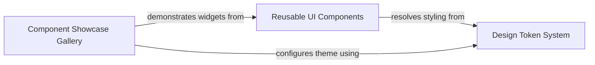

## Details

Defines theme specifications, design tokens, and modular UI components including buttons, menus, and text fields.

### Reusable UI Components
Provides reusable UI widgets including buttons, avatars, dialogs, dropdowns, menus, and text fields for the AppFlowy user interface.

**Related Classes/Methods**:

- `frontend.appflowy_flutter.packages.appflowy_ui.lib.src.component.avatar.avatar.AFAvatar`:46-234
- `frontend.appflowy_flutter.packages.appflowy_ui.lib.src.component.button.filled_button.filled_button.AFFilledButton`:11-127

**Source Files:**

- `frontend/appflowy_flutter/packages/appflowy_ui/lib/src/component/avatar/avatar.dart`
  - `frontend.appflowy_flutter.packages.appflowy_ui.lib.src.component.avatar.avatar.AFAvatarSize` (L7-L43) - Enum
  - `frontend.appflowy_flutter.packages.appflowy_ui.lib.src.component.avatar.avatar.AFAvatarSize.xs` (L8-L8) - Enum
  - `frontend.appflowy_flutter.packages.appflowy_ui.lib.src.component.avatar.avatar.AFAvatarSize.s` (L9-L9) - Enum
  - `frontend.appflowy_flutter.packages.appflowy_ui.lib.src.component.avatar.avatar.AFAvatarSize.m` (L10-L10) - Enum
  - `frontend.appflowy_flutter.packages.appflowy_ui.lib.src.component.avatar.avatar.AFAvatarSize.l` (L11-L11) - Enum
  - `frontend.appflowy_flutter.packages.appflowy_ui.lib.src.component.avatar.avatar.AFAvatarSize.xl` (L12-L12) - Enum
  - `frontend.appflowy_flutter.packages.appflowy_ui.lib.src.component.avatar.avatar.AFAvatarSize.size` (L14-L27) - Method
  - `frontend.appflowy_flutter.packages.appflowy_ui.lib.src.component.avatar.avatar.AFAvatarSize.buildTextStyle` (L29-L42) - Method
  - `frontend.appflowy_flutter.packages.appflowy_ui.lib.src.component.avatar.avatar.AFAvatar` (L46-L234) - Class
  - `frontend.appflowy_flutter.packages.appflowy_ui.lib.src.component.avatar.avatar.AFAvatar.AFAvatar` (L50-L59) - Constructor
  - `frontend.appflowy_flutter.packages.appflowy_ui.lib.src.component.avatar.avatar.AFAvatar.build` (L85-L109) - Method
  - `frontend.appflowy_flutter.packages.appflowy_ui.lib.src.component.avatar.avatar.AFAvatar._buildAvatarContent` (L111-L146) - Method
  - `frontend.appflowy_flutter.packages.appflowy_ui.lib.src.component.avatar.avatar.AFAvatar._buildInitialsCircle` (L148-L162) - Method
  - `frontend.appflowy_flutter.packages.appflowy_ui.lib.src.component.avatar.avatar.AFAvatar._getInitials` (L164-L169) - Method
  - `frontend.appflowy_flutter.packages.appflowy_ui.lib.src.component.avatar.avatar.AFAvatar._pickColorIndexFromName` (L172-L179) - Method
  - `frontend.appflowy_flutter.packages.appflowy_ui.lib.src.component.avatar.avatar.AFAvatar._getBadgeBackgroundColor` (L182-L206) - Method
  - `frontend.appflowy_flutter.packages.appflowy_ui.lib.src.component.avatar.avatar.AFAvatar._getBadgeTextColor` (L209-L233) - Method
- `frontend/appflowy_flutter/packages/appflowy_ui/lib/src/component/button/base_button/base.dart`
  - `frontend.appflowy_flutter.packages.appflowy_ui.lib.src.component.button.base_button.base.AFButtonSize` (L4-L54) - Enum
  - `frontend.appflowy_flutter.packages.appflowy_ui.lib.src.component.button.base_button.base.AFButtonSize.s` (L5-L5) - Enum
  - `frontend.appflowy_flutter.packages.appflowy_ui.lib.src.component.button.base_button.base.AFButtonSize.m` (L6-L6) - Enum
  - `frontend.appflowy_flutter.packages.appflowy_ui.lib.src.component.button.base_button.base.AFButtonSize.l` (L7-L7) - Enum
  - `frontend.appflowy_flutter.packages.appflowy_ui.lib.src.component.button.base_button.base.AFButtonSize.xl` (L8-L8) - Enum
  - `frontend.appflowy_flutter.packages.appflowy_ui.lib.src.component.button.base_button.base.AFButtonSize.buildTextStyle` (L10-L19) - Method
  - `frontend.appflowy_flutter.packages.appflowy_ui.lib.src.component.button.base_button.base.AFButtonSize.buildPadding` (L21-L42) - Method
  - `frontend.appflowy_flutter.packages.appflowy_ui.lib.src.component.button.base_button.base.AFButtonSize.buildBorderRadius` (L44-L53) - Method
- `frontend/appflowy_flutter/packages/appflowy_ui/lib/src/component/button/base_button/base_button.dart`
  - `frontend.appflowy_flutter.packages.appflowy_ui.lib.src.component.button.base_button.base_button.AFBaseButtonColorBuilder` (L4-L8) - Class
  - `frontend.appflowy_flutter.packages.appflowy_ui.lib.src.component.button.base_button.base_button.AFBaseButtonBorderColorBuilder` (L10-L15) - Class
  - `frontend.appflowy_flutter.packages.appflowy_ui.lib.src.component.button.base_button.base_button.AFBaseButton` (L17-L52) - Class
  - `frontend.appflowy_flutter.packages.appflowy_ui.lib.src.component.button.base_button.base_button.AFBaseButton.AFBaseButton` (L18-L30) - Constructor
  - `frontend.appflowy_flutter.packages.appflowy_ui.lib.src.component.button.base_button.base_button.AFBaseButton.createState` (L51-L51) - Method
  - `frontend.appflowy_flutter.packages.appflowy_ui.lib.src.component.button.base_button.base_button._AFBaseButtonState` (L54-L159) - Class
  - `frontend.appflowy_flutter.packages.appflowy_ui.lib.src.component.button.base_button.base_button._AFBaseButtonState.dispose` (L61-L64) - Method
  - `frontend.appflowy_flutter.packages.appflowy_ui.lib.src.component.button.base_button.base_button._AFBaseButtonState.build` (L67-L130) - Method
  - `frontend.appflowy_flutter.packages.appflowy_ui.lib.src.component.button.base_button.base_button._AFBaseButtonState._buildBorderColor` (L132-L137) - Method
  - `frontend.appflowy_flutter.packages.appflowy_ui.lib.src.component.button.base_button.base_button._AFBaseButtonState._buildBackgroundColor` (L139-L143) - Method
  - `frontend.appflowy_flutter.packages.appflowy_ui.lib.src.component.button.base_button.base_button._AFBaseButtonState._buildRingColor` (L145-L158) - Method
- `frontend/appflowy_flutter/packages/appflowy_ui/lib/src/component/button/base_button/base_text_button.dart`
  - `frontend.appflowy_flutter.packages.appflowy_ui.lib.src.component.button.base_button.base_text_button.AFBaseTextButton` (L4-L55) - Class
  - `frontend.appflowy_flutter.packages.appflowy_ui.lib.src.component.button.base_button.base_text_button.AFBaseTextButton.AFBaseTextButton` (L5-L17) - Constructor
  - `frontend.appflowy_flutter.packages.appflowy_ui.lib.src.component.button.base_button.base_text_button.AFBaseTextButton.build` (L52-L54) - Method
- `frontend/appflowy_flutter/packages/appflowy_ui/lib/src/component/button/filled_button/filled_button.dart`
  - `frontend.appflowy_flutter.packages.appflowy_ui.lib.src.component.button.filled_button.filled_button.AFFilledButtonWidgetBuilder` (L5-L9) - Class
  - `frontend.appflowy_flutter.packages.appflowy_ui.lib.src.component.button.filled_button.filled_button.AFFilledButton` (L11-L127) - Class
  - `frontend.appflowy_flutter.packages.appflowy_ui.lib.src.component.button.filled_button.filled_button.AFFilledButton.AFFilledButton._` (L12-L21) - Constructor
  - `frontend.appflowy_flutter.packages.appflowy_ui.lib.src.component.button.filled_button.filled_button.AFFilledButton.AFFilledButton.primary` (L24-L51) - Constructor
  - `frontend.appflowy_flutter.packages.appflowy_ui.lib.src.component.button.filled_button.filled_button.AFFilledButton.AFFilledButton.destructive` (L54-L81) - Constructor
  - `frontend.appflowy_flutter.packages.appflowy_ui.lib.src.component.button.filled_button.filled_button.AFFilledButton.AFFilledButton.disabled` (L84-L104) - Constructor
  - `frontend.appflowy_flutter.packages.appflowy_ui.lib.src.component.button.filled_button.filled_button.AFFilledButton.build` (L116-L126) - Method
- `frontend/appflowy_flutter/packages/appflowy_ui/lib/src/component/button/filled_button/filled_icon_text_button.dart`
  - `frontend.appflowy_flutter.packages.appflowy_ui.lib.src.component.button.filled_button.filled_icon_text_button.AFFilledIconBuilder` (L5-L9) - Class
  - `frontend.appflowy_flutter.packages.appflowy_ui.lib.src.component.button.filled_button.filled_icon_text_button.AFFilledIconTextButton` (L11-L199) - Class
  - `frontend.appflowy_flutter.packages.appflowy_ui.lib.src.component.button.filled_button.filled_icon_text_button.AFFilledIconTextButton.AFFilledIconTextButton._` (L12-L22) - Constructor
  - `frontend.appflowy_flutter.packages.appflowy_ui.lib.src.component.button.filled_button.filled_icon_text_button.AFFilledIconTextButton.AFFilledIconTextButton.primary` (L25-L57) - Constructor
  - `frontend.appflowy_flutter.packages.appflowy_ui.lib.src.component.button.filled_button.filled_icon_text_button.AFFilledIconTextButton.AFFilledIconTextButton.destructive` (L60-L92) - Constructor
  - `frontend.appflowy_flutter.packages.appflowy_ui.lib.src.component.button.filled_button.filled_icon_text_button.AFFilledIconTextButton.AFFilledIconTextButton.disabled` (L95-L120) - Constructor
  - `frontend.appflowy_flutter.packages.appflowy_ui.lib.src.component.button.filled_button.filled_icon_text_button.AFFilledIconTextButton.AFFilledIconTextButton.ghost` (L123-L158) - Constructor
  - `frontend.appflowy_flutter.packages.appflowy_ui.lib.src.component.button.filled_button.filled_icon_text_button.AFFilledIconTextButton.build` (L172-L198) - Method
- `frontend/appflowy_flutter/packages/appflowy_ui/lib/src/component/button/filled_button/filled_text_button.dart`
  - `frontend.appflowy_flutter.packages.appflowy_ui.lib.src.component.button.filled_button.filled_text_button.AFFilledTextButton` (L5-L164) - Class
  - `frontend.appflowy_flutter.packages.appflowy_ui.lib.src.component.button.filled_button.filled_text_button.AFFilledTextButton.AFFilledTextButton` (L6-L18) - Constructor
  - `frontend.appflowy_flutter.packages.appflowy_ui.lib.src.component.button.filled_button.filled_text_button.AFFilledTextButton.AFFilledTextButton.primary` (L21-L58) - Constructor
  - `frontend.appflowy_flutter.packages.appflowy_ui.lib.src.component.button.filled_button.filled_text_button.AFFilledTextButton.AFFilledTextButton.destructive` (L61-L98) - Constructor
  - `frontend.appflowy_flutter.packages.appflowy_ui.lib.src.component.button.filled_button.filled_text_button.AFFilledTextButton.AFFilledTextButton.disabled` (L101-L125) - Constructor
  - `frontend.appflowy_flutter.packages.appflowy_ui.lib.src.component.button.filled_button.filled_text_button.AFFilledTextButton.build` (L128-L163) - Method
- `frontend/appflowy_flutter/packages/appflowy_ui/lib/src/component/button/ghost_button/ghost_button.dart`
  - `frontend.appflowy_flutter.packages.appflowy_ui.lib.src.component.button.ghost_button.ghost_button.AFGhostButtonWidgetBuilder` (L5-L9) - Class
  - `frontend.appflowy_flutter.packages.appflowy_ui.lib.src.component.button.ghost_button.ghost_button.AFGhostButton` (L11-L96) - Class
  - `frontend.appflowy_flutter.packages.appflowy_ui.lib.src.component.button.ghost_button.ghost_button.AFGhostButton.AFGhostButton._` (L12-L21) - Constructor
  - `frontend.appflowy_flutter.packages.appflowy_ui.lib.src.component.button.ghost_button.ghost_button.AFGhostButton.AFGhostButton.normal` (L24-L52) - Constructor
  - `frontend.appflowy_flutter.packages.appflowy_ui.lib.src.component.button.ghost_button.ghost_button.AFGhostButton.AFGhostButton.disabled` (L55-L73) - Constructor
  - `frontend.appflowy_flutter.packages.appflowy_ui.lib.src.component.button.ghost_button.ghost_button.AFGhostButton.build` (L85-L95) - Method
- `frontend/appflowy_flutter/packages/appflowy_ui/lib/src/component/button/ghost_button/ghost_icon_text_button.dart`
  - `frontend.appflowy_flutter.packages.appflowy_ui.lib.src.component.button.ghost_button.ghost_icon_text_button.AFGhostIconBuilder` (L5-L9) - Class
  - `frontend.appflowy_flutter.packages.appflowy_ui.lib.src.component.button.ghost_button.ghost_icon_text_button.AFGhostIconTextButton` (L11-L148) - Class
  - `frontend.appflowy_flutter.packages.appflowy_ui.lib.src.component.button.ghost_button.ghost_icon_text_button.AFGhostIconTextButton.AFGhostIconTextButton` (L12-L24) - Constructor
  - `frontend.appflowy_flutter.packages.appflowy_ui.lib.src.component.button.ghost_button.ghost_icon_text_button.AFGhostIconTextButton.AFGhostIconTextButton.primary` (L27-L66) - Constructor
  - `frontend.appflowy_flutter.packages.appflowy_ui.lib.src.component.button.ghost_button.ghost_icon_text_button.AFGhostIconTextButton.AFGhostIconTextButton.disabled` (L69-L96) - Constructor
  - `frontend.appflowy_flutter.packages.appflowy_ui.lib.src.component.button.ghost_button.ghost_icon_text_button.AFGhostIconTextButton.build` (L113-L147) - Method
- `frontend/appflowy_flutter/packages/appflowy_ui/lib/src/component/button/ghost_button/ghost_text_button.dart`
  - `frontend.appflowy_flutter.packages.appflowy_ui.lib.src.component.button.ghost_button.ghost_text_button.AFGhostTextButton` (L5-L129) - Class
  - `frontend.appflowy_flutter.packages.appflowy_ui.lib.src.component.button.ghost_button.ghost_text_button.AFGhostTextButton.AFGhostTextButton` (L6-L18) - Constructor
  - `frontend.appflowy_flutter.packages.appflowy_ui.lib.src.component.button.ghost_button.ghost_text_button.AFGhostTextButton.AFGhostTextButton.primary` (L21-L60) - Constructor
  - `frontend.appflowy_flutter.packages.appflowy_ui.lib.src.component.button.ghost_button.ghost_text_button.AFGhostTextButton.AFGhostTextButton.disabled` (L63-L87) - Constructor
  - `frontend.appflowy_flutter.packages.appflowy_ui.lib.src.component.button.ghost_button.ghost_text_button.AFGhostTextButton.build` (L90-L128) - Method
- `frontend/appflowy_flutter/packages/appflowy_ui/lib/src/component/button/outlined_button/outlined_button.dart`
  - `frontend.appflowy_flutter.packages.appflowy_ui.lib.src.component.button.outlined_button.outlined_button.AFOutlinedButtonWidgetBuilder` (L5-L9) - Class
  - `frontend.appflowy_flutter.packages.appflowy_ui.lib.src.component.button.outlined_button.outlined_button.AFOutlinedButton` (L11-L168) - Class
  - `frontend.appflowy_flutter.packages.appflowy_ui.lib.src.component.button.outlined_button.outlined_button.AFOutlinedButton.AFOutlinedButton._` (L12-L22) - Constructor
  - `frontend.appflowy_flutter.packages.appflowy_ui.lib.src.component.button.outlined_button.outlined_button.AFOutlinedButton.AFOutlinedButton.normal` (L25-L63) - Constructor
  - `frontend.appflowy_flutter.packages.appflowy_ui.lib.src.component.button.outlined_button.outlined_button.AFOutlinedButton.AFOutlinedButton.destructive` (L66-L104) - Constructor
  - `frontend.appflowy_flutter.packages.appflowy_ui.lib.src.component.button.outlined_button.outlined_button.AFOutlinedButton.AFOutlinedButton.disabled` (L107-L143) - Constructor
  - `frontend.appflowy_flutter.packages.appflowy_ui.lib.src.component.button.outlined_button.outlined_button.AFOutlinedButton.build` (L157-L167) - Method
- `frontend/appflowy_flutter/packages/appflowy_ui/lib/src/component/button/outlined_button/outlined_icon_text_button.dart`
  - `frontend.appflowy_flutter.packages.appflowy_ui.lib.src.component.button.outlined_button.outlined_icon_text_button.AFOutlinedIconBuilder` (L5-L9) - Class
  - `frontend.appflowy_flutter.packages.appflowy_ui.lib.src.component.button.outlined_button.outlined_icon_text_button.AFOutlinedIconTextButton` (L11-L226) - Class
  - `frontend.appflowy_flutter.packages.appflowy_ui.lib.src.component.button.outlined_button.outlined_icon_text_button.AFOutlinedIconTextButton.AFOutlinedIconTextButton._` (L12-L25) - Constructor
  - `frontend.appflowy_flutter.packages.appflowy_ui.lib.src.component.button.outlined_button.outlined_icon_text_button.AFOutlinedIconTextButton.AFOutlinedIconTextButton.normal` (L28-L80) - Constructor
  - `frontend.appflowy_flutter.packages.appflowy_ui.lib.src.component.button.outlined_button.outlined_icon_text_button.AFOutlinedIconTextButton.AFOutlinedIconTextButton.destructive` (L83-L131) - Constructor
  - `frontend.appflowy_flutter.packages.appflowy_ui.lib.src.component.button.outlined_button.outlined_icon_text_button.AFOutlinedIconTextButton.AFOutlinedIconTextButton.disabled` (L134-L180) - Constructor
  - `frontend.appflowy_flutter.packages.appflowy_ui.lib.src.component.button.outlined_button.outlined_icon_text_button.AFOutlinedIconTextButton.build` (L197-L225) - Method
- `frontend/appflowy_flutter/packages/appflowy_ui/lib/src/component/button/outlined_button/outlined_text_button.dart`
  - `frontend.appflowy_flutter.packages.appflowy_ui.lib.src.component.button.outlined_button.outlined_text_button.AFOutlinedTextButton` (L5-L221) - Class
  - `frontend.appflowy_flutter.packages.appflowy_ui.lib.src.component.button.outlined_button.outlined_text_button.AFOutlinedTextButton.AFOutlinedTextButton._` (L6-L19) - Constructor
  - `frontend.appflowy_flutter.packages.appflowy_ui.lib.src.component.button.outlined_button.outlined_text_button.AFOutlinedTextButton.AFOutlinedTextButton.normal` (L22-L76) - Constructor
  - `frontend.appflowy_flutter.packages.appflowy_ui.lib.src.component.button.outlined_button.outlined_text_button.AFOutlinedTextButton.AFOutlinedTextButton.destructive` (L79-L127) - Constructor
  - `frontend.appflowy_flutter.packages.appflowy_ui.lib.src.component.button.outlined_button.outlined_text_button.AFOutlinedTextButton.AFOutlinedTextButton.disabled` (L130-L176) - Constructor
  - `frontend.appflowy_flutter.packages.appflowy_ui.lib.src.component.button.outlined_button.outlined_text_button.AFOutlinedTextButton.build` (L181-L220) - Method
- `frontend/appflowy_flutter/packages/appflowy_ui/lib/src/component/dropdown_menu/dropdown_menu.dart`
  - `frontend.appflowy_flutter.packages.appflowy_ui.lib.src.component.dropdown_menu.dropdown_menu.AFDropDownMenuMixin` (L4-L6) - Class
  - `frontend.appflowy_flutter.packages.appflowy_ui.lib.src.component.dropdown_menu.dropdown_menu.AFDropDownMenuMixin.label` (L5-L5) - Method
  - `frontend.appflowy_flutter.packages.appflowy_ui.lib.src.component.dropdown_menu.dropdown_menu.AFDropDownMenu` (L8-L43) - Class
  - `frontend.appflowy_flutter.packages.appflowy_ui.lib.src.component.dropdown_menu.dropdown_menu.AFDropDownMenu.AFDropDownMenu` (L9-L24) - Constructor
  - `frontend.appflowy_flutter.packages.appflowy_ui.lib.src.component.dropdown_menu.dropdown_menu.AFDropDownMenu.createState` (L42-L42) - Method
  - `frontend.appflowy_flutter.packages.appflowy_ui.lib.src.component.dropdown_menu.dropdown_menu._AFDropDownMenuState` (L45-L181) - Class
  - `frontend.appflowy_flutter.packages.appflowy_ui.lib.src.component.dropdown_menu.dropdown_menu._AFDropDownMenuState.initState` (L52-L56) - Method
  - `frontend.appflowy_flutter.packages.appflowy_ui.lib.src.component.dropdown_menu.dropdown_menu._AFDropDownMenuState.dispose` (L59-L66) - Method
  - `frontend.appflowy_flutter.packages.appflowy_ui.lib.src.component.dropdown_menu.dropdown_menu._AFDropDownMenuState.build` (L69-L174) - Method
  - `frontend.appflowy_flutter.packages.appflowy_ui.lib.src.component.dropdown_menu.dropdown_menu._AFDropDownMenuState.popoverListener` (L176-L180) - Method
  - `frontend.appflowy_flutter.packages.appflowy_ui.lib.src.component.dropdown_menu.dropdown_menu._DropdownButtonContents` (L183-L275) - Class
  - `frontend.appflowy_flutter.packages.appflowy_ui.lib.src.component.dropdown_menu.dropdown_menu._DropdownButtonContents._DropdownButtonContents` (L185-L191) - Constructor
  - `frontend.appflowy_flutter.packages.appflowy_ui.lib.src.component.dropdown_menu.dropdown_menu._DropdownButtonContents.build` (L199-L274) - Method
  - `frontend.appflowy_flutter.packages.appflowy_ui.lib.src.component.dropdown_menu.dropdown_menu._DropdownPopoverContents` (L277-L360) - Class
  - `frontend.appflowy_flutter.packages.appflowy_ui.lib.src.component.dropdown_menu.dropdown_menu._DropdownPopoverContents._DropdownPopoverContents` (L279-L286) - Constructor
  - `frontend.appflowy_flutter.packages.appflowy_ui.lib.src.component.dropdown_menu.dropdown_menu._DropdownPopoverContents.build` (L295-L308) - Method
  - `frontend.appflowy_flutter.packages.appflowy_ui.lib.src.component.dropdown_menu.dropdown_menu._DropdownPopoverContents.itemBuilder` (L310-L359) - Method
- `frontend/appflowy_flutter/packages/appflowy_ui/lib/src/component/menu/menu.dart`
  - `frontend.appflowy_flutter.packages.appflowy_ui.lib.src.component.menu.menu.AFMenu` (L9-L45) - Class
  - `frontend.appflowy_flutter.packages.appflowy_ui.lib.src.component.menu.menu.AFMenu.AFMenu` (L10-L15) - Constructor
  - `frontend.appflowy_flutter.packages.appflowy_ui.lib.src.component.menu.menu.AFMenu.build` (L26-L44) - Method
- `frontend/appflowy_flutter/packages/appflowy_ui/lib/src/component/menu/menu_item.dart`
  - `frontend.appflowy_flutter.packages.appflowy_ui.lib.src.component.menu.menu_item.AFMenuItem` (L5-L102) - Class
  - `frontend.appflowy_flutter.packages.appflowy_ui.lib.src.component.menu.menu_item.AFMenuItem.AFMenuItem` (L9-L19) - Constructor
  - `frontend.appflowy_flutter.packages.appflowy_ui.lib.src.component.menu.menu_item.AFMenuItem.build` (L46-L101) - Method
- `frontend/appflowy_flutter/packages/appflowy_ui/lib/src/component/menu/section.dart`
  - `frontend.appflowy_flutter.packages.appflowy_ui.lib.src.component.menu.section.AFMenuSection` (L5-L61) - Class
  - `frontend.appflowy_flutter.packages.appflowy_ui.lib.src.component.menu.section.AFMenuSection.AFMenuSection` (L6-L12) - Constructor
  - `frontend.appflowy_flutter.packages.appflowy_ui.lib.src.component.menu.section.AFMenuSection.build` (L27-L60) - Method
- `frontend/appflowy_flutter/packages/appflowy_ui/lib/src/component/menu/text_menu_item.dart`
  - `frontend.appflowy_flutter.packages.appflowy_ui.lib.src.component.menu.text_menu_item.AFTextMenuItem` (L5-L74) - Class
  - `frontend.appflowy_flutter.packages.appflowy_ui.lib.src.component.menu.text_menu_item.AFTextMenuItem.AFTextMenuItem` (L9-L20) - Constructor
  - `frontend.appflowy_flutter.packages.appflowy_ui.lib.src.component.menu.text_menu_item.AFTextMenuItem.build` (L50-L73) - Method
- `frontend/appflowy_flutter/packages/appflowy_ui/lib/src/component/modal/dimension.dart`
  - `frontend.appflowy_flutter.packages.appflowy_ui.lib.src.component.modal.dimension.AFModalDimension` (L1-L9) - Class
  - `frontend.appflowy_flutter.packages.appflowy_ui.lib.src.component.modal.dimension.AFModalDimension.AFModalDimension._` (L2-L2) - Constructor
- `frontend/appflowy_flutter/packages/appflowy_ui/lib/src/component/modal/modal.dart`
  - `frontend.appflowy_flutter.packages.appflowy_ui.lib.src.component.modal.modal.AFModal` (L6-L42) - Class
  - `frontend.appflowy_flutter.packages.appflowy_ui.lib.src.component.modal.modal.AFModal.AFModal` (L7-L12) - Constructor
  - `frontend.appflowy_flutter.packages.appflowy_ui.lib.src.component.modal.modal.AFModal.build` (L19-L41) - Method
  - `frontend.appflowy_flutter.packages.appflowy_ui.lib.src.component.modal.modal.AFModalHeader` (L44-L78) - Class
  - `frontend.appflowy_flutter.packages.appflowy_ui.lib.src.component.modal.modal.AFModalHeader.AFModalHeader` (L45-L49) - Constructor
  - `frontend.appflowy_flutter.packages.appflowy_ui.lib.src.component.modal.modal.AFModalHeader.build` (L55-L77) - Method
  - `frontend.appflowy_flutter.packages.appflowy_ui.lib.src.component.modal.modal.AFModalFooter` (L80-L110) - Class
  - `frontend.appflowy_flutter.packages.appflowy_ui.lib.src.component.modal.modal.AFModalFooter.AFModalFooter` (L81-L85) - Constructor
  - `frontend.appflowy_flutter.packages.appflowy_ui.lib.src.component.modal.modal.AFModalFooter.build` (L91-L109) - Method
  - `frontend.appflowy_flutter.packages.appflowy_ui.lib.src.component.modal.modal.AFModalBody` (L112-L132) - Class
  - `frontend.appflowy_flutter.packages.appflowy_ui.lib.src.component.modal.modal.AFModalBody.AFModalBody` (L113-L116) - Constructor
  - `frontend.appflowy_flutter.packages.appflowy_ui.lib.src.component.modal.modal.AFModalBody.build` (L121-L131) - Method
- `frontend/appflowy_flutter/packages/appflowy_ui/lib/src/component/popover/anchor.dart`
  - `frontend.appflowy_flutter.packages.appflowy_ui.lib.src.component.popover.anchor.AFAnchorAuto` (L8-L15) - Class
  - `frontend.appflowy_flutter.packages.appflowy_ui.lib.src.component.popover.anchor.AFAnchorAuto.AFAnchorAuto` (L9-L14) - Constructor
  - `frontend.appflowy_flutter.packages.appflowy_ui.lib.src.component.popover.anchor.AFAnchor` (L20-L26) - Class
  - `frontend.appflowy_flutter.packages.appflowy_ui.lib.src.component.popover.anchor.AFAnchor.AFAnchor` (L21-L25) - Constructor
  - `frontend.appflowy_flutter.packages.appflowy_ui.lib.src.component.popover.anchor.AFGlobalAnchor` (L31-L33) - Class
  - `frontend.appflowy_flutter.packages.appflowy_ui.lib.src.component.popover.anchor.AFGlobalAnchor.AFGlobalAnchor` (L32-L32) - Constructor
- `frontend/appflowy_flutter/packages/appflowy_ui/lib/src/component/popover/popover.dart`
  - `frontend.appflowy_flutter.packages.appflowy_ui.lib.src.component.popover.popover.AFPopoverController` (L17-L47) - Class
  - `frontend.appflowy_flutter.packages.appflowy_ui.lib.src.component.popover.popover.AFPopoverController.AFPopoverController` (L18-L18) - Constructor
  - `frontend.appflowy_flutter.packages.appflowy_ui.lib.src.component.popover.popover.AFPopoverController.isOpen` (L23-L23) - Method
  - `frontend.appflowy_flutter.packages.appflowy_ui.lib.src.component.popover.popover.AFPopoverController.show` (L26-L30) - Method
  - `frontend.appflowy_flutter.packages.appflowy_ui.lib.src.component.popover.popover.AFPopoverController.hide` (L33-L37) - Method
  - `frontend.appflowy_flutter.packages.appflowy_ui.lib.src.component.popover.popover.AFPopoverController.setOpen` (L39-L43) - Method
  - `frontend.appflowy_flutter.packages.appflowy_ui.lib.src.component.popover.popover.AFPopoverController.toggle` (L46-L46) - Method
  - `frontend.appflowy_flutter.packages.appflowy_ui.lib.src.component.popover.popover.AFPopover` (L49-L158) - Class
  - `frontend.appflowy_flutter.packages.appflowy_ui.lib.src.component.popover.popover.AFPopover.AFPopover` (L50-L70) - Constructor
  - `frontend.appflowy_flutter.packages.appflowy_ui.lib.src.component.popover.popover.AFPopover.createState` (L157-L157) - Method
  - `frontend.appflowy_flutter.packages.appflowy_ui.lib.src.component.popover.popover._AFPopoverState` (L160-L328) - Class
  - `frontend.appflowy_flutter.packages.appflowy_ui.lib.src.component.popover.popover._AFPopoverState._markPopoverClosedThisFrame` (L163-L168) - Method
  - `frontend.appflowy_flutter.packages.appflowy_ui.lib.src.component.popover.popover._AFPopoverState.controller` (L171-L171) - Method
  - `frontend.appflowy_flutter.packages.appflowy_ui.lib.src.component.popover.popover._AFPopoverState.groupId` (L176-L176) - Method
  - `frontend.appflowy_flutter.packages.appflowy_ui.lib.src.component.popover.popover._AFPopoverState._isTopMostPopover` (L178-L179) - Method
  - `frontend.appflowy_flutter.packages.appflowy_ui.lib.src.component.popover.popover._AFPopoverState.initState` (L182-L191) - Method
  - `frontend.appflowy_flutter.packages.appflowy_ui.lib.src.component.popover.popover._AFPopoverState._onControllerChanged` (L193-L199) - Method
  - `frontend.appflowy_flutter.packages.appflowy_ui.lib.src.component.popover.popover._AFPopoverState.didUpdateWidget` (L202-L211) - Method
  - `frontend.appflowy_flutter.packages.appflowy_ui.lib.src.component.popover.popover._AFPopoverState.dispose` (L214-L219) - Method
  - `frontend.appflowy_flutter.packages.appflowy_ui.lib.src.component.popover.popover._AFPopoverState.build` (L222-L317) - Method
  - `frontend.appflowy_flutter.packages.appflowy_ui.lib.src.component.popover.popover._AFPopoverState._registerPopover` (L319-L323) - Method
  - `frontend.appflowy_flutter.packages.appflowy_ui.lib.src.component.popover.popover._AFPopoverState._unregisterPopover` (L325-L327) - Method
- `frontend/appflowy_flutter/packages/appflowy_ui/lib/src/component/popover/shadcn/_mouse_area.dart`
  - `frontend.appflowy_flutter.packages.appflowy_ui.lib.src.component.popover.shadcn._mouse_area.MouseAreaRegistry` (L9-L44) - Class
  - `frontend.appflowy_flutter.packages.appflowy_ui.lib.src.component.popover.shadcn._mouse_area.MouseAreaRegistry.registerMouseArea` (L11-L11) - Method
  - `frontend.appflowy_flutter.packages.appflowy_ui.lib.src.component.popover.shadcn._mouse_area.MouseAreaRegistry.unregisterMouseArea` (L14-L14) - Method
  - `frontend.appflowy_flutter.packages.appflowy_ui.lib.src.component.popover.shadcn._mouse_area.MouseAreaRegistry.maybeOf` (L18-L20) - Method
  - `frontend.appflowy_flutter.packages.appflowy_ui.lib.src.component.popover.shadcn._mouse_area.MouseAreaRegistry.of` (L26-L43) - Method
  - `frontend.appflowy_flutter.packages.appflowy_ui.lib.src.component.popover.shadcn._mouse_area.MouseAreaSurfaceRenderBox` (L46-L205) - Class
  - `frontend.appflowy_flutter.packages.appflowy_ui.lib.src.component.popover.shadcn._mouse_area.MouseAreaSurfaceRenderBox.handleEvent` (L55-L151) - Method
  - `frontend.appflowy_flutter.packages.appflowy_ui.lib.src.component.popover.shadcn._mouse_area.MouseAreaSurfaceRenderBox.hitTest` (L154-L169) - Method
  - `frontend.appflowy_flutter.packages.appflowy_ui.lib.src.component.popover.shadcn._mouse_area.MouseAreaSurfaceRenderBox.registerMouseArea` (L172-L179) - Method
  - `frontend.appflowy_flutter.packages.appflowy_ui.lib.src.component.popover.shadcn._mouse_area.MouseAreaSurfaceRenderBox.unregisterMouseArea` (L182-L192) - Method
  - `frontend.appflowy_flutter.packages.appflowy_ui.lib.src.component.popover.shadcn._mouse_area.MouseAreaSurfaceRenderBox._getRegionsHit` (L195-L204) - Method
  - `frontend.appflowy_flutter.packages.appflowy_ui.lib.src.component.popover.shadcn._mouse_area.ShadMouseArea` (L207-L326) - Class
  - `frontend.appflowy_flutter.packages.appflowy_ui.lib.src.component.popover.shadcn._mouse_area.ShadMouseArea.ShadMouseArea` (L211-L221) - Constructor
  - `frontend.appflowy_flutter.packages.appflowy_ui.lib.src.component.popover.shadcn._mouse_area.ShadMouseArea.createRenderObject` (L266-L277) - Method
  - `frontend.appflowy_flutter.packages.appflowy_ui.lib.src.component.popover.shadcn._mouse_area.ShadMouseArea.debugFillProperties` (L280-L308) - Method
  - `frontend.appflowy_flutter.packages.appflowy_ui.lib.src.component.popover.shadcn._mouse_area.ShadMouseArea.updateRenderObject` (L311-L325) - Method
  - `frontend.appflowy_flutter.packages.appflowy_ui.lib.src.component.popover.shadcn._mouse_area.ShadMouseAreaRenderBox` (L328-L491) - Class
  - `frontend.appflowy_flutter.packages.appflowy_ui.lib.src.component.popover.shadcn._mouse_area.ShadMouseAreaRenderBox.ShadMouseAreaRenderBox` (L330-L345) - Constructor
  - `frontend.appflowy_flutter.packages.appflowy_ui.lib.src.component.popover.shadcn._mouse_area.ShadMouseAreaRenderBox.cursor` (L362-L362) - Method
  - `frontend.appflowy_flutter.packages.appflowy_ui.lib.src.component.popover.shadcn._mouse_area.ShadMouseAreaRenderBox.cursor=` (L363-L370) - Method
  - `frontend.appflowy_flutter.packages.appflowy_ui.lib.src.component.popover.shadcn._mouse_area.ShadMouseAreaRenderBox.enabled` (L373-L373) - Method
  - `frontend.appflowy_flutter.packages.appflowy_ui.lib.src.component.popover.shadcn._mouse_area.ShadMouseAreaRenderBox.enabled=` (L375-L380) - Method
  - `frontend.appflowy_flutter.packages.appflowy_ui.lib.src.component.popover.shadcn._mouse_area.ShadMouseAreaRenderBox.groupId` (L388-L388) - Method
  - `frontend.appflowy_flutter.packages.appflowy_ui.lib.src.component.popover.shadcn._mouse_area.ShadMouseAreaRenderBox.groupId=` (L390-L401) - Method
  - `frontend.appflowy_flutter.packages.appflowy_ui.lib.src.component.popover.shadcn._mouse_area.ShadMouseAreaRenderBox.registry` (L409-L409) - Method
  - `frontend.appflowy_flutter.packages.appflowy_ui.lib.src.component.popover.shadcn._mouse_area.ShadMouseAreaRenderBox.registry=` (L411-L420) - Method
  - `frontend.appflowy_flutter.packages.appflowy_ui.lib.src.component.popover.shadcn._mouse_area.ShadMouseAreaRenderBox.validForMouseTracker` (L422-L422) - Method
  - `frontend.appflowy_flutter.packages.appflowy_ui.lib.src.component.popover.shadcn._mouse_area.ShadMouseAreaRenderBox.attach` (L425-L428) - Method
  - `frontend.appflowy_flutter.packages.appflowy_ui.lib.src.component.popover.shadcn._mouse_area.ShadMouseAreaRenderBox.computeSizeForNoChild` (L431-L433) - Method
  - `frontend.appflowy_flutter.packages.appflowy_ui.lib.src.component.popover.shadcn._mouse_area.ShadMouseAreaRenderBox.debugFillProperties` (L436-L457) - Method
  - `frontend.appflowy_flutter.packages.appflowy_ui.lib.src.component.popover.shadcn._mouse_area.ShadMouseAreaRenderBox.detach` (L460-L466) - Method
  - `frontend.appflowy_flutter.packages.appflowy_ui.lib.src.component.popover.shadcn._mouse_area.ShadMouseAreaRenderBox.dispose` (L469-L474) - Method
  - `frontend.appflowy_flutter.packages.appflowy_ui.lib.src.component.popover.shadcn._mouse_area.ShadMouseAreaRenderBox.layout` (L477-L490) - Method
  - `frontend.appflowy_flutter.packages.appflowy_ui.lib.src.component.popover.shadcn._mouse_area.ShadMouseAreaSurface` (L496-L515) - Class
  - `frontend.appflowy_flutter.packages.appflowy_ui.lib.src.component.popover.shadcn._mouse_area.ShadMouseAreaSurface.ShadMouseAreaSurface` (L500-L503) - Constructor
  - `frontend.appflowy_flutter.packages.appflowy_ui.lib.src.component.popover.shadcn._mouse_area.ShadMouseAreaSurface.createRenderObject` (L506-L508) - Method
  - `frontend.appflowy_flutter.packages.appflowy_ui.lib.src.component.popover.shadcn._mouse_area.ShadMouseAreaSurface.updateRenderObject` (L511-L514) - Method
- `frontend/appflowy_flutter/packages/appflowy_ui/lib/src/component/popover/shadcn/_portal.dart`
  - `frontend.appflowy_flutter.packages.appflowy_ui.lib.src.component.popover.shadcn._portal.ShadAnchorBase` (L6-L8) - Class
  - `frontend.appflowy_flutter.packages.appflowy_ui.lib.src.component.popover.shadcn._portal.ShadAnchorBase.ShadAnchorBase` (L7-L7) - Constructor
  - `frontend.appflowy_flutter.packages.appflowy_ui.lib.src.component.popover.shadcn._portal.ShadAnchorAuto` (L14-L53) - Class
  - `frontend.appflowy_flutter.packages.appflowy_ui.lib.src.component.popover.shadcn._portal.ShadAnchorAuto.ShadAnchorAuto` (L15-L20) - Constructor
  - `frontend.appflowy_flutter.packages.appflowy_ui.lib.src.component.popover.shadcn._portal.ShadAnchorAuto.==` (L37-L45) - Method
  - `frontend.appflowy_flutter.packages.appflowy_ui.lib.src.component.popover.shadcn._portal.ShadAnchorAuto.hashCode` (L48-L52) - Method
  - `frontend.appflowy_flutter.packages.appflowy_ui.lib.src.component.popover.shadcn._portal.ShadAnchor` (L58-L102) - Class
  - `frontend.appflowy_flutter.packages.appflowy_ui.lib.src.component.popover.shadcn._portal.ShadAnchor.ShadAnchor` (L59-L63) - Constructor
  - `frontend.appflowy_flutter.packages.appflowy_ui.lib.src.component.popover.shadcn._portal.ShadAnchor.copyWith` (L74-L84) - Method
  - `frontend.appflowy_flutter.packages.appflowy_ui.lib.src.component.popover.shadcn._portal.ShadAnchor.==` (L87-L94) - Method
  - `frontend.appflowy_flutter.packages.appflowy_ui.lib.src.component.popover.shadcn._portal.ShadAnchor.hashCode` (L97-L101) - Method
  - `frontend.appflowy_flutter.packages.appflowy_ui.lib.src.component.popover.shadcn._portal.ShadGlobalAnchor` (L105-L120) - Class
  - `frontend.appflowy_flutter.packages.appflowy_ui.lib.src.component.popover.shadcn._portal.ShadGlobalAnchor.ShadGlobalAnchor` (L106-L106) - Constructor
  - `frontend.appflowy_flutter.packages.appflowy_ui.lib.src.component.popover.shadcn._portal.ShadGlobalAnchor.==` (L112-L116) - Method
  - `frontend.appflowy_flutter.packages.appflowy_ui.lib.src.component.popover.shadcn._portal.ShadGlobalAnchor.hashCode` (L119-L119) - Method
  - `frontend.appflowy_flutter.packages.appflowy_ui.lib.src.component.popover.shadcn._portal.ShadPortal` (L122-L138) - Class
  - `frontend.appflowy_flutter.packages.appflowy_ui.lib.src.component.popover.shadcn._portal.ShadPortal.ShadPortal` (L123-L129) - Constructor
  - `frontend.appflowy_flutter.packages.appflowy_ui.lib.src.component.popover.shadcn._portal.ShadPortal.createState` (L137-L137) - Method
  - `frontend.appflowy_flutter.packages.appflowy_ui.lib.src.component.popover.shadcn._portal._ShadPortalState` (L140-L316) - Class
  - `frontend.appflowy_flutter.packages.appflowy_ui.lib.src.component.popover.shadcn._portal._ShadPortalState.initState` (L146-L149) - Method
  - `frontend.appflowy_flutter.packages.appflowy_ui.lib.src.component.popover.shadcn._portal._ShadPortalState.didUpdateWidget` (L152-L155) - Method
  - `frontend.appflowy_flutter.packages.appflowy_ui.lib.src.component.popover.shadcn._portal._ShadPortalState.dispose` (L158-L161) - Method
  - `frontend.appflowy_flutter.packages.appflowy_ui.lib.src.component.popover.shadcn._portal._ShadPortalState.updateVisibility` (L163-L169) - Method
  - `frontend.appflowy_flutter.packages.appflowy_ui.lib.src.component.popover.shadcn._portal._ShadPortalState.hide` (L171-L175) - Method
  - `frontend.appflowy_flutter.packages.appflowy_ui.lib.src.component.popover.shadcn._portal._ShadPortalState.show` (L177-L181) - Method
  - `frontend.appflowy_flutter.packages.appflowy_ui.lib.src.component.popover.shadcn._portal._ShadPortalState.buildAutoPosition` (L183-L261) - Method
  - `frontend.appflowy_flutter.packages.appflowy_ui.lib.src.component.popover.shadcn._portal._ShadPortalState.buildManualPosition` (L263-L274) - Method
  - `frontend.appflowy_flutter.packages.appflowy_ui.lib.src.component.popover.shadcn._portal._ShadPortalState.buildGlobalPosition` (L276-L288) - Method
  - `frontend.appflowy_flutter.packages.appflowy_ui.lib.src.component.popover.shadcn._portal._ShadPortalState.build` (L291-L315) - Method
  - `frontend.appflowy_flutter.packages.appflowy_ui.lib.src.component.popover.shadcn._portal.ShadPositionDelegate` (L320-L364) - Class
  - `frontend.appflowy_flutter.packages.appflowy_ui.lib.src.component.popover.shadcn._portal.ShadPositionDelegate.ShadPositionDelegate` (L322-L326) - Constructor
  - `frontend.appflowy_flutter.packages.appflowy_ui.lib.src.component.popover.shadcn._portal.ShadPositionDelegate.getConstraintsForChild` (L343-L344) - Method
  - `frontend.appflowy_flutter.packages.appflowy_ui.lib.src.component.popover.shadcn._portal.ShadPositionDelegate.getPositionForChild` (L347-L356) - Method
  - `frontend.appflowy_flutter.packages.appflowy_ui.lib.src.component.popover.shadcn._portal.ShadPositionDelegate.shouldRelayout` (L359-L363) - Method
- `frontend/appflowy_flutter/packages/appflowy_ui/lib/src/component/separator/divider.dart`
  - `frontend.appflowy_flutter.packages.appflowy_ui.lib.src.component.separator.divider.AFDivider` (L4-L53) - Class
  - `frontend.appflowy_flutter.packages.appflowy_ui.lib.src.component.separator.divider.AFDivider.AFDivider` (L5-L16) - Constructor
  - `frontend.appflowy_flutter.packages.appflowy_ui.lib.src.component.separator.divider.AFDivider.build` (L26-L52) - Method
- `frontend/appflowy_flutter/packages/appflowy_ui/lib/src/component/textfield/textfield.dart`
  - `frontend.appflowy_flutter.packages.appflowy_ui.lib.src.component.textfield.textfield.AFTextFieldValidator` (L5-L7) - Class
  - `frontend.appflowy_flutter.packages.appflowy_ui.lib.src.component.textfield.textfield.AFTextFieldState` (L9-L16) - Class
  - `frontend.appflowy_flutter.packages.appflowy_ui.lib.src.component.textfield.textfield.AFTextFieldState.syncError` (L11-L11) - Method
  - `frontend.appflowy_flutter.packages.appflowy_ui.lib.src.component.textfield.textfield.AFTextFieldState.clearError` (L12-L12) - Method
  - `frontend.appflowy_flutter.packages.appflowy_ui.lib.src.component.textfield.textfield.AFTextFieldState.syncObscured` (L15-L15) - Method
  - `frontend.appflowy_flutter.packages.appflowy_ui.lib.src.component.textfield.textfield.AFTextField` (L18-L96) - Class
  - `frontend.appflowy_flutter.packages.appflowy_ui.lib.src.component.textfield.textfield.AFTextField.AFTextField` (L19-L38) - Constructor
  - `frontend.appflowy_flutter.packages.appflowy_ui.lib.src.component.textfield.textfield.AFTextField.createState` (L95-L95) - Method
  - `frontend.appflowy_flutter.packages.appflowy_ui.lib.src.component.textfield.textfield._AFTextFieldState` (L98-L269) - Class
  - `frontend.appflowy_flutter.packages.appflowy_ui.lib.src.component.textfield.textfield._AFTextFieldState.initState` (L107-L120) - Method
  - `frontend.appflowy_flutter.packages.appflowy_ui.lib.src.component.textfield.textfield._AFTextFieldState.dispose` (L123-L130) - Method
  - `frontend.appflowy_flutter.packages.appflowy_ui.lib.src.component.textfield.textfield._AFTextFieldState.build` (L133-L232) - Method
  - `frontend.appflowy_flutter.packages.appflowy_ui.lib.src.component.textfield.textfield._AFTextFieldState._validate` (L234-L243) - Method
  - `frontend.appflowy_flutter.packages.appflowy_ui.lib.src.component.textfield.textfield._AFTextFieldState.syncError` (L246-L253) - Method
  - `frontend.appflowy_flutter.packages.appflowy_ui.lib.src.component.textfield.textfield._AFTextFieldState.clearError` (L256-L261) - Method
  - `frontend.appflowy_flutter.packages.appflowy_ui.lib.src.component.textfield.textfield._AFTextFieldState.syncObscured` (L264-L268) - Method
  - `frontend.appflowy_flutter.packages.appflowy_ui.lib.src.component.textfield.textfield.AFTextFieldSize` (L271-L293) - Enum
  - `frontend.appflowy_flutter.packages.appflowy_ui.lib.src.component.textfield.textfield.AFTextFieldSize.m` (L272-L272) - Enum
  - `frontend.appflowy_flutter.packages.appflowy_ui.lib.src.component.textfield.textfield.AFTextFieldSize.l` (L273-L273) - Enum
  - `frontend.appflowy_flutter.packages.appflowy_ui.lib.src.component.textfield.textfield.AFTextFieldSize.contentPadding` (L275-L283) - Method
  - `frontend.appflowy_flutter.packages.appflowy_ui.lib.src.component.textfield.textfield.AFTextFieldSize.borderRadius` (L285-L292) - Method

### Design Token System
Defines design tokens, semantic color schemes, typography, spacing, border radiuses, and theme configurations.

**Related Classes/Methods**:

- `frontend.appflowy_flutter.packages.appflowy_ui.lib.src.theme.appflowy_theme.AppFlowyTheme`:5-53
- `frontend.appflowy_flutter.packages.appflowy_ui.lib.src.theme.appflowy_theme.AnimatedAppFlowyTheme`:92-116
- `frontend.appflowy_flutter.packages.appflowy_ui.lib.src.theme.data.appflowy_default.semantic.AppFlowyDefaultTheme`:17-591

**Source Files:**

- `frontend/appflowy_flutter/packages/appflowy_ui/lib/src/theme/appflowy_theme.dart`
  - `frontend.appflowy_flutter.packages.appflowy_ui.lib.src.theme.appflowy_theme.AppFlowyTheme` (L5-L53) - Class
  - `frontend.appflowy_flutter.packages.appflowy_ui.lib.src.theme.appflowy_theme.AppFlowyTheme.AppFlowyTheme` (L6-L10) - Constructor
  - `frontend.appflowy_flutter.packages.appflowy_ui.lib.src.theme.appflowy_theme.AppFlowyTheme.of` (L15-L28) - Method
  - `frontend.appflowy_flutter.packages.appflowy_ui.lib.src.theme.appflowy_theme.AppFlowyTheme.maybeOf` (L30-L44) - Method
  - `frontend.appflowy_flutter.packages.appflowy_ui.lib.src.theme.appflowy_theme.AppFlowyTheme.build` (L47-L52) - Method
  - `frontend.appflowy_flutter.packages.appflowy_ui.lib.src.theme.appflowy_theme.AppFlowyInheritedTheme` (L55-L72) - Class
  - `frontend.appflowy_flutter.packages.appflowy_ui.lib.src.theme.appflowy_theme.AppFlowyInheritedTheme.AppFlowyInheritedTheme` (L56-L60) - Constructor
  - `frontend.appflowy_flutter.packages.appflowy_ui.lib.src.theme.appflowy_theme.AppFlowyInheritedTheme.wrap` (L65-L67) - Method
  - `frontend.appflowy_flutter.packages.appflowy_ui.lib.src.theme.appflowy_theme.AppFlowyInheritedTheme.updateShouldNotify` (L70-L71) - Method
  - `frontend.appflowy_flutter.packages.appflowy_ui.lib.src.theme.appflowy_theme.AppFlowyThemeDataTween` (L80-L90) - Class
  - `frontend.appflowy_flutter.packages.appflowy_ui.lib.src.theme.appflowy_theme.AppFlowyThemeDataTween.AppFlowyThemeDataTween` (L86-L86) - Constructor
  - `frontend.appflowy_flutter.packages.appflowy_ui.lib.src.theme.appflowy_theme.AppFlowyThemeDataTween.lerp` (L89-L89) - Method
  - `frontend.appflowy_flutter.packages.appflowy_ui.lib.src.theme.appflowy_theme.AnimatedAppFlowyTheme` (L92-L116) - Class
  - `frontend.appflowy_flutter.packages.appflowy_ui.lib.src.theme.appflowy_theme.AnimatedAppFlowyTheme.AnimatedAppFlowyTheme` (L96-L103) - Constructor
  - `frontend.appflowy_flutter.packages.appflowy_ui.lib.src.theme.appflowy_theme.AnimatedAppFlowyTheme.createState` (L114-L115) - Method
  - `frontend.appflowy_flutter.packages.appflowy_ui.lib.src.theme.appflowy_theme._AnimatedThemeState` (L118-L152) - Class
  - `frontend.appflowy_flutter.packages.appflowy_ui.lib.src.theme.appflowy_theme._AnimatedThemeState.forEachTween` (L123-L130) - Method
  - `frontend.appflowy_flutter.packages.appflowy_ui.lib.src.theme.appflowy_theme._AnimatedThemeState.build` (L133-L138) - Method
  - `frontend.appflowy_flutter.packages.appflowy_ui.lib.src.theme.appflowy_theme._AnimatedThemeState.debugFillProperties` (L141-L151) - Method
- `frontend/appflowy_flutter/packages/appflowy_ui/lib/src/theme/data/appflowy_default/primitive.dart`
  - `frontend.appflowy_flutter.packages.appflowy_ui.lib.src.theme.data.appflowy_default.primitive.AppFlowyPrimitiveTokens` (L14-L655) - Class
  - `frontend.appflowy_flutter.packages.appflowy_ui.lib.src.theme.data.appflowy_default.primitive.AppFlowyPrimitiveTokens.AppFlowyPrimitiveTokens._` (L15-L15) - Constructor
  - `frontend.appflowy_flutter.packages.appflowy_ui.lib.src.theme.data.appflowy_default.primitive.AppFlowyPrimitiveTokens.neutral100` (L18-L18) - Method
  - `frontend.appflowy_flutter.packages.appflowy_ui.lib.src.theme.data.appflowy_default.primitive.AppFlowyPrimitiveTokens.neutral200` (L21-L21) - Method
  - `frontend.appflowy_flutter.packages.appflowy_ui.lib.src.theme.data.appflowy_default.primitive.AppFlowyPrimitiveTokens.neutral300` (L24-L24) - Method
  - `frontend.appflowy_flutter.packages.appflowy_ui.lib.src.theme.data.appflowy_default.primitive.AppFlowyPrimitiveTokens.neutral400` (L27-L27) - Method
  - `frontend.appflowy_flutter.packages.appflowy_ui.lib.src.theme.data.appflowy_default.primitive.AppFlowyPrimitiveTokens.neutral500` (L30-L30) - Method
  - `frontend.appflowy_flutter.packages.appflowy_ui.lib.src.theme.data.appflowy_default.primitive.AppFlowyPrimitiveTokens.neutral600` (L33-L33) - Method
  - `frontend.appflowy_flutter.packages.appflowy_ui.lib.src.theme.data.appflowy_default.primitive.AppFlowyPrimitiveTokens.neutral700` (L36-L36) - Method
  - `frontend.appflowy_flutter.packages.appflowy_ui.lib.src.theme.data.appflowy_default.primitive.AppFlowyPrimitiveTokens.neutral800` (L39-L39) - Method
  - `frontend.appflowy_flutter.packages.appflowy_ui.lib.src.theme.data.appflowy_default.primitive.AppFlowyPrimitiveTokens.neutral830` (L42-L42) - Method
  - `frontend.appflowy_flutter.packages.appflowy_ui.lib.src.theme.data.appflowy_default.primitive.AppFlowyPrimitiveTokens.neutral850` (L45-L45) - Method
  - `frontend.appflowy_flutter.packages.appflowy_ui.lib.src.theme.data.appflowy_default.primitive.AppFlowyPrimitiveTokens.neutral900` (L48-L48) - Method
  - `frontend.appflowy_flutter.packages.appflowy_ui.lib.src.theme.data.appflowy_default.primitive.AppFlowyPrimitiveTokens.neutral1000` (L51-L51) - Method
  - `frontend.appflowy_flutter.packages.appflowy_ui.lib.src.theme.data.appflowy_default.primitive.AppFlowyPrimitiveTokens.neutralBlack` (L54-L54) - Method
  - `frontend.appflowy_flutter.packages.appflowy_ui.lib.src.theme.data.appflowy_default.primitive.AppFlowyPrimitiveTokens.neutralAlphaBlack60` (L57-L57) - Method
  - `frontend.appflowy_flutter.packages.appflowy_ui.lib.src.theme.data.appflowy_default.primitive.AppFlowyPrimitiveTokens.neutralWhite` (L60-L60) - Method
  - `frontend.appflowy_flutter.packages.appflowy_ui.lib.src.theme.data.appflowy_default.primitive.AppFlowyPrimitiveTokens.neutralAlphaWhite0` (L63-L63) - Method
  - `frontend.appflowy_flutter.packages.appflowy_ui.lib.src.theme.data.appflowy_default.primitive.AppFlowyPrimitiveTokens.neutralAlphaGrey10005` (L66-L66) - Method
  - `frontend.appflowy_flutter.packages.appflowy_ui.lib.src.theme.data.appflowy_default.primitive.AppFlowyPrimitiveTokens.neutralAlphaGrey10010` (L69-L69) - Method
  - `frontend.appflowy_flutter.packages.appflowy_ui.lib.src.theme.data.appflowy_default.primitive.AppFlowyPrimitiveTokens.neutralAlphaGrey100005` (L72-L72) - Method
  - `frontend.appflowy_flutter.packages.appflowy_ui.lib.src.theme.data.appflowy_default.primitive.AppFlowyPrimitiveTokens.neutralAlphaGrey100010` (L75-L75) - Method
  - `frontend.appflowy_flutter.packages.appflowy_ui.lib.src.theme.data.appflowy_default.primitive.AppFlowyPrimitiveTokens.blue100` (L78-L78) - Method
  - `frontend.appflowy_flutter.packages.appflowy_ui.lib.src.theme.data.appflowy_default.primitive.AppFlowyPrimitiveTokens.blue200` (L81-L81) - Method
  - `frontend.appflowy_flutter.packages.appflowy_ui.lib.src.theme.data.appflowy_default.primitive.AppFlowyPrimitiveTokens.blue300` (L84-L84) - Method
  - `frontend.appflowy_flutter.packages.appflowy_ui.lib.src.theme.data.appflowy_default.primitive.AppFlowyPrimitiveTokens.blue400` (L87-L87) - Method
  - `frontend.appflowy_flutter.packages.appflowy_ui.lib.src.theme.data.appflowy_default.primitive.AppFlowyPrimitiveTokens.blue500` (L90-L90) - Method
  - `frontend.appflowy_flutter.packages.appflowy_ui.lib.src.theme.data.appflowy_default.primitive.AppFlowyPrimitiveTokens.blue600` (L93-L93) - Method
  - `frontend.appflowy_flutter.packages.appflowy_ui.lib.src.theme.data.appflowy_default.primitive.AppFlowyPrimitiveTokens.blue700` (L96-L96) - Method
  - `frontend.appflowy_flutter.packages.appflowy_ui.lib.src.theme.data.appflowy_default.primitive.AppFlowyPrimitiveTokens.blue800` (L99-L99) - Method
  - `frontend.appflowy_flutter.packages.appflowy_ui.lib.src.theme.data.appflowy_default.primitive.AppFlowyPrimitiveTokens.blue900` (L102-L102) - Method
  - `frontend.appflowy_flutter.packages.appflowy_ui.lib.src.theme.data.appflowy_default.primitive.AppFlowyPrimitiveTokens.blue1000` (L105-L105) - Method
  - `frontend.appflowy_flutter.packages.appflowy_ui.lib.src.theme.data.appflowy_default.primitive.AppFlowyPrimitiveTokens.blueAlphaBlue50015` (L108-L108) - Method
  - `frontend.appflowy_flutter.packages.appflowy_ui.lib.src.theme.data.appflowy_default.primitive.AppFlowyPrimitiveTokens.blueAlphaBlue50020` (L111-L111) - Method
  - `frontend.appflowy_flutter.packages.appflowy_ui.lib.src.theme.data.appflowy_default.primitive.AppFlowyPrimitiveTokens.green100` (L114-L114) - Method
  - `frontend.appflowy_flutter.packages.appflowy_ui.lib.src.theme.data.appflowy_default.primitive.AppFlowyPrimitiveTokens.green200` (L117-L117) - Method
  - `frontend.appflowy_flutter.packages.appflowy_ui.lib.src.theme.data.appflowy_default.primitive.AppFlowyPrimitiveTokens.green300` (L120-L120) - Method
  - `frontend.appflowy_flutter.packages.appflowy_ui.lib.src.theme.data.appflowy_default.primitive.AppFlowyPrimitiveTokens.green400` (L123-L123) - Method
  - `frontend.appflowy_flutter.packages.appflowy_ui.lib.src.theme.data.appflowy_default.primitive.AppFlowyPrimitiveTokens.green500` (L126-L126) - Method
  - `frontend.appflowy_flutter.packages.appflowy_ui.lib.src.theme.data.appflowy_default.primitive.AppFlowyPrimitiveTokens.green600` (L129-L129) - Method
  - `frontend.appflowy_flutter.packages.appflowy_ui.lib.src.theme.data.appflowy_default.primitive.AppFlowyPrimitiveTokens.green700` (L132-L132) - Method
  - `frontend.appflowy_flutter.packages.appflowy_ui.lib.src.theme.data.appflowy_default.primitive.AppFlowyPrimitiveTokens.green800` (L135-L135) - Method
  - `frontend.appflowy_flutter.packages.appflowy_ui.lib.src.theme.data.appflowy_default.primitive.AppFlowyPrimitiveTokens.green900` (L138-L138) - Method
  - `frontend.appflowy_flutter.packages.appflowy_ui.lib.src.theme.data.appflowy_default.primitive.AppFlowyPrimitiveTokens.green1000` (L141-L141) - Method
  - `frontend.appflowy_flutter.packages.appflowy_ui.lib.src.theme.data.appflowy_default.primitive.AppFlowyPrimitiveTokens.purple100` (L144-L144) - Method
  - `frontend.appflowy_flutter.packages.appflowy_ui.lib.src.theme.data.appflowy_default.primitive.AppFlowyPrimitiveTokens.purple200` (L147-L147) - Method
  - `frontend.appflowy_flutter.packages.appflowy_ui.lib.src.theme.data.appflowy_default.primitive.AppFlowyPrimitiveTokens.purple300` (L150-L150) - Method
  - `frontend.appflowy_flutter.packages.appflowy_ui.lib.src.theme.data.appflowy_default.primitive.AppFlowyPrimitiveTokens.purple400` (L153-L153) - Method
  - `frontend.appflowy_flutter.packages.appflowy_ui.lib.src.theme.data.appflowy_default.primitive.AppFlowyPrimitiveTokens.purple500` (L156-L156) - Method
  - `frontend.appflowy_flutter.packages.appflowy_ui.lib.src.theme.data.appflowy_default.primitive.AppFlowyPrimitiveTokens.purple600` (L159-L159) - Method
  - `frontend.appflowy_flutter.packages.appflowy_ui.lib.src.theme.data.appflowy_default.primitive.AppFlowyPrimitiveTokens.purple700` (L162-L162) - Method
  - `frontend.appflowy_flutter.packages.appflowy_ui.lib.src.theme.data.appflowy_default.primitive.AppFlowyPrimitiveTokens.purple800` (L165-L165) - Method
  - `frontend.appflowy_flutter.packages.appflowy_ui.lib.src.theme.data.appflowy_default.primitive.AppFlowyPrimitiveTokens.purple900` (L168-L168) - Method
  - `frontend.appflowy_flutter.packages.appflowy_ui.lib.src.theme.data.appflowy_default.primitive.AppFlowyPrimitiveTokens.purple1000` (L171-L171) - Method
  - `frontend.appflowy_flutter.packages.appflowy_ui.lib.src.theme.data.appflowy_default.primitive.AppFlowyPrimitiveTokens.magenta100` (L174-L174) - Method
  - `frontend.appflowy_flutter.packages.appflowy_ui.lib.src.theme.data.appflowy_default.primitive.AppFlowyPrimitiveTokens.magenta200` (L177-L177) - Method
  - `frontend.appflowy_flutter.packages.appflowy_ui.lib.src.theme.data.appflowy_default.primitive.AppFlowyPrimitiveTokens.magenta300` (L180-L180) - Method
  - `frontend.appflowy_flutter.packages.appflowy_ui.lib.src.theme.data.appflowy_default.primitive.AppFlowyPrimitiveTokens.magenta400` (L183-L183) - Method
  - `frontend.appflowy_flutter.packages.appflowy_ui.lib.src.theme.data.appflowy_default.primitive.AppFlowyPrimitiveTokens.magenta500` (L186-L186) - Method
  - `frontend.appflowy_flutter.packages.appflowy_ui.lib.src.theme.data.appflowy_default.primitive.AppFlowyPrimitiveTokens.magenta600` (L189-L189) - Method
  - `frontend.appflowy_flutter.packages.appflowy_ui.lib.src.theme.data.appflowy_default.primitive.AppFlowyPrimitiveTokens.magenta700` (L192-L192) - Method
  - `frontend.appflowy_flutter.packages.appflowy_ui.lib.src.theme.data.appflowy_default.primitive.AppFlowyPrimitiveTokens.magenta800` (L195-L195) - Method
  - `frontend.appflowy_flutter.packages.appflowy_ui.lib.src.theme.data.appflowy_default.primitive.AppFlowyPrimitiveTokens.magenta900` (L198-L198) - Method
  - `frontend.appflowy_flutter.packages.appflowy_ui.lib.src.theme.data.appflowy_default.primitive.AppFlowyPrimitiveTokens.magenta1000` (L201-L201) - Method
  - `frontend.appflowy_flutter.packages.appflowy_ui.lib.src.theme.data.appflowy_default.primitive.AppFlowyPrimitiveTokens.red100` (L204-L204) - Method
  - `frontend.appflowy_flutter.packages.appflowy_ui.lib.src.theme.data.appflowy_default.primitive.AppFlowyPrimitiveTokens.red200` (L207-L207) - Method
  - `frontend.appflowy_flutter.packages.appflowy_ui.lib.src.theme.data.appflowy_default.primitive.AppFlowyPrimitiveTokens.red300` (L210-L210) - Method
  - `frontend.appflowy_flutter.packages.appflowy_ui.lib.src.theme.data.appflowy_default.primitive.AppFlowyPrimitiveTokens.red400` (L213-L213) - Method
  - `frontend.appflowy_flutter.packages.appflowy_ui.lib.src.theme.data.appflowy_default.primitive.AppFlowyPrimitiveTokens.red500` (L216-L216) - Method
  - `frontend.appflowy_flutter.packages.appflowy_ui.lib.src.theme.data.appflowy_default.primitive.AppFlowyPrimitiveTokens.red600` (L219-L219) - Method
  - `frontend.appflowy_flutter.packages.appflowy_ui.lib.src.theme.data.appflowy_default.primitive.AppFlowyPrimitiveTokens.red700` (L222-L222) - Method
  - `frontend.appflowy_flutter.packages.appflowy_ui.lib.src.theme.data.appflowy_default.primitive.AppFlowyPrimitiveTokens.red800` (L225-L225) - Method
  - `frontend.appflowy_flutter.packages.appflowy_ui.lib.src.theme.data.appflowy_default.primitive.AppFlowyPrimitiveTokens.red900` (L228-L228) - Method
  - `frontend.appflowy_flutter.packages.appflowy_ui.lib.src.theme.data.appflowy_default.primitive.AppFlowyPrimitiveTokens.red1000` (L231-L231) - Method
  - `frontend.appflowy_flutter.packages.appflowy_ui.lib.src.theme.data.appflowy_default.primitive.AppFlowyPrimitiveTokens.redAlphaRed50010` (L234-L234) - Method
  - `frontend.appflowy_flutter.packages.appflowy_ui.lib.src.theme.data.appflowy_default.primitive.AppFlowyPrimitiveTokens.orange100` (L237-L237) - Method
  - `frontend.appflowy_flutter.packages.appflowy_ui.lib.src.theme.data.appflowy_default.primitive.AppFlowyPrimitiveTokens.orange200` (L240-L240) - Method
  - `frontend.appflowy_flutter.packages.appflowy_ui.lib.src.theme.data.appflowy_default.primitive.AppFlowyPrimitiveTokens.orange300` (L243-L243) - Method
  - `frontend.appflowy_flutter.packages.appflowy_ui.lib.src.theme.data.appflowy_default.primitive.AppFlowyPrimitiveTokens.orange400` (L246-L246) - Method
  - `frontend.appflowy_flutter.packages.appflowy_ui.lib.src.theme.data.appflowy_default.primitive.AppFlowyPrimitiveTokens.orange500` (L249-L249) - Method
  - `frontend.appflowy_flutter.packages.appflowy_ui.lib.src.theme.data.appflowy_default.primitive.AppFlowyPrimitiveTokens.orange600` (L252-L252) - Method
  - `frontend.appflowy_flutter.packages.appflowy_ui.lib.src.theme.data.appflowy_default.primitive.AppFlowyPrimitiveTokens.orange700` (L255-L255) - Method
  - `frontend.appflowy_flutter.packages.appflowy_ui.lib.src.theme.data.appflowy_default.primitive.AppFlowyPrimitiveTokens.orange800` (L258-L258) - Method
  - `frontend.appflowy_flutter.packages.appflowy_ui.lib.src.theme.data.appflowy_default.primitive.AppFlowyPrimitiveTokens.orange900` (L261-L261) - Method
  - `frontend.appflowy_flutter.packages.appflowy_ui.lib.src.theme.data.appflowy_default.primitive.AppFlowyPrimitiveTokens.orange1000` (L264-L264) - Method
  - `frontend.appflowy_flutter.packages.appflowy_ui.lib.src.theme.data.appflowy_default.primitive.AppFlowyPrimitiveTokens.yellow100` (L267-L267) - Method
  - `frontend.appflowy_flutter.packages.appflowy_ui.lib.src.theme.data.appflowy_default.primitive.AppFlowyPrimitiveTokens.yellow200` (L270-L270) - Method
  - `frontend.appflowy_flutter.packages.appflowy_ui.lib.src.theme.data.appflowy_default.primitive.AppFlowyPrimitiveTokens.yellow300` (L273-L273) - Method
  - `frontend.appflowy_flutter.packages.appflowy_ui.lib.src.theme.data.appflowy_default.primitive.AppFlowyPrimitiveTokens.yellow400` (L276-L276) - Method
  - `frontend.appflowy_flutter.packages.appflowy_ui.lib.src.theme.data.appflowy_default.primitive.AppFlowyPrimitiveTokens.yellow500` (L279-L279) - Method
  - `frontend.appflowy_flutter.packages.appflowy_ui.lib.src.theme.data.appflowy_default.primitive.AppFlowyPrimitiveTokens.yellow600` (L282-L282) - Method
  - `frontend.appflowy_flutter.packages.appflowy_ui.lib.src.theme.data.appflowy_default.primitive.AppFlowyPrimitiveTokens.yellow700` (L285-L285) - Method
  - `frontend.appflowy_flutter.packages.appflowy_ui.lib.src.theme.data.appflowy_default.primitive.AppFlowyPrimitiveTokens.yellow800` (L288-L288) - Method
  - `frontend.appflowy_flutter.packages.appflowy_ui.lib.src.theme.data.appflowy_default.primitive.AppFlowyPrimitiveTokens.yellow900` (L291-L291) - Method
  - `frontend.appflowy_flutter.packages.appflowy_ui.lib.src.theme.data.appflowy_default.primitive.AppFlowyPrimitiveTokens.yellow1000` (L294-L294) - Method
  - `frontend.appflowy_flutter.packages.appflowy_ui.lib.src.theme.data.appflowy_default.primitive.AppFlowyPrimitiveTokens.subtleColorRose100` (L297-L297) - Method
  - `frontend.appflowy_flutter.packages.appflowy_ui.lib.src.theme.data.appflowy_default.primitive.AppFlowyPrimitiveTokens.subtleColorRose200` (L300-L300) - Method
  - `frontend.appflowy_flutter.packages.appflowy_ui.lib.src.theme.data.appflowy_default.primitive.AppFlowyPrimitiveTokens.subtleColorRose300` (L303-L303) - Method
  - `frontend.appflowy_flutter.packages.appflowy_ui.lib.src.theme.data.appflowy_default.primitive.AppFlowyPrimitiveTokens.subtleColorRose400` (L306-L306) - Method
  - `frontend.appflowy_flutter.packages.appflowy_ui.lib.src.theme.data.appflowy_default.primitive.AppFlowyPrimitiveTokens.subtleColorRose500` (L309-L309) - Method
  - `frontend.appflowy_flutter.packages.appflowy_ui.lib.src.theme.data.appflowy_default.primitive.AppFlowyPrimitiveTokens.subtleColorRose600` (L312-L312) - Method
  - `frontend.appflowy_flutter.packages.appflowy_ui.lib.src.theme.data.appflowy_default.primitive.AppFlowyPrimitiveTokens.subtleColorPapaya100` (L315-L315) - Method
  - `frontend.appflowy_flutter.packages.appflowy_ui.lib.src.theme.data.appflowy_default.primitive.AppFlowyPrimitiveTokens.subtleColorPapaya200` (L318-L318) - Method
  - `frontend.appflowy_flutter.packages.appflowy_ui.lib.src.theme.data.appflowy_default.primitive.AppFlowyPrimitiveTokens.subtleColorPapaya300` (L321-L321) - Method
  - `frontend.appflowy_flutter.packages.appflowy_ui.lib.src.theme.data.appflowy_default.primitive.AppFlowyPrimitiveTokens.subtleColorPapaya400` (L324-L324) - Method
  - `frontend.appflowy_flutter.packages.appflowy_ui.lib.src.theme.data.appflowy_default.primitive.AppFlowyPrimitiveTokens.subtleColorPapaya500` (L327-L327) - Method
  - `frontend.appflowy_flutter.packages.appflowy_ui.lib.src.theme.data.appflowy_default.primitive.AppFlowyPrimitiveTokens.subtleColorPapaya600` (L330-L330) - Method
  - `frontend.appflowy_flutter.packages.appflowy_ui.lib.src.theme.data.appflowy_default.primitive.AppFlowyPrimitiveTokens.subtleColorTangerine100` (L333-L333) - Method
  - `frontend.appflowy_flutter.packages.appflowy_ui.lib.src.theme.data.appflowy_default.primitive.AppFlowyPrimitiveTokens.subtleColorTangerine200` (L336-L336) - Method
  - `frontend.appflowy_flutter.packages.appflowy_ui.lib.src.theme.data.appflowy_default.primitive.AppFlowyPrimitiveTokens.subtleColorTangerine300` (L339-L339) - Method
  - `frontend.appflowy_flutter.packages.appflowy_ui.lib.src.theme.data.appflowy_default.primitive.AppFlowyPrimitiveTokens.subtleColorTangerine400` (L342-L342) - Method
  - `frontend.appflowy_flutter.packages.appflowy_ui.lib.src.theme.data.appflowy_default.primitive.AppFlowyPrimitiveTokens.subtleColorTangerine500` (L345-L345) - Method
  - `frontend.appflowy_flutter.packages.appflowy_ui.lib.src.theme.data.appflowy_default.primitive.AppFlowyPrimitiveTokens.subtleColorTangerine600` (L348-L348) - Method
  - `frontend.appflowy_flutter.packages.appflowy_ui.lib.src.theme.data.appflowy_default.primitive.AppFlowyPrimitiveTokens.subtleColorMango100` (L351-L351) - Method
  - `frontend.appflowy_flutter.packages.appflowy_ui.lib.src.theme.data.appflowy_default.primitive.AppFlowyPrimitiveTokens.subtleColorMango200` (L354-L354) - Method
  - `frontend.appflowy_flutter.packages.appflowy_ui.lib.src.theme.data.appflowy_default.primitive.AppFlowyPrimitiveTokens.subtleColorMango300` (L357-L357) - Method
  - `frontend.appflowy_flutter.packages.appflowy_ui.lib.src.theme.data.appflowy_default.primitive.AppFlowyPrimitiveTokens.subtleColorMango400` (L360-L360) - Method
  - `frontend.appflowy_flutter.packages.appflowy_ui.lib.src.theme.data.appflowy_default.primitive.AppFlowyPrimitiveTokens.subtleColorMango500` (L363-L363) - Method
  - `frontend.appflowy_flutter.packages.appflowy_ui.lib.src.theme.data.appflowy_default.primitive.AppFlowyPrimitiveTokens.subtleColorMango600` (L366-L366) - Method
  - `frontend.appflowy_flutter.packages.appflowy_ui.lib.src.theme.data.appflowy_default.primitive.AppFlowyPrimitiveTokens.subtleColorLemon100` (L369-L369) - Method
  - `frontend.appflowy_flutter.packages.appflowy_ui.lib.src.theme.data.appflowy_default.primitive.AppFlowyPrimitiveTokens.subtleColorLemon200` (L372-L372) - Method
  - `frontend.appflowy_flutter.packages.appflowy_ui.lib.src.theme.data.appflowy_default.primitive.AppFlowyPrimitiveTokens.subtleColorLemon300` (L375-L375) - Method
  - `frontend.appflowy_flutter.packages.appflowy_ui.lib.src.theme.data.appflowy_default.primitive.AppFlowyPrimitiveTokens.subtleColorLemon400` (L378-L378) - Method
  - `frontend.appflowy_flutter.packages.appflowy_ui.lib.src.theme.data.appflowy_default.primitive.AppFlowyPrimitiveTokens.subtleColorLemon500` (L381-L381) - Method
  - `frontend.appflowy_flutter.packages.appflowy_ui.lib.src.theme.data.appflowy_default.primitive.AppFlowyPrimitiveTokens.subtleColorLemon600` (L384-L384) - Method
  - `frontend.appflowy_flutter.packages.appflowy_ui.lib.src.theme.data.appflowy_default.primitive.AppFlowyPrimitiveTokens.subtleColorOlive100` (L387-L387) - Method
  - `frontend.appflowy_flutter.packages.appflowy_ui.lib.src.theme.data.appflowy_default.primitive.AppFlowyPrimitiveTokens.subtleColorOlive200` (L390-L390) - Method
  - `frontend.appflowy_flutter.packages.appflowy_ui.lib.src.theme.data.appflowy_default.primitive.AppFlowyPrimitiveTokens.subtleColorOlive300` (L393-L393) - Method
  - `frontend.appflowy_flutter.packages.appflowy_ui.lib.src.theme.data.appflowy_default.primitive.AppFlowyPrimitiveTokens.subtleColorOlive400` (L396-L396) - Method
  - `frontend.appflowy_flutter.packages.appflowy_ui.lib.src.theme.data.appflowy_default.primitive.AppFlowyPrimitiveTokens.subtleColorOlive500` (L399-L399) - Method
  - `frontend.appflowy_flutter.packages.appflowy_ui.lib.src.theme.data.appflowy_default.primitive.AppFlowyPrimitiveTokens.subtleColorOlive600` (L402-L402) - Method
  - `frontend.appflowy_flutter.packages.appflowy_ui.lib.src.theme.data.appflowy_default.primitive.AppFlowyPrimitiveTokens.subtleColorLime100` (L405-L405) - Method
  - `frontend.appflowy_flutter.packages.appflowy_ui.lib.src.theme.data.appflowy_default.primitive.AppFlowyPrimitiveTokens.subtleColorLime200` (L408-L408) - Method
  - `frontend.appflowy_flutter.packages.appflowy_ui.lib.src.theme.data.appflowy_default.primitive.AppFlowyPrimitiveTokens.subtleColorLime300` (L411-L411) - Method
  - `frontend.appflowy_flutter.packages.appflowy_ui.lib.src.theme.data.appflowy_default.primitive.AppFlowyPrimitiveTokens.subtleColorLime400` (L414-L414) - Method
  - `frontend.appflowy_flutter.packages.appflowy_ui.lib.src.theme.data.appflowy_default.primitive.AppFlowyPrimitiveTokens.subtleColorLime500` (L417-L417) - Method
  - `frontend.appflowy_flutter.packages.appflowy_ui.lib.src.theme.data.appflowy_default.primitive.AppFlowyPrimitiveTokens.subtleColorLime600` (L420-L420) - Method
  - `frontend.appflowy_flutter.packages.appflowy_ui.lib.src.theme.data.appflowy_default.primitive.AppFlowyPrimitiveTokens.subtleColorGrass100` (L423-L423) - Method
  - `frontend.appflowy_flutter.packages.appflowy_ui.lib.src.theme.data.appflowy_default.primitive.AppFlowyPrimitiveTokens.subtleColorGrass200` (L426-L426) - Method
  - `frontend.appflowy_flutter.packages.appflowy_ui.lib.src.theme.data.appflowy_default.primitive.AppFlowyPrimitiveTokens.subtleColorGrass300` (L429-L429) - Method
  - `frontend.appflowy_flutter.packages.appflowy_ui.lib.src.theme.data.appflowy_default.primitive.AppFlowyPrimitiveTokens.subtleColorGrass400` (L432-L432) - Method
  - `frontend.appflowy_flutter.packages.appflowy_ui.lib.src.theme.data.appflowy_default.primitive.AppFlowyPrimitiveTokens.subtleColorGrass500` (L435-L435) - Method
  - `frontend.appflowy_flutter.packages.appflowy_ui.lib.src.theme.data.appflowy_default.primitive.AppFlowyPrimitiveTokens.subtleColorGrass600` (L438-L438) - Method
  - `frontend.appflowy_flutter.packages.appflowy_ui.lib.src.theme.data.appflowy_default.primitive.AppFlowyPrimitiveTokens.subtleColorForest100` (L441-L441) - Method
  - `frontend.appflowy_flutter.packages.appflowy_ui.lib.src.theme.data.appflowy_default.primitive.AppFlowyPrimitiveTokens.subtleColorForest200` (L444-L444) - Method
  - `frontend.appflowy_flutter.packages.appflowy_ui.lib.src.theme.data.appflowy_default.primitive.AppFlowyPrimitiveTokens.subtleColorForest300` (L447-L447) - Method
  - `frontend.appflowy_flutter.packages.appflowy_ui.lib.src.theme.data.appflowy_default.primitive.AppFlowyPrimitiveTokens.subtleColorForest400` (L450-L450) - Method
  - `frontend.appflowy_flutter.packages.appflowy_ui.lib.src.theme.data.appflowy_default.primitive.AppFlowyPrimitiveTokens.subtleColorForest500` (L453-L453) - Method
  - `frontend.appflowy_flutter.packages.appflowy_ui.lib.src.theme.data.appflowy_default.primitive.AppFlowyPrimitiveTokens.subtleColorForest600` (L456-L456) - Method
  - `frontend.appflowy_flutter.packages.appflowy_ui.lib.src.theme.data.appflowy_default.primitive.AppFlowyPrimitiveTokens.subtleColorJade100` (L459-L459) - Method
  - `frontend.appflowy_flutter.packages.appflowy_ui.lib.src.theme.data.appflowy_default.primitive.AppFlowyPrimitiveTokens.subtleColorJade200` (L462-L462) - Method
  - `frontend.appflowy_flutter.packages.appflowy_ui.lib.src.theme.data.appflowy_default.primitive.AppFlowyPrimitiveTokens.subtleColorJade300` (L465-L465) - Method
  - `frontend.appflowy_flutter.packages.appflowy_ui.lib.src.theme.data.appflowy_default.primitive.AppFlowyPrimitiveTokens.subtleColorJade400` (L468-L468) - Method
  - `frontend.appflowy_flutter.packages.appflowy_ui.lib.src.theme.data.appflowy_default.primitive.AppFlowyPrimitiveTokens.subtleColorJade500` (L471-L471) - Method
  - `frontend.appflowy_flutter.packages.appflowy_ui.lib.src.theme.data.appflowy_default.primitive.AppFlowyPrimitiveTokens.subtleColorJade600` (L474-L474) - Method
  - `frontend.appflowy_flutter.packages.appflowy_ui.lib.src.theme.data.appflowy_default.primitive.AppFlowyPrimitiveTokens.subtleColorAqua100` (L477-L477) - Method
  - `frontend.appflowy_flutter.packages.appflowy_ui.lib.src.theme.data.appflowy_default.primitive.AppFlowyPrimitiveTokens.subtleColorAqua200` (L480-L480) - Method
  - `frontend.appflowy_flutter.packages.appflowy_ui.lib.src.theme.data.appflowy_default.primitive.AppFlowyPrimitiveTokens.subtleColorAqua300` (L483-L483) - Method
  - `frontend.appflowy_flutter.packages.appflowy_ui.lib.src.theme.data.appflowy_default.primitive.AppFlowyPrimitiveTokens.subtleColorAqua400` (L486-L486) - Method
  - `frontend.appflowy_flutter.packages.appflowy_ui.lib.src.theme.data.appflowy_default.primitive.AppFlowyPrimitiveTokens.subtleColorAqua500` (L489-L489) - Method
  - `frontend.appflowy_flutter.packages.appflowy_ui.lib.src.theme.data.appflowy_default.primitive.AppFlowyPrimitiveTokens.subtleColorAqua600` (L492-L492) - Method
  - `frontend.appflowy_flutter.packages.appflowy_ui.lib.src.theme.data.appflowy_default.primitive.AppFlowyPrimitiveTokens.subtleColorAzure100` (L495-L495) - Method
  - `frontend.appflowy_flutter.packages.appflowy_ui.lib.src.theme.data.appflowy_default.primitive.AppFlowyPrimitiveTokens.subtleColorAzure200` (L498-L498) - Method
  - `frontend.appflowy_flutter.packages.appflowy_ui.lib.src.theme.data.appflowy_default.primitive.AppFlowyPrimitiveTokens.subtleColorAzure300` (L501-L501) - Method
  - `frontend.appflowy_flutter.packages.appflowy_ui.lib.src.theme.data.appflowy_default.primitive.AppFlowyPrimitiveTokens.subtleColorAzure400` (L504-L504) - Method
  - `frontend.appflowy_flutter.packages.appflowy_ui.lib.src.theme.data.appflowy_default.primitive.AppFlowyPrimitiveTokens.subtleColorAzure500` (L507-L507) - Method
  - `frontend.appflowy_flutter.packages.appflowy_ui.lib.src.theme.data.appflowy_default.primitive.AppFlowyPrimitiveTokens.subtleColorAzure600` (L510-L510) - Method
  - `frontend.appflowy_flutter.packages.appflowy_ui.lib.src.theme.data.appflowy_default.primitive.AppFlowyPrimitiveTokens.subtleColorDenim100` (L513-L513) - Method
  - `frontend.appflowy_flutter.packages.appflowy_ui.lib.src.theme.data.appflowy_default.primitive.AppFlowyPrimitiveTokens.subtleColorDenim200` (L516-L516) - Method
  - `frontend.appflowy_flutter.packages.appflowy_ui.lib.src.theme.data.appflowy_default.primitive.AppFlowyPrimitiveTokens.subtleColorDenim300` (L519-L519) - Method
  - `frontend.appflowy_flutter.packages.appflowy_ui.lib.src.theme.data.appflowy_default.primitive.AppFlowyPrimitiveTokens.subtleColorDenim400` (L522-L522) - Method
  - `frontend.appflowy_flutter.packages.appflowy_ui.lib.src.theme.data.appflowy_default.primitive.AppFlowyPrimitiveTokens.subtleColorDenim500` (L525-L525) - Method
  - `frontend.appflowy_flutter.packages.appflowy_ui.lib.src.theme.data.appflowy_default.primitive.AppFlowyPrimitiveTokens.subtleColorDenim600` (L528-L528) - Method
  - `frontend.appflowy_flutter.packages.appflowy_ui.lib.src.theme.data.appflowy_default.primitive.AppFlowyPrimitiveTokens.subtleColorMauve100` (L531-L531) - Method
  - `frontend.appflowy_flutter.packages.appflowy_ui.lib.src.theme.data.appflowy_default.primitive.AppFlowyPrimitiveTokens.subtleColorMauve200` (L534-L534) - Method
  - `frontend.appflowy_flutter.packages.appflowy_ui.lib.src.theme.data.appflowy_default.primitive.AppFlowyPrimitiveTokens.subtleColorMauve300` (L537-L537) - Method
  - `frontend.appflowy_flutter.packages.appflowy_ui.lib.src.theme.data.appflowy_default.primitive.AppFlowyPrimitiveTokens.subtleColorMauve400` (L540-L540) - Method
  - `frontend.appflowy_flutter.packages.appflowy_ui.lib.src.theme.data.appflowy_default.primitive.AppFlowyPrimitiveTokens.subtleColorMauve500` (L543-L543) - Method
  - `frontend.appflowy_flutter.packages.appflowy_ui.lib.src.theme.data.appflowy_default.primitive.AppFlowyPrimitiveTokens.subtleColorMauve600` (L546-L546) - Method
  - `frontend.appflowy_flutter.packages.appflowy_ui.lib.src.theme.data.appflowy_default.primitive.AppFlowyPrimitiveTokens.subtleColorLavender100` (L549-L549) - Method
  - `frontend.appflowy_flutter.packages.appflowy_ui.lib.src.theme.data.appflowy_default.primitive.AppFlowyPrimitiveTokens.subtleColorLavender200` (L552-L552) - Method
  - `frontend.appflowy_flutter.packages.appflowy_ui.lib.src.theme.data.appflowy_default.primitive.AppFlowyPrimitiveTokens.subtleColorLavender300` (L555-L555) - Method
  - `frontend.appflowy_flutter.packages.appflowy_ui.lib.src.theme.data.appflowy_default.primitive.AppFlowyPrimitiveTokens.subtleColorLavender400` (L558-L558) - Method
  - `frontend.appflowy_flutter.packages.appflowy_ui.lib.src.theme.data.appflowy_default.primitive.AppFlowyPrimitiveTokens.subtleColorLavender500` (L561-L561) - Method
  - `frontend.appflowy_flutter.packages.appflowy_ui.lib.src.theme.data.appflowy_default.primitive.AppFlowyPrimitiveTokens.subtleColorLavender600` (L564-L564) - Method
  - `frontend.appflowy_flutter.packages.appflowy_ui.lib.src.theme.data.appflowy_default.primitive.AppFlowyPrimitiveTokens.subtleColorLilac100` (L567-L567) - Method
  - `frontend.appflowy_flutter.packages.appflowy_ui.lib.src.theme.data.appflowy_default.primitive.AppFlowyPrimitiveTokens.subtleColorLilac200` (L570-L570) - Method
  - `frontend.appflowy_flutter.packages.appflowy_ui.lib.src.theme.data.appflowy_default.primitive.AppFlowyPrimitiveTokens.subtleColorLilac300` (L573-L573) - Method
  - `frontend.appflowy_flutter.packages.appflowy_ui.lib.src.theme.data.appflowy_default.primitive.AppFlowyPrimitiveTokens.subtleColorLilac400` (L576-L576) - Method
  - `frontend.appflowy_flutter.packages.appflowy_ui.lib.src.theme.data.appflowy_default.primitive.AppFlowyPrimitiveTokens.subtleColorLilac500` (L579-L579) - Method
  - `frontend.appflowy_flutter.packages.appflowy_ui.lib.src.theme.data.appflowy_default.primitive.AppFlowyPrimitiveTokens.subtleColorLilac600` (L582-L582) - Method
  - `frontend.appflowy_flutter.packages.appflowy_ui.lib.src.theme.data.appflowy_default.primitive.AppFlowyPrimitiveTokens.subtleColorMallow100` (L585-L585) - Method
  - `frontend.appflowy_flutter.packages.appflowy_ui.lib.src.theme.data.appflowy_default.primitive.AppFlowyPrimitiveTokens.subtleColorMallow200` (L588-L588) - Method
  - `frontend.appflowy_flutter.packages.appflowy_ui.lib.src.theme.data.appflowy_default.primitive.AppFlowyPrimitiveTokens.subtleColorMallow300` (L591-L591) - Method
  - `frontend.appflowy_flutter.packages.appflowy_ui.lib.src.theme.data.appflowy_default.primitive.AppFlowyPrimitiveTokens.subtleColorMallow400` (L594-L594) - Method
  - `frontend.appflowy_flutter.packages.appflowy_ui.lib.src.theme.data.appflowy_default.primitive.AppFlowyPrimitiveTokens.subtleColorMallow500` (L597-L597) - Method
  - `frontend.appflowy_flutter.packages.appflowy_ui.lib.src.theme.data.appflowy_default.primitive.AppFlowyPrimitiveTokens.subtleColorMallow600` (L600-L600) - Method
  - `frontend.appflowy_flutter.packages.appflowy_ui.lib.src.theme.data.appflowy_default.primitive.AppFlowyPrimitiveTokens.subtleColorCamellia100` (L603-L603) - Method
  - `frontend.appflowy_flutter.packages.appflowy_ui.lib.src.theme.data.appflowy_default.primitive.AppFlowyPrimitiveTokens.subtleColorCamellia200` (L606-L606) - Method
  - `frontend.appflowy_flutter.packages.appflowy_ui.lib.src.theme.data.appflowy_default.primitive.AppFlowyPrimitiveTokens.subtleColorCamellia300` (L609-L609) - Method
  - `frontend.appflowy_flutter.packages.appflowy_ui.lib.src.theme.data.appflowy_default.primitive.AppFlowyPrimitiveTokens.subtleColorCamellia400` (L612-L612) - Method
  - `frontend.appflowy_flutter.packages.appflowy_ui.lib.src.theme.data.appflowy_default.primitive.AppFlowyPrimitiveTokens.subtleColorCamellia500` (L615-L615) - Method
  - `frontend.appflowy_flutter.packages.appflowy_ui.lib.src.theme.data.appflowy_default.primitive.AppFlowyPrimitiveTokens.subtleColorCamellia600` (L618-L618) - Method
  - `frontend.appflowy_flutter.packages.appflowy_ui.lib.src.theme.data.appflowy_default.primitive.AppFlowyPrimitiveTokens.subtleColorSmoke100` (L621-L621) - Method
  - `frontend.appflowy_flutter.packages.appflowy_ui.lib.src.theme.data.appflowy_default.primitive.AppFlowyPrimitiveTokens.subtleColorSmoke200` (L624-L624) - Method
  - `frontend.appflowy_flutter.packages.appflowy_ui.lib.src.theme.data.appflowy_default.primitive.AppFlowyPrimitiveTokens.subtleColorSmoke300` (L627-L627) - Method
  - `frontend.appflowy_flutter.packages.appflowy_ui.lib.src.theme.data.appflowy_default.primitive.AppFlowyPrimitiveTokens.subtleColorSmoke400` (L630-L630) - Method
  - `frontend.appflowy_flutter.packages.appflowy_ui.lib.src.theme.data.appflowy_default.primitive.AppFlowyPrimitiveTokens.subtleColorSmoke500` (L633-L633) - Method
  - `frontend.appflowy_flutter.packages.appflowy_ui.lib.src.theme.data.appflowy_default.primitive.AppFlowyPrimitiveTokens.subtleColorSmoke600` (L636-L636) - Method
  - `frontend.appflowy_flutter.packages.appflowy_ui.lib.src.theme.data.appflowy_default.primitive.AppFlowyPrimitiveTokens.subtleColorIron100` (L639-L639) - Method
  - `frontend.appflowy_flutter.packages.appflowy_ui.lib.src.theme.data.appflowy_default.primitive.AppFlowyPrimitiveTokens.subtleColorIron200` (L642-L642) - Method
  - `frontend.appflowy_flutter.packages.appflowy_ui.lib.src.theme.data.appflowy_default.primitive.AppFlowyPrimitiveTokens.subtleColorIron300` (L645-L645) - Method
  - `frontend.appflowy_flutter.packages.appflowy_ui.lib.src.theme.data.appflowy_default.primitive.AppFlowyPrimitiveTokens.subtleColorIron400` (L648-L648) - Method
  - `frontend.appflowy_flutter.packages.appflowy_ui.lib.src.theme.data.appflowy_default.primitive.AppFlowyPrimitiveTokens.subtleColorIron500` (L651-L651) - Method
  - `frontend.appflowy_flutter.packages.appflowy_ui.lib.src.theme.data.appflowy_default.primitive.AppFlowyPrimitiveTokens.subtleColorIron600` (L654-L654) - Method
- `frontend/appflowy_flutter/packages/appflowy_ui/lib/src/theme/data/appflowy_default/semantic.dart`
  - `frontend.appflowy_flutter.packages.appflowy_ui.lib.src.theme.data.appflowy_default.semantic.AppFlowyDefaultTheme` (L17-L591) - Class
  - `frontend.appflowy_flutter.packages.appflowy_ui.lib.src.theme.data.appflowy_default.semantic.AppFlowyDefaultTheme.light` (L19-L303) - Method
  - `frontend.appflowy_flutter.packages.appflowy_ui.lib.src.theme.data.appflowy_default.semantic.AppFlowyDefaultTheme.dark` (L306-L590) - Method
- `frontend/appflowy_flutter/packages/appflowy_ui/lib/src/theme/data/custom/custom_theme.dart`
  - `frontend.appflowy_flutter.packages.appflowy_ui.lib.src.theme.data.custom.custom_theme.CustomTheme` (L3-L25) - Class
  - `frontend.appflowy_flutter.packages.appflowy_ui.lib.src.theme.data.custom.custom_theme.CustomTheme.CustomTheme` (L4-L7) - Constructor
  - `frontend.appflowy_flutter.packages.appflowy_ui.lib.src.theme.data.custom.custom_theme.CustomTheme.light` (L13-L17) - Method
  - `frontend.appflowy_flutter.packages.appflowy_ui.lib.src.theme.data.custom.custom_theme.CustomTheme.dark` (L20-L24) - Method
- `frontend/appflowy_flutter/packages/appflowy_ui/lib/src/theme/data/shared.dart`
  - `frontend.appflowy_flutter.packages.appflowy_ui.lib.src.theme.data.shared.AppFlowySpacingConstant` (L6-L13) - Class
  - `frontend.appflowy_flutter.packages.appflowy_ui.lib.src.theme.data.shared.AppFlowyBorderRadiusConstant` (L15-L22) - Class
  - `frontend.appflowy_flutter.packages.appflowy_ui.lib.src.theme.data.shared.AppFlowySharedTokens` (L24-L87) - Class
  - `frontend.appflowy_flutter.packages.appflowy_ui.lib.src.theme.data.shared.AppFlowySharedTokens.AppFlowySharedTokens` (L25-L25) - Constructor
  - `frontend.appflowy_flutter.packages.appflowy_ui.lib.src.theme.data.shared.AppFlowySharedTokens.buildBorderRadius` (L27-L36) - Method
  - `frontend.appflowy_flutter.packages.appflowy_ui.lib.src.theme.data.shared.AppFlowySharedTokens.buildSpacing` (L38-L47) - Method
  - `frontend.appflowy_flutter.packages.appflowy_ui.lib.src.theme.data.shared.AppFlowySharedTokens.buildShadow` (L49-L86) - Method
- `frontend/appflowy_flutter/packages/appflowy_ui/lib/src/theme/definition/border_radius/border_radius.dart`
  - `frontend.appflowy_flutter.packages.appflowy_ui.lib.src.theme.definition.border_radius.border_radius.AppFlowyBorderRadius` (L1-L17) - Class
  - `frontend.appflowy_flutter.packages.appflowy_ui.lib.src.theme.definition.border_radius.border_radius.AppFlowyBorderRadius.AppFlowyBorderRadius` (L2-L9) - Constructor
- `frontend/appflowy_flutter/packages/appflowy_ui/lib/src/theme/definition/color_scheme/background_color_scheme.dart`
  - `frontend.appflowy_flutter.packages.appflowy_ui.lib.src.theme.definition.color_scheme.background_color_scheme.AppFlowyBackgroundColorScheme` (L3-L22) - Class
  - `frontend.appflowy_flutter.packages.appflowy_ui.lib.src.theme.definition.color_scheme.background_color_scheme.AppFlowyBackgroundColorScheme.AppFlowyBackgroundColorScheme` (L4-L6) - Constructor
  - `frontend.appflowy_flutter.packages.appflowy_ui.lib.src.theme.definition.color_scheme.background_color_scheme.AppFlowyBackgroundColorScheme.lerp` (L10-L21) - Method
- `frontend/appflowy_flutter/packages/appflowy_ui/lib/src/theme/definition/color_scheme/badge_color_scheme.dart`
  - `frontend.appflowy_flutter.packages.appflowy_ui.lib.src.theme.definition.color_scheme.badge_color_scheme.AppFlowyBadgeColorScheme` (L3-L855) - Class
  - `frontend.appflowy_flutter.packages.appflowy_ui.lib.src.theme.definition.color_scheme.badge_color_scheme.AppFlowyBadgeColorScheme.AppFlowyBadgeColorScheme` (L4-L125) - Constructor
  - `frontend.appflowy_flutter.packages.appflowy_ui.lib.src.theme.definition.color_scheme.badge_color_scheme.AppFlowyBadgeColorScheme.lerp` (L248-L854) - Method
- `frontend/appflowy_flutter/packages/appflowy_ui/lib/src/theme/definition/color_scheme/border_color_scheme.dart`
  - `frontend.appflowy_flutter.packages.appflowy_ui.lib.src.theme.definition.color_scheme.border_color_scheme.AppFlowyBorderColorScheme` (L3-L141) - Class
  - `frontend.appflowy_flutter.packages.appflowy_ui.lib.src.theme.definition.color_scheme.border_color_scheme.AppFlowyBorderColorScheme.AppFlowyBorderColorScheme` (L4-L23) - Constructor
  - `frontend.appflowy_flutter.packages.appflowy_ui.lib.src.theme.definition.color_scheme.border_color_scheme.AppFlowyBorderColorScheme.lerp` (L44-L140) - Method
- `frontend/appflowy_flutter/packages/appflowy_ui/lib/src/theme/definition/color_scheme/brand_color_scheme.dart`
  - `frontend.appflowy_flutter.packages.appflowy_ui.lib.src.theme.definition.color_scheme.brand_color_scheme.AppFlowyBrandColorScheme` (L3-L42) - Class
  - `frontend.appflowy_flutter.packages.appflowy_ui.lib.src.theme.definition.color_scheme.brand_color_scheme.AppFlowyBrandColorScheme.AppFlowyBrandColorScheme` (L4-L14) - Constructor
  - `frontend.appflowy_flutter.packages.appflowy_ui.lib.src.theme.definition.color_scheme.brand_color_scheme.AppFlowyBrandColorScheme.lerp` (L26-L41) - Method
- `frontend/appflowy_flutter/packages/appflowy_ui/lib/src/theme/definition/color_scheme/fill_color_scheme.dart`
  - `frontend.appflowy_flutter.packages.appflowy_ui.lib.src.theme.definition.color_scheme.fill_color_scheme.AppFlowyFillColorScheme` (L3-L246) - Class
  - `frontend.appflowy_flutter.packages.appflowy_ui.lib.src.theme.definition.color_scheme.fill_color_scheme.AppFlowyFillColorScheme.AppFlowyFillColorScheme` (L4-L38) - Constructor
  - `frontend.appflowy_flutter.packages.appflowy_ui.lib.src.theme.definition.color_scheme.fill_color_scheme.AppFlowyFillColorScheme.lerp` (L74-L245) - Method
- `frontend/appflowy_flutter/packages/appflowy_ui/lib/src/theme/definition/color_scheme/icon_color_scheme.dart`
  - `frontend.appflowy_flutter.packages.appflowy_ui.lib.src.theme.definition.color_scheme.icon_color_scheme.AppFlowyIconColorScheme` (L3-L120) - Class
  - `frontend.appflowy_flutter.packages.appflowy_ui.lib.src.theme.definition.color_scheme.icon_color_scheme.AppFlowyIconColorScheme.AppFlowyIconColorScheme` (L4-L20) - Constructor
  - `frontend.appflowy_flutter.packages.appflowy_ui.lib.src.theme.definition.color_scheme.icon_color_scheme.AppFlowyIconColorScheme.lerp` (L38-L119) - Method
- `frontend/appflowy_flutter/packages/appflowy_ui/lib/src/theme/definition/color_scheme/other_color_scheme.dart`
  - `frontend.appflowy_flutter.packages.appflowy_ui.lib.src.theme.definition.color_scheme.other_color_scheme.AppFlowyOtherColorsColorScheme` (L3-L18) - Class
  - `frontend.appflowy_flutter.packages.appflowy_ui.lib.src.theme.definition.color_scheme.other_color_scheme.AppFlowyOtherColorsColorScheme.AppFlowyOtherColorsColorScheme` (L4-L6) - Constructor
  - `frontend.appflowy_flutter.packages.appflowy_ui.lib.src.theme.definition.color_scheme.other_color_scheme.AppFlowyOtherColorsColorScheme.lerp` (L10-L17) - Method
- `frontend/appflowy_flutter/packages/appflowy_ui/lib/src/theme/definition/color_scheme/surface_color_scheme.dart`
  - `frontend.appflowy_flutter.packages.appflowy_ui.lib.src.theme.definition.color_scheme.surface_color_scheme.AppFlowySurfaceColorScheme` (L3-L106) - Class
  - `frontend.appflowy_flutter.packages.appflowy_ui.lib.src.theme.definition.color_scheme.surface_color_scheme.AppFlowySurfaceColorScheme.AppFlowySurfaceColorScheme` (L4-L18) - Constructor
  - `frontend.appflowy_flutter.packages.appflowy_ui.lib.src.theme.definition.color_scheme.surface_color_scheme.AppFlowySurfaceColorScheme.lerp` (L34-L105) - Method
- `frontend/appflowy_flutter/packages/appflowy_ui/lib/src/theme/definition/color_scheme/surface_container_color_scheme.dart`
  - `frontend.appflowy_flutter.packages.appflowy_ui.lib.src.theme.definition.color_scheme.surface_container_color_scheme.AppFlowySurfaceContainerColorScheme` (L3-L36) - Class
  - `frontend.appflowy_flutter.packages.appflowy_ui.lib.src.theme.definition.color_scheme.surface_container_color_scheme.AppFlowySurfaceContainerColorScheme.AppFlowySurfaceContainerColorScheme` (L4-L8) - Constructor
  - `frontend.appflowy_flutter.packages.appflowy_ui.lib.src.theme.definition.color_scheme.surface_container_color_scheme.AppFlowySurfaceContainerColorScheme.lerp` (L14-L35) - Method
- `frontend/appflowy_flutter/packages/appflowy_ui/lib/src/theme/definition/color_scheme/text_color_scheme.dart`
  - `frontend.appflowy_flutter.packages.appflowy_ui.lib.src.theme.definition.color_scheme.text_color_scheme.AppFlowyTextColorScheme` (L3-L134) - Class
  - `frontend.appflowy_flutter.packages.appflowy_ui.lib.src.theme.definition.color_scheme.text_color_scheme.AppFlowyTextColorScheme.AppFlowyTextColorScheme` (L4-L22) - Constructor
  - `frontend.appflowy_flutter.packages.appflowy_ui.lib.src.theme.definition.color_scheme.text_color_scheme.AppFlowyTextColorScheme.lerp` (L42-L133) - Method
- `frontend/appflowy_flutter/packages/appflowy_ui/lib/src/theme/definition/shadow/shadow.dart`
  - `frontend.appflowy_flutter.packages.appflowy_ui.lib.src.theme.definition.shadow.shadow.AppFlowyShadow` (L3-L11) - Class
  - `frontend.appflowy_flutter.packages.appflowy_ui.lib.src.theme.definition.shadow.shadow.AppFlowyShadow.AppFlowyShadow` (L4-L7) - Constructor
- `frontend/appflowy_flutter/packages/appflowy_ui/lib/src/theme/definition/spacing/spacing.dart`
  - `frontend.appflowy_flutter.packages.appflowy_ui.lib.src.theme.definition.spacing.spacing.AppFlowySpacing` (L1-L17) - Class
  - `frontend.appflowy_flutter.packages.appflowy_ui.lib.src.theme.definition.spacing.spacing.AppFlowySpacing.AppFlowySpacing` (L2-L9) - Constructor
- `frontend/appflowy_flutter/packages/appflowy_ui/lib/src/theme/definition/text_style/base/default_text_style.dart`
  - `frontend.appflowy_flutter.packages.appflowy_ui.lib.src.theme.definition.text_style.base.default_text_style.TextThemeType` (L3-L33) - Class
  - `frontend.appflowy_flutter.packages.appflowy_ui.lib.src.theme.definition.text_style.base.default_text_style.TextThemeType.TextThemeType` (L4-L6) - Constructor
  - `frontend.appflowy_flutter.packages.appflowy_ui.lib.src.theme.definition.text_style.base.default_text_style.TextThemeType.standard` (L10-L14) - Method
  - `frontend.appflowy_flutter.packages.appflowy_ui.lib.src.theme.definition.text_style.base.default_text_style.TextThemeType.enhanced` (L16-L20) - Method
  - `frontend.appflowy_flutter.packages.appflowy_ui.lib.src.theme.definition.text_style.base.default_text_style.TextThemeType.prominent` (L22-L26) - Method
  - `frontend.appflowy_flutter.packages.appflowy_ui.lib.src.theme.definition.text_style.base.default_text_style.TextThemeType.underline` (L28-L32) - Method
  - `frontend.appflowy_flutter.packages.appflowy_ui.lib.src.theme.definition.text_style.base.default_text_style.TextThemeHeading1` (L35-L117) - Class
  - `frontend.appflowy_flutter.packages.appflowy_ui.lib.src.theme.definition.text_style.base.default_text_style.TextThemeHeading1.TextThemeHeading1` (L36-L38) - Constructor
  - `frontend.appflowy_flutter.packages.appflowy_ui.lib.src.theme.definition.text_style.base.default_text_style.TextThemeHeading1.standard` (L41-L52) - Method
  - `frontend.appflowy_flutter.packages.appflowy_ui.lib.src.theme.definition.text_style.base.default_text_style.TextThemeHeading1.enhanced` (L55-L66) - Method
  - `frontend.appflowy_flutter.packages.appflowy_ui.lib.src.theme.definition.text_style.base.default_text_style.TextThemeHeading1.prominent` (L69-L80) - Method
  - `frontend.appflowy_flutter.packages.appflowy_ui.lib.src.theme.definition.text_style.base.default_text_style.TextThemeHeading1.underline` (L83-L95) - Method
  - `frontend.appflowy_flutter.packages.appflowy_ui.lib.src.theme.definition.text_style.base.default_text_style.TextThemeHeading1._defaultTextStyle` (L97-L116) - Method
  - `frontend.appflowy_flutter.packages.appflowy_ui.lib.src.theme.definition.text_style.base.default_text_style.TextThemeHeading2` (L119-L177) - Class
  - `frontend.appflowy_flutter.packages.appflowy_ui.lib.src.theme.definition.text_style.base.default_text_style.TextThemeHeading2.TextThemeHeading2` (L120-L122) - Constructor
  - `frontend.appflowy_flutter.packages.appflowy_ui.lib.src.theme.definition.text_style.base.default_text_style.TextThemeHeading2.standard` (L125-L130) - Method
  - `frontend.appflowy_flutter.packages.appflowy_ui.lib.src.theme.definition.text_style.base.default_text_style.TextThemeHeading2.enhanced` (L133-L138) - Method
  - `frontend.appflowy_flutter.packages.appflowy_ui.lib.src.theme.definition.text_style.base.default_text_style.TextThemeHeading2.prominent` (L141-L146) - Method
  - `frontend.appflowy_flutter.packages.appflowy_ui.lib.src.theme.definition.text_style.base.default_text_style.TextThemeHeading2.underline` (L149-L155) - Method
  - `frontend.appflowy_flutter.packages.appflowy_ui.lib.src.theme.definition.text_style.base.default_text_style.TextThemeHeading2._defaultTextStyle` (L157-L176) - Method
  - `frontend.appflowy_flutter.packages.appflowy_ui.lib.src.theme.definition.text_style.base.default_text_style.TextThemeHeading3` (L179-L237) - Class
  - `frontend.appflowy_flutter.packages.appflowy_ui.lib.src.theme.definition.text_style.base.default_text_style.TextThemeHeading3.TextThemeHeading3` (L180-L182) - Constructor
  - `frontend.appflowy_flutter.packages.appflowy_ui.lib.src.theme.definition.text_style.base.default_text_style.TextThemeHeading3.standard` (L185-L190) - Method
  - `frontend.appflowy_flutter.packages.appflowy_ui.lib.src.theme.definition.text_style.base.default_text_style.TextThemeHeading3.enhanced` (L193-L198) - Method
  - `frontend.appflowy_flutter.packages.appflowy_ui.lib.src.theme.definition.text_style.base.default_text_style.TextThemeHeading3.prominent` (L201-L206) - Method
  - `frontend.appflowy_flutter.packages.appflowy_ui.lib.src.theme.definition.text_style.base.default_text_style.TextThemeHeading3.underline` (L209-L215) - Method
  - `frontend.appflowy_flutter.packages.appflowy_ui.lib.src.theme.definition.text_style.base.default_text_style.TextThemeHeading3._defaultTextStyle` (L217-L236) - Method
  - `frontend.appflowy_flutter.packages.appflowy_ui.lib.src.theme.definition.text_style.base.default_text_style.TextThemeHeading4` (L239-L297) - Class
  - `frontend.appflowy_flutter.packages.appflowy_ui.lib.src.theme.definition.text_style.base.default_text_style.TextThemeHeading4.TextThemeHeading4` (L240-L242) - Constructor
  - `frontend.appflowy_flutter.packages.appflowy_ui.lib.src.theme.definition.text_style.base.default_text_style.TextThemeHeading4.standard` (L245-L250) - Method
  - `frontend.appflowy_flutter.packages.appflowy_ui.lib.src.theme.definition.text_style.base.default_text_style.TextThemeHeading4.enhanced` (L253-L258) - Method
  - `frontend.appflowy_flutter.packages.appflowy_ui.lib.src.theme.definition.text_style.base.default_text_style.TextThemeHeading4.prominent` (L261-L266) - Method
  - `frontend.appflowy_flutter.packages.appflowy_ui.lib.src.theme.definition.text_style.base.default_text_style.TextThemeHeading4.underline` (L269-L275) - Method
  - `frontend.appflowy_flutter.packages.appflowy_ui.lib.src.theme.definition.text_style.base.default_text_style.TextThemeHeading4._defaultTextStyle` (L277-L296) - Method
  - `frontend.appflowy_flutter.packages.appflowy_ui.lib.src.theme.definition.text_style.base.default_text_style.TextThemeHeadline` (L299-L357) - Class
  - `frontend.appflowy_flutter.packages.appflowy_ui.lib.src.theme.definition.text_style.base.default_text_style.TextThemeHeadline.TextThemeHeadline` (L300-L302) - Constructor
  - `frontend.appflowy_flutter.packages.appflowy_ui.lib.src.theme.definition.text_style.base.default_text_style.TextThemeHeadline.standard` (L305-L310) - Method
  - `frontend.appflowy_flutter.packages.appflowy_ui.lib.src.theme.definition.text_style.base.default_text_style.TextThemeHeadline.enhanced` (L313-L318) - Method
  - `frontend.appflowy_flutter.packages.appflowy_ui.lib.src.theme.definition.text_style.base.default_text_style.TextThemeHeadline.prominent` (L321-L326) - Method
  - `frontend.appflowy_flutter.packages.appflowy_ui.lib.src.theme.definition.text_style.base.default_text_style.TextThemeHeadline.underline` (L329-L335) - Method
  - `frontend.appflowy_flutter.packages.appflowy_ui.lib.src.theme.definition.text_style.base.default_text_style.TextThemeHeadline._defaultTextStyle` (L337-L356) - Method
  - `frontend.appflowy_flutter.packages.appflowy_ui.lib.src.theme.definition.text_style.base.default_text_style.TextThemeTitle` (L359-L417) - Class
  - `frontend.appflowy_flutter.packages.appflowy_ui.lib.src.theme.definition.text_style.base.default_text_style.TextThemeTitle.TextThemeTitle` (L360-L362) - Constructor
  - `frontend.appflowy_flutter.packages.appflowy_ui.lib.src.theme.definition.text_style.base.default_text_style.TextThemeTitle.standard` (L365-L370) - Method
  - `frontend.appflowy_flutter.packages.appflowy_ui.lib.src.theme.definition.text_style.base.default_text_style.TextThemeTitle.enhanced` (L373-L378) - Method
  - `frontend.appflowy_flutter.packages.appflowy_ui.lib.src.theme.definition.text_style.base.default_text_style.TextThemeTitle.prominent` (L381-L386) - Method
  - `frontend.appflowy_flutter.packages.appflowy_ui.lib.src.theme.definition.text_style.base.default_text_style.TextThemeTitle.underline` (L389-L395) - Method
  - `frontend.appflowy_flutter.packages.appflowy_ui.lib.src.theme.definition.text_style.base.default_text_style.TextThemeTitle._defaultTextStyle` (L397-L416) - Method
  - `frontend.appflowy_flutter.packages.appflowy_ui.lib.src.theme.definition.text_style.base.default_text_style.TextThemeBody` (L419-L477) - Class
  - `frontend.appflowy_flutter.packages.appflowy_ui.lib.src.theme.definition.text_style.base.default_text_style.TextThemeBody.TextThemeBody` (L420-L422) - Constructor
  - `frontend.appflowy_flutter.packages.appflowy_ui.lib.src.theme.definition.text_style.base.default_text_style.TextThemeBody.standard` (L425-L430) - Method
  - `frontend.appflowy_flutter.packages.appflowy_ui.lib.src.theme.definition.text_style.base.default_text_style.TextThemeBody.enhanced` (L433-L438) - Method
  - `frontend.appflowy_flutter.packages.appflowy_ui.lib.src.theme.definition.text_style.base.default_text_style.TextThemeBody.prominent` (L441-L446) - Method
  - `frontend.appflowy_flutter.packages.appflowy_ui.lib.src.theme.definition.text_style.base.default_text_style.TextThemeBody.underline` (L449-L455) - Method
  - `frontend.appflowy_flutter.packages.appflowy_ui.lib.src.theme.definition.text_style.base.default_text_style.TextThemeBody._defaultTextStyle` (L457-L476) - Method
  - `frontend.appflowy_flutter.packages.appflowy_ui.lib.src.theme.definition.text_style.base.default_text_style.TextThemeCaption` (L479-L537) - Class
  - `frontend.appflowy_flutter.packages.appflowy_ui.lib.src.theme.definition.text_style.base.default_text_style.TextThemeCaption.TextThemeCaption` (L480-L482) - Constructor
  - `frontend.appflowy_flutter.packages.appflowy_ui.lib.src.theme.definition.text_style.base.default_text_style.TextThemeCaption.standard` (L485-L490) - Method
  - `frontend.appflowy_flutter.packages.appflowy_ui.lib.src.theme.definition.text_style.base.default_text_style.TextThemeCaption.enhanced` (L493-L498) - Method
  - `frontend.appflowy_flutter.packages.appflowy_ui.lib.src.theme.definition.text_style.base.default_text_style.TextThemeCaption.prominent` (L501-L506) - Method
  - `frontend.appflowy_flutter.packages.appflowy_ui.lib.src.theme.definition.text_style.base.default_text_style.TextThemeCaption.underline` (L509-L515) - Method
  - `frontend.appflowy_flutter.packages.appflowy_ui.lib.src.theme.definition.text_style.base.default_text_style.TextThemeCaption._defaultTextStyle` (L517-L536) - Method
- `frontend/appflowy_flutter/packages/appflowy_ui/lib/src/theme/definition/text_style/text_style.dart`
  - `frontend.appflowy_flutter.packages.appflowy_ui.lib.src.theme.definition.text_style.text_style.AppFlowyBaseTextStyle` (L3-L35) - Class
  - `frontend.appflowy_flutter.packages.appflowy_ui.lib.src.theme.definition.text_style.text_style.AppFlowyBaseTextStyle.AppFlowyBaseTextStyle.customFontFamily` (L4-L14) - Constructor
  - `frontend.appflowy_flutter.packages.appflowy_ui.lib.src.theme.definition.text_style.text_style.AppFlowyBaseTextStyle.AppFlowyBaseTextStyle` (L16-L25) - Constructor
- `frontend/appflowy_flutter/packages/appflowy_ui/lib/src/theme/definition/theme_data.dart`
  - `frontend.appflowy_flutter.packages.appflowy_ui.lib.src.theme.definition.theme_data.AppFlowyThemeData` (L9-L107) - Class
  - `frontend.appflowy_flutter.packages.appflowy_ui.lib.src.theme.definition.theme_data.AppFlowyThemeData.AppFlowyThemeData` (L10-L25) - Constructor
  - `frontend.appflowy_flutter.packages.appflowy_ui.lib.src.theme.definition.theme_data.AppFlowyThemeData.lerp` (L55-L106) - Method
  - `frontend.appflowy_flutter.packages.appflowy_ui.lib.src.theme.definition.theme_data.AppFlowyThemeBuilder` (L116-L126) - Class
  - `frontend.appflowy_flutter.packages.appflowy_ui.lib.src.theme.definition.theme_data.AppFlowyThemeBuilder.AppFlowyThemeBuilder` (L117-L117) - Constructor
  - `frontend.appflowy_flutter.packages.appflowy_ui.lib.src.theme.definition.theme_data.AppFlowyThemeBuilder.light` (L119-L121) - Method
  - `frontend.appflowy_flutter.packages.appflowy_ui.lib.src.theme.definition.theme_data.AppFlowyThemeBuilder.dark` (L123-L125) - Method
- `frontend/appflowy_flutter/packages/appflowy_ui/script/generate_theme.dart`
  - `frontend.appflowy_flutter.packages.appflowy_ui.script.generate_theme.main` (L8-L11) - Function
  - `frontend.appflowy_flutter.packages.appflowy_ui.script.generate_theme.generatePrimitive` (L13-L57) - Function
  - `frontend.appflowy_flutter.packages.appflowy_ui.script.generate_theme.processPrimitiveTokenData` (L59-L83) - Function
  - `frontend.appflowy_flutter.packages.appflowy_ui.script.generate_theme.generateSemantic` (L85-L235) - Function
  - `frontend.appflowy_flutter.packages.appflowy_ui.script.generate_theme.processSemanticTokenData` (L237-L273) - Function
  - `frontend.appflowy_flutter.packages.appflowy_ui.script.generate_theme.convertColor` (L275-L283) - Function
  - `frontend.appflowy_flutter.packages.appflowy_ui.script.generate_theme.<unnamed extension>.toCamelCase` (L286-L294) - Method
  - `frontend.appflowy_flutter.packages.appflowy_ui.script.generate_theme.<unnamed extension>.toCapitalize` (L296-L301) - Method
  - `frontend.appflowy_flutter.packages.appflowy_ui.script.generate_theme.<unnamed extension>.isColor` (L303-L306) - Method

### Component Showcase Gallery
Demonstrates widget usage and theme variations through an interactive component catalog and example application.

**Related Classes/Methods**:

- `frontend.appflowy_flutter.packages.appflowy_ui.example.lib.main.MyApp`:24-54
- `frontend.appflowy_flutter.packages.appflowy_ui.example.lib.src.avatar.avatar_page.AvatarPage`:4-89
- `frontend.appflowy_flutter.packages.appflowy_ui.example.lib.src.buttons.buttons_page.ButtonsPage`:4-287

**Source Files:**

- `frontend/appflowy_flutter/packages/appflowy_ui/example/lib/main.dart`
  - `frontend.appflowy_flutter.packages.appflowy_ui.example.lib.main.ThemeMode` (L11-L14) - Enum
  - `frontend.appflowy_flutter.packages.appflowy_ui.example.lib.main.ThemeMode.light` (L12-L12) - Enum
  - `frontend.appflowy_flutter.packages.appflowy_ui.example.lib.main.ThemeMode.dark` (L13-L13) - Enum
  - `frontend.appflowy_flutter.packages.appflowy_ui.example.lib.main.main` (L18-L22) - Function
  - `frontend.appflowy_flutter.packages.appflowy_ui.example.lib.main.MyApp` (L24-L54) - Class
  - `frontend.appflowy_flutter.packages.appflowy_ui.example.lib.main.MyApp.MyApp` (L25-L25) - Constructor
  - `frontend.appflowy_flutter.packages.appflowy_ui.example.lib.main.MyApp.build` (L28-L53) - Method
  - `frontend.appflowy_flutter.packages.appflowy_ui.example.lib.main.MyHomePage` (L56-L66) - Class
  - `frontend.appflowy_flutter.packages.appflowy_ui.example.lib.main.MyHomePage.MyHomePage` (L57-L60) - Constructor
  - `frontend.appflowy_flutter.packages.appflowy_ui.example.lib.main.MyHomePage.createState` (L65-L65) - Method
  - `frontend.appflowy_flutter.packages.appflowy_ui.example.lib.main._MyHomePageState` (L68-L126) - Class
  - `frontend.appflowy_flutter.packages.appflowy_ui.example.lib.main._MyHomePageState.build` (L79-L120) - Method
  - `frontend.appflowy_flutter.packages.appflowy_ui.example.lib.main._MyHomePageState._toggleTheme` (L122-L125) - Method
- `frontend/appflowy_flutter/packages/appflowy_ui/example/lib/src/avatar/avatar_page.dart`
  - `frontend.appflowy_flutter.packages.appflowy_ui.example.lib.src.avatar.avatar_page.AvatarPage` (L4-L89) - Class
  - `frontend.appflowy_flutter.packages.appflowy_ui.example.lib.src.avatar.avatar_page.AvatarPage.AvatarPage` (L5-L5) - Constructor
  - `frontend.appflowy_flutter.packages.appflowy_ui.example.lib.src.avatar.avatar_page.AvatarPage.build` (L8-L80) - Method
  - `frontend.appflowy_flutter.packages.appflowy_ui.example.lib.src.avatar.avatar_page.AvatarPage._sectionTitle` (L82-L88) - Method
- `frontend/appflowy_flutter/packages/appflowy_ui/example/lib/src/buttons/buttons_page.dart`
  - `frontend.appflowy_flutter.packages.appflowy_ui.example.lib.src.buttons.buttons_page.ButtonsPage` (L4-L287) - Class
  - `frontend.appflowy_flutter.packages.appflowy_ui.example.lib.src.buttons.buttons_page.ButtonsPage.ButtonsPage` (L5-L5) - Constructor
  - `frontend.appflowy_flutter.packages.appflowy_ui.example.lib.src.buttons.buttons_page.ButtonsPage.build` (L8-L265) - Method
  - `frontend.appflowy_flutter.packages.appflowy_ui.example.lib.src.buttons.buttons_page.ButtonsPage._buildSection` (L267-L286) - Method
- `frontend/appflowy_flutter/packages/appflowy_ui/example/lib/src/dropdown_menu/dropdown_menu_page.dart`
  - `frontend.appflowy_flutter.packages.appflowy_ui.example.lib.src.dropdown_menu.dropdown_menu_page.AFDropDownMenuItem` (L4-L11) - Class
  - `frontend.appflowy_flutter.packages.appflowy_ui.example.lib.src.dropdown_menu.dropdown_menu_page.AFDropDownMenuItem.AFDropDownMenuItem` (L5-L7) - Constructor
  - `frontend.appflowy_flutter.packages.appflowy_ui.example.lib.src.dropdown_menu.dropdown_menu_page.DropdownMenuPage` (L13-L18) - Class
  - `frontend.appflowy_flutter.packages.appflowy_ui.example.lib.src.dropdown_menu.dropdown_menu_page.DropdownMenuPage.DropdownMenuPage` (L14-L14) - Constructor
  - `frontend.appflowy_flutter.packages.appflowy_ui.example.lib.src.dropdown_menu.dropdown_menu_page.DropdownMenuPage.createState` (L17-L17) - Method
  - `frontend.appflowy_flutter.packages.appflowy_ui.example.lib.src.dropdown_menu.dropdown_menu_page._DropdownMenuPageState` (L20-L122) - Class
  - `frontend.appflowy_flutter.packages.appflowy_ui.example.lib.src.dropdown_menu.dropdown_menu_page._DropdownMenuPageState.build` (L26-L94) - Method
  - `frontend.appflowy_flutter.packages.appflowy_ui.example.lib.src.dropdown_menu.dropdown_menu_page._DropdownMenuPageState._buildOption` (L96-L113) - Method
- `frontend/appflowy_flutter/packages/appflowy_ui/example/lib/src/menu/menu_page.dart`
  - `frontend.appflowy_flutter.packages.appflowy_ui.example.lib.src.menu.menu_page.MenuPage` (L7-L12) - Class
  - `frontend.appflowy_flutter.packages.appflowy_ui.example.lib.src.menu.menu_page.MenuPage.MenuPage` (L8-L8) - Constructor
  - `frontend.appflowy_flutter.packages.appflowy_ui.example.lib.src.menu.menu_page.MenuPage.createState` (L11-L11) - Method
  - `frontend.appflowy_flutter.packages.appflowy_ui.example.lib.src.menu.menu_page._MenuPageState` (L14-L201) - Class
  - `frontend.appflowy_flutter.packages.appflowy_ui.example.lib.src.menu.menu_page._MenuPageState.dispose` (L18-L22) - Method
  - `frontend.appflowy_flutter.packages.appflowy_ui.example.lib.src.menu.menu_page._MenuPageState.build` (L25-L200) - Method
- `frontend/appflowy_flutter/packages/appflowy_ui/example/lib/src/modal/modal_page.dart`
  - `frontend.appflowy_flutter.packages.appflowy_ui.example.lib.src.modal.modal_page.ModalPage` (L4-L9) - Class
  - `frontend.appflowy_flutter.packages.appflowy_ui.example.lib.src.modal.modal_page.ModalPage.ModalPage` (L5-L5) - Constructor
  - `frontend.appflowy_flutter.packages.appflowy_ui.example.lib.src.modal.modal_page.ModalPage.createState` (L8-L8) - Method
  - `frontend.appflowy_flutter.packages.appflowy_ui.example.lib.src.modal.modal_page._ModalPageState` (L11-L153) - Class
  - `frontend.appflowy_flutter.packages.appflowy_ui.example.lib.src.modal.modal_page._ModalPageState.build` (L15-L152) - Method
- `frontend/appflowy_flutter/packages/appflowy_ui/example/lib/src/textfield/textfield_page.dart`
  - `frontend.appflowy_flutter.packages.appflowy_ui.example.lib.src.textfield.textfield_page.TextFieldPage` (L4-L90) - Class
  - `frontend.appflowy_flutter.packages.appflowy_ui.example.lib.src.textfield.textfield_page.TextFieldPage.TextFieldPage` (L5-L5) - Constructor
  - `frontend.appflowy_flutter.packages.appflowy_ui.example.lib.src.textfield.textfield_page.TextFieldPage.build` (L8-L68) - Method
  - `frontend.appflowy_flutter.packages.appflowy_ui.example.lib.src.textfield.textfield_page.TextFieldPage._buildSection` (L70-L89) - Method

### [FAQ](https://github.com/CodeBoarding/GeneratedOnBoardings/tree/main?tab=readme-ov-file#faq)