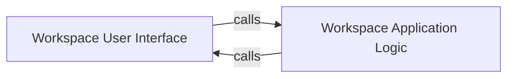

## Details

Manages desktop workspaces, views, sidebars, navigation, user settings, and command palette.

### Workspace User Interface [[Expand]](./Workspace_User_Interface.md)
Renders the desktop workspace UI including the home screen, sidebar navigation, command palette, tabs, settings dialogs, and notification panels.

**Related Classes/Methods**:

- `frontend.appflowy_flutter.lib.workspace.presentation.command_palette.command_palette.CommandPaletteModal`:175-269
- `frontend.appflowy_flutter.lib.workspace.presentation.home.home_stack.PageManager`:652-803
- `frontend.appflowy_flutter.lib.workspace.presentation.widgets.dialogs.showToastNotification`:262-298

**Source Files:**

- `frontend/appflowy_flutter/lib/workspace/presentation/command_palette/command_palette.dart`
  - `frontend.appflowy_flutter.lib.workspace.presentation.command_palette.command_palette.CommandPalette` (L27-L74) - Class
  - `frontend.appflowy_flutter.lib.workspace.presentation.command_palette.command_palette.CommandPalette.CommandPalette` (L28-L34) - Constructor
  - `frontend.appflowy_flutter.lib.workspace.presentation.command_palette.command_palette.CommandPalette.of` (L38-L45) - Method
  - `frontend.appflowy_flutter.lib.workspace.presentation.command_palette.command_palette.CommandPalette.maybeOf` (L47-L48) - Method
  - `frontend.appflowy_flutter.lib.workspace.presentation.command_palette.command_palette.CommandPalette.toggle` (L50-L60) - Method
  - `frontend.appflowy_flutter.lib.workspace.presentation.command_palette.command_palette.CommandPalette.updateBlocs` (L62-L70) - Method
  - `frontend.appflowy_flutter.lib.workspace.presentation.command_palette.command_palette.CommandPalette.updateShouldNotify` (L73-L73) - Method
  - `frontend.appflowy_flutter.lib.workspace.presentation.command_palette.command_palette._ToggleCommandPaletteIntent` (L76-L78) - Class
  - `frontend.appflowy_flutter.lib.workspace.presentation.command_palette.command_palette._ToggleCommandPaletteIntent._ToggleCommandPaletteIntent` (L77-L77) - Constructor
  - `frontend.appflowy_flutter.lib.workspace.presentation.command_palette.command_palette._CommandPaletteController` (L80-L92) - Class
  - `frontend.appflowy_flutter.lib.workspace.presentation.command_palette.command_palette._CommandPaletteController._CommandPaletteController` (L81-L84) - Constructor
  - `frontend.appflowy_flutter.lib.workspace.presentation.command_palette.command_palette._CommandPaletteController.createState` (L90-L91) - Method
  - `frontend.appflowy_flutter.lib.workspace.presentation.command_palette.command_palette._CommandPaletteControllerState` (L94-L173) - Class
  - `frontend.appflowy_flutter.lib.workspace.presentation.command_palette.command_palette._CommandPaletteControllerState.initState` (L100-L103) - Method
  - `frontend.appflowy_flutter.lib.workspace.presentation.command_palette.command_palette._CommandPaletteControllerState.dispose` (L106-L109) - Method
  - `frontend.appflowy_flutter.lib.workspace.presentation.command_palette.command_palette._CommandPaletteControllerState.didUpdateWidget` (L112-L119) - Method
  - `frontend.appflowy_flutter.lib.workspace.presentation.command_palette.command_palette._CommandPaletteControllerState._onToggle` (L121-L149) - Method
  - `frontend.appflowy_flutter.lib.workspace.presentation.command_palette.command_palette._CommandPaletteControllerState.build` (L152-L153) - Method
  - `frontend.appflowy_flutter.lib.workspace.presentation.command_palette.command_palette._CommandPaletteControllerState._buildShortcut` (L155-L172) - Method
  - `frontend.appflowy_flutter.lib.workspace.presentation.command_palette.command_palette.CommandPaletteModal` (L175-L269) - Class
  - `frontend.appflowy_flutter.lib.workspace.presentation.command_palette.command_palette.CommandPaletteModal.CommandPaletteModal` (L176-L176) - Constructor
  - `frontend.appflowy_flutter.lib.workspace.presentation.command_palette.command_palette.CommandPaletteModal.build` (L181-L268) - Method
  - `frontend.appflowy_flutter.lib.workspace.presentation.command_palette.command_palette.NoSearchResultsHint` (L272-L323) - Class
  - `frontend.appflowy_flutter.lib.workspace.presentation.command_palette.command_palette.NoSearchResultsHint.NoSearchResultsHint` (L273-L273) - Constructor
  - `frontend.appflowy_flutter.lib.workspace.presentation.command_palette.command_palette.NoSearchResultsHint.build` (L276-L322) - Method
  - `frontend.appflowy_flutter.lib.workspace.presentation.command_palette.command_palette.CommandPaletteNotifierValue` (L325-L347) - Class
  - `frontend.appflowy_flutter.lib.workspace.presentation.command_palette.command_palette.CommandPaletteNotifierValue.CommandPaletteNotifierValue` (L326-L330) - Constructor
  - `frontend.appflowy_flutter.lib.workspace.presentation.command_palette.command_palette.CommandPaletteNotifierValue.copyWith` (L336-L346) - Method
- `frontend/appflowy_flutter/lib/workspace/presentation/command_palette/navigation_bloc_extension.dart`
  - `frontend.appflowy_flutter.lib.workspace.presentation.command_palette.navigation_bloc_extension.NavigationBlocExtension.navigateTo` (L6-L13) - Method
- `frontend/appflowy_flutter/lib/workspace/presentation/command_palette/widgets/page_preview.dart`
  - `frontend.appflowy_flutter.lib.workspace.presentation.command_palette.widgets.page_preview.PagePreview` (L27-L310) - Class
  - `frontend.appflowy_flutter.lib.workspace.presentation.command_palette.widgets.page_preview.PagePreview.PagePreview` (L28-L32) - Constructor
  - `frontend.appflowy_flutter.lib.workspace.presentation.command_palette.widgets.page_preview.PagePreview.build` (L37-L115) - Method
  - `frontend.appflowy_flutter.lib.workspace.presentation.command_palette.widgets.page_preview.PagePreview.buildCover` (L117-L179) - Method
  - `frontend.appflowy_flutter.lib.workspace.presentation.command_palette.widgets.page_preview.PagePreview.buildIcon` (L181-L195) - Method
  - `frontend.appflowy_flutter.lib.workspace.presentation.command_palette.widgets.page_preview.PagePreview.buildTitle` (L197-L258) - Method
  - `frontend.appflowy_flutter.lib.workspace.presentation.command_palette.widgets.page_preview.PagePreview.buildPath` (L260-L289) - Method
  - `frontend.appflowy_flutter.lib.workspace.presentation.command_palette.widgets.page_preview.PagePreview.buildTime` (L291-L309) - Method
  - `frontend.appflowy_flutter.lib.workspace.presentation.command_palette.widgets.page_preview.SomethingWentWrong` (L312-L360) - Class
  - `frontend.appflowy_flutter.lib.workspace.presentation.command_palette.widgets.page_preview.SomethingWentWrong.SomethingWentWrong` (L313-L313) - Constructor
  - `frontend.appflowy_flutter.lib.workspace.presentation.command_palette.widgets.page_preview.SomethingWentWrong.build` (L316-L359) - Method
- `frontend/appflowy_flutter/lib/workspace/presentation/command_palette/widgets/recent_views_list.dart`
  - `frontend.appflowy_flutter.lib.workspace.presentation.command_palette.widgets.recent_views_list.RecentViewsList` (L17-L158) - Class
  - `frontend.appflowy_flutter.lib.workspace.presentation.command_palette.widgets.recent_views_list.RecentViewsList.RecentViewsList` (L18-L18) - Constructor
  - `frontend.appflowy_flutter.lib.workspace.presentation.command_palette.widgets.recent_views_list.RecentViewsList.build` (L23-L44) - Method
  - `frontend.appflowy_flutter.lib.workspace.presentation.command_palette.widgets.recent_views_list.RecentViewsList.buildLeftPanel` (L46-L88) - Method
  - `frontend.appflowy_flutter.lib.workspace.presentation.command_palette.widgets.recent_views_list.RecentViewsList.buildTitle` (L90-L108) - Method
  - `frontend.appflowy_flutter.lib.workspace.presentation.command_palette.widgets.recent_views_list.RecentViewsList.buildViewList` (L110-L139) - Method
  - `frontend.appflowy_flutter.lib.workspace.presentation.command_palette.widgets.recent_views_list.RecentViewsList.buildPreview` (L141-L157) - Method
- `frontend/appflowy_flutter/lib/workspace/presentation/command_palette/widgets/search_ask_ai_entrance.dart`
  - `frontend.appflowy_flutter.lib.workspace.presentation.command_palette.widgets.search_ask_ai_entrance.SearchAskAiEntrance` (L13-L30) - Class
  - `frontend.appflowy_flutter.lib.workspace.presentation.command_palette.widgets.search_ask_ai_entrance.SearchAskAiEntrance.SearchAskAiEntrance` (L14-L14) - Constructor
  - `frontend.appflowy_flutter.lib.workspace.presentation.command_palette.widgets.search_ask_ai_entrance.SearchAskAiEntrance.build` (L17-L29) - Method
  - `frontend.appflowy_flutter.lib.workspace.presentation.command_palette.widgets.search_ask_ai_entrance._AskAIFor` (L32-L113) - Class
  - `frontend.appflowy_flutter.lib.workspace.presentation.command_palette.widgets.search_ask_ai_entrance._AskAIFor._AskAIFor` (L33-L33) - Constructor
  - `frontend.appflowy_flutter.lib.workspace.presentation.command_palette.widgets.search_ask_ai_entrance._AskAIFor.build` (L36-L77) - Method
  - `frontend.appflowy_flutter.lib.workspace.presentation.command_palette.widgets.search_ask_ai_entrance._AskAIFor.buildText` (L79-L112) - Method
  - `frontend.appflowy_flutter.lib.workspace.presentation.command_palette.widgets.search_ask_ai_entrance._AISearching` (L115-L149) - Class
  - `frontend.appflowy_flutter.lib.workspace.presentation.command_palette.widgets.search_ask_ai_entrance._AISearching._AISearching` (L116-L116) - Constructor
  - `frontend.appflowy_flutter.lib.workspace.presentation.command_palette.widgets.search_ask_ai_entrance._AISearching.build` (L119-L148) - Method
  - `frontend.appflowy_flutter.lib.workspace.presentation.command_palette.widgets.search_ask_ai_entrance._AIOverview` (L151-L242) - Class
  - `frontend.appflowy_flutter.lib.workspace.presentation.command_palette.widgets.search_ask_ai_entrance._AIOverview._AIOverview` (L152-L152) - Constructor
  - `frontend.appflowy_flutter.lib.workspace.presentation.command_palette.widgets.search_ask_ai_entrance._AIOverview.build` (L155-L220) - Method
  - `frontend.appflowy_flutter.lib.workspace.presentation.command_palette.widgets.search_ask_ai_entrance._AIOverview.buildHeader` (L222-L241) - Method
- `frontend/appflowy_flutter/lib/workspace/presentation/command_palette/widgets/search_field.dart`
  - `frontend.appflowy_flutter.lib.workspace.presentation.command_palette.widgets.search_field.SearchField` (L13-L21) - Class
  - `frontend.appflowy_flutter.lib.workspace.presentation.command_palette.widgets.search_field.SearchField.SearchField` (L14-L14) - Constructor
  - `frontend.appflowy_flutter.lib.workspace.presentation.command_palette.widgets.search_field.SearchField.createState` (L20-L20) - Method
  - `frontend.appflowy_flutter.lib.workspace.presentation.command_palette.widgets.search_field._SearchFieldState` (L23-L154) - Class
  - `frontend.appflowy_flutter.lib.workspace.presentation.command_palette.widgets.search_field._SearchFieldState.initState` (L28-L40) - Method
  - `frontend.appflowy_flutter.lib.workspace.presentation.command_palette.widgets.search_field._SearchFieldState._handleKeyEvent` (L42-L50) - Method
  - `frontend.appflowy_flutter.lib.workspace.presentation.command_palette.widgets.search_field._SearchFieldState.dispose` (L53-L57) - Method
  - `frontend.appflowy_flutter.lib.workspace.presentation.command_palette.widgets.search_field._SearchFieldState._buildSuffixIcon` (L59-L84) - Method
  - `frontend.appflowy_flutter.lib.workspace.presentation.command_palette.widgets.search_field._SearchFieldState.build` (L87-L145) - Method
  - `frontend.appflowy_flutter.lib.workspace.presentation.command_palette.widgets.search_field._SearchFieldState._clearSearch` (L147-L153) - Method
- `frontend/appflowy_flutter/lib/workspace/presentation/command_palette/widgets/search_icon.dart`
  - `frontend.appflowy_flutter.lib.workspace.presentation.command_palette.widgets.search_icon.SearchIconExtension.buildIcon` (L12-L28) - Method
  - `frontend.appflowy_flutter.lib.workspace.presentation.command_palette.widgets.search_icon.SearchIconItemExtension.buildIcon` (L32-L45) - Method
- `frontend/appflowy_flutter/lib/workspace/presentation/command_palette/widgets/search_recent_view_cell.dart`
  - `frontend.appflowy_flutter.lib.workspace.presentation.command_palette.widgets.search_recent_view_cell.SearchRecentViewCell` (L14-L30) - Class
  - `frontend.appflowy_flutter.lib.workspace.presentation.command_palette.widgets.search_recent_view_cell.SearchRecentViewCell.SearchRecentViewCell` (L15-L21) - Constructor
  - `frontend.appflowy_flutter.lib.workspace.presentation.command_palette.widgets.search_recent_view_cell.SearchRecentViewCell.createState` (L29-L29) - Method
  - `frontend.appflowy_flutter.lib.workspace.presentation.command_palette.widgets.search_recent_view_cell._SearchRecentViewCellState` (L32-L127) - Class
  - `frontend.appflowy_flutter.lib.workspace.presentation.command_palette.widgets.search_recent_view_cell._SearchRecentViewCellState.view` (L35-L35) - Method
  - `frontend.appflowy_flutter.lib.workspace.presentation.command_palette.widgets.search_recent_view_cell._SearchRecentViewCellState.dispose` (L38-L41) - Method
  - `frontend.appflowy_flutter.lib.workspace.presentation.command_palette.widgets.search_recent_view_cell._SearchRecentViewCellState.build` (L44-L107) - Method
  - `frontend.appflowy_flutter.lib.workspace.presentation.command_palette.widgets.search_recent_view_cell._SearchRecentViewCellState.buildPath` (L109-L120) - Method
  - `frontend.appflowy_flutter.lib.workspace.presentation.command_palette.widgets.search_recent_view_cell._SearchRecentViewCellState._handleSelection` (L123-L126) - Method
- `frontend/appflowy_flutter/lib/workspace/presentation/command_palette/widgets/search_result_cell.dart`
  - `frontend.appflowy_flutter.lib.workspace.presentation.command_palette.widgets.search_result_cell.SearchResultCell` (L20-L38) - Class
  - `frontend.appflowy_flutter.lib.workspace.presentation.command_palette.widgets.search_result_cell.SearchResultCell.SearchResultCell` (L21-L28) - Constructor
  - `frontend.appflowy_flutter.lib.workspace.presentation.command_palette.widgets.search_result_cell.SearchResultCell.createState` (L37-L37) - Method
  - `frontend.appflowy_flutter.lib.workspace.presentation.command_palette.widgets.search_result_cell._SearchResultCellState` (L40-L220) - Class
  - `frontend.appflowy_flutter.lib.workspace.presentation.command_palette.widgets.search_result_cell._SearchResultCellState.viewId` (L44-L44) - Method
  - `frontend.appflowy_flutter.lib.workspace.presentation.command_palette.widgets.search_result_cell._SearchResultCellState.item` (L45-L45) - Method
  - `frontend.appflowy_flutter.lib.workspace.presentation.command_palette.widgets.search_result_cell._SearchResultCellState.dispose` (L48-L51) - Method
  - `frontend.appflowy_flutter.lib.workspace.presentation.command_palette.widgets.search_result_cell._SearchResultCellState._handleSelection` (L54-L58) - Method
  - `frontend.appflowy_flutter.lib.workspace.presentation.command_palette.widgets.search_result_cell._SearchResultCellState.build` (L61-L153) - Method
  - `frontend.appflowy_flutter.lib.workspace.presentation.command_palette.widgets.search_result_cell._SearchResultCellState.buildIcon` (L155-L159) - Method
  - `frontend.appflowy_flutter.lib.workspace.presentation.command_palette.widgets.search_result_cell._SearchResultCellState.buildPath` (L161-L172) - Method
  - `frontend.appflowy_flutter.lib.workspace.presentation.command_palette.widgets.search_result_cell._SearchResultCellState.buildHighLightSpan` (L174-L194) - Method
  - `frontend.appflowy_flutter.lib.workspace.presentation.command_palette.widgets.search_result_cell._SearchResultCellState.buildSummary` (L196-L219) - Method
  - `frontend.appflowy_flutter.lib.workspace.presentation.command_palette.widgets.search_result_cell.SearchResultPreview` (L222-L242) - Class
  - `frontend.appflowy_flutter.lib.workspace.presentation.command_palette.widgets.search_result_cell.SearchResultPreview.SearchResultPreview` (L223-L226) - Constructor
  - `frontend.appflowy_flutter.lib.workspace.presentation.command_palette.widgets.search_result_cell.SearchResultPreview.build` (L231-L241) - Method
- `frontend/appflowy_flutter/lib/workspace/presentation/command_palette/widgets/search_results_list.dart`
  - `frontend.appflowy_flutter.lib.workspace.presentation.command_palette.widgets.search_results_list.SearchResultList` (L19-L33) - Class
  - `frontend.appflowy_flutter.lib.workspace.presentation.command_palette.widgets.search_results_list.SearchResultList.SearchResultList` (L20-L25) - Constructor
  - `frontend.appflowy_flutter.lib.workspace.presentation.command_palette.widgets.search_results_list.SearchResultList.createState` (L32-L32) - Method
  - `frontend.appflowy_flutter.lib.workspace.presentation.command_palette.widgets.search_results_list._SearchResultListState` (L35-L171) - Class
  - `frontend.appflowy_flutter.lib.workspace.presentation.command_palette.widgets.search_results_list._SearchResultListState.initState` (L39-L42) - Method
  - `frontend.appflowy_flutter.lib.workspace.presentation.command_palette.widgets.search_results_list._SearchResultListState.dispose` (L45-L48) - Method
  - `frontend.appflowy_flutter.lib.workspace.presentation.command_palette.widgets.search_results_list._SearchResultListState.build` (L51-L83) - Method
  - `frontend.appflowy_flutter.lib.workspace.presentation.command_palette.widgets.search_results_list._SearchResultListState._buildSectionHeader` (L85-L102) - Method
  - `frontend.appflowy_flutter.lib.workspace.presentation.command_palette.widgets.search_results_list._SearchResultListState._buildResultsSection` (L104-L170) - Method
  - `frontend.appflowy_flutter.lib.workspace.presentation.command_palette.widgets.search_results_list.SearchCellPreview` (L173-L190) - Class
  - `frontend.appflowy_flutter.lib.workspace.presentation.command_palette.widgets.search_results_list.SearchCellPreview.SearchCellPreview` (L174-L174) - Constructor
  - `frontend.appflowy_flutter.lib.workspace.presentation.command_palette.widgets.search_results_list.SearchCellPreview.build` (L177-L189) - Method
- `frontend/appflowy_flutter/lib/workspace/presentation/command_palette/widgets/search_summary_cell.dart`
  - `frontend.appflowy_flutter.lib.workspace.presentation.command_palette.widgets.search_summary_cell.SearchSummaryCell` (L16-L32) - Class
  - `frontend.appflowy_flutter.lib.workspace.presentation.command_palette.widgets.search_summary_cell.SearchSummaryCell.SearchSummaryCell` (L17-L23) - Constructor
  - `frontend.appflowy_flutter.lib.workspace.presentation.command_palette.widgets.search_summary_cell.SearchSummaryCell.createState` (L31-L31) - Method
  - `frontend.appflowy_flutter.lib.workspace.presentation.command_palette.widgets.search_summary_cell._SearchSummaryCellState` (L34-L222) - Class
  - `frontend.appflowy_flutter.lib.workspace.presentation.command_palette.widgets.search_summary_cell._SearchSummaryCellState.summary` (L42-L42) - Method
  - `frontend.appflowy_flutter.lib.workspace.presentation.command_palette.widgets.search_summary_cell._SearchSummaryCellState.maxWidth` (L43-L43) - Method
  - `frontend.appflowy_flutter.lib.workspace.presentation.command_palette.widgets.search_summary_cell._SearchSummaryCellState.theme` (L44-L44) - Method
  - `frontend.appflowy_flutter.lib.workspace.presentation.command_palette.widgets.search_summary_cell._SearchSummaryCellState.textStyle` (L46-L46) - Method
  - `frontend.appflowy_flutter.lib.workspace.presentation.command_palette.widgets.search_summary_cell._SearchSummaryCellState.showMoreStyle` (L48-L50) - Method
  - `frontend.appflowy_flutter.lib.workspace.presentation.command_palette.widgets.search_summary_cell._SearchSummaryCellState.showMoreUnderlineStyle` (L52-L54) - Method
  - `frontend.appflowy_flutter.lib.workspace.presentation.command_palette.widgets.search_summary_cell._SearchSummaryCellState.initState` (L57-L60) - Method
  - `frontend.appflowy_flutter.lib.workspace.presentation.command_palette.widgets.search_summary_cell._SearchSummaryCellState.didUpdateWidget` (L63-L68) - Method
  - `frontend.appflowy_flutter.lib.workspace.presentation.command_palette.widgets.search_summary_cell._SearchSummaryCellState.dispose` (L71-L75) - Method
  - `frontend.appflowy_flutter.lib.workspace.presentation.command_palette.widgets.search_summary_cell._SearchSummaryCellState.build` (L78-L120) - Method
  - `frontend.appflowy_flutter.lib.workspace.presentation.command_palette.widgets.search_summary_cell._SearchSummaryCellState.buildReferenceIcon` (L122-L175) - Method
  - `frontend.appflowy_flutter.lib.workspace.presentation.command_palette.widgets.search_summary_cell._SearchSummaryCellState.showPopover` (L177-L180) - Method
  - `frontend.appflowy_flutter.lib.workspace.presentation.command_palette.widgets.search_summary_cell._SearchSummaryCellState.hidePopover` (L182-L185) - Method
  - `frontend.appflowy_flutter.lib.workspace.presentation.command_palette.widgets.search_summary_cell._SearchSummaryCellState.tryToHidePopover` (L187-L194) - Method
  - `frontend.appflowy_flutter.lib.workspace.presentation.command_palette.widgets.search_summary_cell._SearchSummaryCellState.refreshTextPainter` (L196-L221) - Method
  - `frontend.appflowy_flutter.lib.workspace.presentation.command_palette.widgets.search_summary_cell._TextInfo` (L224-L324) - Class
  - `frontend.appflowy_flutter.lib.workspace.presentation.command_palette.widgets.search_summary_cell._TextInfo._TextInfo` (L225-L225) - Constructor
  - `frontend.appflowy_flutter.lib.workspace.presentation.command_palette.widgets.search_summary_cell._TextInfo._TextInfo.normal` (L227-L227) - Constructor
  - `frontend.appflowy_flutter.lib.workspace.presentation.command_palette.widgets.search_summary_cell._TextInfo._TextInfo.overflow` (L229-L229) - Constructor
  - `frontend.appflowy_flutter.lib.workspace.presentation.command_palette.widgets.search_summary_cell._TextInfo.build` (L234-L300) - Method
  - `frontend.appflowy_flutter.lib.workspace.presentation.command_palette.widgets.search_summary_cell._TextInfo._buildHighLightSpan` (L302-L323) - Method
  - `frontend.appflowy_flutter.lib.workspace.presentation.command_palette.widgets.search_summary_cell.ReferenceSources` (L326-L436) - Class
  - `frontend.appflowy_flutter.lib.workspace.presentation.command_palette.widgets.search_summary_cell.ReferenceSources.ReferenceSources` (L327-L331) - Constructor
  - `frontend.appflowy_flutter.lib.workspace.presentation.command_palette.widgets.search_summary_cell.ReferenceSources.build` (L337-L426) - Method
  - `frontend.appflowy_flutter.lib.workspace.presentation.command_palette.widgets.search_summary_cell.ReferenceSources.buildIcon` (L428-L435) - Method
- `frontend/appflowy_flutter/lib/workspace/presentation/home/af_focus_manager.dart`
  - `frontend.appflowy_flutter.lib.workspace.presentation.home.af_focus_manager.ShouldLoseFocus` (L8-L8) - Class
  - `frontend.appflowy_flutter.lib.workspace.presentation.home.af_focus_manager._ShouldLoseFocusImpl` (L13-L15) - Class
  - `frontend.appflowy_flutter.lib.workspace.presentation.home.af_focus_manager._ShouldLoseFocusImpl.notify` (L14-L14) - Method
  - `frontend.appflowy_flutter.lib.workspace.presentation.home.af_focus_manager.AFFocusManager` (L17-L40) - Class
  - `frontend.appflowy_flutter.lib.workspace.presentation.home.af_focus_manager.AFFocusManager.AFFocusManager` (L18-L18) - Constructor
  - `frontend.appflowy_flutter.lib.workspace.presentation.home.af_focus_manager.AFFocusManager.notifyLoseFocus` (L22-L24) - Method
  - `frontend.appflowy_flutter.lib.workspace.presentation.home.af_focus_manager.AFFocusManager.updateShouldNotify` (L27-L27) - Method
  - `frontend.appflowy_flutter.lib.workspace.presentation.home.af_focus_manager.AFFocusManager.of` (L29-L35) - Method
  - `frontend.appflowy_flutter.lib.workspace.presentation.home.af_focus_manager.AFFocusManager.maybeOf` (L37-L39) - Method
- `frontend/appflowy_flutter/lib/workspace/presentation/home/desktop_home_screen.dart`
  - `frontend.appflowy_flutter.lib.workspace.presentation.home.desktop_home_screen.DesktopHomeScreen` (L44-L331) - Class
  - `frontend.appflowy_flutter.lib.workspace.presentation.home.desktop_home_screen.DesktopHomeScreen.DesktopHomeScreen` (L45-L45) - Constructor
  - `frontend.appflowy_flutter.lib.workspace.presentation.home.desktop_home_screen.DesktopHomeScreen.build` (L50-L171) - Method
  - `frontend.appflowy_flutter.lib.workspace.presentation.home.desktop_home_screen.DesktopHomeScreen._buildLoading` (L173-L174) - Method
  - `frontend.appflowy_flutter.lib.workspace.presentation.home.desktop_home_screen.DesktopHomeScreen._buildBody` (L176-L210) - Method
  - `frontend.appflowy_flutter.lib.workspace.presentation.home.desktop_home_screen.DesktopHomeScreen._buildHomeSidebar` (L212-L223) - Method
  - `frontend.appflowy_flutter.lib.workspace.presentation.home.desktop_home_screen.DesktopHomeScreen._buildEditPanel` (L225-L251) - Method
  - `frontend.appflowy_flutter.lib.workspace.presentation.home.desktop_home_screen.DesktopHomeScreen._layoutWidgets` (L253-L318) - Method
  - `frontend.appflowy_flutter.lib.workspace.presentation.home.desktop_home_screen.DesktopHomeScreen._switchToSpace` (L320-L330) - Method
  - `frontend.appflowy_flutter.lib.workspace.presentation.home.desktop_home_screen.DesktopHomeScreenStackAdaptor` (L333-L361) - Class
  - `frontend.appflowy_flutter.lib.workspace.presentation.home.desktop_home_screen.DesktopHomeScreenStackAdaptor.DesktopHomeScreenStackAdaptor` (L334-L334) - Constructor
  - `frontend.appflowy_flutter.lib.workspace.presentation.home.desktop_home_screen.DesktopHomeScreenStackAdaptor.didDeleteStackWidget` (L339-L360) - Method
- `frontend/appflowy_flutter/lib/workspace/presentation/home/errors/workspace_failed_screen.dart`
  - `frontend.appflowy_flutter.lib.workspace.presentation.home.errors.workspace_failed_screen.WorkspaceFailedScreen` (L12-L17) - Class
  - `frontend.appflowy_flutter.lib.workspace.presentation.home.errors.workspace_failed_screen.WorkspaceFailedScreen.WorkspaceFailedScreen` (L13-L13) - Constructor
  - `frontend.appflowy_flutter.lib.workspace.presentation.home.errors.workspace_failed_screen.WorkspaceFailedScreen.createState` (L16-L16) - Method
  - `frontend.appflowy_flutter.lib.workspace.presentation.home.errors.workspace_failed_screen._WorkspaceFailedScreenState` (L19-L78) - Class
  - `frontend.appflowy_flutter.lib.workspace.presentation.home.errors.workspace_failed_screen._WorkspaceFailedScreenState.initState` (L24-L27) - Method
  - `frontend.appflowy_flutter.lib.workspace.presentation.home.errors.workspace_failed_screen._WorkspaceFailedScreenState.initVersion` (L29-L34) - Method
  - `frontend.appflowy_flutter.lib.workspace.presentation.home.errors.workspace_failed_screen._WorkspaceFailedScreenState.build` (L37-L77) - Method
- `frontend/appflowy_flutter/lib/workspace/presentation/home/home_layout.dart`
  - `frontend.appflowy_flutter.lib.workspace.presentation.home.home_layout.HomeLayout` (L13-L56) - Class
  - `frontend.appflowy_flutter.lib.workspace.presentation.home.home_layout.HomeLayout.HomeLayout` (L14-L43) - Constructor
- `frontend/appflowy_flutter/lib/workspace/presentation/home/home_sizes.dart`
  - `frontend.appflowy_flutter.lib.workspace.presentation.home.home_sizes.HomeSizes` (L1-L13) - Class
  - `frontend.appflowy_flutter.lib.workspace.presentation.home.home_sizes.HomeInsets` (L15-L18) - Class
  - `frontend.appflowy_flutter.lib.workspace.presentation.home.home_sizes.HomeSpaceViewSizes` (L20-L29) - Class
- `frontend/appflowy_flutter/lib/workspace/presentation/home/home_stack.dart`
  - `frontend.appflowy_flutter.lib.workspace.presentation.home.home_stack.NavigationCallback` (L35-L35) - Class
  - `frontend.appflowy_flutter.lib.workspace.presentation.home.home_stack.HomeStackDelegate` (L37-L39) - Class
  - `frontend.appflowy_flutter.lib.workspace.presentation.home.home_stack.HomeStackDelegate.didDeleteStackWidget` (L38-L38) - Method
  - `frontend.appflowy_flutter.lib.workspace.presentation.home.home_stack.HomeStack` (L41-L55) - Class
  - `frontend.appflowy_flutter.lib.workspace.presentation.home.home_stack.HomeStack.HomeStack` (L42-L47) - Constructor
  - `frontend.appflowy_flutter.lib.workspace.presentation.home.home_stack.HomeStack.createState` (L54-L54) - Method
  - `frontend.appflowy_flutter.lib.workspace.presentation.home.home_stack._HomeStackState` (L57-L177) - Class
  - `frontend.appflowy_flutter.lib.workspace.presentation.home.home_stack._HomeStackState.build` (L61-L123) - Method
  - `frontend.appflowy_flutter.lib.workspace.presentation.home.home_stack._HomeStackState._buildToggleMenuButton` (L125-L169) - Method
  - `frontend.appflowy_flutter.lib.workspace.presentation.home.home_stack._HomeStackState.onWindowFocus` (L172-L176) - Method
  - `frontend.appflowy_flutter.lib.workspace.presentation.home.home_stack.PageStack` (L179-L193) - Class
  - `frontend.appflowy_flutter.lib.workspace.presentation.home.home_stack.PageStack.PageStack` (L180-L185) - Constructor
  - `frontend.appflowy_flutter.lib.workspace.presentation.home.home_stack.PageStack.createState` (L192-L192) - Method
  - `frontend.appflowy_flutter.lib.workspace.presentation.home.home_stack._PageStackState` (L195-L216) - Class
  - `frontend.appflowy_flutter.lib.workspace.presentation.home.home_stack._PageStackState.build` (L198-L212) - Method
  - `frontend.appflowy_flutter.lib.workspace.presentation.home.home_stack._PageStackState.wantKeepAlive` (L215-L215) - Method
  - `frontend.appflowy_flutter.lib.workspace.presentation.home.home_stack.SecondaryView` (L218-L230) - Class
  - `frontend.appflowy_flutter.lib.workspace.presentation.home.home_stack.SecondaryView.SecondaryView` (L219-L223) - Constructor
  - `frontend.appflowy_flutter.lib.workspace.presentation.home.home_stack.SecondaryView.createState` (L229-L229) - Method
  - `frontend.appflowy_flutter.lib.workspace.presentation.home.home_stack._SecondaryViewState` (L232-L455) - Class
  - `frontend.appflowy_flutter.lib.workspace.presentation.home.home_stack._SecondaryViewState.curveAnimation` (L245-L248) - Method
  - `frontend.appflowy_flutter.lib.workspace.presentation.home.home_stack._SecondaryViewState.initState` (L251-L279) - Method
  - `frontend.appflowy_flutter.lib.workspace.presentation.home.home_stack._SecondaryViewState.dispose` (L282-L288) - Method
  - `frontend.appflowy_flutter.lib.workspace.presentation.home.home_stack._SecondaryViewState.build` (L291-L405) - Method
  - `frontend.appflowy_flutter.lib.workspace.presentation.home.home_stack._SecondaryViewState.getBorder` (L407-L420) - Method
  - `frontend.appflowy_flutter.lib.workspace.presentation.home.home_stack._SecondaryViewState.getBorderRadius` (L422-L427) - Method
  - `frontend.appflowy_flutter.lib.workspace.presentation.home.home_stack._SecondaryViewState.onSecondaryViewChanged` (L429-L432) - Method
  - `frontend.appflowy_flutter.lib.workspace.presentation.home.home_stack._SecondaryViewState.onShowSecondaryChanged` (L434-L444) - Method
  - `frontend.appflowy_flutter.lib.workspace.presentation.home.home_stack._SecondaryViewState.updateWidthAnimation` (L446-L451) - Method
  - `frontend.appflowy_flutter.lib.workspace.presentation.home.home_stack._SecondaryViewState.wantKeepAlive` (L454-L454) - Method
  - `frontend.appflowy_flutter.lib.workspace.presentation.home.home_stack.SecondaryViewResizer` (L457-L471) - Class
  - `frontend.appflowy_flutter.lib.workspace.presentation.home.home_stack.SecondaryViewResizer.SecondaryViewResizer` (L458-L463) - Constructor
  - `frontend.appflowy_flutter.lib.workspace.presentation.home.home_stack.SecondaryViewResizer.createState` (L470-L470) - Method
  - `frontend.appflowy_flutter.lib.workspace.presentation.home.home_stack._SecondaryViewResizerState` (L473-L559) - Class
  - `frontend.appflowy_flutter.lib.workspace.presentation.home.home_stack._SecondaryViewResizerState.initState` (L482-L485) - Method
  - `frontend.appflowy_flutter.lib.workspace.presentation.home.home_stack._SecondaryViewResizerState.build` (L488-L558) - Method
  - `frontend.appflowy_flutter.lib.workspace.presentation.home.home_stack.FadingIndexedStack` (L561-L575) - Class
  - `frontend.appflowy_flutter.lib.workspace.presentation.home.home_stack.FadingIndexedStack.FadingIndexedStack` (L562-L567) - Constructor
  - `frontend.appflowy_flutter.lib.workspace.presentation.home.home_stack.FadingIndexedStack.createState` (L574-L574) - Method
  - `frontend.appflowy_flutter.lib.workspace.presentation.home.home_stack.FadingIndexedStackState` (L577-L605) - Class
  - `frontend.appflowy_flutter.lib.workspace.presentation.home.home_stack.FadingIndexedStackState.initState` (L581-L584) - Method
  - `frontend.appflowy_flutter.lib.workspace.presentation.home.home_stack.FadingIndexedStackState.didUpdateWidget` (L587-L594) - Method
  - `frontend.appflowy_flutter.lib.workspace.presentation.home.home_stack.FadingIndexedStackState.build` (L597-L604) - Method
  - `frontend.appflowy_flutter.lib.workspace.presentation.home.home_stack.NavigationItem` (L607-L614) - Class
  - `frontend.appflowy_flutter.lib.workspace.presentation.home.home_stack.NavigationItem.viewName` (L608-L608) - Method
  - `frontend.appflowy_flutter.lib.workspace.presentation.home.home_stack.NavigationItem.leftBarItem` (L609-L609) - Method
  - `frontend.appflowy_flutter.lib.workspace.presentation.home.home_stack.NavigationItem.rightBarItem` (L610-L610) - Method
  - `frontend.appflowy_flutter.lib.workspace.presentation.home.home_stack.NavigationItem.tabBarItem` (L611-L611) - Method
  - `frontend.appflowy_flutter.lib.workspace.presentation.home.home_stack.NavigationItem.action` (L613-L613) - Method
  - `frontend.appflowy_flutter.lib.workspace.presentation.home.home_stack.PageNotifier` (L616-L649) - Class
  - `frontend.appflowy_flutter.lib.workspace.presentation.home.home_stack.PageNotifier.PageNotifier` (L617-L618) - Constructor
  - `frontend.appflowy_flutter.lib.workspace.presentation.home.home_stack.PageNotifier.titleWidget` (L622-L622) - Method
  - `frontend.appflowy_flutter.lib.workspace.presentation.home.home_stack.PageNotifier.tabBarWidget` (L624-L628) - Method
  - `frontend.appflowy_flutter.lib.workspace.presentation.home.home_stack.PageNotifier.setPlugin` (L630-L646) - Method
  - `frontend.appflowy_flutter.lib.workspace.presentation.home.home_stack.PageNotifier.plugin` (L648-L648) - Method
  - `frontend.appflowy_flutter.lib.workspace.presentation.home.home_stack.PageManager` (L652-L803) - Class
  - `frontend.appflowy_flutter.lib.workspace.presentation.home.home_stack.PageManager.PageManager` (L653-L653) - Constructor
  - `frontend.appflowy_flutter.lib.workspace.presentation.home.home_stack.PageManager.notifier` (L658-L658) - Method
  - `frontend.appflowy_flutter.lib.workspace.presentation.home.home_stack.PageManager.secondaryNotifier` (L659-L659) - Method
  - `frontend.appflowy_flutter.lib.workspace.presentation.home.home_stack.PageManager.plugin` (L665-L665) - Method
  - `frontend.appflowy_flutter.lib.workspace.presentation.home.home_stack.PageManager.setPlugin` (L667-L672) - Method
  - `frontend.appflowy_flutter.lib.workspace.presentation.home.home_stack.PageManager.setSecondaryPlugin` (L674-L677) - Method
  - `frontend.appflowy_flutter.lib.workspace.presentation.home.home_stack.PageManager.expandSecondaryPlugin` (L679-L686) - Method
  - `frontend.appflowy_flutter.lib.workspace.presentation.home.home_stack.PageManager.showSecondaryPlugin` (L688-L690) - Method
  - `frontend.appflowy_flutter.lib.workspace.presentation.home.home_stack.PageManager.hideSecondaryPlugin` (L692-L694) - Method
  - `frontend.appflowy_flutter.lib.workspace.presentation.home.home_stack.PageManager.stackTopBar` (L696-L706) - Method
  - `frontend.appflowy_flutter.lib.workspace.presentation.home.home_stack.PageManager.stackWidget` (L708-L747) - Method
  - `frontend.appflowy_flutter.lib.workspace.presentation.home.home_stack.PageManager.stackSecondaryWidget` (L749-L772) - Method
  - `frontend.appflowy_flutter.lib.workspace.presentation.home.home_stack.PageManager.stackSecondaryTopBar` (L774-L796) - Method
  - `frontend.appflowy_flutter.lib.workspace.presentation.home.home_stack.PageManager.dispose` (L798-L802) - Method
  - `frontend.appflowy_flutter.lib.workspace.presentation.home.home_stack.HomeTopBar` (L805-L812) - Class
  - `frontend.appflowy_flutter.lib.workspace.presentation.home.home_stack.HomeTopBar.HomeTopBar` (L806-L806) - Constructor
  - `frontend.appflowy_flutter.lib.workspace.presentation.home.home_stack.HomeTopBar.createState` (L811-L811) - Method
  - `frontend.appflowy_flutter.lib.workspace.presentation.home.home_stack._HomeTopBarState` (L814-L851) - Class
  - `frontend.appflowy_flutter.lib.workspace.presentation.home.home_stack._HomeTopBarState.build` (L817-L847) - Method
  - `frontend.appflowy_flutter.lib.workspace.presentation.home.home_stack._HomeTopBarState.wantKeepAlive` (L850-L850) - Method
  - `frontend.appflowy_flutter.lib.workspace.presentation.home.home_stack.HomeSecondaryTopBar` (L853-L913) - Class
  - `frontend.appflowy_flutter.lib.workspace.presentation.home.home_stack.HomeSecondaryTopBar.HomeSecondaryTopBar` (L854-L854) - Constructor
  - `frontend.appflowy_flutter.lib.workspace.presentation.home.home_stack.HomeSecondaryTopBar.build` (L857-L912) - Method
  - `frontend.appflowy_flutter.lib.workspace.presentation.home.home_stack.NonClippingSizeTransition` (L917-L995) - Class
  - `frontend.appflowy_flutter.lib.workspace.presentation.home.home_stack.NonClippingSizeTransition.NonClippingSizeTransition` (L918-L928) - Constructor
  - `frontend.appflowy_flutter.lib.workspace.presentation.home.home_stack.NonClippingSizeTransition.sizeFactor` (L942-L942) - Method
  - `frontend.appflowy_flutter.lib.workspace.presentation.home.home_stack.NonClippingSizeTransition.build` (L971-L994) - Method
  - `frontend.appflowy_flutter.lib.workspace.presentation.home.home_stack.EdgeRectClipper` (L997-L1021) - Class
  - `frontend.appflowy_flutter.lib.workspace.presentation.home.home_stack.EdgeRectClipper.EdgeRectClipper` (L998-L1001) - Constructor
  - `frontend.appflowy_flutter.lib.workspace.presentation.home.home_stack.EdgeRectClipper.getClip` (L1007-L1017) - Method
  - `frontend.appflowy_flutter.lib.workspace.presentation.home.home_stack.EdgeRectClipper.shouldReclip` (L1020-L1020) - Method
  - `frontend.appflowy_flutter.lib.workspace.presentation.home.home_stack.Edge` (L1023-L1035) - Enum
  - `frontend.appflowy_flutter.lib.workspace.presentation.home.home_stack.Edge.left` (L1024-L1024) - Enum
  - `frontend.appflowy_flutter.lib.workspace.presentation.home.home_stack.Edge.top` (L1025-L1025) - Enum
  - `frontend.appflowy_flutter.lib.workspace.presentation.home.home_stack.Edge.right` (L1026-L1026) - Enum
  - `frontend.appflowy_flutter.lib.workspace.presentation.home.home_stack.Edge.bottom` (L1027-L1027) - Enum
  - `frontend.appflowy_flutter.lib.workspace.presentation.home.home_stack.Edge.isHorizontal` (L1029-L1032) - Method
  - `frontend.appflowy_flutter.lib.workspace.presentation.home.home_stack.Edge.isVertical` (L1034-L1034) - Method
- `frontend/appflowy_flutter/lib/workspace/presentation/home/hotkeys.dart`
  - `frontend.appflowy_flutter.lib.workspace.presentation.home.hotkeys.KeyDownHandler` (L18-L18) - Class
  - `frontend.appflowy_flutter.lib.workspace.presentation.home.hotkeys.HotKeyItem` (L42-L53) - Class
  - `frontend.appflowy_flutter.lib.workspace.presentation.home.hotkeys.HotKeyItem.HotKeyItem` (L43-L46) - Constructor
  - `frontend.appflowy_flutter.lib.workspace.presentation.home.hotkeys.HotKeyItem.register` (L51-L52) - Method
  - `frontend.appflowy_flutter.lib.workspace.presentation.home.hotkeys.HomeHotKeys` (L55-L67) - Class
  - `frontend.appflowy_flutter.lib.workspace.presentation.home.hotkeys.HomeHotKeys.HomeHotKeys` (L56-L60) - Constructor
  - `frontend.appflowy_flutter.lib.workspace.presentation.home.hotkeys.HomeHotKeys.createState` (L66-L66) - Method
  - `frontend.appflowy_flutter.lib.workspace.presentation.home.hotkeys._HomeHotKeysState` (L69-L279) - Class
  - `frontend.appflowy_flutter.lib.workspace.presentation.home.hotkeys._HomeHotKeysState.initState` (L215-L218) - Method
  - `frontend.appflowy_flutter.lib.workspace.presentation.home.hotkeys._HomeHotKeysState.didChangeDependencies` (L221-L224) - Method
  - `frontend.appflowy_flutter.lib.workspace.presentation.home.hotkeys._HomeHotKeysState.build` (L227-L227) - Method
  - `frontend.appflowy_flutter.lib.workspace.presentation.home.hotkeys._HomeHotKeysState._registerHotKeys` (L229-L233) - Method
  - `frontend.appflowy_flutter.lib.workspace.presentation.home.hotkeys._HomeHotKeysState._selectTab` (L235-L238) - Method
  - `frontend.appflowy_flutter.lib.workspace.presentation.home.hotkeys._HomeHotKeysState._scaleWithStep` (L240-L254) - Method
  - `frontend.appflowy_flutter.lib.workspace.presentation.home.hotkeys._HomeHotKeysState._scale` (L256-L267) - Method
  - `frontend.appflowy_flutter.lib.workspace.presentation.home.hotkeys._HomeHotKeysState.colappsedMenus` (L269-L278) - Method
- `frontend/appflowy_flutter/lib/workspace/presentation/home/menu/menu_shared_state.dart`
  - `frontend.appflowy_flutter.lib.workspace.presentation.home.menu.menu_shared_state.MenuSharedState` (L4-L29) - Class
  - `frontend.appflowy_flutter.lib.workspace.presentation.home.menu.menu_shared_state.MenuSharedState.MenuSharedState` (L5-L9) - Constructor
  - `frontend.appflowy_flutter.lib.workspace.presentation.home.menu.menu_shared_state.MenuSharedState.latestOpenView` (L13-L13) - Method
  - `frontend.appflowy_flutter.lib.workspace.presentation.home.menu.menu_shared_state.MenuSharedState.notifier` (L14-L14) - Method
  - `frontend.appflowy_flutter.lib.workspace.presentation.home.menu.menu_shared_state.MenuSharedState.latestOpenView=` (L16-L20) - Method
  - `frontend.appflowy_flutter.lib.workspace.presentation.home.menu.menu_shared_state.MenuSharedState.addLatestViewListener` (L22-L24) - Method
  - `frontend.appflowy_flutter.lib.workspace.presentation.home.menu.menu_shared_state.MenuSharedState.removeLatestViewListener` (L26-L28) - Method
- `frontend/appflowy_flutter/lib/workspace/presentation/home/menu/sidebar/favorites/favorite_folder.dart`
  - `frontend.appflowy_flutter.lib.workspace.presentation.home.menu.sidebar.favorites.favorite_folder.FavoriteFolder` (L20-L27) - Class
  - `frontend.appflowy_flutter.lib.workspace.presentation.home.menu.sidebar.favorites.favorite_folder.FavoriteFolder.FavoriteFolder` (L21-L21) - Constructor
  - `frontend.appflowy_flutter.lib.workspace.presentation.home.menu.sidebar.favorites.favorite_folder.FavoriteFolder.createState` (L26-L26) - Method
  - `frontend.appflowy_flutter.lib.workspace.presentation.home.menu.sidebar.favorites.favorite_folder._FavoriteFolderState` (L29-L158) - Class
  - `frontend.appflowy_flutter.lib.workspace.presentation.home.menu.sidebar.favorites.favorite_folder._FavoriteFolderState.dispose` (L33-L36) - Method
  - `frontend.appflowy_flutter.lib.workspace.presentation.home.menu.sidebar.favorites.favorite_folder._FavoriteFolderState.build` (L39-L71) - Method
  - `frontend.appflowy_flutter.lib.workspace.presentation.home.menu.sidebar.favorites.favorite_folder._FavoriteFolderState.buildReorderListView` (L73-L115) - Method
  - `frontend.appflowy_flutter.lib.workspace.presentation.home.menu.sidebar.favorites.favorite_folder._FavoriteFolderState.buildViewItem` (L117-L157) - Method
  - `frontend.appflowy_flutter.lib.workspace.presentation.home.menu.sidebar.favorites.favorite_folder.FavoriteHeader` (L160-L185) - Class
  - `frontend.appflowy_flutter.lib.workspace.presentation.home.menu.sidebar.favorites.favorite_folder.FavoriteHeader.FavoriteHeader` (L161-L161) - Constructor
  - `frontend.appflowy_flutter.lib.workspace.presentation.home.menu.sidebar.favorites.favorite_folder.FavoriteHeader.build` (L166-L184) - Method
  - `frontend.appflowy_flutter.lib.workspace.presentation.home.menu.sidebar.favorites.favorite_folder.FavoriteMoreButton` (L187-L220) - Class
  - `frontend.appflowy_flutter.lib.workspace.presentation.home.menu.sidebar.favorites.favorite_folder.FavoriteMoreButton.FavoriteMoreButton` (L188-L188) - Constructor
  - `frontend.appflowy_flutter.lib.workspace.presentation.home.menu.sidebar.favorites.favorite_folder.FavoriteMoreButton.build` (L191-L219) - Method
- `frontend/appflowy_flutter/lib/workspace/presentation/home/menu/sidebar/favorites/favorite_menu.dart`
  - `frontend.appflowy_flutter.lib.workspace.presentation.home.menu.sidebar.favorites.favorite_menu.FavoriteMenu` (L20-L63) - Class
  - `frontend.appflowy_flutter.lib.workspace.presentation.home.menu.sidebar.favorites.favorite_menu.FavoriteMenu.FavoriteMenu` (L21-L21) - Constructor
  - `frontend.appflowy_flutter.lib.workspace.presentation.home.menu.sidebar.favorites.favorite_menu.FavoriteMenu.build` (L26-L62) - Method
  - `frontend.appflowy_flutter.lib.workspace.presentation.home.menu.sidebar.favorites.favorite_menu._FavoriteGroupedViews` (L65-L111) - Class
  - `frontend.appflowy_flutter.lib.workspace.presentation.home.menu.sidebar.favorites.favorite_menu._FavoriteGroupedViews._FavoriteGroupedViews` (L66-L68) - Constructor
  - `frontend.appflowy_flutter.lib.workspace.presentation.home.menu.sidebar.favorites.favorite_menu._FavoriteGroupedViews.build` (L73-L110) - Method
  - `frontend.appflowy_flutter.lib.workspace.presentation.home.menu.sidebar.favorites.favorite_menu._FavoriteGroups` (L113-L199) - Class
  - `frontend.appflowy_flutter.lib.workspace.presentation.home.menu.sidebar.favorites.favorite_menu._FavoriteGroups._FavoriteGroups` (L114-L117) - Constructor
  - `frontend.appflowy_flutter.lib.workspace.presentation.home.menu.sidebar.favorites.favorite_menu._FavoriteGroups.build` (L123-L177) - Method
  - `frontend.appflowy_flutter.lib.workspace.presentation.home.menu.sidebar.favorites.favorite_menu._FavoriteGroups._buildGroups` (L179-L198) - Method
- `frontend/appflowy_flutter/lib/workspace/presentation/home/menu/sidebar/favorites/favorite_menu_bloc.dart`
  - `frontend.appflowy_flutter.lib.workspace.presentation.home.menu.sidebar.favorites.favorite_menu_bloc.FavoriteMenuBloc` (L8-L100) - Class
  - `frontend.appflowy_flutter.lib.workspace.presentation.home.menu.sidebar.favorites.favorite_menu_bloc.FavoriteMenuBloc.FavoriteMenuBloc` (L9-L63) - Constructor
  - `frontend.appflowy_flutter.lib.workspace.presentation.home.menu.sidebar.favorites.favorite_menu_bloc.FavoriteMenuBloc._filter` (L68-L70) - Method
  - `frontend.appflowy_flutter.lib.workspace.presentation.home.menu.sidebar.favorites.favorite_menu_bloc.FavoriteMenuBloc._getViews` (L73-L99) - Method
  - `frontend.appflowy_flutter.lib.workspace.presentation.home.menu.sidebar.favorites.favorite_menu_bloc.FavoriteMenuEvent` (L103-L106) - Class
  - `frontend.appflowy_flutter.lib.workspace.presentation.home.menu.sidebar.favorites.favorite_menu_bloc.FavoriteMenuEvent.FavoriteMenuEvent.initial` (L104-L104) - Constructor
  - `frontend.appflowy_flutter.lib.workspace.presentation.home.menu.sidebar.favorites.favorite_menu_bloc.FavoriteMenuEvent.FavoriteMenuEvent.search` (L105-L105) - Constructor
  - `frontend.appflowy_flutter.lib.workspace.presentation.home.menu.sidebar.favorites.favorite_menu_bloc.FavoriteMenuState` (L109-L119) - Class
  - `frontend.appflowy_flutter.lib.workspace.presentation.home.menu.sidebar.favorites.favorite_menu_bloc.FavoriteMenuState.FavoriteMenuState` (L110-L116) - Constructor
  - `frontend.appflowy_flutter.lib.workspace.presentation.home.menu.sidebar.favorites.favorite_menu_bloc.FavoriteMenuState.FavoriteMenuState.initial` (L118-L118) - Constructor
- `frontend/appflowy_flutter/lib/workspace/presentation/home/menu/sidebar/favorites/favorite_more_actions.dart`
  - `frontend.appflowy_flutter.lib.workspace.presentation.home.menu.sidebar.favorites.favorite_more_actions.FavoriteMoreActions` (L21-L79) - Class
  - `frontend.appflowy_flutter.lib.workspace.presentation.home.menu.sidebar.favorites.favorite_more_actions.FavoriteMoreActions.FavoriteMoreActions` (L22-L22) - Constructor
  - `frontend.appflowy_flutter.lib.workspace.presentation.home.menu.sidebar.favorites.favorite_more_actions.FavoriteMoreActions.build` (L27-L78) - Method
- `frontend/appflowy_flutter/lib/workspace/presentation/home/menu/sidebar/favorites/favorite_pin_action.dart`
  - `frontend.appflowy_flutter.lib.workspace.presentation.home.menu.sidebar.favorites.favorite_pin_action.FavoritePinAction` (L11-L39) - Class
  - `frontend.appflowy_flutter.lib.workspace.presentation.home.menu.sidebar.favorites.favorite_pin_action.FavoritePinAction.FavoritePinAction` (L12-L12) - Constructor
  - `frontend.appflowy_flutter.lib.workspace.presentation.home.menu.sidebar.favorites.favorite_pin_action.FavoritePinAction.build` (L17-L38) - Method
- `frontend/appflowy_flutter/lib/workspace/presentation/home/menu/sidebar/favorites/favorite_pin_bloc.dart`
  - `frontend.appflowy_flutter.lib.workspace.presentation.home.menu.sidebar.favorites.favorite_pin_bloc.FavoritePinBloc` (L9-L40) - Class
  - `frontend.appflowy_flutter.lib.workspace.presentation.home.menu.sidebar.favorites.favorite_pin_bloc.FavoritePinBloc.FavoritePinBloc` (L10-L37) - Constructor
  - `frontend.appflowy_flutter.lib.workspace.presentation.home.menu.sidebar.favorites.favorite_pin_bloc.FavoritePinEvent` (L43-L46) - Class
  - `frontend.appflowy_flutter.lib.workspace.presentation.home.menu.sidebar.favorites.favorite_pin_bloc.FavoritePinEvent.FavoritePinEvent.initial` (L44-L44) - Constructor
  - `frontend.appflowy_flutter.lib.workspace.presentation.home.menu.sidebar.favorites.favorite_pin_bloc.FavoritePinEvent.FavoritePinEvent.search` (L45-L45) - Constructor
  - `frontend.appflowy_flutter.lib.workspace.presentation.home.menu.sidebar.favorites.favorite_pin_bloc.FavoritePinState` (L49-L59) - Class
  - `frontend.appflowy_flutter.lib.workspace.presentation.home.menu.sidebar.favorites.favorite_pin_bloc.FavoritePinState.FavoritePinState` (L50-L56) - Constructor
  - `frontend.appflowy_flutter.lib.workspace.presentation.home.menu.sidebar.favorites.favorite_pin_bloc.FavoritePinState.FavoritePinState.initial` (L58-L58) - Constructor
- `frontend/appflowy_flutter/lib/workspace/presentation/home/menu/sidebar/folder/_folder_header.dart`
  - `frontend.appflowy_flutter.lib.workspace.presentation.home.menu.sidebar.folder._folder_header.FolderHeader` (L7-L27) - Class
  - `frontend.appflowy_flutter.lib.workspace.presentation.home.menu.sidebar.folder._folder_header.FolderHeader.FolderHeader` (L8-L16) - Constructor
  - `frontend.appflowy_flutter.lib.workspace.presentation.home.menu.sidebar.folder._folder_header.FolderHeader.createState` (L26-L26) - Method
  - `frontend.appflowy_flutter.lib.workspace.presentation.home.menu.sidebar.folder._folder_header._FolderHeaderState` (L29-L79) - Class
  - `frontend.appflowy_flutter.lib.workspace.presentation.home.menu.sidebar.folder._folder_header._FolderHeaderState.dispose` (L33-L36) - Method
  - `frontend.appflowy_flutter.lib.workspace.presentation.home.menu.sidebar.folder._folder_header._FolderHeaderState.build` (L39-L78) - Method
- `frontend/appflowy_flutter/lib/workspace/presentation/home/menu/sidebar/folder/_section_folder.dart`
  - `frontend.appflowy_flutter.lib.workspace.presentation.home.menu.sidebar.folder._section_folder.SectionFolder` (L14-L34) - Class
  - `frontend.appflowy_flutter.lib.workspace.presentation.home.menu.sidebar.folder._section_folder.SectionFolder.SectionFolder` (L15-L23) - Constructor
  - `frontend.appflowy_flutter.lib.workspace.presentation.home.menu.sidebar.folder._section_folder.SectionFolder.createState` (L33-L33) - Method
  - `frontend.appflowy_flutter.lib.workspace.presentation.home.menu.sidebar.folder._section_folder._SectionFolderState` (L36-L145) - Class
  - `frontend.appflowy_flutter.lib.workspace.presentation.home.menu.sidebar.folder._section_folder._SectionFolderState.dispose` (L40-L43) - Method
  - `frontend.appflowy_flutter.lib.workspace.presentation.home.menu.sidebar.folder._section_folder._SectionFolderState.build` (L46-L67) - Method
  - `frontend.appflowy_flutter.lib.workspace.presentation.home.menu.sidebar.folder._section_folder._SectionFolderState._buildHeader` (L69-L91) - Method
  - `frontend.appflowy_flutter.lib.workspace.presentation.home.menu.sidebar.folder._section_folder._SectionFolderState._buildViews` (L93-L126) - Method
  - `frontend.appflowy_flutter.lib.workspace.presentation.home.menu.sidebar.folder._section_folder._SectionFolderState._buildDraggablePlaceholder` (L128-L144) - Method
- `frontend/appflowy_flutter/lib/workspace/presentation/home/menu/sidebar/footer/sidebar_footer.dart`
  - `frontend.appflowy_flutter.lib.workspace.presentation.home.menu.sidebar.footer.sidebar_footer.SidebarFooter` (L17-L50) - Class
  - `frontend.appflowy_flutter.lib.workspace.presentation.home.menu.sidebar.footer.sidebar_footer.SidebarFooter.SidebarFooter` (L18-L18) - Constructor
  - `frontend.appflowy_flutter.lib.workspace.presentation.home.menu.sidebar.footer.sidebar_footer.SidebarFooter.build` (L21-L40) - Method
  - `frontend.appflowy_flutter.lib.workspace.presentation.home.menu.sidebar.footer.sidebar_footer.SidebarFooter._buildVerticalDivider` (L42-L49) - Method
  - `frontend.appflowy_flutter.lib.workspace.presentation.home.menu.sidebar.footer.sidebar_footer.SidebarTemplateButton` (L52-L66) - Class
  - `frontend.appflowy_flutter.lib.workspace.presentation.home.menu.sidebar.footer.sidebar_footer.SidebarTemplateButton.SidebarTemplateButton` (L53-L53) - Constructor
  - `frontend.appflowy_flutter.lib.workspace.presentation.home.menu.sidebar.footer.sidebar_footer.SidebarTemplateButton.build` (L56-L65) - Method
  - `frontend.appflowy_flutter.lib.workspace.presentation.home.menu.sidebar.footer.sidebar_footer.SidebarTrashButton` (L68-L94) - Class
  - `frontend.appflowy_flutter.lib.workspace.presentation.home.menu.sidebar.footer.sidebar_footer.SidebarTrashButton.SidebarTrashButton` (L69-L69) - Constructor
  - `frontend.appflowy_flutter.lib.workspace.presentation.home.menu.sidebar.footer.sidebar_footer.SidebarTrashButton.build` (L72-L93) - Method
  - `frontend.appflowy_flutter.lib.workspace.presentation.home.menu.sidebar.footer.sidebar_footer.SidebarWidgetButton` (L96-L111) - Class
  - `frontend.appflowy_flutter.lib.workspace.presentation.home.menu.sidebar.footer.sidebar_footer.SidebarWidgetButton.SidebarWidgetButton` (L97-L99) - Constructor
  - `frontend.appflowy_flutter.lib.workspace.presentation.home.menu.sidebar.footer.sidebar_footer.SidebarWidgetButton.build` (L102-L110) - Method
- `frontend/appflowy_flutter/lib/workspace/presentation/home/menu/sidebar/footer/sidebar_footer_button.dart`
  - `frontend.appflowy_flutter.lib.workspace.presentation.home.menu.sidebar.footer.sidebar_footer_button.SidebarFooterButton` (L8-L43) - Class
  - `frontend.appflowy_flutter.lib.workspace.presentation.home.menu.sidebar.footer.sidebar_footer_button.SidebarFooterButton.SidebarFooterButton` (L9-L15) - Constructor
  - `frontend.appflowy_flutter.lib.workspace.presentation.home.menu.sidebar.footer.sidebar_footer_button.SidebarFooterButton.build` (L23-L42) - Method
- `frontend/appflowy_flutter/lib/workspace/presentation/home/menu/sidebar/footer/sidebar_toast.dart`
  - `frontend.appflowy_flutter.lib.workspace.presentation.home.menu.sidebar.footer.sidebar_toast.SidebarToast` (L20-L134) - Class
  - `frontend.appflowy_flutter.lib.workspace.presentation.home.menu.sidebar.footer.sidebar_toast.SidebarToast.SidebarToast` (L21-L21) - Constructor
  - `frontend.appflowy_flutter.lib.workspace.presentation.home.menu.sidebar.footer.sidebar_toast.SidebarToast.build` (L24-L59) - Method
  - `frontend.appflowy_flutter.lib.workspace.presentation.home.menu.sidebar.footer.sidebar_toast.SidebarToast._showStorageLimitDialog` (L61-L72) - Method
  - `frontend.appflowy_flutter.lib.workspace.presentation.home.menu.sidebar.footer.sidebar_toast.SidebarToast._showSingleFileLimitDialog` (L74-L86) - Method
  - `frontend.appflowy_flutter.lib.workspace.presentation.home.menu.sidebar.footer.sidebar_toast.SidebarToast._handleOnTap` (L88-L133) - Method
  - `frontend.appflowy_flutter.lib.workspace.presentation.home.menu.sidebar.footer.sidebar_toast.PlanIndicator` (L136-L152) - Class
  - `frontend.appflowy_flutter.lib.workspace.presentation.home.menu.sidebar.footer.sidebar_toast.PlanIndicator.PlanIndicator` (L137-L143) - Constructor
  - `frontend.appflowy_flutter.lib.workspace.presentation.home.menu.sidebar.footer.sidebar_toast.PlanIndicator.createState` (L151-L151) - Method
  - `frontend.appflowy_flutter.lib.workspace.presentation.home.menu.sidebar.footer.sidebar_toast._PlanIndicatorState` (L154-L279) - Class
  - `frontend.appflowy_flutter.lib.workspace.presentation.home.menu.sidebar.footer.sidebar_toast._PlanIndicatorState.dispose` (L158-L161) - Method
  - `frontend.appflowy_flutter.lib.workspace.presentation.home.menu.sidebar.footer.sidebar_toast._PlanIndicatorState.build` (L164-L278) - Method
  - `frontend.appflowy_flutter.lib.workspace.presentation.home.menu.sidebar.footer.sidebar_toast._AskOwnerToChangePlan` (L281-L298) - Class
  - `frontend.appflowy_flutter.lib.workspace.presentation.home.menu.sidebar.footer.sidebar_toast._AskOwnerToChangePlan._AskOwnerToChangePlan` (L282-L285) - Constructor
  - `frontend.appflowy_flutter.lib.workspace.presentation.home.menu.sidebar.footer.sidebar_toast._AskOwnerToChangePlan.build` (L290-L297) - Method
- `frontend/appflowy_flutter/lib/workspace/presentation/home/menu/sidebar/footer/sidebar_upgrade_application_button.dart`
  - `frontend.appflowy_flutter.lib.workspace.presentation.home.menu.sidebar.footer.sidebar_upgrade_application_button.SidebarUpgradeApplicationButton` (L8-L104) - Class
  - `frontend.appflowy_flutter.lib.workspace.presentation.home.menu.sidebar.footer.sidebar_upgrade_application_button.SidebarUpgradeApplicationButton.SidebarUpgradeApplicationButton` (L9-L13) - Constructor
  - `frontend.appflowy_flutter.lib.workspace.presentation.home.menu.sidebar.footer.sidebar_upgrade_application_button.SidebarUpgradeApplicationButton.build` (L19-L40) - Method
  - `frontend.appflowy_flutter.lib.workspace.presentation.home.menu.sidebar.footer.sidebar_upgrade_application_button.SidebarUpgradeApplicationButton._buildTitle` (L42-L63) - Method
  - `frontend.appflowy_flutter.lib.workspace.presentation.home.menu.sidebar.footer.sidebar_upgrade_application_button.SidebarUpgradeApplicationButton._buildDescription` (L65-L75) - Method
  - `frontend.appflowy_flutter.lib.workspace.presentation.home.menu.sidebar.footer.sidebar_upgrade_application_button.SidebarUpgradeApplicationButton._buildUpdateButton` (L77-L103) - Method
  - `frontend.appflowy_flutter.lib.workspace.presentation.home.menu.sidebar.footer.sidebar_upgrade_application_button.<unnamed extension>.sidebarUpgradeButtonBackground` (L107-L109) - Method
- `frontend/appflowy_flutter/lib/workspace/presentation/home/menu/sidebar/header/sidebar_top_menu.dart`
  - `frontend.appflowy_flutter.lib.workspace.presentation.home.menu.sidebar.header.sidebar_top_menu.SidebarTopMenu` (L22-L116) - Class
  - `frontend.appflowy_flutter.lib.workspace.presentation.home.menu.sidebar.header.sidebar_top_menu.SidebarTopMenu.SidebarTopMenu` (L23-L26) - Constructor
  - `frontend.appflowy_flutter.lib.workspace.presentation.home.menu.sidebar.header.sidebar_top_menu.SidebarTopMenu.build` (L31-L46) - Method
  - `frontend.appflowy_flutter.lib.workspace.presentation.home.menu.sidebar.header.sidebar_top_menu.SidebarTopMenu._buildLogoIcon` (L48-L65) - Method
  - `frontend.appflowy_flutter.lib.workspace.presentation.home.menu.sidebar.header.sidebar_top_menu.SidebarTopMenu._buildCollapseMenuButton` (L67-L115) - Method
- `frontend/appflowy_flutter/lib/workspace/presentation/home/menu/sidebar/header/sidebar_user.dart`
  - `frontend.appflowy_flutter.lib.workspace.presentation.home.menu.sidebar.header.sidebar_user.SidebarUser` (L17-L78) - Class
  - `frontend.appflowy_flutter.lib.workspace.presentation.home.menu.sidebar.header.sidebar_user.SidebarUser.SidebarUser` (L18-L21) - Constructor
  - `frontend.appflowy_flutter.lib.workspace.presentation.home.menu.sidebar.header.sidebar_user.SidebarUser.build` (L26-L58) - Method
  - `frontend.appflowy_flutter.lib.workspace.presentation.home.menu.sidebar.header.sidebar_user.SidebarUser._buildUserName` (L60-L68) - Method
  - `frontend.appflowy_flutter.lib.workspace.presentation.home.menu.sidebar.header.sidebar_user.SidebarUser._userName` (L71-L77) - Method
- `frontend/appflowy_flutter/lib/workspace/presentation/home/menu/sidebar/import/import_panel.dart`
  - `frontend.appflowy_flutter.lib.workspace.presentation.home.menu.sidebar.import.import_panel.ImportCallback` (L20-L24) - Class
  - `frontend.appflowy_flutter.lib.workspace.presentation.home.menu.sidebar.import.import_panel.showImportPanel` (L26-L52) - Function
  - `frontend.appflowy_flutter.lib.workspace.presentation.home.menu.sidebar.import.import_panel.ImportPanel` (L54-L66) - Class
  - `frontend.appflowy_flutter.lib.workspace.presentation.home.menu.sidebar.import.import_panel.ImportPanel.ImportPanel` (L55-L59) - Constructor
  - `frontend.appflowy_flutter.lib.workspace.presentation.home.menu.sidebar.import.import_panel.ImportPanel.createState` (L65-L65) - Method
  - `frontend.appflowy_flutter.lib.workspace.presentation.home.menu.sidebar.import.import_panel._ImportPanelState` (L68-L220) - Class
  - `frontend.appflowy_flutter.lib.workspace.presentation.home.menu.sidebar.import.import_panel._ImportPanelState.dispose` (L73-L77) - Method
  - `frontend.appflowy_flutter.lib.workspace.presentation.home.menu.sidebar.import.import_panel._ImportPanelState.build` (L80-L140) - Method
  - `frontend.appflowy_flutter.lib.workspace.presentation.home.menu.sidebar.import.import_panel._ImportPanelState._importFile` (L142-L219) - Method
  - `frontend.appflowy_flutter.lib.workspace.presentation.home.menu.sidebar.import.import_panel._documentDataFrom` (L222-L234) - Function
- `frontend/appflowy_flutter/lib/workspace/presentation/home/menu/sidebar/import/import_type.dart`
  - `frontend.appflowy_flutter.lib.workspace.presentation.home.menu.sidebar.import.import_type.ImportType` (L7-L84) - Enum
  - `frontend.appflowy_flutter.lib.workspace.presentation.home.menu.sidebar.import.import_type.ImportType.historyDocument` (L8-L8) - Enum
  - `frontend.appflowy_flutter.lib.workspace.presentation.home.menu.sidebar.import.import_type.ImportType.historyDatabase` (L9-L9) - Enum
  - `frontend.appflowy_flutter.lib.workspace.presentation.home.menu.sidebar.import.import_type.ImportType.markdownOrText` (L10-L10) - Enum
  - `frontend.appflowy_flutter.lib.workspace.presentation.home.menu.sidebar.import.import_type.ImportType.csv` (L11-L11) - Enum
  - `frontend.appflowy_flutter.lib.workspace.presentation.home.menu.sidebar.import.import_type.ImportType.afDatabase` (L12-L12) - Enum
  - `frontend.appflowy_flutter.lib.workspace.presentation.home.menu.sidebar.import.import_type.ImportType.toString` (L15-L28) - Method
  - `frontend.appflowy_flutter.lib.workspace.presentation.home.menu.sidebar.import.import_type.ImportType.icon` (L30-L47) - Method
  - `frontend.appflowy_flutter.lib.workspace.presentation.home.menu.sidebar.import.import_type.ImportType.enableOnRelease` (L49-L58) - Method
  - `frontend.appflowy_flutter.lib.workspace.presentation.home.menu.sidebar.import.import_type.ImportType.allowedExtensions` (L60-L72) - Method
  - `frontend.appflowy_flutter.lib.workspace.presentation.home.menu.sidebar.import.import_type.ImportType.allowMultiSelect` (L74-L83) - Method
- `frontend/appflowy_flutter/lib/workspace/presentation/home/menu/sidebar/move_to/move_page_menu.dart`
  - `frontend.appflowy_flutter.lib.workspace.presentation.home.menu.sidebar.move_to.move_page_menu.MovePageMenuOnSelected` (L16-L16) - Class
  - `frontend.appflowy_flutter.lib.workspace.presentation.home.menu.sidebar.move_to.move_page_menu.MovePageMenu` (L18-L30) - Class
  - `frontend.appflowy_flutter.lib.workspace.presentation.home.menu.sidebar.move_to.move_page_menu.MovePageMenu.MovePageMenu` (L19-L23) - Constructor
  - `frontend.appflowy_flutter.lib.workspace.presentation.home.menu.sidebar.move_to.move_page_menu.MovePageMenu.createState` (L29-L29) - Method
  - `frontend.appflowy_flutter.lib.workspace.presentation.home.menu.sidebar.move_to.move_page_menu._MovePageMenuState` (L32-L136) - Class
  - `frontend.appflowy_flutter.lib.workspace.presentation.home.menu.sidebar.move_to.move_page_menu._MovePageMenuState.dispose` (L37-L41) - Method
  - `frontend.appflowy_flutter.lib.workspace.presentation.home.menu.sidebar.move_to.move_page_menu._MovePageMenuState.build` (L44-L78) - Method
  - `frontend.appflowy_flutter.lib.workspace.presentation.home.menu.sidebar.move_to.move_page_menu._MovePageMenuState._buildGroupedViews` (L80-L88) - Method
  - `frontend.appflowy_flutter.lib.workspace.presentation.home.menu.sidebar.move_to.move_page_menu._MovePageMenuState._buildSpace` (L90-L135) - Method
  - `frontend.appflowy_flutter.lib.workspace.presentation.home.menu.sidebar.move_to.move_page_menu._MovePageGroupedViews` (L138-L168) - Class
  - `frontend.appflowy_flutter.lib.workspace.presentation.home.menu.sidebar.move_to.move_page_menu._MovePageGroupedViews._MovePageGroupedViews` (L139-L139) - Constructor
  - `frontend.appflowy_flutter.lib.workspace.presentation.home.menu.sidebar.move_to.move_page_menu._MovePageGroupedViews.build` (L145-L167) - Method
  - `frontend.appflowy_flutter.lib.workspace.presentation.home.menu.sidebar.move_to.move_page_menu._shouldIgnoreView` (L170-L172) - Function
- `frontend/appflowy_flutter/lib/workspace/presentation/home/menu/sidebar/shared/sidebar_folder.dart`
  - `frontend.appflowy_flutter.lib.workspace.presentation.home.menu.sidebar.shared.sidebar_folder.SidebarFolder` (L16-L83) - Class
  - `frontend.appflowy_flutter.lib.workspace.presentation.home.menu.sidebar.shared.sidebar_folder.SidebarFolder.SidebarFolder` (L17-L21) - Constructor
  - `frontend.appflowy_flutter.lib.workspace.presentation.home.menu.sidebar.shared.sidebar_folder.SidebarFolder.build` (L27-L82) - Method
  - `frontend.appflowy_flutter.lib.workspace.presentation.home.menu.sidebar.shared.sidebar_folder.PrivateSectionFolder` (L85-L93) - Class
  - `frontend.appflowy_flutter.lib.workspace.presentation.home.menu.sidebar.shared.sidebar_folder.PrivateSectionFolder.PrivateSectionFolder` (L86-L92) - Constructor
  - `frontend.appflowy_flutter.lib.workspace.presentation.home.menu.sidebar.shared.sidebar_folder.PublicSectionFolder` (L95-L103) - Class
  - `frontend.appflowy_flutter.lib.workspace.presentation.home.menu.sidebar.shared.sidebar_folder.PublicSectionFolder.PublicSectionFolder` (L96-L102) - Constructor
  - `frontend.appflowy_flutter.lib.workspace.presentation.home.menu.sidebar.shared.sidebar_folder.PersonalSectionFolder` (L105-L113) - Class
  - `frontend.appflowy_flutter.lib.workspace.presentation.home.menu.sidebar.shared.sidebar_folder.PersonalSectionFolder.PersonalSectionFolder` (L106-L112) - Constructor
- `frontend/appflowy_flutter/lib/workspace/presentation/home/menu/sidebar/shared/sidebar_new_page_button.dart`
  - `frontend.appflowy_flutter.lib.workspace.presentation.home.menu.sidebar.shared.sidebar_new_page_button.SidebarNewPageButton` (L14-L21) - Class
  - `frontend.appflowy_flutter.lib.workspace.presentation.home.menu.sidebar.shared.sidebar_new_page_button.SidebarNewPageButton.SidebarNewPageButton` (L15-L17) - Constructor
  - `frontend.appflowy_flutter.lib.workspace.presentation.home.menu.sidebar.shared.sidebar_new_page_button.SidebarNewPageButton.createState` (L20-L20) - Method
  - `frontend.appflowy_flutter.lib.workspace.presentation.home.menu.sidebar.shared.sidebar_new_page_button._SidebarNewPageButtonState` (L23-L83) - Class
  - `frontend.appflowy_flutter.lib.workspace.presentation.home.menu.sidebar.shared.sidebar_new_page_button._SidebarNewPageButtonState.initState` (L25-L28) - Method
  - `frontend.appflowy_flutter.lib.workspace.presentation.home.menu.sidebar.shared.sidebar_new_page_button._SidebarNewPageButtonState.dispose` (L31-L34) - Method
  - `frontend.appflowy_flutter.lib.workspace.presentation.home.menu.sidebar.shared.sidebar_new_page_button._SidebarNewPageButtonState.build` (L37-L56) - Method
  - `frontend.appflowy_flutter.lib.workspace.presentation.home.menu.sidebar.shared.sidebar_new_page_button._SidebarNewPageButtonState._createNewPage` (L58-L82) - Method
- `frontend/appflowy_flutter/lib/workspace/presentation/home/menu/sidebar/shared/sidebar_setting.dart`
  - `frontend.appflowy_flutter.lib.workspace.presentation.home.menu.sidebar.shared.sidebar_setting.openSettingsHotKey` (L21-L43) - Function
  - `frontend.appflowy_flutter.lib.workspace.presentation.home.menu.sidebar.shared.sidebar_setting.UserSettingButton` (L45-L55) - Class
  - `frontend.appflowy_flutter.lib.workspace.presentation.home.menu.sidebar.shared.sidebar_setting.UserSettingButton.UserSettingButton` (L46-L49) - Constructor
  - `frontend.appflowy_flutter.lib.workspace.presentation.home.menu.sidebar.shared.sidebar_setting.UserSettingButton.createState` (L54-L54) - Method
  - `frontend.appflowy_flutter.lib.workspace.presentation.home.menu.sidebar.shared.sidebar_setting._UserSettingButtonState` (L57-L112) - Class
  - `frontend.appflowy_flutter.lib.workspace.presentation.home.menu.sidebar.shared.sidebar_setting._UserSettingButtonState.initState` (L62-L69) - Method
  - `frontend.appflowy_flutter.lib.workspace.presentation.home.menu.sidebar.shared.sidebar_setting._UserSettingButtonState.didChangeDependencies` (L72-L76) - Method
  - `frontend.appflowy_flutter.lib.workspace.presentation.home.menu.sidebar.shared.sidebar_setting._UserSettingButtonState.dispose` (L79-L83) - Method
  - `frontend.appflowy_flutter.lib.workspace.presentation.home.menu.sidebar.shared.sidebar_setting._UserSettingButtonState.build` (L86-L111) - Method
  - `frontend.appflowy_flutter.lib.workspace.presentation.home.menu.sidebar.shared.sidebar_setting.showSettingsDialog` (L114-L165) - Function
- `frontend/appflowy_flutter/lib/workspace/presentation/home/menu/sidebar/sidebar.dart`
  - `frontend.appflowy_flutter.lib.workspace.presentation.home.menu.sidebar.sidebar.HomeSideBar` (L58-L293) - Class
  - `frontend.appflowy_flutter.lib.workspace.presentation.home.menu.sidebar.sidebar.HomeSideBar.HomeSideBar` (L59-L63) - Constructor
  - `frontend.appflowy_flutter.lib.workspace.presentation.home.menu.sidebar.sidebar.HomeSideBar.build` (L70-L221) - Method
  - `frontend.appflowy_flutter.lib.workspace.presentation.home.menu.sidebar.sidebar.HomeSideBar._onNotificationAction` (L223-L247) - Method
  - `frontend.appflowy_flutter.lib.workspace.presentation.home.menu.sidebar.sidebar.HomeSideBar.checkForSpace` (L249-L269) - Method
  - `frontend.appflowy_flutter.lib.workspace.presentation.home.menu.sidebar.sidebar.HomeSideBar.openView` (L271-L292) - Method
  - `frontend.appflowy_flutter.lib.workspace.presentation.home.menu.sidebar.sidebar._Sidebar` (L295-L302) - Class
  - `frontend.appflowy_flutter.lib.workspace.presentation.home.menu.sidebar.sidebar._Sidebar._Sidebar` (L296-L296) - Constructor
  - `frontend.appflowy_flutter.lib.workspace.presentation.home.menu.sidebar.sidebar._Sidebar.createState` (L301-L301) - Method
  - `frontend.appflowy_flutter.lib.workspace.presentation.home.menu.sidebar.sidebar._SidebarState` (L304-L546) - Class
  - `frontend.appflowy_flutter.lib.workspace.presentation.home.menu.sidebar.sidebar._SidebarState.initState` (L315-L318) - Method
  - `frontend.appflowy_flutter.lib.workspace.presentation.home.menu.sidebar.sidebar._SidebarState.dispose` (L321-L328) - Method
  - `frontend.appflowy_flutter.lib.workspace.presentation.home.menu.sidebar.sidebar._SidebarState.build` (L331-L422) - Method
  - `frontend.appflowy_flutter.lib.workspace.presentation.home.menu.sidebar.sidebar._SidebarState._renderFolderOrSpace` (L424-L476) - Method
  - `frontend.appflowy_flutter.lib.workspace.presentation.home.menu.sidebar.sidebar._SidebarState._renderUpgradeSpaceButton` (L478-L493) - Method
  - `frontend.appflowy_flutter.lib.workspace.presentation.home.menu.sidebar.sidebar._SidebarState._buildUpgradeApplicationButton` (L495-L529) - Method
  - `frontend.appflowy_flutter.lib.workspace.presentation.home.menu.sidebar.sidebar._SidebarState._onScrollChanged` (L531-L539) - Method
  - `frontend.appflowy_flutter.lib.workspace.presentation.home.menu.sidebar.sidebar._SidebarState._setScrollStopped` (L541-L545) - Method
  - `frontend.appflowy_flutter.lib.workspace.presentation.home.menu.sidebar.sidebar._SidebarSearchButton` (L548-L586) - Class
  - `frontend.appflowy_flutter.lib.workspace.presentation.home.menu.sidebar.sidebar._SidebarSearchButton._SidebarSearchButton` (L549-L549) - Constructor
  - `frontend.appflowy_flutter.lib.workspace.presentation.home.menu.sidebar.sidebar._SidebarSearchButton.build` (L552-L585) - Method
- `frontend/appflowy_flutter/lib/workspace/presentation/home/menu/sidebar/slider_menu_hover_trigger.dart`
  - `frontend.appflowy_flutter.lib.workspace.presentation.home.menu.sidebar.slider_menu_hover_trigger.SliderMenuHoverTrigger` (L3-L13) - Class
  - `frontend.appflowy_flutter.lib.workspace.presentation.home.menu.sidebar.slider_menu_hover_trigger.SliderMenuHoverTrigger.SliderMenuHoverTrigger` (L4-L4) - Constructor
  - `frontend.appflowy_flutter.lib.workspace.presentation.home.menu.sidebar.slider_menu_hover_trigger.SliderMenuHoverTrigger.build` (L7-L12) - Method
- `frontend/appflowy_flutter/lib/workspace/presentation/home/menu/sidebar/space/_extension.dart`
  - `frontend.appflowy_flutter.lib.workspace.presentation.home.menu.sidebar.space._extension.SpacePermissionColorExtension.enableBorderColor` (L5-L7) - Method
- `frontend/appflowy_flutter/lib/workspace/presentation/home/menu/sidebar/space/create_space_popup.dart`
  - `frontend.appflowy_flutter.lib.workspace.presentation.home.menu.sidebar.space.create_space_popup.CreateSpacePopup` (L12-L17) - Class
  - `frontend.appflowy_flutter.lib.workspace.presentation.home.menu.sidebar.space.create_space_popup.CreateSpacePopup.CreateSpacePopup` (L13-L13) - Constructor
  - `frontend.appflowy_flutter.lib.workspace.presentation.home.menu.sidebar.space.create_space_popup.CreateSpacePopup.createState` (L16-L16) - Method
  - `frontend.appflowy_flutter.lib.workspace.presentation.home.menu.sidebar.space.create_space_popup._CreateSpacePopupState` (L19-L95) - Class
  - `frontend.appflowy_flutter.lib.workspace.presentation.home.menu.sidebar.space.create_space_popup._CreateSpacePopupState.build` (L26-L78) - Method
  - `frontend.appflowy_flutter.lib.workspace.presentation.home.menu.sidebar.space.create_space_popup._CreateSpacePopupState._createSpace` (L80-L94) - Method
  - `frontend.appflowy_flutter.lib.workspace.presentation.home.menu.sidebar.space.create_space_popup._SpaceNameTextField` (L97-L131) - Class
  - `frontend.appflowy_flutter.lib.workspace.presentation.home.menu.sidebar.space.create_space_popup._SpaceNameTextField._SpaceNameTextField` (L98-L101) - Constructor
  - `frontend.appflowy_flutter.lib.workspace.presentation.home.menu.sidebar.space.create_space_popup._SpaceNameTextField.build` (L107-L130) - Method
- `frontend/appflowy_flutter/lib/workspace/presentation/home/menu/sidebar/space/manage_space_popup.dart`
  - `frontend.appflowy_flutter.lib.workspace.presentation.home.menu.sidebar.space.manage_space_popup.ManageSpacePopup` (L11-L16) - Class
  - `frontend.appflowy_flutter.lib.workspace.presentation.home.menu.sidebar.space.manage_space_popup.ManageSpacePopup.ManageSpacePopup` (L12-L12) - Constructor
  - `frontend.appflowy_flutter.lib.workspace.presentation.home.menu.sidebar.space.manage_space_popup.ManageSpacePopup.createState` (L15-L15) - Method
  - `frontend.appflowy_flutter.lib.workspace.presentation.home.menu.sidebar.space.manage_space_popup._ManageSpacePopupState` (L18-L71) - Class
  - `frontend.appflowy_flutter.lib.workspace.presentation.home.menu.sidebar.space.manage_space_popup._ManageSpacePopupState.build` (L25-L70) - Method
  - `frontend.appflowy_flutter.lib.workspace.presentation.home.menu.sidebar.space.manage_space_popup._SpaceNameTextField` (L73-L125) - Class
  - `frontend.appflowy_flutter.lib.workspace.presentation.home.menu.sidebar.space.manage_space_popup._SpaceNameTextField._SpaceNameTextField` (L74-L77) - Constructor
  - `frontend.appflowy_flutter.lib.workspace.presentation.home.menu.sidebar.space.manage_space_popup._SpaceNameTextField.build` (L83-L124) - Method
- `frontend/appflowy_flutter/lib/workspace/presentation/home/menu/sidebar/space/shared_widget.dart`
  - `frontend.appflowy_flutter.lib.workspace.presentation.home.menu.sidebar.space.shared_widget.SpacePermissionSwitch` (L26-L40) - Class
  - `frontend.appflowy_flutter.lib.workspace.presentation.home.menu.sidebar.space.shared_widget.SpacePermissionSwitch.SpacePermissionSwitch` (L27-L32) - Constructor
  - `frontend.appflowy_flutter.lib.workspace.presentation.home.menu.sidebar.space.shared_widget.SpacePermissionSwitch.createState` (L39-L39) - Method
  - `frontend.appflowy_flutter.lib.workspace.presentation.home.menu.sidebar.space.shared_widget._SpacePermissionSwitchState` (L42-L112) - Class
  - `frontend.appflowy_flutter.lib.workspace.presentation.home.menu.sidebar.space.shared_widget._SpacePermissionSwitchState.build` (L48-L82) - Method
  - `frontend.appflowy_flutter.lib.workspace.presentation.home.menu.sidebar.space.shared_widget._SpacePermissionSwitchState._buildPermissionButtons` (L84-L101) - Method
  - `frontend.appflowy_flutter.lib.workspace.presentation.home.menu.sidebar.space.shared_widget._SpacePermissionSwitchState._onPermissionChanged` (L103-L111) - Method
  - `frontend.appflowy_flutter.lib.workspace.presentation.home.menu.sidebar.space.shared_widget.SpacePermissionButton` (L114-L168) - Class
  - `frontend.appflowy_flutter.lib.workspace.presentation.home.menu.sidebar.space.shared_widget.SpacePermissionButton.SpacePermissionButton` (L115-L120) - Constructor
  - `frontend.appflowy_flutter.lib.workspace.presentation.home.menu.sidebar.space.shared_widget.SpacePermissionButton.build` (L127-L167) - Method
  - `frontend.appflowy_flutter.lib.workspace.presentation.home.menu.sidebar.space.shared_widget.SpaceCancelOrConfirmButton` (L170-L229) - Class
  - `frontend.appflowy_flutter.lib.workspace.presentation.home.menu.sidebar.space.shared_widget.SpaceCancelOrConfirmButton.SpaceCancelOrConfirmButton` (L171-L178) - Constructor
  - `frontend.appflowy_flutter.lib.workspace.presentation.home.menu.sidebar.space.shared_widget.SpaceCancelOrConfirmButton.build` (L187-L228) - Method
  - `frontend.appflowy_flutter.lib.workspace.presentation.home.menu.sidebar.space.shared_widget.SpaceOkButton` (L231-L257) - Class
  - `frontend.appflowy_flutter.lib.workspace.presentation.home.menu.sidebar.space.shared_widget.SpaceOkButton.SpaceOkButton` (L232-L237) - Constructor
  - `frontend.appflowy_flutter.lib.workspace.presentation.home.menu.sidebar.space.shared_widget.SpaceOkButton.build` (L244-L256) - Method
  - `frontend.appflowy_flutter.lib.workspace.presentation.home.menu.sidebar.space.shared_widget.ConfirmPopupStyle` (L259-L262) - Enum
  - `frontend.appflowy_flutter.lib.workspace.presentation.home.menu.sidebar.space.shared_widget.ConfirmPopupStyle.onlyOk` (L260-L260) - Enum
  - `frontend.appflowy_flutter.lib.workspace.presentation.home.menu.sidebar.space.shared_widget.ConfirmPopupStyle.cancelAndOk` (L261-L261) - Enum
  - `frontend.appflowy_flutter.lib.workspace.presentation.home.menu.sidebar.space.shared_widget.ConfirmPopupColor` (L264-L272) - Class
  - `frontend.appflowy_flutter.lib.workspace.presentation.home.menu.sidebar.space.shared_widget.ConfirmPopupColor.titleColor` (L265-L267) - Method
  - `frontend.appflowy_flutter.lib.workspace.presentation.home.menu.sidebar.space.shared_widget.ConfirmPopupColor.descriptionColor` (L269-L271) - Method
  - `frontend.appflowy_flutter.lib.workspace.presentation.home.menu.sidebar.space.shared_widget.ConfirmPopup` (L274-L337) - Class
  - `frontend.appflowy_flutter.lib.workspace.presentation.home.menu.sidebar.space.shared_widget.ConfirmPopup.ConfirmPopup` (L275-L291) - Constructor
  - `frontend.appflowy_flutter.lib.workspace.presentation.home.menu.sidebar.space.shared_widget.ConfirmPopup.createState` (L336-L336) - Method
  - `frontend.appflowy_flutter.lib.workspace.presentation.home.menu.sidebar.space.shared_widget._ConfirmPopupState` (L339-L477) - Class
  - `frontend.appflowy_flutter.lib.workspace.presentation.home.menu.sidebar.space.shared_widget._ConfirmPopupState.build` (L343-L390) - Method
  - `frontend.appflowy_flutter.lib.workspace.presentation.home.menu.sidebar.space.shared_widget._ConfirmPopupState._buildTitle` (L392-L420) - Method
  - `frontend.appflowy_flutter.lib.workspace.presentation.home.menu.sidebar.space.shared_widget._ConfirmPopupState._buildDescription` (L422-L437) - Method
  - `frontend.appflowy_flutter.lib.workspace.presentation.home.menu.sidebar.space.shared_widget._ConfirmPopupState._buildStyledButton` (L439-L476) - Method
  - `frontend.appflowy_flutter.lib.workspace.presentation.home.menu.sidebar.space.shared_widget.SpacePopup` (L479-L520) - Class
  - `frontend.appflowy_flutter.lib.workspace.presentation.home.menu.sidebar.space.shared_widget.SpacePopup.SpacePopup` (L480-L487) - Constructor
  - `frontend.appflowy_flutter.lib.workspace.presentation.home.menu.sidebar.space.shared_widget.SpacePopup.build` (L496-L519) - Method
  - `frontend.appflowy_flutter.lib.workspace.presentation.home.menu.sidebar.space.shared_widget.CurrentSpace` (L522-L591) - Class
  - `frontend.appflowy_flutter.lib.workspace.presentation.home.menu.sidebar.space.shared_widget.CurrentSpace.CurrentSpace` (L523-L528) - Constructor
  - `frontend.appflowy_flutter.lib.workspace.presentation.home.menu.sidebar.space.shared_widget.CurrentSpace.build` (L535-L590) - Method
  - `frontend.appflowy_flutter.lib.workspace.presentation.home.menu.sidebar.space.shared_widget.SpacePages` (L593-L659) - Class
  - `frontend.appflowy_flutter.lib.workspace.presentation.home.menu.sidebar.space.shared_widget.SpacePages.SpacePages` (L594-L604) - Constructor
  - `frontend.appflowy_flutter.lib.workspace.presentation.home.menu.sidebar.space.shared_widget.SpacePages.build` (L616-L658) - Method
  - `frontend.appflowy_flutter.lib.workspace.presentation.home.menu.sidebar.space.shared_widget.SpaceSearchField` (L661-L673) - Class
  - `frontend.appflowy_flutter.lib.workspace.presentation.home.menu.sidebar.space.shared_widget.SpaceSearchField.SpaceSearchField` (L662-L666) - Constructor
  - `frontend.appflowy_flutter.lib.workspace.presentation.home.menu.sidebar.space.shared_widget.SpaceSearchField.createState` (L672-L672) - Method
  - `frontend.appflowy_flutter.lib.workspace.presentation.home.menu.sidebar.space.shared_widget._SpaceSearchFieldState` (L675-L729) - Class
  - `frontend.appflowy_flutter.lib.workspace.presentation.home.menu.sidebar.space.shared_widget._SpaceSearchFieldState.initState` (L679-L682) - Method
  - `frontend.appflowy_flutter.lib.workspace.presentation.home.menu.sidebar.space.shared_widget._SpaceSearchFieldState.dispose` (L685-L688) - Method
  - `frontend.appflowy_flutter.lib.workspace.presentation.home.menu.sidebar.space.shared_widget._SpaceSearchFieldState.build` (L691-L728) - Method
- `frontend/appflowy_flutter/lib/workspace/presentation/home/menu/sidebar/space/sidebar_space.dart`
  - `frontend.appflowy_flutter.lib.workspace.presentation.home.menu.sidebar.space.sidebar_space.SidebarSpace` (L24-L90) - Class
  - `frontend.appflowy_flutter.lib.workspace.presentation.home.menu.sidebar.space.sidebar_space.SidebarSpace.SidebarSpace` (L25-L29) - Constructor
  - `frontend.appflowy_flutter.lib.workspace.presentation.home.menu.sidebar.space.sidebar_space.SidebarSpace.build` (L35-L89) - Method
  - `frontend.appflowy_flutter.lib.workspace.presentation.home.menu.sidebar.space.sidebar_space._Space` (L92-L97) - Class
  - `frontend.appflowy_flutter.lib.workspace.presentation.home.menu.sidebar.space.sidebar_space._Space._Space` (L93-L93) - Constructor
  - `frontend.appflowy_flutter.lib.workspace.presentation.home.menu.sidebar.space.sidebar_space._Space.createState` (L96-L96) - Method
  - `frontend.appflowy_flutter.lib.workspace.presentation.home.menu.sidebar.space.sidebar_space._SpaceState` (L99-L224) - Class
  - `frontend.appflowy_flutter.lib.workspace.presentation.home.menu.sidebar.space.sidebar_space._SpaceState.initState` (L104-L109) - Method
  - `frontend.appflowy_flutter.lib.workspace.presentation.home.menu.sidebar.space.sidebar_space._SpaceState.dispose` (L112-L118) - Method
  - `frontend.appflowy_flutter.lib.workspace.presentation.home.menu.sidebar.space.sidebar_space._SpaceState.build` (L121-L173) - Method
  - `frontend.appflowy_flutter.lib.workspace.presentation.home.menu.sidebar.space.sidebar_space._SpaceState._showCreateSpaceDialog` (L175-L189) - Method
  - `frontend.appflowy_flutter.lib.workspace.presentation.home.menu.sidebar.space.sidebar_space._SpaceState._showCreatePagePopup` (L191-L206) - Method
  - `frontend.appflowy_flutter.lib.workspace.presentation.home.menu.sidebar.space.sidebar_space._SpaceState._switchToNextSpace` (L208-L210) - Method
  - `frontend.appflowy_flutter.lib.workspace.presentation.home.menu.sidebar.space.sidebar_space._SpaceState._switchToSpace` (L212-L223) - Method
- `frontend/appflowy_flutter/lib/workspace/presentation/home/menu/sidebar/space/sidebar_space_header.dart`
  - `frontend.appflowy_flutter.lib.workspace.presentation.home.menu.sidebar.space.sidebar_space_header.SidebarSpaceHeader` (L23-L41) - Class
  - `frontend.appflowy_flutter.lib.workspace.presentation.home.menu.sidebar.space.sidebar_space_header.SidebarSpaceHeader.SidebarSpaceHeader` (L24-L31) - Constructor
  - `frontend.appflowy_flutter.lib.workspace.presentation.home.menu.sidebar.space.sidebar_space_header.SidebarSpaceHeader.createState` (L40-L40) - Method
  - `frontend.appflowy_flutter.lib.workspace.presentation.home.menu.sidebar.space.sidebar_space_header._SidebarSpaceHeaderState` (L43-L264) - Class
  - `frontend.appflowy_flutter.lib.workspace.presentation.home.menu.sidebar.space.sidebar_space_header._SidebarSpaceHeaderState.dispose` (L48-L52) - Method
  - `frontend.appflowy_flutter.lib.workspace.presentation.home.menu.sidebar.space.sidebar_space_header._SidebarSpaceHeaderState.build` (L55-L71) - Method
  - `frontend.appflowy_flutter.lib.workspace.presentation.home.menu.sidebar.space.sidebar_space_header._SidebarSpaceHeaderState._buildSpaceName` (L73-L103) - Method
  - `frontend.appflowy_flutter.lib.workspace.presentation.home.menu.sidebar.space.sidebar_space_header._SidebarSpaceHeaderState._buildChild` (L105-L127) - Method
  - `frontend.appflowy_flutter.lib.workspace.presentation.home.menu.sidebar.space.sidebar_space_header._SidebarSpaceHeaderState._buildRightIcon` (L129-L169) - Method
  - `frontend.appflowy_flutter.lib.workspace.presentation.home.menu.sidebar.space.sidebar_space_header._SidebarSpaceHeaderState._onAction` (L171-L214) - Method
  - `frontend.appflowy_flutter.lib.workspace.presentation.home.menu.sidebar.space.sidebar_space_header._SidebarSpaceHeaderState._showRenameDialog` (L216-L231) - Method
  - `frontend.appflowy_flutter.lib.workspace.presentation.home.menu.sidebar.space.sidebar_space_header._SidebarSpaceHeaderState._showManageSpaceDialog` (L233-L249) - Method
  - `frontend.appflowy_flutter.lib.workspace.presentation.home.menu.sidebar.space.sidebar_space_header._SidebarSpaceHeaderState._showDeleteSpaceDialog` (L251-L263) - Method
- `frontend/appflowy_flutter/lib/workspace/presentation/home/menu/sidebar/space/sidebar_space_menu.dart`
  - `frontend.appflowy_flutter.lib.workspace.presentation.home.menu.sidebar.space.sidebar_space_menu.SidebarSpaceMenu` (L14-L53) - Class
  - `frontend.appflowy_flutter.lib.workspace.presentation.home.menu.sidebar.space.sidebar_space_menu.SidebarSpaceMenu.SidebarSpaceMenu` (L15-L18) - Constructor
  - `frontend.appflowy_flutter.lib.workspace.presentation.home.menu.sidebar.space.sidebar_space_menu.SidebarSpaceMenu.build` (L23-L52) - Method
  - `frontend.appflowy_flutter.lib.workspace.presentation.home.menu.sidebar.space.sidebar_space_menu.SidebarSpaceMenuItem` (L55-L106) - Class
  - `frontend.appflowy_flutter.lib.workspace.presentation.home.menu.sidebar.space.sidebar_space_menu.SidebarSpaceMenuItem.SidebarSpaceMenuItem` (L56-L60) - Constructor
  - `frontend.appflowy_flutter.lib.workspace.presentation.home.menu.sidebar.space.sidebar_space_menu.SidebarSpaceMenuItem.build` (L66-L105) - Method
  - `frontend.appflowy_flutter.lib.workspace.presentation.home.menu.sidebar.space.sidebar_space_menu._CreateSpaceButton` (L108-L143) - Class
  - `frontend.appflowy_flutter.lib.workspace.presentation.home.menu.sidebar.space.sidebar_space_menu._CreateSpaceButton._CreateSpaceButton` (L109-L109) - Constructor
  - `frontend.appflowy_flutter.lib.workspace.presentation.home.menu.sidebar.space.sidebar_space_menu._CreateSpaceButton.build` (L112-L124) - Method
  - `frontend.appflowy_flutter.lib.workspace.presentation.home.menu.sidebar.space.sidebar_space_menu._CreateSpaceButton._showCreateSpaceDialog` (L126-L142) - Method
- `frontend/appflowy_flutter/lib/workspace/presentation/home/menu/sidebar/space/space_action_type.dart`
  - `frontend.appflowy_flutter.lib.workspace.presentation.home.menu.sidebar.space.space_action_type.SpaceMoreActionType` (L6-L15) - Enum
  - `frontend.appflowy_flutter.lib.workspace.presentation.home.menu.sidebar.space.space_action_type.SpaceMoreActionType.delete` (L7-L7) - Enum
  - `frontend.appflowy_flutter.lib.workspace.presentation.home.menu.sidebar.space.space_action_type.SpaceMoreActionType.rename` (L8-L8) - Enum
  - `frontend.appflowy_flutter.lib.workspace.presentation.home.menu.sidebar.space.space_action_type.SpaceMoreActionType.changeIcon` (L9-L9) - Enum
  - `frontend.appflowy_flutter.lib.workspace.presentation.home.menu.sidebar.space.space_action_type.SpaceMoreActionType.collapseAllPages` (L10-L10) - Enum
  - `frontend.appflowy_flutter.lib.workspace.presentation.home.menu.sidebar.space.space_action_type.SpaceMoreActionType.divider` (L11-L11) - Enum
  - `frontend.appflowy_flutter.lib.workspace.presentation.home.menu.sidebar.space.space_action_type.SpaceMoreActionType.addNewSpace` (L12-L12) - Enum
  - `frontend.appflowy_flutter.lib.workspace.presentation.home.menu.sidebar.space.space_action_type.SpaceMoreActionType.manage` (L13-L13) - Enum
  - `frontend.appflowy_flutter.lib.workspace.presentation.home.menu.sidebar.space.space_action_type.SpaceMoreActionType.duplicate` (L14-L14) - Enum
  - `frontend.appflowy_flutter.lib.workspace.presentation.home.menu.sidebar.space.space_action_type.ViewMoreActionTypeExtension.name` (L18-L37) - Method
  - `frontend.appflowy_flutter.lib.workspace.presentation.home.menu.sidebar.space.space_action_type.ViewMoreActionTypeExtension.leftIconSvg` (L39-L58) - Method
  - `frontend.appflowy_flutter.lib.workspace.presentation.home.menu.sidebar.space.space_action_type.ViewMoreActionTypeExtension.rightIcon` (L60-L72) - Method
- `frontend/appflowy_flutter/lib/workspace/presentation/home/menu/sidebar/space/space_icon.dart`
  - `frontend.appflowy_flutter.lib.workspace.presentation.home.menu.sidebar.space.space_icon.SpaceIcon` (L11-L104) - Class
  - `frontend.appflowy_flutter.lib.workspace.presentation.home.menu.sidebar.space.space_icon.SpaceIcon.SpaceIcon` (L12-L19) - Constructor
  - `frontend.appflowy_flutter.lib.workspace.presentation.home.menu.sidebar.space.space_icon.SpaceIcon.build` (L28-L42) - Method
  - `frontend.appflowy_flutter.lib.workspace.presentation.home.menu.sidebar.space.space_icon.SpaceIcon._buildSpaceIcon` (L44-L52) - Method
  - `frontend.appflowy_flutter.lib.workspace.presentation.home.menu.sidebar.space.space_icon.SpaceIcon._buildEmptySpaceIcon` (L54-L72) - Method
  - `frontend.appflowy_flutter.lib.workspace.presentation.home.menu.sidebar.space.space_icon.SpaceIcon._buildCustomSpaceIcon` (L74-L103) - Method
  - `frontend.appflowy_flutter.lib.workspace.presentation.home.menu.sidebar.space.space_icon.DefaultSpaceIcon` (L108-L154) - Class
  - `frontend.appflowy_flutter.lib.workspace.presentation.home.menu.sidebar.space.space_icon.DefaultSpaceIcon.DefaultSpaceIcon` (L109-L114) - Constructor
  - `frontend.appflowy_flutter.lib.workspace.presentation.home.menu.sidebar.space.space_icon.DefaultSpaceIcon.build` (L121-L153) - Method
- `frontend/appflowy_flutter/lib/workspace/presentation/home/menu/sidebar/space/space_icon_popup.dart`
  - `frontend.appflowy_flutter.lib.workspace.presentation.home.menu.sidebar.space.space_icon_popup.generateRandomSpaceColor` (L31-L34) - Function
  - `frontend.appflowy_flutter.lib.workspace.presentation.home.menu.sidebar.space.space_icon_popup.SpaceIconPopup` (L39-L57) - Class
  - `frontend.appflowy_flutter.lib.workspace.presentation.home.menu.sidebar.space.space_icon_popup.SpaceIconPopup.SpaceIconPopup` (L40-L47) - Constructor
  - `frontend.appflowy_flutter.lib.workspace.presentation.home.menu.sidebar.space.space_icon_popup.SpaceIconPopup.createState` (L56-L56) - Method
  - `frontend.appflowy_flutter.lib.workspace.presentation.home.menu.sidebar.space.space_icon_popup._SpaceIconPopupState` (L59-L199) - Class
  - `frontend.appflowy_flutter.lib.workspace.presentation.home.menu.sidebar.space.space_icon_popup._SpaceIconPopupState.dispose` (L68-L72) - Method
  - `frontend.appflowy_flutter.lib.workspace.presentation.home.menu.sidebar.space.space_icon_popup._SpaceIconPopupState.build` (L75-L107) - Method
  - `frontend.appflowy_flutter.lib.workspace.presentation.home.menu.sidebar.space.space_icon_popup._SpaceIconPopupState._buildPreview` (L109-L198) - Method
  - `frontend.appflowy_flutter.lib.workspace.presentation.home.menu.sidebar.space.space_icon_popup.SpaceIconPicker` (L201-L217) - Class
  - `frontend.appflowy_flutter.lib.workspace.presentation.home.menu.sidebar.space.space_icon_popup.SpaceIconPicker.SpaceIconPicker` (L202-L208) - Constructor
  - `frontend.appflowy_flutter.lib.workspace.presentation.home.menu.sidebar.space.space_icon_popup.SpaceIconPicker.createState` (L216-L216) - Method
  - `frontend.appflowy_flutter.lib.workspace.presentation.home.menu.sidebar.space.space_icon_popup._SpaceIconPickerState` (L219-L287) - Class
  - `frontend.appflowy_flutter.lib.workspace.presentation.home.menu.sidebar.space.space_icon_popup._SpaceIconPickerState.initState` (L226-L235) - Method
  - `frontend.appflowy_flutter.lib.workspace.presentation.home.menu.sidebar.space.space_icon_popup._SpaceIconPickerState._onColorChanged` (L237-L239) - Method
  - `frontend.appflowy_flutter.lib.workspace.presentation.home.menu.sidebar.space.space_icon_popup._SpaceIconPickerState._onIconChanged` (L241-L243) - Method
  - `frontend.appflowy_flutter.lib.workspace.presentation.home.menu.sidebar.space.space_icon_popup._SpaceIconPickerState.dispose` (L246-L253) - Method
  - `frontend.appflowy_flutter.lib.workspace.presentation.home.menu.sidebar.space.space_icon_popup._SpaceIconPickerState.build` (L256-L286) - Method
  - `frontend.appflowy_flutter.lib.workspace.presentation.home.menu.sidebar.space.space_icon_popup._Colors` (L289-L300) - Class
  - `frontend.appflowy_flutter.lib.workspace.presentation.home.menu.sidebar.space.space_icon_popup._Colors._Colors` (L290-L293) - Constructor
  - `frontend.appflowy_flutter.lib.workspace.presentation.home.menu.sidebar.space.space_icon_popup._Colors.createState` (L299-L299) - Method
  - `frontend.appflowy_flutter.lib.workspace.presentation.home.menu.sidebar.space.space_icon_popup._ColorsState` (L302-L344) - Class
  - `frontend.appflowy_flutter.lib.workspace.presentation.home.menu.sidebar.space.space_icon_popup._ColorsState.build` (L306-L343) - Method
  - `frontend.appflowy_flutter.lib.workspace.presentation.home.menu.sidebar.space.space_icon_popup._Icons` (L346-L359) - Class
  - `frontend.appflowy_flutter.lib.workspace.presentation.home.menu.sidebar.space.space_icon_popup._Icons._Icons` (L347-L351) - Constructor
  - `frontend.appflowy_flutter.lib.workspace.presentation.home.menu.sidebar.space.space_icon_popup._Icons.createState` (L358-L358) - Method
  - `frontend.appflowy_flutter.lib.workspace.presentation.home.menu.sidebar.space.space_icon_popup._IconsState` (L361-L390) - Class
  - `frontend.appflowy_flutter.lib.workspace.presentation.home.menu.sidebar.space.space_icon_popup._IconsState.build` (L365-L389) - Method
- `frontend/appflowy_flutter/lib/workspace/presentation/home/menu/sidebar/space/space_migration.dart`
  - `frontend.appflowy_flutter.lib.workspace.presentation.home.menu.sidebar.space.space_migration.SpaceMigration` (L11-L16) - Class
  - `frontend.appflowy_flutter.lib.workspace.presentation.home.menu.sidebar.space.space_migration.SpaceMigration.SpaceMigration` (L12-L12) - Constructor
  - `frontend.appflowy_flutter.lib.workspace.presentation.home.menu.sidebar.space.space_migration.SpaceMigration.createState` (L15-L15) - Method
  - `frontend.appflowy_flutter.lib.workspace.presentation.home.menu.sidebar.space.space_migration._SpaceMigrationState` (L18-L105) - Class
  - `frontend.appflowy_flutter.lib.workspace.presentation.home.menu.sidebar.space.space_migration._SpaceMigrationState.build` (L22-L42) - Method
  - `frontend.appflowy_flutter.lib.workspace.presentation.home.menu.sidebar.space.space_migration._SpaceMigrationState._buildExpandedMigrationContent` (L44-L68) - Method
  - `frontend.appflowy_flutter.lib.workspace.presentation.home.menu.sidebar.space.space_migration._SpaceMigrationState._buildCollapsedMigrationContent` (L70-L104) - Method
  - `frontend.appflowy_flutter.lib.workspace.presentation.home.menu.sidebar.space.space_migration._MigrationTitle` (L107-L133) - Class
  - `frontend.appflowy_flutter.lib.workspace.presentation.home.menu.sidebar.space.space_migration._MigrationTitle._MigrationTitle` (L108-L108) - Constructor
  - `frontend.appflowy_flutter.lib.workspace.presentation.home.menu.sidebar.space.space_migration._MigrationTitle.build` (L113-L132) - Method
  - `frontend.appflowy_flutter.lib.workspace.presentation.home.menu.sidebar.space.space_migration._ExpandedUpgradeButton` (L135-L160) - Class
  - `frontend.appflowy_flutter.lib.workspace.presentation.home.menu.sidebar.space.space_migration._ExpandedUpgradeButton._ExpandedUpgradeButton` (L136-L136) - Constructor
  - `frontend.appflowy_flutter.lib.workspace.presentation.home.menu.sidebar.space.space_migration._ExpandedUpgradeButton.build` (L141-L159) - Method
- `frontend/appflowy_flutter/lib/workspace/presentation/home/menu/sidebar/space/space_more_popup.dart`
  - `frontend.appflowy_flutter.lib.workspace.presentation.home.menu.sidebar.space.space_more_popup.SpaceMorePopup` (L17-L85) - Class
  - `frontend.appflowy_flutter.lib.workspace.presentation.home.menu.sidebar.space.space_more_popup.SpaceMorePopup.SpaceMorePopup` (L18-L24) - Constructor
  - `frontend.appflowy_flutter.lib.workspace.presentation.home.menu.sidebar.space.space_more_popup.SpaceMorePopup.build` (L32-L58) - Method
  - `frontend.appflowy_flutter.lib.workspace.presentation.home.menu.sidebar.space.space_more_popup.SpaceMorePopup._buildActionTypeWrappers` (L60-L70) - Method
  - `frontend.appflowy_flutter.lib.workspace.presentation.home.menu.sidebar.space.space_more_popup.SpaceMorePopup._buildActionTypes` (L72-L84) - Method
  - `frontend.appflowy_flutter.lib.workspace.presentation.home.menu.sidebar.space.space_more_popup.SpaceMoreActionTypeWrapper` (L87-L211) - Class
  - `frontend.appflowy_flutter.lib.workspace.presentation.home.menu.sidebar.space.space_more_popup.SpaceMoreActionTypeWrapper.SpaceMoreActionTypeWrapper` (L88-L88) - Constructor
  - `frontend.appflowy_flutter.lib.workspace.presentation.home.menu.sidebar.space.space_more_popup.SpaceMoreActionTypeWrapper.buildWithContext` (L94-L106) - Method
  - `frontend.appflowy_flutter.lib.workspace.presentation.home.menu.sidebar.space.space_more_popup.SpaceMoreActionTypeWrapper._buildNormalActionButton` (L108-L113) - Method
  - `frontend.appflowy_flutter.lib.workspace.presentation.home.menu.sidebar.space.space_more_popup.SpaceMoreActionTypeWrapper._buildEmojiActionButton` (L115-L133) - Method
  - `frontend.appflowy_flutter.lib.workspace.presentation.home.menu.sidebar.space.space_more_popup.SpaceMoreActionTypeWrapper._buildDivider` (L135-L140) - Method
  - `frontend.appflowy_flutter.lib.workspace.presentation.home.menu.sidebar.space.space_more_popup.SpaceMoreActionTypeWrapper._buildActionButton` (L142-L210) - Method
- `frontend/appflowy_flutter/lib/workspace/presentation/home/menu/sidebar/workspace/_sidebar_import_notion.dart`
  - `frontend.appflowy_flutter.lib.workspace.presentation.home.menu.sidebar.workspace._sidebar_import_notion.NotionImporter` (L10-L47) - Class
  - `frontend.appflowy_flutter.lib.workspace.presentation.home.menu.sidebar.workspace._sidebar_import_notion.NotionImporter.NotionImporter` (L11-L11) - Constructor
  - `frontend.appflowy_flutter.lib.workspace.presentation.home.menu.sidebar.workspace._sidebar_import_notion.NotionImporter.build` (L16-L38) - Method
  - `frontend.appflowy_flutter.lib.workspace.presentation.home.menu.sidebar.workspace._sidebar_import_notion.NotionImporter._uploadFile` (L40-L46) - Method
  - `frontend.appflowy_flutter.lib.workspace.presentation.home.menu.sidebar.workspace._sidebar_import_notion._UploadSuccess` (L49-L60) - Class
  - `frontend.appflowy_flutter.lib.workspace.presentation.home.menu.sidebar.workspace._sidebar_import_notion._UploadSuccess._UploadSuccess` (L50-L50) - Constructor
  - `frontend.appflowy_flutter.lib.workspace.presentation.home.menu.sidebar.workspace._sidebar_import_notion._UploadSuccess.build` (L53-L59) - Method
  - `frontend.appflowy_flutter.lib.workspace.presentation.home.menu.sidebar.workspace._sidebar_import_notion._Uploading` (L62-L83) - Class
  - `frontend.appflowy_flutter.lib.workspace.presentation.home.menu.sidebar.workspace._sidebar_import_notion._Uploading._Uploading` (L63-L63) - Constructor
  - `frontend.appflowy_flutter.lib.workspace.presentation.home.menu.sidebar.workspace._sidebar_import_notion._Uploading.build` (L66-L82) - Method
  - `frontend.appflowy_flutter.lib.workspace.presentation.home.menu.sidebar.workspace._sidebar_import_notion._UploadError` (L85-L94) - Class
  - `frontend.appflowy_flutter.lib.workspace.presentation.home.menu.sidebar.workspace._sidebar_import_notion._UploadError._UploadError` (L86-L86) - Constructor
  - `frontend.appflowy_flutter.lib.workspace.presentation.home.menu.sidebar.workspace._sidebar_import_notion._UploadError.build` (L91-L93) - Method
- `frontend/appflowy_flutter/lib/workspace/presentation/home/menu/sidebar/workspace/_sidebar_workspace_actions.dart`
  - `frontend.appflowy_flutter.lib.workspace.presentation.home.menu.sidebar.workspace._sidebar_workspace_actions.WorkspaceMoreAction` (L15-L20) - Enum
  - `frontend.appflowy_flutter.lib.workspace.presentation.home.menu.sidebar.workspace._sidebar_workspace_actions.WorkspaceMoreAction.rename` (L16-L16) - Enum
  - `frontend.appflowy_flutter.lib.workspace.presentation.home.menu.sidebar.workspace._sidebar_workspace_actions.WorkspaceMoreAction.delete` (L17-L17) - Enum
  - `frontend.appflowy_flutter.lib.workspace.presentation.home.menu.sidebar.workspace._sidebar_workspace_actions.WorkspaceMoreAction.leave` (L18-L18) - Enum
  - `frontend.appflowy_flutter.lib.workspace.presentation.home.menu.sidebar.workspace._sidebar_workspace_actions.WorkspaceMoreAction.divider` (L19-L19) - Enum
  - `frontend.appflowy_flutter.lib.workspace.presentation.home.menu.sidebar.workspace._sidebar_workspace_actions.WorkspaceMoreActionList` (L22-L35) - Class
  - `frontend.appflowy_flutter.lib.workspace.presentation.home.menu.sidebar.workspace._sidebar_workspace_actions.WorkspaceMoreActionList.WorkspaceMoreActionList` (L23-L27) - Constructor
  - `frontend.appflowy_flutter.lib.workspace.presentation.home.menu.sidebar.workspace._sidebar_workspace_actions.WorkspaceMoreActionList.createState` (L33-L34) - Method
  - `frontend.appflowy_flutter.lib.workspace.presentation.home.menu.sidebar.workspace._sidebar_workspace_actions._WorkspaceMoreActionListState` (L37-L93) - Class
  - `frontend.appflowy_flutter.lib.workspace.presentation.home.menu.sidebar.workspace._sidebar_workspace_actions._WorkspaceMoreActionListState.build` (L41-L92) - Method
  - `frontend.appflowy_flutter.lib.workspace.presentation.home.menu.sidebar.workspace._sidebar_workspace_actions._WorkspaceMoreActionWrapper` (L95-L224) - Class
  - `frontend.appflowy_flutter.lib.workspace.presentation.home.menu.sidebar.workspace._sidebar_workspace_actions._WorkspaceMoreActionWrapper._WorkspaceMoreActionWrapper` (L96-L100) - Constructor
  - `frontend.appflowy_flutter.lib.workspace.presentation.home.menu.sidebar.workspace._sidebar_workspace_actions._WorkspaceMoreActionWrapper.buildWithContext` (L107-L117) - Method
  - `frontend.appflowy_flutter.lib.workspace.presentation.home.menu.sidebar.workspace._sidebar_workspace_actions._WorkspaceMoreActionWrapper._buildActionButton` (L119-L191) - Method
  - `frontend.appflowy_flutter.lib.workspace.presentation.home.menu.sidebar.workspace._sidebar_workspace_actions._WorkspaceMoreActionWrapper.name` (L193-L204) - Method
  - `frontend.appflowy_flutter.lib.workspace.presentation.home.menu.sidebar.workspace._sidebar_workspace_actions._WorkspaceMoreActionWrapper.buildLeftIcon` (L206-L223) - Method
- `frontend/appflowy_flutter/lib/workspace/presentation/home/menu/sidebar/workspace/_sidebar_workspace_icon.dart`
  - `frontend.appflowy_flutter.lib.workspace.presentation.home.menu.sidebar.workspace._sidebar_workspace_icon.WorkspaceIcon` (L12-L40) - Class
  - `frontend.appflowy_flutter.lib.workspace.presentation.home.menu.sidebar.workspace._sidebar_workspace_icon.WorkspaceIcon.WorkspaceIcon` (L13-L25) - Constructor
  - `frontend.appflowy_flutter.lib.workspace.presentation.home.menu.sidebar.workspace._sidebar_workspace_icon.WorkspaceIcon.createState` (L39-L39) - Method
  - `frontend.appflowy_flutter.lib.workspace.presentation.home.menu.sidebar.workspace._sidebar_workspace_icon._WorkspaceIconState` (L42-L130) - Class
  - `frontend.appflowy_flutter.lib.workspace.presentation.home.menu.sidebar.workspace._sidebar_workspace_icon._WorkspaceIconState.build` (L46-L84) - Method
  - `frontend.appflowy_flutter.lib.workspace.presentation.home.menu.sidebar.workspace._sidebar_workspace_icon._WorkspaceIconState._buildEditableIcon` (L86-L129) - Method
- `frontend/appflowy_flutter/lib/workspace/presentation/home/menu/sidebar/workspace/_sidebar_workspace_menu.dart`
  - `frontend.appflowy_flutter.lib.workspace.presentation.home.menu.sidebar.workspace._sidebar_workspace_menu.WorkspacesMenu` (L31-L45) - Class
  - `frontend.appflowy_flutter.lib.workspace.presentation.home.menu.sidebar.workspace._sidebar_workspace_menu.WorkspacesMenu.WorkspacesMenu` (L32-L37) - Constructor
  - `frontend.appflowy_flutter.lib.workspace.presentation.home.menu.sidebar.workspace._sidebar_workspace_menu.WorkspacesMenu.createState` (L44-L44) - Method
  - `frontend.appflowy_flutter.lib.workspace.presentation.home.menu.sidebar.workspace._sidebar_workspace_menu._WorkspacesMenuState` (L47-L132) - Class
  - `frontend.appflowy_flutter.lib.workspace.presentation.home.menu.sidebar.workspace._sidebar_workspace_menu._WorkspacesMenuState.build` (L51-L119) - Method
  - `frontend.appflowy_flutter.lib.workspace.presentation.home.menu.sidebar.workspace._sidebar_workspace_menu._WorkspacesMenuState._getUserInfo` (L121-L131) - Method
  - `frontend.appflowy_flutter.lib.workspace.presentation.home.menu.sidebar.workspace._sidebar_workspace_menu.WorkspaceMenuItem` (L134-L150) - Class
  - `frontend.appflowy_flutter.lib.workspace.presentation.home.menu.sidebar.workspace._sidebar_workspace_menu.WorkspaceMenuItem.WorkspaceMenuItem` (L135-L141) - Constructor
  - `frontend.appflowy_flutter.lib.workspace.presentation.home.menu.sidebar.workspace._sidebar_workspace_menu.WorkspaceMenuItem.createState` (L149-L149) - Method
  - `frontend.appflowy_flutter.lib.workspace.presentation.home.menu.sidebar.workspace._sidebar_workspace_menu._WorkspaceMenuItemState` (L152-L257) - Class
  - `frontend.appflowy_flutter.lib.workspace.presentation.home.menu.sidebar.workspace._sidebar_workspace_menu._WorkspaceMenuItemState.dispose` (L156-L159) - Method
  - `frontend.appflowy_flutter.lib.workspace.presentation.home.menu.sidebar.workspace._sidebar_workspace_menu._WorkspaceMenuItemState.build` (L162-L197) - Method
  - `frontend.appflowy_flutter.lib.workspace.presentation.home.menu.sidebar.workspace._sidebar_workspace_menu._WorkspaceMenuItemState._buildLeftIcon` (L199-L219) - Method
  - `frontend.appflowy_flutter.lib.workspace.presentation.home.menu.sidebar.workspace._sidebar_workspace_menu._WorkspaceMenuItemState._buildRightIcon` (L221-L256) - Method
  - `frontend.appflowy_flutter.lib.workspace.presentation.home.menu.sidebar.workspace._sidebar_workspace_menu._WorkspaceInfo` (L259-L335) - Class
  - `frontend.appflowy_flutter.lib.workspace.presentation.home.menu.sidebar.workspace._sidebar_workspace_menu._WorkspaceInfo._WorkspaceInfo` (L260-L263) - Constructor
  - `frontend.appflowy_flutter.lib.workspace.presentation.home.menu.sidebar.workspace._sidebar_workspace_menu._WorkspaceInfo.build` (L269-L316) - Method
  - `frontend.appflowy_flutter.lib.workspace.presentation.home.menu.sidebar.workspace._sidebar_workspace_menu._WorkspaceInfo._openWorkspace` (L318-L334) - Method
  - `frontend.appflowy_flutter.lib.workspace.presentation.home.menu.sidebar.workspace._sidebar_workspace_menu._CreateWorkspaceButton` (L337-L398) - Class
  - `frontend.appflowy_flutter.lib.workspace.presentation.home.menu.sidebar.workspace._sidebar_workspace_menu._CreateWorkspaceButton._CreateWorkspaceButton` (L338-L338) - Constructor
  - `frontend.appflowy_flutter.lib.workspace.presentation.home.menu.sidebar.workspace._sidebar_workspace_menu._CreateWorkspaceButton.build` (L341-L362) - Method
  - `frontend.appflowy_flutter.lib.workspace.presentation.home.menu.sidebar.workspace._sidebar_workspace_menu._CreateWorkspaceButton._buildLeftIcon` (L364-L378) - Method
  - `frontend.appflowy_flutter.lib.workspace.presentation.home.menu.sidebar.workspace._sidebar_workspace_menu._CreateWorkspaceButton._showCreateWorkspaceDialog` (L380-L397) - Method
  - `frontend.appflowy_flutter.lib.workspace.presentation.home.menu.sidebar.workspace._sidebar_workspace_menu._ImportNotionButton` (L400-L484) - Class
  - `frontend.appflowy_flutter.lib.workspace.presentation.home.menu.sidebar.workspace._sidebar_workspace_menu._ImportNotionButton._ImportNotionButton` (L401-L401) - Constructor
  - `frontend.appflowy_flutter.lib.workspace.presentation.home.menu.sidebar.workspace._sidebar_workspace_menu._ImportNotionButton.build` (L404-L438) - Method
  - `frontend.appflowy_flutter.lib.workspace.presentation.home.menu.sidebar.workspace._sidebar_workspace_menu._ImportNotionButton._buildLeftIcon` (L440-L454) - Method
  - `frontend.appflowy_flutter.lib.workspace.presentation.home.menu.sidebar.workspace._sidebar_workspace_menu._ImportNotionButton._showImportNotinoDialog` (L456-L483) - Method
  - `frontend.appflowy_flutter.lib.workspace.presentation.home.menu.sidebar.workspace._sidebar_workspace_menu.WorkspaceMoreButton` (L487-L526) - Class
  - `frontend.appflowy_flutter.lib.workspace.presentation.home.menu.sidebar.workspace._sidebar_workspace_menu.WorkspaceMoreButton.WorkspaceMoreButton` (L488-L491) - Constructor
  - `frontend.appflowy_flutter.lib.workspace.presentation.home.menu.sidebar.workspace._sidebar_workspace_menu.WorkspaceMoreButton.build` (L496-L525) - Method
- `frontend/appflowy_flutter/lib/workspace/presentation/home/menu/sidebar/workspace/sidebar_workspace.dart`
  - `frontend.appflowy_flutter.lib.workspace.presentation.home.menu.sidebar.workspace.sidebar_workspace.SidebarWorkspace` (L21-L28) - Class
  - `frontend.appflowy_flutter.lib.workspace.presentation.home.menu.sidebar.workspace.sidebar_workspace.SidebarWorkspace.SidebarWorkspace` (L22-L22) - Constructor
  - `frontend.appflowy_flutter.lib.workspace.presentation.home.menu.sidebar.workspace.sidebar_workspace.SidebarWorkspace.createState` (L27-L27) - Method
  - `frontend.appflowy_flutter.lib.workspace.presentation.home.menu.sidebar.workspace.sidebar_workspace._SidebarWorkspaceState` (L30-L275) - Class
  - `frontend.appflowy_flutter.lib.workspace.presentation.home.menu.sidebar.workspace.sidebar_workspace._SidebarWorkspaceState.initState` (L38-L42) - Method
  - `frontend.appflowy_flutter.lib.workspace.presentation.home.menu.sidebar.workspace.sidebar_workspace._SidebarWorkspaceState.dispose` (L45-L50) - Method
  - `frontend.appflowy_flutter.lib.workspace.presentation.home.menu.sidebar.workspace.sidebar_workspace._SidebarWorkspaceState.build` (L53-L103) - Method
  - `frontend.appflowy_flutter.lib.workspace.presentation.home.menu.sidebar.workspace.sidebar_workspace._SidebarWorkspaceState._showResultDialog` (L105-L202) - Method
  - `frontend.appflowy_flutter.lib.workspace.presentation.home.menu.sidebar.workspace.sidebar_workspace._SidebarWorkspaceState._openWorkspaceFromInvitation` (L206-L274) - Method
  - `frontend.appflowy_flutter.lib.workspace.presentation.home.menu.sidebar.workspace.sidebar_workspace.SidebarSwitchWorkspaceButton` (L277-L292) - Class
  - `frontend.appflowy_flutter.lib.workspace.presentation.home.menu.sidebar.workspace.sidebar_workspace.SidebarSwitchWorkspaceButton.SidebarSwitchWorkspaceButton` (L278-L283) - Constructor
  - `frontend.appflowy_flutter.lib.workspace.presentation.home.menu.sidebar.workspace.sidebar_workspace.SidebarSwitchWorkspaceButton.createState` (L290-L291) - Method
  - `frontend.appflowy_flutter.lib.workspace.presentation.home.menu.sidebar.workspace.sidebar_workspace._SidebarSwitchWorkspaceButtonState` (L294-L341) - Class
  - `frontend.appflowy_flutter.lib.workspace.presentation.home.menu.sidebar.workspace.sidebar_workspace._SidebarSwitchWorkspaceButtonState.build` (L299-L340) - Method
  - `frontend.appflowy_flutter.lib.workspace.presentation.home.menu.sidebar.workspace.sidebar_workspace._SideBarSwitchWorkspaceButtonChild` (L343-L413) - Class
  - `frontend.appflowy_flutter.lib.workspace.presentation.home.menu.sidebar.workspace.sidebar_workspace._SideBarSwitchWorkspaceButtonChild._SideBarSwitchWorkspaceButtonChild` (L344-L348) - Constructor
  - `frontend.appflowy_flutter.lib.workspace.presentation.home.menu.sidebar.workspace.sidebar_workspace._SideBarSwitchWorkspaceButtonChild.build` (L355-L412) - Method
- `frontend/appflowy_flutter/lib/workspace/presentation/home/menu/sidebar/workspace/workspace_notifier.dart`
  - `frontend.appflowy_flutter.lib.workspace.presentation.home.menu.sidebar.workspace.workspace_notifier.WorkspaceNotifyValue` (L7-L15) - Class
  - `frontend.appflowy_flutter.lib.workspace.presentation.home.menu.sidebar.workspace.workspace_notifier.WorkspaceNotifyValue.WorkspaceNotifyValue` (L8-L11) - Constructor
- `frontend/appflowy_flutter/lib/workspace/presentation/home/menu/view/draggable_view_item.dart`
  - `frontend.appflowy_flutter.lib.workspace.presentation.home.menu.view.draggable_view_item.DraggableHoverPosition` (L11-L16) - Enum
  - `frontend.appflowy_flutter.lib.workspace.presentation.home.menu.view.draggable_view_item.DraggableHoverPosition.none` (L12-L12) - Enum
  - `frontend.appflowy_flutter.lib.workspace.presentation.home.menu.view.draggable_view_item.DraggableHoverPosition.top` (L13-L13) - Enum
  - `frontend.appflowy_flutter.lib.workspace.presentation.home.menu.view.draggable_view_item.DraggableHoverPosition.center` (L14-L14) - Enum
  - `frontend.appflowy_flutter.lib.workspace.presentation.home.menu.view.draggable_view_item.DraggableHoverPosition.bottom` (L15-L15) - Enum
  - `frontend.appflowy_flutter.lib.workspace.presentation.home.menu.view.draggable_view_item.DraggableViewItem` (L20-L46) - Class
  - `frontend.appflowy_flutter.lib.workspace.presentation.home.menu.view.draggable_view_item.DraggableViewItem.DraggableViewItem` (L21-L32) - Constructor
  - `frontend.appflowy_flutter.lib.workspace.presentation.home.menu.view.draggable_view_item.DraggableViewItem.createState` (L45-L45) - Method
  - `frontend.appflowy_flutter.lib.workspace.presentation.home.menu.view.draggable_view_item._DraggableViewItemState` (L48-L275) - Class
  - `frontend.appflowy_flutter.lib.workspace.presentation.home.menu.view.draggable_view_item._DraggableViewItemState.build` (L53-L95) - Method
  - `frontend.appflowy_flutter.lib.workspace.presentation.home.menu.view.draggable_view_item._DraggableViewItemState._buildDesktopDraggableItem` (L97-L129) - Method
  - `frontend.appflowy_flutter.lib.workspace.presentation.home.menu.view.draggable_view_item._DraggableViewItemState._buildMobileDraggableItem` (L131-L178) - Method
  - `frontend.appflowy_flutter.lib.workspace.presentation.home.menu.view.draggable_view_item._DraggableViewItemState._updatePosition` (L180-L185) - Method
  - `frontend.appflowy_flutter.lib.workspace.presentation.home.menu.view.draggable_view_item._DraggableViewItemState._move` (L187-L239) - Method
  - `frontend.appflowy_flutter.lib.workspace.presentation.home.menu.view.draggable_view_item._DraggableViewItemState._computeHoverPosition` (L241-L250) - Method
  - `frontend.appflowy_flutter.lib.workspace.presentation.home.menu.view.draggable_view_item._DraggableViewItemState._shouldAccept` (L252-L270) - Method
  - `frontend.appflowy_flutter.lib.workspace.presentation.home.menu.view.draggable_view_item._DraggableViewItemState.getViewSection` (L272-L274) - Method
  - `frontend.appflowy_flutter.lib.workspace.presentation.home.menu.view.draggable_view_item.<unnamed extension>.containsView` (L278-L284) - Method
- `frontend/appflowy_flutter/lib/workspace/presentation/home/menu/view/view_action_type.dart`
  - `frontend.appflowy_flutter.lib.workspace.presentation.home.menu.view.view_action_type.ViewMoreActionType` (L6-L29) - Enum
  - `frontend.appflowy_flutter.lib.workspace.presentation.home.menu.view.view_action_type.ViewMoreActionType.delete` (L7-L7) - Enum
  - `frontend.appflowy_flutter.lib.workspace.presentation.home.menu.view.view_action_type.ViewMoreActionType.favorite` (L8-L8) - Enum
  - `frontend.appflowy_flutter.lib.workspace.presentation.home.menu.view.view_action_type.ViewMoreActionType.unFavorite` (L9-L9) - Enum
  - `frontend.appflowy_flutter.lib.workspace.presentation.home.menu.view.view_action_type.ViewMoreActionType.duplicate` (L10-L10) - Enum
  - `frontend.appflowy_flutter.lib.workspace.presentation.home.menu.view.view_action_type.ViewMoreActionType.copyLink` (L11-L11) - Enum
  - `frontend.appflowy_flutter.lib.workspace.presentation.home.menu.view.view_action_type.ViewMoreActionType.rename` (L12-L12) - Enum
  - `frontend.appflowy_flutter.lib.workspace.presentation.home.menu.view.view_action_type.ViewMoreActionType.moveTo` (L13-L13) - Enum
  - `frontend.appflowy_flutter.lib.workspace.presentation.home.menu.view.view_action_type.ViewMoreActionType.openInNewTab` (L14-L14) - Enum
  - `frontend.appflowy_flutter.lib.workspace.presentation.home.menu.view.view_action_type.ViewMoreActionType.changeIcon` (L15-L15) - Enum
  - `frontend.appflowy_flutter.lib.workspace.presentation.home.menu.view.view_action_type.ViewMoreActionType.collapseAllPages` (L16-L16) - Enum
  - `frontend.appflowy_flutter.lib.workspace.presentation.home.menu.view.view_action_type.ViewMoreActionType.divider` (L17-L17) - Enum
  - `frontend.appflowy_flutter.lib.workspace.presentation.home.menu.view.view_action_type.ViewMoreActionType.lastModified` (L18-L18) - Enum
  - `frontend.appflowy_flutter.lib.workspace.presentation.home.menu.view.view_action_type.ViewMoreActionType.created` (L19-L19) - Enum
  - `frontend.appflowy_flutter.lib.workspace.presentation.home.menu.view.view_action_type.ViewMoreActionType.lockPage` (L20-L20) - Enum
  - `frontend.appflowy_flutter.lib.workspace.presentation.home.menu.view.view_action_type.ViewMoreActionType.leaveSharedPage` (L21-L21) - Enum
  - `frontend.appflowy_flutter.lib.workspace.presentation.home.menu.view.view_action_type.ViewMoreActionTypeExtension.name` (L32-L63) - Method
  - `frontend.appflowy_flutter.lib.workspace.presentation.home.menu.view.view_action_type.ViewMoreActionTypeExtension.leftIconSvg` (L65-L95) - Method
  - `frontend.appflowy_flutter.lib.workspace.presentation.home.menu.view.view_action_type.ViewMoreActionTypeExtension.rightIcon` (L97-L116) - Method
- `frontend/appflowy_flutter/lib/workspace/presentation/home/menu/view/view_add_button.dart`
  - `frontend.appflowy_flutter.lib.workspace.presentation.home.menu.view.view_add_button.ViewAddButton` (L12-L105) - Class
  - `frontend.appflowy_flutter.lib.workspace.presentation.home.menu.view.view_add_button.ViewAddButton.ViewAddButton` (L13-L19) - Constructor
  - `frontend.appflowy_flutter.lib.workspace.presentation.home.menu.view.view_add_button.ViewAddButton._actions` (L32-L47) - Method
  - `frontend.appflowy_flutter.lib.workspace.presentation.home.menu.view.view_add_button.ViewAddButton.build` (L50-L84) - Method
  - `frontend.appflowy_flutter.lib.workspace.presentation.home.menu.view.view_add_button.ViewAddButton._showViewAddButtonActions` (L86-L91) - Method
  - `frontend.appflowy_flutter.lib.workspace.presentation.home.menu.view.view_add_button.ViewAddButton._showViewImportAction` (L93-L104) - Method
  - `frontend.appflowy_flutter.lib.workspace.presentation.home.menu.view.view_add_button.ViewAddButtonActionWrapper` (L107-L124) - Class
  - `frontend.appflowy_flutter.lib.workspace.presentation.home.menu.view.view_add_button.ViewAddButtonActionWrapper.ViewAddButtonActionWrapper` (L108-L110) - Constructor
  - `frontend.appflowy_flutter.lib.workspace.presentation.home.menu.view.view_add_button.ViewAddButtonActionWrapper.leftIcon` (L115-L118) - Method
  - `frontend.appflowy_flutter.lib.workspace.presentation.home.menu.view.view_add_button.ViewAddButtonActionWrapper.name` (L121-L121) - Method
  - `frontend.appflowy_flutter.lib.workspace.presentation.home.menu.view.view_add_button.ViewAddButtonActionWrapper.pluginType` (L123-L123) - Method
  - `frontend.appflowy_flutter.lib.workspace.presentation.home.menu.view.view_add_button.ViewImportActionWrapper` (L126-L138) - Class
  - `frontend.appflowy_flutter.lib.workspace.presentation.home.menu.view.view_add_button.ViewImportActionWrapper.ViewImportActionWrapper` (L127-L129) - Constructor
  - `frontend.appflowy_flutter.lib.workspace.presentation.home.menu.view.view_add_button.ViewImportActionWrapper.leftIcon` (L134-L134) - Method
  - `frontend.appflowy_flutter.lib.workspace.presentation.home.menu.view.view_add_button.ViewImportActionWrapper.name` (L137-L137) - Method
- `frontend/appflowy_flutter/lib/workspace/presentation/home/menu/view/view_item.dart`
  - `frontend.appflowy_flutter.lib.workspace.presentation.home.menu.view.view_item.ViewItemOnSelected` (L39-L39) - Class
  - `frontend.appflowy_flutter.lib.workspace.presentation.home.menu.view.view_item.ViewItemLeftIconBuilder` (L40-L43) - Class
  - `frontend.appflowy_flutter.lib.workspace.presentation.home.menu.view.view_item.ViewItemRightIconsBuilder` (L44-L47) - Class
  - `frontend.appflowy_flutter.lib.workspace.presentation.home.menu.view.view_item.IgnoreViewType` (L49-L49) - Enum
  - `frontend.appflowy_flutter.lib.workspace.presentation.home.menu.view.view_item.IgnoreViewType.disable` (L49-L49) - Enum
  - `frontend.appflowy_flutter.lib.workspace.presentation.home.menu.view.view_item.IgnoreViewType.hide` (L49-L49) - Enum
  - `frontend.appflowy_flutter.lib.workspace.presentation.home.menu.view.view_item.IgnoreViewType.none` (L49-L49) - Enum
  - `frontend.appflowy_flutter.lib.workspace.presentation.home.menu.view.view_item.ViewItem` (L51-L217) - Class
  - `frontend.appflowy_flutter.lib.workspace.presentation.home.menu.view.view_item.ViewItem.ViewItem` (L52-L78) - Constructor
  - `frontend.appflowy_flutter.lib.workspace.presentation.home.menu.view.view_item.ViewItem.build` (L148-L216) - Method
  - `frontend.appflowy_flutter.lib.workspace.presentation.home.menu.view.view_item.InnerViewItem` (L222-L289) - Class
  - `frontend.appflowy_flutter.lib.workspace.presentation.home.menu.view.view_item.InnerViewItem.InnerViewItem` (L223-L251) - Constructor
  - `frontend.appflowy_flutter.lib.workspace.presentation.home.menu.view.view_item.InnerViewItem.createState` (L288-L288) - Method
  - `frontend.appflowy_flutter.lib.workspace.presentation.home.menu.view.view_item._InnerViewItemState` (L291-L432) - Class
  - `frontend.appflowy_flutter.lib.workspace.presentation.home.menu.view.view_item._InnerViewItemState.initState` (L293-L296) - Method
  - `frontend.appflowy_flutter.lib.workspace.presentation.home.menu.view.view_item._InnerViewItemState.dispose` (L299-L302) - Method
  - `frontend.appflowy_flutter.lib.workspace.presentation.home.menu.view.view_item._InnerViewItemState.build` (L305-L425) - Method
  - `frontend.appflowy_flutter.lib.workspace.presentation.home.menu.view.view_item._InnerViewItemState._collapseAllPages` (L427-L431) - Method
  - `frontend.appflowy_flutter.lib.workspace.presentation.home.menu.view.view_item.SingleInnerViewItem` (L434-L492) - Class
  - `frontend.appflowy_flutter.lib.workspace.presentation.home.menu.view.view_item.SingleInnerViewItem.SingleInnerViewItem` (L435-L459) - Constructor
  - `frontend.appflowy_flutter.lib.workspace.presentation.home.menu.view.view_item.SingleInnerViewItem.createState` (L491-L491) - Method
  - `frontend.appflowy_flutter.lib.workspace.presentation.home.menu.view.view_item._SingleInnerViewItemState` (L494-L855) - Class
  - `frontend.appflowy_flutter.lib.workspace.presentation.home.menu.view.view_item._SingleInnerViewItemState._handleViewTap` (L503-L515) - Method
  - `frontend.appflowy_flutter.lib.workspace.presentation.home.menu.view.view_item._SingleInnerViewItemState.build` (L518-L544) - Method
  - `frontend.appflowy_flutter.lib.workspace.presentation.home.menu.view.view_item._SingleInnerViewItemState._buildViewItem` (L546-L649) - Method
  - `frontend.appflowy_flutter.lib.workspace.presentation.home.menu.view.view_item._SingleInnerViewItemState._buildViewIconButton` (L651-L704) - Method
  - `frontend.appflowy_flutter.lib.workspace.presentation.home.menu.view.view_item._SingleInnerViewItemState._buildLeftIcon` (L709-L717) - Method
  - `frontend.appflowy_flutter.lib.workspace.presentation.home.menu.view.view_item._SingleInnerViewItemState._buildViewAddButton` (L720-L730) - Method
  - `frontend.appflowy_flutter.lib.workspace.presentation.home.menu.view.view_item._SingleInnerViewItemState._onSelected` (L732-L756) - Method
  - `frontend.appflowy_flutter.lib.workspace.presentation.home.menu.view.view_item._SingleInnerViewItemState._buildViewMoreActionButton` (L759-L854) - Method
  - `frontend.appflowy_flutter.lib.workspace.presentation.home.menu.view.view_item._DotIconWidget` (L857-L874) - Class
  - `frontend.appflowy_flutter.lib.workspace.presentation.home.menu.view.view_item._DotIconWidget._DotIconWidget` (L858-L858) - Constructor
  - `frontend.appflowy_flutter.lib.workspace.presentation.home.menu.view.view_item._DotIconWidget.build` (L861-L873) - Method
  - `frontend.appflowy_flutter.lib.workspace.presentation.home.menu.view.view_item.isReferencedDatabaseView` (L877-L882) - Function
  - `frontend.appflowy_flutter.lib.workspace.presentation.home.menu.view.view_item.moveViewCrossSpace` (L884-L914) - Function
  - `frontend.appflowy_flutter.lib.workspace.presentation.home.menu.view.view_item.ViewItemDefaultLeftIcon` (L916-L966) - Class
  - `frontend.appflowy_flutter.lib.workspace.presentation.home.menu.view.view_item.ViewItemDefaultLeftIcon.ViewItemDefaultLeftIcon` (L917-L924) - Constructor
  - `frontend.appflowy_flutter.lib.workspace.presentation.home.menu.view.view_item.ViewItemDefaultLeftIcon.build` (L933-L965) - Method
- `frontend/appflowy_flutter/lib/workspace/presentation/home/menu/view/view_more_action_button.dart`
  - `frontend.appflowy_flutter.lib.workspace.presentation.home.menu.view.view_more_action_button.ViewMoreActionPopover` (L17-L126) - Class
  - `frontend.appflowy_flutter.lib.workspace.presentation.home.menu.view.view_more_action_button.ViewMoreActionPopover.ViewMoreActionPopover` (L18-L28) - Constructor
  - `frontend.appflowy_flutter.lib.workspace.presentation.home.menu.view.view_more_action_button.ViewMoreActionPopover.build` (L40-L54) - Method
  - `frontend.appflowy_flutter.lib.workspace.presentation.home.menu.view.view_more_action_button.ViewMoreActionPopover._buildActionTypeWrappers` (L56-L74) - Method
  - `frontend.appflowy_flutter.lib.workspace.presentation.home.menu.view.view_more_action_button.ViewMoreActionPopover._buildActionTypes` (L76-L125) - Method
  - `frontend.appflowy_flutter.lib.workspace.presentation.home.menu.view.view_more_action_button.ViewMoreActionTypeWrapper` (L128-L313) - Class
  - `frontend.appflowy_flutter.lib.workspace.presentation.home.menu.view.view_more_action_button.ViewMoreActionTypeWrapper.ViewMoreActionTypeWrapper` (L129-L135) - Constructor
  - `frontend.appflowy_flutter.lib.workspace.presentation.home.menu.view.view_more_action_button.ViewMoreActionTypeWrapper.buildWithContext` (L146-L175) - Method
  - `frontend.appflowy_flutter.lib.workspace.presentation.home.menu.view.view_more_action_button.ViewMoreActionTypeWrapper._buildNormalActionButton` (L177-L182) - Method
  - `frontend.appflowy_flutter.lib.workspace.presentation.home.menu.view.view_more_action_button.ViewMoreActionTypeWrapper._buildEmojiActionButton` (L184-L206) - Method
  - `frontend.appflowy_flutter.lib.workspace.presentation.home.menu.view.view_more_action_button.ViewMoreActionTypeWrapper._buildMoveToActionButton` (L208-L251) - Method
  - `frontend.appflowy_flutter.lib.workspace.presentation.home.menu.view.view_more_action_button.ViewMoreActionTypeWrapper._buildDivider` (L253-L258) - Method
  - `frontend.appflowy_flutter.lib.workspace.presentation.home.menu.view.view_more_action_button.ViewMoreActionTypeWrapper._buildLastModified` (L260-L269) - Method
  - `frontend.appflowy_flutter.lib.workspace.presentation.home.menu.view.view_more_action_button.ViewMoreActionTypeWrapper._buildCreated` (L271-L280) - Method
  - `frontend.appflowy_flutter.lib.workspace.presentation.home.menu.view.view_more_action_button.ViewMoreActionTypeWrapper._buildActionButton` (L282-L312) - Method
- `frontend/appflowy_flutter/lib/workspace/presentation/home/navigation.dart`
  - `frontend.appflowy_flutter.lib.workspace.presentation.home.navigation.NavigationNotifier` (L21-L32) - Class
  - `frontend.appflowy_flutter.lib.workspace.presentation.home.navigation.NavigationNotifier.NavigationNotifier` (L22-L22) - Constructor
  - `frontend.appflowy_flutter.lib.workspace.presentation.home.navigation.NavigationNotifier.update` (L26-L31) - Method
  - `frontend.appflowy_flutter.lib.workspace.presentation.home.navigation.FlowyNavigation` (L34-L166) - Class
  - `frontend.appflowy_flutter.lib.workspace.presentation.home.navigation.FlowyNavigation.FlowyNavigation` (L35-L35) - Constructor
  - `frontend.appflowy_flutter.lib.workspace.presentation.home.navigation.FlowyNavigation.build` (L38-L63) - Method
  - `frontend.appflowy_flutter.lib.workspace.presentation.home.navigation.FlowyNavigation._renderCollapse` (L65-L128) - Method
  - `frontend.appflowy_flutter.lib.workspace.presentation.home.navigation.FlowyNavigation._renderNavigationItems` (L130-L149) - Method
  - `frontend.appflowy_flutter.lib.workspace.presentation.home.navigation.FlowyNavigation._filter` (L151-L165) - Method
  - `frontend.appflowy_flutter.lib.workspace.presentation.home.navigation.NaviItemWidget` (L168-L179) - Class
  - `frontend.appflowy_flutter.lib.workspace.presentation.home.navigation.NaviItemWidget.NaviItemWidget` (L169-L169) - Constructor
  - `frontend.appflowy_flutter.lib.workspace.presentation.home.navigation.NaviItemWidget.build` (L174-L178) - Method
  - `frontend.appflowy_flutter.lib.workspace.presentation.home.navigation.EllipsisNaviItem` (L181-L197) - Class
  - `frontend.appflowy_flutter.lib.workspace.presentation.home.navigation.EllipsisNaviItem.EllipsisNaviItem` (L182-L182) - Constructor
  - `frontend.appflowy_flutter.lib.workspace.presentation.home.navigation.EllipsisNaviItem.viewName` (L187-L187) - Method
  - `frontend.appflowy_flutter.lib.workspace.presentation.home.navigation.EllipsisNaviItem.leftBarItem` (L190-L190) - Method
  - `frontend.appflowy_flutter.lib.workspace.presentation.home.navigation.EllipsisNaviItem.tabBarItem` (L193-L193) - Method
  - `frontend.appflowy_flutter.lib.workspace.presentation.home.navigation.EllipsisNaviItem.action` (L196-L196) - Method
  - `frontend.appflowy_flutter.lib.workspace.presentation.home.navigation.sidebarTooltipTextSpan` (L199-L209) - Function
- `frontend/appflowy_flutter/lib/workspace/presentation/home/tabs/flowy_tab.dart`
  - `frontend.appflowy_flutter.lib.workspace.presentation.home.tabs.flowy_tab.FlowyTab` (L15-L34) - Class
  - `frontend.appflowy_flutter.lib.workspace.presentation.home.tabs.flowy_tab.FlowyTab.FlowyTab` (L16-L22) - Constructor
  - `frontend.appflowy_flutter.lib.workspace.presentation.home.tabs.flowy_tab.FlowyTab.createState` (L33-L33) - Method
  - `frontend.appflowy_flutter.lib.workspace.presentation.home.tabs.flowy_tab._FlowyTabState` (L36-L144) - Class
  - `frontend.appflowy_flutter.lib.workspace.presentation.home.tabs.flowy_tab._FlowyTabState.build` (L40-L128) - Method
  - `frontend.appflowy_flutter.lib.workspace.presentation.home.tabs.flowy_tab._FlowyTabState._closeTab` (L130-L132) - Method
  - `frontend.appflowy_flutter.lib.workspace.presentation.home.tabs.flowy_tab._FlowyTabState._wrapInTooltip` (L134-L143) - Method
  - `frontend.appflowy_flutter.lib.workspace.presentation.home.tabs.flowy_tab.TabMenu` (L147-L237) - Class
  - `frontend.appflowy_flutter.lib.workspace.presentation.home.tabs.flowy_tab.TabMenu.TabMenu` (L148-L154) - Constructor
  - `frontend.appflowy_flutter.lib.workspace.presentation.home.tabs.flowy_tab.TabMenu.build` (L162-L206) - Method
  - `frontend.appflowy_flutter.lib.workspace.presentation.home.tabs.flowy_tab.TabMenu._wrapInTooltip` (L208-L221) - Method
  - `frontend.appflowy_flutter.lib.workspace.presentation.home.tabs.flowy_tab.TabMenu._closeTab` (L223-L226) - Method
  - `frontend.appflowy_flutter.lib.workspace.presentation.home.tabs.flowy_tab.TabMenu._closeOtherTabs` (L228-L231) - Method
  - `frontend.appflowy_flutter.lib.workspace.presentation.home.tabs.flowy_tab.TabMenu._togglePin` (L233-L236) - Method
- `frontend/appflowy_flutter/lib/workspace/presentation/home/tabs/tabs_manager.dart`
  - `frontend.appflowy_flutter.lib.workspace.presentation.home.tabs.tabs_manager.TabsManager` (L9-L62) - Class
  - `frontend.appflowy_flutter.lib.workspace.presentation.home.tabs.tabs_manager.TabsManager.TabsManager` (L10-L10) - Constructor
  - `frontend.appflowy_flutter.lib.workspace.presentation.home.tabs.tabs_manager.TabsManager.build` (L15-L61) - Method
- `frontend/appflowy_flutter/lib/workspace/presentation/home/toast.dart`
  - `frontend.appflowy_flutter.lib.workspace.presentation.home.toast.FlowyMessageToast` (L10-L32) - Class
  - `frontend.appflowy_flutter.lib.workspace.presentation.home.toast.FlowyMessageToast.FlowyMessageToast` (L11-L11) - Constructor
  - `frontend.appflowy_flutter.lib.workspace.presentation.home.toast.FlowyMessageToast.build` (L16-L31) - Method
  - `frontend.appflowy_flutter.lib.workspace.presentation.home.toast.initToastWithContext` (L34-L36) - Function
  - `frontend.appflowy_flutter.lib.workspace.presentation.home.toast.showMessageToast` (L38-L50) - Function
  - `frontend.appflowy_flutter.lib.workspace.presentation.home.toast.showSnackBarMessage` (L52-L78) - Function
- `frontend/appflowy_flutter/lib/workspace/presentation/notifications/notification_panel.dart`
  - `frontend.appflowy_flutter.lib.workspace.presentation.notifications.notification_panel.NotificationPanel` (L18-L23) - Class
  - `frontend.appflowy_flutter.lib.workspace.presentation.notifications.notification_panel.NotificationPanel.NotificationPanel` (L19-L19) - Constructor
  - `frontend.appflowy_flutter.lib.workspace.presentation.notifications.notification_panel.NotificationPanel.createState` (L22-L22) - Method
  - `frontend.appflowy_flutter.lib.workspace.presentation.notifications.notification_panel._NotificationPanelState` (L25-L233) - Class
  - `frontend.appflowy_flutter.lib.workspace.presentation.notifications.notification_panel._NotificationPanelState.initState` (L37-L40) - Method
  - `frontend.appflowy_flutter.lib.workspace.presentation.notifications.notification_panel._NotificationPanelState.dispose` (L43-L47) - Method
  - `frontend.appflowy_flutter.lib.workspace.presentation.notifications.notification_panel._NotificationPanelState.build` (L50-L97) - Method
  - `frontend.appflowy_flutter.lib.workspace.presentation.notifications.notification_panel._NotificationPanelState.buildTitle` (L99-L129) - Method
  - `frontend.appflowy_flutter.lib.workspace.presentation.notifications.notification_panel._NotificationPanelState.buildMoreActionButton` (L131-L153) - Method
  - `frontend.appflowy_flutter.lib.workspace.presentation.notifications.notification_panel._NotificationPanelState.buildMoreActions` (L155-L215) - Method
  - `frontend.appflowy_flutter.lib.workspace.presentation.notifications.notification_panel._NotificationPanelState.colappsedButtonTooltip` (L217-L232) - Method
- `frontend/appflowy_flutter/lib/workspace/presentation/notifications/number_red_dot.dart`
  - `frontend.appflowy_flutter.lib.workspace.presentation.notifications.number_red_dot.NumberedRedDot` (L6-L73) - Class
  - `frontend.appflowy_flutter.lib.workspace.presentation.notifications.number_red_dot.NumberedRedDot.NumberedRedDot.desktop` (L7-L14) - Constructor
  - `frontend.appflowy_flutter.lib.workspace.presentation.notifications.number_red_dot.NumberedRedDot.NumberedRedDot.mobile` (L16-L23) - Constructor
  - `frontend.appflowy_flutter.lib.workspace.presentation.notifications.number_red_dot.NumberedRedDot.NumberedRedDot` (L25-L29) - Constructor
  - `frontend.appflowy_flutter.lib.workspace.presentation.notifications.number_red_dot.NumberedRedDot.build` (L34-L72) - Method
  - `frontend.appflowy_flutter.lib.workspace.presentation.notifications.number_red_dot.NumberedSize` (L75-L85) - Class
  - `frontend.appflowy_flutter.lib.workspace.presentation.notifications.number_red_dot.NumberedSize.NumberedSize` (L76-L80) - Constructor
- `frontend/appflowy_flutter/lib/workspace/presentation/notifications/reminder_extension.dart`
  - `frontend.appflowy_flutter.lib.workspace.presentation.notifications.reminder_extension.ReminderSort.sortByScheduledAt` (L5-L6) - Method
- `frontend/appflowy_flutter/lib/workspace/presentation/notifications/widgets/flowy_tab.dart`
  - `frontend.appflowy_flutter.lib.workspace.presentation.notifications.widgets.flowy_tab.FlowyTabItem` (L6-L37) - Class
  - `frontend.appflowy_flutter.lib.workspace.presentation.notifications.widgets.flowy_tab.FlowyTabItem.FlowyTabItem` (L7-L11) - Constructor
  - `frontend.appflowy_flutter.lib.workspace.presentation.notifications.widgets.flowy_tab.FlowyTabItem.build` (L23-L36) - Method
- `frontend/appflowy_flutter/lib/workspace/presentation/notifications/widgets/inbox_action_bar.dart`
  - `frontend.appflowy_flutter.lib.workspace.presentation.notifications.widgets.inbox_action_bar.InboxActionBar` (L13-L52) - Class
  - `frontend.appflowy_flutter.lib.workspace.presentation.notifications.widgets.inbox_action_bar.InboxActionBar.InboxActionBar` (L14-L17) - Constructor
  - `frontend.appflowy_flutter.lib.workspace.presentation.notifications.widgets.inbox_action_bar.InboxActionBar.build` (L22-L51) - Method
  - `frontend.appflowy_flutter.lib.workspace.presentation.notifications.widgets.inbox_action_bar._ToggleUnreadsButton` (L54-L65) - Class
  - `frontend.appflowy_flutter.lib.workspace.presentation.notifications.widgets.inbox_action_bar._ToggleUnreadsButton._ToggleUnreadsButton` (L55-L58) - Constructor
  - `frontend.appflowy_flutter.lib.workspace.presentation.notifications.widgets.inbox_action_bar._ToggleUnreadsButton.createState` (L64-L64) - Method
  - `frontend.appflowy_flutter.lib.workspace.presentation.notifications.widgets.inbox_action_bar._ToggleUnreadsButtonState` (L67-L130) - Class
  - `frontend.appflowy_flutter.lib.workspace.presentation.notifications.widgets.inbox_action_bar._ToggleUnreadsButtonState.build` (L71-L129) - Method
  - `frontend.appflowy_flutter.lib.workspace.presentation.notifications.widgets.inbox_action_bar._MarkAsReadButton` (L132-L139) - Class
  - `frontend.appflowy_flutter.lib.workspace.presentation.notifications.widgets.inbox_action_bar._MarkAsReadButton._MarkAsReadButton` (L133-L133) - Constructor
  - `frontend.appflowy_flutter.lib.workspace.presentation.notifications.widgets.inbox_action_bar._MarkAsReadButton.createState` (L138-L138) - Method
  - `frontend.appflowy_flutter.lib.workspace.presentation.notifications.widgets.inbox_action_bar._MarkAsReadButtonState` (L141-L170) - Class
  - `frontend.appflowy_flutter.lib.workspace.presentation.notifications.widgets.inbox_action_bar._MarkAsReadButtonState.build` (L145-L169) - Method
- `frontend/appflowy_flutter/lib/workspace/presentation/notifications/widgets/notification_button.dart`
  - `frontend.appflowy_flutter.lib.workspace.presentation.notifications.widgets.notification_button.NotificationButton` (L12-L22) - Class
  - `frontend.appflowy_flutter.lib.workspace.presentation.notifications.widgets.notification_button.NotificationButton.NotificationButton` (L13-L16) - Constructor
  - `frontend.appflowy_flutter.lib.workspace.presentation.notifications.widgets.notification_button.NotificationButton.createState` (L21-L21) - Method
  - `frontend.appflowy_flutter.lib.workspace.presentation.notifications.widgets.notification_button._NotificationButtonState` (L24-L104) - Class
  - `frontend.appflowy_flutter.lib.workspace.presentation.notifications.widgets.notification_button._NotificationButtonState.initState` (L28-L31) - Method
  - `frontend.appflowy_flutter.lib.workspace.presentation.notifications.widgets.notification_button._NotificationButtonState.dispose` (L34-L37) - Method
  - `frontend.appflowy_flutter.lib.workspace.presentation.notifications.widgets.notification_button._NotificationButtonState.build` (L40-L68) - Method
  - `frontend.appflowy_flutter.lib.workspace.presentation.notifications.widgets.notification_button._NotificationButtonState._buildNotificationIcon` (L70-L103) - Method
- `frontend/appflowy_flutter/lib/workspace/presentation/notifications/widgets/notification_content_v2.dart`
  - `frontend.appflowy_flutter.lib.workspace.presentation.notifications.widgets.notification_content_v2.NotificationItemContentV2` (L17-L135) - Class
  - `frontend.appflowy_flutter.lib.workspace.presentation.notifications.widgets.notification_content_v2.NotificationItemContentV2.NotificationItemContentV2` (L18-L18) - Constructor
  - `frontend.appflowy_flutter.lib.workspace.presentation.notifications.widgets.notification_content_v2.NotificationItemContentV2.build` (L22-L42) - Method
  - `frontend.appflowy_flutter.lib.workspace.presentation.notifications.widgets.notification_content_v2.NotificationItemContentV2._buildHeader` (L44-L70) - Method
  - `frontend.appflowy_flutter.lib.workspace.presentation.notifications.widgets.notification_content_v2.NotificationItemContentV2._buildPageName` (L72-L109) - Method
  - `frontend.appflowy_flutter.lib.workspace.presentation.notifications.widgets.notification_content_v2.NotificationItemContentV2._buildContent` (L111-L134) - Method
- `frontend/appflowy_flutter/lib/workspace/presentation/notifications/widgets/notification_hub_title.dart`
  - `frontend.appflowy_flutter.lib.workspace.presentation.notifications.widgets.notification_hub_title.NotificationHubTitle` (L6-L23) - Class
  - `frontend.appflowy_flutter.lib.workspace.presentation.notifications.widgets.notification_hub_title.NotificationHubTitle.NotificationHubTitle` (L7-L9) - Constructor
  - `frontend.appflowy_flutter.lib.workspace.presentation.notifications.widgets.notification_hub_title.NotificationHubTitle.build` (L12-L22) - Method
- `frontend/appflowy_flutter/lib/workspace/presentation/notifications/widgets/notification_item.dart`
  - `frontend.appflowy_flutter.lib.workspace.presentation.notifications.widgets.notification_item.NotificationItem` (L18-L56) - Class
  - `frontend.appflowy_flutter.lib.workspace.presentation.notifications.widgets.notification_item.NotificationItem.NotificationItem` (L19-L32) - Constructor
  - `frontend.appflowy_flutter.lib.workspace.presentation.notifications.widgets.notification_item.NotificationItem.createState` (L55-L55) - Method
  - `frontend.appflowy_flutter.lib.workspace.presentation.notifications.widgets.notification_item._NotificationItemState` (L58-L209) - Class
  - `frontend.appflowy_flutter.lib.workspace.presentation.notifications.widgets.notification_item._NotificationItemState.initState` (L66-L70) - Method
  - `frontend.appflowy_flutter.lib.workspace.presentation.notifications.widgets.notification_item._NotificationItemState.dispose` (L73-L76) - Method
  - `frontend.appflowy_flutter.lib.workspace.presentation.notifications.widgets.notification_item._NotificationItemState._buildInfoString` (L78-L87) - Method
  - `frontend.appflowy_flutter.lib.workspace.presentation.notifications.widgets.notification_item._NotificationItemState.build` (L90-L197) - Method
  - `frontend.appflowy_flutter.lib.workspace.presentation.notifications.widgets.notification_item._NotificationItemState._scheduledString` (L199-L206) - Method
  - `frontend.appflowy_flutter.lib.workspace.presentation.notifications.widgets.notification_item._NotificationItemState._onHover` (L208-L208) - Method
  - `frontend.appflowy_flutter.lib.workspace.presentation.notifications.widgets.notification_item._NotificationContent` (L211-L240) - Class
  - `frontend.appflowy_flutter.lib.workspace.presentation.notifications.widgets.notification_item._NotificationContent._NotificationContent` (L212-L216) - Constructor
  - `frontend.appflowy_flutter.lib.workspace.presentation.notifications.widgets.notification_item._NotificationContent.build` (L223-L239) - Method
  - `frontend.appflowy_flutter.lib.workspace.presentation.notifications.widgets.notification_item.NotificationItemActions` (L242-L296) - Class
  - `frontend.appflowy_flutter.lib.workspace.presentation.notifications.widgets.notification_item.NotificationItemActions.NotificationItemActions` (L243-L247) - Constructor
  - `frontend.appflowy_flutter.lib.workspace.presentation.notifications.widgets.notification_item.NotificationItemActions.build` (L253-L295) - Method
- `frontend/appflowy_flutter/lib/workspace/presentation/notifications/widgets/notification_item_v2.dart`
  - `frontend.appflowy_flutter.lib.workspace.presentation.notifications.widgets.notification_item_v2.NotificationItemV2` (L27-L263) - Class
  - `frontend.appflowy_flutter.lib.workspace.presentation.notifications.widgets.notification_item_v2.NotificationItemV2.NotificationItemV2` (L28-L32) - Constructor
  - `frontend.appflowy_flutter.lib.workspace.presentation.notifications.widgets.notification_item_v2.NotificationItemV2.build` (L38-L126) - Method
  - `frontend.appflowy_flutter.lib.workspace.presentation.notifications.widgets.notification_item_v2.NotificationItemV2.buildActions` (L128-L223) - Method
  - `frontend.appflowy_flutter.lib.workspace.presentation.notifications.widgets.notification_item_v2.NotificationItemV2._getNodeFromDocument` (L225-L244) - Method
  - `frontend.appflowy_flutter.lib.workspace.presentation.notifications.widgets.notification_item_v2.NotificationItemV2._searchById` (L246-L262) - Method
  - `frontend.appflowy_flutter.lib.workspace.presentation.notifications.widgets.notification_item_v2._InnerNotificationItem` (L265-L287) - Class
  - `frontend.appflowy_flutter.lib.workspace.presentation.notifications.widgets.notification_item_v2._InnerNotificationItem._InnerNotificationItem` (L266-L269) - Constructor
  - `frontend.appflowy_flutter.lib.workspace.presentation.notifications.widgets.notification_item_v2._InnerNotificationItem.build` (L275-L286) - Method
- `frontend/appflowy_flutter/lib/workspace/presentation/notifications/widgets/notification_tab.dart`
  - `frontend.appflowy_flutter.lib.workspace.presentation.notifications.widgets.notification_tab.NotificationTab` (L17-L27) - Class
  - `frontend.appflowy_flutter.lib.workspace.presentation.notifications.widgets.notification_tab.NotificationTab.NotificationTab` (L18-L21) - Constructor
  - `frontend.appflowy_flutter.lib.workspace.presentation.notifications.widgets.notification_tab.NotificationTab.createState` (L26-L26) - Method
  - `frontend.appflowy_flutter.lib.workspace.presentation.notifications.widgets.notification_tab._NotificationTabState` (L29-L143) - Class
  - `frontend.appflowy_flutter.lib.workspace.presentation.notifications.widgets.notification_tab._NotificationTabState.wantKeepAlive` (L32-L32) - Method
  - `frontend.appflowy_flutter.lib.workspace.presentation.notifications.widgets.notification_tab._NotificationTabState.build` (L35-L78) - Method
  - `frontend.appflowy_flutter.lib.workspace.presentation.notifications.widgets.notification_tab._NotificationTabState.buildReminders` (L80-L107) - Method
  - `frontend.appflowy_flutter.lib.workspace.presentation.notifications.widgets.notification_tab._NotificationTabState._onRefresh` (L109-L122) - Method
  - `frontend.appflowy_flutter.lib.workspace.presentation.notifications.widgets.notification_tab._NotificationTabState._filterReminders` (L124-L142) - Method
- `frontend/appflowy_flutter/lib/workspace/presentation/notifications/widgets/notification_tab_bar.dart`
  - `frontend.appflowy_flutter.lib.workspace.presentation.notifications.widgets.notification_tab_bar.NotificationTabType` (L6-L21) - Enum
  - `frontend.appflowy_flutter.lib.workspace.presentation.notifications.widgets.notification_tab_bar.NotificationTabType.inbox` (L7-L7) - Enum
  - `frontend.appflowy_flutter.lib.workspace.presentation.notifications.widgets.notification_tab_bar.NotificationTabType.unread` (L8-L8) - Enum
  - `frontend.appflowy_flutter.lib.workspace.presentation.notifications.widgets.notification_tab_bar.NotificationTabType.archive` (L9-L9) - Enum
  - `frontend.appflowy_flutter.lib.workspace.presentation.notifications.widgets.notification_tab_bar.NotificationTabType.tr` (L11-L20) - Method
  - `frontend.appflowy_flutter.lib.workspace.presentation.notifications.widgets.notification_tab_bar.NotificationTabBar` (L23-L72) - Class
  - `frontend.appflowy_flutter.lib.workspace.presentation.notifications.widgets.notification_tab_bar.NotificationTabBar.NotificationTabBar` (L24-L29) - Constructor
  - `frontend.appflowy_flutter.lib.workspace.presentation.notifications.widgets.notification_tab_bar.NotificationTabBar.build` (L36-L71) - Method
- `frontend/appflowy_flutter/lib/workspace/presentation/notifications/widgets/notification_view.dart`
  - `frontend.appflowy_flutter.lib.workspace.presentation.notifications.widgets.notification_view.NotificationsView` (L21-L121) - Class
  - `frontend.appflowy_flutter.lib.workspace.presentation.notifications.widgets.notification_view.NotificationsView.NotificationsView` (L22-L31) - Constructor
  - `frontend.appflowy_flutter.lib.workspace.presentation.notifications.widgets.notification_view.NotificationsView.build` (L42-L99) - Method
  - `frontend.appflowy_flutter.lib.workspace.presentation.notifications.widgets.notification_view.NotificationsView._getNodeFromDocument` (L101-L120) - Method
  - `frontend.appflowy_flutter.lib.workspace.presentation.notifications.widgets.notification_view._searchById` (L125-L141) - Function
- `frontend/appflowy_flutter/lib/workspace/presentation/notifications/widgets/notifications_hub_empty.dart`
  - `frontend.appflowy_flutter.lib.workspace.presentation.notifications.widgets.notifications_hub_empty.NotificationsHubEmpty` (L7-L34) - Class
  - `frontend.appflowy_flutter.lib.workspace.presentation.notifications.widgets.notifications_hub_empty.NotificationsHubEmpty.NotificationsHubEmpty` (L8-L8) - Constructor
  - `frontend.appflowy_flutter.lib.workspace.presentation.notifications.widgets.notifications_hub_empty.NotificationsHubEmpty.build` (L11-L33) - Method
- `frontend/appflowy_flutter/lib/workspace/presentation/settings/pages/about/app_version.dart`
  - `frontend.appflowy_flutter.lib.workspace.presentation.settings.pages.about.app_version.SettingsAppVersion` (L11-L48) - Class
  - `frontend.appflowy_flutter.lib.workspace.presentation.settings.pages.about.app_version.SettingsAppVersion.SettingsAppVersion` (L12-L14) - Constructor
  - `frontend.appflowy_flutter.lib.workspace.presentation.settings.pages.about.app_version.SettingsAppVersion.build` (L17-L21) - Method
  - `frontend.appflowy_flutter.lib.workspace.presentation.settings.pages.about.app_version.SettingsAppVersion._buildIsUpToDate` (L23-L47) - Method
  - `frontend.appflowy_flutter.lib.workspace.presentation.settings.pages.about.app_version._UpdateAppSection` (L50-L153) - Class
  - `frontend.appflowy_flutter.lib.workspace.presentation.settings.pages.about.app_version._UpdateAppSection._UpdateAppSection` (L51-L51) - Constructor
  - `frontend.appflowy_flutter.lib.workspace.presentation.settings.pages.about.app_version._UpdateAppSection.build` (L54-L61) - Method
  - `frontend.appflowy_flutter.lib.workspace.presentation.settings.pages.about.app_version._UpdateAppSection._buildUpdateButton` (L63-L74) - Method
  - `frontend.appflowy_flutter.lib.workspace.presentation.settings.pages.about.app_version._UpdateAppSection._buildDescription` (L76-L101) - Method
  - `frontend.appflowy_flutter.lib.workspace.presentation.settings.pages.about.app_version._UpdateAppSection._buildCurrentVersionAndLatestVersion` (L103-L141) - Method
  - `frontend.appflowy_flutter.lib.workspace.presentation.settings.pages.about.app_version._UpdateAppSection._buildRedDot` (L143-L152) - Method
- `frontend/appflowy_flutter/lib/workspace/presentation/settings/pages/account/account_deletion.dart`
  - `frontend.appflowy_flutter.lib.workspace.presentation.settings.pages.account.account_deletion.AccountDeletionButton` (L24-L31) - Class
  - `frontend.appflowy_flutter.lib.workspace.presentation.settings.pages.account.account_deletion.AccountDeletionButton.AccountDeletionButton` (L25-L27) - Constructor
  - `frontend.appflowy_flutter.lib.workspace.presentation.settings.pages.account.account_deletion.AccountDeletionButton.createState` (L30-L30) - Method
  - `frontend.appflowy_flutter.lib.workspace.presentation.settings.pages.account.account_deletion._AccountDeletionButtonState` (L33-L104) - Class
  - `frontend.appflowy_flutter.lib.workspace.presentation.settings.pages.account.account_deletion._AccountDeletionButtonState.dispose` (L38-L42) - Method
  - `frontend.appflowy_flutter.lib.workspace.presentation.settings.pages.account.account_deletion._AccountDeletionButtonState.build` (L45-L103) - Method
  - `frontend.appflowy_flutter.lib.workspace.presentation.settings.pages.account.account_deletion._AccountDeletionDialog` (L106-L167) - Class
  - `frontend.appflowy_flutter.lib.workspace.presentation.settings.pages.account.account_deletion._AccountDeletionDialog._AccountDeletionDialog` (L107-L110) - Constructor
  - `frontend.appflowy_flutter.lib.workspace.presentation.settings.pages.account.account_deletion._AccountDeletionDialog.build` (L116-L166) - Method
  - `frontend.appflowy_flutter.lib.workspace.presentation.settings.pages.account.account_deletion._isConfirmTextValid` (L169-L174) - Function
  - `frontend.appflowy_flutter.lib.workspace.presentation.settings.pages.account.account_deletion.deleteMyAccount` (L176-L246) - Function
- `frontend/appflowy_flutter/lib/workspace/presentation/settings/pages/account/account_sign_in_out.dart`
  - `frontend.appflowy_flutter.lib.workspace.presentation.settings.pages.account.account_sign_in_out.AccountSignInOutSection` (L21-L53) - Class
  - `frontend.appflowy_flutter.lib.workspace.presentation.settings.pages.account.account_sign_in_out.AccountSignInOutSection.AccountSignInOutSection` (L22-L27) - Constructor
  - `frontend.appflowy_flutter.lib.workspace.presentation.settings.pages.account.account_sign_in_out.AccountSignInOutSection.build` (L34-L52) - Method
  - `frontend.appflowy_flutter.lib.workspace.presentation.settings.pages.account.account_sign_in_out.AccountSignInOutButton` (L55-L103) - Class
  - `frontend.appflowy_flutter.lib.workspace.presentation.settings.pages.account.account_sign_in_out.AccountSignInOutButton.AccountSignInOutButton` (L56-L61) - Constructor
  - `frontend.appflowy_flutter.lib.workspace.presentation.settings.pages.account.account_sign_in_out.AccountSignInOutButton.build` (L68-L76) - Method
  - `frontend.appflowy_flutter.lib.workspace.presentation.settings.pages.account.account_sign_in_out.AccountSignInOutButton._showLogoutDialog` (L78-L89) - Method
  - `frontend.appflowy_flutter.lib.workspace.presentation.settings.pages.account.account_sign_in_out.AccountSignInOutButton._showSignInDialog` (L91-L102) - Method
  - `frontend.appflowy_flutter.lib.workspace.presentation.settings.pages.account.account_sign_in_out.ChangePasswordSection` (L105-L197) - Class
  - `frontend.appflowy_flutter.lib.workspace.presentation.settings.pages.account.account_sign_in_out.ChangePasswordSection.ChangePasswordSection` (L106-L109) - Constructor
  - `frontend.appflowy_flutter.lib.workspace.presentation.settings.pages.account.account_sign_in_out.ChangePasswordSection.build` (L114-L144) - Method
  - `frontend.appflowy_flutter.lib.workspace.presentation.settings.pages.account.account_sign_in_out.ChangePasswordSection._showChangePasswordDialog` (L146-L170) - Method
  - `frontend.appflowy_flutter.lib.workspace.presentation.settings.pages.account.account_sign_in_out.ChangePasswordSection._showSetPasswordDialog` (L172-L196) - Method
  - `frontend.appflowy_flutter.lib.workspace.presentation.settings.pages.account.account_sign_in_out._SignInDialogContent` (L199-L232) - Class
  - `frontend.appflowy_flutter.lib.workspace.presentation.settings.pages.account.account_sign_in_out._SignInDialogContent._SignInDialogContent` (L200-L200) - Constructor
  - `frontend.appflowy_flutter.lib.workspace.presentation.settings.pages.account.account_sign_in_out._SignInDialogContent.build` (L203-L231) - Method
  - `frontend.appflowy_flutter.lib.workspace.presentation.settings.pages.account.account_sign_in_out._DialogHeader` (L234-L277) - Class
  - `frontend.appflowy_flutter.lib.workspace.presentation.settings.pages.account.account_sign_in_out._DialogHeader._DialogHeader` (L235-L235) - Constructor
  - `frontend.appflowy_flutter.lib.workspace.presentation.settings.pages.account.account_sign_in_out._DialogHeader.build` (L238-L246) - Method
  - `frontend.appflowy_flutter.lib.workspace.presentation.settings.pages.account.account_sign_in_out._DialogHeader._buildBackButton` (L248-L262) - Method
  - `frontend.appflowy_flutter.lib.workspace.presentation.settings.pages.account.account_sign_in_out._DialogHeader._buildCloseButton` (L264-L276) - Method
  - `frontend.appflowy_flutter.lib.workspace.presentation.settings.pages.account.account_sign_in_out._DialogTitle` (L279-L298) - Class
  - `frontend.appflowy_flutter.lib.workspace.presentation.settings.pages.account.account_sign_in_out._DialogTitle._DialogTitle` (L280-L280) - Constructor
  - `frontend.appflowy_flutter.lib.workspace.presentation.settings.pages.account.account_sign_in_out._DialogTitle.build` (L283-L297) - Method
  - `frontend.appflowy_flutter.lib.workspace.presentation.settings.pages.account.account_sign_in_out._OrDivider` (L300-L316) - Class
  - `frontend.appflowy_flutter.lib.workspace.presentation.settings.pages.account.account_sign_in_out._OrDivider._OrDivider` (L301-L301) - Constructor
  - `frontend.appflowy_flutter.lib.workspace.presentation.settings.pages.account.account_sign_in_out._OrDivider.build` (L304-L315) - Method
- `frontend/appflowy_flutter/lib/workspace/presentation/settings/pages/account/account_user_profile.dart`
  - `frontend.appflowy_flutter.lib.workspace.presentation.settings.pages.account.account_user_profile.AccountUserProfile` (L17-L31) - Class
  - `frontend.appflowy_flutter.lib.workspace.presentation.settings.pages.account.account_user_profile.AccountUserProfile.AccountUserProfile` (L18-L23) - Constructor
  - `frontend.appflowy_flutter.lib.workspace.presentation.settings.pages.account.account_user_profile.AccountUserProfile.createState` (L30-L30) - Method
  - `frontend.appflowy_flutter.lib.workspace.presentation.settings.pages.account.account_user_profile._AccountUserProfileState` (L33-L183) - Class
  - `frontend.appflowy_flutter.lib.workspace.presentation.settings.pages.account.account_user_profile._AccountUserProfileState.initState` (L41-L47) - Method
  - `frontend.appflowy_flutter.lib.workspace.presentation.settings.pages.account.account_user_profile._AccountUserProfileState.dispose` (L50-L56) - Method
  - `frontend.appflowy_flutter.lib.workspace.presentation.settings.pages.account.account_user_profile._AccountUserProfileState.build` (L59-L70) - Method
  - `frontend.appflowy_flutter.lib.workspace.presentation.settings.pages.account.account_user_profile._AccountUserProfileState._buildAvatar` (L72-L95) - Method
  - `frontend.appflowy_flutter.lib.workspace.presentation.settings.pages.account.account_user_profile._AccountUserProfileState._buildNameDisplay` (L97-L126) - Method
  - `frontend.appflowy_flutter.lib.workspace.presentation.settings.pages.account.account_user_profile._AccountUserProfileState._buildEditingField` (L128-L136) - Method
  - `frontend.appflowy_flutter.lib.workspace.presentation.settings.pages.account.account_user_profile._AccountUserProfileState._showIconPickerDialog` (L138-L160) - Method
  - `frontend.appflowy_flutter.lib.workspace.presentation.settings.pages.account.account_user_profile._AccountUserProfileState._handleFocusChange` (L162-L166) - Method
  - `frontend.appflowy_flutter.lib.workspace.presentation.settings.pages.account.account_user_profile._AccountUserProfileState._handleKeyEvent` (L168-L177) - Method
  - `frontend.appflowy_flutter.lib.workspace.presentation.settings.pages.account.account_user_profile._AccountUserProfileState._saveChanges` (L179-L182) - Method
- `frontend/appflowy_flutter/lib/workspace/presentation/settings/pages/account/email/email_section.dart`
  - `frontend.appflowy_flutter.lib.workspace.presentation.settings.pages.account.email.email_section.SettingsEmailSection` (L8-L38) - Class
  - `frontend.appflowy_flutter.lib.workspace.presentation.settings.pages.account.email.email_section.SettingsEmailSection.SettingsEmailSection` (L9-L12) - Constructor
  - `frontend.appflowy_flutter.lib.workspace.presentation.settings.pages.account.email.email_section.SettingsEmailSection.build` (L17-L37) - Method
- `frontend/appflowy_flutter/lib/workspace/presentation/settings/pages/account/password/change_password.dart`
  - `frontend.appflowy_flutter.lib.workspace.presentation.settings.pages.account.password.change_password.ChangePasswordDialogContent` (L15-L41) - Class
  - `frontend.appflowy_flutter.lib.workspace.presentation.settings.pages.account.password.change_password.ChangePasswordDialogContent.ChangePasswordDialogContent` (L16-L23) - Constructor
  - `frontend.appflowy_flutter.lib.workspace.presentation.settings.pages.account.password.change_password.ChangePasswordDialogContent.createState` (L39-L40) - Method
  - `frontend.appflowy_flutter.lib.workspace.presentation.settings.pages.account.password.change_password._ChangePasswordDialogContentState` (L43-L399) - Class
  - `frontend.appflowy_flutter.lib.workspace.presentation.settings.pages.account.password.change_password._ChangePasswordDialogContentState.dispose` (L56-L62) - Method
  - `frontend.appflowy_flutter.lib.workspace.presentation.settings.pages.account.password.change_password._ChangePasswordDialogContentState.build` (L65-L99) - Method
  - `frontend.appflowy_flutter.lib.workspace.presentation.settings.pages.account.password.change_password._ChangePasswordDialogContentState._buildTitle` (L101-L124) - Method
  - `frontend.appflowy_flutter.lib.workspace.presentation.settings.pages.account.password.change_password._ChangePasswordDialogContentState._buildCurrentPasswordFields` (L126-L157) - Method
  - `frontend.appflowy_flutter.lib.workspace.presentation.settings.pages.account.password.change_password._ChangePasswordDialogContentState._buildNewPasswordFields` (L159-L190) - Method
  - `frontend.appflowy_flutter.lib.workspace.presentation.settings.pages.account.password.change_password._ChangePasswordDialogContentState._buildConfirmPasswordFields` (L192-L223) - Method
  - `frontend.appflowy_flutter.lib.workspace.presentation.settings.pages.account.password.change_password._ChangePasswordDialogContentState._buildSubmitButton` (L225-L249) - Method
  - `frontend.appflowy_flutter.lib.workspace.presentation.settings.pages.account.password.change_password._ChangePasswordDialogContentState._buildSaveButton` (L251-L262) - Method
  - `frontend.appflowy_flutter.lib.workspace.presentation.settings.pages.account.password.change_password._ChangePasswordDialogContentState._save` (L264-L323) - Method
  - `frontend.appflowy_flutter.lib.workspace.presentation.settings.pages.account.password.change_password._ChangePasswordDialogContentState._resetError` (L325-L329) - Method
  - `frontend.appflowy_flutter.lib.workspace.presentation.settings.pages.account.password.change_password._ChangePasswordDialogContentState._onPasswordStateChanged` (L331-L398) - Method
- `frontend/appflowy_flutter/lib/workspace/presentation/settings/pages/account/password/error_extensions.dart`
  - `frontend.appflowy_flutter.lib.workspace.presentation.settings.pages.account.password.error_extensions.AFPasswordErrorExtension` (L5-L39) - Class
  - `frontend.appflowy_flutter.lib.workspace.presentation.settings.pages.account.password.error_extensions.AFPasswordErrorExtension.getErrorMessage` (L13-L38) - Method
- `frontend/appflowy_flutter/lib/workspace/presentation/settings/pages/account/password/password_suffix_icon.dart`
  - `frontend.appflowy_flutter.lib.workspace.presentation.settings.pages.account.password.password_suffix_icon.PasswordSuffixIcon` (L5-L34) - Class
  - `frontend.appflowy_flutter.lib.workspace.presentation.settings.pages.account.password.password_suffix_icon.PasswordSuffixIcon.PasswordSuffixIcon` (L6-L10) - Constructor
  - `frontend.appflowy_flutter.lib.workspace.presentation.settings.pages.account.password.password_suffix_icon.PasswordSuffixIcon.build` (L16-L33) - Method
- `frontend/appflowy_flutter/lib/workspace/presentation/settings/pages/account/password/setup_password.dart`
  - `frontend.appflowy_flutter.lib.workspace.presentation.settings.pages.account.password.setup_password.SetupPasswordDialogContent` (L15-L42) - Class
  - `frontend.appflowy_flutter.lib.workspace.presentation.settings.pages.account.password.setup_password.SetupPasswordDialogContent.SetupPasswordDialogContent` (L16-L23) - Constructor
  - `frontend.appflowy_flutter.lib.workspace.presentation.settings.pages.account.password.setup_password.SetupPasswordDialogContent.createState` (L40-L41) - Method
  - `frontend.appflowy_flutter.lib.workspace.presentation.settings.pages.account.password.setup_password._SetupPasswordDialogContentState` (L44-L320) - Class
  - `frontend.appflowy_flutter.lib.workspace.presentation.settings.pages.account.password.setup_password._SetupPasswordDialogContentState.dispose` (L55-L59) - Method
  - `frontend.appflowy_flutter.lib.workspace.presentation.settings.pages.account.password.setup_password._SetupPasswordDialogContentState.build` (L62-L94) - Method
  - `frontend.appflowy_flutter.lib.workspace.presentation.settings.pages.account.password.setup_password._SetupPasswordDialogContentState._buildTitle` (L96-L119) - Method
  - `frontend.appflowy_flutter.lib.workspace.presentation.settings.pages.account.password.setup_password._SetupPasswordDialogContentState._buildPasswordFields` (L121-L152) - Method
  - `frontend.appflowy_flutter.lib.workspace.presentation.settings.pages.account.password.setup_password._SetupPasswordDialogContentState._buildConfirmPasswordFields` (L154-L185) - Method
  - `frontend.appflowy_flutter.lib.workspace.presentation.settings.pages.account.password.setup_password._SetupPasswordDialogContentState._buildSubmitButton` (L187-L211) - Method
  - `frontend.appflowy_flutter.lib.workspace.presentation.settings.pages.account.password.setup_password._SetupPasswordDialogContentState._buildSaveButton` (L213-L224) - Method
  - `frontend.appflowy_flutter.lib.workspace.presentation.settings.pages.account.password.setup_password._SetupPasswordDialogContentState._save` (L226-L265) - Method
  - `frontend.appflowy_flutter.lib.workspace.presentation.settings.pages.account.password.setup_password._SetupPasswordDialogContentState._resetError` (L267-L270) - Method
  - `frontend.appflowy_flutter.lib.workspace.presentation.settings.pages.account.password.setup_password._SetupPasswordDialogContentState._onPasswordStateChanged` (L272-L319) - Method
- `frontend/appflowy_flutter/lib/workspace/presentation/settings/pages/fix_data_widget.dart`
  - `frontend.appflowy_flutter.lib.workspace.presentation.settings.pages.fix_data_widget.FixDataWidget` (L14-L34) - Class
  - `frontend.appflowy_flutter.lib.workspace.presentation.settings.pages.fix_data_widget.FixDataWidget.FixDataWidget` (L15-L15) - Constructor
  - `frontend.appflowy_flutter.lib.workspace.presentation.settings.pages.fix_data_widget.FixDataWidget.build` (L18-L33) - Method
  - `frontend.appflowy_flutter.lib.workspace.presentation.settings.pages.fix_data_widget.WorkspaceDataManager` (L36-L216) - Class
  - `frontend.appflowy_flutter.lib.workspace.presentation.settings.pages.fix_data_widget.WorkspaceDataManager.checkWorkspaceHealth` (L37-L75) - Method
  - `frontend.appflowy_flutter.lib.workspace.presentation.settings.pages.fix_data_widget.WorkspaceDataManager.checkSpaceHealth` (L77-L110) - Method
  - `frontend.appflowy_flutter.lib.workspace.presentation.settings.pages.fix_data_widget.WorkspaceDataManager.checkViewHealth` (L112-L208) - Method
  - `frontend.appflowy_flutter.lib.workspace.presentation.settings.pages.fix_data_widget.WorkspaceDataManager.dumpViews` (L210-L215) - Method
- `frontend/appflowy_flutter/lib/workspace/presentation/settings/pages/setting_ai_view/local_ai_setting.dart`
  - `frontend.appflowy_flutter.lib.workspace.presentation.settings.pages.setting_ai_view.local_ai_setting.LocalAISetting` (L17-L22) - Class
  - `frontend.appflowy_flutter.lib.workspace.presentation.settings.pages.setting_ai_view.local_ai_setting.LocalAISetting.LocalAISetting` (L18-L18) - Constructor
  - `frontend.appflowy_flutter.lib.workspace.presentation.settings.pages.setting_ai_view.local_ai_setting.LocalAISetting.createState` (L21-L21) - Method
  - `frontend.appflowy_flutter.lib.workspace.presentation.settings.pages.setting_ai_view.local_ai_setting._LocalAISettingState` (L24-L63) - Class
  - `frontend.appflowy_flutter.lib.workspace.presentation.settings.pages.setting_ai_view.local_ai_setting._LocalAISettingState.dispose` (L28-L31) - Method
  - `frontend.appflowy_flutter.lib.workspace.presentation.settings.pages.setting_ai_view.local_ai_setting._LocalAISettingState.build` (L34-L62) - Method
  - `frontend.appflowy_flutter.lib.workspace.presentation.settings.pages.setting_ai_view.local_ai_setting.LocalAiSettingHeader` (L65-L148) - Class
  - `frontend.appflowy_flutter.lib.workspace.presentation.settings.pages.setting_ai_view.local_ai_setting.LocalAiSettingHeader.LocalAiSettingHeader` (L66-L69) - Constructor
  - `frontend.appflowy_flutter.lib.workspace.presentation.settings.pages.setting_ai_view.local_ai_setting.LocalAiSettingHeader.build` (L74-L128) - Method
  - `frontend.appflowy_flutter.lib.workspace.presentation.settings.pages.setting_ai_view.local_ai_setting.LocalAiSettingHeader._onToggleChanged` (L130-L147) - Method
  - `frontend.appflowy_flutter.lib.workspace.presentation.settings.pages.setting_ai_view.local_ai_setting.LocalAISettingPanel` (L150-L172) - Class
  - `frontend.appflowy_flutter.lib.workspace.presentation.settings.pages.setting_ai_view.local_ai_setting.LocalAISettingPanel.LocalAISettingPanel` (L151-L151) - Constructor
  - `frontend.appflowy_flutter.lib.workspace.presentation.settings.pages.setting_ai_view.local_ai_setting.LocalAISettingPanel.build` (L154-L171) - Method
- `frontend/appflowy_flutter/lib/workspace/presentation/settings/pages/setting_ai_view/local_settings_ai_view.dart`
  - `frontend.appflowy_flutter.lib.workspace.presentation.settings.pages.setting_ai_view.local_settings_ai_view.LocalSettingsAIView` (L10-L34) - Class
  - `frontend.appflowy_flutter.lib.workspace.presentation.settings.pages.setting_ai_view.local_settings_ai_view.LocalSettingsAIView.LocalSettingsAIView` (L11-L15) - Constructor
  - `frontend.appflowy_flutter.lib.workspace.presentation.settings.pages.setting_ai_view.local_settings_ai_view.LocalSettingsAIView.build` (L21-L33) - Method
- `frontend/appflowy_flutter/lib/workspace/presentation/settings/pages/setting_ai_view/model_selection.dart`
  - `frontend.appflowy_flutter.lib.workspace.presentation.settings.pages.setting_ai_view.model_selection.AIModelSelection` (L13-L72) - Class
  - `frontend.appflowy_flutter.lib.workspace.presentation.settings.pages.setting_ai_view.model_selection.AIModelSelection.AIModelSelection` (L14-L14) - Constructor
  - `frontend.appflowy_flutter.lib.workspace.presentation.settings.pages.setting_ai_view.model_selection.AIModelSelection.build` (L18-L71) - Method
- `frontend/appflowy_flutter/lib/workspace/presentation/settings/pages/setting_ai_view/ollama_setting.dart`
  - `frontend.appflowy_flutter.lib.workspace.presentation.settings.pages.setting_ai_view.ollama_setting.OllamaSettingPage` (L18-L52) - Class
  - `frontend.appflowy_flutter.lib.workspace.presentation.settings.pages.setting_ai_view.ollama_setting.OllamaSettingPage.OllamaSettingPage` (L19-L19) - Constructor
  - `frontend.appflowy_flutter.lib.workspace.presentation.settings.pages.setting_ai_view.ollama_setting.OllamaSettingPage.build` (L22-L51) - Method
  - `frontend.appflowy_flutter.lib.workspace.presentation.settings.pages.setting_ai_view.ollama_setting._SettingItemWidget` (L54-L98) - Class
  - `frontend.appflowy_flutter.lib.workspace.presentation.settings.pages.setting_ai_view.ollama_setting._SettingItemWidget._SettingItemWidget` (L55-L55) - Constructor
  - `frontend.appflowy_flutter.lib.workspace.presentation.settings.pages.setting_ai_view.ollama_setting._SettingItemWidget.build` (L60-L97) - Method
  - `frontend.appflowy_flutter.lib.workspace.presentation.settings.pages.setting_ai_view.ollama_setting._SaveButton` (L100-L135) - Class
  - `frontend.appflowy_flutter.lib.workspace.presentation.settings.pages.setting_ai_view.ollama_setting._SaveButton._SaveButton` (L101-L101) - Constructor
  - `frontend.appflowy_flutter.lib.workspace.presentation.settings.pages.setting_ai_view.ollama_setting._SaveButton.build` (L106-L134) - Method
  - `frontend.appflowy_flutter.lib.workspace.presentation.settings.pages.setting_ai_view.ollama_setting.LocalAIModelSelection` (L137-L192) - Class
  - `frontend.appflowy_flutter.lib.workspace.presentation.settings.pages.setting_ai_view.ollama_setting.LocalAIModelSelection.LocalAIModelSelection` (L138-L138) - Constructor
  - `frontend.appflowy_flutter.lib.workspace.presentation.settings.pages.setting_ai_view.ollama_setting.LocalAIModelSelection.build` (L142-L191) - Method
- `frontend/appflowy_flutter/lib/workspace/presentation/settings/pages/setting_ai_view/plugin_status_indicator.dart`
  - `frontend.appflowy_flutter.lib.workspace.presentation.settings.pages.setting_ai_view.plugin_status_indicator.LocalAIStatusIndicator` (L14-L37) - Class
  - `frontend.appflowy_flutter.lib.workspace.presentation.settings.pages.setting_ai_view.plugin_status_indicator.LocalAIStatusIndicator.LocalAIStatusIndicator` (L15-L15) - Constructor
  - `frontend.appflowy_flutter.lib.workspace.presentation.settings.pages.setting_ai_view.plugin_status_indicator.LocalAIStatusIndicator.build` (L18-L36) - Method
  - `frontend.appflowy_flutter.lib.workspace.presentation.settings.pages.setting_ai_view.plugin_status_indicator._RestartPluginButton` (L39-L98) - Class
  - `frontend.appflowy_flutter.lib.workspace.presentation.settings.pages.setting_ai_view.plugin_status_indicator._RestartPluginButton._RestartPluginButton` (L40-L40) - Constructor
  - `frontend.appflowy_flutter.lib.workspace.presentation.settings.pages.setting_ai_view.plugin_status_indicator._RestartPluginButton.build` (L43-L97) - Method
  - `frontend.appflowy_flutter.lib.workspace.presentation.settings.pages.setting_ai_view.plugin_status_indicator._LocalAIRunning` (L100-L131) - Class
  - `frontend.appflowy_flutter.lib.workspace.presentation.settings.pages.setting_ai_view.plugin_status_indicator._LocalAIRunning._LocalAIRunning` (L101-L101) - Constructor
  - `frontend.appflowy_flutter.lib.workspace.presentation.settings.pages.setting_ai_view.plugin_status_indicator._LocalAIRunning.build` (L104-L130) - Method
  - `frontend.appflowy_flutter.lib.workspace.presentation.settings.pages.setting_ai_view.plugin_status_indicator._LackOfResource` (L133-L293) - Class
  - `frontend.appflowy_flutter.lib.workspace.presentation.settings.pages.setting_ai_view.plugin_status_indicator._LackOfResource._LackOfResource` (L134-L134) - Constructor
  - `frontend.appflowy_flutter.lib.workspace.presentation.settings.pages.setting_ai_view.plugin_status_indicator._LackOfResource.build` (L139-L170) - Method
  - `frontend.appflowy_flutter.lib.workspace.presentation.settings.pages.setting_ai_view.plugin_status_indicator._LackOfResource._textStyle` (L172-L174) - Method
  - `frontend.appflowy_flutter.lib.workspace.presentation.settings.pages.setting_ai_view.plugin_status_indicator._LackOfResource._buildNoLAI` (L176-L191) - Method
  - `frontend.appflowy_flutter.lib.workspace.presentation.settings.pages.setting_ai_view.plugin_status_indicator._LackOfResource._buildNoOllama` (L193-L208) - Method
  - `frontend.appflowy_flutter.lib.workspace.presentation.settings.pages.setting_ai_view.plugin_status_indicator._LackOfResource._buildNoModel` (L210-L261) - Method
  - `frontend.appflowy_flutter.lib.workspace.presentation.settings.pages.setting_ai_view.plugin_status_indicator._LackOfResource._downloadInstructions` (L263-L292) - Method
- `frontend/appflowy_flutter/lib/workspace/presentation/settings/pages/setting_ai_view/settings_ai_view.dart`
  - `frontend.appflowy_flutter.lib.workspace.presentation.settings.pages.setting_ai_view.settings_ai_view.SettingsAIView` (L13-L41) - Class
  - `frontend.appflowy_flutter.lib.workspace.presentation.settings.pages.setting_ai_view.settings_ai_view.SettingsAIView.SettingsAIView` (L14-L19) - Constructor
  - `frontend.appflowy_flutter.lib.workspace.presentation.settings.pages.setting_ai_view.settings_ai_view.SettingsAIView.build` (L26-L40) - Method
  - `frontend.appflowy_flutter.lib.workspace.presentation.settings.pages.setting_ai_view.settings_ai_view._AISearchToggle` (L43-L84) - Class
  - `frontend.appflowy_flutter.lib.workspace.presentation.settings.pages.setting_ai_view.settings_ai_view._AISearchToggle._AISearchToggle` (L44-L44) - Constructor
  - `frontend.appflowy_flutter.lib.workspace.presentation.settings.pages.setting_ai_view.settings_ai_view._AISearchToggle.build` (L49-L83) - Method
- `frontend/appflowy_flutter/lib/workspace/presentation/settings/pages/settings_account_view.dart`
  - `frontend.appflowy_flutter.lib.workspace.presentation.settings.pages.settings_account_view.SettingsAccountView` (L16-L34) - Class
  - `frontend.appflowy_flutter.lib.workspace.presentation.settings.pages.settings_account_view.SettingsAccountView.SettingsAccountView` (L17-L22) - Constructor
  - `frontend.appflowy_flutter.lib.workspace.presentation.settings.pages.settings_account_view.SettingsAccountView.createState` (L33-L33) - Method
  - `frontend.appflowy_flutter.lib.workspace.presentation.settings.pages.settings_account_view._SettingsAccountViewState` (L36-L131) - Class
  - `frontend.appflowy_flutter.lib.workspace.presentation.settings.pages.settings_account_view._SettingsAccountViewState.build` (L40-L130) - Method
- `frontend/appflowy_flutter/lib/workspace/presentation/settings/pages/settings_billing_view.dart`
  - `frontend.appflowy_flutter.lib.workspace.presentation.settings.pages.settings_billing_view.SettingsBillingView` (L30-L42) - Class
  - `frontend.appflowy_flutter.lib.workspace.presentation.settings.pages.settings_billing_view.SettingsBillingView.SettingsBillingView` (L31-L35) - Constructor
  - `frontend.appflowy_flutter.lib.workspace.presentation.settings.pages.settings_billing_view.SettingsBillingView.createState` (L41-L41) - Method
  - `frontend.appflowy_flutter.lib.workspace.presentation.settings.pages.settings_billing_view._SettingsBillingViewState` (L44-L247) - Class
  - `frontend.appflowy_flutter.lib.workspace.presentation.settings.pages.settings_billing_view._SettingsBillingViewState.build` (L50-L221) - Method
  - `frontend.appflowy_flutter.lib.workspace.presentation.settings.pages.settings_billing_view._SettingsBillingViewState._openPricingDialog` (L223-L246) - Method
  - `frontend.appflowy_flutter.lib.workspace.presentation.settings.pages.settings_billing_view._AITile` (L249-L268) - Class
  - `frontend.appflowy_flutter.lib.workspace.presentation.settings.pages.settings_billing_view._AITile._AITile` (L250-L257) - Constructor
  - `frontend.appflowy_flutter.lib.workspace.presentation.settings.pages.settings_billing_view._AITile.createState` (L267-L267) - Method
  - `frontend.appflowy_flutter.lib.workspace.presentation.settings.pages.settings_billing_view._AITileState` (L270-L389) - Class
  - `frontend.appflowy_flutter.lib.workspace.presentation.settings.pages.settings_billing_view._AITileState.build` (L276-L388) - Method
  - `frontend.appflowy_flutter.lib.workspace.presentation.settings.pages.settings_billing_view.ChangePeriod` (L391-L405) - Class
  - `frontend.appflowy_flutter.lib.workspace.presentation.settings.pages.settings_billing_view.ChangePeriod.ChangePeriod` (L392-L397) - Constructor
  - `frontend.appflowy_flutter.lib.workspace.presentation.settings.pages.settings_billing_view.ChangePeriod.createState` (L404-L404) - Method
  - `frontend.appflowy_flutter.lib.workspace.presentation.settings.pages.settings_billing_view._ChangePeriodState` (L407-L454) - Class
  - `frontend.appflowy_flutter.lib.workspace.presentation.settings.pages.settings_billing_view._ChangePeriodState.initState` (L411-L414) - Method
  - `frontend.appflowy_flutter.lib.workspace.presentation.settings.pages.settings_billing_view._ChangePeriodState.didChangeDependencies` (L417-L420) - Method
  - `frontend.appflowy_flutter.lib.workspace.presentation.settings.pages.settings_billing_view._ChangePeriodState.build` (L423-L453) - Method
  - `frontend.appflowy_flutter.lib.workspace.presentation.settings.pages.settings_billing_view._PeriodSelector` (L456-L578) - Class
  - `frontend.appflowy_flutter.lib.workspace.presentation.settings.pages.settings_billing_view._PeriodSelector._PeriodSelector` (L457-L463) - Constructor
  - `frontend.appflowy_flutter.lib.workspace.presentation.settings.pages.settings_billing_view._PeriodSelector.build` (L472-L577) - Method
- `frontend/appflowy_flutter/lib/workspace/presentation/settings/pages/settings_manage_data_view.dart`
  - `frontend.appflowy_flutter.lib.workspace.presentation.settings.pages.settings_manage_data_view.SettingsManageDataView` (L33-L194) - Class
  - `frontend.appflowy_flutter.lib.workspace.presentation.settings.pages.settings_manage_data_view.SettingsManageDataView.SettingsManageDataView` (L34-L38) - Constructor
  - `frontend.appflowy_flutter.lib.workspace.presentation.settings.pages.settings_manage_data_view.SettingsManageDataView.build` (L44-L193) - Method
  - `frontend.appflowy_flutter.lib.workspace.presentation.settings.pages.settings_manage_data_view._ImportDataField` (L271-L276) - Class
  - `frontend.appflowy_flutter.lib.workspace.presentation.settings.pages.settings_manage_data_view._ImportDataField._ImportDataField` (L272-L272) - Constructor
  - `frontend.appflowy_flutter.lib.workspace.presentation.settings.pages.settings_manage_data_view._ImportDataField.createState` (L275-L275) - Method
  - `frontend.appflowy_flutter.lib.workspace.presentation.settings.pages.settings_manage_data_view._ImportDataFieldState` (L278-L333) - Class
  - `frontend.appflowy_flutter.lib.workspace.presentation.settings.pages.settings_manage_data_view._ImportDataFieldState.initState` (L282-L285) - Method
  - `frontend.appflowy_flutter.lib.workspace.presentation.settings.pages.settings_manage_data_view._ImportDataFieldState.dispose` (L288-L291) - Method
  - `frontend.appflowy_flutter.lib.workspace.presentation.settings.pages.settings_manage_data_view._ImportDataFieldState.build` (L294-L325) - Method
  - `frontend.appflowy_flutter.lib.workspace.presentation.settings.pages.settings_manage_data_view._ImportDataFieldState._showToast` (L327-L332) - Method
  - `frontend.appflowy_flutter.lib.workspace.presentation.settings.pages.settings_manage_data_view._CurrentPath` (L335-L342) - Class
  - `frontend.appflowy_flutter.lib.workspace.presentation.settings.pages.settings_manage_data_view._CurrentPath._CurrentPath` (L336-L336) - Constructor
  - `frontend.appflowy_flutter.lib.workspace.presentation.settings.pages.settings_manage_data_view._CurrentPath.createState` (L341-L341) - Method
  - `frontend.appflowy_flutter.lib.workspace.presentation.settings.pages.settings_manage_data_view._CurrentPathState` (L344-L454) - Class
  - `frontend.appflowy_flutter.lib.workspace.presentation.settings.pages.settings_manage_data_view._CurrentPathState.dispose` (L350-L353) - Method
  - `frontend.appflowy_flutter.lib.workspace.presentation.settings.pages.settings_manage_data_view._CurrentPathState.build` (L356-L439) - Method
  - `frontend.appflowy_flutter.lib.workspace.presentation.settings.pages.settings_manage_data_view._CurrentPathState._copyLink` (L441-L453) - Method
  - `frontend.appflowy_flutter.lib.workspace.presentation.settings.pages.settings_manage_data_view._DataPathActions` (L456-L477) - Class
  - `frontend.appflowy_flutter.lib.workspace.presentation.settings.pages.settings_manage_data_view._DataPathActions._DataPathActions` (L457-L457) - Constructor
  - `frontend.appflowy_flutter.lib.workspace.presentation.settings.pages.settings_manage_data_view._DataPathActions.build` (L462-L476) - Method
- `frontend/appflowy_flutter/lib/workspace/presentation/settings/pages/settings_plan_comparison_dialog.dart`
  - `frontend.appflowy_flutter.lib.workspace.presentation.settings.pages.settings_plan_comparison_dialog.SettingsPlanComparisonDialog` (L18-L31) - Class
  - `frontend.appflowy_flutter.lib.workspace.presentation.settings.pages.settings_plan_comparison_dialog.SettingsPlanComparisonDialog.SettingsPlanComparisonDialog` (L19-L23) - Constructor
  - `frontend.appflowy_flutter.lib.workspace.presentation.settings.pages.settings_plan_comparison_dialog.SettingsPlanComparisonDialog.createState` (L29-L30) - Method
  - `frontend.appflowy_flutter.lib.workspace.presentation.settings.pages.settings_plan_comparison_dialog._SettingsPlanComparisonDialogState` (L33-L265) - Class
  - `frontend.appflowy_flutter.lib.workspace.presentation.settings.pages.settings_plan_comparison_dialog._SettingsPlanComparisonDialogState.dispose` (L43-L47) - Method
  - `frontend.appflowy_flutter.lib.workspace.presentation.settings.pages.settings_plan_comparison_dialog._SettingsPlanComparisonDialogState.build` (L50-L264) - Method
  - `frontend.appflowy_flutter.lib.workspace.presentation.settings.pages.settings_plan_comparison_dialog._PlanButtonType` (L267-L274) - Enum
  - `frontend.appflowy_flutter.lib.workspace.presentation.settings.pages.settings_plan_comparison_dialog._PlanButtonType.none` (L268-L268) - Enum
  - `frontend.appflowy_flutter.lib.workspace.presentation.settings.pages.settings_plan_comparison_dialog._PlanButtonType.upgrade` (L269-L269) - Enum
  - `frontend.appflowy_flutter.lib.workspace.presentation.settings.pages.settings_plan_comparison_dialog._PlanButtonType.downgrade` (L270-L270) - Enum
  - `frontend.appflowy_flutter.lib.workspace.presentation.settings.pages.settings_plan_comparison_dialog._PlanButtonType.isDowngrade` (L272-L272) - Method
  - `frontend.appflowy_flutter.lib.workspace.presentation.settings.pages.settings_plan_comparison_dialog._PlanButtonType.isUpgrade` (L273-L273) - Method
  - `frontend.appflowy_flutter.lib.workspace.presentation.settings.pages.settings_plan_comparison_dialog._ButtonTypeFrom.buttonTypeFor` (L280-L293) - Method
  - `frontend.appflowy_flutter.lib.workspace.presentation.settings.pages.settings_plan_comparison_dialog._PlanTable` (L296-L398) - Class
  - `frontend.appflowy_flutter.lib.workspace.presentation.settings.pages.settings_plan_comparison_dialog._PlanTable._PlanTable` (L297-L306) - Constructor
  - `frontend.appflowy_flutter.lib.workspace.presentation.settings.pages.settings_plan_comparison_dialog._PlanTable.build` (L319-L397) - Method
  - `frontend.appflowy_flutter.lib.workspace.presentation.settings.pages.settings_plan_comparison_dialog._CurrentBadge` (L400-L424) - Class
  - `frontend.appflowy_flutter.lib.workspace.presentation.settings.pages.settings_plan_comparison_dialog._CurrentBadge._CurrentBadge` (L401-L401) - Constructor
  - `frontend.appflowy_flutter.lib.workspace.presentation.settings.pages.settings_plan_comparison_dialog._CurrentBadge.build` (L404-L423) - Method
  - `frontend.appflowy_flutter.lib.workspace.presentation.settings.pages.settings_plan_comparison_dialog._ComparisonCell` (L426-L480) - Class
  - `frontend.appflowy_flutter.lib.workspace.presentation.settings.pages.settings_plan_comparison_dialog._ComparisonCell._ComparisonCell` (L427-L432) - Constructor
  - `frontend.appflowy_flutter.lib.workspace.presentation.settings.pages.settings_plan_comparison_dialog._ComparisonCell.build` (L440-L479) - Method
  - `frontend.appflowy_flutter.lib.workspace.presentation.settings.pages.settings_plan_comparison_dialog._ActionButton` (L482-L582) - Class
  - `frontend.appflowy_flutter.lib.workspace.presentation.settings.pages.settings_plan_comparison_dialog._ActionButton._ActionButton` (L483-L488) - Constructor
  - `frontend.appflowy_flutter.lib.workspace.presentation.settings.pages.settings_plan_comparison_dialog._ActionButton.build` (L496-L531) - Method
  - `frontend.appflowy_flutter.lib.workspace.presentation.settings.pages.settings_plan_comparison_dialog._ActionButton._drawText` (L533-L555) - Method
  - `frontend.appflowy_flutter.lib.workspace.presentation.settings.pages.settings_plan_comparison_dialog._ActionButton._drawBorder` (L557-L581) - Method
  - `frontend.appflowy_flutter.lib.workspace.presentation.settings.pages.settings_plan_comparison_dialog._Heading` (L584-L637) - Class
  - `frontend.appflowy_flutter.lib.workspace.presentation.settings.pages.settings_plan_comparison_dialog._Heading._Heading` (L585-L589) - Constructor
  - `frontend.appflowy_flutter.lib.workspace.presentation.settings.pages.settings_plan_comparison_dialog._Heading.build` (L596-L636) - Method
  - `frontend.appflowy_flutter.lib.workspace.presentation.settings.pages.settings_plan_comparison_dialog._PlanItem` (L639-L644) - Class
  - `frontend.appflowy_flutter.lib.workspace.presentation.settings.pages.settings_plan_comparison_dialog._PlanItem._PlanItem` (L640-L640) - Constructor
  - `frontend.appflowy_flutter.lib.workspace.presentation.settings.pages.settings_plan_comparison_dialog._CellItem` (L687-L692) - Class
  - `frontend.appflowy_flutter.lib.workspace.presentation.settings.pages.settings_plan_comparison_dialog._CellItem._CellItem` (L688-L688) - Constructor
- `frontend/appflowy_flutter/lib/workspace/presentation/settings/pages/settings_plan_view.dart`
  - `frontend.appflowy_flutter.lib.workspace.presentation.settings.pages.settings_plan_view.SettingsPlanView` (L26-L38) - Class
  - `frontend.appflowy_flutter.lib.workspace.presentation.settings.pages.settings_plan_view.SettingsPlanView.SettingsPlanView` (L27-L31) - Constructor
  - `frontend.appflowy_flutter.lib.workspace.presentation.settings.pages.settings_plan_view.SettingsPlanView.createState` (L37-L37) - Method
  - `frontend.appflowy_flutter.lib.workspace.presentation.settings.pages.settings_plan_view._SettingsPlanViewState` (L40-L144) - Class
  - `frontend.appflowy_flutter.lib.workspace.presentation.settings.pages.settings_plan_view._SettingsPlanViewState.build` (L44-L143) - Method
  - `frontend.appflowy_flutter.lib.workspace.presentation.settings.pages.settings_plan_view._CurrentPlanBox` (L146-L153) - Class
  - `frontend.appflowy_flutter.lib.workspace.presentation.settings.pages.settings_plan_view._CurrentPlanBox._CurrentPlanBox` (L147-L147) - Constructor
  - `frontend.appflowy_flutter.lib.workspace.presentation.settings.pages.settings_plan_view._CurrentPlanBox.createState` (L152-L152) - Method
  - `frontend.appflowy_flutter.lib.workspace.presentation.settings.pages.settings_plan_view._CurrentPlanBoxState` (L155-L296) - Class
  - `frontend.appflowy_flutter.lib.workspace.presentation.settings.pages.settings_plan_view._CurrentPlanBoxState.initState` (L159-L162) - Method
  - `frontend.appflowy_flutter.lib.workspace.presentation.settings.pages.settings_plan_view._CurrentPlanBoxState.didChangeDependencies` (L165-L168) - Method
  - `frontend.appflowy_flutter.lib.workspace.presentation.settings.pages.settings_plan_view._CurrentPlanBoxState.build` (L171-L271) - Method
  - `frontend.appflowy_flutter.lib.workspace.presentation.settings.pages.settings_plan_view._CurrentPlanBoxState._canceledDate` (L273-L279) - Method
  - `frontend.appflowy_flutter.lib.workspace.presentation.settings.pages.settings_plan_view._CurrentPlanBoxState._openPricingDialog` (L281-L295) - Method
  - `frontend.appflowy_flutter.lib.workspace.presentation.settings.pages.settings_plan_view._PlanUsageSummary` (L298-L404) - Class
  - `frontend.appflowy_flutter.lib.workspace.presentation.settings.pages.settings_plan_view._PlanUsageSummary._PlanUsageSummary` (L299-L302) - Constructor
  - `frontend.appflowy_flutter.lib.workspace.presentation.settings.pages.settings_plan_view._PlanUsageSummary.build` (L308-L403) - Method
  - `frontend.appflowy_flutter.lib.workspace.presentation.settings.pages.settings_plan_view._UsageBox` (L406-L460) - Class
  - `frontend.appflowy_flutter.lib.workspace.presentation.settings.pages.settings_plan_view._UsageBox._UsageBox` (L407-L413) - Constructor
  - `frontend.appflowy_flutter.lib.workspace.presentation.settings.pages.settings_plan_view._UsageBox.build` (L425-L459) - Method
  - `frontend.appflowy_flutter.lib.workspace.presentation.settings.pages.settings_plan_view._ToggleMore` (L462-L477) - Class
  - `frontend.appflowy_flutter.lib.workspace.presentation.settings.pages.settings_plan_view._ToggleMore._ToggleMore` (L463-L468) - Constructor
  - `frontend.appflowy_flutter.lib.workspace.presentation.settings.pages.settings_plan_view._ToggleMore.createState` (L476-L476) - Method
  - `frontend.appflowy_flutter.lib.workspace.presentation.settings.pages.settings_plan_view._ToggleMoreState` (L479-L526) - Class
  - `frontend.appflowy_flutter.lib.workspace.presentation.settings.pages.settings_plan_view._ToggleMoreState.build` (L483-L525) - Method
  - `frontend.appflowy_flutter.lib.workspace.presentation.settings.pages.settings_plan_view._PlanProgressIndicator` (L528-L580) - Class
  - `frontend.appflowy_flutter.lib.workspace.presentation.settings.pages.settings_plan_view._PlanProgressIndicator._PlanProgressIndicator` (L529-L529) - Constructor
  - `frontend.appflowy_flutter.lib.workspace.presentation.settings.pages.settings_plan_view._PlanProgressIndicator.build` (L535-L579) - Method
  - `frontend.appflowy_flutter.lib.workspace.presentation.settings.pages.settings_plan_view._AddOnBox` (L582-L709) - Class
  - `frontend.appflowy_flutter.lib.workspace.presentation.settings.pages.settings_plan_view._AddOnBox._AddOnBox` (L583-L592) - Constructor
  - `frontend.appflowy_flutter.lib.workspace.presentation.settings.pages.settings_plan_view._AddOnBox.build` (L604-L708) - Method
- `frontend/appflowy_flutter/lib/workspace/presentation/settings/pages/settings_shortcuts_view.dart`
  - `frontend.appflowy_flutter.lib.workspace.presentation.settings.pages.settings_shortcuts_view.SettingsShortcutsView` (L31-L36) - Class
  - `frontend.appflowy_flutter.lib.workspace.presentation.settings.pages.settings_shortcuts_view.SettingsShortcutsView.SettingsShortcutsView` (L32-L32) - Constructor
  - `frontend.appflowy_flutter.lib.workspace.presentation.settings.pages.settings_shortcuts_view.SettingsShortcutsView.createState` (L35-L35) - Method
  - `frontend.appflowy_flutter.lib.workspace.presentation.settings.pages.settings_shortcuts_view._SettingsShortcutsViewState` (L38-L129) - Class
  - `frontend.appflowy_flutter.lib.workspace.presentation.settings.pages.settings_shortcuts_view._SettingsShortcutsViewState.build` (L43-L128) - Method
  - `frontend.appflowy_flutter.lib.workspace.presentation.settings.pages.settings_shortcuts_view._SearchBar` (L131-L143) - Class
  - `frontend.appflowy_flutter.lib.workspace.presentation.settings.pages.settings_shortcuts_view._SearchBar._SearchBar` (L132-L132) - Constructor
  - `frontend.appflowy_flutter.lib.workspace.presentation.settings.pages.settings_shortcuts_view._SearchBar.build` (L137-L142) - Method
  - `frontend.appflowy_flutter.lib.workspace.presentation.settings.pages.settings_shortcuts_view._ResetButton` (L145-L181) - Class
  - `frontend.appflowy_flutter.lib.workspace.presentation.settings.pages.settings_shortcuts_view._ResetButton._ResetButton` (L146-L146) - Constructor
  - `frontend.appflowy_flutter.lib.workspace.presentation.settings.pages.settings_shortcuts_view._ResetButton.build` (L151-L180) - Method
  - `frontend.appflowy_flutter.lib.workspace.presentation.settings.pages.settings_shortcuts_view.ShortcutSettingTile` (L183-L199) - Class
  - `frontend.appflowy_flutter.lib.workspace.presentation.settings.pages.settings_shortcuts_view.ShortcutSettingTile.ShortcutSettingTile` (L184-L190) - Constructor
  - `frontend.appflowy_flutter.lib.workspace.presentation.settings.pages.settings_shortcuts_view.ShortcutSettingTile.createState` (L198-L198) - Method
  - `frontend.appflowy_flutter.lib.workspace.presentation.settings.pages.settings_shortcuts_view._ShortcutSettingTileState` (L201-L429) - Class
  - `frontend.appflowy_flutter.lib.workspace.presentation.settings.pages.settings_shortcuts_view._ShortcutSettingTileState.initState` (L211-L288) - Method
  - `frontend.appflowy_flutter.lib.workspace.presentation.settings.pages.settings_shortcuts_view._ShortcutSettingTileState._finishEditing` (L290-L294) - Method
  - `frontend.appflowy_flutter.lib.workspace.presentation.settings.pages.settings_shortcuts_view._ShortcutSettingTileState._updateCommand` (L296-L300) - Method
  - `frontend.appflowy_flutter.lib.workspace.presentation.settings.pages.settings_shortcuts_view._ShortcutSettingTileState.dispose` (L303-L307) - Method
  - `frontend.appflowy_flutter.lib.workspace.presentation.settings.pages.settings_shortcuts_view._ShortcutSettingTileState.build` (L310-L352) - Method
  - `frontend.appflowy_flutter.lib.workspace.presentation.settings.pages.settings_shortcuts_view._ShortcutSettingTileState._renderKeybindings` (L354-L387) - Method
  - `frontend.appflowy_flutter.lib.workspace.presentation.settings.pages.settings_shortcuts_view._ShortcutSettingTileState._renderKeybindEditor` (L389-L409) - Method
  - `frontend.appflowy_flutter.lib.workspace.presentation.settings.pages.settings_shortcuts_view._ShortcutSettingTileState._toParts` (L411-L428) - Method
  - `frontend.appflowy_flutter.lib.workspace.presentation.settings.pages.settings_shortcuts_view.KeyBadge` (L432-L482) - Class
  - `frontend.appflowy_flutter.lib.workspace.presentation.settings.pages.settings_shortcuts_view.KeyBadge.KeyBadge` (L433-L433) - Constructor
  - `frontend.appflowy_flutter.lib.workspace.presentation.settings.pages.settings_shortcuts_view.KeyBadge.build` (L438-L468) - Method
  - `frontend.appflowy_flutter.lib.workspace.presentation.settings.pages.settings_shortcuts_view.KeyBadge.iconData` (L470-L481) - Method
  - `frontend.appflowy_flutter.lib.workspace.presentation.settings.pages.settings_shortcuts_view.ToCommand.toCommand` (L485-L523) - Method
  - `frontend.appflowy_flutter.lib.workspace.presentation.settings.pages.settings_shortcuts_view.CommandLabel.afLabel` (L527-L718) - Method
- `frontend/appflowy_flutter/lib/workspace/presentation/settings/pages/settings_workspace_view.dart`
  - `frontend.appflowy_flutter.lib.workspace.presentation.settings.pages.settings_workspace_view.SettingsWorkspaceView` (L50-L228) - Class
  - `frontend.appflowy_flutter.lib.workspace.presentation.settings.pages.settings_workspace_view.SettingsWorkspaceView.SettingsWorkspaceView` (L51-L55) - Constructor
  - `frontend.appflowy_flutter.lib.workspace.presentation.settings.pages.settings_workspace_view.SettingsWorkspaceView.build` (L61-L227) - Method
  - `frontend.appflowy_flutter.lib.workspace.presentation.settings.pages.settings_workspace_view._WorkspaceNameSetting` (L230-L239) - Class
  - `frontend.appflowy_flutter.lib.workspace.presentation.settings.pages.settings_workspace_view._WorkspaceNameSetting._WorkspaceNameSetting` (L231-L233) - Constructor
  - `frontend.appflowy_flutter.lib.workspace.presentation.settings.pages.settings_workspace_view._WorkspaceNameSetting.createState` (L238-L238) - Method
  - `frontend.appflowy_flutter.lib.workspace.presentation.settings.pages.settings_workspace_view._WorkspaceNameSettingState` (L241-L315) - Class
  - `frontend.appflowy_flutter.lib.workspace.presentation.settings.pages.settings_workspace_view._WorkspaceNameSettingState.dispose` (L249-L253) - Method
  - `frontend.appflowy_flutter.lib.workspace.presentation.settings.pages.settings_workspace_view._WorkspaceNameSettingState.build` (L256-L293) - Method
  - `frontend.appflowy_flutter.lib.workspace.presentation.settings.pages.settings_workspace_view._WorkspaceNameSettingState._debounceSaveName` (L295-L306) - Method
  - `frontend.appflowy_flutter.lib.workspace.presentation.settings.pages.settings_workspace_view._WorkspaceNameSettingState._saveWorkspaceName` (L308-L314) - Method
  - `frontend.appflowy_flutter.lib.workspace.presentation.settings.pages.settings_workspace_view.LanguageDropdown` (L318-L347) - Class
  - `frontend.appflowy_flutter.lib.workspace.presentation.settings.pages.settings_workspace_view.LanguageDropdown.LanguageDropdown` (L319-L319) - Constructor
  - `frontend.appflowy_flutter.lib.workspace.presentation.settings.pages.settings_workspace_view.LanguageDropdown.build` (L322-L346) - Method
  - `frontend.appflowy_flutter.lib.workspace.presentation.settings.pages.settings_workspace_view._WorkspaceIconSetting` (L349-L390) - Class
  - `frontend.appflowy_flutter.lib.workspace.presentation.settings.pages.settings_workspace_view._WorkspaceIconSetting._WorkspaceIconSetting` (L350-L353) - Constructor
  - `frontend.appflowy_flutter.lib.workspace.presentation.settings.pages.settings_workspace_view._WorkspaceIconSetting.build` (L359-L389) - Method
  - `frontend.appflowy_flutter.lib.workspace.presentation.settings.pages.settings_workspace_view.TextDirectionSelect` (L393-L437) - Class
  - `frontend.appflowy_flutter.lib.workspace.presentation.settings.pages.settings_workspace_view.TextDirectionSelect.TextDirectionSelect` (L394-L394) - Constructor
  - `frontend.appflowy_flutter.lib.workspace.presentation.settings.pages.settings_workspace_view.TextDirectionSelect.build` (L397-L436) - Method
  - `frontend.appflowy_flutter.lib.workspace.presentation.settings.pages.settings_workspace_view.EnableRTLItemsSwitcher` (L440-L466) - Class
  - `frontend.appflowy_flutter.lib.workspace.presentation.settings.pages.settings_workspace_view.EnableRTLItemsSwitcher.EnableRTLItemsSwitcher` (L441-L441) - Constructor
  - `frontend.appflowy_flutter.lib.workspace.presentation.settings.pages.settings_workspace_view.EnableRTLItemsSwitcher.build` (L444-L465) - Method
  - `frontend.appflowy_flutter.lib.workspace.presentation.settings.pages.settings_workspace_view._LayoutDirectionSelect` (L468-L501) - Class
  - `frontend.appflowy_flutter.lib.workspace.presentation.settings.pages.settings_workspace_view._LayoutDirectionSelect._LayoutDirectionSelect` (L469-L469) - Constructor
  - `frontend.appflowy_flutter.lib.workspace.presentation.settings.pages.settings_workspace_view._LayoutDirectionSelect.build` (L472-L500) - Method
  - `frontend.appflowy_flutter.lib.workspace.presentation.settings.pages.settings_workspace_view._DateFormatDropdown` (L503-L558) - Class
  - `frontend.appflowy_flutter.lib.workspace.presentation.settings.pages.settings_workspace_view._DateFormatDropdown._DateFormatDropdown` (L504-L504) - Constructor
  - `frontend.appflowy_flutter.lib.workspace.presentation.settings.pages.settings_workspace_view._DateFormatDropdown.build` (L507-L543) - Method
  - `frontend.appflowy_flutter.lib.workspace.presentation.settings.pages.settings_workspace_view._DateFormatDropdown._formatLabel` (L545-L557) - Method
  - `frontend.appflowy_flutter.lib.workspace.presentation.settings.pages.settings_workspace_view._DateTimeFormatLabel` (L560-L584) - Class
  - `frontend.appflowy_flutter.lib.workspace.presentation.settings.pages.settings_workspace_view._DateTimeFormatLabel._DateTimeFormatLabel` (L561-L561) - Constructor
  - `frontend.appflowy_flutter.lib.workspace.presentation.settings.pages.settings_workspace_view._DateTimeFormatLabel.build` (L564-L583) - Method
  - `frontend.appflowy_flutter.lib.workspace.presentation.settings.pages.settings_workspace_view._TimeFormatSwitcher` (L586-L613) - Class
  - `frontend.appflowy_flutter.lib.workspace.presentation.settings.pages.settings_workspace_view._TimeFormatSwitcher._TimeFormatSwitcher` (L587-L587) - Constructor
  - `frontend.appflowy_flutter.lib.workspace.presentation.settings.pages.settings_workspace_view._TimeFormatSwitcher.build` (L590-L612) - Method
  - `frontend.appflowy_flutter.lib.workspace.presentation.settings.pages.settings_workspace_view._ThemeDropdown` (L615-L723) - Class
  - `frontend.appflowy_flutter.lib.workspace.presentation.settings.pages.settings_workspace_view._ThemeDropdown._ThemeDropdown` (L616-L616) - Constructor
  - `frontend.appflowy_flutter.lib.workspace.presentation.settings.pages.settings_workspace_view._ThemeDropdown.build` (L619-L722) - Method
  - `frontend.appflowy_flutter.lib.workspace.presentation.settings.pages.settings_workspace_view._ThemeLeading` (L725-L742) - Class
  - `frontend.appflowy_flutter.lib.workspace.presentation.settings.pages.settings_workspace_view._ThemeLeading._ThemeLeading` (L726-L726) - Constructor
  - `frontend.appflowy_flutter.lib.workspace.presentation.settings.pages.settings_workspace_view._ThemeLeading.build` (L731-L741) - Method
  - `frontend.appflowy_flutter.lib.workspace.presentation.settings.pages.settings_workspace_view.AppearanceSelector` (L745-L810) - Class
  - `frontend.appflowy_flutter.lib.workspace.presentation.settings.pages.settings_workspace_view.AppearanceSelector.AppearanceSelector` (L746-L746) - Constructor
  - `frontend.appflowy_flutter.lib.workspace.presentation.settings.pages.settings_workspace_view.AppearanceSelector.build` (L749-L800) - Method
  - `frontend.appflowy_flutter.lib.workspace.presentation.settings.pages.settings_workspace_view.AppearanceSelector.getLabel` (L802-L809) - Method
  - `frontend.appflowy_flutter.lib.workspace.presentation.settings.pages.settings_workspace_view._SelectedModeIndicator` (L812-L842) - Class
  - `frontend.appflowy_flutter.lib.workspace.presentation.settings.pages.settings_workspace_view._SelectedModeIndicator._SelectedModeIndicator` (L813-L813) - Constructor
  - `frontend.appflowy_flutter.lib.workspace.presentation.settings.pages.settings_workspace_view._SelectedModeIndicator.build` (L816-L841) - Method
  - `frontend.appflowy_flutter.lib.workspace.presentation.settings.pages.settings_workspace_view._FontSelectorDropdown` (L844-L851) - Class
  - `frontend.appflowy_flutter.lib.workspace.presentation.settings.pages.settings_workspace_view._FontSelectorDropdown._FontSelectorDropdown` (L845-L845) - Constructor
  - `frontend.appflowy_flutter.lib.workspace.presentation.settings.pages.settings_workspace_view._FontSelectorDropdown.createState` (L850-L850) - Method
  - `frontend.appflowy_flutter.lib.workspace.presentation.settings.pages.settings_workspace_view._FontSelectorDropdownState` (L853-L1005) - Class
  - `frontend.appflowy_flutter.lib.workspace.presentation.settings.pages.settings_workspace_view._FontSelectorDropdownState.initState` (L861-L875) - Method
  - `frontend.appflowy_flutter.lib.workspace.presentation.settings.pages.settings_workspace_view._FontSelectorDropdownState.dispose` (L878-L884) - Method
  - `frontend.appflowy_flutter.lib.workspace.presentation.settings.pages.settings_workspace_view._FontSelectorDropdownState.build` (L887-L1004) - Method
  - `frontend.appflowy_flutter.lib.workspace.presentation.settings.pages.settings_workspace_view._FontListPopup` (L1007-L1026) - Class
  - `frontend.appflowy_flutter.lib.workspace.presentation.settings.pages.settings_workspace_view._FontListPopup._FontListPopup` (L1008-L1015) - Constructor
  - `frontend.appflowy_flutter.lib.workspace.presentation.settings.pages.settings_workspace_view._FontListPopup.createState` (L1025-L1025) - Method
  - `frontend.appflowy_flutter.lib.workspace.presentation.settings.pages.settings_workspace_view._FontListPopupState` (L1028-L1151) - Class
  - `frontend.appflowy_flutter.lib.workspace.presentation.settings.pages.settings_workspace_view._FontListPopupState.initState` (L1032-L1035) - Method
  - `frontend.appflowy_flutter.lib.workspace.presentation.settings.pages.settings_workspace_view._FontListPopupState._onTextFieldChanged` (L1037-L1067) - Method
  - `frontend.appflowy_flutter.lib.workspace.presentation.settings.pages.settings_workspace_view._FontListPopupState.dispose` (L1070-L1073) - Method
  - `frontend.appflowy_flutter.lib.workspace.presentation.settings.pages.settings_workspace_view._FontListPopupState.build` (L1076-L1150) - Method
  - `frontend.appflowy_flutter.lib.workspace.presentation.settings.pages.settings_workspace_view._DocumentCursorColorSetting` (L1153-L1199) - Class
  - `frontend.appflowy_flutter.lib.workspace.presentation.settings.pages.settings_workspace_view._DocumentCursorColorSetting._DocumentCursorColorSetting` (L1154-L1154) - Constructor
  - `frontend.appflowy_flutter.lib.workspace.presentation.settings.pages.settings_workspace_view._DocumentCursorColorSetting.build` (L1157-L1198) - Method
  - `frontend.appflowy_flutter.lib.workspace.presentation.settings.pages.settings_workspace_view._CursorColorValueWidget` (L1201-L1220) - Class
  - `frontend.appflowy_flutter.lib.workspace.presentation.settings.pages.settings_workspace_view._CursorColorValueWidget._CursorColorValueWidget` (L1202-L1202) - Constructor
  - `frontend.appflowy_flutter.lib.workspace.presentation.settings.pages.settings_workspace_view._CursorColorValueWidget.build` (L1207-L1219) - Method
  - `frontend.appflowy_flutter.lib.workspace.presentation.settings.pages.settings_workspace_view._DocumentSelectionColorSetting` (L1222-L1268) - Class
  - `frontend.appflowy_flutter.lib.workspace.presentation.settings.pages.settings_workspace_view._DocumentSelectionColorSetting._DocumentSelectionColorSetting` (L1223-L1223) - Constructor
  - `frontend.appflowy_flutter.lib.workspace.presentation.settings.pages.settings_workspace_view._DocumentSelectionColorSetting.build` (L1226-L1267) - Method
  - `frontend.appflowy_flutter.lib.workspace.presentation.settings.pages.settings_workspace_view._SelectionColorValueWidget` (L1270-L1296) - Class
  - `frontend.appflowy_flutter.lib.workspace.presentation.settings.pages.settings_workspace_view._SelectionColorValueWidget._SelectionColorValueWidget` (L1271-L1271) - Constructor
  - `frontend.appflowy_flutter.lib.workspace.presentation.settings.pages.settings_workspace_view._SelectionColorValueWidget.build` (L1276-L1295) - Method
  - `frontend.appflowy_flutter.lib.workspace.presentation.settings.pages.settings_workspace_view.DocumentPaddingSetting` (L1298-L1336) - Class
  - `frontend.appflowy_flutter.lib.workspace.presentation.settings.pages.settings_workspace_view.DocumentPaddingSetting.DocumentPaddingSetting` (L1299-L1301) - Constructor
  - `frontend.appflowy_flutter.lib.workspace.presentation.settings.pages.settings_workspace_view.DocumentPaddingSetting.build` (L1304-L1335) - Method
  - `frontend.appflowy_flutter.lib.workspace.presentation.settings.pages.settings_workspace_view._DocumentPaddingSlider` (L1338-L1347) - Class
  - `frontend.appflowy_flutter.lib.workspace.presentation.settings.pages.settings_workspace_view._DocumentPaddingSlider._DocumentPaddingSlider` (L1339-L1341) - Constructor
  - `frontend.appflowy_flutter.lib.workspace.presentation.settings.pages.settings_workspace_view._DocumentPaddingSlider.createState` (L1346-L1346) - Method
  - `frontend.appflowy_flutter.lib.workspace.presentation.settings.pages.settings_workspace_view._DocumentPaddingSliderState` (L1349-L1392) - Class
  - `frontend.appflowy_flutter.lib.workspace.presentation.settings.pages.settings_workspace_view._DocumentPaddingSliderState.initState` (L1353-L1357) - Method
  - `frontend.appflowy_flutter.lib.workspace.presentation.settings.pages.settings_workspace_view._DocumentPaddingSliderState.build` (L1360-L1391) - Method
- `frontend/appflowy_flutter/lib/workspace/presentation/settings/pages/sites/constants.dart`
  - `frontend.appflowy_flutter.lib.workspace.presentation.settings.pages.sites.constants.SettingsPageSitesConstants` (L11-L30) - Class
  - `frontend.appflowy_flutter.lib.workspace.presentation.settings.pages.sites.constants.SettingsPageSitesEvent` (L32-L59) - Class
  - `frontend.appflowy_flutter.lib.workspace.presentation.settings.pages.sites.constants.SettingsPageSitesEvent.visitSite` (L33-L43) - Method
  - `frontend.appflowy_flutter.lib.workspace.presentation.settings.pages.sites.constants.SettingsPageSitesEvent.copySiteLink` (L45-L58) - Method
- `frontend/appflowy_flutter/lib/workspace/presentation/settings/pages/sites/domain/domain_header.dart`
  - `frontend.appflowy_flutter.lib.workspace.presentation.settings.pages.sites.domain.domain_header.DomainHeader` (L5-L28) - Class
  - `frontend.appflowy_flutter.lib.workspace.presentation.settings.pages.sites.domain.domain_header.DomainHeader.DomainHeader` (L6-L8) - Constructor
  - `frontend.appflowy_flutter.lib.workspace.presentation.settings.pages.sites.domain.domain_header.DomainHeader.build` (L11-L27) - Method
- `frontend/appflowy_flutter/lib/workspace/presentation/settings/pages/sites/domain/domain_item.dart`
  - `frontend.appflowy_flutter.lib.workspace.presentation.settings.pages.sites.domain.domain_item.DomainItem` (L21-L97) - Class
  - `frontend.appflowy_flutter.lib.workspace.presentation.settings.pages.sites.domain.domain_item.DomainItem.DomainItem` (L22-L26) - Constructor
  - `frontend.appflowy_flutter.lib.workspace.presentation.settings.pages.sites.domain.domain_item.DomainItem.build` (L32-L51) - Method
  - `frontend.appflowy_flutter.lib.workspace.presentation.settings.pages.sites.domain.domain_item.DomainItem._buildNamespace` (L53-L76) - Method
  - `frontend.appflowy_flutter.lib.workspace.presentation.settings.pages.sites.domain.domain_item.DomainItem._buildHomepage` (L78-L96) - Method
  - `frontend.appflowy_flutter.lib.workspace.presentation.settings.pages.sites.domain.domain_item._HomePageButton` (L99-L222) - Class
  - `frontend.appflowy_flutter.lib.workspace.presentation.settings.pages.sites.domain.domain_item._HomePageButton._HomePageButton` (L100-L100) - Constructor
  - `frontend.appflowy_flutter.lib.workspace.presentation.settings.pages.sites.domain.domain_item._HomePageButton.build` (L103-L139) - Method
  - `frontend.appflowy_flutter.lib.workspace.presentation.settings.pages.sites.domain.domain_item._HomePageButton._buildHomePageButtonForOwner` (L141-L193) - Method
  - `frontend.appflowy_flutter.lib.workspace.presentation.settings.pages.sites.domain.domain_item._HomePageButton._buildHomePageButtonForNonOwner` (L195-L207) - Method
  - `frontend.appflowy_flutter.lib.workspace.presentation.settings.pages.sites.domain.domain_item._HomePageButton._defaultHomePageButton` (L209-L221) - Method
  - `frontend.appflowy_flutter.lib.workspace.presentation.settings.pages.sites.domain.domain_item._FreePlanUpgradeButton` (L224-L277) - Class
  - `frontend.appflowy_flutter.lib.workspace.presentation.settings.pages.sites.domain.domain_item._FreePlanUpgradeButton._FreePlanUpgradeButton` (L225-L225) - Constructor
  - `frontend.appflowy_flutter.lib.workspace.presentation.settings.pages.sites.domain.domain_item._FreePlanUpgradeButton.build` (L228-L276) - Method
- `frontend/appflowy_flutter/lib/workspace/presentation/settings/pages/sites/domain/domain_more_action.dart`
  - `frontend.appflowy_flutter.lib.workspace.presentation.settings.pages.sites.domain.domain_more_action.DomainMoreAction` (L14-L24) - Class
  - `frontend.appflowy_flutter.lib.workspace.presentation.settings.pages.sites.domain.domain_more_action.DomainMoreAction.DomainMoreAction` (L15-L18) - Constructor
  - `frontend.appflowy_flutter.lib.workspace.presentation.settings.pages.sites.domain.domain_more_action.DomainMoreAction.createState` (L23-L23) - Method
  - `frontend.appflowy_flutter.lib.workspace.presentation.settings.pages.sites.domain.domain_more_action._DomainMoreActionState` (L26-L191) - Class
  - `frontend.appflowy_flutter.lib.workspace.presentation.settings.pages.sites.domain.domain_more_action._DomainMoreActionState.initState` (L28-L33) - Method
  - `frontend.appflowy_flutter.lib.workspace.presentation.settings.pages.sites.domain.domain_more_action._DomainMoreActionState.build` (L36-L60) - Method
  - `frontend.appflowy_flutter.lib.workspace.presentation.settings.pages.sites.domain.domain_more_action._DomainMoreActionState._buildUpdateNamespaceButton` (L62-L101) - Method
  - `frontend.appflowy_flutter.lib.workspace.presentation.settings.pages.sites.domain.domain_more_action._DomainMoreActionState._buildForbiddenActionButton` (L103-L118) - Method
  - `frontend.appflowy_flutter.lib.workspace.presentation.settings.pages.sites.domain.domain_more_action._DomainMoreActionState._buildActionButton` (L120-L143) - Method
  - `frontend.appflowy_flutter.lib.workspace.presentation.settings.pages.sites.domain.domain_more_action._DomainMoreActionState._onTap` (L145-L165) - Method
  - `frontend.appflowy_flutter.lib.workspace.presentation.settings.pages.sites.domain.domain_more_action._DomainMoreActionState._showSettingsDialog` (L167-L190) - Method
  - `frontend.appflowy_flutter.lib.workspace.presentation.settings.pages.sites.domain.domain_more_action._ActionType` (L193-L196) - Enum
  - `frontend.appflowy_flutter.lib.workspace.presentation.settings.pages.sites.domain.domain_more_action._ActionType.updateNamespace` (L194-L194) - Enum
  - `frontend.appflowy_flutter.lib.workspace.presentation.settings.pages.sites.domain.domain_more_action._ActionType.removeHomePage` (L195-L195) - Enum
  - `frontend.appflowy_flutter.lib.workspace.presentation.settings.pages.sites.domain.domain_more_action._ActionTypeExtension.name` (L199-L204) - Method
  - `frontend.appflowy_flutter.lib.workspace.presentation.settings.pages.sites.domain.domain_more_action._ActionTypeExtension.leftIconSvg` (L206-L209) - Method
- `frontend/appflowy_flutter/lib/workspace/presentation/settings/pages/sites/domain/domain_settings_dialog.dart`
  - `frontend.appflowy_flutter.lib.workspace.presentation.settings.pages.sites.domain.domain_settings_dialog.DomainSettingsDialog` (L16-L26) - Class
  - `frontend.appflowy_flutter.lib.workspace.presentation.settings.pages.sites.domain.domain_settings_dialog.DomainSettingsDialog.DomainSettingsDialog` (L17-L20) - Constructor
  - `frontend.appflowy_flutter.lib.workspace.presentation.settings.pages.sites.domain.domain_settings_dialog.DomainSettingsDialog.createState` (L25-L25) - Method
  - `frontend.appflowy_flutter.lib.workspace.presentation.settings.pages.sites.domain.domain_settings_dialog._DomainSettingsDialogState` (L28-L243) - Class
  - `frontend.appflowy_flutter.lib.workspace.presentation.settings.pages.sites.domain.domain_settings_dialog._DomainSettingsDialogState.initState` (L35-L40) - Method
  - `frontend.appflowy_flutter.lib.workspace.presentation.settings.pages.sites.domain.domain_settings_dialog._DomainSettingsDialogState._onTextChanged` (L42-L42) - Method
  - `frontend.appflowy_flutter.lib.workspace.presentation.settings.pages.sites.domain.domain_settings_dialog._DomainSettingsDialogState.dispose` (L45-L51) - Method
  - `frontend.appflowy_flutter.lib.workspace.presentation.settings.pages.sites.domain.domain_settings_dialog._DomainSettingsDialogState.build` (L54-L86) - Method
  - `frontend.appflowy_flutter.lib.workspace.presentation.settings.pages.sites.domain.domain_settings_dialog._DomainSettingsDialogState._buildTitle` (L88-L116) - Method
  - `frontend.appflowy_flutter.lib.workspace.presentation.settings.pages.sites.domain.domain_settings_dialog._DomainSettingsDialogState._buildNamespaceDescription` (L118-L126) - Method
  - `frontend.appflowy_flutter.lib.workspace.presentation.settings.pages.sites.domain.domain_settings_dialog._DomainSettingsDialogState._buildNamespaceTextField` (L128-L137) - Method
  - `frontend.appflowy_flutter.lib.workspace.presentation.settings.pages.sites.domain.domain_settings_dialog._DomainSettingsDialogState._buildButtons` (L139-L159) - Method
  - `frontend.appflowy_flutter.lib.workspace.presentation.settings.pages.sites.domain.domain_settings_dialog._DomainSettingsDialogState._buildErrorHintText` (L161-L175) - Method
  - `frontend.appflowy_flutter.lib.workspace.presentation.settings.pages.sites.domain.domain_settings_dialog._DomainSettingsDialogState._buildPreviewNamespace` (L177-L199) - Method
  - `frontend.appflowy_flutter.lib.workspace.presentation.settings.pages.sites.domain.domain_settings_dialog._DomainSettingsDialogState._onSave` (L201-L206) - Method
  - `frontend.appflowy_flutter.lib.workspace.presentation.settings.pages.sites.domain.domain_settings_dialog._DomainSettingsDialogState._onListener` (L208-L242) - Method
- `frontend/appflowy_flutter/lib/workspace/presentation/settings/pages/sites/domain/home_page_menu.dart`
  - `frontend.appflowy_flutter.lib.workspace.presentation.settings.pages.sites.domain.home_page_menu.OnSelectedHomePage` (L12-L12) - Class
  - `frontend.appflowy_flutter.lib.workspace.presentation.settings.pages.sites.domain.home_page_menu.SelectHomePageMenu` (L14-L28) - Class
  - `frontend.appflowy_flutter.lib.workspace.presentation.settings.pages.sites.domain.home_page_menu.SelectHomePageMenu.SelectHomePageMenu` (L15-L20) - Constructor
  - `frontend.appflowy_flutter.lib.workspace.presentation.settings.pages.sites.domain.home_page_menu.SelectHomePageMenu.createState` (L27-L27) - Method
  - `frontend.appflowy_flutter.lib.workspace.presentation.settings.pages.sites.domain.home_page_menu._SelectHomePageMenuState` (L30-L111) - Class
  - `frontend.appflowy_flutter.lib.workspace.presentation.settings.pages.sites.domain.home_page_menu._SelectHomePageMenuState.initState` (L35-L40) - Method
  - `frontend.appflowy_flutter.lib.workspace.presentation.settings.pages.sites.domain.home_page_menu._SelectHomePageMenuState.build` (L43-L49) - Method
  - `frontend.appflowy_flutter.lib.workspace.presentation.settings.pages.sites.domain.home_page_menu._SelectHomePageMenuState._buildNoPublishedViews` (L51-L57) - Method
  - `frontend.appflowy_flutter.lib.workspace.presentation.settings.pages.sites.domain.home_page_menu._SelectHomePageMenuState._buildMenu` (L59-L95) - Method
  - `frontend.appflowy_flutter.lib.workspace.presentation.settings.pages.sites.domain.home_page_menu._SelectHomePageMenuState._onSearch` (L97-L110) - Method
- `frontend/appflowy_flutter/lib/workspace/presentation/settings/pages/sites/publish_info_view_item.dart`
  - `frontend.appflowy_flutter.lib.workspace.presentation.settings.pages.sites.publish_info_view_item.PublishInfoViewItem` (L11-L65) - Class
  - `frontend.appflowy_flutter.lib.workspace.presentation.settings.pages.sites.publish_info_view_item.PublishInfoViewItem.PublishInfoViewItem` (L12-L19) - Constructor
  - `frontend.appflowy_flutter.lib.workspace.presentation.settings.pages.sites.publish_info_view_item.PublishInfoViewItem.build` (L28-L53) - Method
  - `frontend.appflowy_flutter.lib.workspace.presentation.settings.pages.sites.publish_info_view_item.PublishInfoViewItem._buildIcon` (L55-L64) - Method
- `frontend/appflowy_flutter/lib/workspace/presentation/settings/pages/sites/published_page/published_view_item.dart`
  - `frontend.appflowy_flutter.lib.workspace.presentation.settings.pages.sites.published_page.published_view_item.PublishedViewItem` (L16-L120) - Class
  - `frontend.appflowy_flutter.lib.workspace.presentation.settings.pages.sites.published_page.published_view_item.PublishedViewItem.PublishedViewItem` (L17-L20) - Constructor
  - `frontend.appflowy_flutter.lib.workspace.presentation.settings.pages.sites.published_page.published_view_item.PublishedViewItem.build` (L25-L60) - Method
  - `frontend.appflowy_flutter.lib.workspace.presentation.settings.pages.sites.published_page.published_view_item.PublishedViewItem._buildPublishedPageName` (L62-L79) - Method
  - `frontend.appflowy_flutter.lib.workspace.presentation.settings.pages.sites.published_page.published_view_item.PublishedViewItem._buildPublishedAt` (L81-L92) - Method
  - `frontend.appflowy_flutter.lib.workspace.presentation.settings.pages.sites.published_page.published_view_item.PublishedViewItem._buildPublishedName` (L94-L119) - Method
- `frontend/appflowy_flutter/lib/workspace/presentation/settings/pages/sites/published_page/published_view_item_header.dart`
  - `frontend.appflowy_flutter.lib.workspace.presentation.settings.pages.sites.published_page.published_view_item_header.PublishViewItemHeader` (L5-L37) - Class
  - `frontend.appflowy_flutter.lib.workspace.presentation.settings.pages.sites.published_page.published_view_item_header.PublishViewItemHeader.PublishViewItemHeader` (L6-L8) - Constructor
  - `frontend.appflowy_flutter.lib.workspace.presentation.settings.pages.sites.published_page.published_view_item_header.PublishViewItemHeader.build` (L11-L36) - Method
- `frontend/appflowy_flutter/lib/workspace/presentation/settings/pages/sites/published_page/published_view_more_action.dart`
  - `frontend.appflowy_flutter.lib.workspace.presentation.settings.pages.sites.published_page.published_view_more_action.PublishedViewMoreAction` (L12-L163) - Class
  - `frontend.appflowy_flutter.lib.workspace.presentation.settings.pages.sites.published_page.published_view_more_action.PublishedViewMoreAction.PublishedViewMoreAction` (L13-L16) - Constructor
  - `frontend.appflowy_flutter.lib.workspace.presentation.settings.pages.sites.published_page.published_view_more_action.PublishedViewMoreAction.build` (L21-L71) - Method
  - `frontend.appflowy_flutter.lib.workspace.presentation.settings.pages.sites.published_page.published_view_more_action.PublishedViewMoreAction._buildActionButton` (L73-L95) - Method
  - `frontend.appflowy_flutter.lib.workspace.presentation.settings.pages.sites.published_page.published_view_more_action.PublishedViewMoreAction._onTap` (L97-L137) - Method
  - `frontend.appflowy_flutter.lib.workspace.presentation.settings.pages.sites.published_page.published_view_more_action.PublishedViewMoreAction._showSettingsDialog` (L139-L162) - Method
  - `frontend.appflowy_flutter.lib.workspace.presentation.settings.pages.sites.published_page.published_view_more_action._ActionType` (L165-L187) - Enum
  - `frontend.appflowy_flutter.lib.workspace.presentation.settings.pages.sites.published_page.published_view_more_action._ActionType.viewSite` (L166-L166) - Enum
  - `frontend.appflowy_flutter.lib.workspace.presentation.settings.pages.sites.published_page.published_view_more_action._ActionType.copySiteLink` (L167-L167) - Enum
  - `frontend.appflowy_flutter.lib.workspace.presentation.settings.pages.sites.published_page.published_view_more_action._ActionType.settings` (L168-L168) - Enum
  - `frontend.appflowy_flutter.lib.workspace.presentation.settings.pages.sites.published_page.published_view_more_action._ActionType.unpublish` (L169-L169) - Enum
  - `frontend.appflowy_flutter.lib.workspace.presentation.settings.pages.sites.published_page.published_view_more_action._ActionType.customUrl` (L170-L170) - Enum
  - `frontend.appflowy_flutter.lib.workspace.presentation.settings.pages.sites.published_page.published_view_more_action._ActionType.name` (L172-L178) - Method
  - `frontend.appflowy_flutter.lib.workspace.presentation.settings.pages.sites.published_page.published_view_more_action._ActionType.leftIconSvg` (L180-L186) - Method
- `frontend/appflowy_flutter/lib/workspace/presentation/settings/pages/sites/published_page/published_view_settings_dialog.dart`
  - `frontend.appflowy_flutter.lib.workspace.presentation.settings.pages.sites.published_page.published_view_settings_dialog.PublishedViewSettingsDialog` (L16-L27) - Class
  - `frontend.appflowy_flutter.lib.workspace.presentation.settings.pages.sites.published_page.published_view_settings_dialog.PublishedViewSettingsDialog.PublishedViewSettingsDialog` (L17-L20) - Constructor
  - `frontend.appflowy_flutter.lib.workspace.presentation.settings.pages.sites.published_page.published_view_settings_dialog.PublishedViewSettingsDialog.createState` (L25-L26) - Method
  - `frontend.appflowy_flutter.lib.workspace.presentation.settings.pages.sites.published_page.published_view_settings_dialog._PublishedViewSettingsDialogState` (L29-L221) - Class
  - `frontend.appflowy_flutter.lib.workspace.presentation.settings.pages.sites.published_page.published_view_settings_dialog._PublishedViewSettingsDialogState.initState` (L35-L39) - Method
  - `frontend.appflowy_flutter.lib.workspace.presentation.settings.pages.sites.published_page.published_view_settings_dialog._PublishedViewSettingsDialogState.dispose` (L42-L47) - Method
  - `frontend.appflowy_flutter.lib.workspace.presentation.settings.pages.sites.published_page.published_view_settings_dialog._PublishedViewSettingsDialogState.build` (L50-L80) - Method
  - `frontend.appflowy_flutter.lib.workspace.presentation.settings.pages.sites.published_page.published_view_settings_dialog._PublishedViewSettingsDialogState._buildTitle` (L82-L106) - Method
  - `frontend.appflowy_flutter.lib.workspace.presentation.settings.pages.sites.published_page.published_view_settings_dialog._PublishedViewSettingsDialogState._buildPublishNameLabel` (L108-L114) - Method
  - `frontend.appflowy_flutter.lib.workspace.presentation.settings.pages.sites.published_page.published_view_settings_dialog._PublishedViewSettingsDialogState._buildPublishNameTextField` (L116-L144) - Method
  - `frontend.appflowy_flutter.lib.workspace.presentation.settings.pages.sites.published_page.published_view_settings_dialog._PublishedViewSettingsDialogState._buildButtons` (L146-L166) - Method
  - `frontend.appflowy_flutter.lib.workspace.presentation.settings.pages.sites.published_page.published_view_settings_dialog._PublishedViewSettingsDialogState._savePublishName` (L168-L175) - Method
  - `frontend.appflowy_flutter.lib.workspace.presentation.settings.pages.sites.published_page.published_view_settings_dialog._PublishedViewSettingsDialogState._unpublishView` (L177-L185) - Method
  - `frontend.appflowy_flutter.lib.workspace.presentation.settings.pages.sites.published_page.published_view_settings_dialog._PublishedViewSettingsDialogState._visitSite` (L187-L192) - Method
  - `frontend.appflowy_flutter.lib.workspace.presentation.settings.pages.sites.published_page.published_view_settings_dialog._PublishedViewSettingsDialogState._onListener` (L194-L220) - Method
- `frontend/appflowy_flutter/lib/workspace/presentation/settings/pages/sites/settings_sites_bloc.dart`
  - `frontend.appflowy_flutter.lib.workspace.presentation.settings.pages.sites.settings_sites_bloc.SettingsSitesBloc` (L21-L307) - Class
  - `frontend.appflowy_flutter.lib.workspace.presentation.settings.pages.sites.settings_sites_bloc.SettingsSitesBloc.SettingsSitesBloc` (L22-L50) - Constructor
  - `frontend.appflowy_flutter.lib.workspace.presentation.settings.pages.sites.settings_sites_bloc.SettingsSitesBloc._initial` (L55-L94) - Method
  - `frontend.appflowy_flutter.lib.workspace.presentation.settings.pages.sites.settings_sites_bloc.SettingsSitesBloc._fetchUserSubscription` (L96-L104) - Method
  - `frontend.appflowy_flutter.lib.workspace.presentation.settings.pages.sites.settings_sites_bloc.SettingsSitesBloc._fetchPublishNamespace` (L106-L110) - Method
  - `frontend.appflowy_flutter.lib.workspace.presentation.settings.pages.sites.settings_sites_bloc.SettingsSitesBloc._fetchPublishedViews` (L112-L123) - Method
  - `frontend.appflowy_flutter.lib.workspace.presentation.settings.pages.sites.settings_sites_bloc.SettingsSitesBloc._unpublishView` (L125-L164) - Method
  - `frontend.appflowy_flutter.lib.workspace.presentation.settings.pages.sites.settings_sites_bloc.SettingsSitesBloc._updateNamespace` (L166-L193) - Method
  - `frontend.appflowy_flutter.lib.workspace.presentation.settings.pages.sites.settings_sites_bloc.SettingsSitesBloc._updatePublishName` (L195-L239) - Method
  - `frontend.appflowy_flutter.lib.workspace.presentation.settings.pages.sites.settings_sites_bloc.SettingsSitesBloc._upgradeSubscription` (L241-L261) - Method
  - `frontend.appflowy_flutter.lib.workspace.presentation.settings.pages.sites.settings_sites_bloc.SettingsSitesBloc._setHomePage` (L263-L286) - Method
  - `frontend.appflowy_flutter.lib.workspace.presentation.settings.pages.sites.settings_sites_bloc.SettingsSitesBloc._removeHomePage` (L288-L301) - Method
  - `frontend.appflowy_flutter.lib.workspace.presentation.settings.pages.sites.settings_sites_bloc.SettingsSitesBloc._fetchHomePageView` (L303-L306) - Method
  - `frontend.appflowy_flutter.lib.workspace.presentation.settings.pages.sites.settings_sites_bloc.SettingsSitesState` (L310-L321) - Class
  - `frontend.appflowy_flutter.lib.workspace.presentation.settings.pages.sites.settings_sites_bloc.SettingsSitesState.SettingsSitesState` (L311-L318) - Constructor
  - `frontend.appflowy_flutter.lib.workspace.presentation.settings.pages.sites.settings_sites_bloc.SettingsSitesState.SettingsSitesState.initial` (L320-L320) - Constructor
  - `frontend.appflowy_flutter.lib.workspace.presentation.settings.pages.sites.settings_sites_bloc.SettingsSitesEvent` (L324-L337) - Class
  - `frontend.appflowy_flutter.lib.workspace.presentation.settings.pages.sites.settings_sites_bloc.SettingsSitesEvent.SettingsSitesEvent.initial` (L325-L325) - Constructor
  - `frontend.appflowy_flutter.lib.workspace.presentation.settings.pages.sites.settings_sites_bloc.SettingsSitesEvent.SettingsSitesEvent.unpublishView` (L326-L327) - Constructor
  - `frontend.appflowy_flutter.lib.workspace.presentation.settings.pages.sites.settings_sites_bloc.SettingsSitesEvent.SettingsSitesEvent.updateNamespace` (L328-L329) - Constructor
  - `frontend.appflowy_flutter.lib.workspace.presentation.settings.pages.sites.settings_sites_bloc.SettingsSitesEvent.SettingsSitesEvent.updatePublishName` (L330-L333) - Constructor
  - `frontend.appflowy_flutter.lib.workspace.presentation.settings.pages.sites.settings_sites_bloc.SettingsSitesEvent.SettingsSitesEvent.upgradeSubscription` (L334-L334) - Constructor
  - `frontend.appflowy_flutter.lib.workspace.presentation.settings.pages.sites.settings_sites_bloc.SettingsSitesEvent.SettingsSitesEvent.setHomePage` (L335-L335) - Constructor
  - `frontend.appflowy_flutter.lib.workspace.presentation.settings.pages.sites.settings_sites_bloc.SettingsSitesEvent.SettingsSitesEvent.removeHomePage` (L336-L336) - Constructor
  - `frontend.appflowy_flutter.lib.workspace.presentation.settings.pages.sites.settings_sites_bloc.SettingsSitesActionType` (L339-L349) - Enum
  - `frontend.appflowy_flutter.lib.workspace.presentation.settings.pages.sites.settings_sites_bloc.SettingsSitesActionType.none` (L340-L340) - Enum
  - `frontend.appflowy_flutter.lib.workspace.presentation.settings.pages.sites.settings_sites_bloc.SettingsSitesActionType.unpublishView` (L341-L341) - Enum
  - `frontend.appflowy_flutter.lib.workspace.presentation.settings.pages.sites.settings_sites_bloc.SettingsSitesActionType.updateNamespace` (L342-L342) - Enum
  - `frontend.appflowy_flutter.lib.workspace.presentation.settings.pages.sites.settings_sites_bloc.SettingsSitesActionType.fetchPublishedViews` (L343-L343) - Enum
  - `frontend.appflowy_flutter.lib.workspace.presentation.settings.pages.sites.settings_sites_bloc.SettingsSitesActionType.updatePublishName` (L344-L344) - Enum
  - `frontend.appflowy_flutter.lib.workspace.presentation.settings.pages.sites.settings_sites_bloc.SettingsSitesActionType.fetchUserSubscription` (L345-L345) - Enum
  - `frontend.appflowy_flutter.lib.workspace.presentation.settings.pages.sites.settings_sites_bloc.SettingsSitesActionType.upgradeSubscription` (L346-L346) - Enum
  - `frontend.appflowy_flutter.lib.workspace.presentation.settings.pages.sites.settings_sites_bloc.SettingsSitesActionType.setHomePage` (L347-L347) - Enum
  - `frontend.appflowy_flutter.lib.workspace.presentation.settings.pages.sites.settings_sites_bloc.SettingsSitesActionType.removeHomePage` (L348-L348) - Enum
  - `frontend.appflowy_flutter.lib.workspace.presentation.settings.pages.sites.settings_sites_bloc.SettingsSitesActionResult` (L351-L372) - Class
  - `frontend.appflowy_flutter.lib.workspace.presentation.settings.pages.sites.settings_sites_bloc.SettingsSitesActionResult.SettingsSitesActionResult` (L352-L356) - Constructor
  - `frontend.appflowy_flutter.lib.workspace.presentation.settings.pages.sites.settings_sites_bloc.SettingsSitesActionResult.SettingsSitesActionResult.none` (L358-L362) - Constructor
  - `frontend.appflowy_flutter.lib.workspace.presentation.settings.pages.sites.settings_sites_bloc.SettingsSitesActionResult.toString` (L369-L371) - Method
- `frontend/appflowy_flutter/lib/workspace/presentation/settings/pages/sites/settings_sites_view.dart`
  - `frontend.appflowy_flutter.lib.workspace.presentation.settings.pages.sites.settings_sites_view.SettingsSitesPage` (L20-L52) - Class
  - `frontend.appflowy_flutter.lib.workspace.presentation.settings.pages.sites.settings_sites_view.SettingsSitesPage.SettingsSitesPage` (L21-L25) - Constructor
  - `frontend.appflowy_flutter.lib.workspace.presentation.settings.pages.sites.settings_sites_view.SettingsSitesPage.build` (L31-L51) - Method
  - `frontend.appflowy_flutter.lib.workspace.presentation.settings.pages.sites.settings_sites_view._SettingsSitesPageView` (L54-L235) - Class
  - `frontend.appflowy_flutter.lib.workspace.presentation.settings.pages.sites.settings_sites_view._SettingsSitesPageView._SettingsSitesPageView` (L55-L55) - Constructor
  - `frontend.appflowy_flutter.lib.workspace.presentation.settings.pages.sites.settings_sites_view._SettingsSitesPageView.build` (L58-L70) - Method
  - `frontend.appflowy_flutter.lib.workspace.presentation.settings.pages.sites.settings_sites_view._SettingsSitesPageView._buildNamespaceCategory` (L72-L108) - Method
  - `frontend.appflowy_flutter.lib.workspace.presentation.settings.pages.sites.settings_sites_view._SettingsSitesPageView._buildPublishedViewsCategory` (L110-L130) - Method
  - `frontend.appflowy_flutter.lib.workspace.presentation.settings.pages.sites.settings_sites_view._SettingsSitesPageView._buildPublishedViewsResult` (L132-L175) - Method
  - `frontend.appflowy_flutter.lib.workspace.presentation.settings.pages.sites.settings_sites_view._SettingsSitesPageView._onListener` (L177-L234) - Method
- `frontend/appflowy_flutter/lib/workspace/presentation/settings/settings_dialog.dart`
  - `frontend.appflowy_flutter.lib.workspace.presentation.settings.settings_dialog.SettingsDialog` (L46-L189) - Class
  - `frontend.appflowy_flutter.lib.workspace.presentation.settings.settings_dialog.SettingsDialog.SettingsDialog` (L47-L53) - Constructor
  - `frontend.appflowy_flutter.lib.workspace.presentation.settings.settings_dialog.SettingsDialog.build` (L62-L119) - Method
  - `frontend.appflowy_flutter.lib.workspace.presentation.settings.settings_dialog.SettingsDialog.getSettingsView` (L121-L188) - Method
  - `frontend.appflowy_flutter.lib.workspace.presentation.settings.settings_dialog.SimpleSettingsDialog` (L191-L196) - Class
  - `frontend.appflowy_flutter.lib.workspace.presentation.settings.settings_dialog.SimpleSettingsDialog.SimpleSettingsDialog` (L192-L192) - Constructor
  - `frontend.appflowy_flutter.lib.workspace.presentation.settings.settings_dialog.SimpleSettingsDialog.createState` (L195-L195) - Method
  - `frontend.appflowy_flutter.lib.workspace.presentation.settings.settings_dialog._SimpleSettingsDialogState` (L198-L239) - Class
  - `frontend.appflowy_flutter.lib.workspace.presentation.settings.settings_dialog._SimpleSettingsDialogState.build` (L202-L238) - Method
  - `frontend.appflowy_flutter.lib.workspace.presentation.settings.settings_dialog._LanguageSettings` (L241-L253) - Class
  - `frontend.appflowy_flutter.lib.workspace.presentation.settings.settings_dialog._LanguageSettings._LanguageSettings` (L242-L244) - Constructor
  - `frontend.appflowy_flutter.lib.workspace.presentation.settings.settings_dialog._LanguageSettings.build` (L247-L252) - Method
  - `frontend.appflowy_flutter.lib.workspace.presentation.settings.settings_dialog._SelfHostSettings` (L255-L262) - Class
  - `frontend.appflowy_flutter.lib.workspace.presentation.settings.settings_dialog._SelfHostSettings._SelfHostSettings` (L256-L258) - Constructor
  - `frontend.appflowy_flutter.lib.workspace.presentation.settings.settings_dialog._SelfHostSettings.createState` (L261-L261) - Method
  - `frontend.appflowy_flutter.lib.workspace.presentation.settings.settings_dialog._SelfHostSettingsState` (L264-L439) - Class
  - `frontend.appflowy_flutter.lib.workspace.presentation.settings.settings_dialog._SelfHostSettingsState.initState` (L271-L275) - Method
  - `frontend.appflowy_flutter.lib.workspace.presentation.settings.settings_dialog._SelfHostSettingsState.dispose` (L278-L282) - Method
  - `frontend.appflowy_flutter.lib.workspace.presentation.settings.settings_dialog._SelfHostSettingsState.build` (L285-L298) - Method
  - `frontend.appflowy_flutter.lib.workspace.presentation.settings.settings_dialog._SelfHostSettingsState._buildInputField` (L300-L333) - Method
  - `frontend.appflowy_flutter.lib.workspace.presentation.settings.settings_dialog._SelfHostSettingsState._buildSaveButton` (L335-L348) - Method
  - `frontend.appflowy_flutter.lib.workspace.presentation.settings.settings_dialog._SelfHostSettingsState._onSelected` (L350-L370) - Method
  - `frontend.appflowy_flutter.lib.workspace.presentation.settings.settings_dialog._SelfHostSettingsState._saveUrl` (L372-L406) - Method
  - `frontend.appflowy_flutter.lib.workspace.presentation.settings.settings_dialog._SelfHostSettingsState._validateUrl` (L408-L418) - Method
  - `frontend.appflowy_flutter.lib.workspace.presentation.settings.settings_dialog._SelfHostSettingsState._fetchUrls` (L420-L438) - Method
  - `frontend.appflowy_flutter.lib.workspace.presentation.settings.settings_dialog.SettingsServerDropdownMenuExtension.label` (L443-L452) - Method
  - `frontend.appflowy_flutter.lib.workspace.presentation.settings.settings_dialog.SettingsServerDropdownMenu` (L456-L490) - Class
  - `frontend.appflowy_flutter.lib.workspace.presentation.settings.settings_dialog.SettingsServerDropdownMenu.SettingsServerDropdownMenu` (L457-L461) - Constructor
  - `frontend.appflowy_flutter.lib.workspace.presentation.settings.settings_dialog.SettingsServerDropdownMenu.build` (L473-L489) - Method
  - `frontend.appflowy_flutter.lib.workspace.presentation.settings.settings_dialog._SupportSettings` (L492-L548) - Class
  - `frontend.appflowy_flutter.lib.workspace.presentation.settings.settings_dialog._SupportSettings._SupportSettings` (L493-L495) - Constructor
  - `frontend.appflowy_flutter.lib.workspace.presentation.settings.settings_dialog._SupportSettings.build` (L498-L547) - Method
  - `frontend.appflowy_flutter.lib.workspace.presentation.settings.settings_dialog._SelfHostUrlField` (L550-L604) - Class
  - `frontend.appflowy_flutter.lib.workspace.presentation.settings.settings_dialog._SelfHostUrlField._SelfHostUrlField` (L551-L558) - Constructor
  - `frontend.appflowy_flutter.lib.workspace.presentation.settings.settings_dialog._SelfHostUrlField.build` (L568-L591) - Method
  - `frontend.appflowy_flutter.lib.workspace.presentation.settings.settings_dialog._SelfHostUrlField._buildHintWidget` (L593-L603) - Method
- `frontend/appflowy_flutter/lib/workspace/presentation/settings/shared/af_dropdown_menu_entry.dart`
  - `frontend.appflowy_flutter.lib.workspace.presentation.settings.shared.af_dropdown_menu_entry.buildDropdownMenuEntry` (L8-L73) - Function
- `frontend/appflowy_flutter/lib/workspace/presentation/settings/shared/document_color_setting_button.dart`
  - `frontend.appflowy_flutter.lib.workspace.presentation.settings.shared.document_color_setting_button.DocumentColorSettingButton` (L15-L38) - Class
  - `frontend.appflowy_flutter.lib.workspace.presentation.settings.shared.document_color_setting_button.DocumentColorSettingButton.DocumentColorSettingButton` (L16-L22) - Constructor
  - `frontend.appflowy_flutter.lib.workspace.presentation.settings.shared.document_color_setting_button.DocumentColorSettingButton.createState` (L36-L37) - Method
  - `frontend.appflowy_flutter.lib.workspace.presentation.settings.shared.document_color_setting_button._DocumentColorSettingButtonState` (L40-L68) - Class
  - `frontend.appflowy_flutter.lib.workspace.presentation.settings.shared.document_color_setting_button._DocumentColorSettingButtonState.build` (L45-L67) - Method
  - `frontend.appflowy_flutter.lib.workspace.presentation.settings.shared.document_color_setting_button._DocumentColorSettingDialog` (L70-L86) - Class
  - `frontend.appflowy_flutter.lib.workspace.presentation.settings.shared.document_color_setting_button._DocumentColorSettingDialog._DocumentColorSettingDialog` (L71-L76) - Constructor
  - `frontend.appflowy_flutter.lib.workspace.presentation.settings.shared.document_color_setting_button._DocumentColorSettingDialog.createState` (L84-L85) - Method
  - `frontend.appflowy_flutter.lib.workspace.presentation.settings.shared.document_color_setting_button.DocumentColorSettingDialogState` (L88-L194) - Class
  - `frontend.appflowy_flutter.lib.workspace.presentation.settings.shared.document_color_setting_button.DocumentColorSettingDialogState.initState` (L98-L108) - Method
  - `frontend.appflowy_flutter.lib.workspace.presentation.settings.shared.document_color_setting_button.DocumentColorSettingDialogState.dispose` (L111-L115) - Method
  - `frontend.appflowy_flutter.lib.workspace.presentation.settings.shared.document_color_setting_button.DocumentColorSettingDialogState.build` (L118-L171) - Method
  - `frontend.appflowy_flutter.lib.workspace.presentation.settings.shared.document_color_setting_button.DocumentColorSettingDialogState._updateSelectedColor` (L173-L184) - Method
  - `frontend.appflowy_flutter.lib.workspace.presentation.settings.shared.document_color_setting_button.DocumentColorSettingDialogState._updateColor` (L186-L193) - Method
  - `frontend.appflowy_flutter.lib.workspace.presentation.settings.shared.document_color_setting_button._ColorSettingTextField` (L196-L238) - Class
  - `frontend.appflowy_flutter.lib.workspace.presentation.settings.shared.document_color_setting_button._ColorSettingTextField._ColorSettingTextField` (L197-L205) - Constructor
  - `frontend.appflowy_flutter.lib.workspace.presentation.settings.shared.document_color_setting_button._ColorSettingTextField.build` (L216-L237) - Method
  - `frontend.appflowy_flutter.lib.workspace.presentation.settings.shared.document_color_setting_button.validateHexValue` (L240-L259) - Function
  - `frontend.appflowy_flutter.lib.workspace.presentation.settings.shared.document_color_setting_button.validateOpacityValue` (L261-L273) - Function
  - `frontend.appflowy_flutter.lib.workspace.presentation.settings.shared.document_color_setting_button._ColorPicker` (L283-L323) - Class
  - `frontend.appflowy_flutter.lib.workspace.presentation.settings.shared.document_color_setting_button._ColorPicker._ColorPicker` (L284-L287) - Constructor
  - `frontend.appflowy_flutter.lib.workspace.presentation.settings.shared.document_color_setting_button._ColorPicker.build` (L293-L322) - Method
  - `frontend.appflowy_flutter.lib.workspace.presentation.settings.shared.document_color_setting_button._ColorPickerActions` (L325-L373) - Class
  - `frontend.appflowy_flutter.lib.workspace.presentation.settings.shared.document_color_setting_button._ColorPickerActions._ColorPickerActions` (L326-L329) - Constructor
  - `frontend.appflowy_flutter.lib.workspace.presentation.settings.shared.document_color_setting_button._ColorPickerActions.build` (L335-L372) - Method
  - `frontend.appflowy_flutter.lib.workspace.presentation.settings.shared.document_color_setting_button._showColorPickerDialog` (L375-L429) - Function
- `frontend/appflowy_flutter/lib/workspace/presentation/settings/shared/flowy_gradient_button.dart`
  - `frontend.appflowy_flutter.lib.workspace.presentation.settings.shared.flowy_gradient_button.FlowyGradientButton` (L4-L32) - Class
  - `frontend.appflowy_flutter.lib.workspace.presentation.settings.shared.flowy_gradient_button.FlowyGradientButton.FlowyGradientButton` (L5-L12) - Constructor
  - `frontend.appflowy_flutter.lib.workspace.presentation.settings.shared.flowy_gradient_button.FlowyGradientButton.createState` (L31-L31) - Method
  - `frontend.appflowy_flutter.lib.workspace.presentation.settings.shared.flowy_gradient_button._FlowyGradientButtonState` (L34-L87) - Class
  - `frontend.appflowy_flutter.lib.workspace.presentation.settings.shared.flowy_gradient_button._FlowyGradientButtonState.build` (L38-L86) - Method
- `frontend/appflowy_flutter/lib/workspace/presentation/settings/shared/setting_action.dart`
  - `frontend.appflowy_flutter.lib.workspace.presentation.settings.shared.setting_action.SettingAction` (L8-L56) - Class
  - `frontend.appflowy_flutter.lib.workspace.presentation.settings.shared.setting_action.SettingAction.SettingAction` (L9-L15) - Constructor
  - `frontend.appflowy_flutter.lib.workspace.presentation.settings.shared.setting_action.SettingAction.build` (L23-L55) - Method
- `frontend/appflowy_flutter/lib/workspace/presentation/settings/shared/setting_list_tile.dart`
  - `frontend.appflowy_flutter.lib.workspace.presentation.settings.shared.setting_list_tile.SettingListTile` (L7-L63) - Class
  - `frontend.appflowy_flutter.lib.workspace.presentation.settings.shared.setting_list_tile.SettingListTile.SettingListTile` (L8-L17) - Constructor
  - `frontend.appflowy_flutter.lib.workspace.presentation.settings.shared.setting_list_tile.SettingListTile.build` (L28-L62) - Method
  - `frontend.appflowy_flutter.lib.workspace.presentation.settings.shared.setting_list_tile.SettingsResetButton` (L65-L91) - Class
  - `frontend.appflowy_flutter.lib.workspace.presentation.settings.shared.setting_list_tile.SettingsResetButton.SettingsResetButton` (L66-L70) - Constructor
  - `frontend.appflowy_flutter.lib.workspace.presentation.settings.shared.setting_list_tile.SettingsResetButton.build` (L76-L90) - Method
- `frontend/appflowy_flutter/lib/workspace/presentation/settings/shared/setting_value_dropdown.dart`
  - `frontend.appflowy_flutter.lib.workspace.presentation.settings.shared.setting_value_dropdown.SettingValueDropDown` (L5-L31) - Class
  - `frontend.appflowy_flutter.lib.workspace.presentation.settings.shared.setting_value_dropdown.SettingValueDropDown.SettingValueDropDown` (L6-L17) - Constructor
  - `frontend.appflowy_flutter.lib.workspace.presentation.settings.shared.setting_value_dropdown.SettingValueDropDown.createState` (L30-L30) - Method
  - `frontend.appflowy_flutter.lib.workspace.presentation.settings.shared.setting_value_dropdown._SettingValueDropDownState` (L33-L59) - Class
  - `frontend.appflowy_flutter.lib.workspace.presentation.settings.shared.setting_value_dropdown._SettingValueDropDownState.build` (L35-L58) - Method
- `frontend/appflowy_flutter/lib/workspace/presentation/settings/shared/settings_actionable_input.dart`
  - `frontend.appflowy_flutter.lib.workspace.presentation.settings.shared.settings_actionable_input.SettingsActionableInput` (L5-L54) - Class
  - `frontend.appflowy_flutter.lib.workspace.presentation.settings.shared.settings_actionable_input.SettingsActionableInput.SettingsActionableInput` (L6-L13) - Constructor
  - `frontend.appflowy_flutter.lib.workspace.presentation.settings.shared.settings_actionable_input.SettingsActionableInput.build` (L22-L53) - Method
- `frontend/appflowy_flutter/lib/workspace/presentation/settings/shared/settings_alert_dialog.dart`
  - `frontend.appflowy_flutter.lib.workspace.presentation.settings.shared.settings_alert_dialog.SettingsAlertDialog` (L9-L41) - Class
  - `frontend.appflowy_flutter.lib.workspace.presentation.settings.shared.settings_alert_dialog.SettingsAlertDialog.SettingsAlertDialog` (L10-L23) - Constructor
  - `frontend.appflowy_flutter.lib.workspace.presentation.settings.shared.settings_alert_dialog.SettingsAlertDialog.createState` (L40-L40) - Method
  - `frontend.appflowy_flutter.lib.workspace.presentation.settings.shared.settings_alert_dialog._SettingsAlertDialogState` (L43-L176) - Class
  - `frontend.appflowy_flutter.lib.workspace.presentation.settings.shared.settings_alert_dialog._SettingsAlertDialogState.initState` (L47-L53) - Method
  - `frontend.appflowy_flutter.lib.workspace.presentation.settings.shared.settings_alert_dialog._SettingsAlertDialogState._updateEnableConfirm` (L55-L57) - Method
  - `frontend.appflowy_flutter.lib.workspace.presentation.settings.shared.settings_alert_dialog._SettingsAlertDialogState.dispose` (L60-L65) - Method
  - `frontend.appflowy_flutter.lib.workspace.presentation.settings.shared.settings_alert_dialog._SettingsAlertDialogState.didUpdateWidget` (L68-L73) - Method
  - `frontend.appflowy_flutter.lib.workspace.presentation.settings.shared.settings_alert_dialog._SettingsAlertDialogState.build` (L76-L175) - Method
  - `frontend.appflowy_flutter.lib.workspace.presentation.settings.shared.settings_alert_dialog._Actions` (L178-L250) - Class
  - `frontend.appflowy_flutter.lib.workspace.presentation.settings.shared.settings_alert_dialog._Actions._Actions` (L179-L186) - Constructor
  - `frontend.appflowy_flutter.lib.workspace.presentation.settings.shared.settings_alert_dialog._Actions.build` (L196-L249) - Method
- `frontend/appflowy_flutter/lib/workspace/presentation/settings/shared/settings_body.dart`
  - `frontend.appflowy_flutter.lib.workspace.presentation.settings.shared.settings_body.SettingsBody` (L6-L51) - Class
  - `frontend.appflowy_flutter.lib.workspace.presentation.settings.shared.settings_body.SettingsBody.SettingsBody` (L7-L14) - Constructor
  - `frontend.appflowy_flutter.lib.workspace.presentation.settings.shared.settings_body.SettingsBody.build` (L23-L50) - Method
- `frontend/appflowy_flutter/lib/workspace/presentation/settings/shared/settings_category.dart`
  - `frontend.appflowy_flutter.lib.workspace.presentation.settings.shared.settings_category.SettingsCategory` (L9-L75) - Class
  - `frontend.appflowy_flutter.lib.workspace.presentation.settings.shared.settings_category.SettingsCategory.SettingsCategory` (L10-L18) - Constructor
  - `frontend.appflowy_flutter.lib.workspace.presentation.settings.shared.settings_category.SettingsCategory.build` (L28-L74) - Method
- `frontend/appflowy_flutter/lib/workspace/presentation/settings/shared/settings_category_spacer.dart`
  - `frontend.appflowy_flutter.lib.workspace.presentation.settings.shared.settings_category_spacer.SettingsCategorySpacer` (L7-L30) - Class
  - `frontend.appflowy_flutter.lib.workspace.presentation.settings.shared.settings_category_spacer.SettingsCategorySpacer.SettingsCategorySpacer` (L8-L12) - Constructor
  - `frontend.appflowy_flutter.lib.workspace.presentation.settings.shared.settings_category_spacer.SettingsCategorySpacer.build` (L18-L29) - Method
- `frontend/appflowy_flutter/lib/workspace/presentation/settings/shared/settings_dashed_divider.dart`
  - `frontend.appflowy_flutter.lib.workspace.presentation.settings.shared.settings_dashed_divider.SettingsDashedDivider` (L7-L75) - Class
  - `frontend.appflowy_flutter.lib.workspace.presentation.settings.shared.settings_dashed_divider.SettingsDashedDivider.SettingsDashedDivider` (L8-L15) - Constructor
  - `frontend.appflowy_flutter.lib.workspace.presentation.settings.shared.settings_dashed_divider.SettingsDashedDivider.build` (L33-L66) - Method
  - `frontend.appflowy_flutter.lib.workspace.presentation.settings.shared.settings_dashed_divider.SettingsDashedDivider._calculateItems` (L68-L74) - Method
- `frontend/appflowy_flutter/lib/workspace/presentation/settings/shared/settings_dropdown.dart`
  - `frontend.appflowy_flutter.lib.workspace.presentation.settings.shared.settings_dropdown.SettingsDropdown` (L11-L33) - Class
  - `frontend.appflowy_flutter.lib.workspace.presentation.settings.shared.settings_dropdown.SettingsDropdown.SettingsDropdown` (L12-L21) - Constructor
  - `frontend.appflowy_flutter.lib.workspace.presentation.settings.shared.settings_dropdown.SettingsDropdown.createState` (L32-L32) - Method
  - `frontend.appflowy_flutter.lib.workspace.presentation.settings.shared.settings_dropdown._SettingsDropdownState` (L35-L124) - Class
  - `frontend.appflowy_flutter.lib.workspace.presentation.settings.shared.settings_dropdown._SettingsDropdownState.build` (L46-L123) - Method
- `frontend/appflowy_flutter/lib/workspace/presentation/settings/shared/settings_header.dart`
  - `frontend.appflowy_flutter.lib.workspace.presentation.settings.shared.settings_header.SettingsHeader` (L7-L47) - Class
  - `frontend.appflowy_flutter.lib.workspace.presentation.settings.shared.settings_header.SettingsHeader.SettingsHeader` (L8-L13) - Constructor
  - `frontend.appflowy_flutter.lib.workspace.presentation.settings.shared.settings_header.SettingsHeader.build` (L20-L46) - Method
- `frontend/appflowy_flutter/lib/workspace/presentation/settings/shared/settings_input_field.dart`
  - `frontend.appflowy_flutter.lib.workspace.presentation.settings.shared.settings_input_field.SettingsInputField` (L17-L64) - Class
  - `frontend.appflowy_flutter.lib.workspace.presentation.settings.shared.settings_input_field.SettingsInputField.SettingsInputField` (L18-L31) - Constructor
  - `frontend.appflowy_flutter.lib.workspace.presentation.settings.shared.settings_input_field.SettingsInputField.createState` (L63-L63) - Method
  - `frontend.appflowy_flutter.lib.workspace.presentation.settings.shared.settings_input_field._SettingsInputFieldState` (L66-L168) - Class
  - `frontend.appflowy_flutter.lib.workspace.presentation.settings.shared.settings_input_field._SettingsInputFieldState.dispose` (L73-L81) - Method
  - `frontend.appflowy_flutter.lib.workspace.presentation.settings.shared.settings_input_field._SettingsInputFieldState.build` (L84-L167) - Method
- `frontend/appflowy_flutter/lib/workspace/presentation/settings/shared/settings_radio_select.dart`
  - `frontend.appflowy_flutter.lib.workspace.presentation.settings.shared.settings_radio_select.SettingsRadioItem` (L7-L19) - Class
  - `frontend.appflowy_flutter.lib.workspace.presentation.settings.shared.settings_radio_select.SettingsRadioItem.SettingsRadioItem` (L8-L13) - Constructor
  - `frontend.appflowy_flutter.lib.workspace.presentation.settings.shared.settings_radio_select.SettingsRadioSelect` (L21-L74) - Class
  - `frontend.appflowy_flutter.lib.workspace.presentation.settings.shared.settings_radio_select.SettingsRadioSelect.SettingsRadioSelect` (L22-L27) - Constructor
  - `frontend.appflowy_flutter.lib.workspace.presentation.settings.shared.settings_radio_select.SettingsRadioSelect.build` (L34-L73) - Method
- `frontend/appflowy_flutter/lib/workspace/presentation/settings/shared/settings_subcategory.dart`
  - `frontend.appflowy_flutter.lib.workspace.presentation.settings.shared.settings_subcategory.SettingsSubcategory` (L9-L41) - Class
  - `frontend.appflowy_flutter.lib.workspace.presentation.settings.shared.settings_subcategory.SettingsSubcategory.SettingsSubcategory` (L10-L14) - Constructor
  - `frontend.appflowy_flutter.lib.workspace.presentation.settings.shared.settings_subcategory.SettingsSubcategory.build` (L20-L40) - Method
- `frontend/appflowy_flutter/lib/workspace/presentation/settings/shared/single_setting_action.dart`
  - `frontend.appflowy_flutter.lib.workspace.presentation.settings.shared.single_setting_action.SingleSettingsButtonType` (L8-L16) - Enum
  - `frontend.appflowy_flutter.lib.workspace.presentation.settings.shared.single_setting_action.SingleSettingsButtonType.primary` (L9-L9) - Enum
  - `frontend.appflowy_flutter.lib.workspace.presentation.settings.shared.single_setting_action.SingleSettingsButtonType.danger` (L10-L10) - Enum
  - `frontend.appflowy_flutter.lib.workspace.presentation.settings.shared.single_setting_action.SingleSettingsButtonType.highlight` (L11-L11) - Enum
  - `frontend.appflowy_flutter.lib.workspace.presentation.settings.shared.single_setting_action.SingleSettingsButtonType.isPrimary` (L13-L13) - Method
  - `frontend.appflowy_flutter.lib.workspace.presentation.settings.shared.single_setting_action.SingleSettingsButtonType.isDangerous` (L14-L14) - Method
  - `frontend.appflowy_flutter.lib.workspace.presentation.settings.shared.single_setting_action.SingleSettingsButtonType.isHighlight` (L15-L15) - Method
  - `frontend.appflowy_flutter.lib.workspace.presentation.settings.shared.single_setting_action.SingleSettingAction` (L26-L167) - Class
  - `frontend.appflowy_flutter.lib.workspace.presentation.settings.shared.single_setting_action.SingleSettingAction.SingleSettingAction` (L27-L38) - Constructor
  - `frontend.appflowy_flutter.lib.workspace.presentation.settings.shared.single_setting_action.SingleSettingAction.build` (L58-L120) - Method
  - `frontend.appflowy_flutter.lib.workspace.presentation.settings.shared.single_setting_action.SingleSettingAction.fillColor` (L122-L127) - Method
  - `frontend.appflowy_flutter.lib.workspace.presentation.settings.shared.single_setting_action.SingleSettingAction.hoverColor` (L129-L142) - Method
  - `frontend.appflowy_flutter.lib.workspace.presentation.settings.shared.single_setting_action.SingleSettingAction.fontColor` (L144-L154) - Method
  - `frontend.appflowy_flutter.lib.workspace.presentation.settings.shared.single_setting_action.SingleSettingAction.fontHoverColor` (L156-L158) - Method
  - `frontend.appflowy_flutter.lib.workspace.presentation.settings.shared.single_setting_action.SingleSettingAction.borderColor` (L160-L166) - Method
- `frontend/appflowy_flutter/lib/workspace/presentation/settings/widgets/_restart_app_button.dart`
  - `frontend.appflowy_flutter.lib.workspace.presentation.settings.widgets._restart_app_button.RestartButton` (L8-L76) - Class
  - `frontend.appflowy_flutter.lib.workspace.presentation.settings.widgets._restart_app_button.RestartButton.RestartButton` (L9-L13) - Constructor
  - `frontend.appflowy_flutter.lib.workspace.presentation.settings.widgets._restart_app_button.RestartButton.build` (L19-L34) - Method
  - `frontend.appflowy_flutter.lib.workspace.presentation.settings.widgets._restart_app_button.RestartButton._buildRestartButton` (L36-L75) - Method
- `frontend/appflowy_flutter/lib/workspace/presentation/settings/widgets/cancel_plan_survey_dialog.dart`
  - `frontend.appflowy_flutter.lib.workspace.presentation.settings.widgets.cancel_plan_survey_dialog.showCancelSurveyDialog` (L13-L18) - Function
  - `frontend.appflowy_flutter.lib.workspace.presentation.settings.widgets.cancel_plan_survey_dialog._Survey` (L20-L25) - Class
  - `frontend.appflowy_flutter.lib.workspace.presentation.settings.widgets.cancel_plan_survey_dialog._Survey._Survey` (L21-L21) - Constructor
  - `frontend.appflowy_flutter.lib.workspace.presentation.settings.widgets.cancel_plan_survey_dialog._Survey.createState` (L24-L24) - Method
  - `frontend.appflowy_flutter.lib.workspace.presentation.settings.widgets.cancel_plan_survey_dialog._SurveyState` (L27-L136) - Class
  - `frontend.appflowy_flutter.lib.workspace.presentation.settings.widgets.cancel_plan_survey_dialog._SurveyState.dispose` (L32-L35) - Method
  - `frontend.appflowy_flutter.lib.workspace.presentation.settings.widgets.cancel_plan_survey_dialog._SurveyState.build` (L38-L135) - Method
  - `frontend.appflowy_flutter.lib.workspace.presentation.settings.widgets.cancel_plan_survey_dialog._QAPage` (L138-L165) - Class
  - `frontend.appflowy_flutter.lib.workspace.presentation.settings.widgets.cancel_plan_survey_dialog._QAPage._QAPage` (L139-L147) - Constructor
  - `frontend.appflowy_flutter.lib.workspace.presentation.settings.widgets.cancel_plan_survey_dialog._QAPage.createState` (L164-L164) - Method
  - `frontend.appflowy_flutter.lib.workspace.presentation.settings.widgets.cancel_plan_survey_dialog._QAPageState` (L167-L298) - Class
  - `frontend.appflowy_flutter.lib.workspace.presentation.settings.widgets.cancel_plan_survey_dialog._QAPageState.initState` (L174-L185) - Method
  - `frontend.appflowy_flutter.lib.workspace.presentation.settings.widgets.cancel_plan_survey_dialog._QAPageState.build` (L188-L286) - Method
  - `frontend.appflowy_flutter.lib.workspace.presentation.settings.widgets.cancel_plan_survey_dialog._QAPageState.canProceed` (L288-L297) - Method
  - `frontend.appflowy_flutter.lib.workspace.presentation.settings.widgets.cancel_plan_survey_dialog._AnswerOption` (L300-L364) - Class
  - `frontend.appflowy_flutter.lib.workspace.presentation.settings.widgets.cancel_plan_survey_dialog._AnswerOption._AnswerOption` (L301-L306) - Constructor
  - `frontend.appflowy_flutter.lib.workspace.presentation.settings.widgets.cancel_plan_survey_dialog._AnswerOption.build` (L314-L363) - Method
  - `frontend.appflowy_flutter.lib.workspace.presentation.settings.widgets.cancel_plan_survey_dialog._QA` (L413-L423) - Class
  - `frontend.appflowy_flutter.lib.workspace.presentation.settings.widgets.cancel_plan_survey_dialog._QA._QA` (L414-L418) - Constructor
  - `frontend.appflowy_flutter.lib.workspace.presentation.settings.widgets.cancel_plan_survey_dialog._indexToLetter` (L429-L431) - Function
- `frontend/appflowy_flutter/lib/workspace/presentation/settings/widgets/emoji_picker/src/default_emoji_picker_view.dart`
  - `frontend.appflowy_flutter.lib.workspace.presentation.settings.widgets.emoji_picker.src.default_emoji_picker_view.DefaultEmojiPickerView` (L11-L20) - Class
  - `frontend.appflowy_flutter.lib.workspace.presentation.settings.widgets.emoji_picker.src.default_emoji_picker_view.DefaultEmojiPickerView.DefaultEmojiPickerView` (L12-L16) - Constructor
  - `frontend.appflowy_flutter.lib.workspace.presentation.settings.widgets.emoji_picker.src.default_emoji_picker_view.DefaultEmojiPickerView.createState` (L19-L19) - Method
  - `frontend.appflowy_flutter.lib.workspace.presentation.settings.widgets.emoji_picker.src.default_emoji_picker_view.DefaultEmojiPickerViewState` (L22-L283) - Class
  - `frontend.appflowy_flutter.lib.workspace.presentation.settings.widgets.emoji_picker.src.default_emoji_picker_view.DefaultEmojiPickerViewState.initState` (L33-L50) - Method
  - `frontend.appflowy_flutter.lib.workspace.presentation.settings.widgets.emoji_picker.src.default_emoji_picker_view.DefaultEmojiPickerViewState.dispose` (L53-L61) - Method
  - `frontend.appflowy_flutter.lib.workspace.presentation.settings.widgets.emoji_picker.src.default_emoji_picker_view.DefaultEmojiPickerViewState._onEmojiChanged` (L63-L79) - Method
  - `frontend.appflowy_flutter.lib.workspace.presentation.settings.widgets.emoji_picker.src.default_emoji_picker_view.DefaultEmojiPickerViewState._buildBackspaceButton` (L81-L94) - Method
  - `frontend.appflowy_flutter.lib.workspace.presentation.settings.widgets.emoji_picker.src.default_emoji_picker_view.DefaultEmojiPickerViewState.isEmojiSearching` (L96-L97) - Method
  - `frontend.appflowy_flutter.lib.workspace.presentation.settings.widgets.emoji_picker.src.default_emoji_picker_view.DefaultEmojiPickerViewState.build` (L100-L194) - Method
  - `frontend.appflowy_flutter.lib.workspace.presentation.settings.widgets.emoji_picker.src.default_emoji_picker_view.DefaultEmojiPickerViewState._buildCategory` (L196-L204) - Method
  - `frontend.appflowy_flutter.lib.workspace.presentation.settings.widgets.emoji_picker.src.default_emoji_picker_view.DefaultEmojiPickerViewState._buildButtonWidget` (L206-L214) - Method
  - `frontend.appflowy_flutter.lib.workspace.presentation.settings.widgets.emoji_picker.src.default_emoji_picker_view.DefaultEmojiPickerViewState._buildPage` (L216-L252) - Method
  - `frontend.appflowy_flutter.lib.workspace.presentation.settings.widgets.emoji_picker.src.default_emoji_picker_view.DefaultEmojiPickerViewState._buildEmoji` (L254-L272) - Method
  - `frontend.appflowy_flutter.lib.workspace.presentation.settings.widgets.emoji_picker.src.default_emoji_picker_view.DefaultEmojiPickerViewState._buildNoRecent` (L274-L282) - Method
- `frontend/appflowy_flutter/lib/workspace/presentation/settings/widgets/emoji_picker/src/emji_picker_config.dart`
  - `frontend.appflowy_flutter.lib.workspace.presentation.settings.widgets.emoji_picker.src.emji_picker_config.EmojiPickerConfig` (L12-L92) - Class
  - `frontend.appflowy_flutter.lib.workspace.presentation.settings.widgets.emoji_picker.src.emji_picker_config.EmojiPickerConfig.EmojiPickerConfig._` (L15-L15) - Constructor
  - `frontend.appflowy_flutter.lib.workspace.presentation.settings.widgets.emoji_picker.src.emji_picker_config.EmojiPickerConfig.EmojiPickerConfig` (L16-L59) - Constructor
  - `frontend.appflowy_flutter.lib.workspace.presentation.settings.widgets.emoji_picker.src.emji_picker_config.EmojiPickerConfig.getEmojiSize` (L62-L65) - Method
  - `frontend.appflowy_flutter.lib.workspace.presentation.settings.widgets.emoji_picker.src.emji_picker_config.EmojiPickerConfig.getIconForCategory` (L68-L91) - Method
- `frontend/appflowy_flutter/lib/workspace/presentation/settings/widgets/emoji_picker/src/emoji_picker.dart`
  - `frontend.appflowy_flutter.lib.workspace.presentation.settings.widgets.emoji_picker.src.emoji_picker.EmojiCategory` (L19-L49) - Enum
  - `frontend.appflowy_flutter.lib.workspace.presentation.settings.widgets.emoji_picker.src.emoji_picker.EmojiCategory.SEARCH` (L21-L21) - Enum
  - `frontend.appflowy_flutter.lib.workspace.presentation.settings.widgets.emoji_picker.src.emoji_picker.EmojiCategory.RECENT` (L24-L24) - Enum
  - `frontend.appflowy_flutter.lib.workspace.presentation.settings.widgets.emoji_picker.src.emoji_picker.EmojiCategory.SMILEYS` (L27-L27) - Enum
  - `frontend.appflowy_flutter.lib.workspace.presentation.settings.widgets.emoji_picker.src.emoji_picker.EmojiCategory.ANIMALS` (L30-L30) - Enum
  - `frontend.appflowy_flutter.lib.workspace.presentation.settings.widgets.emoji_picker.src.emoji_picker.EmojiCategory.FOODS` (L33-L33) - Enum
  - `frontend.appflowy_flutter.lib.workspace.presentation.settings.widgets.emoji_picker.src.emoji_picker.EmojiCategory.ACTIVITIES` (L36-L36) - Enum
  - `frontend.appflowy_flutter.lib.workspace.presentation.settings.widgets.emoji_picker.src.emoji_picker.EmojiCategory.TRAVEL` (L39-L39) - Enum
  - `frontend.appflowy_flutter.lib.workspace.presentation.settings.widgets.emoji_picker.src.emoji_picker.EmojiCategory.OBJECTS` (L42-L42) - Enum
  - `frontend.appflowy_flutter.lib.workspace.presentation.settings.widgets.emoji_picker.src.emoji_picker.EmojiCategory.SYMBOLS` (L45-L45) - Enum
  - `frontend.appflowy_flutter.lib.workspace.presentation.settings.widgets.emoji_picker.src.emoji_picker.EmojiCategory.FLAGS` (L48-L48) - Enum
  - `frontend.appflowy_flutter.lib.workspace.presentation.settings.widgets.emoji_picker.src.emoji_picker.ButtonMode` (L52-L58) - Enum
  - `frontend.appflowy_flutter.lib.workspace.presentation.settings.widgets.emoji_picker.src.emoji_picker.ButtonMode.MATERIAL` (L54-L54) - Enum
  - `frontend.appflowy_flutter.lib.workspace.presentation.settings.widgets.emoji_picker.src.emoji_picker.ButtonMode.CUPERTINO` (L57-L57) - Enum
  - `frontend.appflowy_flutter.lib.workspace.presentation.settings.widgets.emoji_picker.src.emoji_picker.OnEmojiSelected` (L64-L64) - Class
  - `frontend.appflowy_flutter.lib.workspace.presentation.settings.widgets.emoji_picker.src.emoji_picker.OnBackspacePressed` (L67-L67) - Class
  - `frontend.appflowy_flutter.lib.workspace.presentation.settings.widgets.emoji_picker.src.emoji_picker.EmojiViewBuilder` (L70-L73) - Class
  - `frontend.appflowy_flutter.lib.workspace.presentation.settings.widgets.emoji_picker.src.emoji_picker.EmojiPicker` (L82-L106) - Class
  - `frontend.appflowy_flutter.lib.workspace.presentation.settings.widgets.emoji_picker.src.emoji_picker.EmojiPicker.EmojiPicker` (L84-L90) - Constructor
  - `frontend.appflowy_flutter.lib.workspace.presentation.settings.widgets.emoji_picker.src.emoji_picker.EmojiPicker.createState` (L105-L105) - Method
  - `frontend.appflowy_flutter.lib.workspace.presentation.settings.widgets.emoji_picker.src.emoji_picker.EmojiPickerState` (L108-L340) - Class
  - `frontend.appflowy_flutter.lib.workspace.presentation.settings.widgets.emoji_picker.src.emoji_picker.EmojiPickerState.initState` (L119-L122) - Method
  - `frontend.appflowy_flutter.lib.workspace.presentation.settings.widgets.emoji_picker.src.emoji_picker.EmojiPickerState.didUpdateWidget` (L125-L132) - Method
  - `frontend.appflowy_flutter.lib.workspace.presentation.settings.widgets.emoji_picker.src.emoji_picker.EmojiPickerState.build` (L135-L165) - Method
  - `frontend.appflowy_flutter.lib.workspace.presentation.settings.widgets.emoji_picker.src.emoji_picker.EmojiPickerState._getOnEmojiListener` (L168-L182) - Method
  - `frontend.appflowy_flutter.lib.workspace.presentation.settings.widgets.emoji_picker.src.emoji_picker.EmojiPickerState._updateEmojis` (L185-L231) - Method
  - `frontend.appflowy_flutter.lib.workspace.presentation.settings.widgets.emoji_picker.src.emoji_picker.EmojiPickerState._getAvailableEmojis` (L234-L256) - Method
  - `frontend.appflowy_flutter.lib.workspace.presentation.settings.widgets.emoji_picker.src.emoji_picker.EmojiPickerState._getPlatformAvailableEmoji` (L259-L283) - Method
  - `frontend.appflowy_flutter.lib.workspace.presentation.settings.widgets.emoji_picker.src.emoji_picker.EmojiPickerState._restoreFilteredEmojis` (L286-L295) - Method
  - `frontend.appflowy_flutter.lib.workspace.presentation.settings.widgets.emoji_picker.src.emoji_picker.EmojiPickerState._cacheFilteredEmojis` (L298-L305) - Method
  - `frontend.appflowy_flutter.lib.workspace.presentation.settings.widgets.emoji_picker.src.emoji_picker.EmojiPickerState._getRecentEmojis` (L308-L316) - Method
  - `frontend.appflowy_flutter.lib.workspace.presentation.settings.widgets.emoji_picker.src.emoji_picker.EmojiPickerState._addEmojiToRecentlyUsed` (L319-L339) - Method
- `frontend/appflowy_flutter/lib/workspace/presentation/settings/widgets/emoji_picker/src/emoji_picker_builder.dart`
  - `frontend.appflowy_flutter.lib.workspace.presentation.settings.widgets.emoji_picker.src.emoji_picker_builder.EmojiPickerBuilder` (L8-L17) - Class
  - `frontend.appflowy_flutter.lib.workspace.presentation.settings.widgets.emoji_picker.src.emoji_picker_builder.EmojiPickerBuilder.EmojiPickerBuilder` (L10-L10) - Constructor
- `frontend/appflowy_flutter/lib/workspace/presentation/settings/widgets/emoji_picker/src/emoji_view_state.dart`
  - `frontend.appflowy_flutter.lib.workspace.presentation.settings.widgets.emoji_picker.src.emoji_view_state.EmojiViewState` (L5-L21) - Class
  - `frontend.appflowy_flutter.lib.workspace.presentation.settings.widgets.emoji_picker.src.emoji_view_state.EmojiViewState.EmojiViewState` (L7-L11) - Constructor
- `frontend/appflowy_flutter/lib/workspace/presentation/settings/widgets/emoji_picker/src/flowy_emoji_picker_config.dart`
  - `frontend.appflowy_flutter.lib.workspace.presentation.settings.widgets.emoji_picker.src.flowy_emoji_picker_config.buildFlowyEmojiPickerConfig` (L6-L34) - Function
- `frontend/appflowy_flutter/lib/workspace/presentation/settings/widgets/emoji_picker/src/models/emoji_category_models.dart`
  - `frontend.appflowy_flutter.lib.workspace.presentation.settings.widgets.emoji_picker.src.models.emoji_category_models.EmojiCategoryGroup` (L7-L19) - Class
  - `frontend.appflowy_flutter.lib.workspace.presentation.settings.widgets.emoji_picker.src.models.emoji_category_models.EmojiCategoryGroup.EmojiCategoryGroup` (L8-L8) - Constructor
  - `frontend.appflowy_flutter.lib.workspace.presentation.settings.widgets.emoji_picker.src.models.emoji_category_models.EmojiCategoryGroup.toString` (L16-L18) - Method
  - `frontend.appflowy_flutter.lib.workspace.presentation.settings.widgets.emoji_picker.src.models.emoji_category_models.EmojiCategoryIcon` (L22-L38) - Class
  - `frontend.appflowy_flutter.lib.workspace.presentation.settings.widgets.emoji_picker.src.models.emoji_category_models.EmojiCategoryIcon.EmojiCategoryIcon` (L24-L28) - Constructor
  - `frontend.appflowy_flutter.lib.workspace.presentation.settings.widgets.emoji_picker.src.models.emoji_category_models.EmojiCategoryIcons` (L45-L89) - Class
  - `frontend.appflowy_flutter.lib.workspace.presentation.settings.widgets.emoji_picker.src.models.emoji_category_models.EmojiCategoryIcons.EmojiCategoryIcons` (L47-L58) - Constructor
- `frontend/appflowy_flutter/lib/workspace/presentation/settings/widgets/emoji_picker/src/models/emoji_model.dart`
  - `frontend.appflowy_flutter.lib.workspace.presentation.settings.widgets.emoji_picker.src.models.emoji_model.Emoji` (L2-L32) - Class
  - `frontend.appflowy_flutter.lib.workspace.presentation.settings.widgets.emoji_picker.src.models.emoji_model.Emoji.Emoji` (L4-L4) - Constructor
  - `frontend.appflowy_flutter.lib.workspace.presentation.settings.widgets.emoji_picker.src.models.emoji_model.Emoji.toString` (L15-L18) - Method
  - `frontend.appflowy_flutter.lib.workspace.presentation.settings.widgets.emoji_picker.src.models.emoji_model.Emoji.fromJson` (L21-L23) - Method
  - `frontend.appflowy_flutter.lib.workspace.presentation.settings.widgets.emoji_picker.src.models.emoji_model.Emoji.toJson` (L26-L31) - Method
- `frontend/appflowy_flutter/lib/workspace/presentation/settings/widgets/emoji_picker/src/models/recent_emoji_model.dart`
  - `frontend.appflowy_flutter.lib.workspace.presentation.settings.widgets.emoji_picker.src.models.recent_emoji_model.RecentEmoji` (L7-L30) - Class
  - `frontend.appflowy_flutter.lib.workspace.presentation.settings.widgets.emoji_picker.src.models.recent_emoji_model.RecentEmoji.RecentEmoji` (L9-L9) - Constructor
  - `frontend.appflowy_flutter.lib.workspace.presentation.settings.widgets.emoji_picker.src.models.recent_emoji_model.RecentEmoji.fromJson` (L18-L23) - Method
  - `frontend.appflowy_flutter.lib.workspace.presentation.settings.widgets.emoji_picker.src.models.recent_emoji_model.RecentEmoji.toJson` (L26-L29) - Method
- `frontend/appflowy_flutter/lib/workspace/presentation/settings/widgets/feature_flags/feature_flag_page.dart`
  - `frontend.appflowy_flutter.lib.workspace.presentation.settings.widgets.feature_flags.feature_flag_page.FeatureFlagsPage` (L8-L34) - Class
  - `frontend.appflowy_flutter.lib.workspace.presentation.settings.widgets.feature_flags.feature_flag_page.FeatureFlagsPage.FeatureFlagsPage` (L9-L11) - Constructor
  - `frontend.appflowy_flutter.lib.workspace.presentation.settings.widgets.feature_flags.feature_flag_page.FeatureFlagsPage.build` (L14-L33) - Method
  - `frontend.appflowy_flutter.lib.workspace.presentation.settings.widgets.feature_flags.feature_flag_page._FeatureFlagItem` (L36-L43) - Class
  - `frontend.appflowy_flutter.lib.workspace.presentation.settings.widgets.feature_flags.feature_flag_page._FeatureFlagItem._FeatureFlagItem` (L37-L37) - Constructor
  - `frontend.appflowy_flutter.lib.workspace.presentation.settings.widgets.feature_flags.feature_flag_page._FeatureFlagItem.createState` (L42-L42) - Method
  - `frontend.appflowy_flutter.lib.workspace.presentation.settings.widgets.feature_flags.feature_flag_page._FeatureFlagItemState` (L45-L60) - Class
  - `frontend.appflowy_flutter.lib.workspace.presentation.settings.widgets.feature_flags.feature_flag_page._FeatureFlagItemState.build` (L47-L59) - Method
- `frontend/appflowy_flutter/lib/workspace/presentation/settings/widgets/feature_flags/mobile_feature_flag_screen.dart`
  - `frontend.appflowy_flutter.lib.workspace.presentation.settings.widgets.feature_flags.mobile_feature_flag_screen.FeatureFlagScreen` (L4-L20) - Class
  - `frontend.appflowy_flutter.lib.workspace.presentation.settings.widgets.feature_flags.mobile_feature_flag_screen.FeatureFlagScreen.FeatureFlagScreen` (L5-L7) - Constructor
  - `frontend.appflowy_flutter.lib.workspace.presentation.settings.widgets.feature_flags.mobile_feature_flag_screen.FeatureFlagScreen.build` (L12-L19) - Method
- `frontend/appflowy_flutter/lib/workspace/presentation/settings/widgets/files/settings_export_file_widget.dart`
  - `frontend.appflowy_flutter.lib.workspace.presentation.settings.widgets.files.settings_export_file_widget.SettingsExportFileWidget` (L11-L17) - Class
  - `frontend.appflowy_flutter.lib.workspace.presentation.settings.widgets.files.settings_export_file_widget.SettingsExportFileWidget.SettingsExportFileWidget` (L12-L12) - Constructor
  - `frontend.appflowy_flutter.lib.workspace.presentation.settings.widgets.files.settings_export_file_widget.SettingsExportFileWidget.createState` (L15-L16) - Method
  - `frontend.appflowy_flutter.lib.workspace.presentation.settings.widgets.files.settings_export_file_widget.SettingsExportFileWidgetState` (L20-L53) - Class
  - `frontend.appflowy_flutter.lib.workspace.presentation.settings.widgets.files.settings_export_file_widget.SettingsExportFileWidgetState.build` (L22-L52) - Method
  - `frontend.appflowy_flutter.lib.workspace.presentation.settings.widgets.files.settings_export_file_widget._OpenExportedDirectoryButton` (L55-L74) - Class
  - `frontend.appflowy_flutter.lib.workspace.presentation.settings.widgets.files.settings_export_file_widget._OpenExportedDirectoryButton._OpenExportedDirectoryButton` (L56-L58) - Constructor
  - `frontend.appflowy_flutter.lib.workspace.presentation.settings.widgets.files.settings_export_file_widget._OpenExportedDirectoryButton.build` (L63-L73) - Method
- `frontend/appflowy_flutter/lib/workspace/presentation/settings/widgets/files/settings_file_exporter_widget.dart`
  - `frontend.appflowy_flutter.lib.workspace.presentation.settings.widgets.files.settings_file_exporter_widget.FileExporterWidget` (L25-L30) - Class
  - `frontend.appflowy_flutter.lib.workspace.presentation.settings.widgets.files.settings_file_exporter_widget.FileExporterWidget.FileExporterWidget` (L26-L26) - Constructor
  - `frontend.appflowy_flutter.lib.workspace.presentation.settings.widgets.files.settings_file_exporter_widget.FileExporterWidget.createState` (L29-L29) - Method
  - `frontend.appflowy_flutter.lib.workspace.presentation.settings.widgets.files.settings_file_exporter_widget._FileExporterWidgetState` (L32-L144) - Class
  - `frontend.appflowy_flutter.lib.workspace.presentation.settings.widgets.files.settings_file_exporter_widget._FileExporterWidgetState.build` (L38-L91) - Method
  - `frontend.appflowy_flutter.lib.workspace.presentation.settings.widgets.files.settings_file_exporter_widget._FileExporterWidgetState._buildButtons` (L93-L143) - Method
  - `frontend.appflowy_flutter.lib.workspace.presentation.settings.widgets.files.settings_file_exporter_widget._ExpandedList` (L146-L154) - Class
  - `frontend.appflowy_flutter.lib.workspace.presentation.settings.widgets.files.settings_file_exporter_widget._ExpandedList._ExpandedList` (L147-L147) - Constructor
  - `frontend.appflowy_flutter.lib.workspace.presentation.settings.widgets.files.settings_file_exporter_widget._ExpandedList.createState` (L153-L153) - Method
  - `frontend.appflowy_flutter.lib.workspace.presentation.settings.widgets.files.settings_file_exporter_widget._ExpandedListState` (L156-L226) - Class
  - `frontend.appflowy_flutter.lib.workspace.presentation.settings.widgets.files.settings_file_exporter_widget._ExpandedListState.build` (L158-L171) - Method
  - `frontend.appflowy_flutter.lib.workspace.presentation.settings.widgets.files.settings_file_exporter_widget._ExpandedListState._buildChildren` (L173-L180) - Method
  - `frontend.appflowy_flutter.lib.workspace.presentation.settings.widgets.files.settings_file_exporter_widget._ExpandedListState._buildExpandedItem` (L182-L225) - Method
  - `frontend.appflowy_flutter.lib.workspace.presentation.settings.widgets.files.settings_file_exporter_widget._AppFlowyFileExporter` (L228-L275) - Class
  - `frontend.appflowy_flutter.lib.workspace.presentation.settings.widgets.files.settings_file_exporter_widget._AppFlowyFileExporter.exportToPath` (L229-L274) - Method
- `frontend/appflowy_flutter/lib/workspace/presentation/settings/widgets/members/invitation/invite_member_by_email.dart`
  - `frontend.appflowy_flutter.lib.workspace.presentation.settings.widgets.members.invitation.invite_member_by_email.InviteMemberByEmail` (L11-L16) - Class
  - `frontend.appflowy_flutter.lib.workspace.presentation.settings.widgets.members.invitation.invite_member_by_email.InviteMemberByEmail.InviteMemberByEmail` (L12-L12) - Constructor
  - `frontend.appflowy_flutter.lib.workspace.presentation.settings.widgets.members.invitation.invite_member_by_email.InviteMemberByEmail.createState` (L15-L15) - Method
  - `frontend.appflowy_flutter.lib.workspace.presentation.settings.widgets.members.invitation.invite_member_by_email._InviteMemberByEmailState` (L18-L80) - Class
  - `frontend.appflowy_flutter.lib.workspace.presentation.settings.widgets.members.invitation.invite_member_by_email._InviteMemberByEmailState.dispose` (L22-L26) - Method
  - `frontend.appflowy_flutter.lib.workspace.presentation.settings.widgets.members.invitation.invite_member_by_email._InviteMemberByEmailState.build` (L29-L62) - Method
  - `frontend.appflowy_flutter.lib.workspace.presentation.settings.widgets.members.invitation.invite_member_by_email._InviteMemberByEmailState._inviteMember` (L64-L79) - Method
- `frontend/appflowy_flutter/lib/workspace/presentation/settings/widgets/members/invitation/invite_member_by_link.dart`
  - `frontend.appflowy_flutter.lib.workspace.presentation.settings.widgets.members.invitation.invite_member_by_link.InviteMemberByLink` (L14-L34) - Class
  - `frontend.appflowy_flutter.lib.workspace.presentation.settings.widgets.members.invitation.invite_member_by_link.InviteMemberByLink.InviteMemberByLink` (L15-L15) - Constructor
  - `frontend.appflowy_flutter.lib.workspace.presentation.settings.widgets.members.invitation.invite_member_by_link.InviteMemberByLink.build` (L18-L33) - Method
  - `frontend.appflowy_flutter.lib.workspace.presentation.settings.widgets.members.invitation.invite_member_by_link._Title` (L36-L51) - Class
  - `frontend.appflowy_flutter.lib.workspace.presentation.settings.widgets.members.invitation.invite_member_by_link._Title._Title` (L37-L37) - Constructor
  - `frontend.appflowy_flutter.lib.workspace.presentation.settings.widgets.members.invitation.invite_member_by_link._Title.build` (L40-L50) - Method
  - `frontend.appflowy_flutter.lib.workspace.presentation.settings.widgets.members.invitation.invite_member_by_link._Description` (L53-L144) - Class
  - `frontend.appflowy_flutter.lib.workspace.presentation.settings.widgets.members.invitation.invite_member_by_link._Description._Description` (L54-L54) - Constructor
  - `frontend.appflowy_flutter.lib.workspace.presentation.settings.widgets.members.invitation.invite_member_by_link._Description.build` (L57-L86) - Method
  - `frontend.appflowy_flutter.lib.workspace.presentation.settings.widgets.members.invitation.invite_member_by_link._Description._onGenerateInviteLink` (L88-L143) - Method
  - `frontend.appflowy_flutter.lib.workspace.presentation.settings.widgets.members.invitation.invite_member_by_link._CopyLinkButton` (L146-L151) - Class
  - `frontend.appflowy_flutter.lib.workspace.presentation.settings.widgets.members.invitation.invite_member_by_link._CopyLinkButton._CopyLinkButton` (L147-L147) - Constructor
  - `frontend.appflowy_flutter.lib.workspace.presentation.settings.widgets.members.invitation.invite_member_by_link._CopyLinkButton.createState` (L150-L150) - Method
  - `frontend.appflowy_flutter.lib.workspace.presentation.settings.widgets.members.invitation.invite_member_by_link._CopyLinkButtonState` (L153-L215) - Class
  - `frontend.appflowy_flutter.lib.workspace.presentation.settings.widgets.members.invitation.invite_member_by_link._CopyLinkButtonState.build` (L157-L214) - Method
- `frontend/appflowy_flutter/lib/workspace/presentation/settings/widgets/members/invitation/m_invite_member_by_email.dart`
  - `frontend.appflowy_flutter.lib.workspace.presentation.settings.widgets.members.invitation.m_invite_member_by_email.MInviteMemberByEmail` (L11-L16) - Class
  - `frontend.appflowy_flutter.lib.workspace.presentation.settings.widgets.members.invitation.m_invite_member_by_email.MInviteMemberByEmail.MInviteMemberByEmail` (L12-L12) - Constructor
  - `frontend.appflowy_flutter.lib.workspace.presentation.settings.widgets.members.invitation.m_invite_member_by_email.MInviteMemberByEmail.createState` (L15-L15) - Method
  - `frontend.appflowy_flutter.lib.workspace.presentation.settings.widgets.members.invitation.m_invite_member_by_email._MInviteMemberByEmailState` (L18-L94) - Class
  - `frontend.appflowy_flutter.lib.workspace.presentation.settings.widgets.members.invitation.m_invite_member_by_email._MInviteMemberByEmailState.initState` (L24-L28) - Method
  - `frontend.appflowy_flutter.lib.workspace.presentation.settings.widgets.members.invitation.m_invite_member_by_email._MInviteMemberByEmailState.dispose` (L31-L35) - Method
  - `frontend.appflowy_flutter.lib.workspace.presentation.settings.widgets.members.invitation.m_invite_member_by_email._MInviteMemberByEmailState.build` (L38-L70) - Method
  - `frontend.appflowy_flutter.lib.workspace.presentation.settings.widgets.members.invitation.m_invite_member_by_email._MInviteMemberByEmailState._inviteMember` (L72-L87) - Method
  - `frontend.appflowy_flutter.lib.workspace.presentation.settings.widgets.members.invitation.m_invite_member_by_email._MInviteMemberByEmailState._onEmailChanged` (L89-L93) - Method
- `frontend/appflowy_flutter/lib/workspace/presentation/settings/widgets/members/invitation/m_invite_member_by_link.dart`
  - `frontend.appflowy_flutter.lib.workspace.presentation.settings.widgets.members.invitation.m_invite_member_by_link.MInviteMemberByLink` (L15-L32) - Class
  - `frontend.appflowy_flutter.lib.workspace.presentation.settings.widgets.members.invitation.m_invite_member_by_link.MInviteMemberByLink.MInviteMemberByLink` (L16-L16) - Constructor
  - `frontend.appflowy_flutter.lib.workspace.presentation.settings.widgets.members.invitation.m_invite_member_by_link.MInviteMemberByLink.build` (L19-L31) - Method
  - `frontend.appflowy_flutter.lib.workspace.presentation.settings.widgets.members.invitation.m_invite_member_by_link._Title` (L34-L47) - Class
  - `frontend.appflowy_flutter.lib.workspace.presentation.settings.widgets.members.invitation.m_invite_member_by_link._Title._Title` (L35-L35) - Constructor
  - `frontend.appflowy_flutter.lib.workspace.presentation.settings.widgets.members.invitation.m_invite_member_by_link._Title.build` (L38-L46) - Method
  - `frontend.appflowy_flutter.lib.workspace.presentation.settings.widgets.members.invitation.m_invite_member_by_link._Description` (L49-L119) - Class
  - `frontend.appflowy_flutter.lib.workspace.presentation.settings.widgets.members.invitation.m_invite_member_by_link._Description._Description` (L50-L50) - Constructor
  - `frontend.appflowy_flutter.lib.workspace.presentation.settings.widgets.members.invitation.m_invite_member_by_link._Description.build` (L53-L82) - Method
  - `frontend.appflowy_flutter.lib.workspace.presentation.settings.widgets.members.invitation.m_invite_member_by_link._Description._onGenerateInviteLink` (L84-L118) - Method
  - `frontend.appflowy_flutter.lib.workspace.presentation.settings.widgets.members.invitation.m_invite_member_by_link._CopyLinkButton` (L121-L155) - Class
  - `frontend.appflowy_flutter.lib.workspace.presentation.settings.widgets.members.invitation.m_invite_member_by_link._CopyLinkButton._CopyLinkButton` (L122-L122) - Constructor
  - `frontend.appflowy_flutter.lib.workspace.presentation.settings.widgets.members.invitation.m_invite_member_by_link._CopyLinkButton.build` (L125-L154) - Method
- `frontend/appflowy_flutter/lib/workspace/presentation/settings/widgets/members/invitation/member_http_service.dart`
  - `frontend.appflowy_flutter.lib.workspace.presentation.settings.widgets.members.invitation.member_http_service.InviteCodeEndpoint` (L8-L39) - Enum
  - `frontend.appflowy_flutter.lib.workspace.presentation.settings.widgets.members.invitation.member_http_service.InviteCodeEndpoint.getInviteCode` (L9-L9) - Enum
  - `frontend.appflowy_flutter.lib.workspace.presentation.settings.widgets.members.invitation.member_http_service.InviteCodeEndpoint.deleteInviteCode` (L10-L10) - Enum
  - `frontend.appflowy_flutter.lib.workspace.presentation.settings.widgets.members.invitation.member_http_service.InviteCodeEndpoint.generateInviteCode` (L11-L11) - Enum
  - `frontend.appflowy_flutter.lib.workspace.presentation.settings.widgets.members.invitation.member_http_service.InviteCodeEndpoint.path` (L13-L20) - Method
  - `frontend.appflowy_flutter.lib.workspace.presentation.settings.widgets.members.invitation.member_http_service.InviteCodeEndpoint.method` (L22-L31) - Method
  - `frontend.appflowy_flutter.lib.workspace.presentation.settings.widgets.members.invitation.member_http_service.InviteCodeEndpoint.uri` (L33-L38) - Method
  - `frontend.appflowy_flutter.lib.workspace.presentation.settings.widgets.members.invitation.member_http_service.MemberHttpService` (L41-L193) - Class
  - `frontend.appflowy_flutter.lib.workspace.presentation.settings.widgets.members.invitation.member_http_service.MemberHttpService.MemberHttpService` (L42-L45) - Constructor
  - `frontend.appflowy_flutter.lib.workspace.presentation.settings.widgets.members.invitation.member_http_service.MemberHttpService.headers` (L52-L55) - Method
  - `frontend.appflowy_flutter.lib.workspace.presentation.settings.widgets.members.invitation.member_http_service.MemberHttpService.getInviteCode` (L58-L85) - Method
  - `frontend.appflowy_flutter.lib.workspace.presentation.settings.widgets.members.invitation.member_http_service.MemberHttpService.deleteInviteCode` (L88-L101) - Method
  - `frontend.appflowy_flutter.lib.workspace.presentation.settings.widgets.members.invitation.member_http_service.MemberHttpService.generateInviteCode` (L106-L129) - Method
  - `frontend.appflowy_flutter.lib.workspace.presentation.settings.widgets.members.invitation.member_http_service.MemberHttpService._makeRequest` (L132-L192) - Method
- `frontend/appflowy_flutter/lib/workspace/presentation/settings/widgets/members/workspace_member_bloc.dart`
  - `frontend.appflowy_flutter.lib.workspace.presentation.settings.widgets.members.workspace_member_bloc.WorkspaceMemberBloc` (L31-L440) - Class
  - `frontend.appflowy_flutter.lib.workspace.presentation.settings.widgets.members.workspace_member_bloc.WorkspaceMemberBloc.WorkspaceMemberBloc` (L33-L64) - Constructor
  - `frontend.appflowy_flutter.lib.workspace.presentation.settings.widgets.members.workspace_member_bloc.WorkspaceMemberBloc.close` (L67-L71) - Method
  - `frontend.appflowy_flutter.lib.workspace.presentation.settings.widgets.members.workspace_member_bloc.WorkspaceMemberBloc._onInitial` (L80-L121) - Method
  - `frontend.appflowy_flutter.lib.workspace.presentation.settings.widgets.members.workspace_member_bloc.WorkspaceMemberBloc._onGetWorkspaceMembers` (L123-L148) - Method
  - `frontend.appflowy_flutter.lib.workspace.presentation.settings.widgets.members.workspace_member_bloc.WorkspaceMemberBloc._onAddWorkspaceMember` (L150-L177) - Method
  - `frontend.appflowy_flutter.lib.workspace.presentation.settings.widgets.members.workspace_member_bloc.WorkspaceMemberBloc._onInviteWorkspaceMemberByEmail` (L179-L204) - Method
  - `frontend.appflowy_flutter.lib.workspace.presentation.settings.widgets.members.workspace_member_bloc.WorkspaceMemberBloc._onRemoveWorkspaceMemberByEmail` (L206-L235) - Method
  - `frontend.appflowy_flutter.lib.workspace.presentation.settings.widgets.members.workspace_member_bloc.WorkspaceMemberBloc._onInviteWorkspaceMemberByLink` (L237-L240) - Method
  - `frontend.appflowy_flutter.lib.workspace.presentation.settings.widgets.members.workspace_member_bloc.WorkspaceMemberBloc._onGenerateInviteLink` (L242-L286) - Method
  - `frontend.appflowy_flutter.lib.workspace.presentation.settings.widgets.members.workspace_member_bloc.WorkspaceMemberBloc._onUpdateWorkspaceMember` (L288-L323) - Method
  - `frontend.appflowy_flutter.lib.workspace.presentation.settings.widgets.members.workspace_member_bloc.WorkspaceMemberBloc._onUpdateSubscriptionInfo` (L325-L330) - Method
  - `frontend.appflowy_flutter.lib.workspace.presentation.settings.widgets.members.workspace_member_bloc.WorkspaceMemberBloc._onUpgradePlan` (L332-L355) - Method
  - `frontend.appflowy_flutter.lib.workspace.presentation.settings.widgets.members.workspace_member_bloc.WorkspaceMemberBloc._onGetInviteCode` (L357-L380) - Method
  - `frontend.appflowy_flutter.lib.workspace.presentation.settings.widgets.members.workspace_member_bloc.WorkspaceMemberBloc._getMyRole` (L382-L393) - Method
  - `frontend.appflowy_flutter.lib.workspace.presentation.settings.widgets.members.workspace_member_bloc.WorkspaceMemberBloc._setCurrentWorkspaceId` (L395-L409) - Method
  - `frontend.appflowy_flutter.lib.workspace.presentation.settings.widgets.members.workspace_member_bloc.WorkspaceMemberBloc._fetchWorkspaceSubscriptionInfo` (L411-L430) - Method
  - `frontend.appflowy_flutter.lib.workspace.presentation.settings.widgets.members.workspace_member_bloc.WorkspaceMemberBloc._buildInviteLink` (L432-L439) - Method
  - `frontend.appflowy_flutter.lib.workspace.presentation.settings.widgets.members.workspace_member_bloc.WorkspaceMemberEvent` (L443-L476) - Class
  - `frontend.appflowy_flutter.lib.workspace.presentation.settings.widgets.members.workspace_member_bloc.WorkspaceMemberEvent.WorkspaceMemberEvent.initial` (L444-L444) - Constructor
  - `frontend.appflowy_flutter.lib.workspace.presentation.settings.widgets.members.workspace_member_bloc.WorkspaceMemberEvent.WorkspaceMemberEvent.getWorkspaceMembers` (L447-L448) - Constructor
  - `frontend.appflowy_flutter.lib.workspace.presentation.settings.widgets.members.workspace_member_bloc.WorkspaceMemberEvent.WorkspaceMemberEvent.addWorkspaceMember` (L449-L450) - Constructor
  - `frontend.appflowy_flutter.lib.workspace.presentation.settings.widgets.members.workspace_member_bloc.WorkspaceMemberEvent.WorkspaceMemberEvent.inviteWorkspaceMemberByEmail` (L451-L453) - Constructor
  - `frontend.appflowy_flutter.lib.workspace.presentation.settings.widgets.members.workspace_member_bloc.WorkspaceMemberEvent.WorkspaceMemberEvent.removeWorkspaceMemberByEmail` (L454-L456) - Constructor
  - `frontend.appflowy_flutter.lib.workspace.presentation.settings.widgets.members.workspace_member_bloc.WorkspaceMemberEvent.WorkspaceMemberEvent.updateWorkspaceMember` (L457-L460) - Constructor
  - `frontend.appflowy_flutter.lib.workspace.presentation.settings.widgets.members.workspace_member_bloc.WorkspaceMemberEvent.WorkspaceMemberEvent.updateSubscriptionInfo` (L463-L465) - Constructor
  - `frontend.appflowy_flutter.lib.workspace.presentation.settings.widgets.members.workspace_member_bloc.WorkspaceMemberEvent.WorkspaceMemberEvent.upgradePlan` (L466-L466) - Constructor
  - `frontend.appflowy_flutter.lib.workspace.presentation.settings.widgets.members.workspace_member_bloc.WorkspaceMemberEvent.WorkspaceMemberEvent.inviteWorkspaceMemberByLink` (L469-L471) - Constructor
  - `frontend.appflowy_flutter.lib.workspace.presentation.settings.widgets.members.workspace_member_bloc.WorkspaceMemberEvent.WorkspaceMemberEvent.getInviteCode` (L472-L472) - Constructor
  - `frontend.appflowy_flutter.lib.workspace.presentation.settings.widgets.members.workspace_member_bloc.WorkspaceMemberEvent.WorkspaceMemberEvent.generateInviteLink` (L473-L473) - Constructor
  - `frontend.appflowy_flutter.lib.workspace.presentation.settings.widgets.members.workspace_member_bloc.WorkspaceMemberEvent.WorkspaceMemberEvent.updateInviteLink` (L474-L475) - Constructor
  - `frontend.appflowy_flutter.lib.workspace.presentation.settings.widgets.members.workspace_member_bloc.WorkspaceMemberActionType` (L478-L490) - Enum
  - `frontend.appflowy_flutter.lib.workspace.presentation.settings.widgets.members.workspace_member_bloc.WorkspaceMemberActionType.none` (L479-L479) - Enum
  - `frontend.appflowy_flutter.lib.workspace.presentation.settings.widgets.members.workspace_member_bloc.WorkspaceMemberActionType.get` (L480-L480) - Enum
  - `frontend.appflowy_flutter.lib.workspace.presentation.settings.widgets.members.workspace_member_bloc.WorkspaceMemberActionType.inviteByEmail` (L482-L482) - Enum
  - `frontend.appflowy_flutter.lib.workspace.presentation.settings.widgets.members.workspace_member_bloc.WorkspaceMemberActionType.inviteByLink` (L483-L483) - Enum
  - `frontend.appflowy_flutter.lib.workspace.presentation.settings.widgets.members.workspace_member_bloc.WorkspaceMemberActionType.generateInviteLink` (L484-L484) - Enum
  - `frontend.appflowy_flutter.lib.workspace.presentation.settings.widgets.members.workspace_member_bloc.WorkspaceMemberActionType.resetInviteLink` (L485-L485) - Enum
  - `frontend.appflowy_flutter.lib.workspace.presentation.settings.widgets.members.workspace_member_bloc.WorkspaceMemberActionType.addByEmail` (L487-L487) - Enum
  - `frontend.appflowy_flutter.lib.workspace.presentation.settings.widgets.members.workspace_member_bloc.WorkspaceMemberActionType.removeByEmail` (L488-L488) - Enum
  - `frontend.appflowy_flutter.lib.workspace.presentation.settings.widgets.members.workspace_member_bloc.WorkspaceMemberActionType.updateRole` (L489-L489) - Enum
  - `frontend.appflowy_flutter.lib.workspace.presentation.settings.widgets.members.workspace_member_bloc.WorkspaceMemberActionResult` (L492-L500) - Class
  - `frontend.appflowy_flutter.lib.workspace.presentation.settings.widgets.members.workspace_member_bloc.WorkspaceMemberActionResult.WorkspaceMemberActionResult` (L493-L496) - Constructor
  - `frontend.appflowy_flutter.lib.workspace.presentation.settings.widgets.members.workspace_member_bloc.WorkspaceMemberState` (L503-L531) - Class
  - `frontend.appflowy_flutter.lib.workspace.presentation.settings.widgets.members.workspace_member_bloc.WorkspaceMemberState.WorkspaceMemberState._` (L504-L504) - Constructor
  - `frontend.appflowy_flutter.lib.workspace.presentation.settings.widgets.members.workspace_member_bloc.WorkspaceMemberState.WorkspaceMemberState` (L506-L513) - Constructor
  - `frontend.appflowy_flutter.lib.workspace.presentation.settings.widgets.members.workspace_member_bloc.WorkspaceMemberState.WorkspaceMemberState.initial` (L515-L515) - Constructor
  - `frontend.appflowy_flutter.lib.workspace.presentation.settings.widgets.members.workspace_member_bloc.WorkspaceMemberState.hashCode` (L518-L518) - Method
  - `frontend.appflowy_flutter.lib.workspace.presentation.settings.widgets.members.workspace_member_bloc.WorkspaceMemberState.==` (L521-L530) - Method
- `frontend/appflowy_flutter/lib/workspace/presentation/settings/widgets/members/workspace_member_page.dart`
  - `frontend.appflowy_flutter.lib.workspace.presentation.settings.widgets.members.workspace_member_page.WorkspaceMembersPage` (L23-L324) - Class
  - `frontend.appflowy_flutter.lib.workspace.presentation.settings.widgets.members.workspace_member_page.WorkspaceMembersPage.WorkspaceMembersPage` (L24-L28) - Constructor
  - `frontend.appflowy_flutter.lib.workspace.presentation.settings.widgets.members.workspace_member_page.WorkspaceMembersPage.build` (L34-L67) - Method
  - `frontend.appflowy_flutter.lib.workspace.presentation.settings.widgets.members.workspace_member_page.WorkspaceMembersPage._showResultDialog` (L205-L323) - Method
  - `frontend.appflowy_flutter.lib.workspace.presentation.settings.widgets.members.workspace_member_page._MemberList` (L326-L357) - Class
  - `frontend.appflowy_flutter.lib.workspace.presentation.settings.widgets.members.workspace_member_page._MemberList._MemberList` (L327-L331) - Constructor
  - `frontend.appflowy_flutter.lib.workspace.presentation.settings.widgets.members.workspace_member_page._MemberList.build` (L338-L356) - Method
  - `frontend.appflowy_flutter.lib.workspace.presentation.settings.widgets.members.workspace_member_page._MemberListHeader` (L359-L398) - Class
  - `frontend.appflowy_flutter.lib.workspace.presentation.settings.widgets.members.workspace_member_page._MemberListHeader._MemberListHeader` (L360-L360) - Constructor
  - `frontend.appflowy_flutter.lib.workspace.presentation.settings.widgets.members.workspace_member_page._MemberListHeader.build` (L363-L397) - Method
  - `frontend.appflowy_flutter.lib.workspace.presentation.settings.widgets.members.workspace_member_page._MemberItem` (L400-L492) - Class
  - `frontend.appflowy_flutter.lib.workspace.presentation.settings.widgets.members.workspace_member_page._MemberItem._MemberItem` (L401-L405) - Constructor
  - `frontend.appflowy_flutter.lib.workspace.presentation.settings.widgets.members.workspace_member_page._MemberItem.build` (L412-L486) - Method
  - `frontend.appflowy_flutter.lib.workspace.presentation.settings.widgets.members.workspace_member_page._MemberItem._formatJoinedDate` (L488-L491) - Method
  - `frontend.appflowy_flutter.lib.workspace.presentation.settings.widgets.members.workspace_member_page._MemberMoreAction` (L494-L496) - Enum
  - `frontend.appflowy_flutter.lib.workspace.presentation.settings.widgets.members.workspace_member_page._MemberMoreAction.delete` (L495-L495) - Enum
  - `frontend.appflowy_flutter.lib.workspace.presentation.settings.widgets.members.workspace_member_page._MemberMoreActionList` (L498-L546) - Class
  - `frontend.appflowy_flutter.lib.workspace.presentation.settings.widgets.members.workspace_member_page._MemberMoreActionList._MemberMoreActionList` (L499-L501) - Constructor
  - `frontend.appflowy_flutter.lib.workspace.presentation.settings.widgets.members.workspace_member_page._MemberMoreActionList.build` (L506-L545) - Method
  - `frontend.appflowy_flutter.lib.workspace.presentation.settings.widgets.members.workspace_member_page._MemberMoreActionWrapper` (L548-L561) - Class
  - `frontend.appflowy_flutter.lib.workspace.presentation.settings.widgets.members.workspace_member_page._MemberMoreActionWrapper._MemberMoreActionWrapper` (L549-L549) - Constructor
  - `frontend.appflowy_flutter.lib.workspace.presentation.settings.widgets.members.workspace_member_page._MemberMoreActionWrapper.name` (L555-L560) - Method
  - `frontend.appflowy_flutter.lib.workspace.presentation.settings.widgets.members.workspace_member_page._MemberRoleActionList` (L563-L580) - Class
  - `frontend.appflowy_flutter.lib.workspace.presentation.settings.widgets.members.workspace_member_page._MemberRoleActionList._MemberRoleActionList` (L564-L566) - Constructor
  - `frontend.appflowy_flutter.lib.workspace.presentation.settings.widgets.members.workspace_member_page._MemberRoleActionList.build` (L571-L579) - Method
- `frontend/appflowy_flutter/lib/workspace/presentation/settings/widgets/setting_appflowy_cloud.dart`
  - `frontend.appflowy_flutter.lib.workspace.presentation.settings.widgets.setting_appflowy_cloud.AppFlowyCloudViewSetting` (L27-L100) - Class
  - `frontend.appflowy_flutter.lib.workspace.presentation.settings.widgets.setting_appflowy_cloud.AppFlowyCloudViewSetting.AppFlowyCloudViewSetting` (L28-L33) - Constructor
  - `frontend.appflowy_flutter.lib.workspace.presentation.settings.widgets.setting_appflowy_cloud.AppFlowyCloudViewSetting.build` (L40-L57) - Method
  - `frontend.appflowy_flutter.lib.workspace.presentation.settings.widgets.setting_appflowy_cloud.AppFlowyCloudViewSetting._renderContent` (L59-L99) - Method
  - `frontend.appflowy_flutter.lib.workspace.presentation.settings.widgets.setting_appflowy_cloud.CustomAppFlowyCloudView` (L102-L162) - Class
  - `frontend.appflowy_flutter.lib.workspace.presentation.settings.widgets.setting_appflowy_cloud.CustomAppFlowyCloudView.CustomAppFlowyCloudView` (L103-L103) - Constructor
  - `frontend.appflowy_flutter.lib.workspace.presentation.settings.widgets.setting_appflowy_cloud.CustomAppFlowyCloudView.build` (L108-L125) - Method
  - `frontend.appflowy_flutter.lib.workspace.presentation.settings.widgets.setting_appflowy_cloud.CustomAppFlowyCloudView._renderContent` (L127-L161) - Method
  - `frontend.appflowy_flutter.lib.workspace.presentation.settings.widgets.setting_appflowy_cloud.AppFlowyCloudURLs` (L164-L234) - Class
  - `frontend.appflowy_flutter.lib.workspace.presentation.settings.widgets.setting_appflowy_cloud.AppFlowyCloudURLs.AppFlowyCloudURLs` (L165-L165) - Constructor
  - `frontend.appflowy_flutter.lib.workspace.presentation.settings.widgets.setting_appflowy_cloud.AppFlowyCloudURLs.build` (L170-L233) - Method
  - `frontend.appflowy_flutter.lib.workspace.presentation.settings.widgets.setting_appflowy_cloud.AppFlowySelfHostTip` (L236-L272) - Class
  - `frontend.appflowy_flutter.lib.workspace.presentation.settings.widgets.setting_appflowy_cloud.AppFlowySelfHostTip.AppFlowySelfHostTip` (L237-L237) - Constructor
  - `frontend.appflowy_flutter.lib.workspace.presentation.settings.widgets.setting_appflowy_cloud.AppFlowySelfHostTip.build` (L243-L271) - Method
  - `frontend.appflowy_flutter.lib.workspace.presentation.settings.widgets.setting_appflowy_cloud.CloudURLInput` (L275-L293) - Class
  - `frontend.appflowy_flutter.lib.workspace.presentation.settings.widgets.setting_appflowy_cloud.CloudURLInput.CloudURLInput` (L276-L283) - Constructor
  - `frontend.appflowy_flutter.lib.workspace.presentation.settings.widgets.setting_appflowy_cloud.CloudURLInput.createState` (L292-L292) - Method
  - `frontend.appflowy_flutter.lib.workspace.presentation.settings.widgets.setting_appflowy_cloud.CloudURLInputState` (L295-L363) - Class
  - `frontend.appflowy_flutter.lib.workspace.presentation.settings.widgets.setting_appflowy_cloud.CloudURLInputState.initState` (L299-L302) - Method
  - `frontend.appflowy_flutter.lib.workspace.presentation.settings.widgets.setting_appflowy_cloud.CloudURLInputState.dispose` (L305-L308) - Method
  - `frontend.appflowy_flutter.lib.workspace.presentation.settings.widgets.setting_appflowy_cloud.CloudURLInputState.build` (L311-L344) - Method
  - `frontend.appflowy_flutter.lib.workspace.presentation.settings.widgets.setting_appflowy_cloud.CloudURLInputState._buildHint` (L346-L362) - Method
  - `frontend.appflowy_flutter.lib.workspace.presentation.settings.widgets.setting_appflowy_cloud.AppFlowyCloudEnableSync` (L365-L387) - Class
  - `frontend.appflowy_flutter.lib.workspace.presentation.settings.widgets.setting_appflowy_cloud.AppFlowyCloudEnableSync.AppFlowyCloudEnableSync` (L366-L366) - Constructor
  - `frontend.appflowy_flutter.lib.workspace.presentation.settings.widgets.setting_appflowy_cloud.AppFlowyCloudEnableSync.build` (L369-L386) - Method
  - `frontend.appflowy_flutter.lib.workspace.presentation.settings.widgets.setting_appflowy_cloud.AppFlowyCloudSyncLogEnabled` (L389-L428) - Class
  - `frontend.appflowy_flutter.lib.workspace.presentation.settings.widgets.setting_appflowy_cloud.AppFlowyCloudSyncLogEnabled.AppFlowyCloudSyncLogEnabled` (L390-L390) - Constructor
  - `frontend.appflowy_flutter.lib.workspace.presentation.settings.widgets.setting_appflowy_cloud.AppFlowyCloudSyncLogEnabled.build` (L393-L427) - Method
  - `frontend.appflowy_flutter.lib.workspace.presentation.settings.widgets.setting_appflowy_cloud.BillingGateGuard` (L430-L451) - Class
  - `frontend.appflowy_flutter.lib.workspace.presentation.settings.widgets.setting_appflowy_cloud.BillingGateGuard.BillingGateGuard` (L431-L431) - Constructor
  - `frontend.appflowy_flutter.lib.workspace.presentation.settings.widgets.setting_appflowy_cloud.BillingGateGuard.build` (L436-L450) - Method
  - `frontend.appflowy_flutter.lib.workspace.presentation.settings.widgets.setting_appflowy_cloud.isBillingEnabled` (L453-L476) - Function
- `frontend/appflowy_flutter/lib/workspace/presentation/settings/widgets/setting_cloud.dart`
  - `frontend.appflowy_flutter.lib.workspace.presentation.settings.widgets.setting_cloud.SettingCloud` (L24-L79) - Class
  - `frontend.appflowy_flutter.lib.workspace.presentation.settings.widgets.setting_cloud.SettingCloud.SettingCloud` (L25-L28) - Constructor
  - `frontend.appflowy_flutter.lib.workspace.presentation.settings.widgets.setting_cloud.SettingCloud.build` (L33-L61) - Method
  - `frontend.appflowy_flutter.lib.workspace.presentation.settings.widgets.setting_cloud.SettingCloud._viewFromCloudType` (L63-L78) - Method
  - `frontend.appflowy_flutter.lib.workspace.presentation.settings.widgets.setting_cloud.CloudTypeSwitcher` (L81-L154) - Class
  - `frontend.appflowy_flutter.lib.workspace.presentation.settings.widgets.setting_cloud.CloudTypeSwitcher.CloudTypeSwitcher` (L82-L86) - Constructor
  - `frontend.appflowy_flutter.lib.workspace.presentation.settings.widgets.setting_cloud.CloudTypeSwitcher.build` (L92-L153) - Method
  - `frontend.appflowy_flutter.lib.workspace.presentation.settings.widgets.setting_cloud.CloudTypeItem` (L156-L194) - Class
  - `frontend.appflowy_flutter.lib.workspace.presentation.settings.widgets.setting_cloud.CloudTypeItem.CloudTypeItem` (L157-L162) - Constructor
  - `frontend.appflowy_flutter.lib.workspace.presentation.settings.widgets.setting_cloud.CloudTypeItem.build` (L169-L193) - Method
  - `frontend.appflowy_flutter.lib.workspace.presentation.settings.widgets.setting_cloud._CloudServerSwitcher` (L196-L238) - Class
  - `frontend.appflowy_flutter.lib.workspace.presentation.settings.widgets.setting_cloud._CloudServerSwitcher._CloudServerSwitcher` (L197-L199) - Constructor
  - `frontend.appflowy_flutter.lib.workspace.presentation.settings.widgets.setting_cloud._CloudServerSwitcher.build` (L204-L237) - Method
  - `frontend.appflowy_flutter.lib.workspace.presentation.settings.widgets.setting_cloud.titleFromCloudType` (L240-L251) - Function
- `frontend/appflowy_flutter/lib/workspace/presentation/settings/widgets/setting_local_cloud.dart`
  - `frontend.appflowy_flutter.lib.workspace.presentation.settings.widgets.setting_local_cloud.SettingLocalCloud` (L8-L30) - Class
  - `frontend.appflowy_flutter.lib.workspace.presentation.settings.widgets.setting_local_cloud.SettingLocalCloud.SettingLocalCloud` (L9-L9) - Constructor
  - `frontend.appflowy_flutter.lib.workspace.presentation.settings.widgets.setting_local_cloud.SettingLocalCloud.build` (L14-L19) - Method
  - `frontend.appflowy_flutter.lib.workspace.presentation.settings.widgets.setting_local_cloud.SettingLocalCloud.onPressed` (L21-L29) - Method
- `frontend/appflowy_flutter/lib/workspace/presentation/settings/widgets/setting_third_party_login.dart`
  - `frontend.appflowy_flutter.lib.workspace.presentation.settings.widgets.setting_third_party_login.SettingThirdPartyLogin` (L15-L72) - Class
  - `frontend.appflowy_flutter.lib.workspace.presentation.settings.widgets.setting_third_party_login.SettingThirdPartyLogin.SettingThirdPartyLogin` (L16-L19) - Constructor
  - `frontend.appflowy_flutter.lib.workspace.presentation.settings.widgets.setting_third_party_login.SettingThirdPartyLogin.build` (L24-L58) - Method
  - `frontend.appflowy_flutter.lib.workspace.presentation.settings.widgets.setting_third_party_login.SettingThirdPartyLogin._handleSuccessOrFail` (L60-L71) - Method
- `frontend/appflowy_flutter/lib/workspace/presentation/settings/widgets/settings_menu.dart`
  - `frontend.appflowy_flutter.lib.workspace.presentation.settings.widgets.settings_menu.SettingsMenu` (L13-L155) - Class
  - `frontend.appflowy_flutter.lib.workspace.presentation.settings.widgets.settings_menu.SettingsMenu.SettingsMenu` (L14-L21) - Constructor
  - `frontend.appflowy_flutter.lib.workspace.presentation.settings.widgets.settings_menu.SettingsMenu.build` (L30-L154) - Method
  - `frontend.appflowy_flutter.lib.workspace.presentation.settings.widgets.settings_menu.SimpleSettingsMenu` (L157-L208) - Class
  - `frontend.appflowy_flutter.lib.workspace.presentation.settings.widgets.settings_menu.SimpleSettingsMenu.SimpleSettingsMenu` (L158-L158) - Constructor
  - `frontend.appflowy_flutter.lib.workspace.presentation.settings.widgets.settings_menu.SimpleSettingsMenu.build` (L161-L207) - Method
- `frontend/appflowy_flutter/lib/workspace/presentation/settings/widgets/settings_menu_element.dart`
  - `frontend.appflowy_flutter.lib.workspace.presentation.settings.widgets.settings_menu_element.SettingsMenuElement` (L6-L87) - Class
  - `frontend.appflowy_flutter.lib.workspace.presentation.settings.widgets.settings_menu_element.SettingsMenuElement.SettingsMenuElement` (L7-L14) - Constructor
  - `frontend.appflowy_flutter.lib.workspace.presentation.settings.widgets.settings_menu_element.SettingsMenuElement.build` (L23-L53) - Method
- `frontend/appflowy_flutter/lib/workspace/presentation/settings/widgets/settings_notifications_view.dart`
  - `frontend.appflowy_flutter.lib.workspace.presentation.settings.widgets.settings_notifications_view.SettingsNotificationsView` (L10-L54) - Class
  - `frontend.appflowy_flutter.lib.workspace.presentation.settings.widgets.settings_notifications_view.SettingsNotificationsView.SettingsNotificationsView` (L11-L11) - Constructor
  - `frontend.appflowy_flutter.lib.workspace.presentation.settings.widgets.settings_notifications_view.SettingsNotificationsView.build` (L14-L53) - Method
- `frontend/appflowy_flutter/lib/workspace/presentation/settings/widgets/theme_upload/theme_confirm_delete_dialog.dart`
  - `frontend.appflowy_flutter.lib.workspace.presentation.settings.widgets.theme_upload.theme_confirm_delete_dialog.ThemeConfirmDeleteDialog` (L9-L59) - Class
  - `frontend.appflowy_flutter.lib.workspace.presentation.settings.widgets.theme_upload.theme_confirm_delete_dialog.ThemeConfirmDeleteDialog.ThemeConfirmDeleteDialog` (L10-L13) - Constructor
  - `frontend.appflowy_flutter.lib.workspace.presentation.settings.widgets.theme_upload.theme_confirm_delete_dialog.ThemeConfirmDeleteDialog.onConfirm` (L17-L17) - Method
  - `frontend.appflowy_flutter.lib.workspace.presentation.settings.widgets.theme_upload.theme_confirm_delete_dialog.ThemeConfirmDeleteDialog.onCancel` (L18-L18) - Method
  - `frontend.appflowy_flutter.lib.workspace.presentation.settings.widgets.theme_upload.theme_confirm_delete_dialog.ThemeConfirmDeleteDialog.build` (L21-L58) - Method
- `frontend/appflowy_flutter/lib/workspace/presentation/settings/widgets/theme_upload/theme_upload_button.dart`
  - `frontend.appflowy_flutter.lib.workspace.presentation.settings.widgets.theme_upload.theme_upload_button.ThemeUploadButton` (L11-L41) - Class
  - `frontend.appflowy_flutter.lib.workspace.presentation.settings.widgets.theme_upload.theme_upload_button.ThemeUploadButton.ThemeUploadButton` (L12-L12) - Constructor
  - `frontend.appflowy_flutter.lib.workspace.presentation.settings.widgets.theme_upload.theme_upload_button.ThemeUploadButton.build` (L17-L40) - Method
- `frontend/appflowy_flutter/lib/workspace/presentation/settings/widgets/theme_upload/theme_upload_decoration.dart`
  - `frontend.appflowy_flutter.lib.workspace.presentation.settings.widgets.theme_upload.theme_upload_decoration.ThemeUploadDecoration` (L7-L40) - Class
  - `frontend.appflowy_flutter.lib.workspace.presentation.settings.widgets.theme_upload.theme_upload_decoration.ThemeUploadDecoration.ThemeUploadDecoration` (L8-L8) - Constructor
  - `frontend.appflowy_flutter.lib.workspace.presentation.settings.widgets.theme_upload.theme_upload_decoration.ThemeUploadDecoration.build` (L13-L39) - Method
- `frontend/appflowy_flutter/lib/workspace/presentation/settings/widgets/theme_upload/theme_upload_failure_widget.dart`
  - `frontend.appflowy_flutter.lib.workspace.presentation.settings.widgets.theme_upload.theme_upload_failure_widget.ThemeUploadFailureWidget` (L7-L43) - Class
  - `frontend.appflowy_flutter.lib.workspace.presentation.settings.widgets.theme_upload.theme_upload_failure_widget.ThemeUploadFailureWidget.ThemeUploadFailureWidget` (L8-L8) - Constructor
  - `frontend.appflowy_flutter.lib.workspace.presentation.settings.widgets.theme_upload.theme_upload_failure_widget.ThemeUploadFailureWidget.build` (L13-L42) - Method
- `frontend/appflowy_flutter/lib/workspace/presentation/settings/widgets/theme_upload/theme_upload_learn_more_button.dart`
  - `frontend.appflowy_flutter.lib.workspace.presentation.settings.widgets.theme_upload.theme_upload_learn_more_button.ThemeUploadLearnMoreButton` (L12-L62) - Class
  - `frontend.appflowy_flutter.lib.workspace.presentation.settings.widgets.theme_upload.theme_upload_learn_more_button.ThemeUploadLearnMoreButton.ThemeUploadLearnMoreButton` (L13-L13) - Constructor
  - `frontend.appflowy_flutter.lib.workspace.presentation.settings.widgets.theme_upload.theme_upload_learn_more_button.ThemeUploadLearnMoreButton.build` (L19-L61) - Method
- `frontend/appflowy_flutter/lib/workspace/presentation/settings/widgets/theme_upload/theme_upload_loading_widget.dart`
  - `frontend.appflowy_flutter.lib.workspace.presentation.settings.widgets.theme_upload.theme_upload_loading_widget.ThemeUploadLoadingWidget` (L7-L33) - Class
  - `frontend.appflowy_flutter.lib.workspace.presentation.settings.widgets.theme_upload.theme_upload_loading_widget.ThemeUploadLoadingWidget.ThemeUploadLoadingWidget` (L8-L8) - Constructor
  - `frontend.appflowy_flutter.lib.workspace.presentation.settings.widgets.theme_upload.theme_upload_loading_widget.ThemeUploadLoadingWidget.build` (L11-L32) - Method
- `frontend/appflowy_flutter/lib/workspace/presentation/settings/widgets/theme_upload/theme_upload_view.dart`
  - `frontend.appflowy_flutter.lib.workspace.presentation.settings.widgets.theme_upload.theme_upload_view.ThemeUploadWidget` (L12-L26) - Class
  - `frontend.appflowy_flutter.lib.workspace.presentation.settings.widgets.theme_upload.theme_upload_view.ThemeUploadWidget.ThemeUploadWidget` (L13-L13) - Constructor
  - `frontend.appflowy_flutter.lib.workspace.presentation.settings.widgets.theme_upload.theme_upload_view.ThemeUploadWidget.createState` (L25-L25) - Method
  - `frontend.appflowy_flutter.lib.workspace.presentation.settings.widgets.theme_upload.theme_upload_view._ThemeUploadWidgetState` (L28-L80) - Class
  - `frontend.appflowy_flutter.lib.workspace.presentation.settings.widgets.theme_upload.theme_upload_view._ThemeUploadWidgetState.listen` (L29-L59) - Method
  - `frontend.appflowy_flutter.lib.workspace.presentation.settings.widgets.theme_upload.theme_upload_view._ThemeUploadWidgetState.build` (L66-L79) - Method
- `frontend/appflowy_flutter/lib/workspace/presentation/settings/widgets/theme_upload/upload_new_theme_widget.dart`
  - `frontend.appflowy_flutter.lib.workspace.presentation.settings.widgets.theme_upload.upload_new_theme_widget.UploadNewThemeWidget` (L9-L44) - Class
  - `frontend.appflowy_flutter.lib.workspace.presentation.settings.widgets.theme_upload.upload_new_theme_widget.UploadNewThemeWidget.UploadNewThemeWidget` (L10-L10) - Constructor
  - `frontend.appflowy_flutter.lib.workspace.presentation.settings.widgets.theme_upload.upload_new_theme_widget.UploadNewThemeWidget.build` (L13-L43) - Method
- `frontend/appflowy_flutter/lib/workspace/presentation/settings/widgets/utils/form_factor.dart`
  - `frontend.appflowy_flutter.lib.workspace.presentation.settings.widgets.utils.form_factor.FormFactor` (L1-L19) - Enum
  - `frontend.appflowy_flutter.lib.workspace.presentation.settings.widgets.utils.form_factor.FormFactor.mobile` (L2-L2) - Enum
  - `frontend.appflowy_flutter.lib.workspace.presentation.settings.widgets.utils.form_factor.FormFactor.tablet` (L3-L3) - Enum
  - `frontend.appflowy_flutter.lib.workspace.presentation.settings.widgets.utils.form_factor.FormFactor.desktop` (L4-L4) - Enum
  - `frontend.appflowy_flutter.lib.workspace.presentation.settings.widgets.utils.form_factor.FormFactor.FormFactor._` (L6-L6) - Constructor
  - `frontend.appflowy_flutter.lib.workspace.presentation.settings.widgets.utils.form_factor.FormFactor.FormFactor.fromWidth` (L8-L16) - Constructor
- `frontend/appflowy_flutter/lib/workspace/presentation/settings/widgets/utils/hex_opacity_string_extension.dart`
  - `frontend.appflowy_flutter.lib.workspace.presentation.settings.widgets.utils.hex_opacity_string_extension.HexOpacityExtension.extractHex` (L3-L5) - Method
  - `frontend.appflowy_flutter.lib.workspace.presentation.settings.widgets.utils.hex_opacity_string_extension.HexOpacityExtension.extractOpacity` (L8-L12) - Method
  - `frontend.appflowy_flutter.lib.workspace.presentation.settings.widgets.utils.hex_opacity_string_extension.HexOpacityExtension.combineHexWithOpacity` (L15-L18) - Method
- `frontend/appflowy_flutter/lib/workspace/presentation/settings/widgets/web_url_hint_widget.dart`
  - `frontend.appflowy_flutter.lib.workspace.presentation.settings.widgets.web_url_hint_widget.WebUrlHintWidget` (L9-L34) - Class
  - `frontend.appflowy_flutter.lib.workspace.presentation.settings.widgets.web_url_hint_widget.WebUrlHintWidget.WebUrlHintWidget` (L10-L10) - Constructor
  - `frontend.appflowy_flutter.lib.workspace.presentation.settings.widgets.web_url_hint_widget.WebUrlHintWidget.build` (L13-L33) - Method
- `frontend/appflowy_flutter/lib/workspace/presentation/widgets/date_picker/appflowy_date_picker_base.dart`
  - `frontend.appflowy_flutter.lib.workspace.presentation.widgets.date_picker.appflowy_date_picker_base.DaySelectedCallback` (L6-L6) - Class
  - `frontend.appflowy_flutter.lib.workspace.presentation.widgets.date_picker.appflowy_date_picker_base.RangeSelectedCallback` (L7-L7) - Class
  - `frontend.appflowy_flutter.lib.workspace.presentation.widgets.date_picker.appflowy_date_picker_base.IsRangeChangedCallback` (L8-L8) - Class
  - `frontend.appflowy_flutter.lib.workspace.presentation.widgets.date_picker.appflowy_date_picker_base.IncludeTimeChangedCallback` (L9-L9) - Class
  - `frontend.appflowy_flutter.lib.workspace.presentation.widgets.date_picker.appflowy_date_picker_base.AppFlowyDatePicker` (L11-L58) - Class
  - `frontend.appflowy_flutter.lib.workspace.presentation.widgets.date_picker.appflowy_date_picker_base.AppFlowyDatePicker.AppFlowyDatePicker` (L12-L26) - Constructor
  - `frontend.appflowy_flutter.lib.workspace.presentation.widgets.date_picker.appflowy_date_picker_base.AppFlowyDatePickerState` (L60-L335) - Class
  - `frontend.appflowy_flutter.lib.workspace.presentation.widgets.date_picker.appflowy_date_picker_base.AppFlowyDatePickerState.initState` (L76-L87) - Method
  - `frontend.appflowy_flutter.lib.workspace.presentation.widgets.date_picker.appflowy_date_picker_base.AppFlowyDatePickerState.didUpdateWidget` (L90-L104) - Method
  - `frontend.appflowy_flutter.lib.workspace.presentation.widgets.date_picker.appflowy_date_picker_base.AppFlowyDatePickerState.onDateSelectedFromDatePicker` (L106-L175) - Method
  - `frontend.appflowy_flutter.lib.workspace.presentation.widgets.date_picker.appflowy_date_picker_base.AppFlowyDatePickerState.combineDateTimes` (L177-L183) - Method
  - `frontend.appflowy_flutter.lib.workspace.presentation.widgets.date_picker.appflowy_date_picker_base.AppFlowyDatePickerState.onDateTimeInputSubmitted` (L185-L208) - Method
  - `frontend.appflowy_flutter.lib.workspace.presentation.widgets.date_picker.appflowy_date_picker_base.AppFlowyDatePickerState.onEndDateTimeInputSubmitted` (L210-L244) - Method
  - `frontend.appflowy_flutter.lib.workspace.presentation.widgets.date_picker.appflowy_date_picker_base.AppFlowyDatePickerState.getNewFocusedDay` (L246-L253) - Method
  - `frontend.appflowy_flutter.lib.workspace.presentation.widgets.date_picker.appflowy_date_picker_base.AppFlowyDatePickerState.onIsRangeChanged` (L255-L281) - Method
  - `frontend.appflowy_flutter.lib.workspace.presentation.widgets.date_picker.appflowy_date_picker_base.AppFlowyDatePickerState.onIncludeTimeChanged` (L283-L334) - Method
- `frontend/appflowy_flutter/lib/workspace/presentation/widgets/date_picker/desktop_date_picker.dart`
  - `frontend.appflowy_flutter.lib.workspace.presentation.widgets.date_picker.desktop_date_picker.OptionGroup` (L14-L18) - Class
  - `frontend.appflowy_flutter.lib.workspace.presentation.widgets.date_picker.desktop_date_picker.OptionGroup.OptionGroup` (L15-L15) - Constructor
  - `frontend.appflowy_flutter.lib.workspace.presentation.widgets.date_picker.desktop_date_picker.DesktopAppFlowyDatePicker` (L20-L45) - Class
  - `frontend.appflowy_flutter.lib.workspace.presentation.widgets.date_picker.desktop_date_picker.DesktopAppFlowyDatePicker.DesktopAppFlowyDatePicker` (L21-L37) - Constructor
  - `frontend.appflowy_flutter.lib.workspace.presentation.widgets.date_picker.desktop_date_picker.DesktopAppFlowyDatePicker.createState` (L44-L44) - Method
  - `frontend.appflowy_flutter.lib.workspace.presentation.widgets.date_picker.desktop_date_picker.DesktopAppFlowyDatePickerState` (L48-L292) - Class
  - `frontend.appflowy_flutter.lib.workspace.presentation.widgets.date_picker.desktop_date_picker.DesktopAppFlowyDatePickerState.dispose` (L55-L60) - Method
  - `frontend.appflowy_flutter.lib.workspace.presentation.widgets.date_picker.desktop_date_picker.DesktopAppFlowyDatePickerState.build` (L63-L178) - Method
  - `frontend.appflowy_flutter.lib.workspace.presentation.widgets.date_picker.desktop_date_picker.DesktopAppFlowyDatePickerState._buildDatePickerHeader` (L180-L220) - Method
  - `frontend.appflowy_flutter.lib.workspace.presentation.widgets.date_picker.desktop_date_picker.DesktopAppFlowyDatePickerState._renderGroupOptions` (L222-L227) - Method
  - `frontend.appflowy_flutter.lib.workspace.presentation.widgets.date_picker.desktop_date_picker.DesktopAppFlowyDatePickerState.onDateTimeInputSubmitted` (L230-L253) - Method
  - `frontend.appflowy_flutter.lib.workspace.presentation.widgets.date_picker.desktop_date_picker.DesktopAppFlowyDatePickerState.onEndDateTimeInputSubmitted` (L256-L291) - Method
  - `frontend.appflowy_flutter.lib.workspace.presentation.widgets.date_picker.desktop_date_picker._GroupSeparator` (L294-L302) - Class
  - `frontend.appflowy_flutter.lib.workspace.presentation.widgets.date_picker.desktop_date_picker._GroupSeparator._GroupSeparator` (L295-L295) - Constructor
  - `frontend.appflowy_flutter.lib.workspace.presentation.widgets.date_picker.desktop_date_picker._GroupSeparator.build` (L298-L301) - Method
  - `frontend.appflowy_flutter.lib.workspace.presentation.widgets.date_picker.desktop_date_picker.RefreshDateTimeTextFieldController` (L304-L306) - Class
  - `frontend.appflowy_flutter.lib.workspace.presentation.widgets.date_picker.desktop_date_picker.RefreshDateTimeTextFieldController.refresh` (L305-L305) - Method
- `frontend/appflowy_flutter/lib/workspace/presentation/widgets/date_picker/mobile_date_picker.dart`
  - `frontend.appflowy_flutter.lib.workspace.presentation.widgets.date_picker.mobile_date_picker.MobileAppFlowyDatePicker` (L20-L43) - Class
  - `frontend.appflowy_flutter.lib.workspace.presentation.widgets.date_picker.mobile_date_picker.MobileAppFlowyDatePicker.MobileAppFlowyDatePicker` (L21-L36) - Constructor
  - `frontend.appflowy_flutter.lib.workspace.presentation.widgets.date_picker.mobile_date_picker.MobileAppFlowyDatePicker.createState` (L41-L42) - Method
  - `frontend.appflowy_flutter.lib.workspace.presentation.widgets.date_picker.mobile_date_picker._MobileAppFlowyDatePickerState` (L45-L120) - Class
  - `frontend.appflowy_flutter.lib.workspace.presentation.widgets.date_picker.mobile_date_picker._MobileAppFlowyDatePickerState.build` (L48-L119) - Method
  - `frontend.appflowy_flutter.lib.workspace.presentation.widgets.date_picker.mobile_date_picker._Divider` (L122-L127) - Class
  - `frontend.appflowy_flutter.lib.workspace.presentation.widgets.date_picker.mobile_date_picker._Divider._Divider` (L123-L123) - Constructor
  - `frontend.appflowy_flutter.lib.workspace.presentation.widgets.date_picker.mobile_date_picker._Divider.build` (L126-L126) - Method
  - `frontend.appflowy_flutter.lib.workspace.presentation.widgets.date_picker.mobile_date_picker._ReminderSelector` (L129-L222) - Class
  - `frontend.appflowy_flutter.lib.workspace.presentation.widgets.date_picker.mobile_date_picker._ReminderSelector._ReminderSelector` (L130-L135) - Constructor
  - `frontend.appflowy_flutter.lib.workspace.presentation.widgets.date_picker.mobile_date_picker._ReminderSelector.build` (L143-L221) - Method
  - `frontend.appflowy_flutter.lib.workspace.presentation.widgets.date_picker.mobile_date_picker._ReminderSelectHeader` (L224-L255) - Class
  - `frontend.appflowy_flutter.lib.workspace.presentation.widgets.date_picker.mobile_date_picker._ReminderSelectHeader._ReminderSelectHeader` (L225-L225) - Constructor
  - `frontend.appflowy_flutter.lib.workspace.presentation.widgets.date_picker.mobile_date_picker._ReminderSelectHeader.build` (L228-L254) - Method
  - `frontend.appflowy_flutter.lib.workspace.presentation.widgets.date_picker.mobile_date_picker._TimePicker` (L257-L503) - Class
  - `frontend.appflowy_flutter.lib.workspace.presentation.widgets.date_picker.mobile_date_picker._TimePicker._TimePicker` (L258-L267) - Constructor
  - `frontend.appflowy_flutter.lib.workspace.presentation.widgets.date_picker.mobile_date_picker._TimePicker.build` (L282-L313) - Method
  - `frontend.appflowy_flutter.lib.workspace.presentation.widgets.date_picker.mobile_date_picker._TimePicker._buildTime` (L315-L419) - Method
  - `frontend.appflowy_flutter.lib.workspace.presentation.widgets.date_picker.mobile_date_picker._TimePicker._showDateTimePicker` (L421-L462) - Method
  - `frontend.appflowy_flutter.lib.workspace.presentation.widgets.date_picker.mobile_date_picker._TimePicker.handleDateTimePickerResult` (L464-L488) - Method
  - `frontend.appflowy_flutter.lib.workspace.presentation.widgets.date_picker.mobile_date_picker._TimePicker.getDateStr` (L490-L495) - Method
  - `frontend.appflowy_flutter.lib.workspace.presentation.widgets.date_picker.mobile_date_picker._TimePicker.getTimeStr` (L497-L502) - Method
  - `frontend.appflowy_flutter.lib.workspace.presentation.widgets.date_picker.mobile_date_picker._IsRangeSwitch` (L505-L522) - Class
  - `frontend.appflowy_flutter.lib.workspace.presentation.widgets.date_picker.mobile_date_picker._IsRangeSwitch._IsRangeSwitch` (L506-L509) - Constructor
  - `frontend.appflowy_flutter.lib.workspace.presentation.widgets.date_picker.mobile_date_picker._IsRangeSwitch.build` (L515-L521) - Method
  - `frontend.appflowy_flutter.lib.workspace.presentation.widgets.date_picker.mobile_date_picker._IncludeTimeSwitch` (L524-L544) - Class
  - `frontend.appflowy_flutter.lib.workspace.presentation.widgets.date_picker.mobile_date_picker._IncludeTimeSwitch._IncludeTimeSwitch` (L525-L529) - Constructor
  - `frontend.appflowy_flutter.lib.workspace.presentation.widgets.date_picker.mobile_date_picker._IncludeTimeSwitch.build` (L536-L543) - Method
  - `frontend.appflowy_flutter.lib.workspace.presentation.widgets.date_picker.mobile_date_picker._ClearDateButton` (L546-L558) - Class
  - `frontend.appflowy_flutter.lib.workspace.presentation.widgets.date_picker.mobile_date_picker._ClearDateButton._ClearDateButton` (L547-L547) - Constructor
  - `frontend.appflowy_flutter.lib.workspace.presentation.widgets.date_picker.mobile_date_picker._ClearDateButton.build` (L552-L557) - Method
- `frontend/appflowy_flutter/lib/workspace/presentation/widgets/date_picker/utils/date_time_format_ext.dart`
  - `frontend.appflowy_flutter.lib.workspace.presentation.widgets.date_picker.utils.date_time_format_ext.ToDateFormat.simplified` (L5-L12) - Method
- `frontend/appflowy_flutter/lib/workspace/presentation/widgets/date_picker/utils/layout.dart`
  - `frontend.appflowy_flutter.lib.workspace.presentation.widgets.date_picker.utils.layout.DatePickerSize` (L3-L10) - Class
  - `frontend.appflowy_flutter.lib.workspace.presentation.widgets.date_picker.utils.layout.DatePickerSize.itemHeight` (L6-L6) - Method
  - `frontend.appflowy_flutter.lib.workspace.presentation.widgets.date_picker.utils.layout.DatePickerSize.seperatorHeight` (L7-L7) - Method
  - `frontend.appflowy_flutter.lib.workspace.presentation.widgets.date_picker.utils.layout.DatePickerSize.itemOptionInsets` (L9-L9) - Method
- `frontend/appflowy_flutter/lib/workspace/presentation/widgets/date_picker/utils/user_time_format_ext.dart`
  - `frontend.appflowy_flutter.lib.workspace.presentation.widgets.date_picker.utils.user_time_format_ext.ToTimeFormat.simplified` (L5-L9) - Method
- `frontend/appflowy_flutter/lib/workspace/presentation/widgets/date_picker/widgets/clear_date_button.dart`
  - `frontend.appflowy_flutter.lib.workspace.presentation.widgets.date_picker.widgets.clear_date_button.ClearDateButton` (L10-L34) - Class
  - `frontend.appflowy_flutter.lib.workspace.presentation.widgets.date_picker.widgets.clear_date_button.ClearDateButton.ClearDateButton` (L11-L14) - Constructor
  - `frontend.appflowy_flutter.lib.workspace.presentation.widgets.date_picker.widgets.clear_date_button.ClearDateButton.build` (L19-L33) - Method
- `frontend/appflowy_flutter/lib/workspace/presentation/widgets/date_picker/widgets/date_picker.dart`
  - `frontend.appflowy_flutter.lib.workspace.presentation.widgets.date_picker.widgets.date_picker.DatePicker` (L10-L51) - Class
  - `frontend.appflowy_flutter.lib.workspace.presentation.widgets.date_picker.widgets.date_picker.DatePicker.DatePicker` (L11-L23) - Constructor
  - `frontend.appflowy_flutter.lib.workspace.presentation.widgets.date_picker.widgets.date_picker.DatePicker.createState` (L50-L50) - Method
  - `frontend.appflowy_flutter.lib.workspace.presentation.widgets.date_picker.widgets.date_picker._DatePickerState` (L53-L154) - Class
  - `frontend.appflowy_flutter.lib.workspace.presentation.widgets.date_picker.widgets.date_picker._DatePickerState.build` (L57-L153) - Method
  - `frontend.appflowy_flutter.lib.workspace.presentation.widgets.date_picker.widgets.date_picker._CalendarStyle` (L156-L191) - Class
  - `frontend.appflowy_flutter.lib.workspace.presentation.widgets.date_picker.widgets.date_picker._CalendarStyle._CalendarStyle.desktop` (L157-L164) - Constructor
  - `frontend.appflowy_flutter.lib.workspace.presentation.widgets.date_picker.widgets.date_picker._CalendarStyle._CalendarStyle.mobile` (L166-L172) - Constructor
  - `frontend.appflowy_flutter.lib.workspace.presentation.widgets.date_picker.widgets.date_picker._CalendarStyle._CalendarStyle` (L174-L182) - Constructor
- `frontend/appflowy_flutter/lib/workspace/presentation/widgets/date_picker/widgets/date_picker_dialog.dart`
  - `frontend.appflowy_flutter.lib.workspace.presentation.widgets.date_picker.widgets.date_picker_dialog.DatePickerOptions` (L16-L76) - Class
  - `frontend.appflowy_flutter.lib.workspace.presentation.widgets.date_picker.widgets.date_picker_dialog.DatePickerOptions.DatePickerOptions` (L17-L30) - Constructor
  - `frontend.appflowy_flutter.lib.workspace.presentation.widgets.date_picker.widgets.date_picker_dialog.DatePickerOptions.copyWith` (L46-L75) - Method
  - `frontend.appflowy_flutter.lib.workspace.presentation.widgets.date_picker.widgets.date_picker_dialog.DatePickerService` (L78-L82) - Class
  - `frontend.appflowy_flutter.lib.workspace.presentation.widgets.date_picker.widgets.date_picker_dialog.DatePickerService.show` (L79-L79) - Method
  - `frontend.appflowy_flutter.lib.workspace.presentation.widgets.date_picker.widgets.date_picker_dialog.DatePickerService.dismiss` (L81-L81) - Method
  - `frontend.appflowy_flutter.lib.workspace.presentation.widgets.date_picker.widgets.date_picker_dialog.DatePickerMenu` (L88-L169) - Class
  - `frontend.appflowy_flutter.lib.workspace.presentation.widgets.date_picker.widgets.date_picker_dialog.DatePickerMenu.DatePickerMenu` (L89-L89) - Constructor
  - `frontend.appflowy_flutter.lib.workspace.presentation.widgets.date_picker.widgets.date_picker_dialog.DatePickerMenu.dismiss` (L98-L104) - Method
  - `frontend.appflowy_flutter.lib.workspace.presentation.widgets.date_picker.widgets.date_picker_dialog.DatePickerMenu.show` (L107-L108) - Method
  - `frontend.appflowy_flutter.lib.workspace.presentation.widgets.date_picker.widgets.date_picker_dialog.DatePickerMenu._show` (L110-L168) - Method
  - `frontend.appflowy_flutter.lib.workspace.presentation.widgets.date_picker.widgets.date_picker_dialog._AnimatedDatePicker` (L171-L186) - Class
  - `frontend.appflowy_flutter.lib.workspace.presentation.widgets.date_picker.widgets.date_picker_dialog._AnimatedDatePicker._AnimatedDatePicker` (L172-L177) - Constructor
  - `frontend.appflowy_flutter.lib.workspace.presentation.widgets.date_picker.widgets.date_picker_dialog._AnimatedDatePicker.createState` (L185-L185) - Method
  - `frontend.appflowy_flutter.lib.workspace.presentation.widgets.date_picker.widgets.date_picker_dialog._AnimatedDatePickerState` (L188-L252) - Class
  - `frontend.appflowy_flutter.lib.workspace.presentation.widgets.date_picker.widgets.date_picker_dialog._AnimatedDatePickerState.build` (L192-L251) - Method
- `frontend/appflowy_flutter/lib/workspace/presentation/widgets/date_picker/widgets/date_time_settings.dart`
  - `frontend.appflowy_flutter.lib.workspace.presentation.widgets.date_picker.widgets.date_time_settings.DateTimeSetting` (L9-L25) - Class
  - `frontend.appflowy_flutter.lib.workspace.presentation.widgets.date_picker.widgets.date_time_settings.DateTimeSetting.DateTimeSetting` (L10-L16) - Constructor
  - `frontend.appflowy_flutter.lib.workspace.presentation.widgets.date_picker.widgets.date_time_settings.DateTimeSetting.createState` (L24-L24) - Method
  - `frontend.appflowy_flutter.lib.workspace.presentation.widgets.date_picker.widgets.date_time_settings._DateTimeSettingState` (L27-L89) - Class
  - `frontend.appflowy_flutter.lib.workspace.presentation.widgets.date_picker.widgets.date_time_settings._DateTimeSettingState.dispose` (L32-L35) - Method
  - `frontend.appflowy_flutter.lib.workspace.presentation.widgets.date_picker.widgets.date_time_settings._DateTimeSettingState.build` (L38-L78) - Method
  - `frontend.appflowy_flutter.lib.workspace.presentation.widgets.date_picker.widgets.date_time_settings._DateTimeSettingState._onTimeFormatChanged` (L80-L83) - Method
  - `frontend.appflowy_flutter.lib.workspace.presentation.widgets.date_picker.widgets.date_time_settings._DateTimeSettingState._onDateFormatChanged` (L85-L88) - Method
- `frontend/appflowy_flutter/lib/workspace/presentation/widgets/date_picker/widgets/date_time_text_field.dart`
  - `frontend.appflowy_flutter.lib.workspace.presentation.widgets.date_picker.widgets.date_time_text_field.DateTimeTextField` (L13-L39) - Class
  - `frontend.appflowy_flutter.lib.workspace.presentation.widgets.date_picker.widgets.date_time_text_field.DateTimeTextField.DateTimeTextField` (L14-L25) - Constructor
  - `frontend.appflowy_flutter.lib.workspace.presentation.widgets.date_picker.widgets.date_time_text_field.DateTimeTextField.createState` (L38-L38) - Method
  - `frontend.appflowy_flutter.lib.workspace.presentation.widgets.date_picker.widgets.date_time_text_field._DateTimeTextFieldState` (L41-L377) - Class
  - `frontend.appflowy_flutter.lib.workspace.presentation.widgets.date_picker.widgets.date_time_text_field._DateTimeTextFieldState.dateFormat` (L53-L53) - Method
  - `frontend.appflowy_flutter.lib.workspace.presentation.widgets.date_picker.widgets.date_time_text_field._DateTimeTextFieldState.timeFormat` (L54-L54) - Method
  - `frontend.appflowy_flutter.lib.workspace.presentation.widgets.date_picker.widgets.date_time_text_field._DateTimeTextFieldState.initState` (L57-L69) - Method
  - `frontend.appflowy_flutter.lib.workspace.presentation.widgets.date_picker.widgets.date_time_text_field._DateTimeTextFieldState.didUpdateWidget` (L72-L80) - Method
  - `frontend.appflowy_flutter.lib.workspace.presentation.widgets.date_picker.widgets.date_time_text_field._DateTimeTextFieldState.dispose` (L83-L100) - Method
  - `frontend.appflowy_flutter.lib.workspace.presentation.widgets.date_picker.widgets.date_time_text_field._DateTimeTextFieldState.focusNodeListener` (L102-L109) - Method
  - `frontend.appflowy_flutter.lib.workspace.presentation.widgets.date_picker.widgets.date_time_text_field._DateTimeTextFieldState.isTabPressedListener` (L111-L124) - Method
  - `frontend.appflowy_flutter.lib.workspace.presentation.widgets.date_picker.widgets.date_time_text_field._DateTimeTextFieldState.textFieldOnKeyEvent` (L126-L131) - Method
  - `frontend.appflowy_flutter.lib.workspace.presentation.widgets.date_picker.widgets.date_time_text_field._DateTimeTextFieldState.dateFocusNodeListener` (L133-L145) - Method
  - `frontend.appflowy_flutter.lib.workspace.presentation.widgets.date_picker.widgets.date_time_text_field._DateTimeTextFieldState.timeFocusNodeListener` (L147-L159) - Method
  - `frontend.appflowy_flutter.lib.workspace.presentation.widgets.date_picker.widgets.date_time_text_field._DateTimeTextFieldState.popoverListener` (L161-L165) - Method
  - `frontend.appflowy_flutter.lib.workspace.presentation.widgets.date_picker.widgets.date_time_text_field._DateTimeTextFieldState.updateTextControllers` (L167-L176) - Method
  - `frontend.appflowy_flutter.lib.workspace.presentation.widgets.date_picker.widgets.date_time_text_field._DateTimeTextFieldState.onDateTextFieldSubmitted` (L178-L198) - Method
  - `frontend.appflowy_flutter.lib.workspace.presentation.widgets.date_picker.widgets.date_time_text_field._DateTimeTextFieldState.onTimeTextFieldSubmitted` (L200-L217) - Method
  - `frontend.appflowy_flutter.lib.workspace.presentation.widgets.date_picker.widgets.date_time_text_field._DateTimeTextFieldState.parseDateTimeStr` (L219-L229) - Method
  - `frontend.appflowy_flutter.lib.workspace.presentation.widgets.date_picker.widgets.date_time_text_field._DateTimeTextFieldState.build` (L245-L343) - Method
  - `frontend.appflowy_flutter.lib.workspace.presentation.widgets.date_picker.widgets.date_time_text_field._DateTimeTextFieldState.wrapWithGestures` (L345-L358) - Method
  - `frontend.appflowy_flutter.lib.workspace.presentation.widgets.date_picker.widgets.date_time_text_field._DateTimeTextFieldState.getInputDecoration` (L360-L376) - Method
- `frontend/appflowy_flutter/lib/workspace/presentation/widgets/date_picker/widgets/date_type_option_button.dart`
  - `frontend.appflowy_flutter.lib.workspace.presentation.widgets.date_picker.widgets.date_type_option_button.DateTypeOptionButton` (L11-L60) - Class
  - `frontend.appflowy_flutter.lib.workspace.presentation.widgets.date_picker.widgets.date_type_option_button.DateTypeOptionButton.DateTypeOptionButton` (L12-L19) - Constructor
  - `frontend.appflowy_flutter.lib.workspace.presentation.widgets.date_picker.widgets.date_type_option_button.DateTypeOptionButton.build` (L28-L59) - Method
- `frontend/appflowy_flutter/lib/workspace/presentation/widgets/date_picker/widgets/end_time_button.dart`
  - `frontend.appflowy_flutter.lib.workspace.presentation.widgets.date_picker.widgets.end_time_button.EndTimeButton` (L11-L49) - Class
  - `frontend.appflowy_flutter.lib.workspace.presentation.widgets.date_picker.widgets.end_time_button.EndTimeButton.EndTimeButton` (L12-L16) - Constructor
  - `frontend.appflowy_flutter.lib.workspace.presentation.widgets.date_picker.widgets.end_time_button.EndTimeButton.build` (L22-L48) - Method
- `frontend/appflowy_flutter/lib/workspace/presentation/widgets/date_picker/widgets/mobile_date_editor.dart`
  - `frontend.appflowy_flutter.lib.workspace.presentation.widgets.date_picker.widgets.mobile_date_editor.MobileDatePicker` (L8-L34) - Class
  - `frontend.appflowy_flutter.lib.workspace.presentation.widgets.date_picker.widgets.mobile_date_editor.MobileDatePicker.MobileDatePicker` (L9-L19) - Constructor
  - `frontend.appflowy_flutter.lib.workspace.presentation.widgets.date_picker.widgets.mobile_date_editor.MobileDatePicker.createState` (L33-L33) - Method
  - `frontend.appflowy_flutter.lib.workspace.presentation.widgets.date_picker.widgets.mobile_date_editor._MobileDatePickerState` (L36-L115) - Class
  - `frontend.appflowy_flutter.lib.workspace.presentation.widgets.date_picker.widgets.mobile_date_editor._MobileDatePickerState.build` (L40-L50) - Method
  - `frontend.appflowy_flutter.lib.workspace.presentation.widgets.date_picker.widgets.mobile_date_editor._MobileDatePickerState._buildCalendar` (L52-L70) - Method
  - `frontend.appflowy_flutter.lib.workspace.presentation.widgets.date_picker.widgets.mobile_date_editor._MobileDatePickerState._buildHeader` (L72-L114) - Method
- `frontend/appflowy_flutter/lib/workspace/presentation/widgets/date_picker/widgets/mobile_date_header.dart`
  - `frontend.appflowy_flutter.lib.workspace.presentation.widgets.date_picker.widgets.mobile_date_header.MobileDateHeader` (L9-L32) - Class
  - `frontend.appflowy_flutter.lib.workspace.presentation.widgets.date_picker.widgets.mobile_date_header.MobileDateHeader.MobileDateHeader` (L10-L10) - Constructor
  - `frontend.appflowy_flutter.lib.workspace.presentation.widgets.date_picker.widgets.mobile_date_header.MobileDateHeader.build` (L13-L31) - Method
- `frontend/appflowy_flutter/lib/workspace/presentation/widgets/date_picker/widgets/reminder_selector.dart`
  - `frontend.appflowy_flutter.lib.workspace.presentation.widgets.date_picker.widgets.reminder_selector.OnReminderSelected` (L11-L11) - Class
  - `frontend.appflowy_flutter.lib.workspace.presentation.widgets.date_picker.widgets.reminder_selector.ReminderSelector` (L13-L101) - Class
  - `frontend.appflowy_flutter.lib.workspace.presentation.widgets.date_picker.widgets.reminder_selector.ReminderSelector.ReminderSelector` (L14-L21) - Constructor
  - `frontend.appflowy_flutter.lib.workspace.presentation.widgets.date_picker.widgets.reminder_selector.ReminderSelector.build` (L30-L100) - Method
  - `frontend.appflowy_flutter.lib.workspace.presentation.widgets.date_picker.widgets.reminder_selector.ReminderOption` (L103-L204) - Enum
  - `frontend.appflowy_flutter.lib.workspace.presentation.widgets.date_picker.widgets.reminder_selector.ReminderOption.none` (L104-L104) - Enum
  - `frontend.appflowy_flutter.lib.workspace.presentation.widgets.date_picker.widgets.reminder_selector.ReminderOption.atTimeOfEvent` (L105-L105) - Enum
  - `frontend.appflowy_flutter.lib.workspace.presentation.widgets.date_picker.widgets.reminder_selector.ReminderOption.fiveMinsBefore` (L106-L106) - Enum
  - `frontend.appflowy_flutter.lib.workspace.presentation.widgets.date_picker.widgets.reminder_selector.ReminderOption.tenMinsBefore` (L107-L107) - Enum
  - `frontend.appflowy_flutter.lib.workspace.presentation.widgets.date_picker.widgets.reminder_selector.ReminderOption.fifteenMinsBefore` (L108-L108) - Enum
  - `frontend.appflowy_flutter.lib.workspace.presentation.widgets.date_picker.widgets.reminder_selector.ReminderOption.thirtyMinsBefore` (L109-L109) - Enum
  - `frontend.appflowy_flutter.lib.workspace.presentation.widgets.date_picker.widgets.reminder_selector.ReminderOption.oneHourBefore` (L110-L110) - Enum
  - `frontend.appflowy_flutter.lib.workspace.presentation.widgets.date_picker.widgets.reminder_selector.ReminderOption.twoHoursBefore` (L111-L111) - Enum
  - `frontend.appflowy_flutter.lib.workspace.presentation.widgets.date_picker.widgets.reminder_selector.ReminderOption.onDayOfEvent` (L112-L116) - Enum
  - `frontend.appflowy_flutter.lib.workspace.presentation.widgets.date_picker.widgets.reminder_selector.ReminderOption.oneDayBefore` (L118-L118) - Enum
  - `frontend.appflowy_flutter.lib.workspace.presentation.widgets.date_picker.widgets.reminder_selector.ReminderOption.twoDaysBefore` (L119-L119) - Enum
  - `frontend.appflowy_flutter.lib.workspace.presentation.widgets.date_picker.widgets.reminder_selector.ReminderOption.oneWeekBefore` (L120-L120) - Enum
  - `frontend.appflowy_flutter.lib.workspace.presentation.widgets.date_picker.widgets.reminder_selector.ReminderOption.custom` (L121-L121) - Enum
  - `frontend.appflowy_flutter.lib.workspace.presentation.widgets.date_picker.widgets.reminder_selector.ReminderOption.ReminderOption` (L123-L127) - Constructor
  - `frontend.appflowy_flutter.lib.workspace.presentation.widgets.date_picker.widgets.reminder_selector.ReminderOption.timeExempt` (L137-L138) - Method
  - `frontend.appflowy_flutter.lib.workspace.presentation.widgets.date_picker.widgets.reminder_selector.ReminderOption.label` (L140-L166) - Method
  - `frontend.appflowy_flutter.lib.workspace.presentation.widgets.date_picker.widgets.reminder_selector.ReminderOption.fromDateDifference` (L168-L179) - Method
  - `frontend.appflowy_flutter.lib.workspace.presentation.widgets.date_picker.widgets.reminder_selector.ReminderOption.fromMinutes` (L181-L195) - Method
  - `frontend.appflowy_flutter.lib.workspace.presentation.widgets.date_picker.widgets.reminder_selector.ReminderOption.getNotificationDateTime` (L197-L203) - Method
- `frontend/appflowy_flutter/lib/workspace/presentation/widgets/dialog_v2.dart`
  - `frontend.appflowy_flutter.lib.workspace.presentation.widgets.dialog_v2.showSimpleAFDialog` (L15-L101) - Function
  - `frontend.appflowy_flutter.lib.workspace.presentation.widgets.dialog_v2.showAFTextFieldDialog` (L107-L132) - Function
  - `frontend.appflowy_flutter.lib.workspace.presentation.widgets.dialog_v2.AFTextFieldDialog` (L134-L154) - Class
  - `frontend.appflowy_flutter.lib.workspace.presentation.widgets.dialog_v2.AFTextFieldDialog.AFTextFieldDialog` (L135-L143) - Constructor
  - `frontend.appflowy_flutter.lib.workspace.presentation.widgets.dialog_v2.AFTextFieldDialog.createState` (L153-L153) - Method
  - `frontend.appflowy_flutter.lib.workspace.presentation.widgets.dialog_v2._AFTextFieldDialogState` (L156-L256) - Class
  - `frontend.appflowy_flutter.lib.workspace.presentation.widgets.dialog_v2._AFTextFieldDialogState.initState` (L160-L173) - Method
  - `frontend.appflowy_flutter.lib.workspace.presentation.widgets.dialog_v2._AFTextFieldDialogState.dispose` (L176-L179) - Method
  - `frontend.appflowy_flutter.lib.workspace.presentation.widgets.dialog_v2._AFTextFieldDialogState.build` (L182-L244) - Method
  - `frontend.appflowy_flutter.lib.workspace.presentation.widgets.dialog_v2._AFTextFieldDialogState.handleConfirm` (L246-L255) - Method
- `frontend/appflowy_flutter/lib/workspace/presentation/widgets/dialogs.dart`
  - `frontend.appflowy_flutter.lib.workspace.presentation.widgets.dialogs.NavigatorCustomDialog` (L19-L35) - Class
  - `frontend.appflowy_flutter.lib.workspace.presentation.widgets.dialogs.NavigatorCustomDialog.NavigatorCustomDialog` (L20-L26) - Constructor
  - `frontend.appflowy_flutter.lib.workspace.presentation.widgets.dialogs.NavigatorCustomDialog.createState` (L34-L34) - Method
  - `frontend.appflowy_flutter.lib.workspace.presentation.widgets.dialogs._NavigatorCustomDialog` (L37-L73) - Class
  - `frontend.appflowy_flutter.lib.workspace.presentation.widgets.dialogs._NavigatorCustomDialog.build` (L39-L72) - Method
  - `frontend.appflowy_flutter.lib.workspace.presentation.widgets.dialogs.NavigatorAlertDialog` (L75-L93) - Class
  - `frontend.appflowy_flutter.lib.workspace.presentation.widgets.dialogs.NavigatorAlertDialog.NavigatorAlertDialog` (L76-L83) - Constructor
  - `frontend.appflowy_flutter.lib.workspace.presentation.widgets.dialogs.NavigatorAlertDialog.createState` (L92-L92) - Method
  - `frontend.appflowy_flutter.lib.workspace.presentation.widgets.dialogs._CreateFlowyAlertDialog` (L95-L138) - Class
  - `frontend.appflowy_flutter.lib.workspace.presentation.widgets.dialogs._CreateFlowyAlertDialog.build` (L97-L137) - Method
  - `frontend.appflowy_flutter.lib.workspace.presentation.widgets.dialogs.NavigatorOkCancelDialog` (L140-L214) - Class
  - `frontend.appflowy_flutter.lib.workspace.presentation.widgets.dialogs.NavigatorOkCancelDialog.NavigatorOkCancelDialog` (L141-L152) - Constructor
  - `frontend.appflowy_flutter.lib.workspace.presentation.widgets.dialogs.NavigatorOkCancelDialog.build` (L165-L213) - Method
  - `frontend.appflowy_flutter.lib.workspace.presentation.widgets.dialogs.OkCancelButton` (L216-L260) - Class
  - `frontend.appflowy_flutter.lib.workspace.presentation.widgets.dialogs.OkCancelButton.OkCancelButton` (L217-L226) - Constructor
  - `frontend.appflowy_flutter.lib.workspace.presentation.widgets.dialogs.OkCancelButton.build` (L237-L259) - Method
  - `frontend.appflowy_flutter.lib.workspace.presentation.widgets.dialogs.showToastNotification` (L262-L298) - Function
  - `frontend.appflowy_flutter.lib.workspace.presentation.widgets.dialogs._MobileToast` (L300-L387) - Class
  - `frontend.appflowy_flutter.lib.workspace.presentation.widgets.dialogs._MobileToast._MobileToast` (L301-L306) - Constructor
  - `frontend.appflowy_flutter.lib.workspace.presentation.widgets.dialogs._MobileToast.build` (L314-L386) - Method
  - `frontend.appflowy_flutter.lib.workspace.presentation.widgets.dialogs.DesktopToast` (L390-L486) - Class
  - `frontend.appflowy_flutter.lib.workspace.presentation.widgets.dialogs.DesktopToast.DesktopToast` (L391-L398) - Constructor
  - `frontend.appflowy_flutter.lib.workspace.presentation.widgets.dialogs.DesktopToast.build` (L407-L485) - Method
  - `frontend.appflowy_flutter.lib.workspace.presentation.widgets.dialogs.showConfirmDeletionDialog` (L488-L513) - Function
  - `frontend.appflowy_flutter.lib.workspace.presentation.widgets.dialogs.showConfirmDialog` (L515-L553) - Function
  - `frontend.appflowy_flutter.lib.workspace.presentation.widgets.dialogs.showCancelAndConfirmDialog` (L555-L584) - Function
  - `frontend.appflowy_flutter.lib.workspace.presentation.widgets.dialogs.showCustomConfirmDialog` (L586-L627) - Function
  - `frontend.appflowy_flutter.lib.workspace.presentation.widgets.dialogs.showCancelAndDeleteDialog` (L629-L660) - Function
- `frontend/appflowy_flutter/lib/workspace/presentation/widgets/draggable_item/draggable_item.dart`
  - `frontend.appflowy_flutter.lib.workspace.presentation.widgets.draggable_item.draggable_item.DraggableItem` (L9-L46) - Class
  - `frontend.appflowy_flutter.lib.workspace.presentation.widgets.draggable_item.draggable_item.DraggableItem.DraggableItem` (L10-L23) - Constructor
  - `frontend.appflowy_flutter.lib.workspace.presentation.widgets.draggable_item.draggable_item.DraggableItem.createState` (L45-L45) - Method
  - `frontend.appflowy_flutter.lib.workspace.presentation.widgets.draggable_item.draggable_item._DraggableItemState` (L48-L119) - Class
  - `frontend.appflowy_flutter.lib.workspace.presentation.widgets.draggable_item.draggable_item._DraggableItemState.didChangeDependencies` (L54-L58) - Method
  - `frontend.appflowy_flutter.lib.workspace.presentation.widgets.draggable_item.draggable_item._DraggableItemState.build` (L61-L93) - Method
  - `frontend.appflowy_flutter.lib.workspace.presentation.widgets.draggable_item.draggable_item._DraggableItemState.initAutoScrollerIfNeeded` (L95-L118) - Method
  - `frontend.appflowy_flutter.lib.workspace.presentation.widgets.draggable_item.draggable_item._Draggable` (L121-L174) - Class
  - `frontend.appflowy_flutter.lib.workspace.presentation.widgets.draggable_item.draggable_item._Draggable._Draggable` (L122-L132) - Constructor
  - `frontend.appflowy_flutter.lib.workspace.presentation.widgets.draggable_item.draggable_item._Draggable.build` (L153-L173) - Method
- `frontend/appflowy_flutter/lib/workspace/presentation/widgets/edit_panel/edit_panel.dart`
  - `frontend.appflowy_flutter.lib.workspace.presentation.widgets.edit_panel.edit_panel.EditPanel` (L12-L44) - Class
  - `frontend.appflowy_flutter.lib.workspace.presentation.widgets.edit_panel.edit_panel.EditPanel.EditPanel` (L13-L17) - Constructor
  - `frontend.appflowy_flutter.lib.workspace.presentation.widgets.edit_panel.edit_panel.EditPanel.build` (L23-L43) - Method
  - `frontend.appflowy_flutter.lib.workspace.presentation.widgets.edit_panel.edit_panel.EditPanelTopBar` (L46-L69) - Class
  - `frontend.appflowy_flutter.lib.workspace.presentation.widgets.edit_panel.edit_panel.EditPanelTopBar.EditPanelTopBar` (L47-L47) - Constructor
  - `frontend.appflowy_flutter.lib.workspace.presentation.widgets.edit_panel.edit_panel.EditPanelTopBar.build` (L52-L68) - Method
- `frontend/appflowy_flutter/lib/workspace/presentation/widgets/edit_panel/panel_animation.dart`
  - `frontend.appflowy_flutter.lib.workspace.presentation.widgets.edit_panel.panel_animation.AnimatedPanel` (L3-L23) - Class
  - `frontend.appflowy_flutter.lib.workspace.presentation.widgets.edit_panel.panel_animation.AnimatedPanel.AnimatedPanel` (L4-L12) - Constructor
  - `frontend.appflowy_flutter.lib.workspace.presentation.widgets.edit_panel.panel_animation.AnimatedPanel.createState` (L22-L22) - Method
  - `frontend.appflowy_flutter.lib.workspace.presentation.widgets.edit_panel.panel_animation.AnimatedPanelState` (L25-L49) - Class
  - `frontend.appflowy_flutter.lib.workspace.presentation.widgets.edit_panel.panel_animation.AnimatedPanelState.build` (L29-L48) - Method
  - `frontend.appflowy_flutter.lib.workspace.presentation.widgets.edit_panel.panel_animation.AnimatedPanelExtensions.animatedPanelX` (L52-L63) - Method
  - `frontend.appflowy_flutter.lib.workspace.presentation.widgets.edit_panel.panel_animation.AnimatedPanelExtensions.animatedPanelY` (L65-L76) - Method
  - `frontend.appflowy_flutter.lib.workspace.presentation.widgets.edit_panel.panel_animation.AnimatedPanelExtensions.animatedPanel` (L78-L92) - Method
- `frontend/appflowy_flutter/lib/workspace/presentation/widgets/favorite_button.dart`
  - `frontend.appflowy_flutter.lib.workspace.presentation.widgets.favorite_button.ViewFavoriteButton` (L11-L47) - Class
  - `frontend.appflowy_flutter.lib.workspace.presentation.widgets.favorite_button.ViewFavoriteButton.ViewFavoriteButton` (L12-L15) - Constructor
  - `frontend.appflowy_flutter.lib.workspace.presentation.widgets.favorite_button.ViewFavoriteButton.build` (L20-L46) - Method
- `frontend/appflowy_flutter/lib/workspace/presentation/widgets/float_bubble/question_bubble.dart`
  - `frontend.appflowy_flutter.lib.workspace.presentation.widgets.float_bubble.question_bubble.QuestionBubble` (L17-L27) - Class
  - `frontend.appflowy_flutter.lib.workspace.presentation.widgets.float_bubble.question_bubble.QuestionBubble.QuestionBubble` (L18-L18) - Constructor
  - `frontend.appflowy_flutter.lib.workspace.presentation.widgets.float_bubble.question_bubble.QuestionBubble.build` (L21-L26) - Method
  - `frontend.appflowy_flutter.lib.workspace.presentation.widgets.float_bubble.question_bubble.BubbleActionList` (L29-L34) - Class
  - `frontend.appflowy_flutter.lib.workspace.presentation.widgets.float_bubble.question_bubble.BubbleActionList.BubbleActionList` (L30-L30) - Constructor
  - `frontend.appflowy_flutter.lib.workspace.presentation.widgets.float_bubble.question_bubble.BubbleActionList.createState` (L33-L33) - Method
  - `frontend.appflowy_flutter.lib.workspace.presentation.widgets.float_bubble.question_bubble._BubbleActionListState` (L36-L159) - Class
  - `frontend.appflowy_flutter.lib.workspace.presentation.widgets.float_bubble.question_bubble._BubbleActionListState.fontColor` (L39-L41) - Method
  - `frontend.appflowy_flutter.lib.workspace.presentation.widgets.float_bubble.question_bubble._BubbleActionListState.fillColor` (L43-L45) - Method
  - `frontend.appflowy_flutter.lib.workspace.presentation.widgets.float_bubble.question_bubble._BubbleActionListState.toggle` (L47-L51) - Method
  - `frontend.appflowy_flutter.lib.workspace.presentation.widgets.float_bubble.question_bubble._BubbleActionListState.build` (L54-L158) - Method
  - `frontend.appflowy_flutter.lib.workspace.presentation.widgets.float_bubble.question_bubble._DebugToast` (L161-L185) - Class
  - `frontend.appflowy_flutter.lib.workspace.presentation.widgets.float_bubble.question_bubble._DebugToast.show` (L162-L169) - Method
  - `frontend.appflowy_flutter.lib.workspace.presentation.widgets.float_bubble.question_bubble._DebugToast._getDeviceInfo` (L171-L177) - Method
  - `frontend.appflowy_flutter.lib.workspace.presentation.widgets.float_bubble.question_bubble._DebugToast._getDocumentPath` (L179-L184) - Method
  - `frontend.appflowy_flutter.lib.workspace.presentation.widgets.float_bubble.question_bubble.BubbleAction` (L187-L195) - Enum
  - `frontend.appflowy_flutter.lib.workspace.presentation.widgets.float_bubble.question_bubble.BubbleAction.whatsNews` (L188-L188) - Enum
  - `frontend.appflowy_flutter.lib.workspace.presentation.widgets.float_bubble.question_bubble.BubbleAction.helpAndDocumentation` (L189-L189) - Enum
  - `frontend.appflowy_flutter.lib.workspace.presentation.widgets.float_bubble.question_bubble.BubbleAction.getSupport` (L190-L190) - Enum
  - `frontend.appflowy_flutter.lib.workspace.presentation.widgets.float_bubble.question_bubble.BubbleAction.debug` (L191-L191) - Enum
  - `frontend.appflowy_flutter.lib.workspace.presentation.widgets.float_bubble.question_bubble.BubbleAction.shortcuts` (L192-L192) - Enum
  - `frontend.appflowy_flutter.lib.workspace.presentation.widgets.float_bubble.question_bubble.BubbleAction.markdown` (L193-L193) - Enum
  - `frontend.appflowy_flutter.lib.workspace.presentation.widgets.float_bubble.question_bubble.BubbleAction.github` (L194-L194) - Enum
  - `frontend.appflowy_flutter.lib.workspace.presentation.widgets.float_bubble.question_bubble.BubbleActionWrapper` (L197-L206) - Class
  - `frontend.appflowy_flutter.lib.workspace.presentation.widgets.float_bubble.question_bubble.BubbleActionWrapper.BubbleActionWrapper` (L198-L198) - Constructor
  - `frontend.appflowy_flutter.lib.workspace.presentation.widgets.float_bubble.question_bubble.BubbleActionWrapper.leftIcon` (L202-L202) - Method
  - `frontend.appflowy_flutter.lib.workspace.presentation.widgets.float_bubble.question_bubble.BubbleActionWrapper.name` (L205-L205) - Method
  - `frontend.appflowy_flutter.lib.workspace.presentation.widgets.float_bubble.question_bubble.QuestionBubbleExtension.name` (L209-L226) - Method
  - `frontend.appflowy_flutter.lib.workspace.presentation.widgets.float_bubble.question_bubble.QuestionBubbleExtension.icons` (L228-L248) - Method
- `frontend/appflowy_flutter/lib/workspace/presentation/widgets/float_bubble/social_media_section.dart`
  - `frontend.appflowy_flutter.lib.workspace.presentation.widgets.float_bubble.social_media_section.SocialMediaSection` (L6-L48) - Class
  - `frontend.appflowy_flutter.lib.workspace.presentation.widgets.float_bubble.social_media_section.SocialMediaSection.buildWithContext` (L8-L47) - Method
  - `frontend.appflowy_flutter.lib.workspace.presentation.widgets.float_bubble.social_media_section.SocialMedia` (L50-L50) - Enum
  - `frontend.appflowy_flutter.lib.workspace.presentation.widgets.float_bubble.social_media_section.SocialMedia.forum` (L50-L50) - Enum
  - `frontend.appflowy_flutter.lib.workspace.presentation.widgets.float_bubble.social_media_section.SocialMedia.reddit` (L50-L50) - Enum
  - `frontend.appflowy_flutter.lib.workspace.presentation.widgets.float_bubble.social_media_section.SocialMedia.twitter` (L50-L50) - Enum
  - `frontend.appflowy_flutter.lib.workspace.presentation.widgets.float_bubble.social_media_section.SocialMediaWrapper` (L52-L64) - Class
  - `frontend.appflowy_flutter.lib.workspace.presentation.widgets.float_bubble.social_media_section.SocialMediaWrapper.SocialMediaWrapper` (L53-L53) - Constructor
  - `frontend.appflowy_flutter.lib.workspace.presentation.widgets.float_bubble.social_media_section.SocialMediaWrapper.leftIcon` (L57-L57) - Method
  - `frontend.appflowy_flutter.lib.workspace.presentation.widgets.float_bubble.social_media_section.SocialMediaWrapper.name` (L60-L60) - Method
  - `frontend.appflowy_flutter.lib.workspace.presentation.widgets.float_bubble.social_media_section.SocialMediaWrapper.textColor` (L63-L63) - Method
  - `frontend.appflowy_flutter.lib.workspace.presentation.widgets.float_bubble.social_media_section.QuestionBubbleExtension.textColor` (L67-L78) - Method
  - `frontend.appflowy_flutter.lib.workspace.presentation.widgets.float_bubble.social_media_section.QuestionBubbleExtension.name` (L80-L89) - Method
  - `frontend.appflowy_flutter.lib.workspace.presentation.widgets.float_bubble.social_media_section.QuestionBubbleExtension.icons` (L91-L100) - Method
- `frontend/appflowy_flutter/lib/workspace/presentation/widgets/float_bubble/version_section.dart`
  - `frontend.appflowy_flutter.lib.workspace.presentation.widgets.float_bubble.version_section.FlowyVersionSection` (L13-L76) - Class
  - `frontend.appflowy_flutter.lib.workspace.presentation.widgets.float_bubble.version_section.FlowyVersionSection.buildWithContext` (L15-L75) - Method
- `frontend/appflowy_flutter/lib/workspace/presentation/widgets/image_viewer/image_provider.dart`
  - `frontend.appflowy_flutter.lib.workspace.presentation.widgets.image_viewer.image_provider.AFImageProvider` (L9-L26) - Class
  - `frontend.appflowy_flutter.lib.workspace.presentation.widgets.image_viewer.image_provider.AFImageProvider.AFImageProvider` (L10-L10) - Constructor
  - `frontend.appflowy_flutter.lib.workspace.presentation.widgets.image_viewer.image_provider.AFImageProvider.imageCount` (L17-L17) - Method
  - `frontend.appflowy_flutter.lib.workspace.presentation.widgets.image_viewer.image_provider.AFImageProvider.initialIndex` (L18-L18) - Method
  - `frontend.appflowy_flutter.lib.workspace.presentation.widgets.image_viewer.image_provider.AFImageProvider.getImage` (L20-L20) - Method
  - `frontend.appflowy_flutter.lib.workspace.presentation.widgets.image_viewer.image_provider.AFImageProvider.renderImage` (L21-L25) - Method
  - `frontend.appflowy_flutter.lib.workspace.presentation.widgets.image_viewer.image_provider.AFBlockImageProvider` (L28-L68) - Class
  - `frontend.appflowy_flutter.lib.workspace.presentation.widgets.image_viewer.image_provider.AFBlockImageProvider.AFBlockImageProvider` (L29-L33) - Constructor
  - `frontend.appflowy_flutter.lib.workspace.presentation.widgets.image_viewer.image_provider.AFBlockImageProvider.imageCount` (L44-L44) - Method
  - `frontend.appflowy_flutter.lib.workspace.presentation.widgets.image_viewer.image_provider.AFBlockImageProvider.getImage` (L47-L47) - Method
  - `frontend.appflowy_flutter.lib.workspace.presentation.widgets.image_viewer.image_provider.AFBlockImageProvider.renderImage` (L50-L67) - Method
- `frontend/appflowy_flutter/lib/workspace/presentation/widgets/image_viewer/interactive_image_toolbar.dart`
  - `frontend.appflowy_flutter.lib.workspace.presentation.widgets.image_viewer.interactive_image_toolbar.InteractiveImageToolbar` (L19-L262) - Class
  - `frontend.appflowy_flutter.lib.workspace.presentation.widgets.image_viewer.interactive_image_toolbar.InteractiveImageToolbar.InteractiveImageToolbar` (L20-L34) - Constructor
  - `frontend.appflowy_flutter.lib.workspace.presentation.widgets.image_viewer.interactive_image_toolbar.InteractiveImageToolbar.build` (L51-L201) - Method
  - `frontend.appflowy_flutter.lib.workspace.presentation.widgets.image_viewer.interactive_image_toolbar.InteractiveImageToolbar._renderToolbarItems` (L203-L218) - Method
  - `frontend.appflowy_flutter.lib.workspace.presentation.widgets.image_viewer.interactive_image_toolbar.InteractiveImageToolbar._locateOrDownloadImage` (L220-L261) - Method
  - `frontend.appflowy_flutter.lib.workspace.presentation.widgets.image_viewer.interactive_image_toolbar._ToolbarItem` (L264-L305) - Class
  - `frontend.appflowy_flutter.lib.workspace.presentation.widgets.image_viewer.interactive_image_toolbar._ToolbarItem._ToolbarItem` (L265-L270) - Constructor
  - `frontend.appflowy_flutter.lib.workspace.presentation.widgets.image_viewer.interactive_image_toolbar._ToolbarItem.build` (L278-L304) - Method
  - `frontend.appflowy_flutter.lib.workspace.presentation.widgets.image_viewer.interactive_image_toolbar._ScaleSlider` (L307-L318) - Class
  - `frontend.appflowy_flutter.lib.workspace.presentation.widgets.image_viewer.interactive_image_toolbar._ScaleSlider._ScaleSlider` (L308-L311) - Constructor
  - `frontend.appflowy_flutter.lib.workspace.presentation.widgets.image_viewer.interactive_image_toolbar._ScaleSlider.createState` (L317-L317) - Method
  - `frontend.appflowy_flutter.lib.workspace.presentation.widgets.image_viewer.interactive_image_toolbar.__ScaleSliderState` (L320-L337) - Class
  - `frontend.appflowy_flutter.lib.workspace.presentation.widgets.image_viewer.interactive_image_toolbar.__ScaleSliderState.build` (L324-L336) - Method
- `frontend/appflowy_flutter/lib/workspace/presentation/widgets/image_viewer/interactive_image_viewer.dart`
  - `frontend.appflowy_flutter.lib.workspace.presentation.widgets.image_viewer.interactive_image_viewer.InteractiveImageViewer` (L16-L28) - Class
  - `frontend.appflowy_flutter.lib.workspace.presentation.widgets.image_viewer.interactive_image_viewer.InteractiveImageViewer.InteractiveImageViewer` (L17-L21) - Constructor
  - `frontend.appflowy_flutter.lib.workspace.presentation.widgets.image_viewer.interactive_image_viewer.InteractiveImageViewer.createState` (L27-L27) - Method
  - `frontend.appflowy_flutter.lib.workspace.presentation.widgets.image_viewer.interactive_image_viewer._InteractiveImageViewerState` (L30-L192) - Class
  - `frontend.appflowy_flutter.lib.workspace.presentation.widgets.image_viewer.interactive_image_viewer._InteractiveImageViewerState.isLastIndex` (L37-L37) - Method
  - `frontend.appflowy_flutter.lib.workspace.presentation.widgets.image_viewer.interactive_image_viewer._InteractiveImageViewerState.isFirstIndex` (L38-L38) - Method
  - `frontend.appflowy_flutter.lib.workspace.presentation.widgets.image_viewer.interactive_image_viewer._InteractiveImageViewerState.initState` (L45-L52) - Method
  - `frontend.appflowy_flutter.lib.workspace.presentation.widgets.image_viewer.interactive_image_viewer._InteractiveImageViewerState._onControllerChanged` (L54-L58) - Method
  - `frontend.appflowy_flutter.lib.workspace.presentation.widgets.image_viewer.interactive_image_viewer._InteractiveImageViewerState.dispose` (L61-L66) - Method
  - `frontend.appflowy_flutter.lib.workspace.presentation.widgets.image_viewer.interactive_image_viewer._InteractiveImageViewerState.build` (L69-L150) - Method
  - `frontend.appflowy_flutter.lib.workspace.presentation.widgets.image_viewer.interactive_image_viewer._InteractiveImageViewerState._move` (L152-L158) - Method
  - `frontend.appflowy_flutter.lib.workspace.presentation.widgets.image_viewer.interactive_image_viewer._InteractiveImageViewerState._zoom` (L160-L191) - Method
  - `frontend.appflowy_flutter.lib.workspace.presentation.widgets.image_viewer.interactive_image_viewer.openInteractiveViewerFromFile` (L194-L214) - Function
  - `frontend.appflowy_flutter.lib.workspace.presentation.widgets.image_viewer.interactive_image_viewer.openInteractiveViewerFromFiles` (L216-L240) - Function
- `frontend/appflowy_flutter/lib/workspace/presentation/widgets/more_view_actions/more_view_actions.dart`
  - `frontend.appflowy_flutter.lib.workspace.presentation.widgets.more_view_actions.more_view_actions.MoreViewActions` (L24-L41) - Class
  - `frontend.appflowy_flutter.lib.workspace.presentation.widgets.more_view_actions.more_view_actions.MoreViewActions.MoreViewActions` (L25-L29) - Constructor
  - `frontend.appflowy_flutter.lib.workspace.presentation.widgets.more_view_actions.more_view_actions.MoreViewActions.createState` (L40-L40) - Method
  - `frontend.appflowy_flutter.lib.workspace.presentation.widgets.more_view_actions.more_view_actions._MoreViewActionsState` (L43-L184) - Class
  - `frontend.appflowy_flutter.lib.workspace.presentation.widgets.more_view_actions.more_view_actions._MoreViewActionsState.dispose` (L47-L50) - Method
  - `frontend.appflowy_flutter.lib.workspace.presentation.widgets.more_view_actions.more_view_actions._MoreViewActionsState.build` (L53-L66) - Method
  - `frontend.appflowy_flutter.lib.workspace.presentation.widgets.more_view_actions.more_view_actions._MoreViewActionsState._buildPopup` (L68-L120) - Method
  - `frontend.appflowy_flutter.lib.workspace.presentation.widgets.more_view_actions.more_view_actions._MoreViewActionsState._buildActions` (L122-L183) - Method
  - `frontend.appflowy_flutter.lib.workspace.presentation.widgets.more_view_actions.more_view_actions._ThreeDots` (L186-L210) - Class
  - `frontend.appflowy_flutter.lib.workspace.presentation.widgets.more_view_actions.more_view_actions._ThreeDots._ThreeDots` (L187-L187) - Constructor
  - `frontend.appflowy_flutter.lib.workspace.presentation.widgets.more_view_actions.more_view_actions._ThreeDots.build` (L190-L209) - Method
- `frontend/appflowy_flutter/lib/workspace/presentation/widgets/more_view_actions/widgets/common_view_action.dart`
  - `frontend.appflowy_flutter.lib.workspace.presentation.widgets.more_view_actions.widgets.common_view_action.ViewAction` (L18-L100) - Class
  - `frontend.appflowy_flutter.lib.workspace.presentation.widgets.more_view_actions.widgets.common_view_action.ViewAction.ViewAction` (L19-L24) - Constructor
  - `frontend.appflowy_flutter.lib.workspace.presentation.widgets.more_view_actions.widgets.common_view_action.ViewAction.build` (L31-L48) - Method
  - `frontend.appflowy_flutter.lib.workspace.presentation.widgets.more_view_actions.widgets.common_view_action.ViewAction._onAction` (L50-L99) - Method
  - `frontend.appflowy_flutter.lib.workspace.presentation.widgets.more_view_actions.widgets.common_view_action.CustomViewAction` (L102-L148) - Class
  - `frontend.appflowy_flutter.lib.workspace.presentation.widgets.more_view_actions.widgets.common_view_action.CustomViewAction.CustomViewAction` (L103-L112) - Constructor
  - `frontend.appflowy_flutter.lib.workspace.presentation.widgets.more_view_actions.widgets.common_view_action.CustomViewAction.build` (L123-L147) - Method
- `frontend/appflowy_flutter/lib/workspace/presentation/widgets/more_view_actions/widgets/font_size_action.dart`
  - `frontend.appflowy_flutter.lib.workspace.presentation.widgets.more_view_actions.widgets.font_size_action.FontSizeAction` (L10-L54) - Class
  - `frontend.appflowy_flutter.lib.workspace.presentation.widgets.more_view_actions.widgets.font_size_action.FontSizeAction.FontSizeAction` (L11-L11) - Constructor
  - `frontend.appflowy_flutter.lib.workspace.presentation.widgets.more_view_actions.widgets.font_size_action.FontSizeAction.build` (L14-L53) - Method
- `frontend/appflowy_flutter/lib/workspace/presentation/widgets/more_view_actions/widgets/font_size_stepper.dart`
  - `frontend.appflowy_flutter.lib.workspace.presentation.widgets.more_view_actions.widgets.font_size_stepper.FontSizeStepper` (L6-L24) - Class
  - `frontend.appflowy_flutter.lib.workspace.presentation.widgets.more_view_actions.widgets.font_size_stepper.FontSizeStepper.FontSizeStepper` (L7-L14) - Constructor
  - `frontend.appflowy_flutter.lib.workspace.presentation.widgets.more_view_actions.widgets.font_size_stepper.FontSizeStepper.createState` (L23-L23) - Method
  - `frontend.appflowy_flutter.lib.workspace.presentation.widgets.more_view_actions.widgets.font_size_stepper._FontSizeStepperState` (L26-L69) - Class
  - `frontend.appflowy_flutter.lib.workspace.presentation.widgets.more_view_actions.widgets.font_size_stepper._FontSizeStepperState.build` (L33-L68) - Method
- `frontend/appflowy_flutter/lib/workspace/presentation/widgets/more_view_actions/widgets/lock_page_action.dart`
  - `frontend.appflowy_flutter.lib.workspace.presentation.widgets.more_view_actions.widgets.lock_page_action.LockPageAction` (L14-L24) - Class
  - `frontend.appflowy_flutter.lib.workspace.presentation.widgets.more_view_actions.widgets.lock_page_action.LockPageAction.LockPageAction` (L15-L18) - Constructor
  - `frontend.appflowy_flutter.lib.workspace.presentation.widgets.more_view_actions.widgets.lock_page_action.LockPageAction.createState` (L23-L23) - Method
  - `frontend.appflowy_flutter.lib.workspace.presentation.widgets.more_view_actions.widgets.lock_page_action._LockPageActionState` (L26-L93) - Class
  - `frontend.appflowy_flutter.lib.workspace.presentation.widgets.more_view_actions.widgets.lock_page_action._LockPageActionState.build` (L28-L34) - Method
  - `frontend.appflowy_flutter.lib.workspace.presentation.widgets.more_view_actions.widgets.lock_page_action._LockPageActionState._buildTextButton` (L36-L59) - Method
  - `frontend.appflowy_flutter.lib.workspace.presentation.widgets.more_view_actions.widgets.lock_page_action._LockPageActionState._buildSwitch` (L61-L80) - Method
  - `frontend.appflowy_flutter.lib.workspace.presentation.widgets.more_view_actions.widgets.lock_page_action._LockPageActionState._toggle` (L82-L92) - Method
  - `frontend.appflowy_flutter.lib.workspace.presentation.widgets.more_view_actions.widgets.lock_page_action.LockPageButtonWrapper` (L95-L112) - Class
  - `frontend.appflowy_flutter.lib.workspace.presentation.widgets.more_view_actions.widgets.lock_page_action.LockPageButtonWrapper.LockPageButtonWrapper` (L96-L99) - Constructor
  - `frontend.appflowy_flutter.lib.workspace.presentation.widgets.more_view_actions.widgets.lock_page_action.LockPageButtonWrapper.build` (L104-L111) - Method
- `frontend/appflowy_flutter/lib/workspace/presentation/widgets/more_view_actions/widgets/view_meta_info.dart`
  - `frontend.appflowy_flutter.lib.workspace.presentation.widgets.more_view_actions.widgets.view_meta_info.ViewMetaInfo` (L10-L81) - Class
  - `frontend.appflowy_flutter.lib.workspace.presentation.widgets.more_view_actions.widgets.view_meta_info.ViewMetaInfo.ViewMetaInfo` (L11-L18) - Constructor
  - `frontend.appflowy_flutter.lib.workspace.presentation.widgets.more_view_actions.widgets.view_meta_info.ViewMetaInfo.build` (L27-L80) - Method
- `frontend/appflowy_flutter/lib/workspace/presentation/widgets/pop_up_action.dart`
  - `frontend.appflowy_flutter.lib.workspace.presentation.widgets.pop_up_action.PopoverActionList` (L6-L56) - Class
  - `frontend.appflowy_flutter.lib.workspace.presentation.widgets.pop_up_action.PopoverActionList.PopoverActionList` (L7-L32) - Constructor
  - `frontend.appflowy_flutter.lib.workspace.presentation.widgets.pop_up_action.PopoverActionList.createState` (L55-L55) - Method
  - `frontend.appflowy_flutter.lib.workspace.presentation.widgets.pop_up_action._PopoverActionListState` (L58-L136) - Class
  - `frontend.appflowy_flutter.lib.workspace.presentation.widgets.pop_up_action._PopoverActionListState.dispose` (L64-L69) - Method
  - `frontend.appflowy_flutter.lib.workspace.presentation.widgets.pop_up_action._PopoverActionListState.didUpdateWidget` (L72-L78) - Method
  - `frontend.appflowy_flutter.lib.workspace.presentation.widgets.pop_up_action._PopoverActionListState.build` (L81-L135) - Method
  - `frontend.appflowy_flutter.lib.workspace.presentation.widgets.pop_up_action.ActionCell` (L138-L145) - Class
  - `frontend.appflowy_flutter.lib.workspace.presentation.widgets.pop_up_action.ActionCell.leftIcon` (L139-L139) - Method
  - `frontend.appflowy_flutter.lib.workspace.presentation.widgets.pop_up_action.ActionCell.rightIcon` (L140-L140) - Method
  - `frontend.appflowy_flutter.lib.workspace.presentation.widgets.pop_up_action.ActionCell.name` (L141-L141) - Method
  - `frontend.appflowy_flutter.lib.workspace.presentation.widgets.pop_up_action.ActionCell.textColor` (L142-L144) - Method
  - `frontend.appflowy_flutter.lib.workspace.presentation.widgets.pop_up_action.PopoverActionCellBuilder` (L147-L151) - Class
  - `frontend.appflowy_flutter.lib.workspace.presentation.widgets.pop_up_action.PopoverActionCell` (L153-L159) - Class
  - `frontend.appflowy_flutter.lib.workspace.presentation.widgets.pop_up_action.PopoverActionCell.leftIcon` (L154-L154) - Method
  - `frontend.appflowy_flutter.lib.workspace.presentation.widgets.pop_up_action.PopoverActionCell.rightIcon` (L155-L155) - Method
  - `frontend.appflowy_flutter.lib.workspace.presentation.widgets.pop_up_action.PopoverActionCell.name` (L156-L156) - Method
  - `frontend.appflowy_flutter.lib.workspace.presentation.widgets.pop_up_action.PopoverActionCell.builder` (L158-L158) - Method
  - `frontend.appflowy_flutter.lib.workspace.presentation.widgets.pop_up_action.CustomActionCell` (L161-L167) - Class
  - `frontend.appflowy_flutter.lib.workspace.presentation.widgets.pop_up_action.CustomActionCell.buildWithContext` (L162-L166) - Method
  - `frontend.appflowy_flutter.lib.workspace.presentation.widgets.pop_up_action.PopoverAction` (L169-L169) - Class
  - `frontend.appflowy_flutter.lib.workspace.presentation.widgets.pop_up_action.ActionListSizes` (L171-L176) - Class
  - `frontend.appflowy_flutter.lib.workspace.presentation.widgets.pop_up_action.ActionCellWidget` (L178-L208) - Class
  - `frontend.appflowy_flutter.lib.workspace.presentation.widgets.pop_up_action.ActionCellWidget.ActionCellWidget` (L179-L184) - Constructor
  - `frontend.appflowy_flutter.lib.workspace.presentation.widgets.pop_up_action.ActionCellWidget.build` (L191-L207) - Method
  - `frontend.appflowy_flutter.lib.workspace.presentation.widgets.pop_up_action.PopoverActionCellWidget` (L210-L228) - Class
  - `frontend.appflowy_flutter.lib.workspace.presentation.widgets.pop_up_action.PopoverActionCellWidget.PopoverActionCellWidget` (L211-L217) - Constructor
  - `frontend.appflowy_flutter.lib.workspace.presentation.widgets.pop_up_action.PopoverActionCellWidget.createState` (L226-L227) - Method
  - `frontend.appflowy_flutter.lib.workspace.presentation.widgets.pop_up_action._PopoverActionCellWidgetState` (L230-L258) - Class
  - `frontend.appflowy_flutter.lib.workspace.presentation.widgets.pop_up_action._PopoverActionCellWidgetState.build` (L234-L257) - Method
  - `frontend.appflowy_flutter.lib.workspace.presentation.widgets.pop_up_action.HoverButton` (L260-L313) - Class
  - `frontend.appflowy_flutter.lib.workspace.presentation.widgets.pop_up_action.HoverButton.HoverButton` (L261-L269) - Constructor
  - `frontend.appflowy_flutter.lib.workspace.presentation.widgets.pop_up_action.HoverButton.build` (L279-L312) - Method
- `frontend/appflowy_flutter/lib/workspace/presentation/widgets/rename_view_popover.dart`
  - `frontend.appflowy_flutter.lib.workspace.presentation.widgets.rename_view_popover.RenameViewPopover` (L13-L35) - Class
  - `frontend.appflowy_flutter.lib.workspace.presentation.widgets.rename_view_popover.RenameViewPopover.RenameViewPopover` (L14-L23) - Constructor
  - `frontend.appflowy_flutter.lib.workspace.presentation.widgets.rename_view_popover.RenameViewPopover.createState` (L34-L34) - Method
  - `frontend.appflowy_flutter.lib.workspace.presentation.widgets.rename_view_popover._RenameViewPopoverState` (L37-L111) - Class
  - `frontend.appflowy_flutter.lib.workspace.presentation.widgets.rename_view_popover._RenameViewPopoverState.initState` (L41-L46) - Method
  - `frontend.appflowy_flutter.lib.workspace.presentation.widgets.rename_view_popover._RenameViewPopoverState.dispose` (L49-L52) - Method
  - `frontend.appflowy_flutter.lib.workspace.presentation.widgets.rename_view_popover._RenameViewPopoverState.build` (L55-L87) - Method
  - `frontend.appflowy_flutter.lib.workspace.presentation.widgets.rename_view_popover._RenameViewPopoverState._updateViewName` (L89-L97) - Method
  - `frontend.appflowy_flutter.lib.workspace.presentation.widgets.rename_view_popover._RenameViewPopoverState._updateViewIcon` (L99-L110) - Method
- `frontend/appflowy_flutter/lib/workspace/presentation/widgets/sidebar_resizer.dart`
  - `frontend.appflowy_flutter.lib.workspace.presentation.widgets.sidebar_resizer.SidebarResizer` (L6-L11) - Class
  - `frontend.appflowy_flutter.lib.workspace.presentation.widgets.sidebar_resizer.SidebarResizer.SidebarResizer` (L7-L7) - Constructor
  - `frontend.appflowy_flutter.lib.workspace.presentation.widgets.sidebar_resizer.SidebarResizer.createState` (L10-L10) - Method
  - `frontend.appflowy_flutter.lib.workspace.presentation.widgets.sidebar_resizer._SidebarResizerState` (L13-L84) - Class
  - `frontend.appflowy_flutter.lib.workspace.presentation.widgets.sidebar_resizer._SidebarResizerState.dispose` (L18-L23) - Method
  - `frontend.appflowy_flutter.lib.workspace.presentation.widgets.sidebar_resizer._SidebarResizerState.build` (L26-L83) - Method
- `frontend/appflowy_flutter/lib/workspace/presentation/widgets/tab_bar_item.dart`
  - `frontend.appflowy_flutter.lib.workspace.presentation.widgets.tab_bar_item.ViewTabBarItem` (L9-L21) - Class
  - `frontend.appflowy_flutter.lib.workspace.presentation.widgets.tab_bar_item.ViewTabBarItem.ViewTabBarItem` (L10-L14) - Constructor
  - `frontend.appflowy_flutter.lib.workspace.presentation.widgets.tab_bar_item.ViewTabBarItem.createState` (L20-L20) - Method
  - `frontend.appflowy_flutter.lib.workspace.presentation.widgets.tab_bar_item._ViewTabBarItemState` (L23-L70) - Class
  - `frontend.appflowy_flutter.lib.workspace.presentation.widgets.tab_bar_item._ViewTabBarItemState.initState` (L28-L39) - Method
  - `frontend.appflowy_flutter.lib.workspace.presentation.widgets.tab_bar_item._ViewTabBarItemState.dispose` (L42-L45) - Method
  - `frontend.appflowy_flutter.lib.workspace.presentation.widgets.tab_bar_item._ViewTabBarItemState.build` (L48-L69) - Method
- `frontend/appflowy_flutter/lib/workspace/presentation/widgets/toggle/toggle.dart`
  - `frontend.appflowy_flutter.lib.workspace.presentation.widgets.toggle.toggle.ToggleStyle` (L4-L29) - Class
  - `frontend.appflowy_flutter.lib.workspace.presentation.widgets.toggle.toggle.ToggleStyle.ToggleStyle` (L5-L9) - Constructor
  - `frontend.appflowy_flutter.lib.workspace.presentation.widgets.toggle.toggle.ToggleStyle.ToggleStyle.big` (L11-L14) - Constructor
  - `frontend.appflowy_flutter.lib.workspace.presentation.widgets.toggle.toggle.ToggleStyle.ToggleStyle.small` (L16-L19) - Constructor
  - `frontend.appflowy_flutter.lib.workspace.presentation.widgets.toggle.toggle.ToggleStyle.ToggleStyle.mobile` (L21-L24) - Constructor
  - `frontend.appflowy_flutter.lib.workspace.presentation.widgets.toggle.toggle.Toggle` (L31-L91) - Class
  - `frontend.appflowy_flutter.lib.workspace.presentation.widgets.toggle.toggle.Toggle.Toggle` (L32-L42) - Constructor
  - `frontend.appflowy_flutter.lib.workspace.presentation.widgets.toggle.toggle.Toggle.build` (L54-L90) - Method
- `frontend/appflowy_flutter/lib/workspace/presentation/widgets/user_avatar.dart`
  - `frontend.appflowy_flutter.lib.workspace.presentation.widgets.user_avatar.UserAvatar` (L4-L47) - Class
  - `frontend.appflowy_flutter.lib.workspace.presentation.widgets.user_avatar.UserAvatar.UserAvatar` (L5-L12) - Constructor
  - `frontend.appflowy_flutter.lib.workspace.presentation.widgets.user_avatar.UserAvatar.build` (L24-L46) - Method
- `frontend/appflowy_flutter/lib/workspace/presentation/widgets/view_title_bar.dart`
  - `frontend.appflowy_flutter.lib.workspace.presentation.widgets.view_title_bar.ViewTitleBar` (L33-L300) - Class
  - `frontend.appflowy_flutter.lib.workspace.presentation.widgets.view_title_bar.ViewTitleBar.ViewTitleBar` (L34-L37) - Constructor
  - `frontend.appflowy_flutter.lib.workspace.presentation.widgets.view_title_bar.ViewTitleBar.build` (L42-L107) - Method
  - `frontend.appflowy_flutter.lib.workspace.presentation.widgets.view_title_bar.ViewTitleBar._buildLockPageStatus` (L109-L130) - Method
  - `frontend.appflowy_flutter.lib.workspace.presentation.widgets.view_title_bar.ViewTitleBar._buildViewTitles` (L132-L220) - Method
  - `frontend.appflowy_flutter.lib.workspace.presentation.widgets.view_title_bar.ViewTitleBar._buildDeletedTitle` (L222-L237) - Method
  - `frontend.appflowy_flutter.lib.workspace.presentation.widgets.view_title_bar.ViewTitleBar._buildSectionIcon` (L239-L299) - Method
  - `frontend.appflowy_flutter.lib.workspace.presentation.widgets.view_title_bar.TrashBreadcrumb` (L302-L335) - Class
  - `frontend.appflowy_flutter.lib.workspace.presentation.widgets.view_title_bar.TrashBreadcrumb.TrashBreadcrumb` (L303-L303) - Constructor
  - `frontend.appflowy_flutter.lib.workspace.presentation.widgets.view_title_bar.TrashBreadcrumb.build` (L306-L334) - Method
  - `frontend.appflowy_flutter.lib.workspace.presentation.widgets.view_title_bar.ViewTitleBehavior` (L337-L340) - Enum
  - `frontend.appflowy_flutter.lib.workspace.presentation.widgets.view_title_bar.ViewTitleBehavior.editable` (L338-L338) - Enum
  - `frontend.appflowy_flutter.lib.workspace.presentation.widgets.view_title_bar.ViewTitleBehavior.uneditable` (L339-L339) - Enum
  - `frontend.appflowy_flutter.lib.workspace.presentation.widgets.view_title_bar.ViewTitle` (L342-L356) - Class
  - `frontend.appflowy_flutter.lib.workspace.presentation.widgets.view_title_bar.ViewTitle.ViewTitle` (L343-L348) - Constructor
  - `frontend.appflowy_flutter.lib.workspace.presentation.widgets.view_title_bar.ViewTitle.createState` (L355-L355) - Method
  - `frontend.appflowy_flutter.lib.workspace.presentation.widgets.view_title_bar._ViewTitleState` (L358-L518) - Class
  - `frontend.appflowy_flutter.lib.workspace.presentation.widgets.view_title_bar._ViewTitleState.dispose` (L363-L368) - Method
  - `frontend.appflowy_flutter.lib.workspace.presentation.widgets.view_title_bar._ViewTitleState.build` (L371-L410) - Method
  - `frontend.appflowy_flutter.lib.workspace.presentation.widgets.view_title_bar._ViewTitleState._buildSpaceTitle` (L412-L418) - Method
  - `frontend.appflowy_flutter.lib.workspace.presentation.widgets.view_title_bar._ViewTitleState._buildUnEditableViewTitle` (L420-L432) - Method
  - `frontend.appflowy_flutter.lib.workspace.presentation.widgets.view_title_bar._ViewTitleState._buildEditableViewTitle` (L434-L468) - Method
  - `frontend.appflowy_flutter.lib.workspace.presentation.widgets.view_title_bar._ViewTitleState._buildIconAndName` (L470-L508) - Method
  - `frontend.appflowy_flutter.lib.workspace.presentation.widgets.view_title_bar._ViewTitleState._resetTextEditingController` (L510-L517) - Method
  - `frontend.appflowy_flutter.lib.workspace.presentation.widgets.view_title_bar.LockedPageStatus` (L520-L560) - Class
  - `frontend.appflowy_flutter.lib.workspace.presentation.widgets.view_title_bar.LockedPageStatus.LockedPageStatus` (L521-L521) - Constructor
  - `frontend.appflowy_flutter.lib.workspace.presentation.widgets.view_title_bar.LockedPageStatus.build` (L524-L559) - Method
  - `frontend.appflowy_flutter.lib.workspace.presentation.widgets.view_title_bar.ReLockedPageStatus` (L562-L598) - Class
  - `frontend.appflowy_flutter.lib.workspace.presentation.widgets.view_title_bar.ReLockedPageStatus.ReLockedPageStatus` (L563-L563) - Constructor
  - `frontend.appflowy_flutter.lib.workspace.presentation.widgets.view_title_bar.ReLockedPageStatus.build` (L566-L597) - Method
  - `frontend.appflowy_flutter.lib.workspace.presentation.widgets.view_title_bar.<unnamed extension>.lockedPageButtonBackground` (L601-L606) - Method

### Workspace Application Logic [[Expand]](./Workspace_Application_Logic.md)
Manages application state, BLoCs, cubits, and domain services for workspace navigation, sidebar interactions, tabs, search, and settings.

**Related Classes/Methods**:

- `frontend.appflowy_flutter.lib.workspace.application.action_navigation.action_navigation_bloc.ActionNavigationBloc`:12-58
- `frontend.appflowy_flutter.lib.workspace.application.command_palette.command_palette_bloc.CommandPaletteBloc`:31-334
- `frontend.appflowy_flutter.lib.workspace.application.tabs.tabs_bloc.TabsBloc`:23-304
- `frontend.appflowy_flutter.lib.workspace.application.sidebar.space.space_bloc.SpaceBloc`:65-733

**Source Files:**

- `frontend/appflowy_flutter/lib/workspace/application/action_navigation/action_navigation_bloc.dart`
  - `frontend.appflowy_flutter.lib.workspace.application.action_navigation.action_navigation_bloc.ActionNavigationBloc` (L12-L58) - Class
  - `frontend.appflowy_flutter.lib.workspace.application.action_navigation.action_navigation_bloc.ActionNavigationBloc.ActionNavigationBloc` (L14-L57) - Constructor
  - `frontend.appflowy_flutter.lib.workspace.application.action_navigation.action_navigation_bloc.ActionNavigationEvent` (L61-L67) - Class
  - `frontend.appflowy_flutter.lib.workspace.application.action_navigation.action_navigation_bloc.ActionNavigationEvent.ActionNavigationEvent.performAction` (L62-L66) - Constructor
  - `frontend.appflowy_flutter.lib.workspace.application.action_navigation.action_navigation_bloc.ActionNavigationState` (L69-L93) - Class
  - `frontend.appflowy_flutter.lib.workspace.application.action_navigation.action_navigation_bloc.ActionNavigationState.ActionNavigationState.initial` (L70-L72) - Constructor
  - `frontend.appflowy_flutter.lib.workspace.application.action_navigation.action_navigation_bloc.ActionNavigationState.ActionNavigationState` (L74-L77) - Constructor
  - `frontend.appflowy_flutter.lib.workspace.application.action_navigation.action_navigation_bloc.ActionNavigationState.copyWith` (L82-L89) - Method
  - `frontend.appflowy_flutter.lib.workspace.application.action_navigation.action_navigation_bloc.ActionNavigationState.setNoAction` (L91-L92) - Method
- `frontend/appflowy_flutter/lib/workspace/application/action_navigation/navigation_action.dart`
  - `frontend.appflowy_flutter.lib.workspace.application.action_navigation.navigation_action.ActionType` (L1-L5) - Enum
  - `frontend.appflowy_flutter.lib.workspace.application.action_navigation.navigation_action.ActionType.openView` (L2-L2) - Enum
  - `frontend.appflowy_flutter.lib.workspace.application.action_navigation.navigation_action.ActionType.jumpToBlock` (L3-L3) - Enum
  - `frontend.appflowy_flutter.lib.workspace.application.action_navigation.navigation_action.ActionType.openRow` (L4-L4) - Enum
  - `frontend.appflowy_flutter.lib.workspace.application.action_navigation.navigation_action.ActionArgumentKeys` (L7-L12) - Class
  - `frontend.appflowy_flutter.lib.workspace.application.action_navigation.navigation_action.NavigationAction` (L19-L41) - Class
  - `frontend.appflowy_flutter.lib.workspace.application.action_navigation.navigation_action.NavigationAction.NavigationAction` (L20-L24) - Constructor
  - `frontend.appflowy_flutter.lib.workspace.application.action_navigation.navigation_action.NavigationAction.copyWith` (L31-L40) - Method
- `frontend/appflowy_flutter/lib/workspace/application/appearance_defaults.dart`
  - `frontend.appflowy_flutter.lib.workspace.application.appearance_defaults.DefaultAppearanceSettings` (L6-L19) - Class
  - `frontend.appflowy_flutter.lib.workspace.application.appearance_defaults.DefaultAppearanceSettings.getDefaultCursorColor` (L12-L14) - Method
  - `frontend.appflowy_flutter.lib.workspace.application.appearance_defaults.DefaultAppearanceSettings.getDefaultSelectionColor` (L16-L18) - Method
- `frontend/appflowy_flutter/lib/workspace/application/command_palette/command_palette_bloc.dart`
  - `frontend.appflowy_flutter.lib.workspace.application.command_palette.command_palette_bloc.Debouncer` (L15-L29) - Class
  - `frontend.appflowy_flutter.lib.workspace.application.command_palette.command_palette_bloc.Debouncer.Debouncer` (L16-L16) - Constructor
  - `frontend.appflowy_flutter.lib.workspace.application.command_palette.command_palette_bloc.Debouncer.run` (L21-L24) - Method
  - `frontend.appflowy_flutter.lib.workspace.application.command_palette.command_palette_bloc.Debouncer.dispose` (L26-L28) - Method
  - `frontend.appflowy_flutter.lib.workspace.application.command_palette.command_palette_bloc.CommandPaletteBloc` (L31-L334) - Class
  - `frontend.appflowy_flutter.lib.workspace.application.command_palette.command_palette_bloc.CommandPaletteBloc.CommandPaletteBloc` (L33-L48) - Constructor
  - `frontend.appflowy_flutter.lib.workspace.application.command_palette.command_palette_bloc.CommandPaletteBloc.close` (L58-L63) - Method
  - `frontend.appflowy_flutter.lib.workspace.application.command_palette.command_palette_bloc.CommandPaletteBloc._initTrash` (L65-L83) - Method
  - `frontend.appflowy_flutter.lib.workspace.application.command_palette.command_palette_bloc.CommandPaletteBloc._refreshCachedViews` (L85-L93) - Method
  - `frontend.appflowy_flutter.lib.workspace.application.command_palette.command_palette_bloc.CommandPaletteBloc._onRefreshCachedViews` (L95-L100) - Method
  - `frontend.appflowy_flutter.lib.workspace.application.command_palette.command_palette_bloc.CommandPaletteBloc._onUpdateCachedViews` (L102-L111) - Method
  - `frontend.appflowy_flutter.lib.workspace.application.command_palette.command_palette_bloc.CommandPaletteBloc._onSearchChanged` (L113-L124) - Method
  - `frontend.appflowy_flutter.lib.workspace.application.command_palette.command_palette_bloc.CommandPaletteBloc._onPerformSearch` (L126-L172) - Method
  - `frontend.appflowy_flutter.lib.workspace.application.command_palette.command_palette_bloc.CommandPaletteBloc._onNewSearchStream` (L174-L211) - Method
  - `frontend.appflowy_flutter.lib.workspace.application.command_palette.command_palette_bloc.CommandPaletteBloc._handleResultsUpdate` (L213-L233) - Method
  - `frontend.appflowy_flutter.lib.workspace.application.command_palette.command_palette_bloc.CommandPaletteBloc._onResultsChanged` (L235-L275) - Method
  - `frontend.appflowy_flutter.lib.workspace.application.command_palette.command_palette_bloc.CommandPaletteBloc._onTrashChanged` (L277-L291) - Method
  - `frontend.appflowy_flutter.lib.workspace.application.command_palette.command_palette_bloc.CommandPaletteBloc._onWorkspaceChanged` (L293-L309) - Method
  - `frontend.appflowy_flutter.lib.workspace.application.command_palette.command_palette_bloc.CommandPaletteBloc._onClearSearch` (L311-L316) - Method
  - `frontend.appflowy_flutter.lib.workspace.application.command_palette.command_palette_bloc.CommandPaletteBloc._onGoingToAskAI` (L318-L323) - Method
  - `frontend.appflowy_flutter.lib.workspace.application.command_palette.command_palette_bloc.CommandPaletteBloc._onAskedAI` (L325-L330) - Method
  - `frontend.appflowy_flutter.lib.workspace.application.command_palette.command_palette_bloc.CommandPaletteBloc._isActiveSearch` (L332-L333) - Method
  - `frontend.appflowy_flutter.lib.workspace.application.command_palette.command_palette_bloc.CommandPaletteEvent` (L337-L369) - Class
  - `frontend.appflowy_flutter.lib.workspace.application.command_palette.command_palette_bloc.CommandPaletteEvent.CommandPaletteEvent.searchChanged` (L338-L339) - Constructor
  - `frontend.appflowy_flutter.lib.workspace.application.command_palette.command_palette_bloc.CommandPaletteEvent.CommandPaletteEvent.performSearch` (L340-L341) - Constructor
  - `frontend.appflowy_flutter.lib.workspace.application.command_palette.command_palette_bloc.CommandPaletteEvent.CommandPaletteEvent.newSearchStream` (L342-L344) - Constructor
  - `frontend.appflowy_flutter.lib.workspace.application.command_palette.command_palette_bloc.CommandPaletteEvent.CommandPaletteEvent.resultsChanged` (L345-L352) - Constructor
  - `frontend.appflowy_flutter.lib.workspace.application.command_palette.command_palette_bloc.CommandPaletteEvent.CommandPaletteEvent.trashChanged` (L354-L356) - Constructor
  - `frontend.appflowy_flutter.lib.workspace.application.command_palette.command_palette_bloc.CommandPaletteEvent.CommandPaletteEvent.workspaceChanged` (L357-L359) - Constructor
  - `frontend.appflowy_flutter.lib.workspace.application.command_palette.command_palette_bloc.CommandPaletteEvent.CommandPaletteEvent.clearSearch` (L360-L360) - Constructor
  - `frontend.appflowy_flutter.lib.workspace.application.command_palette.command_palette_bloc.CommandPaletteEvent.CommandPaletteEvent.goingToAskAI` (L361-L363) - Constructor
  - `frontend.appflowy_flutter.lib.workspace.application.command_palette.command_palette_bloc.CommandPaletteEvent.CommandPaletteEvent.askedAI` (L364-L364) - Constructor
  - `frontend.appflowy_flutter.lib.workspace.application.command_palette.command_palette_bloc.CommandPaletteEvent.CommandPaletteEvent.refreshCachedViews` (L365-L365) - Constructor
  - `frontend.appflowy_flutter.lib.workspace.application.command_palette.command_palette_bloc.CommandPaletteEvent.CommandPaletteEvent.updateCachedViews` (L366-L368) - Constructor
  - `frontend.appflowy_flutter.lib.workspace.application.command_palette.command_palette_bloc.SearchResultItem` (L371-L385) - Class
  - `frontend.appflowy_flutter.lib.workspace.application.command_palette.command_palette_bloc.SearchResultItem.SearchResultItem` (L372-L378) - Constructor
  - `frontend.appflowy_flutter.lib.workspace.application.command_palette.command_palette_bloc.CommandPaletteState` (L388-L410) - Class
  - `frontend.appflowy_flutter.lib.workspace.application.command_palette.command_palette_bloc.CommandPaletteState.CommandPaletteState._` (L389-L389) - Constructor
  - `frontend.appflowy_flutter.lib.workspace.application.command_palette.command_palette_bloc.CommandPaletteState.CommandPaletteState` (L390-L404) - Constructor
  - `frontend.appflowy_flutter.lib.workspace.application.command_palette.command_palette_bloc.CommandPaletteState.CommandPaletteState.initial` (L406-L409) - Constructor
- `frontend/appflowy_flutter/lib/workspace/application/command_palette/search_result_ext.dart`
  - `frontend.appflowy_flutter.lib.workspace.application.command_palette.search_result_ext.GetIcon.getIcon` (L9-L51) - Method
  - `frontend.appflowy_flutter.lib.workspace.application.command_palette.search_result_ext.ResultIconTypePBToFlowyIconType.toFlowyIconType` (L55-L66) - Method
  - `frontend.appflowy_flutter.lib.workspace.application.command_palette.search_result_ext._ToViewIcon.getViewSvg` (L70-L77) - Method
- `frontend/appflowy_flutter/lib/workspace/application/command_palette/search_result_list_bloc.dart`
  - `frontend.appflowy_flutter.lib.workspace.application.command_palette.search_result_list_bloc.SearchResultListBloc` (L11-L54) - Class
  - `frontend.appflowy_flutter.lib.workspace.application.command_palette.search_result_list_bloc.SearchResultListBloc.SearchResultListBloc` (L13-L18) - Constructor
  - `frontend.appflowy_flutter.lib.workspace.application.command_palette.search_result_list_bloc.SearchResultListBloc._onHoverSummary` (L20-L32) - Method
  - `frontend.appflowy_flutter.lib.workspace.application.command_palette.search_result_list_bloc.SearchResultListBloc._onHoverResult` (L34-L46) - Method
  - `frontend.appflowy_flutter.lib.workspace.application.command_palette.search_result_list_bloc.SearchResultListBloc._onOpenPage` (L48-L53) - Method
  - `frontend.appflowy_flutter.lib.workspace.application.command_palette.search_result_list_bloc.SearchResultListEvent` (L57-L70) - Class
  - `frontend.appflowy_flutter.lib.workspace.application.command_palette.search_result_list_bloc.SearchResultListEvent.SearchResultListEvent.onHoverSummary` (L58-L61) - Constructor
  - `frontend.appflowy_flutter.lib.workspace.application.command_palette.search_result_list_bloc.SearchResultListEvent.SearchResultListEvent.onHoverResult` (L62-L65) - Constructor
  - `frontend.appflowy_flutter.lib.workspace.application.command_palette.search_result_list_bloc.SearchResultListEvent.SearchResultListEvent.openPage` (L67-L69) - Constructor
  - `frontend.appflowy_flutter.lib.workspace.application.command_palette.search_result_list_bloc.SearchResultListState` (L73-L83) - Class
  - `frontend.appflowy_flutter.lib.workspace.application.command_palette.search_result_list_bloc.SearchResultListState.SearchResultListState._` (L74-L74) - Constructor
  - `frontend.appflowy_flutter.lib.workspace.application.command_palette.search_result_list_bloc.SearchResultListState.SearchResultListState` (L75-L80) - Constructor
  - `frontend.appflowy_flutter.lib.workspace.application.command_palette.search_result_list_bloc.SearchResultListState.SearchResultListState.initial` (L82-L82) - Constructor
- `frontend/appflowy_flutter/lib/workspace/application/command_palette/search_service.dart`
  - `frontend.appflowy_flutter.lib.workspace.application.command_palette.search_service.SearchBackendService` (L14-L30) - Class
  - `frontend.appflowy_flutter.lib.workspace.application.command_palette.search_service.SearchBackendService.performSearch` (L15-L29) - Method
  - `frontend.appflowy_flutter.lib.workspace.application.command_palette.search_service.SearchResponseStream` (L32-L126) - Class
  - `frontend.appflowy_flutter.lib.workspace.application.command_palette.search_service.SearchResponseStream.SearchResponseStream` (L33-L38) - Constructor
  - `frontend.appflowy_flutter.lib.workspace.application.command_palette.search_service.SearchResponseStream.nativePort` (L63-L63) - Method
  - `frontend.appflowy_flutter.lib.workspace.application.command_palette.search_service.SearchResponseStream.dispose` (L65-L68) - Method
  - `frontend.appflowy_flutter.lib.workspace.application.command_palette.search_service.SearchResponseStream._onResultsChanged` (L70-L100) - Method
  - `frontend.appflowy_flutter.lib.workspace.application.command_palette.search_service.SearchResponseStream.listen` (L102-L125) - Method
- `frontend/appflowy_flutter/lib/workspace/application/edit_panel/edit_context.dart`
  - `frontend.appflowy_flutter.lib.workspace.application.edit_panel.edit_context.EditPanelContext` (L4-L17) - Class
  - `frontend.appflowy_flutter.lib.workspace.application.edit_panel.edit_context.EditPanelContext.EditPanelContext` (L5-L9) - Constructor
  - `frontend.appflowy_flutter.lib.workspace.application.edit_panel.edit_context.EditPanelContext.props` (L16-L16) - Method
- `frontend/appflowy_flutter/lib/workspace/application/edit_panel/edit_panel_bloc.dart`
  - `frontend.appflowy_flutter.lib.workspace.application.edit_panel.edit_panel_bloc.EditPanelBloc` (L7-L20) - Class
  - `frontend.appflowy_flutter.lib.workspace.application.edit_panel.edit_panel_bloc.EditPanelBloc.EditPanelBloc` (L8-L19) - Constructor
  - `frontend.appflowy_flutter.lib.workspace.application.edit_panel.edit_panel_bloc.EditPanelEvent` (L23-L27) - Class
  - `frontend.appflowy_flutter.lib.workspace.application.edit_panel.edit_panel_bloc.EditPanelEvent.EditPanelEvent.startEdit` (L24-L24) - Constructor
  - `frontend.appflowy_flutter.lib.workspace.application.edit_panel.edit_panel_bloc.EditPanelEvent.EditPanelEvent.endEdit` (L26-L26) - Constructor
  - `frontend.appflowy_flutter.lib.workspace.application.edit_panel.edit_panel_bloc.EditPanelState` (L30-L40) - Class
  - `frontend.appflowy_flutter.lib.workspace.application.edit_panel.edit_panel_bloc.EditPanelState.EditPanelState` (L31-L34) - Constructor
  - `frontend.appflowy_flutter.lib.workspace.application.edit_panel.edit_panel_bloc.EditPanelState.EditPanelState.initial` (L36-L39) - Constructor
- `frontend/appflowy_flutter/lib/workspace/application/export/document_exporter.dart`
  - `frontend.appflowy_flutter.lib.workspace.application.export.document_exporter.DocumentExportType` (L13-L18) - Enum
  - `frontend.appflowy_flutter.lib.workspace.application.export.document_exporter.DocumentExportType.json` (L14-L14) - Enum
  - `frontend.appflowy_flutter.lib.workspace.application.export.document_exporter.DocumentExportType.markdown` (L15-L15) - Enum
  - `frontend.appflowy_flutter.lib.workspace.application.export.document_exporter.DocumentExportType.text` (L16-L16) - Enum
  - `frontend.appflowy_flutter.lib.workspace.application.export.document_exporter.DocumentExportType.html` (L17-L17) - Enum
  - `frontend.appflowy_flutter.lib.workspace.application.export.document_exporter.DocumentExporter` (L20-L67) - Class
  - `frontend.appflowy_flutter.lib.workspace.application.export.document_exporter.DocumentExporter.DocumentExporter` (L21-L23) - Constructor
  - `frontend.appflowy_flutter.lib.workspace.application.export.document_exporter.DocumentExporter.export` (L27-L66) - Method
- `frontend/appflowy_flutter/lib/workspace/application/favorite/favorite_bloc.dart`
  - `frontend.appflowy_flutter.lib.workspace.application.favorite.favorite_bloc.FavoriteBloc` (L14-L115) - Class
  - `frontend.appflowy_flutter.lib.workspace.application.favorite.favorite_bloc.FavoriteBloc.FavoriteBloc` (L15-L17) - Constructor
  - `frontend.appflowy_flutter.lib.workspace.application.favorite.favorite_bloc.FavoriteBloc.close` (L24-L27) - Method
  - `frontend.appflowy_flutter.lib.workspace.application.favorite.favorite_bloc.FavoriteBloc._dispatch` (L29-L102) - Method
  - `frontend.appflowy_flutter.lib.workspace.application.favorite.favorite_bloc.FavoriteBloc._onFavoritesUpdated` (L104-L114) - Method
  - `frontend.appflowy_flutter.lib.workspace.application.favorite.favorite_bloc.FavoriteEvent` (L118-L131) - Class
  - `frontend.appflowy_flutter.lib.workspace.application.favorite.favorite_bloc.FavoriteEvent.FavoriteEvent.initial` (L119-L119) - Constructor
  - `frontend.appflowy_flutter.lib.workspace.application.favorite.favorite_bloc.FavoriteEvent.FavoriteEvent.toggle` (L121-L121) - Constructor
  - `frontend.appflowy_flutter.lib.workspace.application.favorite.favorite_bloc.FavoriteEvent.FavoriteEvent.fetchFavorites` (L123-L123) - Constructor
  - `frontend.appflowy_flutter.lib.workspace.application.favorite.favorite_bloc.FavoriteEvent.FavoriteEvent.pin` (L125-L125) - Constructor
  - `frontend.appflowy_flutter.lib.workspace.application.favorite.favorite_bloc.FavoriteEvent.FavoriteEvent.unpin` (L127-L127) - Constructor
  - `frontend.appflowy_flutter.lib.workspace.application.favorite.favorite_bloc.FavoriteEvent.FavoriteEvent.reorder` (L129-L130) - Constructor
  - `frontend.appflowy_flutter.lib.workspace.application.favorite.favorite_bloc.FavoriteState` (L134-L143) - Class
  - `frontend.appflowy_flutter.lib.workspace.application.favorite.favorite_bloc.FavoriteState.FavoriteState` (L135-L140) - Constructor
  - `frontend.appflowy_flutter.lib.workspace.application.favorite.favorite_bloc.FavoriteState.FavoriteState.initial` (L142-L142) - Constructor
- `frontend/appflowy_flutter/lib/workspace/application/favorite/favorite_listener.dart`
  - `frontend.appflowy_flutter.lib.workspace.application.favorite.favorite_listener.FavoriteUpdated` (L12-L15) - Class
  - `frontend.appflowy_flutter.lib.workspace.application.favorite.favorite_listener.FavoriteListener` (L17-L67) - Class
  - `frontend.appflowy_flutter.lib.workspace.application.favorite.favorite_listener.FavoriteListener.start` (L23-L34) - Method
  - `frontend.appflowy_flutter.lib.workspace.application.favorite.favorite_listener.FavoriteListener._observableCallback` (L36-L59) - Method
  - `frontend.appflowy_flutter.lib.workspace.application.favorite.favorite_listener.FavoriteListener.stop` (L61-L66) - Method
- `frontend/appflowy_flutter/lib/workspace/application/favorite/favorite_service.dart`
  - `frontend.appflowy_flutter.lib.workspace.application.favorite.favorite_service.FavoriteService` (L11-L62) - Class
  - `frontend.appflowy_flutter.lib.workspace.application.favorite.favorite_service.FavoriteService.readFavorites` (L12-L26) - Method
  - `frontend.appflowy_flutter.lib.workspace.application.favorite.favorite_service.FavoriteService.toggleFavorite` (L28-L31) - Method
  - `frontend.appflowy_flutter.lib.workspace.application.favorite.favorite_service.FavoriteService.pinFavorite` (L33-L35) - Method
  - `frontend.appflowy_flutter.lib.workspace.application.favorite.favorite_service.FavoriteService.unpinFavorite` (L37-L39) - Method
  - `frontend.appflowy_flutter.lib.workspace.application.favorite.favorite_service.FavoriteService.pinOrUnpinFavorite` (L41-L61) - Method
- `frontend/appflowy_flutter/lib/workspace/application/home/home_bloc.dart`
  - `frontend.appflowy_flutter.lib.workspace.application.home.home_bloc.HomeBloc` (L12-L75) - Class
  - `frontend.appflowy_flutter.lib.workspace.application.home.home_bloc.HomeBloc.HomeBloc` (L13-L19) - Constructor
  - `frontend.appflowy_flutter.lib.workspace.application.home.home_bloc.HomeBloc.close` (L24-L27) - Method
  - `frontend.appflowy_flutter.lib.workspace.application.home.home_bloc.HomeBloc._dispatch` (L29-L74) - Method
  - `frontend.appflowy_flutter.lib.workspace.application.home.home_bloc.HomeEvent` (L78-L84) - Class
  - `frontend.appflowy_flutter.lib.workspace.application.home.home_bloc.HomeEvent.HomeEvent.initial` (L79-L79) - Constructor
  - `frontend.appflowy_flutter.lib.workspace.application.home.home_bloc.HomeEvent.HomeEvent.showLoading` (L80-L80) - Constructor
  - `frontend.appflowy_flutter.lib.workspace.application.home.home_bloc.HomeEvent.HomeEvent.didReceiveWorkspaceSetting` (L81-L83) - Constructor
  - `frontend.appflowy_flutter.lib.workspace.application.home.home_bloc.HomeState` (L87-L98) - Class
  - `frontend.appflowy_flutter.lib.workspace.application.home.home_bloc.HomeState.HomeState` (L88-L92) - Constructor
  - `frontend.appflowy_flutter.lib.workspace.application.home.home_bloc.HomeState.HomeState.initial` (L94-L97) - Constructor
- `frontend/appflowy_flutter/lib/workspace/application/home/home_setting_bloc.dart`
  - `frontend.appflowy_flutter.lib.workspace.application.home.home_setting_bloc.HomeSettingBloc` (L13-L130) - Class
  - `frontend.appflowy_flutter.lib.workspace.application.home.home_setting_bloc.HomeSettingBloc.HomeSettingBloc` (L14-L28) - Constructor
  - `frontend.appflowy_flutter.lib.workspace.application.home.home_setting_bloc.HomeSettingBloc.close` (L34-L37) - Method
  - `frontend.appflowy_flutter.lib.workspace.application.home.home_setting_bloc.HomeSettingBloc._dispatch` (L39-L117) - Method
  - `frontend.appflowy_flutter.lib.workspace.application.home.home_setting_bloc.HomeSettingBloc.isMenuHidden` (L119-L119) - Method
  - `frontend.appflowy_flutter.lib.workspace.application.home.home_setting_bloc.HomeSettingBloc.isMenuExpanded` (L121-L121) - Method
  - `frontend.appflowy_flutter.lib.workspace.application.home.home_setting_bloc.HomeSettingBloc.collapseMenu` (L123-L129) - Method
  - `frontend.appflowy_flutter.lib.workspace.application.home.home_setting_bloc.MenuResizeType` (L132-L135) - Enum
  - `frontend.appflowy_flutter.lib.workspace.application.home.home_setting_bloc.MenuResizeType.slide` (L133-L133) - Enum
  - `frontend.appflowy_flutter.lib.workspace.application.home.home_setting_bloc.MenuResizeType.drag` (L134-L134) - Enum
  - `frontend.appflowy_flutter.lib.workspace.application.home.home_setting_bloc.MenuResizeTypeExtension.duration` (L138-L145) - Method
  - `frontend.appflowy_flutter.lib.workspace.application.home.home_setting_bloc.HomeSettingEvent` (L149-L176) - Class
  - `frontend.appflowy_flutter.lib.workspace.application.home.home_setting_bloc.HomeSettingEvent.HomeSettingEvent.initial` (L150-L150) - Constructor
  - `frontend.appflowy_flutter.lib.workspace.application.home.home_setting_bloc.HomeSettingEvent.HomeSettingEvent.setEditPanel` (L152-L153) - Constructor
  - `frontend.appflowy_flutter.lib.workspace.application.home.home_setting_bloc.HomeSettingEvent.HomeSettingEvent.dismissEditPanel` (L155-L155) - Constructor
  - `frontend.appflowy_flutter.lib.workspace.application.home.home_setting_bloc.HomeSettingEvent.HomeSettingEvent.didReceiveWorkspaceSetting` (L157-L159) - Constructor
  - `frontend.appflowy_flutter.lib.workspace.application.home.home_setting_bloc.HomeSettingEvent.HomeSettingEvent.changeMenuStatus` (L161-L162) - Constructor
  - `frontend.appflowy_flutter.lib.workspace.application.home.home_setting_bloc.HomeSettingEvent.HomeSettingEvent.collapseNotificationPanel` (L164-L165) - Constructor
  - `frontend.appflowy_flutter.lib.workspace.application.home.home_setting_bloc.HomeSettingEvent.HomeSettingEvent.checkScreenSize` (L167-L168) - Constructor
  - `frontend.appflowy_flutter.lib.workspace.application.home.home_setting_bloc.HomeSettingEvent.HomeSettingEvent.editPanelResized` (L170-L171) - Constructor
  - `frontend.appflowy_flutter.lib.workspace.application.home.home_setting_bloc.HomeSettingEvent.HomeSettingEvent.editPanelResizeStart` (L173-L173) - Constructor
  - `frontend.appflowy_flutter.lib.workspace.application.home.home_setting_bloc.HomeSettingEvent.HomeSettingEvent.editPanelResizeEnd` (L175-L175) - Constructor
  - `frontend.appflowy_flutter.lib.workspace.application.home.home_setting_bloc.HomeSettingState` (L179-L213) - Class
  - `frontend.appflowy_flutter.lib.workspace.application.home.home_setting_bloc.HomeSettingState.HomeSettingState` (L180-L191) - Constructor
  - `frontend.appflowy_flutter.lib.workspace.application.home.home_setting_bloc.HomeSettingState.HomeSettingState.initial` (L193-L212) - Constructor
  - `frontend.appflowy_flutter.lib.workspace.application.home.home_setting_bloc.MenuStatus` (L215-L215) - Enum
  - `frontend.appflowy_flutter.lib.workspace.application.home.home_setting_bloc.MenuStatus.expanded` (L215-L215) - Enum
  - `frontend.appflowy_flutter.lib.workspace.application.home.home_setting_bloc.MenuStatus.floating` (L215-L215) - Enum
  - `frontend.appflowy_flutter.lib.workspace.application.home.home_setting_bloc.MenuStatus.hidden` (L215-L215) - Enum
- `frontend/appflowy_flutter/lib/workspace/application/menu/menu_user_bloc.dart`
  - `frontend.appflowy_flutter.lib.workspace.application.menu.menu_user_bloc.MenuUserBloc` (L13-L77) - Class
  - `frontend.appflowy_flutter.lib.workspace.application.menu.menu_user_bloc.MenuUserBloc.MenuUserBloc` (L14-L22) - Constructor
  - `frontend.appflowy_flutter.lib.workspace.application.menu.menu_user_bloc.MenuUserBloc.close` (L31-L35) - Method
  - `frontend.appflowy_flutter.lib.workspace.application.menu.menu_user_bloc.MenuUserBloc._dispatch` (L37-L59) - Method
  - `frontend.appflowy_flutter.lib.workspace.application.menu.menu_user_bloc.MenuUserBloc._initUser` (L61-L64) - Method
  - `frontend.appflowy_flutter.lib.workspace.application.menu.menu_user_bloc.MenuUserBloc._profileUpdated` (L66-L76) - Method
  - `frontend.appflowy_flutter.lib.workspace.application.menu.menu_user_bloc.MenuUserEvent` (L80-L86) - Class
  - `frontend.appflowy_flutter.lib.workspace.application.menu.menu_user_bloc.MenuUserEvent.MenuUserEvent.initial` (L81-L81) - Constructor
  - `frontend.appflowy_flutter.lib.workspace.application.menu.menu_user_bloc.MenuUserEvent.MenuUserEvent.updateUserName` (L82-L82) - Constructor
  - `frontend.appflowy_flutter.lib.workspace.application.menu.menu_user_bloc.MenuUserEvent.MenuUserEvent.didReceiveUserProfile` (L83-L85) - Constructor
  - `frontend.appflowy_flutter.lib.workspace.application.menu.menu_user_bloc.MenuUserState` (L89-L101) - Class
  - `frontend.appflowy_flutter.lib.workspace.application.menu.menu_user_bloc.MenuUserState.MenuUserState` (L90-L94) - Constructor
  - `frontend.appflowy_flutter.lib.workspace.application.menu.menu_user_bloc.MenuUserState.MenuUserState.initial` (L96-L100) - Constructor
- `frontend/appflowy_flutter/lib/workspace/application/menu/sidebar_sections_bloc.dart`
  - `frontend.appflowy_flutter.lib.workspace.application.menu.sidebar_sections_bloc.SidebarSection` (L19-L43) - Class
  - `frontend.appflowy_flutter.lib.workspace.application.menu.sidebar_sections_bloc.SidebarSection.SidebarSection` (L20-L23) - Constructor
  - `frontend.appflowy_flutter.lib.workspace.application.menu.sidebar_sections_bloc.SidebarSection.SidebarSection.empty` (L25-L27) - Constructor
  - `frontend.appflowy_flutter.lib.workspace.application.menu.sidebar_sections_bloc.SidebarSection.views` (L32-L32) - Method
  - `frontend.appflowy_flutter.lib.workspace.application.menu.sidebar_sections_bloc.SidebarSection.copyWith` (L34-L42) - Method
  - `frontend.appflowy_flutter.lib.workspace.application.menu.sidebar_sections_bloc.SidebarSectionsBloc` (L47-L273) - Class
  - `frontend.appflowy_flutter.lib.workspace.application.menu.sidebar_sections_bloc.SidebarSectionsBloc.SidebarSectionsBloc` (L49-L202) - Constructor
  - `frontend.appflowy_flutter.lib.workspace.application.menu.sidebar_sections_bloc.SidebarSectionsBloc.close` (L208-L212) - Method
  - `frontend.appflowy_flutter.lib.workspace.application.menu.sidebar_sections_bloc.SidebarSectionsBloc.getViewSection` (L214-L224) - Method
  - `frontend.appflowy_flutter.lib.workspace.application.menu.sidebar_sections_bloc.SidebarSectionsBloc._getSectionViews` (L226-L239) - Method
  - `frontend.appflowy_flutter.lib.workspace.application.menu.sidebar_sections_bloc.SidebarSectionsBloc._containsSpace` (L241-L244) - Method
  - `frontend.appflowy_flutter.lib.workspace.application.menu.sidebar_sections_bloc.SidebarSectionsBloc._initial` (L246-L265) - Method
  - `frontend.appflowy_flutter.lib.workspace.application.menu.sidebar_sections_bloc.SidebarSectionsBloc._reset` (L267-L272) - Method
  - `frontend.appflowy_flutter.lib.workspace.application.menu.sidebar_sections_bloc.SidebarSectionsEvent` (L276-L303) - Class
  - `frontend.appflowy_flutter.lib.workspace.application.menu.sidebar_sections_bloc.SidebarSectionsEvent.SidebarSectionsEvent.initial` (L277-L280) - Constructor
  - `frontend.appflowy_flutter.lib.workspace.application.menu.sidebar_sections_bloc.SidebarSectionsEvent.SidebarSectionsEvent.reset` (L281-L284) - Constructor
  - `frontend.appflowy_flutter.lib.workspace.application.menu.sidebar_sections_bloc.SidebarSectionsEvent.SidebarSectionsEvent.createRootViewInSection` (L285-L289) - Constructor
  - `frontend.appflowy_flutter.lib.workspace.application.menu.sidebar_sections_bloc.SidebarSectionsEvent.SidebarSectionsEvent.moveRootView` (L290-L295) - Constructor
  - `frontend.appflowy_flutter.lib.workspace.application.menu.sidebar_sections_bloc.SidebarSectionsEvent.SidebarSectionsEvent.receiveSectionViewsUpdate` (L296-L298) - Constructor
  - `frontend.appflowy_flutter.lib.workspace.application.menu.sidebar_sections_bloc.SidebarSectionsEvent.SidebarSectionsEvent.reload` (L299-L302) - Constructor
  - `frontend.appflowy_flutter.lib.workspace.application.menu.sidebar_sections_bloc.SidebarSectionsState` (L306-L317) - Class
  - `frontend.appflowy_flutter.lib.workspace.application.menu.sidebar_sections_bloc.SidebarSectionsState.SidebarSectionsState` (L307-L312) - Constructor
  - `frontend.appflowy_flutter.lib.workspace.application.menu.sidebar_sections_bloc.SidebarSectionsState.SidebarSectionsState.initial` (L314-L316) - Constructor
- `frontend/appflowy_flutter/lib/workspace/application/notification/notification_service.dart`
  - `frontend.appflowy_flutter.lib.workspace.application.notification.notification_service.NotificationService` (L17-L25) - Class
  - `frontend.appflowy_flutter.lib.workspace.application.notification.notification_service.NotificationService.initialize` (L18-L24) - Method
  - `frontend.appflowy_flutter.lib.workspace.application.notification.notification_service.NotificationMessage` (L29-L48) - Class
  - `frontend.appflowy_flutter.lib.workspace.application.notification.notification_service.NotificationMessage.NotificationMessage` (L30-L43) - Constructor
  - `frontend.appflowy_flutter.lib.workspace.application.notification.notification_service.NotificationMessage._show` (L47-L47) - Method
- `frontend/appflowy_flutter/lib/workspace/application/recent/cached_recent_service.dart`
  - `frontend.appflowy_flutter.lib.workspace.application.recent.cached_recent_service.CachedRecentService` (L23-L127) - Class
  - `frontend.appflowy_flutter.lib.workspace.application.recent.cached_recent_service.CachedRecentService.CachedRecentService` (L24-L24) - Constructor
  - `frontend.appflowy_flutter.lib.workspace.application.recent.cached_recent_service.CachedRecentService._recentViews` (L30-L30) - Method
  - `frontend.appflowy_flutter.lib.workspace.application.recent.cached_recent_service.CachedRecentService._recentViews=` (L31-L31) - Method
  - `frontend.appflowy_flutter.lib.workspace.application.recent.cached_recent_service.CachedRecentService.recentViews` (L37-L50) - Method
  - `frontend.appflowy_flutter.lib.workspace.application.recent.cached_recent_service.CachedRecentService.updateRecentViews` (L53-L71) - Method
  - `frontend.appflowy_flutter.lib.workspace.application.recent.cached_recent_service.CachedRecentService._readRecentViews` (L74-L90) - Method
  - `frontend.appflowy_flutter.lib.workspace.application.recent.cached_recent_service.CachedRecentService.reset` (L94-L99) - Method
  - `frontend.appflowy_flutter.lib.workspace.application.recent.cached_recent_service.CachedRecentService.dispose` (L101-L107) - Method
  - `frontend.appflowy_flutter.lib.workspace.application.recent.cached_recent_service.CachedRecentService._recentViewsUpdated` (L109-L119) - Method
  - `frontend.appflowy_flutter.lib.workspace.application.recent.cached_recent_service.CachedRecentService._resetCompleter` (L121-L126) - Method
- `frontend/appflowy_flutter/lib/workspace/application/recent/recent_listener.dart`
  - `frontend.appflowy_flutter.lib.workspace.application.recent.recent_listener.RecentViewsUpdated` (L12-L14) - Class
  - `frontend.appflowy_flutter.lib.workspace.application.recent.recent_listener.RecentViewsListener` (L16-L61) - Class
  - `frontend.appflowy_flutter.lib.workspace.application.recent.recent_listener.RecentViewsListener.start` (L22-L33) - Method
  - `frontend.appflowy_flutter.lib.workspace.application.recent.recent_listener.RecentViewsListener._observableCallback` (L35-L54) - Method
  - `frontend.appflowy_flutter.lib.workspace.application.recent.recent_listener.RecentViewsListener.stop` (L56-L60) - Method
- `frontend/appflowy_flutter/lib/workspace/application/recent/recent_views_bloc.dart`
  - `frontend.appflowy_flutter.lib.workspace.application.recent.recent_views_bloc.RecentViewsBloc` (L9-L61) - Class
  - `frontend.appflowy_flutter.lib.workspace.application.recent.recent_views_bloc.RecentViewsBloc.RecentViewsBloc` (L10-L13) - Constructor
  - `frontend.appflowy_flutter.lib.workspace.application.recent.recent_views_bloc.RecentViewsBloc.close` (L18-L21) - Method
  - `frontend.appflowy_flutter.lib.workspace.application.recent.recent_views_bloc.RecentViewsBloc._dispatch` (L23-L57) - Method
  - `frontend.appflowy_flutter.lib.workspace.application.recent.recent_views_bloc.RecentViewsBloc._onRecentViewsUpdated` (L59-L60) - Method
  - `frontend.appflowy_flutter.lib.workspace.application.recent.recent_views_bloc.RecentViewsEvent` (L64-L73) - Class
  - `frontend.appflowy_flutter.lib.workspace.application.recent.recent_views_bloc.RecentViewsEvent.RecentViewsEvent.initial` (L65-L65) - Constructor
  - `frontend.appflowy_flutter.lib.workspace.application.recent.recent_views_bloc.RecentViewsEvent.RecentViewsEvent.addRecentViews` (L66-L67) - Constructor
  - `frontend.appflowy_flutter.lib.workspace.application.recent.recent_views_bloc.RecentViewsEvent.RecentViewsEvent.removeRecentViews` (L68-L69) - Constructor
  - `frontend.appflowy_flutter.lib.workspace.application.recent.recent_views_bloc.RecentViewsEvent.RecentViewsEvent.fetchRecentViews` (L70-L70) - Constructor
  - `frontend.appflowy_flutter.lib.workspace.application.recent.recent_views_bloc.RecentViewsEvent.RecentViewsEvent.resetRecentViews` (L71-L71) - Constructor
  - `frontend.appflowy_flutter.lib.workspace.application.recent.recent_views_bloc.RecentViewsEvent.RecentViewsEvent.hoverView` (L72-L72) - Constructor
  - `frontend.appflowy_flutter.lib.workspace.application.recent.recent_views_bloc.RecentViewsState` (L76-L84) - Class
  - `frontend.appflowy_flutter.lib.workspace.application.recent.recent_views_bloc.RecentViewsState.RecentViewsState` (L77-L81) - Constructor
  - `frontend.appflowy_flutter.lib.workspace.application.recent.recent_views_bloc.RecentViewsState.RecentViewsState.initial` (L83-L83) - Constructor
- `frontend/appflowy_flutter/lib/workspace/application/settings/ai/local_ai_bloc.dart`
  - `frontend.appflowy_flutter.lib.workspace.application.settings.ai.local_ai_bloc.LocalAiPluginBloc` (L14-L99) - Class
  - `frontend.appflowy_flutter.lib.workspace.application.settings.ai.local_ai_bloc.LocalAiPluginBloc.LocalAiPluginBloc` (L15-L19) - Constructor
  - `frontend.appflowy_flutter.lib.workspace.application.settings.ai.local_ai_bloc.LocalAiPluginBloc.close` (L24-L27) - Method
  - `frontend.appflowy_flutter.lib.workspace.application.settings.ai.local_ai_bloc.LocalAiPluginBloc._handleEvent` (L29-L72) - Method
  - `frontend.appflowy_flutter.lib.workspace.application.settings.ai.local_ai_bloc.LocalAiPluginBloc._startListening` (L74-L87) - Method
  - `frontend.appflowy_flutter.lib.workspace.application.settings.ai.local_ai_bloc.LocalAiPluginBloc._getLocalAiState` (L89-L98) - Method
  - `frontend.appflowy_flutter.lib.workspace.application.settings.ai.local_ai_bloc.LocalAiPluginEvent` (L102-L110) - Class
  - `frontend.appflowy_flutter.lib.workspace.application.settings.ai.local_ai_bloc.LocalAiPluginEvent.LocalAiPluginEvent.didReceiveAiState` (L103-L104) - Constructor
  - `frontend.appflowy_flutter.lib.workspace.application.settings.ai.local_ai_bloc.LocalAiPluginEvent.LocalAiPluginEvent.didReceiveLackOfResources` (L105-L107) - Constructor
  - `frontend.appflowy_flutter.lib.workspace.application.settings.ai.local_ai_bloc.LocalAiPluginEvent.LocalAiPluginEvent.toggle` (L108-L108) - Constructor
  - `frontend.appflowy_flutter.lib.workspace.application.settings.ai.local_ai_bloc.LocalAiPluginEvent.LocalAiPluginEvent.restart` (L109-L109) - Constructor
  - `frontend.appflowy_flutter.lib.workspace.application.settings.ai.local_ai_bloc.LocalAiPluginState` (L113-L138) - Class
  - `frontend.appflowy_flutter.lib.workspace.application.settings.ai.local_ai_bloc.LocalAiPluginState.LocalAiPluginState._` (L114-L114) - Constructor
  - `frontend.appflowy_flutter.lib.workspace.application.settings.ai.local_ai_bloc.LocalAiPluginState.LocalAiPluginState.ready` (L116-L120) - Constructor
  - `frontend.appflowy_flutter.lib.workspace.application.settings.ai.local_ai_bloc.LocalAiPluginState.LocalAiPluginState.loading` (L122-L122) - Constructor
  - `frontend.appflowy_flutter.lib.workspace.application.settings.ai.local_ai_bloc.LocalAiPluginState.isEnabled` (L124-L129) - Method
  - `frontend.appflowy_flutter.lib.workspace.application.settings.ai.local_ai_bloc.LocalAiPluginState.showIndicator` (L131-L137) - Method
- `frontend/appflowy_flutter/lib/workspace/application/settings/ai/local_ai_on_boarding_bloc.dart`
  - `frontend.appflowy_flutter.lib.workspace.application.settings.ai.local_ai_on_boarding_bloc.LocalAIOnBoardingBloc` (L16-L107) - Class
  - `frontend.appflowy_flutter.lib.workspace.application.settings.ai.local_ai_on_boarding_bloc.LocalAIOnBoardingBloc.LocalAIOnBoardingBloc` (L18-L27) - Constructor
  - `frontend.appflowy_flutter.lib.workspace.application.settings.ai.local_ai_on_boarding_bloc.LocalAIOnBoardingBloc._onPaymentSuccessful` (L29-L39) - Method
  - `frontend.appflowy_flutter.lib.workspace.application.settings.ai.local_ai_on_boarding_bloc.LocalAIOnBoardingBloc.close` (L48-L51) - Method
  - `frontend.appflowy_flutter.lib.workspace.application.settings.ai.local_ai_on_boarding_bloc.LocalAIOnBoardingBloc._dispatch` (L53-L97) - Method
  - `frontend.appflowy_flutter.lib.workspace.application.settings.ai.local_ai_on_boarding_bloc.LocalAIOnBoardingBloc._loadSubscriptionPlans` (L99-L106) - Method
  - `frontend.appflowy_flutter.lib.workspace.application.settings.ai.local_ai_on_boarding_bloc.LocalAIOnBoardingEvent` (L110-L121) - Class
  - `frontend.appflowy_flutter.lib.workspace.application.settings.ai.local_ai_on_boarding_bloc.LocalAIOnBoardingEvent.LocalAIOnBoardingEvent.started` (L111-L111) - Constructor
  - `frontend.appflowy_flutter.lib.workspace.application.settings.ai.local_ai_on_boarding_bloc.LocalAIOnBoardingEvent.LocalAIOnBoardingEvent.addSubscription` (L112-L114) - Constructor
  - `frontend.appflowy_flutter.lib.workspace.application.settings.ai.local_ai_on_boarding_bloc.LocalAIOnBoardingEvent.LocalAIOnBoardingEvent.paymentSuccessful` (L115-L117) - Constructor
  - `frontend.appflowy_flutter.lib.workspace.application.settings.ai.local_ai_on_boarding_bloc.LocalAIOnBoardingEvent.LocalAIOnBoardingEvent.didGetSubscriptionPlans` (L118-L120) - Constructor
  - `frontend.appflowy_flutter.lib.workspace.application.settings.ai.local_ai_on_boarding_bloc.LocalAIOnBoardingState` (L124-L129) - Class
  - `frontend.appflowy_flutter.lib.workspace.application.settings.ai.local_ai_on_boarding_bloc.LocalAIOnBoardingState.LocalAIOnBoardingState` (L125-L128) - Constructor
- `frontend/appflowy_flutter/lib/workspace/application/settings/ai/local_llm_listener.dart`
  - `frontend.appflowy_flutter.lib.workspace.application.settings.ai.local_llm_listener.PluginStateCallback` (L11-L11) - Class
  - `frontend.appflowy_flutter.lib.workspace.application.settings.ai.local_llm_listener.PluginResourceCallback` (L12-L12) - Class
  - `frontend.appflowy_flutter.lib.workspace.application.settings.ai.local_llm_listener.LocalAIStateListener` (L14-L59) - Class
  - `frontend.appflowy_flutter.lib.workspace.application.settings.ai.local_llm_listener.LocalAIStateListener.LocalAIStateListener` (L15-L21) - Constructor
  - `frontend.appflowy_flutter.lib.workspace.application.settings.ai.local_llm_listener.LocalAIStateListener.start` (L29-L35) - Method
  - `frontend.appflowy_flutter.lib.workspace.application.settings.ai.local_llm_listener.LocalAIStateListener._callback` (L37-L53) - Method
  - `frontend.appflowy_flutter.lib.workspace.application.settings.ai.local_llm_listener.LocalAIStateListener.stop` (L55-L58) - Method
- `frontend/appflowy_flutter/lib/workspace/application/settings/ai/ollama_setting_bloc.dart`
  - `frontend.appflowy_flutter.lib.workspace.application.settings.ai.ollama_setting_bloc.OllamaSettingBloc` (L18-L127) - Class
  - `frontend.appflowy_flutter.lib.workspace.application.settings.ai.ollama_setting_bloc.OllamaSettingBloc.OllamaSettingBloc` (L19-L27) - Constructor
  - `frontend.appflowy_flutter.lib.workspace.application.settings.ai.ollama_setting_bloc.OllamaSettingBloc._handleStarted` (L29-L49) - Method
  - `frontend.appflowy_flutter.lib.workspace.application.settings.ai.ollama_setting_bloc.OllamaSettingBloc._onLoadLocalModels` (L51-L56) - Method
  - `frontend.appflowy_flutter.lib.workspace.application.settings.ai.ollama_setting_bloc.OllamaSettingBloc._onLoadSetting` (L58-L75) - Method
  - `frontend.appflowy_flutter.lib.workspace.application.settings.ai.ollama_setting_bloc.OllamaSettingBloc._onEdit` (L77-L94) - Method
  - `frontend.appflowy_flutter.lib.workspace.application.settings.ai.ollama_setting_bloc.OllamaSettingBloc._onSubmit` (L96-L119) - Method
  - `frontend.appflowy_flutter.lib.workspace.application.settings.ai.ollama_setting_bloc.OllamaSettingBloc._onSetDefaultModel` (L121-L126) - Method
  - `frontend.appflowy_flutter.lib.workspace.application.settings.ai.ollama_setting_bloc.SettingType` (L130-L145) - Enum
  - `frontend.appflowy_flutter.lib.workspace.application.settings.ai.ollama_setting_bloc.SettingType.serverUrl` (L131-L131) - Enum
  - `frontend.appflowy_flutter.lib.workspace.application.settings.ai.ollama_setting_bloc.SettingType.chatModel` (L132-L132) - Enum
  - `frontend.appflowy_flutter.lib.workspace.application.settings.ai.ollama_setting_bloc.SettingType.embeddingModel` (L133-L133) - Enum
  - `frontend.appflowy_flutter.lib.workspace.application.settings.ai.ollama_setting_bloc.SettingType.title` (L135-L144) - Method
  - `frontend.appflowy_flutter.lib.workspace.application.settings.ai.ollama_setting_bloc.SettingItem` (L148-L163) - Class
  - `frontend.appflowy_flutter.lib.workspace.application.settings.ai.ollama_setting_bloc.SettingItem.SettingItem` (L149-L154) - Constructor
  - `frontend.appflowy_flutter.lib.workspace.application.settings.ai.ollama_setting_bloc.SettingItem.props` (L162-L162) - Method
  - `frontend.appflowy_flutter.lib.workspace.application.settings.ai.ollama_setting_bloc.SubmittedItem` (L166-L188) - Class
  - `frontend.appflowy_flutter.lib.workspace.application.settings.ai.ollama_setting_bloc.SubmittedItem.SubmittedItem` (L167-L170) - Constructor
  - `frontend.appflowy_flutter.lib.workspace.application.settings.ai.ollama_setting_bloc.SubmittedItem.copyWith` (L176-L184) - Method
  - `frontend.appflowy_flutter.lib.workspace.application.settings.ai.ollama_setting_bloc.SubmittedItem.props` (L187-L187) - Method
  - `frontend.appflowy_flutter.lib.workspace.application.settings.ai.ollama_setting_bloc.OllamaSettingEvent` (L191-L210) - Class
  - `frontend.appflowy_flutter.lib.workspace.application.settings.ai.ollama_setting_bloc.OllamaSettingEvent.OllamaSettingEvent.started` (L192-L192) - Constructor
  - `frontend.appflowy_flutter.lib.workspace.application.settings.ai.ollama_setting_bloc.OllamaSettingEvent.OllamaSettingEvent.didLoadLocalModels` (L193-L195) - Constructor
  - `frontend.appflowy_flutter.lib.workspace.application.settings.ai.ollama_setting_bloc.OllamaSettingEvent.OllamaSettingEvent.didLoadSetting` (L196-L198) - Constructor
  - `frontend.appflowy_flutter.lib.workspace.application.settings.ai.ollama_setting_bloc.OllamaSettingEvent.OllamaSettingEvent.updateSetting` (L199-L201) - Constructor
  - `frontend.appflowy_flutter.lib.workspace.application.settings.ai.ollama_setting_bloc.OllamaSettingEvent.OllamaSettingEvent.setDefaultModel` (L202-L204) - Constructor
  - `frontend.appflowy_flutter.lib.workspace.application.settings.ai.ollama_setting_bloc.OllamaSettingEvent.OllamaSettingEvent.onEdit` (L205-L208) - Constructor
  - `frontend.appflowy_flutter.lib.workspace.application.settings.ai.ollama_setting_bloc.OllamaSettingEvent.OllamaSettingEvent.submit` (L209-L209) - Constructor
  - `frontend.appflowy_flutter.lib.workspace.application.settings.ai.ollama_setting_bloc.OllamaSettingState` (L213-L224) - Class
  - `frontend.appflowy_flutter.lib.workspace.application.settings.ai.ollama_setting_bloc.OllamaSettingState.OllamaSettingState` (L214-L223) - Constructor
  - `frontend.appflowy_flutter.lib.workspace.application.settings.ai.ollama_setting_bloc.<unnamed extension>.toInputItems` (L227-L239) - Method
  - `frontend.appflowy_flutter.lib.workspace.application.settings.ai.ollama_setting_bloc.<unnamed extension>.toSubmittedItems` (L241-L254) - Method
- `frontend/appflowy_flutter/lib/workspace/application/settings/ai/settings_ai_bloc.dart`
  - `frontend.appflowy_flutter.lib.workspace.application.settings.ai.settings_ai_bloc.SettingsAIBloc` (L16-L158) - Class
  - `frontend.appflowy_flutter.lib.workspace.application.settings.ai.settings_ai_bloc.SettingsAIBloc.SettingsAIBloc` (L17-L36) - Constructor
  - `frontend.appflowy_flutter.lib.workspace.application.settings.ai.settings_ai_bloc.SettingsAIBloc.close` (L44-L48) - Method
  - `frontend.appflowy_flutter.lib.workspace.application.settings.ai.settings_ai_bloc.SettingsAIBloc._dispatch` (L50-L102) - Method
  - `frontend.appflowy_flutter.lib.workspace.application.settings.ai.settings_ai_bloc.SettingsAIBloc._updateUserWorkspaceSetting` (L104-L123) - Method
  - `frontend.appflowy_flutter.lib.workspace.application.settings.ai.settings_ai_bloc.SettingsAIBloc._onProfileUpdated` (L125-L131) - Method
  - `frontend.appflowy_flutter.lib.workspace.application.settings.ai.settings_ai_bloc.SettingsAIBloc._loadModelList` (L133-L144) - Method
  - `frontend.appflowy_flutter.lib.workspace.application.settings.ai.settings_ai_bloc.SettingsAIBloc._loadUserWorkspaceSetting` (L146-L157) - Method
  - `frontend.appflowy_flutter.lib.workspace.application.settings.ai.settings_ai_bloc.SettingsAIEvent` (L161-L178) - Class
  - `frontend.appflowy_flutter.lib.workspace.application.settings.ai.settings_ai_bloc.SettingsAIEvent.SettingsAIEvent.started` (L162-L162) - Constructor
  - `frontend.appflowy_flutter.lib.workspace.application.settings.ai.settings_ai_bloc.SettingsAIEvent.SettingsAIEvent.didLoadWorkspaceSetting` (L163-L165) - Constructor
  - `frontend.appflowy_flutter.lib.workspace.application.settings.ai.settings_ai_bloc.SettingsAIEvent.SettingsAIEvent.toggleAISearch` (L167-L167) - Constructor
  - `frontend.appflowy_flutter.lib.workspace.application.settings.ai.settings_ai_bloc.SettingsAIEvent.SettingsAIEvent.selectModel` (L169-L169) - Constructor
  - `frontend.appflowy_flutter.lib.workspace.application.settings.ai.settings_ai_bloc.SettingsAIEvent.SettingsAIEvent.didReceiveUserProfile` (L171-L173) - Constructor
  - `frontend.appflowy_flutter.lib.workspace.application.settings.ai.settings_ai_bloc.SettingsAIEvent.SettingsAIEvent.didLoadAvailableModels` (L175-L177) - Constructor
  - `frontend.appflowy_flutter.lib.workspace.application.settings.ai.settings_ai_bloc.SettingsAIState` (L181-L188) - Class
  - `frontend.appflowy_flutter.lib.workspace.application.settings.ai.settings_ai_bloc.SettingsAIState.SettingsAIState` (L182-L187) - Constructor
- `frontend/appflowy_flutter/lib/workspace/application/settings/appearance/appearance_cubit.dart`
  - `frontend.appflowy_flutter.lib.workspace.application.settings.appearance.appearance_cubit.AppearanceSettingsCubit` (L35-L306) - Class
  - `frontend.appflowy_flutter.lib.workspace.application.settings.appearance.appearance_cubit.AppearanceSettingsCubit.AppearanceSettingsCubit` (L36-L72) - Constructor
  - `frontend.appflowy_flutter.lib.workspace.application.settings.appearance.appearance_cubit.AppearanceSettingsCubit.setTextScaleFactor` (L77-L87) - Method
  - `frontend.appflowy_flutter.lib.workspace.application.settings.appearance.appearance_cubit.AppearanceSettingsCubit.readTextScaleFactor` (L89-L96) - Method
  - `frontend.appflowy_flutter.lib.workspace.application.settings.appearance.appearance_cubit.AppearanceSettingsCubit.setTheme` (L100-L116) - Method
  - `frontend.appflowy_flutter.lib.workspace.application.settings.appearance.appearance_cubit.AppearanceSettingsCubit.resetTheme` (L119-L120) - Method
  - `frontend.appflowy_flutter.lib.workspace.application.settings.appearance.appearance_cubit.AppearanceSettingsCubit.setThemeMode` (L123-L127) - Method
  - `frontend.appflowy_flutter.lib.workspace.application.settings.appearance.appearance_cubit.AppearanceSettingsCubit.resetThemeMode` (L130-L131) - Method
  - `frontend.appflowy_flutter.lib.workspace.application.settings.appearance.appearance_cubit.AppearanceSettingsCubit.toggleThemeMode` (L134-L139) - Method
  - `frontend.appflowy_flutter.lib.workspace.application.settings.appearance.appearance_cubit.AppearanceSettingsCubit.setLayoutDirection` (L141-L145) - Method
  - `frontend.appflowy_flutter.lib.workspace.application.settings.appearance.appearance_cubit.AppearanceSettingsCubit.setTextDirection` (L147-L151) - Method
  - `frontend.appflowy_flutter.lib.workspace.application.settings.appearance.appearance_cubit.AppearanceSettingsCubit.setEnableRTLToolbarItems` (L153-L157) - Method
  - `frontend.appflowy_flutter.lib.workspace.application.settings.appearance.appearance_cubit.AppearanceSettingsCubit.setFontFamily` (L161-L165) - Method
  - `frontend.appflowy_flutter.lib.workspace.application.settings.appearance.appearance_cubit.AppearanceSettingsCubit.resetFontFamily` (L168-L169) - Method
  - `frontend.appflowy_flutter.lib.workspace.application.settings.appearance.appearance_cubit.AppearanceSettingsCubit.setDocumentCursorColor` (L172-L176) - Method
  - `frontend.appflowy_flutter.lib.workspace.application.settings.appearance.appearance_cubit.AppearanceSettingsCubit.resetDocumentCursorColor` (L179-L183) - Method
  - `frontend.appflowy_flutter.lib.workspace.application.settings.appearance.appearance_cubit.AppearanceSettingsCubit.setDocumentSelectionColor` (L186-L190) - Method
  - `frontend.appflowy_flutter.lib.workspace.application.settings.appearance.appearance_cubit.AppearanceSettingsCubit.resetDocumentSelectionColor` (L193-L197) - Method
  - `frontend.appflowy_flutter.lib.workspace.application.settings.appearance.appearance_cubit.AppearanceSettingsCubit.setLocale` (L201-L220) - Method
  - `frontend.appflowy_flutter.lib.workspace.application.settings.appearance.appearance_cubit.AppearanceSettingsCubit.saveIsMenuCollapsed` (L223-L226) - Method
  - `frontend.appflowy_flutter.lib.workspace.application.settings.appearance.appearance_cubit.AppearanceSettingsCubit.saveMenuOffset` (L229-L232) - Method
  - `frontend.appflowy_flutter.lib.workspace.application.settings.appearance.appearance_cubit.AppearanceSettingsCubit.setKeyValue` (L236-L254) - Method
  - `frontend.appflowy_flutter.lib.workspace.application.settings.appearance.appearance_cubit.AppearanceSettingsCubit.getValue` (L256-L262) - Method
  - `frontend.appflowy_flutter.lib.workspace.application.settings.appearance.appearance_cubit.AppearanceSettingsCubit.readLocaleWhenAppLaunch` (L266-L275) - Method
  - `frontend.appflowy_flutter.lib.workspace.application.settings.appearance.appearance_cubit.AppearanceSettingsCubit.setDateFormat` (L277-L281) - Method
  - `frontend.appflowy_flutter.lib.workspace.application.settings.appearance.appearance_cubit.AppearanceSettingsCubit.setTimeFormat` (L283-L287) - Method
  - `frontend.appflowy_flutter.lib.workspace.application.settings.appearance.appearance_cubit.AppearanceSettingsCubit._saveDateTimeSettings` (L289-L296) - Method
  - `frontend.appflowy_flutter.lib.workspace.application.settings.appearance.appearance_cubit.AppearanceSettingsCubit._saveAppearanceSettings` (L298-L305) - Method
  - `frontend.appflowy_flutter.lib.workspace.application.settings.appearance.appearance_cubit._themeModeFromPB` (L308-L318) - Function
  - `frontend.appflowy_flutter.lib.workspace.application.settings.appearance.appearance_cubit._themeModeToPB` (L320-L329) - Function
  - `frontend.appflowy_flutter.lib.workspace.application.settings.appearance.appearance_cubit.LayoutDirection` (L331-L345) - Enum
  - `frontend.appflowy_flutter.lib.workspace.application.settings.appearance.appearance_cubit.LayoutDirection.ltrLayout` (L332-L332) - Enum
  - `frontend.appflowy_flutter.lib.workspace.application.settings.appearance.appearance_cubit.LayoutDirection.rtlLayout` (L333-L333) - Enum
  - `frontend.appflowy_flutter.lib.workspace.application.settings.appearance.appearance_cubit.LayoutDirection.fromLayoutDirectionPB` (L335-L340) - Method
  - `frontend.appflowy_flutter.lib.workspace.application.settings.appearance.appearance_cubit.LayoutDirection.toLayoutDirectionPB` (L342-L344) - Method
  - `frontend.appflowy_flutter.lib.workspace.application.settings.appearance.appearance_cubit.AppFlowyTextDirection` (L347-L377) - Enum
  - `frontend.appflowy_flutter.lib.workspace.application.settings.appearance.appearance_cubit.AppFlowyTextDirection.ltr` (L348-L348) - Enum
  - `frontend.appflowy_flutter.lib.workspace.application.settings.appearance.appearance_cubit.AppFlowyTextDirection.rtl` (L349-L349) - Enum
  - `frontend.appflowy_flutter.lib.workspace.application.settings.appearance.appearance_cubit.AppFlowyTextDirection.auto` (L350-L350) - Enum
  - `frontend.appflowy_flutter.lib.workspace.application.settings.appearance.appearance_cubit.AppFlowyTextDirection.fromTextDirectionPB` (L352-L365) - Method
  - `frontend.appflowy_flutter.lib.workspace.application.settings.appearance.appearance_cubit.AppFlowyTextDirection.toTextDirectionPB` (L367-L376) - Method
  - `frontend.appflowy_flutter.lib.workspace.application.settings.appearance.appearance_cubit.AppearanceSettingsState` (L380-L449) - Class
  - `frontend.appflowy_flutter.lib.workspace.application.settings.appearance.appearance_cubit.AppearanceSettingsState.AppearanceSettingsState._` (L381-L381) - Constructor
  - `frontend.appflowy_flutter.lib.workspace.application.settings.appearance.appearance_cubit.AppearanceSettingsState.AppearanceSettingsState` (L383-L399) - Constructor
  - `frontend.appflowy_flutter.lib.workspace.application.settings.appearance.appearance_cubit.AppearanceSettingsState.AppearanceSettingsState.initial` (L401-L435) - Constructor
  - `frontend.appflowy_flutter.lib.workspace.application.settings.appearance.appearance_cubit.AppearanceSettingsState.lightTheme` (L437-L437) - Method
  - `frontend.appflowy_flutter.lib.workspace.application.settings.appearance.appearance_cubit.AppearanceSettingsState.darkTheme` (L439-L439) - Method
  - `frontend.appflowy_flutter.lib.workspace.application.settings.appearance.appearance_cubit.AppearanceSettingsState._getThemeData` (L441-L448) - Method
- `frontend/appflowy_flutter/lib/workspace/application/settings/appearance/base_appearance.dart`
  - `frontend.appflowy_flutter.lib.workspace.application.settings.appearance.base_appearance.BaseAppearance` (L15-L125) - Class
  - `frontend.appflowy_flutter.lib.workspace.application.settings.appearance.base_appearance.BaseAppearance.getFontStyle` (L24-L61) - Method
  - `frontend.appflowy_flutter.lib.workspace.application.settings.appearance.base_appearance.BaseAppearance.getTextTheme` (L63-L117) - Method
  - `frontend.appflowy_flutter.lib.workspace.application.settings.appearance.base_appearance.BaseAppearance.getThemeData` (L119-L124) - Method
- `frontend/appflowy_flutter/lib/workspace/application/settings/appearance/desktop_appearance.dart`
  - `frontend.appflowy_flutter.lib.workspace.application.settings.appearance.desktop_appearance.DesktopAppearance` (L7-L159) - Class
  - `frontend.appflowy_flutter.lib.workspace.application.settings.appearance.desktop_appearance.DesktopAppearance.getThemeData` (L9-L158) - Method
- `frontend/appflowy_flutter/lib/workspace/application/settings/appearance/mobile_appearance.dart`
  - `frontend.appflowy_flutter.lib.workspace.application.settings.appearance.mobile_appearance.MobileAppearance` (L9-L284) - Class
  - `frontend.appflowy_flutter.lib.workspace.application.settings.appearance.mobile_appearance.MobileAppearance.getThemeData` (L17-L283) - Method
- `frontend/appflowy_flutter/lib/workspace/application/settings/appflowy_cloud_setting_bloc.dart`
  - `frontend.appflowy_flutter.lib.workspace.application.settings.appflowy_cloud_setting_bloc.AppFlowyCloudSettingBloc` (L15-L94) - Class
  - `frontend.appflowy_flutter.lib.workspace.application.settings.appflowy_cloud_setting_bloc.AppFlowyCloudSettingBloc.AppFlowyCloudSettingBloc` (L17-L22) - Constructor
  - `frontend.appflowy_flutter.lib.workspace.application.settings.appflowy_cloud_setting_bloc.AppFlowyCloudSettingBloc.close` (L27-L30) - Method
  - `frontend.appflowy_flutter.lib.workspace.application.settings.appflowy_cloud_setting_bloc.AppFlowyCloudSettingBloc._getWorkspaceType` (L32-L47) - Method
  - `frontend.appflowy_flutter.lib.workspace.application.settings.appflowy_cloud_setting_bloc.AppFlowyCloudSettingBloc._dispatch` (L49-L93) - Method
  - `frontend.appflowy_flutter.lib.workspace.application.settings.appflowy_cloud_setting_bloc.AppFlowyCloudSettingEvent` (L97-L109) - Class
  - `frontend.appflowy_flutter.lib.workspace.application.settings.appflowy_cloud_setting_bloc.AppFlowyCloudSettingEvent.AppFlowyCloudSettingEvent.initial` (L98-L98) - Constructor
  - `frontend.appflowy_flutter.lib.workspace.application.settings.appflowy_cloud_setting_bloc.AppFlowyCloudSettingEvent.AppFlowyCloudSettingEvent.enableSync` (L99-L100) - Constructor
  - `frontend.appflowy_flutter.lib.workspace.application.settings.appflowy_cloud_setting_bloc.AppFlowyCloudSettingEvent.AppFlowyCloudSettingEvent.enableSyncLog` (L101-L102) - Constructor
  - `frontend.appflowy_flutter.lib.workspace.application.settings.appflowy_cloud_setting_bloc.AppFlowyCloudSettingEvent.AppFlowyCloudSettingEvent.didReceiveSetting` (L103-L105) - Constructor
  - `frontend.appflowy_flutter.lib.workspace.application.settings.appflowy_cloud_setting_bloc.AppFlowyCloudSettingEvent.AppFlowyCloudSettingEvent.workspaceTypeChanged` (L106-L108) - Constructor
  - `frontend.appflowy_flutter.lib.workspace.application.settings.appflowy_cloud_setting_bloc.AppFlowyCloudSettingState` (L112-L130) - Class
  - `frontend.appflowy_flutter.lib.workspace.application.settings.appflowy_cloud_setting_bloc.AppFlowyCloudSettingState.AppFlowyCloudSettingState` (L113-L118) - Constructor
  - `frontend.appflowy_flutter.lib.workspace.application.settings.appflowy_cloud_setting_bloc.AppFlowyCloudSettingState.AppFlowyCloudSettingState.initial` (L120-L129) - Constructor
  - `frontend.appflowy_flutter.lib.workspace.application.settings.appflowy_cloud_setting_bloc.validateUrl` (L132-L146) - Function
- `frontend/appflowy_flutter/lib/workspace/application/settings/appflowy_cloud_urls_bloc.dart`
  - `frontend.appflowy_flutter.lib.workspace.application.settings.appflowy_cloud_urls_bloc.AppFlowyCloudURLsBloc` (L12-L81) - Class
  - `frontend.appflowy_flutter.lib.workspace.application.settings.appflowy_cloud_urls_bloc.AppFlowyCloudURLsBloc.AppFlowyCloudURLsBloc` (L14-L80) - Constructor
  - `frontend.appflowy_flutter.lib.workspace.application.settings.appflowy_cloud_urls_bloc.AppFlowyCloudURLsEvent` (L84-L92) - Class
  - `frontend.appflowy_flutter.lib.workspace.application.settings.appflowy_cloud_urls_bloc.AppFlowyCloudURLsEvent.AppFlowyCloudURLsEvent.initial` (L85-L85) - Constructor
  - `frontend.appflowy_flutter.lib.workspace.application.settings.appflowy_cloud_urls_bloc.AppFlowyCloudURLsEvent.AppFlowyCloudURLsEvent.updateServerUrl` (L86-L87) - Constructor
  - `frontend.appflowy_flutter.lib.workspace.application.settings.appflowy_cloud_urls_bloc.AppFlowyCloudURLsEvent.AppFlowyCloudURLsEvent.updateBaseWebDomain` (L88-L89) - Constructor
  - `frontend.appflowy_flutter.lib.workspace.application.settings.appflowy_cloud_urls_bloc.AppFlowyCloudURLsEvent.AppFlowyCloudURLsEvent.confirmUpdate` (L90-L90) - Constructor
  - `frontend.appflowy_flutter.lib.workspace.application.settings.appflowy_cloud_urls_bloc.AppFlowyCloudURLsEvent.AppFlowyCloudURLsEvent.didSaveConfig` (L91-L91) - Constructor
  - `frontend.appflowy_flutter.lib.workspace.application.settings.appflowy_cloud_urls_bloc.AppFlowyCloudURLsState` (L95-L118) - Class
  - `frontend.appflowy_flutter.lib.workspace.application.settings.appflowy_cloud_urls_bloc.AppFlowyCloudURLsState.AppFlowyCloudURLsState` (L96-L103) - Constructor
  - `frontend.appflowy_flutter.lib.workspace.application.settings.appflowy_cloud_urls_bloc.AppFlowyCloudURLsState.AppFlowyCloudURLsState.initial` (L105-L117) - Constructor
  - `frontend.appflowy_flutter.lib.workspace.application.settings.appflowy_cloud_urls_bloc.validateUrl` (L120-L134) - Function
  - `frontend.appflowy_flutter.lib.workspace.application.settings.appflowy_cloud_urls_bloc.removeTrailingSlash` (L136-L141) - Function
- `frontend/appflowy_flutter/lib/workspace/application/settings/application_data_storage.dart`
  - `frontend.appflowy_flutter.lib.workspace.application.settings.application_data_storage.ApplicationDataStorage` (L16-L88) - Class
  - `frontend.appflowy_flutter.lib.workspace.application.settings.application_data_storage.ApplicationDataStorage.ApplicationDataStorage` (L17-L17) - Constructor
  - `frontend.appflowy_flutter.lib.workspace.application.settings.application_data_storage.ApplicationDataStorage.setCustomPath` (L23-L50) - Method
  - `frontend.appflowy_flutter.lib.workspace.application.settings.application_data_storage.ApplicationDataStorage.setPath` (L52-L61) - Method
  - `frontend.appflowy_flutter.lib.workspace.application.settings.application_data_storage.ApplicationDataStorage.getPath` (L63-L87) - Method
  - `frontend.appflowy_flutter.lib.workspace.application.settings.application_data_storage.MockApplicationDataStorage` (L90-L108) - Class
  - `frontend.appflowy_flutter.lib.workspace.application.settings.application_data_storage.MockApplicationDataStorage.MockApplicationDataStorage` (L91-L91) - Constructor
  - `frontend.appflowy_flutter.lib.workspace.application.settings.application_data_storage.MockApplicationDataStorage.getPath` (L99-L107) - Method
- `frontend/appflowy_flutter/lib/workspace/application/settings/billing/settings_billing_bloc.dart`
  - `frontend.appflowy_flutter.lib.workspace.application.settings.billing.settings_billing_bloc.SettingsBillingBloc` (L25-L263) - Class
  - `frontend.appflowy_flutter.lib.workspace.application.settings.billing.settings_billing_bloc.SettingsBillingBloc.SettingsBillingBloc` (L27-L236) - Constructor
  - `frontend.appflowy_flutter.lib.workspace.application.settings.billing.settings_billing_bloc.SettingsBillingBloc.close` (L248-L251) - Method
  - `frontend.appflowy_flutter.lib.workspace.application.settings.billing.settings_billing_bloc.SettingsBillingBloc._fetchBillingPortal` (L253-L256) - Method
  - `frontend.appflowy_flutter.lib.workspace.application.settings.billing.settings_billing_bloc.SettingsBillingBloc._onPaymentSuccessful` (L258-L262) - Method
  - `frontend.appflowy_flutter.lib.workspace.application.settings.billing.settings_billing_bloc.SettingsBillingEvent` (L266-L291) - Class
  - `frontend.appflowy_flutter.lib.workspace.application.settings.billing.settings_billing_bloc.SettingsBillingEvent.SettingsBillingEvent.started` (L267-L267) - Constructor
  - `frontend.appflowy_flutter.lib.workspace.application.settings.billing.settings_billing_bloc.SettingsBillingEvent.SettingsBillingEvent.billingPortalFetched` (L269-L271) - Constructor
  - `frontend.appflowy_flutter.lib.workspace.application.settings.billing.settings_billing_bloc.SettingsBillingEvent.SettingsBillingEvent.openCustomerPortal` (L273-L273) - Constructor
  - `frontend.appflowy_flutter.lib.workspace.application.settings.billing.settings_billing_bloc.SettingsBillingEvent.SettingsBillingEvent.addSubscription` (L275-L276) - Constructor
  - `frontend.appflowy_flutter.lib.workspace.application.settings.billing.settings_billing_bloc.SettingsBillingEvent.SettingsBillingEvent.cancelSubscription` (L278-L281) - Constructor
  - `frontend.appflowy_flutter.lib.workspace.application.settings.billing.settings_billing_bloc.SettingsBillingEvent.SettingsBillingEvent.paymentSuccessful` (L283-L285) - Constructor
  - `frontend.appflowy_flutter.lib.workspace.application.settings.billing.settings_billing_bloc.SettingsBillingEvent.SettingsBillingEvent.updatePeriod` (L287-L290) - Constructor
  - `frontend.appflowy_flutter.lib.workspace.application.settings.billing.settings_billing_bloc.SettingsBillingState` (L294-L324) - Class
  - `frontend.appflowy_flutter.lib.workspace.application.settings.billing.settings_billing_bloc.SettingsBillingState.SettingsBillingState._` (L295-L295) - Constructor
  - `frontend.appflowy_flutter.lib.workspace.application.settings.billing.settings_billing_bloc.SettingsBillingState.SettingsBillingState.initial` (L297-L297) - Constructor
  - `frontend.appflowy_flutter.lib.workspace.application.settings.billing.settings_billing_bloc.SettingsBillingState.SettingsBillingState.loading` (L299-L299) - Constructor
  - `frontend.appflowy_flutter.lib.workspace.application.settings.billing.settings_billing_bloc.SettingsBillingState.SettingsBillingState.error` (L301-L303) - Constructor
  - `frontend.appflowy_flutter.lib.workspace.application.settings.billing.settings_billing_bloc.SettingsBillingState.SettingsBillingState.ready` (L305-L310) - Constructor
  - `frontend.appflowy_flutter.lib.workspace.application.settings.billing.settings_billing_bloc.SettingsBillingState.props` (L313-L323) - Method
- `frontend/appflowy_flutter/lib/workspace/application/settings/cloud_setting_bloc.dart`
  - `frontend.appflowy_flutter.lib.workspace.application.settings.cloud_setting_bloc.CloudSettingBloc` (L7-L19) - Class
  - `frontend.appflowy_flutter.lib.workspace.application.settings.cloud_setting_bloc.CloudSettingBloc.CloudSettingBloc` (L8-L18) - Constructor
  - `frontend.appflowy_flutter.lib.workspace.application.settings.cloud_setting_bloc.CloudSettingEvent` (L22-L27) - Class
  - `frontend.appflowy_flutter.lib.workspace.application.settings.cloud_setting_bloc.CloudSettingEvent.CloudSettingEvent.initial` (L23-L23) - Constructor
  - `frontend.appflowy_flutter.lib.workspace.application.settings.cloud_setting_bloc.CloudSettingEvent.CloudSettingEvent.updateCloudType` (L24-L26) - Constructor
  - `frontend.appflowy_flutter.lib.workspace.application.settings.cloud_setting_bloc.CloudSettingState` (L30-L39) - Class
  - `frontend.appflowy_flutter.lib.workspace.application.settings.cloud_setting_bloc.CloudSettingState.CloudSettingState` (L31-L33) - Constructor
  - `frontend.appflowy_flutter.lib.workspace.application.settings.cloud_setting_bloc.CloudSettingState.CloudSettingState.initial` (L35-L38) - Constructor
- `frontend/appflowy_flutter/lib/workspace/application/settings/cloud_setting_listener.dart`
  - `frontend.appflowy_flutter.lib.workspace.application.settings.cloud_setting_listener.UserCloudConfigListener` (L12-L54) - Class
  - `frontend.appflowy_flutter.lib.workspace.application.settings.cloud_setting_listener.UserCloudConfigListener.UserCloudConfigListener` (L13-L13) - Constructor
  - `frontend.appflowy_flutter.lib.workspace.application.settings.cloud_setting_listener.UserCloudConfigListener.start` (L19-L30) - Method
  - `frontend.appflowy_flutter.lib.workspace.application.settings.cloud_setting_listener.UserCloudConfigListener.stop` (L32-L36) - Method
  - `frontend.appflowy_flutter.lib.workspace.application.settings.cloud_setting_listener.UserCloudConfigListener._userNotificationCallback` (L38-L53) - Method
- `frontend/appflowy_flutter/lib/workspace/application/settings/create_file_settings_cubit.dart`
  - `frontend.appflowy_flutter.lib.workspace.application.settings.create_file_settings_cubit.CreateFileSettingsCubit` (L6-L26) - Class
  - `frontend.appflowy_flutter.lib.workspace.application.settings.create_file_settings_cubit.CreateFileSettingsCubit.CreateFileSettingsCubit` (L7-L9) - Constructor
  - `frontend.appflowy_flutter.lib.workspace.application.settings.create_file_settings_cubit.CreateFileSettingsCubit.toggle` (L11-L17) - Method
  - `frontend.appflowy_flutter.lib.workspace.application.settings.create_file_settings_cubit.CreateFileSettingsCubit.getInitialSettings` (L19-L25) - Method
- `frontend/appflowy_flutter/lib/workspace/application/settings/date_time/date_format_ext.dart`
  - `frontend.appflowy_flutter.lib.workspace.application.settings.date_time.date_format_ext.DateFormatter.toFormat` (L11-L18) - Method
  - `frontend.appflowy_flutter.lib.workspace.application.settings.date_time.date_format_ext.DateFormatter.formatDate` (L20-L39) - Method
- `frontend/appflowy_flutter/lib/workspace/application/settings/date_time/time_format_ext.dart`
  - `frontend.appflowy_flutter.lib.workspace.application.settings.date_time.time_format_ext.TimeFormatter.toFormat` (L5-L5) - Method
  - `frontend.appflowy_flutter.lib.workspace.application.settings.date_time.time_format_ext.TimeFormatter.formatTime` (L7-L7) - Method
- `frontend/appflowy_flutter/lib/workspace/application/settings/file_storage/file_storage_listener.dart`
  - `frontend.appflowy_flutter.lib.workspace.application.settings.file_storage.file_storage_listener.StoregeNotificationParser` (L12-L22) - Class
  - `frontend.appflowy_flutter.lib.workspace.application.settings.file_storage.file_storage_listener.StoregeNotificationParser.StoregeNotificationParser` (L14-L21) - Constructor
  - `frontend.appflowy_flutter.lib.workspace.application.settings.file_storage.file_storage_listener.StoreageNotificationListener` (L24-L68) - Class
  - `frontend.appflowy_flutter.lib.workspace.application.settings.file_storage.file_storage_listener.StoreageNotificationListener.StoreageNotificationListener` (L25-L58) - Constructor
  - `frontend.appflowy_flutter.lib.workspace.application.settings.file_storage.file_storage_listener.StoreageNotificationListener.stop` (L63-L67) - Method
- `frontend/appflowy_flutter/lib/workspace/application/settings/notifications/notification_settings_cubit.dart`
  - `frontend.appflowy_flutter.lib.workspace.application.settings.notifications.notification_settings_cubit.NotificationSettingsCubit` (L14-L79) - Class
  - `frontend.appflowy_flutter.lib.workspace.application.settings.notifications.notification_settings_cubit.NotificationSettingsCubit.NotificationSettingsCubit` (L15-L17) - Constructor
  - `frontend.appflowy_flutter.lib.workspace.application.settings.notifications.notification_settings_cubit.NotificationSettingsCubit._initialize` (L23-L38) - Method
  - `frontend.appflowy_flutter.lib.workspace.application.settings.notifications.notification_settings_cubit.NotificationSettingsCubit.toggleNotificationsEnabled` (L40-L52) - Method
  - `frontend.appflowy_flutter.lib.workspace.application.settings.notifications.notification_settings_cubit.NotificationSettingsCubit.toggleShowNotificationIconEnabled` (L54-L62) - Method
  - `frontend.appflowy_flutter.lib.workspace.application.settings.notifications.notification_settings_cubit.NotificationSettingsCubit._saveNotificationSettings` (L64-L78) - Method
  - `frontend.appflowy_flutter.lib.workspace.application.settings.notifications.notification_settings_cubit.NotificationSettingsState` (L82-L95) - Class
  - `frontend.appflowy_flutter.lib.workspace.application.settings.notifications.notification_settings_cubit.NotificationSettingsState.NotificationSettingsState._` (L83-L83) - Constructor
  - `frontend.appflowy_flutter.lib.workspace.application.settings.notifications.notification_settings_cubit.NotificationSettingsState.NotificationSettingsState` (L85-L88) - Constructor
  - `frontend.appflowy_flutter.lib.workspace.application.settings.notifications.notification_settings_cubit.NotificationSettingsState.NotificationSettingsState.initial` (L90-L94) - Constructor
- `frontend/appflowy_flutter/lib/workspace/application/settings/plan/settings_plan_bloc.dart`
  - `frontend.appflowy_flutter.lib.workspace.application.settings.plan.settings_plan_bloc.SettingsPlanBloc` (L21-L201) - Class
  - `frontend.appflowy_flutter.lib.workspace.application.settings.plan.settings_plan_bloc.SettingsPlanBloc.SettingsPlanBloc` (L22-L183) - Constructor
  - `frontend.appflowy_flutter.lib.workspace.application.settings.plan.settings_plan_bloc.SettingsPlanBloc._onPaymentSuccessful` (L190-L194) - Method
  - `frontend.appflowy_flutter.lib.workspace.application.settings.plan.settings_plan_bloc.SettingsPlanBloc.close` (L197-L200) - Method
  - `frontend.appflowy_flutter.lib.workspace.application.settings.plan.settings_plan_bloc.SettingsPlanEvent` (L204-L220) - Class
  - `frontend.appflowy_flutter.lib.workspace.application.settings.plan.settings_plan_bloc.SettingsPlanEvent.SettingsPlanEvent.started` (L205-L208) - Constructor
  - `frontend.appflowy_flutter.lib.workspace.application.settings.plan.settings_plan_bloc.SettingsPlanEvent.SettingsPlanEvent.addSubscription` (L210-L211) - Constructor
  - `frontend.appflowy_flutter.lib.workspace.application.settings.plan.settings_plan_bloc.SettingsPlanEvent.SettingsPlanEvent.cancelSubscription` (L213-L215) - Constructor
  - `frontend.appflowy_flutter.lib.workspace.application.settings.plan.settings_plan_bloc.SettingsPlanEvent.SettingsPlanEvent.paymentSuccessful` (L217-L219) - Constructor
  - `frontend.appflowy_flutter.lib.workspace.application.settings.plan.settings_plan_bloc.SettingsPlanState` (L223-L238) - Class
  - `frontend.appflowy_flutter.lib.workspace.application.settings.plan.settings_plan_bloc.SettingsPlanState.SettingsPlanState.initial` (L224-L224) - Constructor
  - `frontend.appflowy_flutter.lib.workspace.application.settings.plan.settings_plan_bloc.SettingsPlanState.SettingsPlanState.loading` (L226-L226) - Constructor
  - `frontend.appflowy_flutter.lib.workspace.application.settings.plan.settings_plan_bloc.SettingsPlanState.SettingsPlanState.error` (L228-L230) - Constructor
  - `frontend.appflowy_flutter.lib.workspace.application.settings.plan.settings_plan_bloc.SettingsPlanState.SettingsPlanState.ready` (L232-L237) - Constructor
- `frontend/appflowy_flutter/lib/workspace/application/settings/plan/workspace_subscription_ext.dart`
  - `frontend.appflowy_flutter.lib.workspace.application.settings.plan.workspace_subscription_ext.SubscriptionInfoHelpers.label` (L8-L16) - Method
  - `frontend.appflowy_flutter.lib.workspace.application.settings.plan.workspace_subscription_ext.SubscriptionInfoHelpers.info` (L18-L26) - Method
  - `frontend.appflowy_flutter.lib.workspace.application.settings.plan.workspace_subscription_ext.SubscriptionInfoHelpers.isBillingPortalEnabled` (L28-L34) - Method
  - `frontend.appflowy_flutter.lib.workspace.application.settings.plan.workspace_subscription_ext.AllSubscriptionLabels.label` (L38-L50) - Method
  - `frontend.appflowy_flutter.lib.workspace.application.settings.plan.workspace_subscription_ext.WorkspaceSubscriptionStatusExt.isCanceled` (L54-L55) - Method
  - `frontend.appflowy_flutter.lib.workspace.application.settings.plan.workspace_subscription_ext.WorkspaceAddonsExt.hasAIMax` (L59-L60) - Method
  - `frontend.appflowy_flutter.lib.workspace.application.settings.plan.workspace_subscription_ext.WorkspaceAddonsExt.hasAIOnDevice` (L62-L63) - Method
  - `frontend.appflowy_flutter.lib.workspace.application.settings.plan.workspace_subscription_ext.ToRecognizable.toRecognizable` (L68-L75) - Method
  - `frontend.appflowy_flutter.lib.workspace.application.settings.plan.workspace_subscription_ext.PlanHelper.isAddOn` (L82-L86) - Method
  - `frontend.appflowy_flutter.lib.workspace.application.settings.plan.workspace_subscription_ext.PlanHelper.priceMonthBilling` (L88-L95) - Method
  - `frontend.appflowy_flutter.lib.workspace.application.settings.plan.workspace_subscription_ext.PlanHelper.priceAnnualBilling` (L97-L104) - Method
  - `frontend.appflowy_flutter.lib.workspace.application.settings.plan.workspace_subscription_ext.IntervalLabel.label` (L108-L114) - Method
  - `frontend.appflowy_flutter.lib.workspace.application.settings.plan.workspace_subscription_ext.IntervalLabel.priceInfo` (L116-L122) - Method
- `frontend/appflowy_flutter/lib/workspace/application/settings/plan/workspace_usage_ext.dart`
  - `frontend.appflowy_flutter.lib.workspace.application.settings.plan.workspace_usage_ext.PresentableUsage.totalBlobInGb` (L9-L15) - Method
  - `frontend.appflowy_flutter.lib.workspace.application.settings.plan.workspace_usage_ext.PresentableUsage.currentBlobInGb` (L23-L24) - Method
- `frontend/appflowy_flutter/lib/workspace/application/settings/setting_file_importer_bloc.dart`
  - `frontend.appflowy_flutter.lib.workspace.application.settings.setting_file_importer_bloc.SettingFileImportBloc` (L16-L71) - Class
  - `frontend.appflowy_flutter.lib.workspace.application.settings.setting_file_importer_bloc.SettingFileImportBloc.SettingFileImportBloc` (L18-L70) - Constructor
  - `frontend.appflowy_flutter.lib.workspace.application.settings.setting_file_importer_bloc.SettingFileImportEvent` (L74-L80) - Class
  - `frontend.appflowy_flutter.lib.workspace.application.settings.setting_file_importer_bloc.SettingFileImportEvent.SettingFileImportEvent.importAppFlowyDataFolder` (L75-L76) - Constructor
  - `frontend.appflowy_flutter.lib.workspace.application.settings.setting_file_importer_bloc.SettingFileImportEvent.SettingFileImportEvent.finishImport` (L77-L79) - Constructor
  - `frontend.appflowy_flutter.lib.workspace.application.settings.setting_file_importer_bloc.SettingFileImportState` (L83-L93) - Class
  - `frontend.appflowy_flutter.lib.workspace.application.settings.setting_file_importer_bloc.SettingFileImportState.SettingFileImportState` (L84-L87) - Constructor
  - `frontend.appflowy_flutter.lib.workspace.application.settings.setting_file_importer_bloc.SettingFileImportState.SettingFileImportState.initial` (L89-L92) - Constructor
- `frontend/appflowy_flutter/lib/workspace/application/settings/settings_dialog_bloc.dart`
  - `frontend.appflowy_flutter.lib.workspace.application.settings.settings_dialog_bloc.SettingsPage` (L14-L29) - Enum
  - `frontend.appflowy_flutter.lib.workspace.application.settings.settings_dialog_bloc.SettingsPage.account` (L16-L16) - Enum
  - `frontend.appflowy_flutter.lib.workspace.application.settings.settings_dialog_bloc.SettingsPage.workspace` (L17-L17) - Enum
  - `frontend.appflowy_flutter.lib.workspace.application.settings.settings_dialog_bloc.SettingsPage.manageData` (L18-L18) - Enum
  - `frontend.appflowy_flutter.lib.workspace.application.settings.settings_dialog_bloc.SettingsPage.shortcuts` (L19-L19) - Enum
  - `frontend.appflowy_flutter.lib.workspace.application.settings.settings_dialog_bloc.SettingsPage.ai` (L20-L20) - Enum
  - `frontend.appflowy_flutter.lib.workspace.application.settings.settings_dialog_bloc.SettingsPage.plan` (L21-L21) - Enum
  - `frontend.appflowy_flutter.lib.workspace.application.settings.settings_dialog_bloc.SettingsPage.billing` (L22-L22) - Enum
  - `frontend.appflowy_flutter.lib.workspace.application.settings.settings_dialog_bloc.SettingsPage.sites` (L23-L23) - Enum
  - `frontend.appflowy_flutter.lib.workspace.application.settings.settings_dialog_bloc.SettingsPage.notifications` (L25-L25) - Enum
  - `frontend.appflowy_flutter.lib.workspace.application.settings.settings_dialog_bloc.SettingsPage.cloud` (L26-L26) - Enum
  - `frontend.appflowy_flutter.lib.workspace.application.settings.settings_dialog_bloc.SettingsPage.member` (L27-L27) - Enum
  - `frontend.appflowy_flutter.lib.workspace.application.settings.settings_dialog_bloc.SettingsPage.featureFlags` (L28-L28) - Enum
  - `frontend.appflowy_flutter.lib.workspace.application.settings.settings_dialog_bloc.SettingsDialogBloc` (L31-L125) - Class
  - `frontend.appflowy_flutter.lib.workspace.application.settings.settings_dialog_bloc.SettingsDialogBloc.SettingsDialogBloc` (L33-L40) - Constructor
  - `frontend.appflowy_flutter.lib.workspace.application.settings.settings_dialog_bloc.SettingsDialogBloc.close` (L46-L49) - Method
  - `frontend.appflowy_flutter.lib.workspace.application.settings.settings_dialog_bloc.SettingsDialogBloc._dispatch` (L51-L75) - Method
  - `frontend.appflowy_flutter.lib.workspace.application.settings.settings_dialog_bloc.SettingsDialogBloc._profileUpdated` (L77-L88) - Method
  - `frontend.appflowy_flutter.lib.workspace.application.settings.settings_dialog_bloc.SettingsDialogBloc._isBillingEnabled` (L90-L124) - Method
  - `frontend.appflowy_flutter.lib.workspace.application.settings.settings_dialog_bloc.SettingsDialogEvent` (L128-L135) - Class
  - `frontend.appflowy_flutter.lib.workspace.application.settings.settings_dialog_bloc.SettingsDialogEvent.SettingsDialogEvent.initial` (L129-L129) - Constructor
  - `frontend.appflowy_flutter.lib.workspace.application.settings.settings_dialog_bloc.SettingsDialogEvent.SettingsDialogEvent.didReceiveUserProfile` (L130-L132) - Constructor
  - `frontend.appflowy_flutter.lib.workspace.application.settings.settings_dialog_bloc.SettingsDialogEvent.SettingsDialogEvent.setSelectedPage` (L133-L134) - Constructor
  - `frontend.appflowy_flutter.lib.workspace.application.settings.settings_dialog_bloc.SettingsDialogState` (L138-L154) - Class
  - `frontend.appflowy_flutter.lib.workspace.application.settings.settings_dialog_bloc.SettingsDialogState.SettingsDialogState` (L139-L143) - Constructor
  - `frontend.appflowy_flutter.lib.workspace.application.settings.settings_dialog_bloc.SettingsDialogState.SettingsDialogState.initial` (L145-L153) - Constructor
- `frontend/appflowy_flutter/lib/workspace/application/settings/settings_file_exporter_cubit.dart`
  - `frontend.appflowy_flutter.lib.workspace.application.settings.settings_file_exporter_cubit.SettingsFileExportState` (L4-L51) - Class
  - `frontend.appflowy_flutter.lib.workspace.application.settings.settings_file_exporter_cubit.SettingsFileExportState.SettingsFileExportState` (L5-L9) - Constructor
  - `frontend.appflowy_flutter.lib.workspace.application.settings.settings_file_exporter_cubit.SettingsFileExportState.selectedViews` (L11-L23) - Method
  - `frontend.appflowy_flutter.lib.workspace.application.settings.settings_file_exporter_cubit.SettingsFileExportState.copyWith` (L30-L43) - Method
  - `frontend.appflowy_flutter.lib.workspace.application.settings.settings_file_exporter_cubit.SettingsFileExportState.initialize` (L45-L50) - Method
  - `frontend.appflowy_flutter.lib.workspace.application.settings.settings_file_exporter_cubit.SettingsFileExporterCubit` (L53-L101) - Class
  - `frontend.appflowy_flutter.lib.workspace.application.settings.settings_file_exporter_cubit.SettingsFileExporterCubit.SettingsFileExporterCubit` (L54-L56) - Constructor
  - `frontend.appflowy_flutter.lib.workspace.application.settings.settings_file_exporter_cubit.SettingsFileExporterCubit.selectOrDeselectAllItems` (L58-L68) - Method
  - `frontend.appflowy_flutter.lib.workspace.application.settings.settings_file_exporter_cubit.SettingsFileExporterCubit.selectOrDeselectItem` (L70-L75) - Method
  - `frontend.appflowy_flutter.lib.workspace.application.settings.settings_file_exporter_cubit.SettingsFileExporterCubit.expandOrUnexpandApp` (L77-L81) - Method
  - `frontend.appflowy_flutter.lib.workspace.application.settings.settings_file_exporter_cubit.SettingsFileExporterCubit.fetchSelectedPages` (L83-L100) - Method
- `frontend/appflowy_flutter/lib/workspace/application/settings/share/export_service.dart`
  - `frontend.appflowy_flutter.lib.workspace.application.settings.share.export_service.BackendExportService` (L7-L23) - Class
  - `frontend.appflowy_flutter.lib.workspace.application.settings.share.export_service.BackendExportService.exportDatabaseAsCSV` (L9-L14) - Method
  - `frontend.appflowy_flutter.lib.workspace.application.settings.share.export_service.BackendExportService.exportDatabaseAsRawData` (L17-L22) - Method
- `frontend/appflowy_flutter/lib/workspace/application/settings/share/import_service.dart`
  - `frontend.appflowy_flutter.lib.workspace.application.settings.share.import_service.ImportPayload` (L6-L16) - Class
  - `frontend.appflowy_flutter.lib.workspace.application.settings.share.import_service.ImportPayload.ImportPayload` (L7-L11) - Constructor
  - `frontend.appflowy_flutter.lib.workspace.application.settings.share.import_service.ImportBackendService` (L18-L42) - Class
  - `frontend.appflowy_flutter.lib.workspace.application.settings.share.import_service.ImportBackendService.importPages` (L19-L29) - Method
  - `frontend.appflowy_flutter.lib.workspace.application.settings.share.import_service.ImportBackendService.importZipFiles` (L31-L41) - Method
- `frontend/appflowy_flutter/lib/workspace/application/settings/shortcuts/settings_shortcuts_cubit.dart`
  - `frontend.appflowy_flutter.lib.workspace.application.settings.shortcuts.settings_shortcuts_cubit.ShortcutsState` (L12-L19) - Class
  - `frontend.appflowy_flutter.lib.workspace.application.settings.shortcuts.settings_shortcuts_cubit.ShortcutsState.ShortcutsState` (L13-L18) - Constructor
  - `frontend.appflowy_flutter.lib.workspace.application.settings.shortcuts.settings_shortcuts_cubit.ShortcutsStatus` (L21-L41) - Enum
  - `frontend.appflowy_flutter.lib.workspace.application.settings.shortcuts.settings_shortcuts_cubit.ShortcutsStatus.initial` (L22-L22) - Enum
  - `frontend.appflowy_flutter.lib.workspace.application.settings.shortcuts.settings_shortcuts_cubit.ShortcutsStatus.updating` (L23-L23) - Enum
  - `frontend.appflowy_flutter.lib.workspace.application.settings.shortcuts.settings_shortcuts_cubit.ShortcutsStatus.success` (L24-L24) - Enum
  - `frontend.appflowy_flutter.lib.workspace.application.settings.shortcuts.settings_shortcuts_cubit.ShortcutsStatus.failure` (L25-L25) - Enum
  - `frontend.appflowy_flutter.lib.workspace.application.settings.shortcuts.settings_shortcuts_cubit.ShortcutsStatus.isLoading` (L30-L30) - Method
  - `frontend.appflowy_flutter.lib.workspace.application.settings.shortcuts.settings_shortcuts_cubit.ShortcutsStatus.isFailure` (L35-L35) - Method
  - `frontend.appflowy_flutter.lib.workspace.application.settings.shortcuts.settings_shortcuts_cubit.ShortcutsStatus.isSuccess` (L40-L40) - Method
  - `frontend.appflowy_flutter.lib.workspace.application.settings.shortcuts.settings_shortcuts_cubit.ShortcutsCubit` (L43-L137) - Class
  - `frontend.appflowy_flutter.lib.workspace.application.settings.shortcuts.settings_shortcuts_cubit.ShortcutsCubit.ShortcutsCubit` (L44-L44) - Constructor
  - `frontend.appflowy_flutter.lib.workspace.application.settings.shortcuts.settings_shortcuts_cubit.ShortcutsCubit.fetchShortcuts` (L48-L83) - Method
  - `frontend.appflowy_flutter.lib.workspace.application.settings.shortcuts.settings_shortcuts_cubit.ShortcutsCubit.updateAllShortcuts` (L85-L99) - Method
  - `frontend.appflowy_flutter.lib.workspace.application.settings.shortcuts.settings_shortcuts_cubit.ShortcutsCubit.resetToDefault` (L101-L115) - Method
  - `frontend.appflowy_flutter.lib.workspace.application.settings.shortcuts.settings_shortcuts_cubit.ShortcutsCubit.getConflict` (L120-L136) - Method
  - `frontend.appflowy_flutter.lib.workspace.application.settings.shortcuts.settings_shortcuts_cubit.<unnamed extension>.isCodeBlockCommand` (L140-L140) - Method
- `frontend/appflowy_flutter/lib/workspace/application/settings/shortcuts/settings_shortcuts_service.dart`
  - `frontend.appflowy_flutter.lib.workspace.application.settings.shortcuts.settings_shortcuts_service.SettingsShortcutService` (L14-L93) - Class
  - `frontend.appflowy_flutter.lib.workspace.application.settings.shortcuts.settings_shortcuts_service.SettingsShortcutService.SettingsShortcutService` (L19-L23) - Constructor
  - `frontend.appflowy_flutter.lib.workspace.application.settings.shortcuts.settings_shortcuts_service.SettingsShortcutService.saveAllShortcuts` (L29-L40) - Method
  - `frontend.appflowy_flutter.lib.workspace.application.settings.shortcuts.settings_shortcuts_service.SettingsShortcutService.getCustomizeShortcuts` (L45-L54) - Method
  - `frontend.appflowy_flutter.lib.workspace.application.settings.shortcuts.settings_shortcuts_service.SettingsShortcutService.getShortcutsFromJson` (L58-L61) - Method
  - `frontend.appflowy_flutter.lib.workspace.application.settings.shortcuts.settings_shortcuts_service.SettingsShortcutService.updateCommandShortcuts` (L63-L73) - Method
  - `frontend.appflowy_flutter.lib.workspace.application.settings.shortcuts.settings_shortcuts_service.SettingsShortcutService.resetToDefaultShortcuts` (L75-L78) - Method
  - `frontend.appflowy_flutter.lib.workspace.application.settings.shortcuts.settings_shortcuts_service.SettingsShortcutService._initializeService` (L81-L84) - Method
  - `frontend.appflowy_flutter.lib.workspace.application.settings.shortcuts.settings_shortcuts_service.SettingsShortcutService._defaultShortcutFile` (L87-L92) - Method
  - `frontend.appflowy_flutter.lib.workspace.application.settings.shortcuts.settings_shortcuts_service.<unnamed extension>.toCommandShortcutModelList` (L99-L100) - Method
- `frontend/appflowy_flutter/lib/workspace/application/settings/shortcuts/shortcuts_model.dart`
  - `frontend.appflowy_flutter.lib.workspace.application.settings.shortcuts.shortcuts_model.EditorShortcuts` (L3-L19) - Class
  - `frontend.appflowy_flutter.lib.workspace.application.settings.shortcuts.shortcuts_model.EditorShortcuts.EditorShortcuts.fromJson` (L4-L9) - Constructor
  - `frontend.appflowy_flutter.lib.workspace.application.settings.shortcuts.shortcuts_model.EditorShortcuts.EditorShortcuts` (L11-L11) - Constructor
  - `frontend.appflowy_flutter.lib.workspace.application.settings.shortcuts.shortcuts_model.EditorShortcuts.toJson` (L15-L18) - Method
  - `frontend.appflowy_flutter.lib.workspace.application.settings.shortcuts.shortcuts_model.CommandShortcutModel` (L21-L52) - Class
  - `frontend.appflowy_flutter.lib.workspace.application.settings.shortcuts.shortcuts_model.CommandShortcutModel.CommandShortcutModel.fromCommandEvent` (L22-L28) - Constructor
  - `frontend.appflowy_flutter.lib.workspace.application.settings.shortcuts.shortcuts_model.CommandShortcutModel.CommandShortcutModel.fromJson` (L30-L34) - Constructor
  - `frontend.appflowy_flutter.lib.workspace.application.settings.shortcuts.shortcuts_model.CommandShortcutModel.CommandShortcutModel` (L36-L36) - Constructor
  - `frontend.appflowy_flutter.lib.workspace.application.settings.shortcuts.shortcuts_model.CommandShortcutModel.toJson` (L41-L41) - Method
  - `frontend.appflowy_flutter.lib.workspace.application.settings.shortcuts.shortcuts_model.CommandShortcutModel.==` (L44-L48) - Method
  - `frontend.appflowy_flutter.lib.workspace.application.settings.shortcuts.shortcuts_model.CommandShortcutModel.hashCode` (L51-L51) - Method
- `frontend/appflowy_flutter/lib/workspace/application/settings/workspace/workspace_settings_bloc.dart`
  - `frontend.appflowy_flutter.lib.workspace.application.settings.workspace.workspace_settings_bloc.WorkspaceSettingsBloc` (L14-L124) - Class
  - `frontend.appflowy_flutter.lib.workspace.application.settings.workspace.workspace_settings_bloc.WorkspaceSettingsBloc.WorkspaceSettingsBloc` (L16-L107) - Constructor
  - `frontend.appflowy_flutter.lib.workspace.application.settings.workspace.workspace_settings_bloc.WorkspaceSettingsBloc._getWorkspaceMembers` (L111-L123) - Method
  - `frontend.appflowy_flutter.lib.workspace.application.settings.workspace.workspace_settings_bloc.WorkspaceSettingsEvent` (L127-L140) - Class
  - `frontend.appflowy_flutter.lib.workspace.application.settings.workspace.workspace_settings_bloc.WorkspaceSettingsEvent.WorkspaceSettingsEvent.initial` (L128-L131) - Constructor
  - `frontend.appflowy_flutter.lib.workspace.application.settings.workspace.workspace_settings_bloc.WorkspaceSettingsEvent.WorkspaceSettingsEvent.updateWorkspaceName` (L134-L135) - Constructor
  - `frontend.appflowy_flutter.lib.workspace.application.settings.workspace.workspace_settings_bloc.WorkspaceSettingsEvent.WorkspaceSettingsEvent.updateWorkspaceIcon` (L136-L137) - Constructor
  - `frontend.appflowy_flutter.lib.workspace.application.settings.workspace.workspace_settings_bloc.WorkspaceSettingsEvent.WorkspaceSettingsEvent.deleteWorkspace` (L138-L138) - Constructor
  - `frontend.appflowy_flutter.lib.workspace.application.settings.workspace.workspace_settings_bloc.WorkspaceSettingsEvent.WorkspaceSettingsEvent.leaveWorkspace` (L139-L139) - Constructor
  - `frontend.appflowy_flutter.lib.workspace.application.settings.workspace.workspace_settings_bloc.WorkspaceSettingsState` (L143-L152) - Class
  - `frontend.appflowy_flutter.lib.workspace.application.settings.workspace.workspace_settings_bloc.WorkspaceSettingsState.WorkspaceSettingsState` (L144-L149) - Constructor
  - `frontend.appflowy_flutter.lib.workspace.application.settings.workspace.workspace_settings_bloc.WorkspaceSettingsState.WorkspaceSettingsState.initial` (L151-L151) - Constructor
- `frontend/appflowy_flutter/lib/workspace/application/sidebar/billing/sidebar_plan_bloc.dart`
  - `frontend.appflowy_flutter.lib.workspace.application.sidebar.billing.sidebar_plan_bloc.SidebarPlanBloc` (L19-L215) - Class
  - `frontend.appflowy_flutter.lib.workspace.application.sidebar.billing.sidebar_plan_bloc.SidebarPlanBloc.SidebarPlanBloc` (L20-L51) - Constructor
  - `frontend.appflowy_flutter.lib.workspace.application.sidebar.billing.sidebar_plan_bloc.SidebarPlanBloc._onPaymentSuccessful` (L53-L82) - Method
  - `frontend.appflowy_flutter.lib.workspace.application.sidebar.billing.sidebar_plan_bloc.SidebarPlanBloc.dispose` (L84-L91) - Method
  - `frontend.appflowy_flutter.lib.workspace.application.sidebar.billing.sidebar_plan_bloc.SidebarPlanBloc._handleEvent` (L97-L184) - Method
  - `frontend.appflowy_flutter.lib.workspace.application.sidebar.billing.sidebar_plan_bloc.SidebarPlanBloc._checkWorkspaceUsage` (L186-L214) - Method
  - `frontend.appflowy_flutter.lib.workspace.application.sidebar.billing.sidebar_plan_bloc.SidebarPlanEvent` (L218-L234) - Class
  - `frontend.appflowy_flutter.lib.workspace.application.sidebar.billing.sidebar_plan_bloc.SidebarPlanEvent.SidebarPlanEvent.init` (L219-L222) - Constructor
  - `frontend.appflowy_flutter.lib.workspace.application.sidebar.billing.sidebar_plan_bloc.SidebarPlanEvent.SidebarPlanEvent.updateWorkspaceUsage` (L223-L225) - Constructor
  - `frontend.appflowy_flutter.lib.workspace.application.sidebar.billing.sidebar_plan_bloc.SidebarPlanEvent.SidebarPlanEvent.updateTierIndicator` (L226-L228) - Constructor
  - `frontend.appflowy_flutter.lib.workspace.application.sidebar.billing.sidebar_plan_bloc.SidebarPlanEvent.SidebarPlanEvent.receiveError` (L229-L229) - Constructor
  - `frontend.appflowy_flutter.lib.workspace.application.sidebar.billing.sidebar_plan_bloc.SidebarPlanEvent.SidebarPlanEvent.changedWorkspace` (L231-L233) - Constructor
  - `frontend.appflowy_flutter.lib.workspace.application.sidebar.billing.sidebar_plan_bloc.SidebarPlanState` (L237-L246) - Class
  - `frontend.appflowy_flutter.lib.workspace.application.sidebar.billing.sidebar_plan_bloc.SidebarPlanState.SidebarPlanState` (L238-L245) - Constructor
  - `frontend.appflowy_flutter.lib.workspace.application.sidebar.billing.sidebar_plan_bloc.SidebarToastTierIndicator` (L249-L255) - Class
  - `frontend.appflowy_flutter.lib.workspace.application.sidebar.billing.sidebar_plan_bloc.SidebarToastTierIndicator.SidebarToastTierIndicator.storageLimitHit` (L250-L250) - Constructor
  - `frontend.appflowy_flutter.lib.workspace.application.sidebar.billing.sidebar_plan_bloc.SidebarToastTierIndicator.SidebarToastTierIndicator.singleFileLimitHit` (L251-L252) - Constructor
  - `frontend.appflowy_flutter.lib.workspace.application.sidebar.billing.sidebar_plan_bloc.SidebarToastTierIndicator.SidebarToastTierIndicator.aiMaxiLimitHit` (L253-L253) - Constructor
  - `frontend.appflowy_flutter.lib.workspace.application.sidebar.billing.sidebar_plan_bloc.SidebarToastTierIndicator.SidebarToastTierIndicator.loading` (L254-L254) - Constructor
- `frontend/appflowy_flutter/lib/workspace/application/sidebar/folder/folder_bloc.dart`
  - `frontend.appflowy_flutter.lib.workspace.application.sidebar.folder.folder_bloc.FolderSpaceType` (L12-L29) - Enum
  - `frontend.appflowy_flutter.lib.workspace.application.sidebar.folder.folder_bloc.FolderSpaceType.favorite` (L13-L13) - Enum
  - `frontend.appflowy_flutter.lib.workspace.application.sidebar.folder.folder_bloc.FolderSpaceType.private` (L14-L14) - Enum
  - `frontend.appflowy_flutter.lib.workspace.application.sidebar.folder.folder_bloc.FolderSpaceType.public` (L15-L15) - Enum
  - `frontend.appflowy_flutter.lib.workspace.application.sidebar.folder.folder_bloc.FolderSpaceType.unknown` (L16-L16) - Enum
  - `frontend.appflowy_flutter.lib.workspace.application.sidebar.folder.folder_bloc.FolderSpaceType.toViewSectionPB` (L18-L28) - Method
  - `frontend.appflowy_flutter.lib.workspace.application.sidebar.folder.folder_bloc.FolderBloc` (L31-L76) - Class
  - `frontend.appflowy_flutter.lib.workspace.application.sidebar.folder.folder_bloc.FolderBloc.FolderBloc` (L32-L49) - Constructor
  - `frontend.appflowy_flutter.lib.workspace.application.sidebar.folder.folder_bloc.FolderBloc._setFolderExpandStatus` (L51-L65) - Method
  - `frontend.appflowy_flutter.lib.workspace.application.sidebar.folder.folder_bloc.FolderBloc._getFolderExpandStatus` (L67-L75) - Method
  - `frontend.appflowy_flutter.lib.workspace.application.sidebar.folder.folder_bloc.FolderEvent` (L79-L84) - Class
  - `frontend.appflowy_flutter.lib.workspace.application.sidebar.folder.folder_bloc.FolderEvent.FolderEvent.initial` (L80-L80) - Constructor
  - `frontend.appflowy_flutter.lib.workspace.application.sidebar.folder.folder_bloc.FolderEvent.FolderEvent.expandOrUnExpand` (L81-L83) - Constructor
  - `frontend.appflowy_flutter.lib.workspace.application.sidebar.folder.folder_bloc.FolderState` (L87-L100) - Class
  - `frontend.appflowy_flutter.lib.workspace.application.sidebar.folder.folder_bloc.FolderState.FolderState` (L88-L91) - Constructor
  - `frontend.appflowy_flutter.lib.workspace.application.sidebar.folder.folder_bloc.FolderState.FolderState.initial` (L93-L99) - Constructor
- `frontend/appflowy_flutter/lib/workspace/application/sidebar/rename_view/rename_view_bloc.dart`
  - `frontend.appflowy_flutter.lib.workspace.application.sidebar.rename_view.rename_view_bloc.RenameViewBloc` (L7-L25) - Class
  - `frontend.appflowy_flutter.lib.workspace.application.sidebar.rename_view.rename_view_bloc.RenameViewBloc.RenameViewBloc` (L8-L16) - Constructor
  - `frontend.appflowy_flutter.lib.workspace.application.sidebar.rename_view.rename_view_bloc.RenameViewBloc.close` (L21-L24) - Method
  - `frontend.appflowy_flutter.lib.workspace.application.sidebar.rename_view.rename_view_bloc.RenameViewEvent` (L28-L30) - Class
  - `frontend.appflowy_flutter.lib.workspace.application.sidebar.rename_view.rename_view_bloc.RenameViewEvent.RenameViewEvent.open` (L29-L29) - Constructor
  - `frontend.appflowy_flutter.lib.workspace.application.sidebar.rename_view.rename_view_bloc.RenameViewState` (L33-L37) - Class
  - `frontend.appflowy_flutter.lib.workspace.application.sidebar.rename_view.rename_view_bloc.RenameViewState.RenameViewState` (L34-L36) - Constructor
- `frontend/appflowy_flutter/lib/workspace/application/sidebar/space/space_bloc.dart`
  - `frontend.appflowy_flutter.lib.workspace.application.sidebar.space.space_bloc.SpacePermission` (L32-L35) - Enum
  - `frontend.appflowy_flutter.lib.workspace.application.sidebar.space.space_bloc.SpacePermission.publicToAll` (L33-L33) - Enum
  - `frontend.appflowy_flutter.lib.workspace.application.sidebar.space.space_bloc.SpacePermission.private` (L34-L34) - Enum
  - `frontend.appflowy_flutter.lib.workspace.application.sidebar.space.space_bloc.SidebarSection` (L37-L61) - Class
  - `frontend.appflowy_flutter.lib.workspace.application.sidebar.space.space_bloc.SidebarSection.SidebarSection` (L38-L41) - Constructor
  - `frontend.appflowy_flutter.lib.workspace.application.sidebar.space.space_bloc.SidebarSection.SidebarSection.empty` (L43-L45) - Constructor
  - `frontend.appflowy_flutter.lib.workspace.application.sidebar.space.space_bloc.SidebarSection.views` (L50-L50) - Method
  - `frontend.appflowy_flutter.lib.workspace.application.sidebar.space.space_bloc.SidebarSection.copyWith` (L52-L60) - Method
  - `frontend.appflowy_flutter.lib.workspace.application.sidebar.space.space_bloc.SpaceBloc` (L65-L733) - Class
  - `frontend.appflowy_flutter.lib.workspace.application.sidebar.space.space_bloc.SpaceBloc.SpaceBloc` (L66-L386) - Constructor
  - `frontend.appflowy_flutter.lib.workspace.application.sidebar.space.space_bloc.SpaceBloc.close` (L395-L399) - Method
  - `frontend.appflowy_flutter.lib.workspace.application.sidebar.space.space_bloc.SpaceBloc._getSpaces` (L401-L414) - Method
  - `frontend.appflowy_flutter.lib.workspace.application.sidebar.space.space_bloc.SpaceBloc._createSpace` (L416-L449) - Method
  - `frontend.appflowy_flutter.lib.workspace.application.sidebar.space.space_bloc.SpaceBloc._rename` (L451-L461) - Method
  - `frontend.appflowy_flutter.lib.workspace.application.sidebar.space.space_bloc.SpaceBloc._getSectionViews` (L463-L476) - Method
  - `frontend.appflowy_flutter.lib.workspace.application.sidebar.space.space_bloc.SpaceBloc._initial` (L478-L498) - Method
  - `frontend.appflowy_flutter.lib.workspace.application.sidebar.space.space_bloc.SpaceBloc._reset` (L500-L506) - Method
  - `frontend.appflowy_flutter.lib.workspace.application.sidebar.space.space_bloc.SpaceBloc._getLastOpenedSpace` (L508-L522) - Method
  - `frontend.appflowy_flutter.lib.workspace.application.sidebar.space.space_bloc.SpaceBloc._openSpace` (L524-L526) - Method
  - `frontend.appflowy_flutter.lib.workspace.application.sidebar.space.space_bloc.SpaceBloc._setSpaceExpandStatus` (L528-L546) - Method
  - `frontend.appflowy_flutter.lib.workspace.application.sidebar.space.space_bloc.SpaceBloc._getSpaceExpandStatus` (L548-L560) - Method
  - `frontend.appflowy_flutter.lib.workspace.application.sidebar.space.space_bloc.SpaceBloc.migrate` (L562-L679) - Method
  - `frontend.appflowy_flutter.lib.workspace.application.sidebar.space.space_bloc.SpaceBloc.shouldShowUpgradeDialog` (L681-L701) - Method
  - `frontend.appflowy_flutter.lib.workspace.application.sidebar.space.space_bloc.SpaceBloc._duplicateSpace` (L703-L732) - Method
  - `frontend.appflowy_flutter.lib.workspace.application.sidebar.space.space_bloc.SpaceEvent` (L736-L787) - Class
  - `frontend.appflowy_flutter.lib.workspace.application.sidebar.space.space_bloc.SpaceEvent.SpaceEvent.initial` (L737-L739) - Constructor
  - `frontend.appflowy_flutter.lib.workspace.application.sidebar.space.space_bloc.SpaceEvent.SpaceEvent.create` (L740-L747) - Constructor
  - `frontend.appflowy_flutter.lib.workspace.application.sidebar.space.space_bloc.SpaceEvent.SpaceEvent.rename` (L748-L751) - Constructor
  - `frontend.appflowy_flutter.lib.workspace.application.sidebar.space.space_bloc.SpaceEvent.SpaceEvent.changeIcon` (L752-L756) - Constructor
  - `frontend.appflowy_flutter.lib.workspace.application.sidebar.space.space_bloc.SpaceEvent.SpaceEvent.duplicate` (L757-L759) - Constructor
  - `frontend.appflowy_flutter.lib.workspace.application.sidebar.space.space_bloc.SpaceEvent.SpaceEvent.update` (L760-L766) - Constructor
  - `frontend.appflowy_flutter.lib.workspace.application.sidebar.space.space_bloc.SpaceEvent.SpaceEvent.open` (L767-L770) - Constructor
  - `frontend.appflowy_flutter.lib.workspace.application.sidebar.space.space_bloc.SpaceEvent.SpaceEvent.expand` (L771-L771) - Constructor
  - `frontend.appflowy_flutter.lib.workspace.application.sidebar.space.space_bloc.SpaceEvent.SpaceEvent.createPage` (L772-L777) - Constructor
  - `frontend.appflowy_flutter.lib.workspace.application.sidebar.space.space_bloc.SpaceEvent.SpaceEvent.delete` (L778-L778) - Constructor
  - `frontend.appflowy_flutter.lib.workspace.application.sidebar.space.space_bloc.SpaceEvent.SpaceEvent.didReceiveSpaceUpdate` (L779-L779) - Constructor
  - `frontend.appflowy_flutter.lib.workspace.application.sidebar.space.space_bloc.SpaceEvent.SpaceEvent.reset` (L780-L784) - Constructor
  - `frontend.appflowy_flutter.lib.workspace.application.sidebar.space.space_bloc.SpaceEvent.SpaceEvent.migrate` (L785-L785) - Constructor
  - `frontend.appflowy_flutter.lib.workspace.application.sidebar.space.space_bloc.SpaceEvent.SpaceEvent.switchToNextSpace` (L786-L786) - Constructor
  - `frontend.appflowy_flutter.lib.workspace.application.sidebar.space.space_bloc.SpaceState` (L790-L804) - Class
  - `frontend.appflowy_flutter.lib.workspace.application.sidebar.space.space_bloc.SpaceState.SpaceState` (L791-L801) - Constructor
  - `frontend.appflowy_flutter.lib.workspace.application.sidebar.space.space_bloc.SpaceState.SpaceState.initial` (L803-L803) - Constructor
- `frontend/appflowy_flutter/lib/workspace/application/sidebar/space/space_search_bloc.dart`
  - `frontend.appflowy_flutter.lib.workspace.application.sidebar.space.space_search_bloc.SpaceSearchBloc` (L9-L44) - Class
  - `frontend.appflowy_flutter.lib.workspace.application.sidebar.space.space_search_bloc.SpaceSearchBloc.SpaceSearchBloc` (L10-L41) - Constructor
  - `frontend.appflowy_flutter.lib.workspace.application.sidebar.space.space_search_bloc.SpaceSearchEvent` (L47-L50) - Class
  - `frontend.appflowy_flutter.lib.workspace.application.sidebar.space.space_search_bloc.SpaceSearchEvent.SpaceSearchEvent.initial` (L48-L48) - Constructor
  - `frontend.appflowy_flutter.lib.workspace.application.sidebar.space.space_search_bloc.SpaceSearchEvent.SpaceSearchEvent.search` (L49-L49) - Constructor
  - `frontend.appflowy_flutter.lib.workspace.application.sidebar.space.space_search_bloc.SpaceSearchState` (L53-L59) - Class
  - `frontend.appflowy_flutter.lib.workspace.application.sidebar.space.space_search_bloc.SpaceSearchState.SpaceSearchState` (L54-L56) - Constructor
  - `frontend.appflowy_flutter.lib.workspace.application.sidebar.space.space_search_bloc.SpaceSearchState.SpaceSearchState.initial` (L58-L58) - Constructor
- `frontend/appflowy_flutter/lib/workspace/application/subscription_success_listenable/subscription_success_listenable.dart`
  - `frontend.appflowy_flutter.lib.workspace.application.subscription_success_listenable.subscription_success_listenable.SubscriptionSuccessListenable` (L6-L25) - Class
  - `frontend.appflowy_flutter.lib.workspace.application.subscription_success_listenable.subscription_success_listenable.SubscriptionSuccessListenable.SubscriptionSuccessListenable` (L7-L7) - Constructor
  - `frontend.appflowy_flutter.lib.workspace.application.subscription_success_listenable.subscription_success_listenable.SubscriptionSuccessListenable.subscribedPlan` (L11-L18) - Method
  - `frontend.appflowy_flutter.lib.workspace.application.subscription_success_listenable.subscription_success_listenable.SubscriptionSuccessListenable.onPaymentSuccess` (L20-L24) - Method
- `frontend/appflowy_flutter/lib/workspace/application/tabs/tabs_bloc.dart`
  - `frontend.appflowy_flutter.lib.workspace.application.tabs.tabs_bloc.TabsBloc` (L23-L304) - Class
  - `frontend.appflowy_flutter.lib.workspace.application.tabs.tabs_bloc.TabsBloc.TabsBloc` (L24-L27) - Constructor
  - `frontend.appflowy_flutter.lib.workspace.application.tabs.tabs_bloc.TabsBloc.close` (L37-L40) - Method
  - `frontend.appflowy_flutter.lib.workspace.application.tabs.tabs_bloc.TabsBloc._dispatch` (L42-L231) - Method
  - `frontend.appflowy_flutter.lib.workspace.application.tabs.tabs_bloc.TabsBloc._setLatestOpenView` (L233-L244) - Method
  - `frontend.appflowy_flutter.lib.workspace.application.tabs.tabs_bloc.TabsBloc._expandAncestors` (L246-L270) - Method
  - `frontend.appflowy_flutter.lib.workspace.application.tabs.tabs_bloc.TabsBloc._adjustCurrentIndex` (L272-L286) - Method
  - `frontend.appflowy_flutter.lib.workspace.application.tabs.tabs_bloc.TabsBloc.openTab` (L289-L290) - Method
  - `frontend.appflowy_flutter.lib.workspace.application.tabs.tabs_bloc.TabsBloc.openPlugin` (L293-L303) - Method
  - `frontend.appflowy_flutter.lib.workspace.application.tabs.tabs_bloc.TabsEvent` (L307-L342) - Class
  - `frontend.appflowy_flutter.lib.workspace.application.tabs.tabs_bloc.TabsEvent.TabsEvent.moveTab` (L308-L308) - Constructor
  - `frontend.appflowy_flutter.lib.workspace.application.tabs.tabs_bloc.TabsEvent.TabsEvent.closeTab` (L310-L310) - Constructor
  - `frontend.appflowy_flutter.lib.workspace.application.tabs.tabs_bloc.TabsEvent.TabsEvent.closeOtherTabs` (L312-L312) - Constructor
  - `frontend.appflowy_flutter.lib.workspace.application.tabs.tabs_bloc.TabsEvent.TabsEvent.closeCurrentTab` (L314-L314) - Constructor
  - `frontend.appflowy_flutter.lib.workspace.application.tabs.tabs_bloc.TabsEvent.TabsEvent.selectTab` (L316-L316) - Constructor
  - `frontend.appflowy_flutter.lib.workspace.application.tabs.tabs_bloc.TabsEvent.TabsEvent.togglePin` (L318-L318) - Constructor
  - `frontend.appflowy_flutter.lib.workspace.application.tabs.tabs_bloc.TabsEvent.TabsEvent.openTab` (L320-L323) - Constructor
  - `frontend.appflowy_flutter.lib.workspace.application.tabs.tabs_bloc.TabsEvent.TabsEvent.openPlugin` (L325-L329) - Constructor
  - `frontend.appflowy_flutter.lib.workspace.application.tabs.tabs_bloc.TabsEvent.TabsEvent.openSecondaryPlugin` (L331-L334) - Constructor
  - `frontend.appflowy_flutter.lib.workspace.application.tabs.tabs_bloc.TabsEvent.TabsEvent.closeSecondaryPlugin` (L336-L336) - Constructor
  - `frontend.appflowy_flutter.lib.workspace.application.tabs.tabs_bloc.TabsEvent.TabsEvent.expandSecondaryPlugin` (L338-L338) - Constructor
  - `frontend.appflowy_flutter.lib.workspace.application.tabs.tabs_bloc.TabsEvent.TabsEvent.switchWorkspace` (L340-L341) - Constructor
  - `frontend.appflowy_flutter.lib.workspace.application.tabs.tabs_bloc.TabsState` (L344-L456) - Class
  - `frontend.appflowy_flutter.lib.workspace.application.tabs.tabs_bloc.TabsState.TabsState` (L345-L348) - Constructor
  - `frontend.appflowy_flutter.lib.workspace.application.tabs.tabs_bloc.TabsState.pages` (L353-L353) - Method
  - `frontend.appflowy_flutter.lib.workspace.application.tabs.tabs_bloc.TabsState.currentPageManager` (L355-L355) - Method
  - `frontend.appflowy_flutter.lib.workspace.application.tabs.tabs_bloc.TabsState.pageManagers` (L357-L357) - Method
  - `frontend.appflowy_flutter.lib.workspace.application.tabs.tabs_bloc.TabsState.isAllPinned` (L359-L359) - Method
  - `frontend.appflowy_flutter.lib.workspace.application.tabs.tabs_bloc.TabsState.openView` (L366-L379) - Method
  - `frontend.appflowy_flutter.lib.workspace.application.tabs.tabs_bloc.TabsState.closeView` (L381-L401) - Method
  - `frontend.appflowy_flutter.lib.workspace.application.tabs.tabs_bloc.TabsState.openPlugin` (L410-L421) - Method
  - `frontend.appflowy_flutter.lib.workspace.application.tabs.tabs_bloc.TabsState._selectPluginIfOpen` (L428-L440) - Method
  - `frontend.appflowy_flutter.lib.workspace.application.tabs.tabs_bloc.TabsState.copyWith` (L442-L449) - Method
  - `frontend.appflowy_flutter.lib.workspace.application.tabs.tabs_bloc.TabsState.dispose` (L451-L455) - Method
- `frontend/appflowy_flutter/lib/workspace/application/user/settings_user_bloc.dart`
  - `frontend.appflowy_flutter.lib.workspace.application.user.settings_user_bloc.SettingsUserViewBloc` (L12-L112) - Class
  - `frontend.appflowy_flutter.lib.workspace.application.user.settings_user_bloc.SettingsUserViewBloc.SettingsUserViewBloc` (L13-L18) - Constructor
  - `frontend.appflowy_flutter.lib.workspace.application.user.settings_user_bloc.SettingsUserViewBloc.close` (L25-L28) - Method
  - `frontend.appflowy_flutter.lib.workspace.application.user.settings_user_bloc.SettingsUserViewBloc._dispatch` (L30-L87) - Method
  - `frontend.appflowy_flutter.lib.workspace.application.user.settings_user_bloc.SettingsUserViewBloc._loadUserProfile` (L89-L102) - Method
  - `frontend.appflowy_flutter.lib.workspace.application.user.settings_user_bloc.SettingsUserViewBloc._profileUpdated` (L104-L111) - Method
  - `frontend.appflowy_flutter.lib.workspace.application.user.settings_user_bloc.SettingsUserEvent` (L115-L134) - Class
  - `frontend.appflowy_flutter.lib.workspace.application.user.settings_user_bloc.SettingsUserEvent.SettingsUserEvent.initial` (L116-L116) - Constructor
  - `frontend.appflowy_flutter.lib.workspace.application.user.settings_user_bloc.SettingsUserEvent.SettingsUserEvent.updateUserName` (L117-L119) - Constructor
  - `frontend.appflowy_flutter.lib.workspace.application.user.settings_user_bloc.SettingsUserEvent.SettingsUserEvent.updateUserEmail` (L120-L122) - Constructor
  - `frontend.appflowy_flutter.lib.workspace.application.user.settings_user_bloc.SettingsUserEvent.SettingsUserEvent.updateUserIcon` (L123-L125) - Constructor
  - `frontend.appflowy_flutter.lib.workspace.application.user.settings_user_bloc.SettingsUserEvent.SettingsUserEvent.updateUserPassword` (L126-L129) - Constructor
  - `frontend.appflowy_flutter.lib.workspace.application.user.settings_user_bloc.SettingsUserEvent.SettingsUserEvent.removeUserIcon` (L130-L130) - Constructor
  - `frontend.appflowy_flutter.lib.workspace.application.user.settings_user_bloc.SettingsUserEvent.SettingsUserEvent.didReceiveUserProfile` (L131-L133) - Constructor
  - `frontend.appflowy_flutter.lib.workspace.application.user.settings_user_bloc.SettingsUserState` (L137-L148) - Class
  - `frontend.appflowy_flutter.lib.workspace.application.user.settings_user_bloc.SettingsUserState.SettingsUserState` (L138-L141) - Constructor
  - `frontend.appflowy_flutter.lib.workspace.application.user.settings_user_bloc.SettingsUserState.SettingsUserState.initial` (L143-L147) - Constructor
- `frontend/appflowy_flutter/lib/workspace/application/view/view_bloc.dart`
  - `frontend.appflowy_flutter.lib.workspace.application.view.view_bloc.ViewBloc` (L27-L455) - Class
  - `frontend.appflowy_flutter.lib.workspace.application.view.view_bloc.ViewBloc.ViewBloc` (L28-L44) - Constructor
  - `frontend.appflowy_flutter.lib.workspace.application.view.view_bloc.ViewBloc.close` (L55-L62) - Method
  - `frontend.appflowy_flutter.lib.workspace.application.view.view_bloc.ViewBloc._dispatch` (L64-L285) - Method
  - `frontend.appflowy_flutter.lib.workspace.application.view.view_bloc.ViewBloc._loadViewsWhenExpanded` (L287-L328) - Method
  - `frontend.appflowy_flutter.lib.workspace.application.view.view_bloc.ViewBloc._loadChildViews` (L330-L355) - Method
  - `frontend.appflowy_flutter.lib.workspace.application.view.view_bloc.ViewBloc._setViewIsExpanded` (L357-L371) - Method
  - `frontend.appflowy_flutter.lib.workspace.application.view.view_bloc.ViewBloc._getViewIsExpanded` (L373-L381) - Method
  - `frontend.appflowy_flutter.lib.workspace.application.view.view_bloc.ViewBloc._updateChildViews` (L383-L427) - Method
  - `frontend.appflowy_flutter.lib.workspace.application.view.view_bloc.ViewBloc._unpublishPage` (L430-L441) - Method
  - `frontend.appflowy_flutter.lib.workspace.application.view.view_bloc.ViewBloc._isSameViewIgnoreChildren` (L443-L445) - Method
  - `frontend.appflowy_flutter.lib.workspace.application.view.view_bloc.ViewBloc._hash` (L447-L454) - Method
  - `frontend.appflowy_flutter.lib.workspace.application.view.view_bloc.ViewEvent` (L458-L505) - Class
  - `frontend.appflowy_flutter.lib.workspace.application.view.view_bloc.ViewEvent.ViewEvent.initial` (L459-L459) - Constructor
  - `frontend.appflowy_flutter.lib.workspace.application.view.view_bloc.ViewEvent.ViewEvent.setIsEditing` (L461-L461) - Constructor
  - `frontend.appflowy_flutter.lib.workspace.application.view.view_bloc.ViewEvent.ViewEvent.setIsExpanded` (L463-L463) - Constructor
  - `frontend.appflowy_flutter.lib.workspace.application.view.view_bloc.ViewEvent.ViewEvent.rename` (L465-L465) - Constructor
  - `frontend.appflowy_flutter.lib.workspace.application.view.view_bloc.ViewEvent.ViewEvent.delete` (L467-L467) - Constructor
  - `frontend.appflowy_flutter.lib.workspace.application.view.view_bloc.ViewEvent.ViewEvent.duplicate` (L469-L469) - Constructor
  - `frontend.appflowy_flutter.lib.workspace.application.view.view_bloc.ViewEvent.ViewEvent.move` (L471-L477) - Constructor
  - `frontend.appflowy_flutter.lib.workspace.application.view.view_bloc.ViewEvent.ViewEvent.createView` (L479-L485) - Constructor
  - `frontend.appflowy_flutter.lib.workspace.application.view.view_bloc.ViewEvent.ViewEvent.viewDidUpdate` (L487-L489) - Constructor
  - `frontend.appflowy_flutter.lib.workspace.application.view.view_bloc.ViewEvent.ViewEvent.viewUpdateChildView` (L491-L492) - Constructor
  - `frontend.appflowy_flutter.lib.workspace.application.view.view_bloc.ViewEvent.ViewEvent.updateViewVisibility` (L494-L497) - Constructor
  - `frontend.appflowy_flutter.lib.workspace.application.view.view_bloc.ViewEvent.ViewEvent.updateIcon` (L499-L499) - Constructor
  - `frontend.appflowy_flutter.lib.workspace.application.view.view_bloc.ViewEvent.ViewEvent.collapseAllPages` (L501-L501) - Constructor
  - `frontend.appflowy_flutter.lib.workspace.application.view.view_bloc.ViewEvent.ViewEvent.unpublish` (L504-L504) - Constructor
  - `frontend.appflowy_flutter.lib.workspace.application.view.view_bloc.ViewState` (L508-L525) - Class
  - `frontend.appflowy_flutter.lib.workspace.application.view.view_bloc.ViewState.ViewState` (L509-L517) - Constructor
  - `frontend.appflowy_flutter.lib.workspace.application.view.view_bloc.ViewState.ViewState.init` (L519-L524) - Constructor
- `frontend/appflowy_flutter/lib/workspace/application/view/view_ext.dart`
  - `frontend.appflowy_flutter.lib.workspace.application.view.view_ext.PluginArgumentKeys` (L22-L26) - Class
  - `frontend.appflowy_flutter.lib.workspace.application.view.view_ext.ViewExtKeys` (L28-L53) - Class
  - `frontend.appflowy_flutter.lib.workspace.application.view.view_ext.MinimalViewExtension.defaultIcon` (L56-L66) - Method
  - `frontend.appflowy_flutter.lib.workspace.application.view.view_ext.ViewExtension.nameOrDefault` (L70-L71) - Method
  - `frontend.appflowy_flutter.lib.workspace.application.view.view_ext.ViewExtension.isDocument` (L73-L73) - Method
  - `frontend.appflowy_flutter.lib.workspace.application.view.view_ext.ViewExtension.isDatabase` (L74-L78) - Method
  - `frontend.appflowy_flutter.lib.workspace.application.view.view_ext.ViewExtension.defaultIcon` (L80-L90) - Method
  - `frontend.appflowy_flutter.lib.workspace.application.view.view_ext.ViewExtension.pluginType` (L92-L99) - Method
  - `frontend.appflowy_flutter.lib.workspace.application.view.view_ext.ViewExtension.plugin` (L101-L132) - Method
  - `frontend.appflowy_flutter.lib.workspace.application.view.view_ext.ViewExtension.tabBarItem` (L134-L139) - Method
  - `frontend.appflowy_flutter.lib.workspace.application.view.view_ext.ViewExtension.mobileTabBarItem` (L141-L146) - Method
  - `frontend.appflowy_flutter.lib.workspace.application.view.view_ext.ViewExtension.iconData` (L148-L148) - Method
  - `frontend.appflowy_flutter.lib.workspace.application.view.view_ext.ViewExtension.isSpace` (L150-L162) - Method
  - `frontend.appflowy_flutter.lib.workspace.application.view.view_ext.ViewExtension.spacePermission` (L164-L172) - Method
  - `frontend.appflowy_flutter.lib.workspace.application.view.view_ext.ViewExtension.buildSpaceIconSvg` (L174-L220) - Method
  - `frontend.appflowy_flutter.lib.workspace.application.view.view_ext.ViewExtension.spaceIcon` (L222-L230) - Method
  - `frontend.appflowy_flutter.lib.workspace.application.view.view_ext.ViewExtension.spaceIconColor` (L232-L240) - Method
  - `frontend.appflowy_flutter.lib.workspace.application.view.view_ext.ViewExtension.isPinned` (L242-L250) - Method
  - `frontend.appflowy_flutter.lib.workspace.application.view.view_ext.ViewExtension.cover` (L252-L274) - Method
  - `frontend.appflowy_flutter.lib.workspace.application.view.view_ext.ViewExtension.lineHeightLayout` (L276-L287) - Method
  - `frontend.appflowy_flutter.lib.workspace.application.view.view_ext.ViewExtension.fontLayout` (L289-L300) - Method
  - `frontend.appflowy_flutter.lib.workspace.application.view.view_ext.ViewExtension.isSpace=` (L303-L315) - Method
  - `frontend.appflowy_flutter.lib.workspace.application.view.view_ext.ViewLayoutExtension.icon` (L319-L326) - Method
  - `frontend.appflowy_flutter.lib.workspace.application.view.view_ext.ViewLayoutExtension.isDocumentView` (L328-L336) - Method
  - `frontend.appflowy_flutter.lib.workspace.application.view.view_ext.ViewLayoutExtension.isDatabaseView` (L338-L345) - Method
  - `frontend.appflowy_flutter.lib.workspace.application.view.view_ext.ViewLayoutExtension.defaultName` (L347-L350) - Method
  - `frontend.appflowy_flutter.lib.workspace.application.view.view_ext.ViewLayoutExtension.shrinkWrappable` (L352-L356) - Method
  - `frontend.appflowy_flutter.lib.workspace.application.view.view_ext.ViewLayoutExtension.pluginHeight` (L358-L363) - Method
  - `frontend.appflowy_flutter.lib.workspace.application.view.view_ext.ViewFinder.findView` (L367-L382) - Method
- `frontend/appflowy_flutter/lib/workspace/application/view/view_listener.dart`
  - `frontend.appflowy_flutter.lib.workspace.application.view.view_listener.ViewListener` (L22-L122) - Class
  - `frontend.appflowy_flutter.lib.workspace.application.view.view_listener.ViewListener.ViewListener` (L23-L23) - Constructor
  - `frontend.appflowy_flutter.lib.workspace.application.view.view_listener.ViewListener.start` (L36-L63) - Method
  - `frontend.appflowy_flutter.lib.workspace.application.view.view_listener.ViewListener._handleObservableType` (L65-L112) - Method
  - `frontend.appflowy_flutter.lib.workspace.application.view.view_listener.ViewListener.stop` (L114-L121) - Method
- `frontend/appflowy_flutter/lib/workspace/application/view/view_service.dart`
  - `frontend.appflowy_flutter.lib.workspace.application.view.view_service.ViewBackendService` (L14-L427) - Class
  - `frontend.appflowy_flutter.lib.workspace.application.view.view_service.ViewBackendService.createView` (L15-L72) - Method
  - `frontend.appflowy_flutter.lib.workspace.application.view.view_service.ViewBackendService.createOrphanView` (L77-L94) - Method
  - `frontend.appflowy_flutter.lib.workspace.application.view.view_service.ViewBackendService.createDatabaseLinkedView` (L96-L108) - Method
  - `frontend.appflowy_flutter.lib.workspace.application.view.view_service.ViewBackendService.getChildViews` (L111-L128) - Method
  - `frontend.appflowy_flutter.lib.workspace.application.view.view_service.ViewBackendService.deleteView` (L130-L135) - Method
  - `frontend.appflowy_flutter.lib.workspace.application.view.view_service.ViewBackendService.deleteViews` (L137-L142) - Method
  - `frontend.appflowy_flutter.lib.workspace.application.view.view_service.ViewBackendService.duplicate` (L144-L168) - Method
  - `frontend.appflowy_flutter.lib.workspace.application.view.view_service.ViewBackendService.favorite` (L170-L175) - Method
  - `frontend.appflowy_flutter.lib.workspace.application.view.view_service.ViewBackendService.updateView` (L177-L198) - Method
  - `frontend.appflowy_flutter.lib.workspace.application.view.view_service.ViewBackendService.updateViewIcon` (L200-L221) - Method
  - `frontend.appflowy_flutter.lib.workspace.application.view.view_service.ViewBackendService.moveView` (L224-L235) - Method
  - `frontend.appflowy_flutter.lib.workspace.application.view.view_service.ViewBackendService.moveViewV2` (L241-L257) - Method
  - `frontend.appflowy_flutter.lib.workspace.application.view.view_service.ViewBackendService.getAllViews` (L264-L266) - Method
  - `frontend.appflowy_flutter.lib.workspace.application.view.view_service.ViewBackendService.getView` (L268-L276) - Method
  - `frontend.appflowy_flutter.lib.workspace.application.view.view_service.ViewBackendService.getMentionPageStatus` (L278-L303) - Method
  - `frontend.appflowy_flutter.lib.workspace.application.view.view_service.ViewBackendService.getViewAncestors` (L305-L310) - Method
  - `frontend.appflowy_flutter.lib.workspace.application.view.view_service.ViewBackendService.getChildView` (L312-L325) - Method
  - `frontend.appflowy_flutter.lib.workspace.application.view.view_service.ViewBackendService.updateViewsVisibility` (L327-L336) - Method
  - `frontend.appflowy_flutter.lib.workspace.application.view.view_service.ViewBackendService.getPublishInfo` (L338-L343) - Method
  - `frontend.appflowy_flutter.lib.workspace.application.view.view_service.ViewBackendService.publish` (L345-L361) - Method
  - `frontend.appflowy_flutter.lib.workspace.application.view.view_service.ViewBackendService.unpublish` (L363-L368) - Method
  - `frontend.appflowy_flutter.lib.workspace.application.view.view_service.ViewBackendService.setPublishNameSpace` (L370-L375) - Method
  - `frontend.appflowy_flutter.lib.workspace.application.view.view_service.ViewBackendService.getPublishNameSpace` (L378-L380) - Method
  - `frontend.appflowy_flutter.lib.workspace.application.view.view_service.ViewBackendService.getAllChildViews` (L382-L401) - Method
  - `frontend.appflowy_flutter.lib.workspace.application.view.view_service.ViewBackendService.containPublishedPage` (L403-L416) - Method
  - `frontend.appflowy_flutter.lib.workspace.application.view.view_service.ViewBackendService.lockView` (L418-L421) - Method
  - `frontend.appflowy_flutter.lib.workspace.application.view.view_service.ViewBackendService.unlockView` (L423-L426) - Method
- `frontend/appflowy_flutter/lib/workspace/application/view_info/view_info_bloc.dart`
  - `frontend.appflowy_flutter.lib.workspace.application.view_info.view_info_bloc.ViewInfoBloc` (L13-L93) - Class
  - `frontend.appflowy_flutter.lib.workspace.application.view_info.view_info_bloc.ViewInfoBloc.ViewInfoBloc` (L14-L73) - Constructor
  - `frontend.appflowy_flutter.lib.workspace.application.view_info.view_info_bloc.ViewInfoBloc.close` (L80-L83) - Method
  - `frontend.appflowy_flutter.lib.workspace.application.view_info.view_info_bloc.ViewInfoBloc._onWordCountChanged` (L85-L85) - Method
  - `frontend.appflowy_flutter.lib.workspace.application.view_info.view_info_bloc.ViewInfoBloc._clearWordCountService` (L87-L92) - Method
  - `frontend.appflowy_flutter.lib.workspace.application.view_info.view_info_bloc.ViewInfoEvent` (L96-L112) - Class
  - `frontend.appflowy_flutter.lib.workspace.application.view_info.view_info_bloc.ViewInfoEvent.ViewInfoEvent.started` (L97-L97) - Constructor
  - `frontend.appflowy_flutter.lib.workspace.application.view_info.view_info_bloc.ViewInfoEvent.ViewInfoEvent.unregisterEditorState` (L99-L99) - Constructor
  - `frontend.appflowy_flutter.lib.workspace.application.view_info.view_info_bloc.ViewInfoEvent.ViewInfoEvent.registerEditorState` (L101-L103) - Constructor
  - `frontend.appflowy_flutter.lib.workspace.application.view_info.view_info_bloc.ViewInfoEvent.ViewInfoEvent.wordCountChanged` (L105-L105) - Constructor
  - `frontend.appflowy_flutter.lib.workspace.application.view_info.view_info_bloc.ViewInfoEvent.ViewInfoEvent.titleChanged` (L107-L107) - Constructor
  - `frontend.appflowy_flutter.lib.workspace.application.view_info.view_info_bloc.ViewInfoEvent.ViewInfoEvent.workspaceTypeChanged` (L109-L111) - Constructor
  - `frontend.appflowy_flutter.lib.workspace.application.view_info.view_info_bloc.ViewInfoState` (L115-L129) - Class
  - `frontend.appflowy_flutter.lib.workspace.application.view_info.view_info_bloc.ViewInfoState.ViewInfoState` (L116-L121) - Constructor
  - `frontend.appflowy_flutter.lib.workspace.application.view_info.view_info_bloc.ViewInfoState.ViewInfoState.initial` (L123-L128) - Constructor
- `frontend/appflowy_flutter/lib/workspace/application/view_title/view_title_bar_bloc.dart`
  - `frontend.appflowy_flutter.lib.workspace.application.view_title.view_title_bar_bloc.ViewTitleBarBloc` (L11-L74) - Class
  - `frontend.appflowy_flutter.lib.workspace.application.view_title.view_title_bar_bloc.ViewTitleBarBloc.ViewTitleBarBloc` (L12-L61) - Constructor
  - `frontend.appflowy_flutter.lib.workspace.application.view_title.view_title_bar_bloc.ViewTitleBarBloc.close` (L69-L73) - Method
  - `frontend.appflowy_flutter.lib.workspace.application.view_title.view_title_bar_bloc.ViewTitleBarEvent` (L77-L82) - Class
  - `frontend.appflowy_flutter.lib.workspace.application.view_title.view_title_bar_bloc.ViewTitleBarEvent.ViewTitleBarEvent.reload` (L78-L78) - Constructor
  - `frontend.appflowy_flutter.lib.workspace.application.view_title.view_title_bar_bloc.ViewTitleBarEvent.ViewTitleBarEvent.trashUpdated` (L79-L81) - Constructor
  - `frontend.appflowy_flutter.lib.workspace.application.view_title.view_title_bar_bloc.ViewTitleBarState` (L85-L92) - Class
  - `frontend.appflowy_flutter.lib.workspace.application.view_title.view_title_bar_bloc.ViewTitleBarState.ViewTitleBarState` (L86-L89) - Constructor
  - `frontend.appflowy_flutter.lib.workspace.application.view_title.view_title_bar_bloc.ViewTitleBarState.ViewTitleBarState.initial` (L91-L91) - Constructor
- `frontend/appflowy_flutter/lib/workspace/application/view_title/view_title_bloc.dart`
  - `frontend.appflowy_flutter.lib.workspace.application.view_title.view_title_bloc.ViewTitleBloc` (L10-L61) - Class
  - `frontend.appflowy_flutter.lib.workspace.application.view_title.view_title_bloc.ViewTitleBloc.ViewTitleBloc` (L11-L51) - Constructor
  - `frontend.appflowy_flutter.lib.workspace.application.view_title.view_title_bloc.ViewTitleBloc.close` (L57-L60) - Method
  - `frontend.appflowy_flutter.lib.workspace.application.view_title.view_title_bloc.ViewTitleEvent` (L64-L72) - Class
  - `frontend.appflowy_flutter.lib.workspace.application.view_title.view_title_bloc.ViewTitleEvent.ViewTitleEvent.initial` (L65-L65) - Constructor
  - `frontend.appflowy_flutter.lib.workspace.application.view_title.view_title_bloc.ViewTitleEvent.ViewTitleEvent.updateNameOrIcon` (L67-L71) - Constructor
  - `frontend.appflowy_flutter.lib.workspace.application.view_title.view_title_bloc.ViewTitleState` (L75-L86) - Class
  - `frontend.appflowy_flutter.lib.workspace.application.view_title.view_title_bloc.ViewTitleState.ViewTitleState` (L76-L80) - Constructor
  - `frontend.appflowy_flutter.lib.workspace.application.view_title.view_title_bloc.ViewTitleState.ViewTitleState.initial` (L82-L85) - Constructor
- `frontend/appflowy_flutter/lib/workspace/application/workspace/workspace_bloc.dart`
  - `frontend.appflowy_flutter.lib.workspace.application.workspace.workspace_bloc.WorkspaceBloc` (L12-L82) - Class
  - `frontend.appflowy_flutter.lib.workspace.application.workspace.workspace_bloc.WorkspaceBloc.WorkspaceBloc` (L13-L15) - Constructor
  - `frontend.appflowy_flutter.lib.workspace.application.workspace.workspace_bloc.WorkspaceBloc._dispatch` (L19-L45) - Method
  - `frontend.appflowy_flutter.lib.workspace.application.workspace.workspace_bloc.WorkspaceBloc._fetchWorkspaces` (L47-L61) - Method
  - `frontend.appflowy_flutter.lib.workspace.application.workspace.workspace_bloc.WorkspaceBloc._createWorkspace` (L63-L81) - Method
  - `frontend.appflowy_flutter.lib.workspace.application.workspace.workspace_bloc.WorkspaceEvent` (L85-L92) - Class
  - `frontend.appflowy_flutter.lib.workspace.application.workspace.workspace_bloc.WorkspaceEvent.WorkspaceEvent.initial` (L86-L86) - Constructor
  - `frontend.appflowy_flutter.lib.workspace.application.workspace.workspace_bloc.WorkspaceEvent.WorkspaceEvent.createWorkspace` (L87-L88) - Constructor
  - `frontend.appflowy_flutter.lib.workspace.application.workspace.workspace_bloc.WorkspaceEvent.WorkspaceEvent.workspacesReceived` (L89-L91) - Constructor
  - `frontend.appflowy_flutter.lib.workspace.application.workspace.workspace_bloc.WorkspaceState` (L95-L107) - Class
  - `frontend.appflowy_flutter.lib.workspace.application.workspace.workspace_bloc.WorkspaceState.WorkspaceState` (L96-L100) - Constructor
  - `frontend.appflowy_flutter.lib.workspace.application.workspace.workspace_bloc.WorkspaceState.WorkspaceState.initial` (L102-L106) - Constructor
- `frontend/appflowy_flutter/lib/workspace/application/workspace/workspace_listener.dart`
  - `frontend.appflowy_flutter.lib.workspace.application.workspace.workspace_listener.WorkspaceListener` (L21-L85) - Class
  - `frontend.appflowy_flutter.lib.workspace.application.workspace.workspace_listener.WorkspaceListener.WorkspaceListener` (L22-L22) - Constructor
  - `frontend.appflowy_flutter.lib.workspace.application.workspace.workspace_listener.WorkspaceListener.start` (L34-L50) - Method
  - `frontend.appflowy_flutter.lib.workspace.application.workspace.workspace_listener.WorkspaceListener._handleObservableType` (L52-L75) - Method
  - `frontend.appflowy_flutter.lib.workspace.application.workspace.workspace_listener.WorkspaceListener.stop` (L77-L84) - Method
- `frontend/appflowy_flutter/lib/workspace/application/workspace/workspace_sections_listener.dart`
  - `frontend.appflowy_flutter.lib.workspace.application.workspace.workspace_sections_listener.WorkspaceSectionsListener` (L19-L68) - Class
  - `frontend.appflowy_flutter.lib.workspace.application.workspace.workspace_sections_listener.WorkspaceSectionsListener.WorkspaceSectionsListener` (L20-L23) - Constructor
  - `frontend.appflowy_flutter.lib.workspace.application.workspace.workspace_sections_listener.WorkspaceSectionsListener.start` (L31-L42) - Method
  - `frontend.appflowy_flutter.lib.workspace.application.workspace.workspace_sections_listener.WorkspaceSectionsListener._handleObservableType` (L44-L61) - Method
  - `frontend.appflowy_flutter.lib.workspace.application.workspace.workspace_sections_listener.WorkspaceSectionsListener.stop` (L63-L67) - Method
- `frontend/appflowy_flutter/lib/workspace/application/workspace/workspace_service.dart`
  - `frontend.appflowy_flutter.lib.workspace.application.workspace.workspace_service.WorkspaceService` (L10-L95) - Class
  - `frontend.appflowy_flutter.lib.workspace.application.workspace.workspace_service.WorkspaceService.WorkspaceService` (L11-L11) - Constructor
  - `frontend.appflowy_flutter.lib.workspace.application.workspace.workspace_service.WorkspaceService.createView` (L16-L48) - Method
  - `frontend.appflowy_flutter.lib.workspace.application.workspace.workspace_service.WorkspaceService.getWorkspace` (L50-L52) - Method
  - `frontend.appflowy_flutter.lib.workspace.application.workspace.workspace_service.WorkspaceService.getPublicViews` (L54-L62) - Method
  - `frontend.appflowy_flutter.lib.workspace.application.workspace.workspace_service.WorkspaceService.getPrivateViews` (L64-L72) - Method
  - `frontend.appflowy_flutter.lib.workspace.application.workspace.workspace_service.WorkspaceService.moveView` (L74-L85) - Method
  - `frontend.appflowy_flutter.lib.workspace.application.workspace.workspace_service.WorkspaceService.getWorkspaceUsage` (L87-L90) - Method
  - `frontend.appflowy_flutter.lib.workspace.application.workspace.workspace_service.WorkspaceService.getBillingPortal` (L92-L94) - Method

### [FAQ](https://github.com/CodeBoarding/GeneratedOnBoardings/tree/main?tab=readme-ov-file#faq)