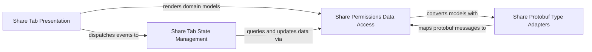

## Details

Provides user interfaces, state management, and repositories for inviting collaborators, managing page permissions, and generating share links.

### Share Tab Presentation
Renders collaborator lists, access level selectors, invitation forms, and link-sharing widgets for the share tab.

**Related Classes/Methods**:

- `frontend.appflowy_flutter.lib.features.share_tab.presentation.share_tab.ShareTab`:20-43
- `frontend.appflowy_flutter.lib.features.share_tab.presentation.widgets.access_level_list_widget.AccessLevelListWidget`:55-136
- `frontend.appflowy_flutter.lib.features.share_tab.presentation.widgets.people_with_access_section.PeopleWithAccessSection`:34-83
- `frontend.appflowy_flutter.lib.features.share_tab.presentation.widgets.share_with_user_widget.ShareWithUserWidget`:9-25

**Source Files:**

- `frontend/appflowy_flutter/lib/features/share_tab/presentation/share_tab.dart`
  - `frontend.appflowy_flutter.lib.features.share_tab.presentation.share_tab.ShareTab` (L20-L43) - Class
  - `frontend.appflowy_flutter.lib.features.share_tab.presentation.share_tab.ShareTab.ShareTab` (L21-L29) - Constructor
  - `frontend.appflowy_flutter.lib.features.share_tab.presentation.share_tab.ShareTab.createState` (L42-L42) - Method
  - `frontend.appflowy_flutter.lib.features.share_tab.presentation.share_tab._ShareTabState` (L45-L282) - Class
  - `frontend.appflowy_flutter.lib.features.share_tab.presentation.share_tab._ShareTabState.initState` (L50-L54) - Method
  - `frontend.appflowy_flutter.lib.features.share_tab.presentation.share_tab._ShareTabState.dispose` (L57-L62) - Method
  - `frontend.appflowy_flutter.lib.features.share_tab.presentation.share_tab._ShareTabState.build` (L65-L145) - Method
  - `frontend.appflowy_flutter.lib.features.share_tab.presentation.share_tab._ShareTabState._onSharePageWithUser` (L147-L155) - Method
  - `frontend.appflowy_flutter.lib.features.share_tab.presentation.share_tab._ShareTabState._buildPeopleWithAccessSectionCallbacks` (L157-L203) - Method
  - `frontend.appflowy_flutter.lib.features.share_tab.presentation.share_tab._ShareTabState._onListenShareWithUserState` (L205-L281) - Method
- `frontend/appflowy_flutter/lib/features/share_tab/presentation/widgets/access_level_list_widget.dart`
  - `frontend.appflowy_flutter.lib.features.share_tab.presentation.widgets.access_level_list_widget.AccessLevelListCallbacks` (L8-L44) - Class
  - `frontend.appflowy_flutter.lib.features.share_tab.presentation.widgets.access_level_list_widget.AccessLevelListCallbacks.AccessLevelListCallbacks` (L9-L13) - Constructor
  - `frontend.appflowy_flutter.lib.features.share_tab.presentation.widgets.access_level_list_widget.AccessLevelListCallbacks.AccessLevelListCallbacks.none` (L15-L21) - Constructor
  - `frontend.appflowy_flutter.lib.features.share_tab.presentation.widgets.access_level_list_widget.AccessLevelListCallbacks.copyWith` (L33-L43) - Method
  - `frontend.appflowy_flutter.lib.features.share_tab.presentation.widgets.access_level_list_widget.AdditionalUserManagementOptions` (L46-L49) - Enum
  - `frontend.appflowy_flutter.lib.features.share_tab.presentation.widgets.access_level_list_widget.AdditionalUserManagementOptions.turnIntoMember` (L47-L47) - Enum
  - `frontend.appflowy_flutter.lib.features.share_tab.presentation.widgets.access_level_list_widget.AdditionalUserManagementOptions.removeAccess` (L48-L48) - Enum
  - `frontend.appflowy_flutter.lib.features.share_tab.presentation.widgets.access_level_list_widget.AccessLevelListWidget` (L55-L136) - Class
  - `frontend.appflowy_flutter.lib.features.share_tab.presentation.widgets.access_level_list_widget.AccessLevelListWidget.AccessLevelListWidget` (L56-L62) - Constructor
  - `frontend.appflowy_flutter.lib.features.share_tab.presentation.widgets.access_level_list_widget.AccessLevelListWidget.build` (L77-L110) - Method
  - `frontend.appflowy_flutter.lib.features.share_tab.presentation.widgets.access_level_list_widget.AccessLevelListWidget._buildAccessLevelItem` (L112-L135) - Method
- `frontend/appflowy_flutter/lib/features/share_tab/presentation/widgets/copy_link_widget.dart`
  - `frontend.appflowy_flutter.lib.features.share_tab.presentation.widgets.copy_link_widget.CopyLinkWidget` (L12-L85) - Class
  - `frontend.appflowy_flutter.lib.features.share_tab.presentation.widgets.copy_link_widget.CopyLinkWidget.CopyLinkWidget` (L13-L16) - Constructor
  - `frontend.appflowy_flutter.lib.features.share_tab.presentation.widgets.copy_link_widget.CopyLinkWidget.build` (L21-L84) - Method
- `frontend/appflowy_flutter/lib/features/share_tab/presentation/widgets/edit_access_level_widget.dart`
  - `frontend.appflowy_flutter.lib.features.share_tab.presentation.widgets.edit_access_level_widget.EditAccessLevelWidget` (L8-L35) - Class
  - `frontend.appflowy_flutter.lib.features.share_tab.presentation.widgets.edit_access_level_widget.EditAccessLevelWidget.EditAccessLevelWidget` (L9-L16) - Constructor
  - `frontend.appflowy_flutter.lib.features.share_tab.presentation.widgets.edit_access_level_widget.EditAccessLevelWidget.createState` (L34-L34) - Method
  - `frontend.appflowy_flutter.lib.features.share_tab.presentation.widgets.edit_access_level_widget._EditAccessLevelWidgetState` (L37-L106) - Class
  - `frontend.appflowy_flutter.lib.features.share_tab.presentation.widgets.edit_access_level_widget._EditAccessLevelWidgetState.dispose` (L41-L45) - Method
  - `frontend.appflowy_flutter.lib.features.share_tab.presentation.widgets.edit_access_level_widget._EditAccessLevelWidgetState.build` (L48-L105) - Method
- `frontend/appflowy_flutter/lib/features/share_tab/presentation/widgets/general_access_section.dart`
  - `frontend.appflowy_flutter.lib.features.share_tab.presentation.widgets.general_access_section.GeneralAccessSection` (L8-L32) - Class
  - `frontend.appflowy_flutter.lib.features.share_tab.presentation.widgets.general_access_section.GeneralAccessSection.GeneralAccessSection` (L9-L12) - Constructor
  - `frontend.appflowy_flutter.lib.features.share_tab.presentation.widgets.general_access_section.GeneralAccessSection.build` (L17-L31) - Method
- `frontend/appflowy_flutter/lib/features/share_tab/presentation/widgets/guest_tag.dart`
  - `frontend.appflowy_flutter.lib.features.share_tab.presentation.widgets.guest_tag.GuestTag` (L6-L34) - Class
  - `frontend.appflowy_flutter.lib.features.share_tab.presentation.widgets.guest_tag.GuestTag.GuestTag` (L7-L7) - Constructor
  - `frontend.appflowy_flutter.lib.features.share_tab.presentation.widgets.guest_tag.GuestTag.build` (L10-L33) - Method
- `frontend/appflowy_flutter/lib/features/share_tab/presentation/widgets/people_with_access_section.dart`
  - `frontend.appflowy_flutter.lib.features.share_tab.presentation.widgets.people_with_access_section.PeopleWithAccessSectionCallbacks` (L8-L32) - Class
  - `frontend.appflowy_flutter.lib.features.share_tab.presentation.widgets.people_with_access_section.PeopleWithAccessSectionCallbacks.PeopleWithAccessSectionCallbacks` (L9-L13) - Constructor
  - `frontend.appflowy_flutter.lib.features.share_tab.presentation.widgets.people_with_access_section.PeopleWithAccessSectionCallbacks.PeopleWithAccessSectionCallbacks.none` (L15-L21) - Constructor
  - `frontend.appflowy_flutter.lib.features.share_tab.presentation.widgets.people_with_access_section.PeopleWithAccessSection` (L34-L83) - Class
  - `frontend.appflowy_flutter.lib.features.share_tab.presentation.widgets.people_with_access_section.PeopleWithAccessSection.PeopleWithAccessSection` (L35-L41) - Constructor
  - `frontend.appflowy_flutter.lib.features.share_tab.presentation.widgets.people_with_access_section.PeopleWithAccessSection.build` (L49-L82) - Method
- `frontend/appflowy_flutter/lib/features/share_tab/presentation/widgets/share_with_user_widget.dart`
  - `frontend.appflowy_flutter.lib.features.share_tab.presentation.widgets.share_with_user_widget.ShareWithUserWidget` (L9-L25) - Class
  - `frontend.appflowy_flutter.lib.features.share_tab.presentation.widgets.share_with_user_widget.ShareWithUserWidget.ShareWithUserWidget` (L10-L16) - Constructor
  - `frontend.appflowy_flutter.lib.features.share_tab.presentation.widgets.share_with_user_widget.ShareWithUserWidget.createState` (L24-L24) - Method
  - `frontend.appflowy_flutter.lib.features.share_tab.presentation.widgets.share_with_user_widget._ShareWithUserWidgetState` (L27-L91) - Class
  - `frontend.appflowy_flutter.lib.features.share_tab.presentation.widgets.share_with_user_widget._ShareWithUserWidgetState.initState` (L32-L37) - Method
  - `frontend.appflowy_flutter.lib.features.share_tab.presentation.widgets.share_with_user_widget._ShareWithUserWidgetState.dispose` (L40-L46) - Method
  - `frontend.appflowy_flutter.lib.features.share_tab.presentation.widgets.share_with_user_widget._ShareWithUserWidgetState.build` (L49-L83) - Method
  - `frontend.appflowy_flutter.lib.features.share_tab.presentation.widgets.share_with_user_widget._ShareWithUserWidgetState._onTextChanged` (L85-L90) - Method
- `frontend/appflowy_flutter/lib/features/share_tab/presentation/widgets/shared_group_widget.dart`
  - `frontend.appflowy_flutter.lib.features.share_tab.presentation.widgets.shared_group_widget.SharedGroupWidget` (L11-L97) - Class
  - `frontend.appflowy_flutter.lib.features.share_tab.presentation.widgets.shared_group_widget.SharedGroupWidget.SharedGroupWidget` (L12-L15) - Constructor
  - `frontend.appflowy_flutter.lib.features.share_tab.presentation.widgets.shared_group_widget.SharedGroupWidget.build` (L20-L34) - Method
  - `frontend.appflowy_flutter.lib.features.share_tab.presentation.widgets.shared_group_widget.SharedGroupWidget._buildLeading` (L36-L49) - Method
  - `frontend.appflowy_flutter.lib.features.share_tab.presentation.widgets.shared_group_widget.SharedGroupWidget._buildTitle` (L51-L75) - Method
  - `frontend.appflowy_flutter.lib.features.share_tab.presentation.widgets.shared_group_widget.SharedGroupWidget._buildSubtitle` (L77-L86) - Method
  - `frontend.appflowy_flutter.lib.features.share_tab.presentation.widgets.shared_group_widget.SharedGroupWidget._buildTrailing` (L88-L96) - Method
- `frontend/appflowy_flutter/lib/features/share_tab/presentation/widgets/shared_user_widget.dart`
  - `frontend.appflowy_flutter.lib.features.share_tab.presentation.widgets.shared_user_widget.SharedUserWidget` (L13-L171) - Class
  - `frontend.appflowy_flutter.lib.features.share_tab.presentation.widgets.shared_user_widget.SharedUserWidget.SharedUserWidget` (L14-L20) - Constructor
  - `frontend.appflowy_flutter.lib.features.share_tab.presentation.widgets.shared_user_widget.SharedUserWidget.build` (L28-L47) - Method
  - `frontend.appflowy_flutter.lib.features.share_tab.presentation.widgets.shared_user_widget.SharedUserWidget._buildTitle` (L49-L87) - Method
  - `frontend.appflowy_flutter.lib.features.share_tab.presentation.widgets.shared_user_widget.SharedUserWidget._buildSubtitle` (L89-L99) - Method
  - `frontend.appflowy_flutter.lib.features.share_tab.presentation.widgets.shared_user_widget.SharedUserWidget._buildTrailing` (L101-L170) - Method
  - `frontend.appflowy_flutter.lib.features.share_tab.presentation.widgets.shared_user_widget.SharedUserWidget._buildTrailing.disabledAccessButton` (L106-L111) - Function
  - `frontend.appflowy_flutter.lib.features.share_tab.presentation.widgets.shared_user_widget.SharedUserWidget._buildTrailing.editAccessWidget` (L113-L121) - Function
- `frontend/appflowy_flutter/lib/features/share_tab/presentation/widgets/turn_into_member_widget.dart`
  - `frontend.appflowy_flutter.lib.features.share_tab.presentation.widgets.turn_into_member_widget.TurnIntoMemberWidget` (L8-L30) - Class
  - `frontend.appflowy_flutter.lib.features.share_tab.presentation.widgets.turn_into_member_widget.TurnIntoMemberWidget.TurnIntoMemberWidget` (L9-L12) - Constructor
  - `frontend.appflowy_flutter.lib.features.share_tab.presentation.widgets.turn_into_member_widget.TurnIntoMemberWidget.build` (L17-L29) - Method
- `frontend/appflowy_flutter/lib/features/share_tab/presentation/widgets/upgrade_to_pro_widget.dart`
  - `frontend.appflowy_flutter.lib.features.share_tab.presentation.widgets.upgrade_to_pro_widget.UpgradeToProWidget` (L11-L88) - Class
  - `frontend.appflowy_flutter.lib.features.share_tab.presentation.widgets.upgrade_to_pro_widget.UpgradeToProWidget.UpgradeToProWidget` (L12-L16) - Constructor
  - `frontend.appflowy_flutter.lib.features.share_tab.presentation.widgets.upgrade_to_pro_widget.UpgradeToProWidget.build` (L22-L87) - Method

### Share Permissions Data Access
Defines sharing domain models and repositories to fetch and update collaborator permissions via local storage or backend services.

**Related Classes/Methods**:

- `frontend.appflowy_flutter.lib.features.share_tab.data.models.share_access_level.ShareAccessLevel`:6-57
- `frontend.appflowy_flutter.lib.features.share_tab.data.models.shared_user.SharedUser`:7-47
- `frontend.appflowy_flutter.lib.features.share_tab.data.repositories.local_share_with_user_repository_impl.LocalShareWithUserRepositoryImpl`:11-198
- `frontend.appflowy_flutter.lib.features.share_tab.data.repositories.rust_share_with_user_repository_impl.RustShareWithUserRepositoryImpl`:19-191
- `frontend.appflowy_flutter.lib.features.share_tab.data.repositories.share_with_user_repository.ShareWithUserRepository`:10-60

**Source Files:**

- `frontend/appflowy_flutter/lib/features/share_tab/data/models/share_access_level.dart`
  - `frontend.appflowy_flutter.lib.features.share_tab.data.models.share_access_level.ShareAccessLevel` (L6-L57) - Enum
  - `frontend.appflowy_flutter.lib.features.share_tab.data.models.share_access_level.ShareAccessLevel.readOnly` (L8-L8) - Enum
  - `frontend.appflowy_flutter.lib.features.share_tab.data.models.share_access_level.ShareAccessLevel.readAndComment` (L11-L11) - Enum
  - `frontend.appflowy_flutter.lib.features.share_tab.data.models.share_access_level.ShareAccessLevel.readAndWrite` (L14-L14) - Enum
  - `frontend.appflowy_flutter.lib.features.share_tab.data.models.share_access_level.ShareAccessLevel.fullAccess` (L17-L17) - Enum
  - `frontend.appflowy_flutter.lib.features.share_tab.data.models.share_access_level.ShareAccessLevel.title` (L19-L30) - Method
  - `frontend.appflowy_flutter.lib.features.share_tab.data.models.share_access_level.ShareAccessLevel.subtitle` (L32-L43) - Method
  - `frontend.appflowy_flutter.lib.features.share_tab.data.models.share_access_level.ShareAccessLevel.icon` (L45-L56) - Method
- `frontend/appflowy_flutter/lib/features/share_tab/data/models/share_popover_group_id.dart`
  - `frontend.appflowy_flutter.lib.features.share_tab.data.models.share_popover_group_id.SharePopoverGroupId` (L1-L1) - Class
- `frontend/appflowy_flutter/lib/features/share_tab/data/models/share_role.dart`
  - `frontend.appflowy_flutter.lib.features.share_tab.data.models.share_role.ShareRole` (L1-L10) - Enum
  - `frontend.appflowy_flutter.lib.features.share_tab.data.models.share_role.ShareRole.owner` (L3-L3) - Enum
  - `frontend.appflowy_flutter.lib.features.share_tab.data.models.share_role.ShareRole.guest` (L6-L6) - Enum
  - `frontend.appflowy_flutter.lib.features.share_tab.data.models.share_role.ShareRole.member` (L9-L9) - Enum
- `frontend/appflowy_flutter/lib/features/share_tab/data/models/share_section_type.dart`
  - `frontend.appflowy_flutter.lib.features.share_tab.data.models.share_section_type.SharedSectionType` (L6-L11) - Enum
  - `frontend.appflowy_flutter.lib.features.share_tab.data.models.share_section_type.SharedSectionType.unknown` (L7-L7) - Enum
  - `frontend.appflowy_flutter.lib.features.share_tab.data.models.share_section_type.SharedSectionType.public` (L8-L8) - Enum
  - `frontend.appflowy_flutter.lib.features.share_tab.data.models.share_section_type.SharedSectionType.shared` (L9-L9) - Enum
  - `frontend.appflowy_flutter.lib.features.share_tab.data.models.share_section_type.SharedSectionType.private` (L10-L10) - Enum
- `frontend/appflowy_flutter/lib/features/share_tab/data/models/shared_group.dart`
  - `frontend.appflowy_flutter.lib.features.share_tab.data.models.shared_group.SharedGroup` (L1-L25) - Class
  - `frontend.appflowy_flutter.lib.features.share_tab.data.models.shared_group.SharedGroup.SharedGroup` (L2-L6) - Constructor
  - `frontend.appflowy_flutter.lib.features.share_tab.data.models.shared_group.SharedGroup.copyWith` (L14-L24) - Method
- `frontend/appflowy_flutter/lib/features/share_tab/data/models/shared_user.dart`
  - `frontend.appflowy_flutter.lib.features.share_tab.data.models.shared_user.SharedUser` (L7-L47) - Class
  - `frontend.appflowy_flutter.lib.features.share_tab.data.models.shared_user.SharedUser.SharedUser` (L8-L14) - Constructor
  - `frontend.appflowy_flutter.lib.features.share_tab.data.models.shared_user.SharedUser.copyWith` (L32-L46) - Method
- `frontend/appflowy_flutter/lib/features/share_tab/data/repositories/local_share_with_user_repository_impl.dart`
  - `frontend.appflowy_flutter.lib.features.share_tab.data.repositories.local_share_with_user_repository_impl.LocalShareWithUserRepositoryImpl` (L11-L198) - Class
  - `frontend.appflowy_flutter.lib.features.share_tab.data.repositories.local_share_with_user_repository_impl.LocalShareWithUserRepositoryImpl.LocalShareWithUserRepositoryImpl` (L12-L12) - Constructor
  - `frontend.appflowy_flutter.lib.features.share_tab.data.repositories.local_share_with_user_repository_impl.LocalShareWithUserRepositoryImpl.getSharedUsersInPage` (L90-L94) - Method
  - `frontend.appflowy_flutter.lib.features.share_tab.data.repositories.local_share_with_user_repository_impl.LocalShareWithUserRepositoryImpl.removeSharedUserFromPage` (L97-L106) - Method
  - `frontend.appflowy_flutter.lib.features.share_tab.data.repositories.local_share_with_user_repository_impl.LocalShareWithUserRepositoryImpl.sharePageWithUser` (L109-L142) - Method
  - `frontend.appflowy_flutter.lib.features.share_tab.data.repositories.local_share_with_user_repository_impl.LocalShareWithUserRepositoryImpl.getAvailableSharedUsers` (L145-L152) - Method
  - `frontend.appflowy_flutter.lib.features.share_tab.data.repositories.local_share_with_user_repository_impl.LocalShareWithUserRepositoryImpl.changeRole` (L155-L166) - Method
  - `frontend.appflowy_flutter.lib.features.share_tab.data.repositories.local_share_with_user_repository_impl.LocalShareWithUserRepositoryImpl.getCurrentUserProfile` (L169-L176) - Method
  - `frontend.appflowy_flutter.lib.features.share_tab.data.repositories.local_share_with_user_repository_impl.LocalShareWithUserRepositoryImpl.getCurrentPageSectionType` (L179-L183) - Method
  - `frontend.appflowy_flutter.lib.features.share_tab.data.repositories.local_share_with_user_repository_impl.LocalShareWithUserRepositoryImpl.getUpgradeToProButtonClicked` (L186-L190) - Method
  - `frontend.appflowy_flutter.lib.features.share_tab.data.repositories.local_share_with_user_repository_impl.LocalShareWithUserRepositoryImpl.setUpgradeToProButtonClicked` (L193-L197) - Method
- `frontend/appflowy_flutter/lib/features/share_tab/data/repositories/rust_share_with_user_repository_impl.dart`
  - `frontend.appflowy_flutter.lib.features.share_tab.data.repositories.rust_share_with_user_repository_impl.RustShareWithUserRepositoryImpl` (L19-L191) - Class
  - `frontend.appflowy_flutter.lib.features.share_tab.data.repositories.rust_share_with_user_repository_impl.RustShareWithUserRepositoryImpl.RustShareWithUserRepositoryImpl` (L20-L20) - Constructor
  - `frontend.appflowy_flutter.lib.features.share_tab.data.repositories.rust_share_with_user_repository_impl.RustShareWithUserRepositoryImpl.getSharedUsersInPage` (L23-L43) - Method
  - `frontend.appflowy_flutter.lib.features.share_tab.data.repositories.rust_share_with_user_repository_impl.RustShareWithUserRepositoryImpl.removeSharedUserFromPage` (L46-L68) - Method
  - `frontend.appflowy_flutter.lib.features.share_tab.data.repositories.rust_share_with_user_repository_impl.RustShareWithUserRepositoryImpl.sharePageWithUser` (L71-L100) - Method
  - `frontend.appflowy_flutter.lib.features.share_tab.data.repositories.rust_share_with_user_repository_impl.RustShareWithUserRepositoryImpl.getAvailableSharedUsers` (L103-L107) - Method
  - `frontend.appflowy_flutter.lib.features.share_tab.data.repositories.rust_share_with_user_repository_impl.RustShareWithUserRepositoryImpl.changeRole` (L110-L136) - Method
  - `frontend.appflowy_flutter.lib.features.share_tab.data.repositories.rust_share_with_user_repository_impl.RustShareWithUserRepositoryImpl.getCurrentUserProfile` (L139-L142) - Method
  - `frontend.appflowy_flutter.lib.features.share_tab.data.repositories.rust_share_with_user_repository_impl.RustShareWithUserRepositoryImpl.getCurrentPageSectionType` (L145-L166) - Method
  - `frontend.appflowy_flutter.lib.features.share_tab.data.repositories.rust_share_with_user_repository_impl.RustShareWithUserRepositoryImpl.getUpgradeToProButtonClicked` (L169-L180) - Method
  - `frontend.appflowy_flutter.lib.features.share_tab.data.repositories.rust_share_with_user_repository_impl.RustShareWithUserRepositoryImpl.setUpgradeToProButtonClicked` (L183-L190) - Method
- `frontend/appflowy_flutter/lib/features/share_tab/data/repositories/share_with_user_repository.dart`
  - `frontend.appflowy_flutter.lib.features.share_tab.data.repositories.share_with_user_repository.ShareWithUserRepository` (L10-L60) - Class
  - `frontend.appflowy_flutter.lib.features.share_tab.data.repositories.share_with_user_repository.ShareWithUserRepository.getSharedUsersInPage` (L12-L14) - Method
  - `frontend.appflowy_flutter.lib.features.share_tab.data.repositories.share_with_user_repository.ShareWithUserRepository.getAvailableSharedUsers` (L17-L19) - Method
  - `frontend.appflowy_flutter.lib.features.share_tab.data.repositories.share_with_user_repository.ShareWithUserRepository.removeSharedUserFromPage` (L22-L25) - Method
  - `frontend.appflowy_flutter.lib.features.share_tab.data.repositories.share_with_user_repository.ShareWithUserRepository.sharePageWithUser` (L30-L34) - Method
  - `frontend.appflowy_flutter.lib.features.share_tab.data.repositories.share_with_user_repository.ShareWithUserRepository.changeRole` (L37-L41) - Method
  - `frontend.appflowy_flutter.lib.features.share_tab.data.repositories.share_with_user_repository.ShareWithUserRepository.getCurrentUserProfile` (L44-L44) - Method
  - `frontend.appflowy_flutter.lib.features.share_tab.data.repositories.share_with_user_repository.ShareWithUserRepository.getCurrentPageSectionType` (L47-L49) - Method
  - `frontend.appflowy_flutter.lib.features.share_tab.data.repositories.share_with_user_repository.ShareWithUserRepository.getUpgradeToProButtonClicked` (L52-L54) - Method
  - `frontend.appflowy_flutter.lib.features.share_tab.data.repositories.share_with_user_repository.ShareWithUserRepository.setUpgradeToProButtonClicked` (L57-L59) - Method

### Share Tab State Management
Orchestrates share tab business logic, reacting to user events to update collaborator permissions, roles, and access lists.

**Related Classes/Methods**:

- `frontend.appflowy_flutter.lib.features.share_tab.logic.share_tab_bloc.ShareTabBloc`:19-420
- `frontend.appflowy_flutter.lib.features.share_tab.logic.share_tab_event.ShareTabEvent`:3-61
- `frontend.appflowy_flutter.lib.features.share_tab.logic.share_tab_state.ShareTabState`:6-126

**Source Files:**

- `frontend/appflowy_flutter/lib/features/share_tab/logic/share_tab_bloc.dart`
  - `frontend.appflowy_flutter.lib.features.share_tab.logic.share_tab_bloc.ShareTabBloc` (L19-L420) - Class
  - `frontend.appflowy_flutter.lib.features.share_tab.logic.share_tab_bloc.ShareTabBloc.ShareTabBloc` (L20-L37) - Constructor
  - `frontend.appflowy_flutter.lib.features.share_tab.logic.share_tab_bloc.ShareTabBloc.close` (L47-L50) - Method
  - `frontend.appflowy_flutter.lib.features.share_tab.logic.share_tab_bloc.ShareTabBloc._onInitial` (L52-L104) - Method
  - `frontend.appflowy_flutter.lib.features.share_tab.logic.share_tab_bloc.ShareTabBloc._onGetSharedUsers` (L106-L138) - Method
  - `frontend.appflowy_flutter.lib.features.share_tab.logic.share_tab_bloc.ShareTabBloc._onShare` (L140-L176) - Method
  - `frontend.appflowy_flutter.lib.features.share_tab.logic.share_tab_bloc.ShareTabBloc._onRemove` (L178-L212) - Method
  - `frontend.appflowy_flutter.lib.features.share_tab.logic.share_tab_bloc.ShareTabBloc._onUpdateAccessLevel` (L214-L247) - Method
  - `frontend.appflowy_flutter.lib.features.share_tab.logic.share_tab_bloc.ShareTabBloc._onUpdateGeneralAccess` (L249-L258) - Method
  - `frontend.appflowy_flutter.lib.features.share_tab.logic.share_tab_bloc.ShareTabBloc._onCopyLink` (L260-L275) - Method
  - `frontend.appflowy_flutter.lib.features.share_tab.logic.share_tab_bloc.ShareTabBloc._onSearchAvailableUsers` (L277-L310) - Method
  - `frontend.appflowy_flutter.lib.features.share_tab.logic.share_tab_bloc.ShareTabBloc._onTurnIntoMember` (L312-L347) - Method
  - `frontend.appflowy_flutter.lib.features.share_tab.logic.share_tab_bloc.ShareTabBloc._getSharedUsers` (L349-L357) - Method
  - `frontend.appflowy_flutter.lib.features.share_tab.logic.share_tab_bloc.ShareTabBloc._onClearState` (L359-L368) - Method
  - `frontend.appflowy_flutter.lib.features.share_tab.logic.share_tab_bloc.ShareTabBloc._onUpdateSharedUsers` (L370-L379) - Method
  - `frontend.appflowy_flutter.lib.features.share_tab.logic.share_tab_bloc.ShareTabBloc._onUpgradeToProClicked` (L381-L393) - Method
  - `frontend.appflowy_flutter.lib.features.share_tab.logic.share_tab_bloc.ShareTabBloc._initFolderNotificationListener` (L395-L419) - Method
- `frontend/appflowy_flutter/lib/features/share_tab/logic/share_tab_event.dart`
  - `frontend.appflowy_flutter.lib.features.share_tab.logic.share_tab_event.ShareTabEvent` (L3-L61) - Class
  - `frontend.appflowy_flutter.lib.features.share_tab.logic.share_tab_event.ShareTabEvent.ShareTabEvent` (L4-L4) - Constructor
  - `frontend.appflowy_flutter.lib.features.share_tab.logic.share_tab_event.ShareTabEvent.ShareTabEvent.initialize` (L7-L7) - Constructor
  - `frontend.appflowy_flutter.lib.features.share_tab.logic.share_tab_event.ShareTabEvent.ShareTabEvent.loadSharedUsers` (L9-L10) - Constructor
  - `frontend.appflowy_flutter.lib.features.share_tab.logic.share_tab_event.ShareTabEvent.ShareTabEvent.inviteUsers` (L12-L16) - Constructor
  - `frontend.appflowy_flutter.lib.features.share_tab.logic.share_tab_event.ShareTabEvent.ShareTabEvent.removeUsers` (L18-L21) - Constructor
  - `frontend.appflowy_flutter.lib.features.share_tab.logic.share_tab_event.ShareTabEvent.ShareTabEvent.updateUserAccessLevel` (L23-L30) - Constructor
  - `frontend.appflowy_flutter.lib.features.share_tab.logic.share_tab_event.ShareTabEvent.ShareTabEvent.updateGeneralAccessLevel` (L32-L35) - Constructor
  - `frontend.appflowy_flutter.lib.features.share_tab.logic.share_tab_event.ShareTabEvent.ShareTabEvent.copyShareLink` (L37-L40) - Constructor
  - `frontend.appflowy_flutter.lib.features.share_tab.logic.share_tab_event.ShareTabEvent.ShareTabEvent.searchAvailableUsers` (L42-L45) - Constructor
  - `frontend.appflowy_flutter.lib.features.share_tab.logic.share_tab_event.ShareTabEvent.ShareTabEvent.convertToMember` (L47-L50) - Constructor
  - `frontend.appflowy_flutter.lib.features.share_tab.logic.share_tab_event.ShareTabEvent.ShareTabEvent.clearState` (L52-L52) - Constructor
  - `frontend.appflowy_flutter.lib.features.share_tab.logic.share_tab_event.ShareTabEvent.ShareTabEvent.updateSharedUsers` (L54-L57) - Constructor
  - `frontend.appflowy_flutter.lib.features.share_tab.logic.share_tab_event.ShareTabEvent.ShareTabEvent.upgradeToProClicked` (L59-L60) - Constructor
  - `frontend.appflowy_flutter.lib.features.share_tab.logic.share_tab_event.ShareTabEventInitialize` (L64-L66) - Class
  - `frontend.appflowy_flutter.lib.features.share_tab.logic.share_tab_event.ShareTabEventInitialize.ShareTabEventInitialize` (L65-L65) - Constructor
  - `frontend.appflowy_flutter.lib.features.share_tab.logic.share_tab_event.ShareTabEventLoadSharedUsers` (L69-L71) - Class
  - `frontend.appflowy_flutter.lib.features.share_tab.logic.share_tab_event.ShareTabEventLoadSharedUsers.ShareTabEventLoadSharedUsers` (L70-L70) - Constructor
  - `frontend.appflowy_flutter.lib.features.share_tab.logic.share_tab_event.ShareTabEventInviteUsers` (L74-L82) - Class
  - `frontend.appflowy_flutter.lib.features.share_tab.logic.share_tab_event.ShareTabEventInviteUsers.ShareTabEventInviteUsers` (L75-L78) - Constructor
  - `frontend.appflowy_flutter.lib.features.share_tab.logic.share_tab_event.ShareTabEventRemoveUsers` (L85-L91) - Class
  - `frontend.appflowy_flutter.lib.features.share_tab.logic.share_tab_event.ShareTabEventRemoveUsers.ShareTabEventRemoveUsers` (L86-L88) - Constructor
  - `frontend.appflowy_flutter.lib.features.share_tab.logic.share_tab_event.ShareTabEventUpdateUserAccessLevel` (L94-L102) - Class
  - `frontend.appflowy_flutter.lib.features.share_tab.logic.share_tab_event.ShareTabEventUpdateUserAccessLevel.ShareTabEventUpdateUserAccessLevel` (L95-L98) - Constructor
  - `frontend.appflowy_flutter.lib.features.share_tab.logic.share_tab_event.ShareTabEventUpdateGeneralAccessLevel` (L105-L111) - Class
  - `frontend.appflowy_flutter.lib.features.share_tab.logic.share_tab_event.ShareTabEventUpdateGeneralAccessLevel.ShareTabEventUpdateGeneralAccessLevel` (L106-L108) - Constructor
  - `frontend.appflowy_flutter.lib.features.share_tab.logic.share_tab_event.ShareTabEventCopyShareLink` (L114-L120) - Class
  - `frontend.appflowy_flutter.lib.features.share_tab.logic.share_tab_event.ShareTabEventCopyShareLink.ShareTabEventCopyShareLink` (L115-L117) - Constructor
  - `frontend.appflowy_flutter.lib.features.share_tab.logic.share_tab_event.ShareTabEventSearchAvailableUsers` (L123-L129) - Class
  - `frontend.appflowy_flutter.lib.features.share_tab.logic.share_tab_event.ShareTabEventSearchAvailableUsers.ShareTabEventSearchAvailableUsers` (L124-L126) - Constructor
  - `frontend.appflowy_flutter.lib.features.share_tab.logic.share_tab_event.ShareTabEventConvertToMember` (L132-L138) - Class
  - `frontend.appflowy_flutter.lib.features.share_tab.logic.share_tab_event.ShareTabEventConvertToMember.ShareTabEventConvertToMember` (L133-L135) - Constructor
  - `frontend.appflowy_flutter.lib.features.share_tab.logic.share_tab_event.ShareTabEventClearState` (L140-L142) - Class
  - `frontend.appflowy_flutter.lib.features.share_tab.logic.share_tab_event.ShareTabEventClearState.ShareTabEventClearState` (L141-L141) - Constructor
  - `frontend.appflowy_flutter.lib.features.share_tab.logic.share_tab_event.ShareTabEventUpdateSharedUsers` (L144-L150) - Class
  - `frontend.appflowy_flutter.lib.features.share_tab.logic.share_tab_event.ShareTabEventUpdateSharedUsers.ShareTabEventUpdateSharedUsers` (L145-L147) - Constructor
  - `frontend.appflowy_flutter.lib.features.share_tab.logic.share_tab_event.ShareTabEventUpgradeToProClicked` (L152-L154) - Class
  - `frontend.appflowy_flutter.lib.features.share_tab.logic.share_tab_event.ShareTabEventUpgradeToProClicked.ShareTabEventUpgradeToProClicked` (L153-L153) - Constructor
- `frontend/appflowy_flutter/lib/features/share_tab/logic/share_tab_state.dart`
  - `frontend.appflowy_flutter.lib.features.share_tab.logic.share_tab_state.ShareTabState` (L6-L126) - Class
  - `frontend.appflowy_flutter.lib.features.share_tab.logic.share_tab_state.ShareTabState.ShareTabState.initial` (L7-L7) - Constructor
  - `frontend.appflowy_flutter.lib.features.share_tab.logic.share_tab_state.ShareTabState.ShareTabState` (L9-L25) - Constructor
  - `frontend.appflowy_flutter.lib.features.share_tab.logic.share_tab_state.ShareTabState.copyWith` (L43-L78) - Method
  - `frontend.appflowy_flutter.lib.features.share_tab.logic.share_tab_state.ShareTabState.==` (L81-L99) - Method
  - `frontend.appflowy_flutter.lib.features.share_tab.logic.share_tab_state.ShareTabState.hashCode` (L102-L120) - Method
  - `frontend.appflowy_flutter.lib.features.share_tab.logic.share_tab_state.ShareTabState.toString` (L123-L125) - Method

### Share Protobuf Type Adapters
Provides bidirectional translation extensions between backend protobuf messages and frontend sharing domain models.

**Related Classes/Methods**: _None_

**Source Files:**

- `frontend/appflowy_flutter/lib/features/util/extensions.dart`
  - `frontend.appflowy_flutter.lib.features.util.extensions.RepeatedSharedViewResponsePBExtension.sharedPages` (L10-L12) - Method
  - `frontend.appflowy_flutter.lib.features.util.extensions.SharedViewPBExtension.sharedPage` (L16-L21) - Method
  - `frontend.appflowy_flutter.lib.features.util.extensions.RepeatedSharedUserPBExtension.sharedUsers` (L25-L27) - Method
  - `frontend.appflowy_flutter.lib.features.util.extensions.SharedUserPBExtension.sharedUser` (L31-L39) - Method
  - `frontend.appflowy_flutter.lib.features.util.extensions.AFAccessLevelPBExtension.shareAccessLevel` (L43-L56) - Method
  - `frontend.appflowy_flutter.lib.features.util.extensions.ShareAccessLevelExtension.accessLevel` (L60-L71) - Method
  - `frontend.appflowy_flutter.lib.features.util.extensions.AFRolePBExtension.shareRole` (L75-L86) - Method
  - `frontend.appflowy_flutter.lib.features.util.extensions.ShareRoleExtension.userRole` (L90-L99) - Method
  - `frontend.appflowy_flutter.lib.features.util.extensions.ShareRoleExtension.folderRole` (L101-L110) - Method
  - `frontend.appflowy_flutter.lib.features.util.extensions.SharedSectionTypeExtension.sharedSectionType` (L114-L125) - Method

### [FAQ](https://github.com/CodeBoarding/GeneratedOnBoardings/tree/main?tab=readme-ov-file#faq)