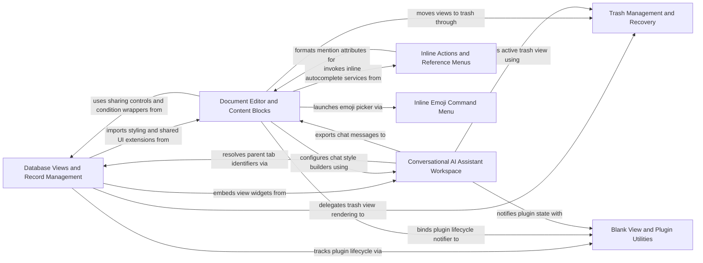

## Details

Implements core document, database (grid, board, calendar), AI chat, and rich text editor plugin components for AppFlowy.

### Database Views and Record Management
Provides structured database view layouts including grid, board, and calendar representations along with cell editing, calculations, filtering, and sharing capabilities.

**Related Classes/Methods**:

- `frontend.appflowy_flutter.lib.plugins.database.application.database_controller.DatabaseController`:72-407
- `frontend.appflowy_flutter.lib.plugins.database.tab_bar.tab_bar_view.DatabaseTabBarViewPlugin`:336-383
- `frontend.appflowy_flutter.lib.plugins.database.widgets.database_view_widget.DatabaseViewWidget`:10-28
- `frontend.appflowy_flutter.lib.plugins.database_document.database_document_plugin.DatabaseDocumentPlugin`:57-83

**Source Files:**

- `frontend/appflowy_flutter/lib/plugins/base/color/color_picker.dart`
  - `frontend.appflowy_flutter.lib.plugins.base.color.color_picker.FlowyMobileColorPicker` (L9-L64) - Class
  - `frontend.appflowy_flutter.lib.plugins.base.color.color_picker.FlowyMobileColorPicker.FlowyMobileColorPicker` (L10-L13) - Constructor
  - `frontend.appflowy_flutter.lib.plugins.base.color.color_picker.FlowyMobileColorPicker.build` (L18-L63) - Method
  - `frontend.appflowy_flutter.lib.plugins.base.color.color_picker._ColorIcon` (L66-L83) - Class
  - `frontend.appflowy_flutter.lib.plugins.base.color.color_picker._ColorIcon._ColorIcon` (L67-L67) - Constructor
  - `frontend.appflowy_flutter.lib.plugins.base.color.color_picker._ColorIcon.build` (L72-L82) - Method
- `frontend/appflowy_flutter/lib/plugins/base/color/color_picker_screen.dart`
  - `frontend.appflowy_flutter.lib.plugins.base.color.color_picker_screen.MobileColorPickerScreen` (L8-L29) - Class
  - `frontend.appflowy_flutter.lib.plugins.base.color.color_picker_screen.MobileColorPickerScreen.MobileColorPickerScreen` (L9-L9) - Constructor
  - `frontend.appflowy_flutter.lib.plugins.base.color.color_picker_screen.MobileColorPickerScreen.build` (L17-L28) - Method
- `frontend/appflowy_flutter/lib/plugins/base/drag_handler.dart`
  - `frontend.appflowy_flutter.lib.plugins.base.drag_handler.DragHandle` (L3-L20) - Class
  - `frontend.appflowy_flutter.lib.plugins.base.drag_handler.DragHandle.DragHandle` (L4-L6) - Constructor
  - `frontend.appflowy_flutter.lib.plugins.base.drag_handler.DragHandle.build` (L9-L19) - Method
- `frontend/appflowy_flutter/lib/plugins/base/emoji/emoji_picker.dart`
  - `frontend.appflowy_flutter.lib.plugins.base.emoji.emoji_picker.EmojiPickerResult` (L16-L26) - Class
  - `frontend.appflowy_flutter.lib.plugins.base.emoji.emoji_picker.EmojiPickerResult.EmojiPickerResult` (L17-L21) - Constructor
  - `frontend.appflowy_flutter.lib.plugins.base.emoji.emoji_picker.FlowyEmojiPicker` (L28-L42) - Class
  - `frontend.appflowy_flutter.lib.plugins.base.emoji.emoji_picker.FlowyEmojiPicker.FlowyEmojiPicker` (L29-L34) - Constructor
  - `frontend.appflowy_flutter.lib.plugins.base.emoji.emoji_picker.FlowyEmojiPicker.createState` (L41-L41) - Method
  - `frontend.appflowy_flutter.lib.plugins.base.emoji.emoji_picker._FlowyEmojiPickerState` (L44-L154) - Class
  - `frontend.appflowy_flutter.lib.plugins.base.emoji.emoji_picker._FlowyEmojiPickerState.initState` (L49-L63) - Method
  - `frontend.appflowy_flutter.lib.plugins.base.emoji.emoji_picker._FlowyEmojiPickerState.build` (L66-L133) - Method
  - `frontend.appflowy_flutter.lib.plugins.base.emoji.emoji_picker._FlowyEmojiPickerState.loadEmojis` (L135-L153) - Method
- `frontend/appflowy_flutter/lib/plugins/base/emoji/emoji_picker_header.dart`
  - `frontend.appflowy_flutter.lib.plugins.base.emoji.emoji_picker_header.FlowyEmojiHeader` (L7-L54) - Class
  - `frontend.appflowy_flutter.lib.plugins.base.emoji.emoji_picker_header.FlowyEmojiHeader.FlowyEmojiHeader` (L8-L11) - Constructor
  - `frontend.appflowy_flutter.lib.plugins.base.emoji.emoji_picker_header.FlowyEmojiHeader.build` (L16-L53) - Method
- `frontend/appflowy_flutter/lib/plugins/base/emoji/emoji_picker_screen.dart`
  - `frontend.appflowy_flutter.lib.plugins.base.emoji.emoji_picker_screen.MobileEmojiPickerScreen` (L10-L48) - Class
  - `frontend.appflowy_flutter.lib.plugins.base.emoji.emoji_picker_screen.MobileEmojiPickerScreen.MobileEmojiPickerScreen` (L11-L17) - Constructor
  - `frontend.appflowy_flutter.lib.plugins.base.emoji.emoji_picker_screen.MobileEmojiPickerScreen.build` (L31-L47) - Method
- `frontend/appflowy_flutter/lib/plugins/base/emoji/emoji_text.dart`
  - `frontend.appflowy_flutter.lib.plugins.base.emoji.emoji_text.EmojiText` (L11-L47) - Class
  - `frontend.appflowy_flutter.lib.plugins.base.emoji.emoji_text.EmojiText.EmojiText` (L12-L18) - Constructor
  - `frontend.appflowy_flutter.lib.plugins.base.emoji.emoji_text.EmojiText.build` (L26-L37) - Method
  - `frontend.appflowy_flutter.lib.plugins.base.emoji.emoji_text.EmojiText._loadFallbackFontFamily` (L39-L46) - Method
- `frontend/appflowy_flutter/lib/plugins/base/icon/icon_widget.dart`
  - `frontend.appflowy_flutter.lib.plugins.base.icon.icon_widget.IconWidget` (L7-L34) - Class
  - `frontend.appflowy_flutter.lib.plugins.base.icon.icon_widget.IconWidget.IconWidget` (L8-L8) - Constructor
  - `frontend.appflowy_flutter.lib.plugins.base.icon.icon_widget.IconWidget.build` (L14-L33) - Method
- `frontend/appflowy_flutter/lib/plugins/database/application/calculations/calculation_type_ext.dart`
  - `frontend.appflowy_flutter.lib.plugins.database.application.calculations.calculation_type_ext.CalcTypeLabel.label` (L6-L23) - Method
  - `frontend.appflowy_flutter.lib.plugins.database.application.calculations.calculation_type_ext.CalcTypeLabel.shortLabel` (L25-L31) - Method
- `frontend/appflowy_flutter/lib/plugins/database/application/calculations/calculations_listener.dart`
  - `frontend.appflowy_flutter.lib.plugins.database.application.calculations.calculations_listener.CalculationsListener` (L13-L54) - Class
  - `frontend.appflowy_flutter.lib.plugins.database.application.calculations.calculations_listener.CalculationsListener.CalculationsListener` (L14-L14) - Constructor
  - `frontend.appflowy_flutter.lib.plugins.database.application.calculations.calculations_listener.CalculationsListener.start` (L22-L30) - Method
  - `frontend.appflowy_flutter.lib.plugins.database.application.calculations.calculations_listener.CalculationsListener._handler` (L32-L47) - Method
  - `frontend.appflowy_flutter.lib.plugins.database.application.calculations.calculations_listener.CalculationsListener.stop` (L49-L53) - Method
- `frontend/appflowy_flutter/lib/plugins/database/application/calculations/calculations_service.dart`
  - `frontend.appflowy_flutter.lib.plugins.database.application.calculations.calculations_service.CalculationsBackendService` (L6-L48) - Class
  - `frontend.appflowy_flutter.lib.plugins.database.application.calculations.calculations_service.CalculationsBackendService.CalculationsBackendService` (L7-L7) - Constructor
  - `frontend.appflowy_flutter.lib.plugins.database.application.calculations.calculations_service.CalculationsBackendService.getCalculations` (L14-L18) - Method
  - `frontend.appflowy_flutter.lib.plugins.database.application.calculations.calculations_service.CalculationsBackendService.updateCalculation` (L20-L35) - Method
  - `frontend.appflowy_flutter.lib.plugins.database.application.calculations.calculations_service.CalculationsBackendService.removeCalculation` (L37-L47) - Method
- `frontend/appflowy_flutter/lib/plugins/database/application/cell/bloc/checkbox_cell_bloc.dart`
  - `frontend.appflowy_flutter.lib.plugins.database.application.cell.bloc.checkbox_cell_bloc.CheckboxCellBloc` (L11-L68) - Class
  - `frontend.appflowy_flutter.lib.plugins.database.application.cell.bloc.checkbox_cell_bloc.CheckboxCellBloc.CheckboxCellBloc` (L12-L16) - Constructor
  - `frontend.appflowy_flutter.lib.plugins.database.application.cell.bloc.checkbox_cell_bloc.CheckboxCellBloc.close` (L22-L31) - Method
  - `frontend.appflowy_flutter.lib.plugins.database.application.cell.bloc.checkbox_cell_bloc.CheckboxCellBloc._dispatch` (L33-L50) - Method
  - `frontend.appflowy_flutter.lib.plugins.database.application.cell.bloc.checkbox_cell_bloc.CheckboxCellBloc._startListening` (L52-L61) - Method
  - `frontend.appflowy_flutter.lib.plugins.database.application.cell.bloc.checkbox_cell_bloc.CheckboxCellBloc._onFieldChangedListener` (L63-L67) - Method
  - `frontend.appflowy_flutter.lib.plugins.database.application.cell.bloc.checkbox_cell_bloc.CheckboxCellEvent` (L71-L78) - Class
  - `frontend.appflowy_flutter.lib.plugins.database.application.cell.bloc.checkbox_cell_bloc.CheckboxCellEvent.CheckboxCellEvent.initial` (L72-L72) - Constructor
  - `frontend.appflowy_flutter.lib.plugins.database.application.cell.bloc.checkbox_cell_bloc.CheckboxCellEvent.CheckboxCellEvent.select` (L73-L73) - Constructor
  - `frontend.appflowy_flutter.lib.plugins.database.application.cell.bloc.checkbox_cell_bloc.CheckboxCellEvent.CheckboxCellEvent.didUpdateCell` (L74-L75) - Constructor
  - `frontend.appflowy_flutter.lib.plugins.database.application.cell.bloc.checkbox_cell_bloc.CheckboxCellEvent.CheckboxCellEvent.didUpdateField` (L76-L77) - Constructor
  - `frontend.appflowy_flutter.lib.plugins.database.application.cell.bloc.checkbox_cell_bloc.CheckboxCellState` (L81-L93) - Class
  - `frontend.appflowy_flutter.lib.plugins.database.application.cell.bloc.checkbox_cell_bloc.CheckboxCellState.CheckboxCellState` (L82-L85) - Constructor
  - `frontend.appflowy_flutter.lib.plugins.database.application.cell.bloc.checkbox_cell_bloc.CheckboxCellState.CheckboxCellState.initial` (L87-L92) - Constructor
  - `frontend.appflowy_flutter.lib.plugins.database.application.cell.bloc.checkbox_cell_bloc._isSelected` (L95-L97) - Function
- `frontend/appflowy_flutter/lib/plugins/database/application/cell/bloc/checklist_cell_bloc.dart`
  - `frontend.appflowy_flutter.lib.plugins.database.application.cell.bloc.checklist_cell_bloc.ChecklistSelectOption` (L13-L18) - Class
  - `frontend.appflowy_flutter.lib.plugins.database.application.cell.bloc.checklist_cell_bloc.ChecklistSelectOption.ChecklistSelectOption` (L14-L14) - Constructor
  - `frontend.appflowy_flutter.lib.plugins.database.application.cell.bloc.checklist_cell_bloc.ChecklistCellBloc` (L20-L179) - Class
  - `frontend.appflowy_flutter.lib.plugins.database.application.cell.bloc.checklist_cell_bloc.ChecklistCellBloc.ChecklistCellBloc` (L21-L30) - Constructor
  - `frontend.appflowy_flutter.lib.plugins.database.application.cell.bloc.checklist_cell_bloc.ChecklistCellBloc.close` (L39-L45) - Method
  - `frontend.appflowy_flutter.lib.plugins.database.application.cell.bloc.checklist_cell_bloc.ChecklistCellBloc._dispatch` (L47-L106) - Method
  - `frontend.appflowy_flutter.lib.plugins.database.application.cell.bloc.checklist_cell_bloc.ChecklistCellBloc._startListening` (L108-L116) - Method
  - `frontend.appflowy_flutter.lib.plugins.database.application.cell.bloc.checklist_cell_bloc.ChecklistCellBloc._createTask` (L118-L141) - Method
  - `frontend.appflowy_flutter.lib.plugins.database.application.cell.bloc.checklist_cell_bloc.ChecklistCellBloc._updateOption` (L143-L147) - Method
  - `frontend.appflowy_flutter.lib.plugins.database.application.cell.bloc.checklist_cell_bloc.ChecklistCellBloc._deleteOption` (L149-L152) - Method
  - `frontend.appflowy_flutter.lib.plugins.database.application.cell.bloc.checklist_cell_bloc.ChecklistCellBloc._reorderTask` (L154-L178) - Method
  - `frontend.appflowy_flutter.lib.plugins.database.application.cell.bloc.checklist_cell_bloc.ChecklistCellEvent` (L182-L202) - Class
  - `frontend.appflowy_flutter.lib.plugins.database.application.cell.bloc.checklist_cell_bloc.ChecklistCellEvent.ChecklistCellEvent.didUpdateCell` (L183-L185) - Constructor
  - `frontend.appflowy_flutter.lib.plugins.database.application.cell.bloc.checklist_cell_bloc.ChecklistCellEvent.ChecklistCellEvent.updateTaskName` (L186-L189) - Constructor
  - `frontend.appflowy_flutter.lib.plugins.database.application.cell.bloc.checklist_cell_bloc.ChecklistCellEvent.ChecklistCellEvent.selectTask` (L190-L190) - Constructor
  - `frontend.appflowy_flutter.lib.plugins.database.application.cell.bloc.checklist_cell_bloc.ChecklistCellEvent.ChecklistCellEvent.createNewTask` (L191-L194) - Constructor
  - `frontend.appflowy_flutter.lib.plugins.database.application.cell.bloc.checklist_cell_bloc.ChecklistCellEvent.ChecklistCellEvent.deleteTask` (L195-L195) - Constructor
  - `frontend.appflowy_flutter.lib.plugins.database.application.cell.bloc.checklist_cell_bloc.ChecklistCellEvent.ChecklistCellEvent.reorderTask` (L196-L197) - Constructor
  - `frontend.appflowy_flutter.lib.plugins.database.application.cell.bloc.checklist_cell_bloc.ChecklistCellEvent.ChecklistCellEvent.toggleShowIncompleteOnly` (L199-L199) - Constructor
  - `frontend.appflowy_flutter.lib.plugins.database.application.cell.bloc.checklist_cell_bloc.ChecklistCellEvent.ChecklistCellEvent.updatePhantomIndex` (L200-L201) - Constructor
  - `frontend.appflowy_flutter.lib.plugins.database.application.cell.bloc.checklist_cell_bloc.ChecklistCellState` (L205-L223) - Class
  - `frontend.appflowy_flutter.lib.plugins.database.application.cell.bloc.checklist_cell_bloc.ChecklistCellState.ChecklistCellState` (L206-L211) - Constructor
  - `frontend.appflowy_flutter.lib.plugins.database.application.cell.bloc.checklist_cell_bloc.ChecklistCellState.ChecklistCellState.initial` (L213-L222) - Constructor
  - `frontend.appflowy_flutter.lib.plugins.database.application.cell.bloc.checklist_cell_bloc._makeChecklistSelectOptions` (L225-L241) - Function
- `frontend/appflowy_flutter/lib/plugins/database/application/cell/bloc/date_cell_bloc.dart`
  - `frontend.appflowy_flutter.lib.plugins.database.application.cell.bloc.date_cell_bloc.DateCellBloc` (L14-L76) - Class
  - `frontend.appflowy_flutter.lib.plugins.database.application.cell.bloc.date_cell_bloc.DateCellBloc.DateCellBloc` (L15-L19) - Constructor
  - `frontend.appflowy_flutter.lib.plugins.database.application.cell.bloc.date_cell_bloc.DateCellBloc.close` (L25-L34) - Method
  - `frontend.appflowy_flutter.lib.plugins.database.application.cell.bloc.date_cell_bloc.DateCellBloc._dispatch` (L36-L58) - Method
  - `frontend.appflowy_flutter.lib.plugins.database.application.cell.bloc.date_cell_bloc.DateCellBloc._startListening` (L60-L69) - Method
  - `frontend.appflowy_flutter.lib.plugins.database.application.cell.bloc.date_cell_bloc.DateCellBloc._onFieldChangedListener` (L71-L75) - Method
  - `frontend.appflowy_flutter.lib.plugins.database.application.cell.bloc.date_cell_bloc.DateCellEvent` (L79-L84) - Class
  - `frontend.appflowy_flutter.lib.plugins.database.application.cell.bloc.date_cell_bloc.DateCellEvent.DateCellEvent.didReceiveCellUpdate` (L80-L81) - Constructor
  - `frontend.appflowy_flutter.lib.plugins.database.application.cell.bloc.date_cell_bloc.DateCellEvent.DateCellEvent.didUpdateField` (L82-L83) - Constructor
  - `frontend.appflowy_flutter.lib.plugins.database.application.cell.bloc.date_cell_bloc.DateCellState` (L87-L101) - Class
  - `frontend.appflowy_flutter.lib.plugins.database.application.cell.bloc.date_cell_bloc.DateCellState.DateCellState` (L88-L91) - Constructor
  - `frontend.appflowy_flutter.lib.plugins.database.application.cell.bloc.date_cell_bloc.DateCellState.DateCellState.initial` (L93-L100) - Constructor
- `frontend/appflowy_flutter/lib/plugins/database/application/cell/bloc/date_cell_editor_bloc.dart`
  - `frontend.appflowy_flutter.lib.plugins.database.application.cell.bloc.date_cell_editor_bloc.DateCellEditorBloc` (L29-L333) - Class
  - `frontend.appflowy_flutter.lib.plugins.database.application.cell.bloc.date_cell_editor_bloc.DateCellEditorBloc.DateCellEditorBloc` (L31-L43) - Constructor
  - `frontend.appflowy_flutter.lib.plugins.database.application.cell.bloc.date_cell_editor_bloc.DateCellEditorBloc._dispatch` (L51-L130) - Method
  - `frontend.appflowy_flutter.lib.plugins.database.application.cell.bloc.date_cell_editor_bloc.DateCellEditorBloc._updateDateData` (L132-L145) - Method
  - `frontend.appflowy_flutter.lib.plugins.database.application.cell.bloc.date_cell_editor_bloc.DateCellEditorBloc._updateIsRange` (L147-L159) - Method
  - `frontend.appflowy_flutter.lib.plugins.database.application.cell.bloc.date_cell_editor_bloc.DateCellEditorBloc._updateIncludeTime` (L161-L173) - Method
  - `frontend.appflowy_flutter.lib.plugins.database.application.cell.bloc.date_cell_editor_bloc.DateCellEditorBloc._clearDate` (L175-L178) - Method
  - `frontend.appflowy_flutter.lib.plugins.database.application.cell.bloc.date_cell_editor_bloc.DateCellEditorBloc._setReminderOption` (L180-L239) - Method
  - `frontend.appflowy_flutter.lib.plugins.database.application.cell.bloc.date_cell_editor_bloc.DateCellEditorBloc._updateCellReminderId` (L241-L248) - Method
  - `frontend.appflowy_flutter.lib.plugins.database.application.cell.bloc.date_cell_editor_bloc.DateCellEditorBloc._updateReminderIfNecessary` (L250-L269) - Method
  - `frontend.appflowy_flutter.lib.plugins.database.application.cell.bloc.date_cell_editor_bloc.DateCellEditorBloc.timeFormatPrompt` (L271-L279) - Method
  - `frontend.appflowy_flutter.lib.plugins.database.application.cell.bloc.date_cell_editor_bloc.DateCellEditorBloc.close` (L282-L290) - Method
  - `frontend.appflowy_flutter.lib.plugins.database.application.cell.bloc.date_cell_editor_bloc.DateCellEditorBloc._startListening` (L292-L301) - Method
  - `frontend.appflowy_flutter.lib.plugins.database.application.cell.bloc.date_cell_editor_bloc.DateCellEditorBloc._onFieldChangedListener` (L303-L307) - Method
  - `frontend.appflowy_flutter.lib.plugins.database.application.cell.bloc.date_cell_editor_bloc.DateCellEditorBloc._updateTypeOption` (L309-L332) - Method
  - `frontend.appflowy_flutter.lib.plugins.database.application.cell.bloc.date_cell_editor_bloc.DateCellEditorEvent` (L336-L377) - Class
  - `frontend.appflowy_flutter.lib.plugins.database.application.cell.bloc.date_cell_editor_bloc.DateCellEditorEvent.DateCellEditorEvent.didUpdateField` (L337-L339) - Constructor
  - `frontend.appflowy_flutter.lib.plugins.database.application.cell.bloc.date_cell_editor_bloc.DateCellEditorEvent.DateCellEditorEvent.didReceiveCellUpdate` (L342-L344) - Constructor
  - `frontend.appflowy_flutter.lib.plugins.database.application.cell.bloc.date_cell_editor_bloc.DateCellEditorEvent.DateCellEditorEvent.updateDateTime` (L346-L347) - Constructor
  - `frontend.appflowy_flutter.lib.plugins.database.application.cell.bloc.date_cell_editor_bloc.DateCellEditorEvent.DateCellEditorEvent.updateDateRange` (L349-L352) - Constructor
  - `frontend.appflowy_flutter.lib.plugins.database.application.cell.bloc.date_cell_editor_bloc.DateCellEditorEvent.DateCellEditorEvent.setIncludeTime` (L354-L358) - Constructor
  - `frontend.appflowy_flutter.lib.plugins.database.application.cell.bloc.date_cell_editor_bloc.DateCellEditorEvent.DateCellEditorEvent.setIsRange` (L360-L364) - Constructor
  - `frontend.appflowy_flutter.lib.plugins.database.application.cell.bloc.date_cell_editor_bloc.DateCellEditorEvent.DateCellEditorEvent.setReminderOption` (L366-L367) - Constructor
  - `frontend.appflowy_flutter.lib.plugins.database.application.cell.bloc.date_cell_editor_bloc.DateCellEditorEvent.DateCellEditorEvent.setTimeFormat` (L370-L371) - Constructor
  - `frontend.appflowy_flutter.lib.plugins.database.application.cell.bloc.date_cell_editor_bloc.DateCellEditorEvent.DateCellEditorEvent.setDateFormat` (L373-L374) - Constructor
  - `frontend.appflowy_flutter.lib.plugins.database.application.cell.bloc.date_cell_editor_bloc.DateCellEditorEvent.DateCellEditorEvent.clearDate` (L376-L376) - Constructor
  - `frontend.appflowy_flutter.lib.plugins.database.application.cell.bloc.date_cell_editor_bloc.DateCellEditorState` (L380-L428) - Class
  - `frontend.appflowy_flutter.lib.plugins.database.application.cell.bloc.date_cell_editor_bloc.DateCellEditorState.DateCellEditorState` (L381-L392) - Constructor
  - `frontend.appflowy_flutter.lib.plugins.database.application.cell.bloc.date_cell_editor_bloc.DateCellEditorState.DateCellEditorState.initial` (L394-L427) - Constructor
  - `frontend.appflowy_flutter.lib.plugins.database.application.cell.bloc.date_cell_editor_bloc.DateCellData` (L431-L476) - Class
  - `frontend.appflowy_flutter.lib.plugins.database.application.cell.bloc.date_cell_editor_bloc.DateCellData.DateCellData` (L432-L438) - Constructor
  - `frontend.appflowy_flutter.lib.plugins.database.application.cell.bloc.date_cell_editor_bloc.DateCellData.DateCellData.empty` (L440-L445) - Constructor
  - `frontend.appflowy_flutter.lib.plugins.database.application.cell.bloc.date_cell_editor_bloc.DateCellData.DateCellData.fromPB` (L447-L469) - Constructor
- `frontend/appflowy_flutter/lib/plugins/database/application/cell/bloc/media_cell_bloc.dart`
  - `frontend.appflowy_flutter.lib.plugins.database.application.cell.bloc.media_cell_bloc.MediaCellBloc` (L21-L188) - Class
  - `frontend.appflowy_flutter.lib.plugins.database.application.cell.bloc.media_cell_bloc.MediaCellBloc.MediaCellBloc` (L22-L27) - Constructor
  - `frontend.appflowy_flutter.lib.plugins.database.application.cell.bloc.media_cell_bloc.MediaCellBloc.databaseId` (L35-L35) - Method
  - `frontend.appflowy_flutter.lib.plugins.database.application.cell.bloc.media_cell_bloc.MediaCellBloc.rowId` (L36-L36) - Method
  - `frontend.appflowy_flutter.lib.plugins.database.application.cell.bloc.media_cell_bloc.MediaCellBloc.wrapContent` (L37-L37) - Method
  - `frontend.appflowy_flutter.lib.plugins.database.application.cell.bloc.media_cell_bloc.MediaCellBloc.close` (L40-L49) - Method
  - `frontend.appflowy_flutter.lib.plugins.database.application.cell.bloc.media_cell_bloc.MediaCellBloc._dispatch` (L51-L164) - Method
  - `frontend.appflowy_flutter.lib.plugins.database.application.cell.bloc.media_cell_bloc.MediaCellBloc._startListening` (L166-L175) - Method
  - `frontend.appflowy_flutter.lib.plugins.database.application.cell.bloc.media_cell_bloc.MediaCellBloc._onFieldChangedListener` (L177-L181) - Method
  - `frontend.appflowy_flutter.lib.plugins.database.application.cell.bloc.media_cell_bloc.MediaCellBloc.renameFile` (L183-L184) - Method
  - `frontend.appflowy_flutter.lib.plugins.database.application.cell.bloc.media_cell_bloc.MediaCellBloc.deleteFile` (L186-L187) - Method
  - `frontend.appflowy_flutter.lib.plugins.database.application.cell.bloc.media_cell_bloc.MediaCellEvent` (L191-L224) - Class
  - `frontend.appflowy_flutter.lib.plugins.database.application.cell.bloc.media_cell_bloc.MediaCellEvent.MediaCellEvent.initial` (L192-L192) - Constructor
  - `frontend.appflowy_flutter.lib.plugins.database.application.cell.bloc.media_cell_bloc.MediaCellEvent.MediaCellEvent.didUpdateCell` (L194-L195) - Constructor
  - `frontend.appflowy_flutter.lib.plugins.database.application.cell.bloc.media_cell_bloc.MediaCellEvent.MediaCellEvent.didUpdateField` (L197-L198) - Constructor
  - `frontend.appflowy_flutter.lib.plugins.database.application.cell.bloc.media_cell_bloc.MediaCellEvent.MediaCellEvent.addFile` (L200-L205) - Constructor
  - `frontend.appflowy_flutter.lib.plugins.database.application.cell.bloc.media_cell_bloc.MediaCellEvent.MediaCellEvent.removeFile` (L207-L209) - Constructor
  - `frontend.appflowy_flutter.lib.plugins.database.application.cell.bloc.media_cell_bloc.MediaCellEvent.MediaCellEvent.reorderFiles` (L211-L214) - Constructor
  - `frontend.appflowy_flutter.lib.plugins.database.application.cell.bloc.media_cell_bloc.MediaCellEvent.MediaCellEvent.renameFile` (L216-L219) - Constructor
  - `frontend.appflowy_flutter.lib.plugins.database.application.cell.bloc.media_cell_bloc.MediaCellEvent.MediaCellEvent.toggleShowAllFiles` (L221-L221) - Constructor
  - `frontend.appflowy_flutter.lib.plugins.database.application.cell.bloc.media_cell_bloc.MediaCellEvent.MediaCellEvent.setCover` (L223-L223) - Constructor
  - `frontend.appflowy_flutter.lib.plugins.database.application.cell.bloc.media_cell_bloc.MediaCellState` (L227-L247) - Class
  - `frontend.appflowy_flutter.lib.plugins.database.application.cell.bloc.media_cell_bloc.MediaCellState.MediaCellState` (L228-L234) - Constructor
  - `frontend.appflowy_flutter.lib.plugins.database.application.cell.bloc.media_cell_bloc.MediaCellState.MediaCellState.initial` (L236-L246) - Constructor
- `frontend/appflowy_flutter/lib/plugins/database/application/cell/bloc/number_cell_bloc.dart`
  - `frontend.appflowy_flutter.lib.plugins.database.application.cell.bloc.number_cell_bloc.NumberCellBloc` (L10-L73) - Class
  - `frontend.appflowy_flutter.lib.plugins.database.application.cell.bloc.number_cell_bloc.NumberCellBloc.NumberCellBloc` (L11-L16) - Constructor
  - `frontend.appflowy_flutter.lib.plugins.database.application.cell.bloc.number_cell_bloc.NumberCellBloc.close` (L22-L31) - Method
  - `frontend.appflowy_flutter.lib.plugins.database.application.cell.bloc.number_cell_bloc.NumberCellBloc._dispatch` (L33-L55) - Method
  - `frontend.appflowy_flutter.lib.plugins.database.application.cell.bloc.number_cell_bloc.NumberCellBloc._startListening` (L57-L66) - Method
  - `frontend.appflowy_flutter.lib.plugins.database.application.cell.bloc.number_cell_bloc.NumberCellBloc._onFieldChangedListener` (L68-L72) - Method
  - `frontend.appflowy_flutter.lib.plugins.database.application.cell.bloc.number_cell_bloc.NumberCellEvent` (L76-L82) - Class
  - `frontend.appflowy_flutter.lib.plugins.database.application.cell.bloc.number_cell_bloc.NumberCellEvent.NumberCellEvent.didReceiveCellUpdate` (L77-L78) - Constructor
  - `frontend.appflowy_flutter.lib.plugins.database.application.cell.bloc.number_cell_bloc.NumberCellEvent.NumberCellEvent.didUpdateField` (L79-L80) - Constructor
  - `frontend.appflowy_flutter.lib.plugins.database.application.cell.bloc.number_cell_bloc.NumberCellEvent.NumberCellEvent.updateCell` (L81-L81) - Constructor
  - `frontend.appflowy_flutter.lib.plugins.database.application.cell.bloc.number_cell_bloc.NumberCellState` (L85-L98) - Class
  - `frontend.appflowy_flutter.lib.plugins.database.application.cell.bloc.number_cell_bloc.NumberCellState.NumberCellState` (L86-L89) - Constructor
  - `frontend.appflowy_flutter.lib.plugins.database.application.cell.bloc.number_cell_bloc.NumberCellState.NumberCellState.initial` (L91-L97) - Constructor
- `frontend/appflowy_flutter/lib/plugins/database/application/cell/bloc/relation_cell_bloc.dart`
  - `frontend.appflowy_flutter.lib.plugins.database.application.cell.bloc.relation_cell_bloc.RelationCellBloc` (L18-L171) - Class
  - `frontend.appflowy_flutter.lib.plugins.database.application.cell.bloc.relation_cell_bloc.RelationCellBloc.RelationCellBloc` (L19-L24) - Constructor
  - `frontend.appflowy_flutter.lib.plugins.database.application.cell.bloc.relation_cell_bloc.RelationCellBloc.close` (L30-L38) - Method
  - `frontend.appflowy_flutter.lib.plugins.database.application.cell.bloc.relation_cell_bloc.RelationCellBloc._dispatch` (L40-L89) - Method
  - `frontend.appflowy_flutter.lib.plugins.database.application.cell.bloc.relation_cell_bloc.RelationCellBloc._startListening` (L91-L100) - Method
  - `frontend.appflowy_flutter.lib.plugins.database.application.cell.bloc.relation_cell_bloc.RelationCellBloc._onFieldChangedListener` (L102-L106) - Method
  - `frontend.appflowy_flutter.lib.plugins.database.application.cell.bloc.relation_cell_bloc.RelationCellBloc._init` (L108-L110) - Method
  - `frontend.appflowy_flutter.lib.plugins.database.application.cell.bloc.relation_cell_bloc.RelationCellBloc._loadCellData` (L112-L117) - Method
  - `frontend.appflowy_flutter.lib.plugins.database.application.cell.bloc.relation_cell_bloc.RelationCellBloc._handleSelectRow` (L119-L135) - Method
  - `frontend.appflowy_flutter.lib.plugins.database.application.cell.bloc.relation_cell_bloc.RelationCellBloc._loadDatabaseMeta` (L137-L157) - Method
  - `frontend.appflowy_flutter.lib.plugins.database.application.cell.bloc.relation_cell_bloc.RelationCellBloc._updateTypeOption` (L159-L170) - Method
  - `frontend.appflowy_flutter.lib.plugins.database.application.cell.bloc.relation_cell_bloc.RelationCellEvent` (L174-L183) - Class
  - `frontend.appflowy_flutter.lib.plugins.database.application.cell.bloc.relation_cell_bloc.RelationCellEvent.RelationCellEvent.didUpdateCell` (L175-L176) - Constructor
  - `frontend.appflowy_flutter.lib.plugins.database.application.cell.bloc.relation_cell_bloc.RelationCellEvent.RelationCellEvent.didUpdateField` (L177-L178) - Constructor
  - `frontend.appflowy_flutter.lib.plugins.database.application.cell.bloc.relation_cell_bloc.RelationCellEvent.RelationCellEvent.selectDatabaseId` (L179-L181) - Constructor
  - `frontend.appflowy_flutter.lib.plugins.database.application.cell.bloc.relation_cell_bloc.RelationCellEvent.RelationCellEvent.selectRow` (L182-L182) - Constructor
  - `frontend.appflowy_flutter.lib.plugins.database.application.cell.bloc.relation_cell_bloc.RelationCellState` (L186-L201) - Class
  - `frontend.appflowy_flutter.lib.plugins.database.application.cell.bloc.relation_cell_bloc.RelationCellState.RelationCellState` (L187-L191) - Constructor
  - `frontend.appflowy_flutter.lib.plugins.database.application.cell.bloc.relation_cell_bloc.RelationCellState.RelationCellState.initial` (L193-L200) - Constructor
- `frontend/appflowy_flutter/lib/plugins/database/application/cell/bloc/relation_row_search_bloc.dart`
  - `frontend.appflowy_flutter.lib.plugins.database.application.cell.bloc.relation_row_search_bloc.RelationRowSearchBloc` (L12-L106) - Class
  - `frontend.appflowy_flutter.lib.plugins.database.application.cell.bloc.relation_row_search_bloc.RelationRowSearchBloc.RelationRowSearchBloc` (L14-L19) - Constructor
  - `frontend.appflowy_flutter.lib.plugins.database.application.cell.bloc.relation_row_search_bloc.RelationRowSearchBloc._dispatch` (L24-L48) - Method
  - `frontend.appflowy_flutter.lib.plugins.database.application.cell.bloc.relation_row_search_bloc.RelationRowSearchBloc._init` (L50-L57) - Method
  - `frontend.appflowy_flutter.lib.plugins.database.application.cell.bloc.relation_row_search_bloc.RelationRowSearchBloc._updateFilter` (L59-L86) - Method
  - `frontend.appflowy_flutter.lib.plugins.database.application.cell.bloc.relation_row_search_bloc.RelationRowSearchBloc._focusOption` (L88-L105) - Method
  - `frontend.appflowy_flutter.lib.plugins.database.application.cell.bloc.relation_row_search_bloc.RelationRowSearchEvent` (L109-L121) - Class
  - `frontend.appflowy_flutter.lib.plugins.database.application.cell.bloc.relation_row_search_bloc.RelationRowSearchEvent.RelationRowSearchEvent.didUpdateRowList` (L110-L112) - Constructor
  - `frontend.appflowy_flutter.lib.plugins.database.application.cell.bloc.relation_row_search_bloc.RelationRowSearchEvent.RelationRowSearchEvent.updateFilter` (L113-L114) - Constructor
  - `frontend.appflowy_flutter.lib.plugins.database.application.cell.bloc.relation_row_search_bloc.RelationRowSearchEvent.RelationRowSearchEvent.updateFocusedOption` (L115-L117) - Constructor
  - `frontend.appflowy_flutter.lib.plugins.database.application.cell.bloc.relation_row_search_bloc.RelationRowSearchEvent.RelationRowSearchEvent.focusPreviousOption` (L118-L119) - Constructor
  - `frontend.appflowy_flutter.lib.plugins.database.application.cell.bloc.relation_row_search_bloc.RelationRowSearchEvent.RelationRowSearchEvent.focusNextOption` (L120-L120) - Constructor
  - `frontend.appflowy_flutter.lib.plugins.database.application.cell.bloc.relation_row_search_bloc.RelationRowSearchState` (L124-L134) - Class
  - `frontend.appflowy_flutter.lib.plugins.database.application.cell.bloc.relation_row_search_bloc.RelationRowSearchState.RelationRowSearchState` (L125-L128) - Constructor
  - `frontend.appflowy_flutter.lib.plugins.database.application.cell.bloc.relation_row_search_bloc.RelationRowSearchState.RelationRowSearchState.initial` (L130-L133) - Constructor
- `frontend/appflowy_flutter/lib/plugins/database/application/cell/bloc/select_option_cell_bloc.dart`
  - `frontend.appflowy_flutter.lib.plugins.database.application.cell.bloc.select_option_cell_bloc.SelectOptionCellBloc` (L11-L77) - Class
  - `frontend.appflowy_flutter.lib.plugins.database.application.cell.bloc.select_option_cell_bloc.SelectOptionCellBloc.SelectOptionCellBloc` (L13-L18) - Constructor
  - `frontend.appflowy_flutter.lib.plugins.database.application.cell.bloc.select_option_cell_bloc.SelectOptionCellBloc.close` (L24-L33) - Method
  - `frontend.appflowy_flutter.lib.plugins.database.application.cell.bloc.select_option_cell_bloc.SelectOptionCellBloc._dispatch` (L35-L55) - Method
  - `frontend.appflowy_flutter.lib.plugins.database.application.cell.bloc.select_option_cell_bloc.SelectOptionCellBloc._startListening` (L57-L70) - Method
  - `frontend.appflowy_flutter.lib.plugins.database.application.cell.bloc.select_option_cell_bloc.SelectOptionCellBloc._onFieldChangedListener` (L72-L76) - Method
  - `frontend.appflowy_flutter.lib.plugins.database.application.cell.bloc.select_option_cell_bloc.SelectOptionCellEvent` (L80-L86) - Class
  - `frontend.appflowy_flutter.lib.plugins.database.application.cell.bloc.select_option_cell_bloc.SelectOptionCellEvent.SelectOptionCellEvent.didReceiveOptions` (L81-L83) - Constructor
  - `frontend.appflowy_flutter.lib.plugins.database.application.cell.bloc.select_option_cell_bloc.SelectOptionCellEvent.SelectOptionCellEvent.didUpdateField` (L84-L85) - Constructor
  - `frontend.appflowy_flutter.lib.plugins.database.application.cell.bloc.select_option_cell_bloc.SelectOptionCellState` (L89-L105) - Class
  - `frontend.appflowy_flutter.lib.plugins.database.application.cell.bloc.select_option_cell_bloc.SelectOptionCellState.SelectOptionCellState` (L90-L93) - Constructor
  - `frontend.appflowy_flutter.lib.plugins.database.application.cell.bloc.select_option_cell_bloc.SelectOptionCellState.SelectOptionCellState.initial` (L95-L104) - Constructor
- `frontend/appflowy_flutter/lib/plugins/database/application/cell/bloc/select_option_cell_editor_bloc.dart`
  - `frontend.appflowy_flutter.lib.plugins.database.application.cell.bloc.select_option_cell_editor_bloc.SelectOptionCellEditorBloc` (L22-L349) - Class
  - `frontend.appflowy_flutter.lib.plugins.database.application.cell.bloc.select_option_cell_editor_bloc.SelectOptionCellEditorBloc.SelectOptionCellEditorBloc` (L24-L57) - Constructor
  - `frontend.appflowy_flutter.lib.plugins.database.application.cell.bloc.select_option_cell_editor_bloc.SelectOptionCellEditorBloc._dispatch` (L68-L163) - Method
  - `frontend.appflowy_flutter.lib.plugins.database.application.cell.bloc.select_option_cell_editor_bloc.SelectOptionCellEditorBloc.close` (L166-L174) - Method
  - `frontend.appflowy_flutter.lib.plugins.database.application.cell.bloc.select_option_cell_editor_bloc.SelectOptionCellEditorBloc._startListening` (L176-L189) - Method
  - `frontend.appflowy_flutter.lib.plugins.database.application.cell.bloc.select_option_cell_editor_bloc.SelectOptionCellEditorBloc._onFieldChangedListener` (L191-L196) - Method
  - `frontend.appflowy_flutter.lib.plugins.database.application.cell.bloc.select_option_cell_editor_bloc.SelectOptionCellEditorBloc._createOption` (L198-L207) - Method
  - `frontend.appflowy_flutter.lib.plugins.database.application.cell.bloc.select_option_cell_editor_bloc.SelectOptionCellEditorBloc._deleteOption` (L209-L212) - Method
  - `frontend.appflowy_flutter.lib.plugins.database.application.cell.bloc.select_option_cell_editor_bloc.SelectOptionCellEditorBloc._updateOption` (L214-L220) - Method
  - `frontend.appflowy_flutter.lib.plugins.database.application.cell.bloc.select_option_cell_editor_bloc.SelectOptionCellEditorBloc._submitTextFieldValue` (L222-L250) - Method
  - `frontend.appflowy_flutter.lib.plugins.database.application.cell.bloc.select_option_cell_editor_bloc.SelectOptionCellEditorBloc._selectMultipleOptions` (L252-L264) - Method
  - `frontend.appflowy_flutter.lib.plugins.database.application.cell.bloc.select_option_cell_editor_bloc.SelectOptionCellEditorBloc._filterOption` (L266-L288) - Method
  - `frontend.appflowy_flutter.lib.plugins.database.application.cell.bloc.select_option_cell_editor_bloc.SelectOptionCellEditorBloc._getVisibleOptions` (L290-L318) - Method
  - `frontend.appflowy_flutter.lib.plugins.database.application.cell.bloc.select_option_cell_editor_bloc.SelectOptionCellEditorBloc._focusOption` (L320-L348) - Method
  - `frontend.appflowy_flutter.lib.plugins.database.application.cell.bloc.select_option_cell_editor_bloc.SelectOptionCellEditorEvent` (L352-L395) - Class
  - `frontend.appflowy_flutter.lib.plugins.database.application.cell.bloc.select_option_cell_editor_bloc.SelectOptionCellEditorEvent.SelectOptionCellEditorEvent.didUpdateCell` (L353-L355) - Constructor
  - `frontend.appflowy_flutter.lib.plugins.database.application.cell.bloc.select_option_cell_editor_bloc.SelectOptionCellEditorEvent.SelectOptionCellEditorEvent.didUpdateOptions` (L356-L358) - Constructor
  - `frontend.appflowy_flutter.lib.plugins.database.application.cell.bloc.select_option_cell_editor_bloc.SelectOptionCellEditorEvent.SelectOptionCellEditorEvent.createOption` (L359-L359) - Constructor
  - `frontend.appflowy_flutter.lib.plugins.database.application.cell.bloc.select_option_cell_editor_bloc.SelectOptionCellEditorEvent.SelectOptionCellEditorEvent.selectOption` (L360-L361) - Constructor
  - `frontend.appflowy_flutter.lib.plugins.database.application.cell.bloc.select_option_cell_editor_bloc.SelectOptionCellEditorEvent.SelectOptionCellEditorEvent.unselectOption` (L362-L363) - Constructor
  - `frontend.appflowy_flutter.lib.plugins.database.application.cell.bloc.select_option_cell_editor_bloc.SelectOptionCellEditorEvent.SelectOptionCellEditorEvent.unselectLastOption` (L364-L365) - Constructor
  - `frontend.appflowy_flutter.lib.plugins.database.application.cell.bloc.select_option_cell_editor_bloc.SelectOptionCellEditorEvent.SelectOptionCellEditorEvent.updateOption` (L366-L368) - Constructor
  - `frontend.appflowy_flutter.lib.plugins.database.application.cell.bloc.select_option_cell_editor_bloc.SelectOptionCellEditorEvent.SelectOptionCellEditorEvent.deleteOption` (L369-L371) - Constructor
  - `frontend.appflowy_flutter.lib.plugins.database.application.cell.bloc.select_option_cell_editor_bloc.SelectOptionCellEditorEvent.SelectOptionCellEditorEvent.deleteAllOptions` (L372-L373) - Constructor
  - `frontend.appflowy_flutter.lib.plugins.database.application.cell.bloc.select_option_cell_editor_bloc.SelectOptionCellEditorEvent.SelectOptionCellEditorEvent.reorderOption` (L374-L377) - Constructor
  - `frontend.appflowy_flutter.lib.plugins.database.application.cell.bloc.select_option_cell_editor_bloc.SelectOptionCellEditorEvent.SelectOptionCellEditorEvent.filterOption` (L378-L379) - Constructor
  - `frontend.appflowy_flutter.lib.plugins.database.application.cell.bloc.select_option_cell_editor_bloc.SelectOptionCellEditorEvent.SelectOptionCellEditorEvent.submitTextField` (L380-L381) - Constructor
  - `frontend.appflowy_flutter.lib.plugins.database.application.cell.bloc.select_option_cell_editor_bloc.SelectOptionCellEditorEvent.SelectOptionCellEditorEvent.selectMultipleOptions` (L382-L385) - Constructor
  - `frontend.appflowy_flutter.lib.plugins.database.application.cell.bloc.select_option_cell_editor_bloc.SelectOptionCellEditorEvent.SelectOptionCellEditorEvent.focusPreviousOption` (L386-L387) - Constructor
  - `frontend.appflowy_flutter.lib.plugins.database.application.cell.bloc.select_option_cell_editor_bloc.SelectOptionCellEditorEvent.SelectOptionCellEditorEvent.focusNextOption` (L388-L389) - Constructor
  - `frontend.appflowy_flutter.lib.plugins.database.application.cell.bloc.select_option_cell_editor_bloc.SelectOptionCellEditorEvent.SelectOptionCellEditorEvent.updateFocusedOption` (L390-L392) - Constructor
  - `frontend.appflowy_flutter.lib.plugins.database.application.cell.bloc.select_option_cell_editor_bloc.SelectOptionCellEditorEvent.SelectOptionCellEditorEvent.resetClearFilterFlag` (L393-L394) - Constructor
  - `frontend.appflowy_flutter.lib.plugins.database.application.cell.bloc.select_option_cell_editor_bloc.SelectOptionCellEditorState` (L398-L420) - Class
  - `frontend.appflowy_flutter.lib.plugins.database.application.cell.bloc.select_option_cell_editor_bloc.SelectOptionCellEditorState.SelectOptionCellEditorState` (L399-L405) - Constructor
  - `frontend.appflowy_flutter.lib.plugins.database.application.cell.bloc.select_option_cell_editor_bloc.SelectOptionCellEditorState.SelectOptionCellEditorState.initial` (L407-L419) - Constructor
  - `frontend.appflowy_flutter.lib.plugins.database.application.cell.bloc.select_option_cell_editor_bloc._MakeOptionResult` (L422-L430) - Class
  - `frontend.appflowy_flutter.lib.plugins.database.application.cell.bloc.select_option_cell_editor_bloc._MakeOptionResult._MakeOptionResult` (L423-L426) - Constructor
  - `frontend.appflowy_flutter.lib.plugins.database.application.cell.bloc.select_option_cell_editor_bloc.CreateSelectOptionSuggestion` (L432-L440) - Class
  - `frontend.appflowy_flutter.lib.plugins.database.application.cell.bloc.select_option_cell_editor_bloc.CreateSelectOptionSuggestion.CreateSelectOptionSuggestion` (L433-L436) - Constructor
  - `frontend.appflowy_flutter.lib.plugins.database.application.cell.bloc.select_option_cell_editor_bloc._loadAllOptions` (L442-L458) - Function
- `frontend/appflowy_flutter/lib/plugins/database/application/cell/bloc/summary_cell_bloc.dart`
  - `frontend.appflowy_flutter.lib.plugins.database.application.cell.bloc.summary_cell_bloc.SummaryCellBloc` (L10-L86) - Class
  - `frontend.appflowy_flutter.lib.plugins.database.application.cell.bloc.summary_cell_bloc.SummaryCellBloc.SummaryCellBloc` (L11-L16) - Constructor
  - `frontend.appflowy_flutter.lib.plugins.database.application.cell.bloc.summary_cell_bloc.SummaryCellBloc.close` (L22-L31) - Method
  - `frontend.appflowy_flutter.lib.plugins.database.application.cell.bloc.summary_cell_bloc.SummaryCellBloc._dispatch` (L33-L66) - Method
  - `frontend.appflowy_flutter.lib.plugins.database.application.cell.bloc.summary_cell_bloc.SummaryCellBloc._startListening` (L68-L79) - Method
  - `frontend.appflowy_flutter.lib.plugins.database.application.cell.bloc.summary_cell_bloc.SummaryCellBloc._onFieldChangedListener` (L81-L85) - Method
  - `frontend.appflowy_flutter.lib.plugins.database.application.cell.bloc.summary_cell_bloc.SummaryCellEvent` (L89-L95) - Class
  - `frontend.appflowy_flutter.lib.plugins.database.application.cell.bloc.summary_cell_bloc.SummaryCellEvent.SummaryCellEvent.didReceiveCellUpdate` (L90-L91) - Constructor
  - `frontend.appflowy_flutter.lib.plugins.database.application.cell.bloc.summary_cell_bloc.SummaryCellEvent.SummaryCellEvent.didUpdateField` (L92-L93) - Constructor
  - `frontend.appflowy_flutter.lib.plugins.database.application.cell.bloc.summary_cell_bloc.SummaryCellEvent.SummaryCellEvent.updateCell` (L94-L94) - Constructor
  - `frontend.appflowy_flutter.lib.plugins.database.application.cell.bloc.summary_cell_bloc.SummaryCellState` (L98-L111) - Class
  - `frontend.appflowy_flutter.lib.plugins.database.application.cell.bloc.summary_cell_bloc.SummaryCellState.SummaryCellState` (L99-L102) - Constructor
  - `frontend.appflowy_flutter.lib.plugins.database.application.cell.bloc.summary_cell_bloc.SummaryCellState.SummaryCellState.initial` (L104-L110) - Constructor
- `frontend/appflowy_flutter/lib/plugins/database/application/cell/bloc/summary_row_bloc.dart`
  - `frontend.appflowy_flutter.lib.plugins.database.application.cell.bloc.summary_row_bloc.SummaryRowBloc` (L10-L70) - Class
  - `frontend.appflowy_flutter.lib.plugins.database.application.cell.bloc.summary_row_bloc.SummaryRowBloc.SummaryRowBloc` (L11-L17) - Constructor
  - `frontend.appflowy_flutter.lib.plugins.database.application.cell.bloc.summary_row_bloc.SummaryRowBloc._dispatch` (L23-L69) - Method
  - `frontend.appflowy_flutter.lib.plugins.database.application.cell.bloc.summary_row_bloc.SummaryRowEvent` (L73-L78) - Class
  - `frontend.appflowy_flutter.lib.plugins.database.application.cell.bloc.summary_row_bloc.SummaryRowEvent.SummaryRowEvent.startSummary` (L74-L74) - Constructor
  - `frontend.appflowy_flutter.lib.plugins.database.application.cell.bloc.summary_row_bloc.SummaryRowEvent.SummaryRowEvent.finishSummary` (L75-L77) - Constructor
  - `frontend.appflowy_flutter.lib.plugins.database.application.cell.bloc.summary_row_bloc.SummaryRowState` (L81-L93) - Class
  - `frontend.appflowy_flutter.lib.plugins.database.application.cell.bloc.summary_row_bloc.SummaryRowState.SummaryRowState` (L82-L85) - Constructor
  - `frontend.appflowy_flutter.lib.plugins.database.application.cell.bloc.summary_row_bloc.SummaryRowState.SummaryRowState.initial` (L87-L92) - Constructor
  - `frontend.appflowy_flutter.lib.plugins.database.application.cell.bloc.summary_row_bloc.LoadingState` (L96-L99) - Class
  - `frontend.appflowy_flutter.lib.plugins.database.application.cell.bloc.summary_row_bloc.LoadingState.LoadingState.loading` (L97-L97) - Constructor
  - `frontend.appflowy_flutter.lib.plugins.database.application.cell.bloc.summary_row_bloc.LoadingState.LoadingState.finish` (L98-L98) - Constructor
- `frontend/appflowy_flutter/lib/plugins/database/application/cell/bloc/text_cell_bloc.dart`
  - `frontend.appflowy_flutter.lib.plugins.database.application.cell.bloc.text_cell_bloc.TextCellBloc` (L11-L77) - Class
  - `frontend.appflowy_flutter.lib.plugins.database.application.cell.bloc.text_cell_bloc.TextCellBloc.TextCellBloc` (L12-L16) - Constructor
  - `frontend.appflowy_flutter.lib.plugins.database.application.cell.bloc.text_cell_bloc.TextCellBloc.close` (L22-L31) - Method
  - `frontend.appflowy_flutter.lib.plugins.database.application.cell.bloc.text_cell_bloc.TextCellBloc._dispatch` (L33-L59) - Method
  - `frontend.appflowy_flutter.lib.plugins.database.application.cell.bloc.text_cell_bloc.TextCellBloc._startListening` (L61-L70) - Method
  - `frontend.appflowy_flutter.lib.plugins.database.application.cell.bloc.text_cell_bloc.TextCellBloc._onFieldChangedListener` (L72-L76) - Method
  - `frontend.appflowy_flutter.lib.plugins.database.application.cell.bloc.text_cell_bloc.TextCellEvent` (L80-L87) - Class
  - `frontend.appflowy_flutter.lib.plugins.database.application.cell.bloc.text_cell_bloc.TextCellEvent.TextCellEvent.didReceiveCellUpdate` (L81-L82) - Constructor
  - `frontend.appflowy_flutter.lib.plugins.database.application.cell.bloc.text_cell_bloc.TextCellEvent.TextCellEvent.didUpdateField` (L83-L84) - Constructor
  - `frontend.appflowy_flutter.lib.plugins.database.application.cell.bloc.text_cell_bloc.TextCellEvent.TextCellEvent.updateText` (L85-L85) - Constructor
  - `frontend.appflowy_flutter.lib.plugins.database.application.cell.bloc.text_cell_bloc.TextCellEvent.TextCellEvent.enableEdit` (L86-L86) - Constructor
  - `frontend.appflowy_flutter.lib.plugins.database.application.cell.bloc.text_cell_bloc.TextCellState` (L90-L117) - Class
  - `frontend.appflowy_flutter.lib.plugins.database.application.cell.bloc.text_cell_bloc.TextCellState.TextCellState` (L91-L97) - Constructor
  - `frontend.appflowy_flutter.lib.plugins.database.application.cell.bloc.text_cell_bloc.TextCellState.TextCellState.initial` (L99-L116) - Constructor
- `frontend/appflowy_flutter/lib/plugins/database/application/cell/bloc/time_cell_bloc.dart`
  - `frontend.appflowy_flutter.lib.plugins.database.application.cell.bloc.time_cell_bloc.TimeCellBloc` (L12-L91) - Class
  - `frontend.appflowy_flutter.lib.plugins.database.application.cell.bloc.time_cell_bloc.TimeCellBloc.TimeCellBloc` (L13-L18) - Constructor
  - `frontend.appflowy_flutter.lib.plugins.database.application.cell.bloc.time_cell_bloc.TimeCellBloc.close` (L24-L33) - Method
  - `frontend.appflowy_flutter.lib.plugins.database.application.cell.bloc.time_cell_bloc.TimeCellBloc._dispatch` (L35-L73) - Method
  - `frontend.appflowy_flutter.lib.plugins.database.application.cell.bloc.time_cell_bloc.TimeCellBloc._startListening` (L75-L84) - Method
  - `frontend.appflowy_flutter.lib.plugins.database.application.cell.bloc.time_cell_bloc.TimeCellBloc._onFieldChangedListener` (L86-L90) - Method
  - `frontend.appflowy_flutter.lib.plugins.database.application.cell.bloc.time_cell_bloc.TimeCellEvent` (L94-L100) - Class
  - `frontend.appflowy_flutter.lib.plugins.database.application.cell.bloc.time_cell_bloc.TimeCellEvent.TimeCellEvent.didReceiveCellUpdate` (L95-L96) - Constructor
  - `frontend.appflowy_flutter.lib.plugins.database.application.cell.bloc.time_cell_bloc.TimeCellEvent.TimeCellEvent.didUpdateField` (L97-L98) - Constructor
  - `frontend.appflowy_flutter.lib.plugins.database.application.cell.bloc.time_cell_bloc.TimeCellEvent.TimeCellEvent.updateCell` (L99-L99) - Constructor
  - `frontend.appflowy_flutter.lib.plugins.database.application.cell.bloc.time_cell_bloc.TimeCellState` (L103-L117) - Class
  - `frontend.appflowy_flutter.lib.plugins.database.application.cell.bloc.time_cell_bloc.TimeCellState.TimeCellState` (L104-L107) - Constructor
  - `frontend.appflowy_flutter.lib.plugins.database.application.cell.bloc.time_cell_bloc.TimeCellState.TimeCellState.initial` (L109-L116) - Constructor
- `frontend/appflowy_flutter/lib/plugins/database/application/cell/bloc/timestamp_cell_bloc.dart`
  - `frontend.appflowy_flutter.lib.plugins.database.application.cell.bloc.timestamp_cell_bloc.TimestampCellBloc` (L11-L73) - Class
  - `frontend.appflowy_flutter.lib.plugins.database.application.cell.bloc.timestamp_cell_bloc.TimestampCellBloc.TimestampCellBloc` (L12-L17) - Constructor
  - `frontend.appflowy_flutter.lib.plugins.database.application.cell.bloc.timestamp_cell_bloc.TimestampCellBloc.close` (L23-L32) - Method
  - `frontend.appflowy_flutter.lib.plugins.database.application.cell.bloc.timestamp_cell_bloc.TimestampCellBloc._dispatch` (L34-L55) - Method
  - `frontend.appflowy_flutter.lib.plugins.database.application.cell.bloc.timestamp_cell_bloc.TimestampCellBloc._startListening` (L57-L66) - Method
  - `frontend.appflowy_flutter.lib.plugins.database.application.cell.bloc.timestamp_cell_bloc.TimestampCellBloc._onFieldChangedListener` (L68-L72) - Method
  - `frontend.appflowy_flutter.lib.plugins.database.application.cell.bloc.timestamp_cell_bloc.TimestampCellEvent` (L76-L82) - Class
  - `frontend.appflowy_flutter.lib.plugins.database.application.cell.bloc.timestamp_cell_bloc.TimestampCellEvent.TimestampCellEvent.didReceiveCellUpdate` (L77-L79) - Constructor
  - `frontend.appflowy_flutter.lib.plugins.database.application.cell.bloc.timestamp_cell_bloc.TimestampCellEvent.TimestampCellEvent.didUpdateField` (L80-L81) - Constructor
  - `frontend.appflowy_flutter.lib.plugins.database.application.cell.bloc.timestamp_cell_bloc.TimestampCellState` (L85-L104) - Class
  - `frontend.appflowy_flutter.lib.plugins.database.application.cell.bloc.timestamp_cell_bloc.TimestampCellState.TimestampCellState` (L86-L91) - Constructor
  - `frontend.appflowy_flutter.lib.plugins.database.application.cell.bloc.timestamp_cell_bloc.TimestampCellState.TimestampCellState.initial` (L93-L103) - Constructor
- `frontend/appflowy_flutter/lib/plugins/database/application/cell/bloc/translate_cell_bloc.dart`
  - `frontend.appflowy_flutter.lib.plugins.database.application.cell.bloc.translate_cell_bloc.TranslateCellBloc` (L10-L86) - Class
  - `frontend.appflowy_flutter.lib.plugins.database.application.cell.bloc.translate_cell_bloc.TranslateCellBloc.TranslateCellBloc` (L11-L16) - Constructor
  - `frontend.appflowy_flutter.lib.plugins.database.application.cell.bloc.translate_cell_bloc.TranslateCellBloc.close` (L22-L31) - Method
  - `frontend.appflowy_flutter.lib.plugins.database.application.cell.bloc.translate_cell_bloc.TranslateCellBloc._dispatch` (L33-L66) - Method
  - `frontend.appflowy_flutter.lib.plugins.database.application.cell.bloc.translate_cell_bloc.TranslateCellBloc._startListening` (L68-L79) - Method
  - `frontend.appflowy_flutter.lib.plugins.database.application.cell.bloc.translate_cell_bloc.TranslateCellBloc._onFieldChangedListener` (L81-L85) - Method
  - `frontend.appflowy_flutter.lib.plugins.database.application.cell.bloc.translate_cell_bloc.TranslateCellEvent` (L89-L95) - Class
  - `frontend.appflowy_flutter.lib.plugins.database.application.cell.bloc.translate_cell_bloc.TranslateCellEvent.TranslateCellEvent.didReceiveCellUpdate` (L90-L91) - Constructor
  - `frontend.appflowy_flutter.lib.plugins.database.application.cell.bloc.translate_cell_bloc.TranslateCellEvent.TranslateCellEvent.didUpdateField` (L92-L93) - Constructor
  - `frontend.appflowy_flutter.lib.plugins.database.application.cell.bloc.translate_cell_bloc.TranslateCellEvent.TranslateCellEvent.updateCell` (L94-L94) - Constructor
  - `frontend.appflowy_flutter.lib.plugins.database.application.cell.bloc.translate_cell_bloc.TranslateCellState` (L98-L111) - Class
  - `frontend.appflowy_flutter.lib.plugins.database.application.cell.bloc.translate_cell_bloc.TranslateCellState.TranslateCellState` (L99-L102) - Constructor
  - `frontend.appflowy_flutter.lib.plugins.database.application.cell.bloc.translate_cell_bloc.TranslateCellState.TranslateCellState.initial` (L104-L110) - Constructor
- `frontend/appflowy_flutter/lib/plugins/database/application/cell/bloc/translate_row_bloc.dart`
  - `frontend.appflowy_flutter.lib.plugins.database.application.cell.bloc.translate_row_bloc.TranslateRowBloc` (L10-L71) - Class
  - `frontend.appflowy_flutter.lib.plugins.database.application.cell.bloc.translate_row_bloc.TranslateRowBloc.TranslateRowBloc` (L11-L17) - Constructor
  - `frontend.appflowy_flutter.lib.plugins.database.application.cell.bloc.translate_row_bloc.TranslateRowBloc._dispatch` (L23-L70) - Method
  - `frontend.appflowy_flutter.lib.plugins.database.application.cell.bloc.translate_row_bloc.TranslateRowEvent` (L74-L79) - Class
  - `frontend.appflowy_flutter.lib.plugins.database.application.cell.bloc.translate_row_bloc.TranslateRowEvent.TranslateRowEvent.startTranslate` (L75-L75) - Constructor
  - `frontend.appflowy_flutter.lib.plugins.database.application.cell.bloc.translate_row_bloc.TranslateRowEvent.TranslateRowEvent.finishTranslate` (L76-L78) - Constructor
  - `frontend.appflowy_flutter.lib.plugins.database.application.cell.bloc.translate_row_bloc.TranslateRowState` (L82-L94) - Class
  - `frontend.appflowy_flutter.lib.plugins.database.application.cell.bloc.translate_row_bloc.TranslateRowState.TranslateRowState` (L83-L86) - Constructor
  - `frontend.appflowy_flutter.lib.plugins.database.application.cell.bloc.translate_row_bloc.TranslateRowState.TranslateRowState.initial` (L88-L93) - Constructor
  - `frontend.appflowy_flutter.lib.plugins.database.application.cell.bloc.translate_row_bloc.LoadingState` (L97-L100) - Class
  - `frontend.appflowy_flutter.lib.plugins.database.application.cell.bloc.translate_row_bloc.LoadingState.LoadingState.loading` (L98-L98) - Constructor
  - `frontend.appflowy_flutter.lib.plugins.database.application.cell.bloc.translate_row_bloc.LoadingState.LoadingState.finish` (L99-L99) - Constructor
- `frontend/appflowy_flutter/lib/plugins/database/application/cell/bloc/url_cell_bloc.dart`
  - `frontend.appflowy_flutter.lib.plugins.database.application.cell.bloc.url_cell_bloc.URLCellBloc` (L12-L104) - Class
  - `frontend.appflowy_flutter.lib.plugins.database.application.cell.bloc.url_cell_bloc.URLCellBloc.URLCellBloc` (L13-L18) - Constructor
  - `frontend.appflowy_flutter.lib.plugins.database.application.cell.bloc.url_cell_bloc.URLCellBloc.close` (L24-L33) - Method
  - `frontend.appflowy_flutter.lib.plugins.database.application.cell.bloc.url_cell_bloc.URLCellBloc._dispatch` (L35-L61) - Method
  - `frontend.appflowy_flutter.lib.plugins.database.application.cell.bloc.url_cell_bloc.URLCellBloc._startListening` (L63-L72) - Method
  - `frontend.appflowy_flutter.lib.plugins.database.application.cell.bloc.url_cell_bloc.URLCellBloc._onFieldChangedListener` (L74-L78) - Method
  - `frontend.appflowy_flutter.lib.plugins.database.application.cell.bloc.url_cell_bloc.URLCellBloc._isUrlValid` (L80-L103) - Method
  - `frontend.appflowy_flutter.lib.plugins.database.application.cell.bloc.url_cell_bloc.URLCellEvent` (L107-L113) - Class
  - `frontend.appflowy_flutter.lib.plugins.database.application.cell.bloc.url_cell_bloc.URLCellEvent.URLCellEvent.updateURL` (L108-L108) - Constructor
  - `frontend.appflowy_flutter.lib.plugins.database.application.cell.bloc.url_cell_bloc.URLCellEvent.URLCellEvent.didUpdateCell` (L109-L110) - Constructor
  - `frontend.appflowy_flutter.lib.plugins.database.application.cell.bloc.url_cell_bloc.URLCellEvent.URLCellEvent.didUpdateField` (L111-L112) - Constructor
  - `frontend.appflowy_flutter.lib.plugins.database.application.cell.bloc.url_cell_bloc.URLCellState` (L116-L132) - Class
  - `frontend.appflowy_flutter.lib.plugins.database.application.cell.bloc.url_cell_bloc.URLCellState.URLCellState` (L117-L121) - Constructor
  - `frontend.appflowy_flutter.lib.plugins.database.application.cell.bloc.url_cell_bloc.URLCellState.URLCellState.initial` (L123-L131) - Constructor
- `frontend/appflowy_flutter/lib/plugins/database/application/cell/cell_cache.dart`
  - `frontend.appflowy_flutter.lib.plugins.database.application.cell.cell_cache.CellMemCache` (L9-L36) - Class
  - `frontend.appflowy_flutter.lib.plugins.database.application.cell.cell_cache.CellMemCache.CellMemCache` (L10-L10) - Constructor
  - `frontend.appflowy_flutter.lib.plugins.database.application.cell.cell_cache.CellMemCache.removeCellWithFieldId` (L15-L17) - Method
  - `frontend.appflowy_flutter.lib.plugins.database.application.cell.cell_cache.CellMemCache.remove` (L19-L21) - Method
  - `frontend.appflowy_flutter.lib.plugins.database.application.cell.cell_cache.CellMemCache.insert` (L23-L26) - Method
  - `frontend.appflowy_flutter.lib.plugins.database.application.cell.cell_cache.CellMemCache.get` (L28-L31) - Method
  - `frontend.appflowy_flutter.lib.plugins.database.application.cell.cell_cache.CellMemCache.dispose` (L33-L35) - Method
- `frontend/appflowy_flutter/lib/plugins/database/application/cell/cell_controller.dart`
  - `frontend.appflowy_flutter.lib.plugins.database.application.cell.cell_controller.CellContext` (L22-L27) - Class
  - `frontend.appflowy_flutter.lib.plugins.database.application.cell.cell_controller.CellContext.CellContext` (L23-L26) - Constructor
  - `frontend.appflowy_flutter.lib.plugins.database.application.cell.cell_controller.CellController` (L37-L235) - Class
  - `frontend.appflowy_flutter.lib.plugins.database.application.cell.cell_controller.CellController.CellController` (L38-L53) - Constructor
  - `frontend.appflowy_flutter.lib.plugins.database.application.cell.cell_controller.CellController.rowId` (L70-L70) - Method
  - `frontend.appflowy_flutter.lib.plugins.database.application.cell.cell_controller.CellController.fieldId` (L71-L71) - Method
  - `frontend.appflowy_flutter.lib.plugins.database.application.cell.cell_controller.CellController.fieldInfo` (L72-L72) - Method
  - `frontend.appflowy_flutter.lib.plugins.database.application.cell.cell_controller.CellController.fieldType` (L73-L74) - Method
  - `frontend.appflowy_flutter.lib.plugins.database.application.cell.cell_controller.CellController.icon` (L75-L75) - Method
  - `frontend.appflowy_flutter.lib.plugins.database.application.cell.cell_controller.CellController.hasDocument` (L76-L77) - Method
  - `frontend.appflowy_flutter.lib.plugins.database.application.cell.cell_controller.CellController._cellCache` (L78-L78) - Method
  - `frontend.appflowy_flutter.lib.plugins.database.application.cell.cell_controller.CellController.as` (L81-L81) - Method
  - `frontend.appflowy_flutter.lib.plugins.database.application.cell.cell_controller.CellController._startListening` (L84-L108) - Method
  - `frontend.appflowy_flutter.lib.plugins.database.application.cell.cell_controller.CellController.addListener` (L111-L128) - Method
  - `frontend.appflowy_flutter.lib.plugins.database.application.cell.cell_controller.CellController.addListener.onCellChangedFn` (L116-L116) - Function
  - `frontend.appflowy_flutter.lib.plugins.database.application.cell.cell_controller.CellController.removeListener` (L130-L143) - Method
  - `frontend.appflowy_flutter.lib.plugins.database.application.cell.cell_controller.CellController._onFieldChangedListener` (L145-L153) - Method
  - `frontend.appflowy_flutter.lib.plugins.database.application.cell.cell_controller.CellController.getCellData` (L158-L164) - Method
  - `frontend.appflowy_flutter.lib.plugins.database.application.cell.cell_controller.CellController.getTypeOption` (L168-L170) - Method
  - `frontend.appflowy_flutter.lib.plugins.database.application.cell.cell_controller.CellController.saveCellData` (L174-L200) - Method
  - `frontend.appflowy_flutter.lib.plugins.database.application.cell.cell_controller.CellController._loadData` (L202-L218) - Method
  - `frontend.appflowy_flutter.lib.plugins.database.application.cell.cell_controller.CellController.dispose` (L220-L234) - Method
  - `frontend.appflowy_flutter.lib.plugins.database.application.cell.cell_controller.CellDataNotifier` (L237-L252) - Class
  - `frontend.appflowy_flutter.lib.plugins.database.application.cell.cell_controller.CellDataNotifier.CellDataNotifier` (L238-L238) - Constructor
  - `frontend.appflowy_flutter.lib.plugins.database.application.cell.cell_controller.CellDataNotifier.value=` (L243-L249) - Method
  - `frontend.appflowy_flutter.lib.plugins.database.application.cell.cell_controller.CellDataNotifier.value` (L251-L251) - Method
- `frontend/appflowy_flutter/lib/plugins/database/application/cell/cell_controller_builder.dart`
  - `frontend.appflowy_flutter.lib.plugins.database.application.cell.cell_controller_builder.makeCellController` (L23-L188) - Function
- `frontend/appflowy_flutter/lib/plugins/database/application/cell/cell_data_loader.dart`
  - `frontend.appflowy_flutter.lib.plugins.database.application.cell.cell_data_loader.CellDataParser` (L9-L11) - Class
  - `frontend.appflowy_flutter.lib.plugins.database.application.cell.cell_data_loader.CellDataParser.parserData` (L10-L10) - Method
  - `frontend.appflowy_flutter.lib.plugins.database.application.cell.cell_data_loader.CellDataLoader` (L13-L49) - Class
  - `frontend.appflowy_flutter.lib.plugins.database.application.cell.cell_data_loader.CellDataLoader.CellDataLoader` (L14-L17) - Constructor
  - `frontend.appflowy_flutter.lib.plugins.database.application.cell.cell_data_loader.CellDataLoader.loadData` (L24-L48) - Method
  - `frontend.appflowy_flutter.lib.plugins.database.application.cell.cell_data_loader.StringCellDataParser` (L51-L62) - Class
  - `frontend.appflowy_flutter.lib.plugins.database.application.cell.cell_data_loader.StringCellDataParser.parserData` (L53-L61) - Method
  - `frontend.appflowy_flutter.lib.plugins.database.application.cell.cell_data_loader.CheckboxCellDataParser` (L64-L78) - Class
  - `frontend.appflowy_flutter.lib.plugins.database.application.cell.cell_data_loader.CheckboxCellDataParser.parserData` (L66-L77) - Method
  - `frontend.appflowy_flutter.lib.plugins.database.application.cell.cell_data_loader.NumberCellDataParser` (L80-L90) - Class
  - `frontend.appflowy_flutter.lib.plugins.database.application.cell.cell_data_loader.NumberCellDataParser.parserData` (L82-L89) - Method
  - `frontend.appflowy_flutter.lib.plugins.database.application.cell.cell_data_loader.DateCellDataParser` (L92-L105) - Class
  - `frontend.appflowy_flutter.lib.plugins.database.application.cell.cell_data_loader.DateCellDataParser.parserData` (L94-L104) - Method
  - `frontend.appflowy_flutter.lib.plugins.database.application.cell.cell_data_loader.TimestampCellDataParser` (L107-L120) - Class
  - `frontend.appflowy_flutter.lib.plugins.database.application.cell.cell_data_loader.TimestampCellDataParser.parserData` (L109-L119) - Method
  - `frontend.appflowy_flutter.lib.plugins.database.application.cell.cell_data_loader.SelectOptionCellDataParser` (L122-L136) - Class
  - `frontend.appflowy_flutter.lib.plugins.database.application.cell.cell_data_loader.SelectOptionCellDataParser.parserData` (L125-L135) - Method
  - `frontend.appflowy_flutter.lib.plugins.database.application.cell.cell_data_loader.ChecklistCellDataParser` (L138-L152) - Class
  - `frontend.appflowy_flutter.lib.plugins.database.application.cell.cell_data_loader.ChecklistCellDataParser.parserData` (L140-L151) - Method
  - `frontend.appflowy_flutter.lib.plugins.database.application.cell.cell_data_loader.URLCellDataParser` (L154-L167) - Class
  - `frontend.appflowy_flutter.lib.plugins.database.application.cell.cell_data_loader.URLCellDataParser.parserData` (L156-L166) - Method
  - `frontend.appflowy_flutter.lib.plugins.database.application.cell.cell_data_loader.RelationCellDataParser` (L169-L183) - Class
  - `frontend.appflowy_flutter.lib.plugins.database.application.cell.cell_data_loader.RelationCellDataParser.parserData` (L171-L182) - Method
  - `frontend.appflowy_flutter.lib.plugins.database.application.cell.cell_data_loader.TimeCellDataParser` (L185-L198) - Class
  - `frontend.appflowy_flutter.lib.plugins.database.application.cell.cell_data_loader.TimeCellDataParser.parserData` (L187-L197) - Method
  - `frontend.appflowy_flutter.lib.plugins.database.application.cell.cell_data_loader.MediaCellDataParser` (L200-L214) - Class
  - `frontend.appflowy_flutter.lib.plugins.database.application.cell.cell_data_loader.MediaCellDataParser.parserData` (L202-L213) - Method
- `frontend/appflowy_flutter/lib/plugins/database/application/cell/cell_data_persistence.dart`
  - `frontend.appflowy_flutter.lib.plugins.database.application.cell.cell_data_persistence.CellDataPersistence` (L8-L14) - Class
  - `frontend.appflowy_flutter.lib.plugins.database.application.cell.cell_data_persistence.CellDataPersistence.save` (L9-L13) - Method
  - `frontend.appflowy_flutter.lib.plugins.database.application.cell.cell_data_persistence.TextCellDataPersistence` (L16-L37) - Class
  - `frontend.appflowy_flutter.lib.plugins.database.application.cell.cell_data_persistence.TextCellDataPersistence.TextCellDataPersistence` (L17-L17) - Constructor
  - `frontend.appflowy_flutter.lib.plugins.database.application.cell.cell_data_persistence.TextCellDataPersistence.save` (L20-L36) - Method
- `frontend/appflowy_flutter/lib/plugins/database/application/database_controller.dart`
  - `frontend.appflowy_flutter.lib.plugins.database.application.database_controller.OnGroupConfigurationChanged` (L20-L20) - Class
  - `frontend.appflowy_flutter.lib.plugins.database.application.database_controller.OnGroupByField` (L21-L21) - Class
  - `frontend.appflowy_flutter.lib.plugins.database.application.database_controller.OnUpdateGroup` (L22-L22) - Class
  - `frontend.appflowy_flutter.lib.plugins.database.application.database_controller.OnDeleteGroup` (L23-L23) - Class
  - `frontend.appflowy_flutter.lib.plugins.database.application.database_controller.OnInsertGroup` (L24-L24) - Class
  - `frontend.appflowy_flutter.lib.plugins.database.application.database_controller.GroupCallbacks` (L26-L40) - Class
  - `frontend.appflowy_flutter.lib.plugins.database.application.database_controller.GroupCallbacks.GroupCallbacks` (L27-L33) - Constructor
  - `frontend.appflowy_flutter.lib.plugins.database.application.database_controller.DatabaseLayoutSettingCallbacks` (L42-L48) - Class
  - `frontend.appflowy_flutter.lib.plugins.database.application.database_controller.DatabaseLayoutSettingCallbacks.DatabaseLayoutSettingCallbacks` (L43-L45) - Constructor
  - `frontend.appflowy_flutter.lib.plugins.database.application.database_controller.DatabaseCallbacks` (L50-L70) - Class
  - `frontend.appflowy_flutter.lib.plugins.database.application.database_controller.DatabaseCallbacks.DatabaseCallbacks` (L51-L60) - Constructor
  - `frontend.appflowy_flutter.lib.plugins.database.application.database_controller.DatabaseController` (L72-L407) - Class
  - `frontend.appflowy_flutter.lib.plugins.database.application.database_controller.DatabaseController.DatabaseController` (L73-L88) - Constructor
  - `frontend.appflowy_flutter.lib.plugins.database.application.database_controller.DatabaseController.rowCache` (L104-L104) - Method
  - `frontend.appflowy_flutter.lib.plugins.database.application.database_controller.DatabaseController.viewId` (L106-L106) - Method
  - `frontend.appflowy_flutter.lib.plugins.database.application.database_controller.DatabaseController.setIsLoading` (L115-L115) - Method
  - `frontend.appflowy_flutter.lib.plugins.database.application.database_controller.DatabaseController.isLoading` (L117-L117) - Method
  - `frontend.appflowy_flutter.lib.plugins.database.application.database_controller.DatabaseController.setCompactMode` (L119-L124) - Method
  - `frontend.appflowy_flutter.lib.plugins.database.application.database_controller.DatabaseController.compactModeNotifier` (L126-L126) - Method
  - `frontend.appflowy_flutter.lib.plugins.database.application.database_controller.DatabaseController.addListener` (L128-L149) - Method
  - `frontend.appflowy_flutter.lib.plugins.database.application.database_controller.DatabaseController.removeListener` (L151-L172) - Method
  - `frontend.appflowy_flutter.lib.plugins.database.application.database_controller.DatabaseController.open` (L174-L207) - Method
  - `frontend.appflowy_flutter.lib.plugins.database.application.database_controller.DatabaseController.moveGroupRow` (L209-L221) - Method
  - `frontend.appflowy_flutter.lib.plugins.database.application.database_controller.DatabaseController.moveRow` (L223-L231) - Method
  - `frontend.appflowy_flutter.lib.plugins.database.application.database_controller.DatabaseController.moveGroup` (L233-L241) - Method
  - `frontend.appflowy_flutter.lib.plugins.database.application.database_controller.DatabaseController.updateLayoutSetting` (L243-L256) - Method
  - `frontend.appflowy_flutter.lib.plugins.database.application.database_controller.DatabaseController.dispose` (L258-L268) - Method
  - `frontend.appflowy_flutter.lib.plugins.database.application.database_controller.DatabaseController._loadGroups` (L270-L280) - Method
  - `frontend.appflowy_flutter.lib.plugins.database.application.database_controller.DatabaseController._loadLayoutSetting` (L282-L297) - Method
  - `frontend.appflowy_flutter.lib.plugins.database.application.database_controller.DatabaseController._listenOnRowsChanged` (L299-L323) - Method
  - `frontend.appflowy_flutter.lib.plugins.database.application.database_controller.DatabaseController._listenOnFieldsChanged` (L325-L343) - Method
  - `frontend.appflowy_flutter.lib.plugins.database.application.database_controller.DatabaseController._listenOnGroupChanged` (L345-L382) - Method
  - `frontend.appflowy_flutter.lib.plugins.database.application.database_controller.DatabaseController._listenOnLayoutChanged` (L384-L400) - Method
  - `frontend.appflowy_flutter.lib.plugins.database.application.database_controller.DatabaseController.initCompactMode` (L402-L406) - Method
- `frontend/appflowy_flutter/lib/plugins/database/application/defines.dart`
  - `frontend.appflowy_flutter.lib.plugins.database.application.defines.OnFieldsChanged` (L16-L16) - Class
  - `frontend.appflowy_flutter.lib.plugins.database.application.defines.OnFiltersChanged` (L17-L17) - Class
  - `frontend.appflowy_flutter.lib.plugins.database.application.defines.OnSortsChanged` (L18-L18) - Class
  - `frontend.appflowy_flutter.lib.plugins.database.application.defines.OnDatabaseChanged` (L19-L19) - Class
  - `frontend.appflowy_flutter.lib.plugins.database.application.defines.OnRowsCreated` (L21-L21) - Class
  - `frontend.appflowy_flutter.lib.plugins.database.application.defines.OnRowsUpdated` (L22-L25) - Class
  - `frontend.appflowy_flutter.lib.plugins.database.application.defines.OnRowsDeleted` (L26-L26) - Class
  - `frontend.appflowy_flutter.lib.plugins.database.application.defines.OnNumOfRowsChanged` (L27-L31) - Class
  - `frontend.appflowy_flutter.lib.plugins.database.application.defines.OnRowsVisibilityChanged` (L32-L34) - Class
  - `frontend.appflowy_flutter.lib.plugins.database.application.defines.LoadingState` (L37-L46) - Class
  - `frontend.appflowy_flutter.lib.plugins.database.application.defines.LoadingState.LoadingState.idle` (L38-L38) - Constructor
  - `frontend.appflowy_flutter.lib.plugins.database.application.defines.LoadingState.LoadingState.loading` (L39-L39) - Constructor
  - `frontend.appflowy_flutter.lib.plugins.database.application.defines.LoadingState.LoadingState.finish` (L40-L42) - Constructor
  - `frontend.appflowy_flutter.lib.plugins.database.application.defines.LoadingState.LoadingState._` (L44-L44) - Constructor
  - `frontend.appflowy_flutter.lib.plugins.database.application.defines.LoadingState.isLoading` (L45-L45) - Method
- `frontend/appflowy_flutter/lib/plugins/database/application/field/field_cell_bloc.dart`
  - `frontend.appflowy_flutter.lib.plugins.database.application.field.field_cell_bloc.FieldCellBloc` (L11-L45) - Class
  - `frontend.appflowy_flutter.lib.plugins.database.application.field.field_cell_bloc.FieldCellBloc.FieldCellBloc` (L12-L16) - Constructor
  - `frontend.appflowy_flutter.lib.plugins.database.application.field.field_cell_bloc.FieldCellBloc._dispatch` (L20-L44) - Method
  - `frontend.appflowy_flutter.lib.plugins.database.application.field.field_cell_bloc.FieldCellEvent` (L48-L55) - Class
  - `frontend.appflowy_flutter.lib.plugins.database.application.field.field_cell_bloc.FieldCellEvent.FieldCellEvent.onFieldChanged` (L49-L50) - Constructor
  - `frontend.appflowy_flutter.lib.plugins.database.application.field.field_cell_bloc.FieldCellEvent.FieldCellEvent.onResizeStart` (L51-L51) - Constructor
  - `frontend.appflowy_flutter.lib.plugins.database.application.field.field_cell_bloc.FieldCellEvent.FieldCellEvent.startUpdateWidth` (L52-L53) - Constructor
  - `frontend.appflowy_flutter.lib.plugins.database.application.field.field_cell_bloc.FieldCellEvent.FieldCellEvent.endUpdateWidth` (L54-L54) - Constructor
  - `frontend.appflowy_flutter.lib.plugins.database.application.field.field_cell_bloc.FieldCellState` (L58-L72) - Class
  - `frontend.appflowy_flutter.lib.plugins.database.application.field.field_cell_bloc.FieldCellState.FieldCellState.initial` (L59-L64) - Constructor
  - `frontend.appflowy_flutter.lib.plugins.database.application.field.field_cell_bloc.FieldCellState.FieldCellState` (L66-L71) - Constructor
- `frontend/appflowy_flutter/lib/plugins/database/application/field/field_controller.dart`
  - `frontend.appflowy_flutter.lib.plugins.database.application.field.field_controller._GridFieldNotifier` (L25-L39) - Class
  - `frontend.appflowy_flutter.lib.plugins.database.application.field.field_controller._GridFieldNotifier.fieldInfos=` (L28-L31) - Method
  - `frontend.appflowy_flutter.lib.plugins.database.application.field.field_controller._GridFieldNotifier.notify` (L33-L35) - Method
  - `frontend.appflowy_flutter.lib.plugins.database.application.field.field_controller._GridFieldNotifier.fieldInfos` (L37-L38) - Method
  - `frontend.appflowy_flutter.lib.plugins.database.application.field.field_controller._GridFilterNotifier` (L41-L54) - Class
  - `frontend.appflowy_flutter.lib.plugins.database.application.field.field_controller._GridFilterNotifier.filters=` (L44-L47) - Method
  - `frontend.appflowy_flutter.lib.plugins.database.application.field.field_controller._GridFilterNotifier.notify` (L49-L51) - Method
  - `frontend.appflowy_flutter.lib.plugins.database.application.field.field_controller._GridFilterNotifier.filters` (L53-L53) - Method
  - `frontend.appflowy_flutter.lib.plugins.database.application.field.field_controller._GridSortNotifier` (L56-L69) - Class
  - `frontend.appflowy_flutter.lib.plugins.database.application.field.field_controller._GridSortNotifier.sorts=` (L59-L62) - Method
  - `frontend.appflowy_flutter.lib.plugins.database.application.field.field_controller._GridSortNotifier.notify` (L64-L66) - Method
  - `frontend.appflowy_flutter.lib.plugins.database.application.field.field_controller._GridSortNotifier.sorts` (L68-L68) - Method
  - `frontend.appflowy_flutter.lib.plugins.database.application.field.field_controller.OnReceiveUpdateFields` (L71-L71) - Class
  - `frontend.appflowy_flutter.lib.plugins.database.application.field.field_controller.OnReceiveField` (L72-L72) - Class
  - `frontend.appflowy_flutter.lib.plugins.database.application.field.field_controller.OnReceiveFields` (L73-L73) - Class
  - `frontend.appflowy_flutter.lib.plugins.database.application.field.field_controller.OnReceiveFilters` (L74-L74) - Class
  - `frontend.appflowy_flutter.lib.plugins.database.application.field.field_controller.OnReceiveSorts` (L75-L75) - Class
  - `frontend.appflowy_flutter.lib.plugins.database.application.field.field_controller.FieldController` (L77-L744) - Class
  - `frontend.appflowy_flutter.lib.plugins.database.application.field.field_controller.FieldController.FieldController` (L78-L94) - Constructor
  - `frontend.appflowy_flutter.lib.plugins.database.application.field.field_controller.FieldController.fieldInfos` (L134-L134) - Method
  - `frontend.appflowy_flutter.lib.plugins.database.application.field.field_controller.FieldController.filters` (L135-L135) - Method
  - `frontend.appflowy_flutter.lib.plugins.database.application.field.field_controller.FieldController.sorts` (L136-L136) - Method
  - `frontend.appflowy_flutter.lib.plugins.database.application.field.field_controller.FieldController.groupSettings` (L137-L138) - Method
  - `frontend.appflowy_flutter.lib.plugins.database.application.field.field_controller.FieldController.getField` (L140-L143) - Method
  - `frontend.appflowy_flutter.lib.plugins.database.application.field.field_controller.FieldController.getFilterByFilterId` (L145-L148) - Method
  - `frontend.appflowy_flutter.lib.plugins.database.application.field.field_controller.FieldController.getFilterByFieldId` (L150-L153) - Method
  - `frontend.appflowy_flutter.lib.plugins.database.application.field.field_controller.FieldController.getSortBySortId` (L155-L158) - Method
  - `frontend.appflowy_flutter.lib.plugins.database.application.field.field_controller.FieldController.getSortByFieldId` (L160-L163) - Method
  - `frontend.appflowy_flutter.lib.plugins.database.application.field.field_controller.FieldController._listenOnFilterChanges` (L166-L184) - Method
  - `frontend.appflowy_flutter.lib.plugins.database.application.field.field_controller.FieldController._listenOnSortChanged` (L187-L282) - Method
  - `frontend.appflowy_flutter.lib.plugins.database.application.field.field_controller.FieldController._listenOnSortChanged.deleteSortFromChangeset` (L188-L198) - Function
  - `frontend.appflowy_flutter.lib.plugins.database.application.field.field_controller.FieldController._listenOnSortChanged.insertSortFromChangeset` (L200-L214) - Function
  - `frontend.appflowy_flutter.lib.plugins.database.application.field.field_controller.FieldController._listenOnSortChanged.updateSortFromChangeset` (L216-L234) - Function
  - `frontend.appflowy_flutter.lib.plugins.database.application.field.field_controller.FieldController._listenOnSortChanged.updateFieldInfos` (L236-L261) - Function
  - `frontend.appflowy_flutter.lib.plugins.database.application.field.field_controller.FieldController._listenOnSettingChanges` (L285-L298) - Method
  - `frontend.appflowy_flutter.lib.plugins.database.application.field.field_controller.FieldController._listenOnFieldChanges` (L301-L409) - Method
  - `frontend.appflowy_flutter.lib.plugins.database.application.field.field_controller.FieldController._listenOnFieldChanges.attachFieldSettings` (L302-L325) - Function
  - `frontend.appflowy_flutter.lib.plugins.database.application.field.field_controller.FieldController._listenOnFieldChanges.deleteFields` (L327-L338) - Function
  - `frontend.appflowy_flutter.lib.plugins.database.application.field.field_controller.FieldController._listenOnFieldChanges.insertFields` (L340-L358) - Function
  - `frontend.appflowy_flutter.lib.plugins.database.application.field.field_controller.FieldController._listenOnFieldChanges.updateFields` (L360-L383) - Function
  - `frontend.appflowy_flutter.lib.plugins.database.application.field.field_controller.FieldController._listenOnFieldSettingsChanged` (L412-L458) - Method
  - `frontend.appflowy_flutter.lib.plugins.database.application.field.field_controller.FieldController._listenOnFieldSettingsChanged.updateFieldSettings` (L413-L436) - Function
  - `frontend.appflowy_flutter.lib.plugins.database.application.field.field_controller.FieldController._updateSetting` (L461-L475) - Method
  - `frontend.appflowy_flutter.lib.plugins.database.application.field.field_controller.FieldController._updateFieldInfos` (L478-L490) - Method
  - `frontend.appflowy_flutter.lib.plugins.database.application.field.field_controller.FieldController.loadFields` (L493-L520) - Method
  - `frontend.appflowy_flutter.lib.plugins.database.application.field.field_controller.FieldController._loadFilters` (L523-L533) - Method
  - `frontend.appflowy_flutter.lib.plugins.database.application.field.field_controller.FieldController._loadSorts` (L536-L546) - Method
  - `frontend.appflowy_flutter.lib.plugins.database.application.field.field_controller.FieldController._loadAllFieldSettings` (L549-L560) - Method
  - `frontend.appflowy_flutter.lib.plugins.database.application.field.field_controller.FieldController._loadSettings` (L562-L576) - Method
  - `frontend.appflowy_flutter.lib.plugins.database.application.field.field_controller.FieldController._filterListFromPBs` (L579-L581) - Method
  - `frontend.appflowy_flutter.lib.plugins.database.application.field.field_controller.FieldController._sortListFromPBs` (L584-L586) - Method
  - `frontend.appflowy_flutter.lib.plugins.database.application.field.field_controller.FieldController.addListener` (L588-L641) - Method
  - `frontend.appflowy_flutter.lib.plugins.database.application.field.field_controller.addListener.callback` (L596-L601) - Function
  - `frontend.appflowy_flutter.lib.plugins.database.application.field.field_controller.FieldController.addListener.callback` (L631-L636) - Function
  - `frontend.appflowy_flutter.lib.plugins.database.application.field.field_controller.FieldController.addSingleFieldListener` (L643-L666) - Method
  - `frontend.appflowy_flutter.lib.plugins.database.application.field.field_controller.FieldController.addSingleFieldListener.key` (L648-L655) - Function
  - `frontend.appflowy_flutter.lib.plugins.database.application.field.field_controller.FieldController.addSingleFieldListener.callback` (L657-L662) - Function
  - `frontend.appflowy_flutter.lib.plugins.database.application.field.field_controller.FieldController.removeListener` (L668-L693) - Method
  - `frontend.appflowy_flutter.lib.plugins.database.application.field.field_controller.FieldController.removeSingleFieldListener` (L695-L712) - Method
  - `frontend.appflowy_flutter.lib.plugins.database.application.field.field_controller.FieldController.removeSingleFieldListener.key` (L699-L706) - Function
  - `frontend.appflowy_flutter.lib.plugins.database.application.field.field_controller.FieldController.dispose` (L715-L743) - Method
  - `frontend.appflowy_flutter.lib.plugins.database.application.field.field_controller.RowCacheDependenciesImpl` (L746-L773) - Class
  - `frontend.appflowy_flutter.lib.plugins.database.application.field.field_controller.RowCacheDependenciesImpl.RowCacheDependenciesImpl` (L747-L747) - Constructor
  - `frontend.appflowy_flutter.lib.plugins.database.application.field.field_controller.RowCacheDependenciesImpl.fieldInfos` (L753-L754) - Method
  - `frontend.appflowy_flutter.lib.plugins.database.application.field.field_controller.RowCacheDependenciesImpl.onFieldsChanged` (L757-L764) - Method
  - `frontend.appflowy_flutter.lib.plugins.database.application.field.field_controller.RowCacheDependenciesImpl.onRowDisposed` (L767-L772) - Method
- `frontend/appflowy_flutter/lib/plugins/database/application/field/field_editor_bloc.dart`
  - `frontend.appflowy_flutter.lib.plugins.database.application.field.field_editor_bloc.FieldEditorBloc` (L18-L160) - Class
  - `frontend.appflowy_flutter.lib.plugins.database.application.field.field_editor_bloc.FieldEditorBloc.FieldEditorBloc` (L19-L34) - Constructor
  - `frontend.appflowy_flutter.lib.plugins.database.application.field.field_editor_bloc.FieldEditorBloc.fieldId` (L46-L46) - Method
  - `frontend.appflowy_flutter.lib.plugins.database.application.field.field_editor_bloc.FieldEditorBloc.close` (L49-L55) - Method
  - `frontend.appflowy_flutter.lib.plugins.database.application.field.field_editor_bloc.FieldEditorBloc._dispatch` (L57-L130) - Method
  - `frontend.appflowy_flutter.lib.plugins.database.application.field.field_editor_bloc.FieldEditorBloc._startListening` (L132-L142) - Method
  - `frontend.appflowy_flutter.lib.plugins.database.application.field.field_editor_bloc.FieldEditorBloc._init` (L144-L152) - Method
  - `frontend.appflowy_flutter.lib.plugins.database.application.field.field_editor_bloc.FieldEditorBloc._logIfError` (L154-L159) - Method
  - `frontend.appflowy_flutter.lib.plugins.database.application.field.field_editor_bloc.FieldEditorEvent` (L163-L179) - Class
  - `frontend.appflowy_flutter.lib.plugins.database.application.field.field_editor_bloc.FieldEditorEvent.FieldEditorEvent.didUpdateField` (L164-L165) - Constructor
  - `frontend.appflowy_flutter.lib.plugins.database.application.field.field_editor_bloc.FieldEditorEvent.FieldEditorEvent.switchFieldType` (L166-L167) - Constructor
  - `frontend.appflowy_flutter.lib.plugins.database.application.field.field_editor_bloc.FieldEditorEvent.FieldEditorEvent.updateTypeOption` (L168-L170) - Constructor
  - `frontend.appflowy_flutter.lib.plugins.database.application.field.field_editor_bloc.FieldEditorEvent.FieldEditorEvent.renameField` (L171-L171) - Constructor
  - `frontend.appflowy_flutter.lib.plugins.database.application.field.field_editor_bloc.FieldEditorEvent.FieldEditorEvent.updateIcon` (L172-L172) - Constructor
  - `frontend.appflowy_flutter.lib.plugins.database.application.field.field_editor_bloc.FieldEditorEvent.FieldEditorEvent.insertLeft` (L173-L173) - Constructor
  - `frontend.appflowy_flutter.lib.plugins.database.application.field.field_editor_bloc.FieldEditorEvent.FieldEditorEvent.insertRight` (L174-L174) - Constructor
  - `frontend.appflowy_flutter.lib.plugins.database.application.field.field_editor_bloc.FieldEditorEvent.FieldEditorEvent.toggleFieldVisibility` (L175-L176) - Constructor
  - `frontend.appflowy_flutter.lib.plugins.database.application.field.field_editor_bloc.FieldEditorEvent.FieldEditorEvent.toggleWrapCellContent` (L177-L178) - Constructor
  - `frontend.appflowy_flutter.lib.plugins.database.application.field.field_editor_bloc.FieldEditorState` (L182-L187) - Class
  - `frontend.appflowy_flutter.lib.plugins.database.application.field.field_editor_bloc.FieldEditorState.FieldEditorState` (L183-L186) - Constructor
- `frontend/appflowy_flutter/lib/plugins/database/application/field/field_info.dart`
  - `frontend.appflowy_flutter.lib.plugins.database.application.field.field_info.FieldInfo` (L7-L41) - Class
  - `frontend.appflowy_flutter.lib.plugins.database.application.field.field_info.FieldInfo.FieldInfo._` (L8-L8) - Constructor
  - `frontend.appflowy_flutter.lib.plugins.database.application.field.field_info.FieldInfo.FieldInfo.initial` (L10-L16) - Constructor
  - `frontend.appflowy_flutter.lib.plugins.database.application.field.field_info.FieldInfo.FieldInfo` (L18-L24) - Constructor
  - `frontend.appflowy_flutter.lib.plugins.database.application.field.field_info.FieldInfo.id` (L26-L26) - Method
  - `frontend.appflowy_flutter.lib.plugins.database.application.field.field_info.FieldInfo.fieldType` (L28-L28) - Method
  - `frontend.appflowy_flutter.lib.plugins.database.application.field.field_info.FieldInfo.name` (L30-L30) - Method
  - `frontend.appflowy_flutter.lib.plugins.database.application.field.field_info.FieldInfo.icon` (L32-L32) - Method
  - `frontend.appflowy_flutter.lib.plugins.database.application.field.field_info.FieldInfo.isPrimary` (L34-L34) - Method
  - `frontend.appflowy_flutter.lib.plugins.database.application.field.field_info.FieldInfo.width` (L36-L36) - Method
  - `frontend.appflowy_flutter.lib.plugins.database.application.field.field_info.FieldInfo.visibility` (L38-L38) - Method
  - `frontend.appflowy_flutter.lib.plugins.database.application.field.field_info.FieldInfo.wrapCellContent` (L40-L40) - Method
- `frontend/appflowy_flutter/lib/plugins/database/application/field/filter_entities.dart`
  - `frontend.appflowy_flutter.lib.plugins.database.application.field.filter_entities.DatabaseFilter` (L22-L113) - Class
  - `frontend.appflowy_flutter.lib.plugins.database.application.field.filter_entities.DatabaseFilter.DatabaseFilter` (L23-L27) - Constructor
  - `frontend.appflowy_flutter.lib.plugins.database.application.field.filter_entities.DatabaseFilter.DatabaseFilter.fromPB` (L29-L93) - Constructor
  - `frontend.appflowy_flutter.lib.plugins.database.application.field.filter_entities.DatabaseFilter.conditionName` (L99-L99) - Method
  - `frontend.appflowy_flutter.lib.plugins.database.application.field.filter_entities.DatabaseFilter.canAttachContent` (L101-L101) - Method
  - `frontend.appflowy_flutter.lib.plugins.database.application.field.filter_entities.DatabaseFilter.getContentDescription` (L103-L103) - Method
  - `frontend.appflowy_flutter.lib.plugins.database.application.field.filter_entities.DatabaseFilter.getMobileDescription` (L105-L110) - Method
  - `frontend.appflowy_flutter.lib.plugins.database.application.field.filter_entities.DatabaseFilter.writeToBuffer` (L112-L112) - Method
  - `frontend.appflowy_flutter.lib.plugins.database.application.field.filter_entities.TextFilter` (L115-L191) - Class
  - `frontend.appflowy_flutter.lib.plugins.database.application.field.filter_entities.TextFilter.TextFilter` (L116-L124) - Constructor
  - `frontend.appflowy_flutter.lib.plugins.database.application.field.filter_entities.TextFilter.conditionName` (L130-L130) - Method
  - `frontend.appflowy_flutter.lib.plugins.database.application.field.filter_entities.TextFilter.canAttachContent` (L133-L135) - Method
  - `frontend.appflowy_flutter.lib.plugins.database.application.field.filter_entities.TextFilter.getContentDescription` (L138-L147) - Method
  - `frontend.appflowy_flutter.lib.plugins.database.application.field.filter_entities.TextFilter.getMobileDescription` (L150-L163) - Method
  - `frontend.appflowy_flutter.lib.plugins.database.application.field.filter_entities.TextFilter.writeToBuffer` (L166-L174) - Method
  - `frontend.appflowy_flutter.lib.plugins.database.application.field.filter_entities.TextFilter.copyWith` (L176-L187) - Method
  - `frontend.appflowy_flutter.lib.plugins.database.application.field.filter_entities.TextFilter.props` (L190-L190) - Method
  - `frontend.appflowy_flutter.lib.plugins.database.application.field.filter_entities.NumberFilter` (L193-L267) - Class
  - `frontend.appflowy_flutter.lib.plugins.database.application.field.filter_entities.NumberFilter.NumberFilter` (L194-L202) - Constructor
  - `frontend.appflowy_flutter.lib.plugins.database.application.field.filter_entities.NumberFilter.conditionName` (L208-L208) - Method
  - `frontend.appflowy_flutter.lib.plugins.database.application.field.filter_entities.NumberFilter.canAttachContent` (L211-L213) - Method
  - `frontend.appflowy_flutter.lib.plugins.database.application.field.filter_entities.NumberFilter.getContentDescription` (L216-L223) - Method
  - `frontend.appflowy_flutter.lib.plugins.database.application.field.filter_entities.NumberFilter.getMobileDescription` (L226-L239) - Method
  - `frontend.appflowy_flutter.lib.plugins.database.application.field.filter_entities.NumberFilter.writeToBuffer` (L242-L250) - Method
  - `frontend.appflowy_flutter.lib.plugins.database.application.field.filter_entities.NumberFilter.copyWith` (L252-L263) - Method
  - `frontend.appflowy_flutter.lib.plugins.database.application.field.filter_entities.NumberFilter.props` (L266-L266) - Method
  - `frontend.appflowy_flutter.lib.plugins.database.application.field.filter_entities.CheckboxFilter` (L269-L306) - Class
  - `frontend.appflowy_flutter.lib.plugins.database.application.field.filter_entities.CheckboxFilter.CheckboxFilter` (L270-L275) - Constructor
  - `frontend.appflowy_flutter.lib.plugins.database.application.field.filter_entities.CheckboxFilter.conditionName` (L280-L280) - Method
  - `frontend.appflowy_flutter.lib.plugins.database.application.field.filter_entities.CheckboxFilter.canAttachContent` (L283-L283) - Method
  - `frontend.appflowy_flutter.lib.plugins.database.application.field.filter_entities.CheckboxFilter.getContentDescription` (L286-L286) - Method
  - `frontend.appflowy_flutter.lib.plugins.database.application.field.filter_entities.CheckboxFilter.writeToBuffer` (L289-L291) - Method
  - `frontend.appflowy_flutter.lib.plugins.database.application.field.filter_entities.CheckboxFilter.copyWith` (L293-L302) - Method
  - `frontend.appflowy_flutter.lib.plugins.database.application.field.filter_entities.CheckboxFilter.props` (L305-L305) - Method
  - `frontend.appflowy_flutter.lib.plugins.database.application.field.filter_entities.ChecklistFilter` (L308-L345) - Class
  - `frontend.appflowy_flutter.lib.plugins.database.application.field.filter_entities.ChecklistFilter.ChecklistFilter` (L309-L314) - Constructor
  - `frontend.appflowy_flutter.lib.plugins.database.application.field.filter_entities.ChecklistFilter.conditionName` (L319-L319) - Method
  - `frontend.appflowy_flutter.lib.plugins.database.application.field.filter_entities.ChecklistFilter.canAttachContent` (L322-L322) - Method
  - `frontend.appflowy_flutter.lib.plugins.database.application.field.filter_entities.ChecklistFilter.getContentDescription` (L325-L325) - Method
  - `frontend.appflowy_flutter.lib.plugins.database.application.field.filter_entities.ChecklistFilter.writeToBuffer` (L328-L330) - Method
  - `frontend.appflowy_flutter.lib.plugins.database.application.field.filter_entities.ChecklistFilter.copyWith` (L332-L341) - Method
  - `frontend.appflowy_flutter.lib.plugins.database.application.field.filter_entities.ChecklistFilter.props` (L344-L344) - Method
  - `frontend.appflowy_flutter.lib.plugins.database.application.field.filter_entities.SelectOptionFilter` (L347-L448) - Class
  - `frontend.appflowy_flutter.lib.plugins.database.application.field.filter_entities.SelectOptionFilter.SelectOptionFilter` (L348-L358) - Constructor
  - `frontend.appflowy_flutter.lib.plugins.database.application.field.filter_entities.SelectOptionFilter.conditionName` (L364-L364) - Method
  - `frontend.appflowy_flutter.lib.plugins.database.application.field.filter_entities.SelectOptionFilter.canAttachContent` (L367-L369) - Method
  - `frontend.appflowy_flutter.lib.plugins.database.application.field.filter_entities.SelectOptionFilter.getContentDescription` (L372-L385) - Method
  - `frontend.appflowy_flutter.lib.plugins.database.application.field.filter_entities.SelectOptionFilter.getMobileDescription` (L388-L415) - Method
  - `frontend.appflowy_flutter.lib.plugins.database.application.field.filter_entities.SelectOptionFilter.writeToBuffer` (L418-L426) - Method
  - `frontend.appflowy_flutter.lib.plugins.database.application.field.filter_entities.SelectOptionFilter.copyWith` (L428-L439) - Method
  - `frontend.appflowy_flutter.lib.plugins.database.application.field.filter_entities.SelectOptionFilter.makeDelegate` (L441-L444) - Method
  - `frontend.appflowy_flutter.lib.plugins.database.application.field.filter_entities.SelectOptionFilter.props` (L447-L447) - Method
  - `frontend.appflowy_flutter.lib.plugins.database.application.field.filter_entities.DateTimeFilterCondition` (L450-L522) - Enum
  - `frontend.appflowy_flutter.lib.plugins.database.application.field.filter_entities.DateTimeFilterCondition.on` (L451-L451) - Enum
  - `frontend.appflowy_flutter.lib.plugins.database.application.field.filter_entities.DateTimeFilterCondition.before` (L452-L452) - Enum
  - `frontend.appflowy_flutter.lib.plugins.database.application.field.filter_entities.DateTimeFilterCondition.after` (L453-L453) - Enum
  - `frontend.appflowy_flutter.lib.plugins.database.application.field.filter_entities.DateTimeFilterCondition.onOrBefore` (L454-L454) - Enum
  - `frontend.appflowy_flutter.lib.plugins.database.application.field.filter_entities.DateTimeFilterCondition.onOrAfter` (L455-L455) - Enum
  - `frontend.appflowy_flutter.lib.plugins.database.application.field.filter_entities.DateTimeFilterCondition.between` (L456-L456) - Enum
  - `frontend.appflowy_flutter.lib.plugins.database.application.field.filter_entities.DateTimeFilterCondition.isEmpty` (L457-L457) - Enum
  - `frontend.appflowy_flutter.lib.plugins.database.application.field.filter_entities.DateTimeFilterCondition.isNotEmpty` (L458-L458) - Enum
  - `frontend.appflowy_flutter.lib.plugins.database.application.field.filter_entities.DateTimeFilterCondition.toPB` (L460-L482) - Method
  - `frontend.appflowy_flutter.lib.plugins.database.application.field.filter_entities.DateTimeFilterCondition.choiceChipPrefix` (L484-L495) - Method
  - `frontend.appflowy_flutter.lib.plugins.database.application.field.filter_entities.DateTimeFilterCondition.filterName` (L497-L508) - Method
  - `frontend.appflowy_flutter.lib.plugins.database.application.field.filter_entities.DateTimeFilterCondition.availableConditionsForFieldType` (L510-L521) - Method
  - `frontend.appflowy_flutter.lib.plugins.database.application.field.filter_entities.DateTimeFilter` (L524-L696) - Class
  - `frontend.appflowy_flutter.lib.plugins.database.application.field.filter_entities.DateTimeFilter.DateTimeFilter` (L525-L550) - Constructor
  - `frontend.appflowy_flutter.lib.plugins.database.application.field.filter_entities.DateTimeFilter.conditionName` (L558-L558) - Method
  - `frontend.appflowy_flutter.lib.plugins.database.application.field.filter_entities.DateTimeFilter.canAttachContent` (L561-L566) - Method
  - `frontend.appflowy_flutter.lib.plugins.database.application.field.filter_entities.DateTimeFilter.getContentDescription` (L569-L585) - Method
  - `frontend.appflowy_flutter.lib.plugins.database.application.field.filter_entities.DateTimeFilter.getMobileDescription` (L588-L608) - Method
  - `frontend.appflowy_flutter.lib.plugins.database.application.field.filter_entities.DateTimeFilter.writeToBuffer` (L611-L647) - Method
  - `frontend.appflowy_flutter.lib.plugins.database.application.field.filter_entities.DateTimeFilter.writeToBuffer.dateTimeToInt` (L614-L616) - Function
  - `frontend.appflowy_flutter.lib.plugins.database.application.field.filter_entities.DateTimeFilter.copyWithCondition` (L649-L662) - Method
  - `frontend.appflowy_flutter.lib.plugins.database.application.field.filter_entities.DateTimeFilter.copyWithTimestamp` (L664-L676) - Method
  - `frontend.appflowy_flutter.lib.plugins.database.application.field.filter_entities.DateTimeFilter.copyWithRange` (L678-L691) - Method
  - `frontend.appflowy_flutter.lib.plugins.database.application.field.filter_entities.DateTimeFilter.props` (L694-L695) - Method
  - `frontend.appflowy_flutter.lib.plugins.database.application.field.filter_entities.TimeFilter` (L698-L748) - Class
  - `frontend.appflowy_flutter.lib.plugins.database.application.field.filter_entities.TimeFilter.TimeFilter` (L699-L705) - Constructor
  - `frontend.appflowy_flutter.lib.plugins.database.application.field.filter_entities.TimeFilter.conditionName` (L711-L711) - Method
  - `frontend.appflowy_flutter.lib.plugins.database.application.field.filter_entities.TimeFilter.canAttachContent` (L714-L716) - Method
  - `frontend.appflowy_flutter.lib.plugins.database.application.field.filter_entities.TimeFilter.getContentDescription` (L719-L726) - Method
  - `frontend.appflowy_flutter.lib.plugins.database.application.field.filter_entities.TimeFilter.writeToBuffer` (L729-L734) - Method
  - `frontend.appflowy_flutter.lib.plugins.database.application.field.filter_entities.TimeFilter.copyWith` (L736-L744) - Method
  - `frontend.appflowy_flutter.lib.plugins.database.application.field.filter_entities.TimeFilter.props` (L747-L747) - Method
- `frontend/appflowy_flutter/lib/plugins/database/application/field/sort_entities.dart`
  - `frontend.appflowy_flutter.lib.plugins.database.application.field.sort_entities.DatabaseSort` (L4-L22) - Class
  - `frontend.appflowy_flutter.lib.plugins.database.application.field.sort_entities.DatabaseSort.DatabaseSort` (L5-L9) - Constructor
  - `frontend.appflowy_flutter.lib.plugins.database.application.field.sort_entities.DatabaseSort.DatabaseSort.fromPB` (L11-L14) - Constructor
  - `frontend.appflowy_flutter.lib.plugins.database.application.field.sort_entities.DatabaseSort.props` (L21-L21) - Method
- `frontend/appflowy_flutter/lib/plugins/database/application/field/type_option/edit_select_option_bloc.dart`
  - `frontend.appflowy_flutter.lib.plugins.database.application.field.type_option.edit_select_option_bloc.EditSelectOptionBloc` (L8-L42) - Class
  - `frontend.appflowy_flutter.lib.plugins.database.application.field.type_option.edit_select_option_bloc.EditSelectOptionBloc.EditSelectOptionBloc` (L10-L27) - Constructor
  - `frontend.appflowy_flutter.lib.plugins.database.application.field.type_option.edit_select_option_bloc.EditSelectOptionBloc._updateColor` (L29-L34) - Method
  - `frontend.appflowy_flutter.lib.plugins.database.application.field.type_option.edit_select_option_bloc.EditSelectOptionBloc._updateName` (L36-L41) - Method
  - `frontend.appflowy_flutter.lib.plugins.database.application.field.type_option.edit_select_option_bloc.EditSelectOptionEvent` (L45-L50) - Class
  - `frontend.appflowy_flutter.lib.plugins.database.application.field.type_option.edit_select_option_bloc.EditSelectOptionEvent.EditSelectOptionEvent.updateName` (L46-L46) - Constructor
  - `frontend.appflowy_flutter.lib.plugins.database.application.field.type_option.edit_select_option_bloc.EditSelectOptionEvent.EditSelectOptionEvent.updateColor` (L47-L48) - Constructor
  - `frontend.appflowy_flutter.lib.plugins.database.application.field.type_option.edit_select_option_bloc.EditSelectOptionEvent.EditSelectOptionEvent.delete` (L49-L49) - Constructor
  - `frontend.appflowy_flutter.lib.plugins.database.application.field.type_option.edit_select_option_bloc.EditSelectOptionState` (L53-L64) - Class
  - `frontend.appflowy_flutter.lib.plugins.database.application.field.type_option.edit_select_option_bloc.EditSelectOptionState.EditSelectOptionState` (L54-L57) - Constructor
  - `frontend.appflowy_flutter.lib.plugins.database.application.field.type_option.edit_select_option_bloc.EditSelectOptionState.EditSelectOptionState.initial` (L59-L63) - Constructor
- `frontend/appflowy_flutter/lib/plugins/database/application/field/type_option/number_format_bloc.dart`
  - `frontend.appflowy_flutter.lib.plugins.database.application.field.type_option.number_format_bloc.NumberFormatBloc` (L7-L29) - Class
  - `frontend.appflowy_flutter.lib.plugins.database.application.field.type_option.number_format_bloc.NumberFormatBloc.NumberFormatBloc` (L8-L28) - Constructor
  - `frontend.appflowy_flutter.lib.plugins.database.application.field.type_option.number_format_bloc.NumberFormatEvent` (L32-L34) - Class
  - `frontend.appflowy_flutter.lib.plugins.database.application.field.type_option.number_format_bloc.NumberFormatEvent.NumberFormatEvent.setFilter` (L33-L33) - Constructor
  - `frontend.appflowy_flutter.lib.plugins.database.application.field.type_option.number_format_bloc.NumberFormatState` (L37-L49) - Class
  - `frontend.appflowy_flutter.lib.plugins.database.application.field.type_option.number_format_bloc.NumberFormatState.NumberFormatState` (L38-L41) - Constructor
  - `frontend.appflowy_flutter.lib.plugins.database.application.field.type_option.number_format_bloc.NumberFormatState.NumberFormatState.initial` (L43-L48) - Constructor
  - `frontend.appflowy_flutter.lib.plugins.database.application.field.type_option.number_format_bloc.NumberFormatExtension.title` (L52-L129) - Method
  - `frontend.appflowy_flutter.lib.plugins.database.application.field.type_option.number_format_bloc.NumberFormatExtension.iconSymbol` (L131-L208) - Method
- `frontend/appflowy_flutter/lib/plugins/database/application/field/type_option/relation_type_option_cubit.dart`
  - `frontend.appflowy_flutter.lib.plugins.database.application.field.type_option.relation_type_option_cubit.RelationDatabaseListCubit` (L10-L38) - Class
  - `frontend.appflowy_flutter.lib.plugins.database.application.field.type_option.relation_type_option_cubit.RelationDatabaseListCubit.RelationDatabaseListCubit` (L11-L13) - Constructor
  - `frontend.appflowy_flutter.lib.plugins.database.application.field.type_option.relation_type_option_cubit.RelationDatabaseListCubit._loadDatabaseMetas` (L15-L37) - Method
  - `frontend.appflowy_flutter.lib.plugins.database.application.field.type_option.relation_type_option_cubit.DatabaseMeta` (L41-L52) - Class
  - `frontend.appflowy_flutter.lib.plugins.database.application.field.type_option.relation_type_option_cubit.DatabaseMeta.DatabaseMeta` (L42-L51) - Constructor
  - `frontend.appflowy_flutter.lib.plugins.database.application.field.type_option.relation_type_option_cubit.RelationDatabaseListState` (L55-L62) - Class
  - `frontend.appflowy_flutter.lib.plugins.database.application.field.type_option.relation_type_option_cubit.RelationDatabaseListState.RelationDatabaseListState` (L56-L58) - Constructor
  - `frontend.appflowy_flutter.lib.plugins.database.application.field.type_option.relation_type_option_cubit.RelationDatabaseListState.RelationDatabaseListState.initial` (L60-L61) - Constructor
- `frontend/appflowy_flutter/lib/plugins/database/application/field/type_option/select_option_type_option_bloc.dart`
  - `frontend.appflowy_flutter.lib.plugins.database.application.field.type_option.select_option_type_option_bloc.SelectOptionTypeOptionBloc` (L9-L57) - Class
  - `frontend.appflowy_flutter.lib.plugins.database.application.field.type_option.select_option_type_option_bloc.SelectOptionTypeOptionBloc.SelectOptionTypeOptionBloc` (L11-L16) - Constructor
  - `frontend.appflowy_flutter.lib.plugins.database.application.field.type_option.select_option_type_option_bloc.SelectOptionTypeOptionBloc._dispatch` (L20-L56) - Method
  - `frontend.appflowy_flutter.lib.plugins.database.application.field.type_option.select_option_type_option_bloc.SelectOptionTypeOptionEvent` (L60-L76) - Class
  - `frontend.appflowy_flutter.lib.plugins.database.application.field.type_option.select_option_type_option_bloc.SelectOptionTypeOptionEvent.SelectOptionTypeOptionEvent.createOption` (L61-L62) - Constructor
  - `frontend.appflowy_flutter.lib.plugins.database.application.field.type_option.select_option_type_option_bloc.SelectOptionTypeOptionEvent.SelectOptionTypeOptionEvent.addingOption` (L63-L63) - Constructor
  - `frontend.appflowy_flutter.lib.plugins.database.application.field.type_option.select_option_type_option_bloc.SelectOptionTypeOptionEvent.SelectOptionTypeOptionEvent.endAddingOption` (L64-L65) - Constructor
  - `frontend.appflowy_flutter.lib.plugins.database.application.field.type_option.select_option_type_option_bloc.SelectOptionTypeOptionEvent.SelectOptionTypeOptionEvent.updateOption` (L66-L68) - Constructor
  - `frontend.appflowy_flutter.lib.plugins.database.application.field.type_option.select_option_type_option_bloc.SelectOptionTypeOptionEvent.SelectOptionTypeOptionEvent.deleteOption` (L69-L71) - Constructor
  - `frontend.appflowy_flutter.lib.plugins.database.application.field.type_option.select_option_type_option_bloc.SelectOptionTypeOptionEvent.SelectOptionTypeOptionEvent.reorderOption` (L72-L75) - Constructor
  - `frontend.appflowy_flutter.lib.plugins.database.application.field.type_option.select_option_type_option_bloc.SelectOptionTypeOptionState` (L79-L92) - Class
  - `frontend.appflowy_flutter.lib.plugins.database.application.field.type_option.select_option_type_option_bloc.SelectOptionTypeOptionState.SelectOptionTypeOptionState` (L80-L84) - Constructor
  - `frontend.appflowy_flutter.lib.plugins.database.application.field.type_option.select_option_type_option_bloc.SelectOptionTypeOptionState.SelectOptionTypeOptionState.initial` (L86-L91) - Constructor
- `frontend/appflowy_flutter/lib/plugins/database/application/field/type_option/select_type_option_actions.dart`
  - `frontend.appflowy_flutter.lib.plugins.database.application.field.type_option.select_type_option_actions.ISelectOptionAction` (L6-L89) - Class
  - `frontend.appflowy_flutter.lib.plugins.database.application.field.type_option.select_type_option_actions.ISelectOptionAction.ISelectOptionAction` (L7-L11) - Constructor
  - `frontend.appflowy_flutter.lib.plugins.database.application.field.type_option.select_type_option_actions.ISelectOptionAction.updateTypeOption` (L16-L19) - Method
  - `frontend.appflowy_flutter.lib.plugins.database.application.field.type_option.select_type_option_actions.ISelectOptionAction.insertOption` (L21-L40) - Method
  - `frontend.appflowy_flutter.lib.plugins.database.application.field.type_option.select_type_option_actions.ISelectOptionAction.deleteOption` (L42-L55) - Method
  - `frontend.appflowy_flutter.lib.plugins.database.application.field.type_option.select_type_option_actions.ISelectOptionAction.updateOption` (L57-L69) - Method
  - `frontend.appflowy_flutter.lib.plugins.database.application.field.type_option.select_type_option_actions.ISelectOptionAction.reorderOption` (L71-L88) - Method
  - `frontend.appflowy_flutter.lib.plugins.database.application.field.type_option.select_type_option_actions.MultiSelectAction` (L91-L103) - Class
  - `frontend.appflowy_flutter.lib.plugins.database.application.field.type_option.select_type_option_actions.MultiSelectAction.MultiSelectAction` (L92-L96) - Constructor
  - `frontend.appflowy_flutter.lib.plugins.database.application.field.type_option.select_type_option_actions.MultiSelectAction.updateTypeOption` (L99-L102) - Method
  - `frontend.appflowy_flutter.lib.plugins.database.application.field.type_option.select_type_option_actions.SingleSelectAction` (L105-L117) - Class
  - `frontend.appflowy_flutter.lib.plugins.database.application.field.type_option.select_type_option_actions.SingleSelectAction.SingleSelectAction` (L106-L110) - Constructor
  - `frontend.appflowy_flutter.lib.plugins.database.application.field.type_option.select_type_option_actions.SingleSelectAction.updateTypeOption` (L113-L116) - Method
  - `frontend.appflowy_flutter.lib.plugins.database.application.field.type_option.select_type_option_actions.newSelectOptionColor` (L119-L133) - Function
- `frontend/appflowy_flutter/lib/plugins/database/application/field/type_option/translate_type_option_bloc.dart`
  - `frontend.appflowy_flutter.lib.plugins.database.application.field.type_option.translate_type_option_bloc.TranslateTypeOptionBloc` (L9-L35) - Class
  - `frontend.appflowy_flutter.lib.plugins.database.application.field.type_option.translate_type_option_bloc.TranslateTypeOptionBloc.TranslateTypeOptionBloc` (L11-L27) - Constructor
  - `frontend.appflowy_flutter.lib.plugins.database.application.field.type_option.translate_type_option_bloc.TranslateTypeOptionBloc._updateLanguage` (L29-L34) - Method
  - `frontend.appflowy_flutter.lib.plugins.database.application.field.type_option.translate_type_option_bloc.TranslateTypeOptionEvent` (L38-L42) - Class
  - `frontend.appflowy_flutter.lib.plugins.database.application.field.type_option.translate_type_option_bloc.TranslateTypeOptionEvent.TranslateTypeOptionEvent.selectLanguage` (L39-L41) - Constructor
  - `frontend.appflowy_flutter.lib.plugins.database.application.field.type_option.translate_type_option_bloc.TranslateTypeOptionState` (L45-L56) - Class
  - `frontend.appflowy_flutter.lib.plugins.database.application.field.type_option.translate_type_option_bloc.TranslateTypeOptionState.TranslateTypeOptionState` (L46-L49) - Constructor
  - `frontend.appflowy_flutter.lib.plugins.database.application.field.type_option.translate_type_option_bloc.TranslateTypeOptionState.TranslateTypeOptionState.initial` (L51-L55) - Constructor
  - `frontend.appflowy_flutter.lib.plugins.database.application.field.type_option.translate_type_option_bloc.languageTypeToLanguage` (L58-L82) - Function
- `frontend/appflowy_flutter/lib/plugins/database/application/field/type_option/type_option_data_parser.dart`
  - `frontend.appflowy_flutter.lib.plugins.database.application.field.type_option.type_option_data_parser.TypeOptionParser` (L3-L5) - Class
  - `frontend.appflowy_flutter.lib.plugins.database.application.field.type_option.type_option_data_parser.TypeOptionParser.fromBuffer` (L4-L4) - Method
  - `frontend.appflowy_flutter.lib.plugins.database.application.field.type_option.type_option_data_parser.NumberTypeOptionDataParser` (L7-L12) - Class
  - `frontend.appflowy_flutter.lib.plugins.database.application.field.type_option.type_option_data_parser.NumberTypeOptionDataParser.fromBuffer` (L9-L11) - Method
  - `frontend.appflowy_flutter.lib.plugins.database.application.field.type_option.type_option_data_parser.DateTypeOptionDataParser` (L14-L19) - Class
  - `frontend.appflowy_flutter.lib.plugins.database.application.field.type_option.type_option_data_parser.DateTypeOptionDataParser.fromBuffer` (L16-L18) - Method
  - `frontend.appflowy_flutter.lib.plugins.database.application.field.type_option.type_option_data_parser.TimestampTypeOptionDataParser` (L21-L27) - Class
  - `frontend.appflowy_flutter.lib.plugins.database.application.field.type_option.type_option_data_parser.TimestampTypeOptionDataParser.fromBuffer` (L24-L26) - Method
  - `frontend.appflowy_flutter.lib.plugins.database.application.field.type_option.type_option_data_parser.SingleSelectTypeOptionDataParser` (L29-L35) - Class
  - `frontend.appflowy_flutter.lib.plugins.database.application.field.type_option.type_option_data_parser.SingleSelectTypeOptionDataParser.fromBuffer` (L32-L34) - Method
  - `frontend.appflowy_flutter.lib.plugins.database.application.field.type_option.type_option_data_parser.MultiSelectTypeOptionDataParser` (L37-L43) - Class
  - `frontend.appflowy_flutter.lib.plugins.database.application.field.type_option.type_option_data_parser.MultiSelectTypeOptionDataParser.fromBuffer` (L40-L42) - Method
  - `frontend.appflowy_flutter.lib.plugins.database.application.field.type_option.type_option_data_parser.RelationTypeOptionDataParser` (L45-L51) - Class
  - `frontend.appflowy_flutter.lib.plugins.database.application.field.type_option.type_option_data_parser.RelationTypeOptionDataParser.fromBuffer` (L48-L50) - Method
  - `frontend.appflowy_flutter.lib.plugins.database.application.field.type_option.type_option_data_parser.TranslateTypeOptionDataParser` (L53-L59) - Class
  - `frontend.appflowy_flutter.lib.plugins.database.application.field.type_option.type_option_data_parser.TranslateTypeOptionDataParser.fromBuffer` (L56-L58) - Method
  - `frontend.appflowy_flutter.lib.plugins.database.application.field.type_option.type_option_data_parser.MediaTypeOptionDataParser` (L61-L66) - Class
  - `frontend.appflowy_flutter.lib.plugins.database.application.field.type_option.type_option_data_parser.MediaTypeOptionDataParser.fromBuffer` (L63-L65) - Method
- `frontend/appflowy_flutter/lib/plugins/database/application/layout/layout_bloc.dart`
  - `frontend.appflowy_flutter.lib.plugins.database.application.layout.layout_bloc.DatabaseLayoutBloc` (L8-L29) - Class
  - `frontend.appflowy_flutter.lib.plugins.database.application.layout.layout_bloc.DatabaseLayoutBloc.DatabaseLayoutBloc` (L10-L28) - Constructor
  - `frontend.appflowy_flutter.lib.plugins.database.application.layout.layout_bloc.DatabaseLayoutEvent` (L32-L37) - Class
  - `frontend.appflowy_flutter.lib.plugins.database.application.layout.layout_bloc.DatabaseLayoutEvent.DatabaseLayoutEvent.initial` (L33-L33) - Constructor
  - `frontend.appflowy_flutter.lib.plugins.database.application.layout.layout_bloc.DatabaseLayoutEvent.DatabaseLayoutEvent.updateLayout` (L35-L36) - Constructor
  - `frontend.appflowy_flutter.lib.plugins.database.application.layout.layout_bloc.DatabaseLayoutState` (L40-L54) - Class
  - `frontend.appflowy_flutter.lib.plugins.database.application.layout.layout_bloc.DatabaseLayoutState.DatabaseLayoutState` (L41-L44) - Constructor
  - `frontend.appflowy_flutter.lib.plugins.database.application.layout.layout_bloc.DatabaseLayoutState.DatabaseLayoutState.initial` (L46-L53) - Constructor
- `frontend/appflowy_flutter/lib/plugins/database/application/row/related_row_detail_bloc.dart`
  - `frontend.appflowy_flutter.lib.plugins.database.application.row.related_row_detail_bloc.RelatedRowDetailPageBloc` (L16-L115) - Class
  - `frontend.appflowy_flutter.lib.plugins.database.application.row.related_row_detail_bloc.RelatedRowDetailPageBloc.RelatedRowDetailPageBloc` (L18-L24) - Constructor
  - `frontend.appflowy_flutter.lib.plugins.database.application.row.related_row_detail_bloc.RelatedRowDetailPageBloc.userProfile` (L27-L27) - Method
  - `frontend.appflowy_flutter.lib.plugins.database.application.row.related_row_detail_bloc.RelatedRowDetailPageBloc.close` (L30-L38) - Method
  - `frontend.appflowy_flutter.lib.plugins.database.application.row.related_row_detail_bloc.RelatedRowDetailPageBloc._dispatch` (L40-L74) - Method
  - `frontend.appflowy_flutter.lib.plugins.database.application.row.related_row_detail_bloc.RelatedRowDetailPageBloc._init` (L76-L114) - Method
  - `frontend.appflowy_flutter.lib.plugins.database.application.row.related_row_detail_bloc.RelatedRowDetailPageEvent` (L118-L123) - Class
  - `frontend.appflowy_flutter.lib.plugins.database.application.row.related_row_detail_bloc.RelatedRowDetailPageEvent.RelatedRowDetailPageEvent.didInitialize` (L119-L122) - Constructor
  - `frontend.appflowy_flutter.lib.plugins.database.application.row.related_row_detail_bloc.RelatedRowDetailPageState` (L126-L132) - Class
  - `frontend.appflowy_flutter.lib.plugins.database.application.row.related_row_detail_bloc.RelatedRowDetailPageState.RelatedRowDetailPageState.loading` (L127-L127) - Constructor
  - `frontend.appflowy_flutter.lib.plugins.database.application.row.related_row_detail_bloc.RelatedRowDetailPageState.RelatedRowDetailPageState.ready` (L128-L131) - Constructor
- `frontend/appflowy_flutter/lib/plugins/database/application/row/row_banner_bloc.dart`
  - `frontend.appflowy_flutter.lib.plugins.database.application.row.row_banner_bloc.RowBannerBloc` (L18-L123) - Class
  - `frontend.appflowy_flutter.lib.plugins.database.application.row.row_banner_bloc.RowBannerBloc.RowBannerBloc` (L19-L27) - Constructor
  - `frontend.appflowy_flutter.lib.plugins.database.application.row.row_banner_bloc.RowBannerBloc.userProfile` (L35-L35) - Method
  - `frontend.appflowy_flutter.lib.plugins.database.application.row.row_banner_bloc.RowBannerBloc.hasCover` (L37-L37) - Method
  - `frontend.appflowy_flutter.lib.plugins.database.application.row.row_banner_bloc.RowBannerBloc.close` (L40-L43) - Method
  - `frontend.appflowy_flutter.lib.plugins.database.application.row.row_banner_bloc.RowBannerBloc._dispatch` (L45-L75) - Method
  - `frontend.appflowy_flutter.lib.plugins.database.application.row.row_banner_bloc.RowBannerBloc._loadPrimaryField` (L77-L96) - Method
  - `frontend.appflowy_flutter.lib.plugins.database.application.row.row_banner_bloc.RowBannerBloc._listenRowMetaChanged` (L99-L107) - Method
  - `frontend.appflowy_flutter.lib.plugins.database.application.row.row_banner_bloc.RowBannerBloc._updateMeta` (L110-L117) - Method
  - `frontend.appflowy_flutter.lib.plugins.database.application.row.row_banner_bloc.RowBannerBloc._removeCover` (L119-L122) - Method
  - `frontend.appflowy_flutter.lib.plugins.database.application.row.row_banner_bloc.RowBannerEvent` (L126-L135) - Class
  - `frontend.appflowy_flutter.lib.plugins.database.application.row.row_banner_bloc.RowBannerEvent.RowBannerEvent.initial` (L127-L127) - Constructor
  - `frontend.appflowy_flutter.lib.plugins.database.application.row.row_banner_bloc.RowBannerEvent.RowBannerEvent.didReceiveRowMeta` (L128-L129) - Constructor
  - `frontend.appflowy_flutter.lib.plugins.database.application.row.row_banner_bloc.RowBannerEvent.RowBannerEvent.didReceiveFieldUpdate` (L130-L131) - Constructor
  - `frontend.appflowy_flutter.lib.plugins.database.application.row.row_banner_bloc.RowBannerEvent.RowBannerEvent.setIcon` (L132-L132) - Constructor
  - `frontend.appflowy_flutter.lib.plugins.database.application.row.row_banner_bloc.RowBannerEvent.RowBannerEvent.setCover` (L133-L133) - Constructor
  - `frontend.appflowy_flutter.lib.plugins.database.application.row.row_banner_bloc.RowBannerEvent.RowBannerEvent.removeCover` (L134-L134) - Constructor
  - `frontend.appflowy_flutter.lib.plugins.database.application.row.row_banner_bloc.RowBannerState` (L138-L160) - Class
  - `frontend.appflowy_flutter.lib.plugins.database.application.row.row_banner_bloc.RowBannerState.RowBannerState._` (L139-L139) - Constructor
  - `frontend.appflowy_flutter.lib.plugins.database.application.row.row_banner_bloc.RowBannerState.RowBannerState` (L141-L145) - Constructor
  - `frontend.appflowy_flutter.lib.plugins.database.application.row.row_banner_bloc.RowBannerState.RowBannerState.initial` (L147-L151) - Constructor
  - `frontend.appflowy_flutter.lib.plugins.database.application.row.row_banner_bloc.RowBannerState.props` (L154-L159) - Method
  - `frontend.appflowy_flutter.lib.plugins.database.application.row.row_banner_bloc.LoadingState` (L163-L166) - Class
  - `frontend.appflowy_flutter.lib.plugins.database.application.row.row_banner_bloc.LoadingState.LoadingState.loading` (L164-L164) - Constructor
  - `frontend.appflowy_flutter.lib.plugins.database.application.row.row_banner_bloc.LoadingState.LoadingState.finish` (L165-L165) - Constructor
- `frontend/appflowy_flutter/lib/plugins/database/application/row/row_cache.dart`
  - `frontend.appflowy_flutter.lib.plugins.database.application.row.row_cache.RowUpdateCallback` (L19-L19) - Class
  - `frontend.appflowy_flutter.lib.plugins.database.application.row.row_cache.RowFieldsDelegate` (L22-L25) - Class
  - `frontend.appflowy_flutter.lib.plugins.database.application.row.row_cache.RowFieldsDelegate.fieldInfos` (L23-L23) - Method
  - `frontend.appflowy_flutter.lib.plugins.database.application.row.row_cache.RowFieldsDelegate.onFieldsChanged` (L24-L24) - Method
  - `frontend.appflowy_flutter.lib.plugins.database.application.row.row_cache.RowLifeCycle` (L27-L29) - Class
  - `frontend.appflowy_flutter.lib.plugins.database.application.row.row_cache.RowLifeCycle.onRowDisposed` (L28-L28) - Method
  - `frontend.appflowy_flutter.lib.plugins.database.application.row.row_cache.RowCache` (L33-L302) - Class
  - `frontend.appflowy_flutter.lib.plugins.database.application.row.row_cache.RowCache.RowCache` (L34-L51) - Constructor
  - `frontend.appflowy_flutter.lib.plugins.database.application.row.row_cache.RowCache.rowInfos` (L63-L66) - Method
  - `frontend.appflowy_flutter.lib.plugins.database.application.row.row_cache.RowCache.rowByRowId` (L69-L71) - Method
  - `frontend.appflowy_flutter.lib.plugins.database.application.row.row_cache.RowCache.cellCache` (L73-L73) - Method
  - `frontend.appflowy_flutter.lib.plugins.database.application.row.row_cache.RowCache.changeReason` (L74-L75) - Method
  - `frontend.appflowy_flutter.lib.plugins.database.application.row.row_cache.RowCache.getRow` (L77-L79) - Method
  - `frontend.appflowy_flutter.lib.plugins.database.application.row.row_cache.RowCache.setInitialRows` (L81-L93) - Method
  - `frontend.appflowy_flutter.lib.plugins.database.application.row.row_cache.RowCache.setRowMeta` (L95-L102) - Method
  - `frontend.appflowy_flutter.lib.plugins.database.application.row.row_cache.RowCache.dispose` (L104-L110) - Method
  - `frontend.appflowy_flutter.lib.plugins.database.application.row.row_cache.RowCache.applyRowsChanged` (L112-L116) - Method
  - `frontend.appflowy_flutter.lib.plugins.database.application.row.row_cache.RowCache.applyRowsVisibility` (L118-L128) - Method
  - `frontend.appflowy_flutter.lib.plugins.database.application.row.row_cache.RowCache.reorderAllRows` (L130-L133) - Method
  - `frontend.appflowy_flutter.lib.plugins.database.application.row.row_cache.RowCache.reorderSingleRow` (L135-L150) - Method
  - `frontend.appflowy_flutter.lib.plugins.database.application.row.row_cache.RowCache._deleteRows` (L152-L159) - Method
  - `frontend.appflowy_flutter.lib.plugins.database.application.row.row_cache.RowCache._insertRows` (L161-L175) - Method
  - `frontend.appflowy_flutter.lib.plugins.database.application.row.row_cache.RowCache._updateRows` (L177-L201) - Method
  - `frontend.appflowy_flutter.lib.plugins.database.application.row.row_cache.RowCache._hideRows` (L203-L210) - Method
  - `frontend.appflowy_flutter.lib.plugins.database.application.row.row_cache.RowCache._showRows` (L212-L220) - Method
  - `frontend.appflowy_flutter.lib.plugins.database.application.row.row_cache.RowCache.onRowsChanged` (L222-L228) - Method
  - `frontend.appflowy_flutter.lib.plugins.database.application.row.row_cache.RowCache.addListener` (L230-L248) - Method
  - `frontend.appflowy_flutter.lib.plugins.database.application.row.row_cache.RowCache.addListener.listenerHandler` (L234-L244) - Function
  - `frontend.appflowy_flutter.lib.plugins.database.application.row.row_cache.RowCache.removeRowListener` (L250-L252) - Method
  - `frontend.appflowy_flutter.lib.plugins.database.application.row.row_cache.RowCache.loadCells` (L254-L261) - Method
  - `frontend.appflowy_flutter.lib.plugins.database.application.row.row_cache.RowCache._loadRow` (L263-L283) - Method
  - `frontend.appflowy_flutter.lib.plugins.database.application.row.row_cache.RowCache._makeCells` (L285-L294) - Method
  - `frontend.appflowy_flutter.lib.plugins.database.application.row.row_cache.RowCache.buildGridRow` (L296-L301) - Method
  - `frontend.appflowy_flutter.lib.plugins.database.application.row.row_cache.RowChangesetNotifier` (L304-L324) - Class
  - `frontend.appflowy_flutter.lib.plugins.database.application.row.row_cache.RowChangesetNotifier.RowChangesetNotifier` (L305-L305) - Constructor
  - `frontend.appflowy_flutter.lib.plugins.database.application.row.row_cache.RowChangesetNotifier.receive` (L309-L323) - Method
  - `frontend.appflowy_flutter.lib.plugins.database.application.row.row_cache.RowInfo` (L326-L361) - Class
  - `frontend.appflowy_flutter.lib.plugins.database.application.row.row_cache.RowInfo.RowInfo` (L327-L334) - Constructor
  - `frontend.appflowy_flutter.lib.plugins.database.application.row.row_cache.RowInfo.rowId` (L341-L341) - Method
  - `frontend.appflowy_flutter.lib.plugins.database.application.row.row_cache.RowInfo.rowMeta` (L343-L343) - Method
  - `frontend.appflowy_flutter.lib.plugins.database.application.row.row_cache.RowInfo.updateRowMeta` (L346-L350) - Method
  - `frontend.appflowy_flutter.lib.plugins.database.application.row.row_cache.RowInfo.dispose` (L353-L357) - Method
  - `frontend.appflowy_flutter.lib.plugins.database.application.row.row_cache.RowInfo.props` (L360-L360) - Method
  - `frontend.appflowy_flutter.lib.plugins.database.application.row.row_cache.ChangedReason` (L370-L386) - Class
  - `frontend.appflowy_flutter.lib.plugins.database.application.row.row_cache.ChangedReason.ChangedReason.insert` (L371-L371) - Constructor
  - `frontend.appflowy_flutter.lib.plugins.database.application.row.row_cache.ChangedReason.ChangedReason.delete` (L372-L372) - Constructor
  - `frontend.appflowy_flutter.lib.plugins.database.application.row.row_cache.ChangedReason.ChangedReason.update` (L373-L373) - Constructor
  - `frontend.appflowy_flutter.lib.plugins.database.application.row.row_cache.ChangedReason.ChangedReason.fieldDidChange` (L374-L374) - Constructor
  - `frontend.appflowy_flutter.lib.plugins.database.application.row.row_cache.ChangedReason.ChangedReason.initial` (L375-L375) - Constructor
  - `frontend.appflowy_flutter.lib.plugins.database.application.row.row_cache.ChangedReason.ChangedReason.didFetchRow` (L376-L376) - Constructor
  - `frontend.appflowy_flutter.lib.plugins.database.application.row.row_cache.ChangedReason.ChangedReason.reorderRows` (L377-L377) - Constructor
  - `frontend.appflowy_flutter.lib.plugins.database.application.row.row_cache.ChangedReason.ChangedReason.reorderSingleRow` (L378-L381) - Constructor
  - `frontend.appflowy_flutter.lib.plugins.database.application.row.row_cache.ChangedReason.ChangedReason.updateRowsVisibility` (L382-L384) - Constructor
  - `frontend.appflowy_flutter.lib.plugins.database.application.row.row_cache.ChangedReason.ChangedReason.setInitialRows` (L385-L385) - Constructor
  - `frontend.appflowy_flutter.lib.plugins.database.application.row.row_cache.InsertedIndex` (L388-L396) - Class
  - `frontend.appflowy_flutter.lib.plugins.database.application.row.row_cache.InsertedIndex.InsertedIndex` (L389-L392) - Constructor
  - `frontend.appflowy_flutter.lib.plugins.database.application.row.row_cache.DeletedIndex` (L398-L406) - Class
  - `frontend.appflowy_flutter.lib.plugins.database.application.row.row_cache.DeletedIndex.DeletedIndex` (L399-L402) - Constructor
  - `frontend.appflowy_flutter.lib.plugins.database.application.row.row_cache.UpdatedIndex` (L408-L416) - Class
  - `frontend.appflowy_flutter.lib.plugins.database.application.row.row_cache.UpdatedIndex.UpdatedIndex` (L409-L412) - Constructor
- `frontend/appflowy_flutter/lib/plugins/database/application/row/row_controller.dart`
  - `frontend.appflowy_flutter.lib.plugins.database.application.row.row_controller.OnRowChanged` (L12-L12) - Class
  - `frontend.appflowy_flutter.lib.plugins.database.application.row.row_controller.RowController` (L14-L106) - Class
  - `frontend.appflowy_flutter.lib.plugins.database.application.row.row_controller.RowController.RowController` (L15-L23) - Constructor
  - `frontend.appflowy_flutter.lib.plugins.database.application.row.row_controller.RowController.rowId` (L35-L35) - Method
  - `frontend.appflowy_flutter.lib.plugins.database.application.row.row_controller.RowController.rowMeta` (L36-L36) - Method
  - `frontend.appflowy_flutter.lib.plugins.database.application.row.row_controller.RowController.cellCache` (L37-L37) - Method
  - `frontend.appflowy_flutter.lib.plugins.database.application.row.row_controller.RowController.loadCells` (L39-L39) - Method
  - `frontend.appflowy_flutter.lib.plugins.database.application.row.row_controller.RowController.initialize` (L44-L78) - Method
  - `frontend.appflowy_flutter.lib.plugins.database.application.row.row_controller.RowController.addListener` (L80-L97) - Method
  - `frontend.appflowy_flutter.lib.plugins.database.application.row.row_controller.RowController.dispose` (L99-L105) - Method
- `frontend/appflowy_flutter/lib/plugins/database/application/row/row_list.dart`
  - `frontend.appflowy_flutter.lib.plugins.database.application.row.row_list.RowList` (L9-L176) - Class
  - `frontend.appflowy_flutter.lib.plugins.database.application.row.row_list.RowList.rows` (L13-L13) - Method
  - `frontend.appflowy_flutter.lib.plugins.database.application.row.row_list.RowList.get` (L18-L20) - Method
  - `frontend.appflowy_flutter.lib.plugins.database.application.row.row_list.RowList.indexOfRow` (L22-L28) - Method
  - `frontend.appflowy_flutter.lib.plugins.database.application.row.row_list.RowList.add` (L30-L40) - Method
  - `frontend.appflowy_flutter.lib.plugins.database.application.row.row_list.RowList.insert` (L42-L60) - Method
  - `frontend.appflowy_flutter.lib.plugins.database.application.row.row_list.RowList.remove` (L62-L74) - Method
  - `frontend.appflowy_flutter.lib.plugins.database.application.row.row_list.RowList.insertRows` (L76-L100) - Method
  - `frontend.appflowy_flutter.lib.plugins.database.application.row.row_list.RowList.removeRows` (L102-L119) - Method
  - `frontend.appflowy_flutter.lib.plugins.database.application.row.row_list.RowList.updateRows` (L121-L143) - Method
  - `frontend.appflowy_flutter.lib.plugins.database.application.row.row_list.RowList.reorderWithRowIds` (L145-L154) - Method
  - `frontend.appflowy_flutter.lib.plugins.database.application.row.row_list.RowList.moveRow` (L156-L164) - Method
  - `frontend.appflowy_flutter.lib.plugins.database.application.row.row_list.RowList.contains` (L166-L168) - Method
  - `frontend.appflowy_flutter.lib.plugins.database.application.row.row_list.RowList.dispose` (L170-L175) - Method
- `frontend/appflowy_flutter/lib/plugins/database/application/row/row_service.dart`
  - `frontend.appflowy_flutter.lib.plugins.database.application.row.row_service.RowBackendService` (L10-L137) - Class
  - `frontend.appflowy_flutter.lib.plugins.database.application.row.row_service.RowBackendService.RowBackendService` (L11-L11) - Constructor
  - `frontend.appflowy_flutter.lib.plugins.database.application.row.row_service.RowBackendService.createRow` (L15-L38) - Method
  - `frontend.appflowy_flutter.lib.plugins.database.application.row.row_service.RowBackendService.initRow` (L40-L46) - Method
  - `frontend.appflowy_flutter.lib.plugins.database.application.row.row_service.RowBackendService.createRowBefore` (L48-L54) - Method
  - `frontend.appflowy_flutter.lib.plugins.database.application.row.row_service.RowBackendService.createRowAfter` (L56-L62) - Method
  - `frontend.appflowy_flutter.lib.plugins.database.application.row.row_service.RowBackendService.getRow` (L64-L73) - Method
  - `frontend.appflowy_flutter.lib.plugins.database.application.row.row_service.RowBackendService.getRowMeta` (L75-L81) - Method
  - `frontend.appflowy_flutter.lib.plugins.database.application.row.row_service.RowBackendService.updateMeta` (L83-L105) - Method
  - `frontend.appflowy_flutter.lib.plugins.database.application.row.row_service.RowBackendService.removeCover` (L107-L113) - Method
  - `frontend.appflowy_flutter.lib.plugins.database.application.row.row_service.RowBackendService.deleteRows` (L115-L124) - Method
  - `frontend.appflowy_flutter.lib.plugins.database.application.row.row_service.RowBackendService.duplicateRow` (L126-L136) - Method
  - `frontend.appflowy_flutter.lib.plugins.database.application.row.row_service.RowDataBuilder` (L139-L161) - Class
  - `frontend.appflowy_flutter.lib.plugins.database.application.row.row_service.RowDataBuilder.insertText` (L142-L145) - Method
  - `frontend.appflowy_flutter.lib.plugins.database.application.row.row_service.RowDataBuilder.insertNumber` (L147-L150) - Method
  - `frontend.appflowy_flutter.lib.plugins.database.application.row.row_service.RowDataBuilder.insertDate` (L152-L156) - Method
  - `frontend.appflowy_flutter.lib.plugins.database.application.row.row_service.RowDataBuilder.build` (L158-L160) - Method
- `frontend/appflowy_flutter/lib/plugins/database/application/setting/group_bloc.dart`
  - `frontend.appflowy_flutter.lib.plugins.database.application.setting.group_bloc.DatabaseGroupBloc` (L15-L103) - Class
  - `frontend.appflowy_flutter.lib.plugins.database.application.setting.group_bloc.DatabaseGroupBloc.DatabaseGroupBloc` (L16-L30) - Constructor
  - `frontend.appflowy_flutter.lib.plugins.database.application.setting.group_bloc.DatabaseGroupBloc.close` (L38-L46) - Method
  - `frontend.appflowy_flutter.lib.plugins.database.application.setting.group_bloc.DatabaseGroupBloc._dispatch` (L48-L79) - Method
  - `frontend.appflowy_flutter.lib.plugins.database.application.setting.group_bloc.DatabaseGroupBloc._startListening` (L81-L102) - Method
  - `frontend.appflowy_flutter.lib.plugins.database.application.setting.group_bloc.DatabaseGroupEvent` (L106-L119) - Class
  - `frontend.appflowy_flutter.lib.plugins.database.application.setting.group_bloc.DatabaseGroupEvent.DatabaseGroupEvent.initial` (L107-L107) - Constructor
  - `frontend.appflowy_flutter.lib.plugins.database.application.setting.group_bloc.DatabaseGroupEvent.DatabaseGroupEvent.setGroupByField` (L108-L112) - Constructor
  - `frontend.appflowy_flutter.lib.plugins.database.application.setting.group_bloc.DatabaseGroupEvent.DatabaseGroupEvent.didReceiveFieldUpdate` (L113-L115) - Constructor
  - `frontend.appflowy_flutter.lib.plugins.database.application.setting.group_bloc.DatabaseGroupEvent.DatabaseGroupEvent.didUpdateLayoutSettings` (L116-L118) - Constructor
  - `frontend.appflowy_flutter.lib.plugins.database.application.setting.group_bloc.DatabaseGroupState` (L122-L142) - Class
  - `frontend.appflowy_flutter.lib.plugins.database.application.setting.group_bloc.DatabaseGroupState.DatabaseGroupState` (L123-L128) - Constructor
  - `frontend.appflowy_flutter.lib.plugins.database.application.setting.group_bloc.DatabaseGroupState.DatabaseGroupState.initial` (L130-L141) - Constructor
- `frontend/appflowy_flutter/lib/plugins/database/application/setting/property_bloc.dart`
  - `frontend.appflowy_flutter.lib.plugins.database.application.setting.property_bloc.DatabasePropertyBloc` (L14-L94) - Class
  - `frontend.appflowy_flutter.lib.plugins.database.application.setting.property_bloc.DatabasePropertyBloc.DatabasePropertyBloc` (L16-L27) - Constructor
  - `frontend.appflowy_flutter.lib.plugins.database.application.setting.property_bloc.DatabasePropertyBloc.close` (L33-L39) - Method
  - `frontend.appflowy_flutter.lib.plugins.database.application.setting.property_bloc.DatabasePropertyBloc._dispatch` (L41-L84) - Method
  - `frontend.appflowy_flutter.lib.plugins.database.application.setting.property_bloc.DatabasePropertyBloc._startListening` (L86-L93) - Method
  - `frontend.appflowy_flutter.lib.plugins.database.application.setting.property_bloc.DatabasePropertyEvent` (L97-L108) - Class
  - `frontend.appflowy_flutter.lib.plugins.database.application.setting.property_bloc.DatabasePropertyEvent.DatabasePropertyEvent.initial` (L98-L98) - Constructor
  - `frontend.appflowy_flutter.lib.plugins.database.application.setting.property_bloc.DatabasePropertyEvent.DatabasePropertyEvent.setFieldVisibility` (L99-L102) - Constructor
  - `frontend.appflowy_flutter.lib.plugins.database.application.setting.property_bloc.DatabasePropertyEvent.DatabasePropertyEvent.didReceiveFieldUpdate` (L103-L105) - Constructor
  - `frontend.appflowy_flutter.lib.plugins.database.application.setting.property_bloc.DatabasePropertyEvent.DatabasePropertyEvent.moveField` (L106-L107) - Constructor
  - `frontend.appflowy_flutter.lib.plugins.database.application.setting.property_bloc.DatabasePropertyState` (L111-L125) - Class
  - `frontend.appflowy_flutter.lib.plugins.database.application.setting.property_bloc.DatabasePropertyState.DatabasePropertyState` (L112-L115) - Constructor
  - `frontend.appflowy_flutter.lib.plugins.database.application.setting.property_bloc.DatabasePropertyState.DatabasePropertyState.initial` (L117-L124) - Constructor
- `frontend/appflowy_flutter/lib/plugins/database/application/setting/setting_listener.dart`
  - `frontend.appflowy_flutter.lib.plugins.database.application.setting.setting_listener.DatabaseSettingListener` (L13-L53) - Class
  - `frontend.appflowy_flutter.lib.plugins.database.application.setting.setting_listener.DatabaseSettingListener.DatabaseSettingListener` (L14-L14) - Constructor
  - `frontend.appflowy_flutter.lib.plugins.database.application.setting.setting_listener.DatabaseSettingListener.start` (L22-L28) - Method
  - `frontend.appflowy_flutter.lib.plugins.database.application.setting.setting_listener.DatabaseSettingListener._handler` (L30-L46) - Method
  - `frontend.appflowy_flutter.lib.plugins.database.application.setting.setting_listener.DatabaseSettingListener.stop` (L48-L52) - Method
- `frontend/appflowy_flutter/lib/plugins/database/application/setting/setting_service.dart`
  - `frontend.appflowy_flutter.lib.plugins.database.application.setting.setting_service.SettingBackendService` (L7-L16) - Class
  - `frontend.appflowy_flutter.lib.plugins.database.application.setting.setting_service.SettingBackendService.SettingBackendService` (L8-L8) - Constructor
  - `frontend.appflowy_flutter.lib.plugins.database.application.setting.setting_service.SettingBackendService.getSetting` (L12-L15) - Method
- `frontend/appflowy_flutter/lib/plugins/database/application/share_bloc.dart`
  - `frontend.appflowy_flutter.lib.plugins.database.application.share_bloc.DatabaseShareBloc` (L14-L54) - Class
  - `frontend.appflowy_flutter.lib.plugins.database.application.share_bloc.DatabaseShareBloc.DatabaseShareBloc` (L15-L19) - Constructor
  - `frontend.appflowy_flutter.lib.plugins.database.application.share_bloc.DatabaseShareBloc._onShareCSV` (L23-L46) - Method
  - `frontend.appflowy_flutter.lib.plugins.database.application.share_bloc.DatabaseShareBloc._saveCSVToPath` (L48-L53) - Method
  - `frontend.appflowy_flutter.lib.plugins.database.application.share_bloc.DatabaseShareEvent` (L57-L59) - Class
  - `frontend.appflowy_flutter.lib.plugins.database.application.share_bloc.DatabaseShareEvent.DatabaseShareEvent.shareCSV` (L58-L58) - Constructor
  - `frontend.appflowy_flutter.lib.plugins.database.application.share_bloc.DatabaseShareState` (L62-L68) - Class
  - `frontend.appflowy_flutter.lib.plugins.database.application.share_bloc.DatabaseShareState.DatabaseShareState.initial` (L63-L63) - Constructor
  - `frontend.appflowy_flutter.lib.plugins.database.application.share_bloc.DatabaseShareState.DatabaseShareState.loading` (L64-L64) - Constructor
  - `frontend.appflowy_flutter.lib.plugins.database.application.share_bloc.DatabaseShareState.DatabaseShareState.finish` (L65-L67) - Constructor
- `frontend/appflowy_flutter/lib/plugins/database/application/sync/database_sync_bloc.dart`
  - `frontend.appflowy_flutter.lib.plugins.database.application.sync.database_sync_bloc.DatabaseSyncBloc` (L17-L88) - Class
  - `frontend.appflowy_flutter.lib.plugins.database.application.sync.database_sync_bloc.DatabaseSyncBloc.DatabaseSyncBloc` (L18-L74) - Constructor
  - `frontend.appflowy_flutter.lib.plugins.database.application.sync.database_sync_bloc.DatabaseSyncBloc.close` (L83-L87) - Method
  - `frontend.appflowy_flutter.lib.plugins.database.application.sync.database_sync_bloc.DatabaseSyncEvent` (L91-L99) - Class
  - `frontend.appflowy_flutter.lib.plugins.database.application.sync.database_sync_bloc.DatabaseSyncEvent.DatabaseSyncEvent.initial` (L92-L92) - Constructor
  - `frontend.appflowy_flutter.lib.plugins.database.application.sync.database_sync_bloc.DatabaseSyncEvent.DatabaseSyncEvent.syncStateChanged` (L93-L95) - Constructor
  - `frontend.appflowy_flutter.lib.plugins.database.application.sync.database_sync_bloc.DatabaseSyncEvent.DatabaseSyncEvent.networkStateChanged` (L96-L98) - Constructor
  - `frontend.appflowy_flutter.lib.plugins.database.application.sync.database_sync_bloc.DatabaseSyncBlocState` (L102-L112) - Class
  - `frontend.appflowy_flutter.lib.plugins.database.application.sync.database_sync_bloc.DatabaseSyncBlocState.DatabaseSyncBlocState` (L103-L107) - Constructor
  - `frontend.appflowy_flutter.lib.plugins.database.application.sync.database_sync_bloc.DatabaseSyncBlocState.DatabaseSyncBlocState.initial` (L109-L111) - Constructor
- `frontend/appflowy_flutter/lib/plugins/database/application/sync/database_sync_state_listener.dart`
  - `frontend.appflowy_flutter.lib.plugins.database.application.sync.database_sync_state_listener.DatabaseSyncStateCallback` (L11-L13) - Class
  - `frontend.appflowy_flutter.lib.plugins.database.application.sync.database_sync_state_listener.DatabaseSyncStateListener` (L15-L63) - Class
  - `frontend.appflowy_flutter.lib.plugins.database.application.sync.database_sync_state_listener.DatabaseSyncStateListener.DatabaseSyncStateListener` (L16-L19) - Constructor
  - `frontend.appflowy_flutter.lib.plugins.database.application.sync.database_sync_state_listener.DatabaseSyncStateListener.start` (L27-L39) - Method
  - `frontend.appflowy_flutter.lib.plugins.database.application.sync.database_sync_state_listener.DatabaseSyncStateListener._callback` (L41-L57) - Method
  - `frontend.appflowy_flutter.lib.plugins.database.application.sync.database_sync_state_listener.DatabaseSyncStateListener.stop` (L59-L62) - Method
- `frontend/appflowy_flutter/lib/plugins/database/application/tab_bar_bloc.dart`
  - `frontend.appflowy_flutter.lib.plugins.database.application.tab_bar_bloc.DatabaseTabBarBloc` (L19-L216) - Class
  - `frontend.appflowy_flutter.lib.plugins.database.application.tab_bar_bloc.DatabaseTabBarBloc.DatabaseTabBarBloc` (L21-L138) - Constructor
  - `frontend.appflowy_flutter.lib.plugins.database.application.tab_bar_bloc.DatabaseTabBarBloc.close` (L141-L147) - Method
  - `frontend.appflowy_flutter.lib.plugins.database.application.tab_bar_bloc.DatabaseTabBarBloc._listenInlineViewChanged` (L149-L159) - Method
  - `frontend.appflowy_flutter.lib.plugins.database.application.tab_bar_bloc.DatabaseTabBarBloc._extendsTabBarController` (L162-L178) - Method
  - `frontend.appflowy_flutter.lib.plugins.database.application.tab_bar_bloc.DatabaseTabBarBloc._createLinkedView` (L180-L201) - Method
  - `frontend.appflowy_flutter.lib.plugins.database.application.tab_bar_bloc.DatabaseTabBarBloc._loadChildView` (L203-L215) - Method
  - `frontend.appflowy_flutter.lib.plugins.database.application.tab_bar_bloc.DatabaseTabBarEvent` (L219-L243) - Class
  - `frontend.appflowy_flutter.lib.plugins.database.application.tab_bar_bloc.DatabaseTabBarEvent.DatabaseTabBarEvent.initial` (L220-L220) - Constructor
  - `frontend.appflowy_flutter.lib.plugins.database.application.tab_bar_bloc.DatabaseTabBarEvent.DatabaseTabBarEvent.didLoadChildViews` (L222-L224) - Constructor
  - `frontend.appflowy_flutter.lib.plugins.database.application.tab_bar_bloc.DatabaseTabBarEvent.DatabaseTabBarEvent.selectView` (L226-L226) - Constructor
  - `frontend.appflowy_flutter.lib.plugins.database.application.tab_bar_bloc.DatabaseTabBarEvent.DatabaseTabBarEvent.createView` (L228-L231) - Constructor
  - `frontend.appflowy_flutter.lib.plugins.database.application.tab_bar_bloc.DatabaseTabBarEvent.DatabaseTabBarEvent.renameView` (L233-L234) - Constructor
  - `frontend.appflowy_flutter.lib.plugins.database.application.tab_bar_bloc.DatabaseTabBarEvent.DatabaseTabBarEvent.deleteView` (L236-L236) - Constructor
  - `frontend.appflowy_flutter.lib.plugins.database.application.tab_bar_bloc.DatabaseTabBarEvent.DatabaseTabBarEvent.didUpdateChildViews` (L238-L240) - Constructor
  - `frontend.appflowy_flutter.lib.plugins.database.application.tab_bar_bloc.DatabaseTabBarEvent.DatabaseTabBarEvent.viewDidUpdate` (L242-L242) - Constructor
  - `frontend.appflowy_flutter.lib.plugins.database.application.tab_bar_bloc.DatabaseTabBarState` (L246-L277) - Class
  - `frontend.appflowy_flutter.lib.plugins.database.application.tab_bar_bloc.DatabaseTabBarState.DatabaseTabBarState` (L247-L254) - Constructor
  - `frontend.appflowy_flutter.lib.plugins.database.application.tab_bar_bloc.DatabaseTabBarState.DatabaseTabBarState.initial` (L256-L276) - Constructor
  - `frontend.appflowy_flutter.lib.plugins.database.application.tab_bar_bloc.DatabaseTabBar` (L279-L301) - Class
  - `frontend.appflowy_flutter.lib.plugins.database.application.tab_bar_bloc.DatabaseTabBar.DatabaseTabBar` (L280-L284) - Constructor
  - `frontend.appflowy_flutter.lib.plugins.database.application.tab_bar_bloc.DatabaseTabBar.viewId` (L289-L289) - Method
  - `frontend.appflowy_flutter.lib.plugins.database.application.tab_bar_bloc.DatabaseTabBar.builder` (L291-L291) - Method
  - `frontend.appflowy_flutter.lib.plugins.database.application.tab_bar_bloc.DatabaseTabBar.layout` (L293-L293) - Method
  - `frontend.appflowy_flutter.lib.plugins.database.application.tab_bar_bloc.DatabaseTabBar.props` (L296-L296) - Method
  - `frontend.appflowy_flutter.lib.plugins.database.application.tab_bar_bloc.DatabaseTabBar.dispose` (L298-L300) - Method
  - `frontend.appflowy_flutter.lib.plugins.database.application.tab_bar_bloc.OnViewUpdated` (L303-L303) - Class
  - `frontend.appflowy_flutter.lib.plugins.database.application.tab_bar_bloc.OnViewChildViewChanged` (L304-L306) - Class
  - `frontend.appflowy_flutter.lib.plugins.database.application.tab_bar_bloc.DatabaseTabBarController` (L308-L340) - Class
  - `frontend.appflowy_flutter.lib.plugins.database.application.tab_bar_bloc.DatabaseTabBarController.DatabaseTabBarController` (L309-L329) - Constructor
  - `frontend.appflowy_flutter.lib.plugins.database.application.tab_bar_bloc.DatabaseTabBarController.dispose` (L337-L339) - Method
- `frontend/appflowy_flutter/lib/plugins/database/application/view/view_cache.dart`
  - `frontend.appflowy_flutter.lib.plugins.database.application.view.view_cache.DatabaseViewCallbacks` (L13-L34) - Class
  - `frontend.appflowy_flutter.lib.plugins.database.application.view.view_cache.DatabaseViewCallbacks.DatabaseViewCallbacks` (L14-L19) - Constructor
  - `frontend.appflowy_flutter.lib.plugins.database.application.view.view_cache.DatabaseViewCache` (L37-L121) - Class
  - `frontend.appflowy_flutter.lib.plugins.database.application.view.view_cache.DatabaseViewCache.DatabaseViewCache` (L38-L100) - Constructor
  - `frontend.appflowy_flutter.lib.plugins.database.application.view.view_cache.DatabaseViewCache.rowInfos` (L107-L107) - Method
  - `frontend.appflowy_flutter.lib.plugins.database.application.view.view_cache.DatabaseViewCache.rowCache` (L108-L108) - Method
  - `frontend.appflowy_flutter.lib.plugins.database.application.view.view_cache.DatabaseViewCache.getRow` (L110-L110) - Method
  - `frontend.appflowy_flutter.lib.plugins.database.application.view.view_cache.DatabaseViewCache.dispose` (L112-L116) - Method
  - `frontend.appflowy_flutter.lib.plugins.database.application.view.view_cache.DatabaseViewCache.addListener` (L118-L120) - Method
- `frontend/appflowy_flutter/lib/plugins/database/application/view/view_listener.dart`
  - `frontend.appflowy_flutter.lib.plugins.database.application.view.view_listener.RowsVisibilityCallback` (L11-L13) - Class
  - `frontend.appflowy_flutter.lib.plugins.database.application.view.view_listener.NumberOfRowsCallback` (L14-L16) - Class
  - `frontend.appflowy_flutter.lib.plugins.database.application.view.view_listener.ReorderAllRowsCallback` (L17-L19) - Class
  - `frontend.appflowy_flutter.lib.plugins.database.application.view.view_listener.SingleRowCallback` (L20-L22) - Class
  - `frontend.appflowy_flutter.lib.plugins.database.application.view.view_listener.DatabaseViewListener` (L24-L103) - Class
  - `frontend.appflowy_flutter.lib.plugins.database.application.view.view_listener.DatabaseViewListener.DatabaseViewListener` (L25-L25) - Constructor
  - `frontend.appflowy_flutter.lib.plugins.database.application.view.view_listener.DatabaseViewListener.start` (L30-L51) - Method
  - `frontend.appflowy_flutter.lib.plugins.database.application.view.view_listener.DatabaseViewListener._handler` (L53-L97) - Method
  - `frontend.appflowy_flutter.lib.plugins.database.application.view.view_listener.DatabaseViewListener.stop` (L99-L102) - Method
- `frontend/appflowy_flutter/lib/plugins/database/board/application/board_actions_bloc.dart`
  - `frontend.appflowy_flutter.lib.plugins.database.board.application.board_actions_bloc.BoardActionsCubit` (L9-L60) - Class
  - `frontend.appflowy_flutter.lib.plugins.database.board.application.board_actions_bloc.BoardActionsCubit.BoardActionsCubit` (L10-L12) - Constructor
  - `frontend.appflowy_flutter.lib.plugins.database.board.application.board_actions_bloc.BoardActionsCubit.startEditingRow` (L16-L19) - Method
  - `frontend.appflowy_flutter.lib.plugins.database.board.application.board_actions_bloc.BoardActionsCubit.endEditing` (L21-L25) - Method
  - `frontend.appflowy_flutter.lib.plugins.database.board.application.board_actions_bloc.BoardActionsCubit.openCard` (L27-L30) - Method
  - `frontend.appflowy_flutter.lib.plugins.database.board.application.board_actions_bloc.BoardActionsCubit.openCardWithRowId` (L32-L35) - Method
  - `frontend.appflowy_flutter.lib.plugins.database.board.application.board_actions_bloc.BoardActionsCubit.setFocus` (L37-L40) - Method
  - `frontend.appflowy_flutter.lib.plugins.database.board.application.board_actions_bloc.BoardActionsCubit.startCreateBottomRow` (L42-L46) - Method
  - `frontend.appflowy_flutter.lib.plugins.database.board.application.board_actions_bloc.BoardActionsCubit.createRow` (L48-L59) - Method
  - `frontend.appflowy_flutter.lib.plugins.database.board.application.board_actions_bloc.BoardActionsState` (L63-L89) - Class
  - `frontend.appflowy_flutter.lib.plugins.database.board.application.board_actions_bloc.BoardActionsState.BoardActionsState.initial` (L64-L64) - Constructor
  - `frontend.appflowy_flutter.lib.plugins.database.board.application.board_actions_bloc.BoardActionsState.BoardActionsState.openCard` (L66-L68) - Constructor
  - `frontend.appflowy_flutter.lib.plugins.database.board.application.board_actions_bloc.BoardActionsState.BoardActionsState.startEditingRow` (L70-L72) - Constructor
  - `frontend.appflowy_flutter.lib.plugins.database.board.application.board_actions_bloc.BoardActionsState.BoardActionsState.endEditingRow` (L74-L75) - Constructor
  - `frontend.appflowy_flutter.lib.plugins.database.board.application.board_actions_bloc.BoardActionsState.BoardActionsState.setFocus` (L77-L79) - Constructor
  - `frontend.appflowy_flutter.lib.plugins.database.board.application.board_actions_bloc.BoardActionsState.BoardActionsState.startCreateBottomRow` (L81-L83) - Constructor
  - `frontend.appflowy_flutter.lib.plugins.database.board.application.board_actions_bloc.BoardActionsState.BoardActionsState.createRow` (L85-L88) - Constructor
  - `frontend.appflowy_flutter.lib.plugins.database.board.application.board_actions_bloc.CreateBoardCardRelativePosition` (L91-L94) - Enum
  - `frontend.appflowy_flutter.lib.plugins.database.board.application.board_actions_bloc.CreateBoardCardRelativePosition.before` (L92-L92) - Enum
  - `frontend.appflowy_flutter.lib.plugins.database.board.application.board_actions_bloc.CreateBoardCardRelativePosition.after` (L93-L93) - Enum
- `frontend/appflowy_flutter/lib/plugins/database/board/application/board_bloc.dart`
  - `frontend.appflowy_flutter.lib.plugins.database.board.application.board_bloc.BoardBloc` (L31-L575) - Class
  - `frontend.appflowy_flutter.lib.plugins.database.board.application.board_bloc.BoardBloc.BoardBloc` (L32-L40) - Constructor
  - `frontend.appflowy_flutter.lib.plugins.database.board.application.board_bloc.BoardBloc.userProfile` (L53-L53) - Method
  - `frontend.appflowy_flutter.lib.plugins.database.board.application.board_bloc.BoardBloc.fieldController` (L55-L55) - Method
  - `frontend.appflowy_flutter.lib.plugins.database.board.application.board_bloc.BoardBloc.viewId` (L56-L56) - Method
  - `frontend.appflowy_flutter.lib.plugins.database.board.application.board_bloc.BoardBloc._initBoardController` (L62-L96) - Method
  - `frontend.appflowy_flutter.lib.plugins.database.board.application.board_bloc.BoardBloc._dispatch` (L98-L288) - Method
  - `frontend.appflowy_flutter.lib.plugins.database.board.application.board_bloc.BoardBloc._setGroupVisibility` (L290-L313) - Method
  - `frontend.appflowy_flutter.lib.plugins.database.board.application.board_bloc.BoardBloc._reorderGroup` (L315-L330) - Method
  - `frontend.appflowy_flutter.lib.plugins.database.board.application.board_bloc.BoardBloc.close` (L333-L350) - Method
  - `frontend.appflowy_flutter.lib.plugins.database.board.application.board_bloc.BoardBloc.hideUngrouped` (L352-L354) - Method
  - `frontend.appflowy_flutter.lib.plugins.database.board.application.board_bloc.BoardBloc.groupingFieldType` (L356-L363) - Method
  - `frontend.appflowy_flutter.lib.plugins.database.board.application.board_bloc.BoardBloc.initializeGroups` (L365-L393) - Method
  - `frontend.appflowy_flutter.lib.plugins.database.board.application.board_bloc.BoardBloc.rowCache` (L395-L395) - Method
  - `frontend.appflowy_flutter.lib.plugins.database.board.application.board_bloc.BoardBloc._startListening` (L397-L515) - Method
  - `frontend.appflowy_flutter.lib.plugins.database.board.application.board_bloc.BoardBloc._buildGroupItems` (L517-L527) - Method
  - `frontend.appflowy_flutter.lib.plugins.database.board.application.board_bloc.BoardBloc._openDatabase` (L529-L534) - Method
  - `frontend.appflowy_flutter.lib.plugins.database.board.application.board_bloc.BoardBloc._initializeGroupController` (L536-L562) - Method
  - `frontend.appflowy_flutter.lib.plugins.database.board.application.board_bloc.BoardBloc._initializeGroupData` (L564-L574) - Method
  - `frontend.appflowy_flutter.lib.plugins.database.board.application.board_bloc.BoardEvent` (L578-L615) - Class
  - `frontend.appflowy_flutter.lib.plugins.database.board.application.board_bloc.BoardEvent.BoardEvent.initial` (L579-L579) - Constructor
  - `frontend.appflowy_flutter.lib.plugins.database.board.application.board_bloc.BoardEvent.BoardEvent.createRow` (L580-L585) - Constructor
  - `frontend.appflowy_flutter.lib.plugins.database.board.application.board_bloc.BoardEvent.BoardEvent.createGroup` (L586-L586) - Constructor
  - `frontend.appflowy_flutter.lib.plugins.database.board.application.board_bloc.BoardEvent.BoardEvent.startEditingHeader` (L587-L588) - Constructor
  - `frontend.appflowy_flutter.lib.plugins.database.board.application.board_bloc.BoardEvent.BoardEvent.endEditingHeader` (L589-L590) - Constructor
  - `frontend.appflowy_flutter.lib.plugins.database.board.application.board_bloc.BoardEvent.BoardEvent.setGroupVisibility` (L591-L594) - Constructor
  - `frontend.appflowy_flutter.lib.plugins.database.board.application.board_bloc.BoardEvent.BoardEvent.toggleHiddenSectionVisibility` (L595-L596) - Constructor
  - `frontend.appflowy_flutter.lib.plugins.database.board.application.board_bloc.BoardEvent.BoardEvent.renameGroup` (L597-L598) - Constructor
  - `frontend.appflowy_flutter.lib.plugins.database.board.application.board_bloc.BoardEvent.BoardEvent.deleteGroup` (L599-L599) - Constructor
  - `frontend.appflowy_flutter.lib.plugins.database.board.application.board_bloc.BoardEvent.BoardEvent.reorderGroup` (L600-L601) - Constructor
  - `frontend.appflowy_flutter.lib.plugins.database.board.application.board_bloc.BoardEvent.BoardEvent.didReceiveError` (L602-L602) - Constructor
  - `frontend.appflowy_flutter.lib.plugins.database.board.application.board_bloc.BoardEvent.BoardEvent.didReceiveGroups` (L603-L604) - Constructor
  - `frontend.appflowy_flutter.lib.plugins.database.board.application.board_bloc.BoardEvent.BoardEvent.didUpdateLayoutSettings` (L605-L607) - Constructor
  - `frontend.appflowy_flutter.lib.plugins.database.board.application.board_bloc.BoardEvent.BoardEvent.deleteCards` (L608-L609) - Constructor
  - `frontend.appflowy_flutter.lib.plugins.database.board.application.board_bloc.BoardEvent.BoardEvent.moveGroupToAdjacentGroup` (L610-L613) - Constructor
  - `frontend.appflowy_flutter.lib.plugins.database.board.application.board_bloc.BoardEvent.BoardEvent.openRowDetail` (L614-L614) - Constructor
  - `frontend.appflowy_flutter.lib.plugins.database.board.application.board_bloc.BoardState` (L618-L658) - Class
  - `frontend.appflowy_flutter.lib.plugins.database.board.application.board_bloc.BoardState.BoardState._` (L619-L619) - Constructor
  - `frontend.appflowy_flutter.lib.plugins.database.board.application.board_bloc.BoardState.BoardState.loading` (L621-L621) - Constructor
  - `frontend.appflowy_flutter.lib.plugins.database.board.application.board_bloc.BoardState.BoardState.error` (L623-L625) - Constructor
  - `frontend.appflowy_flutter.lib.plugins.database.board.application.board_bloc.BoardState.BoardState.ready` (L627-L635) - Constructor
  - `frontend.appflowy_flutter.lib.plugins.database.board.application.board_bloc.BoardState.BoardState.setFocus` (L637-L639) - Constructor
  - `frontend.appflowy_flutter.lib.plugins.database.board.application.board_bloc.BoardState.BoardState.openRowDetail` (L641-L643) - Constructor
  - `frontend.appflowy_flutter.lib.plugins.database.board.application.board_bloc.BoardState.BoardState.initial` (L645-L652) - Constructor
  - `frontend.appflowy_flutter.lib.plugins.database.board.application.board_bloc.BoardState.isLoading` (L654-L654) - Method
  - `frontend.appflowy_flutter.lib.plugins.database.board.application.board_bloc.BoardState.isError` (L655-L655) - Method
  - `frontend.appflowy_flutter.lib.plugins.database.board.application.board_bloc.BoardState.isReady` (L656-L656) - Method
  - `frontend.appflowy_flutter.lib.plugins.database.board.application.board_bloc.BoardState.isSetFocus` (L657-L657) - Method
  - `frontend.appflowy_flutter.lib.plugins.database.board.application.board_bloc._filterHiddenGroups` (L660-L664) - Function
  - `frontend.appflowy_flutter.lib.plugins.database.board.application.board_bloc.GroupItem` (L666-L677) - Class
  - `frontend.appflowy_flutter.lib.plugins.database.board.application.board_bloc.GroupItem.GroupItem` (L667-L670) - Constructor
  - `frontend.appflowy_flutter.lib.plugins.database.board.application.board_bloc.GroupItem.id` (L676-L676) - Method
  - `frontend.appflowy_flutter.lib.plugins.database.board.application.board_bloc.GroupedRowId` (L683-L694) - Class
  - `frontend.appflowy_flutter.lib.plugins.database.board.application.board_bloc.GroupedRowId.GroupedRowId` (L684-L687) - Constructor
  - `frontend.appflowy_flutter.lib.plugins.database.board.application.board_bloc.GroupedRowId.props` (L693-L693) - Method
  - `frontend.appflowy_flutter.lib.plugins.database.board.application.board_bloc.GroupControllerDelegateImpl` (L696-L769) - Class
  - `frontend.appflowy_flutter.lib.plugins.database.board.application.board_bloc.GroupControllerDelegateImpl.GroupControllerDelegateImpl` (L697-L701) - Constructor
  - `frontend.appflowy_flutter.lib.plugins.database.board.application.board_bloc.GroupControllerDelegateImpl.hasGroup` (L708-L708) - Method
  - `frontend.appflowy_flutter.lib.plugins.database.board.application.board_bloc.GroupControllerDelegateImpl.insertRow` (L711-L730) - Method
  - `frontend.appflowy_flutter.lib.plugins.database.board.application.board_bloc.GroupControllerDelegateImpl.removeRow` (L733-L734) - Method
  - `frontend.appflowy_flutter.lib.plugins.database.board.application.board_bloc.GroupControllerDelegateImpl.updateRow` (L737-L750) - Method
  - `frontend.appflowy_flutter.lib.plugins.database.board.application.board_bloc.GroupControllerDelegateImpl.addNewRow` (L753-L768) - Method
  - `frontend.appflowy_flutter.lib.plugins.database.board.application.board_bloc.GroupData` (L771-L784) - Class
  - `frontend.appflowy_flutter.lib.plugins.database.board.application.board_bloc.GroupData.GroupData` (L772-L775) - Constructor
  - `frontend.appflowy_flutter.lib.plugins.database.board.application.board_bloc.GroupData.asCheckboxGroup` (L780-L781) - Method
  - `frontend.appflowy_flutter.lib.plugins.database.board.application.board_bloc.GroupData.fieldType` (L783-L783) - Method
  - `frontend.appflowy_flutter.lib.plugins.database.board.application.board_bloc.CheckboxGroup` (L786-L794) - Class
  - `frontend.appflowy_flutter.lib.plugins.database.board.application.board_bloc.CheckboxGroup.CheckboxGroup` (L787-L787) - Constructor
  - `frontend.appflowy_flutter.lib.plugins.database.board.application.board_bloc.CheckboxGroup.isCheck` (L793-L793) - Method
  - `frontend.appflowy_flutter.lib.plugins.database.board.application.board_bloc.DidCreateRowAction` (L796-L800) - Enum
  - `frontend.appflowy_flutter.lib.plugins.database.board.application.board_bloc.DidCreateRowAction.none` (L797-L797) - Enum
  - `frontend.appflowy_flutter.lib.plugins.database.board.application.board_bloc.DidCreateRowAction.openAsPage` (L798-L798) - Enum
  - `frontend.appflowy_flutter.lib.plugins.database.board.application.board_bloc.DidCreateRowAction.startEditing` (L799-L799) - Enum
  - `frontend.appflowy_flutter.lib.plugins.database.board.application.board_bloc.DidCreateRowResult` (L802-L812) - Class
  - `frontend.appflowy_flutter.lib.plugins.database.board.application.board_bloc.DidCreateRowResult.DidCreateRowResult` (L803-L807) - Constructor
- `frontend/appflowy_flutter/lib/plugins/database/board/application/group_controller.dart`
  - `frontend.appflowy_flutter.lib.plugins.database.board.application.group_controller.GroupControllerDelegate` (L12-L18) - Class
  - `frontend.appflowy_flutter.lib.plugins.database.board.application.group_controller.GroupControllerDelegate.hasGroup` (L13-L13) - Method
  - `frontend.appflowy_flutter.lib.plugins.database.board.application.group_controller.GroupControllerDelegate.removeRow` (L14-L14) - Method
  - `frontend.appflowy_flutter.lib.plugins.database.board.application.group_controller.GroupControllerDelegate.insertRow` (L15-L15) - Method
  - `frontend.appflowy_flutter.lib.plugins.database.board.application.group_controller.GroupControllerDelegate.updateRow` (L16-L16) - Method
  - `frontend.appflowy_flutter.lib.plugins.database.board.application.group_controller.GroupControllerDelegate.addNewRow` (L17-L17) - Method
  - `frontend.appflowy_flutter.lib.plugins.database.board.application.group_controller.GroupController` (L20-L106) - Class
  - `frontend.appflowy_flutter.lib.plugins.database.board.application.group_controller.GroupController.GroupController` (L21-L25) - Constructor
  - `frontend.appflowy_flutter.lib.plugins.database.board.application.group_controller.GroupController.rowAtIndex` (L32-L32) - Method
  - `frontend.appflowy_flutter.lib.plugins.database.board.application.group_controller.GroupController.firstRow` (L34-L34) - Method
  - `frontend.appflowy_flutter.lib.plugins.database.board.application.group_controller.GroupController.lastRow` (L36-L36) - Method
  - `frontend.appflowy_flutter.lib.plugins.database.board.application.group_controller.GroupController.startListening` (L38-L101) - Method
  - `frontend.appflowy_flutter.lib.plugins.database.board.application.group_controller.GroupController.dispose` (L103-L105) - Method
  - `frontend.appflowy_flutter.lib.plugins.database.board.application.group_controller.SingleGroupListener` (L111-L151) - Class
  - `frontend.appflowy_flutter.lib.plugins.database.board.application.group_controller.SingleGroupListener.SingleGroupListener` (L112-L112) - Constructor
  - `frontend.appflowy_flutter.lib.plugins.database.board.application.group_controller.SingleGroupListener.start` (L119-L127) - Method
  - `frontend.appflowy_flutter.lib.plugins.database.board.application.group_controller.SingleGroupListener._handler` (L129-L144) - Method
  - `frontend.appflowy_flutter.lib.plugins.database.board.application.group_controller.SingleGroupListener.stop` (L146-L150) - Method
- `frontend/appflowy_flutter/lib/plugins/database/board/board.dart`
  - `frontend.appflowy_flutter.lib.plugins.database.board.board.BoardPluginBuilder` (L8-L29) - Class
  - `frontend.appflowy_flutter.lib.plugins.database.board.board.BoardPluginBuilder.build` (L10-L16) - Method
  - `frontend.appflowy_flutter.lib.plugins.database.board.board.BoardPluginBuilder.menuName` (L19-L19) - Method
  - `frontend.appflowy_flutter.lib.plugins.database.board.board.BoardPluginBuilder.icon` (L22-L22) - Method
  - `frontend.appflowy_flutter.lib.plugins.database.board.board.BoardPluginBuilder.pluginType` (L25-L25) - Method
  - `frontend.appflowy_flutter.lib.plugins.database.board.board.BoardPluginBuilder.layoutType` (L28-L28) - Method
  - `frontend.appflowy_flutter.lib.plugins.database.board.board.BoardPluginConfig` (L31-L34) - Class
  - `frontend.appflowy_flutter.lib.plugins.database.board.board.BoardPluginConfig.creatable` (L33-L33) - Method
- `frontend/appflowy_flutter/lib/plugins/database/board/group_ext.dart`
  - `frontend.appflowy_flutter.lib.plugins.database.board.group_ext.GroupName.generateGroupName` (L9-L105) - Method
- `frontend/appflowy_flutter/lib/plugins/database/board/presentation/board_page.dart`
  - `frontend.appflowy_flutter.lib.plugins.database.board.presentation.board_page.BoardPageTabBarBuilderImpl` (L41-L94) - Class
  - `frontend.appflowy_flutter.lib.plugins.database.board.presentation.board_page.BoardPageTabBarBuilderImpl.content` (L45-L63) - Method
  - `frontend.appflowy_flutter.lib.plugins.database.board.presentation.board_page.BoardPageTabBarBuilderImpl.settingBar` (L66-L71) - Method
  - `frontend.appflowy_flutter.lib.plugins.database.board.presentation.board_page.BoardPageTabBarBuilderImpl.settingBarExtension` (L74-L84) - Method
  - `frontend.appflowy_flutter.lib.plugins.database.board.presentation.board_page.BoardPageTabBarBuilderImpl.dispose` (L87-L90) - Method
  - `frontend.appflowy_flutter.lib.plugins.database.board.presentation.board_page.BoardPageTabBarBuilderImpl._makeValueKey` (L92-L93) - Method
  - `frontend.appflowy_flutter.lib.plugins.database.board.presentation.board_page.DesktopBoardPage` (L96-L117) - Class
  - `frontend.appflowy_flutter.lib.plugins.database.board.presentation.board_page.DesktopBoardPage.DesktopBoardPage` (L97-L103) - Constructor
  - `frontend.appflowy_flutter.lib.plugins.database.board.presentation.board_page.DesktopBoardPage.createState` (L116-L116) - Method
  - `frontend.appflowy_flutter.lib.plugins.database.board.presentation.board_page._DesktopBoardPageState` (L119-L238) - Class
  - `frontend.appflowy_flutter.lib.plugins.database.board.presentation.board_page._DesktopBoardPageState.initState` (L169-L180) - Method
  - `frontend.appflowy_flutter.lib.plugins.database.board.presentation.board_page._DesktopBoardPageState.dispose` (L183-L189) - Method
  - `frontend.appflowy_flutter.lib.plugins.database.board.presentation.board_page._DesktopBoardPageState.build` (L192-L214) - Method
  - `frontend.appflowy_flutter.lib.plugins.database.board.presentation.board_page._DesktopBoardPageState._handleDidCreateRow` (L216-L237) - Method
  - `frontend.appflowy_flutter.lib.plugins.database.board.presentation.board_page._BoardContent` (L240-L257) - Class
  - `frontend.appflowy_flutter.lib.plugins.database.board.presentation.board_page._BoardContent._BoardContent` (L241-L247) - Constructor
  - `frontend.appflowy_flutter.lib.plugins.database.board.presentation.board_page._BoardContent.createState` (L256-L256) - Method
  - `frontend.appflowy_flutter.lib.plugins.database.board.presentation.board_page._BoardContentState` (L259-L438) - Class
  - `frontend.appflowy_flutter.lib.plugins.database.board.presentation.board_page._BoardContentState.databaseController` (L277-L278) - Method
  - `frontend.appflowy_flutter.lib.plugins.database.board.presentation.board_page._BoardContentState.dispose` (L281-L284) - Method
  - `frontend.appflowy_flutter.lib.plugins.database.board.presentation.board_page._BoardContentState.build` (L287-L437) - Method
  - `frontend.appflowy_flutter.lib.plugins.database.board.presentation.board_page.BoardColumnFooter` (L441-L455) - Class
  - `frontend.appflowy_flutter.lib.plugins.database.board.presentation.board_page.BoardColumnFooter.BoardColumnFooter` (L442-L447) - Constructor
  - `frontend.appflowy_flutter.lib.plugins.database.board.presentation.board_page.BoardColumnFooter.createState` (L454-L454) - Method
  - `frontend.appflowy_flutter.lib.plugins.database.board.presentation.board_page._BoardColumnFooterState` (L457-L584) - Class
  - `frontend.appflowy_flutter.lib.plugins.database.board.presentation.board_page._BoardColumnFooterState.initState` (L463-L479) - Method
  - `frontend.appflowy_flutter.lib.plugins.database.board.presentation.board_page._BoardColumnFooterState.dispose` (L482-L486) - Method
  - `frontend.appflowy_flutter.lib.plugins.database.board.presentation.board_page._BoardColumnFooterState.build` (L489-L503) - Method
  - `frontend.appflowy_flutter.lib.plugins.database.board.presentation.board_page._BoardColumnFooterState._createCardsTextField` (L505-L547) - Method
  - `frontend.appflowy_flutter.lib.plugins.database.board.presentation.board_page._BoardColumnFooterState._startCreatingCardsButton` (L549-L583) - Method
  - `frontend.appflowy_flutter.lib.plugins.database.board.presentation.board_page._BoardCard` (L586-L607) - Class
  - `frontend.appflowy_flutter.lib.plugins.database.board.presentation.board_page._BoardCard._BoardCard` (L587-L595) - Constructor
  - `frontend.appflowy_flutter.lib.plugins.database.board.presentation.board_page._BoardCard.createState` (L606-L606) - Method
  - `frontend.appflowy_flutter.lib.plugins.database.board.presentation.board_page._BoardCardState` (L609-L786) - Class
  - `frontend.appflowy_flutter.lib.plugins.database.board.presentation.board_page._BoardCardState.build` (L613-L753) - Method
  - `frontend.appflowy_flutter.lib.plugins.database.board.presentation.board_page._BoardCardState._makeBoxDecoration` (L755-L785) - Method
  - `frontend.appflowy_flutter.lib.plugins.database.board.presentation.board_page.BoardTrailing` (L788-L795) - Class
  - `frontend.appflowy_flutter.lib.plugins.database.board.presentation.board_page.BoardTrailing.BoardTrailing` (L789-L789) - Constructor
  - `frontend.appflowy_flutter.lib.plugins.database.board.presentation.board_page.BoardTrailing.createState` (L794-L794) - Method
  - `frontend.appflowy_flutter.lib.plugins.database.board.presentation.board_page._BoardTrailingState` (L797-L896) - Class
  - `frontend.appflowy_flutter.lib.plugins.database.board.presentation.board_page._BoardTrailingState._cancelAddNewGroup` (L803-L806) - Method
  - `frontend.appflowy_flutter.lib.plugins.database.board.presentation.board_page._BoardTrailingState.initState` (L809-L821) - Method
  - `frontend.appflowy_flutter.lib.plugins.database.board.presentation.board_page._BoardTrailingState.dispose` (L824-L829) - Method
  - `frontend.appflowy_flutter.lib.plugins.database.board.presentation.board_page._BoardTrailingState.build` (L832-L889) - Method
  - `frontend.appflowy_flutter.lib.plugins.database.board.presentation.board_page._BoardTrailingState._onFocusChanged` (L891-L895) - Method
  - `frontend.appflowy_flutter.lib.plugins.database.board.presentation.board_page._openCard` (L898-L920) - Function
- `frontend/appflowy_flutter/lib/plugins/database/board/presentation/toolbar/board_setting_bar.dart`
  - `frontend.appflowy_flutter.lib.plugins.database.board.presentation.toolbar.board_setting_bar.BoardSettingBar` (L13-L61) - Class
  - `frontend.appflowy_flutter.lib.plugins.database.board.presentation.toolbar.board_setting_bar.BoardSettingBar.BoardSettingBar` (L14-L18) - Constructor
  - `frontend.appflowy_flutter.lib.plugins.database.board.presentation.toolbar.board_setting_bar.BoardSettingBar.build` (L24-L60) - Method
- `frontend/appflowy_flutter/lib/plugins/database/board/presentation/widgets/board_checkbox_column_header.dart`
  - `frontend.appflowy_flutter.lib.plugins.database.board.presentation.widgets.board_checkbox_column_header.CheckboxColumnHeader` (L11-L58) - Class
  - `frontend.appflowy_flutter.lib.plugins.database.board.presentation.widgets.board_checkbox_column_header.CheckboxColumnHeader.CheckboxColumnHeader` (L12-L16) - Constructor
  - `frontend.appflowy_flutter.lib.plugins.database.board.presentation.widgets.board_checkbox_column_header.CheckboxColumnHeader.build` (L22-L57) - Method
- `frontend/appflowy_flutter/lib/plugins/database/board/presentation/widgets/board_column_header.dart`
  - `frontend.appflowy_flutter.lib.plugins.database.board.presentation.widgets.board_column_header.BoardColumnHeader` (L19-L33) - Class
  - `frontend.appflowy_flutter.lib.plugins.database.board.presentation.widgets.board_column_header.BoardColumnHeader.BoardColumnHeader` (L20-L25) - Constructor
  - `frontend.appflowy_flutter.lib.plugins.database.board.presentation.widgets.board_column_header.BoardColumnHeader.createState` (L32-L32) - Method
  - `frontend.appflowy_flutter.lib.plugins.database.board.presentation.widgets.board_column_header._BoardColumnHeaderState` (L35-L77) - Class
  - `frontend.appflowy_flutter.lib.plugins.database.board.presentation.widgets.board_column_header._BoardColumnHeaderState.customData` (L38-L38) - Method
  - `frontend.appflowy_flutter.lib.plugins.database.board.presentation.widgets.board_column_header._BoardColumnHeaderState.dispose` (L41-L44) - Method
  - `frontend.appflowy_flutter.lib.plugins.database.board.presentation.widgets.board_column_header._BoardColumnHeaderState.build` (L47-L76) - Method
  - `frontend.appflowy_flutter.lib.plugins.database.board.presentation.widgets.board_column_header.GroupOptionsButton` (L79-L162) - Class
  - `frontend.appflowy_flutter.lib.plugins.database.board.presentation.widgets.board_column_header.GroupOptionsButton.GroupOptionsButton` (L80-L84) - Constructor
  - `frontend.appflowy_flutter.lib.plugins.database.board.presentation.widgets.board_column_header.GroupOptionsButton.build` (L90-L136) - Method
  - `frontend.appflowy_flutter.lib.plugins.database.board.presentation.widgets.board_column_header.GroupOptionsButton.run` (L138-L161) - Method
  - `frontend.appflowy_flutter.lib.plugins.database.board.presentation.widgets.board_column_header.CreateCardFromTopButton` (L164-L192) - Class
  - `frontend.appflowy_flutter.lib.plugins.database.board.presentation.widgets.board_column_header.CreateCardFromTopButton.CreateCardFromTopButton` (L165-L168) - Constructor
  - `frontend.appflowy_flutter.lib.plugins.database.board.presentation.widgets.board_column_header.CreateCardFromTopButton.build` (L173-L191) - Method
  - `frontend.appflowy_flutter.lib.plugins.database.board.presentation.widgets.board_column_header._DefaultColumnHeaderContent` (L194-L232) - Class
  - `frontend.appflowy_flutter.lib.plugins.database.board.presentation.widgets.board_column_header._DefaultColumnHeaderContent._DefaultColumnHeaderContent` (L195-L198) - Constructor
  - `frontend.appflowy_flutter.lib.plugins.database.board.presentation.widgets.board_column_header._DefaultColumnHeaderContent.build` (L204-L231) - Method
  - `frontend.appflowy_flutter.lib.plugins.database.board.presentation.widgets.board_column_header.GroupOption` (L234-L250) - Enum
  - `frontend.appflowy_flutter.lib.plugins.database.board.presentation.widgets.board_column_header.GroupOption.rename` (L235-L235) - Enum
  - `frontend.appflowy_flutter.lib.plugins.database.board.presentation.widgets.board_column_header.GroupOption.hide` (L236-L236) - Enum
  - `frontend.appflowy_flutter.lib.plugins.database.board.presentation.widgets.board_column_header.GroupOption.delete` (L237-L237) - Enum
  - `frontend.appflowy_flutter.lib.plugins.database.board.presentation.widgets.board_column_header.GroupOption.icon` (L239-L243) - Method
  - `frontend.appflowy_flutter.lib.plugins.database.board.presentation.widgets.board_column_header.GroupOption.text` (L245-L249) - Method
- `frontend/appflowy_flutter/lib/plugins/database/board/presentation/widgets/board_editable_column_header.dart`
  - `frontend.appflowy_flutter.lib.plugins.database.board.presentation.widgets.board_editable_column_header.EditableColumnHeader` (L16-L32) - Class
  - `frontend.appflowy_flutter.lib.plugins.database.board.presentation.widgets.board_editable_column_header.EditableColumnHeader.EditableColumnHeader` (L17-L23) - Constructor
  - `frontend.appflowy_flutter.lib.plugins.database.board.presentation.widgets.board_editable_column_header.EditableColumnHeader.createState` (L31-L31) - Method
  - `frontend.appflowy_flutter.lib.plugins.database.board.presentation.widgets.board_editable_column_header._EditableColumnHeaderState` (L34-L262) - Class
  - `frontend.appflowy_flutter.lib.plugins.database.board.presentation.widgets.board_editable_column_header._EditableColumnHeaderState.customData` (L40-L40) - Method
  - `frontend.appflowy_flutter.lib.plugins.database.board.presentation.widgets.board_editable_column_header._EditableColumnHeaderState.initState` (L43-L55) - Method
  - `frontend.appflowy_flutter.lib.plugins.database.board.presentation.widgets.board_editable_column_header._EditableColumnHeaderState.didUpdateWidget` (L58-L63) - Method
  - `frontend.appflowy_flutter.lib.plugins.database.board.presentation.widgets.board_editable_column_header._EditableColumnHeaderState.dispose` (L66-L72) - Method
  - `frontend.appflowy_flutter.lib.plugins.database.board.presentation.widgets.board_editable_column_header._EditableColumnHeaderState.onFocusChanged` (L74-L84) - Method
  - `frontend.appflowy_flutter.lib.plugins.database.board.presentation.widgets.board_editable_column_header._EditableColumnHeaderState.build` (L87-L112) - Method
  - `frontend.appflowy_flutter.lib.plugins.database.board.presentation.widgets.board_editable_column_header._EditableColumnHeaderState._buildTitle` (L114-L163) - Method
  - `frontend.appflowy_flutter.lib.plugins.database.board.presentation.widgets.board_editable_column_header._EditableColumnHeaderState._buildTextField` (L165-L197) - Method
  - `frontend.appflowy_flutter.lib.plugins.database.board.presentation.widgets.board_editable_column_header._EditableColumnHeaderState._generateGroupName` (L199-L201) - Method
  - `frontend.appflowy_flutter.lib.plugins.database.board.presentation.widgets.board_editable_column_header._EditableColumnHeaderState._generateGroupColor` (L203-L231) - Method
  - `frontend.appflowy_flutter.lib.plugins.database.board.presentation.widgets.board_editable_column_header._EditableColumnHeaderState.getColorOfDot` (L234-L261) - Method
- `frontend/appflowy_flutter/lib/plugins/database/board/presentation/widgets/board_focus_scope.dart`
  - `frontend.appflowy_flutter.lib.plugins.database.board.presentation.widgets.board_focus_scope.BoardFocusScope` (L6-L373) - Class
  - `frontend.appflowy_flutter.lib.plugins.database.board.presentation.widgets.board_focus_scope.BoardFocusScope.BoardFocusScope` (L8-L10) - Constructor
  - `frontend.appflowy_flutter.lib.plugins.database.board.presentation.widgets.board_focus_scope.BoardFocusScope.value` (L16-L16) - Method
  - `frontend.appflowy_flutter.lib.plugins.database.board.presentation.widgets.board_focus_scope.BoardFocusScope.focusedGroupedRows` (L18-L19) - Method
  - `frontend.appflowy_flutter.lib.plugins.database.board.presentation.widgets.board_focus_scope.BoardFocusScope.focusedGroupedRows=` (L21-L27) - Method
  - `frontend.appflowy_flutter.lib.plugins.database.board.presentation.widgets.board_focus_scope.BoardFocusScope.isFocused` (L29-L30) - Method
  - `frontend.appflowy_flutter.lib.plugins.database.board.presentation.widgets.board_focus_scope.BoardFocusScope.toggle` (L32-L40) - Method
  - `frontend.appflowy_flutter.lib.plugins.database.board.presentation.widgets.board_focus_scope.BoardFocusScope.focusNext` (L42-L95) - Method
  - `frontend.appflowy_flutter.lib.plugins.database.board.presentation.widgets.board_focus_scope.BoardFocusScope.focusPrevious` (L97-L150) - Method
  - `frontend.appflowy_flutter.lib.plugins.database.board.presentation.widgets.board_focus_scope.BoardFocusScope.adjustRangeDown` (L152-L244) - Method
  - `frontend.appflowy_flutter.lib.plugins.database.board.presentation.widgets.board_focus_scope.BoardFocusScope.adjustRangeUp` (L246-L339) - Method
  - `frontend.appflowy_flutter.lib.plugins.database.board.presentation.widgets.board_focus_scope.BoardFocusScope.clear` (L341-L346) - Method
  - `frontend.appflowy_flutter.lib.plugins.database.board.presentation.widgets.board_focus_scope.BoardFocusScope._focusFirstCard` (L348-L357) - Method
  - `frontend.appflowy_flutter.lib.plugins.database.board.presentation.widgets.board_focus_scope.BoardFocusScope._focusLastCard` (L359-L368) - Method
  - `frontend.appflowy_flutter.lib.plugins.database.board.presentation.widgets.board_focus_scope.BoardFocusScope._deepCopy` (L370-L372) - Method
- `frontend/appflowy_flutter/lib/plugins/database/board/presentation/widgets/board_hidden_groups.dart`
  - `frontend.appflowy_flutter.lib.plugins.database.board.presentation.widgets.board_hidden_groups.HiddenGroupsColumn` (L25-L133) - Class
  - `frontend.appflowy_flutter.lib.plugins.database.board.presentation.widgets.board_hidden_groups.HiddenGroupsColumn.HiddenGroupsColumn` (L26-L30) - Constructor
  - `frontend.appflowy_flutter.lib.plugins.database.board.presentation.widgets.board_hidden_groups.HiddenGroupsColumn.build` (L36-L102) - Method
  - `frontend.appflowy_flutter.lib.plugins.database.board.presentation.widgets.board_hidden_groups.HiddenGroupsColumn._hiddenGroupList` (L104-L110) - Method
  - `frontend.appflowy_flutter.lib.plugins.database.board.presentation.widgets.board_hidden_groups.HiddenGroupsColumn._collapseExpandIcon` (L112-L132) - Method
  - `frontend.appflowy_flutter.lib.plugins.database.board.presentation.widgets.board_hidden_groups.HiddenGroupList` (L135-L193) - Class
  - `frontend.appflowy_flutter.lib.plugins.database.board.presentation.widgets.board_hidden_groups.HiddenGroupList.HiddenGroupList` (L136-L140) - Constructor
  - `frontend.appflowy_flutter.lib.plugins.database.board.presentation.widgets.board_hidden_groups.HiddenGroupList.build` (L146-L192) - Method
  - `frontend.appflowy_flutter.lib.plugins.database.board.presentation.widgets.board_hidden_groups.HiddenGroupCard` (L195-L209) - Class
  - `frontend.appflowy_flutter.lib.plugins.database.board.presentation.widgets.board_hidden_groups.HiddenGroupCard.HiddenGroupCard` (L196-L201) - Constructor
  - `frontend.appflowy_flutter.lib.plugins.database.board.presentation.widgets.board_hidden_groups.HiddenGroupCard.createState` (L208-L208) - Method
  - `frontend.appflowy_flutter.lib.plugins.database.board.presentation.widgets.board_hidden_groups._HiddenGroupCardState` (L211-L243) - Class
  - `frontend.appflowy_flutter.lib.plugins.database.board.presentation.widgets.board_hidden_groups._HiddenGroupCardState.build` (L215-L242) - Method
  - `frontend.appflowy_flutter.lib.plugins.database.board.presentation.widgets.board_hidden_groups.HiddenGroupButtonContent` (L245-L347) - Class
  - `frontend.appflowy_flutter.lib.plugins.database.board.presentation.widgets.board_hidden_groups.HiddenGroupButtonContent.HiddenGroupButtonContent` (L246-L252) - Constructor
  - `frontend.appflowy_flutter.lib.plugins.database.board.presentation.widgets.board_hidden_groups.HiddenGroupButtonContent.build` (L260-L346) - Method
  - `frontend.appflowy_flutter.lib.plugins.database.board.presentation.widgets.board_hidden_groups.HiddenGroupCardActions` (L349-L379) - Class
  - `frontend.appflowy_flutter.lib.plugins.database.board.presentation.widgets.board_hidden_groups.HiddenGroupCardActions.HiddenGroupCardActions` (L350-L354) - Constructor
  - `frontend.appflowy_flutter.lib.plugins.database.board.presentation.widgets.board_hidden_groups.HiddenGroupCardActions.build` (L360-L378) - Method
  - `frontend.appflowy_flutter.lib.plugins.database.board.presentation.widgets.board_hidden_groups.HiddenGroupPopupItemList` (L381-L472) - Class
  - `frontend.appflowy_flutter.lib.plugins.database.board.presentation.widgets.board_hidden_groups.HiddenGroupPopupItemList.HiddenGroupPopupItemList` (L382-L388) - Constructor
  - `frontend.appflowy_flutter.lib.plugins.database.board.presentation.widgets.board_hidden_groups.HiddenGroupPopupItemList.build` (L396-L471) - Method
  - `frontend.appflowy_flutter.lib.plugins.database.board.presentation.widgets.board_hidden_groups.HiddenGroupPopupItem` (L474-L516) - Class
  - `frontend.appflowy_flutter.lib.plugins.database.board.presentation.widgets.board_hidden_groups.HiddenGroupPopupItem.HiddenGroupPopupItem` (L475-L482) - Constructor
  - `frontend.appflowy_flutter.lib.plugins.database.board.presentation.widgets.board_hidden_groups.HiddenGroupPopupItem.build` (L491-L504) - Method
  - `frontend.appflowy_flutter.lib.plugins.database.board.presentation.widgets.board_hidden_groups.HiddenGroupPopupItem._titleCellStyle` (L506-L515) - Method
- `frontend/appflowy_flutter/lib/plugins/database/board/presentation/widgets/board_shortcut_container.dart`
  - `frontend.appflowy_flutter.lib.plugins.database.board.presentation.widgets.board_shortcut_container.BoardShortcutContainer` (L15-L177) - Class
  - `frontend.appflowy_flutter.lib.plugins.database.board.presentation.widgets.board_shortcut_container.BoardShortcutContainer.BoardShortcutContainer` (L16-L20) - Constructor
  - `frontend.appflowy_flutter.lib.plugins.database.board.presentation.widgets.board_shortcut_container.BoardShortcutContainer.build` (L26-L47) - Method
  - `frontend.appflowy_flutter.lib.plugins.database.board.presentation.widgets.board_shortcut_container.BoardShortcutContainer._shortcutBindings` (L49-L86) - Method
  - `frontend.appflowy_flutter.lib.plugins.database.board.presentation.widgets.board_shortcut_container.BoardShortcutContainer._keyEHandler` (L88-L94) - Method
  - `frontend.appflowy_flutter.lib.plugins.database.board.presentation.widgets.board_shortcut_container.BoardShortcutContainer._keyNHandler` (L96-L105) - Method
  - `frontend.appflowy_flutter.lib.plugins.database.board.presentation.widgets.board_shortcut_container.BoardShortcutContainer._enterHandler` (L107-L115) - Method
  - `frontend.appflowy_flutter.lib.plugins.database.board.presentation.widgets.board_shortcut_container.BoardShortcutContainer._shiftEnterHandler` (L117-L131) - Method
  - `frontend.appflowy_flutter.lib.plugins.database.board.presentation.widgets.board_shortcut_container.BoardShortcutContainer._shiftCmdUpHandler` (L133-L147) - Method
  - `frontend.appflowy_flutter.lib.plugins.database.board.presentation.widgets.board_shortcut_container.BoardShortcutContainer._removeHandler` (L149-L162) - Method
  - `frontend.appflowy_flutter.lib.plugins.database.board.presentation.widgets.board_shortcut_container.BoardShortcutContainer._moveGroupToAdjacentGroup` (L164-L176) - Method
- `frontend/appflowy_flutter/lib/plugins/database/calendar/application/calendar_bloc.dart`
  - `frontend.appflowy_flutter.lib.plugins.database.calendar.application.calendar_bloc.CalendarBloc` (L22-L430) - Class
  - `frontend.appflowy_flutter.lib.plugins.database.calendar.application.calendar_bloc.CalendarBloc.CalendarBloc` (L23-L26) - Constructor
  - `frontend.appflowy_flutter.lib.plugins.database.calendar.application.calendar_bloc.CalendarBloc.viewId` (L32-L32) - Method
  - `frontend.appflowy_flutter.lib.plugins.database.calendar.application.calendar_bloc.CalendarBloc.fieldController` (L33-L33) - Method
  - `frontend.appflowy_flutter.lib.plugins.database.calendar.application.calendar_bloc.CalendarBloc.cellCache` (L34-L34) - Method
  - `frontend.appflowy_flutter.lib.plugins.database.calendar.application.calendar_bloc.CalendarBloc.rowCache` (L35-L35) - Method
  - `frontend.appflowy_flutter.lib.plugins.database.calendar.application.calendar_bloc.CalendarBloc.userProfile` (L38-L38) - Method
  - `frontend.appflowy_flutter.lib.plugins.database.calendar.application.calendar_bloc.CalendarBloc.close` (L44-L52) - Method
  - `frontend.appflowy_flutter.lib.plugins.database.calendar.application.calendar_bloc.CalendarBloc._dispatch` (L54-L157) - Method
  - `frontend.appflowy_flutter.lib.plugins.database.calendar.application.calendar_bloc.CalendarBloc._getCalendarFieldInfo` (L159-L169) - Method
  - `frontend.appflowy_flutter.lib.plugins.database.calendar.application.calendar_bloc.CalendarBloc._openDatabase` (L171-L188) - Method
  - `frontend.appflowy_flutter.lib.plugins.database.calendar.application.calendar_bloc.CalendarBloc._createEvent` (L190-L218) - Method
  - `frontend.appflowy_flutter.lib.plugins.database.calendar.application.calendar_bloc.CalendarBloc._moveEvent` (L220-L242) - Method
  - `frontend.appflowy_flutter.lib.plugins.database.calendar.application.calendar_bloc.CalendarBloc._updateCalendarLayoutSetting` (L244-L250) - Method
  - `frontend.appflowy_flutter.lib.plugins.database.calendar.application.calendar_bloc.CalendarBloc._loadEvent` (L252-L261) - Method
  - `frontend.appflowy_flutter.lib.plugins.database.calendar.application.calendar_bloc.CalendarBloc._loadAllEvents` (L263-L274) - Method
  - `frontend.appflowy_flutter.lib.plugins.database.calendar.application.calendar_bloc.CalendarBloc._calendarEventDataFromEventPBs` (L276-L287) - Method
  - `frontend.appflowy_flutter.lib.plugins.database.calendar.application.calendar_bloc.CalendarBloc._calendarEventDataFromEventPB` (L289-L314) - Method
  - `frontend.appflowy_flutter.lib.plugins.database.calendar.application.calendar_bloc.CalendarBloc._startListening` (L316-L400) - Method
  - `frontend.appflowy_flutter.lib.plugins.database.calendar.application.calendar_bloc.CalendarBloc._didReceiveLayoutSetting` (L402-L409) - Method
  - `frontend.appflowy_flutter.lib.plugins.database.calendar.application.calendar_bloc.CalendarBloc.isEventDayChanged` (L411-L419) - Method
  - `frontend.appflowy_flutter.lib.plugins.database.calendar.application.calendar_bloc.CalendarBloc._containsEvent` (L421-L423) - Method
  - `frontend.appflowy_flutter.lib.plugins.database.calendar.application.calendar_bloc.CalendarBloc._eventTimestamp` (L425-L429) - Method
  - `frontend.appflowy_flutter.lib.plugins.database.calendar.application.calendar_bloc.CalendarEvent` (L435-L492) - Class
  - `frontend.appflowy_flutter.lib.plugins.database.calendar.application.calendar_bloc.CalendarEvent.CalendarEvent.initial` (L436-L436) - Constructor
  - `frontend.appflowy_flutter.lib.plugins.database.calendar.application.calendar_bloc.CalendarEvent.CalendarEvent.didReceiveCalendarSettings` (L439-L441) - Constructor
  - `frontend.appflowy_flutter.lib.plugins.database.calendar.application.calendar_bloc.CalendarEvent.CalendarEvent.didLoadAllEvents` (L444-L445) - Constructor
  - `frontend.appflowy_flutter.lib.plugins.database.calendar.application.calendar_bloc.CalendarEvent.CalendarEvent.didUpdateEvent` (L448-L450) - Constructor
  - `frontend.appflowy_flutter.lib.plugins.database.calendar.application.calendar_bloc.CalendarEvent.CalendarEvent.didCreateEvent` (L453-L455) - Constructor
  - `frontend.appflowy_flutter.lib.plugins.database.calendar.application.calendar_bloc.CalendarEvent.CalendarEvent.newEventPopupDisplayed` (L458-L459) - Constructor
  - `frontend.appflowy_flutter.lib.plugins.database.calendar.application.calendar_bloc.CalendarEvent.CalendarEvent.didReceiveEvent` (L462-L464) - Constructor
  - `frontend.appflowy_flutter.lib.plugins.database.calendar.application.calendar_bloc.CalendarEvent.CalendarEvent.didDeleteEvents` (L467-L468) - Constructor
  - `frontend.appflowy_flutter.lib.plugins.database.calendar.application.calendar_bloc.CalendarEvent.CalendarEvent.createEvent` (L471-L471) - Constructor
  - `frontend.appflowy_flutter.lib.plugins.database.calendar.application.calendar_bloc.CalendarEvent.CalendarEvent.moveEvent` (L474-L475) - Constructor
  - `frontend.appflowy_flutter.lib.plugins.database.calendar.application.calendar_bloc.CalendarEvent.CalendarEvent.updateCalendarLayoutSetting` (L478-L480) - Constructor
  - `frontend.appflowy_flutter.lib.plugins.database.calendar.application.calendar_bloc.CalendarEvent.CalendarEvent.didReceiveDatabaseUpdate` (L482-L483) - Constructor
  - `frontend.appflowy_flutter.lib.plugins.database.calendar.application.calendar_bloc.CalendarEvent.CalendarEvent.duplicateEvent` (L485-L486) - Constructor
  - `frontend.appflowy_flutter.lib.plugins.database.calendar.application.calendar_bloc.CalendarEvent.CalendarEvent.deleteEvent` (L488-L489) - Constructor
  - `frontend.appflowy_flutter.lib.plugins.database.calendar.application.calendar_bloc.CalendarEvent.CalendarEvent.openRowDetail` (L491-L491) - Constructor
  - `frontend.appflowy_flutter.lib.plugins.database.calendar.application.calendar_bloc.CalendarState` (L495-L521) - Class
  - `frontend.appflowy_flutter.lib.plugins.database.calendar.application.calendar_bloc.CalendarState.CalendarState` (L496-L509) - Constructor
  - `frontend.appflowy_flutter.lib.plugins.database.calendar.application.calendar_bloc.CalendarState.CalendarState.initial` (L511-L520) - Constructor
  - `frontend.appflowy_flutter.lib.plugins.database.calendar.application.calendar_bloc.CalendarDayEvent` (L524-L531) - Class
  - `frontend.appflowy_flutter.lib.plugins.database.calendar.application.calendar_bloc.CalendarDayEvent.CalendarDayEvent` (L525-L530) - Constructor
- `frontend/appflowy_flutter/lib/plugins/database/calendar/application/calendar_event_editor_bloc.dart`
  - `frontend.appflowy_flutter.lib.plugins.database.calendar.application.calendar_event_editor_bloc.CalendarEventEditorBloc` (L13-L96) - Class
  - `frontend.appflowy_flutter.lib.plugins.database.calendar.application.calendar_event_editor_bloc.CalendarEventEditorBloc.CalendarEventEditorBloc` (L15-L21) - Constructor
  - `frontend.appflowy_flutter.lib.plugins.database.calendar.application.calendar_event_editor_bloc.CalendarEventEditorBloc._dispatch` (L27-L60) - Method
  - `frontend.appflowy_flutter.lib.plugins.database.calendar.application.calendar_event_editor_bloc.CalendarEventEditorBloc._startListening` (L62-L79) - Method
  - `frontend.appflowy_flutter.lib.plugins.database.calendar.application.calendar_event_editor_bloc.CalendarEventEditorBloc._filterCellContext` (L81-L89) - Method
  - `frontend.appflowy_flutter.lib.plugins.database.calendar.application.calendar_event_editor_bloc.CalendarEventEditorBloc.close` (L92-L95) - Method
  - `frontend.appflowy_flutter.lib.plugins.database.calendar.application.calendar_event_editor_bloc.CalendarEventEditorEvent` (L99-L105) - Class
  - `frontend.appflowy_flutter.lib.plugins.database.calendar.application.calendar_event_editor_bloc.CalendarEventEditorEvent.CalendarEventEditorEvent.initial` (L100-L100) - Constructor
  - `frontend.appflowy_flutter.lib.plugins.database.calendar.application.calendar_event_editor_bloc.CalendarEventEditorEvent.CalendarEventEditorEvent.didReceiveCellDatas` (L101-L103) - Constructor
  - `frontend.appflowy_flutter.lib.plugins.database.calendar.application.calendar_event_editor_bloc.CalendarEventEditorEvent.CalendarEventEditorEvent.delete` (L104-L104) - Constructor
  - `frontend.appflowy_flutter.lib.plugins.database.calendar.application.calendar_event_editor_bloc.CalendarEventEditorState` (L108-L115) - Class
  - `frontend.appflowy_flutter.lib.plugins.database.calendar.application.calendar_event_editor_bloc.CalendarEventEditorState.CalendarEventEditorState` (L109-L111) - Constructor
  - `frontend.appflowy_flutter.lib.plugins.database.calendar.application.calendar_event_editor_bloc.CalendarEventEditorState.CalendarEventEditorState.initial` (L113-L114) - Constructor
- `frontend/appflowy_flutter/lib/plugins/database/calendar/application/calendar_setting_bloc.dart`
  - `frontend.appflowy_flutter.lib.plugins.database.calendar.application.calendar_setting_bloc.CalendarSettingBloc` (L11-L115) - Class
  - `frontend.appflowy_flutter.lib.plugins.database.calendar.application.calendar_setting_bloc.CalendarSettingBloc.CalendarSettingBloc` (L13-L22) - Constructor
  - `frontend.appflowy_flutter.lib.plugins.database.calendar.application.calendar_setting_bloc.CalendarSettingBloc.close` (L28-L31) - Method
  - `frontend.appflowy_flutter.lib.plugins.database.calendar.application.calendar_setting_bloc.CalendarSettingBloc._dispatch` (L33-L58) - Method
  - `frontend.appflowy_flutter.lib.plugins.database.calendar.application.calendar_setting_bloc.CalendarSettingBloc._updateLayoutSettings` (L60-L94) - Method
  - `frontend.appflowy_flutter.lib.plugins.database.calendar.application.calendar_setting_bloc.CalendarSettingBloc.layoutSetting` (L96-L97) - Method
  - `frontend.appflowy_flutter.lib.plugins.database.calendar.application.calendar_setting_bloc.CalendarSettingBloc._startListening` (L99-L114) - Method
  - `frontend.appflowy_flutter.lib.plugins.database.calendar.application.calendar_setting_bloc.CalendarSettingState` (L118-L128) - Class
  - `frontend.appflowy_flutter.lib.plugins.database.calendar.application.calendar_setting_bloc.CalendarSettingState.CalendarSettingState` (L119-L121) - Constructor
  - `frontend.appflowy_flutter.lib.plugins.database.calendar.application.calendar_setting_bloc.CalendarSettingState.CalendarSettingState.initial` (L123-L127) - Constructor
  - `frontend.appflowy_flutter.lib.plugins.database.calendar.application.calendar_setting_bloc.CalendarSettingEvent` (L131-L142) - Class
  - `frontend.appflowy_flutter.lib.plugins.database.calendar.application.calendar_setting_bloc.CalendarSettingEvent.CalendarSettingEvent.initial` (L132-L132) - Constructor
  - `frontend.appflowy_flutter.lib.plugins.database.calendar.application.calendar_setting_bloc.CalendarSettingEvent.CalendarSettingEvent.didUpdateLayoutSetting` (L133-L135) - Constructor
  - `frontend.appflowy_flutter.lib.plugins.database.calendar.application.calendar_setting_bloc.CalendarSettingEvent.CalendarSettingEvent.updateLayoutSetting` (L136-L141) - Constructor
- `frontend/appflowy_flutter/lib/plugins/database/calendar/application/unschedule_event_bloc.dart`
  - `frontend.appflowy_flutter.lib.plugins.database.calendar.application.unschedule_event_bloc.UnscheduleEventsBloc` (L16-L149) - Class
  - `frontend.appflowy_flutter.lib.plugins.database.calendar.application.unschedule_event_bloc.UnscheduleEventsBloc.UnscheduleEventsBloc` (L18-L21) - Constructor
  - `frontend.appflowy_flutter.lib.plugins.database.calendar.application.unschedule_event_bloc.UnscheduleEventsBloc.viewId` (L27-L27) - Method
  - `frontend.appflowy_flutter.lib.plugins.database.calendar.application.unschedule_event_bloc.UnscheduleEventsBloc.fieldController` (L28-L28) - Method
  - `frontend.appflowy_flutter.lib.plugins.database.calendar.application.unschedule_event_bloc.UnscheduleEventsBloc.cellCache` (L29-L29) - Method
  - `frontend.appflowy_flutter.lib.plugins.database.calendar.application.unschedule_event_bloc.UnscheduleEventsBloc.rowCache` (L30-L30) - Method
  - `frontend.appflowy_flutter.lib.plugins.database.calendar.application.unschedule_event_bloc.UnscheduleEventsBloc.close` (L35-L39) - Method
  - `frontend.appflowy_flutter.lib.plugins.database.calendar.application.unschedule_event_bloc.UnscheduleEventsBloc._dispatch` (L41-L84) - Method
  - `frontend.appflowy_flutter.lib.plugins.database.calendar.application.unschedule_event_bloc.UnscheduleEventsBloc._loadEvent` (L86-L99) - Method
  - `frontend.appflowy_flutter.lib.plugins.database.calendar.application.unschedule_event_bloc.UnscheduleEventsBloc._loadAllEvents` (L101-L112) - Method
  - `frontend.appflowy_flutter.lib.plugins.database.calendar.application.unschedule_event_bloc.UnscheduleEventsBloc._startListening` (L114-L148) - Method
  - `frontend.appflowy_flutter.lib.plugins.database.calendar.application.unschedule_event_bloc.UnscheduleEventsEvent` (L152-L166) - Class
  - `frontend.appflowy_flutter.lib.plugins.database.calendar.application.unschedule_event_bloc.UnscheduleEventsEvent.UnscheduleEventsEvent.initial` (L153-L153) - Constructor
  - `frontend.appflowy_flutter.lib.plugins.database.calendar.application.unschedule_event_bloc.UnscheduleEventsEvent.UnscheduleEventsEvent.didLoadAllEvents` (L156-L158) - Constructor
  - `frontend.appflowy_flutter.lib.plugins.database.calendar.application.unschedule_event_bloc.UnscheduleEventsEvent.UnscheduleEventsEvent.didDeleteEvents` (L160-L161) - Constructor
  - `frontend.appflowy_flutter.lib.plugins.database.calendar.application.unschedule_event_bloc.UnscheduleEventsEvent.UnscheduleEventsEvent.didReceiveEvent` (L163-L165) - Constructor
  - `frontend.appflowy_flutter.lib.plugins.database.calendar.application.unschedule_event_bloc.UnscheduleEventsState` (L169-L181) - Class
  - `frontend.appflowy_flutter.lib.plugins.database.calendar.application.unschedule_event_bloc.UnscheduleEventsState.UnscheduleEventsState` (L170-L174) - Constructor
  - `frontend.appflowy_flutter.lib.plugins.database.calendar.application.unschedule_event_bloc.UnscheduleEventsState.UnscheduleEventsState.initial` (L176-L180) - Constructor
- `frontend/appflowy_flutter/lib/plugins/database/calendar/calendar.dart`
  - `frontend.appflowy_flutter.lib.plugins.database.calendar.calendar.CalendarPluginBuilder` (L8-L29) - Class
  - `frontend.appflowy_flutter.lib.plugins.database.calendar.calendar.CalendarPluginBuilder.build` (L10-L16) - Method
  - `frontend.appflowy_flutter.lib.plugins.database.calendar.calendar.CalendarPluginBuilder.menuName` (L19-L19) - Method
  - `frontend.appflowy_flutter.lib.plugins.database.calendar.calendar.CalendarPluginBuilder.icon` (L22-L22) - Method
  - `frontend.appflowy_flutter.lib.plugins.database.calendar.calendar.CalendarPluginBuilder.pluginType` (L25-L25) - Method
  - `frontend.appflowy_flutter.lib.plugins.database.calendar.calendar.CalendarPluginBuilder.layoutType` (L28-L28) - Method
  - `frontend.appflowy_flutter.lib.plugins.database.calendar.calendar.CalendarPluginConfig` (L31-L34) - Class
  - `frontend.appflowy_flutter.lib.plugins.database.calendar.calendar.CalendarPluginConfig.creatable` (L33-L33) - Method
- `frontend/appflowy_flutter/lib/plugins/database/calendar/presentation/calendar_day.dart`
  - `frontend.appflowy_flutter.lib.plugins.database.calendar.presentation.calendar_day.CalendarDayCard` (L20-L179) - Class
  - `frontend.appflowy_flutter.lib.plugins.database.calendar.presentation.calendar_day.CalendarDayCard.CalendarDayCard` (L21-L31) - Constructor
  - `frontend.appflowy_flutter.lib.plugins.database.calendar.presentation.calendar_day.CalendarDayCard.build` (L43-L137) - Method
  - `frontend.appflowy_flutter.lib.plugins.database.calendar.presentation.calendar_day.CalendarDayCard._mobileOnTap` (L139-L151) - Method
  - `frontend.appflowy_flutter.lib.plugins.database.calendar.presentation.calendar_day.CalendarDayCard.notifyEnter` (L153-L154) - Method
  - `frontend.appflowy_flutter.lib.plugins.database.calendar.presentation.calendar_day.CalendarDayCard._borderFromPosition` (L156-L178) - Method
  - `frontend.appflowy_flutter.lib.plugins.database.calendar.presentation.calendar_day._EventIndicator` (L181-L200) - Class
  - `frontend.appflowy_flutter.lib.plugins.database.calendar.presentation.calendar_day._EventIndicator._EventIndicator` (L182-L182) - Constructor
  - `frontend.appflowy_flutter.lib.plugins.database.calendar.presentation.calendar_day._EventIndicator.build` (L185-L199) - Method
  - `frontend.appflowy_flutter.lib.plugins.database.calendar.presentation.calendar_day._Header` (L202-L220) - Class
  - `frontend.appflowy_flutter.lib.plugins.database.calendar.presentation.calendar_day._Header._Header` (L203-L207) - Constructor
  - `frontend.appflowy_flutter.lib.plugins.database.calendar.presentation.calendar_day._Header.build` (L214-L219) - Method
  - `frontend.appflowy_flutter.lib.plugins.database.calendar.presentation.calendar_day.NewEventButton` (L223-L278) - Class
  - `frontend.appflowy_flutter.lib.plugins.database.calendar.presentation.calendar_day.NewEventButton.NewEventButton` (L224-L224) - Constructor
  - `frontend.appflowy_flutter.lib.plugins.database.calendar.presentation.calendar_day.NewEventButton.build` (L229-L277) - Method
  - `frontend.appflowy_flutter.lib.plugins.database.calendar.presentation.calendar_day._DayBadge` (L280-L341) - Class
  - `frontend.appflowy_flutter.lib.plugins.database.calendar.presentation.calendar_day._DayBadge._DayBadge` (L281-L285) - Constructor
  - `frontend.appflowy_flutter.lib.plugins.database.calendar.presentation.calendar_day._DayBadge.build` (L292-L340) - Method
  - `frontend.appflowy_flutter.lib.plugins.database.calendar.presentation.calendar_day._EventList` (L343-L384) - Class
  - `frontend.appflowy_flutter.lib.plugins.database.calendar.presentation.calendar_day._EventList._EventList` (L344-L349) - Constructor
  - `frontend.appflowy_flutter.lib.plugins.database.calendar.presentation.calendar_day._EventList.build` (L357-L383) - Method
  - `frontend.appflowy_flutter.lib.plugins.database.calendar.presentation.calendar_day._CardEnterNotifier` (L386-L399) - Class
  - `frontend.appflowy_flutter.lib.plugins.database.calendar.presentation.calendar_day._CardEnterNotifier._CardEnterNotifier` (L387-L387) - Constructor
  - `frontend.appflowy_flutter.lib.plugins.database.calendar.presentation.calendar_day._CardEnterNotifier.onEnter=` (L391-L396) - Method
  - `frontend.appflowy_flutter.lib.plugins.database.calendar.presentation.calendar_day._CardEnterNotifier.onEnter` (L398-L398) - Method
- `frontend/appflowy_flutter/lib/plugins/database/calendar/presentation/calendar_event_card.dart`
  - `frontend.appflowy_flutter.lib.plugins.database.calendar.presentation.calendar_event_card.EventCard` (L23-L43) - Class
  - `frontend.appflowy_flutter.lib.plugins.database.calendar.presentation.calendar_event_card.EventCard.EventCard` (L24-L32) - Constructor
  - `frontend.appflowy_flutter.lib.plugins.database.calendar.presentation.calendar_event_card.EventCard.createState` (L42-L42) - Method
  - `frontend.appflowy_flutter.lib.plugins.database.calendar.presentation.calendar_event_card._EventCardState` (L45-L224) - Class
  - `frontend.appflowy_flutter.lib.plugins.database.calendar.presentation.calendar_event_card._EventCardState.viewId` (L48-L48) - Method
  - `frontend.appflowy_flutter.lib.plugins.database.calendar.presentation.calendar_event_card._EventCardState.rowCache` (L49-L49) - Method
  - `frontend.appflowy_flutter.lib.plugins.database.calendar.presentation.calendar_event_card._EventCardState.initState` (L52-L62) - Method
  - `frontend.appflowy_flutter.lib.plugins.database.calendar.presentation.calendar_event_card._EventCardState.build` (L65-L223) - Method
- `frontend/appflowy_flutter/lib/plugins/database/calendar/presentation/calendar_event_editor.dart`
  - `frontend.appflowy_flutter.lib.plugins.database.calendar.presentation.calendar_event_editor.CalendarEventEditor` (L23-L71) - Class
  - `frontend.appflowy_flutter.lib.plugins.database.calendar.presentation.calendar_event_editor.CalendarEventEditor.CalendarEventEditor` (L24-L36) - Constructor
  - `frontend.appflowy_flutter.lib.plugins.database.calendar.presentation.calendar_event_editor.CalendarEventEditor.build` (L45-L70) - Method
  - `frontend.appflowy_flutter.lib.plugins.database.calendar.presentation.calendar_event_editor.EventEditorControls` (L73-L154) - Class
  - `frontend.appflowy_flutter.lib.plugins.database.calendar.presentation.calendar_event_editor.EventEditorControls.EventEditorControls` (L74-L79) - Constructor
  - `frontend.appflowy_flutter.lib.plugins.database.calendar.presentation.calendar_event_editor.EventEditorControls.build` (L86-L153) - Method
  - `frontend.appflowy_flutter.lib.plugins.database.calendar.presentation.calendar_event_editor.EventPropertyList` (L156-L214) - Class
  - `frontend.appflowy_flutter.lib.plugins.database.calendar.presentation.calendar_event_editor.EventPropertyList.EventPropertyList` (L157-L162) - Constructor
  - `frontend.appflowy_flutter.lib.plugins.database.calendar.presentation.calendar_event_editor.EventPropertyList.build` (L169-L213) - Method
  - `frontend.appflowy_flutter.lib.plugins.database.calendar.presentation.calendar_event_editor.PropertyCell` (L216-L230) - Class
  - `frontend.appflowy_flutter.lib.plugins.database.calendar.presentation.calendar_event_editor.PropertyCell.PropertyCell` (L217-L222) - Constructor
  - `frontend.appflowy_flutter.lib.plugins.database.calendar.presentation.calendar_event_editor.PropertyCell.createState` (L229-L229) - Method
  - `frontend.appflowy_flutter.lib.plugins.database.calendar.presentation.calendar_event_editor._PropertyCellState` (L232-L285) - Class
  - `frontend.appflowy_flutter.lib.plugins.database.calendar.presentation.calendar_event_editor._PropertyCellState.build` (L234-L284) - Method
  - `frontend.appflowy_flutter.lib.plugins.database.calendar.presentation.calendar_event_editor._TitleTextCellSkin` (L287-L307) - Class
  - `frontend.appflowy_flutter.lib.plugins.database.calendar.presentation.calendar_event_editor._TitleTextCellSkin.build` (L289-L306) - Method
- `frontend/appflowy_flutter/lib/plugins/database/calendar/presentation/calendar_page.dart`
  - `frontend.appflowy_flutter.lib.plugins.database.calendar.presentation.calendar_page.CalendarPageTabBarBuilderImpl` (L33-L83) - Class
  - `frontend.appflowy_flutter.lib.plugins.database.calendar.presentation.calendar_page.CalendarPageTabBarBuilderImpl.content` (L37-L50) - Method
  - `frontend.appflowy_flutter.lib.plugins.database.calendar.presentation.calendar_page.CalendarPageTabBarBuilderImpl.settingBar` (L53-L59) - Method
  - `frontend.appflowy_flutter.lib.plugins.database.calendar.presentation.calendar_page.CalendarPageTabBarBuilderImpl.settingBarExtension` (L62-L72) - Method
  - `frontend.appflowy_flutter.lib.plugins.database.calendar.presentation.calendar_page.CalendarPageTabBarBuilderImpl.dispose` (L75-L78) - Method
  - `frontend.appflowy_flutter.lib.plugins.database.calendar.presentation.calendar_page.CalendarPageTabBarBuilderImpl._makeValueKey` (L80-L82) - Method
  - `frontend.appflowy_flutter.lib.plugins.database.calendar.presentation.calendar_page.CalendarPage` (L85-L99) - Class
  - `frontend.appflowy_flutter.lib.plugins.database.calendar.presentation.calendar_page.CalendarPage.CalendarPage` (L86-L91) - Constructor
  - `frontend.appflowy_flutter.lib.plugins.database.calendar.presentation.calendar_page.CalendarPage.createState` (L98-L98) - Method
  - `frontend.appflowy_flutter.lib.plugins.database.calendar.presentation.calendar_page._CalendarPageState` (L101-L407) - Class
  - `frontend.appflowy_flutter.lib.plugins.database.calendar.presentation.calendar_page._CalendarPageState.initState` (L107-L113) - Method
  - `frontend.appflowy_flutter.lib.plugins.database.calendar.presentation.calendar_page._CalendarPageState.dispose` (L116-L119) - Method
  - `frontend.appflowy_flutter.lib.plugins.database.calendar.presentation.calendar_page._CalendarPageState.build` (L122-L214) - Method
  - `frontend.appflowy_flutter.lib.plugins.database.calendar.presentation.calendar_page._CalendarPageState._buildCalendar` (L216-L271) - Method
  - `frontend.appflowy_flutter.lib.plugins.database.calendar.presentation.calendar_page._CalendarPageState._headerNavigatorBuilder` (L273-L349) - Method
  - `frontend.appflowy_flutter.lib.plugins.database.calendar.presentation.calendar_page._CalendarPageState._headerWeekDayBuilder` (L351-L370) - Method
  - `frontend.appflowy_flutter.lib.plugins.database.calendar.presentation.calendar_page._CalendarPageState._calendarDayBuilder` (L372-L401) - Method
  - `frontend.appflowy_flutter.lib.plugins.database.calendar.presentation.calendar_page._CalendarPageState._weekdayFromInt` (L403-L406) - Method
  - `frontend.appflowy_flutter.lib.plugins.database.calendar.presentation.calendar_page.showEventDetails` (L409-L433) - Function
  - `frontend.appflowy_flutter.lib.plugins.database.calendar.presentation.calendar_page.UnscheduledEventsButton` (L435-L443) - Class
  - `frontend.appflowy_flutter.lib.plugins.database.calendar.presentation.calendar_page.UnscheduledEventsButton.UnscheduledEventsButton` (L436-L436) - Constructor
  - `frontend.appflowy_flutter.lib.plugins.database.calendar.presentation.calendar_page.UnscheduledEventsButton.createState` (L441-L442) - Method
  - `frontend.appflowy_flutter.lib.plugins.database.calendar.presentation.calendar_page._UnscheduledEventsButtonState` (L445-L528) - Class
  - `frontend.appflowy_flutter.lib.plugins.database.calendar.presentation.calendar_page._UnscheduledEventsButtonState.build` (L449-L509) - Method
  - `frontend.appflowy_flutter.lib.plugins.database.calendar.presentation.calendar_page._UnscheduledEventsButtonState._showUnscheduledEventsMobile` (L511-L527) - Method
  - `frontend.appflowy_flutter.lib.plugins.database.calendar.presentation.calendar_page.UnscheduleEventsList` (L530-L593) - Class
  - `frontend.appflowy_flutter.lib.plugins.database.calendar.presentation.calendar_page.UnscheduleEventsList.UnscheduleEventsList` (L531-L535) - Constructor
  - `frontend.appflowy_flutter.lib.plugins.database.calendar.presentation.calendar_page.UnscheduleEventsList.build` (L541-L592) - Method
  - `frontend.appflowy_flutter.lib.plugins.database.calendar.presentation.calendar_page.UnscheduledEventCell` (L595-L611) - Class
  - `frontend.appflowy_flutter.lib.plugins.database.calendar.presentation.calendar_page.UnscheduledEventCell.UnscheduledEventCell` (L596-L600) - Constructor
  - `frontend.appflowy_flutter.lib.plugins.database.calendar.presentation.calendar_page.UnscheduledEventCell.build` (L606-L610) - Method
  - `frontend.appflowy_flutter.lib.plugins.database.calendar.presentation.calendar_page.DesktopUnscheduledEventTile` (L613-L639) - Class
  - `frontend.appflowy_flutter.lib.plugins.database.calendar.presentation.calendar_page.DesktopUnscheduledEventTile.DesktopUnscheduledEventTile` (L614-L618) - Constructor
  - `frontend.appflowy_flutter.lib.plugins.database.calendar.presentation.calendar_page.DesktopUnscheduledEventTile.build` (L624-L638) - Method
  - `frontend.appflowy_flutter.lib.plugins.database.calendar.presentation.calendar_page.MobileUnscheduledEventTile` (L641-L660) - Class
  - `frontend.appflowy_flutter.lib.plugins.database.calendar.presentation.calendar_page.MobileUnscheduledEventTile.MobileUnscheduledEventTile` (L642-L646) - Constructor
  - `frontend.appflowy_flutter.lib.plugins.database.calendar.presentation.calendar_page.MobileUnscheduledEventTile.build` (L652-L659) - Method
- `frontend/appflowy_flutter/lib/plugins/database/calendar/presentation/layout/sizes.dart`
  - `frontend.appflowy_flutter.lib.plugins.database.calendar.presentation.layout.sizes.CalendarSize` (L4-L28) - Class
  - `frontend.appflowy_flutter.lib.plugins.database.calendar.presentation.layout.sizes.CalendarSize.headerContainerPadding` (L7-L7) - Method
  - `frontend.appflowy_flutter.lib.plugins.database.calendar.presentation.layout.sizes.CalendarSize.contentInsets` (L9-L14) - Method
  - `frontend.appflowy_flutter.lib.plugins.database.calendar.presentation.layout.sizes.CalendarSize.contentInsetsMobile` (L16-L21) - Method
  - `frontend.appflowy_flutter.lib.plugins.database.calendar.presentation.layout.sizes.CalendarSize.scrollBarSize` (L23-L23) - Method
  - `frontend.appflowy_flutter.lib.plugins.database.calendar.presentation.layout.sizes.CalendarSize.navigatorButtonWidth` (L24-L24) - Method
  - `frontend.appflowy_flutter.lib.plugins.database.calendar.presentation.layout.sizes.CalendarSize.navigatorButtonHeight` (L25-L25) - Method
  - `frontend.appflowy_flutter.lib.plugins.database.calendar.presentation.layout.sizes.CalendarSize.daysOfWeekInsets` (L26-L27) - Method
- `frontend/appflowy_flutter/lib/plugins/database/calendar/presentation/toolbar/calendar_layout_setting.dart`
  - `frontend.appflowy_flutter.lib.plugins.database.calendar.presentation.toolbar.calendar_layout_setting.CalendarLayoutSetting` (L17-L27) - Class
  - `frontend.appflowy_flutter.lib.plugins.database.calendar.presentation.toolbar.calendar_layout_setting.CalendarLayoutSetting.CalendarLayoutSetting` (L18-L21) - Constructor
  - `frontend.appflowy_flutter.lib.plugins.database.calendar.presentation.toolbar.calendar_layout_setting.CalendarLayoutSetting.createState` (L26-L26) - Method
  - `frontend.appflowy_flutter.lib.plugins.database.calendar.presentation.toolbar.calendar_layout_setting._CalendarLayoutSettingState` (L29-L136) - Class
  - `frontend.appflowy_flutter.lib.plugins.database.calendar.presentation.toolbar.calendar_layout_setting._CalendarLayoutSettingState.dispose` (L33-L36) - Method
  - `frontend.appflowy_flutter.lib.plugins.database.calendar.presentation.toolbar.calendar_layout_setting._CalendarLayoutSettingState.build` (L39-L116) - Method
  - `frontend.appflowy_flutter.lib.plugins.database.calendar.presentation.toolbar.calendar_layout_setting._CalendarLayoutSettingState._availableCalendarSettings` (L118-L135) - Method
  - `frontend.appflowy_flutter.lib.plugins.database.calendar.presentation.toolbar.calendar_layout_setting.LayoutDateField` (L138-L218) - Class
  - `frontend.appflowy_flutter.lib.plugins.database.calendar.presentation.toolbar.calendar_layout_setting.LayoutDateField.LayoutDateField` (L139-L145) - Constructor
  - `frontend.appflowy_flutter.lib.plugins.database.calendar.presentation.toolbar.calendar_layout_setting.LayoutDateField.build` (L153-L217) - Method
  - `frontend.appflowy_flutter.lib.plugins.database.calendar.presentation.toolbar.calendar_layout_setting.ShowWeekNumber` (L220-L238) - Class
  - `frontend.appflowy_flutter.lib.plugins.database.calendar.presentation.toolbar.calendar_layout_setting.ShowWeekNumber.ShowWeekNumber` (L221-L225) - Constructor
  - `frontend.appflowy_flutter.lib.plugins.database.calendar.presentation.toolbar.calendar_layout_setting.ShowWeekNumber.build` (L231-L237) - Method
  - `frontend.appflowy_flutter.lib.plugins.database.calendar.presentation.toolbar.calendar_layout_setting.ShowWeekends` (L240-L258) - Class
  - `frontend.appflowy_flutter.lib.plugins.database.calendar.presentation.toolbar.calendar_layout_setting.ShowWeekends.ShowWeekends` (L241-L245) - Constructor
  - `frontend.appflowy_flutter.lib.plugins.database.calendar.presentation.toolbar.calendar_layout_setting.ShowWeekends.build` (L251-L257) - Method
  - `frontend.appflowy_flutter.lib.plugins.database.calendar.presentation.toolbar.calendar_layout_setting.FirstDayOfWeek` (L260-L320) - Class
  - `frontend.appflowy_flutter.lib.plugins.database.calendar.presentation.toolbar.calendar_layout_setting.FirstDayOfWeek.FirstDayOfWeek` (L261-L266) - Constructor
  - `frontend.appflowy_flutter.lib.plugins.database.calendar.presentation.toolbar.calendar_layout_setting.FirstDayOfWeek.build` (L273-L319) - Method
  - `frontend.appflowy_flutter.lib.plugins.database.calendar.presentation.toolbar.calendar_layout_setting._toggleItem` (L322-L344) - Function
  - `frontend.appflowy_flutter.lib.plugins.database.calendar.presentation.toolbar.calendar_layout_setting.CalendarLayoutSettingAction` (L346-L353) - Enum
  - `frontend.appflowy_flutter.lib.plugins.database.calendar.presentation.toolbar.calendar_layout_setting.CalendarLayoutSettingAction.layoutField` (L347-L347) - Enum
  - `frontend.appflowy_flutter.lib.plugins.database.calendar.presentation.toolbar.calendar_layout_setting.CalendarLayoutSettingAction.layoutType` (L348-L348) - Enum
  - `frontend.appflowy_flutter.lib.plugins.database.calendar.presentation.toolbar.calendar_layout_setting.CalendarLayoutSettingAction.showWeekends` (L349-L349) - Enum
  - `frontend.appflowy_flutter.lib.plugins.database.calendar.presentation.toolbar.calendar_layout_setting.CalendarLayoutSettingAction.firstDayOfWeek` (L350-L350) - Enum
  - `frontend.appflowy_flutter.lib.plugins.database.calendar.presentation.toolbar.calendar_layout_setting.CalendarLayoutSettingAction.showWeekNumber` (L351-L351) - Enum
  - `frontend.appflowy_flutter.lib.plugins.database.calendar.presentation.toolbar.calendar_layout_setting.CalendarLayoutSettingAction.showTimeLine` (L352-L352) - Enum
  - `frontend.appflowy_flutter.lib.plugins.database.calendar.presentation.toolbar.calendar_layout_setting.StartFromButton` (L355-L383) - Class
  - `frontend.appflowy_flutter.lib.plugins.database.calendar.presentation.toolbar.calendar_layout_setting.StartFromButton.StartFromButton` (L356-L362) - Constructor
  - `frontend.appflowy_flutter.lib.plugins.database.calendar.presentation.toolbar.calendar_layout_setting.StartFromButton.build` (L370-L382) - Method
- `frontend/appflowy_flutter/lib/plugins/database/calendar/presentation/toolbar/calendar_setting_bar.dart`
  - `frontend.appflowy_flutter.lib.plugins.database.calendar.presentation.toolbar.calendar_setting_bar.CalendarSettingBar` (L13-L61) - Class
  - `frontend.appflowy_flutter.lib.plugins.database.calendar.presentation.toolbar.calendar_setting_bar.CalendarSettingBar.CalendarSettingBar` (L14-L18) - Constructor
  - `frontend.appflowy_flutter.lib.plugins.database.calendar.presentation.toolbar.calendar_setting_bar.CalendarSettingBar.build` (L24-L60) - Method
- `frontend/appflowy_flutter/lib/plugins/database/domain/cell_listener.dart`
  - `frontend.appflowy_flutter.lib.plugins.database.domain.cell_listener.CellListener` (L14-L53) - Class
  - `frontend.appflowy_flutter.lib.plugins.database.domain.cell_listener.CellListener.CellListener` (L15-L15) - Constructor
  - `frontend.appflowy_flutter.lib.plugins.database.domain.cell_listener.CellListener.start` (L24-L30) - Method
  - `frontend.appflowy_flutter.lib.plugins.database.domain.cell_listener.CellListener._handler` (L32-L46) - Method
  - `frontend.appflowy_flutter.lib.plugins.database.domain.cell_listener.CellListener.stop` (L48-L52) - Method
- `frontend/appflowy_flutter/lib/plugins/database/domain/cell_service.dart`
  - `frontend.appflowy_flutter.lib.plugins.database.domain.cell_service.CellBackendService` (L10-L36) - Class
  - `frontend.appflowy_flutter.lib.plugins.database.domain.cell_service.CellBackendService.CellBackendService` (L11-L11) - Constructor
  - `frontend.appflowy_flutter.lib.plugins.database.domain.cell_service.CellBackendService.updateCell` (L13-L24) - Method
  - `frontend.appflowy_flutter.lib.plugins.database.domain.cell_service.CellBackendService.getCell` (L26-L35) - Method
- `frontend/appflowy_flutter/lib/plugins/database/domain/checklist_cell_service.dart`
  - `frontend.appflowy_flutter.lib.plugins.database.domain.checklist_cell_service.ChecklistCellBackendService` (L7-L86) - Class
  - `frontend.appflowy_flutter.lib.plugins.database.domain.checklist_cell_service.ChecklistCellBackendService.ChecklistCellBackendService` (L8-L12) - Constructor
  - `frontend.appflowy_flutter.lib.plugins.database.domain.checklist_cell_service.ChecklistCellBackendService.create` (L18-L32) - Method
  - `frontend.appflowy_flutter.lib.plugins.database.domain.checklist_cell_service.ChecklistCellBackendService.delete` (L34-L42) - Method
  - `frontend.appflowy_flutter.lib.plugins.database.domain.checklist_cell_service.ChecklistCellBackendService.select` (L44-L52) - Method
  - `frontend.appflowy_flutter.lib.plugins.database.domain.checklist_cell_service.ChecklistCellBackendService.updateName` (L54-L67) - Method
  - `frontend.appflowy_flutter.lib.plugins.database.domain.checklist_cell_service.ChecklistCellBackendService.reorder` (L69-L78) - Method
  - `frontend.appflowy_flutter.lib.plugins.database.domain.checklist_cell_service.ChecklistCellBackendService._makdeCellId` (L80-L85) - Method
- `frontend/appflowy_flutter/lib/plugins/database/domain/database_view_service.dart`
  - `frontend.appflowy_flutter.lib.plugins.database.domain.database_view_service.DatabaseViewBackendService` (L10-L136) - Class
  - `frontend.appflowy_flutter.lib.plugins.database.domain.database_view_service.DatabaseViewBackendService.DatabaseViewBackendService` (L11-L11) - Constructor
  - `frontend.appflowy_flutter.lib.plugins.database.domain.database_view_service.DatabaseViewBackendService.getDatabaseId` (L16-L21) - Method
  - `frontend.appflowy_flutter.lib.plugins.database.domain.database_view_service.DatabaseViewBackendService.updateLayout` (L23-L32) - Method
  - `frontend.appflowy_flutter.lib.plugins.database.domain.database_view_service.DatabaseViewBackendService.openDatabase` (L34-L37) - Method
  - `frontend.appflowy_flutter.lib.plugins.database.domain.database_view_service.DatabaseViewBackendService.moveGroupRow` (L39-L56) - Method
  - `frontend.appflowy_flutter.lib.plugins.database.domain.database_view_service.DatabaseViewBackendService.moveRow` (L58-L68) - Method
  - `frontend.appflowy_flutter.lib.plugins.database.domain.database_view_service.DatabaseViewBackendService.moveGroup` (L70-L80) - Method
  - `frontend.appflowy_flutter.lib.plugins.database.domain.database_view_service.DatabaseViewBackendService.getFields` (L82-L96) - Method
  - `frontend.appflowy_flutter.lib.plugins.database.domain.database_view_service.DatabaseViewBackendService.getLayoutSetting` (L98-L105) - Method
  - `frontend.appflowy_flutter.lib.plugins.database.domain.database_view_service.DatabaseViewBackendService.updateLayoutSetting` (L107-L125) - Method
  - `frontend.appflowy_flutter.lib.plugins.database.domain.database_view_service.DatabaseViewBackendService.closeView` (L127-L130) - Method
  - `frontend.appflowy_flutter.lib.plugins.database.domain.database_view_service.DatabaseViewBackendService.loadGroups` (L132-L135) - Method
- `frontend/appflowy_flutter/lib/plugins/database/domain/date_cell_service.dart`
  - `frontend.appflowy_flutter.lib.plugins.database.domain.date_cell_service.DateCellBackendService` (L8-L57) - Class
  - `frontend.appflowy_flutter.lib.plugins.database.domain.date_cell_service.DateCellBackendService.DateCellBackendService` (L9-L16) - Constructor
  - `frontend.appflowy_flutter.lib.plugins.database.domain.date_cell_service.DateCellBackendService.update` (L20-L48) - Method
  - `frontend.appflowy_flutter.lib.plugins.database.domain.date_cell_service.DateCellBackendService.clear` (L50-L56) - Method
- `frontend/appflowy_flutter/lib/plugins/database/domain/field_backend_service.dart`
  - `frontend.appflowy_flutter.lib.plugins.database.domain.field_backend_service.FieldServices` (L14-L79) - Class
  - `frontend.appflowy_flutter.lib.plugins.database.domain.field_backend_service.FieldServices.FieldServices` (L15-L24) - Constructor
  - `frontend.appflowy_flutter.lib.plugins.database.domain.field_backend_service.FieldServices.hide` (L32-L37) - Method
  - `frontend.appflowy_flutter.lib.plugins.database.domain.field_backend_service.FieldServices.show` (L39-L44) - Method
  - `frontend.appflowy_flutter.lib.plugins.database.domain.field_backend_service.FieldServices.delete` (L46-L48) - Method
  - `frontend.appflowy_flutter.lib.plugins.database.domain.field_backend_service.FieldServices.duplicate` (L50-L52) - Method
  - `frontend.appflowy_flutter.lib.plugins.database.domain.field_backend_service.FieldServices.insertLeft` (L54-L62) - Method
  - `frontend.appflowy_flutter.lib.plugins.database.domain.field_backend_service.FieldServices.insertRight` (L64-L72) - Method
  - `frontend.appflowy_flutter.lib.plugins.database.domain.field_backend_service.FieldServices.updateName` (L74-L78) - Method
- `frontend/appflowy_flutter/lib/plugins/database/domain/field_listener.dart`
  - `frontend.appflowy_flutter.lib.plugins.database.domain.field_listener.FieldsListener` (L13-L54) - Class
  - `frontend.appflowy_flutter.lib.plugins.database.domain.field_listener.FieldsListener.FieldsListener` (L14-L14) - Constructor
  - `frontend.appflowy_flutter.lib.plugins.database.domain.field_listener.FieldsListener.start` (L22-L30) - Method
  - `frontend.appflowy_flutter.lib.plugins.database.domain.field_listener.FieldsListener._handler` (L32-L47) - Method
  - `frontend.appflowy_flutter.lib.plugins.database.domain.field_listener.FieldsListener.stop` (L49-L53) - Method
- `frontend/appflowy_flutter/lib/plugins/database/domain/field_service.dart`
  - `frontend.appflowy_flutter.lib.plugins.database.domain.field_service.FieldBackendService` (L11-L217) - Class
  - `frontend.appflowy_flutter.lib.plugins.database.domain.field_service.FieldBackendService.FieldBackendService` (L12-L12) - Constructor
  - `frontend.appflowy_flutter.lib.plugins.database.domain.field_service.FieldBackendService.createField` (L19-L36) - Method
  - `frontend.appflowy_flutter.lib.plugins.database.domain.field_service.FieldBackendService.moveField` (L39-L51) - Method
  - `frontend.appflowy_flutter.lib.plugins.database.domain.field_service.FieldBackendService.deleteField` (L54-L64) - Method
  - `frontend.appflowy_flutter.lib.plugins.database.domain.field_service.FieldBackendService.clearField` (L67-L77) - Method
  - `frontend.appflowy_flutter.lib.plugins.database.domain.field_service.FieldBackendService.duplicateField` (L80-L87) - Method
  - `frontend.appflowy_flutter.lib.plugins.database.domain.field_service.FieldBackendService.updateField` (L90-L112) - Method
  - `frontend.appflowy_flutter.lib.plugins.database.domain.field_service.FieldBackendService.updateFieldType` (L115-L132) - Method
  - `frontend.appflowy_flutter.lib.plugins.database.domain.field_service.FieldBackendService.updateFieldTypeOption` (L135-L146) - Method
  - `frontend.appflowy_flutter.lib.plugins.database.domain.field_service.FieldBackendService.getFields` (L148-L157) - Method
  - `frontend.appflowy_flutter.lib.plugins.database.domain.field_service.FieldBackendService.getPrimaryField` (L160-L165) - Method
  - `frontend.appflowy_flutter.lib.plugins.database.domain.field_service.FieldBackendService.createBefore` (L167-L182) - Method
  - `frontend.appflowy_flutter.lib.plugins.database.domain.field_service.FieldBackendService.createAfter` (L184-L199) - Method
  - `frontend.appflowy_flutter.lib.plugins.database.domain.field_service.FieldBackendService.updateType` (L201-L210) - Method
  - `frontend.appflowy_flutter.lib.plugins.database.domain.field_service.FieldBackendService.delete` (L212-L213) - Method
  - `frontend.appflowy_flutter.lib.plugins.database.domain.field_service.FieldBackendService.duplicate` (L215-L216) - Method
- `frontend/appflowy_flutter/lib/plugins/database/domain/field_settings_listener.dart`
  - `frontend.appflowy_flutter.lib.plugins.database.domain.field_settings_listener.FieldSettingsListener` (L11-L52) - Class
  - `frontend.appflowy_flutter.lib.plugins.database.domain.field_settings_listener.FieldSettingsListener.FieldSettingsListener` (L12-L12) - Constructor
  - `frontend.appflowy_flutter.lib.plugins.database.domain.field_settings_listener.FieldSettingsListener.start` (L20-L28) - Method
  - `frontend.appflowy_flutter.lib.plugins.database.domain.field_settings_listener.FieldSettingsListener._handler` (L30-L45) - Method
  - `frontend.appflowy_flutter.lib.plugins.database.domain.field_settings_listener.FieldSettingsListener.stop` (L47-L51) - Method
- `frontend/appflowy_flutter/lib/plugins/database/domain/field_settings_service.dart`
  - `frontend.appflowy_flutter.lib.plugins.database.domain.field_settings_service.FieldSettingsBackendService` (L6-L81) - Class
  - `frontend.appflowy_flutter.lib.plugins.database.domain.field_settings_service.FieldSettingsBackendService.FieldSettingsBackendService` (L7-L7) - Constructor
  - `frontend.appflowy_flutter.lib.plugins.database.domain.field_settings_service.FieldSettingsBackendService.getFieldSettings` (L11-L33) - Method
  - `frontend.appflowy_flutter.lib.plugins.database.domain.field_settings_service.FieldSettingsBackendService.getAllFieldSettings` (L35-L55) - Method
  - `frontend.appflowy_flutter.lib.plugins.database.domain.field_settings_service.FieldSettingsBackendService.updateFieldSettings` (L57-L80) - Method
- `frontend/appflowy_flutter/lib/plugins/database/domain/filter_listener.dart`
  - `frontend.appflowy_flutter.lib.plugins.database.domain.filter_listener.FiltersListener` (L14-L56) - Class
  - `frontend.appflowy_flutter.lib.plugins.database.domain.filter_listener.FiltersListener.FiltersListener` (L15-L15) - Constructor
  - `frontend.appflowy_flutter.lib.plugins.database.domain.filter_listener.FiltersListener.start` (L23-L31) - Method
  - `frontend.appflowy_flutter.lib.plugins.database.domain.filter_listener.FiltersListener._handler` (L33-L49) - Method
  - `frontend.appflowy_flutter.lib.plugins.database.domain.filter_listener.FiltersListener.stop` (L51-L55) - Method
  - `frontend.appflowy_flutter.lib.plugins.database.domain.filter_listener.FilterListener` (L58-L112) - Class
  - `frontend.appflowy_flutter.lib.plugins.database.domain.filter_listener.FilterListener.FilterListener` (L59-L59) - Constructor
  - `frontend.appflowy_flutter.lib.plugins.database.domain.filter_listener.FilterListener.start` (L68-L77) - Method
  - `frontend.appflowy_flutter.lib.plugins.database.domain.filter_listener.FilterListener.handleChangeset` (L79-L87) - Method
  - `frontend.appflowy_flutter.lib.plugins.database.domain.filter_listener.FilterListener._handler` (L89-L105) - Method
  - `frontend.appflowy_flutter.lib.plugins.database.domain.filter_listener.FilterListener.stop` (L107-L111) - Method
- `frontend/appflowy_flutter/lib/plugins/database/domain/filter_service.dart`
  - `frontend.appflowy_flutter.lib.plugins.database.domain.filter_service.FilterBackendService` (L8-L320) - Class
  - `frontend.appflowy_flutter.lib.plugins.database.domain.filter_service.FilterBackendService.FilterBackendService` (L9-L9) - Constructor
  - `frontend.appflowy_flutter.lib.plugins.database.domain.filter_service.FilterBackendService.getAllFilters` (L13-L22) - Method
  - `frontend.appflowy_flutter.lib.plugins.database.domain.filter_service.FilterBackendService.insertTextFilter` (L24-L46) - Method
  - `frontend.appflowy_flutter.lib.plugins.database.domain.filter_service.FilterBackendService.insertCheckboxFilter` (L48-L67) - Method
  - `frontend.appflowy_flutter.lib.plugins.database.domain.filter_service.FilterBackendService.insertNumberFilter` (L69-L91) - Method
  - `frontend.appflowy_flutter.lib.plugins.database.domain.filter_service.FilterBackendService.insertDateFilter` (L93-L126) - Method
  - `frontend.appflowy_flutter.lib.plugins.database.domain.filter_service.FilterBackendService.insertURLFilter` (L128-L150) - Method
  - `frontend.appflowy_flutter.lib.plugins.database.domain.filter_service.FilterBackendService.insertSelectOptionFilter` (L152-L175) - Method
  - `frontend.appflowy_flutter.lib.plugins.database.domain.filter_service.FilterBackendService.insertChecklistFilter` (L177-L197) - Method
  - `frontend.appflowy_flutter.lib.plugins.database.domain.filter_service.FilterBackendService.insertTimeFilter` (L199-L221) - Method
  - `frontend.appflowy_flutter.lib.plugins.database.domain.filter_service.FilterBackendService.insertFilter` (L223-L247) - Method
  - `frontend.appflowy_flutter.lib.plugins.database.domain.filter_service.FilterBackendService.updateFilter` (L249-L276) - Method
  - `frontend.appflowy_flutter.lib.plugins.database.domain.filter_service.FilterBackendService.insertMediaFilter` (L278-L300) - Method
  - `frontend.appflowy_flutter.lib.plugins.database.domain.filter_service.FilterBackendService.deleteFilter` (L302-L319) - Method
- `frontend/appflowy_flutter/lib/plugins/database/domain/group_listener.dart`
  - `frontend.appflowy_flutter.lib.plugins.database.domain.group_listener.DatabaseGroupListener` (L14-L69) - Class
  - `frontend.appflowy_flutter.lib.plugins.database.domain.group_listener.DatabaseGroupListener.DatabaseGroupListener` (L15-L15) - Constructor
  - `frontend.appflowy_flutter.lib.plugins.database.domain.group_listener.DatabaseGroupListener.start` (L24-L34) - Method
  - `frontend.appflowy_flutter.lib.plugins.database.domain.group_listener.DatabaseGroupListener._handler` (L36-L59) - Method
  - `frontend.appflowy_flutter.lib.plugins.database.domain.group_listener.DatabaseGroupListener.stop` (L61-L68) - Method
- `frontend/appflowy_flutter/lib/plugins/database/domain/group_service.dart`
  - `frontend.appflowy_flutter.lib.plugins.database.domain.group_service.GroupBackendService` (L6-L61) - Class
  - `frontend.appflowy_flutter.lib.plugins.database.domain.group_service.GroupBackendService.GroupBackendService` (L7-L7) - Constructor
  - `frontend.appflowy_flutter.lib.plugins.database.domain.group_service.GroupBackendService.groupByField` (L11-L21) - Method
  - `frontend.appflowy_flutter.lib.plugins.database.domain.group_service.GroupBackendService.updateGroup` (L23-L39) - Method
  - `frontend.appflowy_flutter.lib.plugins.database.domain.group_service.GroupBackendService.createGroup` (L41-L50) - Method
  - `frontend.appflowy_flutter.lib.plugins.database.domain.group_service.GroupBackendService.deleteGroup` (L52-L60) - Method
- `frontend/appflowy_flutter/lib/plugins/database/domain/layout_service.dart`
  - `frontend.appflowy_flutter.lib.plugins.database.domain.layout_service.viewLayoutFromDatabaseLayout` (L4-L15) - Function
  - `frontend.appflowy_flutter.lib.plugins.database.domain.layout_service.databaseLayoutFromViewLayout` (L17-L28) - Function
- `frontend/appflowy_flutter/lib/plugins/database/domain/layout_setting_listener.dart`
  - `frontend.appflowy_flutter.lib.plugins.database.domain.layout_setting_listener.DatabaseLayoutSettingListener` (L11-L53) - Class
  - `frontend.appflowy_flutter.lib.plugins.database.domain.layout_setting_listener.DatabaseLayoutSettingListener.DatabaseLayoutSettingListener` (L12-L12) - Constructor
  - `frontend.appflowy_flutter.lib.plugins.database.domain.layout_setting_listener.DatabaseLayoutSettingListener.start` (L20-L29) - Method
  - `frontend.appflowy_flutter.lib.plugins.database.domain.layout_setting_listener.DatabaseLayoutSettingListener._handler` (L31-L46) - Method
  - `frontend.appflowy_flutter.lib.plugins.database.domain.layout_setting_listener.DatabaseLayoutSettingListener.stop` (L48-L52) - Method
- `frontend/appflowy_flutter/lib/plugins/database/domain/row_listener.dart`
  - `frontend.appflowy_flutter.lib.plugins.database.domain.row_listener.DidFetchRowCallback` (L9-L9) - Class
  - `frontend.appflowy_flutter.lib.plugins.database.domain.row_listener.RowMetaCallback` (L10-L10) - Class
  - `frontend.appflowy_flutter.lib.plugins.database.domain.row_listener.RowListener` (L12-L70) - Class
  - `frontend.appflowy_flutter.lib.plugins.database.domain.row_listener.RowListener.RowListener` (L13-L13) - Constructor
  - `frontend.appflowy_flutter.lib.plugins.database.domain.row_listener.RowListener.start` (L23-L33) - Method
  - `frontend.appflowy_flutter.lib.plugins.database.domain.row_listener.RowListener._handler` (L35-L63) - Method
  - `frontend.appflowy_flutter.lib.plugins.database.domain.row_listener.RowListener.stop` (L65-L69) - Method
- `frontend/appflowy_flutter/lib/plugins/database/domain/row_meta_listener.dart`
  - `frontend.appflowy_flutter.lib.plugins.database.domain.row_meta_listener.RowMetaCallback` (L9-L9) - Class
  - `frontend.appflowy_flutter.lib.plugins.database.domain.row_meta_listener.RowMetaListener` (L11-L51) - Class
  - `frontend.appflowy_flutter.lib.plugins.database.domain.row_meta_listener.RowMetaListener.RowMetaListener` (L12-L12) - Constructor
  - `frontend.appflowy_flutter.lib.plugins.database.domain.row_meta_listener.RowMetaListener.start` (L19-L25) - Method
  - `frontend.appflowy_flutter.lib.plugins.database.domain.row_meta_listener.RowMetaListener._handler` (L27-L45) - Method
  - `frontend.appflowy_flutter.lib.plugins.database.domain.row_meta_listener.RowMetaListener.stop` (L47-L50) - Method
- `frontend/appflowy_flutter/lib/plugins/database/domain/select_option_cell_service.dart`
  - `frontend.appflowy_flutter.lib.plugins.database.domain.select_option_cell_service.SelectOptionCellBackendService` (L7-L89) - Class
  - `frontend.appflowy_flutter.lib.plugins.database.domain.select_option_cell_service.SelectOptionCellBackendService.SelectOptionCellBackendService` (L8-L12) - Constructor
  - `frontend.appflowy_flutter.lib.plugins.database.domain.select_option_cell_service.SelectOptionCellBackendService.create` (L18-L37) - Method
  - `frontend.appflowy_flutter.lib.plugins.database.domain.select_option_cell_service.SelectOptionCellBackendService.update` (L39-L49) - Method
  - `frontend.appflowy_flutter.lib.plugins.database.domain.select_option_cell_service.SelectOptionCellBackendService.delete` (L51-L61) - Method
  - `frontend.appflowy_flutter.lib.plugins.database.domain.select_option_cell_service.SelectOptionCellBackendService.select` (L63-L71) - Method
  - `frontend.appflowy_flutter.lib.plugins.database.domain.select_option_cell_service.SelectOptionCellBackendService.unselect` (L73-L81) - Method
  - `frontend.appflowy_flutter.lib.plugins.database.domain.select_option_cell_service.SelectOptionCellBackendService._cellIdentifier` (L83-L88) - Method
- `frontend/appflowy_flutter/lib/plugins/database/domain/sort_listener.dart`
  - `frontend.appflowy_flutter.lib.plugins.database.domain.sort_listener.SortsListener` (L13-L54) - Class
  - `frontend.appflowy_flutter.lib.plugins.database.domain.sort_listener.SortsListener.SortsListener` (L14-L14) - Constructor
  - `frontend.appflowy_flutter.lib.plugins.database.domain.sort_listener.SortsListener.start` (L21-L29) - Method
  - `frontend.appflowy_flutter.lib.plugins.database.domain.sort_listener.SortsListener._handler` (L31-L47) - Method
  - `frontend.appflowy_flutter.lib.plugins.database.domain.sort_listener.SortsListener.stop` (L49-L53) - Method
- `frontend/appflowy_flutter/lib/plugins/database/domain/sort_service.dart`
  - `frontend.appflowy_flutter.lib.plugins.database.domain.sort_service.SortBackendService` (L9-L121) - Class
  - `frontend.appflowy_flutter.lib.plugins.database.domain.sort_service.SortBackendService.SortBackendService` (L10-L10) - Constructor
  - `frontend.appflowy_flutter.lib.plugins.database.domain.sort_service.SortBackendService.getAllSorts` (L14-L23) - Method
  - `frontend.appflowy_flutter.lib.plugins.database.domain.sort_service.SortBackendService.updateSort` (L25-L48) - Method
  - `frontend.appflowy_flutter.lib.plugins.database.domain.sort_service.SortBackendService.insertSort` (L50-L71) - Method
  - `frontend.appflowy_flutter.lib.plugins.database.domain.sort_service.SortBackendService.reorderSort` (L73-L85) - Method
  - `frontend.appflowy_flutter.lib.plugins.database.domain.sort_service.SortBackendService.deleteSort` (L87-L107) - Method
  - `frontend.appflowy_flutter.lib.plugins.database.domain.sort_service.SortBackendService.deleteAllSorts` (L109-L120) - Method
- `frontend/appflowy_flutter/lib/plugins/database/domain/type_option_service.dart`
  - `frontend.appflowy_flutter.lib.plugins.database.domain.type_option_service.TypeOptionBackendService` (L6-L25) - Class
  - `frontend.appflowy_flutter.lib.plugins.database.domain.type_option_service.TypeOptionBackendService.TypeOptionBackendService` (L7-L10) - Constructor
  - `frontend.appflowy_flutter.lib.plugins.database.domain.type_option_service.TypeOptionBackendService.newOption` (L15-L24) - Method
- `frontend/appflowy_flutter/lib/plugins/database/grid/application/calculations/calculations_bloc.dart`
  - `frontend.appflowy_flutter.lib.plugins.database.grid.application.calculations.calculations_bloc.CalculationsBloc` (L12-L151) - Class
  - `frontend.appflowy_flutter.lib.plugins.database.grid.application.calculations.calculations_bloc.CalculationsBloc.CalculationsBloc` (L13-L21) - Constructor
  - `frontend.appflowy_flutter.lib.plugins.database.grid.application.calculations.calculations_bloc.CalculationsBloc.close` (L29-L33) - Method
  - `frontend.appflowy_flutter.lib.plugins.database.grid.application.calculations.calculations_bloc.CalculationsBloc._dispatch` (L35-L82) - Method
  - `frontend.appflowy_flutter.lib.plugins.database.grid.application.calculations.calculations_bloc.CalculationsBloc._startListening` (L84-L128) - Method
  - `frontend.appflowy_flutter.lib.plugins.database.grid.application.calculations.calculations_bloc.CalculationsBloc._onReceiveFields` (L130-L131) - Method
  - `frontend.appflowy_flutter.lib.plugins.database.grid.application.calculations.calculations_bloc.CalculationsBloc._getAllCalculations` (L133-L150) - Method
  - `frontend.appflowy_flutter.lib.plugins.database.grid.application.calculations.calculations_bloc.CalculationsEvent` (L154-L175) - Class
  - `frontend.appflowy_flutter.lib.plugins.database.grid.application.calculations.calculations_bloc.CalculationsEvent.CalculationsEvent.started` (L155-L155) - Constructor
  - `frontend.appflowy_flutter.lib.plugins.database.grid.application.calculations.calculations_bloc.CalculationsEvent.CalculationsEvent.didReceiveFieldUpdate` (L157-L159) - Constructor
  - `frontend.appflowy_flutter.lib.plugins.database.grid.application.calculations.calculations_bloc.CalculationsEvent.CalculationsEvent.didReceiveCalculationsUpdate` (L161-L163) - Constructor
  - `frontend.appflowy_flutter.lib.plugins.database.grid.application.calculations.calculations_bloc.CalculationsEvent.CalculationsEvent.updateCalculationType` (L165-L169) - Constructor
  - `frontend.appflowy_flutter.lib.plugins.database.grid.application.calculations.calculations_bloc.CalculationsEvent.CalculationsEvent.removeCalculation` (L171-L174) - Constructor
  - `frontend.appflowy_flutter.lib.plugins.database.grid.application.calculations.calculations_bloc.CalculationsState` (L178-L188) - Class
  - `frontend.appflowy_flutter.lib.plugins.database.grid.application.calculations.calculations_bloc.CalculationsState.CalculationsState` (L179-L182) - Constructor
  - `frontend.appflowy_flutter.lib.plugins.database.grid.application.calculations.calculations_bloc.CalculationsState.CalculationsState.initial` (L184-L187) - Constructor
- `frontend/appflowy_flutter/lib/plugins/database/grid/application/calculations/field_type_calc_ext.dart`
  - `frontend.appflowy_flutter.lib.plugins.database.grid.application.calculations.field_type_calc_ext.AvailableCalculations.calculationsForFieldType` (L4-L39) - Method
- `frontend/appflowy_flutter/lib/plugins/database/grid/application/filter/filter_editor_bloc.dart`
  - `frontend.appflowy_flutter.lib.plugins.database.grid.application.filter.filter_editor_bloc.FilterEditorBloc` (L16-L182) - Class
  - `frontend.appflowy_flutter.lib.plugins.database.grid.application.filter.filter_editor_bloc.FilterEditorBloc.FilterEditorBloc` (L17-L28) - Constructor
  - `frontend.appflowy_flutter.lib.plugins.database.grid.application.filter.filter_editor_bloc.FilterEditorBloc._dispatch` (L37-L71) - Method
  - `frontend.appflowy_flutter.lib.plugins.database.grid.application.filter.filter_editor_bloc.FilterEditorBloc._startListening` (L73-L86) - Method
  - `frontend.appflowy_flutter.lib.plugins.database.grid.application.filter.filter_editor_bloc.FilterEditorBloc.close` (L89-L99) - Method
  - `frontend.appflowy_flutter.lib.plugins.database.grid.application.filter.filter_editor_bloc.FilterEditorBloc._createDefaultFilter` (L101-L181) - Method
  - `frontend.appflowy_flutter.lib.plugins.database.grid.application.filter.filter_editor_bloc.FilterEditorEvent` (L185-L199) - Class
  - `frontend.appflowy_flutter.lib.plugins.database.grid.application.filter.filter_editor_bloc.FilterEditorEvent.FilterEditorEvent.didReceiveFilters` (L186-L188) - Constructor
  - `frontend.appflowy_flutter.lib.plugins.database.grid.application.filter.filter_editor_bloc.FilterEditorEvent.FilterEditorEvent.didReceiveFields` (L189-L190) - Constructor
  - `frontend.appflowy_flutter.lib.plugins.database.grid.application.filter.filter_editor_bloc.FilterEditorEvent.FilterEditorEvent.createFilter` (L191-L191) - Constructor
  - `frontend.appflowy_flutter.lib.plugins.database.grid.application.filter.filter_editor_bloc.FilterEditorEvent.FilterEditorEvent.updateFilter` (L192-L193) - Constructor
  - `frontend.appflowy_flutter.lib.plugins.database.grid.application.filter.filter_editor_bloc.FilterEditorEvent.FilterEditorEvent.changeFilteringField` (L194-L197) - Constructor
  - `frontend.appflowy_flutter.lib.plugins.database.grid.application.filter.filter_editor_bloc.FilterEditorEvent.FilterEditorEvent.deleteFilter` (L198-L198) - Constructor
  - `frontend.appflowy_flutter.lib.plugins.database.grid.application.filter.filter_editor_bloc.FilterEditorState` (L202-L219) - Class
  - `frontend.appflowy_flutter.lib.plugins.database.grid.application.filter.filter_editor_bloc.FilterEditorState.FilterEditorState` (L203-L207) - Constructor
  - `frontend.appflowy_flutter.lib.plugins.database.grid.application.filter.filter_editor_bloc.FilterEditorState.FilterEditorState.initial` (L209-L218) - Constructor
  - `frontend.appflowy_flutter.lib.plugins.database.grid.application.filter.filter_editor_bloc._getCreatableFilter` (L221-L227) - Function
- `frontend/appflowy_flutter/lib/plugins/database/grid/application/filter/select_option_loader.dart`
  - `frontend.appflowy_flutter.lib.plugins.database.grid.application.filter.select_option_loader.SelectOptionFilterDelegate` (L5-L9) - Class
  - `frontend.appflowy_flutter.lib.plugins.database.grid.application.filter.select_option_loader.SelectOptionFilterDelegate.SelectOptionFilterDelegate` (L6-L6) - Constructor
  - `frontend.appflowy_flutter.lib.plugins.database.grid.application.filter.select_option_loader.SelectOptionFilterDelegate.getOptions` (L8-L8) - Method
  - `frontend.appflowy_flutter.lib.plugins.database.grid.application.filter.select_option_loader.SingleSelectOptionFilterDelegateImpl` (L11-L20) - Class
  - `frontend.appflowy_flutter.lib.plugins.database.grid.application.filter.select_option_loader.SingleSelectOptionFilterDelegateImpl.SingleSelectOptionFilterDelegateImpl` (L13-L13) - Constructor
  - `frontend.appflowy_flutter.lib.plugins.database.grid.application.filter.select_option_loader.SingleSelectOptionFilterDelegateImpl.getOptions` (L16-L19) - Method
  - `frontend.appflowy_flutter.lib.plugins.database.grid.application.filter.select_option_loader.MultiSelectOptionFilterDelegateImpl` (L22-L32) - Class
  - `frontend.appflowy_flutter.lib.plugins.database.grid.application.filter.select_option_loader.MultiSelectOptionFilterDelegateImpl.MultiSelectOptionFilterDelegateImpl` (L24-L24) - Constructor
  - `frontend.appflowy_flutter.lib.plugins.database.grid.application.filter.select_option_loader.MultiSelectOptionFilterDelegateImpl.getOptions` (L27-L31) - Method
- `frontend/appflowy_flutter/lib/plugins/database/grid/application/grid_accessory_bloc.dart`
  - `frontend.appflowy_flutter.lib.plugins.database.grid.application.grid_accessory_bloc.DatabaseViewSettingExtensionBloc` (L6-L23) - Class
  - `frontend.appflowy_flutter.lib.plugins.database.grid.application.grid_accessory_bloc.DatabaseViewSettingExtensionBloc.DatabaseViewSettingExtensionBloc` (L8-L20) - Constructor
  - `frontend.appflowy_flutter.lib.plugins.database.grid.application.grid_accessory_bloc.DatabaseViewSettingExtensionEvent` (L26-L31) - Class
  - `frontend.appflowy_flutter.lib.plugins.database.grid.application.grid_accessory_bloc.DatabaseViewSettingExtensionEvent.DatabaseViewSettingExtensionEvent.initial` (L28-L28) - Constructor
  - `frontend.appflowy_flutter.lib.plugins.database.grid.application.grid_accessory_bloc.DatabaseViewSettingExtensionEvent.DatabaseViewSettingExtensionEvent.toggleMenu` (L29-L30) - Constructor
  - `frontend.appflowy_flutter.lib.plugins.database.grid.application.grid_accessory_bloc.DatabaseViewSettingExtensionState` (L34-L48) - Class
  - `frontend.appflowy_flutter.lib.plugins.database.grid.application.grid_accessory_bloc.DatabaseViewSettingExtensionState.DatabaseViewSettingExtensionState` (L36-L39) - Constructor
  - `frontend.appflowy_flutter.lib.plugins.database.grid.application.grid_accessory_bloc.DatabaseViewSettingExtensionState.DatabaseViewSettingExtensionState.initial` (L41-L47) - Constructor
- `frontend/appflowy_flutter/lib/plugins/database/grid/application/grid_bloc.dart`
  - `frontend.appflowy_flutter.lib.plugins.database.grid.application.grid_bloc.GridBloc` (L22-L199) - Class
  - `frontend.appflowy_flutter.lib.plugins.database.grid.application.grid_bloc.GridBloc.GridBloc` (L23-L29) - Constructor
  - `frontend.appflowy_flutter.lib.plugins.database.grid.application.grid_bloc.GridBloc.viewId` (L37-L37) - Method
  - `frontend.appflowy_flutter.lib.plugins.database.grid.application.grid_bloc.GridBloc.userProfile` (L40-L40) - Method
  - `frontend.appflowy_flutter.lib.plugins.database.grid.application.grid_bloc.GridBloc.close` (L45-L49) - Method
  - `frontend.appflowy_flutter.lib.plugins.database.grid.application.grid_bloc.GridBloc._dispatch` (L51-L136) - Method
  - `frontend.appflowy_flutter.lib.plugins.database.grid.application.grid_bloc.GridBloc.rowCache` (L138-L138) - Method
  - `frontend.appflowy_flutter.lib.plugins.database.grid.application.grid_bloc.GridBloc._startListening` (L140-L179) - Method
  - `frontend.appflowy_flutter.lib.plugins.database.grid.application.grid_bloc.GridBloc._openGrid` (L181-L198) - Method
  - `frontend.appflowy_flutter.lib.plugins.database.grid.application.grid_bloc.GridEvent` (L202-L221) - Class
  - `frontend.appflowy_flutter.lib.plugins.database.grid.application.grid_bloc.GridEvent.GridEvent.initial` (L203-L203) - Constructor
  - `frontend.appflowy_flutter.lib.plugins.database.grid.application.grid_bloc.GridEvent.GridEvent.openRowDetail` (L204-L204) - Constructor
  - `frontend.appflowy_flutter.lib.plugins.database.grid.application.grid_bloc.GridEvent.GridEvent.createRow` (L205-L205) - Constructor
  - `frontend.appflowy_flutter.lib.plugins.database.grid.application.grid_bloc.GridEvent.GridEvent.resetCreatedRow` (L206-L206) - Constructor
  - `frontend.appflowy_flutter.lib.plugins.database.grid.application.grid_bloc.GridEvent.GridEvent.deleteRow` (L207-L207) - Constructor
  - `frontend.appflowy_flutter.lib.plugins.database.grid.application.grid_bloc.GridEvent.GridEvent.moveRow` (L208-L208) - Constructor
  - `frontend.appflowy_flutter.lib.plugins.database.grid.application.grid_bloc.GridEvent.GridEvent.didLoadRows` (L209-L212) - Constructor
  - `frontend.appflowy_flutter.lib.plugins.database.grid.application.grid_bloc.GridEvent.GridEvent.didReceiveFieldUpdate` (L213-L215) - Constructor
  - `frontend.appflowy_flutter.lib.plugins.database.grid.application.grid_bloc.GridEvent.GridEvent.didReceveFilters` (L216-L217) - Constructor
  - `frontend.appflowy_flutter.lib.plugins.database.grid.application.grid_bloc.GridEvent.GridEvent.didReceveSorts` (L218-L219) - Constructor
  - `frontend.appflowy_flutter.lib.plugins.database.grid.application.grid_bloc.GridEvent.GridEvent.loadMoreRows` (L220-L220) - Constructor
  - `frontend.appflowy_flutter.lib.plugins.database.grid.application.grid_bloc.GridState` (L224-L254) - Class
  - `frontend.appflowy_flutter.lib.plugins.database.grid.application.grid_bloc.GridState.GridState` (L225-L238) - Constructor
  - `frontend.appflowy_flutter.lib.plugins.database.grid.application.grid_bloc.GridState.GridState.initial` (L240-L253) - Constructor
  - `frontend.appflowy_flutter.lib.plugins.database.grid.application.grid_bloc._LastVisibleRow.lastVisibleRow` (L260-L266) - Method
- `frontend/appflowy_flutter/lib/plugins/database/grid/application/grid_header_bloc.dart`
  - `frontend.appflowy_flutter.lib.plugins.database.grid.application.grid_header_bloc.GridHeaderBloc` (L14-L98) - Class
  - `frontend.appflowy_flutter.lib.plugins.database.grid.application.grid_header_bloc.GridHeaderBloc.GridHeaderBloc` (L15-L18) - Constructor
  - `frontend.appflowy_flutter.lib.plugins.database.grid.application.grid_header_bloc.GridHeaderBloc.close` (L24-L27) - Method
  - `frontend.appflowy_flutter.lib.plugins.database.grid.application.grid_header_bloc.GridHeaderBloc._dispatch` (L29-L67) - Method
  - `frontend.appflowy_flutter.lib.plugins.database.grid.application.grid_header_bloc.GridHeaderBloc._moveField` (L69-L87) - Method
  - `frontend.appflowy_flutter.lib.plugins.database.grid.application.grid_header_bloc.GridHeaderBloc._startListening` (L89-L94) - Method
  - `frontend.appflowy_flutter.lib.plugins.database.grid.application.grid_header_bloc.GridHeaderBloc._onReceiveFields` (L96-L97) - Method
  - `frontend.appflowy_flutter.lib.plugins.database.grid.application.grid_header_bloc.GridHeaderEvent` (L101-L114) - Class
  - `frontend.appflowy_flutter.lib.plugins.database.grid.application.grid_header_bloc.GridHeaderEvent.GridHeaderEvent.initial` (L102-L102) - Constructor
  - `frontend.appflowy_flutter.lib.plugins.database.grid.application.grid_header_bloc.GridHeaderEvent.GridHeaderEvent.didReceiveFieldUpdate` (L103-L104) - Constructor
  - `frontend.appflowy_flutter.lib.plugins.database.grid.application.grid_header_bloc.GridHeaderEvent.GridHeaderEvent.startEditingField` (L105-L106) - Constructor
  - `frontend.appflowy_flutter.lib.plugins.database.grid.application.grid_header_bloc.GridHeaderEvent.GridHeaderEvent.startEditingNewField` (L107-L108) - Constructor
  - `frontend.appflowy_flutter.lib.plugins.database.grid.application.grid_header_bloc.GridHeaderEvent.GridHeaderEvent.endEditingField` (L109-L109) - Constructor
  - `frontend.appflowy_flutter.lib.plugins.database.grid.application.grid_header_bloc.GridHeaderEvent.GridHeaderEvent.moveField` (L110-L113) - Constructor
  - `frontend.appflowy_flutter.lib.plugins.database.grid.application.grid_header_bloc.GridHeaderState` (L117-L126) - Class
  - `frontend.appflowy_flutter.lib.plugins.database.grid.application.grid_header_bloc.GridHeaderState.GridHeaderState` (L118-L122) - Constructor
  - `frontend.appflowy_flutter.lib.plugins.database.grid.application.grid_header_bloc.GridHeaderState.GridHeaderState.initial` (L124-L125) - Constructor
- `frontend/appflowy_flutter/lib/plugins/database/grid/application/row/mobile_row_detail_bloc.dart`
  - `frontend.appflowy_flutter.lib.plugins.database.grid.application.row.mobile_row_detail_bloc.MobileRowDetailBloc` (L13-L97) - Class
  - `frontend.appflowy_flutter.lib.plugins.database.grid.application.row.mobile_row_detail_bloc.MobileRowDetailBloc.MobileRowDetailBloc` (L15-L19) - Constructor
  - `frontend.appflowy_flutter.lib.plugins.database.grid.application.row.mobile_row_detail_bloc.MobileRowDetailBloc.userProfile` (L25-L25) - Method
  - `frontend.appflowy_flutter.lib.plugins.database.grid.application.row.mobile_row_detail_bloc.MobileRowDetailBloc.close` (L30-L34) - Method
  - `frontend.appflowy_flutter.lib.plugins.database.grid.application.row.mobile_row_detail_bloc.MobileRowDetailBloc._dispatch` (L36-L76) - Method
  - `frontend.appflowy_flutter.lib.plugins.database.grid.application.row.mobile_row_detail_bloc.MobileRowDetailBloc._startListening` (L78-L96) - Method
  - `frontend.appflowy_flutter.lib.plugins.database.grid.application.row.mobile_row_detail_bloc.MobileRowDetailEvent` (L100-L106) - Class
  - `frontend.appflowy_flutter.lib.plugins.database.grid.application.row.mobile_row_detail_bloc.MobileRowDetailEvent.MobileRowDetailEvent.initial` (L101-L101) - Constructor
  - `frontend.appflowy_flutter.lib.plugins.database.grid.application.row.mobile_row_detail_bloc.MobileRowDetailEvent.MobileRowDetailEvent.didLoadRows` (L102-L103) - Constructor
  - `frontend.appflowy_flutter.lib.plugins.database.grid.application.row.mobile_row_detail_bloc.MobileRowDetailEvent.MobileRowDetailEvent.changeRowId` (L104-L104) - Constructor
  - `frontend.appflowy_flutter.lib.plugins.database.grid.application.row.mobile_row_detail_bloc.MobileRowDetailEvent.MobileRowDetailEvent.addCover` (L105-L105) - Constructor
  - `frontend.appflowy_flutter.lib.plugins.database.grid.application.row.mobile_row_detail_bloc.MobileRowDetailState` (L109-L123) - Class
  - `frontend.appflowy_flutter.lib.plugins.database.grid.application.row.mobile_row_detail_bloc.MobileRowDetailState.MobileRowDetailState` (L110-L114) - Constructor
  - `frontend.appflowy_flutter.lib.plugins.database.grid.application.row.mobile_row_detail_bloc.MobileRowDetailState.MobileRowDetailState.initial` (L116-L122) - Constructor
- `frontend/appflowy_flutter/lib/plugins/database/grid/application/row/row_bloc.dart`
  - `frontend.appflowy_flutter.lib.plugins.database.grid.application.row.row_bloc.RowBloc` (L17-L90) - Class
  - `frontend.appflowy_flutter.lib.plugins.database.grid.application.row.row_bloc.RowBloc.RowBloc` (L18-L30) - Constructor
  - `frontend.appflowy_flutter.lib.plugins.database.grid.application.row.row_bloc.RowBloc.close` (L39-L42) - Method
  - `frontend.appflowy_flutter.lib.plugins.database.grid.application.row.row_bloc.RowBloc._dispatch` (L44-L71) - Method
  - `frontend.appflowy_flutter.lib.plugins.database.grid.application.row.row_bloc.RowBloc._startListening` (L73-L74) - Method
  - `frontend.appflowy_flutter.lib.plugins.database.grid.application.row.row_bloc.RowBloc._onRowChanged` (L76-L80) - Method
  - `frontend.appflowy_flutter.lib.plugins.database.grid.application.row.row_bloc.RowBloc._init` (L82-L89) - Method
  - `frontend.appflowy_flutter.lib.plugins.database.grid.application.row.row_bloc.RowEvent` (L93-L99) - Class
  - `frontend.appflowy_flutter.lib.plugins.database.grid.application.row.row_bloc.RowEvent.RowEvent.createRow` (L94-L94) - Constructor
  - `frontend.appflowy_flutter.lib.plugins.database.grid.application.row.row_bloc.RowEvent.RowEvent.didReceiveCells` (L95-L98) - Constructor
  - `frontend.appflowy_flutter.lib.plugins.database.grid.application.row.row_bloc.RowState` (L102-L109) - Class
  - `frontend.appflowy_flutter.lib.plugins.database.grid.application.row.row_bloc.RowState.RowState` (L103-L106) - Constructor
  - `frontend.appflowy_flutter.lib.plugins.database.grid.application.row.row_bloc.RowState.RowState.initial` (L108-L108) - Constructor
- `frontend/appflowy_flutter/lib/plugins/database/grid/application/row/row_detail_bloc.dart`
  - `frontend.appflowy_flutter.lib.plugins.database.grid.application.row.row_detail_bloc.RowDetailBloc` (L20-L225) - Class
  - `frontend.appflowy_flutter.lib.plugins.database.grid.application.row.row_detail_bloc.RowDetailBloc.RowDetailBloc` (L21-L32) - Constructor
  - `frontend.appflowy_flutter.lib.plugins.database.grid.application.row.row_detail_bloc.RowDetailBloc.close` (L41-L45) - Method
  - `frontend.appflowy_flutter.lib.plugins.database.grid.application.row.row_detail_bloc.RowDetailBloc._dispatch` (L47-L112) - Method
  - `frontend.appflowy_flutter.lib.plugins.database.grid.application.row.row_detail_bloc.RowDetailBloc._startListening` (L114-L159) - Method
  - `frontend.appflowy_flutter.lib.plugins.database.grid.application.row.row_detail_bloc.RowDetailBloc._init` (L161-L184) - Method
  - `frontend.appflowy_flutter.lib.plugins.database.grid.application.row.row_detail_bloc.RowDetailBloc._toggleFieldVisibility` (L186-L201) - Method
  - `frontend.appflowy_flutter.lib.plugins.database.grid.application.row.row_detail_bloc.RowDetailBloc._reorderField` (L203-L224) - Method
  - `frontend.appflowy_flutter.lib.plugins.database.grid.application.row.row_detail_bloc.RowDetailEvent` (L228-L271) - Class
  - `frontend.appflowy_flutter.lib.plugins.database.grid.application.row.row_detail_bloc.RowDetailEvent.RowDetailEvent.didUpdateFields` (L229-L230) - Constructor
  - `frontend.appflowy_flutter.lib.plugins.database.grid.application.row.row_detail_bloc.RowDetailEvent.RowDetailEvent.didReceiveCellDatas` (L233-L236) - Constructor
  - `frontend.appflowy_flutter.lib.plugins.database.grid.application.row.row_detail_bloc.RowDetailEvent.RowDetailEvent.deleteField` (L239-L239) - Constructor
  - `frontend.appflowy_flutter.lib.plugins.database.grid.application.row.row_detail_bloc.RowDetailEvent.RowDetailEvent.toggleFieldVisibility` (L242-L243) - Constructor
  - `frontend.appflowy_flutter.lib.plugins.database.grid.application.row.row_detail_bloc.RowDetailEvent.RowDetailEvent.reorderField` (L246-L249) - Constructor
  - `frontend.appflowy_flutter.lib.plugins.database.grid.application.row.row_detail_bloc.RowDetailEvent.RowDetailEvent.toggleHiddenFieldVisibility` (L252-L253) - Constructor
  - `frontend.appflowy_flutter.lib.plugins.database.grid.application.row.row_detail_bloc.RowDetailEvent.RowDetailEvent.startEditingField` (L256-L257) - Constructor
  - `frontend.appflowy_flutter.lib.plugins.database.grid.application.row.row_detail_bloc.RowDetailEvent.RowDetailEvent.startEditingNewField` (L259-L260) - Constructor
  - `frontend.appflowy_flutter.lib.plugins.database.grid.application.row.row_detail_bloc.RowDetailEvent.RowDetailEvent.endEditingField` (L263-L263) - Constructor
  - `frontend.appflowy_flutter.lib.plugins.database.grid.application.row.row_detail_bloc.RowDetailEvent.RowDetailEvent.removeCover` (L265-L265) - Constructor
  - `frontend.appflowy_flutter.lib.plugins.database.grid.application.row.row_detail_bloc.RowDetailEvent.RowDetailEvent.setCover` (L267-L267) - Constructor
  - `frontend.appflowy_flutter.lib.plugins.database.grid.application.row.row_detail_bloc.RowDetailEvent.RowDetailEvent.didReceiveRowMeta` (L269-L270) - Constructor
  - `frontend.appflowy_flutter.lib.plugins.database.grid.application.row.row_detail_bloc.RowDetailState` (L274-L294) - Class
  - `frontend.appflowy_flutter.lib.plugins.database.grid.application.row.row_detail_bloc.RowDetailState.RowDetailState` (L275-L283) - Constructor
  - `frontend.appflowy_flutter.lib.plugins.database.grid.application.row.row_detail_bloc.RowDetailState.RowDetailState.initial` (L285-L293) - Constructor
- `frontend/appflowy_flutter/lib/plugins/database/grid/application/row/row_document_bloc.dart`
  - `frontend.appflowy_flutter.lib.plugins.database.grid.application.row.row_document_bloc.RowDocumentBloc` (L18-L112) - Class
  - `frontend.appflowy_flutter.lib.plugins.database.grid.application.row.row_document_bloc.RowDocumentBloc.RowDocumentBloc` (L19-L25) - Constructor
  - `frontend.appflowy_flutter.lib.plugins.database.grid.application.row.row_document_bloc.RowDocumentBloc._dispatch` (L30-L63) - Method
  - `frontend.appflowy_flutter.lib.plugins.database.grid.application.row.row_document_bloc.RowDocumentBloc._getRowDocumentView` (L65-L95) - Method
  - `frontend.appflowy_flutter.lib.plugins.database.grid.application.row.row_document_bloc.RowDocumentBloc._createRowDocumentView` (L97-L111) - Method
  - `frontend.appflowy_flutter.lib.plugins.database.grid.application.row.row_document_bloc.RowDocumentEvent` (L115-L123) - Class
  - `frontend.appflowy_flutter.lib.plugins.database.grid.application.row.row_document_bloc.RowDocumentEvent.RowDocumentEvent.initial` (L116-L116) - Constructor
  - `frontend.appflowy_flutter.lib.plugins.database.grid.application.row.row_document_bloc.RowDocumentEvent.RowDocumentEvent.didReceiveRowDocument` (L117-L118) - Constructor
  - `frontend.appflowy_flutter.lib.plugins.database.grid.application.row.row_document_bloc.RowDocumentEvent.RowDocumentEvent.didReceiveError` (L119-L120) - Constructor
  - `frontend.appflowy_flutter.lib.plugins.database.grid.application.row.row_document_bloc.RowDocumentEvent.RowDocumentEvent.updateIsEmpty` (L121-L122) - Constructor
  - `frontend.appflowy_flutter.lib.plugins.database.grid.application.row.row_document_bloc.RowDocumentState` (L126-L135) - Class
  - `frontend.appflowy_flutter.lib.plugins.database.grid.application.row.row_document_bloc.RowDocumentState.RowDocumentState` (L127-L130) - Constructor
  - `frontend.appflowy_flutter.lib.plugins.database.grid.application.row.row_document_bloc.RowDocumentState.RowDocumentState.initial` (L132-L134) - Constructor
  - `frontend.appflowy_flutter.lib.plugins.database.grid.application.row.row_document_bloc.LoadingState` (L138-L142) - Class
  - `frontend.appflowy_flutter.lib.plugins.database.grid.application.row.row_document_bloc.LoadingState.LoadingState.loading` (L139-L139) - Constructor
  - `frontend.appflowy_flutter.lib.plugins.database.grid.application.row.row_document_bloc.LoadingState.LoadingState.error` (L140-L140) - Constructor
  - `frontend.appflowy_flutter.lib.plugins.database.grid.application.row.row_document_bloc.LoadingState.LoadingState.finish` (L141-L141) - Constructor
- `frontend/appflowy_flutter/lib/plugins/database/grid/application/simple_text_filter_bloc.dart`
  - `frontend.appflowy_flutter.lib.plugins.database.grid.application.simple_text_filter_bloc.SimpleTextFilterBloc` (L6-L50) - Class
  - `frontend.appflowy_flutter.lib.plugins.database.grid.application.simple_text_filter_bloc.SimpleTextFilterBloc.SimpleTextFilterBloc` (L8-L14) - Constructor
  - `frontend.appflowy_flutter.lib.plugins.database.grid.application.simple_text_filter_bloc.SimpleTextFilterBloc._dispatch` (L21-L36) - Method
  - `frontend.appflowy_flutter.lib.plugins.database.grid.application.simple_text_filter_bloc.SimpleTextFilterBloc._filter` (L38-L49) - Method
  - `frontend.appflowy_flutter.lib.plugins.database.grid.application.simple_text_filter_bloc.SimpleTextFilterEvent` (L53-L58) - Class
  - `frontend.appflowy_flutter.lib.plugins.database.grid.application.simple_text_filter_bloc.SimpleTextFilterEvent.SimpleTextFilterEvent.updateFilter` (L54-L55) - Constructor
  - `frontend.appflowy_flutter.lib.plugins.database.grid.application.simple_text_filter_bloc.SimpleTextFilterEvent.SimpleTextFilterEvent.receiveNewValues` (L56-L57) - Constructor
  - `frontend.appflowy_flutter.lib.plugins.database.grid.application.simple_text_filter_bloc.SimpleTextFilterState` (L61-L65) - Class
  - `frontend.appflowy_flutter.lib.plugins.database.grid.application.simple_text_filter_bloc.SimpleTextFilterState.SimpleTextFilterState` (L62-L64) - Constructor
- `frontend/appflowy_flutter/lib/plugins/database/grid/application/sort/sort_editor_bloc.dart`
  - `frontend.appflowy_flutter.lib.plugins.database.grid.application.sort.sort_editor_bloc.SortEditorBloc` (L16-L138) - Class
  - `frontend.appflowy_flutter.lib.plugins.database.grid.application.sort.sort_editor_bloc.SortEditorBloc.SortEditorBloc` (L17-L29) - Constructor
  - `frontend.appflowy_flutter.lib.plugins.database.grid.application.sort.sort_editor_bloc.SortEditorBloc._dispatch` (L38-L111) - Method
  - `frontend.appflowy_flutter.lib.plugins.database.grid.application.sort.sort_editor_bloc.SortEditorBloc._startListening` (L113-L126) - Method
  - `frontend.appflowy_flutter.lib.plugins.database.grid.application.sort.sort_editor_bloc.SortEditorBloc.close` (L129-L137) - Method
  - `frontend.appflowy_flutter.lib.plugins.database.grid.application.sort.sort_editor_bloc.SortEditorEvent` (L141-L159) - Class
  - `frontend.appflowy_flutter.lib.plugins.database.grid.application.sort.sort_editor_bloc.SortEditorEvent.SortEditorEvent.didReceiveFields` (L142-L143) - Constructor
  - `frontend.appflowy_flutter.lib.plugins.database.grid.application.sort.sort_editor_bloc.SortEditorEvent.SortEditorEvent.didReceiveSorts` (L144-L145) - Constructor
  - `frontend.appflowy_flutter.lib.plugins.database.grid.application.sort.sort_editor_bloc.SortEditorEvent.SortEditorEvent.createSort` (L146-L149) - Constructor
  - `frontend.appflowy_flutter.lib.plugins.database.grid.application.sort.sort_editor_bloc.SortEditorEvent.SortEditorEvent.editSort` (L150-L154) - Constructor
  - `frontend.appflowy_flutter.lib.plugins.database.grid.application.sort.sort_editor_bloc.SortEditorEvent.SortEditorEvent.reorderSort` (L155-L156) - Constructor
  - `frontend.appflowy_flutter.lib.plugins.database.grid.application.sort.sort_editor_bloc.SortEditorEvent.SortEditorEvent.deleteSort` (L157-L157) - Constructor
  - `frontend.appflowy_flutter.lib.plugins.database.grid.application.sort.sort_editor_bloc.SortEditorEvent.SortEditorEvent.deleteAllSorts` (L158-L158) - Constructor
  - `frontend.appflowy_flutter.lib.plugins.database.grid.application.sort.sort_editor_bloc.SortEditorState` (L162-L179) - Class
  - `frontend.appflowy_flutter.lib.plugins.database.grid.application.sort.sort_editor_bloc.SortEditorState.SortEditorState` (L163-L167) - Constructor
  - `frontend.appflowy_flutter.lib.plugins.database.grid.application.sort.sort_editor_bloc.SortEditorState.SortEditorState.initial` (L169-L178) - Constructor
  - `frontend.appflowy_flutter.lib.plugins.database.grid.application.sort.sort_editor_bloc._getCreatableSorts` (L181-L187) - Function
- `frontend/appflowy_flutter/lib/plugins/database/grid/grid.dart`
  - `frontend.appflowy_flutter.lib.plugins.database.grid.grid.GridPluginBuilder` (L8-L29) - Class
  - `frontend.appflowy_flutter.lib.plugins.database.grid.grid.GridPluginBuilder.build` (L10-L16) - Method
  - `frontend.appflowy_flutter.lib.plugins.database.grid.grid.GridPluginBuilder.menuName` (L19-L19) - Method
  - `frontend.appflowy_flutter.lib.plugins.database.grid.grid.GridPluginBuilder.icon` (L22-L22) - Method
  - `frontend.appflowy_flutter.lib.plugins.database.grid.grid.GridPluginBuilder.pluginType` (L25-L25) - Method
  - `frontend.appflowy_flutter.lib.plugins.database.grid.grid.GridPluginBuilder.layoutType` (L28-L28) - Method
  - `frontend.appflowy_flutter.lib.plugins.database.grid.grid.GridPluginConfig` (L31-L34) - Class
  - `frontend.appflowy_flutter.lib.plugins.database.grid.grid.GridPluginConfig.creatable` (L33-L33) - Method
- `frontend/appflowy_flutter/lib/plugins/database/grid/presentation/grid_page.dart`
  - `frontend.appflowy_flutter.lib.plugins.database.grid.presentation.grid_page.ToggleExtensionNotifier` (L41-L50) - Class
  - `frontend.appflowy_flutter.lib.plugins.database.grid.presentation.grid_page.ToggleExtensionNotifier.isToggled` (L44-L44) - Method
  - `frontend.appflowy_flutter.lib.plugins.database.grid.presentation.grid_page.ToggleExtensionNotifier.toggle` (L46-L49) - Method
  - `frontend.appflowy_flutter.lib.plugins.database.grid.presentation.grid_page.DesktopGridTabBarBuilderImpl` (L52-L103) - Class
  - `frontend.appflowy_flutter.lib.plugins.database.grid.presentation.grid_page.DesktopGridTabBarBuilderImpl.content` (L56-L70) - Method
  - `frontend.appflowy_flutter.lib.plugins.database.grid.presentation.grid_page.DesktopGridTabBarBuilderImpl.settingBar` (L73-L79) - Method
  - `frontend.appflowy_flutter.lib.plugins.database.grid.presentation.grid_page.DesktopGridTabBarBuilderImpl.settingBarExtension` (L82-L92) - Method
  - `frontend.appflowy_flutter.lib.plugins.database.grid.presentation.grid_page.DesktopGridTabBarBuilderImpl.dispose` (L95-L98) - Method
  - `frontend.appflowy_flutter.lib.plugins.database.grid.presentation.grid_page.DesktopGridTabBarBuilderImpl._makeValueKey` (L100-L102) - Method
  - `frontend.appflowy_flutter.lib.plugins.database.grid.presentation.grid_page.GridPage` (L105-L123) - Class
  - `frontend.appflowy_flutter.lib.plugins.database.grid.presentation.grid_page.GridPage.GridPage` (L106-L113) - Constructor
  - `frontend.appflowy_flutter.lib.plugins.database.grid.presentation.grid_page.GridPage.createState` (L122-L122) - Method
  - `frontend.appflowy_flutter.lib.plugins.database.grid.presentation.grid_page._GridPageState` (L125-L258) - Class
  - `frontend.appflowy_flutter.lib.plugins.database.grid.presentation.grid_page._GridPageState.dispose` (L135-L138) - Method
  - `frontend.appflowy_flutter.lib.plugins.database.grid.presentation.grid_page._GridPageState.build` (L141-L186) - Method
  - `frontend.appflowy_flutter.lib.plugins.database.grid.presentation.grid_page._GridPageState._openRow` (L188-L215) - Method
  - `frontend.appflowy_flutter.lib.plugins.database.grid.presentation.grid_page._GridPageState.listener` (L217-L257) - Method
  - `frontend.appflowy_flutter.lib.plugins.database.grid.presentation.grid_page.GridPageContent` (L260-L272) - Class
  - `frontend.appflowy_flutter.lib.plugins.database.grid.presentation.grid_page.GridPageContent.GridPageContent` (L261-L265) - Constructor
  - `frontend.appflowy_flutter.lib.plugins.database.grid.presentation.grid_page.GridPageContent.createState` (L271-L271) - Method
  - `frontend.appflowy_flutter.lib.plugins.database.grid.presentation.grid_page._GridPageContentState` (L274-L311) - Class
  - `frontend.appflowy_flutter.lib.plugins.database.grid.presentation.grid_page._GridPageContentState.initState` (L281-L284) - Method
  - `frontend.appflowy_flutter.lib.plugins.database.grid.presentation.grid_page._GridPageContentState.dispose` (L287-L290) - Method
  - `frontend.appflowy_flutter.lib.plugins.database.grid.presentation.grid_page._GridPageContentState.build` (L293-L310) - Method
  - `frontend.appflowy_flutter.lib.plugins.database.grid.presentation.grid_page._GridHeader` (L313-L342) - Class
  - `frontend.appflowy_flutter.lib.plugins.database.grid.presentation.grid_page._GridHeader._GridHeader` (L314-L318) - Constructor
  - `frontend.appflowy_flutter.lib.plugins.database.grid.presentation.grid_page._GridHeader.build` (L325-L341) - Method
  - `frontend.appflowy_flutter.lib.plugins.database.grid.presentation.grid_page._GridRows` (L344-L361) - Class
  - `frontend.appflowy_flutter.lib.plugins.database.grid.presentation.grid_page._GridRows._GridRows` (L345-L349) - Constructor
  - `frontend.appflowy_flutter.lib.plugins.database.grid.presentation.grid_page._GridRows.createState` (L360-L360) - Method
  - `frontend.appflowy_flutter.lib.plugins.database.grid.presentation.grid_page._GridRowsState` (L363-L656) - Class
  - `frontend.appflowy_flutter.lib.plugins.database.grid.presentation.grid_page._GridRowsState.initState` (L368-L374) - Method
  - `frontend.appflowy_flutter.lib.plugins.database.grid.presentation.grid_page._GridRowsState._onScrollChanged` (L376-L383) - Method
  - `frontend.appflowy_flutter.lib.plugins.database.grid.presentation.grid_page._GridRowsState.dispose` (L386-L392) - Method
  - `frontend.appflowy_flutter.lib.plugins.database.grid.presentation.grid_page._GridRowsState._evaluateFloatingCalculations` (L394-L408) - Method
  - `frontend.appflowy_flutter.lib.plugins.database.grid.presentation.grid_page._GridRowsState.build` (L411-L463) - Method
  - `frontend.appflowy_flutter.lib.plugins.database.grid.presentation.grid_page._GridRowsState._shrinkWrapRenderList` (L465-L489) - Method
  - `frontend.appflowy_flutter.lib.plugins.database.grid.presentation.grid_page._GridRowsState._renderList` (L491-L508) - Method
  - `frontend.appflowy_flutter.lib.plugins.database.grid.presentation.grid_page._GridRowsState._reorderableListView` (L510-L588) - Method
  - `frontend.appflowy_flutter.lib.plugins.database.grid.presentation.grid_page._GridRowsState._renderRow` (L590-L649) - Method
  - `frontend.appflowy_flutter.lib.plugins.database.grid.presentation.grid_page._GridRowsState.moveRow` (L651-L655) - Method
  - `frontend.appflowy_flutter.lib.plugins.database.grid.presentation.grid_page._WrapScrollView` (L658-L689) - Class
  - `frontend.appflowy_flutter.lib.plugins.database.grid.presentation.grid_page._WrapScrollView._WrapScrollView` (L659-L663) - Constructor
  - `frontend.appflowy_flutter.lib.plugins.database.grid.presentation.grid_page._WrapScrollView.build` (L670-L688) - Method
  - `frontend.appflowy_flutter.lib.plugins.database.grid.presentation.grid_page._PositionedCalculationsRow` (L694-L710) - Class
  - `frontend.appflowy_flutter.lib.plugins.database.grid.presentation.grid_page._PositionedCalculationsRow._PositionedCalculationsRow` (L695-L698) - Constructor
  - `frontend.appflowy_flutter.lib.plugins.database.grid.presentation.grid_page._PositionedCalculationsRow.createState` (L708-L709) - Method
  - `frontend.appflowy_flutter.lib.plugins.database.grid.presentation.grid_page._PositionedCalculationsRowState` (L712-L742) - Class
  - `frontend.appflowy_flutter.lib.plugins.database.grid.presentation.grid_page._PositionedCalculationsRowState.build` (L715-L741) - Method
- `frontend/appflowy_flutter/lib/plugins/database/grid/presentation/grid_scroll.dart`
  - `frontend.appflowy_flutter.lib.plugins.database.grid.presentation.grid_scroll.GridScrollController` (L4-L30) - Class
  - `frontend.appflowy_flutter.lib.plugins.database.grid.presentation.grid_scroll.GridScrollController.GridScrollController` (L5-L9) - Constructor
  - `frontend.appflowy_flutter.lib.plugins.database.grid.presentation.grid_scroll.GridScrollController.linkHorizontalController` (L17-L21) - Method
  - `frontend.appflowy_flutter.lib.plugins.database.grid.presentation.grid_scroll.GridScrollController.dispose` (L23-L29) - Method
- `frontend/appflowy_flutter/lib/plugins/database/grid/presentation/layout/layout.dart`
  - `frontend.appflowy_flutter.lib.plugins.database.grid.presentation.layout.layout.GridLayout` (L6-L21) - Class
  - `frontend.appflowy_flutter.lib.plugins.database.grid.presentation.layout.layout.GridLayout.headerWidth` (L7-L20) - Method
- `frontend/appflowy_flutter/lib/plugins/database/grid/presentation/layout/sizes.dart`
  - `frontend.appflowy_flutter.lib.plugins.database.grid.presentation.layout.sizes.GridSize` (L4-L53) - Class
  - `frontend.appflowy_flutter.lib.plugins.database.grid.presentation.layout.sizes.GridSize.scrollBarSize` (L7-L7) - Method
  - `frontend.appflowy_flutter.lib.plugins.database.grid.presentation.layout.sizes.GridSize.headerHeight` (L9-L9) - Method
  - `frontend.appflowy_flutter.lib.plugins.database.grid.presentation.layout.sizes.GridSize.buttonHeight` (L11-L11) - Method
  - `frontend.appflowy_flutter.lib.plugins.database.grid.presentation.layout.sizes.GridSize.footerHeight` (L13-L13) - Method
  - `frontend.appflowy_flutter.lib.plugins.database.grid.presentation.layout.sizes.GridSize.horizontalHeaderPadding` (L15-L16) - Method
  - `frontend.appflowy_flutter.lib.plugins.database.grid.presentation.layout.sizes.GridSize.cellHPadding` (L18-L18) - Method
  - `frontend.appflowy_flutter.lib.plugins.database.grid.presentation.layout.sizes.GridSize.cellVPadding` (L20-L20) - Method
  - `frontend.appflowy_flutter.lib.plugins.database.grid.presentation.layout.sizes.GridSize.popoverItemHeight` (L22-L22) - Method
  - `frontend.appflowy_flutter.lib.plugins.database.grid.presentation.layout.sizes.GridSize.typeOptionSeparatorHeight` (L24-L24) - Method
  - `frontend.appflowy_flutter.lib.plugins.database.grid.presentation.layout.sizes.GridSize.newPropertyButtonWidth` (L26-L26) - Method
  - `frontend.appflowy_flutter.lib.plugins.database.grid.presentation.layout.sizes.GridSize.mobileNewPropertyButtonWidth` (L28-L28) - Method
  - `frontend.appflowy_flutter.lib.plugins.database.grid.presentation.layout.sizes.GridSize.cellContentInsets` (L30-L33) - Method
  - `frontend.appflowy_flutter.lib.plugins.database.grid.presentation.layout.sizes.GridSize.compactCellContentInsets` (L35-L36) - Method
  - `frontend.appflowy_flutter.lib.plugins.database.grid.presentation.layout.sizes.GridSize.typeOptionContentInsets` (L38-L38) - Method
  - `frontend.appflowy_flutter.lib.plugins.database.grid.presentation.layout.sizes.GridSize.toolbarSettingButtonInsets` (L40-L41) - Method
  - `frontend.appflowy_flutter.lib.plugins.database.grid.presentation.layout.sizes.GridSize.footerContentInsets` (L43-L48) - Method
  - `frontend.appflowy_flutter.lib.plugins.database.grid.presentation.layout.sizes.GridSize.contentInsets` (L50-L52) - Method
- `frontend/appflowy_flutter/lib/plugins/database/grid/presentation/mobile_grid_page.dart`
  - `frontend.appflowy_flutter.lib.plugins.database.grid.presentation.mobile_grid_page.MobileGridTabBarBuilderImpl` (L31-L63) - Class
  - `frontend.appflowy_flutter.lib.plugins.database.grid.presentation.mobile_grid_page.MobileGridTabBarBuilderImpl.content` (L33-L47) - Method
  - `frontend.appflowy_flutter.lib.plugins.database.grid.presentation.mobile_grid_page.MobileGridTabBarBuilderImpl.settingBar` (L50-L51) - Method
  - `frontend.appflowy_flutter.lib.plugins.database.grid.presentation.mobile_grid_page.MobileGridTabBarBuilderImpl.settingBarExtension` (L54-L58) - Method
  - `frontend.appflowy_flutter.lib.plugins.database.grid.presentation.mobile_grid_page.MobileGridTabBarBuilderImpl._makeValueKey` (L60-L62) - Method
  - `frontend.appflowy_flutter.lib.plugins.database.grid.presentation.mobile_grid_page.MobileGridPage` (L65-L83) - Class
  - `frontend.appflowy_flutter.lib.plugins.database.grid.presentation.mobile_grid_page.MobileGridPage.MobileGridPage` (L66-L73) - Constructor
  - `frontend.appflowy_flutter.lib.plugins.database.grid.presentation.mobile_grid_page.MobileGridPage.createState` (L82-L82) - Method
  - `frontend.appflowy_flutter.lib.plugins.database.grid.presentation.mobile_grid_page._MobileGridPageState` (L85-L148) - Class
  - `frontend.appflowy_flutter.lib.plugins.database.grid.presentation.mobile_grid_page._MobileGridPageState.build` (L89-L126) - Method
  - `frontend.appflowy_flutter.lib.plugins.database.grid.presentation.mobile_grid_page._MobileGridPageState._openRow` (L128-L147) - Method
  - `frontend.appflowy_flutter.lib.plugins.database.grid.presentation.mobile_grid_page.GridPageContent` (L150-L162) - Class
  - `frontend.appflowy_flutter.lib.plugins.database.grid.presentation.mobile_grid_page.GridPageContent.GridPageContent` (L151-L155) - Constructor
  - `frontend.appflowy_flutter.lib.plugins.database.grid.presentation.mobile_grid_page.GridPageContent.createState` (L161-L161) - Method
  - `frontend.appflowy_flutter.lib.plugins.database.grid.presentation.mobile_grid_page._GridPageContentState` (L164-L231) - Class
  - `frontend.appflowy_flutter.lib.plugins.database.grid.presentation.mobile_grid_page._GridPageContentState.initState` (L172-L176) - Method
  - `frontend.appflowy_flutter.lib.plugins.database.grid.presentation.mobile_grid_page._GridPageContentState.dispose` (L179-L182) - Method
  - `frontend.appflowy_flutter.lib.plugins.database.grid.presentation.mobile_grid_page._GridPageContentState.build` (L185-L230) - Method
  - `frontend.appflowy_flutter.lib.plugins.database.grid.presentation.mobile_grid_page._GridHeader` (L233-L254) - Class
  - `frontend.appflowy_flutter.lib.plugins.database.grid.presentation.mobile_grid_page._GridHeader._GridHeader` (L234-L237) - Constructor
  - `frontend.appflowy_flutter.lib.plugins.database.grid.presentation.mobile_grid_page._GridHeader.build` (L243-L253) - Method
  - `frontend.appflowy_flutter.lib.plugins.database.grid.presentation.mobile_grid_page._GridRows` (L256-L395) - Class
  - `frontend.appflowy_flutter.lib.plugins.database.grid.presentation.mobile_grid_page._GridRows._GridRows` (L257-L260) - Constructor
  - `frontend.appflowy_flutter.lib.plugins.database.grid.presentation.mobile_grid_page._GridRows.build` (L266-L298) - Method
  - `frontend.appflowy_flutter.lib.plugins.database.grid.presentation.mobile_grid_page._GridRows._renderList` (L300-L339) - Method
  - `frontend.appflowy_flutter.lib.plugins.database.grid.presentation.mobile_grid_page._GridRows._renderRow` (L341-L394) - Method
  - `frontend.appflowy_flutter.lib.plugins.database.grid.presentation.mobile_grid_page._WrapScrollView` (L397-L419) - Class
  - `frontend.appflowy_flutter.lib.plugins.database.grid.presentation.mobile_grid_page._WrapScrollView._WrapScrollView` (L398-L402) - Constructor
  - `frontend.appflowy_flutter.lib.plugins.database.grid.presentation.mobile_grid_page._WrapScrollView.build` (L409-L418) - Method
  - `frontend.appflowy_flutter.lib.plugins.database.grid.presentation.mobile_grid_page._AddRowButton` (L421-L461) - Class
  - `frontend.appflowy_flutter.lib.plugins.database.grid.presentation.mobile_grid_page._AddRowButton.build` (L423-L460) - Method
  - `frontend.appflowy_flutter.lib.plugins.database.grid.presentation.mobile_grid_page.getMobileGridContentWidth` (L463-L469) - Function
- `frontend/appflowy_flutter/lib/plugins/database/grid/presentation/widgets/calculations/calculate_cell.dart`
  - `frontend.appflowy_flutter.lib.plugins.database.grid.presentation.widgets.calculations.calculate_cell.CalculateCell` (L18-L32) - Class
  - `frontend.appflowy_flutter.lib.plugins.database.grid.presentation.widgets.calculations.calculate_cell.CalculateCell.CalculateCell` (L19-L24) - Constructor
  - `frontend.appflowy_flutter.lib.plugins.database.grid.presentation.widgets.calculations.calculate_cell.CalculateCell.createState` (L31-L31) - Method
  - `frontend.appflowy_flutter.lib.plugins.database.grid.presentation.widgets.calculations.calculate_cell._CalculateCellState` (L34-L210) - Class
  - `frontend.appflowy_flutter.lib.plugins.database.grid.presentation.widgets.calculations.calculate_cell._CalculateCellState.initState` (L40-L43) - Method
  - `frontend.appflowy_flutter.lib.plugins.database.grid.presentation.widgets.calculations.calculate_cell._CalculateCellState.didUpdateWidget` (L46-L49) - Method
  - `frontend.appflowy_flutter.lib.plugins.database.grid.presentation.widgets.calculations.calculate_cell._CalculateCellState._checkScrollable` (L51-L60) - Method
  - `frontend.appflowy_flutter.lib.plugins.database.grid.presentation.widgets.calculations.calculate_cell._CalculateCellState.dispose` (L63-L66) - Method
  - `frontend.appflowy_flutter.lib.plugins.database.grid.presentation.widgets.calculations.calculate_cell._CalculateCellState.setIsSelected` (L68-L68) - Method
  - `frontend.appflowy_flutter.lib.plugins.database.grid.presentation.widgets.calculations.calculate_cell._CalculateCellState.build` (L71-L125) - Method
  - `frontend.appflowy_flutter.lib.plugins.database.grid.presentation.widgets.calculations.calculate_cell._CalculateCellState._showCalculateValue` (L127-L192) - Method
  - `frontend.appflowy_flutter.lib.plugins.database.grid.presentation.widgets.calculations.calculate_cell._CalculateCellState._withoutTrailingZeros` (L194-L201) - Method
  - `frontend.appflowy_flutter.lib.plugins.database.grid.presentation.widgets.calculations.calculate_cell._CalculateCellState._prefixFromFieldType` (L203-L209) - Method
- `frontend/appflowy_flutter/lib/plugins/database/grid/presentation/widgets/calculations/calculation_selector.dart`
  - `frontend.appflowy_flutter.lib.plugins.database.grid.presentation.widgets.calculations.calculation_selector.CalculationSelector` (L11-L21) - Class
  - `frontend.appflowy_flutter.lib.plugins.database.grid.presentation.widgets.calculations.calculation_selector.CalculationSelector.CalculationSelector` (L12-L15) - Constructor
  - `frontend.appflowy_flutter.lib.plugins.database.grid.presentation.widgets.calculations.calculation_selector.CalculationSelector.createState` (L20-L20) - Method
  - `frontend.appflowy_flutter.lib.plugins.database.grid.presentation.widgets.calculations.calculation_selector._CalculationSelectorState` (L23-L61) - Class
  - `frontend.appflowy_flutter.lib.plugins.database.grid.presentation.widgets.calculations.calculation_selector._CalculationSelectorState._setHovering` (L26-L27) - Method
  - `frontend.appflowy_flutter.lib.plugins.database.grid.presentation.widgets.calculations.calculation_selector._CalculationSelectorState.build` (L30-L60) - Method
- `frontend/appflowy_flutter/lib/plugins/database/grid/presentation/widgets/calculations/calculation_type_item.dart`
  - `frontend.appflowy_flutter.lib.plugins.database.grid.presentation.widgets.calculations.calculation_type_item.CalculationTypeItem` (L10-L37) - Class
  - `frontend.appflowy_flutter.lib.plugins.database.grid.presentation.widgets.calculations.calculation_type_item.CalculationTypeItem.CalculationTypeItem` (L11-L15) - Constructor
  - `frontend.appflowy_flutter.lib.plugins.database.grid.presentation.widgets.calculations.calculation_type_item.CalculationTypeItem.build` (L21-L36) - Method
- `frontend/appflowy_flutter/lib/plugins/database/grid/presentation/widgets/calculations/calculations_row.dart`
  - `frontend.appflowy_flutter.lib.plugins.database.grid.presentation.widgets.calculations.calculations_row.GridCalculationsRow` (L8-L54) - Class
  - `frontend.appflowy_flutter.lib.plugins.database.grid.presentation.widgets.calculations.calculations_row.GridCalculationsRow.GridCalculationsRow` (L9-L13) - Constructor
  - `frontend.appflowy_flutter.lib.plugins.database.grid.presentation.widgets.calculations.calculations_row.GridCalculationsRow.build` (L19-L53) - Method
- `frontend/appflowy_flutter/lib/plugins/database/grid/presentation/widgets/calculations/remove_calculation_button.dart`
  - `frontend.appflowy_flutter.lib.plugins.database.grid.presentation.widgets.calculations.remove_calculation_button.RemoveCalculationButton` (L10-L34) - Class
  - `frontend.appflowy_flutter.lib.plugins.database.grid.presentation.widgets.calculations.remove_calculation_button.RemoveCalculationButton.RemoveCalculationButton` (L11-L14) - Constructor
  - `frontend.appflowy_flutter.lib.plugins.database.grid.presentation.widgets.calculations.remove_calculation_button.RemoveCalculationButton.build` (L19-L33) - Method
- `frontend/appflowy_flutter/lib/plugins/database/grid/presentation/widgets/common/type_option_separator.dart`
  - `frontend.appflowy_flutter.lib.plugins.database.grid.presentation.widgets.common.type_option_separator.TypeOptionSeparator` (L3-L18) - Class
  - `frontend.appflowy_flutter.lib.plugins.database.grid.presentation.widgets.common.type_option_separator.TypeOptionSeparator.TypeOptionSeparator` (L4-L4) - Constructor
  - `frontend.appflowy_flutter.lib.plugins.database.grid.presentation.widgets.common.type_option_separator.TypeOptionSeparator.build` (L9-L17) - Method
- `frontend/appflowy_flutter/lib/plugins/database/grid/presentation/widgets/filter/choicechip/checkbox.dart`
  - `frontend.appflowy_flutter.lib.plugins.database.grid.presentation.widgets.filter.choicechip.checkbox.CheckboxFilterChoicechip` (L17-L49) - Class
  - `frontend.appflowy_flutter.lib.plugins.database.grid.presentation.widgets.filter.choicechip.checkbox.CheckboxFilterChoicechip.CheckboxFilterChoicechip` (L18-L21) - Constructor
  - `frontend.appflowy_flutter.lib.plugins.database.grid.presentation.widgets.filter.choicechip.checkbox.CheckboxFilterChoicechip.build` (L26-L48) - Method
  - `frontend.appflowy_flutter.lib.plugins.database.grid.presentation.widgets.filter.choicechip.checkbox.CheckboxFilterEditor` (L51-L61) - Class
  - `frontend.appflowy_flutter.lib.plugins.database.grid.presentation.widgets.filter.choicechip.checkbox.CheckboxFilterEditor.CheckboxFilterEditor` (L52-L55) - Constructor
  - `frontend.appflowy_flutter.lib.plugins.database.grid.presentation.widgets.filter.choicechip.checkbox.CheckboxFilterEditor.createState` (L60-L60) - Method
  - `frontend.appflowy_flutter.lib.plugins.database.grid.presentation.widgets.filter.choicechip.checkbox._CheckboxFilterEditorState` (L63-L120) - Class
  - `frontend.appflowy_flutter.lib.plugins.database.grid.presentation.widgets.filter.choicechip.checkbox._CheckboxFilterEditorState.dispose` (L67-L70) - Method
  - `frontend.appflowy_flutter.lib.plugins.database.grid.presentation.widgets.filter.choicechip.checkbox._CheckboxFilterEditorState.build` (L73-L119) - Method
  - `frontend.appflowy_flutter.lib.plugins.database.grid.presentation.widgets.filter.choicechip.checkbox.CheckboxFilterConditionList` (L122-L160) - Class
  - `frontend.appflowy_flutter.lib.plugins.database.grid.presentation.widgets.filter.choicechip.checkbox.CheckboxFilterConditionList.CheckboxFilterConditionList` (L123-L128) - Constructor
  - `frontend.appflowy_flutter.lib.plugins.database.grid.presentation.widgets.filter.choicechip.checkbox.CheckboxFilterConditionList.build` (L135-L159) - Method
  - `frontend.appflowy_flutter.lib.plugins.database.grid.presentation.widgets.filter.choicechip.checkbox.ConditionWrapper` (L162-L174) - Class
  - `frontend.appflowy_flutter.lib.plugins.database.grid.presentation.widgets.filter.choicechip.checkbox.ConditionWrapper.ConditionWrapper` (L163-L163) - Constructor
  - `frontend.appflowy_flutter.lib.plugins.database.grid.presentation.widgets.filter.choicechip.checkbox.ConditionWrapper.rightIcon` (L169-L170) - Method
  - `frontend.appflowy_flutter.lib.plugins.database.grid.presentation.widgets.filter.choicechip.checkbox.ConditionWrapper.name` (L173-L173) - Method
  - `frontend.appflowy_flutter.lib.plugins.database.grid.presentation.widgets.filter.choicechip.checkbox.TextFilterConditionPBExtension.filterName` (L177-L186) - Method
- `frontend/appflowy_flutter/lib/plugins/database/grid/presentation/widgets/filter/choicechip/checklist.dart`
  - `frontend.appflowy_flutter.lib.plugins.database.grid.presentation.widgets.filter.choicechip.checklist.ChecklistFilterChoicechip` (L15-L46) - Class
  - `frontend.appflowy_flutter.lib.plugins.database.grid.presentation.widgets.filter.choicechip.checklist.ChecklistFilterChoicechip.ChecklistFilterChoicechip` (L16-L19) - Constructor
  - `frontend.appflowy_flutter.lib.plugins.database.grid.presentation.widgets.filter.choicechip.checklist.ChecklistFilterChoicechip.build` (L24-L45) - Method
  - `frontend.appflowy_flutter.lib.plugins.database.grid.presentation.widgets.filter.choicechip.checklist.ChecklistFilterEditor` (L48-L58) - Class
  - `frontend.appflowy_flutter.lib.plugins.database.grid.presentation.widgets.filter.choicechip.checklist.ChecklistFilterEditor.ChecklistFilterEditor` (L49-L52) - Constructor
  - `frontend.appflowy_flutter.lib.plugins.database.grid.presentation.widgets.filter.choicechip.checklist.ChecklistFilterEditor.createState` (L57-L57) - Method
  - `frontend.appflowy_flutter.lib.plugins.database.grid.presentation.widgets.filter.choicechip.checklist.ChecklistState` (L60-L113) - Class
  - `frontend.appflowy_flutter.lib.plugins.database.grid.presentation.widgets.filter.choicechip.checklist.ChecklistState.dispose` (L64-L67) - Method
  - `frontend.appflowy_flutter.lib.plugins.database.grid.presentation.widgets.filter.choicechip.checklist.ChecklistState.build` (L70-L112) - Method
  - `frontend.appflowy_flutter.lib.plugins.database.grid.presentation.widgets.filter.choicechip.checklist.ChecklistFilterConditionList` (L115-L148) - Class
  - `frontend.appflowy_flutter.lib.plugins.database.grid.presentation.widgets.filter.choicechip.checklist.ChecklistFilterConditionList.ChecklistFilterConditionList` (L116-L121) - Constructor
  - `frontend.appflowy_flutter.lib.plugins.database.grid.presentation.widgets.filter.choicechip.checklist.ChecklistFilterConditionList.build` (L128-L147) - Method
  - `frontend.appflowy_flutter.lib.plugins.database.grid.presentation.widgets.filter.choicechip.checklist.ConditionWrapper` (L150-L157) - Class
  - `frontend.appflowy_flutter.lib.plugins.database.grid.presentation.widgets.filter.choicechip.checklist.ConditionWrapper.ConditionWrapper` (L151-L151) - Constructor
  - `frontend.appflowy_flutter.lib.plugins.database.grid.presentation.widgets.filter.choicechip.checklist.ConditionWrapper.name` (L156-L156) - Method
  - `frontend.appflowy_flutter.lib.plugins.database.grid.presentation.widgets.filter.choicechip.checklist.ChecklistFilterConditionPBExtension.filterName` (L160-L169) - Method
- `frontend/appflowy_flutter/lib/plugins/database/grid/presentation/widgets/filter/choicechip/choicechip.dart`
  - `frontend.appflowy_flutter.lib.plugins.database.grid.presentation.widgets.filter.choicechip.choicechip.ChoiceChipButton` (L15-L61) - Class
  - `frontend.appflowy_flutter.lib.plugins.database.grid.presentation.widgets.filter.choicechip.choicechip.ChoiceChipButton.ChoiceChipButton` (L16-L21) - Constructor
  - `frontend.appflowy_flutter.lib.plugins.database.grid.presentation.widgets.filter.choicechip.choicechip.ChoiceChipButton.build` (L28-L60) - Method
  - `frontend.appflowy_flutter.lib.plugins.database.grid.presentation.widgets.filter.choicechip.choicechip._ChoicechipDownArrow` (L63-L76) - Class
  - `frontend.appflowy_flutter.lib.plugins.database.grid.presentation.widgets.filter.choicechip.choicechip._ChoicechipDownArrow._ChoicechipDownArrow` (L64-L64) - Constructor
  - `frontend.appflowy_flutter.lib.plugins.database.grid.presentation.widgets.filter.choicechip.choicechip._ChoicechipDownArrow.build` (L67-L75) - Method
  - `frontend.appflowy_flutter.lib.plugins.database.grid.presentation.widgets.filter.choicechip.choicechip.SingleFilterBlocSelector` (L78-L113) - Class
  - `frontend.appflowy_flutter.lib.plugins.database.grid.presentation.widgets.filter.choicechip.choicechip.SingleFilterBlocSelector.SingleFilterBlocSelector` (L80-L84) - Constructor
  - `frontend.appflowy_flutter.lib.plugins.database.grid.presentation.widgets.filter.choicechip.choicechip.SingleFilterBlocSelector.build` (L90-L112) - Method
- `frontend/appflowy_flutter/lib/plugins/database/grid/presentation/widgets/filter/choicechip/date.dart`
  - `frontend.appflowy_flutter.lib.plugins.database.grid.presentation.widgets.filter.choicechip.date.DateFilterChoicechip` (L20-L50) - Class
  - `frontend.appflowy_flutter.lib.plugins.database.grid.presentation.widgets.filter.choicechip.date.DateFilterChoicechip.DateFilterChoicechip` (L21-L24) - Constructor
  - `frontend.appflowy_flutter.lib.plugins.database.grid.presentation.widgets.filter.choicechip.date.DateFilterChoicechip.build` (L29-L49) - Method
  - `frontend.appflowy_flutter.lib.plugins.database.grid.presentation.widgets.filter.choicechip.date.DateFilterEditor` (L52-L62) - Class
  - `frontend.appflowy_flutter.lib.plugins.database.grid.presentation.widgets.filter.choicechip.date.DateFilterEditor.DateFilterEditor` (L53-L56) - Constructor
  - `frontend.appflowy_flutter.lib.plugins.database.grid.presentation.widgets.filter.choicechip.date.DateFilterEditor.createState` (L61-L61) - Method
  - `frontend.appflowy_flutter.lib.plugins.database.grid.presentation.widgets.filter.choicechip.date._DateFilterEditorState` (L64-L235) - Class
  - `frontend.appflowy_flutter.lib.plugins.database.grid.presentation.widgets.filter.choicechip.date._DateFilterEditorState.dispose` (L69-L72) - Method
  - `frontend.appflowy_flutter.lib.plugins.database.grid.presentation.widgets.filter.choicechip.date._DateFilterEditorState.build` (L75-L98) - Method
  - `frontend.appflowy_flutter.lib.plugins.database.grid.presentation.widgets.filter.choicechip.date._DateFilterEditorState._buildFilterPanel` (L100-L160) - Method
  - `frontend.appflowy_flutter.lib.plugins.database.grid.presentation.widgets.filter.choicechip.date._DateFilterEditorState._buildFilterContentField` (L162-L234) - Method
  - `frontend.appflowy_flutter.lib.plugins.database.grid.presentation.widgets.filter.choicechip.date.DateFilterIsStartList` (L237-L279) - Class
  - `frontend.appflowy_flutter.lib.plugins.database.grid.presentation.widgets.filter.choicechip.date.DateFilterIsStartList.DateFilterIsStartList` (L238-L243) - Constructor
  - `frontend.appflowy_flutter.lib.plugins.database.grid.presentation.widgets.filter.choicechip.date.DateFilterIsStartList.build` (L250-L278) - Method
  - `frontend.appflowy_flutter.lib.plugins.database.grid.presentation.widgets.filter.choicechip.date._IsStartWrapper` (L281-L295) - Class
  - `frontend.appflowy_flutter.lib.plugins.database.grid.presentation.widgets.filter.choicechip.date._IsStartWrapper._IsStartWrapper` (L282-L282) - Constructor
  - `frontend.appflowy_flutter.lib.plugins.database.grid.presentation.widgets.filter.choicechip.date._IsStartWrapper.rightIcon` (L288-L289) - Method
  - `frontend.appflowy_flutter.lib.plugins.database.grid.presentation.widgets.filter.choicechip.date._IsStartWrapper.name` (L292-L294) - Method
  - `frontend.appflowy_flutter.lib.plugins.database.grid.presentation.widgets.filter.choicechip.date.DateFilterConditionList` (L297-L338) - Class
  - `frontend.appflowy_flutter.lib.plugins.database.grid.presentation.widgets.filter.choicechip.date.DateFilterConditionList.DateFilterConditionList` (L298-L303) - Constructor
  - `frontend.appflowy_flutter.lib.plugins.database.grid.presentation.widgets.filter.choicechip.date.DateFilterConditionList.build` (L310-L337) - Method
  - `frontend.appflowy_flutter.lib.plugins.database.grid.presentation.widgets.filter.choicechip.date.ConditionWrapper` (L340-L352) - Class
  - `frontend.appflowy_flutter.lib.plugins.database.grid.presentation.widgets.filter.choicechip.date.ConditionWrapper.ConditionWrapper` (L341-L341) - Constructor
  - `frontend.appflowy_flutter.lib.plugins.database.grid.presentation.widgets.filter.choicechip.date.ConditionWrapper.rightIcon` (L347-L348) - Method
  - `frontend.appflowy_flutter.lib.plugins.database.grid.presentation.widgets.filter.choicechip.date.ConditionWrapper.name` (L351-L351) - Method
  - `frontend.appflowy_flutter.lib.plugins.database.grid.presentation.widgets.filter.choicechip.date.DateFilterConditionPBExtension.isStart` (L355-L368) - Method
  - `frontend.appflowy_flutter.lib.plugins.database.grid.presentation.widgets.filter.choicechip.date.DateFilterConditionPBExtension.isRange` (L370-L377) - Method
  - `frontend.appflowy_flutter.lib.plugins.database.grid.presentation.widgets.filter.choicechip.date.DateFilterConditionPBExtension.toCondition` (L379-L407) - Method
  - `frontend.appflowy_flutter.lib.plugins.database.grid.presentation.widgets.filter.choicechip.date.DateTimeChoicechipExtension.considerLocal` (L411-L413) - Method
  - `frontend.appflowy_flutter.lib.plugins.database.grid.presentation.widgets.filter.choicechip.date.DateTimeDefaultFormatExtension.defaultFormat` (L417-L419) - Method
- `frontend/appflowy_flutter/lib/plugins/database/grid/presentation/widgets/filter/choicechip/number.dart`
  - `frontend.appflowy_flutter.lib.plugins.database.grid.presentation.widgets.filter.choicechip.number.NumberFilterChoiceChip` (L18-L48) - Class
  - `frontend.appflowy_flutter.lib.plugins.database.grid.presentation.widgets.filter.choicechip.number.NumberFilterChoiceChip.NumberFilterChoiceChip` (L19-L22) - Constructor
  - `frontend.appflowy_flutter.lib.plugins.database.grid.presentation.widgets.filter.choicechip.number.NumberFilterChoiceChip.build` (L27-L47) - Method
  - `frontend.appflowy_flutter.lib.plugins.database.grid.presentation.widgets.filter.choicechip.number.NumberFilterEditor` (L50-L60) - Class
  - `frontend.appflowy_flutter.lib.plugins.database.grid.presentation.widgets.filter.choicechip.number.NumberFilterEditor.NumberFilterEditor` (L51-L54) - Constructor
  - `frontend.appflowy_flutter.lib.plugins.database.grid.presentation.widgets.filter.choicechip.number.NumberFilterEditor.createState` (L59-L59) - Method
  - `frontend.appflowy_flutter.lib.plugins.database.grid.presentation.widgets.filter.choicechip.number._NumberFilterEditorState` (L62-L156) - Class
  - `frontend.appflowy_flutter.lib.plugins.database.grid.presentation.widgets.filter.choicechip.number._NumberFilterEditorState.dispose` (L66-L69) - Method
  - `frontend.appflowy_flutter.lib.plugins.database.grid.presentation.widgets.filter.choicechip.number._NumberFilterEditorState.build` (L72-L91) - Method
  - `frontend.appflowy_flutter.lib.plugins.database.grid.presentation.widgets.filter.choicechip.number._NumberFilterEditorState._buildFilterPanel` (L93-L138) - Method
  - `frontend.appflowy_flutter.lib.plugins.database.grid.presentation.widgets.filter.choicechip.number._NumberFilterEditorState._buildFilterNumberField` (L140-L155) - Method
  - `frontend.appflowy_flutter.lib.plugins.database.grid.presentation.widgets.filter.choicechip.number.NumberFilterConditionList` (L158-L196) - Class
  - `frontend.appflowy_flutter.lib.plugins.database.grid.presentation.widgets.filter.choicechip.number.NumberFilterConditionList.NumberFilterConditionList` (L159-L164) - Constructor
  - `frontend.appflowy_flutter.lib.plugins.database.grid.presentation.widgets.filter.choicechip.number.NumberFilterConditionList.build` (L171-L195) - Method
  - `frontend.appflowy_flutter.lib.plugins.database.grid.presentation.widgets.filter.choicechip.number.ConditionWrapper` (L198-L210) - Class
  - `frontend.appflowy_flutter.lib.plugins.database.grid.presentation.widgets.filter.choicechip.number.ConditionWrapper.ConditionWrapper` (L199-L199) - Constructor
  - `frontend.appflowy_flutter.lib.plugins.database.grid.presentation.widgets.filter.choicechip.number.ConditionWrapper.rightIcon` (L205-L206) - Method
  - `frontend.appflowy_flutter.lib.plugins.database.grid.presentation.widgets.filter.choicechip.number.ConditionWrapper.name` (L209-L209) - Method
  - `frontend.appflowy_flutter.lib.plugins.database.grid.presentation.widgets.filter.choicechip.number.NumberFilterConditionPBExtension.shortName` (L213-L227) - Method
  - `frontend.appflowy_flutter.lib.plugins.database.grid.presentation.widgets.filter.choicechip.number.NumberFilterConditionPBExtension.filterName` (L229-L248) - Method
- `frontend/appflowy_flutter/lib/plugins/database/grid/presentation/widgets/filter/choicechip/select_option/condition_list.dart`
  - `frontend.appflowy_flutter.lib.plugins.database.grid.presentation.widgets.filter.choicechip.select_option.condition_list.SelectOptionFilterConditionList` (L12-L55) - Class
  - `frontend.appflowy_flutter.lib.plugins.database.grid.presentation.widgets.filter.choicechip.select_option.condition_list.SelectOptionFilterConditionList.SelectOptionFilterConditionList` (L13-L19) - Constructor
  - `frontend.appflowy_flutter.lib.plugins.database.grid.presentation.widgets.filter.choicechip.select_option.condition_list.SelectOptionFilterConditionList.build` (L27-L54) - Method
  - `frontend.appflowy_flutter.lib.plugins.database.grid.presentation.widgets.filter.choicechip.select_option.condition_list.ConditionWrapper` (L57-L70) - Class
  - `frontend.appflowy_flutter.lib.plugins.database.grid.presentation.widgets.filter.choicechip.select_option.condition_list.ConditionWrapper.ConditionWrapper` (L58-L58) - Constructor
  - `frontend.appflowy_flutter.lib.plugins.database.grid.presentation.widgets.filter.choicechip.select_option.condition_list.ConditionWrapper.rightIcon` (L64-L66) - Method
  - `frontend.appflowy_flutter.lib.plugins.database.grid.presentation.widgets.filter.choicechip.select_option.condition_list.ConditionWrapper.name` (L69-L69) - Method
  - `frontend.appflowy_flutter.lib.plugins.database.grid.presentation.widgets.filter.choicechip.select_option.condition_list.SelectOptionFilterConditionPBExtension.i18n` (L74-L90) - Method
- `frontend/appflowy_flutter/lib/plugins/database/grid/presentation/widgets/filter/choicechip/select_option/option_list.dart`
  - `frontend.appflowy_flutter.lib.plugins.database.grid.presentation.widgets.filter.choicechip.select_option.option_list.SelectOptionFilterList` (L14-L75) - Class
  - `frontend.appflowy_flutter.lib.plugins.database.grid.presentation.widgets.filter.choicechip.select_option.option_list.SelectOptionFilterList.SelectOptionFilterList` (L15-L21) - Constructor
  - `frontend.appflowy_flutter.lib.plugins.database.grid.presentation.widgets.filter.choicechip.select_option.option_list.SelectOptionFilterList.build` (L29-L46) - Method
  - `frontend.appflowy_flutter.lib.plugins.database.grid.presentation.widgets.filter.choicechip.select_option.option_list.SelectOptionFilterList._onTapHandler` (L48-L61) - Method
  - `frontend.appflowy_flutter.lib.plugins.database.grid.presentation.widgets.filter.choicechip.select_option.option_list.SelectOptionFilterList._updateSelectOptions` (L63-L74) - Method
  - `frontend.appflowy_flutter.lib.plugins.database.grid.presentation.widgets.filter.choicechip.select_option.option_list.SelectOptionFilterCell` (L77-L112) - Class
  - `frontend.appflowy_flutter.lib.plugins.database.grid.presentation.widgets.filter.choicechip.select_option.option_list.SelectOptionFilterCell.SelectOptionFilterCell` (L78-L83) - Constructor
  - `frontend.appflowy_flutter.lib.plugins.database.grid.presentation.widgets.filter.choicechip.select_option.option_list.SelectOptionFilterCell.build` (L90-L111) - Method
- `frontend/appflowy_flutter/lib/plugins/database/grid/presentation/widgets/filter/choicechip/select_option/select_option.dart`
  - `frontend.appflowy_flutter.lib.plugins.database.grid.presentation.widgets.filter.choicechip.select_option.select_option.SelectOptionFilterChoicechip` (L14-L44) - Class
  - `frontend.appflowy_flutter.lib.plugins.database.grid.presentation.widgets.filter.choicechip.select_option.select_option.SelectOptionFilterChoicechip.SelectOptionFilterChoicechip` (L15-L18) - Constructor
  - `frontend.appflowy_flutter.lib.plugins.database.grid.presentation.widgets.filter.choicechip.select_option.select_option.SelectOptionFilterChoicechip.build` (L23-L43) - Method
  - `frontend.appflowy_flutter.lib.plugins.database.grid.presentation.widgets.filter.choicechip.select_option.select_option.SelectOptionFilterEditor` (L46-L57) - Class
  - `frontend.appflowy_flutter.lib.plugins.database.grid.presentation.widgets.filter.choicechip.select_option.select_option.SelectOptionFilterEditor.SelectOptionFilterEditor` (L47-L50) - Constructor
  - `frontend.appflowy_flutter.lib.plugins.database.grid.presentation.widgets.filter.choicechip.select_option.select_option.SelectOptionFilterEditor.createState` (L55-L56) - Method
  - `frontend.appflowy_flutter.lib.plugins.database.grid.presentation.widgets.filter.choicechip.select_option.select_option._SelectOptionFilterEditorState` (L59-L146) - Class
  - `frontend.appflowy_flutter.lib.plugins.database.grid.presentation.widgets.filter.choicechip.select_option.select_option._SelectOptionFilterEditorState.dispose` (L63-L66) - Method
  - `frontend.appflowy_flutter.lib.plugins.database.grid.presentation.widgets.filter.choicechip.select_option.select_option._SelectOptionFilterEditorState.build` (L69-L102) - Method
  - `frontend.appflowy_flutter.lib.plugins.database.grid.presentation.widgets.filter.choicechip.select_option.select_option._SelectOptionFilterEditorState._buildFilterPanel` (L104-L145) - Method
- `frontend/appflowy_flutter/lib/plugins/database/grid/presentation/widgets/filter/choicechip/text.dart`
  - `frontend.appflowy_flutter.lib.plugins.database.grid.presentation.widgets.filter.choicechip.text.TextFilterChoicechip` (L18-L48) - Class
  - `frontend.appflowy_flutter.lib.plugins.database.grid.presentation.widgets.filter.choicechip.text.TextFilterChoicechip.TextFilterChoicechip` (L19-L22) - Constructor
  - `frontend.appflowy_flutter.lib.plugins.database.grid.presentation.widgets.filter.choicechip.text.TextFilterChoicechip.build` (L27-L47) - Method
  - `frontend.appflowy_flutter.lib.plugins.database.grid.presentation.widgets.filter.choicechip.text.TextFilterEditor` (L50-L60) - Class
  - `frontend.appflowy_flutter.lib.plugins.database.grid.presentation.widgets.filter.choicechip.text.TextFilterEditor.TextFilterEditor` (L51-L54) - Constructor
  - `frontend.appflowy_flutter.lib.plugins.database.grid.presentation.widgets.filter.choicechip.text.TextFilterEditor.createState` (L59-L59) - Method
  - `frontend.appflowy_flutter.lib.plugins.database.grid.presentation.widgets.filter.choicechip.text._TextFilterEditorState` (L62-L150) - Class
  - `frontend.appflowy_flutter.lib.plugins.database.grid.presentation.widgets.filter.choicechip.text._TextFilterEditorState.dispose` (L66-L69) - Method
  - `frontend.appflowy_flutter.lib.plugins.database.grid.presentation.widgets.filter.choicechip.text._TextFilterEditorState.build` (L72-L92) - Method
  - `frontend.appflowy_flutter.lib.plugins.database.grid.presentation.widgets.filter.choicechip.text._TextFilterEditorState._buildFilterPanel` (L94-L134) - Method
  - `frontend.appflowy_flutter.lib.plugins.database.grid.presentation.widgets.filter.choicechip.text._TextFilterEditorState._buildFilterTextField` (L136-L149) - Method
  - `frontend.appflowy_flutter.lib.plugins.database.grid.presentation.widgets.filter.choicechip.text.TextFilterConditionList` (L152-L190) - Class
  - `frontend.appflowy_flutter.lib.plugins.database.grid.presentation.widgets.filter.choicechip.text.TextFilterConditionList.TextFilterConditionList` (L153-L158) - Constructor
  - `frontend.appflowy_flutter.lib.plugins.database.grid.presentation.widgets.filter.choicechip.text.TextFilterConditionList.build` (L165-L189) - Method
  - `frontend.appflowy_flutter.lib.plugins.database.grid.presentation.widgets.filter.choicechip.text.ConditionWrapper` (L192-L209) - Class
  - `frontend.appflowy_flutter.lib.plugins.database.grid.presentation.widgets.filter.choicechip.text.ConditionWrapper.ConditionWrapper` (L193-L193) - Constructor
  - `frontend.appflowy_flutter.lib.plugins.database.grid.presentation.widgets.filter.choicechip.text.ConditionWrapper.rightIcon` (L199-L205) - Method
  - `frontend.appflowy_flutter.lib.plugins.database.grid.presentation.widgets.filter.choicechip.text.ConditionWrapper.name` (L208-L208) - Method
  - `frontend.appflowy_flutter.lib.plugins.database.grid.presentation.widgets.filter.choicechip.text.TextFilterConditionPBExtension.filterName` (L212-L233) - Method
  - `frontend.appflowy_flutter.lib.plugins.database.grid.presentation.widgets.filter.choicechip.text.TextFilterConditionPBExtension.choicechipPrefix` (L235-L252) - Method
- `frontend/appflowy_flutter/lib/plugins/database/grid/presentation/widgets/filter/choicechip/time.dart`
  - `frontend.appflowy_flutter.lib.plugins.database.grid.presentation.widgets.filter.choicechip.time.TimeFilterChoiceChip` (L18-L47) - Class
  - `frontend.appflowy_flutter.lib.plugins.database.grid.presentation.widgets.filter.choicechip.time.TimeFilterChoiceChip.TimeFilterChoiceChip` (L19-L22) - Constructor
  - `frontend.appflowy_flutter.lib.plugins.database.grid.presentation.widgets.filter.choicechip.time.TimeFilterChoiceChip.build` (L27-L46) - Method
  - `frontend.appflowy_flutter.lib.plugins.database.grid.presentation.widgets.filter.choicechip.time.TimeFilterEditor` (L49-L58) - Class
  - `frontend.appflowy_flutter.lib.plugins.database.grid.presentation.widgets.filter.choicechip.time.TimeFilterEditor.TimeFilterEditor` (L50-L53) - Constructor
  - `frontend.appflowy_flutter.lib.plugins.database.grid.presentation.widgets.filter.choicechip.time.TimeFilterEditor.createState` (L57-L57) - Method
  - `frontend.appflowy_flutter.lib.plugins.database.grid.presentation.widgets.filter.choicechip.time._TimeFilterEditorState` (L60-L153) - Class
  - `frontend.appflowy_flutter.lib.plugins.database.grid.presentation.widgets.filter.choicechip.time._TimeFilterEditorState.dispose` (L64-L67) - Method
  - `frontend.appflowy_flutter.lib.plugins.database.grid.presentation.widgets.filter.choicechip.time._TimeFilterEditorState.build` (L70-L89) - Method
  - `frontend.appflowy_flutter.lib.plugins.database.grid.presentation.widgets.filter.choicechip.time._TimeFilterEditorState._buildFilterPanel` (L91-L134) - Method
  - `frontend.appflowy_flutter.lib.plugins.database.grid.presentation.widgets.filter.choicechip.time._TimeFilterEditorState._buildFilterTimeField` (L136-L152) - Method
  - `frontend.appflowy_flutter.lib.plugins.database.grid.presentation.widgets.filter.choicechip.time.TimeFilterConditionList` (L155-L193) - Class
  - `frontend.appflowy_flutter.lib.plugins.database.grid.presentation.widgets.filter.choicechip.time.TimeFilterConditionList.TimeFilterConditionList` (L156-L161) - Constructor
  - `frontend.appflowy_flutter.lib.plugins.database.grid.presentation.widgets.filter.choicechip.time.TimeFilterConditionList.build` (L168-L192) - Method
  - `frontend.appflowy_flutter.lib.plugins.database.grid.presentation.widgets.filter.choicechip.time.ConditionWrapper` (L195-L207) - Class
  - `frontend.appflowy_flutter.lib.plugins.database.grid.presentation.widgets.filter.choicechip.time.ConditionWrapper.ConditionWrapper` (L196-L196) - Constructor
  - `frontend.appflowy_flutter.lib.plugins.database.grid.presentation.widgets.filter.choicechip.time.ConditionWrapper.rightIcon` (L202-L203) - Method
  - `frontend.appflowy_flutter.lib.plugins.database.grid.presentation.widgets.filter.choicechip.time.ConditionWrapper.name` (L206-L206) - Method
  - `frontend.appflowy_flutter.lib.plugins.database.grid.presentation.widgets.filter.choicechip.time.TimeFilterConditionPBExtension.filterName` (L210-L229) - Method
- `frontend/appflowy_flutter/lib/plugins/database/grid/presentation/widgets/filter/choicechip/url.dart`
  - `frontend.appflowy_flutter.lib.plugins.database.grid.presentation.widgets.filter.choicechip.url.URLFilterChoicechip` (L10-L40) - Class
  - `frontend.appflowy_flutter.lib.plugins.database.grid.presentation.widgets.filter.choicechip.url.URLFilterChoicechip.URLFilterChoicechip` (L11-L14) - Constructor
  - `frontend.appflowy_flutter.lib.plugins.database.grid.presentation.widgets.filter.choicechip.url.URLFilterChoicechip.build` (L19-L39) - Method
- `frontend/appflowy_flutter/lib/plugins/database/grid/presentation/widgets/filter/condition_button.dart`
  - `frontend.appflowy_flutter.lib.plugins.database.grid.presentation.widgets.filter.condition_button.ConditionButton` (L10-L49) - Class
  - `frontend.appflowy_flutter.lib.plugins.database.grid.presentation.widgets.filter.condition_button.ConditionButton.ConditionButton` (L11-L15) - Constructor
  - `frontend.appflowy_flutter.lib.plugins.database.grid.presentation.widgets.filter.condition_button.ConditionButton.build` (L21-L48) - Method
- `frontend/appflowy_flutter/lib/plugins/database/grid/presentation/widgets/filter/create_filter_list.dart`
  - `frontend.appflowy_flutter.lib.plugins.database.grid.presentation.widgets.filter.create_filter_list.CreateDatabaseViewFilterList` (L17-L83) - Class
  - `frontend.appflowy_flutter.lib.plugins.database.grid.presentation.widgets.filter.create_filter_list.CreateDatabaseViewFilterList.CreateDatabaseViewFilterList` (L18-L21) - Constructor
  - `frontend.appflowy_flutter.lib.plugins.database.grid.presentation.widgets.filter.create_filter_list.CreateDatabaseViewFilterList.build` (L26-L82) - Method
  - `frontend.appflowy_flutter.lib.plugins.database.grid.presentation.widgets.filter.create_filter_list._FilterTextFieldDelegate` (L85-L121) - Class
  - `frontend.appflowy_flutter.lib.plugins.database.grid.presentation.widgets.filter.create_filter_list._FilterTextFieldDelegate._FilterTextFieldDelegate` (L86-L86) - Constructor
  - `frontend.appflowy_flutter.lib.plugins.database.grid.presentation.widgets.filter.create_filter_list._FilterTextFieldDelegate.build` (L91-L109) - Method
  - `frontend.appflowy_flutter.lib.plugins.database.grid.presentation.widgets.filter.create_filter_list._FilterTextFieldDelegate.maxExtent` (L112-L112) - Method
  - `frontend.appflowy_flutter.lib.plugins.database.grid.presentation.widgets.filter.create_filter_list._FilterTextFieldDelegate.minExtent` (L115-L115) - Method
  - `frontend.appflowy_flutter.lib.plugins.database.grid.presentation.widgets.filter.create_filter_list._FilterTextFieldDelegate.shouldRebuild` (L118-L120) - Method
  - `frontend.appflowy_flutter.lib.plugins.database.grid.presentation.widgets.filter.create_filter_list.FilterableFieldButton` (L123-L148) - Class
  - `frontend.appflowy_flutter.lib.plugins.database.grid.presentation.widgets.filter.create_filter_list.FilterableFieldButton.FilterableFieldButton` (L124-L128) - Constructor
  - `frontend.appflowy_flutter.lib.plugins.database.grid.presentation.widgets.filter.create_filter_list.FilterableFieldButton.build` (L134-L147) - Method
- `frontend/appflowy_flutter/lib/plugins/database/grid/presentation/widgets/filter/disclosure_button.dart`
  - `frontend.appflowy_flutter.lib.plugins.database.grid.presentation.widgets.filter.disclosure_button.DisclosureButton` (L11-L23) - Class
  - `frontend.appflowy_flutter.lib.plugins.database.grid.presentation.widgets.filter.disclosure_button.DisclosureButton.DisclosureButton` (L12-L16) - Constructor
  - `frontend.appflowy_flutter.lib.plugins.database.grid.presentation.widgets.filter.disclosure_button.DisclosureButton.createState` (L22-L22) - Method
  - `frontend.appflowy_flutter.lib.plugins.database.grid.presentation.widgets.filter.disclosure_button._DisclosureButtonState` (L25-L51) - Class
  - `frontend.appflowy_flutter.lib.plugins.database.grid.presentation.widgets.filter.disclosure_button._DisclosureButtonState.build` (L27-L50) - Method
  - `frontend.appflowy_flutter.lib.plugins.database.grid.presentation.widgets.filter.disclosure_button.FilterDisclosureAction` (L53-L55) - Enum
  - `frontend.appflowy_flutter.lib.plugins.database.grid.presentation.widgets.filter.disclosure_button.FilterDisclosureAction.delete` (L54-L54) - Enum
  - `frontend.appflowy_flutter.lib.plugins.database.grid.presentation.widgets.filter.disclosure_button.FilterDisclosureActionWrapper` (L57-L67) - Class
  - `frontend.appflowy_flutter.lib.plugins.database.grid.presentation.widgets.filter.disclosure_button.FilterDisclosureActionWrapper.FilterDisclosureActionWrapper` (L58-L58) - Constructor
  - `frontend.appflowy_flutter.lib.plugins.database.grid.presentation.widgets.filter.disclosure_button.FilterDisclosureActionWrapper.leftIcon` (L63-L63) - Method
  - `frontend.appflowy_flutter.lib.plugins.database.grid.presentation.widgets.filter.disclosure_button.FilterDisclosureActionWrapper.name` (L66-L66) - Method
  - `frontend.appflowy_flutter.lib.plugins.database.grid.presentation.widgets.filter.disclosure_button.FilterDisclosureActionExtension.name` (L70-L75) - Method
- `frontend/appflowy_flutter/lib/plugins/database/grid/presentation/widgets/filter/filter_menu.dart`
  - `frontend.appflowy_flutter.lib.plugins.database.grid.presentation.widgets.filter.filter_menu.FilterMenu` (L15-L71) - Class
  - `frontend.appflowy_flutter.lib.plugins.database.grid.presentation.widgets.filter.filter_menu.FilterMenu.FilterMenu` (L16-L19) - Constructor
  - `frontend.appflowy_flutter.lib.plugins.database.grid.presentation.widgets.filter.filter_menu.FilterMenu.build` (L24-L70) - Method
  - `frontend.appflowy_flutter.lib.plugins.database.grid.presentation.widgets.filter.filter_menu.AddFilterButton` (L73-L80) - Class
  - `frontend.appflowy_flutter.lib.plugins.database.grid.presentation.widgets.filter.filter_menu.AddFilterButton.AddFilterButton` (L74-L74) - Constructor
  - `frontend.appflowy_flutter.lib.plugins.database.grid.presentation.widgets.filter.filter_menu.AddFilterButton.createState` (L79-L79) - Method
  - `frontend.appflowy_flutter.lib.plugins.database.grid.presentation.widgets.filter.filter_menu._AddFilterButtonState` (L82-L124) - Class
  - `frontend.appflowy_flutter.lib.plugins.database.grid.presentation.widgets.filter.filter_menu._AddFilterButtonState.build` (L86-L106) - Method
  - `frontend.appflowy_flutter.lib.plugins.database.grid.presentation.widgets.filter.filter_menu._AddFilterButtonState.wrapPopover` (L108-L123) - Method
- `frontend/appflowy_flutter/lib/plugins/database/grid/presentation/widgets/filter/filter_menu_item.dart`
  - `frontend.appflowy_flutter.lib.plugins.database.grid.presentation.widgets.filter.filter_menu_item.FilterMenuItem` (L12-L42) - Class
  - `frontend.appflowy_flutter.lib.plugins.database.grid.presentation.widgets.filter.filter_menu_item.FilterMenuItem.FilterMenuItem` (L13-L17) - Constructor
  - `frontend.appflowy_flutter.lib.plugins.database.grid.presentation.widgets.filter.filter_menu_item.FilterMenuItem.build` (L23-L41) - Method
- `frontend/appflowy_flutter/lib/plugins/database/grid/presentation/widgets/footer/grid_footer.dart`
  - `frontend.appflowy_flutter.lib.plugins.database.grid.presentation.widgets.footer.grid_footer.GridAddRowButton` (L13-L42) - Class
  - `frontend.appflowy_flutter.lib.plugins.database.grid.presentation.widgets.footer.grid_footer.GridAddRowButton.GridAddRowButton` (L14-L14) - Constructor
  - `frontend.appflowy_flutter.lib.plugins.database.grid.presentation.widgets.footer.grid_footer.GridAddRowButton.build` (L17-L41) - Method
  - `frontend.appflowy_flutter.lib.plugins.database.grid.presentation.widgets.footer.grid_footer.GridRowBottomBar` (L44-L58) - Class
  - `frontend.appflowy_flutter.lib.plugins.database.grid.presentation.widgets.footer.grid_footer.GridRowBottomBar.GridRowBottomBar` (L45-L45) - Constructor
  - `frontend.appflowy_flutter.lib.plugins.database.grid.presentation.widgets.footer.grid_footer.GridRowBottomBar.build` (L48-L57) - Method
  - `frontend.appflowy_flutter.lib.plugins.database.grid.presentation.widgets.footer.grid_footer.GridRowLoadMoreButton` (L60-L99) - Class
  - `frontend.appflowy_flutter.lib.plugins.database.grid.presentation.widgets.footer.grid_footer.GridRowLoadMoreButton.GridRowLoadMoreButton` (L61-L61) - Constructor
  - `frontend.appflowy_flutter.lib.plugins.database.grid.presentation.widgets.footer.grid_footer.GridRowLoadMoreButton.build` (L64-L98) - Method
- `frontend/appflowy_flutter/lib/plugins/database/grid/presentation/widgets/header/desktop_field_cell.dart`
  - `frontend.appflowy_flutter.lib.plugins.database.grid.presentation.widgets.header.desktop_field_cell.GridFieldCell` (L18-L42) - Class
  - `frontend.appflowy_flutter.lib.plugins.database.grid.presentation.widgets.header.desktop_field_cell.GridFieldCell.GridFieldCell` (L19-L29) - Constructor
  - `frontend.appflowy_flutter.lib.plugins.database.grid.presentation.widgets.header.desktop_field_cell.GridFieldCell.createState` (L41-L41) - Method
  - `frontend.appflowy_flutter.lib.plugins.database.grid.presentation.widgets.header.desktop_field_cell._GridFieldCellState` (L44-L135) - Class
  - `frontend.appflowy_flutter.lib.plugins.database.grid.presentation.widgets.header.desktop_field_cell._GridFieldCellState.initState` (L49-L57) - Method
  - `frontend.appflowy_flutter.lib.plugins.database.grid.presentation.widgets.header.desktop_field_cell._GridFieldCellState.didUpdateWidget` (L60-L70) - Method
  - `frontend.appflowy_flutter.lib.plugins.database.grid.presentation.widgets.header.desktop_field_cell._GridFieldCellState.build` (L73-L128) - Method
  - `frontend.appflowy_flutter.lib.plugins.database.grid.presentation.widgets.header.desktop_field_cell._GridFieldCellState.dispose` (L131-L134) - Method
  - `frontend.appflowy_flutter.lib.plugins.database.grid.presentation.widgets.header.desktop_field_cell._GridHeaderCellContainer` (L137-L163) - Class
  - `frontend.appflowy_flutter.lib.plugins.database.grid.presentation.widgets.header.desktop_field_cell._GridHeaderCellContainer._GridHeaderCellContainer` (L138-L141) - Constructor
  - `frontend.appflowy_flutter.lib.plugins.database.grid.presentation.widgets.header.desktop_field_cell._GridHeaderCellContainer.build` (L147-L162) - Method
  - `frontend.appflowy_flutter.lib.plugins.database.grid.presentation.widgets.header.desktop_field_cell.DragToExpandLine` (L166-L204) - Class
  - `frontend.appflowy_flutter.lib.plugins.database.grid.presentation.widgets.header.desktop_field_cell.DragToExpandLine.DragToExpandLine` (L167-L169) - Constructor
  - `frontend.appflowy_flutter.lib.plugins.database.grid.presentation.widgets.header.desktop_field_cell.DragToExpandLine.build` (L172-L203) - Method
  - `frontend.appflowy_flutter.lib.plugins.database.grid.presentation.widgets.header.desktop_field_cell.FieldCellButton` (L206-L248) - Class
  - `frontend.appflowy_flutter.lib.plugins.database.grid.presentation.widgets.header.desktop_field_cell.FieldCellButton.FieldCellButton` (L207-L214) - Constructor
  - `frontend.appflowy_flutter.lib.plugins.database.grid.presentation.widgets.header.desktop_field_cell.FieldCellButton.build` (L223-L247) - Method
  - `frontend.appflowy_flutter.lib.plugins.database.grid.presentation.widgets.header.desktop_field_cell.FieldIcon` (L250-L284) - Class
  - `frontend.appflowy_flutter.lib.plugins.database.grid.presentation.widgets.header.desktop_field_cell.FieldIcon.FieldIcon` (L251-L255) - Constructor
  - `frontend.appflowy_flutter.lib.plugins.database.grid.presentation.widgets.header.desktop_field_cell.FieldIcon.build` (L261-L283) - Method
- `frontend/appflowy_flutter/lib/plugins/database/grid/presentation/widgets/header/field_type_extension.dart`
  - `frontend.appflowy_flutter.lib.plugins.database.grid.presentation.widgets.header.field_type_extension.RowDetailAccessoryExtension.showRowDetailAccessory` (L4-L7) - Method
- `frontend/appflowy_flutter/lib/plugins/database/grid/presentation/widgets/header/grid_header.dart`
  - `frontend.appflowy_flutter.lib.plugins.database.grid.presentation.widgets.header.grid_header.GridHeaderSliverAdaptor` (L20-L35) - Class
  - `frontend.appflowy_flutter.lib.plugins.database.grid.presentation.widgets.header.grid_header.GridHeaderSliverAdaptor.GridHeaderSliverAdaptor` (L21-L26) - Constructor
  - `frontend.appflowy_flutter.lib.plugins.database.grid.presentation.widgets.header.grid_header.GridHeaderSliverAdaptor.createState` (L33-L34) - Method
  - `frontend.appflowy_flutter.lib.plugins.database.grid.presentation.widgets.header.grid_header._GridHeaderSliverAdaptorState` (L37-L72) - Class
  - `frontend.appflowy_flutter.lib.plugins.database.grid.presentation.widgets.header.grid_header._GridHeaderSliverAdaptorState.build` (L39-L71) - Method
  - `frontend.appflowy_flutter.lib.plugins.database.grid.presentation.widgets.header.grid_header._GridHeader` (L74-L82) - Class
  - `frontend.appflowy_flutter.lib.plugins.database.grid.presentation.widgets.header.grid_header._GridHeader._GridHeader` (L75-L75) - Constructor
  - `frontend.appflowy_flutter.lib.plugins.database.grid.presentation.widgets.header.grid_header._GridHeader.createState` (L81-L81) - Method
  - `frontend.appflowy_flutter.lib.plugins.database.grid.presentation.widgets.header.grid_header._GridHeaderState` (L84-L161) - Class
  - `frontend.appflowy_flutter.lib.plugins.database.grid.presentation.widgets.header.grid_header._GridHeaderState.dispose` (L89-L92) - Method
  - `frontend.appflowy_flutter.lib.plugins.database.grid.presentation.widgets.header.grid_header._GridHeaderState.build` (L95-L141) - Method
  - `frontend.appflowy_flutter.lib.plugins.database.grid.presentation.widgets.header.grid_header._GridHeaderState._getKeyById` (L147-L154) - Method
  - `frontend.appflowy_flutter.lib.plugins.database.grid.presentation.widgets.header.grid_header._GridHeaderState._cellLeading` (L156-L160) - Method
  - `frontend.appflowy_flutter.lib.plugins.database.grid.presentation.widgets.header.grid_header._CellTrailing` (L163-L186) - Class
  - `frontend.appflowy_flutter.lib.plugins.database.grid.presentation.widgets.header.grid_header._CellTrailing._CellTrailing` (L164-L164) - Constructor
  - `frontend.appflowy_flutter.lib.plugins.database.grid.presentation.widgets.header.grid_header._CellTrailing.build` (L169-L185) - Method
  - `frontend.appflowy_flutter.lib.plugins.database.grid.presentation.widgets.header.grid_header.CreateFieldButton` (L188-L224) - Class
  - `frontend.appflowy_flutter.lib.plugins.database.grid.presentation.widgets.header.grid_header.CreateFieldButton.CreateFieldButton` (L189-L193) - Constructor
  - `frontend.appflowy_flutter.lib.plugins.database.grid.presentation.widgets.header.grid_header.CreateFieldButton.build` (L199-L223) - Method
- `frontend/appflowy_flutter/lib/plugins/database/grid/presentation/widgets/header/mobile_field_button.dart`
  - `frontend.appflowy_flutter.lib.plugins.database.grid.presentation.widgets.header.mobile_field_button.MobileFieldButton` (L8-L83) - Class
  - `frontend.appflowy_flutter.lib.plugins.database.grid.presentation.widgets.header.mobile_field_button.MobileFieldButton.MobileFieldButton.first` (L9-L16) - Constructor
  - `frontend.appflowy_flutter.lib.plugins.database.grid.presentation.widgets.header.mobile_field_button.MobileFieldButton.MobileFieldButton` (L18-L25) - Constructor
  - `frontend.appflowy_flutter.lib.plugins.database.grid.presentation.widgets.header.mobile_field_button.MobileFieldButton.build` (L35-L62) - Method
  - `frontend.appflowy_flutter.lib.plugins.database.grid.presentation.widgets.header.mobile_field_button.MobileFieldButton._getDecoration` (L64-L82) - Method
- `frontend/appflowy_flutter/lib/plugins/database/grid/presentation/widgets/header/mobile_grid_header.dart`
  - `frontend.appflowy_flutter.lib.plugins.database.grid.presentation.widgets.header.mobile_grid_header.MobileGridHeader` (L22-L36) - Class
  - `frontend.appflowy_flutter.lib.plugins.database.grid.presentation.widgets.header.mobile_grid_header.MobileGridHeader.MobileGridHeader` (L23-L28) - Constructor
  - `frontend.appflowy_flutter.lib.plugins.database.grid.presentation.widgets.header.mobile_grid_header.MobileGridHeader.createState` (L35-L35) - Method
  - `frontend.appflowy_flutter.lib.plugins.database.grid.presentation.widgets.header.mobile_grid_header._MobileGridHeaderState` (L38-L105) - Class
  - `frontend.appflowy_flutter.lib.plugins.database.grid.presentation.widgets.header.mobile_grid_header._MobileGridHeaderState.build` (L40-L96) - Method
  - `frontend.appflowy_flutter.lib.plugins.database.grid.presentation.widgets.header.mobile_grid_header._MobileGridHeaderState._divider` (L98-L104) - Method
  - `frontend.appflowy_flutter.lib.plugins.database.grid.presentation.widgets.header.mobile_grid_header._GridHeader` (L107-L120) - Class
  - `frontend.appflowy_flutter.lib.plugins.database.grid.presentation.widgets.header.mobile_grid_header._GridHeader._GridHeader` (L108-L112) - Constructor
  - `frontend.appflowy_flutter.lib.plugins.database.grid.presentation.widgets.header.mobile_grid_header._GridHeader.createState` (L119-L119) - Method
  - `frontend.appflowy_flutter.lib.plugins.database.grid.presentation.widgets.header.mobile_grid_header._GridHeaderState` (L122-L185) - Class
  - `frontend.appflowy_flutter.lib.plugins.database.grid.presentation.widgets.header.mobile_grid_header._GridHeaderState.build` (L124-L184) - Method
  - `frontend.appflowy_flutter.lib.plugins.database.grid.presentation.widgets.header.mobile_grid_header.CreateFieldButton` (L187-L241) - Class
  - `frontend.appflowy_flutter.lib.plugins.database.grid.presentation.widgets.header.mobile_grid_header.CreateFieldButton.CreateFieldButton` (L188-L192) - Constructor
  - `frontend.appflowy_flutter.lib.plugins.database.grid.presentation.widgets.header.mobile_grid_header.CreateFieldButton.build` (L198-L224) - Method
  - `frontend.appflowy_flutter.lib.plugins.database.grid.presentation.widgets.header.mobile_grid_header.CreateFieldButton._getDecoration` (L226-L240) - Method
- `frontend/appflowy_flutter/lib/plugins/database/grid/presentation/widgets/mobile_fab.dart`
  - `frontend.appflowy_flutter.lib.plugins.database.grid.presentation.widgets.mobile_fab.getGridFabs` (L9-L58) - Function
  - `frontend.appflowy_flutter.lib.plugins.database.grid.presentation.widgets.mobile_fab.MobileGridFab` (L60-L114) - Class
  - `frontend.appflowy_flutter.lib.plugins.database.grid.presentation.widgets.mobile_fab.MobileGridFab.MobileGridFab` (L61-L70) - Constructor
  - `frontend.appflowy_flutter.lib.plugins.database.grid.presentation.widgets.mobile_fab.MobileGridFab.build` (L81-L113) - Method
- `frontend/appflowy_flutter/lib/plugins/database/grid/presentation/widgets/row/action.dart`
  - `frontend.appflowy_flutter.lib.plugins.database.grid.presentation.widgets.row.action.RowActionMenu` (L14-L69) - Class
  - `frontend.appflowy_flutter.lib.plugins.database.grid.presentation.widgets.row.action.RowActionMenu.RowActionMenu` (L15-L21) - Constructor
  - `frontend.appflowy_flutter.lib.plugins.database.grid.presentation.widgets.row.action.RowActionMenu.RowActionMenu.board` (L23-L28) - Constructor
  - `frontend.appflowy_flutter.lib.plugins.database.grid.presentation.widgets.row.action.RowActionMenu.build` (L36-L46) - Method
  - `frontend.appflowy_flutter.lib.plugins.database.grid.presentation.widgets.row.action.RowActionMenu._actionCell` (L48-L68) - Method
  - `frontend.appflowy_flutter.lib.plugins.database.grid.presentation.widgets.row.action.RowAction` (L71-L144) - Enum
  - `frontend.appflowy_flutter.lib.plugins.database.grid.presentation.widgets.row.action.RowAction.insertAbove` (L72-L72) - Enum
  - `frontend.appflowy_flutter.lib.plugins.database.grid.presentation.widgets.row.action.RowAction.insertBelow` (L73-L73) - Enum
  - `frontend.appflowy_flutter.lib.plugins.database.grid.presentation.widgets.row.action.RowAction.duplicate` (L74-L74) - Enum
  - `frontend.appflowy_flutter.lib.plugins.database.grid.presentation.widgets.row.action.RowAction.delete` (L75-L75) - Enum
  - `frontend.appflowy_flutter.lib.plugins.database.grid.presentation.widgets.row.action.RowAction.icon` (L77-L84) - Method
  - `frontend.appflowy_flutter.lib.plugins.database.grid.presentation.widgets.row.action.RowAction.text` (L86-L93) - Method
  - `frontend.appflowy_flutter.lib.plugins.database.grid.presentation.widgets.row.action.RowAction.performAction` (L95-L143) - Method
- `frontend/appflowy_flutter/lib/plugins/database/grid/presentation/widgets/row/mobile_row.dart`
  - `frontend.appflowy_flutter.lib.plugins.database.grid.presentation.widgets.row.mobile_row.MobileGridRow` (L16-L32) - Class
  - `frontend.appflowy_flutter.lib.plugins.database.grid.presentation.widgets.row.mobile_row.MobileGridRow.MobileGridRow` (L17-L23) - Constructor
  - `frontend.appflowy_flutter.lib.plugins.database.grid.presentation.widgets.row.mobile_row.MobileGridRow.createState` (L31-L31) - Method
  - `frontend.appflowy_flutter.lib.plugins.database.grid.presentation.widgets.row.mobile_row._MobileGridRowState` (L34-L87) - Class
  - `frontend.appflowy_flutter.lib.plugins.database.grid.presentation.widgets.row.mobile_row._MobileGridRowState.viewId` (L38-L38) - Method
  - `frontend.appflowy_flutter.lib.plugins.database.grid.presentation.widgets.row.mobile_row._MobileGridRowState.rowCache` (L39-L39) - Method
  - `frontend.appflowy_flutter.lib.plugins.database.grid.presentation.widgets.row.mobile_row._MobileGridRowState.initState` (L42-L52) - Method
  - `frontend.appflowy_flutter.lib.plugins.database.grid.presentation.widgets.row.mobile_row._MobileGridRowState.build` (L55-L80) - Method
  - `frontend.appflowy_flutter.lib.plugins.database.grid.presentation.widgets.row.mobile_row._MobileGridRowState.dispose` (L83-L86) - Method
  - `frontend.appflowy_flutter.lib.plugins.database.grid.presentation.widgets.row.mobile_row.RowContent` (L89-L151) - Class
  - `frontend.appflowy_flutter.lib.plugins.database.grid.presentation.widgets.row.mobile_row.RowContent.RowContent` (L90-L95) - Constructor
  - `frontend.appflowy_flutter.lib.plugins.database.grid.presentation.widgets.row.mobile_row.RowContent.build` (L102-L117) - Method
  - `frontend.appflowy_flutter.lib.plugins.database.grid.presentation.widgets.row.mobile_row.RowContent._makeCells` (L119-L137) - Method
  - `frontend.appflowy_flutter.lib.plugins.database.grid.presentation.widgets.row.mobile_row.RowContent._finalCellDecoration` (L139-L150) - Method
- `frontend/appflowy_flutter/lib/plugins/database/grid/presentation/widgets/row/row.dart`
  - `frontend.appflowy_flutter.lib.plugins.database.grid.presentation.widgets.row.row.GridRow` (L25-L86) - Class
  - `frontend.appflowy_flutter.lib.plugins.database.grid.presentation.widgets.row.row.GridRow.GridRow` (L26-L37) - Constructor
  - `frontend.appflowy_flutter.lib.plugins.database.grid.presentation.widgets.row.row.GridRow.build` (L50-L85) - Method
  - `frontend.appflowy_flutter.lib.plugins.database.grid.presentation.widgets.row.row._RowLeading` (L88-L99) - Class
  - `frontend.appflowy_flutter.lib.plugins.database.grid.presentation.widgets.row.row._RowLeading._RowLeading` (L89-L92) - Constructor
  - `frontend.appflowy_flutter.lib.plugins.database.grid.presentation.widgets.row.row._RowLeading.createState` (L98-L98) - Method
  - `frontend.appflowy_flutter.lib.plugins.database.grid.presentation.widgets.row.row._RowLeadingState` (L101-L149) - Class
  - `frontend.appflowy_flutter.lib.plugins.database.grid.presentation.widgets.row.row._RowLeadingState.build` (L105-L133) - Method
  - `frontend.appflowy_flutter.lib.plugins.database.grid.presentation.widgets.row.row._RowLeadingState._activeWidget` (L135-L148) - Method
  - `frontend.appflowy_flutter.lib.plugins.database.grid.presentation.widgets.row.row.InsertRowButton` (L151-L195) - Class
  - `frontend.appflowy_flutter.lib.plugins.database.grid.presentation.widgets.row.row.InsertRowButton.InsertRowButton` (L152-L155) - Constructor
  - `frontend.appflowy_flutter.lib.plugins.database.grid.presentation.widgets.row.row.InsertRowButton.build` (L160-L194) - Method
  - `frontend.appflowy_flutter.lib.plugins.database.grid.presentation.widgets.row.row.RowMenuButton` (L197-L207) - Class
  - `frontend.appflowy_flutter.lib.plugins.database.grid.presentation.widgets.row.row.RowMenuButton.RowMenuButton` (L198-L201) - Constructor
  - `frontend.appflowy_flutter.lib.plugins.database.grid.presentation.widgets.row.row.RowMenuButton.createState` (L206-L206) - Method
  - `frontend.appflowy_flutter.lib.plugins.database.grid.presentation.widgets.row.row._RowMenuButtonState` (L209-L236) - Class
  - `frontend.appflowy_flutter.lib.plugins.database.grid.presentation.widgets.row.row._RowMenuButtonState.build` (L211-L235) - Method
  - `frontend.appflowy_flutter.lib.plugins.database.grid.presentation.widgets.row.row.RowContent` (L238-L328) - Class
  - `frontend.appflowy_flutter.lib.plugins.database.grid.presentation.widgets.row.row.RowContent.RowContent` (L239-L244) - Constructor
  - `frontend.appflowy_flutter.lib.plugins.database.grid.presentation.widgets.row.row.RowContent.build` (L251-L265) - Method
  - `frontend.appflowy_flutter.lib.plugins.database.grid.presentation.widgets.row.row.RowContent._makeCells` (L267-L306) - Method
  - `frontend.appflowy_flutter.lib.plugins.database.grid.presentation.widgets.row.row.RowContent._finalCellDecoration` (L308-L327) - Method
  - `frontend.appflowy_flutter.lib.plugins.database.grid.presentation.widgets.row.row.RegionStateNotifier` (L330-L341) - Class
  - `frontend.appflowy_flutter.lib.plugins.database.grid.presentation.widgets.row.row.RegionStateNotifier.onEnter=` (L333-L338) - Method
  - `frontend.appflowy_flutter.lib.plugins.database.grid.presentation.widgets.row.row.RegionStateNotifier.onEnter` (L340-L340) - Method
  - `frontend.appflowy_flutter.lib.plugins.database.grid.presentation.widgets.row.row._RowEnterRegion` (L343-L350) - Class
  - `frontend.appflowy_flutter.lib.plugins.database.grid.presentation.widgets.row.row._RowEnterRegion._RowEnterRegion` (L344-L344) - Constructor
  - `frontend.appflowy_flutter.lib.plugins.database.grid.presentation.widgets.row.row._RowEnterRegion.createState` (L349-L349) - Method
  - `frontend.appflowy_flutter.lib.plugins.database.grid.presentation.widgets.row.row._RowEnterRegionState` (L352-L379) - Class
  - `frontend.appflowy_flutter.lib.plugins.database.grid.presentation.widgets.row.row._RowEnterRegionState.initState` (L356-L359) - Method
  - `frontend.appflowy_flutter.lib.plugins.database.grid.presentation.widgets.row.row._RowEnterRegionState.dispose` (L362-L365) - Method
  - `frontend.appflowy_flutter.lib.plugins.database.grid.presentation.widgets.row.row._RowEnterRegionState.build` (L368-L378) - Method
- `frontend/appflowy_flutter/lib/plugins/database/grid/presentation/widgets/shortcuts.dart`
  - `frontend.appflowy_flutter.lib.plugins.database.grid.presentation.widgets.shortcuts.GridShortcuts` (L4-L20) - Class
  - `frontend.appflowy_flutter.lib.plugins.database.grid.presentation.widgets.shortcuts.GridShortcuts.GridShortcuts` (L5-L5) - Constructor
  - `frontend.appflowy_flutter.lib.plugins.database.grid.presentation.widgets.shortcuts.GridShortcuts.build` (L10-L19) - Method
  - `frontend.appflowy_flutter.lib.plugins.database.grid.presentation.widgets.shortcuts.bindKeys` (L22-L24) - Function
  - `frontend.appflowy_flutter.lib.plugins.database.grid.presentation.widgets.shortcuts.KeyboardKeyIdent` (L26-L30) - Class
  - `frontend.appflowy_flutter.lib.plugins.database.grid.presentation.widgets.shortcuts.KeyboardKeyIdent.KeyboardKeyIdent` (L27-L27) - Constructor
  - `frontend.appflowy_flutter.lib.plugins.database.grid.presentation.widgets.shortcuts.LoggingActionDispatcher` (L32-L44) - Class
  - `frontend.appflowy_flutter.lib.plugins.database.grid.presentation.widgets.shortcuts.LoggingActionDispatcher.invokeAction` (L34-L43) - Method
- `frontend/appflowy_flutter/lib/plugins/database/grid/presentation/widgets/sort/create_sort_list.dart`
  - `frontend.appflowy_flutter.lib.plugins.database.grid.presentation.widgets.sort.create_sort_list.CreateDatabaseViewSortList` (L17-L81) - Class
  - `frontend.appflowy_flutter.lib.plugins.database.grid.presentation.widgets.sort.create_sort_list.CreateDatabaseViewSortList.CreateDatabaseViewSortList` (L18-L21) - Constructor
  - `frontend.appflowy_flutter.lib.plugins.database.grid.presentation.widgets.sort.create_sort_list.CreateDatabaseViewSortList.build` (L26-L80) - Method
  - `frontend.appflowy_flutter.lib.plugins.database.grid.presentation.widgets.sort.create_sort_list._SortTextFieldDelegate` (L83-L117) - Class
  - `frontend.appflowy_flutter.lib.plugins.database.grid.presentation.widgets.sort.create_sort_list._SortTextFieldDelegate._SortTextFieldDelegate` (L84-L84) - Constructor
  - `frontend.appflowy_flutter.lib.plugins.database.grid.presentation.widgets.sort.create_sort_list._SortTextFieldDelegate.build` (L89-L107) - Method
  - `frontend.appflowy_flutter.lib.plugins.database.grid.presentation.widgets.sort.create_sort_list._SortTextFieldDelegate.maxExtent` (L110-L110) - Method
  - `frontend.appflowy_flutter.lib.plugins.database.grid.presentation.widgets.sort.create_sort_list._SortTextFieldDelegate.minExtent` (L113-L113) - Method
  - `frontend.appflowy_flutter.lib.plugins.database.grid.presentation.widgets.sort.create_sort_list._SortTextFieldDelegate.shouldRebuild` (L116-L116) - Method
  - `frontend.appflowy_flutter.lib.plugins.database.grid.presentation.widgets.sort.create_sort_list.GridSortPropertyCell` (L119-L147) - Class
  - `frontend.appflowy_flutter.lib.plugins.database.grid.presentation.widgets.sort.create_sort_list.GridSortPropertyCell.GridSortPropertyCell` (L120-L124) - Constructor
  - `frontend.appflowy_flutter.lib.plugins.database.grid.presentation.widgets.sort.create_sort_list.GridSortPropertyCell.build` (L130-L146) - Method
- `frontend/appflowy_flutter/lib/plugins/database/grid/presentation/widgets/sort/order_panel.dart`
  - `frontend.appflowy_flutter.lib.plugins.database.grid.presentation.widgets.sort.order_panel.OrderPanel` (L8-L33) - Class
  - `frontend.appflowy_flutter.lib.plugins.database.grid.presentation.widgets.sort.order_panel.OrderPanel.OrderPanel` (L9-L9) - Constructor
  - `frontend.appflowy_flutter.lib.plugins.database.grid.presentation.widgets.sort.order_panel.OrderPanel.build` (L14-L32) - Method
  - `frontend.appflowy_flutter.lib.plugins.database.grid.presentation.widgets.sort.order_panel.OrderPanelItem` (L35-L55) - Class
  - `frontend.appflowy_flutter.lib.plugins.database.grid.presentation.widgets.sort.order_panel.OrderPanelItem.OrderPanelItem` (L36-L40) - Constructor
  - `frontend.appflowy_flutter.lib.plugins.database.grid.presentation.widgets.sort.order_panel.OrderPanelItem.build` (L46-L54) - Method
- `frontend/appflowy_flutter/lib/plugins/database/grid/presentation/widgets/sort/sort_choice_button.dart`
  - `frontend.appflowy_flutter.lib.plugins.database.grid.presentation.widgets.sort.sort_choice_button.SortChoiceButton` (L6-L51) - Class
  - `frontend.appflowy_flutter.lib.plugins.database.grid.presentation.widgets.sort.sort_choice_button.SortChoiceButton.SortChoiceButton` (L7-L15) - Constructor
  - `frontend.appflowy_flutter.lib.plugins.database.grid.presentation.widgets.sort.sort_choice_button.SortChoiceButton.build` (L25-L50) - Method
- `frontend/appflowy_flutter/lib/plugins/database/grid/presentation/widgets/sort/sort_editor.dart`
  - `frontend.appflowy_flutter.lib.plugins.database.grid.presentation.widgets.sort.sort_editor.SortEditor` (L22-L27) - Class
  - `frontend.appflowy_flutter.lib.plugins.database.grid.presentation.widgets.sort.sort_editor.SortEditor.SortEditor` (L23-L23) - Constructor
  - `frontend.appflowy_flutter.lib.plugins.database.grid.presentation.widgets.sort.sort_editor.SortEditor.createState` (L26-L26) - Method
  - `frontend.appflowy_flutter.lib.plugins.database.grid.presentation.widgets.sort.sort_editor._SortEditorState` (L29-L92) - Class
  - `frontend.appflowy_flutter.lib.plugins.database.grid.presentation.widgets.sort.sort_editor._SortEditorState.dispose` (L33-L36) - Method
  - `frontend.appflowy_flutter.lib.plugins.database.grid.presentation.widgets.sort.sort_editor._SortEditorState.build` (L39-L91) - Method
  - `frontend.appflowy_flutter.lib.plugins.database.grid.presentation.widgets.sort.sort_editor.DatabaseSortItem` (L94-L178) - Class
  - `frontend.appflowy_flutter.lib.plugins.database.grid.presentation.widgets.sort.sort_editor.DatabaseSortItem.DatabaseSortItem` (L95-L100) - Constructor
  - `frontend.appflowy_flutter.lib.plugins.database.grid.presentation.widgets.sort.sort_editor.DatabaseSortItem.build` (L107-L177) - Method
  - `frontend.appflowy_flutter.lib.plugins.database.grid.presentation.widgets.sort.sort_editor.SortConditionExtension.title` (L181-L187) - Method
  - `frontend.appflowy_flutter.lib.plugins.database.grid.presentation.widgets.sort.sort_editor.DatabaseAddSortButton` (L190-L202) - Class
  - `frontend.appflowy_flutter.lib.plugins.database.grid.presentation.widgets.sort.sort_editor.DatabaseAddSortButton.DatabaseAddSortButton` (L191-L195) - Constructor
  - `frontend.appflowy_flutter.lib.plugins.database.grid.presentation.widgets.sort.sort_editor.DatabaseAddSortButton.createState` (L201-L201) - Method
  - `frontend.appflowy_flutter.lib.plugins.database.grid.presentation.widgets.sort.sort_editor._DatabaseAddSortButtonState` (L204-L237) - Class
  - `frontend.appflowy_flutter.lib.plugins.database.grid.presentation.widgets.sort.sort_editor._DatabaseAddSortButtonState.build` (L208-L236) - Method
  - `frontend.appflowy_flutter.lib.plugins.database.grid.presentation.widgets.sort.sort_editor.DeleteAllSortsButton` (L239-L264) - Class
  - `frontend.appflowy_flutter.lib.plugins.database.grid.presentation.widgets.sort.sort_editor.DeleteAllSortsButton.DeleteAllSortsButton` (L240-L240) - Constructor
  - `frontend.appflowy_flutter.lib.plugins.database.grid.presentation.widgets.sort.sort_editor.DeleteAllSortsButton.build` (L245-L263) - Method
  - `frontend.appflowy_flutter.lib.plugins.database.grid.presentation.widgets.sort.sort_editor.SortConditionButton` (L266-L278) - Class
  - `frontend.appflowy_flutter.lib.plugins.database.grid.presentation.widgets.sort.sort_editor.SortConditionButton.SortConditionButton` (L267-L271) - Constructor
  - `frontend.appflowy_flutter.lib.plugins.database.grid.presentation.widgets.sort.sort_editor.SortConditionButton.createState` (L277-L277) - Method
  - `frontend.appflowy_flutter.lib.plugins.database.grid.presentation.widgets.sort.sort_editor._SortConditionButtonState` (L280-L314) - Class
  - `frontend.appflowy_flutter.lib.plugins.database.grid.presentation.widgets.sort.sort_editor._SortConditionButtonState.build` (L284-L313) - Method
- `frontend/appflowy_flutter/lib/plugins/database/grid/presentation/widgets/sort/sort_menu.dart`
  - `frontend.appflowy_flutter.lib.plugins.database.grid.presentation.widgets.sort.sort_menu.SortMenu` (L16-L55) - Class
  - `frontend.appflowy_flutter.lib.plugins.database.grid.presentation.widgets.sort.sort_menu.SortMenu.SortMenu` (L17-L20) - Constructor
  - `frontend.appflowy_flutter.lib.plugins.database.grid.presentation.widgets.sort.sort_menu.SortMenu.build` (L25-L54) - Method
  - `frontend.appflowy_flutter.lib.plugins.database.grid.presentation.widgets.sort.sort_menu.SortChoiceChip` (L57-L93) - Class
  - `frontend.appflowy_flutter.lib.plugins.database.grid.presentation.widgets.sort.sort_menu.SortChoiceChip.SortChoiceChip` (L58-L62) - Constructor
  - `frontend.appflowy_flutter.lib.plugins.database.grid.presentation.widgets.sort.sort_menu.SortChoiceChip.build` (L68-L92) - Method
- `frontend/appflowy_flutter/lib/plugins/database/grid/presentation/widgets/toolbar/filter_button.dart`
  - `frontend.appflowy_flutter.lib.plugins.database.grid.presentation.widgets.toolbar.filter_button.FilterButton` (L13-L23) - Class
  - `frontend.appflowy_flutter.lib.plugins.database.grid.presentation.widgets.toolbar.filter_button.FilterButton.FilterButton` (L14-L17) - Constructor
  - `frontend.appflowy_flutter.lib.plugins.database.grid.presentation.widgets.toolbar.filter_button.FilterButton.createState` (L22-L22) - Method
  - `frontend.appflowy_flutter.lib.plugins.database.grid.presentation.widgets.toolbar.filter_button._FilterButtonState` (L25-L80) - Class
  - `frontend.appflowy_flutter.lib.plugins.database.grid.presentation.widgets.toolbar.filter_button._FilterButtonState.build` (L29-L55) - Method
  - `frontend.appflowy_flutter.lib.plugins.database.grid.presentation.widgets.toolbar.filter_button._FilterButtonState._wrapPopover` (L57-L79) - Method
- `frontend/appflowy_flutter/lib/plugins/database/grid/presentation/widgets/toolbar/grid_setting_bar.dart`
  - `frontend.appflowy_flutter.lib.plugins.database.grid.presentation.widgets.toolbar.grid_setting_bar.GridSettingBar` (L16-L72) - Class
  - `frontend.appflowy_flutter.lib.plugins.database.grid.presentation.widgets.toolbar.grid_setting_bar.GridSettingBar.GridSettingBar` (L17-L21) - Constructor
  - `frontend.appflowy_flutter.lib.plugins.database.grid.presentation.widgets.toolbar.grid_setting_bar.GridSettingBar.build` (L27-L71) - Method
- `frontend/appflowy_flutter/lib/plugins/database/grid/presentation/widgets/toolbar/sort_button.dart`
  - `frontend.appflowy_flutter.lib.plugins.database.grid.presentation.widgets.toolbar.sort_button.SortButton` (L13-L20) - Class
  - `frontend.appflowy_flutter.lib.plugins.database.grid.presentation.widgets.toolbar.sort_button.SortButton.SortButton` (L14-L14) - Constructor
  - `frontend.appflowy_flutter.lib.plugins.database.grid.presentation.widgets.toolbar.sort_button.SortButton.createState` (L19-L19) - Method
  - `frontend.appflowy_flutter.lib.plugins.database.grid.presentation.widgets.toolbar.sort_button._SortButtonState` (L22-L76) - Class
  - `frontend.appflowy_flutter.lib.plugins.database.grid.presentation.widgets.toolbar.sort_button._SortButtonState.build` (L26-L51) - Method
  - `frontend.appflowy_flutter.lib.plugins.database.grid.presentation.widgets.toolbar.sort_button._SortButtonState.wrapPopover` (L53-L75) - Method
- `frontend/appflowy_flutter/lib/plugins/database/grid/presentation/widgets/toolbar/view_database_button.dart`
  - `frontend.appflowy_flutter.lib.plugins.database.grid.presentation.widgets.toolbar.view_database_button.ViewDatabaseButton` (L11-L37) - Class
  - `frontend.appflowy_flutter.lib.plugins.database.grid.presentation.widgets.toolbar.view_database_button.ViewDatabaseButton.ViewDatabaseButton` (L12-L12) - Constructor
  - `frontend.appflowy_flutter.lib.plugins.database.grid.presentation.widgets.toolbar.view_database_button.ViewDatabaseButton.build` (L17-L36) - Method
- `frontend/appflowy_flutter/lib/plugins/database/tab_bar/desktop/setting_menu.dart`
  - `frontend.appflowy_flutter.lib.plugins.database.tab_bar.desktop.setting_menu.DatabaseViewSettingExtension` (L12-L45) - Class
  - `frontend.appflowy_flutter.lib.plugins.database.tab_bar.desktop.setting_menu.DatabaseViewSettingExtension.DatabaseViewSettingExtension` (L13-L18) - Constructor
  - `frontend.appflowy_flutter.lib.plugins.database.tab_bar.desktop.setting_menu.DatabaseViewSettingExtension.build` (L25-L44) - Method
  - `frontend.appflowy_flutter.lib.plugins.database.tab_bar.desktop.setting_menu._DatabaseViewSettingContent` (L47-L81) - Class
  - `frontend.appflowy_flutter.lib.plugins.database.tab_bar.desktop.setting_menu._DatabaseViewSettingContent._DatabaseViewSettingContent` (L48-L48) - Constructor
  - `frontend.appflowy_flutter.lib.plugins.database.tab_bar.desktop.setting_menu._DatabaseViewSettingContent.build` (L53-L80) - Method
- `frontend/appflowy_flutter/lib/plugins/database/tab_bar/desktop/tab_bar_add_button.dart`
  - `frontend.appflowy_flutter.lib.plugins.database.tab_bar.desktop.tab_bar_add_button.AddDatabaseViewButton` (L13-L20) - Class
  - `frontend.appflowy_flutter.lib.plugins.database.tab_bar.desktop.tab_bar_add_button.AddDatabaseViewButton.AddDatabaseViewButton` (L14-L14) - Constructor
  - `frontend.appflowy_flutter.lib.plugins.database.tab_bar.desktop.tab_bar_add_button.AddDatabaseViewButton.createState` (L19-L19) - Method
  - `frontend.appflowy_flutter.lib.plugins.database.tab_bar.desktop.tab_bar_add_button._AddDatabaseViewButtonState` (L22-L62) - Class
  - `frontend.appflowy_flutter.lib.plugins.database.tab_bar.desktop.tab_bar_add_button._AddDatabaseViewButtonState.build` (L26-L61) - Method
  - `frontend.appflowy_flutter.lib.plugins.database.tab_bar.desktop.tab_bar_add_button.TabBarAddButtonAction` (L64-L87) - Class
  - `frontend.appflowy_flutter.lib.plugins.database.tab_bar.desktop.tab_bar_add_button.TabBarAddButtonAction.TabBarAddButtonAction` (L65-L65) - Constructor
  - `frontend.appflowy_flutter.lib.plugins.database.tab_bar.desktop.tab_bar_add_button.TabBarAddButtonAction.build` (L70-L86) - Method
  - `frontend.appflowy_flutter.lib.plugins.database.tab_bar.desktop.tab_bar_add_button.TabBarAddButtonActionCell` (L89-L117) - Class
  - `frontend.appflowy_flutter.lib.plugins.database.tab_bar.desktop.tab_bar_add_button.TabBarAddButtonActionCell.TabBarAddButtonActionCell` (L90-L94) - Constructor
  - `frontend.appflowy_flutter.lib.plugins.database.tab_bar.desktop.tab_bar_add_button.TabBarAddButtonActionCell.build` (L100-L116) - Method
- `frontend/appflowy_flutter/lib/plugins/database/tab_bar/desktop/tab_bar_header.dart`
  - `frontend.appflowy_flutter.lib.plugins.database.tab_bar.desktop.tab_bar_header.TabBarHeader` (L24-L80) - Class
  - `frontend.appflowy_flutter.lib.plugins.database.tab_bar.desktop.tab_bar_header.TabBarHeader.TabBarHeader` (L25-L27) - Constructor
  - `frontend.appflowy_flutter.lib.plugins.database.tab_bar.desktop.tab_bar_header.TabBarHeader.build` (L30-L66) - Method
  - `frontend.appflowy_flutter.lib.plugins.database.tab_bar.desktop.tab_bar_header.TabBarHeader.pageSettingBarFromState` (L68-L79) - Method
  - `frontend.appflowy_flutter.lib.plugins.database.tab_bar.desktop.tab_bar_header.DatabaseTabBar` (L82-L87) - Class
  - `frontend.appflowy_flutter.lib.plugins.database.tab_bar.desktop.tab_bar_header.DatabaseTabBar.DatabaseTabBar` (L83-L83) - Constructor
  - `frontend.appflowy_flutter.lib.plugins.database.tab_bar.desktop.tab_bar_header.DatabaseTabBar.createState` (L86-L86) - Method
  - `frontend.appflowy_flutter.lib.plugins.database.tab_bar.desktop.tab_bar_header._DatabaseTabBarState` (L89-L136) - Class
  - `frontend.appflowy_flutter.lib.plugins.database.tab_bar.desktop.tab_bar_header._DatabaseTabBarState.dispose` (L93-L96) - Method
  - `frontend.appflowy_flutter.lib.plugins.database.tab_bar.desktop.tab_bar_header._DatabaseTabBarState.build` (L99-L135) - Method
  - `frontend.appflowy_flutter.lib.plugins.database.tab_bar.desktop.tab_bar_header.DatabaseTabBarItem` (L138-L182) - Class
  - `frontend.appflowy_flutter.lib.plugins.database.tab_bar.desktop.tab_bar_header.DatabaseTabBarItem.DatabaseTabBarItem` (L139-L144) - Constructor
  - `frontend.appflowy_flutter.lib.plugins.database.tab_bar.desktop.tab_bar_header.DatabaseTabBarItem.build` (L151-L181) - Method
  - `frontend.appflowy_flutter.lib.plugins.database.tab_bar.desktop.tab_bar_header.TabBarItemButton` (L184-L198) - Class
  - `frontend.appflowy_flutter.lib.plugins.database.tab_bar.desktop.tab_bar_header.TabBarItemButton.TabBarItemButton` (L185-L190) - Constructor
  - `frontend.appflowy_flutter.lib.plugins.database.tab_bar.desktop.tab_bar_header.TabBarItemButton.createState` (L197-L197) - Method
  - `frontend.appflowy_flutter.lib.plugins.database.tab_bar.desktop.tab_bar_header._TabBarItemButtonState` (L200-L357) - Class
  - `frontend.appflowy_flutter.lib.plugins.database.tab_bar.desktop.tab_bar_header._TabBarItemButtonState.build` (L205-L324) - Method
  - `frontend.appflowy_flutter.lib.plugins.database.tab_bar.desktop.tab_bar_header._TabBarItemButtonState._buildViewIcon` (L326-L356) - Method
  - `frontend.appflowy_flutter.lib.plugins.database.tab_bar.desktop.tab_bar_header.TabBarViewAction` (L359-L397) - Enum
  - `frontend.appflowy_flutter.lib.plugins.database.tab_bar.desktop.tab_bar_header.TabBarViewAction.rename` (L360-L360) - Enum
  - `frontend.appflowy_flutter.lib.plugins.database.tab_bar.desktop.tab_bar_header.TabBarViewAction.changeIcon` (L361-L361) - Enum
  - `frontend.appflowy_flutter.lib.plugins.database.tab_bar.desktop.tab_bar_header.TabBarViewAction.delete` (L362-L362) - Enum
  - `frontend.appflowy_flutter.lib.plugins.database.tab_bar.desktop.tab_bar_header.TabBarViewAction.name` (L365-L374) - Method
  - `frontend.appflowy_flutter.lib.plugins.database.tab_bar.desktop.tab_bar_header.TabBarViewAction.icon` (L376-L385) - Method
  - `frontend.appflowy_flutter.lib.plugins.database.tab_bar.desktop.tab_bar_header.TabBarViewAction.leftIcon` (L388-L388) - Method
  - `frontend.appflowy_flutter.lib.plugins.database.tab_bar.desktop.tab_bar_header.TabBarViewAction.rightIcon` (L391-L391) - Method
  - `frontend.appflowy_flutter.lib.plugins.database.tab_bar.desktop.tab_bar_header.TabBarViewAction.textColor` (L394-L396) - Method
- `frontend/appflowy_flutter/lib/plugins/database/tab_bar/mobile/mobile_tab_bar_header.dart`
  - `frontend.appflowy_flutter.lib.plugins.database.tab_bar.mobile.mobile_tab_bar_header.MobileTabBarHeader` (L17-L63) - Class
  - `frontend.appflowy_flutter.lib.plugins.database.tab_bar.mobile.mobile_tab_bar_header.MobileTabBarHeader.MobileTabBarHeader` (L18-L18) - Constructor
  - `frontend.appflowy_flutter.lib.plugins.database.tab_bar.mobile.mobile_tab_bar_header.MobileTabBarHeader.build` (L21-L62) - Method
  - `frontend.appflowy_flutter.lib.plugins.database.tab_bar.mobile.mobile_tab_bar_header._DatabaseViewSelectorButton` (L65-L157) - Class
  - `frontend.appflowy_flutter.lib.plugins.database.tab_bar.mobile.mobile_tab_bar_header._DatabaseViewSelectorButton._DatabaseViewSelectorButton` (L66-L66) - Constructor
  - `frontend.appflowy_flutter.lib.plugins.database.tab_bar.mobile.mobile_tab_bar_header._DatabaseViewSelectorButton.build` (L69-L142) - Method
  - `frontend.appflowy_flutter.lib.plugins.database.tab_bar.mobile.mobile_tab_bar_header._DatabaseViewSelectorButton._buildViewIconButton` (L144-L156) - Method
- `frontend/appflowy_flutter/lib/plugins/database/tab_bar/tab_bar_view.dart`
  - `frontend.appflowy_flutter.lib.plugins.database.tab_bar.tab_bar_view.DatabaseTabBarItemBuilder` (L38-L68) - Class
  - `frontend.appflowy_flutter.lib.plugins.database.tab_bar.tab_bar_view.DatabaseTabBarItemBuilder.DatabaseTabBarItemBuilder` (L39-L39) - Constructor
  - `frontend.appflowy_flutter.lib.plugins.database.tab_bar.tab_bar_view.DatabaseTabBarItemBuilder.content` (L43-L49) - Method
  - `frontend.appflowy_flutter.lib.plugins.database.tab_bar.tab_bar_view.DatabaseTabBarItemBuilder.settingBar` (L53-L56) - Method
  - `frontend.appflowy_flutter.lib.plugins.database.tab_bar.tab_bar_view.DatabaseTabBarItemBuilder.settingBarExtension` (L58-L61) - Method
  - `frontend.appflowy_flutter.lib.plugins.database.tab_bar.tab_bar_view.DatabaseTabBarItemBuilder.dispose` (L67-L67) - Method
  - `frontend.appflowy_flutter.lib.plugins.database.tab_bar.tab_bar_view.DatabaseTabBarView` (L70-L93) - Class
  - `frontend.appflowy_flutter.lib.plugins.database.tab_bar.tab_bar_view.DatabaseTabBarView.DatabaseTabBarView` (L71-L79) - Constructor
  - `frontend.appflowy_flutter.lib.plugins.database.tab_bar.tab_bar_view.DatabaseTabBarView.createState` (L92-L92) - Method
  - `frontend.appflowy_flutter.lib.plugins.database.tab_bar.tab_bar_view._DatabaseTabBarViewState` (L95-L334) - Class
  - `frontend.appflowy_flutter.lib.plugins.database.tab_bar.tab_bar_view._DatabaseTabBarViewState.compactModeId` (L100-L100) - Method
  - `frontend.appflowy_flutter.lib.plugins.database.tab_bar.tab_bar_view._DatabaseTabBarViewState.initState` (L103-L126) - Method
  - `frontend.appflowy_flutter.lib.plugins.database.tab_bar.tab_bar_view._DatabaseTabBarViewState.dispose` (L129-L132) - Method
  - `frontend.appflowy_flutter.lib.plugins.database.tab_bar.tab_bar_view._DatabaseTabBarViewState.build` (L135-L247) - Method
  - `frontend.appflowy_flutter.lib.plugins.database.tab_bar.tab_bar_view._DatabaseTabBarViewState.fetchLocalCompactMode` (L249-L261) - Method
  - `frontend.appflowy_flutter.lib.plugins.database.tab_bar.tab_bar_view._DatabaseTabBarViewState.updateLocalCompactMode` (L263-L283) - Method
  - `frontend.appflowy_flutter.lib.plugins.database.tab_bar.tab_bar_view._DatabaseTabBarViewState.wrapContent` (L285-L298) - Method
  - `frontend.appflowy_flutter.lib.plugins.database.tab_bar.tab_bar_view._DatabaseTabBarViewState.pageContentFromState` (L300-L311) - Method
  - `frontend.appflowy_flutter.lib.plugins.database.tab_bar.tab_bar_view._DatabaseTabBarViewState.pageSettingBarExtensionFromState` (L313-L333) - Method
  - `frontend.appflowy_flutter.lib.plugins.database.tab_bar.tab_bar_view.DatabaseTabBarViewPlugin` (L336-L383) - Class
  - `frontend.appflowy_flutter.lib.plugins.database.tab_bar.tab_bar_view.DatabaseTabBarViewPlugin.DatabaseTabBarViewPlugin` (L337-L342) - Constructor
  - `frontend.appflowy_flutter.lib.plugins.database.tab_bar.tab_bar_view.DatabaseTabBarViewPlugin.widgetBuilder` (L356-L361) - Method
  - `frontend.appflowy_flutter.lib.plugins.database.tab_bar.tab_bar_view.DatabaseTabBarViewPlugin.id` (L364-L364) - Method
  - `frontend.appflowy_flutter.lib.plugins.database.tab_bar.tab_bar_view.DatabaseTabBarViewPlugin.pluginType` (L367-L367) - Method
  - `frontend.appflowy_flutter.lib.plugins.database.tab_bar.tab_bar_view.DatabaseTabBarViewPlugin.init` (L370-L375) - Method
  - `frontend.appflowy_flutter.lib.plugins.database.tab_bar.tab_bar_view.DatabaseTabBarViewPlugin.dispose` (L378-L382) - Method
  - `frontend.appflowy_flutter.lib.plugins.database.tab_bar.tab_bar_view.DatabasePluginWidgetBuilderSize` (L390-L402) - Class
  - `frontend.appflowy_flutter.lib.plugins.database.tab_bar.tab_bar_view.DatabasePluginWidgetBuilderSize.DatabasePluginWidgetBuilderSize` (L391-L395) - Constructor
  - `frontend.appflowy_flutter.lib.plugins.database.tab_bar.tab_bar_view.DatabasePluginWidgetBuilderSize.paddingLeft` (L401-L401) - Method
  - `frontend.appflowy_flutter.lib.plugins.database.tab_bar.tab_bar_view.DatabasePluginWidgetBuilder` (L404-L502) - Class
  - `frontend.appflowy_flutter.lib.plugins.database.tab_bar.tab_bar_view.DatabasePluginWidgetBuilder.DatabasePluginWidgetBuilder` (L405-L410) - Constructor
  - `frontend.appflowy_flutter.lib.plugins.database.tab_bar.tab_bar_view.DatabasePluginWidgetBuilder.viewName` (L421-L421) - Method
  - `frontend.appflowy_flutter.lib.plugins.database.tab_bar.tab_bar_view.DatabasePluginWidgetBuilder.leftBarItem` (L424-L429) - Method
  - `frontend.appflowy_flutter.lib.plugins.database.tab_bar.tab_bar_view.DatabasePluginWidgetBuilder.tabBarItem` (L432-L433) - Method
  - `frontend.appflowy_flutter.lib.plugins.database.tab_bar.tab_bar_view.DatabasePluginWidgetBuilder.buildWidget` (L436-L471) - Method
  - `frontend.appflowy_flutter.lib.plugins.database.tab_bar.tab_bar_view.DatabasePluginWidgetBuilder.navigationItems` (L474-L474) - Method
  - `frontend.appflowy_flutter.lib.plugins.database.tab_bar.tab_bar_view.DatabasePluginWidgetBuilder.rightBarItem` (L477-L498) - Method
  - `frontend.appflowy_flutter.lib.plugins.database.tab_bar.tab_bar_view.DatabasePluginWidgetBuilder.contentPadding` (L501-L501) - Method
- `frontend/appflowy_flutter/lib/plugins/database/widgets/card/card.dart`
  - `frontend.appflowy_flutter.lib.plugins.database.widgets.card.card.RowCard` (L28-L83) - Class
  - `frontend.appflowy_flutter.lib.plugins.database.widgets.card.card.RowCard.RowCard` (L29-L46) - Constructor
  - `frontend.appflowy_flutter.lib.plugins.database.widgets.card.card.RowCard.createState` (L82-L82) - Method
  - `frontend.appflowy_flutter.lib.plugins.database.widgets.card.card._RowCardState` (L85-L210) - Class
  - `frontend.appflowy_flutter.lib.plugins.database.widgets.card.card._RowCardState.initState` (L90-L105) - Method
  - `frontend.appflowy_flutter.lib.plugins.database.widgets.card.card._RowCardState.didUpdateWidget` (L108-L113) - Method
  - `frontend.appflowy_flutter.lib.plugins.database.widgets.card.card._RowCardState.dispose` (L116-L119) - Method
  - `frontend.appflowy_flutter.lib.plugins.database.widgets.card.card._RowCardState.build` (L122-L136) - Method
  - `frontend.appflowy_flutter.lib.plugins.database.widgets.card.card._RowCardState._mobile` (L138-L154) - Method
  - `frontend.appflowy_flutter.lib.plugins.database.widgets.card.card._RowCardState._desktop` (L156-L198) - Method
  - `frontend.appflowy_flutter.lib.plugins.database.widgets.card.card._RowCardState._handleOpenAccessory` (L200-L209) - Method
  - `frontend.appflowy_flutter.lib.plugins.database.widgets.card.card._CardContent` (L212-L274) - Class
  - `frontend.appflowy_flutter.lib.plugins.database.widgets.card.card._CardContent._CardContent` (L213-L220) - Constructor
  - `frontend.appflowy_flutter.lib.plugins.database.widgets.card.card._CardContent.build` (L230-L255) - Method
  - `frontend.appflowy_flutter.lib.plugins.database.widgets.card.card._CardContent._makeCells` (L257-L273) - Method
  - `frontend.appflowy_flutter.lib.plugins.database.widgets.card.card._CardContentCell` (L276-L293) - Class
  - `frontend.appflowy_flutter.lib.plugins.database.widgets.card.card._CardContentCell._CardContentCell` (L277-L283) - Constructor
  - `frontend.appflowy_flutter.lib.plugins.database.widgets.card.card._CardContentCell.createState` (L292-L292) - Method
  - `frontend.appflowy_flutter.lib.plugins.database.widgets.card.card._CardContentCellState` (L295-L333) - Class
  - `frontend.appflowy_flutter.lib.plugins.database.widgets.card.card._CardContentCellState.initState` (L299-L303) - Method
  - `frontend.appflowy_flutter.lib.plugins.database.widgets.card.card._CardContentCellState.listener` (L305-L308) - Method
  - `frontend.appflowy_flutter.lib.plugins.database.widgets.card.card._CardContentCellState.dispose` (L311-L315) - Method
  - `frontend.appflowy_flutter.lib.plugins.database.widgets.card.card._CardContentCellState.build` (L318-L332) - Method
  - `frontend.appflowy_flutter.lib.plugins.database.widgets.card.card.CardCover` (L335-L421) - Class
  - `frontend.appflowy_flutter.lib.plugins.database.widgets.card.card.CardCover.CardCover` (L336-L341) - Constructor
  - `frontend.appflowy_flutter.lib.plugins.database.widgets.card.card.CardCover.build` (L348-L371) - Method
  - `frontend.appflowy_flutter.lib.plugins.database.widgets.card.card.CardCover._renderCover` (L373-L420) - Method
  - `frontend.appflowy_flutter.lib.plugins.database.widgets.card.card.EditCardAccessory` (L423-L439) - Class
  - `frontend.appflowy_flutter.lib.plugins.database.widgets.card.card.EditCardAccessory.EditCardAccessory` (L424-L424) - Constructor
  - `frontend.appflowy_flutter.lib.plugins.database.widgets.card.card.EditCardAccessory.build` (L427-L435) - Method
  - `frontend.appflowy_flutter.lib.plugins.database.widgets.card.card.EditCardAccessory.type` (L438-L438) - Method
  - `frontend.appflowy_flutter.lib.plugins.database.widgets.card.card.MoreCardOptionsAccessory` (L441-L457) - Class
  - `frontend.appflowy_flutter.lib.plugins.database.widgets.card.card.MoreCardOptionsAccessory.MoreCardOptionsAccessory` (L442-L442) - Constructor
  - `frontend.appflowy_flutter.lib.plugins.database.widgets.card.card.MoreCardOptionsAccessory.build` (L445-L453) - Method
  - `frontend.appflowy_flutter.lib.plugins.database.widgets.card.card.MoreCardOptionsAccessory.type` (L456-L456) - Method
  - `frontend.appflowy_flutter.lib.plugins.database.widgets.card.card.RowCardStyleConfiguration` (L459-L471) - Class
  - `frontend.appflowy_flutter.lib.plugins.database.widgets.card.card.RowCardStyleConfiguration.RowCardStyleConfiguration` (L460-L465) - Constructor
- `frontend/appflowy_flutter/lib/plugins/database/widgets/card/card_bloc.dart`
  - `frontend.appflowy_flutter.lib.plugins.database.widgets.card.card_bloc.CardBloc` (L17-L99) - Class
  - `frontend.appflowy_flutter.lib.plugins.database.widgets.card.card_bloc.CardBloc.CardBloc` (L18-L37) - Constructor
  - `frontend.appflowy_flutter.lib.plugins.database.widgets.card.card_bloc.CardBloc.close` (L47-L53) - Method
  - `frontend.appflowy_flutter.lib.plugins.database.widgets.card.card_bloc.CardBloc._dispatch` (L55-L81) - Method
  - `frontend.appflowy_flutter.lib.plugins.database.widgets.card.card_bloc.CardBloc._startListening` (L83-L98) - Method
  - `frontend.appflowy_flutter.lib.plugins.database.widgets.card.card_bloc._makeCells` (L101-L124) - Function
  - `frontend.appflowy_flutter.lib.plugins.database.widgets.card.card_bloc.CardEvent` (L127-L136) - Class
  - `frontend.appflowy_flutter.lib.plugins.database.widgets.card.card_bloc.CardEvent.CardEvent.initial` (L128-L128) - Constructor
  - `frontend.appflowy_flutter.lib.plugins.database.widgets.card.card_bloc.CardEvent.CardEvent.setIsEditing` (L129-L129) - Constructor
  - `frontend.appflowy_flutter.lib.plugins.database.widgets.card.card_bloc.CardEvent.CardEvent.didReceiveCells` (L130-L133) - Constructor
  - `frontend.appflowy_flutter.lib.plugins.database.widgets.card.card_bloc.CardEvent.CardEvent.didUpdateRowMeta` (L134-L135) - Constructor
  - `frontend.appflowy_flutter.lib.plugins.database.widgets.card.card_bloc.CellMeta` (L139-L149) - Class
  - `frontend.appflowy_flutter.lib.plugins.database.widgets.card.card_bloc.CellMeta.CellMeta._` (L140-L140) - Constructor
  - `frontend.appflowy_flutter.lib.plugins.database.widgets.card.card_bloc.CellMeta.CellMeta` (L142-L146) - Constructor
  - `frontend.appflowy_flutter.lib.plugins.database.widgets.card.card_bloc.CellMeta.cellContext` (L148-L148) - Method
  - `frontend.appflowy_flutter.lib.plugins.database.widgets.card.card_bloc.CardState` (L152-L170) - Class
  - `frontend.appflowy_flutter.lib.plugins.database.widgets.card.card_bloc.CardState.CardState` (L153-L158) - Constructor
  - `frontend.appflowy_flutter.lib.plugins.database.widgets.card.card_bloc.CardState.CardState.initial` (L160-L169) - Constructor
- `frontend/appflowy_flutter/lib/plugins/database/widgets/card/container/accessory.dart`
  - `frontend.appflowy_flutter.lib.plugins.database.widgets.card.container.accessory.AccessoryType` (L4-L7) - Enum
  - `frontend.appflowy_flutter.lib.plugins.database.widgets.card.container.accessory.AccessoryType.edit` (L5-L5) - Enum
  - `frontend.appflowy_flutter.lib.plugins.database.widgets.card.container.accessory.AccessoryType.more` (L6-L6) - Enum
  - `frontend.appflowy_flutter.lib.plugins.database.widgets.card.container.accessory.CardAccessory` (L9-L12) - Class
  - `frontend.appflowy_flutter.lib.plugins.database.widgets.card.container.accessory.CardAccessory.type` (L10-L10) - Method
  - `frontend.appflowy_flutter.lib.plugins.database.widgets.card.container.accessory.CardAccessory.onTap` (L11-L11) - Method
  - `frontend.appflowy_flutter.lib.plugins.database.widgets.card.container.accessory.CardAccessoryContainer` (L14-L104) - Class
  - `frontend.appflowy_flutter.lib.plugins.database.widgets.card.container.accessory.CardAccessoryContainer.CardAccessoryContainer` (L15-L19) - Constructor
  - `frontend.appflowy_flutter.lib.plugins.database.widgets.card.container.accessory.CardAccessoryContainer.build` (L25-L56) - Method
  - `frontend.appflowy_flutter.lib.plugins.database.widgets.card.container.accessory.CardAccessoryContainer._wrapHover` (L58-L70) - Method
  - `frontend.appflowy_flutter.lib.plugins.database.widgets.card.container.accessory.CardAccessoryContainer._wrapDecoration` (L72-L103) - Method
- `frontend/appflowy_flutter/lib/plugins/database/widgets/card/container/card_container.dart`
  - `frontend.appflowy_flutter.lib.plugins.database.widgets.card.container.card_container.RowCardContainer` (L7-L56) - Class
  - `frontend.appflowy_flutter.lib.plugins.database.widgets.card.container.card_container.RowCardContainer.RowCardContainer` (L8-L16) - Constructor
  - `frontend.appflowy_flutter.lib.plugins.database.widgets.card.container.card_container.RowCardContainer.build` (L26-L55) - Method
  - `frontend.appflowy_flutter.lib.plugins.database.widgets.card.container.card_container._CardEnterRegion` (L58-L108) - Class
  - `frontend.appflowy_flutter.lib.plugins.database.widgets.card.container.card_container._CardEnterRegion._CardEnterRegion` (L59-L64) - Constructor
  - `frontend.appflowy_flutter.lib.plugins.database.widgets.card.container.card_container._CardEnterRegion.build` (L72-L107) - Method
  - `frontend.appflowy_flutter.lib.plugins.database.widgets.card.container.card_container._CardContainerNotifier` (L110-L123) - Class
  - `frontend.appflowy_flutter.lib.plugins.database.widgets.card.container.card_container._CardContainerNotifier._CardContainerNotifier` (L111-L111) - Constructor
  - `frontend.appflowy_flutter.lib.plugins.database.widgets.card.container.card_container._CardContainerNotifier.onEnter=` (L115-L120) - Method
  - `frontend.appflowy_flutter.lib.plugins.database.widgets.card.container.card_container._CardContainerNotifier.onEnter` (L122-L122) - Method
- `frontend/appflowy_flutter/lib/plugins/database/widgets/cell/card_cell_builder.dart`
  - `frontend.appflowy_flutter.lib.plugins.database.widgets.cell.card_cell_builder.CardCellBuilder` (L24-L126) - Class
  - `frontend.appflowy_flutter.lib.plugins.database.widgets.cell.card_cell_builder.CardCellBuilder.CardCellBuilder` (L25-L25) - Constructor
  - `frontend.appflowy_flutter.lib.plugins.database.widgets.cell.card_cell_builder.CardCellBuilder.build` (L29-L125) - Method
- `frontend/appflowy_flutter/lib/plugins/database/widgets/cell/card_cell_skeleton/card_cell.dart`
  - `frontend.appflowy_flutter.lib.plugins.database.widgets.cell.card_cell_skeleton.card_cell.CardCell` (L3-L7) - Class
  - `frontend.appflowy_flutter.lib.plugins.database.widgets.cell.card_cell_skeleton.card_cell.CardCell.CardCell` (L4-L4) - Constructor
  - `frontend.appflowy_flutter.lib.plugins.database.widgets.cell.card_cell_skeleton.card_cell.CardCellStyle` (L9-L13) - Class
  - `frontend.appflowy_flutter.lib.plugins.database.widgets.cell.card_cell_skeleton.card_cell.CardCellStyle.CardCellStyle` (L10-L10) - Constructor
  - `frontend.appflowy_flutter.lib.plugins.database.widgets.cell.card_cell_skeleton.card_cell.isStyleOrNull` (L15-L21) - Function
  - `frontend.appflowy_flutter.lib.plugins.database.widgets.cell.card_cell_skeleton.card_cell.EditableCardNotifier` (L23-L32) - Class
  - `frontend.appflowy_flutter.lib.plugins.database.widgets.cell.card_cell_skeleton.card_cell.EditableCardNotifier.EditableCardNotifier` (L24-L25) - Constructor
  - `frontend.appflowy_flutter.lib.plugins.database.widgets.cell.card_cell_skeleton.card_cell.EditableCardNotifier.dispose` (L29-L31) - Method
  - `frontend.appflowy_flutter.lib.plugins.database.widgets.cell.card_cell_skeleton.card_cell.EditableCell` (L34-L40) - Class
  - `frontend.appflowy_flutter.lib.plugins.database.widgets.cell.card_cell_skeleton.card_cell.EditableCell.editableNotifier` (L39-L39) - Method
- `frontend/appflowy_flutter/lib/plugins/database/widgets/cell/card_cell_skeleton/checkbox_card_cell.dart`
  - `frontend.appflowy_flutter.lib.plugins.database.widgets.cell.card_cell_skeleton.checkbox_card_cell.CheckboxCardCellStyle` (L13-L24) - Class
  - `frontend.appflowy_flutter.lib.plugins.database.widgets.cell.card_cell_skeleton.checkbox_card_cell.CheckboxCardCellStyle.CheckboxCardCellStyle` (L14-L19) - Constructor
  - `frontend.appflowy_flutter.lib.plugins.database.widgets.cell.card_cell_skeleton.checkbox_card_cell.CheckboxCardCell` (L26-L39) - Class
  - `frontend.appflowy_flutter.lib.plugins.database.widgets.cell.card_cell_skeleton.checkbox_card_cell.CheckboxCardCell.CheckboxCardCell` (L27-L32) - Constructor
  - `frontend.appflowy_flutter.lib.plugins.database.widgets.cell.card_cell_skeleton.checkbox_card_cell.CheckboxCardCell.createState` (L38-L38) - Method
  - `frontend.appflowy_flutter.lib.plugins.database.widgets.cell.card_cell_skeleton.checkbox_card_cell._CheckboxCellState` (L41-L87) - Class
  - `frontend.appflowy_flutter.lib.plugins.database.widgets.cell.card_cell_skeleton.checkbox_card_cell._CheckboxCellState.build` (L43-L86) - Method
- `frontend/appflowy_flutter/lib/plugins/database/widgets/cell/card_cell_skeleton/checklist_card_cell.dart`
  - `frontend.appflowy_flutter.lib.plugins.database.widgets.cell.card_cell_skeleton.checklist_card_cell.ChecklistCardCellStyle` (L11-L18) - Class
  - `frontend.appflowy_flutter.lib.plugins.database.widgets.cell.card_cell_skeleton.checklist_card_cell.ChecklistCardCellStyle.ChecklistCardCellStyle` (L12-L15) - Constructor
  - `frontend.appflowy_flutter.lib.plugins.database.widgets.cell.card_cell_skeleton.checklist_card_cell.ChecklistCardCell` (L20-L33) - Class
  - `frontend.appflowy_flutter.lib.plugins.database.widgets.cell.card_cell_skeleton.checklist_card_cell.ChecklistCardCell.ChecklistCardCell` (L21-L26) - Constructor
  - `frontend.appflowy_flutter.lib.plugins.database.widgets.cell.card_cell_skeleton.checklist_card_cell.ChecklistCardCell.createState` (L32-L32) - Method
  - `frontend.appflowy_flutter.lib.plugins.database.widgets.cell.card_cell_skeleton.checklist_card_cell._ChecklistCellState` (L35-L64) - Class
  - `frontend.appflowy_flutter.lib.plugins.database.widgets.cell.card_cell_skeleton.checklist_card_cell._ChecklistCellState.build` (L37-L63) - Method
- `frontend/appflowy_flutter/lib/plugins/database/widgets/cell/card_cell_skeleton/date_card_cell.dart`
  - `frontend.appflowy_flutter.lib.plugins.database.widgets.cell.card_cell_skeleton.date_card_cell.DateCardCellStyle` (L13-L20) - Class
  - `frontend.appflowy_flutter.lib.plugins.database.widgets.cell.card_cell_skeleton.date_card_cell.DateCardCellStyle.DateCardCellStyle` (L14-L17) - Constructor
  - `frontend.appflowy_flutter.lib.plugins.database.widgets.cell.card_cell_skeleton.date_card_cell.DateCardCell` (L22-L35) - Class
  - `frontend.appflowy_flutter.lib.plugins.database.widgets.cell.card_cell_skeleton.date_card_cell.DateCardCell.DateCardCell` (L23-L28) - Constructor
  - `frontend.appflowy_flutter.lib.plugins.database.widgets.cell.card_cell_skeleton.date_card_cell.DateCardCell.createState` (L34-L34) - Method
  - `frontend.appflowy_flutter.lib.plugins.database.widgets.cell.card_cell_skeleton.date_card_cell._DateCellState` (L37-L83) - Class
  - `frontend.appflowy_flutter.lib.plugins.database.widgets.cell.card_cell_skeleton.date_card_cell._DateCellState.build` (L39-L82) - Method
- `frontend/appflowy_flutter/lib/plugins/database/widgets/cell/card_cell_skeleton/media_card_cell.dart`
  - `frontend.appflowy_flutter.lib.plugins.database.widgets.cell.card_cell_skeleton.media_card_cell.MediaCardCellStyle` (L16-L23) - Class
  - `frontend.appflowy_flutter.lib.plugins.database.widgets.cell.card_cell_skeleton.media_card_cell.MediaCardCellStyle.MediaCardCellStyle` (L17-L20) - Constructor
  - `frontend.appflowy_flutter.lib.plugins.database.widgets.cell.card_cell_skeleton.media_card_cell.MediaCardCell` (L25-L38) - Class
  - `frontend.appflowy_flutter.lib.plugins.database.widgets.cell.card_cell_skeleton.media_card_cell.MediaCardCell.MediaCardCell` (L26-L31) - Constructor
  - `frontend.appflowy_flutter.lib.plugins.database.widgets.cell.card_cell_skeleton.media_card_cell.MediaCardCell.createState` (L37-L37) - Method
  - `frontend.appflowy_flutter.lib.plugins.database.widgets.cell.card_cell_skeleton.media_card_cell._MediaCellState` (L40-L81) - Class
  - `frontend.appflowy_flutter.lib.plugins.database.widgets.cell.card_cell_skeleton.media_card_cell._MediaCellState.build` (L42-L80) - Method
- `frontend/appflowy_flutter/lib/plugins/database/widgets/cell/card_cell_skeleton/number_card_cell.dart`
  - `frontend.appflowy_flutter.lib.plugins.database.widgets.cell.card_cell_skeleton.number_card_cell.NumberCardCellStyle` (L10-L17) - Class
  - `frontend.appflowy_flutter.lib.plugins.database.widgets.cell.card_cell_skeleton.number_card_cell.NumberCardCellStyle.NumberCardCellStyle` (L11-L14) - Constructor
  - `frontend.appflowy_flutter.lib.plugins.database.widgets.cell.card_cell_skeleton.number_card_cell.NumberCardCell` (L19-L32) - Class
  - `frontend.appflowy_flutter.lib.plugins.database.widgets.cell.card_cell_skeleton.number_card_cell.NumberCardCell.NumberCardCell` (L20-L25) - Constructor
  - `frontend.appflowy_flutter.lib.plugins.database.widgets.cell.card_cell_skeleton.number_card_cell.NumberCardCell.createState` (L31-L31) - Method
  - `frontend.appflowy_flutter.lib.plugins.database.widgets.cell.card_cell_skeleton.number_card_cell._NumberCellState` (L34-L62) - Class
  - `frontend.appflowy_flutter.lib.plugins.database.widgets.cell.card_cell_skeleton.number_card_cell._NumberCellState.build` (L36-L61) - Method
- `frontend/appflowy_flutter/lib/plugins/database/widgets/cell/card_cell_skeleton/relation_card_cell.dart`
  - `frontend.appflowy_flutter.lib.plugins.database.widgets.cell.card_cell_skeleton.relation_card_cell.RelationCardCellStyle` (L12-L21) - Class
  - `frontend.appflowy_flutter.lib.plugins.database.widgets.cell.card_cell_skeleton.relation_card_cell.RelationCardCellStyle.RelationCardCellStyle` (L13-L17) - Constructor
  - `frontend.appflowy_flutter.lib.plugins.database.widgets.cell.card_cell_skeleton.relation_card_cell.RelationCardCell` (L23-L36) - Class
  - `frontend.appflowy_flutter.lib.plugins.database.widgets.cell.card_cell_skeleton.relation_card_cell.RelationCardCell.RelationCardCell` (L24-L29) - Constructor
  - `frontend.appflowy_flutter.lib.plugins.database.widgets.cell.card_cell_skeleton.relation_card_cell.RelationCardCell.createState` (L35-L35) - Method
  - `frontend.appflowy_flutter.lib.plugins.database.widgets.cell.card_cell_skeleton.relation_card_cell._RelationCellState` (L38-L87) - Class
  - `frontend.appflowy_flutter.lib.plugins.database.widgets.cell.card_cell_skeleton.relation_card_cell._RelationCellState.build` (L40-L86) - Method
- `frontend/appflowy_flutter/lib/plugins/database/widgets/cell/card_cell_skeleton/select_option_card_cell.dart`
  - `frontend.appflowy_flutter.lib.plugins.database.widgets.cell.card_cell_skeleton.select_option_card_cell.SelectOptionCardCellStyle` (L11-L22) - Class
  - `frontend.appflowy_flutter.lib.plugins.database.widgets.cell.card_cell_skeleton.select_option_card_cell.SelectOptionCardCellStyle.SelectOptionCardCellStyle` (L12-L17) - Constructor
  - `frontend.appflowy_flutter.lib.plugins.database.widgets.cell.card_cell_skeleton.select_option_card_cell.SelectOptionCardCell` (L24-L37) - Class
  - `frontend.appflowy_flutter.lib.plugins.database.widgets.cell.card_cell_skeleton.select_option_card_cell.SelectOptionCardCell.SelectOptionCardCell` (L25-L30) - Constructor
  - `frontend.appflowy_flutter.lib.plugins.database.widgets.cell.card_cell_skeleton.select_option_card_cell.SelectOptionCardCell.createState` (L36-L36) - Method
  - `frontend.appflowy_flutter.lib.plugins.database.widgets.cell.card_cell_skeleton.select_option_card_cell._SelectOptionCellState` (L39-L87) - Class
  - `frontend.appflowy_flutter.lib.plugins.database.widgets.cell.card_cell_skeleton.select_option_card_cell._SelectOptionCellState.build` (L41-L86) - Method
- `frontend/appflowy_flutter/lib/plugins/database/widgets/cell/card_cell_skeleton/summary_card_cell.dart`
  - `frontend.appflowy_flutter.lib.plugins.database.widgets.cell.card_cell_skeleton.summary_card_cell.SummaryCardCellStyle` (L10-L17) - Class
  - `frontend.appflowy_flutter.lib.plugins.database.widgets.cell.card_cell_skeleton.summary_card_cell.SummaryCardCellStyle.SummaryCardCellStyle` (L11-L14) - Constructor
  - `frontend.appflowy_flutter.lib.plugins.database.widgets.cell.card_cell_skeleton.summary_card_cell.SummaryCardCell` (L19-L32) - Class
  - `frontend.appflowy_flutter.lib.plugins.database.widgets.cell.card_cell_skeleton.summary_card_cell.SummaryCardCell.SummaryCardCell` (L20-L25) - Constructor
  - `frontend.appflowy_flutter.lib.plugins.database.widgets.cell.card_cell_skeleton.summary_card_cell.SummaryCardCell.createState` (L31-L31) - Method
  - `frontend.appflowy_flutter.lib.plugins.database.widgets.cell.card_cell_skeleton.summary_card_cell._SummaryCellState` (L34-L62) - Class
  - `frontend.appflowy_flutter.lib.plugins.database.widgets.cell.card_cell_skeleton.summary_card_cell._SummaryCellState.build` (L36-L61) - Method
- `frontend/appflowy_flutter/lib/plugins/database/widgets/cell/card_cell_skeleton/text_card_cell.dart`
  - `frontend.appflowy_flutter.lib.plugins.database.widgets.cell.card_cell_skeleton.text_card_cell.TextCardCellStyle` (L18-L29) - Class
  - `frontend.appflowy_flutter.lib.plugins.database.widgets.cell.card_cell_skeleton.text_card_cell.TextCardCellStyle.TextCardCellStyle` (L19-L24) - Constructor
  - `frontend.appflowy_flutter.lib.plugins.database.widgets.cell.card_cell_skeleton.text_card_cell.TextCardCell` (L31-L50) - Class
  - `frontend.appflowy_flutter.lib.plugins.database.widgets.cell.card_cell_skeleton.text_card_cell.TextCardCell.TextCardCell` (L32-L39) - Constructor
  - `frontend.appflowy_flutter.lib.plugins.database.widgets.cell.card_cell_skeleton.text_card_cell.TextCardCell.createState` (L49-L49) - Method
  - `frontend.appflowy_flutter.lib.plugins.database.widgets.cell.card_cell_skeleton.text_card_cell._TextCellState` (L52-L252) - Class
  - `frontend.appflowy_flutter.lib.plugins.database.widgets.cell.card_cell_skeleton.text_card_cell._TextCellState.initState` (L63-L80) - Method
  - `frontend.appflowy_flutter.lib.plugins.database.widgets.cell.card_cell_skeleton.text_card_cell._TextCellState._onFocusChanged` (L82-L88) - Method
  - `frontend.appflowy_flutter.lib.plugins.database.widgets.cell.card_cell_skeleton.text_card_cell._TextCellState._bindEditableNotifier` (L90-L103) - Method
  - `frontend.appflowy_flutter.lib.plugins.database.widgets.cell.card_cell_skeleton.text_card_cell._TextCellState.didUpdateWidget` (L106-L111) - Method
  - `frontend.appflowy_flutter.lib.plugins.database.widgets.cell.card_cell_skeleton.text_card_cell._TextCellState.build` (L114-L126) - Method
  - `frontend.appflowy_flutter.lib.plugins.database.widgets.cell.card_cell_skeleton.text_card_cell._TextCellState.dispose` (L129-L136) - Method
  - `frontend.appflowy_flutter.lib.plugins.database.widgets.cell.card_cell_skeleton.text_card_cell._TextCellState._buildIcon` (L138-L159) - Method
  - `frontend.appflowy_flutter.lib.plugins.database.widgets.cell.card_cell_skeleton.text_card_cell._TextCellState._buildText` (L161-L179) - Method
  - `frontend.appflowy_flutter.lib.plugins.database.widgets.cell.card_cell_skeleton.text_card_cell._TextCellState._buildTitle` (L181-L208) - Method
  - `frontend.appflowy_flutter.lib.plugins.database.widgets.cell.card_cell_skeleton.text_card_cell._TextCellState._buildTextField` (L210-L251) - Method
  - `frontend.appflowy_flutter.lib.plugins.database.widgets.cell.card_cell_skeleton.text_card_cell.SimpleActivator` (L254-L276) - Class
  - `frontend.appflowy_flutter.lib.plugins.database.widgets.cell.card_cell_skeleton.text_card_cell.SimpleActivator.SimpleActivator` (L255-L258) - Constructor
  - `frontend.appflowy_flutter.lib.plugins.database.widgets.cell.card_cell_skeleton.text_card_cell.SimpleActivator.accepts` (L264-L268) - Method
  - `frontend.appflowy_flutter.lib.plugins.database.widgets.cell.card_cell_skeleton.text_card_cell.SimpleActivator.debugDescribeKeys` (L271-L272) - Method
  - `frontend.appflowy_flutter.lib.plugins.database.widgets.cell.card_cell_skeleton.text_card_cell.SimpleActivator.triggers` (L275-L275) - Method
- `frontend/appflowy_flutter/lib/plugins/database/widgets/cell/card_cell_skeleton/time_card_cell.dart`
  - `frontend.appflowy_flutter.lib.plugins.database.widgets.cell.card_cell_skeleton.time_card_cell.TimeCardCellStyle` (L10-L17) - Class
  - `frontend.appflowy_flutter.lib.plugins.database.widgets.cell.card_cell_skeleton.time_card_cell.TimeCardCellStyle.TimeCardCellStyle` (L11-L14) - Constructor
  - `frontend.appflowy_flutter.lib.plugins.database.widgets.cell.card_cell_skeleton.time_card_cell.TimeCardCell` (L19-L32) - Class
  - `frontend.appflowy_flutter.lib.plugins.database.widgets.cell.card_cell_skeleton.time_card_cell.TimeCardCell.TimeCardCell` (L20-L25) - Constructor
  - `frontend.appflowy_flutter.lib.plugins.database.widgets.cell.card_cell_skeleton.time_card_cell.TimeCardCell.createState` (L31-L31) - Method
  - `frontend.appflowy_flutter.lib.plugins.database.widgets.cell.card_cell_skeleton.time_card_cell._TimeCellState` (L34-L62) - Class
  - `frontend.appflowy_flutter.lib.plugins.database.widgets.cell.card_cell_skeleton.time_card_cell._TimeCellState.build` (L36-L61) - Method
- `frontend/appflowy_flutter/lib/plugins/database/widgets/cell/card_cell_skeleton/timestamp_card_cell.dart`
  - `frontend.appflowy_flutter.lib.plugins.database.widgets.cell.card_cell_skeleton.timestamp_card_cell.TimestampCardCellStyle` (L10-L17) - Class
  - `frontend.appflowy_flutter.lib.plugins.database.widgets.cell.card_cell_skeleton.timestamp_card_cell.TimestampCardCellStyle.TimestampCardCellStyle` (L11-L14) - Constructor
  - `frontend.appflowy_flutter.lib.plugins.database.widgets.cell.card_cell_skeleton.timestamp_card_cell.TimestampCardCell` (L19-L32) - Class
  - `frontend.appflowy_flutter.lib.plugins.database.widgets.cell.card_cell_skeleton.timestamp_card_cell.TimestampCardCell.TimestampCardCell` (L20-L25) - Constructor
  - `frontend.appflowy_flutter.lib.plugins.database.widgets.cell.card_cell_skeleton.timestamp_card_cell.TimestampCardCell.createState` (L31-L31) - Method
  - `frontend.appflowy_flutter.lib.plugins.database.widgets.cell.card_cell_skeleton.timestamp_card_cell._TimestampCellState` (L34-L65) - Class
  - `frontend.appflowy_flutter.lib.plugins.database.widgets.cell.card_cell_skeleton.timestamp_card_cell._TimestampCellState.build` (L36-L64) - Method
- `frontend/appflowy_flutter/lib/plugins/database/widgets/cell/card_cell_skeleton/translate_card_cell.dart`
  - `frontend.appflowy_flutter.lib.plugins.database.widgets.cell.card_cell_skeleton.translate_card_cell.TranslateCardCellStyle` (L10-L17) - Class
  - `frontend.appflowy_flutter.lib.plugins.database.widgets.cell.card_cell_skeleton.translate_card_cell.TranslateCardCellStyle.TranslateCardCellStyle` (L11-L14) - Constructor
  - `frontend.appflowy_flutter.lib.plugins.database.widgets.cell.card_cell_skeleton.translate_card_cell.TranslateCardCell` (L19-L32) - Class
  - `frontend.appflowy_flutter.lib.plugins.database.widgets.cell.card_cell_skeleton.translate_card_cell.TranslateCardCell.TranslateCardCell` (L20-L25) - Constructor
  - `frontend.appflowy_flutter.lib.plugins.database.widgets.cell.card_cell_skeleton.translate_card_cell.TranslateCardCell.createState` (L31-L31) - Method
  - `frontend.appflowy_flutter.lib.plugins.database.widgets.cell.card_cell_skeleton.translate_card_cell._TranslateCellState` (L34-L62) - Class
  - `frontend.appflowy_flutter.lib.plugins.database.widgets.cell.card_cell_skeleton.translate_card_cell._TranslateCellState.build` (L36-L61) - Method
- `frontend/appflowy_flutter/lib/plugins/database/widgets/cell/card_cell_skeleton/url_card_cell.dart`
  - `frontend.appflowy_flutter.lib.plugins.database.widgets.cell.card_cell_skeleton.url_card_cell.URLCardCellStyle` (L10-L17) - Class
  - `frontend.appflowy_flutter.lib.plugins.database.widgets.cell.card_cell_skeleton.url_card_cell.URLCardCellStyle.URLCardCellStyle` (L11-L14) - Constructor
  - `frontend.appflowy_flutter.lib.plugins.database.widgets.cell.card_cell_skeleton.url_card_cell.URLCardCell` (L19-L32) - Class
  - `frontend.appflowy_flutter.lib.plugins.database.widgets.cell.card_cell_skeleton.url_card_cell.URLCardCell.URLCardCell` (L20-L25) - Constructor
  - `frontend.appflowy_flutter.lib.plugins.database.widgets.cell.card_cell_skeleton.url_card_cell.URLCardCell.createState` (L31-L31) - Method
  - `frontend.appflowy_flutter.lib.plugins.database.widgets.cell.card_cell_skeleton.url_card_cell._URLCellState` (L34-L64) - Class
  - `frontend.appflowy_flutter.lib.plugins.database.widgets.cell.card_cell_skeleton.url_card_cell._URLCellState.build` (L36-L63) - Method
- `frontend/appflowy_flutter/lib/plugins/database/widgets/cell/card_cell_style_maps/calendar_card_cell_style.dart`
  - `frontend.appflowy_flutter.lib.plugins.database.widgets.cell.card_cell_style_maps.calendar_card_cell_style.desktopCalendarCardCellStyleMap` (L19-L99) - Function
- `frontend/appflowy_flutter/lib/plugins/database/widgets/cell/card_cell_style_maps/desktop_board_card_cell_style.dart`
  - `frontend.appflowy_flutter.lib.plugins.database.widgets.cell.card_cell_style_maps.desktop_board_card_cell_style.desktopBoardCardCellStyleMap` (L20-L103) - Function
- `frontend/appflowy_flutter/lib/plugins/database/widgets/cell/card_cell_style_maps/mobile_board_card_cell_style.dart`
  - `frontend.appflowy_flutter.lib.plugins.database.widgets.cell.card_cell_style_maps.mobile_board_card_cell_style.mobileBoardCardCellStyleMap` (L20-L103) - Function
- `frontend/appflowy_flutter/lib/plugins/database/widgets/cell/desktop_grid/desktop_grid_checkbox_cell.dart`
  - `frontend.appflowy_flutter.lib.plugins.database.widgets.cell.desktop_grid.desktop_grid_checkbox_cell.DesktopGridCheckboxCellSkin` (L10-L42) - Class
  - `frontend.appflowy_flutter.lib.plugins.database.widgets.cell.desktop_grid.desktop_grid_checkbox_cell.DesktopGridCheckboxCellSkin.build` (L12-L41) - Method
- `frontend/appflowy_flutter/lib/plugins/database/widgets/cell/desktop_grid/desktop_grid_checklist_cell.dart`
  - `frontend.appflowy_flutter.lib.plugins.database.widgets.cell.desktop_grid.desktop_grid_checklist_cell.DesktopGridChecklistCellSkin` (L12-L65) - Class
  - `frontend.appflowy_flutter.lib.plugins.database.widgets.cell.desktop_grid.desktop_grid_checklist_cell.DesktopGridChecklistCellSkin.build` (L14-L64) - Method
- `frontend/appflowy_flutter/lib/plugins/database/widgets/cell/desktop_grid/desktop_grid_date_cell.dart`
  - `frontend.appflowy_flutter.lib.plugins.database.widgets.cell.desktop_grid.desktop_grid_date_cell.DesktopGridDateCellSkin` (L13-L91) - Class
  - `frontend.appflowy_flutter.lib.plugins.database.widgets.cell.desktop_grid.desktop_grid_date_cell.DesktopGridDateCellSkin.build` (L15-L49) - Method
  - `frontend.appflowy_flutter.lib.plugins.database.widgets.cell.desktop_grid.desktop_grid_date_cell.DesktopGridDateCellSkin._buildCellContent` (L51-L90) - Method
- `frontend/appflowy_flutter/lib/plugins/database/widgets/cell/desktop_grid/desktop_grid_media_cell.dart`
  - `frontend.appflowy_flutter.lib.plugins.database.widgets.cell.desktop_grid.desktop_grid_media_cell.GridMediaCellSkin` (L24-L220) - Class
  - `frontend.appflowy_flutter.lib.plugins.database.widgets.cell.desktop_grid.desktop_grid_media_cell.GridMediaCellSkin.GridMediaCellSkin` (L25-L25) - Constructor
  - `frontend.appflowy_flutter.lib.plugins.database.widgets.cell.desktop_grid.desktop_grid_media_cell.GridMediaCellSkin.dispose` (L30-L30) - Method
  - `frontend.appflowy_flutter.lib.plugins.database.widgets.cell.desktop_grid.desktop_grid_media_cell.GridMediaCellSkin.build` (L33-L153) - Method
  - `frontend.appflowy_flutter.lib.plugins.database.widgets.cell.desktop_grid.desktop_grid_media_cell.GridMediaCellSkin._openOrExpandFile` (L155-L190) - Method
  - `frontend.appflowy_flutter.lib.plugins.database.widgets.cell.desktop_grid.desktop_grid_media_cell.GridMediaCellSkin._tapCellMobile` (L192-L219) - Method
  - `frontend.appflowy_flutter.lib.plugins.database.widgets.cell.desktop_grid.desktop_grid_media_cell._FilePreviewRender` (L222-L265) - Class
  - `frontend.appflowy_flutter.lib.plugins.database.widgets.cell.desktop_grid.desktop_grid_media_cell._FilePreviewRender._FilePreviewRender` (L223-L223) - Constructor
  - `frontend.appflowy_flutter.lib.plugins.database.widgets.cell.desktop_grid.desktop_grid_media_cell._FilePreviewRender.build` (L228-L264) - Method
- `frontend/appflowy_flutter/lib/plugins/database/widgets/cell/desktop_grid/desktop_grid_number_cell.dart`
  - `frontend.appflowy_flutter.lib.plugins.database.widgets.cell.desktop_grid.desktop_grid_number_cell.DesktopGridNumberCellSkin` (L9-L47) - Class
  - `frontend.appflowy_flutter.lib.plugins.database.widgets.cell.desktop_grid.desktop_grid_number_cell.DesktopGridNumberCellSkin.build` (L11-L46) - Method
- `frontend/appflowy_flutter/lib/plugins/database/widgets/cell/desktop_grid/desktop_grid_relation_cell.dart`
  - `frontend.appflowy_flutter.lib.plugins.database.widgets.cell.desktop_grid.desktop_grid_relation_cell.DesktopGridRelationCellSkin` (L15-L110) - Class
  - `frontend.appflowy_flutter.lib.plugins.database.widgets.cell.desktop_grid.desktop_grid_relation_cell.DesktopGridRelationCellSkin.build` (L17-L53) - Method
  - `frontend.appflowy_flutter.lib.plugins.database.widgets.cell.desktop_grid.desktop_grid_relation_cell.DesktopGridRelationCellSkin._buildWrapRows` (L55-L80) - Method
  - `frontend.appflowy_flutter.lib.plugins.database.widgets.cell.desktop_grid.desktop_grid_relation_cell.DesktopGridRelationCellSkin._buildNoWrapRows` (L82-L109) - Method
- `frontend/appflowy_flutter/lib/plugins/database/widgets/cell/desktop_grid/desktop_grid_select_option_cell.dart`
  - `frontend.appflowy_flutter.lib.plugins.database.widgets.cell.desktop_grid.desktop_grid_select_option_cell.DesktopGridSelectOptionCellSkin` (L13-L128) - Class
  - `frontend.appflowy_flutter.lib.plugins.database.widgets.cell.desktop_grid.desktop_grid_select_option_cell.DesktopGridSelectOptionCellSkin.build` (L15-L53) - Method
  - `frontend.appflowy_flutter.lib.plugins.database.widgets.cell.desktop_grid.desktop_grid_select_option_cell.DesktopGridSelectOptionCellSkin._buildWrapOptions` (L55-L88) - Method
  - `frontend.appflowy_flutter.lib.plugins.database.widgets.cell.desktop_grid.desktop_grid_select_option_cell.DesktopGridSelectOptionCellSkin._buildNoWrapOptions` (L90-L127) - Method
- `frontend/appflowy_flutter/lib/plugins/database/widgets/cell/desktop_grid/desktop_grid_summary_cell.dart`
  - `frontend.appflowy_flutter.lib.plugins.database.widgets.cell.desktop_grid.desktop_grid_summary_cell.DesktopGridSummaryCellSkin` (L9-L99) - Class
  - `frontend.appflowy_flutter.lib.plugins.database.widgets.cell.desktop_grid.desktop_grid_summary_cell.DesktopGridSummaryCellSkin.build` (L11-L98) - Method
  - `frontend.appflowy_flutter.lib.plugins.database.widgets.cell.desktop_grid.desktop_grid_summary_cell.SummaryMouseNotifier` (L101-L114) - Class
  - `frontend.appflowy_flutter.lib.plugins.database.widgets.cell.desktop_grid.desktop_grid_summary_cell.SummaryMouseNotifier.SummaryMouseNotifier` (L102-L102) - Constructor
  - `frontend.appflowy_flutter.lib.plugins.database.widgets.cell.desktop_grid.desktop_grid_summary_cell.SummaryMouseNotifier.onEnter=` (L106-L111) - Method
  - `frontend.appflowy_flutter.lib.plugins.database.widgets.cell.desktop_grid.desktop_grid_summary_cell.SummaryMouseNotifier.onEnter` (L113-L113) - Method
- `frontend/appflowy_flutter/lib/plugins/database/widgets/cell/desktop_grid/desktop_grid_text_cell.dart`
  - `frontend.appflowy_flutter.lib.plugins.database.widgets.cell.desktop_grid.desktop_grid_text_cell.DesktopGridTextCellSkin` (L11-L64) - Class
  - `frontend.appflowy_flutter.lib.plugins.database.widgets.cell.desktop_grid.desktop_grid_text_cell.DesktopGridTextCellSkin.build` (L13-L63) - Method
  - `frontend.appflowy_flutter.lib.plugins.database.widgets.cell.desktop_grid.desktop_grid_text_cell._IconOrEmoji` (L66-L110) - Class
  - `frontend.appflowy_flutter.lib.plugins.database.widgets.cell.desktop_grid.desktop_grid_text_cell._IconOrEmoji._IconOrEmoji` (L67-L67) - Constructor
  - `frontend.appflowy_flutter.lib.plugins.database.widgets.cell.desktop_grid.desktop_grid_text_cell._IconOrEmoji.build` (L70-L109) - Method
- `frontend/appflowy_flutter/lib/plugins/database/widgets/cell/desktop_grid/desktop_grid_time_cell.dart`
  - `frontend.appflowy_flutter.lib.plugins.database.widgets.cell.desktop_grid.desktop_grid_time_cell.DesktopGridTimeCellSkin` (L9-L37) - Class
  - `frontend.appflowy_flutter.lib.plugins.database.widgets.cell.desktop_grid.desktop_grid_time_cell.DesktopGridTimeCellSkin.build` (L11-L36) - Method
- `frontend/appflowy_flutter/lib/plugins/database/widgets/cell/desktop_grid/desktop_grid_timestamp_cell.dart`
  - `frontend.appflowy_flutter.lib.plugins.database.widgets.cell.desktop_grid.desktop_grid_timestamp_cell.DesktopGridTimestampCellSkin` (L9-L51) - Class
  - `frontend.appflowy_flutter.lib.plugins.database.widgets.cell.desktop_grid.desktop_grid_timestamp_cell.DesktopGridTimestampCellSkin.build` (L11-L28) - Method
  - `frontend.appflowy_flutter.lib.plugins.database.widgets.cell.desktop_grid.desktop_grid_timestamp_cell.DesktopGridTimestampCellSkin._buildCellContent` (L30-L50) - Method
- `frontend/appflowy_flutter/lib/plugins/database/widgets/cell/desktop_grid/desktop_grid_translate_cell.dart`
  - `frontend.appflowy_flutter.lib.plugins.database.widgets.cell.desktop_grid.desktop_grid_translate_cell.DesktopGridTranslateCellSkin` (L9-L99) - Class
  - `frontend.appflowy_flutter.lib.plugins.database.widgets.cell.desktop_grid.desktop_grid_translate_cell.DesktopGridTranslateCellSkin.build` (L11-L98) - Method
  - `frontend.appflowy_flutter.lib.plugins.database.widgets.cell.desktop_grid.desktop_grid_translate_cell.TranslateMouseNotifier` (L101-L114) - Class
  - `frontend.appflowy_flutter.lib.plugins.database.widgets.cell.desktop_grid.desktop_grid_translate_cell.TranslateMouseNotifier.TranslateMouseNotifier` (L102-L102) - Constructor
  - `frontend.appflowy_flutter.lib.plugins.database.widgets.cell.desktop_grid.desktop_grid_translate_cell.TranslateMouseNotifier.onEnter=` (L106-L111) - Method
  - `frontend.appflowy_flutter.lib.plugins.database.widgets.cell.desktop_grid.desktop_grid_translate_cell.TranslateMouseNotifier.onEnter` (L113-L113) - Method
- `frontend/appflowy_flutter/lib/plugins/database/widgets/cell/desktop_grid/desktop_grid_url_cell.dart`
  - `frontend.appflowy_flutter.lib.plugins.database.widgets.cell.desktop_grid.desktop_grid_url_cell.DesktopGridURLSkin` (L19-L82) - Class
  - `frontend.appflowy_flutter.lib.plugins.database.widgets.cell.desktop_grid.desktop_grid_url_cell.DesktopGridURLSkin.build` (L21-L64) - Method
  - `frontend.appflowy_flutter.lib.plugins.database.widgets.cell.desktop_grid.desktop_grid_url_cell.DesktopGridURLSkin.accessoryBuilder` (L67-L81) - Method
  - `frontend.appflowy_flutter.lib.plugins.database.widgets.cell.desktop_grid.desktop_grid_url_cell.accessoryFromType` (L84-L104) - Function
  - `frontend.appflowy_flutter.lib.plugins.database.widgets.cell.desktop_grid.desktop_grid_url_cell.GridURLCellAccessoryType` (L106-L109) - Enum
  - `frontend.appflowy_flutter.lib.plugins.database.widgets.cell.desktop_grid.desktop_grid_url_cell.GridURLCellAccessoryType.copyURL` (L107-L107) - Enum
  - `frontend.appflowy_flutter.lib.plugins.database.widgets.cell.desktop_grid.desktop_grid_url_cell.GridURLCellAccessoryType.visitURL` (L108-L108) - Enum
  - `frontend.appflowy_flutter.lib.plugins.database.widgets.cell.desktop_grid.desktop_grid_url_cell._CopyURLAccessory` (L114-L124) - Class
  - `frontend.appflowy_flutter.lib.plugins.database.widgets.cell.desktop_grid.desktop_grid_url_cell._CopyURLAccessory._CopyURLAccessory` (L115-L118) - Constructor
  - `frontend.appflowy_flutter.lib.plugins.database.widgets.cell.desktop_grid.desktop_grid_url_cell._CopyURLAccessory.createState` (L123-L123) - Method
  - `frontend.appflowy_flutter.lib.plugins.database.widgets.cell.desktop_grid.desktop_grid_url_cell._CopyURLAccessoryState` (L126-L155) - Class
  - `frontend.appflowy_flutter.lib.plugins.database.widgets.cell.desktop_grid.desktop_grid_url_cell._CopyURLAccessoryState.build` (L129-L144) - Method
  - `frontend.appflowy_flutter.lib.plugins.database.widgets.cell.desktop_grid.desktop_grid_url_cell._CopyURLAccessoryState.onTap` (L147-L154) - Method
  - `frontend.appflowy_flutter.lib.plugins.database.widgets.cell.desktop_grid.desktop_grid_url_cell._VisitURLAccessory` (L160-L170) - Class
  - `frontend.appflowy_flutter.lib.plugins.database.widgets.cell.desktop_grid.desktop_grid_url_cell._VisitURLAccessory._VisitURLAccessory` (L161-L164) - Constructor
  - `frontend.appflowy_flutter.lib.plugins.database.widgets.cell.desktop_grid.desktop_grid_url_cell._VisitURLAccessory.createState` (L169-L169) - Method
  - `frontend.appflowy_flutter.lib.plugins.database.widgets.cell.desktop_grid.desktop_grid_url_cell._VisitURLAccessoryState` (L172-L197) - Class
  - `frontend.appflowy_flutter.lib.plugins.database.widgets.cell.desktop_grid.desktop_grid_url_cell._VisitURLAccessoryState.build` (L175-L190) - Method
  - `frontend.appflowy_flutter.lib.plugins.database.widgets.cell.desktop_grid.desktop_grid_url_cell._VisitURLAccessoryState.enable` (L193-L193) - Method
  - `frontend.appflowy_flutter.lib.plugins.database.widgets.cell.desktop_grid.desktop_grid_url_cell._VisitURLAccessoryState.onTap` (L196-L196) - Method
  - `frontend.appflowy_flutter.lib.plugins.database.widgets.cell.desktop_grid.desktop_grid_url_cell._URLAccessoryIconContainer` (L199-L226) - Class
  - `frontend.appflowy_flutter.lib.plugins.database.widgets.cell.desktop_grid.desktop_grid_url_cell._URLAccessoryIconContainer._URLAccessoryIconContainer` (L200-L200) - Constructor
  - `frontend.appflowy_flutter.lib.plugins.database.widgets.cell.desktop_grid.desktop_grid_url_cell._URLAccessoryIconContainer.build` (L205-L225) - Method
- `frontend/appflowy_flutter/lib/plugins/database/widgets/cell/desktop_row_detail/desktop_row_detail_checkbox_cell.dart`
  - `frontend.appflowy_flutter.lib.plugins.database.widgets.cell.desktop_row_detail.desktop_row_detail_checkbox_cell.DesktopRowDetailCheckboxCellSkin` (L9-L33) - Class
  - `frontend.appflowy_flutter.lib.plugins.database.widgets.cell.desktop_row_detail.desktop_row_detail_checkbox_cell.DesktopRowDetailCheckboxCellSkin.build` (L11-L32) - Method
- `frontend/appflowy_flutter/lib/plugins/database/widgets/cell/desktop_row_detail/desktop_row_detail_checklist_cell.dart`
  - `frontend.appflowy_flutter.lib.plugins.database.widgets.cell.desktop_row_detail.desktop_row_detail_checklist_cell.DesktopRowDetailChecklistCellSkin` (L21-L37) - Class
  - `frontend.appflowy_flutter.lib.plugins.database.widgets.cell.desktop_row_detail.desktop_row_detail_checklist_cell.DesktopRowDetailChecklistCellSkin.build` (L23-L36) - Method
  - `frontend.appflowy_flutter.lib.plugins.database.widgets.cell.desktop_row_detail.desktop_row_detail_checklist_cell.ChecklistRowDetailCell` (L39-L55) - Class
  - `frontend.appflowy_flutter.lib.plugins.database.widgets.cell.desktop_row_detail.desktop_row_detail_checklist_cell.ChecklistRowDetailCell.ChecklistRowDetailCell` (L40-L46) - Constructor
  - `frontend.appflowy_flutter.lib.plugins.database.widgets.cell.desktop_row_detail.desktop_row_detail_checklist_cell.ChecklistRowDetailCell.createState` (L54-L54) - Method
  - `frontend.appflowy_flutter.lib.plugins.database.widgets.cell.desktop_row_detail.desktop_row_detail_checklist_cell._ChecklistRowDetailCellState` (L57-L116) - Class
  - `frontend.appflowy_flutter.lib.plugins.database.widgets.cell.desktop_row_detail.desktop_row_detail_checklist_cell._ChecklistRowDetailCellState.dispose` (L61-L64) - Method
  - `frontend.appflowy_flutter.lib.plugins.database.widgets.cell.desktop_row_detail.desktop_row_detail_checklist_cell._ChecklistRowDetailCellState.build` (L67-L115) - Method
  - `frontend.appflowy_flutter.lib.plugins.database.widgets.cell.desktop_row_detail.desktop_row_detail_checklist_cell.ProgressAndHideCompleteButton` (L119-L169) - Class
  - `frontend.appflowy_flutter.lib.plugins.database.widgets.cell.desktop_row_detail.desktop_row_detail_checklist_cell.ProgressAndHideCompleteButton.ProgressAndHideCompleteButton` (L120-L123) - Constructor
  - `frontend.appflowy_flutter.lib.plugins.database.widgets.cell.desktop_row_detail.desktop_row_detail_checklist_cell.ProgressAndHideCompleteButton.build` (L128-L168) - Method
  - `frontend.appflowy_flutter.lib.plugins.database.widgets.cell.desktop_row_detail.desktop_row_detail_checklist_cell._ChecklistItems` (L171-L270) - Class
  - `frontend.appflowy_flutter.lib.plugins.database.widgets.cell.desktop_row_detail.desktop_row_detail_checklist_cell._ChecklistItems._ChecklistItems` (L172-L175) - Constructor
  - `frontend.appflowy_flutter.lib.plugins.database.widgets.cell.desktop_row_detail.desktop_row_detail_checklist_cell._ChecklistItems.build` (L181-L227) - Method
  - `frontend.appflowy_flutter.lib.plugins.database.widgets.cell.desktop_row_detail.desktop_row_detail_checklist_cell._ChecklistItems._makeChildren` (L229-L269) - Method
  - `frontend.appflowy_flutter.lib.plugins.database.widgets.cell.desktop_row_detail.desktop_row_detail_checklist_cell._CancelCreatingFromPhantomIntent` (L272-L274) - Class
  - `frontend.appflowy_flutter.lib.plugins.database.widgets.cell.desktop_row_detail.desktop_row_detail_checklist_cell._CancelCreatingFromPhantomIntent._CancelCreatingFromPhantomIntent` (L273-L273) - Constructor
  - `frontend.appflowy_flutter.lib.plugins.database.widgets.cell.desktop_row_detail.desktop_row_detail_checklist_cell._SubmitPhantomTaskIntent` (L276-L284) - Class
  - `frontend.appflowy_flutter.lib.plugins.database.widgets.cell.desktop_row_detail.desktop_row_detail_checklist_cell._SubmitPhantomTaskIntent._SubmitPhantomTaskIntent` (L277-L280) - Constructor
  - `frontend.appflowy_flutter.lib.plugins.database.widgets.cell.desktop_row_detail.desktop_row_detail_checklist_cell.PhantomChecklistItem` (L287-L299) - Class
  - `frontend.appflowy_flutter.lib.plugins.database.widgets.cell.desktop_row_detail.desktop_row_detail_checklist_cell.PhantomChecklistItem.PhantomChecklistItem` (L288-L292) - Constructor
  - `frontend.appflowy_flutter.lib.plugins.database.widgets.cell.desktop_row_detail.desktop_row_detail_checklist_cell.PhantomChecklistItem.createState` (L298-L298) - Method
  - `frontend.appflowy_flutter.lib.plugins.database.widgets.cell.desktop_row_detail.desktop_row_detail_checklist_cell._PhantomChecklistItemState` (L301-L390) - Class
  - `frontend.appflowy_flutter.lib.plugins.database.widgets.cell.desktop_row_detail.desktop_row_detail_checklist_cell._PhantomChecklistItemState.initState` (L307-L313) - Method
  - `frontend.appflowy_flutter.lib.plugins.database.widgets.cell.desktop_row_detail.desktop_row_detail_checklist_cell._PhantomChecklistItemState._onTextChanged` (L315-L317) - Method
  - `frontend.appflowy_flutter.lib.plugins.database.widgets.cell.desktop_row_detail.desktop_row_detail_checklist_cell._PhantomChecklistItemState._onFocusChanged` (L319-L327) - Method
  - `frontend.appflowy_flutter.lib.plugins.database.widgets.cell.desktop_row_detail.desktop_row_detail_checklist_cell._PhantomChecklistItemState.dispose` (L330-L335) - Method
  - `frontend.appflowy_flutter.lib.plugins.database.widgets.cell.desktop_row_detail.desktop_row_detail_checklist_cell._PhantomChecklistItemState.build` (L338-L375) - Method
  - `frontend.appflowy_flutter.lib.plugins.database.widgets.cell.desktop_row_detail.desktop_row_detail_checklist_cell._PhantomChecklistItemState._buildShortcuts` (L377-L389) - Method
  - `frontend.appflowy_flutter.lib.plugins.database.widgets.cell.desktop_row_detail.desktop_row_detail_checklist_cell.ChecklistItemControl` (L393-L449) - Class
  - `frontend.appflowy_flutter.lib.plugins.database.widgets.cell.desktop_row_detail.desktop_row_detail_checklist_cell.ChecklistItemControl.ChecklistItemControl` (L394-L398) - Constructor
  - `frontend.appflowy_flutter.lib.plugins.database.widgets.cell.desktop_row_detail.desktop_row_detail_checklist_cell.ChecklistItemControl.build` (L404-L448) - Method
- `frontend/appflowy_flutter/lib/plugins/database/widgets/cell/desktop_row_detail/desktop_row_detail_date_cell.dart`
  - `frontend.appflowy_flutter.lib.plugins.database.widgets.cell.desktop_row_detail.desktop_row_detail_date_cell.DesktopRowDetailDateCellSkin` (L11-L70) - Class
  - `frontend.appflowy_flutter.lib.plugins.database.widgets.cell.desktop_row_detail.desktop_row_detail_date_cell.DesktopRowDetailDateCellSkin.build` (L13-L69) - Method
- `frontend/appflowy_flutter/lib/plugins/database/widgets/cell/desktop_row_detail/desktop_row_detail_media_cell.dart`
  - `frontend.appflowy_flutter.lib.plugins.database.widgets.cell.desktop_row_detail.desktop_row_detail_media_cell.DekstopRowDetailMediaCellSkin` (L35-L183) - Class
  - `frontend.appflowy_flutter.lib.plugins.database.widgets.cell.desktop_row_detail.desktop_row_detail_media_cell.DekstopRowDetailMediaCellSkin.dispose` (L39-L41) - Method
  - `frontend.appflowy_flutter.lib.plugins.database.widgets.cell.desktop_row_detail.desktop_row_detail_media_cell.DekstopRowDetailMediaCellSkin.build` (L44-L176) - Method
  - `frontend.appflowy_flutter.lib.plugins.database.widgets.cell.desktop_row_detail.desktop_row_detail_media_cell.DekstopRowDetailMediaCellSkin._toggleShowAllFiles` (L178-L182) - Method
  - `frontend.appflowy_flutter.lib.plugins.database.widgets.cell.desktop_row_detail.desktop_row_detail_media_cell._FilePreviewFeedback` (L185-L221) - Class
  - `frontend.appflowy_flutter.lib.plugins.database.widgets.cell.desktop_row_detail.desktop_row_detail_media_cell._FilePreviewFeedback._FilePreviewFeedback` (L186-L186) - Constructor
  - `frontend.appflowy_flutter.lib.plugins.database.widgets.cell.desktop_row_detail.desktop_row_detail_media_cell._FilePreviewFeedback.build` (L191-L220) - Method
  - `frontend.appflowy_flutter.lib.plugins.database.widgets.cell.desktop_row_detail.desktop_row_detail_media_cell._AddFileButton` (L225-L240) - Class
  - `frontend.appflowy_flutter.lib.plugins.database.widgets.cell.desktop_row_detail.desktop_row_detail_media_cell._AddFileButton._AddFileButton` (L226-L231) - Constructor
  - `frontend.appflowy_flutter.lib.plugins.database.widgets.cell.desktop_row_detail.desktop_row_detail_media_cell._AddFileButton.createState` (L239-L239) - Method
  - `frontend.appflowy_flutter.lib.plugins.database.widgets.cell.desktop_row_detail.desktop_row_detail_media_cell._AddFileButtonState` (L242-L342) - Class
  - `frontend.appflowy_flutter.lib.plugins.database.widgets.cell.desktop_row_detail.desktop_row_detail_media_cell._AddFileButtonState.build` (L246-L341) - Method
  - `frontend.appflowy_flutter.lib.plugins.database.widgets.cell.desktop_row_detail.desktop_row_detail_media_cell._FilePreviewRender` (L344-L366) - Class
  - `frontend.appflowy_flutter.lib.plugins.database.widgets.cell.desktop_row_detail.desktop_row_detail_media_cell._FilePreviewRender._FilePreviewRender` (L345-L354) - Constructor
  - `frontend.appflowy_flutter.lib.plugins.database.widgets.cell.desktop_row_detail.desktop_row_detail_media_cell._FilePreviewRender.createState` (L365-L365) - Method
  - `frontend.appflowy_flutter.lib.plugins.database.widgets.cell.desktop_row_detail.desktop_row_detail_media_cell._FilePreviewRenderState` (L368-L565) - Class
  - `frontend.appflowy_flutter.lib.plugins.database.widgets.cell.desktop_row_detail.desktop_row_detail_media_cell._FilePreviewRenderState.file` (L376-L376) - Method
  - `frontend.appflowy_flutter.lib.plugins.database.widgets.cell.desktop_row_detail.desktop_row_detail_media_cell._FilePreviewRenderState.initState` (L379-L382) - Method
  - `frontend.appflowy_flutter.lib.plugins.database.widgets.cell.desktop_row_detail.desktop_row_detail_media_cell._FilePreviewRenderState.dispose` (L385-L389) - Method
  - `frontend.appflowy_flutter.lib.plugins.database.widgets.cell.desktop_row_detail.desktop_row_detail_media_cell._FilePreviewRenderState.didUpdateWidget` (L392-L395) - Method
  - `frontend.appflowy_flutter.lib.plugins.database.widgets.cell.desktop_row_detail.desktop_row_detail_media_cell._FilePreviewRenderState.build` (L398-L564) - Method
  - `frontend.appflowy_flutter.lib.plugins.database.widgets.cell.desktop_row_detail.desktop_row_detail_media_cell._FileMenu` (L567-L597) - Class
  - `frontend.appflowy_flutter.lib.plugins.database.widgets.cell.desktop_row_detail.desktop_row_detail_media_cell._FileMenu._FileMenu` (L568-L575) - Constructor
  - `frontend.appflowy_flutter.lib.plugins.database.widgets.cell.desktop_row_detail.desktop_row_detail_media_cell._FileMenu.createState` (L596-L596) - Method
  - `frontend.appflowy_flutter.lib.plugins.database.widgets.cell.desktop_row_detail.desktop_row_detail_media_cell._FileMenuState` (L599-L749) - Class
  - `frontend.appflowy_flutter.lib.plugins.database.widgets.cell.desktop_row_detail.desktop_row_detail_media_cell._FileMenuState.dispose` (L603-L606) - Method
  - `frontend.appflowy_flutter.lib.plugins.database.widgets.cell.desktop_row_detail.desktop_row_detail_media_cell._FileMenuState.build` (L609-L682) - Method
  - `frontend.appflowy_flutter.lib.plugins.database.widgets.cell.desktop_row_detail.desktop_row_detail_media_cell._FileMenuState._saveName` (L684-L694) - Method
  - `frontend.appflowy_flutter.lib.plugins.database.widgets.cell.desktop_row_detail.desktop_row_detail_media_cell._FileMenuState._showRenameConfirmDialog` (L696-L713) - Method
  - `frontend.appflowy_flutter.lib.plugins.database.widgets.cell.desktop_row_detail.desktop_row_detail_media_cell._FileMenuState._setCover` (L715-L723) - Method
  - `frontend.appflowy_flutter.lib.plugins.database.widgets.cell.desktop_row_detail.desktop_row_detail_media_cell._FileMenuState._showInteractiveViewer` (L725-L748) - Method
- `frontend/appflowy_flutter/lib/plugins/database/widgets/cell/desktop_row_detail/desktop_row_detail_number_cell.dart`
  - `frontend.appflowy_flutter.lib.plugins.database.widgets.cell.desktop_row_detail.desktop_row_detail_number_cell.DesktopRowDetailNumberCellSkin` (L9-L41) - Class
  - `frontend.appflowy_flutter.lib.plugins.database.widgets.cell.desktop_row_detail.desktop_row_detail_number_cell.DesktopRowDetailNumberCellSkin.build` (L11-L40) - Method
- `frontend/appflowy_flutter/lib/plugins/database/widgets/cell/desktop_row_detail/desktop_row_detail_relation_cell.dart`
  - `frontend.appflowy_flutter.lib.plugins.database.widgets.cell.desktop_row_detail.desktop_row_detail_relation_cell.DesktopRowDetailRelationCellSkin` (L14-L75) - Class
  - `frontend.appflowy_flutter.lib.plugins.database.widgets.cell.desktop_row_detail.desktop_row_detail_relation_cell.DesktopRowDetailRelationCellSkin.build` (L16-L49) - Method
  - `frontend.appflowy_flutter.lib.plugins.database.widgets.cell.desktop_row_detail.desktop_row_detail_relation_cell.DesktopRowDetailRelationCellSkin._buildPlaceholder` (L51-L56) - Method
  - `frontend.appflowy_flutter.lib.plugins.database.widgets.cell.desktop_row_detail.desktop_row_detail_relation_cell.DesktopRowDetailRelationCellSkin._buildRows` (L58-L74) - Method
- `frontend/appflowy_flutter/lib/plugins/database/widgets/cell/desktop_row_detail/desktop_row_detail_select_option_cell.dart`
  - `frontend.appflowy_flutter.lib.plugins.database.widgets.cell.desktop_row_detail.desktop_row_detail_select_option_cell.DesktopRowDetailSelectOptionCellSkin` (L14-L76) - Class
  - `frontend.appflowy_flutter.lib.plugins.database.widgets.cell.desktop_row_detail.desktop_row_detail_select_option_cell.DesktopRowDetailSelectOptionCellSkin.build` (L17-L50) - Method
  - `frontend.appflowy_flutter.lib.plugins.database.widgets.cell.desktop_row_detail.desktop_row_detail_select_option_cell.DesktopRowDetailSelectOptionCellSkin._buildPlaceholder` (L52-L57) - Method
  - `frontend.appflowy_flutter.lib.plugins.database.widgets.cell.desktop_row_detail.desktop_row_detail_select_option_cell.DesktopRowDetailSelectOptionCellSkin._buildOptions` (L59-L75) - Method
- `frontend/appflowy_flutter/lib/plugins/database/widgets/cell/desktop_row_detail/desktop_row_detail_summary_cell.dart`
  - `frontend.appflowy_flutter.lib.plugins.database.widgets.cell.desktop_row_detail.desktop_row_detail_summary_cell.DesktopRowDetailSummaryCellSkin` (L8-L67) - Class
  - `frontend.appflowy_flutter.lib.plugins.database.widgets.cell.desktop_row_detail.desktop_row_detail_summary_cell.DesktopRowDetailSummaryCellSkin.build` (L10-L66) - Method
- `frontend/appflowy_flutter/lib/plugins/database/widgets/cell/desktop_row_detail/desktop_row_detail_text_cell.dart`
  - `frontend.appflowy_flutter.lib.plugins.database.widgets.cell.desktop_row_detail.desktop_row_detail_text_cell.DesktopRowDetailTextCellSkin` (L9-L39) - Class
  - `frontend.appflowy_flutter.lib.plugins.database.widgets.cell.desktop_row_detail.desktop_row_detail_text_cell.DesktopRowDetailTextCellSkin.build` (L11-L38) - Method
- `frontend/appflowy_flutter/lib/plugins/database/widgets/cell/desktop_row_detail/desktop_row_detail_time_cell.dart`
  - `frontend.appflowy_flutter.lib.plugins.database.widgets.cell.desktop_row_detail.desktop_row_detail_time_cell.DesktopRowDetailTimeCellSkin` (L9-L40) - Class
  - `frontend.appflowy_flutter.lib.plugins.database.widgets.cell.desktop_row_detail.desktop_row_detail_time_cell.DesktopRowDetailTimeCellSkin.build` (L11-L39) - Method
- `frontend/appflowy_flutter/lib/plugins/database/widgets/cell/desktop_row_detail/desktop_row_detail_timestamp_cell.dart`
  - `frontend.appflowy_flutter.lib.plugins.database.widgets.cell.desktop_row_detail.desktop_row_detail_timestamp_cell.DesktopRowDetailTimestampCellSkin` (L8-L26) - Class
  - `frontend.appflowy_flutter.lib.plugins.database.widgets.cell.desktop_row_detail.desktop_row_detail_timestamp_cell.DesktopRowDetailTimestampCellSkin.build` (L10-L25) - Method
- `frontend/appflowy_flutter/lib/plugins/database/widgets/cell/desktop_row_detail/desktop_row_detail_url_cell.dart`
  - `frontend.appflowy_flutter.lib.plugins.database.widgets.cell.desktop_row_detail.desktop_row_detail_url_cell.DesktopRowDetailURLSkin` (L12-L41) - Class
  - `frontend.appflowy_flutter.lib.plugins.database.widgets.cell.desktop_row_detail.desktop_row_detail_url_cell.DesktopRowDetailURLSkin.build` (L14-L27) - Method
  - `frontend.appflowy_flutter.lib.plugins.database.widgets.cell.desktop_row_detail.desktop_row_detail_url_cell.DesktopRowDetailURLSkin.accessoryBuilder` (L30-L40) - Method
  - `frontend.appflowy_flutter.lib.plugins.database.widgets.cell.desktop_row_detail.desktop_row_detail_url_cell.LinkTextField` (L43-L55) - Class
  - `frontend.appflowy_flutter.lib.plugins.database.widgets.cell.desktop_row_detail.desktop_row_detail_url_cell.LinkTextField.LinkTextField` (L44-L48) - Constructor
  - `frontend.appflowy_flutter.lib.plugins.database.widgets.cell.desktop_row_detail.desktop_row_detail_url_cell.LinkTextField.createState` (L54-L54) - Method
  - `frontend.appflowy_flutter.lib.plugins.database.widgets.cell.desktop_row_detail.desktop_row_detail_url_cell._LinkTextFieldState` (L57-L114) - Class
  - `frontend.appflowy_flutter.lib.plugins.database.widgets.cell.desktop_row_detail.desktop_row_detail_url_cell._LinkTextFieldState.initState` (L61-L64) - Method
  - `frontend.appflowy_flutter.lib.plugins.database.widgets.cell.desktop_row_detail.desktop_row_detail_url_cell._LinkTextFieldState.dispose` (L67-L70) - Method
  - `frontend.appflowy_flutter.lib.plugins.database.widgets.cell.desktop_row_detail.desktop_row_detail_url_cell._LinkTextFieldState._handleGlobalKeyEvent` (L72-L81) - Method
  - `frontend.appflowy_flutter.lib.plugins.database.widgets.cell.desktop_row_detail.desktop_row_detail_url_cell._LinkTextFieldState.build` (L84-L113) - Method
- `frontend/appflowy_flutter/lib/plugins/database/widgets/cell/desktop_row_detail/destop_row_detail_translate_cell.dart`
  - `frontend.appflowy_flutter.lib.plugins.database.widgets.cell.desktop_row_detail.destop_row_detail_translate_cell.DesktopRowDetailTranslateCellSkin` (L8-L67) - Class
  - `frontend.appflowy_flutter.lib.plugins.database.widgets.cell.desktop_row_detail.destop_row_detail_translate_cell.DesktopRowDetailTranslateCellSkin.build` (L10-L66) - Method
- `frontend/appflowy_flutter/lib/plugins/database/widgets/cell/editable_cell_builder.dart`
  - `frontend.appflowy_flutter.lib.plugins.database.widgets.cell.editable_cell_builder.EditableCellStyle` (L26-L31) - Enum
  - `frontend.appflowy_flutter.lib.plugins.database.widgets.cell.editable_cell_builder.EditableCellStyle.desktopGrid` (L27-L27) - Enum
  - `frontend.appflowy_flutter.lib.plugins.database.widgets.cell.editable_cell_builder.EditableCellStyle.desktopRowDetail` (L28-L28) - Enum
  - `frontend.appflowy_flutter.lib.plugins.database.widgets.cell.editable_cell_builder.EditableCellStyle.mobileGrid` (L29-L29) - Enum
  - `frontend.appflowy_flutter.lib.plugins.database.widgets.cell.editable_cell_builder.EditableCellStyle.mobileRowDetail` (L30-L30) - Enum
  - `frontend.appflowy_flutter.lib.plugins.database.widgets.cell.editable_cell_builder.EditableCellBuilder` (L34-L247) - Class
  - `frontend.appflowy_flutter.lib.plugins.database.widgets.cell.editable_cell_builder.EditableCellBuilder.EditableCellBuilder` (L35-L35) - Constructor
  - `frontend.appflowy_flutter.lib.plugins.database.widgets.cell.editable_cell_builder.EditableCellBuilder.buildStyled` (L39-L147) - Method
  - `frontend.appflowy_flutter.lib.plugins.database.widgets.cell.editable_cell_builder.EditableCellBuilder.buildCustom` (L149-L246) - Method
  - `frontend.appflowy_flutter.lib.plugins.database.widgets.cell.editable_cell_builder.CellEditable` (L249-L253) - Class
  - `frontend.appflowy_flutter.lib.plugins.database.widgets.cell.editable_cell_builder.CellEditable.requestFocus` (L250-L250) - Method
  - `frontend.appflowy_flutter.lib.plugins.database.widgets.cell.editable_cell_builder.CellEditable.cellContainerNotifier` (L252-L252) - Method
  - `frontend.appflowy_flutter.lib.plugins.database.widgets.cell.editable_cell_builder.AccessoryBuilder` (L255-L257) - Class
  - `frontend.appflowy_flutter.lib.plugins.database.widgets.cell.editable_cell_builder.CellAccessory` (L259-L263) - Class
  - `frontend.appflowy_flutter.lib.plugins.database.widgets.cell.editable_cell_builder.CellAccessory.CellAccessory` (L260-L260) - Constructor
  - `frontend.appflowy_flutter.lib.plugins.database.widgets.cell.editable_cell_builder.CellAccessory.accessoryBuilder` (L262-L262) - Method
  - `frontend.appflowy_flutter.lib.plugins.database.widgets.cell.editable_cell_builder.EditableCellWidget` (L265-L280) - Class
  - `frontend.appflowy_flutter.lib.plugins.database.widgets.cell.editable_cell_builder.EditableCellWidget.EditableCellWidget` (L267-L267) - Constructor
  - `frontend.appflowy_flutter.lib.plugins.database.widgets.cell.editable_cell_builder.EditableCellWidget.accessoryBuilder` (L273-L273) - Method
  - `frontend.appflowy_flutter.lib.plugins.database.widgets.cell.editable_cell_builder.GridCellState` (L282-L309) - Class
  - `frontend.appflowy_flutter.lib.plugins.database.widgets.cell.editable_cell_builder.GridCellState.initState` (L284-L287) - Method
  - `frontend.appflowy_flutter.lib.plugins.database.widgets.cell.editable_cell_builder.GridCellState.didUpdateWidget` (L290-L296) - Method
  - `frontend.appflowy_flutter.lib.plugins.database.widgets.cell.editable_cell_builder.GridCellState.dispose` (L299-L303) - Method
  - `frontend.appflowy_flutter.lib.plugins.database.widgets.cell.editable_cell_builder.GridCellState.onRequestFocus` (L306-L306) - Method
  - `frontend.appflowy_flutter.lib.plugins.database.widgets.cell.editable_cell_builder.GridCellState.onCopy` (L308-L308) - Method
  - `frontend.appflowy_flutter.lib.plugins.database.widgets.cell.editable_cell_builder.GridEditableTextCell` (L311-L347) - Class
  - `frontend.appflowy_flutter.lib.plugins.database.widgets.cell.editable_cell_builder.GridEditableTextCell.focusNode` (L313-L313) - Method
  - `frontend.appflowy_flutter.lib.plugins.database.widgets.cell.editable_cell_builder.GridEditableTextCell.initState` (L316-L321) - Method
  - `frontend.appflowy_flutter.lib.plugins.database.widgets.cell.editable_cell_builder.GridEditableTextCell.dispose` (L324-L329) - Method
  - `frontend.appflowy_flutter.lib.plugins.database.widgets.cell.editable_cell_builder.GridEditableTextCell.onRequestFocus` (L332-L336) - Method
  - `frontend.appflowy_flutter.lib.plugins.database.widgets.cell.editable_cell_builder.GridEditableTextCell._listenOnFocusNodeChanged` (L338-L344) - Method
  - `frontend.appflowy_flutter.lib.plugins.database.widgets.cell.editable_cell_builder.GridEditableTextCell.focusChanged` (L346-L346) - Method
  - `frontend.appflowy_flutter.lib.plugins.database.widgets.cell.editable_cell_builder.SingleListenerChangeNotifier` (L349-L368) - Class
  - `frontend.appflowy_flutter.lib.plugins.database.widgets.cell.editable_cell_builder.SingleListenerChangeNotifier.addListener` (L353-L359) - Method
  - `frontend.appflowy_flutter.lib.plugins.database.widgets.cell.editable_cell_builder.SingleListenerChangeNotifier.dispose` (L362-L365) - Method
  - `frontend.appflowy_flutter.lib.plugins.database.widgets.cell.editable_cell_builder.SingleListenerChangeNotifier.notify` (L367-L367) - Method
  - `frontend.appflowy_flutter.lib.plugins.database.widgets.cell.editable_cell_builder.SingleListenerFocusNode` (L370-L393) - Class
  - `frontend.appflowy_flutter.lib.plugins.database.widgets.cell.editable_cell_builder.SingleListenerFocusNode.setListener` (L373-L380) - Method
  - `frontend.appflowy_flutter.lib.plugins.database.widgets.cell.editable_cell_builder.SingleListenerFocusNode.removeAllListener` (L382-L386) - Method
  - `frontend.appflowy_flutter.lib.plugins.database.widgets.cell.editable_cell_builder.SingleListenerFocusNode.dispose` (L389-L392) - Method
  - `frontend.appflowy_flutter.lib.plugins.database.widgets.cell.editable_cell_builder.EditableCellSkinMap` (L395-L441) - Class
  - `frontend.appflowy_flutter.lib.plugins.database.widgets.cell.editable_cell_builder.EditableCellSkinMap.EditableCellSkinMap` (L396-L408) - Constructor
  - `frontend.appflowy_flutter.lib.plugins.database.widgets.cell.editable_cell_builder.EditableCellSkinMap.has` (L422-L440) - Method
- `frontend/appflowy_flutter/lib/plugins/database/widgets/cell/editable_cell_skeleton/checkbox.dart`
  - `frontend.appflowy_flutter.lib.plugins.database.widgets.cell.editable_cell_skeleton.checkbox.IEditableCheckboxCellSkin` (L15-L34) - Class
  - `frontend.appflowy_flutter.lib.plugins.database.widgets.cell.editable_cell_skeleton.checkbox.IEditableCheckboxCellSkin.IEditableCheckboxCellSkin` (L16-L16) - Constructor
  - `frontend.appflowy_flutter.lib.plugins.database.widgets.cell.editable_cell_skeleton.checkbox.IEditableCheckboxCellSkin.IEditableCheckboxCellSkin.fromStyle` (L18-L25) - Constructor
  - `frontend.appflowy_flutter.lib.plugins.database.widgets.cell.editable_cell_skeleton.checkbox.IEditableCheckboxCellSkin.build` (L27-L33) - Method
  - `frontend.appflowy_flutter.lib.plugins.database.widgets.cell.editable_cell_skeleton.checkbox.EditableCheckboxCell` (L36-L50) - Class
  - `frontend.appflowy_flutter.lib.plugins.database.widgets.cell.editable_cell_skeleton.checkbox.EditableCheckboxCell.EditableCheckboxCell` (L37-L42) - Constructor
  - `frontend.appflowy_flutter.lib.plugins.database.widgets.cell.editable_cell_skeleton.checkbox.EditableCheckboxCell.createState` (L49-L49) - Method
  - `frontend.appflowy_flutter.lib.plugins.database.widgets.cell.editable_cell_skeleton.checkbox._CheckboxCellState` (L52-L95) - Class
  - `frontend.appflowy_flutter.lib.plugins.database.widgets.cell.editable_cell_skeleton.checkbox._CheckboxCellState.dispose` (L61-L64) - Method
  - `frontend.appflowy_flutter.lib.plugins.database.widgets.cell.editable_cell_skeleton.checkbox._CheckboxCellState.build` (L67-L82) - Method
  - `frontend.appflowy_flutter.lib.plugins.database.widgets.cell.editable_cell_skeleton.checkbox._CheckboxCellState.onRequestFocus` (L85-L85) - Method
  - `frontend.appflowy_flutter.lib.plugins.database.widgets.cell.editable_cell_skeleton.checkbox._CheckboxCellState.onCopy` (L88-L94) - Method
- `frontend/appflowy_flutter/lib/plugins/database/widgets/cell/editable_cell_skeleton/checklist.dart`
  - `frontend.appflowy_flutter.lib.plugins.database.widgets.cell.editable_cell_skeleton.checklist.IEditableChecklistCellSkin` (L16-L35) - Class
  - `frontend.appflowy_flutter.lib.plugins.database.widgets.cell.editable_cell_skeleton.checklist.IEditableChecklistCellSkin.IEditableChecklistCellSkin` (L17-L17) - Constructor
  - `frontend.appflowy_flutter.lib.plugins.database.widgets.cell.editable_cell_skeleton.checklist.IEditableChecklistCellSkin.IEditableChecklistCellSkin.fromStyle` (L19-L26) - Constructor
  - `frontend.appflowy_flutter.lib.plugins.database.widgets.cell.editable_cell_skeleton.checklist.IEditableChecklistCellSkin.build` (L28-L34) - Method
  - `frontend.appflowy_flutter.lib.plugins.database.widgets.cell.editable_cell_skeleton.checklist.EditableChecklistCell` (L37-L52) - Class
  - `frontend.appflowy_flutter.lib.plugins.database.widgets.cell.editable_cell_skeleton.checklist.EditableChecklistCell.EditableChecklistCell` (L38-L43) - Constructor
  - `frontend.appflowy_flutter.lib.plugins.database.widgets.cell.editable_cell_skeleton.checklist.EditableChecklistCell.createState` (L50-L51) - Method
  - `frontend.appflowy_flutter.lib.plugins.database.widgets.cell.editable_cell_skeleton.checklist.GridChecklistCellState` (L54-L89) - Class
  - `frontend.appflowy_flutter.lib.plugins.database.widgets.cell.editable_cell_skeleton.checklist.GridChecklistCellState.dispose` (L64-L67) - Method
  - `frontend.appflowy_flutter.lib.plugins.database.widgets.cell.editable_cell_skeleton.checklist.GridChecklistCellState.build` (L70-L81) - Method
  - `frontend.appflowy_flutter.lib.plugins.database.widgets.cell.editable_cell_skeleton.checklist.GridChecklistCellState.onRequestFocus` (L84-L88) - Method
- `frontend/appflowy_flutter/lib/plugins/database/widgets/cell/editable_cell_skeleton/date.dart`
  - `frontend.appflowy_flutter.lib.plugins.database.widgets.cell.editable_cell_skeleton.date.IEditableDateCellSkin` (L21-L41) - Class
  - `frontend.appflowy_flutter.lib.plugins.database.widgets.cell.editable_cell_skeleton.date.IEditableDateCellSkin.IEditableDateCellSkin` (L22-L22) - Constructor
  - `frontend.appflowy_flutter.lib.plugins.database.widgets.cell.editable_cell_skeleton.date.IEditableDateCellSkin.IEditableDateCellSkin.fromStyle` (L24-L31) - Constructor
  - `frontend.appflowy_flutter.lib.plugins.database.widgets.cell.editable_cell_skeleton.date.IEditableDateCellSkin.build` (L33-L40) - Method
  - `frontend.appflowy_flutter.lib.plugins.database.widgets.cell.editable_cell_skeleton.date.EditableDateCell` (L43-L57) - Class
  - `frontend.appflowy_flutter.lib.plugins.database.widgets.cell.editable_cell_skeleton.date.EditableDateCell.EditableDateCell` (L44-L49) - Constructor
  - `frontend.appflowy_flutter.lib.plugins.database.widgets.cell.editable_cell_skeleton.date.EditableDateCell.createState` (L56-L56) - Method
  - `frontend.appflowy_flutter.lib.plugins.database.widgets.cell.editable_cell_skeleton.date._DateCellState` (L59-L104) - Class
  - `frontend.appflowy_flutter.lib.plugins.database.widgets.cell.editable_cell_skeleton.date._DateCellState.dispose` (L69-L72) - Method
  - `frontend.appflowy_flutter.lib.plugins.database.widgets.cell.editable_cell_skeleton.date._DateCellState.build` (L75-L91) - Method
  - `frontend.appflowy_flutter.lib.plugins.database.widgets.cell.editable_cell_skeleton.date._DateCellState.onRequestFocus` (L94-L97) - Method
  - `frontend.appflowy_flutter.lib.plugins.database.widgets.cell.editable_cell_skeleton.date._DateCellState.onCopy` (L100-L103) - Method
  - `frontend.appflowy_flutter.lib.plugins.database.widgets.cell.editable_cell_skeleton.date.getDateCellStrFromCellData` (L106-L123) - Function
  - `frontend.appflowy_flutter.lib.plugins.database.widgets.cell.editable_cell_skeleton.date.GetDateFormatExtension.pattern` (L126-L133) - Method
  - `frontend.appflowy_flutter.lib.plugins.database.widgets.cell.editable_cell_skeleton.date.GetTimeFormatExtension.pattern` (L137-L140) - Method
- `frontend/appflowy_flutter/lib/plugins/database/widgets/cell/editable_cell_skeleton/media.dart`
  - `frontend.appflowy_flutter.lib.plugins.database.widgets.cell.editable_cell_skeleton.media.IEditableMediaCellSkin` (L15-L43) - Class
  - `frontend.appflowy_flutter.lib.plugins.database.widgets.cell.editable_cell_skeleton.media.IEditableMediaCellSkin.IEditableMediaCellSkin` (L16-L16) - Constructor
  - `frontend.appflowy_flutter.lib.plugins.database.widgets.cell.editable_cell_skeleton.media.IEditableMediaCellSkin.IEditableMediaCellSkin.fromStyle` (L18-L26) - Constructor
  - `frontend.appflowy_flutter.lib.plugins.database.widgets.cell.editable_cell_skeleton.media.IEditableMediaCellSkin.autoShowPopover` (L28-L33) - Method
  - `frontend.appflowy_flutter.lib.plugins.database.widgets.cell.editable_cell_skeleton.media.IEditableMediaCellSkin.build` (L35-L40) - Method
  - `frontend.appflowy_flutter.lib.plugins.database.widgets.cell.editable_cell_skeleton.media.IEditableMediaCellSkin.dispose` (L42-L42) - Method
  - `frontend.appflowy_flutter.lib.plugins.database.widgets.cell.editable_cell_skeleton.media.EditableMediaCell` (L45-L62) - Class
  - `frontend.appflowy_flutter.lib.plugins.database.widgets.cell.editable_cell_skeleton.media.EditableMediaCell.EditableMediaCell` (L46-L52) - Constructor
  - `frontend.appflowy_flutter.lib.plugins.database.widgets.cell.editable_cell_skeleton.media.EditableMediaCell.createState` (L60-L61) - Method
  - `frontend.appflowy_flutter.lib.plugins.database.widgets.cell.editable_cell_skeleton.media._EditableMediaCellState` (L64-L106) - Class
  - `frontend.appflowy_flutter.lib.plugins.database.widgets.cell.editable_cell_skeleton.media._EditableMediaCellState.dispose` (L75-L79) - Method
  - `frontend.appflowy_flutter.lib.plugins.database.widgets.cell.editable_cell_skeleton.media._EditableMediaCellState.build` (L82-L94) - Method
  - `frontend.appflowy_flutter.lib.plugins.database.widgets.cell.editable_cell_skeleton.media._EditableMediaCellState.onRequestFocus` (L100-L102) - Method
  - `frontend.appflowy_flutter.lib.plugins.database.widgets.cell.editable_cell_skeleton.media._EditableMediaCellState.onCopy` (L105-L105) - Method
- `frontend/appflowy_flutter/lib/plugins/database/widgets/cell/editable_cell_skeleton/number.dart`
  - `frontend.appflowy_flutter.lib.plugins.database.widgets.cell.editable_cell_skeleton.number.IEditableNumberCellSkin` (L17-L37) - Class
  - `frontend.appflowy_flutter.lib.plugins.database.widgets.cell.editable_cell_skeleton.number.IEditableNumberCellSkin.IEditableNumberCellSkin` (L18-L18) - Constructor
  - `frontend.appflowy_flutter.lib.plugins.database.widgets.cell.editable_cell_skeleton.number.IEditableNumberCellSkin.IEditableNumberCellSkin.fromStyle` (L20-L27) - Constructor
  - `frontend.appflowy_flutter.lib.plugins.database.widgets.cell.editable_cell_skeleton.number.IEditableNumberCellSkin.build` (L29-L36) - Method
  - `frontend.appflowy_flutter.lib.plugins.database.widgets.cell.editable_cell_skeleton.number.EditableNumberCell` (L39-L53) - Class
  - `frontend.appflowy_flutter.lib.plugins.database.widgets.cell.editable_cell_skeleton.number.EditableNumberCell.EditableNumberCell` (L40-L45) - Constructor
  - `frontend.appflowy_flutter.lib.plugins.database.widgets.cell.editable_cell_skeleton.number.EditableNumberCell.createState` (L52-L52) - Method
  - `frontend.appflowy_flutter.lib.plugins.database.widgets.cell.editable_cell_skeleton.number._NumberCellState` (L55-L125) - Class
  - `frontend.appflowy_flutter.lib.plugins.database.widgets.cell.editable_cell_skeleton.number._NumberCellState.initState` (L65-L69) - Method
  - `frontend.appflowy_flutter.lib.plugins.database.widgets.cell.editable_cell_skeleton.number._NumberCellState.dispose` (L72-L76) - Method
  - `frontend.appflowy_flutter.lib.plugins.database.widgets.cell.editable_cell_skeleton.number._NumberCellState.build` (L79-L102) - Method
  - `frontend.appflowy_flutter.lib.plugins.database.widgets.cell.editable_cell_skeleton.number._NumberCellState.onRequestFocus` (L108-L110) - Method
  - `frontend.appflowy_flutter.lib.plugins.database.widgets.cell.editable_cell_skeleton.number._NumberCellState.onCopy` (L113-L113) - Method
  - `frontend.appflowy_flutter.lib.plugins.database.widgets.cell.editable_cell_skeleton.number._NumberCellState.focusChanged` (L116-L124) - Method
- `frontend/appflowy_flutter/lib/plugins/database/widgets/cell/editable_cell_skeleton/relation.dart`
  - `frontend.appflowy_flutter.lib.plugins.database.widgets.cell.editable_cell_skeleton.relation.IEditableRelationCellSkin` (L16-L36) - Class
  - `frontend.appflowy_flutter.lib.plugins.database.widgets.cell.editable_cell_skeleton.relation.IEditableRelationCellSkin.IEditableRelationCellSkin.fromStyle` (L17-L24) - Constructor
  - `frontend.appflowy_flutter.lib.plugins.database.widgets.cell.editable_cell_skeleton.relation.IEditableRelationCellSkin.IEditableRelationCellSkin` (L26-L26) - Constructor
  - `frontend.appflowy_flutter.lib.plugins.database.widgets.cell.editable_cell_skeleton.relation.IEditableRelationCellSkin.build` (L28-L35) - Method
  - `frontend.appflowy_flutter.lib.plugins.database.widgets.cell.editable_cell_skeleton.relation.EditableRelationCell` (L38-L52) - Class
  - `frontend.appflowy_flutter.lib.plugins.database.widgets.cell.editable_cell_skeleton.relation.EditableRelationCell.EditableRelationCell` (L39-L44) - Constructor
  - `frontend.appflowy_flutter.lib.plugins.database.widgets.cell.editable_cell_skeleton.relation.EditableRelationCell.createState` (L51-L51) - Method
  - `frontend.appflowy_flutter.lib.plugins.database.widgets.cell.editable_cell_skeleton.relation._RelationCellState` (L54-L96) - Class
  - `frontend.appflowy_flutter.lib.plugins.database.widgets.cell.editable_cell_skeleton.relation._RelationCellState.dispose` (L64-L67) - Method
  - `frontend.appflowy_flutter.lib.plugins.database.widgets.cell.editable_cell_skeleton.relation._RelationCellState.build` (L70-L86) - Method
  - `frontend.appflowy_flutter.lib.plugins.database.widgets.cell.editable_cell_skeleton.relation._RelationCellState.onRequestFocus` (L89-L92) - Method
  - `frontend.appflowy_flutter.lib.plugins.database.widgets.cell.editable_cell_skeleton.relation._RelationCellState.onCopy` (L95-L95) - Method
- `frontend/appflowy_flutter/lib/plugins/database/widgets/cell/editable_cell_skeleton/select_option.dart`
  - `frontend.appflowy_flutter.lib.plugins.database.widgets.cell.editable_cell_skeleton.select_option.IEditableSelectOptionCellSkin` (L17-L38) - Class
  - `frontend.appflowy_flutter.lib.plugins.database.widgets.cell.editable_cell_skeleton.select_option.IEditableSelectOptionCellSkin.IEditableSelectOptionCellSkin` (L18-L18) - Constructor
  - `frontend.appflowy_flutter.lib.plugins.database.widgets.cell.editable_cell_skeleton.select_option.IEditableSelectOptionCellSkin.IEditableSelectOptionCellSkin.fromStyle` (L20-L29) - Constructor
  - `frontend.appflowy_flutter.lib.plugins.database.widgets.cell.editable_cell_skeleton.select_option.IEditableSelectOptionCellSkin.build` (L31-L37) - Method
  - `frontend.appflowy_flutter.lib.plugins.database.widgets.cell.editable_cell_skeleton.select_option.EditableSelectOptionCell` (L40-L58) - Class
  - `frontend.appflowy_flutter.lib.plugins.database.widgets.cell.editable_cell_skeleton.select_option.EditableSelectOptionCell.EditableSelectOptionCell` (L41-L47) - Constructor
  - `frontend.appflowy_flutter.lib.plugins.database.widgets.cell.editable_cell_skeleton.select_option.EditableSelectOptionCell.createState` (L56-L57) - Method
  - `frontend.appflowy_flutter.lib.plugins.database.widgets.cell.editable_cell_skeleton.select_option._SelectOptionCellState` (L60-L92) - Class
  - `frontend.appflowy_flutter.lib.plugins.database.widgets.cell.editable_cell_skeleton.select_option._SelectOptionCellState.dispose` (L71-L74) - Method
  - `frontend.appflowy_flutter.lib.plugins.database.widgets.cell.editable_cell_skeleton.select_option._SelectOptionCellState.build` (L77-L88) - Method
  - `frontend.appflowy_flutter.lib.plugins.database.widgets.cell.editable_cell_skeleton.select_option._SelectOptionCellState.onRequestFocus` (L91-L91) - Method
- `frontend/appflowy_flutter/lib/plugins/database/widgets/cell/editable_cell_skeleton/summary.dart`
  - `frontend.appflowy_flutter.lib.plugins.database.widgets.cell.editable_cell_skeleton.summary.IEditableSummaryCellSkin` (L26-L46) - Class
  - `frontend.appflowy_flutter.lib.plugins.database.widgets.cell.editable_cell_skeleton.summary.IEditableSummaryCellSkin.IEditableSummaryCellSkin` (L27-L27) - Constructor
  - `frontend.appflowy_flutter.lib.plugins.database.widgets.cell.editable_cell_skeleton.summary.IEditableSummaryCellSkin.IEditableSummaryCellSkin.fromStyle` (L29-L36) - Constructor
  - `frontend.appflowy_flutter.lib.plugins.database.widgets.cell.editable_cell_skeleton.summary.IEditableSummaryCellSkin.build` (L38-L45) - Method
  - `frontend.appflowy_flutter.lib.plugins.database.widgets.cell.editable_cell_skeleton.summary.EditableSummaryCell` (L48-L63) - Class
  - `frontend.appflowy_flutter.lib.plugins.database.widgets.cell.editable_cell_skeleton.summary.EditableSummaryCell.EditableSummaryCell` (L49-L54) - Constructor
  - `frontend.appflowy_flutter.lib.plugins.database.widgets.cell.editable_cell_skeleton.summary.EditableSummaryCell.createState` (L61-L62) - Method
  - `frontend.appflowy_flutter.lib.plugins.database.widgets.cell.editable_cell_skeleton.summary._SummaryCellState` (L65-L133) - Class
  - `frontend.appflowy_flutter.lib.plugins.database.widgets.cell.editable_cell_skeleton.summary._SummaryCellState.initState` (L75-L79) - Method
  - `frontend.appflowy_flutter.lib.plugins.database.widgets.cell.editable_cell_skeleton.summary._SummaryCellState.dispose` (L82-L86) - Method
  - `frontend.appflowy_flutter.lib.plugins.database.widgets.cell.editable_cell_skeleton.summary._SummaryCellState.build` (L89-L110) - Method
  - `frontend.appflowy_flutter.lib.plugins.database.widgets.cell.editable_cell_skeleton.summary._SummaryCellState.onRequestFocus` (L116-L118) - Method
  - `frontend.appflowy_flutter.lib.plugins.database.widgets.cell.editable_cell_skeleton.summary._SummaryCellState.onCopy` (L121-L121) - Method
  - `frontend.appflowy_flutter.lib.plugins.database.widgets.cell.editable_cell_skeleton.summary._SummaryCellState.focusChanged` (L124-L132) - Method
  - `frontend.appflowy_flutter.lib.plugins.database.widgets.cell.editable_cell_skeleton.summary.SummaryCellAccessory` (L135-L179) - Class
  - `frontend.appflowy_flutter.lib.plugins.database.widgets.cell.editable_cell_skeleton.summary.SummaryCellAccessory.SummaryCellAccessory` (L136-L141) - Constructor
  - `frontend.appflowy_flutter.lib.plugins.database.widgets.cell.editable_cell_skeleton.summary.SummaryCellAccessory.build` (L148-L178) - Method
  - `frontend.appflowy_flutter.lib.plugins.database.widgets.cell.editable_cell_skeleton.summary.SummaryButton` (L181-L228) - Class
  - `frontend.appflowy_flutter.lib.plugins.database.widgets.cell.editable_cell_skeleton.summary.SummaryButton.SummaryButton` (L182-L184) - Constructor
  - `frontend.appflowy_flutter.lib.plugins.database.widgets.cell.editable_cell_skeleton.summary.SummaryButton.build` (L187-L227) - Method
  - `frontend.appflowy_flutter.lib.plugins.database.widgets.cell.editable_cell_skeleton.summary.CopyButton` (L230-L267) - Class
  - `frontend.appflowy_flutter.lib.plugins.database.widgets.cell.editable_cell_skeleton.summary.CopyButton.CopyButton` (L231-L233) - Constructor
  - `frontend.appflowy_flutter.lib.plugins.database.widgets.cell.editable_cell_skeleton.summary.CopyButton.build` (L236-L266) - Method
- `frontend/appflowy_flutter/lib/plugins/database/widgets/cell/editable_cell_skeleton/text.dart`
  - `frontend.appflowy_flutter.lib.plugins.database.widgets.cell.editable_cell_skeleton.text.IEditableTextCellSkin` (L17-L37) - Class
  - `frontend.appflowy_flutter.lib.plugins.database.widgets.cell.editable_cell_skeleton.text.IEditableTextCellSkin.IEditableTextCellSkin` (L18-L18) - Constructor
  - `frontend.appflowy_flutter.lib.plugins.database.widgets.cell.editable_cell_skeleton.text.IEditableTextCellSkin.IEditableTextCellSkin.fromStyle` (L20-L27) - Constructor
  - `frontend.appflowy_flutter.lib.plugins.database.widgets.cell.editable_cell_skeleton.text.IEditableTextCellSkin.build` (L29-L36) - Method
  - `frontend.appflowy_flutter.lib.plugins.database.widgets.cell.editable_cell_skeleton.text.EditableTextCell` (L39-L53) - Class
  - `frontend.appflowy_flutter.lib.plugins.database.widgets.cell.editable_cell_skeleton.text.EditableTextCell.EditableTextCell` (L40-L45) - Constructor
  - `frontend.appflowy_flutter.lib.plugins.database.widgets.cell.editable_cell_skeleton.text.EditableTextCell.createState` (L52-L52) - Method
  - `frontend.appflowy_flutter.lib.plugins.database.widgets.cell.editable_cell_skeleton.text._TextCellState` (L55-L128) - Class
  - `frontend.appflowy_flutter.lib.plugins.database.widgets.cell.editable_cell_skeleton.text._TextCellState.initState` (L65-L69) - Method
  - `frontend.appflowy_flutter.lib.plugins.database.widgets.cell.editable_cell_skeleton.text._TextCellState.dispose` (L72-L76) - Method
  - `frontend.appflowy_flutter.lib.plugins.database.widgets.cell.editable_cell_skeleton.text._TextCellState.build` (L79-L105) - Method
  - `frontend.appflowy_flutter.lib.plugins.database.widgets.cell.editable_cell_skeleton.text._TextCellState.onRequestFocus` (L111-L113) - Method
  - `frontend.appflowy_flutter.lib.plugins.database.widgets.cell.editable_cell_skeleton.text._TextCellState.onCopy` (L116-L116) - Method
  - `frontend.appflowy_flutter.lib.plugins.database.widgets.cell.editable_cell_skeleton.text._TextCellState.focusChanged` (L119-L127) - Method
- `frontend/appflowy_flutter/lib/plugins/database/widgets/cell/editable_cell_skeleton/time.dart`
  - `frontend.appflowy_flutter.lib.plugins.database.widgets.cell.editable_cell_skeleton.time.IEditableTimeCellSkin` (L17-L36) - Class
  - `frontend.appflowy_flutter.lib.plugins.database.widgets.cell.editable_cell_skeleton.time.IEditableTimeCellSkin.IEditableTimeCellSkin` (L18-L18) - Constructor
  - `frontend.appflowy_flutter.lib.plugins.database.widgets.cell.editable_cell_skeleton.time.IEditableTimeCellSkin.IEditableTimeCellSkin.fromStyle` (L20-L27) - Constructor
  - `frontend.appflowy_flutter.lib.plugins.database.widgets.cell.editable_cell_skeleton.time.IEditableTimeCellSkin.build` (L29-L35) - Method
  - `frontend.appflowy_flutter.lib.plugins.database.widgets.cell.editable_cell_skeleton.time.EditableTimeCell` (L38-L52) - Class
  - `frontend.appflowy_flutter.lib.plugins.database.widgets.cell.editable_cell_skeleton.time.EditableTimeCell.EditableTimeCell` (L39-L44) - Constructor
  - `frontend.appflowy_flutter.lib.plugins.database.widgets.cell.editable_cell_skeleton.time.EditableTimeCell.createState` (L51-L51) - Method
  - `frontend.appflowy_flutter.lib.plugins.database.widgets.cell.editable_cell_skeleton.time._TimeCellState` (L54-L120) - Class
  - `frontend.appflowy_flutter.lib.plugins.database.widgets.cell.editable_cell_skeleton.time._TimeCellState.initState` (L64-L68) - Method
  - `frontend.appflowy_flutter.lib.plugins.database.widgets.cell.editable_cell_skeleton.time._TimeCellState.dispose` (L71-L75) - Method
  - `frontend.appflowy_flutter.lib.plugins.database.widgets.cell.editable_cell_skeleton.time._TimeCellState.build` (L78-L97) - Method
  - `frontend.appflowy_flutter.lib.plugins.database.widgets.cell.editable_cell_skeleton.time._TimeCellState.onRequestFocus` (L103-L105) - Method
  - `frontend.appflowy_flutter.lib.plugins.database.widgets.cell.editable_cell_skeleton.time._TimeCellState.onCopy` (L108-L108) - Method
  - `frontend.appflowy_flutter.lib.plugins.database.widgets.cell.editable_cell_skeleton.time._TimeCellState.focusChanged` (L111-L119) - Method
- `frontend/appflowy_flutter/lib/plugins/database/widgets/cell/editable_cell_skeleton/timestamp.dart`
  - `frontend.appflowy_flutter.lib.plugins.database.widgets.cell.editable_cell_skeleton.timestamp.IEditableTimestampCellSkin` (L16-L35) - Class
  - `frontend.appflowy_flutter.lib.plugins.database.widgets.cell.editable_cell_skeleton.timestamp.IEditableTimestampCellSkin.IEditableTimestampCellSkin` (L17-L17) - Constructor
  - `frontend.appflowy_flutter.lib.plugins.database.widgets.cell.editable_cell_skeleton.timestamp.IEditableTimestampCellSkin.IEditableTimestampCellSkin.fromStyle` (L19-L26) - Constructor
  - `frontend.appflowy_flutter.lib.plugins.database.widgets.cell.editable_cell_skeleton.timestamp.IEditableTimestampCellSkin.build` (L28-L34) - Method
  - `frontend.appflowy_flutter.lib.plugins.database.widgets.cell.editable_cell_skeleton.timestamp.EditableTimestampCell` (L37-L53) - Class
  - `frontend.appflowy_flutter.lib.plugins.database.widgets.cell.editable_cell_skeleton.timestamp.EditableTimestampCell.EditableTimestampCell` (L38-L44) - Constructor
  - `frontend.appflowy_flutter.lib.plugins.database.widgets.cell.editable_cell_skeleton.timestamp.EditableTimestampCell.createState` (L52-L52) - Method
  - `frontend.appflowy_flutter.lib.plugins.database.widgets.cell.editable_cell_skeleton.timestamp._TimestampCellState` (L55-L94) - Class
  - `frontend.appflowy_flutter.lib.plugins.database.widgets.cell.editable_cell_skeleton.timestamp._TimestampCellState.dispose` (L64-L67) - Method
  - `frontend.appflowy_flutter.lib.plugins.database.widgets.cell.editable_cell_skeleton.timestamp._TimestampCellState.build` (L70-L85) - Method
  - `frontend.appflowy_flutter.lib.plugins.database.widgets.cell.editable_cell_skeleton.timestamp._TimestampCellState.onRequestFocus` (L88-L90) - Method
  - `frontend.appflowy_flutter.lib.plugins.database.widgets.cell.editable_cell_skeleton.timestamp._TimestampCellState.onCopy` (L93-L93) - Method
- `frontend/appflowy_flutter/lib/plugins/database/widgets/cell/editable_cell_skeleton/translate.dart`
  - `frontend.appflowy_flutter.lib.plugins.database.widgets.cell.editable_cell_skeleton.translate.IEditableTranslateCellSkin` (L26-L46) - Class
  - `frontend.appflowy_flutter.lib.plugins.database.widgets.cell.editable_cell_skeleton.translate.IEditableTranslateCellSkin.IEditableTranslateCellSkin` (L27-L27) - Constructor
  - `frontend.appflowy_flutter.lib.plugins.database.widgets.cell.editable_cell_skeleton.translate.IEditableTranslateCellSkin.IEditableTranslateCellSkin.fromStyle` (L29-L36) - Constructor
  - `frontend.appflowy_flutter.lib.plugins.database.widgets.cell.editable_cell_skeleton.translate.IEditableTranslateCellSkin.build` (L38-L45) - Method
  - `frontend.appflowy_flutter.lib.plugins.database.widgets.cell.editable_cell_skeleton.translate.EditableTranslateCell` (L48-L63) - Class
  - `frontend.appflowy_flutter.lib.plugins.database.widgets.cell.editable_cell_skeleton.translate.EditableTranslateCell.EditableTranslateCell` (L49-L54) - Constructor
  - `frontend.appflowy_flutter.lib.plugins.database.widgets.cell.editable_cell_skeleton.translate.EditableTranslateCell.createState` (L61-L62) - Method
  - `frontend.appflowy_flutter.lib.plugins.database.widgets.cell.editable_cell_skeleton.translate._TranslateCellState` (L65-L134) - Class
  - `frontend.appflowy_flutter.lib.plugins.database.widgets.cell.editable_cell_skeleton.translate._TranslateCellState.initState` (L75-L79) - Method
  - `frontend.appflowy_flutter.lib.plugins.database.widgets.cell.editable_cell_skeleton.translate._TranslateCellState.dispose` (L82-L86) - Method
  - `frontend.appflowy_flutter.lib.plugins.database.widgets.cell.editable_cell_skeleton.translate._TranslateCellState.build` (L89-L110) - Method
  - `frontend.appflowy_flutter.lib.plugins.database.widgets.cell.editable_cell_skeleton.translate._TranslateCellState.onRequestFocus` (L116-L118) - Method
  - `frontend.appflowy_flutter.lib.plugins.database.widgets.cell.editable_cell_skeleton.translate._TranslateCellState.onCopy` (L121-L121) - Method
  - `frontend.appflowy_flutter.lib.plugins.database.widgets.cell.editable_cell_skeleton.translate._TranslateCellState.focusChanged` (L124-L133) - Method
  - `frontend.appflowy_flutter.lib.plugins.database.widgets.cell.editable_cell_skeleton.translate.TranslateCellAccessory` (L136-L180) - Class
  - `frontend.appflowy_flutter.lib.plugins.database.widgets.cell.editable_cell_skeleton.translate.TranslateCellAccessory.TranslateCellAccessory` (L137-L142) - Constructor
  - `frontend.appflowy_flutter.lib.plugins.database.widgets.cell.editable_cell_skeleton.translate.TranslateCellAccessory.build` (L149-L179) - Method
  - `frontend.appflowy_flutter.lib.plugins.database.widgets.cell.editable_cell_skeleton.translate.TranslateButton` (L182-L229) - Class
  - `frontend.appflowy_flutter.lib.plugins.database.widgets.cell.editable_cell_skeleton.translate.TranslateButton.TranslateButton` (L183-L185) - Constructor
  - `frontend.appflowy_flutter.lib.plugins.database.widgets.cell.editable_cell_skeleton.translate.TranslateButton.build` (L188-L228) - Method
  - `frontend.appflowy_flutter.lib.plugins.database.widgets.cell.editable_cell_skeleton.translate.CopyButton` (L231-L268) - Class
  - `frontend.appflowy_flutter.lib.plugins.database.widgets.cell.editable_cell_skeleton.translate.CopyButton.CopyButton` (L232-L234) - Constructor
  - `frontend.appflowy_flutter.lib.plugins.database.widgets.cell.editable_cell_skeleton.translate.CopyButton.build` (L237-L267) - Method
- `frontend/appflowy_flutter/lib/plugins/database/widgets/cell/editable_cell_skeleton/url.dart`
  - `frontend.appflowy_flutter.lib.plugins.database.widgets.cell.editable_cell_skeleton.url.IEditableURLCellSkin` (L28-L54) - Class
  - `frontend.appflowy_flutter.lib.plugins.database.widgets.cell.editable_cell_skeleton.url.IEditableURLCellSkin.IEditableURLCellSkin` (L29-L29) - Constructor
  - `frontend.appflowy_flutter.lib.plugins.database.widgets.cell.editable_cell_skeleton.url.IEditableURLCellSkin.IEditableURLCellSkin.fromStyle` (L31-L38) - Constructor
  - `frontend.appflowy_flutter.lib.plugins.database.widgets.cell.editable_cell_skeleton.url.IEditableURLCellSkin.build` (L40-L48) - Method
  - `frontend.appflowy_flutter.lib.plugins.database.widgets.cell.editable_cell_skeleton.url.IEditableURLCellSkin.accessoryBuilder` (L50-L53) - Method
  - `frontend.appflowy_flutter.lib.plugins.database.widgets.cell.editable_cell_skeleton.url.EditableURLCell` (L58-L80) - Class
  - `frontend.appflowy_flutter.lib.plugins.database.widgets.cell.editable_cell_skeleton.url.EditableURLCell.EditableURLCell` (L59-L64) - Constructor
  - `frontend.appflowy_flutter.lib.plugins.database.widgets.cell.editable_cell_skeleton.url.EditableURLCell.accessoryBuilder` (L74-L76) - Method
  - `frontend.appflowy_flutter.lib.plugins.database.widgets.cell.editable_cell_skeleton.url.EditableURLCell.createState` (L79-L79) - Method
  - `frontend.appflowy_flutter.lib.plugins.database.widgets.cell.editable_cell_skeleton.url._GridURLCellState` (L82-L147) - Class
  - `frontend.appflowy_flutter.lib.plugins.database.widgets.cell.editable_cell_skeleton.url._GridURLCellState.initState` (L95-L99) - Method
  - `frontend.appflowy_flutter.lib.plugins.database.widgets.cell.editable_cell_skeleton.url._GridURLCellState.dispose` (L102-L107) - Method
  - `frontend.appflowy_flutter.lib.plugins.database.widgets.cell.editable_cell_skeleton.url._GridURLCellState.build` (L110-L133) - Method
  - `frontend.appflowy_flutter.lib.plugins.database.widgets.cell.editable_cell_skeleton.url._GridURLCellState.focusChanged` (L136-L143) - Method
  - `frontend.appflowy_flutter.lib.plugins.database.widgets.cell.editable_cell_skeleton.url._GridURLCellState.onCopy` (L146-L146) - Method
  - `frontend.appflowy_flutter.lib.plugins.database.widgets.cell.editable_cell_skeleton.url.MobileURLEditor` (L149-L217) - Class
  - `frontend.appflowy_flutter.lib.plugins.database.widgets.cell.editable_cell_skeleton.url.MobileURLEditor.MobileURLEditor` (L150-L153) - Constructor
  - `frontend.appflowy_flutter.lib.plugins.database.widgets.cell.editable_cell_skeleton.url.MobileURLEditor.build` (L158-L216) - Method
  - `frontend.appflowy_flutter.lib.plugins.database.widgets.cell.editable_cell_skeleton.url.openUrlCellLink` (L219-L236) - Function
- `frontend/appflowy_flutter/lib/plugins/database/widgets/cell/mobile_grid/mobile_grid_checkbox_cell.dart`
  - `frontend.appflowy_flutter.lib.plugins.database.widgets.cell.mobile_grid.mobile_grid_checkbox_cell.MobileGridCheckboxCellSkin` (L8-L29) - Class
  - `frontend.appflowy_flutter.lib.plugins.database.widgets.cell.mobile_grid.mobile_grid_checkbox_cell.MobileGridCheckboxCellSkin.build` (L10-L28) - Method
- `frontend/appflowy_flutter/lib/plugins/database/widgets/cell/mobile_grid/mobile_grid_checklist_cell.dart`
  - `frontend.appflowy_flutter.lib.plugins.database.widgets.cell.mobile_grid.mobile_grid_checklist_cell.MobileGridChecklistCellSkin` (L13-L54) - Class
  - `frontend.appflowy_flutter.lib.plugins.database.widgets.cell.mobile_grid.mobile_grid_checklist_cell.MobileGridChecklistCellSkin.build` (L15-L53) - Method
- `frontend/appflowy_flutter/lib/plugins/database/widgets/cell/mobile_grid/mobile_grid_date_cell.dart`
  - `frontend.appflowy_flutter.lib.plugins.database.widgets.cell.mobile_grid.mobile_grid_date_cell.MobileGridDateCellSkin` (L10-L60) - Class
  - `frontend.appflowy_flutter.lib.plugins.database.widgets.cell.mobile_grid.mobile_grid_date_cell.MobileGridDateCellSkin.build` (L12-L59) - Method
- `frontend/appflowy_flutter/lib/plugins/database/widgets/cell/mobile_grid/mobile_grid_number_cell.dart`
  - `frontend.appflowy_flutter.lib.plugins.database.widgets.cell.mobile_grid.mobile_grid_number_cell.MobileGridNumberCellSkin` (L7-L30) - Class
  - `frontend.appflowy_flutter.lib.plugins.database.widgets.cell.mobile_grid.mobile_grid_number_cell.MobileGridNumberCellSkin.build` (L9-L29) - Method
- `frontend/appflowy_flutter/lib/plugins/database/widgets/cell/mobile_grid/mobile_grid_relation_cell.dart`
  - `frontend.appflowy_flutter.lib.plugins.database.widgets.cell.mobile_grid.mobile_grid_relation_cell.MobileGridRelationCellSkin` (L9-L53) - Class
  - `frontend.appflowy_flutter.lib.plugins.database.widgets.cell.mobile_grid.mobile_grid_relation_cell.MobileGridRelationCellSkin.build` (L11-L52) - Method
- `frontend/appflowy_flutter/lib/plugins/database/widgets/cell/mobile_grid/mobile_grid_select_option_cell.dart`
  - `frontend.appflowy_flutter.lib.plugins.database.widgets.cell.mobile_grid.mobile_grid_select_option_cell.MobileGridSelectOptionCellSkin` (L14-L69) - Class
  - `frontend.appflowy_flutter.lib.plugins.database.widgets.cell.mobile_grid.mobile_grid_select_option_cell.MobileGridSelectOptionCellSkin.build` (L16-L48) - Method
  - `frontend.appflowy_flutter.lib.plugins.database.widgets.cell.mobile_grid.mobile_grid_select_option_cell.MobileGridSelectOptionCellSkin._buildOptions` (L50-L68) - Method
- `frontend/appflowy_flutter/lib/plugins/database/widgets/cell/mobile_grid/mobile_grid_summary_cell.dart`
  - `frontend.appflowy_flutter.lib.plugins.database.widgets.cell.mobile_grid.mobile_grid_summary_cell.MobileGridSummaryCellSkin` (L10-L80) - Class
  - `frontend.appflowy_flutter.lib.plugins.database.widgets.cell.mobile_grid.mobile_grid_summary_cell.MobileGridSummaryCellSkin.build` (L12-L79) - Method
- `frontend/appflowy_flutter/lib/plugins/database/widgets/cell/mobile_grid/mobile_grid_text_cell.dart`
  - `frontend.appflowy_flutter.lib.plugins.database.widgets.cell.mobile_grid.mobile_grid_text_cell.MobileGridTextCellSkin` (L9-L51) - Class
  - `frontend.appflowy_flutter.lib.plugins.database.widgets.cell.mobile_grid.mobile_grid_text_cell.MobileGridTextCellSkin.build` (L11-L50) - Method
- `frontend/appflowy_flutter/lib/plugins/database/widgets/cell/mobile_grid/mobile_grid_time_cell.dart`
  - `frontend.appflowy_flutter.lib.plugins.database.widgets.cell.mobile_grid.mobile_grid_time_cell.MobileGridTimeCellSkin` (L7-L29) - Class
  - `frontend.appflowy_flutter.lib.plugins.database.widgets.cell.mobile_grid.mobile_grid_time_cell.MobileGridTimeCellSkin.build` (L9-L28) - Method
- `frontend/appflowy_flutter/lib/plugins/database/widgets/cell/mobile_grid/mobile_grid_timestamp_cell.dart`
  - `frontend.appflowy_flutter.lib.plugins.database.widgets.cell.mobile_grid.mobile_grid_timestamp_cell.MobileGridTimestampCellSkin` (L8-L27) - Class
  - `frontend.appflowy_flutter.lib.plugins.database.widgets.cell.mobile_grid.mobile_grid_timestamp_cell.MobileGridTimestampCellSkin.build` (L10-L26) - Method
- `frontend/appflowy_flutter/lib/plugins/database/widgets/cell/mobile_grid/mobile_grid_translate_cell.dart`
  - `frontend.appflowy_flutter.lib.plugins.database.widgets.cell.mobile_grid.mobile_grid_translate_cell.MobileGridTranslateCellSkin` (L10-L80) - Class
  - `frontend.appflowy_flutter.lib.plugins.database.widgets.cell.mobile_grid.mobile_grid_translate_cell.MobileGridTranslateCellSkin.build` (L12-L79) - Method
- `frontend/appflowy_flutter/lib/plugins/database/widgets/cell/mobile_grid/mobile_grid_url_cell.dart`
  - `frontend.appflowy_flutter.lib.plugins.database.widgets.cell.mobile_grid.mobile_grid_url_cell.MobileGridURLCellSkin` (L11-L72) - Class
  - `frontend.appflowy_flutter.lib.plugins.database.widgets.cell.mobile_grid.mobile_grid_url_cell.MobileGridURLCellSkin.build` (L13-L46) - Method
  - `frontend.appflowy_flutter.lib.plugins.database.widgets.cell.mobile_grid.mobile_grid_url_cell.MobileGridURLCellSkin._showURLEditor` (L48-L64) - Method
  - `frontend.appflowy_flutter.lib.plugins.database.widgets.cell.mobile_grid.mobile_grid_url_cell.MobileGridURLCellSkin.accessoryBuilder` (L67-L71) - Method
- `frontend/appflowy_flutter/lib/plugins/database/widgets/cell/mobile_row_detail/mobile_row_detail_checkbox_cell.dart`
  - `frontend.appflowy_flutter.lib.plugins.database.widgets.cell.mobile_row_detail.mobile_row_detail_checkbox_cell.MobileRowDetailCheckboxCellSkin` (L9-L43) - Class
  - `frontend.appflowy_flutter.lib.plugins.database.widgets.cell.mobile_row_detail.mobile_row_detail_checkbox_cell.MobileRowDetailCheckboxCellSkin.build` (L11-L42) - Method
- `frontend/appflowy_flutter/lib/plugins/database/widgets/cell/mobile_row_detail/mobile_row_detail_checklist_cell.dart`
  - `frontend.appflowy_flutter.lib.plugins.database.widgets.cell.mobile_row_detail.mobile_row_detail_checklist_cell.MobileRowDetailChecklistCellSkin` (L15-L70) - Class
  - `frontend.appflowy_flutter.lib.plugins.database.widgets.cell.mobile_row_detail.mobile_row_detail_checklist_cell.MobileRowDetailChecklistCellSkin.build` (L17-L69) - Method
- `frontend/appflowy_flutter/lib/plugins/database/widgets/cell/mobile_row_detail/mobile_row_detail_date_cell.dart`
  - `frontend.appflowy_flutter.lib.plugins.database.widgets.cell.mobile_row_detail.mobile_row_detail_date_cell.MobileRowDetailDateCellSkin` (L12-L70) - Class
  - `frontend.appflowy_flutter.lib.plugins.database.widgets.cell.mobile_row_detail.mobile_row_detail_date_cell.MobileRowDetailDateCellSkin.build` (L14-L69) - Method
- `frontend/appflowy_flutter/lib/plugins/database/widgets/cell/mobile_row_detail/mobile_row_detail_number_cell.dart`
  - `frontend.appflowy_flutter.lib.plugins.database.widgets.cell.mobile_row_detail.mobile_row_detail_number_cell.MobileRowDetailNumberCellSkin` (L9-L51) - Class
  - `frontend.appflowy_flutter.lib.plugins.database.widgets.cell.mobile_row_detail.mobile_row_detail_number_cell.MobileRowDetailNumberCellSkin.build` (L11-L42) - Method
  - `frontend.appflowy_flutter.lib.plugins.database.widgets.cell.mobile_row_detail.mobile_row_detail_number_cell.MobileRowDetailNumberCellSkin._getInputBorder` (L44-L50) - Method
- `frontend/appflowy_flutter/lib/plugins/database/widgets/cell/mobile_row_detail/mobile_row_detail_relation_cell.dart`
  - `frontend.appflowy_flutter.lib.plugins.database.widgets.cell.mobile_row_detail.mobile_row_detail_relation_cell.MobileRowDetailRelationCellSkin` (L8-L55) - Class
  - `frontend.appflowy_flutter.lib.plugins.database.widgets.cell.mobile_row_detail.mobile_row_detail_relation_cell.MobileRowDetailRelationCellSkin.build` (L10-L54) - Method
- `frontend/appflowy_flutter/lib/plugins/database/widgets/cell/mobile_row_detail/mobile_row_detail_select_cell_option.dart`
  - `frontend.appflowy_flutter.lib.plugins.database.widgets.cell.mobile_row_detail.mobile_row_detail_select_cell_option.MobileRowDetailSelectOptionCellSkin` (L16-L110) - Class
  - `frontend.appflowy_flutter.lib.plugins.database.widgets.cell.mobile_row_detail.mobile_row_detail_select_cell_option.MobileRowDetailSelectOptionCellSkin.build` (L19-L75) - Method
  - `frontend.appflowy_flutter.lib.plugins.database.widgets.cell.mobile_row_detail.mobile_row_detail_select_cell_option.MobileRowDetailSelectOptionCellSkin._buildPlaceholder` (L77-L86) - Method
  - `frontend.appflowy_flutter.lib.plugins.database.widgets.cell.mobile_row_detail.mobile_row_detail_select_cell_option.MobileRowDetailSelectOptionCellSkin._buildOptions` (L88-L109) - Method
- `frontend/appflowy_flutter/lib/plugins/database/widgets/cell/mobile_row_detail/mobile_row_detail_summary_cell.dart`
  - `frontend.appflowy_flutter.lib.plugins.database.widgets.cell.mobile_row_detail.mobile_row_detail_summary_cell.MobileRowDetailSummaryCellSkin` (L7-L67) - Class
  - `frontend.appflowy_flutter.lib.plugins.database.widgets.cell.mobile_row_detail.mobile_row_detail_summary_cell.MobileRowDetailSummaryCellSkin.build` (L9-L66) - Method
- `frontend/appflowy_flutter/lib/plugins/database/widgets/cell/mobile_row_detail/mobile_row_detail_text_cell.dart`
  - `frontend.appflowy_flutter.lib.plugins.database.widgets.cell.mobile_row_detail.mobile_row_detail_text_cell.MobileRowDetailTextCellSkin` (L9-L50) - Class
  - `frontend.appflowy_flutter.lib.plugins.database.widgets.cell.mobile_row_detail.mobile_row_detail_text_cell.MobileRowDetailTextCellSkin.build` (L11-L41) - Method
  - `frontend.appflowy_flutter.lib.plugins.database.widgets.cell.mobile_row_detail.mobile_row_detail_text_cell.MobileRowDetailTextCellSkin._getInputBorder` (L43-L49) - Method
- `frontend/appflowy_flutter/lib/plugins/database/widgets/cell/mobile_row_detail/mobile_row_detail_time_cell.dart`
  - `frontend.appflowy_flutter.lib.plugins.database.widgets.cell.mobile_row_detail.mobile_row_detail_time_cell.MobileRowDetailTimeCellSkin` (L9-L46) - Class
  - `frontend.appflowy_flutter.lib.plugins.database.widgets.cell.mobile_row_detail.mobile_row_detail_time_cell.MobileRowDetailTimeCellSkin.build` (L11-L37) - Method
  - `frontend.appflowy_flutter.lib.plugins.database.widgets.cell.mobile_row_detail.mobile_row_detail_time_cell.MobileRowDetailTimeCellSkin._getInputBorder` (L39-L45) - Method
- `frontend/appflowy_flutter/lib/plugins/database/widgets/cell/mobile_row_detail/mobile_row_detail_timestamp_cell.dart`
  - `frontend.appflowy_flutter.lib.plugins.database.widgets.cell.mobile_row_detail.mobile_row_detail_timestamp_cell.MobileRowDetailTimestampCellSkin` (L10-L41) - Class
  - `frontend.appflowy_flutter.lib.plugins.database.widgets.cell.mobile_row_detail.mobile_row_detail_timestamp_cell.MobileRowDetailTimestampCellSkin.build` (L12-L40) - Method
- `frontend/appflowy_flutter/lib/plugins/database/widgets/cell/mobile_row_detail/mobile_row_detail_translate_cell.dart`
  - `frontend.appflowy_flutter.lib.plugins.database.widgets.cell.mobile_row_detail.mobile_row_detail_translate_cell.MobileRowDetailTranslateCellSkin` (L7-L67) - Class
  - `frontend.appflowy_flutter.lib.plugins.database.widgets.cell.mobile_row_detail.mobile_row_detail_translate_cell.MobileRowDetailTranslateCellSkin.build` (L9-L66) - Method
- `frontend/appflowy_flutter/lib/plugins/database/widgets/cell/mobile_row_detail/mobile_row_detail_url_cell.dart`
  - `frontend.appflowy_flutter.lib.plugins.database.widgets.cell.mobile_row_detail.mobile_row_detail_url_cell.MobileRowDetailURLCellSkin` (L13-L81) - Class
  - `frontend.appflowy_flutter.lib.plugins.database.widgets.cell.mobile_row_detail.mobile_row_detail_url_cell.MobileRowDetailURLCellSkin.build` (L15-L73) - Method
  - `frontend.appflowy_flutter.lib.plugins.database.widgets.cell.mobile_row_detail.mobile_row_detail_url_cell.MobileRowDetailURLCellSkin.accessoryBuilder` (L76-L80) - Method
- `frontend/appflowy_flutter/lib/plugins/database/widgets/cell_editor/checklist_cell_editor.dart`
  - `frontend.appflowy_flutter.lib.plugins.database.widgets.cell_editor.checklist_cell_editor.ChecklistCellEditor` (L23-L30) - Class
  - `frontend.appflowy_flutter.lib.plugins.database.widgets.cell_editor.checklist_cell_editor.ChecklistCellEditor.ChecklistCellEditor` (L24-L24) - Constructor
  - `frontend.appflowy_flutter.lib.plugins.database.widgets.cell_editor.checklist_cell_editor.ChecklistCellEditor.createState` (L29-L29) - Method
  - `frontend.appflowy_flutter.lib.plugins.database.widgets.cell_editor.checklist_cell_editor._ChecklistCellEditorState` (L32-L90) - Class
  - `frontend.appflowy_flutter.lib.plugins.database.widgets.cell_editor.checklist_cell_editor._ChecklistCellEditorState.initState` (L37-L48) - Method
  - `frontend.appflowy_flutter.lib.plugins.database.widgets.cell_editor.checklist_cell_editor._ChecklistCellEditorState.build` (L51-L83) - Method
  - `frontend.appflowy_flutter.lib.plugins.database.widgets.cell_editor.checklist_cell_editor._ChecklistCellEditorState.dispose` (L86-L89) - Method
  - `frontend.appflowy_flutter.lib.plugins.database.widgets.cell_editor.checklist_cell_editor.ChecklistItemList` (L94-L153) - Class
  - `frontend.appflowy_flutter.lib.plugins.database.widgets.cell_editor.checklist_cell_editor.ChecklistItemList.ChecklistItemList` (L95-L99) - Constructor
  - `frontend.appflowy_flutter.lib.plugins.database.widgets.cell_editor.checklist_cell_editor.ChecklistItemList.build` (L105-L152) - Method
  - `frontend.appflowy_flutter.lib.plugins.database.widgets.cell_editor.checklist_cell_editor._SelectTaskIntent` (L155-L157) - Class
  - `frontend.appflowy_flutter.lib.plugins.database.widgets.cell_editor.checklist_cell_editor._SelectTaskIntent._SelectTaskIntent` (L156-L156) - Constructor
  - `frontend.appflowy_flutter.lib.plugins.database.widgets.cell_editor.checklist_cell_editor._EndEditingTaskIntent` (L159-L161) - Class
  - `frontend.appflowy_flutter.lib.plugins.database.widgets.cell_editor.checklist_cell_editor._EndEditingTaskIntent._EndEditingTaskIntent` (L160-L160) - Constructor
  - `frontend.appflowy_flutter.lib.plugins.database.widgets.cell_editor.checklist_cell_editor._UpdateTaskDescriptionIntent` (L163-L165) - Class
  - `frontend.appflowy_flutter.lib.plugins.database.widgets.cell_editor.checklist_cell_editor._UpdateTaskDescriptionIntent._UpdateTaskDescriptionIntent` (L164-L164) - Constructor
  - `frontend.appflowy_flutter.lib.plugins.database.widgets.cell_editor.checklist_cell_editor.ChecklistItem` (L167-L183) - Class
  - `frontend.appflowy_flutter.lib.plugins.database.widgets.cell_editor.checklist_cell_editor.ChecklistItem.ChecklistItem` (L168-L174) - Constructor
  - `frontend.appflowy_flutter.lib.plugins.database.widgets.cell_editor.checklist_cell_editor.ChecklistItem.createState` (L182-L182) - Method
  - `frontend.appflowy_flutter.lib.plugins.database.widgets.cell_editor.checklist_cell_editor._ChecklistItemState` (L185-L358) - Class
  - `frontend.appflowy_flutter.lib.plugins.database.widgets.cell_editor.checklist_cell_editor._ChecklistItemState.initState` (L199-L209) - Method
  - `frontend.appflowy_flutter.lib.plugins.database.widgets.cell_editor.checklist_cell_editor._ChecklistItemState._onTextChanged` (L211-L212) - Method
  - `frontend.appflowy_flutter.lib.plugins.database.widgets.cell_editor.checklist_cell_editor._ChecklistItemState.didUpdateWidget` (L215-L221) - Method
  - `frontend.appflowy_flutter.lib.plugins.database.widgets.cell_editor.checklist_cell_editor._ChecklistItemState.dispose` (L224-L232) - Method
  - `frontend.appflowy_flutter.lib.plugins.database.widgets.cell_editor.checklist_cell_editor._ChecklistItemState.build` (L235-L252) - Method
  - `frontend.appflowy_flutter.lib.plugins.database.widgets.cell_editor.checklist_cell_editor._ChecklistItemState._buildChild` (L254-L310) - Method
  - `frontend.appflowy_flutter.lib.plugins.database.widgets.cell_editor.checklist_cell_editor._ChecklistItemState._buildShortcuts` (L312-L326) - Method
  - `frontend.appflowy_flutter.lib.plugins.database.widgets.cell_editor.checklist_cell_editor._ChecklistItemState._buildActions` (L328-L353) - Method
  - `frontend.appflowy_flutter.lib.plugins.database.widgets.cell_editor.checklist_cell_editor._ChecklistItemState._submitUpdateTaskDescription` (L355-L357) - Method
  - `frontend.appflowy_flutter.lib.plugins.database.widgets.cell_editor.checklist_cell_editor.NewTaskItem` (L363-L370) - Class
  - `frontend.appflowy_flutter.lib.plugins.database.widgets.cell_editor.checklist_cell_editor.NewTaskItem.NewTaskItem` (L364-L364) - Constructor
  - `frontend.appflowy_flutter.lib.plugins.database.widgets.cell_editor.checklist_cell_editor.NewTaskItem.createState` (L369-L369) - Method
  - `frontend.appflowy_flutter.lib.plugins.database.widgets.cell_editor.checklist_cell_editor._NewTaskItemState` (L372-L470) - Class
  - `frontend.appflowy_flutter.lib.plugins.database.widgets.cell_editor.checklist_cell_editor._NewTaskItemState.initState` (L379-L385) - Method
  - `frontend.appflowy_flutter.lib.plugins.database.widgets.cell_editor.checklist_cell_editor._NewTaskItemState._onTextChanged` (L387-L388) - Method
  - `frontend.appflowy_flutter.lib.plugins.database.widgets.cell_editor.checklist_cell_editor._NewTaskItemState.dispose` (L391-L395) - Method
  - `frontend.appflowy_flutter.lib.plugins.database.widgets.cell_editor.checklist_cell_editor._NewTaskItemState.build` (L398-L458) - Method
  - `frontend.appflowy_flutter.lib.plugins.database.widgets.cell_editor.checklist_cell_editor._NewTaskItemState._createNewTask` (L460-L469) - Method
- `frontend/appflowy_flutter/lib/plugins/database/widgets/cell_editor/checklist_cell_textfield.dart`
  - `frontend.appflowy_flutter.lib.plugins.database.widgets.cell_editor.checklist_cell_textfield.ChecklistCellCheckIcon` (L12-L36) - Class
  - `frontend.appflowy_flutter.lib.plugins.database.widgets.cell_editor.checklist_cell_textfield.ChecklistCellCheckIcon.ChecklistCellCheckIcon` (L13-L16) - Constructor
  - `frontend.appflowy_flutter.lib.plugins.database.widgets.cell_editor.checklist_cell_textfield.ChecklistCellCheckIcon.build` (L21-L35) - Method
  - `frontend.appflowy_flutter.lib.plugins.database.widgets.cell_editor.checklist_cell_textfield.ChecklistCellTextfield` (L38-L81) - Class
  - `frontend.appflowy_flutter.lib.plugins.database.widgets.cell_editor.checklist_cell_textfield.ChecklistCellTextfield.ChecklistCellTextfield` (L39-L50) - Constructor
  - `frontend.appflowy_flutter.lib.plugins.database.widgets.cell_editor.checklist_cell_textfield.ChecklistCellTextfield.build` (L60-L80) - Method
  - `frontend.appflowy_flutter.lib.plugins.database.widgets.cell_editor.checklist_cell_textfield.ChecklistCellDeleteButton` (L83-L94) - Class
  - `frontend.appflowy_flutter.lib.plugins.database.widgets.cell_editor.checklist_cell_textfield.ChecklistCellDeleteButton.ChecklistCellDeleteButton` (L84-L87) - Constructor
  - `frontend.appflowy_flutter.lib.plugins.database.widgets.cell_editor.checklist_cell_textfield.ChecklistCellDeleteButton.createState` (L92-L93) - Method
  - `frontend.appflowy_flutter.lib.plugins.database.widgets.cell_editor.checklist_cell_textfield._ChecklistCellDeleteButtonState` (L96-L135) - Class
  - `frontend.appflowy_flutter.lib.plugins.database.widgets.cell_editor.checklist_cell_textfield._ChecklistCellDeleteButtonState.dispose` (L100-L103) - Method
  - `frontend.appflowy_flutter.lib.plugins.database.widgets.cell_editor.checklist_cell_textfield._ChecklistCellDeleteButtonState.build` (L106-L134) - Method
- `frontend/appflowy_flutter/lib/plugins/database/widgets/cell_editor/checklist_progress_bar.dart`
  - `frontend.appflowy_flutter.lib.plugins.database.widgets.cell_editor.checklist_progress_bar.ChecklistProgressBar` (L7-L22) - Class
  - `frontend.appflowy_flutter.lib.plugins.database.widgets.cell_editor.checklist_progress_bar.ChecklistProgressBar.ChecklistProgressBar` (L8-L13) - Constructor
  - `frontend.appflowy_flutter.lib.plugins.database.widgets.cell_editor.checklist_progress_bar.ChecklistProgressBar.createState` (L21-L21) - Method
  - `frontend.appflowy_flutter.lib.plugins.database.widgets.cell_editor.checklist_progress_bar._ChecklistProgressBarState` (L24-L81) - Class
  - `frontend.appflowy_flutter.lib.plugins.database.widgets.cell_editor.checklist_progress_bar._ChecklistProgressBarState.build` (L26-L80) - Method
- `frontend/appflowy_flutter/lib/plugins/database/widgets/cell_editor/date_cell_editor.dart`
  - `frontend.appflowy_flutter.lib.plugins.database.widgets.cell_editor.date_cell_editor.DateCellEditor` (L14-L26) - Class
  - `frontend.appflowy_flutter.lib.plugins.database.widgets.cell_editor.date_cell_editor.DateCellEditor.DateCellEditor` (L15-L19) - Constructor
  - `frontend.appflowy_flutter.lib.plugins.database.widgets.cell_editor.date_cell_editor.DateCellEditor.createState` (L25-L25) - Method
  - `frontend.appflowy_flutter.lib.plugins.database.widgets.cell_editor.date_cell_editor._DateCellEditor` (L28-L108) - Class
  - `frontend.appflowy_flutter.lib.plugins.database.widgets.cell_editor.date_cell_editor._DateCellEditor.dispose` (L32-L35) - Method
  - `frontend.appflowy_flutter.lib.plugins.database.widgets.cell_editor.date_cell_editor._DateCellEditor.build` (L38-L107) - Method
- `frontend/appflowy_flutter/lib/plugins/database/widgets/cell_editor/extension.dart`
  - `frontend.appflowy_flutter.lib.plugins.database.widgets.cell_editor.extension.SelectOptionColorExtension.toColor` (L11-L34) - Method
  - `frontend.appflowy_flutter.lib.plugins.database.widgets.cell_editor.extension.SelectOptionColorExtension.colorName` (L36-L59) - Method
  - `frontend.appflowy_flutter.lib.plugins.database.widgets.cell_editor.extension.SelectOptionTag` (L62-L124) - Class
  - `frontend.appflowy_flutter.lib.plugins.database.widgets.cell_editor.extension.SelectOptionTag.SelectOptionTag` (L63-L75) - Constructor
  - `frontend.appflowy_flutter.lib.plugins.database.widgets.cell_editor.extension.SelectOptionTag.build` (L89-L123) - Method
- `frontend/appflowy_flutter/lib/plugins/database/widgets/cell_editor/media_cell_editor.dart`
  - `frontend.appflowy_flutter.lib.plugins.database.widgets.cell_editor.media_cell_editor.MediaCellEditor` (L27-L32) - Class
  - `frontend.appflowy_flutter.lib.plugins.database.widgets.cell_editor.media_cell_editor.MediaCellEditor.MediaCellEditor` (L28-L28) - Constructor
  - `frontend.appflowy_flutter.lib.plugins.database.widgets.cell_editor.media_cell_editor.MediaCellEditor.createState` (L31-L31) - Method
  - `frontend.appflowy_flutter.lib.plugins.database.widgets.cell_editor.media_cell_editor._MediaCellEditorState` (L34-L100) - Class
  - `frontend.appflowy_flutter.lib.plugins.database.widgets.cell_editor.media_cell_editor._MediaCellEditorState.dispose` (L39-L43) - Method
  - `frontend.appflowy_flutter.lib.plugins.database.widgets.cell_editor.media_cell_editor._MediaCellEditorState.build` (L46-L99) - Method
  - `frontend.appflowy_flutter.lib.plugins.database.widgets.cell_editor.media_cell_editor._AddButton` (L102-L215) - Class
  - `frontend.appflowy_flutter.lib.plugins.database.widgets.cell_editor.media_cell_editor._AddButton._AddButton` (L103-L103) - Constructor
  - `frontend.appflowy_flutter.lib.plugins.database.widgets.cell_editor.media_cell_editor._AddButton.build` (L108-L214) - Method
  - `frontend.appflowy_flutter.lib.plugins.database.widgets.cell_editor.media_cell_editor.ToCustomImageType.toCustomImageType` (L218-L222) - Method
  - `frontend.appflowy_flutter.lib.plugins.database.widgets.cell_editor.media_cell_editor.RenderMedia` (L226-L244) - Class
  - `frontend.appflowy_flutter.lib.plugins.database.widgets.cell_editor.media_cell_editor.RenderMedia.RenderMedia` (L227-L234) - Constructor
  - `frontend.appflowy_flutter.lib.plugins.database.widgets.cell_editor.media_cell_editor.RenderMedia.createState` (L243-L243) - Method
  - `frontend.appflowy_flutter.lib.plugins.database.widgets.cell_editor.media_cell_editor._RenderMediaState` (L246-L400) - Class
  - `frontend.appflowy_flutter.lib.plugins.database.widgets.cell_editor.media_cell_editor._RenderMediaState.file` (L250-L250) - Method
  - `frontend.appflowy_flutter.lib.plugins.database.widgets.cell_editor.media_cell_editor._RenderMediaState.initState` (L255-L258) - Method
  - `frontend.appflowy_flutter.lib.plugins.database.widgets.cell_editor.media_cell_editor._RenderMediaState.didUpdateWidget` (L261-L264) - Method
  - `frontend.appflowy_flutter.lib.plugins.database.widgets.cell_editor.media_cell_editor._RenderMediaState.build` (L267-L378) - Method
  - `frontend.appflowy_flutter.lib.plugins.database.widgets.cell_editor.media_cell_editor._RenderMediaState._openInteractiveViewer` (L380-L399) - Method
  - `frontend.appflowy_flutter.lib.plugins.database.widgets.cell_editor.media_cell_editor.MediaItemMenu` (L402-L430) - Class
  - `frontend.appflowy_flutter.lib.plugins.database.widgets.cell_editor.media_cell_editor.MediaItemMenu.MediaItemMenu` (L403-L410) - Constructor
  - `frontend.appflowy_flutter.lib.plugins.database.widgets.cell_editor.media_cell_editor.MediaItemMenu.createState` (L429-L429) - Method
  - `frontend.appflowy_flutter.lib.plugins.database.widgets.cell_editor.media_cell_editor._MediaItemMenuState` (L432-L593) - Class
  - `frontend.appflowy_flutter.lib.plugins.database.widgets.cell_editor.media_cell_editor._MediaItemMenuState.dispose` (L439-L443) - Method
  - `frontend.appflowy_flutter.lib.plugins.database.widgets.cell_editor.media_cell_editor._MediaItemMenuState.build` (L446-L524) - Method
  - `frontend.appflowy_flutter.lib.plugins.database.widgets.cell_editor.media_cell_editor._MediaItemMenuState._showRenameDialog` (L526-L549) - Method
  - `frontend.appflowy_flutter.lib.plugins.database.widgets.cell_editor.media_cell_editor._MediaItemMenuState._saveName` (L551-L568) - Method
  - `frontend.appflowy_flutter.lib.plugins.database.widgets.cell_editor.media_cell_editor._MediaItemMenuState._showInteractiveViewer` (L570-L592) - Method
  - `frontend.appflowy_flutter.lib.plugins.database.widgets.cell_editor.media_cell_editor.MediaMenuItem` (L595-L622) - Class
  - `frontend.appflowy_flutter.lib.plugins.database.widgets.cell_editor.media_cell_editor.MediaMenuItem.MediaMenuItem` (L596-L601) - Constructor
  - `frontend.appflowy_flutter.lib.plugins.database.widgets.cell_editor.media_cell_editor.MediaMenuItem.build` (L608-L621) - Method
- `frontend/appflowy_flutter/lib/plugins/database/widgets/cell_editor/mobile_checklist_cell_editor.dart`
  - `frontend.appflowy_flutter.lib.plugins.database.widgets.cell_editor.mobile_checklist_cell_editor.MobileChecklistCellEditScreen` (L16-L22) - Class
  - `frontend.appflowy_flutter.lib.plugins.database.widgets.cell_editor.mobile_checklist_cell_editor.MobileChecklistCellEditScreen.MobileChecklistCellEditScreen` (L17-L17) - Constructor
  - `frontend.appflowy_flutter.lib.plugins.database.widgets.cell_editor.mobile_checklist_cell_editor.MobileChecklistCellEditScreen.createState` (L20-L21) - Method
  - `frontend.appflowy_flutter.lib.plugins.database.widgets.cell_editor.mobile_checklist_cell_editor._MobileChecklistCellEditScreenState` (L24-L60) - Class
  - `frontend.appflowy_flutter.lib.plugins.database.widgets.cell_editor.mobile_checklist_cell_editor._MobileChecklistCellEditScreenState.build` (L27-L43) - Method
  - `frontend.appflowy_flutter.lib.plugins.database.widgets.cell_editor.mobile_checklist_cell_editor._MobileChecklistCellEditScreenState._buildHeader` (L45-L59) - Method
  - `frontend.appflowy_flutter.lib.plugins.database.widgets.cell_editor.mobile_checklist_cell_editor._TaskList` (L62-L114) - Class
  - `frontend.appflowy_flutter.lib.plugins.database.widgets.cell_editor.mobile_checklist_cell_editor._TaskList._TaskList` (L63-L63) - Constructor
  - `frontend.appflowy_flutter.lib.plugins.database.widgets.cell_editor.mobile_checklist_cell_editor._TaskList.build` (L66-L113) - Method
  - `frontend.appflowy_flutter.lib.plugins.database.widgets.cell_editor.mobile_checklist_cell_editor._ChecklistItem` (L116-L132) - Class
  - `frontend.appflowy_flutter.lib.plugins.database.widgets.cell_editor.mobile_checklist_cell_editor._ChecklistItem._ChecklistItem` (L117-L123) - Constructor
  - `frontend.appflowy_flutter.lib.plugins.database.widgets.cell_editor.mobile_checklist_cell_editor._ChecklistItem.createState` (L131-L131) - Method
  - `frontend.appflowy_flutter.lib.plugins.database.widgets.cell_editor.mobile_checklist_cell_editor._ChecklistItemState` (L134-L294) - Class
  - `frontend.appflowy_flutter.lib.plugins.database.widgets.cell_editor.mobile_checklist_cell_editor._ChecklistItemState.initState` (L140-L149) - Method
  - `frontend.appflowy_flutter.lib.plugins.database.widgets.cell_editor.mobile_checklist_cell_editor._ChecklistItemState.didUpdateWidget` (L152-L158) - Method
  - `frontend.appflowy_flutter.lib.plugins.database.widgets.cell_editor.mobile_checklist_cell_editor._ChecklistItemState.dispose` (L161-L165) - Method
  - `frontend.appflowy_flutter.lib.plugins.database.widgets.cell_editor.mobile_checklist_cell_editor._ChecklistItemState.build` (L168-L233) - Method
  - `frontend.appflowy_flutter.lib.plugins.database.widgets.cell_editor.mobile_checklist_cell_editor._ChecklistItemState._debounceOnChangedText` (L235-L240) - Method
  - `frontend.appflowy_flutter.lib.plugins.database.widgets.cell_editor.mobile_checklist_cell_editor._ChecklistItemState._submitUpdateTaskDescription` (L242-L249) - Method
  - `frontend.appflowy_flutter.lib.plugins.database.widgets.cell_editor.mobile_checklist_cell_editor._ChecklistItemState._showDeleteTaskBottomSheet` (L251-L293) - Method
  - `frontend.appflowy_flutter.lib.plugins.database.widgets.cell_editor.mobile_checklist_cell_editor._NewTaskButton` (L296-L326) - Class
  - `frontend.appflowy_flutter.lib.plugins.database.widgets.cell_editor.mobile_checklist_cell_editor._NewTaskButton._NewTaskButton` (L297-L297) - Constructor
  - `frontend.appflowy_flutter.lib.plugins.database.widgets.cell_editor.mobile_checklist_cell_editor._NewTaskButton.build` (L300-L325) - Method
- `frontend/appflowy_flutter/lib/plugins/database/widgets/cell_editor/mobile_media_cell_editor.dart`
  - `frontend.appflowy_flutter.lib.plugins.database.widgets.cell_editor.mobile_media_cell_editor.MobileMediaCellEditor` (L25-L97) - Class
  - `frontend.appflowy_flutter.lib.plugins.database.widgets.cell_editor.mobile_media_cell_editor.MobileMediaCellEditor.MobileMediaCellEditor` (L26-L26) - Constructor
  - `frontend.appflowy_flutter.lib.plugins.database.widgets.cell_editor.mobile_media_cell_editor.MobileMediaCellEditor.build` (L29-L96) - Method
  - `frontend.appflowy_flutter.lib.plugins.database.widgets.cell_editor.mobile_media_cell_editor._FileItem` (L99-L189) - Class
  - `frontend.appflowy_flutter.lib.plugins.database.widgets.cell_editor.mobile_media_cell_editor._FileItem._FileItem` (L100-L100) - Constructor
  - `frontend.appflowy_flutter.lib.plugins.database.widgets.cell_editor.mobile_media_cell_editor._FileItem.build` (L105-L180) - Method
  - `frontend.appflowy_flutter.lib.plugins.database.widgets.cell_editor.mobile_media_cell_editor._FileItem.openInteractiveViewer` (L182-L188) - Method
  - `frontend.appflowy_flutter.lib.plugins.database.widgets.cell_editor.mobile_media_cell_editor._EditFileSheet` (L191-L198) - Class
  - `frontend.appflowy_flutter.lib.plugins.database.widgets.cell_editor.mobile_media_cell_editor._EditFileSheet._EditFileSheet` (L192-L192) - Constructor
  - `frontend.appflowy_flutter.lib.plugins.database.widgets.cell_editor.mobile_media_cell_editor._EditFileSheet.createState` (L197-L197) - Method
  - `frontend.appflowy_flutter.lib.plugins.database.widgets.cell_editor.mobile_media_cell_editor._EditFileSheetState` (L200-L310) - Class
  - `frontend.appflowy_flutter.lib.plugins.database.widgets.cell_editor.mobile_media_cell_editor._EditFileSheetState.file` (L204-L204) - Method
  - `frontend.appflowy_flutter.lib.plugins.database.widgets.cell_editor.mobile_media_cell_editor._EditFileSheetState.dispose` (L207-L211) - Method
  - `frontend.appflowy_flutter.lib.plugins.database.widgets.cell_editor.mobile_media_cell_editor._EditFileSheetState.build` (L214-L301) - Method
  - `frontend.appflowy_flutter.lib.plugins.database.widgets.cell_editor.mobile_media_cell_editor._EditFileSheetState.openInteractiveViewer` (L303-L309) - Method
- `frontend/appflowy_flutter/lib/plugins/database/widgets/cell_editor/mobile_select_option_editor.dart`
  - `frontend.appflowy_flutter.lib.plugins.database.widgets.cell_editor.mobile_select_option_editor.MobileSelectOptionEditor` (L22-L33) - Class
  - `frontend.appflowy_flutter.lib.plugins.database.widgets.cell_editor.mobile_select_option_editor.MobileSelectOptionEditor.MobileSelectOptionEditor` (L23-L26) - Constructor
  - `frontend.appflowy_flutter.lib.plugins.database.widgets.cell_editor.mobile_select_option_editor.MobileSelectOptionEditor.createState` (L31-L32) - Method
  - `frontend.appflowy_flutter.lib.plugins.database.widgets.cell_editor.mobile_select_option_editor._MobileSelectOptionEditorState` (L35-L217) - Class
  - `frontend.appflowy_flutter.lib.plugins.database.widgets.cell_editor.mobile_select_option_editor._MobileSelectOptionEditorState.fieldType` (L40-L40) - Method
  - `frontend.appflowy_flutter.lib.plugins.database.widgets.cell_editor.mobile_select_option_editor._MobileSelectOptionEditorState.dispose` (L46-L50) - Method
  - `frontend.appflowy_flutter.lib.plugins.database.widgets.cell_editor.mobile_select_option_editor._MobileSelectOptionEditorState.build` (L53-L83) - Method
  - `frontend.appflowy_flutter.lib.plugins.database.widgets.cell_editor.mobile_select_option_editor._MobileSelectOptionEditorState._buildHeader` (L85-L105) - Method
  - `frontend.appflowy_flutter.lib.plugins.database.widgets.cell_editor.mobile_select_option_editor._MobileSelectOptionEditorState._buildBody` (L107-L194) - Method
  - `frontend.appflowy_flutter.lib.plugins.database.widgets.cell_editor.mobile_select_option_editor._MobileSelectOptionEditorState._headerTitle` (L196-L205) - Method
  - `frontend.appflowy_flutter.lib.plugins.database.widgets.cell_editor.mobile_select_option_editor._MobileSelectOptionEditorState._popOrBack` (L207-L216) - Method
  - `frontend.appflowy_flutter.lib.plugins.database.widgets.cell_editor.mobile_select_option_editor._SearchField` (L219-L241) - Class
  - `frontend.appflowy_flutter.lib.plugins.database.widgets.cell_editor.mobile_select_option_editor._SearchField._SearchField` (L220-L225) - Constructor
  - `frontend.appflowy_flutter.lib.plugins.database.widgets.cell_editor.mobile_select_option_editor._SearchField.build` (L233-L240) - Method
  - `frontend.appflowy_flutter.lib.plugins.database.widgets.cell_editor.mobile_select_option_editor._OptionList` (L243-L301) - Class
  - `frontend.appflowy_flutter.lib.plugins.database.widgets.cell_editor.mobile_select_option_editor._OptionList._OptionList` (L244-L249) - Constructor
  - `frontend.appflowy_flutter.lib.plugins.database.widgets.cell_editor.mobile_select_option_editor._OptionList.build` (L257-L300) - Method
  - `frontend.appflowy_flutter.lib.plugins.database.widgets.cell_editor.mobile_select_option_editor.MobileSelectOption` (L303-L372) - Class
  - `frontend.appflowy_flutter.lib.plugins.database.widgets.cell_editor.mobile_select_option_editor.MobileSelectOption.MobileSelectOption` (L304-L312) - Constructor
  - `frontend.appflowy_flutter.lib.plugins.database.widgets.cell_editor.mobile_select_option_editor.MobileSelectOption.build` (L322-L371) - Method
  - `frontend.appflowy_flutter.lib.plugins.database.widgets.cell_editor.mobile_select_option_editor._CreateOptionCell` (L374-L418) - Class
  - `frontend.appflowy_flutter.lib.plugins.database.widgets.cell_editor.mobile_select_option_editor._CreateOptionCell._CreateOptionCell` (L375-L379) - Constructor
  - `frontend.appflowy_flutter.lib.plugins.database.widgets.cell_editor.mobile_select_option_editor._CreateOptionCell.build` (L386-L417) - Method
  - `frontend.appflowy_flutter.lib.plugins.database.widgets.cell_editor.mobile_select_option_editor._MoreOptions` (L420-L435) - Class
  - `frontend.appflowy_flutter.lib.plugins.database.widgets.cell_editor.mobile_select_option_editor._MoreOptions._MoreOptions` (L421-L426) - Constructor
  - `frontend.appflowy_flutter.lib.plugins.database.widgets.cell_editor.mobile_select_option_editor._MoreOptions.createState` (L434-L434) - Method
  - `frontend.appflowy_flutter.lib.plugins.database.widgets.cell_editor.mobile_select_option_editor._MoreOptionsState` (L437-L504) - Class
  - `frontend.appflowy_flutter.lib.plugins.database.widgets.cell_editor.mobile_select_option_editor._MoreOptionsState.build` (L441-L480) - Method
  - `frontend.appflowy_flutter.lib.plugins.database.widgets.cell_editor.mobile_select_option_editor._MoreOptionsState._buildRenameTextField` (L482-L491) - Method
  - `frontend.appflowy_flutter.lib.plugins.database.widgets.cell_editor.mobile_select_option_editor._MoreOptionsState._buildDeleteButton` (L493-L503) - Method
  - `frontend.appflowy_flutter.lib.plugins.database.widgets.cell_editor.mobile_select_option_editor.MobileSelectedOptionIndicator` (L506-L506) - Enum
  - `frontend.appflowy_flutter.lib.plugins.database.widgets.cell_editor.mobile_select_option_editor.MobileSelectedOptionIndicator.multi` (L506-L506) - Enum
  - `frontend.appflowy_flutter.lib.plugins.database.widgets.cell_editor.mobile_select_option_editor.MobileSelectedOptionIndicator.single` (L506-L506) - Enum
  - `frontend.appflowy_flutter.lib.plugins.database.widgets.cell_editor.mobile_select_option_editor._IsSelectedIndicator` (L508-L552) - Class
  - `frontend.appflowy_flutter.lib.plugins.database.widgets.cell_editor.mobile_select_option_editor._IsSelectedIndicator._IsSelectedIndicator` (L509-L512) - Constructor
  - `frontend.appflowy_flutter.lib.plugins.database.widgets.cell_editor.mobile_select_option_editor._IsSelectedIndicator.build` (L518-L551) - Method
- `frontend/appflowy_flutter/lib/plugins/database/widgets/cell_editor/relation_cell_editor.dart`
  - `frontend.appflowy_flutter.lib.plugins.database.widgets.cell_editor.relation_cell_editor.RelationCellEditor` (L28-L46) - Class
  - `frontend.appflowy_flutter.lib.plugins.database.widgets.cell_editor.relation_cell_editor.RelationCellEditor.RelationCellEditor` (L29-L31) - Constructor
  - `frontend.appflowy_flutter.lib.plugins.database.widgets.cell_editor.relation_cell_editor.RelationCellEditor.build` (L34-L45) - Method
  - `frontend.appflowy_flutter.lib.plugins.database.widgets.cell_editor.relation_cell_editor._RelationCellEditorContent` (L48-L60) - Class
  - `frontend.appflowy_flutter.lib.plugins.database.widgets.cell_editor.relation_cell_editor._RelationCellEditorContent._RelationCellEditorContent` (L49-L52) - Constructor
  - `frontend.appflowy_flutter.lib.plugins.database.widgets.cell_editor.relation_cell_editor._RelationCellEditorContent.createState` (L58-L59) - Method
  - `frontend.appflowy_flutter.lib.plugins.database.widgets.cell_editor.relation_cell_editor._RelationCellEditorContentState` (L62-L213) - Class
  - `frontend.appflowy_flutter.lib.plugins.database.widgets.cell_editor.relation_cell_editor._RelationCellEditorContentState.initState` (L71-L104) - Method
  - `frontend.appflowy_flutter.lib.plugins.database.widgets.cell_editor.relation_cell_editor._RelationCellEditorContentState.dispose` (L107-L112) - Method
  - `frontend.appflowy_flutter.lib.plugins.database.widgets.cell_editor.relation_cell_editor._RelationCellEditorContentState.build` (L115-L212) - Method
  - `frontend.appflowy_flutter.lib.plugins.database.widgets.cell_editor.relation_cell_editor._CellEditorTitle` (L215-L279) - Class
  - `frontend.appflowy_flutter.lib.plugins.database.widgets.cell_editor.relation_cell_editor._CellEditorTitle._CellEditorTitle` (L216-L218) - Constructor
  - `frontend.appflowy_flutter.lib.plugins.database.widgets.cell_editor.relation_cell_editor._CellEditorTitle.build` (L223-L256) - Method
  - `frontend.appflowy_flutter.lib.plugins.database.widgets.cell_editor.relation_cell_editor._CellEditorTitle._openRelatedDatbase` (L258-L278) - Method
  - `frontend.appflowy_flutter.lib.plugins.database.widgets.cell_editor.relation_cell_editor._SearchField` (L281-L349) - Class
  - `frontend.appflowy_flutter.lib.plugins.database.widgets.cell_editor.relation_cell_editor._SearchField._SearchField` (L282-L285) - Constructor
  - `frontend.appflowy_flutter.lib.plugins.database.widgets.cell_editor.relation_cell_editor._SearchField.build` (L291-L348) - Method
  - `frontend.appflowy_flutter.lib.plugins.database.widgets.cell_editor.relation_cell_editor._RowList` (L351-L375) - Class
  - `frontend.appflowy_flutter.lib.plugins.database.widgets.cell_editor.relation_cell_editor._RowList._RowList` (L352-L356) - Constructor
  - `frontend.appflowy_flutter.lib.plugins.database.widgets.cell_editor.relation_cell_editor._RowList.build` (L363-L374) - Method
  - `frontend.appflowy_flutter.lib.plugins.database.widgets.cell_editor.relation_cell_editor._RowListItem` (L377-L455) - Class
  - `frontend.appflowy_flutter.lib.plugins.database.widgets.cell_editor.relation_cell_editor._RowListItem._RowListItem` (L378-L382) - Constructor
  - `frontend.appflowy_flutter.lib.plugins.database.widgets.cell_editor.relation_cell_editor._RowListItem.build` (L389-L454) - Method
  - `frontend.appflowy_flutter.lib.plugins.database.widgets.cell_editor.relation_cell_editor._UnselectRowButton` (L457-L466) - Class
  - `frontend.appflowy_flutter.lib.plugins.database.widgets.cell_editor.relation_cell_editor._UnselectRowButton._UnselectRowButton` (L458-L460) - Constructor
  - `frontend.appflowy_flutter.lib.plugins.database.widgets.cell_editor.relation_cell_editor._UnselectRowButton.createState` (L465-L465) - Method
  - `frontend.appflowy_flutter.lib.plugins.database.widgets.cell_editor.relation_cell_editor._UnselectRowButtonState` (L468-L508) - Class
  - `frontend.appflowy_flutter.lib.plugins.database.widgets.cell_editor.relation_cell_editor._UnselectRowButtonState.dispose` (L472-L475) - Method
  - `frontend.appflowy_flutter.lib.plugins.database.widgets.cell_editor.relation_cell_editor._UnselectRowButtonState.build` (L478-L507) - Method
  - `frontend.appflowy_flutter.lib.plugins.database.widgets.cell_editor.relation_cell_editor._RelationCellEditorDatabasePicker` (L510-L564) - Class
  - `frontend.appflowy_flutter.lib.plugins.database.widgets.cell_editor.relation_cell_editor._RelationCellEditorDatabasePicker._RelationCellEditorDatabasePicker` (L511-L511) - Constructor
  - `frontend.appflowy_flutter.lib.plugins.database.widgets.cell_editor.relation_cell_editor._RelationCellEditorDatabasePicker.build` (L514-L563) - Method
- `frontend/appflowy_flutter/lib/plugins/database/widgets/cell_editor/select_option_cell_editor.dart`
  - `frontend.appflowy_flutter.lib.plugins.database.widgets.cell_editor.select_option_cell_editor.SelectOptionCellEditor` (L26-L33) - Class
  - `frontend.appflowy_flutter.lib.plugins.database.widgets.cell_editor.select_option_cell_editor.SelectOptionCellEditor.SelectOptionCellEditor` (L27-L27) - Constructor
  - `frontend.appflowy_flutter.lib.plugins.database.widgets.cell_editor.select_option_cell_editor.SelectOptionCellEditor.createState` (L32-L32) - Method
  - `frontend.appflowy_flutter.lib.plugins.database.widgets.cell_editor.select_option_cell_editor._SelectOptionCellEditorState` (L35-L125) - Class
  - `frontend.appflowy_flutter.lib.plugins.database.widgets.cell_editor.select_option_cell_editor._SelectOptionCellEditorState.initState` (L45-L84) - Method
  - `frontend.appflowy_flutter.lib.plugins.database.widgets.cell_editor.select_option_cell_editor._SelectOptionCellEditorState.dispose` (L87-L94) - Method
  - `frontend.appflowy_flutter.lib.plugins.database.widgets.cell_editor.select_option_cell_editor._SelectOptionCellEditorState.build` (L97-L124) - Method
  - `frontend.appflowy_flutter.lib.plugins.database.widgets.cell_editor.select_option_cell_editor._OptionList` (L127-L215) - Class
  - `frontend.appflowy_flutter.lib.plugins.database.widgets.cell_editor.select_option_cell_editor._OptionList._OptionList` (L128-L131) - Constructor
  - `frontend.appflowy_flutter.lib.plugins.database.widgets.cell_editor.select_option_cell_editor._OptionList.build` (L137-L214) - Method
  - `frontend.appflowy_flutter.lib.plugins.database.widgets.cell_editor.select_option_cell_editor._TextField` (L217-L282) - Class
  - `frontend.appflowy_flutter.lib.plugins.database.widgets.cell_editor.select_option_cell_editor._TextField._TextField` (L218-L223) - Constructor
  - `frontend.appflowy_flutter.lib.plugins.database.widgets.cell_editor.select_option_cell_editor._TextField.build` (L231-L281) - Method
  - `frontend.appflowy_flutter.lib.plugins.database.widgets.cell_editor.select_option_cell_editor._Title` (L284-L297) - Class
  - `frontend.appflowy_flutter.lib.plugins.database.widgets.cell_editor.select_option_cell_editor._Title._Title` (L285-L285) - Constructor
  - `frontend.appflowy_flutter.lib.plugins.database.widgets.cell_editor.select_option_cell_editor._Title.build` (L288-L296) - Method
  - `frontend.appflowy_flutter.lib.plugins.database.widgets.cell_editor.select_option_cell_editor._SelectOptionCell` (L299-L313) - Class
  - `frontend.appflowy_flutter.lib.plugins.database.widgets.cell_editor.select_option_cell_editor._SelectOptionCell._SelectOptionCell` (L300-L305) - Constructor
  - `frontend.appflowy_flutter.lib.plugins.database.widgets.cell_editor.select_option_cell_editor._SelectOptionCell.createState` (L312-L312) - Method
  - `frontend.appflowy_flutter.lib.plugins.database.widgets.cell_editor.select_option_cell_editor._SelectOptionCellState` (L315-L407) - Class
  - `frontend.appflowy_flutter.lib.plugins.database.widgets.cell_editor.select_option_cell_editor._SelectOptionCellState.build` (L319-L396) - Method
  - `frontend.appflowy_flutter.lib.plugins.database.widgets.cell_editor.select_option_cell_editor._SelectOptionCellState._onTap` (L398-L406) - Method
  - `frontend.appflowy_flutter.lib.plugins.database.widgets.cell_editor.select_option_cell_editor.SelectOptionTagCell` (L409-L475) - Class
  - `frontend.appflowy_flutter.lib.plugins.database.widgets.cell_editor.select_option_cell_editor.SelectOptionTagCell.SelectOptionTagCell` (L410-L416) - Constructor
  - `frontend.appflowy_flutter.lib.plugins.database.widgets.cell_editor.select_option_cell_editor.SelectOptionTagCell.build` (L424-L474) - Method
  - `frontend.appflowy_flutter.lib.plugins.database.widgets.cell_editor.select_option_cell_editor._CreateOptionCell` (L477-L535) - Class
  - `frontend.appflowy_flutter.lib.plugins.database.widgets.cell_editor.select_option_cell_editor._CreateOptionCell._CreateOptionCell` (L478-L478) - Constructor
  - `frontend.appflowy_flutter.lib.plugins.database.widgets.cell_editor.select_option_cell_editor._CreateOptionCell.build` (L483-L534) - Method
- `frontend/appflowy_flutter/lib/plugins/database/widgets/cell_editor/select_option_text_field.dart`
  - `frontend.appflowy_flutter.lib.plugins.database.widgets.cell_editor.select_option_text_field.SelectOptionTextField` (L10-L43) - Class
  - `frontend.appflowy_flutter.lib.plugins.database.widgets.cell_editor.select_option_text_field.SelectOptionTextField.SelectOptionTextField` (L11-L25) - Constructor
  - `frontend.appflowy_flutter.lib.plugins.database.widgets.cell_editor.select_option_text_field.SelectOptionTextField.createState` (L42-L42) - Method
  - `frontend.appflowy_flutter.lib.plugins.database.widgets.cell_editor.select_option_text_field._SelectOptionTextFieldState` (L45-L175) - Class
  - `frontend.appflowy_flutter.lib.plugins.database.widgets.cell_editor.select_option_text_field._SelectOptionTextFieldState.initState` (L47-L54) - Method
  - `frontend.appflowy_flutter.lib.plugins.database.widgets.cell_editor.select_option_text_field._SelectOptionTextFieldState.didUpdateWidget` (L57-L70) - Method
  - `frontend.appflowy_flutter.lib.plugins.database.widgets.cell_editor.select_option_text_field._SelectOptionTextFieldState.dispose` (L73-L76) - Method
  - `frontend.appflowy_flutter.lib.plugins.database.widgets.cell_editor.select_option_text_field._SelectOptionTextFieldState.build` (L79-L100) - Method
  - `frontend.appflowy_flutter.lib.plugins.database.widgets.cell_editor.select_option_text_field._SelectOptionTextFieldState._scrollToEnd` (L102-L110) - Method
  - `frontend.appflowy_flutter.lib.plugins.database.widgets.cell_editor.select_option_text_field._SelectOptionTextFieldState._onChanged` (L112-L129) - Method
  - `frontend.appflowy_flutter.lib.plugins.database.widgets.cell_editor.select_option_text_field._SelectOptionTextFieldState._renderTags` (L131-L174) - Method
  - `frontend.appflowy_flutter.lib.plugins.database.widgets.cell_editor.select_option_text_field.splitInput` (L178-L200) - Function
- `frontend/appflowy_flutter/lib/plugins/database/widgets/database_layout_ext.dart`
  - `frontend.appflowy_flutter.lib.plugins.database.widgets.database_layout_ext.DatabaseLayoutExtension.layoutName` (L8-L15) - Method
  - `frontend.appflowy_flutter.lib.plugins.database.widgets.database_layout_ext.DatabaseLayoutExtension.layoutType` (L17-L24) - Method
  - `frontend.appflowy_flutter.lib.plugins.database.widgets.database_layout_ext.DatabaseLayoutExtension.icon` (L26-L33) - Method
- `frontend/appflowy_flutter/lib/plugins/database/widgets/database_view_widget.dart`
  - `frontend.appflowy_flutter.lib.plugins.database.widgets.database_view_widget.DatabaseViewWidget` (L10-L28) - Class
  - `frontend.appflowy_flutter.lib.plugins.database.widgets.database_view_widget.DatabaseViewWidget.DatabaseViewWidget` (L11-L18) - Constructor
  - `frontend.appflowy_flutter.lib.plugins.database.widgets.database_view_widget.DatabaseViewWidget.createState` (L27-L27) - Method
  - `frontend.appflowy_flutter.lib.plugins.database.widgets.database_view_widget._DatabaseViewWidgetState` (L30-L99) - Class
  - `frontend.appflowy_flutter.lib.plugins.database.widgets.database_view_widget._DatabaseViewWidgetState.initState` (L44-L49) - Method
  - `frontend.appflowy_flutter.lib.plugins.database.widgets.database_view_widget._DatabaseViewWidgetState.dispose` (L52-L57) - Method
  - `frontend.appflowy_flutter.lib.plugins.database.widgets.database_view_widget._DatabaseViewWidgetState.build` (L60-L84) - Method
  - `frontend.appflowy_flutter.lib.plugins.database.widgets.database_view_widget._DatabaseViewWidgetState._listenOnViewUpdated` (L86-L98) - Method
- `frontend/appflowy_flutter/lib/plugins/database/widgets/field/field_editor.dart`
  - `frontend.appflowy_flutter.lib.plugins.database.widgets.field.field_editor.FieldEditorPage` (L30-L33) - Enum
  - `frontend.appflowy_flutter.lib.plugins.database.widgets.field.field_editor.FieldEditorPage.general` (L31-L31) - Enum
  - `frontend.appflowy_flutter.lib.plugins.database.widgets.field.field_editor.FieldEditorPage.details` (L32-L32) - Enum
  - `frontend.appflowy_flutter.lib.plugins.database.widgets.field.field_editor.FieldEditor` (L35-L55) - Class
  - `frontend.appflowy_flutter.lib.plugins.database.widgets.field.field_editor.FieldEditor.FieldEditor` (L36-L44) - Constructor
  - `frontend.appflowy_flutter.lib.plugins.database.widgets.field.field_editor.FieldEditor.createState` (L54-L54) - Method
  - `frontend.appflowy_flutter.lib.plugins.database.widgets.field.field_editor._FieldEditorState` (L57-L155) - Class
  - `frontend.appflowy_flutter.lib.plugins.database.widgets.field.field_editor._FieldEditorState.initState` (L64-L67) - Method
  - `frontend.appflowy_flutter.lib.plugins.database.widgets.field.field_editor._FieldEditorState.dispose` (L70-L74) - Method
  - `frontend.appflowy_flutter.lib.plugins.database.widgets.field.field_editor._FieldEditorState.build` (L77-L90) - Method
  - `frontend.appflowy_flutter.lib.plugins.database.widgets.field.field_editor._FieldEditorState._fieldGeneral` (L92-L129) - Method
  - `frontend.appflowy_flutter.lib.plugins.database.widgets.field.field_editor._FieldEditorState._actionCell` (L131-L144) - Method
  - `frontend.appflowy_flutter.lib.plugins.database.widgets.field.field_editor._FieldEditorState._fieldDetails` (L146-L154) - Method
  - `frontend.appflowy_flutter.lib.plugins.database.widgets.field.field_editor._EditFieldButton` (L157-L181) - Class
  - `frontend.appflowy_flutter.lib.plugins.database.widgets.field.field_editor._EditFieldButton._EditFieldButton` (L158-L161) - Constructor
  - `frontend.appflowy_flutter.lib.plugins.database.widgets.field.field_editor._EditFieldButton.build` (L167-L180) - Method
  - `frontend.appflowy_flutter.lib.plugins.database.widgets.field.field_editor.FieldActionCell` (L183-L231) - Class
  - `frontend.appflowy_flutter.lib.plugins.database.widgets.field.field_editor.FieldActionCell.FieldActionCell` (L184-L190) - Constructor
  - `frontend.appflowy_flutter.lib.plugins.database.widgets.field.field_editor.FieldActionCell.build` (L198-L230) - Method
  - `frontend.appflowy_flutter.lib.plugins.database.widgets.field.field_editor.FieldAction` (L233-L379) - Enum
  - `frontend.appflowy_flutter.lib.plugins.database.widgets.field.field_editor.FieldAction.insertLeft` (L234-L234) - Enum
  - `frontend.appflowy_flutter.lib.plugins.database.widgets.field.field_editor.FieldAction.insertRight` (L235-L235) - Enum
  - `frontend.appflowy_flutter.lib.plugins.database.widgets.field.field_editor.FieldAction.toggleVisibility` (L236-L236) - Enum
  - `frontend.appflowy_flutter.lib.plugins.database.widgets.field.field_editor.FieldAction.duplicate` (L237-L237) - Enum
  - `frontend.appflowy_flutter.lib.plugins.database.widgets.field.field_editor.FieldAction.clearData` (L238-L238) - Enum
  - `frontend.appflowy_flutter.lib.plugins.database.widgets.field.field_editor.FieldAction.delete` (L239-L239) - Enum
  - `frontend.appflowy_flutter.lib.plugins.database.widgets.field.field_editor.FieldAction.wrap` (L240-L240) - Enum
  - `frontend.appflowy_flutter.lib.plugins.database.widgets.field.field_editor.FieldAction.leading` (L242-L276) - Method
  - `frontend.appflowy_flutter.lib.plugins.database.widgets.field.field_editor.FieldAction.trailing` (L278-L290) - Method
  - `frontend.appflowy_flutter.lib.plugins.database.widgets.field.field_editor.FieldAction.title` (L292-L314) - Method
  - `frontend.appflowy_flutter.lib.plugins.database.widgets.field.field_editor.FieldAction.run` (L316-L378) - Method
  - `frontend.appflowy_flutter.lib.plugins.database.widgets.field.field_editor.FieldDetailsEditor` (L381-L395) - Class
  - `frontend.appflowy_flutter.lib.plugins.database.widgets.field.field_editor.FieldDetailsEditor.FieldDetailsEditor` (L382-L387) - Constructor
  - `frontend.appflowy_flutter.lib.plugins.database.widgets.field.field_editor.FieldDetailsEditor.createState` (L394-L394) - Method
  - `frontend.appflowy_flutter.lib.plugins.database.widgets.field.field_editor._FieldDetailsEditorState` (L397-L484) - Class
  - `frontend.appflowy_flutter.lib.plugins.database.widgets.field.field_editor._FieldDetailsEditorState.dispose` (L401-L404) - Method
  - `frontend.appflowy_flutter.lib.plugins.database.widgets.field.field_editor._FieldDetailsEditorState.build` (L407-L435) - Method
  - `frontend.appflowy_flutter.lib.plugins.database.widgets.field.field_editor._FieldDetailsEditorState._addFieldVisibilityToggleButton` (L437-L451) - Method
  - `frontend.appflowy_flutter.lib.plugins.database.widgets.field.field_editor._FieldDetailsEditorState._addDeleteFieldButton` (L453-L467) - Method
  - `frontend.appflowy_flutter.lib.plugins.database.widgets.field.field_editor._FieldDetailsEditorState._addDuplicateFieldButton` (L469-L483) - Method
  - `frontend.appflowy_flutter.lib.plugins.database.widgets.field.field_editor.FieldTypeOptionEditor` (L486-L529) - Class
  - `frontend.appflowy_flutter.lib.plugins.database.widgets.field.field_editor.FieldTypeOptionEditor.FieldTypeOptionEditor` (L487-L491) - Constructor
  - `frontend.appflowy_flutter.lib.plugins.database.widgets.field.field_editor.FieldTypeOptionEditor.build` (L497-L528) - Method
  - `frontend.appflowy_flutter.lib.plugins.database.widgets.field.field_editor._NameAndIcon` (L531-L562) - Class
  - `frontend.appflowy_flutter.lib.plugins.database.widgets.field.field_editor._NameAndIcon._NameAndIcon` (L532-L536) - Constructor
  - `frontend.appflowy_flutter.lib.plugins.database.widgets.field.field_editor._NameAndIcon.build` (L543-L561) - Method
  - `frontend.appflowy_flutter.lib.plugins.database.widgets.field.field_editor.FieldEditIconButton` (L564-L574) - Class
  - `frontend.appflowy_flutter.lib.plugins.database.widgets.field.field_editor.FieldEditIconButton.FieldEditIconButton` (L565-L568) - Constructor
  - `frontend.appflowy_flutter.lib.plugins.database.widgets.field.field_editor.FieldEditIconButton.createState` (L573-L573) - Method
  - `frontend.appflowy_flutter.lib.plugins.database.widgets.field.field_editor._FieldEditIconButtonState` (L576-L631) - Class
  - `frontend.appflowy_flutter.lib.plugins.database.widgets.field.field_editor._FieldEditIconButtonState.build` (L580-L630) - Method
  - `frontend.appflowy_flutter.lib.plugins.database.widgets.field.field_editor.FieldNameTextField` (L633-L645) - Class
  - `frontend.appflowy_flutter.lib.plugins.database.widgets.field.field_editor.FieldNameTextField.FieldNameTextField` (L634-L638) - Constructor
  - `frontend.appflowy_flutter.lib.plugins.database.widgets.field.field_editor.FieldNameTextField.createState` (L644-L644) - Method
  - `frontend.appflowy_flutter.lib.plugins.database.widgets.field.field_editor._FieldNameTextFieldState` (L647-L692) - Class
  - `frontend.appflowy_flutter.lib.plugins.database.widgets.field.field_editor._FieldNameTextFieldState.initState` (L651-L656) - Method
  - `frontend.appflowy_flutter.lib.plugins.database.widgets.field.field_editor._FieldNameTextFieldState.dispose` (L659-L665) - Method
  - `frontend.appflowy_flutter.lib.plugins.database.widgets.field.field_editor._FieldNameTextFieldState.build` (L668-L679) - Method
  - `frontend.appflowy_flutter.lib.plugins.database.widgets.field.field_editor._FieldNameTextFieldState._onFocusChanged` (L681-L685) - Method
  - `frontend.appflowy_flutter.lib.plugins.database.widgets.field.field_editor._FieldNameTextFieldState._onPopoverChanged` (L687-L691) - Method
  - `frontend.appflowy_flutter.lib.plugins.database.widgets.field.field_editor.SwitchFieldButton` (L694-L704) - Class
  - `frontend.appflowy_flutter.lib.plugins.database.widgets.field.field_editor.SwitchFieldButton.SwitchFieldButton` (L695-L698) - Constructor
  - `frontend.appflowy_flutter.lib.plugins.database.widgets.field.field_editor.SwitchFieldButton.createState` (L703-L703) - Method
  - `frontend.appflowy_flutter.lib.plugins.database.widgets.field.field_editor._SwitchFieldButtonState` (L706-L778) - Class
  - `frontend.appflowy_flutter.lib.plugins.database.widgets.field.field_editor._SwitchFieldButtonState.build` (L710-L777) - Method
- `frontend/appflowy_flutter/lib/plugins/database/widgets/field/field_type_list.dart`
  - `frontend.appflowy_flutter.lib.plugins.database.widgets.field.field_type_list.SelectFieldCallback` (L9-L9) - Class
  - `frontend.appflowy_flutter.lib.plugins.database.widgets.field.field_type_list.FieldTypeList` (L29-L61) - Class
  - `frontend.appflowy_flutter.lib.plugins.database.widgets.field.field_type_list.FieldTypeList.FieldTypeList` (L30-L30) - Constructor
  - `frontend.appflowy_flutter.lib.plugins.database.widgets.field.field_type_list.FieldTypeList.build` (L35-L60) - Method
  - `frontend.appflowy_flutter.lib.plugins.database.widgets.field.field_type_list.FieldTypeCell` (L63-L86) - Class
  - `frontend.appflowy_flutter.lib.plugins.database.widgets.field.field_type_list.FieldTypeCell.FieldTypeCell` (L64-L68) - Constructor
  - `frontend.appflowy_flutter.lib.plugins.database.widgets.field.field_type_list.FieldTypeCell.build` (L74-L85) - Method
- `frontend/appflowy_flutter/lib/plugins/database/widgets/field/type_option_editor/builder.dart`
  - `frontend.appflowy_flutter.lib.plugins.database.widgets.field.type_option_editor.builder.TypeOptionDataCallback` (L23-L23) - Class
  - `frontend.appflowy_flutter.lib.plugins.database.widgets.field.type_option_editor.builder.TypeOptionEditorFactory` (L25-L54) - Class
  - `frontend.appflowy_flutter.lib.plugins.database.widgets.field.type_option_editor.builder.TypeOptionEditorFactory.TypeOptionEditorFactory.makeBuilder` (L26-L45) - Constructor
  - `frontend.appflowy_flutter.lib.plugins.database.widgets.field.type_option_editor.builder.TypeOptionEditorFactory.build` (L47-L53) - Method
  - `frontend.appflowy_flutter.lib.plugins.database.widgets.field.type_option_editor.builder.makeTypeOptionEditor` (L56-L71) - Function
- `frontend/appflowy_flutter/lib/plugins/database/widgets/field/type_option_editor/checkbox.dart`
  - `frontend.appflowy_flutter.lib.plugins.database.widgets.field.type_option_editor.checkbox.CheckboxTypeOptionEditorFactory` (L7-L19) - Class
  - `frontend.appflowy_flutter.lib.plugins.database.widgets.field.type_option_editor.checkbox.CheckboxTypeOptionEditorFactory.CheckboxTypeOptionEditorFactory` (L8-L8) - Constructor
  - `frontend.appflowy_flutter.lib.plugins.database.widgets.field.type_option_editor.checkbox.CheckboxTypeOptionEditorFactory.build` (L11-L18) - Method
- `frontend/appflowy_flutter/lib/plugins/database/widgets/field/type_option_editor/checklist.dart`
  - `frontend.appflowy_flutter.lib.plugins.database.widgets.field.type_option_editor.checklist.ChecklistTypeOptionEditorFactory` (L7-L19) - Class
  - `frontend.appflowy_flutter.lib.plugins.database.widgets.field.type_option_editor.checklist.ChecklistTypeOptionEditorFactory.ChecklistTypeOptionEditorFactory` (L8-L8) - Constructor
  - `frontend.appflowy_flutter.lib.plugins.database.widgets.field.type_option_editor.checklist.ChecklistTypeOptionEditorFactory.build` (L11-L18) - Method
- `frontend/appflowy_flutter/lib/plugins/database/widgets/field/type_option_editor/date.dart`
  - `frontend.appflowy_flutter.lib.plugins.database.widgets.field.type_option_editor.date.DateTypeOptionEditorFactory` (L11-L120) - Class
  - `frontend.appflowy_flutter.lib.plugins.database.widgets.field.type_option_editor.date.DateTypeOptionEditorFactory.DateTypeOptionEditorFactory` (L12-L12) - Constructor
  - `frontend.appflowy_flutter.lib.plugins.database.widgets.field.type_option_editor.date.DateTypeOptionEditorFactory.build` (L15-L40) - Method
  - `frontend.appflowy_flutter.lib.plugins.database.widgets.field.type_option_editor.date.DateTypeOptionEditorFactory._renderDateFormatButton` (L42-L69) - Method
  - `frontend.appflowy_flutter.lib.plugins.database.widgets.field.type_option_editor.date.DateTypeOptionEditorFactory._renderTimeFormatButton` (L71-L98) - Method
  - `frontend.appflowy_flutter.lib.plugins.database.widgets.field.type_option_editor.date.DateTypeOptionEditorFactory._parseTypeOptionData` (L100-L102) - Method
  - `frontend.appflowy_flutter.lib.plugins.database.widgets.field.type_option_editor.date.DateTypeOptionEditorFactory._updateTypeOption` (L104-L119) - Method
- `frontend/appflowy_flutter/lib/plugins/database/widgets/field/type_option_editor/date/date_time_format.dart`
  - `frontend.appflowy_flutter.lib.plugins.database.widgets.field.type_option_editor.date.date_time_format.DateFormatButton` (L11-L36) - Class
  - `frontend.appflowy_flutter.lib.plugins.database.widgets.field.type_option_editor.date.date_time_format.DateFormatButton.DateFormatButton` (L12-L16) - Constructor
  - `frontend.appflowy_flutter.lib.plugins.database.widgets.field.type_option_editor.date.date_time_format.DateFormatButton.build` (L22-L35) - Method
  - `frontend.appflowy_flutter.lib.plugins.database.widgets.field.type_option_editor.date.date_time_format.TimeFormatButton` (L38-L63) - Class
  - `frontend.appflowy_flutter.lib.plugins.database.widgets.field.type_option_editor.date.date_time_format.TimeFormatButton.TimeFormatButton` (L39-L43) - Constructor
  - `frontend.appflowy_flutter.lib.plugins.database.widgets.field.type_option_editor.date.date_time_format.TimeFormatButton.build` (L49-L62) - Method
  - `frontend.appflowy_flutter.lib.plugins.database.widgets.field.type_option_editor.date.date_time_format.DateFormatList` (L65-L101) - Class
  - `frontend.appflowy_flutter.lib.plugins.database.widgets.field.type_option_editor.date.date_time_format.DateFormatList.DateFormatList` (L66-L70) - Constructor
  - `frontend.appflowy_flutter.lib.plugins.database.widgets.field.type_option_editor.date.date_time_format.DateFormatList.build` (L76-L100) - Method
  - `frontend.appflowy_flutter.lib.plugins.database.widgets.field.type_option_editor.date.date_time_format.DateFormatCell` (L103-L134) - Class
  - `frontend.appflowy_flutter.lib.plugins.database.widgets.field.type_option_editor.date.date_time_format.DateFormatCell.DateFormatCell` (L104-L109) - Constructor
  - `frontend.appflowy_flutter.lib.plugins.database.widgets.field.type_option_editor.date.date_time_format.DateFormatCell.build` (L116-L133) - Method
  - `frontend.appflowy_flutter.lib.plugins.database.widgets.field.type_option_editor.date.date_time_format.DateFormatExtension.title` (L137-L154) - Method
  - `frontend.appflowy_flutter.lib.plugins.database.widgets.field.type_option_editor.date.date_time_format.TimeFormatList` (L157-L191) - Class
  - `frontend.appflowy_flutter.lib.plugins.database.widgets.field.type_option_editor.date.date_time_format.TimeFormatList.TimeFormatList` (L158-L162) - Constructor
  - `frontend.appflowy_flutter.lib.plugins.database.widgets.field.type_option_editor.date.date_time_format.TimeFormatList.build` (L168-L190) - Method
  - `frontend.appflowy_flutter.lib.plugins.database.widgets.field.type_option_editor.date.date_time_format.TimeFormatCell` (L193-L224) - Class
  - `frontend.appflowy_flutter.lib.plugins.database.widgets.field.type_option_editor.date.date_time_format.TimeFormatCell.TimeFormatCell` (L194-L199) - Constructor
  - `frontend.appflowy_flutter.lib.plugins.database.widgets.field.type_option_editor.date.date_time_format.TimeFormatCell.build` (L206-L223) - Method
  - `frontend.appflowy_flutter.lib.plugins.database.widgets.field.type_option_editor.date.date_time_format.TimeFormatExtension.title` (L227-L236) - Method
  - `frontend.appflowy_flutter.lib.plugins.database.widgets.field.type_option_editor.date.date_time_format.IncludeTimeButton` (L239-L279) - Class
  - `frontend.appflowy_flutter.lib.plugins.database.widgets.field.type_option_editor.date.date_time_format.IncludeTimeButton.IncludeTimeButton` (L240-L245) - Constructor
  - `frontend.appflowy_flutter.lib.plugins.database.widgets.field.type_option_editor.date.date_time_format.IncludeTimeButton.build` (L252-L278) - Method
- `frontend/appflowy_flutter/lib/plugins/database/widgets/field/type_option_editor/media.dart`
  - `frontend.appflowy_flutter.lib.plugins.database.widgets.field.type_option_editor.media.MediaTypeOptionEditorFactory` (L16-L62) - Class
  - `frontend.appflowy_flutter.lib.plugins.database.widgets.field.type_option_editor.media.MediaTypeOptionEditorFactory.MediaTypeOptionEditorFactory` (L17-L17) - Constructor
  - `frontend.appflowy_flutter.lib.plugins.database.widgets.field.type_option_editor.media.MediaTypeOptionEditorFactory.build` (L20-L49) - Method
  - `frontend.appflowy_flutter.lib.plugins.database.widgets.field.type_option_editor.media.MediaTypeOptionEditorFactory._parseTypeOptionData` (L51-L53) - Method
  - `frontend.appflowy_flutter.lib.plugins.database.widgets.field.type_option_editor.media.MediaTypeOptionEditorFactory._toggleHideFiles` (L55-L61) - Method
- `frontend/appflowy_flutter/lib/plugins/database/widgets/field/type_option_editor/multi_select.dart`
  - `frontend.appflowy_flutter.lib.plugins.database.widgets.field.type_option_editor.multi_select.MultiSelectTypeOptionEditorFactory` (L10-L38) - Class
  - `frontend.appflowy_flutter.lib.plugins.database.widgets.field.type_option_editor.multi_select.MultiSelectTypeOptionEditorFactory.MultiSelectTypeOptionEditorFactory` (L11-L11) - Constructor
  - `frontend.appflowy_flutter.lib.plugins.database.widgets.field.type_option_editor.multi_select.MultiSelectTypeOptionEditorFactory.build` (L14-L33) - Method
  - `frontend.appflowy_flutter.lib.plugins.database.widgets.field.type_option_editor.multi_select.MultiSelectTypeOptionEditorFactory._parseTypeOptionData` (L35-L37) - Method
- `frontend/appflowy_flutter/lib/plugins/database/widgets/field/type_option_editor/number.dart`
  - `frontend.appflowy_flutter.lib.plugins.database.widgets.field.type_option_editor.number.NumberTypeOptionEditorFactory` (L16-L93) - Class
  - `frontend.appflowy_flutter.lib.plugins.database.widgets.field.type_option_editor.number.NumberTypeOptionEditorFactory.NumberTypeOptionEditorFactory` (L17-L17) - Constructor
  - `frontend.appflowy_flutter.lib.plugins.database.widgets.field.type_option_editor.number.NumberTypeOptionEditorFactory.build` (L20-L80) - Method
  - `frontend.appflowy_flutter.lib.plugins.database.widgets.field.type_option_editor.number.NumberTypeOptionEditorFactory._parseTypeOptionData` (L82-L84) - Method
  - `frontend.appflowy_flutter.lib.plugins.database.widgets.field.type_option_editor.number.NumberTypeOptionEditorFactory._updateNumberFormat` (L86-L92) - Method
  - `frontend.appflowy_flutter.lib.plugins.database.widgets.field.type_option_editor.number.SelectNumberFormatCallback` (L95-L95) - Class
  - `frontend.appflowy_flutter.lib.plugins.database.widgets.field.type_option_editor.number.NumberFormatList` (L97-L149) - Class
  - `frontend.appflowy_flutter.lib.plugins.database.widgets.field.type_option_editor.number.NumberFormatList.NumberFormatList` (L98-L102) - Constructor
  - `frontend.appflowy_flutter.lib.plugins.database.widgets.field.type_option_editor.number.NumberFormatList.build` (L108-L148) - Method
  - `frontend.appflowy_flutter.lib.plugins.database.widgets.field.type_option_editor.number.NumberFormatCell` (L151-L179) - Class
  - `frontend.appflowy_flutter.lib.plugins.database.widgets.field.type_option_editor.number.NumberFormatCell.NumberFormatCell` (L152-L157) - Constructor
  - `frontend.appflowy_flutter.lib.plugins.database.widgets.field.type_option_editor.number.NumberFormatCell.build` (L164-L178) - Method
  - `frontend.appflowy_flutter.lib.plugins.database.widgets.field.type_option_editor.number._FilterTextField` (L181-L194) - Class
  - `frontend.appflowy_flutter.lib.plugins.database.widgets.field.type_option_editor.number._FilterTextField._FilterTextField` (L182-L182) - Constructor
  - `frontend.appflowy_flutter.lib.plugins.database.widgets.field.type_option_editor.number._FilterTextField.build` (L184-L193) - Method
- `frontend/appflowy_flutter/lib/plugins/database/widgets/field/type_option_editor/relation.dart`
  - `frontend.appflowy_flutter.lib.plugins.database.widgets.field.type_option_editor.relation.RelationTypeOptionEditorFactory` (L16-L116) - Class
  - `frontend.appflowy_flutter.lib.plugins.database.widgets.field.type_option_editor.relation.RelationTypeOptionEditorFactory.RelationTypeOptionEditorFactory` (L17-L17) - Constructor
  - `frontend.appflowy_flutter.lib.plugins.database.widgets.field.type_option_editor.relation.RelationTypeOptionEditorFactory.build` (L20-L101) - Method
  - `frontend.appflowy_flutter.lib.plugins.database.widgets.field.type_option_editor.relation.RelationTypeOptionEditorFactory._parseTypeOptionData` (L103-L105) - Method
  - `frontend.appflowy_flutter.lib.plugins.database.widgets.field.type_option_editor.relation.RelationTypeOptionEditorFactory._updateTypeOption` (L107-L115) - Method
  - `frontend.appflowy_flutter.lib.plugins.database.widgets.field.type_option_editor.relation._DatabaseList` (L118-L161) - Class
  - `frontend.appflowy_flutter.lib.plugins.database.widgets.field.type_option_editor.relation._DatabaseList._DatabaseList` (L119-L122) - Constructor
  - `frontend.appflowy_flutter.lib.plugins.database.widgets.field.type_option_editor.relation._DatabaseList.build` (L128-L160) - Method
- `frontend/appflowy_flutter/lib/plugins/database/widgets/field/type_option_editor/rich_text.dart`
  - `frontend.appflowy_flutter.lib.plugins.database.widgets.field.type_option_editor.rich_text.RichTextTypeOptionEditorFactory` (L6-L18) - Class
  - `frontend.appflowy_flutter.lib.plugins.database.widgets.field.type_option_editor.rich_text.RichTextTypeOptionEditorFactory.RichTextTypeOptionEditorFactory` (L7-L7) - Constructor
  - `frontend.appflowy_flutter.lib.plugins.database.widgets.field.type_option_editor.rich_text.RichTextTypeOptionEditorFactory.build` (L10-L17) - Method
- `frontend/appflowy_flutter/lib/plugins/database/widgets/field/type_option_editor/select/select_option.dart`
  - `frontend.appflowy_flutter.lib.plugins.database.widgets.field.type_option_editor.select.select_option.SelectOptionTypeOptionWidget` (L19-L67) - Class
  - `frontend.appflowy_flutter.lib.plugins.database.widgets.field.type_option_editor.select.select_option.SelectOptionTypeOptionWidget.SelectOptionTypeOptionWidget` (L20-L26) - Constructor
  - `frontend.appflowy_flutter.lib.plugins.database.widgets.field.type_option_editor.select.select_option.SelectOptionTypeOptionWidget.build` (L34-L66) - Method
  - `frontend.appflowy_flutter.lib.plugins.database.widgets.field.type_option_editor.select.select_option._OptionTitle` (L69-L90) - Class
  - `frontend.appflowy_flutter.lib.plugins.database.widgets.field.type_option_editor.select.select_option._OptionTitle._OptionTitle` (L70-L70) - Constructor
  - `frontend.appflowy_flutter.lib.plugins.database.widgets.field.type_option_editor.select.select_option._OptionTitle.build` (L73-L89) - Method
  - `frontend.appflowy_flutter.lib.plugins.database.widgets.field.type_option_editor.select.select_option._OptionCell` (L92-L106) - Class
  - `frontend.appflowy_flutter.lib.plugins.database.widgets.field.type_option_editor.select.select_option._OptionCell._OptionCell` (L93-L98) - Constructor
  - `frontend.appflowy_flutter.lib.plugins.database.widgets.field.type_option_editor.select.select_option._OptionCell.createState` (L105-L105) - Method
  - `frontend.appflowy_flutter.lib.plugins.database.widgets.field.type_option_editor.select.select_option._OptionCellState` (L108-L170) - Class
  - `frontend.appflowy_flutter.lib.plugins.database.widgets.field.type_option_editor.select.select_option._OptionCellState.build` (L112-L169) - Method
  - `frontend.appflowy_flutter.lib.plugins.database.widgets.field.type_option_editor.select.select_option._AddOptionButton` (L172-L196) - Class
  - `frontend.appflowy_flutter.lib.plugins.database.widgets.field.type_option_editor.select.select_option._AddOptionButton._AddOptionButton` (L173-L173) - Constructor
  - `frontend.appflowy_flutter.lib.plugins.database.widgets.field.type_option_editor.select.select_option._AddOptionButton.build` (L176-L195) - Method
  - `frontend.appflowy_flutter.lib.plugins.database.widgets.field.type_option_editor.select.select_option.CreateOptionTextField` (L198-L205) - Class
  - `frontend.appflowy_flutter.lib.plugins.database.widgets.field.type_option_editor.select.select_option.CreateOptionTextField.CreateOptionTextField` (L199-L199) - Constructor
  - `frontend.appflowy_flutter.lib.plugins.database.widgets.field.type_option_editor.select.select_option.CreateOptionTextField.createState` (L204-L204) - Method
  - `frontend.appflowy_flutter.lib.plugins.database.widgets.field.type_option_editor.select.select_option._CreateOptionTextFieldState` (L207-L266) - Class
  - `frontend.appflowy_flutter.lib.plugins.database.widgets.field.type_option_editor.select.select_option._CreateOptionTextFieldState.initState` (L211-L216) - Method
  - `frontend.appflowy_flutter.lib.plugins.database.widgets.field.type_option_editor.select.select_option._CreateOptionTextFieldState.dispose` (L219-L225) - Method
  - `frontend.appflowy_flutter.lib.plugins.database.widgets.field.type_option_editor.select.select_option._CreateOptionTextFieldState.build` (L228-L253) - Method
  - `frontend.appflowy_flutter.lib.plugins.database.widgets.field.type_option_editor.select.select_option._CreateOptionTextFieldState._onFocusChanged` (L255-L259) - Method
  - `frontend.appflowy_flutter.lib.plugins.database.widgets.field.type_option_editor.select.select_option._CreateOptionTextFieldState._onPopoverChanged` (L261-L265) - Method
  - `frontend.appflowy_flutter.lib.plugins.database.widgets.field.type_option_editor.select.select_option._OptionList` (L268-L324) - Class
  - `frontend.appflowy_flutter.lib.plugins.database.widgets.field.type_option_editor.select.select_option._OptionList._OptionList` (L269-L271) - Constructor
  - `frontend.appflowy_flutter.lib.plugins.database.widgets.field.type_option_editor.select.select_option._OptionList.build` (L276-L323) - Method
- `frontend/appflowy_flutter/lib/plugins/database/widgets/field/type_option_editor/select/select_option_editor.dart`
  - `frontend.appflowy_flutter.lib.plugins.database.widgets.field.type_option_editor.select.select_option_editor.SelectOptionEditor` (L19-L99) - Class
  - `frontend.appflowy_flutter.lib.plugins.database.widgets.field.type_option_editor.select.select_option_editor.SelectOptionEditor.SelectOptionEditor` (L20-L27) - Constructor
  - `frontend.appflowy_flutter.lib.plugins.database.widgets.field.type_option_editor.select.select_option_editor.SelectOptionEditor.identifier` (L35-L35) - Method
  - `frontend.appflowy_flutter.lib.plugins.database.widgets.field.type_option_editor.select.select_option_editor.SelectOptionEditor.build` (L38-L98) - Method
  - `frontend.appflowy_flutter.lib.plugins.database.widgets.field.type_option_editor.select.select_option_editor._DeleteTag` (L101-L122) - Class
  - `frontend.appflowy_flutter.lib.plugins.database.widgets.field.type_option_editor.select.select_option_editor._DeleteTag._DeleteTag` (L102-L102) - Constructor
  - `frontend.appflowy_flutter.lib.plugins.database.widgets.field.type_option_editor.select.select_option_editor._DeleteTag.build` (L105-L121) - Method
  - `frontend.appflowy_flutter.lib.plugins.database.widgets.field.type_option_editor.select.select_option_editor._OptionNameTextField` (L124-L148) - Class
  - `frontend.appflowy_flutter.lib.plugins.database.widgets.field.type_option_editor.select.select_option_editor._OptionNameTextField._OptionNameTextField` (L125-L128) - Constructor
  - `frontend.appflowy_flutter.lib.plugins.database.widgets.field.type_option_editor.select.select_option_editor._OptionNameTextField.build` (L134-L147) - Method
  - `frontend.appflowy_flutter.lib.plugins.database.widgets.field.type_option_editor.select.select_option_editor.SelectOptionColorList` (L150-L199) - Class
  - `frontend.appflowy_flutter.lib.plugins.database.widgets.field.type_option_editor.select.select_option_editor.SelectOptionColorList.SelectOptionColorList` (L151-L155) - Constructor
  - `frontend.appflowy_flutter.lib.plugins.database.widgets.field.type_option_editor.select.select_option_editor.SelectOptionColorList.build` (L161-L198) - Method
  - `frontend.appflowy_flutter.lib.plugins.database.widgets.field.type_option_editor.select.select_option_editor._SelectOptionColorCell` (L201-L244) - Class
  - `frontend.appflowy_flutter.lib.plugins.database.widgets.field.type_option_editor.select.select_option_editor._SelectOptionColorCell._SelectOptionColorCell` (L202-L206) - Constructor
  - `frontend.appflowy_flutter.lib.plugins.database.widgets.field.type_option_editor.select.select_option_editor._SelectOptionColorCell.build` (L213-L243) - Method
- `frontend/appflowy_flutter/lib/plugins/database/widgets/field/type_option_editor/single_select.dart`
  - `frontend.appflowy_flutter.lib.plugins.database.widgets.field.type_option_editor.single_select.SingleSelectTypeOptionEditorFactory` (L10-L38) - Class
  - `frontend.appflowy_flutter.lib.plugins.database.widgets.field.type_option_editor.single_select.SingleSelectTypeOptionEditorFactory.SingleSelectTypeOptionEditorFactory` (L11-L11) - Constructor
  - `frontend.appflowy_flutter.lib.plugins.database.widgets.field.type_option_editor.single_select.SingleSelectTypeOptionEditorFactory.build` (L14-L33) - Method
  - `frontend.appflowy_flutter.lib.plugins.database.widgets.field.type_option_editor.single_select.SingleSelectTypeOptionEditorFactory._parseTypeOptionData` (L35-L37) - Method
- `frontend/appflowy_flutter/lib/plugins/database/widgets/field/type_option_editor/summary.dart`
  - `frontend.appflowy_flutter.lib.plugins.database.widgets.field.type_option_editor.summary.SummaryTypeOptionEditorFactory` (L7-L19) - Class
  - `frontend.appflowy_flutter.lib.plugins.database.widgets.field.type_option_editor.summary.SummaryTypeOptionEditorFactory.SummaryTypeOptionEditorFactory` (L8-L8) - Constructor
  - `frontend.appflowy_flutter.lib.plugins.database.widgets.field.type_option_editor.summary.SummaryTypeOptionEditorFactory.build` (L11-L18) - Method
- `frontend/appflowy_flutter/lib/plugins/database/widgets/field/type_option_editor/time.dart`
  - `frontend.appflowy_flutter.lib.plugins.database.widgets.field.type_option_editor.time.TimeTypeOptionEditorFactory` (L7-L19) - Class
  - `frontend.appflowy_flutter.lib.plugins.database.widgets.field.type_option_editor.time.TimeTypeOptionEditorFactory.TimeTypeOptionEditorFactory` (L8-L8) - Constructor
  - `frontend.appflowy_flutter.lib.plugins.database.widgets.field.type_option_editor.time.TimeTypeOptionEditorFactory.build` (L11-L18) - Method
- `frontend/appflowy_flutter/lib/plugins/database/widgets/field/type_option_editor/timestamp.dart`
  - `frontend.appflowy_flutter.lib.plugins.database.widgets.field.type_option_editor.timestamp.TimestampTypeOptionEditorFactory` (L11-L131) - Class
  - `frontend.appflowy_flutter.lib.plugins.database.widgets.field.type_option_editor.timestamp.TimestampTypeOptionEditorFactory.TimestampTypeOptionEditorFactory` (L12-L12) - Constructor
  - `frontend.appflowy_flutter.lib.plugins.database.widgets.field.type_option_editor.timestamp.TimestampTypeOptionEditorFactory.build` (L15-L46) - Method
  - `frontend.appflowy_flutter.lib.plugins.database.widgets.field.type_option_editor.timestamp.TimestampTypeOptionEditorFactory._renderDateFormatButton` (L48-L75) - Method
  - `frontend.appflowy_flutter.lib.plugins.database.widgets.field.type_option_editor.timestamp.TimestampTypeOptionEditorFactory._renderTimeFormatButton` (L77-L104) - Method
  - `frontend.appflowy_flutter.lib.plugins.database.widgets.field.type_option_editor.timestamp.TimestampTypeOptionEditorFactory._parseTypeOptionData` (L106-L108) - Method
  - `frontend.appflowy_flutter.lib.plugins.database.widgets.field.type_option_editor.timestamp.TimestampTypeOptionEditorFactory._updateTypeOption` (L110-L130) - Method
- `frontend/appflowy_flutter/lib/plugins/database/widgets/field/type_option_editor/translate.dart`
  - `frontend.appflowy_flutter.lib.plugins.database.widgets.field.type_option_editor.translate.TranslateTypeOptionEditorFactory` (L12-L89) - Class
  - `frontend.appflowy_flutter.lib.plugins.database.widgets.field.type_option_editor.translate.TranslateTypeOptionEditorFactory.TranslateTypeOptionEditorFactory` (L13-L13) - Constructor
  - `frontend.appflowy_flutter.lib.plugins.database.widgets.field.type_option_editor.translate.TranslateTypeOptionEditorFactory.build` (L16-L61) - Method
  - `frontend.appflowy_flutter.lib.plugins.database.widgets.field.type_option_editor.translate.TranslateTypeOptionEditorFactory._wrapLanguageListPopover` (L63-L88) - Method
  - `frontend.appflowy_flutter.lib.plugins.database.widgets.field.type_option_editor.translate.SelectLanguageButton` (L91-L107) - Class
  - `frontend.appflowy_flutter.lib.plugins.database.widgets.field.type_option_editor.translate.SelectLanguageButton.SelectLanguageButton` (L92-L92) - Constructor
  - `frontend.appflowy_flutter.lib.plugins.database.widgets.field.type_option_editor.translate.SelectLanguageButton.build` (L96-L106) - Method
  - `frontend.appflowy_flutter.lib.plugins.database.widgets.field.type_option_editor.translate.LanguageList` (L109-L143) - Class
  - `frontend.appflowy_flutter.lib.plugins.database.widgets.field.type_option_editor.translate.LanguageList.LanguageList` (L110-L114) - Constructor
  - `frontend.appflowy_flutter.lib.plugins.database.widgets.field.type_option_editor.translate.LanguageList.build` (L120-L142) - Method
  - `frontend.appflowy_flutter.lib.plugins.database.widgets.field.type_option_editor.translate.LanguageCell` (L145-L175) - Class
  - `frontend.appflowy_flutter.lib.plugins.database.widgets.field.type_option_editor.translate.LanguageCell.LanguageCell` (L146-L151) - Constructor
  - `frontend.appflowy_flutter.lib.plugins.database.widgets.field.type_option_editor.translate.LanguageCell.build` (L157-L174) - Method
- `frontend/appflowy_flutter/lib/plugins/database/widgets/field/type_option_editor/url.dart`
  - `frontend.appflowy_flutter.lib.plugins.database.widgets.field.type_option_editor.url.URLTypeOptionEditorFactory` (L6-L18) - Class
  - `frontend.appflowy_flutter.lib.plugins.database.widgets.field.type_option_editor.url.URLTypeOptionEditorFactory.URLTypeOptionEditorFactory` (L7-L7) - Constructor
  - `frontend.appflowy_flutter.lib.plugins.database.widgets.field.type_option_editor.url.URLTypeOptionEditorFactory.build` (L10-L17) - Method
- `frontend/appflowy_flutter/lib/plugins/database/widgets/group/database_group.dart`
  - `frontend.appflowy_flutter.lib.plugins.database.widgets.group.database_group.DatabaseGroupList` (L22-L161) - Class
  - `frontend.appflowy_flutter.lib.plugins.database.widgets.group.database_group.DatabaseGroupList.DatabaseGroupList` (L23-L28) - Constructor
  - `frontend.appflowy_flutter.lib.plugins.database.widgets.group.database_group.DatabaseGroupList.build` (L35-L147) - Method
  - `frontend.appflowy_flutter.lib.plugins.database.widgets.group.database_group.DatabaseGroupList._updateLayoutSettings` (L149-L160) - Method
  - `frontend.appflowy_flutter.lib.plugins.database.widgets.group.database_group._GridGroupCell` (L163-L225) - Class
  - `frontend.appflowy_flutter.lib.plugins.database.widgets.group.database_group._GridGroupCell._GridGroupCell` (L164-L171) - Constructor
  - `frontend.appflowy_flutter.lib.plugins.database.widgets.group.database_group._GridGroupCell.build` (L180-L224) - Method
- `frontend/appflowy_flutter/lib/plugins/database/widgets/media_file_type_ext.dart`
  - `frontend.appflowy_flutter.lib.plugins.database.widgets.media_file_type_ext.FileTypeDisplay.icon` (L7-L16) - Method
  - `frontend.appflowy_flutter.lib.plugins.database.widgets.media_file_type_ext.FileTypeDisplay.color` (L18-L29) - Method
- `frontend/appflowy_flutter/lib/plugins/database/widgets/row/accessory/cell_accessory.dart`
  - `frontend.appflowy_flutter.lib.plugins.database.widgets.row.accessory.cell_accessory.GridCellAccessoryBuildContext` (L16-L24) - Class
  - `frontend.appflowy_flutter.lib.plugins.database.widgets.row.accessory.cell_accessory.GridCellAccessoryBuildContext.GridCellAccessoryBuildContext` (L17-L20) - Constructor
  - `frontend.appflowy_flutter.lib.plugins.database.widgets.row.accessory.cell_accessory.GridCellAccessoryBuilder` (L26-L46) - Class
  - `frontend.appflowy_flutter.lib.plugins.database.widgets.row.accessory.cell_accessory.GridCellAccessoryBuilder.GridCellAccessoryBuilder` (L27-L28) - Constructor
  - `frontend.appflowy_flutter.lib.plugins.database.widgets.row.accessory.cell_accessory.GridCellAccessoryBuilder.build` (L34-L34) - Method
  - `frontend.appflowy_flutter.lib.plugins.database.widgets.row.accessory.cell_accessory.GridCellAccessoryBuilder.onTap` (L36-L38) - Method
  - `frontend.appflowy_flutter.lib.plugins.database.widgets.row.accessory.cell_accessory.GridCellAccessoryBuilder.enable` (L40-L45) - Method
  - `frontend.appflowy_flutter.lib.plugins.database.widgets.row.accessory.cell_accessory.GridCellAccessoryState` (L48-L53) - Class
  - `frontend.appflowy_flutter.lib.plugins.database.widgets.row.accessory.cell_accessory.GridCellAccessoryState.onTap` (L49-L49) - Method
  - `frontend.appflowy_flutter.lib.plugins.database.widgets.row.accessory.cell_accessory.GridCellAccessoryState.enable` (L52-L52) - Method
  - `frontend.appflowy_flutter.lib.plugins.database.widgets.row.accessory.cell_accessory.PrimaryCellAccessory` (L55-L67) - Class
  - `frontend.appflowy_flutter.lib.plugins.database.widgets.row.accessory.cell_accessory.PrimaryCellAccessory.PrimaryCellAccessory` (L56-L60) - Constructor
  - `frontend.appflowy_flutter.lib.plugins.database.widgets.row.accessory.cell_accessory.PrimaryCellAccessory.createState` (L66-L66) - Method
  - `frontend.appflowy_flutter.lib.plugins.database.widgets.row.accessory.cell_accessory._PrimaryCellAccessoryState` (L69-L107) - Class
  - `frontend.appflowy_flutter.lib.plugins.database.widgets.row.accessory.cell_accessory._PrimaryCellAccessoryState.build` (L72-L100) - Method
  - `frontend.appflowy_flutter.lib.plugins.database.widgets.row.accessory.cell_accessory._PrimaryCellAccessoryState.onTap` (L103-L103) - Method
  - `frontend.appflowy_flutter.lib.plugins.database.widgets.row.accessory.cell_accessory._PrimaryCellAccessoryState.enable` (L106-L106) - Method
  - `frontend.appflowy_flutter.lib.plugins.database.widgets.row.accessory.cell_accessory.AccessoryHover` (L109-L121) - Class
  - `frontend.appflowy_flutter.lib.plugins.database.widgets.row.accessory.cell_accessory.AccessoryHover.AccessoryHover` (L110-L114) - Constructor
  - `frontend.appflowy_flutter.lib.plugins.database.widgets.row.accessory.cell_accessory.AccessoryHover.createState` (L120-L120) - Method
  - `frontend.appflowy_flutter.lib.plugins.database.widgets.row.accessory.cell_accessory._AccessoryHoverState` (L123-L173) - Class
  - `frontend.appflowy_flutter.lib.plugins.database.widgets.row.accessory.cell_accessory._AccessoryHoverState.build` (L127-L172) - Method
  - `frontend.appflowy_flutter.lib.plugins.database.widgets.row.accessory.cell_accessory.CellAccessoryContainer` (L175-L196) - Class
  - `frontend.appflowy_flutter.lib.plugins.database.widgets.row.accessory.cell_accessory.CellAccessoryContainer.CellAccessoryContainer` (L176-L176) - Constructor
  - `frontend.appflowy_flutter.lib.plugins.database.widgets.row.accessory.cell_accessory.CellAccessoryContainer.build` (L181-L195) - Method
- `frontend/appflowy_flutter/lib/plugins/database/widgets/row/accessory/cell_shortcuts.dart`
  - `frontend.appflowy_flutter.lib.plugins.database.widgets.row.accessory.cell_shortcuts.CellKeyboardAction` (L6-L6) - Class
  - `frontend.appflowy_flutter.lib.plugins.database.widgets.row.accessory.cell_shortcuts.CellKeyboardKey` (L8-L12) - Enum
  - `frontend.appflowy_flutter.lib.plugins.database.widgets.row.accessory.cell_shortcuts.CellKeyboardKey.onEnter` (L9-L9) - Enum
  - `frontend.appflowy_flutter.lib.plugins.database.widgets.row.accessory.cell_shortcuts.CellKeyboardKey.onCopy` (L10-L10) - Enum
  - `frontend.appflowy_flutter.lib.plugins.database.widgets.row.accessory.cell_shortcuts.CellKeyboardKey.onInsert` (L11-L11) - Enum
  - `frontend.appflowy_flutter.lib.plugins.database.widgets.row.accessory.cell_shortcuts.CellShortcuts` (L14-L18) - Class
  - `frontend.appflowy_flutter.lib.plugins.database.widgets.row.accessory.cell_shortcuts.CellShortcuts.CellShortcuts` (L15-L15) - Constructor
  - `frontend.appflowy_flutter.lib.plugins.database.widgets.row.accessory.cell_shortcuts.CellShortcuts.shortcutHandlers` (L17-L17) - Method
  - `frontend.appflowy_flutter.lib.plugins.database.widgets.row.accessory.cell_shortcuts.GridCellShortcuts` (L20-L57) - Class
  - `frontend.appflowy_flutter.lib.plugins.database.widgets.row.accessory.cell_shortcuts.GridCellShortcuts.GridCellShortcuts` (L21-L21) - Constructor
  - `frontend.appflowy_flutter.lib.plugins.database.widgets.row.accessory.cell_shortcuts.GridCellShortcuts.build` (L26-L34) - Method
  - `frontend.appflowy_flutter.lib.plugins.database.widgets.row.accessory.cell_shortcuts.GridCellShortcuts.shortcuts` (L36-L46) - Method
  - `frontend.appflowy_flutter.lib.plugins.database.widgets.row.accessory.cell_shortcuts.GridCellShortcuts.actions` (L48-L53) - Method
  - `frontend.appflowy_flutter.lib.plugins.database.widgets.row.accessory.cell_shortcuts.GridCellShortcuts.shouldAddKeyboardKey` (L55-L56) - Method
  - `frontend.appflowy_flutter.lib.plugins.database.widgets.row.accessory.cell_shortcuts.GridCellEnterIdent` (L59-L61) - Class
  - `frontend.appflowy_flutter.lib.plugins.database.widgets.row.accessory.cell_shortcuts.GridCellEnterIdent.GridCellEnterIdent` (L60-L60) - Constructor
  - `frontend.appflowy_flutter.lib.plugins.database.widgets.row.accessory.cell_shortcuts.GridCellEnterAction` (L63-L75) - Class
  - `frontend.appflowy_flutter.lib.plugins.database.widgets.row.accessory.cell_shortcuts.GridCellEnterAction.GridCellEnterAction` (L64-L64) - Constructor
  - `frontend.appflowy_flutter.lib.plugins.database.widgets.row.accessory.cell_shortcuts.GridCellEnterAction.invoke` (L69-L74) - Method
  - `frontend.appflowy_flutter.lib.plugins.database.widgets.row.accessory.cell_shortcuts.GridCellCopyIntent` (L77-L79) - Class
  - `frontend.appflowy_flutter.lib.plugins.database.widgets.row.accessory.cell_shortcuts.GridCellCopyIntent.GridCellCopyIntent` (L78-L78) - Constructor
  - `frontend.appflowy_flutter.lib.plugins.database.widgets.row.accessory.cell_shortcuts.GridCellCopyAction` (L81-L98) - Class
  - `frontend.appflowy_flutter.lib.plugins.database.widgets.row.accessory.cell_shortcuts.GridCellCopyAction.GridCellCopyAction` (L82-L82) - Constructor
  - `frontend.appflowy_flutter.lib.plugins.database.widgets.row.accessory.cell_shortcuts.GridCellCopyAction.invoke` (L87-L97) - Method
- `frontend/appflowy_flutter/lib/plugins/database/widgets/row/cells/cell_container.dart`
  - `frontend.appflowy_flutter.lib.plugins.database.widgets.row.cells.cell_container.CellContainer` (L12-L85) - Class
  - `frontend.appflowy_flutter.lib.plugins.database.widgets.row.cells.cell_container.CellContainer.CellContainer` (L13-L19) - Constructor
  - `frontend.appflowy_flutter.lib.plugins.database.widgets.row.cells.cell_container.CellContainer.build` (L27-L68) - Method
  - `frontend.appflowy_flutter.lib.plugins.database.widgets.row.cells.cell_container.CellContainer._makeBoxDecoration` (L70-L84) - Method
  - `frontend.appflowy_flutter.lib.plugins.database.widgets.row.cells.cell_container._GridCellEnterRegion` (L87-L130) - Class
  - `frontend.appflowy_flutter.lib.plugins.database.widgets.row.cells.cell_container._GridCellEnterRegion._GridCellEnterRegion` (L88-L92) - Constructor
  - `frontend.appflowy_flutter.lib.plugins.database.widgets.row.cells.cell_container._GridCellEnterRegion.build` (L99-L129) - Method
  - `frontend.appflowy_flutter.lib.plugins.database.widgets.row.cells.cell_container.CellContainerNotifier` (L132-L157) - Class
  - `frontend.appflowy_flutter.lib.plugins.database.widgets.row.cells.cell_container.CellContainerNotifier.isFocus=` (L136-L141) - Method
  - `frontend.appflowy_flutter.lib.plugins.database.widgets.row.cells.cell_container.CellContainerNotifier.isHover=` (L143-L148) - Method
  - `frontend.appflowy_flutter.lib.plugins.database.widgets.row.cells.cell_container.CellContainerNotifier.isFocus` (L150-L150) - Method
  - `frontend.appflowy_flutter.lib.plugins.database.widgets.row.cells.cell_container.CellContainerNotifier.isHover` (L152-L152) - Method
  - `frontend.appflowy_flutter.lib.plugins.database.widgets.row.cells.cell_container.CellContainerNotifier.of` (L154-L156) - Method
- `frontend/appflowy_flutter/lib/plugins/database/widgets/row/cells/mobile_cell_container.dart`
  - `frontend.appflowy_flutter.lib.plugins.database.widgets.row.cells.mobile_cell_container.MobileCellContainer` (L7-L78) - Class
  - `frontend.appflowy_flutter.lib.plugins.database.widgets.row.cells.mobile_cell_container.MobileCellContainer.MobileCellContainer` (L8-L13) - Constructor
  - `frontend.appflowy_flutter.lib.plugins.database.widgets.row.cells.mobile_cell_container.MobileCellContainer.build` (L20-L52) - Method
  - `frontend.appflowy_flutter.lib.plugins.database.widgets.row.cells.mobile_cell_container.MobileCellContainer._makeBoxDecoration` (L54-L77) - Method
- `frontend/appflowy_flutter/lib/plugins/database/widgets/row/relation_row_detail.dart`
  - `frontend.appflowy_flutter.lib.plugins.database.widgets.row.relation_row_detail.RelatedRowDetailPage` (L8-L44) - Class
  - `frontend.appflowy_flutter.lib.plugins.database.widgets.row.relation_row_detail.RelatedRowDetailPage.RelatedRowDetailPage` (L9-L13) - Constructor
  - `frontend.appflowy_flutter.lib.plugins.database.widgets.row.relation_row_detail.RelatedRowDetailPage.build` (L19-L43) - Method
- `frontend/appflowy_flutter/lib/plugins/database/widgets/row/row_action.dart`
  - `frontend.appflowy_flutter.lib.plugins.database.widgets.row.row_action.RowActionList` (L11-L36) - Class
  - `frontend.appflowy_flutter.lib.plugins.database.widgets.row.row_action.RowActionList.RowActionList` (L12-L12) - Constructor
  - `frontend.appflowy_flutter.lib.plugins.database.widgets.row.row_action.RowActionList.build` (L17-L35) - Method
  - `frontend.appflowy_flutter.lib.plugins.database.widgets.row.row_action.RowDetailPageDeleteButton` (L38-L65) - Class
  - `frontend.appflowy_flutter.lib.plugins.database.widgets.row.row_action.RowDetailPageDeleteButton.RowDetailPageDeleteButton` (L39-L43) - Constructor
  - `frontend.appflowy_flutter.lib.plugins.database.widgets.row.row_action.RowDetailPageDeleteButton.build` (L49-L64) - Method
  - `frontend.appflowy_flutter.lib.plugins.database.widgets.row.row_action.RowDetailPageDuplicateButton` (L67-L94) - Class
  - `frontend.appflowy_flutter.lib.plugins.database.widgets.row.row_action.RowDetailPageDuplicateButton.RowDetailPageDuplicateButton` (L68-L72) - Constructor
  - `frontend.appflowy_flutter.lib.plugins.database.widgets.row.row_action.RowDetailPageDuplicateButton.build` (L78-L93) - Method
- `frontend/appflowy_flutter/lib/plugins/database/widgets/row/row_banner.dart`
  - `frontend.appflowy_flutter.lib.plugins.database.widgets.row.row_banner.RowBanner` (L49-L67) - Class
  - `frontend.appflowy_flutter.lib.plugins.database.widgets.row.row_banner.RowBanner.RowBanner` (L50-L57) - Constructor
  - `frontend.appflowy_flutter.lib.plugins.database.widgets.row.row_banner.RowBanner.createState` (L66-L66) - Method
  - `frontend.appflowy_flutter.lib.plugins.database.widgets.row.row_banner._RowBannerState` (L69-L200) - Class
  - `frontend.appflowy_flutter.lib.plugins.database.widgets.row.row_banner._RowBannerState.dispose` (L76-L79) - Method
  - `frontend.appflowy_flutter.lib.plugins.database.widgets.row.row_banner._RowBannerState.build` (L82-L186) - Method
  - `frontend.appflowy_flutter.lib.plugins.database.widgets.row.row_banner._RowBannerState._calculateOverallHeight` (L188-L199) - Method
  - `frontend.appflowy_flutter.lib.plugins.database.widgets.row.row_banner.RowCover` (L202-L224) - Class
  - `frontend.appflowy_flutter.lib.plugins.database.widgets.row.row_banner.RowCover.RowCover` (L203-L210) - Constructor
  - `frontend.appflowy_flutter.lib.plugins.database.widgets.row.row_banner.RowCover.createState` (L223-L223) - Method
  - `frontend.appflowy_flutter.lib.plugins.database.widgets.row.row_banner._RowCoverState` (L226-L357) - Class
  - `frontend.appflowy_flutter.lib.plugins.database.widgets.row.row_banner._RowCoverState.build` (L232-L253) - Method
  - `frontend.appflowy_flutter.lib.plugins.database.widgets.row.row_banner._RowCoverState._buildCoverOverlayButtons` (L255-L340) - Method
  - `frontend.appflowy_flutter.lib.plugins.database.widgets.row.row_banner._RowCoverState.onCoverChanged` (L342-L356) - Method
  - `frontend.appflowy_flutter.lib.plugins.database.widgets.row.row_banner.DesktopRowCover` (L359-L367) - Class
  - `frontend.appflowy_flutter.lib.plugins.database.widgets.row.row_banner.DesktopRowCover.DesktopRowCover` (L360-L360) - Constructor
  - `frontend.appflowy_flutter.lib.plugins.database.widgets.row.row_banner.DesktopRowCover.createState` (L366-L366) - Method
  - `frontend.appflowy_flutter.lib.plugins.database.widgets.row.row_banner._DesktopRowCoverState` (L369-L419) - Class
  - `frontend.appflowy_flutter.lib.plugins.database.widgets.row.row_banner._DesktopRowCoverState.cover` (L370-L370) - Method
  - `frontend.appflowy_flutter.lib.plugins.database.widgets.row.row_banner._DesktopRowCoverState.build` (L373-L418) - Method
  - `frontend.appflowy_flutter.lib.plugins.database.widgets.row.row_banner.RowHeaderToolbar` (L421-L445) - Class
  - `frontend.appflowy_flutter.lib.plugins.database.widgets.row.row_banner.RowHeaderToolbar.RowHeaderToolbar` (L422-L429) - Constructor
  - `frontend.appflowy_flutter.lib.plugins.database.widgets.row.row_banner.RowHeaderToolbar.createState` (L444-L444) - Method
  - `frontend.appflowy_flutter.lib.plugins.database.widgets.row.row_banner._RowHeaderToolbarState` (L447-L544) - Class
  - `frontend.appflowy_flutter.lib.plugins.database.widgets.row.row_banner._RowHeaderToolbarState.build` (L455-L543) - Method
  - `frontend.appflowy_flutter.lib.plugins.database.widgets.row.row_banner.RowIcon` (L546-L558) - Class
  - `frontend.appflowy_flutter.lib.plugins.database.widgets.row.row_banner.RowIcon.RowIcon` (L547-L551) - Constructor
  - `frontend.appflowy_flutter.lib.plugins.database.widgets.row.row_banner.RowIcon.createState` (L557-L557) - Method
  - `frontend.appflowy_flutter.lib.plugins.database.widgets.row.row_banner._RowIconState` (L560-L585) - Class
  - `frontend.appflowy_flutter.lib.plugins.database.widgets.row.row_banner._RowIconState.build` (L564-L584) - Method
  - `frontend.appflowy_flutter.lib.plugins.database.widgets.row.row_banner._BannerTitle` (L587-L620) - Class
  - `frontend.appflowy_flutter.lib.plugins.database.widgets.row.row_banner._BannerTitle._BannerTitle` (L588-L591) - Constructor
  - `frontend.appflowy_flutter.lib.plugins.database.widgets.row.row_banner._BannerTitle.build` (L597-L619) - Method
  - `frontend.appflowy_flutter.lib.plugins.database.widgets.row.row_banner._TitleSkin` (L622-L662) - Class
  - `frontend.appflowy_flutter.lib.plugins.database.widgets.row.row_banner._TitleSkin.build` (L624-L661) - Method
  - `frontend.appflowy_flutter.lib.plugins.database.widgets.row.row_banner.RowActionButton` (L664-L685) - Class
  - `frontend.appflowy_flutter.lib.plugins.database.widgets.row.row_banner.RowActionButton.RowActionButton` (L665-L665) - Constructor
  - `frontend.appflowy_flutter.lib.plugins.database.widgets.row.row_banner.RowActionButton.build` (L670-L684) - Method
- `frontend/appflowy_flutter/lib/plugins/database/widgets/row/row_detail.dart`
  - `frontend.appflowy_flutter.lib.plugins.database.widgets.row.row_detail.RowDetailPage` (L26-L42) - Class
  - `frontend.appflowy_flutter.lib.plugins.database.widgets.row.row_detail.RowDetailPage.RowDetailPage` (L27-L33) - Constructor
  - `frontend.appflowy_flutter.lib.plugins.database.widgets.row.row_detail.RowDetailPage.createState` (L41-L41) - Method
  - `frontend.appflowy_flutter.lib.plugins.database.widgets.row.row_detail._RowDetailPageState` (L44-L210) - Class
  - `frontend.appflowy_flutter.lib.plugins.database.widgets.row.row_detail._RowDetailPageState.initState` (L56-L60) - Method
  - `frontend.appflowy_flutter.lib.plugins.database.widgets.row.row_detail._RowDetailPageState.attachScrollListener` (L62-L62) - Method
  - `frontend.appflowy_flutter.lib.plugins.database.widgets.row.row_detail._RowDetailPageState.dispose` (L65-L69) - Method
  - `frontend.appflowy_flutter.lib.plugins.database.widgets.row.row_detail._RowDetailPageState.build` (L72-L147) - Method
  - `frontend.appflowy_flutter.lib.plugins.database.widgets.row.row_detail._RowDetailPageState.onScrollChanged` (L149-L153) - Method
  - `frontend.appflowy_flutter.lib.plugins.database.widgets.row.row_detail._RowDetailPageState.calculateActionsOffset` (L155-L166) - Method
  - `frontend.appflowy_flutter.lib.plugins.database.widgets.row.row_detail._RowDetailPageState.actions` (L168-L209) - Method
- `frontend/appflowy_flutter/lib/plugins/database/widgets/row/row_document.dart`
  - `frontend.appflowy_flutter.lib.plugins.database.widgets.row.row_document.RowDocument` (L22-L63) - Class
  - `frontend.appflowy_flutter.lib.plugins.database.widgets.row.row_document.RowDocument.RowDocument` (L23-L27) - Constructor
  - `frontend.appflowy_flutter.lib.plugins.database.widgets.row.row_document.RowDocument.build` (L33-L62) - Method
  - `frontend.appflowy_flutter.lib.plugins.database.widgets.row.row_document._RowEditor` (L65-L163) - Class
  - `frontend.appflowy_flutter.lib.plugins.database.widgets.row.row_document._RowEditor._RowEditor` (L66-L69) - Constructor
  - `frontend.appflowy_flutter.lib.plugins.database.widgets.row.row_document._RowEditor.build` (L75-L162) - Method
- `frontend/appflowy_flutter/lib/plugins/database/widgets/row/row_property.dart`
  - `frontend.appflowy_flutter.lib.plugins.database.widgets.row.row_property.RowPropertyList` (L27-L107) - Class
  - `frontend.appflowy_flutter.lib.plugins.database.widgets.row.row_property.RowPropertyList.RowPropertyList` (L28-L33) - Constructor
  - `frontend.appflowy_flutter.lib.plugins.database.widgets.row.row_property.RowPropertyList.build` (L40-L106) - Method
  - `frontend.appflowy_flutter.lib.plugins.database.widgets.row.row_property._PropertyCell` (L109-L125) - Class
  - `frontend.appflowy_flutter.lib.plugins.database.widgets.row.row_property._PropertyCell._PropertyCell` (L110-L116) - Constructor
  - `frontend.appflowy_flutter.lib.plugins.database.widgets.row.row_property._PropertyCell.createState` (L124-L124) - Method
  - `frontend.appflowy_flutter.lib.plugins.database.widgets.row.row_property._PropertyCellState` (L127-L273) - Class
  - `frontend.appflowy_flutter.lib.plugins.database.widgets.row.row_property._PropertyCellState.build` (L133-L182) - Method
  - `frontend.appflowy_flutter.lib.plugins.database.widgets.row.row_property._PropertyCellState._buildDragHandle` (L184-L222) - Method
  - `frontend.appflowy_flutter.lib.plugins.database.widgets.row.row_property._PropertyCellState._buildFieldButton` (L224-L272) - Method
  - `frontend.appflowy_flutter.lib.plugins.database.widgets.row.row_property.ToggleHiddenFieldsVisibilityButton` (L275-L364) - Class
  - `frontend.appflowy_flutter.lib.plugins.database.widgets.row.row_property.ToggleHiddenFieldsVisibilityButton.ToggleHiddenFieldsVisibilityButton` (L276-L276) - Constructor
  - `frontend.appflowy_flutter.lib.plugins.database.widgets.row.row_property.ToggleHiddenFieldsVisibilityButton.build` (L279-L300) - Method
  - `frontend.appflowy_flutter.lib.plugins.database.widgets.row.row_property.ToggleHiddenFieldsVisibilityButton._desktop` (L302-L325) - Method
  - `frontend.appflowy_flutter.lib.plugins.database.widgets.row.row_property.ToggleHiddenFieldsVisibilityButton._mobile` (L327-L363) - Method
  - `frontend.appflowy_flutter.lib.plugins.database.widgets.row.row_property.CreateRowFieldButton` (L366-L407) - Class
  - `frontend.appflowy_flutter.lib.plugins.database.widgets.row.row_property.CreateRowFieldButton.CreateRowFieldButton` (L367-L371) - Constructor
  - `frontend.appflowy_flutter.lib.plugins.database.widgets.row.row_property.CreateRowFieldButton.build` (L377-L406) - Method
- `frontend/appflowy_flutter/lib/plugins/database/widgets/setting/database_layout_selector.dart`
  - `frontend.appflowy_flutter.lib.plugins.database.widgets.setting.database_layout_selector.DatabaseLayoutSelector` (L15-L101) - Class
  - `frontend.appflowy_flutter.lib.plugins.database.widgets.setting.database_layout_selector.DatabaseLayoutSelector.DatabaseLayoutSelector` (L16-L20) - Constructor
  - `frontend.appflowy_flutter.lib.plugins.database.widgets.setting.database_layout_selector.DatabaseLayoutSelector.build` (L26-L100) - Method
  - `frontend.appflowy_flutter.lib.plugins.database.widgets.setting.database_layout_selector.DatabaseViewLayoutCell` (L103-L138) - Class
  - `frontend.appflowy_flutter.lib.plugins.database.widgets.setting.database_layout_selector.DatabaseViewLayoutCell.DatabaseViewLayoutCell` (L104-L109) - Constructor
  - `frontend.appflowy_flutter.lib.plugins.database.widgets.setting.database_layout_selector.DatabaseViewLayoutCell.build` (L116-L137) - Method
- `frontend/appflowy_flutter/lib/plugins/database/widgets/setting/database_setting_action.dart`
  - `frontend.appflowy_flutter.lib.plugins.database.widgets.setting.database_setting_action.DatabaseSettingAction` (L14-L19) - Enum
  - `frontend.appflowy_flutter.lib.plugins.database.widgets.setting.database_setting_action.DatabaseSettingAction.showProperties` (L15-L15) - Enum
  - `frontend.appflowy_flutter.lib.plugins.database.widgets.setting.database_setting_action.DatabaseSettingAction.showLayout` (L16-L16) - Enum
  - `frontend.appflowy_flutter.lib.plugins.database.widgets.setting.database_setting_action.DatabaseSettingAction.showGroup` (L17-L17) - Enum
  - `frontend.appflowy_flutter.lib.plugins.database.widgets.setting.database_setting_action.DatabaseSettingAction.showCalendarLayout` (L18-L18) - Enum
  - `frontend.appflowy_flutter.lib.plugins.database.widgets.setting.database_setting_action.DatabaseSettingActionExtension.iconData` (L22-L33) - Method
  - `frontend.appflowy_flutter.lib.plugins.database.widgets.setting.database_setting_action.DatabaseSettingActionExtension.title` (L35-L46) - Method
  - `frontend.appflowy_flutter.lib.plugins.database.widgets.setting.database_setting_action.DatabaseSettingActionExtension.build` (L48-L96) - Method
- `frontend/appflowy_flutter/lib/plugins/database/widgets/setting/database_settings_list.dart`
  - `frontend.appflowy_flutter.lib.plugins.database.widgets.setting.database_settings_list.DatabaseSettingsList` (L11-L21) - Class
  - `frontend.appflowy_flutter.lib.plugins.database.widgets.setting.database_settings_list.DatabaseSettingsList.DatabaseSettingsList` (L12-L15) - Constructor
  - `frontend.appflowy_flutter.lib.plugins.database.widgets.setting.database_settings_list.DatabaseSettingsList.createState` (L20-L20) - Method
  - `frontend.appflowy_flutter.lib.plugins.database.widgets.setting.database_settings_list._DatabaseSettingsListState` (L23-L55) - Class
  - `frontend.appflowy_flutter.lib.plugins.database.widgets.setting.database_settings_list._DatabaseSettingsListState.dispose` (L27-L30) - Method
  - `frontend.appflowy_flutter.lib.plugins.database.widgets.setting.database_settings_list._DatabaseSettingsListState.build` (L33-L54) - Method
  - `frontend.appflowy_flutter.lib.plugins.database.widgets.setting.database_settings_list.actionsForDatabaseLayout` (L58-L80) - Function
- `frontend/appflowy_flutter/lib/plugins/database/widgets/setting/field_visibility_extension.dart`
  - `frontend.appflowy_flutter.lib.plugins.database.widgets.setting.field_visibility_extension.ToggleVisibility.toggle` (L4-L8) - Method
  - `frontend.appflowy_flutter.lib.plugins.database.widgets.setting.field_visibility_extension.ToggleVisibility.isVisibleState` (L10-L15) - Method
- `frontend/appflowy_flutter/lib/plugins/database/widgets/setting/mobile_database_controls.dart`
  - `frontend.appflowy_flutter.lib.plugins.database.widgets.setting.mobile_database_controls.MobileDatabaseControlFeatures` (L17-L17) - Enum
  - `frontend.appflowy_flutter.lib.plugins.database.widgets.setting.mobile_database_controls.MobileDatabaseControlFeatures.filter` (L17-L17) - Enum
  - `frontend.appflowy_flutter.lib.plugins.database.widgets.setting.mobile_database_controls.MobileDatabaseControlFeatures.sort` (L17-L17) - Enum
  - `frontend.appflowy_flutter.lib.plugins.database.widgets.setting.mobile_database_controls.MobileDatabaseControls` (L19-L87) - Class
  - `frontend.appflowy_flutter.lib.plugins.database.widgets.setting.mobile_database_controls.MobileDatabaseControls.MobileDatabaseControls` (L20-L24) - Constructor
  - `frontend.appflowy_flutter.lib.plugins.database.widgets.setting.mobile_database_controls.MobileDatabaseControls.build` (L30-L86) - Method
  - `frontend.appflowy_flutter.lib.plugins.database.widgets.setting.mobile_database_controls._DatabaseControlButton` (L89-L129) - Class
  - `frontend.appflowy_flutter.lib.plugins.database.widgets.setting.mobile_database_controls._DatabaseControlButton._DatabaseControlButton` (L90-L94) - Constructor
  - `frontend.appflowy_flutter.lib.plugins.database.widgets.setting.mobile_database_controls._DatabaseControlButton.build` (L101-L128) - Method
  - `frontend.appflowy_flutter.lib.plugins.database.widgets.setting.mobile_database_controls._showDatabaseFieldListFromToolbar` (L131-L150) - Function
  - `frontend.appflowy_flutter.lib.plugins.database.widgets.setting.mobile_database_controls._showEditSortPanelFromToolbar` (L152-L169) - Function
  - `frontend.appflowy_flutter.lib.plugins.database.widgets.setting.mobile_database_controls._showEditFilterPanelFromToolbar` (L171-L188) - Function
- `frontend/appflowy_flutter/lib/plugins/database/widgets/setting/setting_button.dart`
  - `frontend.appflowy_flutter.lib.plugins.database.widgets.setting.setting_button.SettingButton` (L10-L17) - Class
  - `frontend.appflowy_flutter.lib.plugins.database.widgets.setting.setting_button.SettingButton.SettingButton` (L11-L11) - Constructor
  - `frontend.appflowy_flutter.lib.plugins.database.widgets.setting.setting_button.SettingButton.createState` (L16-L16) - Method
  - `frontend.appflowy_flutter.lib.plugins.database.widgets.setting.setting_button._SettingButtonState` (L19-L46) - Class
  - `frontend.appflowy_flutter.lib.plugins.database.widgets.setting.setting_button._SettingButtonState.build` (L23-L45) - Method
- `frontend/appflowy_flutter/lib/plugins/database/widgets/setting/setting_property_list.dart`
  - `frontend.appflowy_flutter.lib.plugins.database.widgets.setting.setting_property_list.DatabasePropertyList` (L18-L30) - Class
  - `frontend.appflowy_flutter.lib.plugins.database.widgets.setting.setting_property_list.DatabasePropertyList.DatabasePropertyList` (L19-L23) - Constructor
  - `frontend.appflowy_flutter.lib.plugins.database.widgets.setting.setting_property_list.DatabasePropertyList.createState` (L29-L29) - Method
  - `frontend.appflowy_flutter.lib.plugins.database.widgets.setting.setting_property_list._DatabasePropertyListState` (L32-L100) - Class
  - `frontend.appflowy_flutter.lib.plugins.database.widgets.setting.setting_property_list._DatabasePropertyListState.initState` (L37-L43) - Method
  - `frontend.appflowy_flutter.lib.plugins.database.widgets.setting.setting_property_list._DatabasePropertyListState.dispose` (L46-L49) - Method
  - `frontend.appflowy_flutter.lib.plugins.database.widgets.setting.setting_property_list._DatabasePropertyListState.build` (L52-L99) - Method
  - `frontend.appflowy_flutter.lib.plugins.database.widgets.setting.setting_property_list.DatabasePropertyCell` (L103-L121) - Class
  - `frontend.appflowy_flutter.lib.plugins.database.widgets.setting.setting_property_list.DatabasePropertyCell.DatabasePropertyCell` (L104-L111) - Constructor
  - `frontend.appflowy_flutter.lib.plugins.database.widgets.setting.setting_property_list.DatabasePropertyCell.createState` (L120-L120) - Method
  - `frontend.appflowy_flutter.lib.plugins.database.widgets.setting.setting_property_list._DatabasePropertyCellState` (L123-L210) - Class
  - `frontend.appflowy_flutter.lib.plugins.database.widgets.setting.setting_property_list._DatabasePropertyCellState.build` (L127-L209) - Method
- `frontend/appflowy_flutter/lib/plugins/database/widgets/share_button.dart`
  - `frontend.appflowy_flutter.lib.plugins.database.widgets.share_button.DatabaseShareButton` (L17-L59) - Class
  - `frontend.appflowy_flutter.lib.plugins.database.widgets.share_button.DatabaseShareButton.DatabaseShareButton` (L18-L21) - Constructor
  - `frontend.appflowy_flutter.lib.plugins.database.widgets.share_button.DatabaseShareButton.build` (L26-L47) - Method
  - `frontend.appflowy_flutter.lib.plugins.database.widgets.share_button.DatabaseShareButton._handleExportData` (L49-L54) - Method
  - `frontend.appflowy_flutter.lib.plugins.database.widgets.share_button.DatabaseShareButton._handleExportError` (L56-L58) - Method
  - `frontend.appflowy_flutter.lib.plugins.database.widgets.share_button.DatabaseShareActionList` (L61-L72) - Class
  - `frontend.appflowy_flutter.lib.plugins.database.widgets.share_button.DatabaseShareActionList.DatabaseShareActionList` (L62-L65) - Constructor
  - `frontend.appflowy_flutter.lib.plugins.database.widgets.share_button.DatabaseShareActionList.createState` (L70-L71) - Method
  - `frontend.appflowy_flutter.lib.plugins.database.widgets.share_button.DatabaseShareActionListState` (L75-L135) - Class
  - `frontend.appflowy_flutter.lib.plugins.database.widgets.share_button.DatabaseShareActionListState.initState` (L80-L83) - Method
  - `frontend.appflowy_flutter.lib.plugins.database.widgets.share_button.DatabaseShareActionListState.dispose` (L86-L89) - Method
  - `frontend.appflowy_flutter.lib.plugins.database.widgets.share_button.DatabaseShareActionListState.build` (L92-L125) - Method
  - `frontend.appflowy_flutter.lib.plugins.database.widgets.share_button.DatabaseShareActionListState.listenOnViewUpdated` (L127-L134) - Method
  - `frontend.appflowy_flutter.lib.plugins.database.widgets.share_button.ShareAction` (L137-L139) - Enum
  - `frontend.appflowy_flutter.lib.plugins.database.widgets.share_button.ShareAction.csv` (L138-L138) - Enum
  - `frontend.appflowy_flutter.lib.plugins.database.widgets.share_button.ShareActionWrapper` (L141-L155) - Class
  - `frontend.appflowy_flutter.lib.plugins.database.widgets.share_button.ShareActionWrapper.ShareActionWrapper` (L142-L142) - Constructor
  - `frontend.appflowy_flutter.lib.plugins.database.widgets.share_button.ShareActionWrapper.icon` (L146-L146) - Method
  - `frontend.appflowy_flutter.lib.plugins.database.widgets.share_button.ShareActionWrapper.name` (L149-L154) - Method
- `frontend/appflowy_flutter/lib/plugins/database_document/database_document_page.dart`
  - `frontend.appflowy_flutter.lib.plugins.database_document.database_document_page.DatabaseDocumentPage` (L33-L51) - Class
  - `frontend.appflowy_flutter.lib.plugins.database_document.database_document_page.DatabaseDocumentPage.DatabaseDocumentPage` (L34-L41) - Constructor
  - `frontend.appflowy_flutter.lib.plugins.database_document.database_document_page.DatabaseDocumentPage.createState` (L50-L50) - Method
  - `frontend.appflowy_flutter.lib.plugins.database_document.database_document_page._DatabaseDocumentPageState` (L53-L236) - Class
  - `frontend.appflowy_flutter.lib.plugins.database_document.database_document_page._DatabaseDocumentPageState.build` (L57-L109) - Method
  - `frontend.appflowy_flutter.lib.plugins.database_document.database_document_page._DatabaseDocumentPageState._buildEditorPage` (L111-L151) - Method
  - `frontend.appflowy_flutter.lib.plugins.database_document.database_document_page._DatabaseDocumentPageState._buildDatabaseDataContent` (L153-L207) - Method
  - `frontend.appflowy_flutter.lib.plugins.database_document.database_document_page._DatabaseDocumentPageState._buildBanner` (L209-L219) - Method
  - `frontend.appflowy_flutter.lib.plugins.database_document.database_document_page._DatabaseDocumentPageState._onNotificationAction` (L221-L235) - Method
- `frontend/appflowy_flutter/lib/plugins/database_document/database_document_plugin.dart`
  - `frontend.appflowy_flutter.lib.plugins.database_document.database_document_plugin.DatabaseDocumentContext` (L20-L32) - Class
  - `frontend.appflowy_flutter.lib.plugins.database_document.database_document_plugin.DatabaseDocumentContext.DatabaseDocumentContext` (L21-L26) - Constructor
  - `frontend.appflowy_flutter.lib.plugins.database_document.database_document_plugin.DatabaseDocumentPluginBuilder` (L34-L55) - Class
  - `frontend.appflowy_flutter.lib.plugins.database_document.database_document_plugin.DatabaseDocumentPluginBuilder.build` (L36-L42) - Method
  - `frontend.appflowy_flutter.lib.plugins.database_document.database_document_plugin.DatabaseDocumentPluginBuilder.menuName` (L45-L45) - Method
  - `frontend.appflowy_flutter.lib.plugins.database_document.database_document_plugin.DatabaseDocumentPluginBuilder.icon` (L48-L48) - Method
  - `frontend.appflowy_flutter.lib.plugins.database_document.database_document_plugin.DatabaseDocumentPluginBuilder.pluginType` (L51-L51) - Method
  - `frontend.appflowy_flutter.lib.plugins.database_document.database_document_plugin.DatabaseDocumentPluginBuilder.layoutType` (L54-L54) - Method
  - `frontend.appflowy_flutter.lib.plugins.database_document.database_document_plugin.DatabaseDocumentPlugin` (L57-L83) - Class
  - `frontend.appflowy_flutter.lib.plugins.database_document.database_document_plugin.DatabaseDocumentPlugin.DatabaseDocumentPlugin` (L58-L62) - Constructor
  - `frontend.appflowy_flutter.lib.plugins.database_document.database_document_plugin.DatabaseDocumentPlugin.widgetBuilder` (L70-L76) - Method
  - `frontend.appflowy_flutter.lib.plugins.database_document.database_document_plugin.DatabaseDocumentPlugin.pluginType` (L79-L79) - Method
  - `frontend.appflowy_flutter.lib.plugins.database_document.database_document_plugin.DatabaseDocumentPlugin.id` (L82-L82) - Method
  - `frontend.appflowy_flutter.lib.plugins.database_document.database_document_plugin.DatabaseDocumentPluginWidgetBuilder` (L85-L138) - Class
  - `frontend.appflowy_flutter.lib.plugins.database_document.database_document_plugin.DatabaseDocumentPluginWidgetBuilder.DatabaseDocumentPluginWidgetBuilder` (L87-L93) - Constructor
  - `frontend.appflowy_flutter.lib.plugins.database_document.database_document_plugin.DatabaseDocumentPluginWidgetBuilder.viewName` (L102-L102) - Method
  - `frontend.appflowy_flutter.lib.plugins.database_document.database_document_plugin.DatabaseDocumentPluginWidgetBuilder.contentPadding` (L105-L105) - Method
  - `frontend.appflowy_flutter.lib.plugins.database_document.database_document_plugin.DatabaseDocumentPluginWidgetBuilder.buildWidget` (L108-L123) - Method
  - `frontend.appflowy_flutter.lib.plugins.database_document.database_document_plugin.DatabaseDocumentPluginWidgetBuilder.leftBarItem` (L126-L127) - Method
  - `frontend.appflowy_flutter.lib.plugins.database_document.database_document_plugin.DatabaseDocumentPluginWidgetBuilder.tabBarItem` (L130-L131) - Method
  - `frontend.appflowy_flutter.lib.plugins.database_document.database_document_plugin.DatabaseDocumentPluginWidgetBuilder.rightBarItem` (L134-L134) - Method
  - `frontend.appflowy_flutter.lib.plugins.database_document.database_document_plugin.DatabaseDocumentPluginWidgetBuilder.navigationItems` (L137-L137) - Method
  - `frontend.appflowy_flutter.lib.plugins.database_document.database_document_plugin.DatabaseDocumentPluginConfig` (L140-L143) - Class
  - `frontend.appflowy_flutter.lib.plugins.database_document.database_document_plugin.DatabaseDocumentPluginConfig.creatable` (L142-L142) - Method
- `frontend/appflowy_flutter/lib/plugins/database_document/presentation/database_document_title.dart`
  - `frontend.appflowy_flutter.lib.plugins.database_document.presentation.database_document_title.ViewTitleBarWithRow` (L25-L106) - Class
  - `frontend.appflowy_flutter.lib.plugins.database_document.presentation.database_document_title.ViewTitleBarWithRow.ViewTitleBarWithRow` (L26-L31) - Constructor
  - `frontend.appflowy_flutter.lib.plugins.database_document.presentation.database_document_title.ViewTitleBarWithRow.build` (L38-L63) - Method
  - `frontend.appflowy_flutter.lib.plugins.database_document.presentation.database_document_title.ViewTitleBarWithRow._buildViewTitles` (L65-L88) - Method
  - `frontend.appflowy_flutter.lib.plugins.database_document.presentation.database_document_title.ViewTitleBarWithRow._buildViewButton` (L90-L99) - Method
  - `frontend.appflowy_flutter.lib.plugins.database_document.presentation.database_document_title.ViewTitleBarWithRow._buildRowName` (L101-L105) - Method
  - `frontend.appflowy_flutter.lib.plugins.database_document.presentation.database_document_title._RowName` (L108-L137) - Class
  - `frontend.appflowy_flutter.lib.plugins.database_document.presentation.database_document_title._RowName._RowName` (L109-L111) - Constructor
  - `frontend.appflowy_flutter.lib.plugins.database_document.presentation.database_document_title._RowName.build` (L116-L136) - Method
  - `frontend.appflowy_flutter.lib.plugins.database_document.presentation.database_document_title._TitleSkin` (L139-L210) - Class
  - `frontend.appflowy_flutter.lib.plugins.database_document.presentation.database_document_title._TitleSkin.build` (L141-L209) - Method
  - `frontend.appflowy_flutter.lib.plugins.database_document.presentation.database_document_title.RenameRowPopover` (L212-L231) - Class
  - `frontend.appflowy_flutter.lib.plugins.database_document.presentation.database_document_title.RenameRowPopover.RenameRowPopover` (L213-L220) - Constructor
  - `frontend.appflowy_flutter.lib.plugins.database_document.presentation.database_document_title.RenameRowPopover.createState` (L230-L230) - Method
  - `frontend.appflowy_flutter.lib.plugins.database_document.presentation.database_document_title._RenameRowPopoverState` (L233-L277) - Class
  - `frontend.appflowy_flutter.lib.plugins.database_document.presentation.database_document_title._RenameRowPopoverState.initState` (L235-L241) - Method
  - `frontend.appflowy_flutter.lib.plugins.database_document.presentation.database_document_title._RenameRowPopoverState.build` (L244-L276) - Method
- `frontend/appflowy_flutter/lib/plugins/database_document/presentation/database_document_title_bloc.dart`
  - `frontend.appflowy_flutter.lib.plugins.database_document.presentation.database_document_title_bloc.DatabaseDocumentTitleBloc` (L19-L142) - Class
  - `frontend.appflowy_flutter.lib.plugins.database_document.presentation.database_document_title_bloc.DatabaseDocumentTitleBloc.DatabaseDocumentTitleBloc` (L21-L29) - Constructor
  - `frontend.appflowy_flutter.lib.plugins.database_document.presentation.database_document_title_bloc.DatabaseDocumentTitleBloc._dispatch` (L35-L66) - Method
  - `frontend.appflowy_flutter.lib.plugins.database_document.presentation.database_document_title_bloc.DatabaseDocumentTitleBloc._startListening` (L68-L80) - Method
  - `frontend.appflowy_flutter.lib.plugins.database_document.presentation.database_document_title_bloc.DatabaseDocumentTitleBloc._init` (L82-L131) - Method
  - `frontend.appflowy_flutter.lib.plugins.database_document.presentation.database_document_title_bloc.DatabaseDocumentTitleBloc._updateMeta` (L134-L141) - Method
  - `frontend.appflowy_flutter.lib.plugins.database_document.presentation.database_document_title_bloc.DatabaseDocumentTitleEvent` (L145-L163) - Class
  - `frontend.appflowy_flutter.lib.plugins.database_document.presentation.database_document_title_bloc.DatabaseDocumentTitleEvent.DatabaseDocumentTitleEvent.didUpdateAncestors` (L146-L148) - Constructor
  - `frontend.appflowy_flutter.lib.plugins.database_document.presentation.database_document_title_bloc.DatabaseDocumentTitleEvent.DatabaseDocumentTitleEvent.didUpdateRowTitleInfo` (L150-L154) - Constructor
  - `frontend.appflowy_flutter.lib.plugins.database_document.presentation.database_document_title_bloc.DatabaseDocumentTitleEvent.DatabaseDocumentTitleEvent.didUpdateRowIcon` (L156-L158) - Constructor
  - `frontend.appflowy_flutter.lib.plugins.database_document.presentation.database_document_title_bloc.DatabaseDocumentTitleEvent.DatabaseDocumentTitleEvent.updateIcon` (L160-L162) - Constructor
  - `frontend.appflowy_flutter.lib.plugins.database_document.presentation.database_document_title_bloc.DatabaseDocumentTitleState` (L166-L183) - Class
  - `frontend.appflowy_flutter.lib.plugins.database_document.presentation.database_document_title_bloc.DatabaseDocumentTitleState.DatabaseDocumentTitleState` (L167-L173) - Constructor
  - `frontend.appflowy_flutter.lib.plugins.database_document.presentation.database_document_title_bloc.DatabaseDocumentTitleState.DatabaseDocumentTitleState.initial` (L175-L182) - Constructor
- `frontend/appflowy_flutter/lib/plugins/shared/callback_shortcuts.dart`
  - `frontend.appflowy_flutter.lib.plugins.shared.callback_shortcuts.AFBindingCallback` (L4-L4) - Class
  - `frontend.appflowy_flutter.lib.plugins.shared.callback_shortcuts.AFCallbackShortcuts` (L6-L43) - Class
  - `frontend.appflowy_flutter.lib.plugins.shared.callback_shortcuts.AFCallbackShortcuts.AFCallbackShortcuts` (L7-L11) - Constructor
  - `frontend.appflowy_flutter.lib.plugins.shared.callback_shortcuts.AFCallbackShortcuts._applyKeyEventBinding` (L19-L24) - Method
  - `frontend.appflowy_flutter.lib.plugins.shared.callback_shortcuts.AFCallbackShortcuts.build` (L27-L42) - Method
- `frontend/appflowy_flutter/lib/plugins/shared/cover_type_ext.dart`
  - `frontend.appflowy_flutter.lib.plugins.shared.cover_type_ext.IntoCoverTypePB.into` (L5-L10) - Method
- `frontend/appflowy_flutter/lib/plugins/shared/share/_shared.dart`
  - `frontend.appflowy_flutter.lib.plugins.shared.share._shared.ShareMenuButton` (L14-L24) - Class
  - `frontend.appflowy_flutter.lib.plugins.shared.share._shared.ShareMenuButton.ShareMenuButton` (L15-L18) - Constructor
  - `frontend.appflowy_flutter.lib.plugins.shared.share._shared.ShareMenuButton.createState` (L23-L23) - Method
  - `frontend.appflowy_flutter.lib.plugins.shared.share._shared._ShareMenuButtonState` (L26-L120) - Class
  - `frontend.appflowy_flutter.lib.plugins.shared.share._shared._ShareMenuButtonState.initState` (L31-L39) - Method
  - `frontend.appflowy_flutter.lib.plugins.shared.share._shared._ShareMenuButtonState.dispose` (L42-L45) - Method
  - `frontend.appflowy_flutter.lib.plugins.shared.share._shared._ShareMenuButtonState.build` (L48-L119) - Method
- `frontend/appflowy_flutter/lib/plugins/shared/share/constants.dart`
  - `frontend.appflowy_flutter.lib.plugins.shared.share.constants.ShareConstants` (L4-L44) - Class
  - `frontend.appflowy_flutter.lib.plugins.shared.share.constants.ShareConstants.buildPublishUrl` (L8-L16) - Method
  - `frontend.appflowy_flutter.lib.plugins.shared.share.constants.ShareConstants.buildNamespaceUrl` (L18-L29) - Method
  - `frontend.appflowy_flutter.lib.plugins.shared.share.constants.ShareConstants.buildShareUrl` (L31-L43) - Method
  - `frontend.appflowy_flutter.lib.plugins.shared.share.constants.<unnamed extension>.addSchemaIfNeeded` (L47-L54) - Method
- `frontend/appflowy_flutter/lib/plugins/shared/share/export_tab.dart`
  - `frontend.appflowy_flutter.lib.plugins.shared.share.export_tab.ExportTab` (L18-L183) - Class
  - `frontend.appflowy_flutter.lib.plugins.shared.share.export_tab.ExportTab.ExportTab` (L19-L21) - Constructor
  - `frontend.appflowy_flutter.lib.plugins.shared.share.export_tab.ExportTab.build` (L24-L32) - Method
  - `frontend.appflowy_flutter.lib.plugins.shared.share.export_tab.ExportTab._buildDocumentExportTab` (L34-L65) - Method
  - `frontend.appflowy_flutter.lib.plugins.shared.share.export_tab.ExportTab._buildDatabaseExportTab` (L67-L86) - Method
  - `frontend.appflowy_flutter.lib.plugins.shared.share.export_tab.ExportTab._exportHTML` (L88-L102) - Method
  - `frontend.appflowy_flutter.lib.plugins.shared.share.export_tab.ExportTab._exportMarkdown` (L104-L118) - Method
  - `frontend.appflowy_flutter.lib.plugins.shared.share.export_tab.ExportTab._exportJSON` (L120-L134) - Method
  - `frontend.appflowy_flutter.lib.plugins.shared.share.export_tab.ExportTab._exportCSV` (L136-L150) - Method
  - `frontend.appflowy_flutter.lib.plugins.shared.share.export_tab.ExportTab._exportRawDatabaseData` (L152-L166) - Method
  - `frontend.appflowy_flutter.lib.plugins.shared.share.export_tab.ExportTab._exportToClipboard` (L168-L182) - Method
  - `frontend.appflowy_flutter.lib.plugins.shared.share.export_tab._ExportButton` (L185-L220) - Class
  - `frontend.appflowy_flutter.lib.plugins.shared.share.export_tab._ExportButton._ExportButton` (L186-L190) - Constructor
  - `frontend.appflowy_flutter.lib.plugins.shared.share.export_tab._ExportButton.build` (L197-L219) - Method
- `frontend/appflowy_flutter/lib/plugins/shared/share/publish_color_extension.dart`
  - `frontend.appflowy_flutter.lib.plugins.shared.share.publish_color_extension.ShareMenuColors` (L4-L11) - Class
  - `frontend.appflowy_flutter.lib.plugins.shared.share.publish_color_extension.ShareMenuColors.borderColor` (L5-L10) - Method
- `frontend/appflowy_flutter/lib/plugins/shared/share/publish_name_generator.dart`
  - `frontend.appflowy_flutter.lib.plugins.shared.share.publish_name_generator.replaceInvalidChars` (L1-L4) - Function
  - `frontend.appflowy_flutter.lib.plugins.shared.share.publish_name_generator.generateNameSpace` (L6-L8) - Function
  - `frontend.appflowy_flutter.lib.plugins.shared.share.publish_name_generator.generatePublishName` (L14-L19) - Function
- `frontend/appflowy_flutter/lib/plugins/shared/share/publish_tab.dart`
  - `frontend.appflowy_flutter.lib.plugins.shared.share.publish_tab.PublishTab` (L27-L125) - Class
  - `frontend.appflowy_flutter.lib.plugins.shared.share.publish_tab.PublishTab.PublishTab` (L28-L31) - Constructor
  - `frontend.appflowy_flutter.lib.plugins.shared.share.publish_tab.PublishTab.build` (L36-L84) - Method
  - `frontend.appflowy_flutter.lib.plugins.shared.share.publish_tab.PublishTab._showToast` (L86-L124) - Method
  - `frontend.appflowy_flutter.lib.plugins.shared.share.publish_tab._PublishedWidget` (L127-L144) - Class
  - `frontend.appflowy_flutter.lib.plugins.shared.share.publish_tab._PublishedWidget._PublishedWidget` (L128-L134) - Constructor
  - `frontend.appflowy_flutter.lib.plugins.shared.share.publish_tab._PublishedWidget.createState` (L143-L143) - Method
  - `frontend.appflowy_flutter.lib.plugins.shared.share.publish_tab._PublishedWidgetState` (L146-L219) - Class
  - `frontend.appflowy_flutter.lib.plugins.shared.share.publish_tab._PublishedWidgetState.initState` (L150-L153) - Method
  - `frontend.appflowy_flutter.lib.plugins.shared.share.publish_tab._PublishedWidgetState.dispose` (L156-L159) - Method
  - `frontend.appflowy_flutter.lib.plugins.shared.share.publish_tab._PublishedWidgetState.build` (L162-L202) - Method
  - `frontend.appflowy_flutter.lib.plugins.shared.share.publish_tab._PublishedWidgetState._buildVisitSiteButton` (L204-L218) - Method
  - `frontend.appflowy_flutter.lib.plugins.shared.share.publish_tab.UnPublishButton` (L221-L249) - Class
  - `frontend.appflowy_flutter.lib.plugins.shared.share.publish_tab.UnPublishButton.UnPublishButton` (L222-L225) - Constructor
  - `frontend.appflowy_flutter.lib.plugins.shared.share.publish_tab.UnPublishButton.build` (L230-L248) - Method
  - `frontend.appflowy_flutter.lib.plugins.shared.share.publish_tab._PublishWidget` (L251-L260) - Class
  - `frontend.appflowy_flutter.lib.plugins.shared.share.publish_tab._PublishWidget._PublishWidget` (L252-L254) - Constructor
  - `frontend.appflowy_flutter.lib.plugins.shared.share.publish_tab._PublishWidget.createState` (L259-L259) - Method
  - `frontend.appflowy_flutter.lib.plugins.shared.share.publish_tab._PublishWidgetState` (L262-L316) - Class
  - `frontend.appflowy_flutter.lib.plugins.shared.share.publish_tab._PublishWidgetState.build` (L266-L315) - Method
  - `frontend.appflowy_flutter.lib.plugins.shared.share.publish_tab.PublishButton` (L318-L337) - Class
  - `frontend.appflowy_flutter.lib.plugins.shared.share.publish_tab.PublishButton.PublishButton` (L319-L322) - Constructor
  - `frontend.appflowy_flutter.lib.plugins.shared.share.publish_tab.PublishButton.build` (L327-L336) - Method
  - `frontend.appflowy_flutter.lib.plugins.shared.share.publish_tab._PublishTabHeader` (L339-L365) - Class
  - `frontend.appflowy_flutter.lib.plugins.shared.share.publish_tab._PublishTabHeader._PublishTabHeader` (L340-L340) - Constructor
  - `frontend.appflowy_flutter.lib.plugins.shared.share.publish_tab._PublishTabHeader.build` (L343-L364) - Method
  - `frontend.appflowy_flutter.lib.plugins.shared.share.publish_tab._PublishUrl` (L367-L382) - Class
  - `frontend.appflowy_flutter.lib.plugins.shared.share.publish_tab._PublishUrl._PublishUrl` (L368-L373) - Constructor
  - `frontend.appflowy_flutter.lib.plugins.shared.share.publish_tab._PublishUrl.createState` (L381-L381) - Method
  - `frontend.appflowy_flutter.lib.plugins.shared.share.publish_tab._PublishUrlState` (L384-L499) - Class
  - `frontend.appflowy_flutter.lib.plugins.shared.share.publish_tab._PublishUrlState.initState` (L389-L392) - Method
  - `frontend.appflowy_flutter.lib.plugins.shared.share.publish_tab._PublishUrlState._onFocusChanged` (L394-L394) - Method
  - `frontend.appflowy_flutter.lib.plugins.shared.share.publish_tab._PublishUrlState.dispose` (L397-L401) - Method
  - `frontend.appflowy_flutter.lib.plugins.shared.share.publish_tab._PublishUrlState.build` (L404-L420) - Method
  - `frontend.appflowy_flutter.lib.plugins.shared.share.publish_tab._PublishUrlState._buildPrefixIcon` (L422-L451) - Method
  - `frontend.appflowy_flutter.lib.plugins.shared.share.publish_tab._PublishUrlState._buildSuffixIcon` (L453-L457) - Method
  - `frontend.appflowy_flutter.lib.plugins.shared.share.publish_tab._PublishUrlState._buildSaveButton` (L459-L474) - Method
  - `frontend.appflowy_flutter.lib.plugins.shared.share.publish_tab._PublishUrlState._buildCopyLinkIcon` (L476-L498) - Method
  - `frontend.appflowy_flutter.lib.plugins.shared.share.publish_tab._PublishDatabaseSelector` (L502-L514) - Class
  - `frontend.appflowy_flutter.lib.plugins.shared.share.publish_tab._PublishDatabaseSelector._PublishDatabaseSelector` (L503-L506) - Constructor
  - `frontend.appflowy_flutter.lib.plugins.shared.share.publish_tab._PublishDatabaseSelector.createState` (L512-L513) - Method
  - `frontend.appflowy_flutter.lib.plugins.shared.share.publish_tab._PublishDatabaseSelectorState` (L516-L640) - Class
  - `frontend.appflowy_flutter.lib.plugins.shared.share.publish_tab._PublishDatabaseSelectorState.initState` (L522-L532) - Method
  - `frontend.appflowy_flutter.lib.plugins.shared.share.publish_tab._PublishDatabaseSelectorState._onDatabaseStatusChanged` (L534-L538) - Method
  - `frontend.appflowy_flutter.lib.plugins.shared.share.publish_tab._PublishDatabaseSelectorState.dispose` (L541-L545) - Method
  - `frontend.appflowy_flutter.lib.plugins.shared.share.publish_tab._PublishDatabaseSelectorState.build` (L548-L576) - Method
  - `frontend.appflowy_flutter.lib.plugins.shared.share.publish_tab._PublishDatabaseSelectorState._buildDivider` (L578-L587) - Method
  - `frontend.appflowy_flutter.lib.plugins.shared.share.publish_tab._PublishDatabaseSelectorState._buildSelectedDatabaseCount` (L589-L604) - Method
  - `frontend.appflowy_flutter.lib.plugins.shared.share.publish_tab._PublishDatabaseSelectorState._buildDatabaseSelector` (L606-L639) - Method
  - `frontend.appflowy_flutter.lib.plugins.shared.share.publish_tab._DatabaseSelectorItem` (L642-L715) - Class
  - `frontend.appflowy_flutter.lib.plugins.shared.share.publish_tab._DatabaseSelectorItem._DatabaseSelectorItem` (L643-L648) - Constructor
  - `frontend.appflowy_flutter.lib.plugins.shared.share.publish_tab._DatabaseSelectorItem.build` (L656-L681) - Method
  - `frontend.appflowy_flutter.lib.plugins.shared.share.publish_tab._DatabaseSelectorItem._buildItem` (L683-L714) - Method
- `frontend/appflowy_flutter/lib/plugins/shared/share/share_bloc.dart`
  - `frontend.appflowy_flutter.lib.plugins.shared.share.share_bloc.ShareBloc` (L22-L351) - Class
  - `frontend.appflowy_flutter.lib.plugins.shared.share.share_bloc.ShareBloc.ShareBloc` (L23-L86) - Constructor
  - `frontend.appflowy_flutter.lib.plugins.shared.share.share_bloc.ShareBloc.close` (L94-L97) - Method
  - `frontend.appflowy_flutter.lib.plugins.shared.share.share_bloc.ShareBloc._share` (L99-L119) - Method
  - `frontend.appflowy_flutter.lib.plugins.shared.share.share_bloc.ShareBloc._publish` (L121-L167) - Method
  - `frontend.appflowy_flutter.lib.plugins.shared.share.share_bloc.ShareBloc._unpublish` (L169-L191) - Method
  - `frontend.appflowy_flutter.lib.plugins.shared.share.share_bloc.ShareBloc._updatePublishStatus` (L193-L255) - Method
  - `frontend.appflowy_flutter.lib.plugins.shared.share.share_bloc.ShareBloc._updatePathName` (L257-L303) - Method
  - `frontend.appflowy_flutter.lib.plugins.shared.share.share_bloc.ShareBloc._export` (L305-L350) - Method
  - `frontend.appflowy_flutter.lib.plugins.shared.share.share_bloc.ShareType` (L353-L387) - Enum
  - `frontend.appflowy_flutter.lib.plugins.shared.share.share_bloc.ShareType.markdown` (L355-L355) - Enum
  - `frontend.appflowy_flutter.lib.plugins.shared.share.share_bloc.ShareType.html` (L356-L356) - Enum
  - `frontend.appflowy_flutter.lib.plugins.shared.share.share_bloc.ShareType.text` (L357-L357) - Enum
  - `frontend.appflowy_flutter.lib.plugins.shared.share.share_bloc.ShareType.link` (L358-L358) - Enum
  - `frontend.appflowy_flutter.lib.plugins.shared.share.share_bloc.ShareType.json` (L359-L359) - Enum
  - `frontend.appflowy_flutter.lib.plugins.shared.share.share_bloc.ShareType.csv` (L362-L362) - Enum
  - `frontend.appflowy_flutter.lib.plugins.shared.share.share_bloc.ShareType.rawDatabaseData` (L363-L363) - Enum
  - `frontend.appflowy_flutter.lib.plugins.shared.share.share_bloc.ShareType.unimplemented` (L365-L365) - Method
  - `frontend.appflowy_flutter.lib.plugins.shared.share.share_bloc.ShareType.documentExportType` (L367-L386) - Method
  - `frontend.appflowy_flutter.lib.plugins.shared.share.share_bloc.ShareEvent` (L390-L417) - Class
  - `frontend.appflowy_flutter.lib.plugins.shared.share.share_bloc.ShareEvent.ShareEvent.initial` (L391-L391) - Constructor
  - `frontend.appflowy_flutter.lib.plugins.shared.share.share_bloc.ShareEvent.ShareEvent.share` (L393-L396) - Constructor
  - `frontend.appflowy_flutter.lib.plugins.shared.share.share_bloc.ShareEvent.ShareEvent.publish` (L398-L402) - Constructor
  - `frontend.appflowy_flutter.lib.plugins.shared.share.share_bloc.ShareEvent.ShareEvent.unPublish` (L404-L404) - Constructor
  - `frontend.appflowy_flutter.lib.plugins.shared.share.share_bloc.ShareEvent.ShareEvent.updateViewName` (L406-L407) - Constructor
  - `frontend.appflowy_flutter.lib.plugins.shared.share.share_bloc.ShareEvent.ShareEvent.updatePublishStatus` (L409-L409) - Constructor
  - `frontend.appflowy_flutter.lib.plugins.shared.share.share_bloc.ShareEvent.ShareEvent.setPublishStatus` (L411-L412) - Constructor
  - `frontend.appflowy_flutter.lib.plugins.shared.share.share_bloc.ShareEvent.ShareEvent.updatePathName` (L414-L414) - Constructor
  - `frontend.appflowy_flutter.lib.plugins.shared.share.share_bloc.ShareEvent.ShareEvent.clearPathNameResult` (L416-L416) - Constructor
  - `frontend.appflowy_flutter.lib.plugins.shared.share.share_bloc.ShareState` (L420-L448) - Class
  - `frontend.appflowy_flutter.lib.plugins.shared.share.share_bloc.ShareState.ShareState` (L421-L435) - Constructor
  - `frontend.appflowy_flutter.lib.plugins.shared.share.share_bloc.ShareState.ShareState.initial` (L437-L447) - Constructor
- `frontend/appflowy_flutter/lib/plugins/shared/share/share_button.dart`
  - `frontend.appflowy_flutter.lib.plugins.shared.share.share_button.ShareButton` (L19-L110) - Class
  - `frontend.appflowy_flutter.lib.plugins.shared.share.share_button.ShareButton.ShareButton` (L20-L23) - Constructor
  - `frontend.appflowy_flutter.lib.plugins.shared.share.share_button.ShareButton.build` (L28-L88) - Method
  - `frontend.appflowy_flutter.lib.plugins.shared.share.share_button.ShareButton._handleExportSuccess` (L90-L102) - Method
  - `frontend.appflowy_flutter.lib.plugins.shared.share.share_button.ShareButton._handleExportError` (L104-L109) - Method
- `frontend/appflowy_flutter/lib/plugins/shared/share/share_menu.dart`
  - `frontend.appflowy_flutter.lib.plugins.shared.share.share_menu.ShareMenuTab` (L25-L40) - Enum
  - `frontend.appflowy_flutter.lib.plugins.shared.share.share_menu.ShareMenuTab.share` (L26-L26) - Enum
  - `frontend.appflowy_flutter.lib.plugins.shared.share.share_menu.ShareMenuTab.publish` (L27-L27) - Enum
  - `frontend.appflowy_flutter.lib.plugins.shared.share.share_menu.ShareMenuTab.exportAs` (L28-L28) - Enum
  - `frontend.appflowy_flutter.lib.plugins.shared.share.share_menu.ShareMenuTab.i18n` (L30-L39) - Method
  - `frontend.appflowy_flutter.lib.plugins.shared.share.share_menu.ShareMenu` (L42-L56) - Class
  - `frontend.appflowy_flutter.lib.plugins.shared.share.share_menu.ShareMenu.ShareMenu` (L43-L48) - Constructor
  - `frontend.appflowy_flutter.lib.plugins.shared.share.share_menu.ShareMenu.createState` (L55-L55) - Method
  - `frontend.appflowy_flutter.lib.plugins.shared.share.share_menu._ShareMenuState` (L58-L244) - Class
  - `frontend.appflowy_flutter.lib.plugins.shared.share.share_menu._ShareMenuState.build` (L68-L91) - Method
  - `frontend.appflowy_flutter.lib.plugins.shared.share.share_menu._ShareMenuState.dispose` (L94-L97) - Method
  - `frontend.appflowy_flutter.lib.plugins.shared.share.share_menu._ShareMenuState._buildTabBar` (L99-L130) - Method
  - `frontend.appflowy_flutter.lib.plugins.shared.share.share_menu._ShareMenuState._buildTab` (L132-L170) - Method
  - `frontend.appflowy_flutter.lib.plugins.shared.share.share_menu._ShareMenuState._showUpgradeToProDialog` (L172-L243) - Method
  - `frontend.appflowy_flutter.lib.plugins.shared.share.share_menu._Segment` (L246-L257) - Class
  - `frontend.appflowy_flutter.lib.plugins.shared.share.share_menu._Segment._Segment` (L247-L250) - Constructor
  - `frontend.appflowy_flutter.lib.plugins.shared.share.share_menu._Segment.createState` (L256-L256) - Method
  - `frontend.appflowy_flutter.lib.plugins.shared.share.share_menu._SegmentState` (L259-L301) - Class
  - `frontend.appflowy_flutter.lib.plugins.shared.share.share_menu._SegmentState.build` (L263-L300) - Method
- `frontend/appflowy_flutter/lib/plugins/shared/share/share_tab.dart`
  - `frontend.appflowy_flutter.lib.plugins.shared.share.share_tab.ShareTab` (L14-L34) - Class
  - `frontend.appflowy_flutter.lib.plugins.shared.share.share_tab.ShareTab.ShareTab` (L15-L17) - Constructor
  - `frontend.appflowy_flutter.lib.plugins.shared.share.share_tab.ShareTab.build` (L20-L33) - Method
  - `frontend.appflowy_flutter.lib.plugins.shared.share.share_tab._ShareTabHeader` (L36-L52) - Class
  - `frontend.appflowy_flutter.lib.plugins.shared.share.share_tab._ShareTabHeader._ShareTabHeader` (L37-L37) - Constructor
  - `frontend.appflowy_flutter.lib.plugins.shared.share.share_tab._ShareTabHeader.build` (L40-L51) - Method
  - `frontend.appflowy_flutter.lib.plugins.shared.share.share_tab._ShareTabDescription` (L54-L69) - Class
  - `frontend.appflowy_flutter.lib.plugins.shared.share.share_tab._ShareTabDescription._ShareTabDescription` (L55-L55) - Constructor
  - `frontend.appflowy_flutter.lib.plugins.shared.share.share_tab._ShareTabDescription.build` (L58-L68) - Method
  - `frontend.appflowy_flutter.lib.plugins.shared.share.share_tab._ShareTabContent` (L71-L123) - Class
  - `frontend.appflowy_flutter.lib.plugins.shared.share.share_tab._ShareTabContent._ShareTabContent` (L72-L72) - Constructor
  - `frontend.appflowy_flutter.lib.plugins.shared.share.share_tab._ShareTabContent.build` (L75-L112) - Method
  - `frontend.appflowy_flutter.lib.plugins.shared.share.share_tab._ShareTabContent._copy` (L114-L122) - Method
- `frontend/appflowy_flutter/lib/plugins/shared/sync_indicator.dart`
  - `frontend.appflowy_flutter.lib.plugins.shared.sync_indicator.DocumentSyncIndicator` (L12-L68) - Class
  - `frontend.appflowy_flutter.lib.plugins.shared.sync_indicator.DocumentSyncIndicator.DocumentSyncIndicator` (L13-L16) - Constructor
  - `frontend.appflowy_flutter.lib.plugins.shared.sync_indicator.DocumentSyncIndicator.build` (L21-L67) - Method
  - `frontend.appflowy_flutter.lib.plugins.shared.sync_indicator.DatabaseSyncIndicator` (L70-L126) - Class
  - `frontend.appflowy_flutter.lib.plugins.shared.sync_indicator.DatabaseSyncIndicator.DatabaseSyncIndicator` (L71-L74) - Constructor
  - `frontend.appflowy_flutter.lib.plugins.shared.sync_indicator.DatabaseSyncIndicator.build` (L79-L125) - Method

### Document Editor and Content Blocks
Implements rich text document editing, custom block components, markdown styling, collaboration synchronization, and contextual editing toolbars.

**Related Classes/Methods**:

- `frontend.appflowy_flutter.lib.plugins.document.document.DocumentPlugin`:52-104
- `frontend.appflowy_flutter.lib.plugins.document.application.document_bloc.DocumentBloc`:47-451
- `frontend.appflowy_flutter.lib.plugins.document.presentation.editor_page.AppFlowyEditorPage`:43-74

**Source Files:**

- `frontend/appflowy_flutter/lib/plugins/document/application/doc_sync_state_listener.dart`
  - `frontend.appflowy_flutter.lib.plugins.document.application.doc_sync_state_listener.DocumentSyncStateCallback` (L11-L13) - Class
  - `frontend.appflowy_flutter.lib.plugins.document.application.doc_sync_state_listener.DocumentSyncStateListener` (L15-L61) - Class
  - `frontend.appflowy_flutter.lib.plugins.document.application.doc_sync_state_listener.DocumentSyncStateListener.DocumentSyncStateListener` (L16-L18) - Constructor
  - `frontend.appflowy_flutter.lib.plugins.document.application.doc_sync_state_listener.DocumentSyncStateListener.start` (L25-L37) - Method
  - `frontend.appflowy_flutter.lib.plugins.document.application.doc_sync_state_listener.DocumentSyncStateListener._callback` (L39-L55) - Method
  - `frontend.appflowy_flutter.lib.plugins.document.application.doc_sync_state_listener.DocumentSyncStateListener.stop` (L57-L60) - Method
- `frontend/appflowy_flutter/lib/plugins/document/application/document_appearance_cubit.dart`
  - `frontend.appflowy_flutter.lib.plugins.document.application.document_appearance_cubit.DocumentAppearance` (L12-L61) - Class
  - `frontend.appflowy_flutter.lib.plugins.document.application.document_appearance_cubit.DocumentAppearance.DocumentAppearance` (L13-L21) - Constructor
  - `frontend.appflowy_flutter.lib.plugins.document.application.document_appearance_cubit.DocumentAppearance.copyWith` (L36-L60) - Method
  - `frontend.appflowy_flutter.lib.plugins.document.application.document_appearance_cubit.DocumentAppearanceCubit` (L63-L217) - Class
  - `frontend.appflowy_flutter.lib.plugins.document.application.document_appearance_cubit.DocumentAppearanceCubit.DocumentAppearanceCubit` (L64-L74) - Constructor
  - `frontend.appflowy_flutter.lib.plugins.document.application.document_appearance_cubit.DocumentAppearanceCubit.fetch` (L76-L116) - Method
  - `frontend.appflowy_flutter.lib.plugins.document.application.document_appearance_cubit.DocumentAppearanceCubit.syncFontSize` (L118-L125) - Method
  - `frontend.appflowy_flutter.lib.plugins.document.application.document_appearance_cubit.DocumentAppearanceCubit.syncFontFamily` (L127-L134) - Method
  - `frontend.appflowy_flutter.lib.plugins.document.application.document_appearance_cubit.DocumentAppearanceCubit.syncDefaultTextDirection` (L136-L155) - Method
  - `frontend.appflowy_flutter.lib.plugins.document.application.document_appearance_cubit.DocumentAppearanceCubit.syncCursorColor` (L157-L177) - Method
  - `frontend.appflowy_flutter.lib.plugins.document.application.document_appearance_cubit.DocumentAppearanceCubit.syncSelectionColor` (L179-L199) - Method
  - `frontend.appflowy_flutter.lib.plugins.document.application.document_appearance_cubit.DocumentAppearanceCubit.syncWidth` (L201-L216) - Method
- `frontend/appflowy_flutter/lib/plugins/document/application/document_awareness_metadata.dart`
  - `frontend.appflowy_flutter.lib.plugins.document.application.document_awareness_metadata.DocumentAwarenessMetadata` (L8-L22) - Class
  - `frontend.appflowy_flutter.lib.plugins.document.application.document_awareness_metadata.DocumentAwarenessMetadata.DocumentAwarenessMetadata` (L9-L18) - Constructor
  - `frontend.appflowy_flutter.lib.plugins.document.application.document_awareness_metadata.DocumentAwarenessMetadata.DocumentAwarenessMetadata.fromJson` (L20-L21) - Constructor
- `frontend/appflowy_flutter/lib/plugins/document/application/document_bloc.dart`
  - `frontend.appflowy_flutter.lib.plugins.document.application.document_bloc.DocumentBloc` (L47-L451) - Class
  - `frontend.appflowy_flutter.lib.plugins.document.application.document_bloc.DocumentBloc.DocumentBloc` (L48-L61) - Constructor
  - `frontend.appflowy_flutter.lib.plugins.document.application.document_bloc.DocumentBloc.findOpen` (L63-L64) - Method
  - `frontend.appflowy_flutter.lib.plugins.document.application.document_bloc.DocumentBloc.isLocalMode` (L102-L106) - Method
  - `frontend.appflowy_flutter.lib.plugins.document.application.document_bloc.DocumentBloc.close` (L109-L118) - Method
  - `frontend.appflowy_flutter.lib.plugins.document.application.document_bloc.DocumentBloc._cancelSubscriptions` (L120-L127) - Method
  - `frontend.appflowy_flutter.lib.plugins.document.application.document_bloc.DocumentBloc._clearEditorState` (L129-L139) - Method
  - `frontend.appflowy_flutter.lib.plugins.document.application.document_bloc.DocumentBloc._onDocumentEvent` (L141-L208) - Method
  - `frontend.appflowy_flutter.lib.plugins.document.application.document_bloc.DocumentBloc._onViewChanged` (L211-L221) - Method
  - `frontend.appflowy_flutter.lib.plugins.document.application.document_bloc.DocumentBloc._onDocumentChanged` (L224-L237) - Method
  - `frontend.appflowy_flutter.lib.plugins.document.application.document_bloc.DocumentBloc._fetchDocumentState` (L240-L246) - Method
  - `frontend.appflowy_flutter.lib.plugins.document.application.document_bloc.DocumentBloc._initAppFlowyEditorState` (L248-L320) - Method
  - `frontend.appflowy_flutter.lib.plugins.document.application.document_bloc.DocumentBloc._onDocumentStateUpdate` (L322-L328) - Method
  - `frontend.appflowy_flutter.lib.plugins.document.application.document_bloc.DocumentBloc._onAwarenessStatesUpdate` (L330-L344) - Method
  - `frontend.appflowy_flutter.lib.plugins.document.application.document_bloc.DocumentBloc._debounceOnSelectionUpdate` (L346-L348) - Method
  - `frontend.appflowy_flutter.lib.plugins.document.application.document_bloc.DocumentBloc._throttleSyncDoc` (L350-L357) - Method
  - `frontend.appflowy_flutter.lib.plugins.document.application.document_bloc.DocumentBloc._onSelectionUpdate` (L359-L389) - Method
  - `frontend.appflowy_flutter.lib.plugins.document.application.document_bloc.DocumentBloc._updateCollaborator` (L391-L411) - Method
  - `frontend.appflowy_flutter.lib.plugins.document.application.document_bloc.DocumentBloc.forceReloadDocumentState` (L413-L415) - Method
  - `frontend.appflowy_flutter.lib.plugins.document.application.document_bloc.DocumentBloc.checkDocumentIntegrity` (L418-L450) - Method
  - `frontend.appflowy_flutter.lib.plugins.document.application.document_bloc.DocumentEvent` (L454-L465) - Class
  - `frontend.appflowy_flutter.lib.plugins.document.application.document_bloc.DocumentEvent.DocumentEvent.initial` (L455-L455) - Constructor
  - `frontend.appflowy_flutter.lib.plugins.document.application.document_bloc.DocumentEvent.DocumentEvent.moveToTrash` (L456-L456) - Constructor
  - `frontend.appflowy_flutter.lib.plugins.document.application.document_bloc.DocumentEvent.DocumentEvent.restore` (L457-L457) - Constructor
  - `frontend.appflowy_flutter.lib.plugins.document.application.document_bloc.DocumentEvent.DocumentEvent.restorePage` (L458-L458) - Constructor
  - `frontend.appflowy_flutter.lib.plugins.document.application.document_bloc.DocumentEvent.DocumentEvent.deletePermanently` (L459-L459) - Constructor
  - `frontend.appflowy_flutter.lib.plugins.document.application.document_bloc.DocumentEvent.DocumentEvent.syncStateChanged` (L460-L462) - Constructor
  - `frontend.appflowy_flutter.lib.plugins.document.application.document_bloc.DocumentEvent.DocumentEvent.syncAwarenessStates` (L463-L463) - Constructor
  - `frontend.appflowy_flutter.lib.plugins.document.application.document_bloc.DocumentEvent.DocumentEvent.clearAwarenessStates` (L464-L464) - Constructor
  - `frontend.appflowy_flutter.lib.plugins.document.application.document_bloc.DocumentState` (L468-L487) - Class
  - `frontend.appflowy_flutter.lib.plugins.document.application.document_bloc.DocumentState.DocumentState` (L469-L479) - Constructor
  - `frontend.appflowy_flutter.lib.plugins.document.application.document_bloc.DocumentState.DocumentState.initial` (L481-L486) - Constructor
- `frontend/appflowy_flutter/lib/plugins/document/application/document_collab_adapter.dart`
  - `frontend.appflowy_flutter.lib.plugins.document.application.document_collab_adapter.DocumentCollabAdapter` (L19-L257) - Class
  - `frontend.appflowy_flutter.lib.plugins.document.application.document_collab_adapter.DocumentCollabAdapter.DocumentCollabAdapter` (L20-L23) - Constructor
  - `frontend.appflowy_flutter.lib.plugins.document.application.document_collab_adapter.DocumentCollabAdapter.syncV1` (L36-L43) - Method
  - `frontend.appflowy_flutter.lib.plugins.document.application.document_collab_adapter.DocumentCollabAdapter.syncV2` (L50-L71) - Method
  - `frontend.appflowy_flutter.lib.plugins.document.application.document_collab_adapter.DocumentCollabAdapter.syncV3` (L76-L111) - Method
  - `frontend.appflowy_flutter.lib.plugins.document.application.document_collab_adapter.DocumentCollabAdapter.forceReload` (L113-L131) - Method
  - `frontend.appflowy_flutter.lib.plugins.document.application.document_collab_adapter.DocumentCollabAdapter._syncUpdated` (L133-L174) - Method
  - `frontend.appflowy_flutter.lib.plugins.document.application.document_collab_adapter.DocumentCollabAdapter.updateRemoteSelection` (L176-L256) - Method
  - `frontend.appflowy_flutter.lib.plugins.document.application.document_collab_adapter.<unnamed extension>.toIntList` (L260-L262) - Method
  - `frontend.appflowy_flutter.lib.plugins.document.application.document_collab_adapter.<unnamed extension>.isTextDeltaChangeset` (L266-L268) - Method
  - `frontend.appflowy_flutter.lib.plugins.document.application.document_collab_adapter.<unnamed extension>.isBlockChangeset` (L270-L272) - Method
- `frontend/appflowy_flutter/lib/plugins/document/application/document_collaborators_bloc.dart`
  - `frontend.appflowy_flutter.lib.plugins.document.application.document_collaborators_bloc.DocumentCollaboratorsBloc` (L20-L114) - Class
  - `frontend.appflowy_flutter.lib.plugins.document.application.document_collaborators_bloc.DocumentCollaboratorsBloc.DocumentCollaboratorsBloc` (L22-L68) - Constructor
  - `frontend.appflowy_flutter.lib.plugins.document.application.document_collaborators_bloc.DocumentCollaboratorsBloc.close` (L74-L77) - Method
  - `frontend.appflowy_flutter.lib.plugins.document.application.document_collaborators_bloc.DocumentCollaboratorsBloc._buildCollaborators` (L79-L113) - Method
  - `frontend.appflowy_flutter.lib.plugins.document.application.document_collaborators_bloc.DocumentCollaboratorsEvent` (L117-L124) - Class
  - `frontend.appflowy_flutter.lib.plugins.document.application.document_collaborators_bloc.DocumentCollaboratorsEvent.DocumentCollaboratorsEvent.initial` (L118-L118) - Constructor
  - `frontend.appflowy_flutter.lib.plugins.document.application.document_collaborators_bloc.DocumentCollaboratorsEvent.DocumentCollaboratorsEvent.update` (L119-L123) - Constructor
  - `frontend.appflowy_flutter.lib.plugins.document.application.document_collaborators_bloc.DocumentCollaboratorsState` (L127-L135) - Class
  - `frontend.appflowy_flutter.lib.plugins.document.application.document_collaborators_bloc.DocumentCollaboratorsState.DocumentCollaboratorsState` (L128-L131) - Constructor
  - `frontend.appflowy_flutter.lib.plugins.document.application.document_collaborators_bloc.DocumentCollaboratorsState.DocumentCollaboratorsState.initial` (L133-L134) - Constructor
- `frontend/appflowy_flutter/lib/plugins/document/application/document_data_pb_extension.dart`
  - `frontend.appflowy_flutter.lib.plugins.document.application.document_data_pb_extension.ExternalValues` (L22-L30) - Class
  - `frontend.appflowy_flutter.lib.plugins.document.application.document_data_pb_extension.ExternalValues.ExternalValues` (L23-L26) - Constructor
  - `frontend.appflowy_flutter.lib.plugins.document.application.document_data_pb_extension.DocumentDataPBFromTo.fromDocument` (L33-L81) - Method
  - `frontend.appflowy_flutter.lib.plugins.document.application.document_data_pb_extension.DocumentDataPBFromTo.toDocument` (L83-L97) - Method
  - `frontend.appflowy_flutter.lib.plugins.document.application.document_data_pb_extension.DocumentDataPBFromTo.buildNode` (L99-L119) - Method
  - `frontend.appflowy_flutter.lib.plugins.document.application.document_data_pb_extension.BlockToNode.toNode` (L123-L138) - Method
  - `frontend.appflowy_flutter.lib.plugins.document.application.document_data_pb_extension.BlockToNode._dataAdapter` (L140-L173) - Method
  - `frontend.appflowy_flutter.lib.plugins.document.application.document_data_pb_extension.BlockToNode._dataAdapter.adapterCallback` (L157-L161) - Function
  - `frontend.appflowy_flutter.lib.plugins.document.application.document_data_pb_extension.NodeToBlock.toBlock` (L177-L202) - Method
  - `frontend.appflowy_flutter.lib.plugins.document.application.document_data_pb_extension.NodeToBlock._dataAdapter` (L204-L219) - Method
- `frontend/appflowy_flutter/lib/plugins/document/application/document_diff.dart`
  - `frontend.appflowy_flutter.lib.plugins.document.application.document_diff.DocumentDiff` (L7-L172) - Class
  - `frontend.appflowy_flutter.lib.plugins.document.application.document_diff.DocumentDiff.DocumentDiff` (L8-L10) - Constructor
  - `frontend.appflowy_flutter.lib.plugins.document.application.document_diff.DocumentDiff.diffDocument` (L19-L21) - Method
  - `frontend.appflowy_flutter.lib.plugins.document.application.document_diff.DocumentDiff.diffNode` (L25-L66) - Method
  - `frontend.appflowy_flutter.lib.plugins.document.application.document_diff.DocumentDiff._optimizeOperations` (L70-L78) - Method
  - `frontend.appflowy_flutter.lib.plugins.document.application.document_diff.DocumentDiff.mergeInsertOperations` (L82-L112) - Method
  - `frontend.appflowy_flutter.lib.plugins.document.application.document_diff.DocumentDiff.mergeDeleteOperations` (L116-L146) - Method
  - `frontend.appflowy_flutter.lib.plugins.document.application.document_diff.DocumentDiff._mergeConsecutiveOperations` (L149-L163) - Method
  - `frontend.appflowy_flutter.lib.plugins.document.application.document_diff.DocumentDiff._logOperations` (L165-L167) - Method
  - `frontend.appflowy_flutter.lib.plugins.document.application.document_diff.DocumentDiff._descendingCompareTo` (L169-L171) - Method
- `frontend/appflowy_flutter/lib/plugins/document/application/document_listener.dart`
  - `frontend.appflowy_flutter.lib.plugins.document.application.document_listener.OnDocumentEventUpdate` (L11-L11) - Class
  - `frontend.appflowy_flutter.lib.plugins.document.application.document_listener.OnDocumentAwarenessStateUpdate` (L12-L14) - Class
  - `frontend.appflowy_flutter.lib.plugins.document.application.document_listener.DocumentListener` (L16-L73) - Class
  - `frontend.appflowy_flutter.lib.plugins.document.application.document_listener.DocumentListener.DocumentListener` (L17-L19) - Constructor
  - `frontend.appflowy_flutter.lib.plugins.document.application.document_listener.DocumentListener.start` (L29-L43) - Method
  - `frontend.appflowy_flutter.lib.plugins.document.application.document_listener.DocumentListener._callback` (L45-L65) - Method
  - `frontend.appflowy_flutter.lib.plugins.document.application.document_listener.DocumentListener.stop` (L67-L72) - Method
- `frontend/appflowy_flutter/lib/plugins/document/application/document_rules.dart`
  - `frontend.appflowy_flutter.lib.plugins.document.application.document_rules.DocumentRules` (L8-L140) - Class
  - `frontend.appflowy_flutter.lib.plugins.document.application.document_rules.DocumentRules.DocumentRules` (L9-L11) - Constructor
  - `frontend.appflowy_flutter.lib.plugins.document.application.document_rules.DocumentRules.applyRules` (L15-L22) - Method
  - `frontend.appflowy_flutter.lib.plugins.document.application.document_rules.DocumentRules._ensureAtLeastOneParagraphExists` (L24-L37) - Method
  - `frontend.appflowy_flutter.lib.plugins.document.application.document_rules.DocumentRules._removeColumnIfItIsEmpty` (L39-L139) - Method
- `frontend/appflowy_flutter/lib/plugins/document/application/document_service.dart`
  - `frontend.appflowy_flutter.lib.plugins.document.application.document_service.DocumentService` (L11-L222) - Class
  - `frontend.appflowy_flutter.lib.plugins.document.application.document_service.DocumentService.createDocument` (L13-L23) - Method
  - `frontend.appflowy_flutter.lib.plugins.document.application.document_service.DocumentService.openDocument` (L25-L31) - Method
  - `frontend.appflowy_flutter.lib.plugins.document.application.document_service.DocumentService.getDocument` (L33-L39) - Method
  - `frontend.appflowy_flutter.lib.plugins.document.application.document_service.DocumentService.getDocumentNode` (L42-L74) - Method
  - `frontend.appflowy_flutter.lib.plugins.document.application.document_service.DocumentService.getBlockFromDocument` (L76-L91) - Method
  - `frontend.appflowy_flutter.lib.plugins.document.application.document_service.DocumentService.closeDocument` (L93-L99) - Method
  - `frontend.appflowy_flutter.lib.plugins.document.application.document_service.DocumentService.applyAction` (L101-L111) - Method
  - `frontend.appflowy_flutter.lib.plugins.document.application.document_service.DocumentService.createExternalText` (L118-L130) - Method
  - `frontend.appflowy_flutter.lib.plugins.document.application.document_service.DocumentService.updateExternalText` (L137-L149) - Method
  - `frontend.appflowy_flutter.lib.plugins.document.application.document_service.DocumentService.uploadFile` (L152-L170) - Method
  - `frontend.appflowy_flutter.lib.plugins.document.application.document_service.DocumentService.downloadFile` (L173-L186) - Method
  - `frontend.appflowy_flutter.lib.plugins.document.application.document_service.DocumentService.syncAwarenessStates` (L190-L203) - Method
  - `frontend.appflowy_flutter.lib.plugins.document.application.document_service.DocumentService.convertSelectionToAwarenessSelection` (L205-L221) - Method
- `frontend/appflowy_flutter/lib/plugins/document/application/document_sync_bloc.dart`
  - `frontend.appflowy_flutter.lib.plugins.document.application.document_sync_bloc.DocumentSyncBloc` (L16-L80) - Class
  - `frontend.appflowy_flutter.lib.plugins.document.application.document_sync_bloc.DocumentSyncBloc.DocumentSyncBloc` (L17-L66) - Constructor
  - `frontend.appflowy_flutter.lib.plugins.document.application.document_sync_bloc.DocumentSyncBloc.close` (L75-L79) - Method
  - `frontend.appflowy_flutter.lib.plugins.document.application.document_sync_bloc.DocumentSyncEvent` (L83-L91) - Class
  - `frontend.appflowy_flutter.lib.plugins.document.application.document_sync_bloc.DocumentSyncEvent.DocumentSyncEvent.initial` (L84-L84) - Constructor
  - `frontend.appflowy_flutter.lib.plugins.document.application.document_sync_bloc.DocumentSyncEvent.DocumentSyncEvent.syncStateChanged` (L85-L87) - Constructor
  - `frontend.appflowy_flutter.lib.plugins.document.application.document_sync_bloc.DocumentSyncEvent.DocumentSyncEvent.networkStateChanged` (L88-L90) - Constructor
  - `frontend.appflowy_flutter.lib.plugins.document.application.document_sync_bloc.DocumentSyncBlocState` (L94-L104) - Class
  - `frontend.appflowy_flutter.lib.plugins.document.application.document_sync_bloc.DocumentSyncBlocState.DocumentSyncBlocState` (L95-L99) - Constructor
  - `frontend.appflowy_flutter.lib.plugins.document.application.document_sync_bloc.DocumentSyncBlocState.DocumentSyncBlocState.initial` (L101-L103) - Constructor
- `frontend/appflowy_flutter/lib/plugins/document/application/document_validator.dart`
  - `frontend.appflowy_flutter.lib.plugins.document.application.document_validator.DocumentValidator` (L3-L65) - Class
  - `frontend.appflowy_flutter.lib.plugins.document.application.document_validator.DocumentValidator.DocumentValidator` (L4-L7) - Constructor
  - `frontend.appflowy_flutter.lib.plugins.document.application.document_validator.DocumentValidator.validate` (L12-L37) - Method
  - `frontend.appflowy_flutter.lib.plugins.document.application.document_validator.DocumentValidator.applyTransactionInDummyDocument` (L39-L64) - Method
  - `frontend.appflowy_flutter.lib.plugins.document.application.document_validator.DocumentRule` (L67-L77) - Class
  - `frontend.appflowy_flutter.lib.plugins.document.application.document_validator.DocumentRule.DocumentRule` (L68-L70) - Constructor
  - `frontend.appflowy_flutter.lib.plugins.document.application.document_validator.DocumentRule.validate` (L74-L76) - Method
- `frontend/appflowy_flutter/lib/plugins/document/application/editor_transaction_adapter.dart`
  - `frontend.appflowy_flutter.lib.plugins.document.application.editor_transaction_adapter.TransactionAdapter` (L20-L138) - Class
  - `frontend.appflowy_flutter.lib.plugins.document.application.editor_transaction_adapter.TransactionAdapter.TransactionAdapter` (L21-L24) - Constructor
  - `frontend.appflowy_flutter.lib.plugins.document.application.editor_transaction_adapter.TransactionAdapter.apply` (L29-L43) - Method
  - `frontend.appflowy_flutter.lib.plugins.document.application.editor_transaction_adapter.TransactionAdapter._applyInternal` (L45-L108) - Method
  - `frontend.appflowy_flutter.lib.plugins.document.application.editor_transaction_adapter.TransactionAdapter.transactionToBlockActions` (L110-L119) - Method
  - `frontend.appflowy_flutter.lib.plugins.document.application.editor_transaction_adapter.TransactionAdapter.filterTextDeltaActions` (L121-L131) - Method
  - `frontend.appflowy_flutter.lib.plugins.document.application.editor_transaction_adapter.TransactionAdapter.filterBlockActions` (L133-L137) - Method
  - `frontend.appflowy_flutter.lib.plugins.document.application.editor_transaction_adapter.BlockAction.toBlockAction` (L141-L154) - Method
  - `frontend.appflowy_flutter.lib.plugins.document.application.editor_transaction_adapter.<unnamed extension>._correctDelta` (L369-L394) - Method
  - `frontend.appflowy_flutter.lib.plugins.document.application.editor_transaction_adapter.<unnamed extension>._correctAttributes` (L397-L417) - Method
  - `frontend.appflowy_flutter.lib.plugins.document.application.editor_transaction_adapter.<unnamed extension>.toBlockAction` (L421-L441) - Method
  - `frontend.appflowy_flutter.lib.plugins.document.application.editor_transaction_adapter.TextDeltaType` (L444-L448) - Enum
  - `frontend.appflowy_flutter.lib.plugins.document.application.editor_transaction_adapter.TextDeltaType.none` (L445-L445) - Enum
  - `frontend.appflowy_flutter.lib.plugins.document.application.editor_transaction_adapter.TextDeltaType.create` (L446-L446) - Enum
  - `frontend.appflowy_flutter.lib.plugins.document.application.editor_transaction_adapter.TextDeltaType.update` (L447-L447) - Enum
  - `frontend.appflowy_flutter.lib.plugins.document.application.editor_transaction_adapter.BlockActionWrapper` (L450-L460) - Class
  - `frontend.appflowy_flutter.lib.plugins.document.application.editor_transaction_adapter.BlockActionWrapper.BlockActionWrapper` (L451-L455) - Constructor
- `frontend/appflowy_flutter/lib/plugins/document/document.dart`
  - `frontend.appflowy_flutter.lib.plugins.document.document.DocumentPluginBuilder` (L29-L50) - Class
  - `frontend.appflowy_flutter.lib.plugins.document.document.DocumentPluginBuilder.build` (L31-L37) - Method
  - `frontend.appflowy_flutter.lib.plugins.document.document.DocumentPluginBuilder.menuName` (L40-L40) - Method
  - `frontend.appflowy_flutter.lib.plugins.document.document.DocumentPluginBuilder.icon` (L43-L43) - Method
  - `frontend.appflowy_flutter.lib.plugins.document.document.DocumentPluginBuilder.pluginType` (L46-L46) - Method
  - `frontend.appflowy_flutter.lib.plugins.document.document.DocumentPluginBuilder.layoutType` (L49-L49) - Method
  - `frontend.appflowy_flutter.lib.plugins.document.document.DocumentPlugin` (L52-L104) - Class
  - `frontend.appflowy_flutter.lib.plugins.document.document.DocumentPlugin.DocumentPlugin` (L53-L60) - Constructor
  - `frontend.appflowy_flutter.lib.plugins.document.document.DocumentPlugin.widgetBuilder` (L76-L82) - Method
  - `frontend.appflowy_flutter.lib.plugins.document.document.DocumentPlugin.pluginType` (L85-L85) - Method
  - `frontend.appflowy_flutter.lib.plugins.document.document.DocumentPlugin.id` (L88-L88) - Method
  - `frontend.appflowy_flutter.lib.plugins.document.document.DocumentPlugin.init` (L91-L96) - Method
  - `frontend.appflowy_flutter.lib.plugins.document.document.DocumentPlugin.dispose` (L99-L103) - Method
  - `frontend.appflowy_flutter.lib.plugins.document.document.DocumentPluginWidgetBuilder` (L106-L231) - Class
  - `frontend.appflowy_flutter.lib.plugins.document.document.DocumentPluginWidgetBuilder.DocumentPluginWidgetBuilder` (L108-L114) - Constructor
  - `frontend.appflowy_flutter.lib.plugins.document.document.DocumentPluginWidgetBuilder.view` (L120-L120) - Method
  - `frontend.appflowy_flutter.lib.plugins.document.document.DocumentPluginWidgetBuilder.contentPadding` (L126-L126) - Method
  - `frontend.appflowy_flutter.lib.plugins.document.document.DocumentPluginWidgetBuilder.buildWidget` (L129-L171) - Method
  - `frontend.appflowy_flutter.lib.plugins.document.document.DocumentPluginWidgetBuilder.viewName` (L174-L174) - Method
  - `frontend.appflowy_flutter.lib.plugins.document.document.DocumentPluginWidgetBuilder.leftBarItem` (L177-L182) - Method
  - `frontend.appflowy_flutter.lib.plugins.document.document.DocumentPluginWidgetBuilder.tabBarItem` (L185-L186) - Method
  - `frontend.appflowy_flutter.lib.plugins.document.document.DocumentPluginWidgetBuilder.rightBarItem` (L189-L227) - Method
  - `frontend.appflowy_flutter.lib.plugins.document.document.DocumentPluginWidgetBuilder.navigationItems` (L230-L230) - Method
- `frontend/appflowy_flutter/lib/plugins/document/document_page.dart`
  - `frontend.appflowy_flutter.lib.plugins.document.document_page.DocumentPage` (L31-L51) - Class
  - `frontend.appflowy_flutter.lib.plugins.document.document_page.DocumentPage.DocumentPage` (L32-L40) - Constructor
  - `frontend.appflowy_flutter.lib.plugins.document.document_page.DocumentPage.createState` (L50-L50) - Method
  - `frontend.appflowy_flutter.lib.plugins.document.document_page._DocumentPageState` (L53-L386) - Class
  - `frontend.appflowy_flutter.lib.plugins.document.document_page._DocumentPageState.initState` (L61-L64) - Method
  - `frontend.appflowy_flutter.lib.plugins.document.document_page._DocumentPageState.dispose` (L67-L72) - Method
  - `frontend.appflowy_flutter.lib.plugins.document.document_page._DocumentPageState.didChangeAppLifecycleState` (L75-L82) - Method
  - `frontend.appflowy_flutter.lib.plugins.document.document_page._DocumentPageState.build` (L85-L154) - Method
  - `frontend.appflowy_flutter.lib.plugins.document.document_page._DocumentPageState.buildEditorPage` (L156-L238) - Method
  - `frontend.appflowy_flutter.lib.plugins.document.document_page._DocumentPageState.buildBanner` (L240-L249) - Method
  - `frontend.appflowy_flutter.lib.plugins.document.document_page._DocumentPageState.buildCoverAndIcon` (L251-L278) - Method
  - `frontend.appflowy_flutter.lib.plugins.document.document_page._DocumentPageState.onNotificationAction` (L280-L302) - Method
  - `frontend.appflowy_flutter.lib.plugins.document.document_page._DocumentPageState._getPathFromAction` (L304-L317) - Method
  - `frontend.appflowy_flutter.lib.plugins.document.document_page._DocumentPageState._findNodePathByBlockId` (L319-L335) - Method
  - `frontend.appflowy_flutter.lib.plugins.document.document_page._DocumentPageState.shouldRebuildDocument` (L337-L362) - Method
  - `frontend.appflowy_flutter.lib.plugins.document.document_page._DocumentPageState._calculateInitialSelection` (L364-L385) - Method
- `frontend/appflowy_flutter/lib/plugins/document/presentation/banner.dart`
  - `frontend.appflowy_flutter.lib.plugins.document.presentation.banner.DocumentBanner` (L10-L86) - Class
  - `frontend.appflowy_flutter.lib.plugins.document.presentation.banner.DocumentBanner.DocumentBanner` (L11-L16) - Constructor
  - `frontend.appflowy_flutter.lib.plugins.document.presentation.banner.DocumentBanner.build` (L23-L85) - Method
- `frontend/appflowy_flutter/lib/plugins/document/presentation/collaborator_avatar_stack.dart`
  - `frontend.appflowy_flutter.lib.plugins.document.presentation.collaborator_avatar_stack.CollaboratorAvatarStack` (L5-L64) - Class
  - `frontend.appflowy_flutter.lib.plugins.document.presentation.collaborator_avatar_stack.CollaboratorAvatarStack.CollaboratorAvatarStack` (L6-L17) - Constructor
  - `frontend.appflowy_flutter.lib.plugins.document.presentation.collaborator_avatar_stack.CollaboratorAvatarStack.build` (L30-L63) - Method
- `frontend/appflowy_flutter/lib/plugins/document/presentation/compact_mode_event.dart`
  - `frontend.appflowy_flutter.lib.plugins.document.presentation.compact_mode_event.CompactModeEvent` (L5-L13) - Class
  - `frontend.appflowy_flutter.lib.plugins.document.presentation.compact_mode_event.CompactModeEvent.CompactModeEvent` (L6-L9) - Constructor
- `frontend/appflowy_flutter/lib/plugins/document/presentation/document_collaborators.dart`
  - `frontend.appflowy_flutter.lib.plugins.document.presentation.document_collaborators.DocumentCollaborators` (L12-L81) - Class
  - `frontend.appflowy_flutter.lib.plugins.document.presentation.document_collaborators.DocumentCollaborators.DocumentCollaborators` (L13-L20) - Constructor
  - `frontend.appflowy_flutter.lib.plugins.document.presentation.document_collaborators.DocumentCollaborators.build` (L29-L80) - Method
  - `frontend.appflowy_flutter.lib.plugins.document.presentation.document_collaborators._UserAvatar` (L83-L107) - Class
  - `frontend.appflowy_flutter.lib.plugins.document.presentation.document_collaborators._UserAvatar._UserAvatar` (L84-L88) - Constructor
  - `frontend.appflowy_flutter.lib.plugins.document.presentation.document_collaborators._UserAvatar.build` (L95-L106) - Method
- `frontend/appflowy_flutter/lib/plugins/document/presentation/editor_configuration.dart`
  - `frontend.appflowy_flutter.lib.plugins.document.presentation.editor_configuration.EditorGlobalConfiguration` (L23-L28) - Class
  - `frontend.appflowy_flutter.lib.plugins.document.presentation.editor_configuration.buildBlockComponentBuilders` (L63-L102) - Function
  - `frontend.appflowy_flutter.lib.plugins.document.presentation.editor_configuration._buildDefaultConfiguration` (L104-L153) - Function
  - `frontend.appflowy_flutter.lib.plugins.document.presentation.editor_configuration._buildOptionActions` (L159-L193) - Function
  - `frontend.appflowy_flutter.lib.plugins.document.presentation.editor_configuration._customBlockOptionActions` (L195-L292) - Function
  - `frontend.appflowy_flutter.lib.plugins.document.presentation.editor_configuration._buildBlockComponentBuilderMap` (L294-L447) - Function
  - `frontend.appflowy_flutter.lib.plugins.document.presentation.editor_configuration._buildSimpleTableBlockComponentBuilder` (L449-L468) - Function
  - `frontend.appflowy_flutter.lib.plugins.document.presentation.editor_configuration._buildSimpleTableRowBlockComponentBuilder` (L470-L479) - Function
  - `frontend.appflowy_flutter.lib.plugins.document.presentation.editor_configuration._buildSimpleTableCellBlockComponentBuilder` (L481-L490) - Function
  - `frontend.appflowy_flutter.lib.plugins.document.presentation.editor_configuration._buildParagraphBlockComponentBuilder` (L492-L515) - Function
  - `frontend.appflowy_flutter.lib.plugins.document.presentation.editor_configuration._buildTodoListBlockComponentBuilder` (L517-L546) - Function
  - `frontend.appflowy_flutter.lib.plugins.document.presentation.editor_configuration._buildBulletedListBlockComponentBuilder` (L548-L569) - Function
  - `frontend.appflowy_flutter.lib.plugins.document.presentation.editor_configuration._buildNumberedListBlockComponentBuilder` (L571-L604) - Function
  - `frontend.appflowy_flutter.lib.plugins.document.presentation.editor_configuration._buildQuoteBlockComponentBuilder` (L606-L639) - Function
  - `frontend.appflowy_flutter.lib.plugins.document.presentation.editor_configuration._buildHeadingBlockComponentBuilder` (L641-L697) - Function
  - `frontend.appflowy_flutter.lib.plugins.document.presentation.editor_configuration._buildCustomImageBlockComponentBuilder` (L699-L716) - Function
  - `frontend.appflowy_flutter.lib.plugins.document.presentation.editor_configuration._buildMultiImageBlockComponentBuilder` (L718-L743) - Function
  - `frontend.appflowy_flutter.lib.plugins.document.presentation.editor_configuration._buildTableBlockComponentBuilder` (L745-L767) - Function
  - `frontend.appflowy_flutter.lib.plugins.document.presentation.editor_configuration._buildTableCellBlockComponentBuilder` (L769-L801) - Function
  - `frontend.appflowy_flutter.lib.plugins.document.presentation.editor_configuration._buildDatabaseViewBlockComponentBuilder` (L803-L817) - Function
  - `frontend.appflowy_flutter.lib.plugins.document.presentation.editor_configuration._buildCalloutBlockComponentBuilder` (L819-L853) - Function
  - `frontend.appflowy_flutter.lib.plugins.document.presentation.editor_configuration._buildDividerBlockComponentBuilder` (L855-L870) - Function
  - `frontend.appflowy_flutter.lib.plugins.document.presentation.editor_configuration._buildMathEquationBlockComponentBuilder` (L872-L879) - Function
  - `frontend.appflowy_flutter.lib.plugins.document.presentation.editor_configuration._buildCodeBlockComponentBuilder` (L881-L893) - Function
  - `frontend.appflowy_flutter.lib.plugins.document.presentation.editor_configuration._buildAIWriterBlockComponentBuilder` (L895-L900) - Function
  - `frontend.appflowy_flutter.lib.plugins.document.presentation.editor_configuration._buildToggleListBlockComponentBuilder` (L902-L959) - Function
  - `frontend.appflowy_flutter.lib.plugins.document.presentation.editor_configuration._buildOutlineBlockComponentBuilder` (L961-L978) - Function
  - `frontend.appflowy_flutter.lib.plugins.document.presentation.editor_configuration._buildLinkPreviewBlockComponentBuilder` (L980-L994) - Function
  - `frontend.appflowy_flutter.lib.plugins.document.presentation.editor_configuration._buildFileBlockComponentBuilder` (L996-L1003) - Function
  - `frontend.appflowy_flutter.lib.plugins.document.presentation.editor_configuration._buildSubPageBlockComponentBuilder` (L1005-L1022) - Function
  - `frontend.appflowy_flutter.lib.plugins.document.presentation.editor_configuration._buildSimpleColumnsBlockComponentBuilder` (L1024-L1039) - Function
  - `frontend.appflowy_flutter.lib.plugins.document.presentation.editor_configuration._buildSimpleColumnBlockComponentBuilder` (L1041-L1050) - Function
  - `frontend.appflowy_flutter.lib.plugins.document.presentation.editor_configuration._buildTextStyleInTableCell` (L1052-L1092) - Function
  - `frontend.appflowy_flutter.lib.plugins.document.presentation.editor_configuration._buildTextAlignInTableCell` (L1094-L1105) - Function
- `frontend/appflowy_flutter/lib/plugins/document/presentation/editor_drop_handler.dart`
  - `frontend.appflowy_flutter.lib.plugins.document.presentation.editor_drop_handler.EditorDropHandler` (L24-L178) - Class
  - `frontend.appflowy_flutter.lib.plugins.document.presentation.editor_drop_handler.EditorDropHandler.EditorDropHandler` (L25-L32) - Constructor
  - `frontend.appflowy_flutter.lib.plugins.document.presentation.editor_drop_handler.EditorDropHandler.build` (L41-L107) - Method
  - `frontend.appflowy_flutter.lib.plugins.document.presentation.editor_drop_handler.EditorDropHandler._onDragUpdated` (L109-L127) - Method
  - `frontend.appflowy_flutter.lib.plugins.document.presentation.editor_drop_handler.EditorDropHandler._onDragDone` (L129-L155) - Method
  - `frontend.appflowy_flutter.lib.plugins.document.presentation.editor_drop_handler.EditorDropHandler._onDragViewDone` (L157-L177) - Method
- `frontend/appflowy_flutter/lib/plugins/document/presentation/editor_drop_manager.dart`
  - `frontend.appflowy_flutter.lib.plugins.document.presentation.editor_drop_manager.EditorDropManagerState` (L3-L19) - Class
  - `frontend.appflowy_flutter.lib.plugins.document.presentation.editor_drop_manager.EditorDropManagerState.add` (L6-L9) - Method
  - `frontend.appflowy_flutter.lib.plugins.document.presentation.editor_drop_manager.EditorDropManagerState.remove` (L11-L14) - Method
  - `frontend.appflowy_flutter.lib.plugins.document.presentation.editor_drop_manager.EditorDropManagerState.isDropEnabled` (L16-L16) - Method
  - `frontend.appflowy_flutter.lib.plugins.document.presentation.editor_drop_manager.EditorDropManagerState.contains` (L18-L18) - Method
- `frontend/appflowy_flutter/lib/plugins/document/presentation/editor_notification.dart`
  - `frontend.appflowy_flutter.lib.plugins.document.presentation.editor_notification.EditorNotificationType` (L5-L14) - Enum
  - `frontend.appflowy_flutter.lib.plugins.document.presentation.editor_notification.EditorNotificationType.none` (L6-L6) - Enum
  - `frontend.appflowy_flutter.lib.plugins.document.presentation.editor_notification.EditorNotificationType.undo` (L7-L7) - Enum
  - `frontend.appflowy_flutter.lib.plugins.document.presentation.editor_notification.EditorNotificationType.redo` (L8-L8) - Enum
  - `frontend.appflowy_flutter.lib.plugins.document.presentation.editor_notification.EditorNotificationType.exitEditing` (L9-L9) - Enum
  - `frontend.appflowy_flutter.lib.plugins.document.presentation.editor_notification.EditorNotificationType.paste` (L10-L10) - Enum
  - `frontend.appflowy_flutter.lib.plugins.document.presentation.editor_notification.EditorNotificationType.dragStart` (L11-L11) - Enum
  - `frontend.appflowy_flutter.lib.plugins.document.presentation.editor_notification.EditorNotificationType.dragEnd` (L12-L12) - Enum
  - `frontend.appflowy_flutter.lib.plugins.document.presentation.editor_notification.EditorNotificationType.turnInto` (L13-L13) - Enum
  - `frontend.appflowy_flutter.lib.plugins.document.presentation.editor_notification.EditorNotification` (L16-L43) - Class
  - `frontend.appflowy_flutter.lib.plugins.document.presentation.editor_notification.EditorNotification.EditorNotification` (L17-L17) - Constructor
  - `frontend.appflowy_flutter.lib.plugins.document.presentation.editor_notification.EditorNotification.EditorNotification.undo` (L19-L19) - Constructor
  - `frontend.appflowy_flutter.lib.plugins.document.presentation.editor_notification.EditorNotification.EditorNotification.redo` (L20-L20) - Constructor
  - `frontend.appflowy_flutter.lib.plugins.document.presentation.editor_notification.EditorNotification.EditorNotification.exitEditing` (L21-L21) - Constructor
  - `frontend.appflowy_flutter.lib.plugins.document.presentation.editor_notification.EditorNotification.EditorNotification.paste` (L22-L22) - Constructor
  - `frontend.appflowy_flutter.lib.plugins.document.presentation.editor_notification.EditorNotification.EditorNotification.dragStart` (L23-L23) - Constructor
  - `frontend.appflowy_flutter.lib.plugins.document.presentation.editor_notification.EditorNotification.EditorNotification.dragEnd` (L24-L24) - Constructor
  - `frontend.appflowy_flutter.lib.plugins.document.presentation.editor_notification.EditorNotification.EditorNotification.turnInto` (L25-L25) - Constructor
  - `frontend.appflowy_flutter.lib.plugins.document.presentation.editor_notification.EditorNotification.post` (L32-L32) - Method
  - `frontend.appflowy_flutter.lib.plugins.document.presentation.editor_notification.EditorNotification.addListener` (L34-L36) - Method
  - `frontend.appflowy_flutter.lib.plugins.document.presentation.editor_notification.EditorNotification.removeListener` (L38-L40) - Method
  - `frontend.appflowy_flutter.lib.plugins.document.presentation.editor_notification.EditorNotification.dispose` (L42-L42) - Method
- `frontend/appflowy_flutter/lib/plugins/document/presentation/editor_page.dart`
  - `frontend.appflowy_flutter.lib.plugins.document.presentation.editor_page.AppFlowyEditorPage` (L43-L74) - Class
  - `frontend.appflowy_flutter.lib.plugins.document.presentation.editor_page.AppFlowyEditorPage.AppFlowyEditorPage` (L44-L56) - Constructor
  - `frontend.appflowy_flutter.lib.plugins.document.presentation.editor_page.AppFlowyEditorPage.createState` (L73-L73) - Method
  - `frontend.appflowy_flutter.lib.plugins.document.presentation.editor_page._AppFlowyEditorPageState` (L76-L590) - Class
  - `frontend.appflowy_flutter.lib.plugins.document.presentation.editor_page._AppFlowyEditorPageState.characterShortcutEvents` (L118-L129) - Method
  - `frontend.appflowy_flutter.lib.plugins.document.presentation.editor_page._AppFlowyEditorPageState.styleCustomizer` (L131-L131) - Method
  - `frontend.appflowy_flutter.lib.plugins.document.presentation.editor_page._AppFlowyEditorPageState.documentBloc` (L133-L133) - Method
  - `frontend.appflowy_flutter.lib.plugins.document.presentation.editor_page._AppFlowyEditorPageState.showSlashMenu` (L141-L146) - Method
  - `frontend.appflowy_flutter.lib.plugins.document.presentation.editor_page._AppFlowyEditorPageState.initState` (L154-L230) - Method
  - `frontend.appflowy_flutter.lib.plugins.document.presentation.editor_page._AppFlowyEditorPageState._scrollToSelectionIfNeeded` (L232-L272) - Method
  - `frontend.appflowy_flutter.lib.plugins.document.presentation.editor_page._AppFlowyEditorPageState.onSelectionChanged` (L274-L284) - Method
  - `frontend.appflowy_flutter.lib.plugins.document.presentation.editor_page._AppFlowyEditorPageState.didChangeAppLifecycleState` (L287-L300) - Method
  - `frontend.appflowy_flutter.lib.plugins.document.presentation.editor_page._AppFlowyEditorPageState.didChangeDependencies` (L303-L312) - Method
  - `frontend.appflowy_flutter.lib.plugins.document.presentation.editor_page._AppFlowyEditorPageState.dispose` (L315-L335) - Method
  - `frontend.appflowy_flutter.lib.plugins.document.presentation.editor_page._AppFlowyEditorPageState.build` (L338-L475) - Method
  - `frontend.appflowy_flutter.lib.plugins.document.presentation.editor_page._AppFlowyEditorPageState._customSlashMenuItems` (L477-L491) - Method
  - `frontend.appflowy_flutter.lib.plugins.document.presentation.editor_page._AppFlowyEditorPageState._computeAutoFocusParameters` (L493-L498) - Method
  - `frontend.appflowy_flutter.lib.plugins.document.presentation.editor_page._AppFlowyEditorPageState._initializeShortcuts` (L500-L509) - Method
  - `frontend.appflowy_flutter.lib.plugins.document.presentation.editor_page._AppFlowyEditorPageState._setRTLToolbarItems` (L511-L519) - Method
  - `frontend.appflowy_flutter.lib.plugins.document.presentation.editor_page._AppFlowyEditorPageState._buildFindAndReplaceCommands` (L521-L548) - Method
  - `frontend.appflowy_flutter.lib.plugins.document.presentation.editor_page._AppFlowyEditorPageState._customizeBlockComponentBackgroundColorDecorator` (L550-L557) - Method
  - `frontend.appflowy_flutter.lib.plugins.document.presentation.editor_page._AppFlowyEditorPageState._initEditorL10n` (L559-L559) - Method
  - `frontend.appflowy_flutter.lib.plugins.document.presentation.editor_page._AppFlowyEditorPageState._focusOnLastEmptyParagraph` (L561-L583) - Method
  - `frontend.appflowy_flutter.lib.plugins.document.presentation.editor_page._AppFlowyEditorPageState._loseFocus` (L585-L589) - Method
  - `frontend.appflowy_flutter.lib.plugins.document.presentation.editor_page.buildEditorCustomizedColor` (L592-L630) - Function
  - `frontend.appflowy_flutter.lib.plugins.document.presentation.editor_page.showInAnyTextType` (L632-L640) - Function
- `frontend/appflowy_flutter/lib/plugins/document/presentation/editor_plugins/actions/block_action_add_button.dart`
  - `frontend.appflowy_flutter.lib.plugins.document.presentation.editor_plugins.actions.block_action_add_button.BlockAddButton` (L12-L82) - Class
  - `frontend.appflowy_flutter.lib.plugins.document.presentation.editor_plugins.actions.block_action_add_button.BlockAddButton.BlockAddButton` (L13-L19) - Constructor
  - `frontend.appflowy_flutter.lib.plugins.document.presentation.editor_plugins.actions.block_action_add_button.BlockAddButton.build` (L28-L81) - Method
- `frontend/appflowy_flutter/lib/plugins/document/presentation/editor_plugins/actions/block_action_button.dart`
  - `frontend.appflowy_flutter.lib.plugins.document.presentation.editor_plugins.actions.block_action_button.BlockActionButton` (L7-L45) - Class
  - `frontend.appflowy_flutter.lib.plugins.document.presentation.editor_plugins.actions.block_action_button.BlockActionButton.BlockActionButton` (L8-L15) - Constructor
  - `frontend.appflowy_flutter.lib.plugins.document.presentation.editor_plugins.actions.block_action_button.BlockActionButton.build` (L24-L44) - Method
- `frontend/appflowy_flutter/lib/plugins/document/presentation/editor_plugins/actions/block_action_list.dart`
  - `frontend.appflowy_flutter.lib.plugins.document.presentation.editor_plugins.actions.block_action_list.BlockActionList` (L8-L49) - Class
  - `frontend.appflowy_flutter.lib.plugins.document.presentation.editor_plugins.actions.block_action_list.BlockActionList.BlockActionList` (L9-L17) - Constructor
  - `frontend.appflowy_flutter.lib.plugins.document.presentation.editor_plugins.actions.block_action_list.BlockActionList.build` (L27-L48) - Method
- `frontend/appflowy_flutter/lib/plugins/document/presentation/editor_plugins/actions/block_action_option_button.dart`
  - `frontend.appflowy_flutter.lib.plugins.document.presentation.editor_plugins.actions.block_action_option_button.BlockOptionButton` (L12-L30) - Class
  - `frontend.appflowy_flutter.lib.plugins.document.presentation.editor_plugins.actions.block_action_option_button.BlockOptionButton.BlockOptionButton` (L13-L20) - Constructor
  - `frontend.appflowy_flutter.lib.plugins.document.presentation.editor_plugins.actions.block_action_option_button.BlockOptionButton.createState` (L29-L29) - Method
  - `frontend.appflowy_flutter.lib.plugins.document.presentation.editor_plugins.actions.block_action_option_button._BlockOptionButtonState` (L32-L139) - Class
  - `frontend.appflowy_flutter.lib.plugins.document.presentation.editor_plugins.actions.block_action_option_button._BlockOptionButtonState.build` (L39-L74) - Method
  - `frontend.appflowy_flutter.lib.plugins.document.presentation.editor_plugins.actions.block_action_option_button._BlockOptionButtonState.dispose` (L77-L81) - Method
  - `frontend.appflowy_flutter.lib.plugins.document.presentation.editor_plugins.actions.block_action_option_button._BlockOptionButtonState._buildPopoverActions` (L83-L107) - Method
  - `frontend.appflowy_flutter.lib.plugins.document.presentation.editor_plugins.actions.block_action_option_button._BlockOptionButtonState._onPopoverBuilder` (L109-L112) - Method
  - `frontend.appflowy_flutter.lib.plugins.document.presentation.editor_plugins.actions.block_action_option_button._BlockOptionButtonState._onPopoverClosed` (L114-L122) - Method
  - `frontend.appflowy_flutter.lib.plugins.document.presentation.editor_plugins.actions.block_action_option_button._BlockOptionButtonState._onActionSelected` (L124-L138) - Method
- `frontend/appflowy_flutter/lib/plugins/document/presentation/editor_plugins/actions/block_action_option_cubit.dart`
  - `frontend.appflowy_flutter.lib.plugins.document.presentation.editor_plugins.actions.block_action_option_cubit.BlockActionOptionState` (L17-L17) - Class
  - `frontend.appflowy_flutter.lib.plugins.document.presentation.editor_plugins.actions.block_action_option_cubit.BlockActionOptionCubit` (L19-L690) - Class
  - `frontend.appflowy_flutter.lib.plugins.document.presentation.editor_plugins.actions.block_action_option_cubit.BlockActionOptionCubit.BlockActionOptionCubit` (L20-L23) - Constructor
  - `frontend.appflowy_flutter.lib.plugins.document.presentation.editor_plugins.actions.block_action_option_cubit.BlockActionOptionCubit.handleAction` (L28-L62) - Method
  - `frontend.appflowy_flutter.lib.plugins.document.presentation.editor_plugins.actions.block_action_option_cubit.BlockActionOptionCubit._deleteBlocks` (L66-L75) - Method
  - `frontend.appflowy_flutter.lib.plugins.document.presentation.editor_plugins.actions.block_action_option_cubit.BlockActionOptionCubit._duplicateBlock` (L77-L93) - Method
  - `frontend.appflowy_flutter.lib.plugins.document.presentation.editor_plugins.actions.block_action_option_cubit.BlockActionOptionCubit._validateNode` (L95-L108) - Method
  - `frontend.appflowy_flutter.lib.plugins.document.presentation.editor_plugins.actions.block_action_option_cubit.BlockActionOptionCubit._copyBlock` (L110-L134) - Method
  - `frontend.appflowy_flutter.lib.plugins.document.presentation.editor_plugins.actions.block_action_option_cubit.BlockActionOptionCubit._fixTableBlock` (L136-L179) - Method
  - `frontend.appflowy_flutter.lib.plugins.document.presentation.editor_plugins.actions.block_action_option_cubit.BlockActionOptionCubit._convertTableToSimpleTable` (L181-L217) - Method
  - `frontend.appflowy_flutter.lib.plugins.document.presentation.editor_plugins.actions.block_action_option_cubit.BlockActionOptionCubit._copyLinkToBlock` (L219-L260) - Method
  - `frontend.appflowy_flutter.lib.plugins.document.presentation.editor_plugins.actions.block_action_option_cubit.BlockActionOptionCubit.turnIntoBlock` (L262-L356) - Method
  - `frontend.appflowy_flutter.lib.plugins.document.presentation.editor_plugins.actions.block_action_option_cubit.BlockActionOptionCubit._handleSubPageNode` (L362-L374) - Method
  - `frontend.appflowy_flutter.lib.plugins.document.presentation.editor_plugins.actions.block_action_option_cubit.BlockActionOptionCubit._deltaFromSubPageNode` (L379-L393) - Method
  - `frontend.appflowy_flutter.lib.plugins.document.presentation.editor_plugins.actions.block_action_option_cubit.BlockActionOptionCubit.turnIntoSingleToggleHeading` (L409-L500) - Method
  - `frontend.appflowy_flutter.lib.plugins.document.presentation.editor_plugins.actions.block_action_option_cubit.BlockActionOptionCubit.turnIntoPage` (L502-L561) - Method
  - `frontend.appflowy_flutter.lib.plugins.document.presentation.editor_plugins.actions.block_action_option_cubit.BlockActionOptionCubit._extractNameFromNodes` (L563-L611) - Method
  - `frontend.appflowy_flutter.lib.plugins.document.presentation.editor_plugins.actions.block_action_option_cubit.BlockActionOptionCubit._extractChildViewIds` (L613-L644) - Method
  - `frontend.appflowy_flutter.lib.plugins.document.presentation.editor_plugins.actions.block_action_option_cubit.BlockActionOptionCubit.calculateTurnIntoSelection` (L646-L673) - Method
  - `frontend.appflowy_flutter.lib.plugins.document.presentation.editor_plugins.actions.block_action_option_cubit.BlockActionOptionCubit._setToPageWidth` (L675-L681) - Method
  - `frontend.appflowy_flutter.lib.plugins.document.presentation.editor_plugins.actions.block_action_option_cubit.BlockActionOptionCubit._distributeColumnsEvenly` (L683-L689) - Method
- `frontend/appflowy_flutter/lib/plugins/document/presentation/editor_plugins/actions/drag_to_reorder/draggable_option_button.dart`
  - `frontend.appflowy_flutter.lib.plugins.document.presentation.editor_plugins.actions.drag_to_reorder.draggable_option_button.DraggableOptionButton` (L15-L31) - Class
  - `frontend.appflowy_flutter.lib.plugins.document.presentation.editor_plugins.actions.drag_to_reorder.draggable_option_button.DraggableOptionButton.DraggableOptionButton` (L16-L22) - Constructor
  - `frontend.appflowy_flutter.lib.plugins.document.presentation.editor_plugins.actions.drag_to_reorder.draggable_option_button.DraggableOptionButton.createState` (L30-L30) - Method
  - `frontend.appflowy_flutter.lib.plugins.document.presentation.editor_plugins.actions.drag_to_reorder.draggable_option_button._DraggableOptionButtonState` (L33-L188) - Class
  - `frontend.appflowy_flutter.lib.plugins.document.presentation.editor_plugins.actions.drag_to_reorder.draggable_option_button._DraggableOptionButtonState.initState` (L40-L45) - Method
  - `frontend.appflowy_flutter.lib.plugins.document.presentation.editor_plugins.actions.drag_to_reorder.draggable_option_button._DraggableOptionButtonState.dispose` (L48-L52) - Method
  - `frontend.appflowy_flutter.lib.plugins.document.presentation.editor_plugins.actions.drag_to_reorder.draggable_option_button._DraggableOptionButtonState.build` (L55-L74) - Method
  - `frontend.appflowy_flutter.lib.plugins.document.presentation.editor_plugins.actions.drag_to_reorder.draggable_option_button._DraggableOptionButtonState._onDragStart` (L76-L80) - Method
  - `frontend.appflowy_flutter.lib.plugins.document.presentation.editor_plugins.actions.drag_to_reorder.draggable_option_button._DraggableOptionButtonState._onDragUpdate` (L82-L134) - Method
  - `frontend.appflowy_flutter.lib.plugins.document.presentation.editor_plugins.actions.drag_to_reorder.draggable_option_button._DraggableOptionButtonState._onDragEnd` (L136-L187) - Method
- `frontend/appflowy_flutter/lib/plugins/document/presentation/editor_plugins/actions/drag_to_reorder/draggable_option_button_feedback.dart`
  - `frontend.appflowy_flutter.lib.plugins.document.presentation.editor_plugins.actions.drag_to_reorder.draggable_option_button_feedback.DraggleOptionButtonFeedback` (L14-L31) - Class
  - `frontend.appflowy_flutter.lib.plugins.document.presentation.editor_plugins.actions.drag_to_reorder.draggable_option_button_feedback.DraggleOptionButtonFeedback.DraggleOptionButtonFeedback` (L15-L21) - Constructor
  - `frontend.appflowy_flutter.lib.plugins.document.presentation.editor_plugins.actions.drag_to_reorder.draggable_option_button_feedback.DraggleOptionButtonFeedback.createState` (L29-L30) - Method
  - `frontend.appflowy_flutter.lib.plugins.document.presentation.editor_plugins.actions.drag_to_reorder.draggable_option_button_feedback._DraggleOptionButtonFeedbackState` (L33-L131) - Class
  - `frontend.appflowy_flutter.lib.plugins.document.presentation.editor_plugins.actions.drag_to_reorder.draggable_option_button_feedback._DraggleOptionButtonFeedbackState.initState` (L39-L44) - Method
  - `frontend.appflowy_flutter.lib.plugins.document.presentation.editor_plugins.actions.drag_to_reorder.draggable_option_button_feedback._DraggleOptionButtonFeedbackState.dispose` (L47-L52) - Method
  - `frontend.appflowy_flutter.lib.plugins.document.presentation.editor_plugins.actions.drag_to_reorder.draggable_option_button_feedback._DraggleOptionButtonFeedbackState.build` (L55-L77) - Method
  - `frontend.appflowy_flutter.lib.plugins.document.presentation.editor_plugins.actions.drag_to_reorder.draggable_option_button_feedback._DraggleOptionButtonFeedbackState._buildBlock` (L79-L118) - Method
  - `frontend.appflowy_flutter.lib.plugins.document.presentation.editor_plugins.actions.drag_to_reorder.draggable_option_button_feedback._DraggleOptionButtonFeedbackState._updateBlockComponentContext` (L120-L122) - Method
  - `frontend.appflowy_flutter.lib.plugins.document.presentation.editor_plugins.actions.drag_to_reorder.draggable_option_button_feedback._DraggleOptionButtonFeedbackState._setupLockComponentContext` (L124-L130) - Method
  - `frontend.appflowy_flutter.lib.plugins.document.presentation.editor_plugins.actions.drag_to_reorder.draggable_option_button_feedback._OptionButton` (L133-L148) - Class
  - `frontend.appflowy_flutter.lib.plugins.document.presentation.editor_plugins.actions.drag_to_reorder.draggable_option_button_feedback._OptionButton._OptionButton` (L134-L139) - Constructor
  - `frontend.appflowy_flutter.lib.plugins.document.presentation.editor_plugins.actions.drag_to_reorder.draggable_option_button_feedback._OptionButton.createState` (L147-L147) - Method
  - `frontend.appflowy_flutter.lib.plugins.document.presentation.editor_plugins.actions.drag_to_reorder.draggable_option_button_feedback._OptionButtonState` (L152-L263) - Class
  - `frontend.appflowy_flutter.lib.plugins.document.presentation.editor_plugins.actions.drag_to_reorder.draggable_option_button_feedback._OptionButtonState.renderBox` (L161-L161) - Method
  - `frontend.appflowy_flutter.lib.plugins.document.presentation.editor_plugins.actions.drag_to_reorder.draggable_option_button_feedback._OptionButtonState.initState` (L164-L170) - Method
  - `frontend.appflowy_flutter.lib.plugins.document.presentation.editor_plugins.actions.drag_to_reorder.draggable_option_button_feedback._OptionButtonState.dispose` (L173-L179) - Method
  - `frontend.appflowy_flutter.lib.plugins.document.presentation.editor_plugins.actions.drag_to_reorder.draggable_option_button_feedback._OptionButtonState.build` (L182-L228) - Method
  - `frontend.appflowy_flutter.lib.plugins.document.presentation.editor_plugins.actions.drag_to_reorder.draggable_option_button_feedback._OptionButtonState._updateBlockSelection` (L230-L246) - Method
  - `frontend.appflowy_flutter.lib.plugins.document.presentation.editor_plugins.actions.drag_to_reorder.draggable_option_button_feedback._OptionButtonState._isTapInBounds` (L248-L262) - Method
- `frontend/appflowy_flutter/lib/plugins/document/presentation/editor_plugins/actions/drag_to_reorder/option_button.dart`
  - `frontend.appflowy_flutter.lib.plugins.document.presentation.editor_plugins.actions.drag_to_reorder.option_button.OptionButton` (L13-L29) - Class
  - `frontend.appflowy_flutter.lib.plugins.document.presentation.editor_plugins.actions.drag_to_reorder.option_button.OptionButton.OptionButton` (L14-L20) - Constructor
  - `frontend.appflowy_flutter.lib.plugins.document.presentation.editor_plugins.actions.drag_to_reorder.option_button.OptionButton.createState` (L28-L28) - Method
  - `frontend.appflowy_flutter.lib.plugins.document.presentation.editor_plugins.actions.drag_to_reorder.option_button._OptionButtonState` (L31-L136) - Class
  - `frontend.appflowy_flutter.lib.plugins.document.presentation.editor_plugins.actions.drag_to_reorder.option_button._OptionButtonState.renderBox` (L42-L42) - Method
  - `frontend.appflowy_flutter.lib.plugins.document.presentation.editor_plugins.actions.drag_to_reorder.option_button._OptionButtonState.initState` (L45-L51) - Method
  - `frontend.appflowy_flutter.lib.plugins.document.presentation.editor_plugins.actions.drag_to_reorder.option_button._OptionButtonState.dispose` (L54-L60) - Method
  - `frontend.appflowy_flutter.lib.plugins.document.presentation.editor_plugins.actions.drag_to_reorder.option_button._OptionButtonState.build` (L63-L105) - Method
  - `frontend.appflowy_flutter.lib.plugins.document.presentation.editor_plugins.actions.drag_to_reorder.option_button._OptionButtonState._updateBlockSelection` (L107-L118) - Method
  - `frontend.appflowy_flutter.lib.plugins.document.presentation.editor_plugins.actions.drag_to_reorder.option_button._OptionButtonState._isTapInBounds` (L120-L135) - Method
- `frontend/appflowy_flutter/lib/plugins/document/presentation/editor_plugins/actions/drag_to_reorder/util.dart`
  - `frontend.appflowy_flutter.lib.plugins.document.presentation.editor_plugins.actions.drag_to_reorder.util.HorizontalPosition` (L8-L8) - Enum
  - `frontend.appflowy_flutter.lib.plugins.document.presentation.editor_plugins.actions.drag_to_reorder.util.HorizontalPosition.center` (L8-L8) - Enum
  - `frontend.appflowy_flutter.lib.plugins.document.presentation.editor_plugins.actions.drag_to_reorder.util.HorizontalPosition.left` (L8-L8) - Enum
  - `frontend.appflowy_flutter.lib.plugins.document.presentation.editor_plugins.actions.drag_to_reorder.util.HorizontalPosition.right` (L8-L8) - Enum
  - `frontend.appflowy_flutter.lib.plugins.document.presentation.editor_plugins.actions.drag_to_reorder.util.VerticalPosition` (L10-L10) - Enum
  - `frontend.appflowy_flutter.lib.plugins.document.presentation.editor_plugins.actions.drag_to_reorder.util.VerticalPosition.bottom` (L10-L10) - Enum
  - `frontend.appflowy_flutter.lib.plugins.document.presentation.editor_plugins.actions.drag_to_reorder.util.VerticalPosition.middle` (L10-L10) - Enum
  - `frontend.appflowy_flutter.lib.plugins.document.presentation.editor_plugins.actions.drag_to_reorder.util.VerticalPosition.top` (L10-L10) - Enum
  - `frontend.appflowy_flutter.lib.plugins.document.presentation.editor_plugins.actions.drag_to_reorder.util.dragToMoveNode` (L21-L184) - Function
  - `frontend.appflowy_flutter.lib.plugins.document.presentation.editor_plugins.actions.drag_to_reorder.util.getDragAreaPosition` (L186-L250) - Function
  - `frontend.appflowy_flutter.lib.plugins.document.presentation.editor_plugins.actions.drag_to_reorder.util.shouldIgnoreDragTarget` (L252-L277) - Function
- `frontend/appflowy_flutter/lib/plugins/document/presentation/editor_plugins/actions/drag_to_reorder/visual_drag_area.dart`
  - `frontend.appflowy_flutter.lib.plugins.document.presentation.editor_plugins.actions.drag_to_reorder.visual_drag_area.VisualDragArea` (L8-L120) - Class
  - `frontend.appflowy_flutter.lib.plugins.document.presentation.editor_plugins.actions.drag_to_reorder.visual_drag_area.VisualDragArea.VisualDragArea` (L9-L14) - Constructor
  - `frontend.appflowy_flutter.lib.plugins.document.presentation.editor_plugins.actions.drag_to_reorder.visual_drag_area.VisualDragArea.build` (L21-L119) - Method
- `frontend/appflowy_flutter/lib/plugins/document/presentation/editor_plugins/actions/mobile_block_action_buttons.dart`
  - `frontend.appflowy_flutter.lib.plugins.document.presentation.editor_plugins.actions.mobile_block_action_buttons.MobileBlockActionButtons` (L21-L123) - Class
  - `frontend.appflowy_flutter.lib.plugins.document.presentation.editor_plugins.actions.mobile_block_action_buttons.MobileBlockActionButtons.MobileBlockActionButtons` (L22-L29) - Constructor
  - `frontend.appflowy_flutter.lib.plugins.document.presentation.editor_plugins.actions.mobile_block_action_buttons.MobileBlockActionButtons.build` (L38-L68) - Method
  - `frontend.appflowy_flutter.lib.plugins.document.presentation.editor_plugins.actions.mobile_block_action_buttons.MobileBlockActionButtons._showBottomSheet` (L70-L122) - Method
- `frontend/appflowy_flutter/lib/plugins/document/presentation/editor_plugins/actions/option/align_option_action.dart`
  - `frontend.appflowy_flutter.lib.plugins.document.presentation.editor_plugins.actions.option.align_option_action.OptionAlignType` (L9-L48) - Enum
  - `frontend.appflowy_flutter.lib.plugins.document.presentation.editor_plugins.actions.option.align_option_action.OptionAlignType.left` (L10-L10) - Enum
  - `frontend.appflowy_flutter.lib.plugins.document.presentation.editor_plugins.actions.option.align_option_action.OptionAlignType.center` (L11-L11) - Enum
  - `frontend.appflowy_flutter.lib.plugins.document.presentation.editor_plugins.actions.option.align_option_action.OptionAlignType.right` (L12-L12) - Enum
  - `frontend.appflowy_flutter.lib.plugins.document.presentation.editor_plugins.actions.option.align_option_action.OptionAlignType.fromString` (L14-L25) - Method
  - `frontend.appflowy_flutter.lib.plugins.document.presentation.editor_plugins.actions.option.align_option_action.OptionAlignType.svg` (L27-L36) - Method
  - `frontend.appflowy_flutter.lib.plugins.document.presentation.editor_plugins.actions.option.align_option_action.OptionAlignType.description` (L38-L47) - Method
  - `frontend.appflowy_flutter.lib.plugins.document.presentation.editor_plugins.actions.option.align_option_action.AlignOptionAction` (L50-L155) - Class
  - `frontend.appflowy_flutter.lib.plugins.document.presentation.editor_plugins.actions.option.align_option_action.AlignOptionAction.AlignOptionAction` (L51-L53) - Constructor
  - `frontend.appflowy_flutter.lib.plugins.document.presentation.editor_plugins.actions.option.align_option_action.AlignOptionAction.leftIcon` (L58-L63) - Method
  - `frontend.appflowy_flutter.lib.plugins.document.presentation.editor_plugins.actions.option.align_option_action.AlignOptionAction.name` (L66-L68) - Method
  - `frontend.appflowy_flutter.lib.plugins.document.presentation.editor_plugins.actions.option.align_option_action.AlignOptionAction.builder` (L71-L93) - Method
  - `frontend.appflowy_flutter.lib.plugins.document.presentation.editor_plugins.actions.option.align_option_action.AlignOptionAction.buildAlignOptions` (L95-L114) - Method
  - `frontend.appflowy_flutter.lib.plugins.document.presentation.editor_plugins.actions.option.align_option_action.AlignOptionAction.align` (L116-L126) - Method
  - `frontend.appflowy_flutter.lib.plugins.document.presentation.editor_plugins.actions.option.align_option_action.AlignOptionAction.onAlignChanged` (L128-L154) - Method
  - `frontend.appflowy_flutter.lib.plugins.document.presentation.editor_plugins.actions.option.align_option_action.OptionAlignWrapper` (L157-L167) - Class
  - `frontend.appflowy_flutter.lib.plugins.document.presentation.editor_plugins.actions.option.align_option_action.OptionAlignWrapper.OptionAlignWrapper` (L158-L158) - Constructor
  - `frontend.appflowy_flutter.lib.plugins.document.presentation.editor_plugins.actions.option.align_option_action.OptionAlignWrapper.leftIcon` (L163-L163) - Method
  - `frontend.appflowy_flutter.lib.plugins.document.presentation.editor_plugins.actions.option.align_option_action.OptionAlignWrapper.name` (L166-L166) - Method
- `frontend/appflowy_flutter/lib/plugins/document/presentation/editor_plugins/actions/option/color_option_action.dart`
  - `frontend.appflowy_flutter.lib.plugins.document.presentation.editor_plugins.actions.option.color_option_action.ColorOptionAction` (L13-L35) - Class
  - `frontend.appflowy_flutter.lib.plugins.document.presentation.editor_plugins.actions.option.color_option_action.ColorOptionAction.ColorOptionAction` (L14-L17) - Constructor
  - `frontend.appflowy_flutter.lib.plugins.document.presentation.editor_plugins.actions.option.color_option_action.ColorOptionAction.buildWithContext` (L24-L34) - Method
  - `frontend.appflowy_flutter.lib.plugins.document.presentation.editor_plugins.actions.option.color_option_action.ColorOptionButton` (L37-L51) - Class
  - `frontend.appflowy_flutter.lib.plugins.document.presentation.editor_plugins.actions.option.color_option_action.ColorOptionButton.ColorOptionButton` (L38-L43) - Constructor
  - `frontend.appflowy_flutter.lib.plugins.document.presentation.editor_plugins.actions.option.color_option_action.ColorOptionButton.createState` (L50-L50) - Method
  - `frontend.appflowy_flutter.lib.plugins.document.presentation.editor_plugins.actions.option.color_option_action._ColorOptionButtonState` (L53-L176) - Class
  - `frontend.appflowy_flutter.lib.plugins.document.presentation.editor_plugins.actions.option.color_option_action._ColorOptionButtonState.build` (L58-L89) - Method
  - `frontend.appflowy_flutter.lib.plugins.document.presentation.editor_plugins.actions.option.color_option_action._ColorOptionButtonState._buildColorOptionMenu` (L91-L106) - Method
  - `frontend.appflowy_flutter.lib.plugins.document.presentation.editor_plugins.actions.option.color_option_action._ColorOptionButtonState._buildColorOptions` (L108-L175) - Method
- `frontend/appflowy_flutter/lib/plugins/document/presentation/editor_plugins/actions/option/depth_option_action.dart`
  - `frontend.appflowy_flutter.lib.plugins.document.presentation.editor_plugins.actions.option.depth_option_action.OptionDepthType` (L9-L33) - Enum
  - `frontend.appflowy_flutter.lib.plugins.document.presentation.editor_plugins.actions.option.depth_option_action.OptionDepthType.h1` (L10-L10) - Enum
  - `frontend.appflowy_flutter.lib.plugins.document.presentation.editor_plugins.actions.option.depth_option_action.OptionDepthType.h2` (L11-L11) - Enum
  - `frontend.appflowy_flutter.lib.plugins.document.presentation.editor_plugins.actions.option.depth_option_action.OptionDepthType.h3` (L12-L12) - Enum
  - `frontend.appflowy_flutter.lib.plugins.document.presentation.editor_plugins.actions.option.depth_option_action.OptionDepthType.h4` (L13-L13) - Enum
  - `frontend.appflowy_flutter.lib.plugins.document.presentation.editor_plugins.actions.option.depth_option_action.OptionDepthType.h5` (L14-L14) - Enum
  - `frontend.appflowy_flutter.lib.plugins.document.presentation.editor_plugins.actions.option.depth_option_action.OptionDepthType.h6` (L15-L15) - Enum
  - `frontend.appflowy_flutter.lib.plugins.document.presentation.editor_plugins.actions.option.depth_option_action.OptionDepthType.OptionDepthType` (L17-L17) - Constructor
  - `frontend.appflowy_flutter.lib.plugins.document.presentation.editor_plugins.actions.option.depth_option_action.OptionDepthType.fromLevel` (L22-L32) - Method
  - `frontend.appflowy_flutter.lib.plugins.document.presentation.editor_plugins.actions.option.depth_option_action.DepthOptionAction` (L35-L85) - Class
  - `frontend.appflowy_flutter.lib.plugins.document.presentation.editor_plugins.actions.option.depth_option_action.DepthOptionAction.DepthOptionAction` (L36-L38) - Constructor
  - `frontend.appflowy_flutter.lib.plugins.document.presentation.editor_plugins.actions.option.depth_option_action.DepthOptionAction.leftIcon` (L43-L48) - Method
  - `frontend.appflowy_flutter.lib.plugins.document.presentation.editor_plugins.actions.option.depth_option_action.DepthOptionAction.name` (L51-L51) - Method
  - `frontend.appflowy_flutter.lib.plugins.document.presentation.editor_plugins.actions.option.depth_option_action.DepthOptionAction.builder` (L54-L63) - Method
  - `frontend.appflowy_flutter.lib.plugins.document.presentation.editor_plugins.actions.option.depth_option_action.DepthOptionAction.depth` (L65-L68) - Method
  - `frontend.appflowy_flutter.lib.plugins.document.presentation.editor_plugins.actions.option.depth_option_action.DepthOptionAction.onDepthChanged` (L70-L84) - Method
  - `frontend.appflowy_flutter.lib.plugins.document.presentation.editor_plugins.actions.option.depth_option_action.DepthOptionMenu` (L87-L121) - Class
  - `frontend.appflowy_flutter.lib.plugins.document.presentation.editor_plugins.actions.option.depth_option_action.DepthOptionMenu.DepthOptionMenu` (L88-L91) - Constructor
  - `frontend.appflowy_flutter.lib.plugins.document.presentation.editor_plugins.actions.option.depth_option_action.DepthOptionMenu.build` (L96-L104) - Method
  - `frontend.appflowy_flutter.lib.plugins.document.presentation.editor_plugins.actions.option.depth_option_action.DepthOptionMenu.buildDepthOptions` (L106-L120) - Method
  - `frontend.appflowy_flutter.lib.plugins.document.presentation.editor_plugins.actions.option.depth_option_action.OptionDepthWrapper` (L123-L130) - Class
  - `frontend.appflowy_flutter.lib.plugins.document.presentation.editor_plugins.actions.option.depth_option_action.OptionDepthWrapper.OptionDepthWrapper` (L124-L124) - Constructor
  - `frontend.appflowy_flutter.lib.plugins.document.presentation.editor_plugins.actions.option.depth_option_action.OptionDepthWrapper.name` (L129-L129) - Method
  - `frontend.appflowy_flutter.lib.plugins.document.presentation.editor_plugins.actions.option.depth_option_action.OptionActionWrapper` (L132-L142) - Class
  - `frontend.appflowy_flutter.lib.plugins.document.presentation.editor_plugins.actions.option.depth_option_action.OptionActionWrapper.OptionActionWrapper` (L133-L133) - Constructor
  - `frontend.appflowy_flutter.lib.plugins.document.presentation.editor_plugins.actions.option.depth_option_action.OptionActionWrapper.leftIcon` (L138-L138) - Method
  - `frontend.appflowy_flutter.lib.plugins.document.presentation.editor_plugins.actions.option.depth_option_action.OptionActionWrapper.name` (L141-L141) - Method
- `frontend/appflowy_flutter/lib/plugins/document/presentation/editor_plugins/actions/option/divider_option_action.dart`
  - `frontend.appflowy_flutter.lib.plugins.document.presentation.editor_plugins.actions.option.divider_option_action.DividerOptionAction` (L5-L20) - Class
  - `frontend.appflowy_flutter.lib.plugins.document.presentation.editor_plugins.actions.option.divider_option_action.DividerOptionAction.buildWithContext` (L7-L19) - Method
- `frontend/appflowy_flutter/lib/plugins/document/presentation/editor_plugins/actions/option/option_actions.dart`
  - `frontend.appflowy_flutter.lib.plugins.document.presentation.editor_plugins.actions.option.option_actions.EditorOptionActionType` (L15-L58) - Enum
  - `frontend.appflowy_flutter.lib.plugins.document.presentation.editor_plugins.actions.option.option_actions.EditorOptionActionType.turnInto` (L16-L16) - Enum
  - `frontend.appflowy_flutter.lib.plugins.document.presentation.editor_plugins.actions.option.option_actions.EditorOptionActionType.color` (L17-L17) - Enum
  - `frontend.appflowy_flutter.lib.plugins.document.presentation.editor_plugins.actions.option.option_actions.EditorOptionActionType.align` (L18-L18) - Enum
  - `frontend.appflowy_flutter.lib.plugins.document.presentation.editor_plugins.actions.option.option_actions.EditorOptionActionType.depth` (L19-L19) - Enum
  - `frontend.appflowy_flutter.lib.plugins.document.presentation.editor_plugins.actions.option.option_actions.EditorOptionActionType.supportTypes` (L21-L57) - Method
  - `frontend.appflowy_flutter.lib.plugins.document.presentation.editor_plugins.actions.option.option_actions.OptionAction` (L60-L141) - Enum
  - `frontend.appflowy_flutter.lib.plugins.document.presentation.editor_plugins.actions.option.option_actions.OptionAction.delete` (L61-L61) - Enum
  - `frontend.appflowy_flutter.lib.plugins.document.presentation.editor_plugins.actions.option.option_actions.OptionAction.duplicate` (L62-L62) - Enum
  - `frontend.appflowy_flutter.lib.plugins.document.presentation.editor_plugins.actions.option.option_actions.OptionAction.turnInto` (L63-L63) - Enum
  - `frontend.appflowy_flutter.lib.plugins.document.presentation.editor_plugins.actions.option.option_actions.OptionAction.moveUp` (L64-L64) - Enum
  - `frontend.appflowy_flutter.lib.plugins.document.presentation.editor_plugins.actions.option.option_actions.OptionAction.moveDown` (L65-L65) - Enum
  - `frontend.appflowy_flutter.lib.plugins.document.presentation.editor_plugins.actions.option.option_actions.OptionAction.copyLinkToBlock` (L66-L66) - Enum
  - `frontend.appflowy_flutter.lib.plugins.document.presentation.editor_plugins.actions.option.option_actions.OptionAction.color` (L69-L69) - Enum
  - `frontend.appflowy_flutter.lib.plugins.document.presentation.editor_plugins.actions.option.option_actions.OptionAction.divider` (L70-L70) - Enum
  - `frontend.appflowy_flutter.lib.plugins.document.presentation.editor_plugins.actions.option.option_actions.OptionAction.align` (L71-L71) - Enum
  - `frontend.appflowy_flutter.lib.plugins.document.presentation.editor_plugins.actions.option.option_actions.OptionAction.depth` (L74-L74) - Enum
  - `frontend.appflowy_flutter.lib.plugins.document.presentation.editor_plugins.actions.option.option_actions.OptionAction.setToPageWidth` (L77-L77) - Enum
  - `frontend.appflowy_flutter.lib.plugins.document.presentation.editor_plugins.actions.option.option_actions.OptionAction.distributeColumnsEvenly` (L78-L78) - Enum
  - `frontend.appflowy_flutter.lib.plugins.document.presentation.editor_plugins.actions.option.option_actions.OptionAction.svg` (L80-L107) - Method
  - `frontend.appflowy_flutter.lib.plugins.document.presentation.editor_plugins.actions.option.option_actions.OptionAction.description` (L109-L140) - Method
- `frontend/appflowy_flutter/lib/plugins/document/presentation/editor_plugins/actions/option/turn_into_option_action.dart`
  - `frontend.appflowy_flutter.lib.plugins.document.presentation.editor_plugins.actions.option.turn_into_option_action.TurnIntoOptionAction` (L14-L38) - Class
  - `frontend.appflowy_flutter.lib.plugins.document.presentation.editor_plugins.actions.option.turn_into_option_action.TurnIntoOptionAction.TurnIntoOptionAction` (L15-L19) - Constructor
  - `frontend.appflowy_flutter.lib.plugins.document.presentation.editor_plugins.actions.option.turn_into_option_action.TurnIntoOptionAction.buildWithContext` (L27-L37) - Method
  - `frontend.appflowy_flutter.lib.plugins.document.presentation.editor_plugins.actions.option.turn_into_option_action.TurnInfoButton` (L40-L54) - Class
  - `frontend.appflowy_flutter.lib.plugins.document.presentation.editor_plugins.actions.option.turn_into_option_action.TurnInfoButton.TurnInfoButton` (L41-L46) - Constructor
  - `frontend.appflowy_flutter.lib.plugins.document.presentation.editor_plugins.actions.option.turn_into_option_action.TurnInfoButton.createState` (L53-L53) - Method
  - `frontend.appflowy_flutter.lib.plugins.document.presentation.editor_plugins.actions.option.turn_into_option_action._TurnInfoButtonState` (L56-L133) - Class
  - `frontend.appflowy_flutter.lib.plugins.document.presentation.editor_plugins.actions.option.turn_into_option_action._TurnInfoButtonState.build` (L61-L95) - Method
  - `frontend.appflowy_flutter.lib.plugins.document.presentation.editor_plugins.actions.option.turn_into_option_action._TurnInfoButtonState._buildTurnIntoOptionMenu` (L97-L117) - Method
  - `frontend.appflowy_flutter.lib.plugins.document.presentation.editor_plugins.actions.option.turn_into_option_action._TurnInfoButtonState._hasNonSupportedTypes` (L119-L132) - Method
  - `frontend.appflowy_flutter.lib.plugins.document.presentation.editor_plugins.actions.option.turn_into_option_action.TurnIntoOptionMenu` (L135-L281) - Class
  - `frontend.appflowy_flutter.lib.plugins.document.presentation.editor_plugins.actions.option.turn_into_option_action.TurnIntoOptionMenu.TurnIntoOptionMenu` (L136-L140) - Constructor
  - `frontend.appflowy_flutter.lib.plugins.document.presentation.editor_plugins.actions.option.turn_into_option_action.TurnIntoOptionMenu.build` (L150-L160) - Method
  - `frontend.appflowy_flutter.lib.plugins.document.presentation.editor_plugins.actions.option.turn_into_option_action.TurnIntoOptionMenu._buildTurnIntoOptions` (L162-L242) - Method
  - `frontend.appflowy_flutter.lib.plugins.document.presentation.editor_plugins.actions.option.turn_into_option_action.TurnIntoOptionMenu._buildTurnIntoOptions.refreshSuggestions` (L170-L213) - Function
  - `frontend.appflowy_flutter.lib.plugins.document.presentation.editor_plugins.actions.option.turn_into_option_action.TurnIntoOptionMenu.buildSubTitle` (L244-L257) - Method
  - `frontend.appflowy_flutter.lib.plugins.document.presentation.editor_plugins.actions.option.turn_into_option_action.TurnIntoOptionMenu.buildItem` (L259-L280) - Method
- `frontend/appflowy_flutter/lib/plugins/document/presentation/editor_plugins/ai/ai_writer_block_component.dart`
  - `frontend.appflowy_flutter.lib.plugins.document.presentation.editor_plugins.ai.ai_writer_block_component.AiWriterBlockKeys` (L21-L38) - Class
  - `frontend.appflowy_flutter.lib.plugins.document.presentation.editor_plugins.ai.ai_writer_block_component.AiWriterBlockKeys.AiWriterBlockKeys._` (L22-L22) - Constructor
  - `frontend.appflowy_flutter.lib.plugins.document.presentation.editor_plugins.ai.ai_writer_block_component.aiWriterNode` (L40-L52) - Function
  - `frontend.appflowy_flutter.lib.plugins.document.presentation.editor_plugins.ai.ai_writer_block_component.AIWriterBlockComponentBuilder` (L54-L81) - Class
  - `frontend.appflowy_flutter.lib.plugins.document.presentation.editor_plugins.ai.ai_writer_block_component.AIWriterBlockComponentBuilder.AIWriterBlockComponentBuilder` (L55-L55) - Constructor
  - `frontend.appflowy_flutter.lib.plugins.document.presentation.editor_plugins.ai.ai_writer_block_component.AIWriterBlockComponentBuilder.build` (L58-L73) - Method
  - `frontend.appflowy_flutter.lib.plugins.document.presentation.editor_plugins.ai.ai_writer_block_component.AIWriterBlockComponentBuilder.validate` (L76-L80) - Method
  - `frontend.appflowy_flutter.lib.plugins.document.presentation.editor_plugins.ai.ai_writer_block_component.AiWriterBlockComponent` (L83-L95) - Class
  - `frontend.appflowy_flutter.lib.plugins.document.presentation.editor_plugins.ai.ai_writer_block_component.AiWriterBlockComponent.AiWriterBlockComponent` (L84-L91) - Constructor
  - `frontend.appflowy_flutter.lib.plugins.document.presentation.editor_plugins.ai.ai_writer_block_component.AiWriterBlockComponent.createState` (L94-L94) - Method
  - `frontend.appflowy_flutter.lib.plugins.document.presentation.editor_plugins.ai.ai_writer_block_component._AIWriterBlockComponentState` (L97-L178) - Class
  - `frontend.appflowy_flutter.lib.plugins.document.presentation.editor_plugins.ai.ai_writer_block_component._AIWriterBlockComponentState.initState` (L106-L113) - Method
  - `frontend.appflowy_flutter.lib.plugins.document.presentation.editor_plugins.ai.ai_writer_block_component._AIWriterBlockComponentState.dispose` (L116-L120) - Method
  - `frontend.appflowy_flutter.lib.plugins.document.presentation.editor_plugins.ai.ai_writer_block_component._AIWriterBlockComponentState.build` (L123-L177) - Method
  - `frontend.appflowy_flutter.lib.plugins.document.presentation.editor_plugins.ai.ai_writer_block_component.OverlayContent` (L180-L194) - Class
  - `frontend.appflowy_flutter.lib.plugins.document.presentation.editor_plugins.ai.ai_writer_block_component.OverlayContent.OverlayContent` (L181-L186) - Constructor
  - `frontend.appflowy_flutter.lib.plugins.document.presentation.editor_plugins.ai.ai_writer_block_component.OverlayContent.createState` (L193-L193) - Method
  - `frontend.appflowy_flutter.lib.plugins.document.presentation.editor_plugins.ai.ai_writer_block_component._OverlayContentState` (L196-L406) - Class
  - `frontend.appflowy_flutter.lib.plugins.document.presentation.editor_plugins.ai.ai_writer_block_component._OverlayContentState.dispose` (L200-L203) - Method
  - `frontend.appflowy_flutter.lib.plugins.document.presentation.editor_plugins.ai.ai_writer_block_component._OverlayContentState.build` (L206-L339) - Method
  - `frontend.appflowy_flutter.lib.plugins.document.presentation.editor_plugins.ai.ai_writer_block_component._OverlayContentState._getModalDecoration` (L341-L358) - Method
  - `frontend.appflowy_flutter.lib.plugins.document.presentation.editor_plugins.ai.ai_writer_block_component._OverlayContentState._getSingleChildDeocoration` (L360-L365) - Method
  - `frontend.appflowy_flutter.lib.plugins.document.presentation.editor_plugins.ai.ai_writer_block_component._OverlayContentState._secondaryContentDecoration` (L367-L372) - Method
  - `frontend.appflowy_flutter.lib.plugins.document.presentation.editor_plugins.ai.ai_writer_block_component._OverlayContentState._mainContentDecoration` (L374-L379) - Method
  - `frontend.appflowy_flutter.lib.plugins.document.presentation.editor_plugins.ai.ai_writer_block_component._OverlayContentState._onSelectSuggestionAction` (L381-L391) - Method
  - `frontend.appflowy_flutter.lib.plugins.document.presentation.editor_plugins.ai.ai_writer_block_component._OverlayContentState._isDocumentEmpty` (L393-L405) - Method
  - `frontend.appflowy_flutter.lib.plugins.document.presentation.editor_plugins.ai.ai_writer_block_component.SecondaryContentArea` (L408-L470) - Class
  - `frontend.appflowy_flutter.lib.plugins.document.presentation.editor_plugins.ai.ai_writer_block_component.SecondaryContentArea.SecondaryContentArea` (L409-L416) - Constructor
  - `frontend.appflowy_flutter.lib.plugins.document.presentation.editor_plugins.ai.ai_writer_block_component.SecondaryContentArea.build` (L425-L469) - Method
  - `frontend.appflowy_flutter.lib.plugins.document.presentation.editor_plugins.ai.ai_writer_block_component.MainContentArea` (L472-L604) - Class
  - `frontend.appflowy_flutter.lib.plugins.document.presentation.editor_plugins.ai.ai_writer_block_component.MainContentArea.MainContentArea` (L473-L479) - Constructor
  - `frontend.appflowy_flutter.lib.plugins.document.presentation.editor_plugins.ai.ai_writer_block_component.MainContentArea.build` (L487-L603) - Method
- `frontend/appflowy_flutter/lib/plugins/document/presentation/editor_plugins/ai/ai_writer_toolbar_item.dart`
  - `frontend.appflowy_flutter.lib.plugins.document.presentation.editor_plugins.ai.ai_writer_toolbar_item.AiWriterToolbarActionList` (L39-L52) - Class
  - `frontend.appflowy_flutter.lib.plugins.document.presentation.editor_plugins.ai.ai_writer_toolbar_item.AiWriterToolbarActionList.AiWriterToolbarActionList` (L40-L44) - Constructor
  - `frontend.appflowy_flutter.lib.plugins.document.presentation.editor_plugins.ai.ai_writer_toolbar_item.AiWriterToolbarActionList.createState` (L50-L51) - Method
  - `frontend.appflowy_flutter.lib.plugins.document.presentation.editor_plugins.ai.ai_writer_toolbar_item._AiWriterToolbarActionListState` (L54-L167) - Class
  - `frontend.appflowy_flutter.lib.plugins.document.presentation.editor_plugins.ai.ai_writer_toolbar_item._AiWriterToolbarActionListState.build` (L59-L74) - Method
  - `frontend.appflowy_flutter.lib.plugins.document.presentation.editor_plugins.ai.ai_writer_toolbar_item._AiWriterToolbarActionListState.buildPopoverContent` (L76-L91) - Method
  - `frontend.appflowy_flutter.lib.plugins.document.presentation.editor_plugins.ai.ai_writer_toolbar_item._AiWriterToolbarActionListState.actionWrapper` (L93-L110) - Method
  - `frontend.appflowy_flutter.lib.plugins.document.presentation.editor_plugins.ai.ai_writer_toolbar_item._AiWriterToolbarActionListState.divider` (L112-L117) - Method
  - `frontend.appflowy_flutter.lib.plugins.document.presentation.editor_plugins.ai.ai_writer_toolbar_item._AiWriterToolbarActionListState.buildChild` (L119-L166) - Method
  - `frontend.appflowy_flutter.lib.plugins.document.presentation.editor_plugins.ai.ai_writer_toolbar_item.ImproveWritingButton` (L169-L213) - Class
  - `frontend.appflowy_flutter.lib.plugins.document.presentation.editor_plugins.ai.ai_writer_toolbar_item.ImproveWritingButton.ImproveWritingButton` (L170-L174) - Constructor
  - `frontend.appflowy_flutter.lib.plugins.document.presentation.editor_plugins.ai.ai_writer_toolbar_item.ImproveWritingButton.build` (L180-L212) - Method
  - `frontend.appflowy_flutter.lib.plugins.document.presentation.editor_plugins.ai.ai_writer_toolbar_item._insertAiNode` (L215-L239) - Function
  - `frontend.appflowy_flutter.lib.plugins.document.presentation.editor_plugins.ai.ai_writer_toolbar_item._isAIWriterEnabled` (L241-L243) - Function
  - `frontend.appflowy_flutter.lib.plugins.document.presentation.editor_plugins.ai.ai_writer_toolbar_item.onlyShowInTextTypeAndExcludeTable` (L245-L249) - Function
- `frontend/appflowy_flutter/lib/plugins/document/presentation/editor_plugins/ai/operations/ai_writer_block_operations.dart`
  - `frontend.appflowy_flutter.lib.plugins.document.presentation.editor_plugins.ai.operations.ai_writer_block_operations.setAiWriterNodeIsInitialized` (L10-L37) - Function
  - `frontend.appflowy_flutter.lib.plugins.document.presentation.editor_plugins.ai.operations.ai_writer_block_operations.removeAiWriterNode` (L39-L49) - Function
  - `frontend.appflowy_flutter.lib.plugins.document.presentation.editor_plugins.ai.operations.ai_writer_block_operations.formatSelection` (L51-L114) - Function
  - `frontend.appflowy_flutter.lib.plugins.document.presentation.editor_plugins.ai.operations.ai_writer_block_operations.ensurePreviousNodeIsEmptyParagraph` (L116-L145) - Function
  - `frontend.appflowy_flutter.lib.plugins.document.presentation.editor_plugins.ai.operations.ai_writer_block_operations.SaveAIResponseExtension.insertBelow` (L148-L179) - Method
  - `frontend.appflowy_flutter.lib.plugins.document.presentation.editor_plugins.ai.operations.ai_writer_block_operations.SaveAIResponseExtension.replace` (L181-L195) - Method
  - `frontend.appflowy_flutter.lib.plugins.document.presentation.editor_plugins.ai.operations.ai_writer_block_operations.SaveAIResponseExtension._replaceWithMarkdown` (L197-L224) - Method
  - `frontend.appflowy_flutter.lib.plugins.document.presentation.editor_plugins.ai.operations.ai_writer_block_operations.SaveAIResponseExtension._replaceWithPlainText` (L226-L257) - Method
- `frontend/appflowy_flutter/lib/plugins/document/presentation/editor_plugins/ai/operations/ai_writer_cubit.dart`
  - `frontend.appflowy_flutter.lib.plugins.document.presentation.editor_plugins.ai.operations.ai_writer_cubit.AiWriterCubit` (L25-L736) - Class
  - `frontend.appflowy_flutter.lib.plugins.document.presentation.editor_plugins.ai.operations.ai_writer_cubit.AiWriterCubit.AiWriterCubit` (L26-L35) - Constructor
  - `frontend.appflowy_flutter.lib.plugins.document.presentation.editor_plugins.ai.operations.ai_writer_cubit.AiWriterCubit.close` (L51-L54) - Method
  - `frontend.appflowy_flutter.lib.plugins.document.presentation.editor_plugins.ai.operations.ai_writer_cubit.AiWriterCubit.exit` (L56-L90) - Method
  - `frontend.appflowy_flutter.lib.plugins.document.presentation.editor_plugins.ai.operations.ai_writer_cubit.AiWriterCubit.register` (L92-L119) - Method
  - `frontend.appflowy_flutter.lib.plugins.document.presentation.editor_plugins.ai.operations.ai_writer_cubit.AiWriterCubit.runCommand` (L121-L169) - Method
  - `frontend.appflowy_flutter.lib.plugins.document.presentation.editor_plugins.ai.operations.ai_writer_cubit.AiWriterCubit._retry` (L171-L185) - Method
  - `frontend.appflowy_flutter.lib.plugins.document.presentation.editor_plugins.ai.operations.ai_writer_cubit.AiWriterCubit.stopStream` (L187-L217) - Method
  - `frontend.appflowy_flutter.lib.plugins.document.presentation.editor_plugins.ai.operations.ai_writer_cubit.AiWriterCubit.runResponseAction` (L219-L300) - Method
  - `frontend.appflowy_flutter.lib.plugins.document.presentation.editor_plugins.ai.operations.ai_writer_cubit.AiWriterCubit.hasUnusedResponse` (L302-L312) - Method
  - `frontend.appflowy_flutter.lib.plugins.document.presentation.editor_plugins.ai.operations.ai_writer_cubit.AiWriterCubit._addSelectionTextToRecords` (L314-L353) - Method
  - `frontend.appflowy_flutter.lib.plugins.document.presentation.editor_plugins.ai.operations.ai_writer_cubit.AiWriterCubit._getDocumentContentFromTopToPosition` (L355-L369) - Method
  - `frontend.appflowy_flutter.lib.plugins.document.presentation.editor_plugins.ai.operations.ai_writer_cubit.AiWriterCubit._startAskingQuestion` (L371-L457) - Method
  - `frontend.appflowy_flutter.lib.plugins.document.presentation.editor_plugins.ai.operations.ai_writer_cubit.AiWriterCubit._startContinueWriting` (L459-L549) - Method
  - `frontend.appflowy_flutter.lib.plugins.document.presentation.editor_plugins.ai.operations.ai_writer_cubit.AiWriterCubit._startSuggestingEdits` (L551-L654) - Method
  - `frontend.appflowy_flutter.lib.plugins.document.presentation.editor_plugins.ai.operations.ai_writer_cubit.AiWriterCubit._startInforming` (L656-L729) - Method
  - `frontend.appflowy_flutter.lib.plugins.document.presentation.editor_plugins.ai.operations.ai_writer_cubit.AiWriterCubit._aiWriterCubitLog` (L731-L735) - Method
  - `frontend.appflowy_flutter.lib.plugins.document.presentation.editor_plugins.ai.operations.ai_writer_cubit.RegisteredAiWriter` (L738-L740) - Class
  - `frontend.appflowy_flutter.lib.plugins.document.presentation.editor_plugins.ai.operations.ai_writer_cubit.RegisteredAiWriter.command` (L739-L739) - Method
  - `frontend.appflowy_flutter.lib.plugins.document.presentation.editor_plugins.ai.operations.ai_writer_cubit.AiWriterState` (L742-L744) - Class
  - `frontend.appflowy_flutter.lib.plugins.document.presentation.editor_plugins.ai.operations.ai_writer_cubit.AiWriterState.AiWriterState` (L743-L743) - Constructor
  - `frontend.appflowy_flutter.lib.plugins.document.presentation.editor_plugins.ai.operations.ai_writer_cubit.IdleAiWriterState` (L746-L748) - Class
  - `frontend.appflowy_flutter.lib.plugins.document.presentation.editor_plugins.ai.operations.ai_writer_cubit.IdleAiWriterState.IdleAiWriterState` (L747-L747) - Constructor
  - `frontend.appflowy_flutter.lib.plugins.document.presentation.editor_plugins.ai.operations.ai_writer_cubit.ReadyAiWriterState` (L750-L762) - Class
  - `frontend.appflowy_flutter.lib.plugins.document.presentation.editor_plugins.ai.operations.ai_writer_cubit.ReadyAiWriterState.ReadyAiWriterState` (L751-L755) - Constructor
  - `frontend.appflowy_flutter.lib.plugins.document.presentation.editor_plugins.ai.operations.ai_writer_cubit.GeneratingAiWriterState` (L764-L778) - Class
  - `frontend.appflowy_flutter.lib.plugins.document.presentation.editor_plugins.ai.operations.ai_writer_cubit.GeneratingAiWriterState.GeneratingAiWriterState` (L765-L770) - Constructor
  - `frontend.appflowy_flutter.lib.plugins.document.presentation.editor_plugins.ai.operations.ai_writer_cubit.ErrorAiWriterState` (L780-L790) - Class
  - `frontend.appflowy_flutter.lib.plugins.document.presentation.editor_plugins.ai.operations.ai_writer_cubit.ErrorAiWriterState.ErrorAiWriterState` (L781-L784) - Constructor
  - `frontend.appflowy_flutter.lib.plugins.document.presentation.editor_plugins.ai.operations.ai_writer_cubit.DocumentContentEmptyAiWriterState` (L792-L803) - Class
  - `frontend.appflowy_flutter.lib.plugins.document.presentation.editor_plugins.ai.operations.ai_writer_cubit.DocumentContentEmptyAiWriterState.DocumentContentEmptyAiWriterState` (L794-L797) - Constructor
  - `frontend.appflowy_flutter.lib.plugins.document.presentation.editor_plugins.ai.operations.ai_writer_cubit.LocalAIStreamingAiWriterState` (L805-L816) - Class
  - `frontend.appflowy_flutter.lib.plugins.document.presentation.editor_plugins.ai.operations.ai_writer_cubit.LocalAIStreamingAiWriterState.LocalAIStreamingAiWriterState` (L807-L810) - Constructor
- `frontend/appflowy_flutter/lib/plugins/document/presentation/editor_plugins/ai/operations/ai_writer_entities.dart`
  - `frontend.appflowy_flutter.lib.plugins.document.presentation.editor_plugins.ai.operations.ai_writer_entities.AskAIReplacementType` (L13-L16) - Enum
  - `frontend.appflowy_flutter.lib.plugins.document.presentation.editor_plugins.ai.operations.ai_writer_entities.AskAIReplacementType.markdown` (L14-L14) - Enum
  - `frontend.appflowy_flutter.lib.plugins.document.presentation.editor_plugins.ai.operations.ai_writer_entities.AskAIReplacementType.plainText` (L15-L15) - Enum
  - `frontend.appflowy_flutter.lib.plugins.document.presentation.editor_plugins.ai.operations.ai_writer_entities.SuggestionAction` (L18-L55) - Enum
  - `frontend.appflowy_flutter.lib.plugins.document.presentation.editor_plugins.ai.operations.ai_writer_entities.SuggestionAction.accept` (L19-L19) - Enum
  - `frontend.appflowy_flutter.lib.plugins.document.presentation.editor_plugins.ai.operations.ai_writer_entities.SuggestionAction.discard` (L20-L20) - Enum
  - `frontend.appflowy_flutter.lib.plugins.document.presentation.editor_plugins.ai.operations.ai_writer_entities.SuggestionAction.close` (L21-L21) - Enum
  - `frontend.appflowy_flutter.lib.plugins.document.presentation.editor_plugins.ai.operations.ai_writer_entities.SuggestionAction.tryAgain` (L22-L22) - Enum
  - `frontend.appflowy_flutter.lib.plugins.document.presentation.editor_plugins.ai.operations.ai_writer_entities.SuggestionAction.rewrite` (L23-L23) - Enum
  - `frontend.appflowy_flutter.lib.plugins.document.presentation.editor_plugins.ai.operations.ai_writer_entities.SuggestionAction.keep` (L24-L24) - Enum
  - `frontend.appflowy_flutter.lib.plugins.document.presentation.editor_plugins.ai.operations.ai_writer_entities.SuggestionAction.insertBelow` (L25-L25) - Enum
  - `frontend.appflowy_flutter.lib.plugins.document.presentation.editor_plugins.ai.operations.ai_writer_entities.SuggestionAction.i18n` (L27-L35) - Method
  - `frontend.appflowy_flutter.lib.plugins.document.presentation.editor_plugins.ai.operations.ai_writer_entities.SuggestionAction.buildIcon` (L37-L54) - Method
  - `frontend.appflowy_flutter.lib.plugins.document.presentation.editor_plugins.ai.operations.ai_writer_entities.AiWriterCommand` (L57-L115) - Enum
  - `frontend.appflowy_flutter.lib.plugins.document.presentation.editor_plugins.ai.operations.ai_writer_entities.AiWriterCommand.userQuestion` (L58-L58) - Enum
  - `frontend.appflowy_flutter.lib.plugins.document.presentation.editor_plugins.ai.operations.ai_writer_entities.AiWriterCommand.explain` (L59-L59) - Enum
  - `frontend.appflowy_flutter.lib.plugins.document.presentation.editor_plugins.ai.operations.ai_writer_entities.AiWriterCommand.continueWriting` (L61-L61) - Enum
  - `frontend.appflowy_flutter.lib.plugins.document.presentation.editor_plugins.ai.operations.ai_writer_entities.AiWriterCommand.fixSpellingAndGrammar` (L62-L62) - Enum
  - `frontend.appflowy_flutter.lib.plugins.document.presentation.editor_plugins.ai.operations.ai_writer_entities.AiWriterCommand.improveWriting` (L63-L63) - Enum
  - `frontend.appflowy_flutter.lib.plugins.document.presentation.editor_plugins.ai.operations.ai_writer_entities.AiWriterCommand.makeShorter` (L64-L64) - Enum
  - `frontend.appflowy_flutter.lib.plugins.document.presentation.editor_plugins.ai.operations.ai_writer_entities.AiWriterCommand.makeLonger` (L65-L65) - Enum
  - `frontend.appflowy_flutter.lib.plugins.document.presentation.editor_plugins.ai.operations.ai_writer_entities.AiWriterCommand.defaultPrompt` (L67-L77) - Method
  - `frontend.appflowy_flutter.lib.plugins.document.presentation.editor_plugins.ai.operations.ai_writer_entities.AiWriterCommand.i18n` (L79-L91) - Method
  - `frontend.appflowy_flutter.lib.plugins.document.presentation.editor_plugins.ai.operations.ai_writer_entities.AiWriterCommand.icon` (L93-L103) - Method
  - `frontend.appflowy_flutter.lib.plugins.document.presentation.editor_plugins.ai.operations.ai_writer_entities.AiWriterCommand.toCompletionType` (L105-L114) - Method
  - `frontend.appflowy_flutter.lib.plugins.document.presentation.editor_plugins.ai.operations.ai_writer_entities.ApplySuggestionFormatType` (L117-L126) - Enum
  - `frontend.appflowy_flutter.lib.plugins.document.presentation.editor_plugins.ai.operations.ai_writer_entities.ApplySuggestionFormatType.original` (L118-L118) - Enum
  - `frontend.appflowy_flutter.lib.plugins.document.presentation.editor_plugins.ai.operations.ai_writer_entities.ApplySuggestionFormatType.replace` (L119-L119) - Enum
  - `frontend.appflowy_flutter.lib.plugins.document.presentation.editor_plugins.ai.operations.ai_writer_entities.ApplySuggestionFormatType.clear` (L120-L120) - Enum
  - `frontend.appflowy_flutter.lib.plugins.document.presentation.editor_plugins.ai.operations.ai_writer_entities.ApplySuggestionFormatType.ApplySuggestionFormatType` (L122-L122) - Constructor
  - `frontend.appflowy_flutter.lib.plugins.document.presentation.editor_plugins.ai.operations.ai_writer_entities.ApplySuggestionFormatType.attributes` (L125-L125) - Method
  - `frontend.appflowy_flutter.lib.plugins.document.presentation.editor_plugins.ai.operations.ai_writer_entities.AiRole` (L128-L132) - Enum
  - `frontend.appflowy_flutter.lib.plugins.document.presentation.editor_plugins.ai.operations.ai_writer_entities.AiRole.user` (L129-L129) - Enum
  - `frontend.appflowy_flutter.lib.plugins.document.presentation.editor_plugins.ai.operations.ai_writer_entities.AiRole.system` (L130-L130) - Enum
  - `frontend.appflowy_flutter.lib.plugins.document.presentation.editor_plugins.ai.operations.ai_writer_entities.AiRole.ai` (L131-L131) - Enum
  - `frontend.appflowy_flutter.lib.plugins.document.presentation.editor_plugins.ai.operations.ai_writer_entities.AiWriterRecord` (L134-L161) - Class
  - `frontend.appflowy_flutter.lib.plugins.document.presentation.editor_plugins.ai.operations.ai_writer_entities.AiWriterRecord.AiWriterRecord.user` (L135-L138) - Constructor
  - `frontend.appflowy_flutter.lib.plugins.document.presentation.editor_plugins.ai.operations.ai_writer_entities.AiWriterRecord.AiWriterRecord.ai` (L140-L143) - Constructor
  - `frontend.appflowy_flutter.lib.plugins.document.presentation.editor_plugins.ai.operations.ai_writer_entities.AiWriterRecord.props` (L150-L150) - Method
  - `frontend.appflowy_flutter.lib.plugins.document.presentation.editor_plugins.ai.operations.ai_writer_entities.AiWriterRecord.toPB` (L152-L160) - Method
- `frontend/appflowy_flutter/lib/plugins/document/presentation/editor_plugins/ai/operations/ai_writer_node_extension.dart`
  - `frontend.appflowy_flutter.lib.plugins.document.presentation.editor_plugins.ai.operations.ai_writer_node_extension.AiWriterExtension.isAiWriterInitialized` (L10-L12) - Method
  - `frontend.appflowy_flutter.lib.plugins.document.presentation.editor_plugins.ai.operations.ai_writer_node_extension.AiWriterExtension.aiWriterSelection` (L14-L20) - Method
  - `frontend.appflowy_flutter.lib.plugins.document.presentation.editor_plugins.ai.operations.ai_writer_node_extension.AiWriterExtension.aiWriterCommand` (L22-L25) - Method
  - `frontend.appflowy_flutter.lib.plugins.document.presentation.editor_plugins.ai.operations.ai_writer_node_extension.AiWriterNodeExtension.getMarkdownInSelection` (L29-L92) - Method
  - `frontend.appflowy_flutter.lib.plugins.document.presentation.editor_plugins.ai.operations.ai_writer_node_extension.AiWriterNodeExtension.getPlainTextInSelection` (L94-L118) - Method
  - `frontend.appflowy_flutter.lib.plugins.document.presentation.editor_plugins.ai.operations.ai_writer_node_extension.AiWriterNodeExtension.isEmptyForContinueWriting` (L123-L178) - Method
- `frontend/appflowy_flutter/lib/plugins/document/presentation/editor_plugins/ai/widgets/ai_writer_gesture_detector.dart`
  - `frontend.appflowy_flutter.lib.plugins.document.presentation.editor_plugins.ai.widgets.ai_writer_gesture_detector.AiWriterGestureDetector` (L4-L39) - Class
  - `frontend.appflowy_flutter.lib.plugins.document.presentation.editor_plugins.ai.widgets.ai_writer_gesture_detector.AiWriterGestureDetector.AiWriterGestureDetector` (L5-L10) - Constructor
  - `frontend.appflowy_flutter.lib.plugins.document.presentation.editor_plugins.ai.widgets.ai_writer_gesture_detector.AiWriterGestureDetector.build` (L17-L38) - Method
- `frontend/appflowy_flutter/lib/plugins/document/presentation/editor_plugins/ai/widgets/ai_writer_prompt_input_more_button.dart`
  - `frontend.appflowy_flutter.lib.plugins.document.presentation.editor_plugins.ai.widgets.ai_writer_prompt_input_more_button.AiWriterPromptMoreButton` (L14-L67) - Class
  - `frontend.appflowy_flutter.lib.plugins.document.presentation.editor_plugins.ai.widgets.ai_writer_prompt_input_more_button.AiWriterPromptMoreButton.AiWriterPromptMoreButton` (L15-L20) - Constructor
  - `frontend.appflowy_flutter.lib.plugins.document.presentation.editor_plugins.ai.widgets.ai_writer_prompt_input_more_button.AiWriterPromptMoreButton.build` (L27-L66) - Method
  - `frontend.appflowy_flutter.lib.plugins.document.presentation.editor_plugins.ai.widgets.ai_writer_prompt_input_more_button.MoreAiWriterCommands` (L69-L151) - Class
  - `frontend.appflowy_flutter.lib.plugins.document.presentation.editor_plugins.ai.widgets.ai_writer_prompt_input_more_button.MoreAiWriterCommands.MoreAiWriterCommands` (L70-L75) - Constructor
  - `frontend.appflowy_flutter.lib.plugins.document.presentation.editor_plugins.ai.widgets.ai_writer_prompt_input_more_button.MoreAiWriterCommands.build` (L82-L113) - Method
  - `frontend.appflowy_flutter.lib.plugins.document.presentation.editor_plugins.ai.widgets.ai_writer_prompt_input_more_button.MoreAiWriterCommands._getCommands` (L115-L130) - Method
  - `frontend.appflowy_flutter.lib.plugins.document.presentation.editor_plugins.ai.widgets.ai_writer_prompt_input_more_button.MoreAiWriterCommands._bottomButton` (L132-L150) - Method
- `frontend/appflowy_flutter/lib/plugins/document/presentation/editor_plugins/ai/widgets/ai_writer_scroll_wrapper.dart`
  - `frontend.appflowy_flutter.lib.plugins.document.presentation.editor_plugins.ai.widgets.ai_writer_scroll_wrapper.AiWriterScrollWrapper` (L14-L28) - Class
  - `frontend.appflowy_flutter.lib.plugins.document.presentation.editor_plugins.ai.widgets.ai_writer_scroll_wrapper.AiWriterScrollWrapper.AiWriterScrollWrapper` (L15-L20) - Constructor
  - `frontend.appflowy_flutter.lib.plugins.document.presentation.editor_plugins.ai.widgets.ai_writer_scroll_wrapper.AiWriterScrollWrapper.createState` (L27-L27) - Method
  - `frontend.appflowy_flutter.lib.plugins.document.presentation.editor_plugins.ai.widgets.ai_writer_scroll_wrapper._AiWriterScrollWrapperState` (L30-L243) - Class
  - `frontend.appflowy_flutter.lib.plugins.document.presentation.editor_plugins.ai.widgets.ai_writer_scroll_wrapper._AiWriterScrollWrapperState.initState` (L53-L56) - Method
  - `frontend.appflowy_flutter.lib.plugins.document.presentation.editor_plugins.ai.widgets.ai_writer_scroll_wrapper._AiWriterScrollWrapperState.dispose` (L59-L63) - Method
  - `frontend.appflowy_flutter.lib.plugins.document.presentation.editor_plugins.ai.widgets.ai_writer_scroll_wrapper._AiWriterScrollWrapperState.build` (L66-L120) - Method
  - `frontend.appflowy_flutter.lib.plugins.document.presentation.editor_plugins.ai.widgets.ai_writer_scroll_wrapper._AiWriterScrollWrapperState.handleScrollNotification` (L122-L134) - Method
  - `frontend.appflowy_flutter.lib.plugins.document.presentation.editor_plugins.ai.widgets.ai_writer_scroll_wrapper._AiWriterScrollWrapperState.debounceResetUserHasScrolled` (L136-L142) - Method
  - `frontend.appflowy_flutter.lib.plugins.document.presentation.editor_plugins.ai.widgets.ai_writer_scroll_wrapper._AiWriterScrollWrapperState.onTapOutside` (L144-L160) - Method
  - `frontend.appflowy_flutter.lib.plugins.document.presentation.editor_plugins.ai.widgets.ai_writer_scroll_wrapper._AiWriterScrollWrapperState.handleKeyEvent` (L162-L203) - Method
  - `frontend.appflowy_flutter.lib.plugins.document.presentation.editor_plugins.ai.widgets.ai_writer_scroll_wrapper._AiWriterScrollWrapperState.onAppendToDocument` (L205-L235) - Method
  - `frontend.appflowy_flutter.lib.plugins.document.presentation.editor_plugins.ai.widgets.ai_writer_scroll_wrapper._AiWriterScrollWrapperState.stopAndExit` (L237-L242) - Method
- `frontend/appflowy_flutter/lib/plugins/document/presentation/editor_plugins/ai/widgets/ai_writer_suggestion_actions.dart`
  - `frontend.appflowy_flutter.lib.plugins.document.presentation.editor_plugins.ai.widgets.ai_writer_suggestion_actions.SuggestionActionBar` (L6-L78) - Class
  - `frontend.appflowy_flutter.lib.plugins.document.presentation.editor_plugins.ai.widgets.ai_writer_suggestion_actions.SuggestionActionBar.SuggestionActionBar` (L7-L12) - Constructor
  - `frontend.appflowy_flutter.lib.plugins.document.presentation.editor_plugins.ai.widgets.ai_writer_suggestion_actions.SuggestionActionBar.build` (L19-L32) - Method
  - `frontend.appflowy_flutter.lib.plugins.document.presentation.editor_plugins.ai.widgets.ai_writer_suggestion_actions.SuggestionActionBar._getSuggestedActions` (L34-L77) - Method
  - `frontend.appflowy_flutter.lib.plugins.document.presentation.editor_plugins.ai.widgets.ai_writer_suggestion_actions.SuggestionActionButton` (L80-L110) - Class
  - `frontend.appflowy_flutter.lib.plugins.document.presentation.editor_plugins.ai.widgets.ai_writer_suggestion_actions.SuggestionActionButton.SuggestionActionButton` (L81-L85) - Constructor
  - `frontend.appflowy_flutter.lib.plugins.document.presentation.editor_plugins.ai.widgets.ai_writer_suggestion_actions.SuggestionActionButton.build` (L91-L109) - Method
- `frontend/appflowy_flutter/lib/plugins/document/presentation/editor_plugins/align_toolbar_item/align_toolbar_item.dart`
  - `frontend.appflowy_flutter.lib.plugins.document.presentation.editor_plugins.align_toolbar_item.align_toolbar_item._AlignmentButtons` (L74-L85) - Class
  - `frontend.appflowy_flutter.lib.plugins.document.presentation.editor_plugins.align_toolbar_item.align_toolbar_item._AlignmentButtons._AlignmentButtons` (L75-L78) - Constructor
  - `frontend.appflowy_flutter.lib.plugins.document.presentation.editor_plugins.align_toolbar_item.align_toolbar_item._AlignmentButtons.createState` (L84-L84) - Method
  - `frontend.appflowy_flutter.lib.plugins.document.presentation.editor_plugins.align_toolbar_item.align_toolbar_item._AlignmentButtonsState` (L87-L114) - Class
  - `frontend.appflowy_flutter.lib.plugins.document.presentation.editor_plugins.align_toolbar_item.align_toolbar_item._AlignmentButtonsState.build` (L91-L113) - Method
  - `frontend.appflowy_flutter.lib.plugins.document.presentation.editor_plugins.align_toolbar_item.align_toolbar_item._AlignButtons` (L116-L153) - Class
  - `frontend.appflowy_flutter.lib.plugins.document.presentation.editor_plugins.align_toolbar_item.align_toolbar_item._AlignButtons._AlignButtons` (L117-L119) - Constructor
  - `frontend.appflowy_flutter.lib.plugins.document.presentation.editor_plugins.align_toolbar_item.align_toolbar_item._AlignButtons.build` (L124-L152) - Method
  - `frontend.appflowy_flutter.lib.plugins.document.presentation.editor_plugins.align_toolbar_item.align_toolbar_item._AlignButton` (L155-L182) - Class
  - `frontend.appflowy_flutter.lib.plugins.document.presentation.editor_plugins.align_toolbar_item.align_toolbar_item._AlignButton._AlignButton` (L156-L160) - Constructor
  - `frontend.appflowy_flutter.lib.plugins.document.presentation.editor_plugins.align_toolbar_item.align_toolbar_item._AlignButton.build` (L167-L181) - Method
  - `frontend.appflowy_flutter.lib.plugins.document.presentation.editor_plugins.align_toolbar_item.align_toolbar_item._Divider` (L184-L197) - Class
  - `frontend.appflowy_flutter.lib.plugins.document.presentation.editor_plugins.align_toolbar_item.align_toolbar_item._Divider._Divider` (L185-L185) - Constructor
  - `frontend.appflowy_flutter.lib.plugins.document.presentation.editor_plugins.align_toolbar_item.align_toolbar_item._Divider.build` (L188-L196) - Method
- `frontend/appflowy_flutter/lib/plugins/document/presentation/editor_plugins/align_toolbar_item/custom_text_align_command.dart`
  - `frontend.appflowy_flutter.lib.plugins.document.presentation.editor_plugins.align_toolbar_item.custom_text_align_command._textAlignHandler` (L58-L76) - Function
- `frontend/appflowy_flutter/lib/plugins/document/presentation/editor_plugins/base/backtick_character_command.dart`
  - `frontend.appflowy_flutter.lib.plugins.document.presentation.editor_plugins.base.backtick_character_command._convertBacktickToCodeBlock` (L19-L58) - Function
- `frontend/appflowy_flutter/lib/plugins/document/presentation/editor_plugins/base/build_context_extension.dart`
  - `frontend.appflowy_flutter.lib.plugins.document.presentation.editor_plugins.base.build_context_extension.BuildContextExtension.isOffsetInside` (L6-L14) - Method
  - `frontend.appflowy_flutter.lib.plugins.document.presentation.editor_plugins.base.build_context_extension.BuildContextExtension.appBarHeight` (L16-L17) - Method
  - `frontend.appflowy_flutter.lib.plugins.document.presentation.editor_plugins.base.build_context_extension.BuildContextExtension.statusBarHeight` (L18-L18) - Method
  - `frontend.appflowy_flutter.lib.plugins.document.presentation.editor_plugins.base.build_context_extension.BuildContextExtension.statusBarAndAppBarHeight` (L19-L19) - Method
- `frontend/appflowy_flutter/lib/plugins/document/presentation/editor_plugins/base/built_in_page_widget.dart`
  - `frontend.appflowy_flutter.lib.plugins.document.presentation.editor_plugins.base.built_in_page_widget.BuiltInPageWidget` (L12-L26) - Class
  - `frontend.appflowy_flutter.lib.plugins.document.presentation.editor_plugins.base.built_in_page_widget.BuiltInPageWidget.BuiltInPageWidget` (L13-L18) - Constructor
  - `frontend.appflowy_flutter.lib.plugins.document.presentation.editor_plugins.base.built_in_page_widget.BuiltInPageWidget.createState` (L25-L25) - Method
  - `frontend.appflowy_flutter.lib.plugins.document.presentation.editor_plugins.base.built_in_page_widget._BuiltInPageWidgetState` (L28-L104) - Class
  - `frontend.appflowy_flutter.lib.plugins.document.presentation.editor_plugins.base.built_in_page_widget._BuiltInPageWidgetState.parentViewId` (L33-L33) - Method
  - `frontend.appflowy_flutter.lib.plugins.document.presentation.editor_plugins.base.built_in_page_widget._BuiltInPageWidgetState.childViewId` (L34-L34) - Method
  - `frontend.appflowy_flutter.lib.plugins.document.presentation.editor_plugins.base.built_in_page_widget._BuiltInPageWidgetState.initState` (L37-L43) - Method
  - `frontend.appflowy_flutter.lib.plugins.document.presentation.editor_plugins.base.built_in_page_widget._BuiltInPageWidgetState.dispose` (L46-L49) - Method
  - `frontend.appflowy_flutter.lib.plugins.document.presentation.editor_plugins.base.built_in_page_widget._BuiltInPageWidgetState.build` (L52-L71) - Method
  - `frontend.appflowy_flutter.lib.plugins.document.presentation.editor_plugins.base.built_in_page_widget._BuiltInPageWidgetState._build` (L73-L79) - Method
  - `frontend.appflowy_flutter.lib.plugins.document.presentation.editor_plugins.base.built_in_page_widget._BuiltInPageWidgetState._buildPage` (L81-L97) - Method
  - `frontend.appflowy_flutter.lib.plugins.document.presentation.editor_plugins.base.built_in_page_widget._BuiltInPageWidgetState._deletePage` (L99-L103) - Method
- `frontend/appflowy_flutter/lib/plugins/document/presentation/editor_plugins/base/cover_title_command.dart`
  - `frontend.appflowy_flutter.lib.plugins.document.presentation.editor_plugins.base.cover_title_command._backspaceToTitle` (L21-L60) - Function
  - `frontend.appflowy_flutter.lib.plugins.document.presentation.editor_plugins.base.cover_title_command._arrowKeyToTitle` (L106-L132) - Function
- `frontend/appflowy_flutter/lib/plugins/document/presentation/editor_plugins/base/emoji_picker_button.dart`
  - `frontend.appflowy_flutter.lib.plugins.document.presentation.editor_plugins.base.emoji_picker_button.EmojiPickerButton` (L10-L79) - Class
  - `frontend.appflowy_flutter.lib.plugins.document.presentation.editor_plugins.base.emoji_picker_button.EmojiPickerButton.EmojiPickerButton` (L11-L27) - Constructor
  - `frontend.appflowy_flutter.lib.plugins.document.presentation.editor_plugins.base.emoji_picker_button.EmojiPickerButton.build` (L49-L78) - Method
  - `frontend.appflowy_flutter.lib.plugins.document.presentation.editor_plugins.base.emoji_picker_button._DesktopEmojiPickerButton` (L81-L165) - Class
  - `frontend.appflowy_flutter.lib.plugins.document.presentation.editor_plugins.base.emoji_picker_button._DesktopEmojiPickerButton._DesktopEmojiPickerButton` (L82-L96) - Constructor
  - `frontend.appflowy_flutter.lib.plugins.document.presentation.editor_plugins.base.emoji_picker_button._DesktopEmojiPickerButton.build` (L117-L164) - Method
  - `frontend.appflowy_flutter.lib.plugins.document.presentation.editor_plugins.base.emoji_picker_button._MobileEmojiPickerButton` (L167-L222) - Class
  - `frontend.appflowy_flutter.lib.plugins.document.presentation.editor_plugins.base.emoji_picker_button._MobileEmojiPickerButton._MobileEmojiPickerButton` (L168-L177) - Constructor
  - `frontend.appflowy_flutter.lib.plugins.document.presentation.editor_plugins.base.emoji_picker_button._MobileEmojiPickerButton.build` (L192-L221) - Method
- `frontend/appflowy_flutter/lib/plugins/document/presentation/editor_plugins/base/font_colors.dart`
  - `frontend.appflowy_flutter.lib.plugins.document.presentation.editor_plugins.base.font_colors.EditorFontColors` (L3-L66) - Class
  - `frontend.appflowy_flutter.lib.plugins.document.presentation.editor_plugins.base.font_colors.EditorFontColors.fromBuiltInColors` (L47-L65) - Method
- `frontend/appflowy_flutter/lib/plugins/document/presentation/editor_plugins/base/format_arrow_character.dart`
  - `frontend.appflowy_flutter.lib.plugins.document.presentation.editor_plugins.base.format_arrow_character._handleDoubleCharacterReplacement` (L68-L137) - Function
- `frontend/appflowy_flutter/lib/plugins/document/presentation/editor_plugins/base/insert_page_command.dart`
  - `frontend.appflowy_flutter.lib.plugins.document.presentation.editor_plugins.base.insert_page_command.InsertDatabase.insertInlinePage` (L12-L35) - Method
  - `frontend.appflowy_flutter.lib.plugins.document.presentation.editor_plugins.base.insert_page_command.InsertDatabase.insertReferencePage` (L37-L61) - Method
  - `frontend.appflowy_flutter.lib.plugins.document.presentation.editor_plugins.base.insert_page_command.InsertDatabase._insertDocumentReference` (L63-L80) - Method
  - `frontend.appflowy_flutter.lib.plugins.document.presentation.editor_plugins.base.insert_page_command.InsertDatabase._insertDatabaseReference` (L82-L123) - Method
  - `frontend.appflowy_flutter.lib.plugins.document.presentation.editor_plugins.base.insert_page_command.InsertDatabase._referencedDatabasePrefix` (L125-L136) - Method
  - `frontend.appflowy_flutter.lib.plugins.document.presentation.editor_plugins.base.insert_page_command.InsertDatabase._convertPageType` (L138-L149) - Method
- `frontend/appflowy_flutter/lib/plugins/document/presentation/editor_plugins/base/link_to_page_widget.dart`
  - `frontend.appflowy_flutter.lib.plugins.document.presentation.editor_plugins.base.link_to_page_widget.showLinkToPageMenu` (L13-L66) - Function
  - `frontend.appflowy_flutter.lib.plugins.document.presentation.editor_plugins.base.link_to_page_widget.titleFromPageType` (L68-L74) - Function
- `frontend/appflowy_flutter/lib/plugins/document/presentation/editor_plugins/base/markdown_text_robot.dart`
  - `frontend.appflowy_flutter.lib.plugins.document.presentation.editor_plugins.base.markdown_text_robot.MarkdownTextRobot` (L12-L556) - Class
  - `frontend.appflowy_flutter.lib.plugins.document.presentation.editor_plugins.base.markdown_text_robot.MarkdownTextRobot.MarkdownTextRobot` (L13-L15) - Constructor
  - `frontend.appflowy_flutter.lib.plugins.document.presentation.editor_plugins.base.markdown_text_robot.MarkdownTextRobot.hasAnyResult` (L36-L36) - Method
  - `frontend.appflowy_flutter.lib.plugins.document.presentation.editor_plugins.base.markdown_text_robot.MarkdownTextRobot.markdownText` (L38-L38) - Method
  - `frontend.appflowy_flutter.lib.plugins.document.presentation.editor_plugins.base.markdown_text_robot.MarkdownTextRobot.getInsertedSelection` (L40-L56) - Method
  - `frontend.appflowy_flutter.lib.plugins.document.presentation.editor_plugins.base.markdown_text_robot.MarkdownTextRobot.getInsertedNodes` (L58-L61) - Method
  - `frontend.appflowy_flutter.lib.plugins.document.presentation.editor_plugins.base.markdown_text_robot.MarkdownTextRobot.start` (L63-L75) - Method
  - `frontend.appflowy_flutter.lib.plugins.document.presentation.editor_plugins.base.markdown_text_robot.MarkdownTextRobot.appendMarkdownText` (L78-L99) - Method
  - `frontend.appflowy_flutter.lib.plugins.document.presentation.editor_plugins.base.markdown_text_robot.MarkdownTextRobot.stop` (L101-L110) - Method
  - `frontend.appflowy_flutter.lib.plugins.document.presentation.editor_plugins.base.markdown_text_robot.MarkdownTextRobot.persist` (L113-L128) - Method
  - `frontend.appflowy_flutter.lib.plugins.document.presentation.editor_plugins.base.markdown_text_robot.MarkdownTextRobot.replace` (L131-L146) - Method
  - `frontend.appflowy_flutter.lib.plugins.document.presentation.editor_plugins.base.markdown_text_robot.MarkdownTextRobot.deleteAINodes` (L149-L156) - Method
  - `frontend.appflowy_flutter.lib.plugins.document.presentation.editor_plugins.base.markdown_text_robot.MarkdownTextRobot.discard` (L159-L191) - Method
  - `frontend.appflowy_flutter.lib.plugins.document.presentation.editor_plugins.base.markdown_text_robot.MarkdownTextRobot.clear` (L193-L196) - Method
  - `frontend.appflowy_flutter.lib.plugins.document.presentation.editor_plugins.base.markdown_text_robot.MarkdownTextRobot.reset` (L198-L200) - Method
  - `frontend.appflowy_flutter.lib.plugins.document.presentation.editor_plugins.base.markdown_text_robot.MarkdownTextRobot._refresh` (L202-L293) - Method
  - `frontend.appflowy_flutter.lib.plugins.document.presentation.editor_plugins.base.markdown_text_robot.MarkdownTextRobot._styleDelta` (L295-L319) - Method
  - `frontend.appflowy_flutter.lib.plugins.document.presentation.editor_plugins.base.markdown_text_robot.MarkdownTextRobot._replaceInSameLine` (L323-L431) - Method
  - `frontend.appflowy_flutter.lib.plugins.document.presentation.editor_plugins.base.markdown_text_robot.MarkdownTextRobot._replaceInMultiLines` (L434-L555) - Method
  - `frontend.appflowy_flutter.lib.plugins.document.presentation.editor_plugins.base.markdown_text_robot.AINodeExternalValues` (L558-L566) - Class
  - `frontend.appflowy_flutter.lib.plugins.document.presentation.editor_plugins.base.markdown_text_robot.AINodeExternalValues.AINodeExternalValues` (L559-L562) - Constructor
- `frontend/appflowy_flutter/lib/plugins/document/presentation/editor_plugins/base/page_reference_commands.dart`
  - `frontend.appflowy_flutter.lib.plugins.document.presentation.editor_plugins.base.page_reference_commands.pageReferenceShortcutBrackets` (L15-L31) - Function
  - `frontend.appflowy_flutter.lib.plugins.document.presentation.editor_plugins.base.page_reference_commands.pageReferenceShortcutPlusSign` (L33-L48) - Function
  - `frontend.appflowy_flutter.lib.plugins.document.presentation.editor_plugins.base.page_reference_commands.inlinePageReferenceCommandHandler` (L52-L160) - Function
  - `frontend.appflowy_flutter.lib.plugins.document.presentation.editor_plugins.base.page_reference_commands._cancelInlinePageReferenceMenu` (L162-L174) - Function
- `frontend/appflowy_flutter/lib/plugins/document/presentation/editor_plugins/base/selectable_item_list_menu.dart`
  - `frontend.appflowy_flutter.lib.plugins.document.presentation.editor_plugins.base.selectable_item_list_menu.SelectableItemListMenu` (L8-L44) - Class
  - `frontend.appflowy_flutter.lib.plugins.document.presentation.editor_plugins.base.selectable_item_list_menu.SelectableItemListMenu.SelectableItemListMenu` (L9-L16) - Constructor
  - `frontend.appflowy_flutter.lib.plugins.document.presentation.editor_plugins.base.selectable_item_list_menu.SelectableItemListMenu.build` (L30-L43) - Method
  - `frontend.appflowy_flutter.lib.plugins.document.presentation.editor_plugins.base.selectable_item_list_menu.SelectableItem` (L46-L72) - Class
  - `frontend.appflowy_flutter.lib.plugins.document.presentation.editor_plugins.base.selectable_item_list_menu.SelectableItem.SelectableItem` (L47-L52) - Constructor
  - `frontend.appflowy_flutter.lib.plugins.document.presentation.editor_plugins.base.selectable_item_list_menu.SelectableItem.build` (L59-L71) - Method
- `frontend/appflowy_flutter/lib/plugins/document/presentation/editor_plugins/base/selectable_svg_widget.dart`
  - `frontend.appflowy_flutter.lib.plugins.document.presentation.editor_plugins.base.selectable_svg_widget.SelectableSvgWidget` (L5-L37) - Class
  - `frontend.appflowy_flutter.lib.plugins.document.presentation.editor_plugins.base.selectable_svg_widget.SelectableSvgWidget.SelectableSvgWidget` (L6-L13) - Constructor
  - `frontend.appflowy_flutter.lib.plugins.document.presentation.editor_plugins.base.selectable_svg_widget.SelectableSvgWidget.build` (L22-L36) - Method
  - `frontend.appflowy_flutter.lib.plugins.document.presentation.editor_plugins.base.selectable_svg_widget.SelectableIconWidget` (L39-L61) - Class
  - `frontend.appflowy_flutter.lib.plugins.document.presentation.editor_plugins.base.selectable_svg_widget.SelectableIconWidget.SelectableIconWidget` (L40-L45) - Constructor
  - `frontend.appflowy_flutter.lib.plugins.document.presentation.editor_plugins.base.selectable_svg_widget.SelectableIconWidget.build` (L52-L60) - Method
- `frontend/appflowy_flutter/lib/plugins/document/presentation/editor_plugins/base/string_extension.dart`
  - `frontend.appflowy_flutter.lib.plugins.document.presentation.editor_plugins.base.string_extension.Capitalize.capitalize` (L2-L5) - Method
- `frontend/appflowy_flutter/lib/plugins/document/presentation/editor_plugins/base/text_robot.dart`
  - `frontend.appflowy_flutter.lib.plugins.document.presentation.editor_plugins.base.text_robot.TextRobotInputType` (L6-L10) - Enum
  - `frontend.appflowy_flutter.lib.plugins.document.presentation.editor_plugins.base.text_robot.TextRobotInputType.character` (L7-L7) - Enum
  - `frontend.appflowy_flutter.lib.plugins.document.presentation.editor_plugins.base.text_robot.TextRobotInputType.word` (L8-L8) - Enum
  - `frontend.appflowy_flutter.lib.plugins.document.presentation.editor_plugins.base.text_robot.TextRobotInputType.sentence` (L9-L9) - Enum
  - `frontend.appflowy_flutter.lib.plugins.document.presentation.editor_plugins.base.text_robot.TextRobot` (L12-L128) - Class
  - `frontend.appflowy_flutter.lib.plugins.document.presentation.editor_plugins.base.text_robot.TextRobot.TextRobot` (L13-L15) - Constructor
  - `frontend.appflowy_flutter.lib.plugins.document.presentation.editor_plugins.base.text_robot.TextRobot.autoInsertTextSync` (L23-L37) - Method
  - `frontend.appflowy_flutter.lib.plugins.document.presentation.editor_plugins.base.text_robot.TextRobot.autoInsertText` (L42-L70) - Method
  - `frontend.appflowy_flutter.lib.plugins.document.presentation.editor_plugins.base.text_robot.TextRobot.insertCharacter` (L72-L77) - Method
  - `frontend.appflowy_flutter.lib.plugins.document.presentation.editor_plugins.base.text_robot.TextRobot.insertWord` (L79-L90) - Method
  - `frontend.appflowy_flutter.lib.plugins.document.presentation.editor_plugins.base.text_robot.TextRobot.insertSentence` (L92-L94) - Method
  - `frontend.appflowy_flutter.lib.plugins.document.presentation.editor_plugins.base.text_robot.TextRobot.insertNewParagraph` (L96-L112) - Method
  - `frontend.appflowy_flutter.lib.plugins.document.presentation.editor_plugins.base.text_robot.TextRobot.insertText` (L114-L127) - Method
  - `frontend.appflowy_flutter.lib.plugins.document.presentation.editor_plugins.base.text_robot._splitText` (L130-L143) - Function
- `frontend/appflowy_flutter/lib/plugins/document/presentation/editor_plugins/base/toolbar_extension.dart`
  - `frontend.appflowy_flutter.lib.plugins.document.presentation.editor_plugins.base.toolbar_extension._isTableType` (L8-L10) - Function
  - `frontend.appflowy_flutter.lib.plugins.document.presentation.editor_plugins.base.toolbar_extension.notShowInTable` (L12-L31) - Function
  - `frontend.appflowy_flutter.lib.plugins.document.presentation.editor_plugins.base.toolbar_extension.onlyShowInSingleTextTypeSelectionAndExcludeTable` (L33-L38) - Function
  - `frontend.appflowy_flutter.lib.plugins.document.presentation.editor_plugins.base.toolbar_extension.enableSuggestions` (L40-L53) - Function
  - `frontend.appflowy_flutter.lib.plugins.document.presentation.editor_plugins.base.toolbar_extension.isNarrowWindow` (L55-L59) - Function
- `frontend/appflowy_flutter/lib/plugins/document/presentation/editor_plugins/block_menu/block_menu_button.dart`
  - `frontend.appflowy_flutter.lib.plugins.document.presentation.editor_plugins.block_menu.block_menu_button.MenuBlockButton` (L5-L31) - Class
  - `frontend.appflowy_flutter.lib.plugins.document.presentation.editor_plugins.block_menu.block_menu_button.MenuBlockButton.MenuBlockButton` (L6-L11) - Constructor
  - `frontend.appflowy_flutter.lib.plugins.document.presentation.editor_plugins.block_menu.block_menu_button.MenuBlockButton.build` (L18-L30) - Method
- `frontend/appflowy_flutter/lib/plugins/document/presentation/editor_plugins/block_transaction_handler/block_transaction_handler.dart`
  - `frontend.appflowy_flutter.lib.plugins.document.presentation.editor_plugins.block_transaction_handler.block_transaction_handler.BlockTransactionHandler` (L7-L39) - Class
  - `frontend.appflowy_flutter.lib.plugins.document.presentation.editor_plugins.block_transaction_handler.block_transaction_handler.BlockTransactionHandler.BlockTransactionHandler` (L8-L8) - Constructor
  - `frontend.appflowy_flutter.lib.plugins.document.presentation.editor_plugins.block_transaction_handler.block_transaction_handler.BlockTransactionHandler.onTransaction` (L15-L24) - Method
  - `frontend.appflowy_flutter.lib.plugins.document.presentation.editor_plugins.block_transaction_handler.block_transaction_handler.BlockTransactionHandler.onUndo` (L26-L31) - Method
  - `frontend.appflowy_flutter.lib.plugins.document.presentation.editor_plugins.block_transaction_handler.block_transaction_handler.BlockTransactionHandler.onRedo` (L33-L38) - Method
- `frontend/appflowy_flutter/lib/plugins/document/presentation/editor_plugins/bulleted_list/bulleted_list_icon.dart`
  - `frontend.appflowy_flutter.lib.plugins.document.presentation.editor_plugins.bulleted_list.bulleted_list_icon.BulletedListIcon` (L6-L22) - Class
  - `frontend.appflowy_flutter.lib.plugins.document.presentation.editor_plugins.bulleted_list.bulleted_list_icon.BulletedListIcon.BulletedListIcon` (L7-L10) - Constructor
  - `frontend.appflowy_flutter.lib.plugins.document.presentation.editor_plugins.bulleted_list.bulleted_list_icon.BulletedListIcon.createState` (L21-L21) - Method
  - `frontend.appflowy_flutter.lib.plugins.document.presentation.editor_plugins.bulleted_list.bulleted_list_icon._BulletedListIconState` (L24-L66) - Class
  - `frontend.appflowy_flutter.lib.plugins.document.presentation.editor_plugins.bulleted_list.bulleted_list_icon._BulletedListIconState.initState` (L29-L38) - Method
  - `frontend.appflowy_flutter.lib.plugins.document.presentation.editor_plugins.bulleted_list.bulleted_list_icon._BulletedListIconState.build` (L41-L53) - Method
  - `frontend.appflowy_flutter.lib.plugins.document.presentation.editor_plugins.bulleted_list.bulleted_list_icon._BulletedListIconState.level` (L55-L65) - Method
- `frontend/appflowy_flutter/lib/plugins/document/presentation/editor_plugins/callout/callout_block_component.dart`
  - `frontend.appflowy_flutter.lib.plugins.document.presentation.editor_plugins.callout.callout_block_component.CalloutBlockKeys` (L19-L41) - Class
  - `frontend.appflowy_flutter.lib.plugins.document.presentation.editor_plugins.callout.callout_block_component.CalloutBlockKeys.CalloutBlockKeys._` (L20-L20) - Constructor
  - `frontend.appflowy_flutter.lib.plugins.document.presentation.editor_plugins.callout.callout_block_component.calloutNode` (L44-L60) - Function
  - `frontend.appflowy_flutter.lib.plugins.document.presentation.editor_plugins.callout.callout_block_component.CalloutBlockComponentBuilder` (L76-L109) - Class
  - `frontend.appflowy_flutter.lib.plugins.document.presentation.editor_plugins.callout.callout_block_component.CalloutBlockComponentBuilder.CalloutBlockComponentBuilder` (L77-L81) - Constructor
  - `frontend.appflowy_flutter.lib.plugins.document.presentation.editor_plugins.callout.callout_block_component.CalloutBlockComponentBuilder.build` (L87-L105) - Method
  - `frontend.appflowy_flutter.lib.plugins.document.presentation.editor_plugins.callout.callout_block_component.CalloutBlockComponentBuilder.validate` (L108-L108) - Method
  - `frontend.appflowy_flutter.lib.plugins.document.presentation.editor_plugins.callout.callout_block_component.CalloutBlockComponentWidget` (L112-L130) - Class
  - `frontend.appflowy_flutter.lib.plugins.document.presentation.editor_plugins.callout.callout_block_component.CalloutBlockComponentWidget.CalloutBlockComponentWidget` (L113-L122) - Constructor
  - `frontend.appflowy_flutter.lib.plugins.document.presentation.editor_plugins.callout.callout_block_component.CalloutBlockComponentWidget.createState` (L128-L129) - Method
  - `frontend.appflowy_flutter.lib.plugins.document.presentation.editor_plugins.callout.callout_block_component._CalloutBlockComponentWidgetState` (L132-L378) - Class
  - `frontend.appflowy_flutter.lib.plugins.document.presentation.editor_plugins.callout.callout_block_component._CalloutBlockComponentWidgetState.containerKey` (L148-L148) - Method
  - `frontend.appflowy_flutter.lib.plugins.document.presentation.editor_plugins.callout.callout_block_component._CalloutBlockComponentWidgetState.configuration` (L156-L156) - Method
  - `frontend.appflowy_flutter.lib.plugins.document.presentation.editor_plugins.callout.callout_block_component._CalloutBlockComponentWidgetState.node` (L159-L159) - Method
  - `frontend.appflowy_flutter.lib.plugins.document.presentation.editor_plugins.callout.callout_block_component._CalloutBlockComponentWidgetState.backgroundColor` (L162-L168) - Method
  - `frontend.appflowy_flutter.lib.plugins.document.presentation.editor_plugins.callout.callout_block_component._CalloutBlockComponentWidgetState.emoji` (L171-L180) - Method
  - `frontend.appflowy_flutter.lib.plugins.document.presentation.editor_plugins.callout.callout_block_component._CalloutBlockComponentWidgetState.build` (L183-L196) - Method
  - `frontend.appflowy_flutter.lib.plugins.document.presentation.editor_plugins.callout.callout_block_component._CalloutBlockComponentWidgetState.buildComponentWithChildren` (L199-L230) - Method
  - `frontend.appflowy_flutter.lib.plugins.document.presentation.editor_plugins.callout.callout_block_component._CalloutBlockComponentWidgetState.buildComponent` (L234-L329) - Method
  - `frontend.appflowy_flutter.lib.plugins.document.presentation.editor_plugins.callout.callout_block_component._CalloutBlockComponentWidgetState.buildCalloutBlockComponent` (L332-L353) - Method
  - `frontend.appflowy_flutter.lib.plugins.document.presentation.editor_plugins.callout.callout_block_component._CalloutBlockComponentWidgetState.setEmojiIconData` (L356-L366) - Method
  - `frontend.appflowy_flutter.lib.plugins.document.presentation.editor_plugins.callout.callout_block_component._CalloutBlockComponentWidgetState.calculateEmojiSize` (L368-L377) - Method
- `frontend/appflowy_flutter/lib/plugins/document/presentation/editor_plugins/code_block/code_block_copy_button.dart`
  - `frontend.appflowy_flutter.lib.plugins.document.presentation.editor_plugins.code_block.code_block_copy_button._CopyButton` (L19-L63) - Class
  - `frontend.appflowy_flutter.lib.plugins.document.presentation.editor_plugins.code_block.code_block_copy_button._CopyButton._CopyButton` (L20-L20) - Constructor
  - `frontend.appflowy_flutter.lib.plugins.document.presentation.editor_plugins.code_block.code_block_copy_button._CopyButton.build` (L25-L62) - Method
- `frontend/appflowy_flutter/lib/plugins/document/presentation/editor_plugins/code_block/code_block_language_selector.dart`
  - `frontend.appflowy_flutter.lib.plugins.document.presentation.editor_plugins.code_block.code_block_language_selector.CodeBlockLanguageSelector` (L34-L55) - Class
  - `frontend.appflowy_flutter.lib.plugins.document.presentation.editor_plugins.code_block.code_block_language_selector.CodeBlockLanguageSelector.CodeBlockLanguageSelector` (L35-L43) - Constructor
  - `frontend.appflowy_flutter.lib.plugins.document.presentation.editor_plugins.code_block.code_block_language_selector.CodeBlockLanguageSelector.createState` (L53-L54) - Method
  - `frontend.appflowy_flutter.lib.plugins.document.presentation.editor_plugins.code_block.code_block_language_selector._CodeBlockLanguageSelectorState` (L57-L116) - Class
  - `frontend.appflowy_flutter.lib.plugins.document.presentation.editor_plugins.code_block.code_block_language_selector._CodeBlockLanguageSelectorState.dispose` (L61-L64) - Method
  - `frontend.appflowy_flutter.lib.plugins.document.presentation.editor_plugins.code_block.code_block_language_selector._CodeBlockLanguageSelectorState.build` (L67-L115) - Method
  - `frontend.appflowy_flutter.lib.plugins.document.presentation.editor_plugins.code_block.code_block_language_selector._LanguageSelectionPopover` (L118-L134) - Class
  - `frontend.appflowy_flutter.lib.plugins.document.presentation.editor_plugins.code_block.code_block_language_selector._LanguageSelectionPopover._LanguageSelectionPopover` (L119-L124) - Constructor
  - `frontend.appflowy_flutter.lib.plugins.document.presentation.editor_plugins.code_block.code_block_language_selector._LanguageSelectionPopover.createState` (L132-L133) - Method
  - `frontend.appflowy_flutter.lib.plugins.document.presentation.editor_plugins.code_block.code_block_language_selector._LanguageSelectionPopoverState` (L136-L247) - Class
  - `frontend.appflowy_flutter.lib.plugins.document.presentation.editor_plugins.code_block.code_block_language_selector._LanguageSelectionPopoverState.initState` (L146-L156) - Method
  - `frontend.appflowy_flutter.lib.plugins.document.presentation.editor_plugins.code_block.code_block_language_selector._LanguageSelectionPopoverState.dispose` (L159-L163) - Method
  - `frontend.appflowy_flutter.lib.plugins.document.presentation.editor_plugins.code_block.code_block_language_selector._LanguageSelectionPopoverState.build` (L166-L221) - Method
  - `frontend.appflowy_flutter.lib.plugins.document.presentation.editor_plugins.code_block.code_block_language_selector._LanguageSelectionPopoverState.onArrowKey` (L223-L242) - Method
  - `frontend.appflowy_flutter.lib.plugins.document.presentation.editor_plugins.code_block.code_block_language_selector._LanguageSelectionPopoverState.selectLanguage` (L244-L246) - Method
  - `frontend.appflowy_flutter.lib.plugins.document.presentation.editor_plugins.code_block.code_block_language_selector._DirectionIntent` (L250-L254) - Class
  - `frontend.appflowy_flutter.lib.plugins.document.presentation.editor_plugins.code_block.code_block_language_selector._DirectionIntent._DirectionIntent` (L251-L251) - Constructor
- `frontend/appflowy_flutter/lib/plugins/document/presentation/editor_plugins/code_block/code_language_screen.dart`
  - `frontend.appflowy_flutter.lib.plugins.document.presentation.editor_plugins.code_block.code_language_screen.MobileCodeLanguagePickerScreen` (L11-L42) - Class
  - `frontend.appflowy_flutter.lib.plugins.document.presentation.editor_plugins.code_block.code_language_screen.MobileCodeLanguagePickerScreen.MobileCodeLanguagePickerScreen` (L12-L12) - Constructor
  - `frontend.appflowy_flutter.lib.plugins.document.presentation.editor_plugins.code_block.code_language_screen.MobileCodeLanguagePickerScreen.build` (L17-L41) - Method
- `frontend/appflowy_flutter/lib/plugins/document/presentation/editor_plugins/columns/simple_column_block_component.dart`
  - `frontend.appflowy_flutter.lib.plugins.document.presentation.editor_plugins.columns.simple_column_block_component.simpleColumnNode` (L8-L19) - Function
  - `frontend.appflowy_flutter.lib.plugins.document.presentation.editor_plugins.columns.simple_column_block_component.SimpleColumnBlockAttributes.nextColumn` (L24-L31) - Method
  - `frontend.appflowy_flutter.lib.plugins.document.presentation.editor_plugins.columns.simple_column_block_component.SimpleColumnBlockAttributes.previousColumn` (L35-L42) - Method
  - `frontend.appflowy_flutter.lib.plugins.document.presentation.editor_plugins.columns.simple_column_block_component.SimpleColumnBlockKeys` (L45-L60) - Class
  - `frontend.appflowy_flutter.lib.plugins.document.presentation.editor_plugins.columns.simple_column_block_component.SimpleColumnBlockKeys.SimpleColumnBlockKeys._` (L46-L46) - Constructor
  - `frontend.appflowy_flutter.lib.plugins.document.presentation.editor_plugins.columns.simple_column_block_component.SimpleColumnBlockComponentBuilder` (L62-L81) - Class
  - `frontend.appflowy_flutter.lib.plugins.document.presentation.editor_plugins.columns.simple_column_block_component.SimpleColumnBlockComponentBuilder.SimpleColumnBlockComponentBuilder` (L63-L65) - Constructor
  - `frontend.appflowy_flutter.lib.plugins.document.presentation.editor_plugins.columns.simple_column_block_component.SimpleColumnBlockComponentBuilder.build` (L68-L77) - Method
  - `frontend.appflowy_flutter.lib.plugins.document.presentation.editor_plugins.columns.simple_column_block_component.SimpleColumnBlockComponentBuilder.validate` (L80-L80) - Method
  - `frontend.appflowy_flutter.lib.plugins.document.presentation.editor_plugins.columns.simple_column_block_component.SimpleColumnBlockComponent` (L83-L96) - Class
  - `frontend.appflowy_flutter.lib.plugins.document.presentation.editor_plugins.columns.simple_column_block_component.SimpleColumnBlockComponent.SimpleColumnBlockComponent` (L84-L91) - Constructor
  - `frontend.appflowy_flutter.lib.plugins.document.presentation.editor_plugins.columns.simple_column_block_component.SimpleColumnBlockComponent.createState` (L94-L95) - Method
  - `frontend.appflowy_flutter.lib.plugins.document.presentation.editor_plugins.columns.simple_column_block_component.SimpleColumnBlockComponentState` (L98-L221) - Class
  - `frontend.appflowy_flutter.lib.plugins.document.presentation.editor_plugins.columns.simple_column_block_component.SimpleColumnBlockComponentState.configuration` (L101-L101) - Method
  - `frontend.appflowy_flutter.lib.plugins.document.presentation.editor_plugins.columns.simple_column_block_component.SimpleColumnBlockComponentState.node` (L104-L104) - Method
  - `frontend.appflowy_flutter.lib.plugins.document.presentation.editor_plugins.columns.simple_column_block_component.SimpleColumnBlockComponentState._renderBox` (L106-L106) - Method
  - `frontend.appflowy_flutter.lib.plugins.document.presentation.editor_plugins.columns.simple_column_block_component.SimpleColumnBlockComponentState.build` (L113-L159) - Method
  - `frontend.appflowy_flutter.lib.plugins.document.presentation.editor_plugins.columns.simple_column_block_component.SimpleColumnBlockComponentState.start` (L162-L162) - Method
  - `frontend.appflowy_flutter.lib.plugins.document.presentation.editor_plugins.columns.simple_column_block_component.SimpleColumnBlockComponentState.end` (L165-L165) - Method
  - `frontend.appflowy_flutter.lib.plugins.document.presentation.editor_plugins.columns.simple_column_block_component.SimpleColumnBlockComponentState.getPositionInOffset` (L168-L168) - Method
  - `frontend.appflowy_flutter.lib.plugins.document.presentation.editor_plugins.columns.simple_column_block_component.SimpleColumnBlockComponentState.shouldCursorBlink` (L171-L171) - Method
  - `frontend.appflowy_flutter.lib.plugins.document.presentation.editor_plugins.columns.simple_column_block_component.SimpleColumnBlockComponentState.cursorStyle` (L174-L174) - Method
  - `frontend.appflowy_flutter.lib.plugins.document.presentation.editor_plugins.columns.simple_column_block_component.SimpleColumnBlockComponentState.getBlockRect` (L177-L181) - Method
  - `frontend.appflowy_flutter.lib.plugins.document.presentation.editor_plugins.columns.simple_column_block_component.SimpleColumnBlockComponentState.getCursorRectInPosition` (L184-L193) - Method
  - `frontend.appflowy_flutter.lib.plugins.document.presentation.editor_plugins.columns.simple_column_block_component.SimpleColumnBlockComponentState.getRectsInSelection` (L196-L212) - Method
  - `frontend.appflowy_flutter.lib.plugins.document.presentation.editor_plugins.columns.simple_column_block_component.SimpleColumnBlockComponentState.getSelectionInRange` (L215-L216) - Method
  - `frontend.appflowy_flutter.lib.plugins.document.presentation.editor_plugins.columns.simple_column_block_component.SimpleColumnBlockComponentState.localToGlobal` (L219-L220) - Method
- `frontend/appflowy_flutter/lib/plugins/document/presentation/editor_plugins/columns/simple_column_block_width_resizer.dart`
  - `frontend.appflowy_flutter.lib.plugins.document.presentation.editor_plugins.columns.simple_column_block_width_resizer.SimpleColumnBlockWidthResizer` (L8-L23) - Class
  - `frontend.appflowy_flutter.lib.plugins.document.presentation.editor_plugins.columns.simple_column_block_width_resizer.SimpleColumnBlockWidthResizer.SimpleColumnBlockWidthResizer` (L9-L14) - Constructor
  - `frontend.appflowy_flutter.lib.plugins.document.presentation.editor_plugins.columns.simple_column_block_width_resizer.SimpleColumnBlockWidthResizer.createState` (L21-L22) - Method
  - `frontend.appflowy_flutter.lib.plugins.document.presentation.editor_plugins.columns.simple_column_block_width_resizer._SimpleColumnBlockWidthResizerState` (L25-L169) - Class
  - `frontend.appflowy_flutter.lib.plugins.document.presentation.editor_plugins.columns.simple_column_block_width_resizer._SimpleColumnBlockWidthResizerState.dispose` (L32-L36) - Method
  - `frontend.appflowy_flutter.lib.plugins.document.presentation.editor_plugins.columns.simple_column_block_width_resizer._SimpleColumnBlockWidthResizerState.build` (L39-L79) - Method
  - `frontend.appflowy_flutter.lib.plugins.document.presentation.editor_plugins.columns.simple_column_block_width_resizer._SimpleColumnBlockWidthResizerState._onHorizontalDragStart` (L81-L84) - Method
  - `frontend.appflowy_flutter.lib.plugins.document.presentation.editor_plugins.columns.simple_column_block_width_resizer._SimpleColumnBlockWidthResizerState._onHorizontalDragUpdate` (L86-L138) - Method
  - `frontend.appflowy_flutter.lib.plugins.document.presentation.editor_plugins.columns.simple_column_block_width_resizer._SimpleColumnBlockWidthResizerState._onHorizontalDragEnd` (L140-L162) - Method
  - `frontend.appflowy_flutter.lib.plugins.document.presentation.editor_plugins.columns.simple_column_block_width_resizer._SimpleColumnBlockWidthResizerState._onHorizontalDragCancel` (L164-L168) - Method
- `frontend/appflowy_flutter/lib/plugins/document/presentation/editor_plugins/columns/simple_column_node_extension.dart`
  - `frontend.appflowy_flutter.lib.plugins.document.presentation.editor_plugins.columns.simple_column_node_extension.SimpleColumnNodeExtension.columnsParent` (L6-L15) - Method
  - `frontend.appflowy_flutter.lib.plugins.document.presentation.editor_plugins.columns.simple_column_node_extension.SimpleColumnNodeExtension.columnParent` (L18-L27) - Method
  - `frontend.appflowy_flutter.lib.plugins.document.presentation.editor_plugins.columns.simple_column_node_extension.SimpleColumnNodeExtension.isInColumnsBlock` (L30-L30) - Method
  - `frontend.appflowy_flutter.lib.plugins.document.presentation.editor_plugins.columns.simple_column_node_extension.SimpleColumnNodeExtension.isInColumnBlock` (L33-L33) - Method
- `frontend/appflowy_flutter/lib/plugins/document/presentation/editor_plugins/columns/simple_columns_block_component.dart`
  - `frontend.appflowy_flutter.lib.plugins.document.presentation.editor_plugins.columns.simple_columns_block_component.simpleColumnsNode` (L13-L38) - Function
  - `frontend.appflowy_flutter.lib.plugins.document.presentation.editor_plugins.columns.simple_columns_block_component.SimpleColumnsBlockKeys` (L40-L44) - Class
  - `frontend.appflowy_flutter.lib.plugins.document.presentation.editor_plugins.columns.simple_columns_block_component.SimpleColumnsBlockKeys.SimpleColumnsBlockKeys._` (L41-L41) - Constructor
  - `frontend.appflowy_flutter.lib.plugins.document.presentation.editor_plugins.columns.simple_columns_block_component.SimpleColumnsBlockComponentBuilder` (L46-L63) - Class
  - `frontend.appflowy_flutter.lib.plugins.document.presentation.editor_plugins.columns.simple_columns_block_component.SimpleColumnsBlockComponentBuilder.SimpleColumnsBlockComponentBuilder` (L47-L47) - Constructor
  - `frontend.appflowy_flutter.lib.plugins.document.presentation.editor_plugins.columns.simple_columns_block_component.SimpleColumnsBlockComponentBuilder.build` (L50-L59) - Method
  - `frontend.appflowy_flutter.lib.plugins.document.presentation.editor_plugins.columns.simple_columns_block_component.SimpleColumnsBlockComponentBuilder.validate` (L62-L62) - Method
  - `frontend.appflowy_flutter.lib.plugins.document.presentation.editor_plugins.columns.simple_columns_block_component.ColumnsBlockComponent` (L65-L77) - Class
  - `frontend.appflowy_flutter.lib.plugins.document.presentation.editor_plugins.columns.simple_columns_block_component.ColumnsBlockComponent.ColumnsBlockComponent` (L66-L73) - Constructor
  - `frontend.appflowy_flutter.lib.plugins.document.presentation.editor_plugins.columns.simple_columns_block_component.ColumnsBlockComponent.createState` (L76-L76) - Method
  - `frontend.appflowy_flutter.lib.plugins.document.presentation.editor_plugins.columns.simple_columns_block_component.ColumnsBlockComponentState` (L79-L275) - Class
  - `frontend.appflowy_flutter.lib.plugins.document.presentation.editor_plugins.columns.simple_columns_block_component.ColumnsBlockComponentState.configuration` (L82-L82) - Method
  - `frontend.appflowy_flutter.lib.plugins.document.presentation.editor_plugins.columns.simple_columns_block_component.ColumnsBlockComponentState.node` (L85-L85) - Method
  - `frontend.appflowy_flutter.lib.plugins.document.presentation.editor_plugins.columns.simple_columns_block_component.ColumnsBlockComponentState._renderBox` (L87-L87) - Method
  - `frontend.appflowy_flutter.lib.plugins.document.presentation.editor_plugins.columns.simple_columns_block_component.ColumnsBlockComponentState.initState` (L98-L101) - Method
  - `frontend.appflowy_flutter.lib.plugins.document.presentation.editor_plugins.columns.simple_columns_block_component.ColumnsBlockComponentState.dispose` (L104-L108) - Method
  - `frontend.appflowy_flutter.lib.plugins.document.presentation.editor_plugins.columns.simple_columns_block_component.ColumnsBlockComponentState.build` (L111-L147) - Method
  - `frontend.appflowy_flutter.lib.plugins.document.presentation.editor_plugins.columns.simple_columns_block_component.ColumnsBlockComponentState._buildChildren` (L149-L183) - Method
  - `frontend.appflowy_flutter.lib.plugins.document.presentation.editor_plugins.columns.simple_columns_block_component.ColumnsBlockComponentState._updateColumnsBlock` (L187-L203) - Method
  - `frontend.appflowy_flutter.lib.plugins.document.presentation.editor_plugins.columns.simple_columns_block_component.ColumnsBlockComponentState.updateHeightValueNotifier` (L205-L213) - Method
  - `frontend.appflowy_flutter.lib.plugins.document.presentation.editor_plugins.columns.simple_columns_block_component.ColumnsBlockComponentState.start` (L216-L216) - Method
  - `frontend.appflowy_flutter.lib.plugins.document.presentation.editor_plugins.columns.simple_columns_block_component.ColumnsBlockComponentState.end` (L219-L219) - Method
  - `frontend.appflowy_flutter.lib.plugins.document.presentation.editor_plugins.columns.simple_columns_block_component.ColumnsBlockComponentState.getPositionInOffset` (L222-L222) - Method
  - `frontend.appflowy_flutter.lib.plugins.document.presentation.editor_plugins.columns.simple_columns_block_component.ColumnsBlockComponentState.shouldCursorBlink` (L225-L225) - Method
  - `frontend.appflowy_flutter.lib.plugins.document.presentation.editor_plugins.columns.simple_columns_block_component.ColumnsBlockComponentState.cursorStyle` (L228-L228) - Method
  - `frontend.appflowy_flutter.lib.plugins.document.presentation.editor_plugins.columns.simple_columns_block_component.ColumnsBlockComponentState.getBlockRect` (L231-L235) - Method
  - `frontend.appflowy_flutter.lib.plugins.document.presentation.editor_plugins.columns.simple_columns_block_component.ColumnsBlockComponentState.getCursorRectInPosition` (L238-L247) - Method
  - `frontend.appflowy_flutter.lib.plugins.document.presentation.editor_plugins.columns.simple_columns_block_component.ColumnsBlockComponentState.getRectsInSelection` (L250-L266) - Method
  - `frontend.appflowy_flutter.lib.plugins.document.presentation.editor_plugins.columns.simple_columns_block_component.ColumnsBlockComponentState.getSelectionInRange` (L269-L270) - Method
  - `frontend.appflowy_flutter.lib.plugins.document.presentation.editor_plugins.columns.simple_columns_block_component.ColumnsBlockComponentState.localToGlobal` (L273-L274) - Method
- `frontend/appflowy_flutter/lib/plugins/document/presentation/editor_plugins/columns/simple_columns_block_constant.dart`
  - `frontend.appflowy_flutter.lib.plugins.document.presentation.editor_plugins.columns.simple_columns_block_constant.SimpleColumnsBlockConstants` (L1-L6) - Class
  - `frontend.appflowy_flutter.lib.plugins.document.presentation.editor_plugins.columns.simple_columns_block_constant.SimpleColumnsBlockConstants.SimpleColumnsBlockConstants._` (L2-L2) - Constructor
- `frontend/appflowy_flutter/lib/plugins/document/presentation/editor_plugins/copy_and_paste/clipboard_service.dart`
  - `frontend.appflowy_flutter.lib.plugins.document.presentation.editor_plugins.copy_and_paste.clipboard_service.ClipboardServiceData` (L24-L61) - Class
  - `frontend.appflowy_flutter.lib.plugins.document.presentation.editor_plugins.copy_and_paste.clipboard_service.ClipboardServiceData.ClipboardServiceData` (L25-L31) - Constructor
  - `frontend.appflowy_flutter.lib.plugins.document.presentation.editor_plugins.copy_and_paste.clipboard_service.ClipboardService` (L63-L155) - Class
  - `frontend.appflowy_flutter.lib.plugins.document.presentation.editor_plugins.copy_and_paste.clipboard_service.ClipboardService.mockSetData` (L67-L69) - Method
  - `frontend.appflowy_flutter.lib.plugins.document.presentation.editor_plugins.copy_and_paste.clipboard_service.ClipboardService.setData` (L71-L107) - Method
  - `frontend.appflowy_flutter.lib.plugins.document.presentation.editor_plugins.copy_and_paste.clipboard_service.ClipboardService.setPlainText` (L109-L113) - Method
  - `frontend.appflowy_flutter.lib.plugins.document.presentation.editor_plugins.copy_and_paste.clipboard_service.ClipboardService.getData` (L115-L154) - Method
  - `frontend.appflowy_flutter.lib.plugins.document.presentation.editor_plugins.copy_and_paste.clipboard_service.<unnamed extension>.readFile` (L158-L178) - Method
  - `frontend.appflowy_flutter.lib.plugins.document.presentation.editor_plugins.copy_and_paste.clipboard_service._defaultDecode` (L182-L193) - Function
  - `frontend.appflowy_flutter.lib.plugins.document.presentation.editor_plugins.copy_and_paste.clipboard_service._defaultEncode` (L196-L198) - Function
- `frontend/appflowy_flutter/lib/plugins/document/presentation/editor_plugins/copy_and_paste/custom_copy_command.dart`
  - `frontend.appflowy_flutter.lib.plugins.document.presentation.editor_plugins.copy_and_paste.custom_copy_command.handleCopyCommand` (L27-L84) - Function
  - `frontend.appflowy_flutter.lib.plugins.document.presentation.editor_plugins.copy_and_paste.custom_copy_command._buildCopiedDocument` (L86-L118) - Function
  - `frontend.appflowy_flutter.lib.plugins.document.presentation.editor_plugins.copy_and_paste.custom_copy_command._handleSubPageNodes` (L120-L127) - Function
  - `frontend.appflowy_flutter.lib.plugins.document.presentation.editor_plugins.copy_and_paste.custom_copy_command._handleNode` (L129-L148) - Function
- `frontend/appflowy_flutter/lib/plugins/document/presentation/editor_plugins/copy_and_paste/custom_paste_command.dart`
  - `frontend.appflowy_flutter.lib.plugins.document.presentation.editor_plugins.copy_and_paste.custom_paste_command.doPaste` (L74-L160) - Function
  - `frontend.appflowy_flutter.lib.plugins.document.presentation.editor_plugins.copy_and_paste.custom_paste_command._pasteAsLinkPreview` (L162-L233) - Function
  - `frontend.appflowy_flutter.lib.plugins.document.presentation.editor_plugins.copy_and_paste.custom_paste_command.doPlainPaste` (L235-L254) - Function
  - `frontend.appflowy_flutter.lib.plugins.document.presentation.editor_plugins.copy_and_paste.custom_paste_command._isImageUrl` (L256-L269) - Function
- `frontend/appflowy_flutter/lib/plugins/document/presentation/editor_plugins/copy_and_paste/paste_from_block_link.dart`
  - `frontend.appflowy_flutter.lib.plugins.document.presentation.editor_plugins.copy_and_paste.paste_from_block_link.PasteFromBlockLink.pasteAppFlowySharePageLink` (L7-L55) - Method
- `frontend/appflowy_flutter/lib/plugins/document/presentation/editor_plugins/copy_and_paste/paste_from_file.dart`
  - `frontend.appflowy_flutter.lib.plugins.document.presentation.editor_plugins.copy_and_paste.paste_from_file.PasteFromFile.dropFiles` (L7-L39) - Method
- `frontend/appflowy_flutter/lib/plugins/document/presentation/editor_plugins/copy_and_paste/paste_from_html.dart`
  - `frontend.appflowy_flutter.lib.plugins.document.presentation.editor_plugins.copy_and_paste.paste_from_html.PasteFromHtml.pasteHtml` (L9-L22) - Method
  - `frontend.appflowy_flutter.lib.plugins.document.presentation.editor_plugins.copy_and_paste.paste_from_html.PasteFromHtml.convertHtmlToNodes` (L26-L75) - Method
  - `frontend.appflowy_flutter.lib.plugins.document.presentation.editor_plugins.copy_and_paste.paste_from_html.PasteFromHtml._convertTableToSimpleTable` (L79-L116) - Method
- `frontend/appflowy_flutter/lib/plugins/document/presentation/editor_plugins/copy_and_paste/paste_from_image.dart`
  - `frontend.appflowy_flutter.lib.plugins.document.presentation.editor_plugins.copy_and_paste.paste_from_image.PasteFromImage.dropImages` (L24-L58) - Method
  - `frontend.appflowy_flutter.lib.plugins.document.presentation.editor_plugins.copy_and_paste.paste_from_image.PasteFromImage.pasteImage` (L60-L138) - Method
  - `frontend.appflowy_flutter.lib.plugins.document.presentation.editor_plugins.copy_and_paste.paste_from_image.PasteFromImage.insertImageNode` (L140-L183) - Method
- `frontend/appflowy_flutter/lib/plugins/document/presentation/editor_plugins/copy_and_paste/paste_from_in_app_json.dart`
  - `frontend.appflowy_flutter.lib.plugins.document.presentation.editor_plugins.copy_and_paste.paste_from_in_app_json.PasteFromInAppJson.pasteInAppJson` (L8-L40) - Method
- `frontend/appflowy_flutter/lib/plugins/document/presentation/editor_plugins/copy_and_paste/paste_from_plain_text.dart`
  - `frontend.appflowy_flutter.lib.plugins.document.presentation.editor_plugins.copy_and_paste.paste_from_plain_text.PasteFromPlainText.pastePlainText` (L8-L28) - Method
  - `frontend.appflowy_flutter.lib.plugins.document.presentation.editor_plugins.copy_and_paste.paste_from_plain_text.PasteFromPlainText.pasteText` (L30-L50) - Method
  - `frontend.appflowy_flutter.lib.plugins.document.presentation.editor_plugins.copy_and_paste.paste_from_plain_text.PasteFromPlainText.pasteHtmlIfAvailable` (L52-L73) - Method
  - `frontend.appflowy_flutter.lib.plugins.document.presentation.editor_plugins.copy_and_paste.paste_from_plain_text.PasteFromPlainText.checkToShowPasteAsMenu` (L75-L85) - Method
  - `frontend.appflowy_flutter.lib.plugins.document.presentation.editor_plugins.copy_and_paste.paste_from_plain_text.PasteFromPlainText._getLinkFromNode` (L87-L95) - Method
- `frontend/appflowy_flutter/lib/plugins/document/presentation/editor_plugins/cover/document_immersive_cover.dart`
  - `frontend.appflowy_flutter.lib.plugins.document.presentation.editor_plugins.cover.document_immersive_cover.DocumentImmersiveCover` (L35-L51) - Class
  - `frontend.appflowy_flutter.lib.plugins.document.presentation.editor_plugins.cover.document_immersive_cover.DocumentImmersiveCover.DocumentImmersiveCover` (L36-L42) - Constructor
  - `frontend.appflowy_flutter.lib.plugins.document.presentation.editor_plugins.cover.document_immersive_cover.DocumentImmersiveCover.createState` (L50-L50) - Method
  - `frontend.appflowy_flutter.lib.plugins.document.presentation.editor_plugins.cover.document_immersive_cover._DocumentImmersiveCoverState` (L53-L360) - Class
  - `frontend.appflowy_flutter.lib.plugins.document.presentation.editor_plugins.cover.document_immersive_cover._DocumentImmersiveCoverState.initState` (L62-L68) - Method
  - `frontend.appflowy_flutter.lib.plugins.document.presentation.editor_plugins.cover.document_immersive_cover._DocumentImmersiveCoverState.dispose` (L71-L77) - Method
  - `frontend.appflowy_flutter.lib.plugins.document.presentation.editor_plugins.cover.document_immersive_cover._DocumentImmersiveCoverState.build` (L80-L124) - Method
  - `frontend.appflowy_flutter.lib.plugins.document.presentation.editor_plugins.cover.document_immersive_cover._DocumentImmersiveCoverState._buildIconAndTitle` (L126-L143) - Method
  - `frontend.appflowy_flutter.lib.plugins.document.presentation.editor_plugins.cover.document_immersive_cover._DocumentImmersiveCoverState._buildTitle` (L145-L206) - Method
  - `frontend.appflowy_flutter.lib.plugins.document.presentation.editor_plugins.cover.document_immersive_cover._DocumentImmersiveCoverState._buildIcon` (L208-L252) - Method
  - `frontend.appflowy_flutter.lib.plugins.document.presentation.editor_plugins.cover.document_immersive_cover._DocumentImmersiveCoverState._buildCover` (L254-L316) - Method
  - `frontend.appflowy_flutter.lib.plugins.document.presentation.editor_plugins.cover.document_immersive_cover._DocumentImmersiveCoverState._unfocus` (L318-L323) - Method
  - `frontend.appflowy_flutter.lib.plugins.document.presentation.editor_plugins.cover.document_immersive_cover._DocumentImmersiveCoverState._rename` (L325-L328) - Method
  - `frontend.appflowy_flutter.lib.plugins.document.presentation.editor_plugins.cover.document_immersive_cover._DocumentImmersiveCoverState._createNewLine` (L330-L359) - Method
- `frontend/appflowy_flutter/lib/plugins/document/presentation/editor_plugins/cover/document_immersive_cover_bloc.dart`
  - `frontend.appflowy_flutter.lib.plugins.document.presentation.editor_plugins.cover.document_immersive_cover_bloc.DocumentImmersiveCoverBloc` (L13-L69) - Class
  - `frontend.appflowy_flutter.lib.plugins.document.presentation.editor_plugins.cover.document_immersive_cover_bloc.DocumentImmersiveCoverBloc.DocumentImmersiveCoverBloc` (L15-L59) - Constructor
  - `frontend.appflowy_flutter.lib.plugins.document.presentation.editor_plugins.cover.document_immersive_cover_bloc.DocumentImmersiveCoverBloc.close` (L65-L68) - Method
  - `frontend.appflowy_flutter.lib.plugins.document.presentation.editor_plugins.cover.document_immersive_cover_bloc.DocumentImmersiveCoverEvent` (L72-L80) - Class
  - `frontend.appflowy_flutter.lib.plugins.document.presentation.editor_plugins.cover.document_immersive_cover_bloc.DocumentImmersiveCoverEvent.DocumentImmersiveCoverEvent.initial` (L73-L73) - Constructor
  - `frontend.appflowy_flutter.lib.plugins.document.presentation.editor_plugins.cover.document_immersive_cover_bloc.DocumentImmersiveCoverEvent.DocumentImmersiveCoverEvent.updateCoverAndIcon` (L75-L79) - Constructor
  - `frontend.appflowy_flutter.lib.plugins.document.presentation.editor_plugins.cover.document_immersive_cover_bloc.DocumentImmersiveCoverState` (L83-L93) - Class
  - `frontend.appflowy_flutter.lib.plugins.document.presentation.editor_plugins.cover.document_immersive_cover_bloc.DocumentImmersiveCoverState.DocumentImmersiveCoverState` (L84-L88) - Constructor
  - `frontend.appflowy_flutter.lib.plugins.document.presentation.editor_plugins.cover.document_immersive_cover_bloc.DocumentImmersiveCoverState.DocumentImmersiveCoverState.initial` (L90-L92) - Constructor
- `frontend/appflowy_flutter/lib/plugins/document/presentation/editor_plugins/database/database_view_block_component.dart`
  - `frontend.appflowy_flutter.lib.plugins.document.presentation.editor_plugins.database.database_view_block_component.DatabaseBlockKeys` (L11-L21) - Class
  - `frontend.appflowy_flutter.lib.plugins.document.presentation.editor_plugins.database.database_view_block_component.DatabaseBlockKeys.DatabaseBlockKeys._` (L12-L12) - Constructor
  - `frontend.appflowy_flutter.lib.plugins.document.presentation.editor_plugins.database.database_view_block_component.DatabaseViewBlockComponentBuilder` (L28-L57) - Class
  - `frontend.appflowy_flutter.lib.plugins.document.presentation.editor_plugins.database.database_view_block_component.DatabaseViewBlockComponentBuilder.DatabaseViewBlockComponentBuilder` (L29-L31) - Constructor
  - `frontend.appflowy_flutter.lib.plugins.document.presentation.editor_plugins.database.database_view_block_component.DatabaseViewBlockComponentBuilder.build` (L34-L50) - Method
  - `frontend.appflowy_flutter.lib.plugins.document.presentation.editor_plugins.database.database_view_block_component.DatabaseViewBlockComponentBuilder.validate` (L53-L56) - Method
  - `frontend.appflowy_flutter.lib.plugins.document.presentation.editor_plugins.database.database_view_block_component.DatabaseBlockComponentWidget` (L59-L72) - Class
  - `frontend.appflowy_flutter.lib.plugins.document.presentation.editor_plugins.database.database_view_block_component.DatabaseBlockComponentWidget.DatabaseBlockComponentWidget` (L60-L67) - Constructor
  - `frontend.appflowy_flutter.lib.plugins.document.presentation.editor_plugins.database.database_view_block_component.DatabaseBlockComponentWidget.createState` (L70-L71) - Method
  - `frontend.appflowy_flutter.lib.plugins.document.presentation.editor_plugins.database.database_view_block_component._DatabaseBlockComponentWidgetState` (L74-L148) - Class
  - `frontend.appflowy_flutter.lib.plugins.document.presentation.editor_plugins.database.database_view_block_component._DatabaseBlockComponentWidgetState.node` (L78-L78) - Method
  - `frontend.appflowy_flutter.lib.plugins.document.presentation.editor_plugins.database.database_view_block_component._DatabaseBlockComponentWidgetState.configuration` (L81-L81) - Method
  - `frontend.appflowy_flutter.lib.plugins.document.presentation.editor_plugins.database.database_view_block_component._DatabaseBlockComponentWidgetState.initState` (L87-L102) - Method
  - `frontend.appflowy_flutter.lib.plugins.document.presentation.editor_plugins.database.database_view_block_component._DatabaseBlockComponentWidgetState.dispose` (L105-L109) - Method
  - `frontend.appflowy_flutter.lib.plugins.document.presentation.editor_plugins.database.database_view_block_component._DatabaseBlockComponentWidgetState.build` (L112-L147) - Method
- `frontend/appflowy_flutter/lib/plugins/document/presentation/editor_plugins/database/inline_database_menu_item.dart`
  - `frontend.appflowy_flutter.lib.plugins.document.presentation.editor_plugins.database.inline_database_menu_item.inlineGridMenuItem` (L11-L30) - Function
  - `frontend.appflowy_flutter.lib.plugins.document.presentation.editor_plugins.database.inline_database_menu_item.inlineBoardMenuItem` (L32-L51) - Function
  - `frontend.appflowy_flutter.lib.plugins.document.presentation.editor_plugins.database.inline_database_menu_item.inlineCalendarMenuItem` (L53-L72) - Function
- `frontend/appflowy_flutter/lib/plugins/document/presentation/editor_plugins/delta/text_delta_extension.dart`
  - `frontend.appflowy_flutter.lib.plugins.document.presentation.editor_plugins.delta.text_delta_extension.MentionPageNameGetter` (L5-L5) - Class
  - `frontend.appflowy_flutter.lib.plugins.document.presentation.editor_plugins.delta.text_delta_extension.TextDeltaExtension.toText` (L15-L52) - Method
- `frontend/appflowy_flutter/lib/plugins/document/presentation/editor_plugins/desktop_toolbar/color_picker.dart`
  - `frontend.appflowy_flutter.lib.plugins.document.presentation.editor_plugins.desktop_toolbar.color_picker.ColorPicker` (L7-L32) - Class
  - `frontend.appflowy_flutter.lib.plugins.document.presentation.editor_plugins.desktop_toolbar.color_picker.ColorPicker.ColorPicker` (L8-L18) - Constructor
  - `frontend.appflowy_flutter.lib.plugins.document.presentation.editor_plugins.desktop_toolbar.color_picker.ColorPicker.createState` (L31-L31) - Method
  - `frontend.appflowy_flutter.lib.plugins.document.presentation.editor_plugins.desktop_toolbar.color_picker._ColorPickerState` (L34-L144) - Class
  - `frontend.appflowy_flutter.lib.plugins.document.presentation.editor_plugins.desktop_toolbar.color_picker._ColorPickerState.initState` (L39-L47) - Method
  - `frontend.appflowy_flutter.lib.plugins.document.presentation.editor_plugins.desktop_toolbar.color_picker._ColorPickerState.build` (L50-L80) - Method
  - `frontend.appflowy_flutter.lib.plugins.document.presentation.editor_plugins.desktop_toolbar.color_picker._ColorPickerState._buildColorItems` (L82-L92) - Method
  - `frontend.appflowy_flutter.lib.plugins.document.presentation.editor_plugins.desktop_toolbar.color_picker._ColorPickerState._buildColorItem` (L94-L131) - Method
  - `frontend.appflowy_flutter.lib.plugins.document.presentation.editor_plugins.desktop_toolbar.color_picker._ColorPickerState._convertHexToOpacity` (L133-L138) - Method
  - `frontend.appflowy_flutter.lib.plugins.document.presentation.editor_plugins.desktop_toolbar.color_picker._ColorPickerState._extractColorHex` (L140-L143) - Method
  - `frontend.appflowy_flutter.lib.plugins.document.presentation.editor_plugins.desktop_toolbar.color_picker.ResetColorButton` (L146-L192) - Class
  - `frontend.appflowy_flutter.lib.plugins.document.presentation.editor_plugins.desktop_toolbar.color_picker.ResetColorButton.ResetColorButton` (L147-L152) - Constructor
  - `frontend.appflowy_flutter.lib.plugins.document.presentation.editor_plugins.desktop_toolbar.color_picker.ResetColorButton.build` (L159-L191) - Method
  - `frontend.appflowy_flutter.lib.plugins.document.presentation.editor_plugins.desktop_toolbar.color_picker.CustomColorItem` (L194-L208) - Class
  - `frontend.appflowy_flutter.lib.plugins.document.presentation.editor_plugins.desktop_toolbar.color_picker.CustomColorItem.CustomColorItem` (L195-L200) - Constructor
  - `frontend.appflowy_flutter.lib.plugins.document.presentation.editor_plugins.desktop_toolbar.color_picker.CustomColorItem.createState` (L207-L207) - Method
  - `frontend.appflowy_flutter.lib.plugins.document.presentation.editor_plugins.desktop_toolbar.color_picker._CustomColorItemState` (L210-L330) - Class
  - `frontend.appflowy_flutter.lib.plugins.document.presentation.editor_plugins.desktop_toolbar.color_picker._CustomColorItemState.build` (L212-L268) - Method
  - `frontend.appflowy_flutter.lib.plugins.document.presentation.editor_plugins.desktop_toolbar.color_picker._CustomColorItemState._customColorDetailsTextField` (L270-L293) - Method
  - `frontend.appflowy_flutter.lib.plugins.document.presentation.editor_plugins.desktop_toolbar.color_picker._CustomColorItemState._combineColorHexAndOpacity` (L295-L300) - Method
  - `frontend.appflowy_flutter.lib.plugins.document.presentation.editor_plugins.desktop_toolbar.color_picker._CustomColorItemState._fixColorHex` (L302-L310) - Method
  - `frontend.appflowy_flutter.lib.plugins.document.presentation.editor_plugins.desktop_toolbar.color_picker._CustomColorItemState._fixOpacity` (L312-L321) - Method
  - `frontend.appflowy_flutter.lib.plugins.document.presentation.editor_plugins.desktop_toolbar.color_picker._CustomColorItemState._submitCustomColorHex` (L323-L329) - Method
- `frontend/appflowy_flutter/lib/plugins/document/presentation/editor_plugins/desktop_toolbar/desktop_floating_toolbar.dart`
  - `frontend.appflowy_flutter.lib.plugins.document.presentation.editor_plugins.desktop_toolbar.desktop_floating_toolbar.DesktopFloatingToolbar` (L8-L24) - Class
  - `frontend.appflowy_flutter.lib.plugins.document.presentation.editor_plugins.desktop_toolbar.desktop_floating_toolbar.DesktopFloatingToolbar.DesktopFloatingToolbar` (L9-L15) - Constructor
  - `frontend.appflowy_flutter.lib.plugins.document.presentation.editor_plugins.desktop_toolbar.desktop_floating_toolbar.DesktopFloatingToolbar.createState` (L23-L23) - Method
  - `frontend.appflowy_flutter.lib.plugins.document.presentation.editor_plugins.desktop_toolbar.desktop_floating_toolbar._DesktopFloatingToolbarState` (L26-L94) - Class
  - `frontend.appflowy_flutter.lib.plugins.document.presentation.editor_plugins.desktop_toolbar.desktop_floating_toolbar._DesktopFloatingToolbarState.editorState` (L27-L27) - Method
  - `frontend.appflowy_flutter.lib.plugins.document.presentation.editor_plugins.desktop_toolbar.desktop_floating_toolbar._DesktopFloatingToolbarState.initState` (L33-L43) - Method
  - `frontend.appflowy_flutter.lib.plugins.document.presentation.editor_plugins.desktop_toolbar.desktop_floating_toolbar._DesktopFloatingToolbarState.dispose` (L46-L49) - Method
  - `frontend.appflowy_flutter.lib.plugins.document.presentation.editor_plugins.desktop_toolbar.desktop_floating_toolbar._DesktopFloatingToolbarState.build` (L52-L62) - Method
  - `frontend.appflowy_flutter.lib.plugins.document.presentation.editor_plugins.desktop_toolbar.desktop_floating_toolbar._DesktopFloatingToolbarState.dismiss` (L64-L66) - Method
  - `frontend.appflowy_flutter.lib.plugins.document.presentation.editor_plugins.desktop_toolbar.desktop_floating_toolbar._DesktopFloatingToolbarState.calculateSelectionMenuOffset` (L68-L93) - Method
  - `frontend.appflowy_flutter.lib.plugins.document.presentation.editor_plugins.desktop_toolbar.desktop_floating_toolbar._Position` (L96-L102) - Class
  - `frontend.appflowy_flutter.lib.plugins.document.presentation.editor_plugins.desktop_toolbar.desktop_floating_toolbar._Position._Position` (L97-L97) - Constructor
  - `frontend.appflowy_flutter.lib.plugins.document.presentation.editor_plugins.desktop_toolbar.desktop_floating_toolbar.FloatingToolbarController` (L104-L132) - Class
  - `frontend.appflowy_flutter.lib.plugins.document.presentation.editor_plugins.desktop_toolbar.desktop_floating_toolbar.FloatingToolbarController._addCallback` (L108-L113) - Method
  - `frontend.appflowy_flutter.lib.plugins.document.presentation.editor_plugins.desktop_toolbar.desktop_floating_toolbar.FloatingToolbarController._removeCallback` (L115-L116) - Method
  - `frontend.appflowy_flutter.lib.plugins.document.presentation.editor_plugins.desktop_toolbar.desktop_floating_toolbar.FloatingToolbarController.isToolbarShowing` (L118-L118) - Method
  - `frontend.appflowy_flutter.lib.plugins.document.presentation.editor_plugins.desktop_toolbar.desktop_floating_toolbar.FloatingToolbarController.addDisplayListener` (L120-L121) - Method
  - `frontend.appflowy_flutter.lib.plugins.document.presentation.editor_plugins.desktop_toolbar.desktop_floating_toolbar.FloatingToolbarController.removeDisplayListener` (L123-L124) - Method
  - `frontend.appflowy_flutter.lib.plugins.document.presentation.editor_plugins.desktop_toolbar.desktop_floating_toolbar.FloatingToolbarController.hideToolbar` (L126-L131) - Method
- `frontend/appflowy_flutter/lib/plugins/document/presentation/editor_plugins/desktop_toolbar/link/link_create_menu.dart`
  - `frontend.appflowy_flutter.lib.plugins.document.presentation.editor_plugins.desktop_toolbar.link.link_create_menu.LinkCreateMenu` (L15-L35) - Class
  - `frontend.appflowy_flutter.lib.plugins.document.presentation.editor_plugins.desktop_toolbar.link.link_create_menu.LinkCreateMenu.LinkCreateMenu` (L16-L24) - Constructor
  - `frontend.appflowy_flutter.lib.plugins.document.presentation.editor_plugins.desktop_toolbar.link.link_create_menu.LinkCreateMenu.createState` (L34-L34) - Method
  - `frontend.appflowy_flutter.lib.plugins.document.presentation.editor_plugins.desktop_toolbar.link.link_create_menu._LinkCreateMenuState` (L37-L189) - Class
  - `frontend.appflowy_flutter.lib.plugins.document.presentation.editor_plugins.desktop_toolbar.link.link_create_menu._LinkCreateMenuState.isTextfieldEnable` (L57-L57) - Method
  - `frontend.appflowy_flutter.lib.plugins.document.presentation.editor_plugins.desktop_toolbar.link.link_create_menu._LinkCreateMenuState.searchText` (L59-L59) - Method
  - `frontend.appflowy_flutter.lib.plugins.document.presentation.editor_plugins.desktop_toolbar.link.link_create_menu._LinkCreateMenuState.showAtTop` (L61-L61) - Method
  - `frontend.appflowy_flutter.lib.plugins.document.presentation.editor_plugins.desktop_toolbar.link.link_create_menu._LinkCreateMenuState.initState` (L66-L79) - Method
  - `frontend.appflowy_flutter.lib.plugins.document.presentation.editor_plugins.desktop_toolbar.link.link_create_menu._LinkCreateMenuState.dispose` (L82-L85) - Method
  - `frontend.appflowy_flutter.lib.plugins.document.presentation.editor_plugins.desktop_toolbar.link.link_create_menu._LinkCreateMenuState.build` (L88-L113) - Method
  - `frontend.appflowy_flutter.lib.plugins.document.presentation.editor_plugins.desktop_toolbar.link.link_create_menu._LinkCreateMenuState.buildSearchContainer` (L115-L164) - Method
  - `frontend.appflowy_flutter.lib.plugins.document.presentation.editor_plugins.desktop_toolbar.link.link_create_menu._LinkCreateMenuState.onSubmittedLink` (L166-L174) - Method
  - `frontend.appflowy_flutter.lib.plugins.document.presentation.editor_plugins.desktop_toolbar.link.link_create_menu._LinkCreateMenuState.onSubmittedPageLink` (L176-L188) - Method
  - `frontend.appflowy_flutter.lib.plugins.document.presentation.editor_plugins.desktop_toolbar.link.link_create_menu.showLinkCreateMenu` (L191-L244) - Function
  - `frontend.appflowy_flutter.lib.plugins.document.presentation.editor_plugins.desktop_toolbar.link.link_create_menu.showLinkCreateMenu.dismissOverlay` (L208-L212) - Function
  - `frontend.appflowy_flutter.lib.plugins.document.presentation.editor_plugins.desktop_toolbar.link.link_create_menu._getPosition` (L253-L307) - Function
  - `frontend.appflowy_flutter.lib.plugins.document.presentation.editor_plugins.desktop_toolbar.link.link_create_menu.buildToolbarLinkDecoration` (L309-L321) - Function
- `frontend/appflowy_flutter/lib/plugins/document/presentation/editor_plugins/desktop_toolbar/link/link_edit_menu.dart`
  - `frontend.appflowy_flutter.lib.plugins.document.presentation.editor_plugins.desktop_toolbar.link.link_edit_menu.LinkEditMenu` (L21-L39) - Class
  - `frontend.appflowy_flutter.lib.plugins.document.presentation.editor_plugins.desktop_toolbar.link.link_edit_menu.LinkEditMenu.LinkEditMenu` (L22-L29) - Constructor
  - `frontend.appflowy_flutter.lib.plugins.document.presentation.editor_plugins.desktop_toolbar.link.link_edit_menu.LinkEditMenu.createState` (L38-L38) - Method
  - `frontend.appflowy_flutter.lib.plugins.document.presentation.editor_plugins.desktop_toolbar.link.link_edit_menu._LinkEditMenuState` (L41-L505) - Class
  - `frontend.appflowy_flutter.lib.plugins.document.presentation.editor_plugins.desktop_toolbar.link.link_edit_menu._LinkEditMenuState.onRemoveLink` (L42-L42) - Method
  - `frontend.appflowy_flutter.lib.plugins.document.presentation.editor_plugins.desktop_toolbar.link.link_edit_menu._LinkEditMenuState.onDismiss` (L44-L44) - Method
  - `frontend.appflowy_flutter.lib.plugins.document.presentation.editor_plugins.desktop_toolbar.link.link_edit_menu._LinkEditMenuState.theme` (L56-L56) - Method
  - `frontend.appflowy_flutter.lib.plugins.document.presentation.editor_plugins.desktop_toolbar.link.link_edit_menu._LinkEditMenuState.initState` (L59-L80) - Method
  - `frontend.appflowy_flutter.lib.plugins.document.presentation.editor_plugins.desktop_toolbar.link.link_edit_menu._LinkEditMenuState.dispose` (L83-L89) - Method
  - `frontend.appflowy_flutter.lib.plugins.document.presentation.editor_plugins.desktop_toolbar.link.link_edit_menu._LinkEditMenuState.build` (L92-L155) - Method
  - `frontend.appflowy_flutter.lib.plugins.document.presentation.editor_plugins.desktop_toolbar.link.link_edit_menu._LinkEditMenuState.buildLinkField` (L157-L207) - Method
  - `frontend.appflowy_flutter.lib.plugins.document.presentation.editor_plugins.desktop_toolbar.link.link_edit_menu._LinkEditMenuState.buildButtons` (L209-L271) - Method
  - `frontend.appflowy_flutter.lib.plugins.document.presentation.editor_plugins.desktop_toolbar.link.link_edit_menu._LinkEditMenuState.buildNameTextField` (L273-L301) - Method
  - `frontend.appflowy_flutter.lib.plugins.document.presentation.editor_plugins.desktop_toolbar.link.link_edit_menu._LinkEditMenuState.buildPageView` (L303-L353) - Method
  - `frontend.appflowy_flutter.lib.plugins.document.presentation.editor_plugins.desktop_toolbar.link.link_edit_menu._LinkEditMenuState.buildLinkView` (L355-L387) - Method
  - `frontend.appflowy_flutter.lib.plugins.document.presentation.editor_plugins.desktop_toolbar.link.link_edit_menu._LinkEditMenuState.onFocusKeyEvent` (L389-L399) - Method
  - `frontend.appflowy_flutter.lib.plugins.document.presentation.editor_plugins.desktop_toolbar.link.link_edit_menu._LinkEditMenuState.makeSureHasFocus` (L401-L408) - Method
  - `frontend.appflowy_flutter.lib.plugins.document.presentation.editor_plugins.desktop_toolbar.link.link_edit_menu._LinkEditMenuState.onApply` (L410-L427) - Method
  - `frontend.appflowy_flutter.lib.plugins.document.presentation.editor_plugins.desktop_toolbar.link.link_edit_menu._LinkEditMenuState.onConfirm` (L429-L439) - Method
  - `frontend.appflowy_flutter.lib.plugins.document.presentation.editor_plugins.desktop_toolbar.link.link_edit_menu._LinkEditMenuState.getPageView` (L441-L450) - Method
  - `frontend.appflowy_flutter.lib.plugins.document.presentation.editor_plugins.desktop_toolbar.link.link_edit_menu._LinkEditMenuState.showSearchResult` (L452-L458) - Method
  - `frontend.appflowy_flutter.lib.plugins.document.presentation.editor_plugins.desktop_toolbar.link.link_edit_menu._LinkEditMenuState.hideSearchResult` (L460-L466) - Method
  - `frontend.appflowy_flutter.lib.plugins.document.presentation.editor_plugins.desktop_toolbar.link.link_edit_menu._LinkEditMenuState.onLinkSelected` (L468-L476) - Method
  - `frontend.appflowy_flutter.lib.plugins.document.presentation.editor_plugins.desktop_toolbar.link.link_edit_menu._LinkEditMenuState.onPageSelected` (L478-L499) - Method
  - `frontend.appflowy_flutter.lib.plugins.document.presentation.editor_plugins.desktop_toolbar.link.link_edit_menu._LinkEditMenuState.buildDecoration` (L501-L504) - Method
  - `frontend.appflowy_flutter.lib.plugins.document.presentation.editor_plugins.desktop_toolbar.link.link_edit_menu.LinkInfo` (L507-L518) - Class
  - `frontend.appflowy_flutter.lib.plugins.document.presentation.editor_plugins.desktop_toolbar.link.link_edit_menu.LinkInfo.LinkInfo` (L508-L508) - Constructor
  - `frontend.appflowy_flutter.lib.plugins.document.presentation.editor_plugins.desktop_toolbar.link.link_edit_menu.LinkInfo.toAttribute` (L514-L515) - Method
  - `frontend.appflowy_flutter.lib.plugins.document.presentation.editor_plugins.desktop_toolbar.link.link_edit_menu.LinkInfo.viewId` (L517-L517) - Method
- `frontend/appflowy_flutter/lib/plugins/document/presentation/editor_plugins/desktop_toolbar/link/link_extension.dart`
  - `frontend.appflowy_flutter.lib.plugins.document.presentation.editor_plugins.desktop_toolbar.link.link_extension.LinkExtension.removeLink` (L6-L24) - Method
  - `frontend.appflowy_flutter.lib.plugins.document.presentation.editor_plugins.desktop_toolbar.link.link_extension.LinkExtension.applyLink` (L26-L39) - Method
- `frontend/appflowy_flutter/lib/plugins/document/presentation/editor_plugins/desktop_toolbar/link/link_hover_menu.dart`
  - `frontend.appflowy_flutter.lib.plugins.document.presentation.editor_plugins.desktop_toolbar.link.link_hover_menu.LinkHoverTrigger` (L33-L55) - Class
  - `frontend.appflowy_flutter.lib.plugins.document.presentation.editor_plugins.desktop_toolbar.link.link_hover_menu.LinkHoverTrigger.LinkHoverTrigger` (L34-L43) - Constructor
  - `frontend.appflowy_flutter.lib.plugins.document.presentation.editor_plugins.desktop_toolbar.link.link_hover_menu.LinkHoverTrigger.createState` (L54-L54) - Method
  - `frontend.appflowy_flutter.lib.plugins.document.presentation.editor_plugins.desktop_toolbar.link.link_hover_menu._LinkHoverTriggerState` (L57-L298) - Class
  - `frontend.appflowy_flutter.lib.plugins.document.presentation.editor_plugins.desktop_toolbar.link.link_hover_menu._LinkHoverTriggerState.size` (L65-L65) - Method
  - `frontend.appflowy_flutter.lib.plugins.document.presentation.editor_plugins.desktop_toolbar.link.link_hover_menu._LinkHoverTriggerState.editorState` (L67-L67) - Method
  - `frontend.appflowy_flutter.lib.plugins.document.presentation.editor_plugins.desktop_toolbar.link.link_hover_menu._LinkHoverTriggerState.selection` (L69-L69) - Method
  - `frontend.appflowy_flutter.lib.plugins.document.presentation.editor_plugins.desktop_toolbar.link.link_hover_menu._LinkHoverTriggerState.attribute` (L71-L71) - Method
  - `frontend.appflowy_flutter.lib.plugins.document.presentation.editor_plugins.desktop_toolbar.link.link_hover_menu._LinkHoverTriggerState.initState` (L76-L80) - Method
  - `frontend.appflowy_flutter.lib.plugins.document.presentation.editor_plugins.desktop_toolbar.link.link_hover_menu._LinkHoverTriggerState.dispose` (L83-L89) - Method
  - `frontend.appflowy_flutter.lib.plugins.document.presentation.editor_plugins.desktop_toolbar.link.link_hover_menu._LinkHoverTriggerState.build` (L92-L123) - Method
  - `frontend.appflowy_flutter.lib.plugins.document.presentation.editor_plugins.desktop_toolbar.link.link_hover_menu._LinkHoverTriggerState.buildHoverPopover` (L125-L164) - Method
  - `frontend.appflowy_flutter.lib.plugins.document.presentation.editor_plugins.desktop_toolbar.link.link_hover_menu._LinkHoverTriggerState.buildEditPopover` (L166-L198) - Method
  - `frontend.appflowy_flutter.lib.plugins.document.presentation.editor_plugins.desktop_toolbar.link.link_hover_menu._LinkHoverTriggerState.onToolbarShow` (L200-L200) - Method
  - `frontend.appflowy_flutter.lib.plugins.document.presentation.editor_plugins.desktop_toolbar.link.link_hover_menu._LinkHoverTriggerState.showLinkHoverMenu` (L202-L211) - Method
  - `frontend.appflowy_flutter.lib.plugins.document.presentation.editor_plugins.desktop_toolbar.link.link_hover_menu._LinkHoverTriggerState.showLinkEditMenu` (L213-L218) - Method
  - `frontend.appflowy_flutter.lib.plugins.document.presentation.editor_plugins.desktop_toolbar.link.link_hover_menu._LinkHoverTriggerState.tryToDismissLinkHoverMenu` (L220-L227) - Method
  - `frontend.appflowy_flutter.lib.plugins.document.presentation.editor_plugins.desktop_toolbar.link.link_hover_menu._LinkHoverTriggerState.openLink` (L229-L246) - Method
  - `frontend.appflowy_flutter.lib.plugins.document.presentation.editor_plugins.desktop_toolbar.link.link_hover_menu._LinkHoverTriggerState.copyLink` (L248-L252) - Method
  - `frontend.appflowy_flutter.lib.plugins.document.presentation.editor_plugins.desktop_toolbar.link.link_hover_menu._LinkHoverTriggerState.convertLinkTo` (L254-L272) - Method
  - `frontend.appflowy_flutter.lib.plugins.document.presentation.editor_plugins.desktop_toolbar.link.link_hover_menu._LinkHoverTriggerState.onRemoveAndReplaceLink` (L274-L297) - Method
  - `frontend.appflowy_flutter.lib.plugins.document.presentation.editor_plugins.desktop_toolbar.link.link_hover_menu.LinkHoverMenu` (L300-L328) - Class
  - `frontend.appflowy_flutter.lib.plugins.document.presentation.editor_plugins.desktop_toolbar.link.link_hover_menu.LinkHoverMenu.LinkHoverMenu` (L301-L313) - Constructor
  - `frontend.appflowy_flutter.lib.plugins.document.presentation.editor_plugins.desktop_toolbar.link.link_hover_menu.LinkHoverMenu.createState` (L327-L327) - Method
  - `frontend.appflowy_flutter.lib.plugins.document.presentation.editor_plugins.desktop_toolbar.link.link_hover_menu._LinkHoverMenuState` (L330-L545) - Class
  - `frontend.appflowy_flutter.lib.plugins.document.presentation.editor_plugins.desktop_toolbar.link.link_hover_menu._LinkHoverMenuState.editable` (L337-L337) - Method
  - `frontend.appflowy_flutter.lib.plugins.document.presentation.editor_plugins.desktop_toolbar.link.link_hover_menu._LinkHoverMenuState.initState` (L340-L343) - Method
  - `frontend.appflowy_flutter.lib.plugins.document.presentation.editor_plugins.desktop_toolbar.link.link_hover_menu._LinkHoverMenuState.dispose` (L346-L349) - Method
  - `frontend.appflowy_flutter.lib.plugins.document.presentation.editor_plugins.desktop_toolbar.link.link_hover_menu._LinkHoverMenuState.build` (L352-L427) - Method
  - `frontend.appflowy_flutter.lib.plugins.document.presentation.editor_plugins.desktop_toolbar.link.link_hover_menu._LinkHoverMenuState.getPageView` (L429-L438) - Method
  - `frontend.appflowy_flutter.lib.plugins.document.presentation.editor_plugins.desktop_toolbar.link.link_hover_menu._LinkHoverMenuState.buildLinkWidget` (L440-L467) - Method
  - `frontend.appflowy_flutter.lib.plugins.document.presentation.editor_plugins.desktop_toolbar.link.link_hover_menu._LinkHoverMenuState.buildConvertButton` (L469-L496) - Method
  - `frontend.appflowy_flutter.lib.plugins.document.presentation.editor_plugins.desktop_toolbar.link.link_hover_menu._LinkHoverMenuState.buildConvertMenu` (L498-L528) - Method
  - `frontend.appflowy_flutter.lib.plugins.document.presentation.editor_plugins.desktop_toolbar.link.link_hover_menu._LinkHoverMenuState.hoverColor` (L530-L530) - Method
  - `frontend.appflowy_flutter.lib.plugins.document.presentation.editor_plugins.desktop_toolbar.link.link_hover_menu._LinkHoverMenuState.getTapCallback` (L532-L535) - Method
  - `frontend.appflowy_flutter.lib.plugins.document.presentation.editor_plugins.desktop_toolbar.link.link_hover_menu._LinkHoverMenuState.showConvertMenu` (L537-L540) - Method
  - `frontend.appflowy_flutter.lib.plugins.document.presentation.editor_plugins.desktop_toolbar.link.link_hover_menu._LinkHoverMenuState.closeConvertMenu` (L542-L544) - Method
  - `frontend.appflowy_flutter.lib.plugins.document.presentation.editor_plugins.desktop_toolbar.link.link_hover_menu.HoverTriggerKey` (L547-L567) - Class
  - `frontend.appflowy_flutter.lib.plugins.document.presentation.editor_plugins.desktop_toolbar.link.link_hover_menu.HoverTriggerKey.HoverTriggerKey` (L548-L548) - Constructor
  - `frontend.appflowy_flutter.lib.plugins.document.presentation.editor_plugins.desktop_toolbar.link.link_hover_menu.HoverTriggerKey.==` (L554-L559) - Method
  - `frontend.appflowy_flutter.lib.plugins.document.presentation.editor_plugins.desktop_toolbar.link.link_hover_menu.HoverTriggerKey.isSelectionSame` (L561-L563) - Method
  - `frontend.appflowy_flutter.lib.plugins.document.presentation.editor_plugins.desktop_toolbar.link.link_hover_menu.HoverTriggerKey.hashCode` (L566-L566) - Method
  - `frontend.appflowy_flutter.lib.plugins.document.presentation.editor_plugins.desktop_toolbar.link.link_hover_menu.LinkHoverTriggers` (L569-L589) - Class
  - `frontend.appflowy_flutter.lib.plugins.document.presentation.editor_plugins.desktop_toolbar.link.link_hover_menu.LinkHoverTriggers._add` (L572-L576) - Method
  - `frontend.appflowy_flutter.lib.plugins.document.presentation.editor_plugins.desktop_toolbar.link.link_hover_menu.LinkHoverTriggers._remove` (L578-L582) - Method
  - `frontend.appflowy_flutter.lib.plugins.document.presentation.editor_plugins.desktop_toolbar.link.link_hover_menu.LinkHoverTriggers.call` (L584-L588) - Method
  - `frontend.appflowy_flutter.lib.plugins.document.presentation.editor_plugins.desktop_toolbar.link.link_hover_menu.LinkConvertMenuCommand` (L591-L621) - Enum
  - `frontend.appflowy_flutter.lib.plugins.document.presentation.editor_plugins.desktop_toolbar.link.link_hover_menu.LinkConvertMenuCommand.toMention` (L592-L592) - Enum
  - `frontend.appflowy_flutter.lib.plugins.document.presentation.editor_plugins.desktop_toolbar.link.link_hover_menu.LinkConvertMenuCommand.toBookmark` (L593-L593) - Enum
  - `frontend.appflowy_flutter.lib.plugins.document.presentation.editor_plugins.desktop_toolbar.link.link_hover_menu.LinkConvertMenuCommand.toEmbed` (L594-L594) - Enum
  - `frontend.appflowy_flutter.lib.plugins.document.presentation.editor_plugins.desktop_toolbar.link.link_hover_menu.LinkConvertMenuCommand.title` (L596-L609) - Method
  - `frontend.appflowy_flutter.lib.plugins.document.presentation.editor_plugins.desktop_toolbar.link.link_hover_menu.LinkConvertMenuCommand.type` (L611-L620) - Method
  - `frontend.appflowy_flutter.lib.plugins.document.presentation.editor_plugins.desktop_toolbar.link.link_hover_menu.LinkExtension.copyLink` (L624-L633) - Method
- `frontend/appflowy_flutter/lib/plugins/document/presentation/editor_plugins/desktop_toolbar/link/link_replace_menu.dart`
  - `frontend.appflowy_flutter.lib.plugins.document.presentation.editor_plugins.desktop_toolbar.link.link_replace_menu.showReplaceMenu` (L15-L51) - Function
  - `frontend.appflowy_flutter.lib.plugins.document.presentation.editor_plugins.desktop_toolbar.link.link_replace_menu.showReplaceMenu.dismissOverlay` (L25-L29) - Function
  - `frontend.appflowy_flutter.lib.plugins.document.presentation.editor_plugins.desktop_toolbar.link.link_replace_menu.LinkReplaceMenu` (L53-L67) - Class
  - `frontend.appflowy_flutter.lib.plugins.document.presentation.editor_plugins.desktop_toolbar.link.link_replace_menu.LinkReplaceMenu.LinkReplaceMenu` (L54-L59) - Constructor
  - `frontend.appflowy_flutter.lib.plugins.document.presentation.editor_plugins.desktop_toolbar.link.link_replace_menu.LinkReplaceMenu.createState` (L66-L66) - Method
  - `frontend.appflowy_flutter.lib.plugins.document.presentation.editor_plugins.desktop_toolbar.link.link_replace_menu._LinkReplaceMenuState` (L69-L186) - Class
  - `frontend.appflowy_flutter.lib.plugins.document.presentation.editor_plugins.desktop_toolbar.link.link_replace_menu._LinkReplaceMenuState.initState` (L76-L81) - Method
  - `frontend.appflowy_flutter.lib.plugins.document.presentation.editor_plugins.desktop_toolbar.link.link_replace_menu._LinkReplaceMenuState.dispose` (L84-L88) - Method
  - `frontend.appflowy_flutter.lib.plugins.document.presentation.editor_plugins.desktop_toolbar.link.link_replace_menu._LinkReplaceMenuState.build` (L91-L105) - Method
  - `frontend.appflowy_flutter.lib.plugins.document.presentation.editor_plugins.desktop_toolbar.link.link_replace_menu._LinkReplaceMenuState.buildLinkField` (L107-L145) - Method
  - `frontend.appflowy_flutter.lib.plugins.document.presentation.editor_plugins.desktop_toolbar.link.link_replace_menu._LinkReplaceMenuState.buildReplaceButton` (L147-L162) - Method
  - `frontend.appflowy_flutter.lib.plugins.document.presentation.editor_plugins.desktop_toolbar.link.link_replace_menu._LinkReplaceMenuState.onSubmit` (L164-L173) - Method
  - `frontend.appflowy_flutter.lib.plugins.document.presentation.editor_plugins.desktop_toolbar.link.link_replace_menu._LinkReplaceMenuState.onKeyEvent` (L175-L185) - Method
- `frontend/appflowy_flutter/lib/plugins/document/presentation/editor_plugins/desktop_toolbar/link/link_search_text_field.dart`
  - `frontend.appflowy_flutter.lib.plugins.document.presentation.editor_plugins.desktop_toolbar.link.link_search_text_field.LinkSearchTextField` (L26-L357) - Class
  - `frontend.appflowy_flutter.lib.plugins.document.presentation.editor_plugins.desktop_toolbar.link.link_search_text_field.LinkSearchTextField.LinkSearchTextField` (L27-L36) - Constructor
  - `frontend.appflowy_flutter.lib.plugins.document.presentation.editor_plugins.desktop_toolbar.link.link_search_text_field.LinkSearchTextField.searchText` (L51-L51) - Method
  - `frontend.appflowy_flutter.lib.plugins.document.presentation.editor_plugins.desktop_toolbar.link.link_search_text_field.LinkSearchTextField.isTextfieldEnable` (L53-L53) - Method
  - `frontend.appflowy_flutter.lib.plugins.document.presentation.editor_plugins.desktop_toolbar.link.link_search_text_field.LinkSearchTextField.showingRecent` (L55-L55) - Method
  - `frontend.appflowy_flutter.lib.plugins.document.presentation.editor_plugins.desktop_toolbar.link.link_search_text_field.LinkSearchTextField.currentSearchedView` (L57-L57) - Method
  - `frontend.appflowy_flutter.lib.plugins.document.presentation.editor_plugins.desktop_toolbar.link.link_search_text_field.LinkSearchTextField.currentRecentView` (L59-L59) - Method
  - `frontend.appflowy_flutter.lib.plugins.document.presentation.editor_plugins.desktop_toolbar.link.link_search_text_field.LinkSearchTextField.dispose` (L61-L66) - Method
  - `frontend.appflowy_flutter.lib.plugins.document.presentation.editor_plugins.desktop_toolbar.link.link_search_text_field.LinkSearchTextField.buildTextField` (L68-L103) - Method
  - `frontend.appflowy_flutter.lib.plugins.document.presentation.editor_plugins.desktop_toolbar.link.link_search_text_field.LinkSearchTextField.buildResultContainer` (L105-L190) - Method
  - `frontend.appflowy_flutter.lib.plugins.document.presentation.editor_plugins.desktop_toolbar.link.link_search_text_field.LinkSearchTextField.buildPageItem` (L192-L217) - Method
  - `frontend.appflowy_flutter.lib.plugins.document.presentation.editor_plugins.desktop_toolbar.link.link_search_text_field.LinkSearchTextField.buildIcon` (L219-L233) - Method
  - `frontend.appflowy_flutter.lib.plugins.document.presentation.editor_plugins.desktop_toolbar.link.link_search_text_field.LinkSearchTextField.requestFocus` (L235-L235) - Method
  - `frontend.appflowy_flutter.lib.plugins.document.presentation.editor_plugins.desktop_toolbar.link.link_search_text_field.LinkSearchTextField.unfocus` (L237-L237) - Method
  - `frontend.appflowy_flutter.lib.plugins.document.presentation.editor_plugins.desktop_toolbar.link.link_search_text_field.LinkSearchTextField.updateText` (L239-L239) - Method
  - `frontend.appflowy_flutter.lib.plugins.document.presentation.editor_plugins.desktop_toolbar.link.link_search_text_field.LinkSearchTextField.onSearchResult` (L241-L255) - Method
  - `frontend.appflowy_flutter.lib.plugins.document.presentation.editor_plugins.desktop_toolbar.link.link_search_text_field.LinkSearchTextField.onKeyEvent` (L257-L312) - Method
  - `frontend.appflowy_flutter.lib.plugins.document.presentation.editor_plugins.desktop_toolbar.link.link_search_text_field.LinkSearchTextField.searchRecentViews` (L314-L327) - Method
  - `frontend.appflowy_flutter.lib.plugins.document.presentation.editor_plugins.desktop_toolbar.link.link_search_text_field.LinkSearchTextField.searchViews` (L329-L351) - Method
  - `frontend.appflowy_flutter.lib.plugins.document.presentation.editor_plugins.desktop_toolbar.link.link_search_text_field.LinkSearchTextField.refreshIndex` (L353-L356) - Method
- `frontend/appflowy_flutter/lib/plugins/document/presentation/editor_plugins/desktop_toolbar/link/link_styles.dart`
  - `frontend.appflowy_flutter.lib.plugins.document.presentation.editor_plugins.desktop_toolbar.link.link_styles.LinkStyle` (L5-L44) - Class
  - `frontend.appflowy_flutter.lib.plugins.document.presentation.editor_plugins.desktop_toolbar.link.link_styles.LinkStyle.borderColor` (L6-L7) - Method
  - `frontend.appflowy_flutter.lib.plugins.document.presentation.editor_plugins.desktop_toolbar.link.link_styles.LinkStyle.buildLinkTextFieldInputDecoration` (L9-L43) - Method
- `frontend/appflowy_flutter/lib/plugins/document/presentation/editor_plugins/desktop_toolbar/toolbar_animation.dart`
  - `frontend.appflowy_flutter.lib.plugins.document.presentation.editor_plugins.desktop_toolbar.toolbar_animation.ToolbarAnimationWidget` (L3-L23) - Class
  - `frontend.appflowy_flutter.lib.plugins.document.presentation.editor_plugins.desktop_toolbar.toolbar_animation.ToolbarAnimationWidget.ToolbarAnimationWidget` (L4-L12) - Constructor
  - `frontend.appflowy_flutter.lib.plugins.document.presentation.editor_plugins.desktop_toolbar.toolbar_animation.ToolbarAnimationWidget.createState` (L22-L22) - Method
  - `frontend.appflowy_flutter.lib.plugins.document.presentation.editor_plugins.desktop_toolbar.toolbar_animation._ToolbarAnimationWidgetState` (L25-L87) - Class
  - `frontend.appflowy_flutter.lib.plugins.document.presentation.editor_plugins.desktop_toolbar.toolbar_animation._ToolbarAnimationWidgetState.initState` (L32-L41) - Method
  - `frontend.appflowy_flutter.lib.plugins.document.presentation.editor_plugins.desktop_toolbar.toolbar_animation._ToolbarAnimationWidgetState.dispose` (L44-L47) - Method
  - `frontend.appflowy_flutter.lib.plugins.document.presentation.editor_plugins.desktop_toolbar.toolbar_animation._ToolbarAnimationWidgetState.build` (L50-L62) - Method
  - `frontend.appflowy_flutter.lib.plugins.document.presentation.editor_plugins.desktop_toolbar.toolbar_animation._ToolbarAnimationWidgetState._buildFadeAnimation` (L64-L74) - Method
  - `frontend.appflowy_flutter.lib.plugins.document.presentation.editor_plugins.desktop_toolbar.toolbar_animation._ToolbarAnimationWidgetState._buildScaleAnimation` (L76-L86) - Method
- `frontend/appflowy_flutter/lib/plugins/document/presentation/editor_plugins/error/error_block_component_builder.dart`
  - `frontend.appflowy_flutter.lib.plugins.document.presentation.editor_plugins.error.error_block_component_builder.ErrorBlockComponentBuilder` (L16-L42) - Class
  - `frontend.appflowy_flutter.lib.plugins.document.presentation.editor_plugins.error.error_block_component_builder.ErrorBlockComponentBuilder.ErrorBlockComponentBuilder` (L17-L19) - Constructor
  - `frontend.appflowy_flutter.lib.plugins.document.presentation.editor_plugins.error.error_block_component_builder.ErrorBlockComponentBuilder.build` (L22-L38) - Method
  - `frontend.appflowy_flutter.lib.plugins.document.presentation.editor_plugins.error.error_block_component_builder.ErrorBlockComponentBuilder.validate` (L41-L41) - Method
  - `frontend.appflowy_flutter.lib.plugins.document.presentation.editor_plugins.error.error_block_component_builder.ErrorBlockComponentWidget` (L44-L57) - Class
  - `frontend.appflowy_flutter.lib.plugins.document.presentation.editor_plugins.error.error_block_component_builder.ErrorBlockComponentWidget.ErrorBlockComponentWidget` (L45-L52) - Constructor
  - `frontend.appflowy_flutter.lib.plugins.document.presentation.editor_plugins.error.error_block_component_builder.ErrorBlockComponentWidget.createState` (L55-L56) - Method
  - `frontend.appflowy_flutter.lib.plugins.document.presentation.editor_plugins.error.error_block_component_builder._ErrorBlockComponentWidgetState` (L59-L164) - Class
  - `frontend.appflowy_flutter.lib.plugins.document.presentation.editor_plugins.error.error_block_component_builder._ErrorBlockComponentWidgetState.configuration` (L62-L62) - Method
  - `frontend.appflowy_flutter.lib.plugins.document.presentation.editor_plugins.error.error_block_component_builder._ErrorBlockComponentWidgetState.node` (L65-L65) - Method
  - `frontend.appflowy_flutter.lib.plugins.document.presentation.editor_plugins.error.error_block_component_builder._ErrorBlockComponentWidgetState.build` (L68-L103) - Method
  - `frontend.appflowy_flutter.lib.plugins.document.presentation.editor_plugins.error.error_block_component_builder._ErrorBlockComponentWidgetState._buildDesktopErrorBlock` (L105-L123) - Method
  - `frontend.appflowy_flutter.lib.plugins.document.presentation.editor_plugins.error.error_block_component_builder._ErrorBlockComponentWidgetState._buildMobileErrorBlock` (L125-L153) - Method
  - `frontend.appflowy_flutter.lib.plugins.document.presentation.editor_plugins.error.error_block_component_builder._ErrorBlockComponentWidgetState._copyBlockContent` (L155-L163) - Method
- `frontend/appflowy_flutter/lib/plugins/document/presentation/editor_plugins/extensions/flowy_tint_extension.dart`
  - `frontend.appflowy_flutter.lib.plugins.document.presentation.editor_plugins.extensions.flowy_tint_extension.FlowyTintExtension.tintName` (L6-L31) - Method
- `frontend/appflowy_flutter/lib/plugins/document/presentation/editor_plugins/file/file_block_component.dart`
  - `frontend.appflowy_flutter.lib.plugins.document.presentation.editor_plugins.file.file_block_component.FileBlockKeys` (L29-L69) - Class
  - `frontend.appflowy_flutter.lib.plugins.document.presentation.editor_plugins.file.file_block_component.FileBlockKeys.FileBlockKeys._` (L30-L30) - Constructor
  - `frontend.appflowy_flutter.lib.plugins.document.presentation.editor_plugins.file.file_block_component.FileUrlType` (L71-L110) - Enum
  - `frontend.appflowy_flutter.lib.plugins.document.presentation.editor_plugins.file.file_block_component.FileUrlType.local` (L72-L72) - Enum
  - `frontend.appflowy_flutter.lib.plugins.document.presentation.editor_plugins.file.file_block_component.FileUrlType.network` (L73-L73) - Enum
  - `frontend.appflowy_flutter.lib.plugins.document.presentation.editor_plugins.file.file_block_component.FileUrlType.cloud` (L74-L74) - Enum
  - `frontend.appflowy_flutter.lib.plugins.document.presentation.editor_plugins.file.file_block_component.FileUrlType.fromIntValue` (L76-L87) - Method
  - `frontend.appflowy_flutter.lib.plugins.document.presentation.editor_plugins.file.file_block_component.FileUrlType.toIntValue` (L89-L98) - Method
  - `frontend.appflowy_flutter.lib.plugins.document.presentation.editor_plugins.file.file_block_component.FileUrlType.toFileUploadTypePB` (L100-L109) - Method
  - `frontend.appflowy_flutter.lib.plugins.document.presentation.editor_plugins.file.file_block_component.fileNode` (L112-L126) - Function
  - `frontend.appflowy_flutter.lib.plugins.document.presentation.editor_plugins.file.file_block_component.FileBlockComponentBuilder` (L128-L148) - Class
  - `frontend.appflowy_flutter.lib.plugins.document.presentation.editor_plugins.file.file_block_component.FileBlockComponentBuilder.FileBlockComponentBuilder` (L129-L129) - Constructor
  - `frontend.appflowy_flutter.lib.plugins.document.presentation.editor_plugins.file.file_block_component.FileBlockComponentBuilder.build` (L132-L144) - Method
  - `frontend.appflowy_flutter.lib.plugins.document.presentation.editor_plugins.file.file_block_component.FileBlockComponentBuilder.validate` (L147-L147) - Method
  - `frontend.appflowy_flutter.lib.plugins.document.presentation.editor_plugins.file.file_block_component.FileBlockComponent` (L150-L164) - Class
  - `frontend.appflowy_flutter.lib.plugins.document.presentation.editor_plugins.file.file_block_component.FileBlockComponent.FileBlockComponent` (L151-L158) - Constructor
  - `frontend.appflowy_flutter.lib.plugins.document.presentation.editor_plugins.file.file_block_component.FileBlockComponent.createState` (L163-L163) - Method
  - `frontend.appflowy_flutter.lib.plugins.document.presentation.editor_plugins.file.file_block_component.FileBlockComponentState` (L166-L632) - Class
  - `frontend.appflowy_flutter.lib.plugins.document.presentation.editor_plugins.file.file_block_component.FileBlockComponentState.configuration` (L169-L169) - Method
  - `frontend.appflowy_flutter.lib.plugins.document.presentation.editor_plugins.file.file_block_component.FileBlockComponentState.node` (L172-L172) - Method
  - `frontend.appflowy_flutter.lib.plugins.document.presentation.editor_plugins.file.file_block_component.FileBlockComponentState._renderBox` (L174-L174) - Method
  - `frontend.appflowy_flutter.lib.plugins.document.presentation.editor_plugins.file.file_block_component.FileBlockComponentState.didChangeDependencies` (L192-L197) - Method
  - `frontend.appflowy_flutter.lib.plugins.document.presentation.editor_plugins.file.file_block_component.FileBlockComponentState.build` (L200-L344) - Method
  - `frontend.appflowy_flutter.lib.plugins.document.presentation.editor_plugins.file.file_block_component.FileBlockComponentState._openFile` (L346-L352) - Method
  - `frontend.appflowy_flutter.lib.plugins.document.presentation.editor_plugins.file.file_block_component.FileBlockComponentState._openMenu` (L354-L362) - Method
  - `frontend.appflowy_flutter.lib.plugins.document.presentation.editor_plugins.file.file_block_component.FileBlockComponentState._buildTrailing` (L364-L431) - Method
  - `frontend.appflowy_flutter.lib.plugins.document.presentation.editor_plugins.file.file_block_component.FileBlockComponentState._buildExtendActionWidgets` (L434-L465) - Method
  - `frontend.appflowy_flutter.lib.plugins.document.presentation.editor_plugins.file.file_block_component.FileBlockComponentState.showUploadFileMobileMenu` (L467-L494) - Method
  - `frontend.appflowy_flutter.lib.plugins.document.presentation.editor_plugins.file.file_block_component.FileBlockComponentState.insertFileFromLocal` (L496-L531) - Method
  - `frontend.appflowy_flutter.lib.plugins.document.presentation.editor_plugins.file.file_block_component.FileBlockComponentState.insertNetworkFile` (L533-L565) - Method
  - `frontend.appflowy_flutter.lib.plugins.document.presentation.editor_plugins.file.file_block_component.FileBlockComponentState.start` (L568-L568) - Method
  - `frontend.appflowy_flutter.lib.plugins.document.presentation.editor_plugins.file.file_block_component.FileBlockComponentState.end` (L571-L571) - Method
  - `frontend.appflowy_flutter.lib.plugins.document.presentation.editor_plugins.file.file_block_component.FileBlockComponentState.getPositionInOffset` (L574-L574) - Method
  - `frontend.appflowy_flutter.lib.plugins.document.presentation.editor_plugins.file.file_block_component.FileBlockComponentState.shouldCursorBlink` (L577-L577) - Method
  - `frontend.appflowy_flutter.lib.plugins.document.presentation.editor_plugins.file.file_block_component.FileBlockComponentState.cursorStyle` (L580-L580) - Method
  - `frontend.appflowy_flutter.lib.plugins.document.presentation.editor_plugins.file.file_block_component.FileBlockComponentState.getBlockRect` (L583-L589) - Method
  - `frontend.appflowy_flutter.lib.plugins.document.presentation.editor_plugins.file.file_block_component.FileBlockComponentState.getCursorRectInPosition` (L592-L598) - Method
  - `frontend.appflowy_flutter.lib.plugins.document.presentation.editor_plugins.file.file_block_component.FileBlockComponentState.getRectsInSelection` (L601-L617) - Method
  - `frontend.appflowy_flutter.lib.plugins.document.presentation.editor_plugins.file.file_block_component.FileBlockComponentState.getSelectionInRange` (L620-L624) - Method
  - `frontend.appflowy_flutter.lib.plugins.document.presentation.editor_plugins.file.file_block_component.FileBlockComponentState.localToGlobal` (L627-L631) - Method
  - `frontend.appflowy_flutter.lib.plugins.document.presentation.editor_plugins.file.file_block_component.FileMenuTrigger` (L635-L650) - Class
  - `frontend.appflowy_flutter.lib.plugins.document.presentation.editor_plugins.file.file_block_component.FileMenuTrigger.FileMenuTrigger` (L636-L636) - Constructor
  - `frontend.appflowy_flutter.lib.plugins.document.presentation.editor_plugins.file.file_block_component.FileMenuTrigger.build` (L639-L649) - Method
- `frontend/appflowy_flutter/lib/plugins/document/presentation/editor_plugins/file/file_block_menu.dart`
  - `frontend.appflowy_flutter.lib.plugins.document.presentation.editor_plugins.file.file_block_menu.FileBlockMenu` (L17-L31) - Class
  - `frontend.appflowy_flutter.lib.plugins.document.presentation.editor_plugins.file.file_block_menu.FileBlockMenu.FileBlockMenu` (L18-L23) - Constructor
  - `frontend.appflowy_flutter.lib.plugins.document.presentation.editor_plugins.file.file_block_menu.FileBlockMenu.createState` (L30-L30) - Method
  - `frontend.appflowy_flutter.lib.plugins.document.presentation.editor_plugins.file.file_block_menu._FileBlockMenuState` (L33-L173) - Class
  - `frontend.appflowy_flutter.lib.plugins.document.presentation.editor_plugins.file.file_block_menu._FileBlockMenuState.initState` (L39-L46) - Method
  - `frontend.appflowy_flutter.lib.plugins.document.presentation.editor_plugins.file.file_block_menu._FileBlockMenuState.dispose` (L49-L52) - Method
  - `frontend.appflowy_flutter.lib.plugins.document.presentation.editor_plugins.file.file_block_menu._FileBlockMenuState.build` (L55-L153) - Method
  - `frontend.appflowy_flutter.lib.plugins.document.presentation.editor_plugins.file.file_block_menu._FileBlockMenuState._saveName` (L155-L172) - Method
  - `frontend.appflowy_flutter.lib.plugins.document.presentation.editor_plugins.file.file_block_menu.FileRenameTextField` (L175-L192) - Class
  - `frontend.appflowy_flutter.lib.plugins.document.presentation.editor_plugins.file.file_block_menu.FileRenameTextField.FileRenameTextField` (L176-L182) - Constructor
  - `frontend.appflowy_flutter.lib.plugins.document.presentation.editor_plugins.file.file_block_menu.FileRenameTextField.createState` (L191-L191) - Method
  - `frontend.appflowy_flutter.lib.plugins.document.presentation.editor_plugins.file.file_block_menu._FileRenameTextFieldState` (L194-L236) - Class
  - `frontend.appflowy_flutter.lib.plugins.document.presentation.editor_plugins.file.file_block_menu._FileRenameTextFieldState.initState` (L196-L199) - Method
  - `frontend.appflowy_flutter.lib.plugins.document.presentation.editor_plugins.file.file_block_menu._FileRenameTextFieldState.dispose` (L202-L208) - Method
  - `frontend.appflowy_flutter.lib.plugins.document.presentation.editor_plugins.file.file_block_menu._FileRenameTextFieldState._setState` (L210-L214) - Method
  - `frontend.appflowy_flutter.lib.plugins.document.presentation.editor_plugins.file.file_block_menu._FileRenameTextFieldState.build` (L217-L235) - Method
- `frontend/appflowy_flutter/lib/plugins/document/presentation/editor_plugins/file/file_selection_menu.dart`
  - `frontend.appflowy_flutter.lib.plugins.document.presentation.editor_plugins.file.file_selection_menu.InsertFile.insertEmptyFileBlock` (L6-L33) - Method
- `frontend/appflowy_flutter/lib/plugins/document/presentation/editor_plugins/file/file_upload_menu.dart`
  - `frontend.appflowy_flutter.lib.plugins.document.presentation.editor_plugins.file.file_upload_menu.FileUploadMenu` (L18-L32) - Class
  - `frontend.appflowy_flutter.lib.plugins.document.presentation.editor_plugins.file.file_upload_menu.FileUploadMenu.FileUploadMenu` (L19-L24) - Constructor
  - `frontend.appflowy_flutter.lib.plugins.document.presentation.editor_plugins.file.file_upload_menu.FileUploadMenu.createState` (L31-L31) - Method
  - `frontend.appflowy_flutter.lib.plugins.document.presentation.editor_plugins.file.file_upload_menu._FileUploadMenuState` (L34-L89) - Class
  - `frontend.appflowy_flutter.lib.plugins.document.presentation.editor_plugins.file.file_upload_menu._FileUploadMenuState.build` (L38-L88) - Method
  - `frontend.appflowy_flutter.lib.plugins.document.presentation.editor_plugins.file.file_upload_menu._Tab` (L91-L114) - Class
  - `frontend.appflowy_flutter.lib.plugins.document.presentation.editor_plugins.file.file_upload_menu._Tab._Tab` (L92-L92) - Constructor
  - `frontend.appflowy_flutter.lib.plugins.document.presentation.editor_plugins.file.file_upload_menu._Tab.build` (L98-L113) - Method
  - `frontend.appflowy_flutter.lib.plugins.document.presentation.editor_plugins.file.file_upload_menu._FileUploadLocal` (L116-L127) - Class
  - `frontend.appflowy_flutter.lib.plugins.document.presentation.editor_plugins.file.file_upload_menu._FileUploadLocal._FileUploadLocal` (L117-L120) - Constructor
  - `frontend.appflowy_flutter.lib.plugins.document.presentation.editor_plugins.file.file_upload_menu._FileUploadLocal.createState` (L126-L126) - Method
  - `frontend.appflowy_flutter.lib.plugins.document.presentation.editor_plugins.file.file_upload_menu._FileUploadLocalState` (L129-L253) - Class
  - `frontend.appflowy_flutter.lib.plugins.document.presentation.editor_plugins.file.file_upload_menu._FileUploadLocalState.build` (L133-L239) - Method
  - `frontend.appflowy_flutter.lib.plugins.document.presentation.editor_plugins.file.file_upload_menu._FileUploadLocalState._uploadFile` (L241-L252) - Method
  - `frontend.appflowy_flutter.lib.plugins.document.presentation.editor_plugins.file.file_upload_menu._FileUploadNetwork` (L255-L262) - Class
  - `frontend.appflowy_flutter.lib.plugins.document.presentation.editor_plugins.file.file_upload_menu._FileUploadNetwork._FileUploadNetwork` (L256-L256) - Constructor
  - `frontend.appflowy_flutter.lib.plugins.document.presentation.editor_plugins.file.file_upload_menu._FileUploadNetwork.createState` (L261-L261) - Method
  - `frontend.appflowy_flutter.lib.plugins.document.presentation.editor_plugins.file.file_upload_menu._FileUploadNetworkState` (L264-L324) - Class
  - `frontend.appflowy_flutter.lib.plugins.document.presentation.editor_plugins.file.file_upload_menu._FileUploadNetworkState.build` (L269-L313) - Method
  - `frontend.appflowy_flutter.lib.plugins.document.presentation.editor_plugins.file.file_upload_menu._FileUploadNetworkState.submit` (L315-L321) - Method
  - `frontend.appflowy_flutter.lib.plugins.document.presentation.editor_plugins.file.file_upload_menu._FileUploadNetworkState.checkUrlValidity` (L323-L323) - Method
- `frontend/appflowy_flutter/lib/plugins/document/presentation/editor_plugins/file/file_util.dart`
  - `frontend.appflowy_flutter.lib.plugins.document.presentation.editor_plugins.file.file_util.saveFileToLocalStorage` (L28-L50) - Function
  - `frontend.appflowy_flutter.lib.plugins.document.presentation.editor_plugins.file.file_util.saveFileToCloudStorage` (L52-L85) - Function
  - `frontend.appflowy_flutter.lib.plugins.document.presentation.editor_plugins.file.file_util.downloadMediaFile` (L92-L173) - Function
  - `frontend.appflowy_flutter.lib.plugins.document.presentation.editor_plugins.file.file_util.insertLocalFile` (L175-L211) - Function
  - `frontend.appflowy_flutter.lib.plugins.document.presentation.editor_plugins.file.file_util.insertLocalFiles` (L218-L261) - Function
- `frontend/appflowy_flutter/lib/plugins/document/presentation/editor_plugins/file/mobile_file_upload_menu.dart`
  - `frontend.appflowy_flutter.lib.plugins.document.presentation.editor_plugins.file.mobile_file_upload_menu.MobileFileUploadMenu` (L18-L32) - Class
  - `frontend.appflowy_flutter.lib.plugins.document.presentation.editor_plugins.file.mobile_file_upload_menu.MobileFileUploadMenu.MobileFileUploadMenu` (L19-L24) - Constructor
  - `frontend.appflowy_flutter.lib.plugins.document.presentation.editor_plugins.file.mobile_file_upload_menu.MobileFileUploadMenu.createState` (L31-L31) - Method
  - `frontend.appflowy_flutter.lib.plugins.document.presentation.editor_plugins.file.mobile_file_upload_menu._MobileFileUploadMenuState` (L34-L86) - Class
  - `frontend.appflowy_flutter.lib.plugins.document.presentation.editor_plugins.file.mobile_file_upload_menu._MobileFileUploadMenuState.build` (L38-L85) - Method
  - `frontend.appflowy_flutter.lib.plugins.document.presentation.editor_plugins.file.mobile_file_upload_menu._Tab` (L88-L111) - Class
  - `frontend.appflowy_flutter.lib.plugins.document.presentation.editor_plugins.file.mobile_file_upload_menu._Tab._Tab` (L89-L89) - Constructor
  - `frontend.appflowy_flutter.lib.plugins.document.presentation.editor_plugins.file.mobile_file_upload_menu._Tab.build` (L95-L110) - Method
  - `frontend.appflowy_flutter.lib.plugins.document.presentation.editor_plugins.file.mobile_file_upload_menu._FileUploadLocal` (L113-L124) - Class
  - `frontend.appflowy_flutter.lib.plugins.document.presentation.editor_plugins.file.mobile_file_upload_menu._FileUploadLocal._FileUploadLocal` (L114-L117) - Constructor
  - `frontend.appflowy_flutter.lib.plugins.document.presentation.editor_plugins.file.mobile_file_upload_menu._FileUploadLocal.createState` (L123-L123) - Method
  - `frontend.appflowy_flutter.lib.plugins.document.presentation.editor_plugins.file.mobile_file_upload_menu._FileUploadLocalState` (L126-L198) - Class
  - `frontend.appflowy_flutter.lib.plugins.document.presentation.editor_plugins.file.mobile_file_upload_menu._FileUploadLocalState.build` (L130-L171) - Method
  - `frontend.appflowy_flutter.lib.plugins.document.presentation.editor_plugins.file.mobile_file_upload_menu._FileUploadLocalState._uploadFileFromGallery` (L173-L184) - Method
  - `frontend.appflowy_flutter.lib.plugins.document.presentation.editor_plugins.file.mobile_file_upload_menu._FileUploadLocalState._uploadFile` (L186-L197) - Method
  - `frontend.appflowy_flutter.lib.plugins.document.presentation.editor_plugins.file.mobile_file_upload_menu._FileUploadNetwork` (L200-L207) - Class
  - `frontend.appflowy_flutter.lib.plugins.document.presentation.editor_plugins.file.mobile_file_upload_menu._FileUploadNetwork._FileUploadNetwork` (L201-L201) - Constructor
  - `frontend.appflowy_flutter.lib.plugins.document.presentation.editor_plugins.file.mobile_file_upload_menu._FileUploadNetwork.createState` (L206-L206) - Method
  - `frontend.appflowy_flutter.lib.plugins.document.presentation.editor_plugins.file.mobile_file_upload_menu._FileUploadNetworkState` (L209-L269) - Class
  - `frontend.appflowy_flutter.lib.plugins.document.presentation.editor_plugins.file.mobile_file_upload_menu._FileUploadNetworkState.build` (L214-L258) - Method
  - `frontend.appflowy_flutter.lib.plugins.document.presentation.editor_plugins.file.mobile_file_upload_menu._FileUploadNetworkState.submit` (L260-L266) - Method
  - `frontend.appflowy_flutter.lib.plugins.document.presentation.editor_plugins.file.mobile_file_upload_menu._FileUploadNetworkState.checkUrlValidity` (L268-L268) - Method
- `frontend/appflowy_flutter/lib/plugins/document/presentation/editor_plugins/find_and_replace/find_and_replace_menu.dart`
  - `frontend.appflowy_flutter.lib.plugins.document.presentation.editor_plugins.find_and_replace.find_and_replace_menu.FindAndReplaceMenuWidget` (L9-L26) - Class
  - `frontend.appflowy_flutter.lib.plugins.document.presentation.editor_plugins.find_and_replace.find_and_replace_menu.FindAndReplaceMenuWidget.FindAndReplaceMenuWidget` (L10-L15) - Constructor
  - `frontend.appflowy_flutter.lib.plugins.document.presentation.editor_plugins.find_and_replace.find_and_replace_menu.FindAndReplaceMenuWidget.createState` (L24-L25) - Method
  - `frontend.appflowy_flutter.lib.plugins.document.presentation.editor_plugins.find_and_replace.find_and_replace_menu._FindAndReplaceMenuWidgetState` (L28-L103) - Class
  - `frontend.appflowy_flutter.lib.plugins.document.presentation.editor_plugins.find_and_replace.find_and_replace_menu._FindAndReplaceMenuWidgetState.initState` (L39-L48) - Method
  - `frontend.appflowy_flutter.lib.plugins.document.presentation.editor_plugins.find_and_replace.find_and_replace_menu._FindAndReplaceMenuWidgetState.dispose` (L51-L55) - Method
  - `frontend.appflowy_flutter.lib.plugins.document.presentation.editor_plugins.find_and_replace.find_and_replace_menu._FindAndReplaceMenuWidgetState.build` (L58-L102) - Method
  - `frontend.appflowy_flutter.lib.plugins.document.presentation.editor_plugins.find_and_replace.find_and_replace_menu.FindMenu` (L105-L127) - Class
  - `frontend.appflowy_flutter.lib.plugins.document.presentation.editor_plugins.find_and_replace.find_and_replace_menu.FindMenu.FindMenu` (L106-L114) - Constructor
  - `frontend.appflowy_flutter.lib.plugins.document.presentation.editor_plugins.find_and_replace.find_and_replace_menu.FindMenu.createState` (L126-L126) - Method
  - `frontend.appflowy_flutter.lib.plugins.document.presentation.editor_plugins.find_and_replace.find_and_replace_menu._FindMenuState` (L129-L250) - Class
  - `frontend.appflowy_flutter.lib.plugins.document.presentation.editor_plugins.find_and_replace.find_and_replace_menu._FindMenuState.initState` (L135-L142) - Method
  - `frontend.appflowy_flutter.lib.plugins.document.presentation.editor_plugins.find_and_replace.find_and_replace_menu._FindMenuState.dispose` (L145-L151) - Method
  - `frontend.appflowy_flutter.lib.plugins.document.presentation.editor_plugins.find_and_replace.find_and_replace_menu._FindMenuState.build` (L154-L240) - Method
  - `frontend.appflowy_flutter.lib.plugins.document.presentation.editor_plugins.find_and_replace.find_and_replace_menu._FindMenuState._searchPattern` (L242-L245) - Method
  - `frontend.appflowy_flutter.lib.plugins.document.presentation.editor_plugins.find_and_replace.find_and_replace_menu._FindMenuState._setState` (L247-L249) - Method
  - `frontend.appflowy_flutter.lib.plugins.document.presentation.editor_plugins.find_and_replace.find_and_replace_menu.ReplaceMenu` (L252-L267) - Class
  - `frontend.appflowy_flutter.lib.plugins.document.presentation.editor_plugins.find_and_replace.find_and_replace_menu.ReplaceMenu.ReplaceMenu` (L253-L258) - Constructor
  - `frontend.appflowy_flutter.lib.plugins.document.presentation.editor_plugins.find_and_replace.find_and_replace_menu.ReplaceMenu.createState` (L266-L266) - Method
  - `frontend.appflowy_flutter.lib.plugins.document.presentation.editor_plugins.find_and_replace.find_and_replace_menu._ReplaceMenuState` (L269-L331) - Class
  - `frontend.appflowy_flutter.lib.plugins.document.presentation.editor_plugins.find_and_replace.find_and_replace_menu._ReplaceMenuState.dispose` (L273-L276) - Method
  - `frontend.appflowy_flutter.lib.plugins.document.presentation.editor_plugins.find_and_replace.find_and_replace_menu._ReplaceMenuState.build` (L279-L326) - Method
  - `frontend.appflowy_flutter.lib.plugins.document.presentation.editor_plugins.find_and_replace.find_and_replace_menu._ReplaceMenuState._replaceSelectedWord` (L328-L330) - Method
  - `frontend.appflowy_flutter.lib.plugins.document.presentation.editor_plugins.find_and_replace.find_and_replace_menu._FindAndReplaceIcon` (L333-L363) - Class
  - `frontend.appflowy_flutter.lib.plugins.document.presentation.editor_plugins.find_and_replace.find_and_replace_menu._FindAndReplaceIcon._FindAndReplaceIcon` (L334-L340) - Constructor
  - `frontend.appflowy_flutter.lib.plugins.document.presentation.editor_plugins.find_and_replace.find_and_replace_menu._FindAndReplaceIcon.build` (L349-L362) - Method
  - `frontend.appflowy_flutter.lib.plugins.document.presentation.editor_plugins.find_and_replace.find_and_replace_menu._buildInputDecoration` (L365-L371) - Function
- `frontend/appflowy_flutter/lib/plugins/document/presentation/editor_plugins/font/customize_font_toolbar_item.dart`
  - `frontend.appflowy_flutter.lib.plugins.document.presentation.editor_plugins.font.customize_font_toolbar_item.ThemeFontFamilySetting` (L22-L35) - Class
  - `frontend.appflowy_flutter.lib.plugins.document.presentation.editor_plugins.font.customize_font_toolbar_item.ThemeFontFamilySetting.ThemeFontFamilySetting` (L23-L26) - Constructor
  - `frontend.appflowy_flutter.lib.plugins.document.presentation.editor_plugins.font.customize_font_toolbar_item.ThemeFontFamilySetting.createState` (L34-L34) - Method
  - `frontend.appflowy_flutter.lib.plugins.document.presentation.editor_plugins.font.customize_font_toolbar_item._ThemeFontFamilySettingState` (L37-L54) - Class
  - `frontend.appflowy_flutter.lib.plugins.document.presentation.editor_plugins.font.customize_font_toolbar_item._ThemeFontFamilySettingState.build` (L39-L53) - Method
  - `frontend.appflowy_flutter.lib.plugins.document.presentation.editor_plugins.font.customize_font_toolbar_item.FontFamilyDropDown` (L56-L80) - Class
  - `frontend.appflowy_flutter.lib.plugins.document.presentation.editor_plugins.font.customize_font_toolbar_item.FontFamilyDropDown.FontFamilyDropDown` (L57-L67) - Constructor
  - `frontend.appflowy_flutter.lib.plugins.document.presentation.editor_plugins.font.customize_font_toolbar_item.FontFamilyDropDown.createState` (L79-L79) - Method
  - `frontend.appflowy_flutter.lib.plugins.document.presentation.editor_plugins.font.customize_font_toolbar_item._FontFamilyDropDownState` (L82-L225) - Class
  - `frontend.appflowy_flutter.lib.plugins.document.presentation.editor_plugins.font.customize_font_toolbar_item._FontFamilyDropDownState.dispose` (L90-L93) - Method
  - `frontend.appflowy_flutter.lib.plugins.document.presentation.editor_plugins.font.customize_font_toolbar_item._FontFamilyDropDownState.build` (L96-L179) - Method
  - `frontend.appflowy_flutter.lib.plugins.document.presentation.editor_plugins.font.customize_font_toolbar_item._FontFamilyDropDownState._fontFamilyItemButton` (L181-L224) - Method
- `frontend/appflowy_flutter/lib/plugins/document/presentation/editor_plugins/header/cover_editor.dart`
  - `frontend.appflowy_flutter.lib.plugins.document.presentation.editor_plugins.header.cover_editor.builtInAssetImages` (L8-L15) - Method
  - `frontend.appflowy_flutter.lib.plugins.document.presentation.editor_plugins.header.cover_editor.ColorOption` (L17-L25) - Class
  - `frontend.appflowy_flutter.lib.plugins.document.presentation.editor_plugins.header.cover_editor.ColorOption.ColorOption` (L18-L21) - Constructor
  - `frontend.appflowy_flutter.lib.plugins.document.presentation.editor_plugins.header.cover_editor.CoverColorPicker` (L27-L45) - Class
  - `frontend.appflowy_flutter.lib.plugins.document.presentation.editor_plugins.header.cover_editor.CoverColorPicker.CoverColorPicker` (L28-L35) - Constructor
  - `frontend.appflowy_flutter.lib.plugins.document.presentation.editor_plugins.header.cover_editor.CoverColorPicker.createState` (L44-L44) - Method
  - `frontend.appflowy_flutter.lib.plugins.document.presentation.editor_plugins.header.cover_editor._CoverColorPickerState` (L47-L95) - Class
  - `frontend.appflowy_flutter.lib.plugins.document.presentation.editor_plugins.header.cover_editor._CoverColorPickerState.dispose` (L51-L54) - Method
  - `frontend.appflowy_flutter.lib.plugins.document.presentation.editor_plugins.header.cover_editor._CoverColorPickerState.build` (L57-L78) - Method
  - `frontend.appflowy_flutter.lib.plugins.document.presentation.editor_plugins.header.cover_editor._CoverColorPickerState._buildColorItems` (L80-L94) - Method
  - `frontend.appflowy_flutter.lib.plugins.document.presentation.editor_plugins.header.cover_editor.ColorItem` (L98-L147) - Class
  - `frontend.appflowy_flutter.lib.plugins.document.presentation.editor_plugins.header.cover_editor.ColorItem.ColorItem` (L99-L105) - Constructor
  - `frontend.appflowy_flutter.lib.plugins.document.presentation.editor_plugins.header.cover_editor.ColorItem.build` (L113-L146) - Method
- `frontend/appflowy_flutter/lib/plugins/document/presentation/editor_plugins/header/cover_editor_bloc.dart`
  - `frontend.appflowy_flutter.lib.plugins.document.presentation.editor_plugins.header.cover_editor_bloc.ChangeCoverPopoverBloc` (L13-L109) - Class
  - `frontend.appflowy_flutter.lib.plugins.document.presentation.editor_plugins.header.cover_editor_bloc.ChangeCoverPopoverBloc.ChangeCoverPopoverBloc` (L15-L23) - Constructor
  - `frontend.appflowy_flutter.lib.plugins.document.presentation.editor_plugins.header.cover_editor_bloc.ChangeCoverPopoverBloc._dispatch` (L30-L77) - Method
  - `frontend.appflowy_flutter.lib.plugins.document.presentation.editor_plugins.header.cover_editor_bloc.ChangeCoverPopoverBloc._getPreviouslyPickedImagePaths` (L79-L88) - Method
  - `frontend.appflowy_flutter.lib.plugins.document.presentation.editor_plugins.header.cover_editor_bloc.ChangeCoverPopoverBloc._updateImagePathsInStorage` (L90-L93) - Method
  - `frontend.appflowy_flutter.lib.plugins.document.presentation.editor_plugins.header.cover_editor_bloc.ChangeCoverPopoverBloc._deleteImageInStorage` (L95-L98) - Method
  - `frontend.appflowy_flutter.lib.plugins.document.presentation.editor_plugins.header.cover_editor_bloc.ChangeCoverPopoverBloc._removeCoverImageFromNode` (L100-L108) - Method
  - `frontend.appflowy_flutter.lib.plugins.document.presentation.editor_plugins.header.cover_editor_bloc.ChangeCoverPopoverEvent` (L112-L119) - Class
  - `frontend.appflowy_flutter.lib.plugins.document.presentation.editor_plugins.header.cover_editor_bloc.ChangeCoverPopoverEvent.ChangeCoverPopoverEvent.fetchPickedImagePaths` (L113-L115) - Constructor
  - `frontend.appflowy_flutter.lib.plugins.document.presentation.editor_plugins.header.cover_editor_bloc.ChangeCoverPopoverEvent.ChangeCoverPopoverEvent.deleteImage` (L117-L117) - Constructor
  - `frontend.appflowy_flutter.lib.plugins.document.presentation.editor_plugins.header.cover_editor_bloc.ChangeCoverPopoverEvent.ChangeCoverPopoverEvent.clearAllImages` (L118-L118) - Constructor
  - `frontend.appflowy_flutter.lib.plugins.document.presentation.editor_plugins.header.cover_editor_bloc.ChangeCoverPopoverState` (L122-L129) - Class
  - `frontend.appflowy_flutter.lib.plugins.document.presentation.editor_plugins.header.cover_editor_bloc.ChangeCoverPopoverState.ChangeCoverPopoverState.initial` (L123-L123) - Constructor
  - `frontend.appflowy_flutter.lib.plugins.document.presentation.editor_plugins.header.cover_editor_bloc.ChangeCoverPopoverState.ChangeCoverPopoverState.loading` (L124-L124) - Constructor
  - `frontend.appflowy_flutter.lib.plugins.document.presentation.editor_plugins.header.cover_editor_bloc.ChangeCoverPopoverState.ChangeCoverPopoverState.loaded` (L125-L128) - Constructor
- `frontend/appflowy_flutter/lib/plugins/document/presentation/editor_plugins/header/cover_title.dart`
  - `frontend.appflowy_flutter.lib.plugins.document.presentation.editor_plugins.header.cover_title.CoverTitle` (L17-L34) - Class
  - `frontend.appflowy_flutter.lib.plugins.document.presentation.editor_plugins.header.cover_title.CoverTitle.CoverTitle` (L18-L21) - Constructor
  - `frontend.appflowy_flutter.lib.plugins.document.presentation.editor_plugins.header.cover_title.CoverTitle.build` (L26-L33) - Method
  - `frontend.appflowy_flutter.lib.plugins.document.presentation.editor_plugins.header.cover_title._InnerCoverTitle` (L36-L45) - Class
  - `frontend.appflowy_flutter.lib.plugins.document.presentation.editor_plugins.header.cover_title._InnerCoverTitle._InnerCoverTitle` (L37-L39) - Constructor
  - `frontend.appflowy_flutter.lib.plugins.document.presentation.editor_plugins.header.cover_title._InnerCoverTitle.createState` (L44-L44) - Method
  - `frontend.appflowy_flutter.lib.plugins.document.presentation.editor_plugins.header.cover_title._InnerCoverTitleState` (L47-L324) - Class
  - `frontend.appflowy_flutter.lib.plugins.document.presentation.editor_plugins.header.cover_title._InnerCoverTitleState.initState` (L58-L71) - Method
  - `frontend.appflowy_flutter.lib.plugins.document.presentation.editor_plugins.header.cover_title._InnerCoverTitleState.dispose` (L74-L81) - Method
  - `frontend.appflowy_flutter.lib.plugins.document.presentation.editor_plugins.header.cover_title._InnerCoverTitleState.build` (L84-L124) - Method
  - `frontend.appflowy_flutter.lib.plugins.document.presentation.editor_plugins.header.cover_title._InnerCoverTitleState._requestInitialFocus` (L126-L146) - Method
  - `frontend.appflowy_flutter.lib.plugins.document.presentation.editor_plugins.header.cover_title._InnerCoverTitleState._requestInitialFocus.requestFocus` (L128-L132) - Function
  - `frontend.appflowy_flutter.lib.plugins.document.presentation.editor_plugins.header.cover_title._InnerCoverTitleState._onSelectionChanged` (L148-L154) - Method
  - `frontend.appflowy_flutter.lib.plugins.document.presentation.editor_plugins.header.cover_title._InnerCoverTitleState._onListen` (L156-L162) - Method
  - `frontend.appflowy_flutter.lib.plugins.document.presentation.editor_plugins.header.cover_title._InnerCoverTitleState._shouldFocus` (L164-L177) - Method
  - `frontend.appflowy_flutter.lib.plugins.document.presentation.editor_plugins.header.cover_title._InnerCoverTitleState._requestFocusIfNeeded` (L179-L184) - Method
  - `frontend.appflowy_flutter.lib.plugins.document.presentation.editor_plugins.header.cover_title._InnerCoverTitleState._onFocusChanged` (L186-L208) - Method
  - `frontend.appflowy_flutter.lib.plugins.document.presentation.editor_plugins.header.cover_title._InnerCoverTitleState._onViewNameChanged` (L210-L233) - Method
  - `frontend.appflowy_flutter.lib.plugins.document.presentation.editor_plugins.header.cover_title._InnerCoverTitleState._onKeyEvent` (L235-L255) - Method
  - `frontend.appflowy_flutter.lib.plugins.document.presentation.editor_plugins.header.cover_title._InnerCoverTitleState._exitEditing` (L257-L260) - Method
  - `frontend.appflowy_flutter.lib.plugins.document.presentation.editor_plugins.header.cover_title._InnerCoverTitleState._createNewLine` (L262-L285) - Method
  - `frontend.appflowy_flutter.lib.plugins.document.presentation.editor_plugins.header.cover_title._InnerCoverTitleState._moveCursorToNextLine` (L287-L323) - Method
- `frontend/appflowy_flutter/lib/plugins/document/presentation/editor_plugins/header/custom_cover_picker.dart`
  - `frontend.appflowy_flutter.lib.plugins.document.presentation.editor_plugins.header.custom_cover_picker.CoverImagePicker` (L17-L29) - Class
  - `frontend.appflowy_flutter.lib.plugins.document.presentation.editor_plugins.header.custom_cover_picker.CoverImagePicker.CoverImagePicker` (L18-L22) - Constructor
  - `frontend.appflowy_flutter.lib.plugins.document.presentation.editor_plugins.header.custom_cover_picker.CoverImagePicker.createState` (L28-L28) - Method
  - `frontend.appflowy_flutter.lib.plugins.document.presentation.editor_plugins.header.custom_cover_picker._CoverImagePickerState` (L31-L102) - Class
  - `frontend.appflowy_flutter.lib.plugins.document.presentation.editor_plugins.header.custom_cover_picker._CoverImagePickerState.build` (L33-L101) - Method
  - `frontend.appflowy_flutter.lib.plugins.document.presentation.editor_plugins.header.custom_cover_picker.NetworkImageUrlInput` (L104-L111) - Class
  - `frontend.appflowy_flutter.lib.plugins.document.presentation.editor_plugins.header.custom_cover_picker.NetworkImageUrlInput.NetworkImageUrlInput` (L105-L105) - Constructor
  - `frontend.appflowy_flutter.lib.plugins.document.presentation.editor_plugins.header.custom_cover_picker.NetworkImageUrlInput.createState` (L110-L110) - Method
  - `frontend.appflowy_flutter.lib.plugins.document.presentation.editor_plugins.header.custom_cover_picker._NetworkImageUrlInputState` (L113-L165) - Class
  - `frontend.appflowy_flutter.lib.plugins.document.presentation.editor_plugins.header.custom_cover_picker._NetworkImageUrlInputState.buttonDisabled` (L115-L115) - Method
  - `frontend.appflowy_flutter.lib.plugins.document.presentation.editor_plugins.header.custom_cover_picker._NetworkImageUrlInputState.initState` (L118-L121) - Method
  - `frontend.appflowy_flutter.lib.plugins.document.presentation.editor_plugins.header.custom_cover_picker._NetworkImageUrlInputState._updateState` (L123-L123) - Method
  - `frontend.appflowy_flutter.lib.plugins.document.presentation.editor_plugins.header.custom_cover_picker._NetworkImageUrlInputState.dispose` (L126-L130) - Method
  - `frontend.appflowy_flutter.lib.plugins.document.presentation.editor_plugins.header.custom_cover_picker._NetworkImageUrlInputState.build` (L133-L164) - Method
  - `frontend.appflowy_flutter.lib.plugins.document.presentation.editor_plugins.header.custom_cover_picker.ImagePickerActionButtons` (L167-L200) - Class
  - `frontend.appflowy_flutter.lib.plugins.document.presentation.editor_plugins.header.custom_cover_picker.ImagePickerActionButtons.ImagePickerActionButtons` (L168-L172) - Constructor
  - `frontend.appflowy_flutter.lib.plugins.document.presentation.editor_plugins.header.custom_cover_picker.ImagePickerActionButtons.build` (L178-L199) - Method
  - `frontend.appflowy_flutter.lib.plugins.document.presentation.editor_plugins.header.custom_cover_picker.CoverImagePreviewWidget` (L202-L210) - Class
  - `frontend.appflowy_flutter.lib.plugins.document.presentation.editor_plugins.header.custom_cover_picker.CoverImagePreviewWidget.CoverImagePreviewWidget` (L203-L203) - Constructor
  - `frontend.appflowy_flutter.lib.plugins.document.presentation.editor_plugins.header.custom_cover_picker.CoverImagePreviewWidget.createState` (L208-L209) - Method
  - `frontend.appflowy_flutter.lib.plugins.document.presentation.editor_plugins.header.custom_cover_picker._CoverImagePreviewWidgetState` (L212-L343) - Class
  - `frontend.appflowy_flutter.lib.plugins.document.presentation.editor_plugins.header.custom_cover_picker._CoverImagePreviewWidgetState._buildFilePickerWidget` (L213-L268) - Method
  - `frontend.appflowy_flutter.lib.plugins.document.presentation.editor_plugins.header.custom_cover_picker._CoverImagePreviewWidgetState._buildImageDeleteButton` (L270-L292) - Method
  - `frontend.appflowy_flutter.lib.plugins.document.presentation.editor_plugins.header.custom_cover_picker._CoverImagePreviewWidgetState.build` (L295-L342) - Method
- `frontend/appflowy_flutter/lib/plugins/document/presentation/editor_plugins/header/custom_cover_picker_bloc.dart`
  - `frontend.appflowy_flutter.lib.plugins.document.presentation.editor_plugins.header.custom_cover_picker_bloc.CoverImagePickerBloc` (L21-L196) - Class
  - `frontend.appflowy_flutter.lib.plugins.document.presentation.editor_plugins.header.custom_cover_picker_bloc.CoverImagePickerBloc.CoverImagePickerBloc` (L23-L25) - Constructor
  - `frontend.appflowy_flutter.lib.plugins.document.presentation.editor_plugins.header.custom_cover_picker_bloc.CoverImagePickerBloc._dispatch` (L27-L89) - Method
  - `frontend.appflowy_flutter.lib.plugins.document.presentation.editor_plugins.header.custom_cover_picker_bloc.CoverImagePickerBloc._saveToGallery` (L91-L124) - Method
  - `frontend.appflowy_flutter.lib.plugins.document.presentation.editor_plugins.header.custom_cover_picker_bloc.CoverImagePickerBloc._pickImages` (L126-L136) - Method
  - `frontend.appflowy_flutter.lib.plugins.document.presentation.editor_plugins.header.custom_cover_picker_bloc.CoverImagePickerBloc._coverPath` (L138-L143) - Method
  - `frontend.appflowy_flutter.lib.plugins.document.presentation.editor_plugins.header.custom_cover_picker_bloc.CoverImagePickerBloc._networkImageName` (L145-L150) - Method
  - `frontend.appflowy_flutter.lib.plugins.document.presentation.editor_plugins.header.custom_cover_picker_bloc.CoverImagePickerBloc._getExtension` (L152-L182) - Method
  - `frontend.appflowy_flutter.lib.plugins.document.presentation.editor_plugins.header.custom_cover_picker_bloc.CoverImagePickerBloc._validateURL` (L184-L195) - Method
  - `frontend.appflowy_flutter.lib.plugins.document.presentation.editor_plugins.header.custom_cover_picker_bloc.CoverImagePickerEvent` (L199-L207) - Class
  - `frontend.appflowy_flutter.lib.plugins.document.presentation.editor_plugins.header.custom_cover_picker_bloc.CoverImagePickerEvent.CoverImagePickerEvent.urlSubmit` (L200-L200) - Constructor
  - `frontend.appflowy_flutter.lib.plugins.document.presentation.editor_plugins.header.custom_cover_picker_bloc.CoverImagePickerEvent.CoverImagePickerEvent.pickFileImage` (L201-L201) - Constructor
  - `frontend.appflowy_flutter.lib.plugins.document.presentation.editor_plugins.header.custom_cover_picker_bloc.CoverImagePickerEvent.CoverImagePickerEvent.deleteImage` (L202-L202) - Constructor
  - `frontend.appflowy_flutter.lib.plugins.document.presentation.editor_plugins.header.custom_cover_picker_bloc.CoverImagePickerEvent.CoverImagePickerEvent.saveToGallery` (L203-L205) - Constructor
  - `frontend.appflowy_flutter.lib.plugins.document.presentation.editor_plugins.header.custom_cover_picker_bloc.CoverImagePickerEvent.CoverImagePickerEvent.initialEvent` (L206-L206) - Constructor
  - `frontend.appflowy_flutter.lib.plugins.document.presentation.editor_plugins.header.custom_cover_picker_bloc.CoverImagePickerState` (L210-L221) - Class
  - `frontend.appflowy_flutter.lib.plugins.document.presentation.editor_plugins.header.custom_cover_picker_bloc.CoverImagePickerState.CoverImagePickerState.initial` (L211-L211) - Constructor
  - `frontend.appflowy_flutter.lib.plugins.document.presentation.editor_plugins.header.custom_cover_picker_bloc.CoverImagePickerState.CoverImagePickerState.loading` (L212-L212) - Constructor
  - `frontend.appflowy_flutter.lib.plugins.document.presentation.editor_plugins.header.custom_cover_picker_bloc.CoverImagePickerState.CoverImagePickerState.networkImage` (L213-L215) - Constructor
  - `frontend.appflowy_flutter.lib.plugins.document.presentation.editor_plugins.header.custom_cover_picker_bloc.CoverImagePickerState.CoverImagePickerState.fileImage` (L216-L216) - Constructor
  - `frontend.appflowy_flutter.lib.plugins.document.presentation.editor_plugins.header.custom_cover_picker_bloc.CoverImagePickerState.CoverImagePickerState.done` (L218-L220) - Constructor
- `frontend/appflowy_flutter/lib/plugins/document/presentation/editor_plugins/header/desktop_cover.dart`
  - `frontend.appflowy_flutter.lib.plugins.document.presentation.editor_plugins.header.desktop_cover.DesktopCover` (L19-L37) - Class
  - `frontend.appflowy_flutter.lib.plugins.document.presentation.editor_plugins.header.desktop_cover.DesktopCover.DesktopCover` (L20-L27) - Constructor
  - `frontend.appflowy_flutter.lib.plugins.document.presentation.editor_plugins.header.desktop_cover.DesktopCover.createState` (L36-L36) - Method
  - `frontend.appflowy_flutter.lib.plugins.document.presentation.editor_plugins.header.desktop_cover._DesktopCoverState` (L39-L169) - Class
  - `frontend.appflowy_flutter.lib.plugins.document.presentation.editor_plugins.header.desktop_cover._DesktopCoverState.coverType` (L40-L42) - Method
  - `frontend.appflowy_flutter.lib.plugins.document.presentation.editor_plugins.header.desktop_cover._DesktopCoverState.coverDetails` (L43-L44) - Method
  - `frontend.appflowy_flutter.lib.plugins.document.presentation.editor_plugins.header.desktop_cover._DesktopCoverState.build` (L47-L53) - Method
  - `frontend.appflowy_flutter.lib.plugins.document.presentation.editor_plugins.header.desktop_cover._DesktopCoverState._buildCoverImageV2` (L56-L129) - Method
  - `frontend.appflowy_flutter.lib.plugins.document.presentation.editor_plugins.header.desktop_cover._DesktopCoverState._buildCoverImageV1` (L132-L168) - Method
- `frontend/appflowy_flutter/lib/plugins/document/presentation/editor_plugins/header/document_cover_widget.dart`
  - `frontend.appflowy_flutter.lib.plugins.document.presentation.editor_plugins.header.document_cover_widget.DocumentHeaderBlockKeys` (L41-L47) - Class
  - `frontend.appflowy_flutter.lib.plugins.document.presentation.editor_plugins.header.document_cover_widget.DocumentHeaderBlockKeys.DocumentHeaderBlockKeys._` (L42-L42) - Constructor
  - `frontend.appflowy_flutter.lib.plugins.document.presentation.editor_plugins.header.document_cover_widget.CoverType` (L50-L65) - Enum
  - `frontend.appflowy_flutter.lib.plugins.document.presentation.editor_plugins.header.document_cover_widget.CoverType.none` (L51-L51) - Enum
  - `frontend.appflowy_flutter.lib.plugins.document.presentation.editor_plugins.header.document_cover_widget.CoverType.color` (L52-L52) - Enum
  - `frontend.appflowy_flutter.lib.plugins.document.presentation.editor_plugins.header.document_cover_widget.CoverType.file` (L53-L53) - Enum
  - `frontend.appflowy_flutter.lib.plugins.document.presentation.editor_plugins.header.document_cover_widget.CoverType.asset` (L54-L54) - Enum
  - `frontend.appflowy_flutter.lib.plugins.document.presentation.editor_plugins.header.document_cover_widget.CoverType.fromString` (L56-L64) - Method
  - `frontend.appflowy_flutter.lib.plugins.document.presentation.editor_plugins.header.document_cover_widget.DocumentCoverWidget` (L70-L88) - Class
  - `frontend.appflowy_flutter.lib.plugins.document.presentation.editor_plugins.header.document_cover_widget.DocumentCoverWidget.DocumentCoverWidget` (L71-L78) - Constructor
  - `frontend.appflowy_flutter.lib.plugins.document.presentation.editor_plugins.header.document_cover_widget.DocumentCoverWidget.createState` (L87-L87) - Method
  - `frontend.appflowy_flutter.lib.plugins.document.presentation.editor_plugins.header.document_cover_widget._DocumentCoverWidgetState` (L90-L360) - Class
  - `frontend.appflowy_flutter.lib.plugins.document.presentation.editor_plugins.header.document_cover_widget._DocumentCoverWidgetState.coverType` (L91-L93) - Method
  - `frontend.appflowy_flutter.lib.plugins.document.presentation.editor_plugins.header.document_cover_widget._DocumentCoverWidgetState.coverDetails` (L95-L96) - Method
  - `frontend.appflowy_flutter.lib.plugins.document.presentation.editor_plugins.header.document_cover_widget._DocumentCoverWidgetState.icon` (L98-L98) - Method
  - `frontend.appflowy_flutter.lib.plugins.document.presentation.editor_plugins.header.document_cover_widget._DocumentCoverWidgetState.hasIcon` (L100-L100) - Method
  - `frontend.appflowy_flutter.lib.plugins.document.presentation.editor_plugins.header.document_cover_widget._DocumentCoverWidgetState.hasCover` (L102-L104) - Method
  - `frontend.appflowy_flutter.lib.plugins.document.presentation.editor_plugins.header.document_cover_widget._DocumentCoverWidgetState._renderBox` (L106-L106) - Method
  - `frontend.appflowy_flutter.lib.plugins.document.presentation.editor_plugins.header.document_cover_widget._DocumentCoverWidgetState.initState` (L124-L144) - Method
  - `frontend.appflowy_flutter.lib.plugins.document.presentation.editor_plugins.header.document_cover_widget._DocumentCoverWidgetState.dispose` (L147-L154) - Method
  - `frontend.appflowy_flutter.lib.plugins.document.presentation.editor_plugins.header.document_cover_widget._DocumentCoverWidgetState.build` (L157-L202) - Method
  - `frontend.appflowy_flutter.lib.plugins.document.presentation.editor_plugins.header.document_cover_widget._DocumentCoverWidgetState._buildAlignedTitle` (L204-L221) - Method
  - `frontend.appflowy_flutter.lib.plugins.document.presentation.editor_plugins.header.document_cover_widget._DocumentCoverWidgetState._buildAlignedCoverIcon` (L223-L255) - Method
  - `frontend.appflowy_flutter.lib.plugins.document.presentation.editor_plugins.header.document_cover_widget._DocumentCoverWidgetState._reload` (L257-L257) - Method
  - `frontend.appflowy_flutter.lib.plugins.document.presentation.editor_plugins.header.document_cover_widget._DocumentCoverWidgetState._calculateIconLeft` (L259-L290) - Method
  - `frontend.appflowy_flutter.lib.plugins.document.presentation.editor_plugins.header.document_cover_widget._DocumentCoverWidgetState._calculateOverallHeight` (L292-L301) - Method
  - `frontend.appflowy_flutter.lib.plugins.document.presentation.editor_plugins.header.document_cover_widget._DocumentCoverWidgetState._saveIconOrCover` (L303-L341) - Method
  - `frontend.appflowy_flutter.lib.plugins.document.presentation.editor_plugins.header.document_cover_widget._DocumentCoverWidgetState._isTapInBounds` (L343-L350) - Method
  - `frontend.appflowy_flutter.lib.plugins.document.presentation.editor_plugins.header.document_cover_widget._DocumentCoverWidgetState._isDragInBounds` (L352-L359) - Method
  - `frontend.appflowy_flutter.lib.plugins.document.presentation.editor_plugins.header.document_cover_widget.DocumentHeaderToolbar` (L363-L390) - Class
  - `frontend.appflowy_flutter.lib.plugins.document.presentation.editor_plugins.header.document_cover_widget.DocumentHeaderToolbar.DocumentHeaderToolbar` (L364-L375) - Constructor
  - `frontend.appflowy_flutter.lib.plugins.document.presentation.editor_plugins.header.document_cover_widget.DocumentHeaderToolbar.createState` (L389-L389) - Method
  - `frontend.appflowy_flutter.lib.plugins.document.presentation.editor_plugins.header.document_cover_widget._DocumentHeaderToolbarState` (L392-L528) - Class
  - `frontend.appflowy_flutter.lib.plugins.document.presentation.editor_plugins.header.document_cover_widget._DocumentHeaderToolbarState.build` (L399-L431) - Method
  - `frontend.appflowy_flutter.lib.plugins.document.presentation.editor_plugins.header.document_cover_widget._DocumentHeaderToolbarState.buildRowChildren` (L433-L520) - Method
  - `frontend.appflowy_flutter.lib.plugins.document.presentation.editor_plugins.header.document_cover_widget._DocumentHeaderToolbarState.setHidden` (L522-L527) - Method
  - `frontend.appflowy_flutter.lib.plugins.document.presentation.editor_plugins.header.document_cover_widget.DocumentCover` (L531-L551) - Class
  - `frontend.appflowy_flutter.lib.plugins.document.presentation.editor_plugins.header.document_cover_widget.DocumentCover.DocumentCover` (L532-L540) - Constructor
  - `frontend.appflowy_flutter.lib.plugins.document.presentation.editor_plugins.header.document_cover_widget.DocumentCover.createState` (L550-L550) - Method
  - `frontend.appflowy_flutter.lib.plugins.document.presentation.editor_plugins.header.document_cover_widget.DocumentCoverState` (L553-L839) - Class
  - `frontend.appflowy_flutter.lib.plugins.document.presentation.editor_plugins.header.document_cover_widget.DocumentCoverState.build` (L560-L564) - Method
  - `frontend.appflowy_flutter.lib.plugins.document.presentation.editor_plugins.header.document_cover_widget.DocumentCoverState._buildDesktopCover` (L566-L591) - Method
  - `frontend.appflowy_flutter.lib.plugins.document.presentation.editor_plugins.header.document_cover_widget.DocumentCoverState._buildMobileCover` (L593-L685) - Method
  - `frontend.appflowy_flutter.lib.plugins.document.presentation.editor_plugins.header.document_cover_widget.DocumentCoverState._buildCoverImage` (L687-L726) - Method
  - `frontend.appflowy_flutter.lib.plugins.document.presentation.editor_plugins.header.document_cover_widget.DocumentCoverState._buildCoverOverlayButtons` (L728-L801) - Method
  - `frontend.appflowy_flutter.lib.plugins.document.presentation.editor_plugins.header.document_cover_widget.DocumentCoverState.onCoverChanged` (L803-L827) - Method
  - `frontend.appflowy_flutter.lib.plugins.document.presentation.editor_plugins.header.document_cover_widget.DocumentCoverState.onCoverChanged.isFileType` (L810-L811) - Function
  - `frontend.appflowy_flutter.lib.plugins.document.presentation.editor_plugins.header.document_cover_widget.DocumentCoverState.setOverlayButtonsHidden` (L829-L834) - Method
  - `frontend.appflowy_flutter.lib.plugins.document.presentation.editor_plugins.header.document_cover_widget.DocumentCoverState._isLocalMode` (L836-L838) - Method
  - `frontend.appflowy_flutter.lib.plugins.document.presentation.editor_plugins.header.document_cover_widget.DeleteCoverButton` (L842-L867) - Class
  - `frontend.appflowy_flutter.lib.plugins.document.presentation.editor_plugins.header.document_cover_widget.DeleteCoverButton.DeleteCoverButton` (L843-L843) - Constructor
  - `frontend.appflowy_flutter.lib.plugins.document.presentation.editor_plugins.header.document_cover_widget.DeleteCoverButton.build` (L848-L866) - Method
  - `frontend.appflowy_flutter.lib.plugins.document.presentation.editor_plugins.header.document_cover_widget.DocumentIcon` (L870-L888) - Class
  - `frontend.appflowy_flutter.lib.plugins.document.presentation.editor_plugins.header.document_cover_widget.DocumentIcon.DocumentIcon` (L871-L878) - Constructor
  - `frontend.appflowy_flutter.lib.plugins.document.presentation.editor_plugins.header.document_cover_widget.DocumentIcon.createState` (L887-L887) - Method
  - `frontend.appflowy_flutter.lib.plugins.document.presentation.editor_plugins.header.document_cover_widget._DocumentIconState` (L890-L942) - Class
  - `frontend.appflowy_flutter.lib.plugins.document.presentation.editor_plugins.header.document_cover_widget._DocumentIconState.build` (L894-L941) - Method
- `frontend/appflowy_flutter/lib/plugins/document/presentation/editor_plugins/header/emoji_icon_widget.dart`
  - `frontend.appflowy_flutter.lib.plugins.document.presentation.editor_plugins.header.emoji_icon_widget.EmojiIconWidget` (L19-L31) - Class
  - `frontend.appflowy_flutter.lib.plugins.document.presentation.editor_plugins.header.emoji_icon_widget.EmojiIconWidget.EmojiIconWidget` (L20-L24) - Constructor
  - `frontend.appflowy_flutter.lib.plugins.document.presentation.editor_plugins.header.emoji_icon_widget.EmojiIconWidget.createState` (L30-L30) - Method
  - `frontend.appflowy_flutter.lib.plugins.document.presentation.editor_plugins.header.emoji_icon_widget._EmojiIconWidgetState` (L33-L67) - Class
  - `frontend.appflowy_flutter.lib.plugins.document.presentation.editor_plugins.header.emoji_icon_widget._EmojiIconWidgetState.build` (L37-L59) - Method
  - `frontend.appflowy_flutter.lib.plugins.document.presentation.editor_plugins.header.emoji_icon_widget._EmojiIconWidgetState.setHidden` (L61-L66) - Method
  - `frontend.appflowy_flutter.lib.plugins.document.presentation.editor_plugins.header.emoji_icon_widget.RawEmojiIconWidget` (L69-L85) - Class
  - `frontend.appflowy_flutter.lib.plugins.document.presentation.editor_plugins.header.emoji_icon_widget.RawEmojiIconWidget.RawEmojiIconWidget` (L70-L76) - Constructor
  - `frontend.appflowy_flutter.lib.plugins.document.presentation.editor_plugins.header.emoji_icon_widget.RawEmojiIconWidget.createState` (L84-L84) - Method
  - `frontend.appflowy_flutter.lib.plugins.document.presentation.editor_plugins.header.emoji_icon_widget._RawEmojiIconWidgetState` (L87-L219) - Class
  - `frontend.appflowy_flutter.lib.plugins.document.presentation.editor_plugins.header.emoji_icon_widget._RawEmojiIconWidgetState.emoji` (L90-L90) - Method
  - `frontend.appflowy_flutter.lib.plugins.document.presentation.editor_plugins.header.emoji_icon_widget._RawEmojiIconWidgetState.initState` (L93-L96) - Method
  - `frontend.appflowy_flutter.lib.plugins.document.presentation.editor_plugins.header.emoji_icon_widget._RawEmojiIconWidgetState.didUpdateWidget` (L99-L102) - Method
  - `frontend.appflowy_flutter.lib.plugins.document.presentation.editor_plugins.header.emoji_icon_widget._RawEmojiIconWidgetState.build` (L105-L190) - Method
  - `frontend.appflowy_flutter.lib.plugins.document.presentation.editor_plugins.header.emoji_icon_widget._RawEmojiIconWidgetState._buildRequestHeader` (L192-L202) - Method
  - `frontend.appflowy_flutter.lib.plugins.document.presentation.editor_plugins.header.emoji_icon_widget._RawEmojiIconWidgetState.loadUserProfile` (L204-L218) - Method
- `frontend/appflowy_flutter/lib/plugins/document/presentation/editor_plugins/heading/heading_toolbar_item.dart`
  - `frontend.appflowy_flutter.lib.plugins.document.presentation.editor_plugins.heading.heading_toolbar_item.HeadingPopup` (L107-L148) - Class
  - `frontend.appflowy_flutter.lib.plugins.document.presentation.editor_plugins.heading.heading_toolbar_item.HeadingPopup.HeadingPopup` (L108-L114) - Constructor
  - `frontend.appflowy_flutter.lib.plugins.document.presentation.editor_plugins.heading.heading_toolbar_item.HeadingPopup.build` (L122-L147) - Method
  - `frontend.appflowy_flutter.lib.plugins.document.presentation.editor_plugins.heading.heading_toolbar_item._HeadingButtons` (L150-L190) - Class
  - `frontend.appflowy_flutter.lib.plugins.document.presentation.editor_plugins.heading.heading_toolbar_item._HeadingButtons._HeadingButtons` (L151-L155) - Constructor
  - `frontend.appflowy_flutter.lib.plugins.document.presentation.editor_plugins.heading.heading_toolbar_item._HeadingButtons.build` (L162-L189) - Method
  - `frontend.appflowy_flutter.lib.plugins.document.presentation.editor_plugins.heading.heading_toolbar_item.HeadingButton` (L192-L225) - Class
  - `frontend.appflowy_flutter.lib.plugins.document.presentation.editor_plugins.heading.heading_toolbar_item.HeadingButton.HeadingButton` (L193-L200) - Constructor
  - `frontend.appflowy_flutter.lib.plugins.document.presentation.editor_plugins.heading.heading_toolbar_item.HeadingButton.build` (L209-L224) - Method
  - `frontend.appflowy_flutter.lib.plugins.document.presentation.editor_plugins.heading.heading_toolbar_item._Divider` (L227-L240) - Class
  - `frontend.appflowy_flutter.lib.plugins.document.presentation.editor_plugins.heading.heading_toolbar_item._Divider._Divider` (L228-L228) - Constructor
  - `frontend.appflowy_flutter.lib.plugins.document.presentation.editor_plugins.heading.heading_toolbar_item._Divider.build` (L231-L239) - Method
- `frontend/appflowy_flutter/lib/plugins/document/presentation/editor_plugins/i18n/editor_i18n.dart`
  - `frontend.appflowy_flutter.lib.plugins.document.presentation.editor_plugins.i18n.editor_i18n.EditorI18n` (L5-L673) - Class
  - `frontend.appflowy_flutter.lib.plugins.document.presentation.editor_plugins.i18n.editor_i18n.EditorI18n.EditorI18n` (L7-L7) - Constructor
  - `frontend.appflowy_flutter.lib.plugins.document.presentation.editor_plugins.i18n.editor_i18n.EditorI18n.bold` (L10-L12) - Method
  - `frontend.appflowy_flutter.lib.plugins.document.presentation.editor_plugins.i18n.editor_i18n.EditorI18n.bulletedList` (L16-L18) - Method
  - `frontend.appflowy_flutter.lib.plugins.document.presentation.editor_plugins.i18n.editor_i18n.EditorI18n.checkbox` (L22-L24) - Method
  - `frontend.appflowy_flutter.lib.plugins.document.presentation.editor_plugins.i18n.editor_i18n.EditorI18n.embedCode` (L28-L30) - Method
  - `frontend.appflowy_flutter.lib.plugins.document.presentation.editor_plugins.i18n.editor_i18n.EditorI18n.heading1` (L34-L36) - Method
  - `frontend.appflowy_flutter.lib.plugins.document.presentation.editor_plugins.i18n.editor_i18n.EditorI18n.heading2` (L40-L42) - Method
  - `frontend.appflowy_flutter.lib.plugins.document.presentation.editor_plugins.i18n.editor_i18n.EditorI18n.heading3` (L46-L48) - Method
  - `frontend.appflowy_flutter.lib.plugins.document.presentation.editor_plugins.i18n.editor_i18n.EditorI18n.highlight` (L52-L54) - Method
  - `frontend.appflowy_flutter.lib.plugins.document.presentation.editor_plugins.i18n.editor_i18n.EditorI18n.color` (L58-L60) - Method
  - `frontend.appflowy_flutter.lib.plugins.document.presentation.editor_plugins.i18n.editor_i18n.EditorI18n.image` (L64-L66) - Method
  - `frontend.appflowy_flutter.lib.plugins.document.presentation.editor_plugins.i18n.editor_i18n.EditorI18n.italic` (L70-L72) - Method
  - `frontend.appflowy_flutter.lib.plugins.document.presentation.editor_plugins.i18n.editor_i18n.EditorI18n.link` (L76-L78) - Method
  - `frontend.appflowy_flutter.lib.plugins.document.presentation.editor_plugins.i18n.editor_i18n.EditorI18n.numberedList` (L82-L84) - Method
  - `frontend.appflowy_flutter.lib.plugins.document.presentation.editor_plugins.i18n.editor_i18n.EditorI18n.quote` (L88-L90) - Method
  - `frontend.appflowy_flutter.lib.plugins.document.presentation.editor_plugins.i18n.editor_i18n.EditorI18n.strikethrough` (L94-L96) - Method
  - `frontend.appflowy_flutter.lib.plugins.document.presentation.editor_plugins.i18n.editor_i18n.EditorI18n.text` (L100-L102) - Method
  - `frontend.appflowy_flutter.lib.plugins.document.presentation.editor_plugins.i18n.editor_i18n.EditorI18n.underline` (L106-L108) - Method
  - `frontend.appflowy_flutter.lib.plugins.document.presentation.editor_plugins.i18n.editor_i18n.EditorI18n.fontColorDefault` (L112-L114) - Method
  - `frontend.appflowy_flutter.lib.plugins.document.presentation.editor_plugins.i18n.editor_i18n.EditorI18n.fontColorGray` (L118-L120) - Method
  - `frontend.appflowy_flutter.lib.plugins.document.presentation.editor_plugins.i18n.editor_i18n.EditorI18n.fontColorBrown` (L124-L126) - Method
  - `frontend.appflowy_flutter.lib.plugins.document.presentation.editor_plugins.i18n.editor_i18n.EditorI18n.fontColorOrange` (L130-L132) - Method
  - `frontend.appflowy_flutter.lib.plugins.document.presentation.editor_plugins.i18n.editor_i18n.EditorI18n.fontColorYellow` (L136-L138) - Method
  - `frontend.appflowy_flutter.lib.plugins.document.presentation.editor_plugins.i18n.editor_i18n.EditorI18n.fontColorGreen` (L142-L144) - Method
  - `frontend.appflowy_flutter.lib.plugins.document.presentation.editor_plugins.i18n.editor_i18n.EditorI18n.fontColorBlue` (L148-L150) - Method
  - `frontend.appflowy_flutter.lib.plugins.document.presentation.editor_plugins.i18n.editor_i18n.EditorI18n.fontColorPurple` (L154-L156) - Method
  - `frontend.appflowy_flutter.lib.plugins.document.presentation.editor_plugins.i18n.editor_i18n.EditorI18n.fontColorPink` (L160-L162) - Method
  - `frontend.appflowy_flutter.lib.plugins.document.presentation.editor_plugins.i18n.editor_i18n.EditorI18n.fontColorRed` (L166-L168) - Method
  - `frontend.appflowy_flutter.lib.plugins.document.presentation.editor_plugins.i18n.editor_i18n.EditorI18n.backgroundColorDefault` (L172-L174) - Method
  - `frontend.appflowy_flutter.lib.plugins.document.presentation.editor_plugins.i18n.editor_i18n.EditorI18n.backgroundColorGray` (L178-L180) - Method
  - `frontend.appflowy_flutter.lib.plugins.document.presentation.editor_plugins.i18n.editor_i18n.EditorI18n.backgroundColorBrown` (L184-L186) - Method
  - `frontend.appflowy_flutter.lib.plugins.document.presentation.editor_plugins.i18n.editor_i18n.EditorI18n.backgroundColorOrange` (L190-L192) - Method
  - `frontend.appflowy_flutter.lib.plugins.document.presentation.editor_plugins.i18n.editor_i18n.EditorI18n.backgroundColorYellow` (L196-L198) - Method
  - `frontend.appflowy_flutter.lib.plugins.document.presentation.editor_plugins.i18n.editor_i18n.EditorI18n.backgroundColorGreen` (L202-L204) - Method
  - `frontend.appflowy_flutter.lib.plugins.document.presentation.editor_plugins.i18n.editor_i18n.EditorI18n.backgroundColorBlue` (L208-L210) - Method
  - `frontend.appflowy_flutter.lib.plugins.document.presentation.editor_plugins.i18n.editor_i18n.EditorI18n.backgroundColorPurple` (L214-L216) - Method
  - `frontend.appflowy_flutter.lib.plugins.document.presentation.editor_plugins.i18n.editor_i18n.EditorI18n.backgroundColorPink` (L220-L222) - Method
  - `frontend.appflowy_flutter.lib.plugins.document.presentation.editor_plugins.i18n.editor_i18n.EditorI18n.backgroundColorRed` (L226-L228) - Method
  - `frontend.appflowy_flutter.lib.plugins.document.presentation.editor_plugins.i18n.editor_i18n.EditorI18n.done` (L232-L234) - Method
  - `frontend.appflowy_flutter.lib.plugins.document.presentation.editor_plugins.i18n.editor_i18n.EditorI18n.cancel` (L238-L240) - Method
  - `frontend.appflowy_flutter.lib.plugins.document.presentation.editor_plugins.i18n.editor_i18n.EditorI18n.tint1` (L244-L246) - Method
  - `frontend.appflowy_flutter.lib.plugins.document.presentation.editor_plugins.i18n.editor_i18n.EditorI18n.tint2` (L250-L252) - Method
  - `frontend.appflowy_flutter.lib.plugins.document.presentation.editor_plugins.i18n.editor_i18n.EditorI18n.tint3` (L256-L258) - Method
  - `frontend.appflowy_flutter.lib.plugins.document.presentation.editor_plugins.i18n.editor_i18n.EditorI18n.tint4` (L262-L264) - Method
  - `frontend.appflowy_flutter.lib.plugins.document.presentation.editor_plugins.i18n.editor_i18n.EditorI18n.tint5` (L268-L270) - Method
  - `frontend.appflowy_flutter.lib.plugins.document.presentation.editor_plugins.i18n.editor_i18n.EditorI18n.tint6` (L274-L276) - Method
  - `frontend.appflowy_flutter.lib.plugins.document.presentation.editor_plugins.i18n.editor_i18n.EditorI18n.tint7` (L280-L282) - Method
  - `frontend.appflowy_flutter.lib.plugins.document.presentation.editor_plugins.i18n.editor_i18n.EditorI18n.tint8` (L286-L288) - Method
  - `frontend.appflowy_flutter.lib.plugins.document.presentation.editor_plugins.i18n.editor_i18n.EditorI18n.tint9` (L292-L294) - Method
  - `frontend.appflowy_flutter.lib.plugins.document.presentation.editor_plugins.i18n.editor_i18n.EditorI18n.lightLightTint1` (L298-L300) - Method
  - `frontend.appflowy_flutter.lib.plugins.document.presentation.editor_plugins.i18n.editor_i18n.EditorI18n.lightLightTint2` (L304-L306) - Method
  - `frontend.appflowy_flutter.lib.plugins.document.presentation.editor_plugins.i18n.editor_i18n.EditorI18n.lightLightTint3` (L310-L312) - Method
  - `frontend.appflowy_flutter.lib.plugins.document.presentation.editor_plugins.i18n.editor_i18n.EditorI18n.lightLightTint4` (L316-L318) - Method
  - `frontend.appflowy_flutter.lib.plugins.document.presentation.editor_plugins.i18n.editor_i18n.EditorI18n.lightLightTint5` (L322-L324) - Method
  - `frontend.appflowy_flutter.lib.plugins.document.presentation.editor_plugins.i18n.editor_i18n.EditorI18n.lightLightTint6` (L328-L330) - Method
  - `frontend.appflowy_flutter.lib.plugins.document.presentation.editor_plugins.i18n.editor_i18n.EditorI18n.lightLightTint7` (L334-L336) - Method
  - `frontend.appflowy_flutter.lib.plugins.document.presentation.editor_plugins.i18n.editor_i18n.EditorI18n.lightLightTint8` (L340-L342) - Method
  - `frontend.appflowy_flutter.lib.plugins.document.presentation.editor_plugins.i18n.editor_i18n.EditorI18n.lightLightTint9` (L346-L348) - Method
  - `frontend.appflowy_flutter.lib.plugins.document.presentation.editor_plugins.i18n.editor_i18n.EditorI18n.urlHint` (L352-L354) - Method
  - `frontend.appflowy_flutter.lib.plugins.document.presentation.editor_plugins.i18n.editor_i18n.EditorI18n.mobileHeading1` (L358-L360) - Method
  - `frontend.appflowy_flutter.lib.plugins.document.presentation.editor_plugins.i18n.editor_i18n.EditorI18n.mobileHeading2` (L364-L366) - Method
  - `frontend.appflowy_flutter.lib.plugins.document.presentation.editor_plugins.i18n.editor_i18n.EditorI18n.mobileHeading3` (L370-L372) - Method
  - `frontend.appflowy_flutter.lib.plugins.document.presentation.editor_plugins.i18n.editor_i18n.EditorI18n.textColor` (L376-L378) - Method
  - `frontend.appflowy_flutter.lib.plugins.document.presentation.editor_plugins.i18n.editor_i18n.EditorI18n.backgroundColor` (L382-L384) - Method
  - `frontend.appflowy_flutter.lib.plugins.document.presentation.editor_plugins.i18n.editor_i18n.EditorI18n.addYourLink` (L388-L390) - Method
  - `frontend.appflowy_flutter.lib.plugins.document.presentation.editor_plugins.i18n.editor_i18n.EditorI18n.openLink` (L394-L396) - Method
  - `frontend.appflowy_flutter.lib.plugins.document.presentation.editor_plugins.i18n.editor_i18n.EditorI18n.copyLink` (L400-L402) - Method
  - `frontend.appflowy_flutter.lib.plugins.document.presentation.editor_plugins.i18n.editor_i18n.EditorI18n.removeLink` (L406-L408) - Method
  - `frontend.appflowy_flutter.lib.plugins.document.presentation.editor_plugins.i18n.editor_i18n.EditorI18n.editLink` (L412-L414) - Method
  - `frontend.appflowy_flutter.lib.plugins.document.presentation.editor_plugins.i18n.editor_i18n.EditorI18n.linkText` (L418-L420) - Method
  - `frontend.appflowy_flutter.lib.plugins.document.presentation.editor_plugins.i18n.editor_i18n.EditorI18n.linkTextHint` (L424-L426) - Method
  - `frontend.appflowy_flutter.lib.plugins.document.presentation.editor_plugins.i18n.editor_i18n.EditorI18n.linkAddressHint` (L430-L432) - Method
  - `frontend.appflowy_flutter.lib.plugins.document.presentation.editor_plugins.i18n.editor_i18n.EditorI18n.highlightColor` (L436-L438) - Method
  - `frontend.appflowy_flutter.lib.plugins.document.presentation.editor_plugins.i18n.editor_i18n.EditorI18n.clearHighlightColor` (L442-L444) - Method
  - `frontend.appflowy_flutter.lib.plugins.document.presentation.editor_plugins.i18n.editor_i18n.EditorI18n.customColor` (L448-L450) - Method
  - `frontend.appflowy_flutter.lib.plugins.document.presentation.editor_plugins.i18n.editor_i18n.EditorI18n.hexValue` (L454-L456) - Method
  - `frontend.appflowy_flutter.lib.plugins.document.presentation.editor_plugins.i18n.editor_i18n.EditorI18n.opacity` (L460-L462) - Method
  - `frontend.appflowy_flutter.lib.plugins.document.presentation.editor_plugins.i18n.editor_i18n.EditorI18n.resetToDefaultColor` (L466-L468) - Method
  - `frontend.appflowy_flutter.lib.plugins.document.presentation.editor_plugins.i18n.editor_i18n.EditorI18n.ltr` (L472-L474) - Method
  - `frontend.appflowy_flutter.lib.plugins.document.presentation.editor_plugins.i18n.editor_i18n.EditorI18n.rtl` (L478-L480) - Method
  - `frontend.appflowy_flutter.lib.plugins.document.presentation.editor_plugins.i18n.editor_i18n.EditorI18n.auto` (L484-L486) - Method
  - `frontend.appflowy_flutter.lib.plugins.document.presentation.editor_plugins.i18n.editor_i18n.EditorI18n.cut` (L490-L492) - Method
  - `frontend.appflowy_flutter.lib.plugins.document.presentation.editor_plugins.i18n.editor_i18n.EditorI18n.copy` (L496-L498) - Method
  - `frontend.appflowy_flutter.lib.plugins.document.presentation.editor_plugins.i18n.editor_i18n.EditorI18n.paste` (L502-L504) - Method
  - `frontend.appflowy_flutter.lib.plugins.document.presentation.editor_plugins.i18n.editor_i18n.EditorI18n.find` (L508-L510) - Method
  - `frontend.appflowy_flutter.lib.plugins.document.presentation.editor_plugins.i18n.editor_i18n.EditorI18n.previousMatch` (L514-L516) - Method
  - `frontend.appflowy_flutter.lib.plugins.document.presentation.editor_plugins.i18n.editor_i18n.EditorI18n.nextMatch` (L520-L522) - Method
  - `frontend.appflowy_flutter.lib.plugins.document.presentation.editor_plugins.i18n.editor_i18n.EditorI18n.closeFind` (L526-L528) - Method
  - `frontend.appflowy_flutter.lib.plugins.document.presentation.editor_plugins.i18n.editor_i18n.EditorI18n.replace` (L532-L534) - Method
  - `frontend.appflowy_flutter.lib.plugins.document.presentation.editor_plugins.i18n.editor_i18n.EditorI18n.replaceAll` (L538-L540) - Method
  - `frontend.appflowy_flutter.lib.plugins.document.presentation.editor_plugins.i18n.editor_i18n.EditorI18n.regex` (L544-L546) - Method
  - `frontend.appflowy_flutter.lib.plugins.document.presentation.editor_plugins.i18n.editor_i18n.EditorI18n.caseSensitive` (L550-L552) - Method
  - `frontend.appflowy_flutter.lib.plugins.document.presentation.editor_plugins.i18n.editor_i18n.EditorI18n.uploadImage` (L556-L558) - Method
  - `frontend.appflowy_flutter.lib.plugins.document.presentation.editor_plugins.i18n.editor_i18n.EditorI18n.urlImage` (L562-L564) - Method
  - `frontend.appflowy_flutter.lib.plugins.document.presentation.editor_plugins.i18n.editor_i18n.EditorI18n.incorrectLink` (L568-L570) - Method
  - `frontend.appflowy_flutter.lib.plugins.document.presentation.editor_plugins.i18n.editor_i18n.EditorI18n.upload` (L574-L576) - Method
  - `frontend.appflowy_flutter.lib.plugins.document.presentation.editor_plugins.i18n.editor_i18n.EditorI18n.chooseImage` (L580-L582) - Method
  - `frontend.appflowy_flutter.lib.plugins.document.presentation.editor_plugins.i18n.editor_i18n.EditorI18n.loading` (L586-L588) - Method
  - `frontend.appflowy_flutter.lib.plugins.document.presentation.editor_plugins.i18n.editor_i18n.EditorI18n.imageLoadFailed` (L592-L594) - Method
  - `frontend.appflowy_flutter.lib.plugins.document.presentation.editor_plugins.i18n.editor_i18n.EditorI18n.divider` (L598-L600) - Method
  - `frontend.appflowy_flutter.lib.plugins.document.presentation.editor_plugins.i18n.editor_i18n.EditorI18n.table` (L604-L606) - Method
  - `frontend.appflowy_flutter.lib.plugins.document.presentation.editor_plugins.i18n.editor_i18n.EditorI18n.colAddBefore` (L610-L612) - Method
  - `frontend.appflowy_flutter.lib.plugins.document.presentation.editor_plugins.i18n.editor_i18n.EditorI18n.rowAddBefore` (L616-L618) - Method
  - `frontend.appflowy_flutter.lib.plugins.document.presentation.editor_plugins.i18n.editor_i18n.EditorI18n.colAddAfter` (L622-L624) - Method
  - `frontend.appflowy_flutter.lib.plugins.document.presentation.editor_plugins.i18n.editor_i18n.EditorI18n.rowAddAfter` (L628-L630) - Method
  - `frontend.appflowy_flutter.lib.plugins.document.presentation.editor_plugins.i18n.editor_i18n.EditorI18n.colRemove` (L634-L636) - Method
  - `frontend.appflowy_flutter.lib.plugins.document.presentation.editor_plugins.i18n.editor_i18n.EditorI18n.rowRemove` (L640-L642) - Method
  - `frontend.appflowy_flutter.lib.plugins.document.presentation.editor_plugins.i18n.editor_i18n.EditorI18n.colDuplicate` (L646-L648) - Method
  - `frontend.appflowy_flutter.lib.plugins.document.presentation.editor_plugins.i18n.editor_i18n.EditorI18n.rowDuplicate` (L652-L654) - Method
  - `frontend.appflowy_flutter.lib.plugins.document.presentation.editor_plugins.i18n.editor_i18n.EditorI18n.colClear` (L658-L660) - Method
  - `frontend.appflowy_flutter.lib.plugins.document.presentation.editor_plugins.i18n.editor_i18n.EditorI18n.rowClear` (L664-L666) - Method
  - `frontend.appflowy_flutter.lib.plugins.document.presentation.editor_plugins.i18n.editor_i18n.EditorI18n.slashPlaceHolder` (L670-L672) - Method
- `frontend/appflowy_flutter/lib/plugins/document/presentation/editor_plugins/image/common.dart`
  - `frontend.appflowy_flutter.lib.plugins.document.presentation.editor_plugins.image.common.CustomImageType` (L5-L33) - Enum
  - `frontend.appflowy_flutter.lib.plugins.document.presentation.editor_plugins.image.common.CustomImageType.local` (L6-L6) - Enum
  - `frontend.appflowy_flutter.lib.plugins.document.presentation.editor_plugins.image.common.CustomImageType.internal` (L7-L7) - Enum
  - `frontend.appflowy_flutter.lib.plugins.document.presentation.editor_plugins.image.common.CustomImageType.external` (L8-L8) - Enum
  - `frontend.appflowy_flutter.lib.plugins.document.presentation.editor_plugins.image.common.CustomImageType.fromIntValue` (L10-L21) - Method
  - `frontend.appflowy_flutter.lib.plugins.document.presentation.editor_plugins.image.common.CustomImageType.toIntValue` (L23-L32) - Method
  - `frontend.appflowy_flutter.lib.plugins.document.presentation.editor_plugins.image.common.ImageBlockData` (L35-L64) - Class
  - `frontend.appflowy_flutter.lib.plugins.document.presentation.editor_plugins.image.common.ImageBlockData.ImageBlockData.fromJson` (L36-L41) - Constructor
  - `frontend.appflowy_flutter.lib.plugins.document.presentation.editor_plugins.image.common.ImageBlockData.ImageBlockData` (L43-L43) - Constructor
  - `frontend.appflowy_flutter.lib.plugins.document.presentation.editor_plugins.image.common.ImageBlockData.isLocal` (L48-L48) - Method
  - `frontend.appflowy_flutter.lib.plugins.document.presentation.editor_plugins.image.common.ImageBlockData.isNotInternal` (L49-L49) - Method
  - `frontend.appflowy_flutter.lib.plugins.document.presentation.editor_plugins.image.common.ImageBlockData.toJson` (L51-L53) - Method
  - `frontend.appflowy_flutter.lib.plugins.document.presentation.editor_plugins.image.common.ImageBlockData.toImageProvider` (L55-L63) - Method
- `frontend/appflowy_flutter/lib/plugins/document/presentation/editor_plugins/image/custom_image_block_component/custom_image_block_component.dart`
  - `frontend.appflowy_flutter.lib.plugins.document.presentation.editor_plugins.image.custom_image_block_component.custom_image_block_component.CustomImageBlockKeys` (L31-L62) - Class
  - `frontend.appflowy_flutter.lib.plugins.document.presentation.editor_plugins.image.custom_image_block_component.custom_image_block_component.CustomImageBlockKeys.CustomImageBlockKeys._` (L32-L32) - Constructor
  - `frontend.appflowy_flutter.lib.plugins.document.presentation.editor_plugins.image.custom_image_block_component.custom_image_block_component.customImageNode` (L64-L81) - Function
  - `frontend.appflowy_flutter.lib.plugins.document.presentation.editor_plugins.image.custom_image_block_component.custom_image_block_component.CustomImageBlockComponentMenuBuilder` (L83-L87) - Class
  - `frontend.appflowy_flutter.lib.plugins.document.presentation.editor_plugins.image.custom_image_block_component.custom_image_block_component.CustomImageBlockComponentBuilder` (L89-L118) - Class
  - `frontend.appflowy_flutter.lib.plugins.document.presentation.editor_plugins.image.custom_image_block_component.custom_image_block_component.CustomImageBlockComponentBuilder.CustomImageBlockComponentBuilder` (L90-L94) - Constructor
  - `frontend.appflowy_flutter.lib.plugins.document.presentation.editor_plugins.image.custom_image_block_component.custom_image_block_component.CustomImageBlockComponentBuilder.build` (L103-L114) - Method
  - `frontend.appflowy_flutter.lib.plugins.document.presentation.editor_plugins.image.custom_image_block_component.custom_image_block_component.CustomImageBlockComponentBuilder.validate` (L117-L117) - Method
  - `frontend.appflowy_flutter.lib.plugins.document.presentation.editor_plugins.image.custom_image_block_component.custom_image_block_component.CustomImageBlockComponent` (L120-L140) - Class
  - `frontend.appflowy_flutter.lib.plugins.document.presentation.editor_plugins.image.custom_image_block_component.custom_image_block_component.CustomImageBlockComponent.CustomImageBlockComponent` (L121-L130) - Constructor
  - `frontend.appflowy_flutter.lib.plugins.document.presentation.editor_plugins.image.custom_image_block_component.custom_image_block_component.CustomImageBlockComponent.createState` (L138-L139) - Method
  - `frontend.appflowy_flutter.lib.plugins.document.presentation.editor_plugins.image.custom_image_block_component.custom_image_block_component.CustomImageBlockComponentState` (L142-L440) - Class
  - `frontend.appflowy_flutter.lib.plugins.document.presentation.editor_plugins.image.custom_image_block_component.custom_image_block_component.CustomImageBlockComponentState.configuration` (L145-L145) - Method
  - `frontend.appflowy_flutter.lib.plugins.document.presentation.editor_plugins.image.custom_image_block_component.custom_image_block_component.CustomImageBlockComponentState.node` (L148-L148) - Method
  - `frontend.appflowy_flutter.lib.plugins.document.presentation.editor_plugins.image.custom_image_block_component.custom_image_block_component.CustomImageBlockComponentState._renderBox` (L151-L151) - Method
  - `frontend.appflowy_flutter.lib.plugins.document.presentation.editor_plugins.image.custom_image_block_component.custom_image_block_component.CustomImageBlockComponentState.build` (L162-L294) - Method
  - `frontend.appflowy_flutter.lib.plugins.document.presentation.editor_plugins.image.custom_image_block_component.custom_image_block_component.CustomImageBlockComponentState.start` (L297-L297) - Method
  - `frontend.appflowy_flutter.lib.plugins.document.presentation.editor_plugins.image.custom_image_block_component.custom_image_block_component.CustomImageBlockComponentState.end` (L300-L300) - Method
  - `frontend.appflowy_flutter.lib.plugins.document.presentation.editor_plugins.image.custom_image_block_component.custom_image_block_component.CustomImageBlockComponentState.getPositionInOffset` (L303-L303) - Method
  - `frontend.appflowy_flutter.lib.plugins.document.presentation.editor_plugins.image.custom_image_block_component.custom_image_block_component.CustomImageBlockComponentState.shouldCursorBlink` (L306-L306) - Method
  - `frontend.appflowy_flutter.lib.plugins.document.presentation.editor_plugins.image.custom_image_block_component.custom_image_block_component.CustomImageBlockComponentState.cursorStyle` (L309-L309) - Method
  - `frontend.appflowy_flutter.lib.plugins.document.presentation.editor_plugins.image.custom_image_block_component.custom_image_block_component.CustomImageBlockComponentState.getBlockRect` (L312-L320) - Method
  - `frontend.appflowy_flutter.lib.plugins.document.presentation.editor_plugins.image.custom_image_block_component.custom_image_block_component.CustomImageBlockComponentState.getCursorRectInPosition` (L323-L329) - Method
  - `frontend.appflowy_flutter.lib.plugins.document.presentation.editor_plugins.image.custom_image_block_component.custom_image_block_component.CustomImageBlockComponentState.getRectsInSelection` (L332-L348) - Method
  - `frontend.appflowy_flutter.lib.plugins.document.presentation.editor_plugins.image.custom_image_block_component.custom_image_block_component.CustomImageBlockComponentState.getSelectionInRange` (L351-L355) - Method
  - `frontend.appflowy_flutter.lib.plugins.document.presentation.editor_plugins.image.custom_image_block_component.custom_image_block_component.CustomImageBlockComponentState.localToGlobal` (L358-L362) - Method
  - `frontend.appflowy_flutter.lib.plugins.document.presentation.editor_plugins.image.custom_image_block_component.custom_image_block_component.CustomImageBlockComponentState._buildExtendActionWidgets` (L365-L400) - Method
  - `frontend.appflowy_flutter.lib.plugins.document.presentation.editor_plugins.image.custom_image_block_component.custom_image_block_component.CustomImageBlockComponentState._checkIfURLIsValid` (L402-L416) - Method
  - `frontend.appflowy_flutter.lib.plugins.document.presentation.editor_plugins.image.custom_image_block_component.custom_image_block_component.CustomImageBlockComponentState._saveImageToGallery` (L418-L439) - Method
- `frontend/appflowy_flutter/lib/plugins/document/presentation/editor_plugins/image/custom_image_block_component/image_menu.dart`
  - `frontend.appflowy_flutter.lib.plugins.document.presentation.editor_plugins.image.custom_image_block_component.image_menu.ImageMenu` (L25-L39) - Class
  - `frontend.appflowy_flutter.lib.plugins.document.presentation.editor_plugins.image.custom_image_block_component.image_menu.ImageMenu.ImageMenu` (L26-L31) - Constructor
  - `frontend.appflowy_flutter.lib.plugins.document.presentation.editor_plugins.image.custom_image_block_component.image_menu.ImageMenu.createState` (L38-L38) - Method
  - `frontend.appflowy_flutter.lib.plugins.document.presentation.editor_plugins.image.custom_image_block_component.image_menu._ImageMenuState` (L41-L180) - Class
  - `frontend.appflowy_flutter.lib.plugins.document.presentation.editor_plugins.image.custom_image_block_component.image_menu._ImageMenuState.build` (L45-L102) - Method
  - `frontend.appflowy_flutter.lib.plugins.document.presentation.editor_plugins.image.custom_image_block_component.image_menu._ImageMenuState.copyImageLink` (L104-L132) - Method
  - `frontend.appflowy_flutter.lib.plugins.document.presentation.editor_plugins.image.custom_image_block_component.image_menu._ImageMenuState.deleteImage` (L134-L141) - Method
  - `frontend.appflowy_flutter.lib.plugins.document.presentation.editor_plugins.image.custom_image_block_component.image_menu._ImageMenuState.openFullScreen` (L143-L168) - Method
  - `frontend.appflowy_flutter.lib.plugins.document.presentation.editor_plugins.image.custom_image_block_component.image_menu._ImageMenuState.captureImage` (L170-L179) - Method
  - `frontend.appflowy_flutter.lib.plugins.document.presentation.editor_plugins.image.custom_image_block_component.image_menu._ImageAlignButton` (L182-L190) - Class
  - `frontend.appflowy_flutter.lib.plugins.document.presentation.editor_plugins.image.custom_image_block_component.image_menu._ImageAlignButton._ImageAlignButton` (L183-L183) - Constructor
  - `frontend.appflowy_flutter.lib.plugins.document.presentation.editor_plugins.image.custom_image_block_component.image_menu._ImageAlignButton.createState` (L189-L189) - Method
  - `frontend.appflowy_flutter.lib.plugins.document.presentation.editor_plugins.image.custom_image_block_component.image_menu._ImageAlignButtonState` (L194-L274) - Class
  - `frontend.appflowy_flutter.lib.plugins.document.presentation.editor_plugins.image.custom_image_block_component.image_menu._ImageAlignButtonState.align` (L200-L201) - Method
  - `frontend.appflowy_flutter.lib.plugins.document.presentation.editor_plugins.image.custom_image_block_component.image_menu._ImageAlignButtonState.initState` (L206-L209) - Method
  - `frontend.appflowy_flutter.lib.plugins.document.presentation.editor_plugins.image.custom_image_block_component.image_menu._ImageAlignButtonState.dispose` (L212-L215) - Method
  - `frontend.appflowy_flutter.lib.plugins.document.presentation.editor_plugins.image.custom_image_block_component.image_menu._ImageAlignButtonState.build` (L218-L237) - Method
  - `frontend.appflowy_flutter.lib.plugins.document.presentation.editor_plugins.image.custom_image_block_component.image_menu._ImageAlignButtonState.onAlignChanged` (L239-L247) - Method
  - `frontend.appflowy_flutter.lib.plugins.document.presentation.editor_plugins.image.custom_image_block_component.image_menu._ImageAlignButtonState.preventMenuClose` (L249-L254) - Method
  - `frontend.appflowy_flutter.lib.plugins.document.presentation.editor_plugins.image.custom_image_block_component.image_menu._ImageAlignButtonState.allowMenuClose` (L256-L261) - Method
  - `frontend.appflowy_flutter.lib.plugins.document.presentation.editor_plugins.image.custom_image_block_component.image_menu._ImageAlignButtonState.iconFor` (L263-L273) - Method
  - `frontend.appflowy_flutter.lib.plugins.document.presentation.editor_plugins.image.custom_image_block_component.image_menu._AlignButtons` (L276-L311) - Class
  - `frontend.appflowy_flutter.lib.plugins.document.presentation.editor_plugins.image.custom_image_block_component.image_menu._AlignButtons._AlignButtons` (L277-L277) - Constructor
  - `frontend.appflowy_flutter.lib.plugins.document.presentation.editor_plugins.image.custom_image_block_component.image_menu._AlignButtons.build` (L282-L310) - Method
  - `frontend.appflowy_flutter.lib.plugins.document.presentation.editor_plugins.image.custom_image_block_component.image_menu._Divider` (L313-L323) - Class
  - `frontend.appflowy_flutter.lib.plugins.document.presentation.editor_plugins.image.custom_image_block_component.image_menu._Divider._Divider` (L314-L314) - Constructor
  - `frontend.appflowy_flutter.lib.plugins.document.presentation.editor_plugins.image.custom_image_block_component.image_menu._Divider.build` (L317-L322) - Method
- `frontend/appflowy_flutter/lib/plugins/document/presentation/editor_plugins/image/custom_image_block_component/unsupport_image_widget.dart`
  - `frontend.appflowy_flutter.lib.plugins.document.presentation.editor_plugins.image.custom_image_block_component.unsupport_image_widget.UnsupportedImageWidget` (L9-L38) - Class
  - `frontend.appflowy_flutter.lib.plugins.document.presentation.editor_plugins.image.custom_image_block_component.unsupport_image_widget.UnsupportedImageWidget.UnsupportedImageWidget` (L10-L10) - Constructor
  - `frontend.appflowy_flutter.lib.plugins.document.presentation.editor_plugins.image.custom_image_block_component.unsupport_image_widget.UnsupportedImageWidget.build` (L13-L37) - Method
- `frontend/appflowy_flutter/lib/plugins/document/presentation/editor_plugins/image/image_picker_screen.dart`
  - `frontend.appflowy_flutter.lib.plugins.document.presentation.editor_plugins.image.image_picker_screen.MobileImagePickerScreen` (L9-L16) - Class
  - `frontend.appflowy_flutter.lib.plugins.document.presentation.editor_plugins.image.image_picker_screen.MobileImagePickerScreen.MobileImagePickerScreen` (L10-L10) - Constructor
  - `frontend.appflowy_flutter.lib.plugins.document.presentation.editor_plugins.image.image_picker_screen.MobileImagePickerScreen.build` (L15-L15) - Method
  - `frontend.appflowy_flutter.lib.plugins.document.presentation.editor_plugins.image.image_picker_screen.ImagePickerPage` (L18-L40) - Class
  - `frontend.appflowy_flutter.lib.plugins.document.presentation.editor_plugins.image.image_picker_screen.ImagePickerPage.ImagePickerPage` (L19-L19) - Constructor
  - `frontend.appflowy_flutter.lib.plugins.document.presentation.editor_plugins.image.image_picker_screen.ImagePickerPage.build` (L22-L39) - Method
- `frontend/appflowy_flutter/lib/plugins/document/presentation/editor_plugins/image/image_placeholder.dart`
  - `frontend.appflowy_flutter.lib.plugins.document.presentation.editor_plugins.image.image_placeholder.ImagePlaceholder` (L34-L41) - Class
  - `frontend.appflowy_flutter.lib.plugins.document.presentation.editor_plugins.image.image_placeholder.ImagePlaceholder.ImagePlaceholder` (L35-L35) - Constructor
  - `frontend.appflowy_flutter.lib.plugins.document.presentation.editor_plugins.image.image_placeholder.ImagePlaceholder.createState` (L40-L40) - Method
  - `frontend.appflowy_flutter.lib.plugins.document.presentation.editor_plugins.image.image_placeholder.ImagePlaceholderState` (L43-L419) - Class
  - `frontend.appflowy_flutter.lib.plugins.document.presentation.editor_plugins.image.image_placeholder.ImagePlaceholderState.isDragEnabled` (L52-L54) - Method
  - `frontend.appflowy_flutter.lib.plugins.document.presentation.editor_plugins.image.image_placeholder.ImagePlaceholderState.didChangeDependencies` (L62-L67) - Method
  - `frontend.appflowy_flutter.lib.plugins.document.presentation.editor_plugins.image.image_placeholder.ImagePlaceholderState.build` (L70-L192) - Method
  - `frontend.appflowy_flutter.lib.plugins.document.presentation.editor_plugins.image.image_placeholder.ImagePlaceholderState._buildTrailing` (L194-L226) - Method
  - `frontend.appflowy_flutter.lib.plugins.document.presentation.editor_plugins.image.image_placeholder.ImagePlaceholderState.showUploadImageMenu` (L228-L276) - Method
  - `frontend.appflowy_flutter.lib.plugins.document.presentation.editor_plugins.image.image_placeholder.ImagePlaceholderState.insertMultipleLocalImages` (L278-L365) - Method
  - `frontend.appflowy_flutter.lib.plugins.document.presentation.editor_plugins.image.image_placeholder.ImagePlaceholderState.insertAIImage` (L367-L397) - Method
  - `frontend.appflowy_flutter.lib.plugins.document.presentation.editor_plugins.image.image_placeholder.ImagePlaceholderState.insertNetworkImage` (L399-L414) - Method
  - `frontend.appflowy_flutter.lib.plugins.document.presentation.editor_plugins.image.image_placeholder.ImagePlaceholderState._isLocalMode` (L416-L418) - Method
- `frontend/appflowy_flutter/lib/plugins/document/presentation/editor_plugins/image/image_selection_menu.dart`
  - `frontend.appflowy_flutter.lib.plugins.document.presentation.editor_plugins.image.image_selection_menu.InsertImage.insertEmptyImageBlock` (L56-L77) - Method
  - `frontend.appflowy_flutter.lib.plugins.document.presentation.editor_plugins.image.image_selection_menu.InsertImage.insertEmptyMultiImageBlock` (L79-L100) - Method
- `frontend/appflowy_flutter/lib/plugins/document/presentation/editor_plugins/image/image_util.dart`
  - `frontend.appflowy_flutter.lib.plugins.document.presentation.editor_plugins.image.image_util.saveImageToLocalStorage` (L18-L42) - Function
  - `frontend.appflowy_flutter.lib.plugins.document.presentation.editor_plugins.image.image_util.saveImageToCloudStorage` (L44-L73) - Function
  - `frontend.appflowy_flutter.lib.plugins.document.presentation.editor_plugins.image.image_util.extractAndUploadImages` (L75-L119) - Function
  - `frontend.appflowy_flutter.lib.plugins.document.presentation.editor_plugins.image.image_util.deleteImageFromLocalStorage` (L124-L132) - Function
- `frontend/appflowy_flutter/lib/plugins/document/presentation/editor_plugins/image/multi_image_block_component/image_render.dart`
  - `frontend.appflowy_flutter.lib.plugins.document.presentation.editor_plugins.image.multi_image_block_component.image_render.ImageRender` (L11-L42) - Class
  - `frontend.appflowy_flutter.lib.plugins.document.presentation.editor_plugins.image.multi_image_block_component.image_render.ImageRender.ImageRender` (L12-L18) - Constructor
  - `frontend.appflowy_flutter.lib.plugins.document.presentation.editor_plugins.image.multi_image_block_component.image_render.ImageRender.build` (L26-L41) - Method
- `frontend/appflowy_flutter/lib/plugins/document/presentation/editor_plugins/image/multi_image_block_component/layouts/image_browser_layout.dart`
  - `frontend.appflowy_flutter.lib.plugins.document.presentation.editor_plugins.image.multi_image_block_component.layouts.image_browser_layout.ImageBrowserLayout` (L32-L47) - Class
  - `frontend.appflowy_flutter.lib.plugins.document.presentation.editor_plugins.image.multi_image_block_component.layouts.image_browser_layout.ImageBrowserLayout.ImageBrowserLayout` (L33-L41) - Constructor
  - `frontend.appflowy_flutter.lib.plugins.document.presentation.editor_plugins.image.multi_image_block_component.layouts.image_browser_layout.ImageBrowserLayout.createState` (L46-L46) - Method
  - `frontend.appflowy_flutter.lib.plugins.document.presentation.editor_plugins.image.multi_image_block_component.layouts.image_browser_layout._ImageBrowserLayoutState` (L49-L328) - Class
  - `frontend.appflowy_flutter.lib.plugins.document.presentation.editor_plugins.image.multi_image_block_component.layouts.image_browser_layout._ImageBrowserLayoutState.initState` (L54-L58) - Method
  - `frontend.appflowy_flutter.lib.plugins.document.presentation.editor_plugins.image.multi_image_block_component.layouts.image_browser_layout._ImageBrowserLayoutState.build` (L61-L265) - Method
  - `frontend.appflowy_flutter.lib.plugins.document.presentation.editor_plugins.image.multi_image_block_component.layouts.image_browser_layout._ImageBrowserLayoutState._openInteractiveViewer` (L267-L303) - Method
  - `frontend.appflowy_flutter.lib.plugins.document.presentation.editor_plugins.image.multi_image_block_component.layouts.image_browser_layout._ImageBrowserLayoutState.insertLocalImages` (L305-L327) - Method
  - `frontend.appflowy_flutter.lib.plugins.document.presentation.editor_plugins.image.multi_image_block_component.layouts.image_browser_layout.ThumbnailItem` (L331-L349) - Class
  - `frontend.appflowy_flutter.lib.plugins.document.presentation.editor_plugins.image.multi_image_block_component.layouts.image_browser_layout.ThumbnailItem.ThumbnailItem` (L332-L339) - Constructor
  - `frontend.appflowy_flutter.lib.plugins.document.presentation.editor_plugins.image.multi_image_block_component.layouts.image_browser_layout.ThumbnailItem.createState` (L348-L348) - Method
  - `frontend.appflowy_flutter.lib.plugins.document.presentation.editor_plugins.image.multi_image_block_component.layouts.image_browser_layout._ThumbnailItemState` (L351-L415) - Class
  - `frontend.appflowy_flutter.lib.plugins.document.presentation.editor_plugins.image.multi_image_block_component.layouts.image_browser_layout._ThumbnailItemState.build` (L355-L414) - Method
- `frontend/appflowy_flutter/lib/plugins/document/presentation/editor_plugins/image/multi_image_block_component/layouts/image_grid_layout.dart`
  - `frontend.appflowy_flutter.lib.plugins.document.presentation.editor_plugins.image.multi_image_block_component.layouts.image_grid_layout.ImageGridLayout` (L15-L27) - Class
  - `frontend.appflowy_flutter.lib.plugins.document.presentation.editor_plugins.image.multi_image_block_component.layouts.image_grid_layout.ImageGridLayout.ImageGridLayout` (L16-L23) - Constructor
  - `frontend.appflowy_flutter.lib.plugins.document.presentation.editor_plugins.image.multi_image_block_component.layouts.image_grid_layout.ImageGridLayout.createState` (L26-L26) - Method
  - `frontend.appflowy_flutter.lib.plugins.document.presentation.editor_plugins.image.multi_image_block_component.layouts.image_grid_layout._ImageGridLayoutState` (L29-L71) - Class
  - `frontend.appflowy_flutter.lib.plugins.document.presentation.editor_plugins.image.multi_image_block_component.layouts.image_grid_layout._ImageGridLayoutState.build` (L31-L38) - Method
  - `frontend.appflowy_flutter.lib.plugins.document.presentation.editor_plugins.image.multi_image_block_component.layouts.image_grid_layout._ImageGridLayoutState._openInteractiveViewer` (L40-L70) - Method
  - `frontend.appflowy_flutter.lib.plugins.document.presentation.editor_plugins.image.multi_image_block_component.layouts.image_grid_layout.StaggeredGridBuilder` (L100-L112) - Class
  - `frontend.appflowy_flutter.lib.plugins.document.presentation.editor_plugins.image.multi_image_block_component.layouts.image_grid_layout.StaggeredGridBuilder.StaggeredGridBuilder` (L101-L105) - Constructor
  - `frontend.appflowy_flutter.lib.plugins.document.presentation.editor_plugins.image.multi_image_block_component.layouts.image_grid_layout.StaggeredGridBuilder.createState` (L111-L111) - Method
  - `frontend.appflowy_flutter.lib.plugins.document.presentation.editor_plugins.image.multi_image_block_component.layouts.image_grid_layout._StaggeredGridBuilderState` (L114-L323) - Class
  - `frontend.appflowy_flutter.lib.plugins.document.presentation.editor_plugins.image.multi_image_block_component.layouts.image_grid_layout._StaggeredGridBuilderState.initState` (L119-L127) - Method
  - `frontend.appflowy_flutter.lib.plugins.document.presentation.editor_plugins.image.multi_image_block_component.layouts.image_grid_layout._StaggeredGridBuilderState.didUpdateWidget` (L130-L140) - Method
  - `frontend.appflowy_flutter.lib.plugins.document.presentation.editor_plugins.image.multi_image_block_component.layouts.image_grid_layout._StaggeredGridBuilderState.build` (L143-L151) - Method
  - `frontend.appflowy_flutter.lib.plugins.document.presentation.editor_plugins.image.multi_image_block_component.layouts.image_grid_layout._StaggeredGridBuilderState._buildTilesForImages` (L153-L322) - Method
- `frontend/appflowy_flutter/lib/plugins/document/presentation/editor_plugins/image/multi_image_block_component/layouts/multi_image_layouts.dart`
  - `frontend.appflowy_flutter.lib.plugins.document.presentation.editor_plugins.image.multi_image_block_component.layouts.multi_image_layouts.ImageBlockMultiLayout` (L8-L23) - Class
  - `frontend.appflowy_flutter.lib.plugins.document.presentation.editor_plugins.image.multi_image_block_component.layouts.multi_image_layouts.ImageBlockMultiLayout.ImageBlockMultiLayout` (L9-L16) - Constructor
  - `frontend.appflowy_flutter.lib.plugins.document.presentation.editor_plugins.image.multi_image_block_component.layouts.multi_image_layouts.ImageLayoutRender` (L25-L77) - Class
  - `frontend.appflowy_flutter.lib.plugins.document.presentation.editor_plugins.image.multi_image_block_component.layouts.multi_image_layouts.ImageLayoutRender.ImageLayoutRender` (L26-L34) - Constructor
  - `frontend.appflowy_flutter.lib.plugins.document.presentation.editor_plugins.image.multi_image_block_component.layouts.multi_image_layouts.ImageLayoutRender.build` (L44-L48) - Method
  - `frontend.appflowy_flutter.lib.plugins.document.presentation.editor_plugins.image.multi_image_block_component.layouts.multi_image_layouts.ImageLayoutRender._getLayout` (L50-L54) - Method
  - `frontend.appflowy_flutter.lib.plugins.document.presentation.editor_plugins.image.multi_image_block_component.layouts.multi_image_layouts.ImageLayoutRender._buildLayout` (L56-L76) - Method
- `frontend/appflowy_flutter/lib/plugins/document/presentation/editor_plugins/image/multi_image_block_component/multi_image_block_component.dart`
  - `frontend.appflowy_flutter.lib.plugins.document.presentation.editor_plugins.image.multi_image_block_component.multi_image_block_component.multiImageNode` (L16-L23) - Function
  - `frontend.appflowy_flutter.lib.plugins.document.presentation.editor_plugins.image.multi_image_block_component.multi_image_block_component.MultiImageBlockKeys` (L25-L39) - Class
  - `frontend.appflowy_flutter.lib.plugins.document.presentation.editor_plugins.image.multi_image_block_component.multi_image_block_component.MultiImageBlockKeys.MultiImageBlockKeys._` (L26-L26) - Constructor
  - `frontend.appflowy_flutter.lib.plugins.document.presentation.editor_plugins.image.multi_image_block_component.multi_image_block_component.MultiImageBlockComponentMenuBuilder` (L41-L46) - Class
  - `frontend.appflowy_flutter.lib.plugins.document.presentation.editor_plugins.image.multi_image_block_component.multi_image_block_component.MultiImageBlockComponentBuilder` (L48-L74) - Class
  - `frontend.appflowy_flutter.lib.plugins.document.presentation.editor_plugins.image.multi_image_block_component.multi_image_block_component.MultiImageBlockComponentBuilder.MultiImageBlockComponentBuilder` (L49-L53) - Constructor
  - `frontend.appflowy_flutter.lib.plugins.document.presentation.editor_plugins.image.multi_image_block_component.multi_image_block_component.MultiImageBlockComponentBuilder.build` (L59-L70) - Method
  - `frontend.appflowy_flutter.lib.plugins.document.presentation.editor_plugins.image.multi_image_block_component.multi_image_block_component.MultiImageBlockComponentBuilder.validate` (L73-L73) - Method
  - `frontend.appflowy_flutter.lib.plugins.document.presentation.editor_plugins.image.multi_image_block_component.multi_image_block_component.MultiImageBlockComponent` (L76-L95) - Class
  - `frontend.appflowy_flutter.lib.plugins.document.presentation.editor_plugins.image.multi_image_block_component.multi_image_block_component.MultiImageBlockComponent.MultiImageBlockComponent` (L77-L86) - Constructor
  - `frontend.appflowy_flutter.lib.plugins.document.presentation.editor_plugins.image.multi_image_block_component.multi_image_block_component.MultiImageBlockComponent.createState` (L93-L94) - Method
  - `frontend.appflowy_flutter.lib.plugins.document.presentation.editor_plugins.image.multi_image_block_component.multi_image_block_component.MultiImageBlockComponentState` (L97-L321) - Class
  - `frontend.appflowy_flutter.lib.plugins.document.presentation.editor_plugins.image.multi_image_block_component.multi_image_block_component.MultiImageBlockComponentState.configuration` (L100-L100) - Method
  - `frontend.appflowy_flutter.lib.plugins.document.presentation.editor_plugins.image.multi_image_block_component.multi_image_block_component.MultiImageBlockComponentState.node` (L103-L103) - Method
  - `frontend.appflowy_flutter.lib.plugins.document.presentation.editor_plugins.image.multi_image_block_component.multi_image_block_component.MultiImageBlockComponentState._renderBox` (L107-L107) - Method
  - `frontend.appflowy_flutter.lib.plugins.document.presentation.editor_plugins.image.multi_image_block_component.multi_image_block_component.MultiImageBlockComponentState.initState` (L126-L129) - Method
  - `frontend.appflowy_flutter.lib.plugins.document.presentation.editor_plugins.image.multi_image_block_component.multi_image_block_component.MultiImageBlockComponentState.dispose` (L132-L135) - Method
  - `frontend.appflowy_flutter.lib.plugins.document.presentation.editor_plugins.image.multi_image_block_component.multi_image_block_component.MultiImageBlockComponentState._isTapInBounds` (L137-L147) - Method
  - `frontend.appflowy_flutter.lib.plugins.document.presentation.editor_plugins.image.multi_image_block_component.multi_image_block_component.MultiImageBlockComponentState.build` (L150-L252) - Method
  - `frontend.appflowy_flutter.lib.plugins.document.presentation.editor_plugins.image.multi_image_block_component.multi_image_block_component.MultiImageBlockComponentState.start` (L255-L255) - Method
  - `frontend.appflowy_flutter.lib.plugins.document.presentation.editor_plugins.image.multi_image_block_component.multi_image_block_component.MultiImageBlockComponentState.end` (L258-L258) - Method
  - `frontend.appflowy_flutter.lib.plugins.document.presentation.editor_plugins.image.multi_image_block_component.multi_image_block_component.MultiImageBlockComponentState.getPositionInOffset` (L261-L261) - Method
  - `frontend.appflowy_flutter.lib.plugins.document.presentation.editor_plugins.image.multi_image_block_component.multi_image_block_component.MultiImageBlockComponentState.shouldCursorBlink` (L264-L264) - Method
  - `frontend.appflowy_flutter.lib.plugins.document.presentation.editor_plugins.image.multi_image_block_component.multi_image_block_component.MultiImageBlockComponentState.cursorStyle` (L267-L267) - Method
  - `frontend.appflowy_flutter.lib.plugins.document.presentation.editor_plugins.image.multi_image_block_component.multi_image_block_component.MultiImageBlockComponentState.getBlockRect` (L270-L278) - Method
  - `frontend.appflowy_flutter.lib.plugins.document.presentation.editor_plugins.image.multi_image_block_component.multi_image_block_component.MultiImageBlockComponentState.getCursorRectInPosition` (L281-L287) - Method
  - `frontend.appflowy_flutter.lib.plugins.document.presentation.editor_plugins.image.multi_image_block_component.multi_image_block_component.MultiImageBlockComponentState.getRectsInSelection` (L290-L306) - Method
  - `frontend.appflowy_flutter.lib.plugins.document.presentation.editor_plugins.image.multi_image_block_component.multi_image_block_component.MultiImageBlockComponentState.getSelectionInRange` (L309-L313) - Method
  - `frontend.appflowy_flutter.lib.plugins.document.presentation.editor_plugins.image.multi_image_block_component.multi_image_block_component.MultiImageBlockComponentState.localToGlobal` (L316-L320) - Method
  - `frontend.appflowy_flutter.lib.plugins.document.presentation.editor_plugins.image.multi_image_block_component.multi_image_block_component.MultiImageData` (L326-L339) - Class
  - `frontend.appflowy_flutter.lib.plugins.document.presentation.editor_plugins.image.multi_image_block_component.multi_image_block_component.MultiImageData.MultiImageData.fromJson` (L327-L332) - Constructor
  - `frontend.appflowy_flutter.lib.plugins.document.presentation.editor_plugins.image.multi_image_block_component.multi_image_block_component.MultiImageData.MultiImageData` (L334-L334) - Constructor
  - `frontend.appflowy_flutter.lib.plugins.document.presentation.editor_plugins.image.multi_image_block_component.multi_image_block_component.MultiImageData.toJson` (L338-L338) - Method
  - `frontend.appflowy_flutter.lib.plugins.document.presentation.editor_plugins.image.multi_image_block_component.multi_image_block_component.MultiImageLayout` (L341-L374) - Enum
  - `frontend.appflowy_flutter.lib.plugins.document.presentation.editor_plugins.image.multi_image_block_component.multi_image_block_component.MultiImageLayout.browser` (L342-L342) - Enum
  - `frontend.appflowy_flutter.lib.plugins.document.presentation.editor_plugins.image.multi_image_block_component.multi_image_block_component.MultiImageLayout.grid` (L343-L343) - Enum
  - `frontend.appflowy_flutter.lib.plugins.document.presentation.editor_plugins.image.multi_image_block_component.multi_image_block_component.MultiImageLayout.toIntValue` (L345-L352) - Method
  - `frontend.appflowy_flutter.lib.plugins.document.presentation.editor_plugins.image.multi_image_block_component.multi_image_block_component.MultiImageLayout.fromIntValue` (L354-L363) - Method
  - `frontend.appflowy_flutter.lib.plugins.document.presentation.editor_plugins.image.multi_image_block_component.multi_image_block_component.MultiImageLayout.label` (L365-L368) - Method
  - `frontend.appflowy_flutter.lib.plugins.document.presentation.editor_plugins.image.multi_image_block_component.multi_image_block_component.MultiImageLayout.icon` (L370-L373) - Method
- `frontend/appflowy_flutter/lib/plugins/document/presentation/editor_plugins/image/multi_image_block_component/multi_image_menu.dart`
  - `frontend.appflowy_flutter.lib.plugins.document.presentation.editor_plugins.image.multi_image_block_component.multi_image_menu.MultiImageMenu` (L35-L53) - Class
  - `frontend.appflowy_flutter.lib.plugins.document.presentation.editor_plugins.image.multi_image_block_component.multi_image_menu.MultiImageMenu.MultiImageMenu` (L36-L43) - Constructor
  - `frontend.appflowy_flutter.lib.plugins.document.presentation.editor_plugins.image.multi_image_block_component.multi_image_menu.MultiImageMenu.createState` (L52-L52) - Method
  - `frontend.appflowy_flutter.lib.plugins.document.presentation.editor_plugins.image.multi_image_block_component.multi_image_menu._MultiImageMenuState` (L55-L374) - Class
  - `frontend.appflowy_flutter.lib.plugins.document.presentation.editor_plugins.image.multi_image_block_component.multi_image_menu._MultiImageMenuState.initState` (L67-L73) - Method
  - `frontend.appflowy_flutter.lib.plugins.document.presentation.editor_plugins.image.multi_image_block_component.multi_image_menu._MultiImageMenuState.dispose` (L76-L81) - Method
  - `frontend.appflowy_flutter.lib.plugins.document.presentation.editor_plugins.image.multi_image_block_component.multi_image_menu._MultiImageMenuState.didUpdateWidget` (L84-L90) - Method
  - `frontend.appflowy_flutter.lib.plugins.document.presentation.editor_plugins.image.multi_image_block_component.multi_image_menu._MultiImageMenuState.build` (L93-L214) - Method
  - `frontend.appflowy_flutter.lib.plugins.document.presentation.editor_plugins.image.multi_image_block_component.multi_image_menu._MultiImageMenuState.copyImageLink` (L216-L223) - Method
  - `frontend.appflowy_flutter.lib.plugins.document.presentation.editor_plugins.image.multi_image_block_component.multi_image_menu._MultiImageMenuState.deleteImage` (L225-L232) - Method
  - `frontend.appflowy_flutter.lib.plugins.document.presentation.editor_plugins.image.multi_image_block_component.multi_image_menu._MultiImageMenuState.openFullScreen` (L234-L263) - Method
  - `frontend.appflowy_flutter.lib.plugins.document.presentation.editor_plugins.image.multi_image_block_component.multi_image_menu._MultiImageMenuState.preventMenuClose` (L265-L270) - Method
  - `frontend.appflowy_flutter.lib.plugins.document.presentation.editor_plugins.image.multi_image_block_component.multi_image_menu._MultiImageMenuState.allowMenuClose` (L272-L277) - Method
  - `frontend.appflowy_flutter.lib.plugins.document.presentation.editor_plugins.image.multi_image_block_component.multi_image_menu._MultiImageMenuState.insertLocalImages` (L279-L310) - Method
  - `frontend.appflowy_flutter.lib.plugins.document.presentation.editor_plugins.image.multi_image_block_component.multi_image_menu._MultiImageMenuState.insertAIImage` (L312-L344) - Method
  - `frontend.appflowy_flutter.lib.plugins.document.presentation.editor_plugins.image.multi_image_block_component.multi_image_menu._MultiImageMenuState.insertNetworkImage` (L346-L373) - Method
  - `frontend.appflowy_flutter.lib.plugins.document.presentation.editor_plugins.image.multi_image_block_component.multi_image_menu._Divider` (L376-L386) - Class
  - `frontend.appflowy_flutter.lib.plugins.document.presentation.editor_plugins.image.multi_image_block_component.multi_image_menu._Divider._Divider` (L377-L377) - Constructor
  - `frontend.appflowy_flutter.lib.plugins.document.presentation.editor_plugins.image.multi_image_block_component.multi_image_menu._Divider.build` (L380-L385) - Method
  - `frontend.appflowy_flutter.lib.plugins.document.presentation.editor_plugins.image.multi_image_block_component.multi_image_menu._LayoutSelector` (L388-L441) - Class
  - `frontend.appflowy_flutter.lib.plugins.document.presentation.editor_plugins.image.multi_image_block_component.multi_image_menu._LayoutSelector._LayoutSelector` (L389-L392) - Constructor
  - `frontend.appflowy_flutter.lib.plugins.document.presentation.editor_plugins.image.multi_image_block_component.multi_image_menu._LayoutSelector.build` (L398-L440) - Method
- `frontend/appflowy_flutter/lib/plugins/document/presentation/editor_plugins/image/multi_image_block_component/multi_image_placeholder.dart`
  - `frontend.appflowy_flutter.lib.plugins.document.presentation.editor_plugins.image.multi_image_block_component.multi_image_placeholder.MultiImagePlaceholder` (L32-L39) - Class
  - `frontend.appflowy_flutter.lib.plugins.document.presentation.editor_plugins.image.multi_image_block_component.multi_image_placeholder.MultiImagePlaceholder.MultiImagePlaceholder` (L33-L33) - Constructor
  - `frontend.appflowy_flutter.lib.plugins.document.presentation.editor_plugins.image.multi_image_block_component.multi_image_placeholder.MultiImagePlaceholder.createState` (L38-L38) - Method
  - `frontend.appflowy_flutter.lib.plugins.document.presentation.editor_plugins.image.multi_image_block_component.multi_image_placeholder.MultiImagePlaceholderState` (L41-L302) - Class
  - `frontend.appflowy_flutter.lib.plugins.document.presentation.editor_plugins.image.multi_image_block_component.multi_image_placeholder.MultiImagePlaceholderState.build` (L49-L166) - Method
  - `frontend.appflowy_flutter.lib.plugins.document.presentation.editor_plugins.image.multi_image_block_component.multi_image_placeholder.MultiImagePlaceholderState.showUploadImageMenu` (L168-L212) - Method
  - `frontend.appflowy_flutter.lib.plugins.document.presentation.editor_plugins.image.multi_image_block_component.multi_image_placeholder.MultiImagePlaceholderState.insertLocalImages` (L214-L237) - Method
  - `frontend.appflowy_flutter.lib.plugins.document.presentation.editor_plugins.image.multi_image_block_component.multi_image_placeholder.MultiImagePlaceholderState.insertAIImage` (L239-L269) - Method
  - `frontend.appflowy_flutter.lib.plugins.document.presentation.editor_plugins.image.multi_image_block_component.multi_image_placeholder.MultiImagePlaceholderState.insertNetworkImage` (L271-L297) - Method
  - `frontend.appflowy_flutter.lib.plugins.document.presentation.editor_plugins.image.multi_image_block_component.multi_image_placeholder.MultiImagePlaceholderState._isLocalMode` (L299-L301) - Method
- `frontend/appflowy_flutter/lib/plugins/document/presentation/editor_plugins/image/resizeable_image.dart`
  - `frontend.appflowy_flutter.lib.plugins.document.presentation.editor_plugins.image.resizeable_image.ResizableImageState` (L19-L23) - Enum
  - `frontend.appflowy_flutter.lib.plugins.document.presentation.editor_plugins.image.resizeable_image.ResizableImageState.loading` (L20-L20) - Enum
  - `frontend.appflowy_flutter.lib.plugins.document.presentation.editor_plugins.image.resizeable_image.ResizableImageState.loaded` (L21-L21) - Enum
  - `frontend.appflowy_flutter.lib.plugins.document.presentation.editor_plugins.image.resizeable_image.ResizableImageState.failed` (L22-L22) - Enum
  - `frontend.appflowy_flutter.lib.plugins.document.presentation.editor_plugins.image.resizeable_image.ResizableImage` (L25-L52) - Class
  - `frontend.appflowy_flutter.lib.plugins.document.presentation.editor_plugins.image.resizeable_image.ResizableImage.ResizableImage` (L26-L37) - Constructor
  - `frontend.appflowy_flutter.lib.plugins.document.presentation.editor_plugins.image.resizeable_image.ResizableImage.createState` (L51-L51) - Method
  - `frontend.appflowy_flutter.lib.plugins.document.presentation.editor_plugins.image.resizeable_image._ResizableImageState` (L56-L242) - Class
  - `frontend.appflowy_flutter.lib.plugins.document.presentation.editor_plugins.image.resizeable_image._ResizableImageState.initState` (L71-L78) - Method
  - `frontend.appflowy_flutter.lib.plugins.document.presentation.editor_plugins.image.resizeable_image._ResizableImageState.build` (L81-L97) - Method
  - `frontend.appflowy_flutter.lib.plugins.document.presentation.editor_plugins.image.resizeable_image._ResizableImageState._buildResizableImage` (L99-L167) - Method
  - `frontend.appflowy_flutter.lib.plugins.document.presentation.editor_plugins.image.resizeable_image._ResizableImageState._buildLoading` (L169-L184) - Method
  - `frontend.appflowy_flutter.lib.plugins.document.presentation.editor_plugins.image.resizeable_image._ResizableImageState._buildEdgeGesture` (L186-L241) - Method
  - `frontend.appflowy_flutter.lib.plugins.document.presentation.editor_plugins.image.resizeable_image._ImageLoadFailedWidget` (L244-L309) - Class
  - `frontend.appflowy_flutter.lib.plugins.document.presentation.editor_plugins.image.resizeable_image._ImageLoadFailedWidget._ImageLoadFailedWidget` (L245-L249) - Constructor
  - `frontend.appflowy_flutter.lib.plugins.document.presentation.editor_plugins.image.resizeable_image._ImageLoadFailedWidget.build` (L256-L300) - Method
  - `frontend.appflowy_flutter.lib.plugins.document.presentation.editor_plugins.image.resizeable_image._ImageLoadFailedWidget._getErrorMessage` (L302-L308) - Method
- `frontend/appflowy_flutter/lib/plugins/document/presentation/editor_plugins/image/unsplash_image_widget.dart`
  - `frontend.appflowy_flutter.lib.plugins.document.presentation.editor_plugins.image.unsplash_image_widget.UnsplashImageType` (L11-L16) - Enum
  - `frontend.appflowy_flutter.lib.plugins.document.presentation.editor_plugins.image.unsplash_image_widget.UnsplashImageType.halfScreen` (L13-L13) - Enum
  - `frontend.appflowy_flutter.lib.plugins.document.presentation.editor_plugins.image.unsplash_image_widget.UnsplashImageType.fullScreen` (L15-L15) - Enum
  - `frontend.appflowy_flutter.lib.plugins.document.presentation.editor_plugins.image.unsplash_image_widget.OnSelectUnsplashImage` (L18-L18) - Class
  - `frontend.appflowy_flutter.lib.plugins.document.presentation.editor_plugins.image.unsplash_image_widget.UnsplashImageWidget` (L20-L32) - Class
  - `frontend.appflowy_flutter.lib.plugins.document.presentation.editor_plugins.image.unsplash_image_widget.UnsplashImageWidget.UnsplashImageWidget` (L21-L25) - Constructor
  - `frontend.appflowy_flutter.lib.plugins.document.presentation.editor_plugins.image.unsplash_image_widget.UnsplashImageWidget.createState` (L31-L31) - Method
  - `frontend.appflowy_flutter.lib.plugins.document.presentation.editor_plugins.image.unsplash_image_widget._UnsplashImageWidgetState` (L34-L111) - Class
  - `frontend.appflowy_flutter.lib.plugins.document.presentation.editor_plugins.image.unsplash_image_widget._UnsplashImageWidgetState.initState` (L49-L54) - Method
  - `frontend.appflowy_flutter.lib.plugins.document.presentation.editor_plugins.image.unsplash_image_widget._UnsplashImageWidgetState.dispose` (L57-L60) - Method
  - `frontend.appflowy_flutter.lib.plugins.document.presentation.editor_plugins.image.unsplash_image_widget._UnsplashImageWidgetState.build` (L63-L98) - Method
  - `frontend.appflowy_flutter.lib.plugins.document.presentation.editor_plugins.image.unsplash_image_widget._UnsplashImageWidgetState._search` (L100-L110) - Method
  - `frontend.appflowy_flutter.lib.plugins.document.presentation.editor_plugins.image.unsplash_image_widget._UnsplashImages` (L113-L126) - Class
  - `frontend.appflowy_flutter.lib.plugins.document.presentation.editor_plugins.image.unsplash_image_widget._UnsplashImages._UnsplashImages` (L114-L118) - Constructor
  - `frontend.appflowy_flutter.lib.plugins.document.presentation.editor_plugins.image.unsplash_image_widget._UnsplashImages.createState` (L125-L125) - Method
  - `frontend.appflowy_flutter.lib.plugins.document.presentation.editor_plugins.image.unsplash_image_widget._UnsplashImagesState` (L128-L163) - Class
  - `frontend.appflowy_flutter.lib.plugins.document.presentation.editor_plugins.image.unsplash_image_widget._UnsplashImagesState.build` (L132-L162) - Method
  - `frontend.appflowy_flutter.lib.plugins.document.presentation.editor_plugins.image.unsplash_image_widget._UnsplashImage` (L165-L245) - Class
  - `frontend.appflowy_flutter.lib.plugins.document.presentation.editor_plugins.image.unsplash_image_widget._UnsplashImage._UnsplashImage` (L166-L171) - Constructor
  - `frontend.appflowy_flutter.lib.plugins.document.presentation.editor_plugins.image.unsplash_image_widget._UnsplashImage.build` (L179-L201) - Method
  - `frontend.appflowy_flutter.lib.plugins.document.presentation.editor_plugins.image.unsplash_image_widget._UnsplashImage._buildHalfScreenImage` (L203-L217) - Method
  - `frontend.appflowy_flutter.lib.plugins.document.presentation.editor_plugins.image.unsplash_image_widget._UnsplashImage._buildFullScreenImage` (L219-L244) - Method
  - `frontend.appflowy_flutter.lib.plugins.document.presentation.editor_plugins.image.unsplash_image_widget.<unnamed extension>.name` (L248-L258) - Method
- `frontend/appflowy_flutter/lib/plugins/document/presentation/editor_plugins/image/upload_image_menu/upload_image_menu.dart`
  - `frontend.appflowy_flutter.lib.plugins.document.presentation.editor_plugins.image.upload_image_menu.upload_image_menu.UploadImageType` (L17-L32) - Enum
  - `frontend.appflowy_flutter.lib.plugins.document.presentation.editor_plugins.image.upload_image_menu.upload_image_menu.UploadImageType.local` (L18-L18) - Enum
  - `frontend.appflowy_flutter.lib.plugins.document.presentation.editor_plugins.image.upload_image_menu.upload_image_menu.UploadImageType.url` (L19-L19) - Enum
  - `frontend.appflowy_flutter.lib.plugins.document.presentation.editor_plugins.image.upload_image_menu.upload_image_menu.UploadImageType.unsplash` (L20-L20) - Enum
  - `frontend.appflowy_flutter.lib.plugins.document.presentation.editor_plugins.image.upload_image_menu.upload_image_menu.UploadImageType.color` (L21-L21) - Enum
  - `frontend.appflowy_flutter.lib.plugins.document.presentation.editor_plugins.image.upload_image_menu.upload_image_menu.UploadImageType.description` (L23-L31) - Method
  - `frontend.appflowy_flutter.lib.plugins.document.presentation.editor_plugins.image.upload_image_menu.upload_image_menu.UploadImageMenu` (L34-L56) - Class
  - `frontend.appflowy_flutter.lib.plugins.document.presentation.editor_plugins.image.upload_image_menu.upload_image_menu.UploadImageMenu.UploadImageMenu` (L35-L44) - Constructor
  - `frontend.appflowy_flutter.lib.plugins.document.presentation.editor_plugins.image.upload_image_menu.upload_image_menu.UploadImageMenu.createState` (L55-L55) - Method
  - `frontend.appflowy_flutter.lib.plugins.document.presentation.editor_plugins.image.upload_image_menu.upload_image_menu._UploadImageMenuState` (L58-L195) - Class
  - `frontend.appflowy_flutter.lib.plugins.document.presentation.editor_plugins.image.upload_image_menu.upload_image_menu._UploadImageMenuState.initState` (L63-L66) - Method
  - `frontend.appflowy_flutter.lib.plugins.document.presentation.editor_plugins.image.upload_image_menu.upload_image_menu._UploadImageMenuState.build` (L69-L113) - Method
  - `frontend.appflowy_flutter.lib.plugins.document.presentation.editor_plugins.image.upload_image_menu.upload_image_menu._UploadImageMenuState._buildTab` (L115-L194) - Method
- `frontend/appflowy_flutter/lib/plugins/document/presentation/editor_plugins/image/upload_image_menu/widgets/embed_image_url_widget.dart`
  - `frontend.appflowy_flutter.lib.plugins.document.presentation.editor_plugins.image.upload_image_menu.widgets.embed_image_url_widget.EmbedImageUrlWidget` (L8-L18) - Class
  - `frontend.appflowy_flutter.lib.plugins.document.presentation.editor_plugins.image.upload_image_menu.widgets.embed_image_url_widget.EmbedImageUrlWidget.EmbedImageUrlWidget` (L9-L12) - Constructor
  - `frontend.appflowy_flutter.lib.plugins.document.presentation.editor_plugins.image.upload_image_menu.widgets.embed_image_url_widget.EmbedImageUrlWidget.createState` (L17-L17) - Method
  - `frontend.appflowy_flutter.lib.plugins.document.presentation.editor_plugins.image.upload_image_menu.widgets.embed_image_url_widget._EmbedImageUrlWidgetState` (L20-L92) - Class
  - `frontend.appflowy_flutter.lib.plugins.document.presentation.editor_plugins.image.upload_image_menu.widgets.embed_image_url_widget._EmbedImageUrlWidgetState.build` (L25-L81) - Method
  - `frontend.appflowy_flutter.lib.plugins.document.presentation.editor_plugins.image.upload_image_menu.widgets.embed_image_url_widget._EmbedImageUrlWidgetState.submit` (L83-L89) - Method
  - `frontend.appflowy_flutter.lib.plugins.document.presentation.editor_plugins.image.upload_image_menu.widgets.embed_image_url_widget._EmbedImageUrlWidgetState.checkUrlValidity` (L91-L91) - Method
- `frontend/appflowy_flutter/lib/plugins/document/presentation/editor_plugins/image/upload_image_menu/widgets/upload_image_file_widget.dart`
  - `frontend.appflowy_flutter.lib.plugins.document.presentation.editor_plugins.image.upload_image_menu.widgets.upload_image_file_widget.UploadImageFileWidget` (L14-L75) - Class
  - `frontend.appflowy_flutter.lib.plugins.document.presentation.editor_plugins.image.upload_image_menu.widgets.upload_image_file_widget.UploadImageFileWidget.UploadImageFileWidget` (L15-L20) - Constructor
  - `frontend.appflowy_flutter.lib.plugins.document.presentation.editor_plugins.image.upload_image_menu.widgets.upload_image_file_widget.UploadImageFileWidget.build` (L27-L51) - Method
  - `frontend.appflowy_flutter.lib.plugins.document.presentation.editor_plugins.image.upload_image_menu.widgets.upload_image_file_widget.UploadImageFileWidget._uploadImage` (L53-L74) - Method
- `frontend/appflowy_flutter/lib/plugins/document/presentation/editor_plugins/inline_math_equation/inline_math_equation.dart`
  - `frontend.appflowy_flutter.lib.plugins.document.presentation.editor_plugins.inline_math_equation.inline_math_equation.InlineMathEquationKeys` (L10-L14) - Class
  - `frontend.appflowy_flutter.lib.plugins.document.presentation.editor_plugins.inline_math_equation.inline_math_equation.InlineMathEquationKeys.InlineMathEquationKeys._` (L11-L11) - Constructor
  - `frontend.appflowy_flutter.lib.plugins.document.presentation.editor_plugins.inline_math_equation.inline_math_equation.InlineMathEquation` (L16-L32) - Class
  - `frontend.appflowy_flutter.lib.plugins.document.presentation.editor_plugins.inline_math_equation.inline_math_equation.InlineMathEquation.InlineMathEquation` (L17-L23) - Constructor
  - `frontend.appflowy_flutter.lib.plugins.document.presentation.editor_plugins.inline_math_equation.inline_math_equation.InlineMathEquation.createState` (L31-L31) - Method
  - `frontend.appflowy_flutter.lib.plugins.document.presentation.editor_plugins.inline_math_equation.inline_math_equation._InlineMathEquationState` (L34-L96) - Class
  - `frontend.appflowy_flutter.lib.plugins.document.presentation.editor_plugins.inline_math_equation.inline_math_equation._InlineMathEquationState.build` (L38-L70) - Method
  - `frontend.appflowy_flutter.lib.plugins.document.presentation.editor_plugins.inline_math_equation.inline_math_equation._InlineMathEquationState._buildMathEquation` (L72-L95) - Method
  - `frontend.appflowy_flutter.lib.plugins.document.presentation.editor_plugins.inline_math_equation.inline_math_equation.MathInputTextField` (L98-L110) - Class
  - `frontend.appflowy_flutter.lib.plugins.document.presentation.editor_plugins.inline_math_equation.inline_math_equation.MathInputTextField.MathInputTextField` (L99-L103) - Constructor
  - `frontend.appflowy_flutter.lib.plugins.document.presentation.editor_plugins.inline_math_equation.inline_math_equation.MathInputTextField.createState` (L109-L109) - Method
  - `frontend.appflowy_flutter.lib.plugins.document.presentation.editor_plugins.inline_math_equation.inline_math_equation._MathInputTextFieldState` (L112-L164) - Class
  - `frontend.appflowy_flutter.lib.plugins.document.presentation.editor_plugins.inline_math_equation.inline_math_equation._MathInputTextFieldState.initState` (L116-L126) - Method
  - `frontend.appflowy_flutter.lib.plugins.document.presentation.editor_plugins.inline_math_equation.inline_math_equation._MathInputTextFieldState.dispose` (L129-L132) - Method
  - `frontend.appflowy_flutter.lib.plugins.document.presentation.editor_plugins.inline_math_equation.inline_math_equation._MathInputTextFieldState.build` (L135-L163) - Method
  - `frontend.appflowy_flutter.lib.plugins.document.presentation.editor_plugins.inline_math_equation.inline_math_equation._IgnoreParentPointer` (L166-L184) - Class
  - `frontend.appflowy_flutter.lib.plugins.document.presentation.editor_plugins.inline_math_equation.inline_math_equation._IgnoreParentPointer._IgnoreParentPointer` (L167-L169) - Constructor
  - `frontend.appflowy_flutter.lib.plugins.document.presentation.editor_plugins.inline_math_equation.inline_math_equation._IgnoreParentPointer.build` (L174-L183) - Method
- `frontend/appflowy_flutter/lib/plugins/document/presentation/editor_plugins/keyboard_interceptor/keyboard_interceptor.dart`
  - `frontend.appflowy_flutter.lib.plugins.document.presentation.editor_plugins.keyboard_interceptor.keyboard_interceptor.EditorKeyboardInterceptor` (L10-L125) - Class
  - `frontend.appflowy_flutter.lib.plugins.document.presentation.editor_plugins.keyboard_interceptor.keyboard_interceptor.EditorKeyboardInterceptor.interceptInsert` (L12-L24) - Method
  - `frontend.appflowy_flutter.lib.plugins.document.presentation.editor_plugins.keyboard_interceptor.keyboard_interceptor.EditorKeyboardInterceptor.interceptReplace` (L27-L39) - Method
  - `frontend.appflowy_flutter.lib.plugins.document.presentation.editor_plugins.keyboard_interceptor.keyboard_interceptor.EditorKeyboardInterceptor.interceptNonTextUpdate` (L42-L51) - Method
  - `frontend.appflowy_flutter.lib.plugins.document.presentation.editor_plugins.keyboard_interceptor.keyboard_interceptor.EditorKeyboardInterceptor.interceptDelete` (L54-L79) - Method
  - `frontend.appflowy_flutter.lib.plugins.document.presentation.editor_plugins.keyboard_interceptor.keyboard_interceptor.EditorKeyboardInterceptor._checkIfBacktickPressed` (L82-L124) - Method
- `frontend/appflowy_flutter/lib/plugins/document/presentation/editor_plugins/link_embed/link_embed_block_component.dart`
  - `frontend.appflowy_flutter.lib.plugins.document.presentation.editor_plugins.link_embed.link_embed_block_component.LinkEmbedKeys` (L19-L24) - Class
  - `frontend.appflowy_flutter.lib.plugins.document.presentation.editor_plugins.link_embed.link_embed_block_component.LinkEmbedKeys.LinkEmbedKeys._` (L20-L20) - Constructor
  - `frontend.appflowy_flutter.lib.plugins.document.presentation.editor_plugins.link_embed.link_embed_block_component.linkEmbedNode` (L26-L32) - Function
  - `frontend.appflowy_flutter.lib.plugins.document.presentation.editor_plugins.link_embed.link_embed_block_component.LinkEmbedBlockComponent` (L34-L46) - Class
  - `frontend.appflowy_flutter.lib.plugins.document.presentation.editor_plugins.link_embed.link_embed_block_component.LinkEmbedBlockComponent.LinkEmbedBlockComponent` (L35-L41) - Constructor
  - `frontend.appflowy_flutter.lib.plugins.document.presentation.editor_plugins.link_embed.link_embed_block_component.LinkEmbedBlockComponent.createState` (L44-L45) - Method
  - `frontend.appflowy_flutter.lib.plugins.document.presentation.editor_plugins.link_embed.link_embed_block_component.LinkEmbedBlockComponentState` (L48-L323) - Class
  - `frontend.appflowy_flutter.lib.plugins.document.presentation.editor_plugins.link_embed.link_embed_block_component.LinkEmbedBlockComponentState.configuration` (L52-L52) - Method
  - `frontend.appflowy_flutter.lib.plugins.document.presentation.editor_plugins.link_embed.link_embed_block_component.LinkEmbedBlockComponentState.node` (L55-L55) - Method
  - `frontend.appflowy_flutter.lib.plugins.document.presentation.editor_plugins.link_embed.link_embed_block_component.LinkEmbedBlockComponentState.url` (L57-L57) - Method
  - `frontend.appflowy_flutter.lib.plugins.document.presentation.editor_plugins.link_embed.link_embed_block_component.LinkEmbedBlockComponentState.initState` (L67-L83) - Method
  - `frontend.appflowy_flutter.lib.plugins.document.presentation.editor_plugins.link_embed.link_embed_block_component.LinkEmbedBlockComponentState.dispose` (L86-L89) - Method
  - `frontend.appflowy_flutter.lib.plugins.document.presentation.editor_plugins.link_embed.link_embed_block_component.LinkEmbedBlockComponentState.build` (L92-L123) - Method
  - `frontend.appflowy_flutter.lib.plugins.document.presentation.editor_plugins.link_embed.link_embed_block_component.LinkEmbedBlockComponentState.buildChild` (L125-L151) - Method
  - `frontend.appflowy_flutter.lib.plugins.document.presentation.editor_plugins.link_embed.link_embed_block_component.LinkEmbedBlockComponentState.buildMenu` (L153-L187) - Method
  - `frontend.appflowy_flutter.lib.plugins.document.presentation.editor_plugins.link_embed.link_embed_block_component.LinkEmbedBlockComponentState.buildContent` (L189-L255) - Method
  - `frontend.appflowy_flutter.lib.plugins.document.presentation.editor_plugins.link_embed.link_embed_block_component.LinkEmbedBlockComponentState.buildErrorLoadingWidget` (L257-L316) - Method
  - `frontend.appflowy_flutter.lib.plugins.document.presentation.editor_plugins.link_embed.link_embed_block_component.LinkEmbedBlockComponentState.currentNode` (L319-L319) - Method
  - `frontend.appflowy_flutter.lib.plugins.document.presentation.editor_plugins.link_embed.link_embed_block_component.LinkEmbedBlockComponentState.boxPadding` (L322-L322) - Method
- `frontend/appflowy_flutter/lib/plugins/document/presentation/editor_plugins/link_embed/link_embed_menu.dart`
  - `frontend.appflowy_flutter.lib.plugins.document.presentation.editor_plugins.link_embed.link_embed_menu.LinkEmbedMenu` (L17-L35) - Class
  - `frontend.appflowy_flutter.lib.plugins.document.presentation.editor_plugins.link_embed.link_embed_menu.LinkEmbedMenu.LinkEmbedMenu` (L18-L25) - Constructor
  - `frontend.appflowy_flutter.lib.plugins.document.presentation.editor_plugins.link_embed.link_embed_menu.LinkEmbedMenu.createState` (L34-L34) - Method
  - `frontend.appflowy_flutter.lib.plugins.document.presentation.editor_plugins.link_embed.link_embed_menu._LinkEmbedMenuState` (L37-L319) - Class
  - `frontend.appflowy_flutter.lib.plugins.document.presentation.editor_plugins.link_embed.link_embed_menu._LinkEmbedMenuState.isTurnIntoShowing` (L42-L42) - Method
  - `frontend.appflowy_flutter.lib.plugins.document.presentation.editor_plugins.link_embed.link_embed_menu._LinkEmbedMenuState.isMoreOptionShowing` (L43-L43) - Method
  - `frontend.appflowy_flutter.lib.plugins.document.presentation.editor_plugins.link_embed.link_embed_menu._LinkEmbedMenuState.isAlignMenuShowing` (L44-L44) - Method
  - `frontend.appflowy_flutter.lib.plugins.document.presentation.editor_plugins.link_embed.link_embed_menu._LinkEmbedMenuState.node` (L46-L46) - Method
  - `frontend.appflowy_flutter.lib.plugins.document.presentation.editor_plugins.link_embed.link_embed_menu._LinkEmbedMenuState.editorState` (L47-L47) - Method
  - `frontend.appflowy_flutter.lib.plugins.document.presentation.editor_plugins.link_embed.link_embed_menu._LinkEmbedMenuState.editable` (L48-L48) - Method
  - `frontend.appflowy_flutter.lib.plugins.document.presentation.editor_plugins.link_embed.link_embed_menu._LinkEmbedMenuState.url` (L50-L50) - Method
  - `frontend.appflowy_flutter.lib.plugins.document.presentation.editor_plugins.link_embed.link_embed_menu._LinkEmbedMenuState.dispose` (L53-L58) - Method
  - `frontend.appflowy_flutter.lib.plugins.document.presentation.editor_plugins.link_embed.link_embed_menu._LinkEmbedMenuState.build` (L61-L63) - Method
  - `frontend.appflowy_flutter.lib.plugins.document.presentation.editor_plugins.link_embed.link_embed_menu._LinkEmbedMenuState.buildChild` (L65-L103) - Method
  - `frontend.appflowy_flutter.lib.plugins.document.presentation.editor_plugins.link_embed.link_embed_menu._LinkEmbedMenuState.buildConvertButton` (L105-L135) - Method
  - `frontend.appflowy_flutter.lib.plugins.document.presentation.editor_plugins.link_embed.link_embed_menu._LinkEmbedMenuState.buildConvertMenu` (L137-L173) - Method
  - `frontend.appflowy_flutter.lib.plugins.document.presentation.editor_plugins.link_embed.link_embed_menu._LinkEmbedMenuState.buildMoreOptionButton` (L175-L206) - Method
  - `frontend.appflowy_flutter.lib.plugins.document.presentation.editor_plugins.link_embed.link_embed_menu._LinkEmbedMenuState.buildMoreOptionMenu` (L208-L231) - Method
  - `frontend.appflowy_flutter.lib.plugins.document.presentation.editor_plugins.link_embed.link_embed_menu._LinkEmbedMenuState.showTurnIntoMenu` (L233-L239) - Method
  - `frontend.appflowy_flutter.lib.plugins.document.presentation.editor_plugins.link_embed.link_embed_menu._LinkEmbedMenuState.closeTurnIntoMenu` (L241-L244) - Method
  - `frontend.appflowy_flutter.lib.plugins.document.presentation.editor_plugins.link_embed.link_embed_menu._LinkEmbedMenuState.showMoreOptionMenu` (L246-L252) - Method
  - `frontend.appflowy_flutter.lib.plugins.document.presentation.editor_plugins.link_embed.link_embed_menu._LinkEmbedMenuState.closeMoreOptionMenu` (L254-L257) - Method
  - `frontend.appflowy_flutter.lib.plugins.document.presentation.editor_plugins.link_embed.link_embed_menu._LinkEmbedMenuState.checkToHideMenu` (L259-L266) - Method
  - `frontend.appflowy_flutter.lib.plugins.document.presentation.editor_plugins.link_embed.link_embed_menu._LinkEmbedMenuState.checkToShowMenu` (L268-L272) - Method
  - `frontend.appflowy_flutter.lib.plugins.document.presentation.editor_plugins.link_embed.link_embed_menu._LinkEmbedMenuState.copyLink` (L274-L277) - Method
  - `frontend.appflowy_flutter.lib.plugins.document.presentation.editor_plugins.link_embed.link_embed_menu._LinkEmbedMenuState.onEmbedMenuCommand` (L279-L313) - Method
  - `frontend.appflowy_flutter.lib.plugins.document.presentation.editor_plugins.link_embed.link_embed_menu._LinkEmbedMenuState.getTapCallback` (L315-L318) - Method
  - `frontend.appflowy_flutter.lib.plugins.document.presentation.editor_plugins.link_embed.link_embed_menu.LinkEmbedMenuCommand` (L321-L343) - Enum
  - `frontend.appflowy_flutter.lib.plugins.document.presentation.editor_plugins.link_embed.link_embed_menu.LinkEmbedMenuCommand.openLink` (L322-L322) - Enum
  - `frontend.appflowy_flutter.lib.plugins.document.presentation.editor_plugins.link_embed.link_embed_menu.LinkEmbedMenuCommand.replace` (L323-L323) - Enum
  - `frontend.appflowy_flutter.lib.plugins.document.presentation.editor_plugins.link_embed.link_embed_menu.LinkEmbedMenuCommand.reload` (L324-L324) - Enum
  - `frontend.appflowy_flutter.lib.plugins.document.presentation.editor_plugins.link_embed.link_embed_menu.LinkEmbedMenuCommand.removeLink` (L325-L325) - Enum
  - `frontend.appflowy_flutter.lib.plugins.document.presentation.editor_plugins.link_embed.link_embed_menu.LinkEmbedMenuCommand.title` (L327-L342) - Method
  - `frontend.appflowy_flutter.lib.plugins.document.presentation.editor_plugins.link_embed.link_embed_menu.LinkEmbedConvertCommand` (L345-L364) - Enum
  - `frontend.appflowy_flutter.lib.plugins.document.presentation.editor_plugins.link_embed.link_embed_menu.LinkEmbedConvertCommand.toMention` (L346-L346) - Enum
  - `frontend.appflowy_flutter.lib.plugins.document.presentation.editor_plugins.link_embed.link_embed_menu.LinkEmbedConvertCommand.toURL` (L347-L347) - Enum
  - `frontend.appflowy_flutter.lib.plugins.document.presentation.editor_plugins.link_embed.link_embed_menu.LinkEmbedConvertCommand.toBookmark` (L348-L348) - Enum
  - `frontend.appflowy_flutter.lib.plugins.document.presentation.editor_plugins.link_embed.link_embed_menu.LinkEmbedConvertCommand.title` (L350-L363) - Method
- `frontend/appflowy_flutter/lib/plugins/document/presentation/editor_plugins/link_preview/custom_link_parser.dart`
  - `frontend.appflowy_flutter.lib.plugins.document.presentation.editor_plugins.link_preview.custom_link_parser.LinkParser` (L12-L58) - Class
  - `frontend.appflowy_flutter.lib.plugins.document.presentation.editor_plugins.link_preview.custom_link_parser.LinkParser.start` (L20-L30) - Method
  - `frontend.appflowy_flutter.lib.plugins.document.presentation.editor_plugins.link_preview.custom_link_parser.LinkParser._getLinkInfo` (L32-L43) - Method
  - `frontend.appflowy_flutter.lib.plugins.document.presentation.editor_plugins.link_preview.custom_link_parser.LinkParser.refreshLinkInfo` (L45-L49) - Method
  - `frontend.appflowy_flutter.lib.plugins.document.presentation.editor_plugins.link_preview.custom_link_parser.LinkParser.addLinkInfoListener` (L51-L53) - Method
  - `frontend.appflowy_flutter.lib.plugins.document.presentation.editor_plugins.link_preview.custom_link_parser.LinkParser.dispose` (L55-L57) - Method
  - `frontend.appflowy_flutter.lib.plugins.document.presentation.editor_plugins.link_preview.custom_link_parser.LinkInfo` (L60-L126) - Class
  - `frontend.appflowy_flutter.lib.plugins.document.presentation.editor_plugins.link_preview.custom_link_parser.LinkInfo.LinkInfo.fromJson` (L61-L68) - Constructor
  - `frontend.appflowy_flutter.lib.plugins.document.presentation.editor_plugins.link_preview.custom_link_parser.LinkInfo.LinkInfo` (L70-L77) - Constructor
  - `frontend.appflowy_flutter.lib.plugins.document.presentation.editor_plugins.link_preview.custom_link_parser.LinkInfo.toJson` (L86-L93) - Method
  - `frontend.appflowy_flutter.lib.plugins.document.presentation.editor_plugins.link_preview.custom_link_parser.LinkInfo.toString` (L96-L98) - Method
  - `frontend.appflowy_flutter.lib.plugins.document.presentation.editor_plugins.link_preview.custom_link_parser.LinkInfo.isEmpty` (L100-L102) - Method
  - `frontend.appflowy_flutter.lib.plugins.document.presentation.editor_plugins.link_preview.custom_link_parser.LinkInfo.buildIconWidget` (L104-L125) - Method
  - `frontend.appflowy_flutter.lib.plugins.document.presentation.editor_plugins.link_preview.custom_link_parser.LinkInfoCache` (L128-L145) - Class
  - `frontend.appflowy_flutter.lib.plugins.document.presentation.editor_plugins.link_preview.custom_link_parser.LinkInfoCache.get` (L131-L137) - Method
  - `frontend.appflowy_flutter.lib.plugins.document.presentation.editor_plugins.link_preview.custom_link_parser.LinkInfoCache.set` (L139-L144) - Method
  - `frontend.appflowy_flutter.lib.plugins.document.presentation.editor_plugins.link_preview.custom_link_parser.LinkLoadingStatus` (L147-L151) - Enum
  - `frontend.appflowy_flutter.lib.plugins.document.presentation.editor_plugins.link_preview.custom_link_parser.LinkLoadingStatus.loading` (L148-L148) - Enum
  - `frontend.appflowy_flutter.lib.plugins.document.presentation.editor_plugins.link_preview.custom_link_parser.LinkLoadingStatus.idle` (L149-L149) - Enum
  - `frontend.appflowy_flutter.lib.plugins.document.presentation.editor_plugins.link_preview.custom_link_parser.LinkLoadingStatus.error` (L150-L150) - Enum
- `frontend/appflowy_flutter/lib/plugins/document/presentation/editor_plugins/link_preview/custom_link_preview.dart`
  - `frontend.appflowy_flutter.lib.plugins.document.presentation.editor_plugins.link_preview.custom_link_preview.CustomLinkPreviewWidget` (L21-L219) - Class
  - `frontend.appflowy_flutter.lib.plugins.document.presentation.editor_plugins.link_preview.custom_link_preview.CustomLinkPreviewWidget.CustomLinkPreviewWidget` (L22-L31) - Constructor
  - `frontend.appflowy_flutter.lib.plugins.document.presentation.editor_plugins.link_preview.custom_link_preview.CustomLinkPreviewWidget.build` (L42-L142) - Method
  - `frontend.appflowy_flutter.lib.plugins.document.presentation.editor_plugins.link_preview.custom_link_preview.CustomLinkPreviewWidget._buildExtendActionWidgets` (L145-L163) - Method
  - `frontend.appflowy_flutter.lib.plugins.document.presentation.editor_plugins.link_preview.custom_link_preview.CustomLinkPreviewWidget.buildImage` (L165-L194) - Method
  - `frontend.appflowy_flutter.lib.plugins.document.presentation.editor_plugins.link_preview.custom_link_preview.CustomLinkPreviewWidget.buildLoadingOrErrorWidget` (L196-L218) - Method
- `frontend/appflowy_flutter/lib/plugins/document/presentation/editor_plugins/link_preview/custom_link_preview_block_component.dart`
  - `frontend.appflowy_flutter.lib.plugins.document.presentation.editor_plugins.link_preview.custom_link_preview_block_component.CustomLinkPreviewBlockComponentBuilder` (L13-L45) - Class
  - `frontend.appflowy_flutter.lib.plugins.document.presentation.editor_plugins.link_preview.custom_link_preview_block_component.CustomLinkPreviewBlockComponentBuilder.CustomLinkPreviewBlockComponentBuilder` (L14-L16) - Constructor
  - `frontend.appflowy_flutter.lib.plugins.document.presentation.editor_plugins.link_preview.custom_link_preview_block_component.CustomLinkPreviewBlockComponentBuilder.build` (L19-L40) - Method
  - `frontend.appflowy_flutter.lib.plugins.document.presentation.editor_plugins.link_preview.custom_link_preview_block_component.CustomLinkPreviewBlockComponentBuilder.validate` (L43-L44) - Method
  - `frontend.appflowy_flutter.lib.plugins.document.presentation.editor_plugins.link_preview.custom_link_preview_block_component.CustomLinkPreviewBlockComponent` (L47-L59) - Class
  - `frontend.appflowy_flutter.lib.plugins.document.presentation.editor_plugins.link_preview.custom_link_preview_block_component.CustomLinkPreviewBlockComponent.CustomLinkPreviewBlockComponent` (L48-L54) - Constructor
  - `frontend.appflowy_flutter.lib.plugins.document.presentation.editor_plugins.link_preview.custom_link_preview_block_component.CustomLinkPreviewBlockComponent.createState` (L57-L58) - Method
  - `frontend.appflowy_flutter.lib.plugins.document.presentation.editor_plugins.link_preview.custom_link_preview_block_component.CustomLinkPreviewBlockComponentState` (L61-L195) - Class
  - `frontend.appflowy_flutter.lib.plugins.document.presentation.editor_plugins.link_preview.custom_link_preview_block_component.CustomLinkPreviewBlockComponentState.configuration` (L65-L65) - Method
  - `frontend.appflowy_flutter.lib.plugins.document.presentation.editor_plugins.link_preview.custom_link_preview_block_component.CustomLinkPreviewBlockComponentState.node` (L68-L68) - Method
  - `frontend.appflowy_flutter.lib.plugins.document.presentation.editor_plugins.link_preview.custom_link_preview_block_component.CustomLinkPreviewBlockComponentState.url` (L70-L70) - Method
  - `frontend.appflowy_flutter.lib.plugins.document.presentation.editor_plugins.link_preview.custom_link_preview_block_component.CustomLinkPreviewBlockComponentState.initState` (L80-L96) - Method
  - `frontend.appflowy_flutter.lib.plugins.document.presentation.editor_plugins.link_preview.custom_link_preview_block_component.CustomLinkPreviewBlockComponentState.dispose` (L99-L102) - Method
  - `frontend.appflowy_flutter.lib.plugins.document.presentation.editor_plugins.link_preview.custom_link_preview_block_component.CustomLinkPreviewBlockComponentState.build` (L105-L127) - Method
  - `frontend.appflowy_flutter.lib.plugins.document.presentation.editor_plugins.link_preview.custom_link_preview_block_component.CustomLinkPreviewBlockComponentState.buildPreview` (L129-L188) - Method
  - `frontend.appflowy_flutter.lib.plugins.document.presentation.editor_plugins.link_preview.custom_link_preview_block_component.CustomLinkPreviewBlockComponentState.currentNode` (L191-L191) - Method
  - `frontend.appflowy_flutter.lib.plugins.document.presentation.editor_plugins.link_preview.custom_link_preview_block_component.CustomLinkPreviewBlockComponentState.boxPadding` (L194-L194) - Method
- `frontend/appflowy_flutter/lib/plugins/document/presentation/editor_plugins/link_preview/default_selectable_mixin.dart`
  - `frontend.appflowy_flutter.lib.plugins.document.presentation.editor_plugins.link_preview.default_selectable_mixin.DefaultSelectableMixinState` (L4-L77) - Class
  - `frontend.appflowy_flutter.lib.plugins.document.presentation.editor_plugins.link_preview.default_selectable_mixin.DefaultSelectableMixinState._renderBox` (L7-L8) - Method
  - `frontend.appflowy_flutter.lib.plugins.document.presentation.editor_plugins.link_preview.default_selectable_mixin.DefaultSelectableMixinState.currentNode` (L10-L10) - Method
  - `frontend.appflowy_flutter.lib.plugins.document.presentation.editor_plugins.link_preview.default_selectable_mixin.DefaultSelectableMixinState.boxPadding` (L12-L12) - Method
  - `frontend.appflowy_flutter.lib.plugins.document.presentation.editor_plugins.link_preview.default_selectable_mixin.DefaultSelectableMixinState.start` (L15-L15) - Method
  - `frontend.appflowy_flutter.lib.plugins.document.presentation.editor_plugins.link_preview.default_selectable_mixin.DefaultSelectableMixinState.end` (L18-L18) - Method
  - `frontend.appflowy_flutter.lib.plugins.document.presentation.editor_plugins.link_preview.default_selectable_mixin.DefaultSelectableMixinState.getPositionInOffset` (L21-L21) - Method
  - `frontend.appflowy_flutter.lib.plugins.document.presentation.editor_plugins.link_preview.default_selectable_mixin.DefaultSelectableMixinState.shouldCursorBlink` (L24-L24) - Method
  - `frontend.appflowy_flutter.lib.plugins.document.presentation.editor_plugins.link_preview.default_selectable_mixin.DefaultSelectableMixinState.cursorStyle` (L27-L27) - Method
  - `frontend.appflowy_flutter.lib.plugins.document.presentation.editor_plugins.link_preview.default_selectable_mixin.DefaultSelectableMixinState.getBlockRect` (L30-L38) - Method
  - `frontend.appflowy_flutter.lib.plugins.document.presentation.editor_plugins.link_preview.default_selectable_mixin.DefaultSelectableMixinState.getCursorRectInPosition` (L41-L47) - Method
  - `frontend.appflowy_flutter.lib.plugins.document.presentation.editor_plugins.link_preview.default_selectable_mixin.DefaultSelectableMixinState.getRectsInSelection` (L50-L65) - Method
  - `frontend.appflowy_flutter.lib.plugins.document.presentation.editor_plugins.link_preview.default_selectable_mixin.DefaultSelectableMixinState.getSelectionInRange` (L68-L72) - Method
  - `frontend.appflowy_flutter.lib.plugins.document.presentation.editor_plugins.link_preview.default_selectable_mixin.DefaultSelectableMixinState.localToGlobal` (L75-L76) - Method
- `frontend/appflowy_flutter/lib/plugins/document/presentation/editor_plugins/link_preview/link_parsers/default_parser.dart`
  - `frontend.appflowy_flutter.lib.plugins.document.presentation.editor_plugins.link_preview.link_parsers.default_parser.LinkInfoParser` (L8-L25) - Class
  - `frontend.appflowy_flutter.lib.plugins.document.presentation.editor_plugins.link_preview.link_parsers.default_parser.LinkInfoParser.parse` (L9-L13) - Method
  - `frontend.appflowy_flutter.lib.plugins.document.presentation.editor_plugins.link_preview.link_parsers.default_parser.LinkInfoParser.formatUrl` (L15-L24) - Method
  - `frontend.appflowy_flutter.lib.plugins.document.presentation.editor_plugins.link_preview.link_parsers.default_parser.DefaultParser` (L27-L95) - Class
  - `frontend.appflowy_flutter.lib.plugins.document.presentation.editor_plugins.link_preview.link_parsers.default_parser.DefaultParser.parse` (L29-L94) - Method
- `frontend/appflowy_flutter/lib/plugins/document/presentation/editor_plugins/link_preview/link_parsers/youtube_parser.dart`
  - `frontend.appflowy_flutter.lib.plugins.document.presentation.editor_plugins.link_preview.link_parsers.youtube_parser.YoutubeParser` (L8-L51) - Class
  - `frontend.appflowy_flutter.lib.plugins.document.presentation.editor_plugins.link_preview.link_parsers.youtube_parser.YoutubeParser.parse` (L10-L50) - Method
  - `frontend.appflowy_flutter.lib.plugins.document.presentation.editor_plugins.link_preview.link_parsers.youtube_parser.YoutubeInfo` (L53-L86) - Class
  - `frontend.appflowy_flutter.lib.plugins.document.presentation.editor_plugins.link_preview.link_parsers.youtube_parser.YoutubeInfo.YoutubeInfo` (L54-L61) - Constructor
  - `frontend.appflowy_flutter.lib.plugins.document.presentation.editor_plugins.link_preview.link_parsers.youtube_parser.YoutubeInfo.YoutubeInfo.fromJson` (L63-L70) - Constructor
  - `frontend.appflowy_flutter.lib.plugins.document.presentation.editor_plugins.link_preview.link_parsers.youtube_parser.YoutubeInfo.toJson` (L78-L85) - Method
- `frontend/appflowy_flutter/lib/plugins/document/presentation/editor_plugins/link_preview/link_preview_menu.dart`
  - `frontend.appflowy_flutter.lib.plugins.document.presentation.editor_plugins.link_preview.link_preview_menu.CustomLinkPreviewMenu` (L15-L30) - Class
  - `frontend.appflowy_flutter.lib.plugins.document.presentation.editor_plugins.link_preview.link_preview_menu.CustomLinkPreviewMenu.CustomLinkPreviewMenu` (L16-L22) - Constructor
  - `frontend.appflowy_flutter.lib.plugins.document.presentation.editor_plugins.link_preview.link_preview_menu.CustomLinkPreviewMenu.createState` (L29-L29) - Method
  - `frontend.appflowy_flutter.lib.plugins.document.presentation.editor_plugins.link_preview.link_preview_menu._CustomLinkPreviewMenuState` (L32-L175) - Class
  - `frontend.appflowy_flutter.lib.plugins.document.presentation.editor_plugins.link_preview.link_preview_menu._CustomLinkPreviewMenuState.dispose` (L39-L43) - Method
  - `frontend.appflowy_flutter.lib.plugins.document.presentation.editor_plugins.link_preview.link_preview_menu._CustomLinkPreviewMenuState.build` (L46-L74) - Method
  - `frontend.appflowy_flutter.lib.plugins.document.presentation.editor_plugins.link_preview.link_preview_menu._CustomLinkPreviewMenuState.buildMenu` (L76-L106) - Method
  - `frontend.appflowy_flutter.lib.plugins.document.presentation.editor_plugins.link_preview.link_preview_menu._CustomLinkPreviewMenuState.onTap` (L108-L160) - Method
  - `frontend.appflowy_flutter.lib.plugins.document.presentation.editor_plugins.link_preview.link_preview_menu._CustomLinkPreviewMenuState.showPopover` (L162-L169) - Method
  - `frontend.appflowy_flutter.lib.plugins.document.presentation.editor_plugins.link_preview.link_preview_menu._CustomLinkPreviewMenuState.closePopover` (L171-L174) - Method
  - `frontend.appflowy_flutter.lib.plugins.document.presentation.editor_plugins.link_preview.link_preview_menu.LinkPreviewMenuCommand` (L177-L212) - Enum
  - `frontend.appflowy_flutter.lib.plugins.document.presentation.editor_plugins.link_preview.link_preview_menu.LinkPreviewMenuCommand.convertToMention` (L178-L178) - Enum
  - `frontend.appflowy_flutter.lib.plugins.document.presentation.editor_plugins.link_preview.link_preview_menu.LinkPreviewMenuCommand.convertToUrl` (L179-L179) - Enum
  - `frontend.appflowy_flutter.lib.plugins.document.presentation.editor_plugins.link_preview.link_preview_menu.LinkPreviewMenuCommand.convertToEmbed` (L180-L180) - Enum
  - `frontend.appflowy_flutter.lib.plugins.document.presentation.editor_plugins.link_preview.link_preview_menu.LinkPreviewMenuCommand.copyLink` (L181-L181) - Enum
  - `frontend.appflowy_flutter.lib.plugins.document.presentation.editor_plugins.link_preview.link_preview_menu.LinkPreviewMenuCommand.replace` (L182-L182) - Enum
  - `frontend.appflowy_flutter.lib.plugins.document.presentation.editor_plugins.link_preview.link_preview_menu.LinkPreviewMenuCommand.reload` (L183-L183) - Enum
  - `frontend.appflowy_flutter.lib.plugins.document.presentation.editor_plugins.link_preview.link_preview_menu.LinkPreviewMenuCommand.removeLink` (L184-L184) - Enum
  - `frontend.appflowy_flutter.lib.plugins.document.presentation.editor_plugins.link_preview.link_preview_menu.LinkPreviewMenuCommand.title` (L186-L211) - Method
- `frontend/appflowy_flutter/lib/plugins/document/presentation/editor_plugins/link_preview/paste_as/paste_as_menu.dart`
  - `frontend.appflowy_flutter.lib.plugins.document.presentation.editor_plugins.link_preview.paste_as.paste_as_menu.PasteAsMenuService` (L15-L98) - Class
  - `frontend.appflowy_flutter.lib.plugins.document.presentation.editor_plugins.link_preview.paste_as.paste_as_menu.PasteAsMenuService.PasteAsMenuService` (L16-L19) - Constructor
  - `frontend.appflowy_flutter.lib.plugins.document.presentation.editor_plugins.link_preview.paste_as.paste_as_menu.PasteAsMenuService.show` (L25-L27) - Method
  - `frontend.appflowy_flutter.lib.plugins.document.presentation.editor_plugins.link_preview.paste_as.paste_as_menu.PasteAsMenuService.dismiss` (L29-L37) - Method
  - `frontend.appflowy_flutter.lib.plugins.document.presentation.editor_plugins.link_preview.paste_as.paste_as_menu.PasteAsMenuService._show` (L39-L97) - Method
  - `frontend.appflowy_flutter.lib.plugins.document.presentation.editor_plugins.link_preview.paste_as.paste_as_menu.PasteAsMenu` (L100-L113) - Class
  - `frontend.appflowy_flutter.lib.plugins.document.presentation.editor_plugins.link_preview.paste_as.paste_as_menu.PasteAsMenu.PasteAsMenu` (L101-L106) - Constructor
  - `frontend.appflowy_flutter.lib.plugins.document.presentation.editor_plugins.link_preview.paste_as.paste_as_menu.PasteAsMenu.createState` (L112-L112) - Method
  - `frontend.appflowy_flutter.lib.plugins.document.presentation.editor_plugins.link_preview.paste_as.paste_as_menu._PasteAsMenuState` (L115-L235) - Class
  - `frontend.appflowy_flutter.lib.plugins.document.presentation.editor_plugins.link_preview.paste_as.paste_as_menu._PasteAsMenuState.editorState` (L119-L119) - Method
  - `frontend.appflowy_flutter.lib.plugins.document.presentation.editor_plugins.link_preview.paste_as.paste_as_menu._PasteAsMenuState.initState` (L122-L128) - Method
  - `frontend.appflowy_flutter.lib.plugins.document.presentation.editor_plugins.link_preview.paste_as.paste_as_menu._PasteAsMenuState.dispose` (L131-L136) - Method
  - `frontend.appflowy_flutter.lib.plugins.document.presentation.editor_plugins.link_preview.paste_as.paste_as_menu._PasteAsMenuState.build` (L139-L173) - Method
  - `frontend.appflowy_flutter.lib.plugins.document.presentation.editor_plugins.link_preview.paste_as.paste_as_menu._PasteAsMenuState.buildItem` (L175-L192) - Method
  - `frontend.appflowy_flutter.lib.plugins.document.presentation.editor_plugins.link_preview.paste_as.paste_as_menu._PasteAsMenuState.changeIndex` (L194-L194) - Method
  - `frontend.appflowy_flutter.lib.plugins.document.presentation.editor_plugins.link_preview.paste_as.paste_as_menu._PasteAsMenuState.onKeyEvent` (L196-L230) - Method
  - `frontend.appflowy_flutter.lib.plugins.document.presentation.editor_plugins.link_preview.paste_as.paste_as_menu._PasteAsMenuState.onSelect` (L232-L232) - Method
  - `frontend.appflowy_flutter.lib.plugins.document.presentation.editor_plugins.link_preview.paste_as.paste_as_menu._PasteAsMenuState.dismiss` (L234-L234) - Method
  - `frontend.appflowy_flutter.lib.plugins.document.presentation.editor_plugins.link_preview.paste_as.paste_as_menu.PasteMenuType` (L237-L242) - Enum
  - `frontend.appflowy_flutter.lib.plugins.document.presentation.editor_plugins.link_preview.paste_as.paste_as_menu.PasteMenuType.mention` (L238-L238) - Enum
  - `frontend.appflowy_flutter.lib.plugins.document.presentation.editor_plugins.link_preview.paste_as.paste_as_menu.PasteMenuType.url` (L239-L239) - Enum
  - `frontend.appflowy_flutter.lib.plugins.document.presentation.editor_plugins.link_preview.paste_as.paste_as_menu.PasteMenuType.bookmark` (L240-L240) - Enum
  - `frontend.appflowy_flutter.lib.plugins.document.presentation.editor_plugins.link_preview.paste_as.paste_as_menu.PasteMenuType.embed` (L241-L241) - Enum
  - `frontend.appflowy_flutter.lib.plugins.document.presentation.editor_plugins.link_preview.paste_as.paste_as_menu.PasteMenuTypeExtension.title` (L245-L258) - Method
- `frontend/appflowy_flutter/lib/plugins/document/presentation/editor_plugins/link_preview/shared.dart`
  - `frontend.appflowy_flutter.lib.plugins.document.presentation.editor_plugins.link_preview.shared.convertUrlPreviewNodeToLink` (L6-L33) - Function
  - `frontend.appflowy_flutter.lib.plugins.document.presentation.editor_plugins.link_preview.shared.convertUrlPreviewNodeToMention` (L35-L65) - Function
  - `frontend.appflowy_flutter.lib.plugins.document.presentation.editor_plugins.link_preview.shared.removeUrlPreviewLink` (L67-L88) - Function
  - `frontend.appflowy_flutter.lib.plugins.document.presentation.editor_plugins.link_preview.shared.convertUrlToLinkPreview` (L90-L126) - Function
  - `frontend.appflowy_flutter.lib.plugins.document.presentation.editor_plugins.link_preview.shared.convertUrlToMention` (L128-L164) - Function
  - `frontend.appflowy_flutter.lib.plugins.document.presentation.editor_plugins.link_preview.shared.convertLinkBlockToOtherLinkBlock` (L166-L202) - Function
- `frontend/appflowy_flutter/lib/plugins/document/presentation/editor_plugins/math_equation/math_equation_block_component.dart`
  - `frontend.appflowy_flutter.lib.plugins.document.presentation.editor_plugins.math_equation.math_equation_block_component.MathEquationBlockKeys` (L18-L27) - Class
  - `frontend.appflowy_flutter.lib.plugins.document.presentation.editor_plugins.math_equation.math_equation_block_component.MathEquationBlockKeys.MathEquationBlockKeys._` (L19-L19) - Constructor
  - `frontend.appflowy_flutter.lib.plugins.document.presentation.editor_plugins.math_equation.math_equation_block_component.mathEquationNode` (L29-L39) - Function
  - `frontend.appflowy_flutter.lib.plugins.document.presentation.editor_plugins.math_equation.math_equation_block_component.MathEquationBlockComponentBuilder` (L65-L93) - Class
  - `frontend.appflowy_flutter.lib.plugins.document.presentation.editor_plugins.math_equation.math_equation_block_component.MathEquationBlockComponentBuilder.MathEquationBlockComponentBuilder` (L66-L68) - Constructor
  - `frontend.appflowy_flutter.lib.plugins.document.presentation.editor_plugins.math_equation.math_equation_block_component.MathEquationBlockComponentBuilder.build` (L71-L87) - Method
  - `frontend.appflowy_flutter.lib.plugins.document.presentation.editor_plugins.math_equation.math_equation_block_component.MathEquationBlockComponentBuilder.validate` (L90-L92) - Method
  - `frontend.appflowy_flutter.lib.plugins.document.presentation.editor_plugins.math_equation.math_equation_block_component.MathEquationBlockComponentWidget` (L95-L108) - Class
  - `frontend.appflowy_flutter.lib.plugins.document.presentation.editor_plugins.math_equation.math_equation_block_component.MathEquationBlockComponentWidget.MathEquationBlockComponentWidget` (L96-L103) - Constructor
  - `frontend.appflowy_flutter.lib.plugins.document.presentation.editor_plugins.math_equation.math_equation_block_component.MathEquationBlockComponentWidget.createState` (L106-L107) - Method
  - `frontend.appflowy_flutter.lib.plugins.document.presentation.editor_plugins.math_equation.math_equation_block_component.MathEquationBlockComponentWidgetState` (L110-L313) - Class
  - `frontend.appflowy_flutter.lib.plugins.document.presentation.editor_plugins.math_equation.math_equation_block_component.MathEquationBlockComponentWidgetState.configuration` (L114-L114) - Method
  - `frontend.appflowy_flutter.lib.plugins.document.presentation.editor_plugins.math_equation.math_equation_block_component.MathEquationBlockComponentWidgetState.node` (L117-L117) - Method
  - `frontend.appflowy_flutter.lib.plugins.document.presentation.editor_plugins.math_equation.math_equation_block_component.MathEquationBlockComponentWidgetState.formula` (L119-L120) - Method
  - `frontend.appflowy_flutter.lib.plugins.document.presentation.editor_plugins.math_equation.math_equation_block_component.MathEquationBlockComponentWidgetState.dispose` (L128-L131) - Method
  - `frontend.appflowy_flutter.lib.plugins.document.presentation.editor_plugins.math_equation.math_equation_block_component.MathEquationBlockComponentWidgetState.build` (L134-L140) - Method
  - `frontend.appflowy_flutter.lib.plugins.document.presentation.editor_plugins.math_equation.math_equation_block_component.MathEquationBlockComponentWidgetState._build` (L142-L201) - Method
  - `frontend.appflowy_flutter.lib.plugins.document.presentation.editor_plugins.math_equation.math_equation_block_component.MathEquationBlockComponentWidgetState._buildPlaceholderWidget` (L203-L222) - Method
  - `frontend.appflowy_flutter.lib.plugins.document.presentation.editor_plugins.math_equation.math_equation_block_component.MathEquationBlockComponentWidgetState._buildMathEquation` (L224-L231) - Method
  - `frontend.appflowy_flutter.lib.plugins.document.presentation.editor_plugins.math_equation.math_equation_block_component.MathEquationBlockComponentWidgetState._buildDeleteButton` (L233-L242) - Method
  - `frontend.appflowy_flutter.lib.plugins.document.presentation.editor_plugins.math_equation.math_equation_block_component.MathEquationBlockComponentWidgetState.showEditingDialog` (L244-L292) - Method
  - `frontend.appflowy_flutter.lib.plugins.document.presentation.editor_plugins.math_equation.math_equation_block_component.MathEquationBlockComponentWidgetState.updateMathEquation` (L294-L308) - Method
  - `frontend.appflowy_flutter.lib.plugins.document.presentation.editor_plugins.math_equation.math_equation_block_component.MathEquationBlockComponentWidgetState.dismiss` (L310-L312) - Method
- `frontend/appflowy_flutter/lib/plugins/document/presentation/editor_plugins/mention/child_page_transaction_handler.dart`
  - `frontend.appflowy_flutter.lib.plugins.document.presentation.editor_plugins.mention.child_page_transaction_handler.ChildPageTransactionHandler` (L18-L219) - Class
  - `frontend.appflowy_flutter.lib.plugins.document.presentation.editor_plugins.mention.child_page_transaction_handler.ChildPageTransactionHandler.ChildPageTransactionHandler` (L19-L19) - Constructor
  - `frontend.appflowy_flutter.lib.plugins.document.presentation.editor_plugins.mention.child_page_transaction_handler.ChildPageTransactionHandler.onTransaction` (L22-L88) - Method
  - `frontend.appflowy_flutter.lib.plugins.document.presentation.editor_plugins.mention.child_page_transaction_handler.ChildPageTransactionHandler._handleDeletion` (L90-L109) - Method
  - `frontend.appflowy_flutter.lib.plugins.document.presentation.editor_plugins.mention.child_page_transaction_handler.ChildPageTransactionHandler._handleAddition` (L111-L136) - Method
  - `frontend.appflowy_flutter.lib.plugins.document.presentation.editor_plugins.mention.child_page_transaction_handler.ChildPageTransactionHandler._handlePasteFromCut` (L138-L156) - Method
  - `frontend.appflowy_flutter.lib.plugins.document.presentation.editor_plugins.mention.child_page_transaction_handler.ChildPageTransactionHandler._handlePasteFromCopy` (L158-L218) - Method
- `frontend/appflowy_flutter/lib/plugins/document/presentation/editor_plugins/mention/date_transaction_handler.dart`
  - `frontend.appflowy_flutter.lib.plugins.document.presentation.editor_plugins.mention.date_transaction_handler.DateTransactionHandler` (L19-L230) - Class
  - `frontend.appflowy_flutter.lib.plugins.document.presentation.editor_plugins.mention.date_transaction_handler.DateTransactionHandler.DateTransactionHandler` (L20-L20) - Constructor
  - `frontend.appflowy_flutter.lib.plugins.document.presentation.editor_plugins.mention.date_transaction_handler.DateTransactionHandler.onTransaction` (L23-L89) - Method
  - `frontend.appflowy_flutter.lib.plugins.document.presentation.editor_plugins.mention.date_transaction_handler.DateTransactionHandler._handleDeletion` (L91-L101) - Method
  - `frontend.appflowy_flutter.lib.plugins.document.presentation.editor_plugins.mention.date_transaction_handler.DateTransactionHandler._handleAddition` (L103-L129) - Method
  - `frontend.appflowy_flutter.lib.plugins.document.presentation.editor_plugins.mention.date_transaction_handler.DateTransactionHandler._handlePasteFromCut` (L131-L158) - Method
  - `frontend.appflowy_flutter.lib.plugins.document.presentation.editor_plugins.mention.date_transaction_handler.DateTransactionHandler._handlePasteFromCopy` (L160-L229) - Method
  - `frontend.appflowy_flutter.lib.plugins.document.presentation.editor_plugins.mention.date_transaction_handler._MentionDateBlockData` (L233-L261) - Class
  - `frontend.appflowy_flutter.lib.plugins.document.presentation.editor_plugins.mention.date_transaction_handler._MentionDateBlockData._MentionDateBlockData.fromData` (L234-L255) - Constructor
- `frontend/appflowy_flutter/lib/plugins/document/presentation/editor_plugins/mention/mention_block.dart`
  - `frontend.appflowy_flutter.lib.plugins.document.presentation.editor_plugins.mention.mention_block.MentionType` (L11-L26) - Enum
  - `frontend.appflowy_flutter.lib.plugins.document.presentation.editor_plugins.mention.mention_block.MentionType.page` (L12-L12) - Enum
  - `frontend.appflowy_flutter.lib.plugins.document.presentation.editor_plugins.mention.mention_block.MentionType.date` (L13-L13) - Enum
  - `frontend.appflowy_flutter.lib.plugins.document.presentation.editor_plugins.mention.mention_block.MentionType.externalLink` (L14-L14) - Enum
  - `frontend.appflowy_flutter.lib.plugins.document.presentation.editor_plugins.mention.mention_block.MentionType.childPage` (L15-L15) - Enum
  - `frontend.appflowy_flutter.lib.plugins.document.presentation.editor_plugins.mention.mention_block.MentionType.fromString` (L17-L25) - Method
  - `frontend.appflowy_flutter.lib.plugins.document.presentation.editor_plugins.mention.mention_block.dateMentionNode` (L28-L44) - Function
  - `frontend.appflowy_flutter.lib.plugins.document.presentation.editor_plugins.mention.mention_block.MentionBlockKeys` (L46-L95) - Class
  - `frontend.appflowy_flutter.lib.plugins.document.presentation.editor_plugins.mention.mention_block.MentionBlockKeys.MentionBlockKeys._` (L47-L47) - Constructor
  - `frontend.appflowy_flutter.lib.plugins.document.presentation.editor_plugins.mention.mention_block.MentionBlockKeys.buildMentionPageAttributes` (L64-L76) - Method
  - `frontend.appflowy_flutter.lib.plugins.document.presentation.editor_plugins.mention.mention_block.MentionBlockKeys.buildMentionDateAttributes` (L78-L94) - Method
  - `frontend.appflowy_flutter.lib.plugins.document.presentation.editor_plugins.mention.mention_block.MentionBlock` (L97-L178) - Class
  - `frontend.appflowy_flutter.lib.plugins.document.presentation.editor_plugins.mention.mention_block.MentionBlock.MentionBlock` (L98-L104) - Constructor
  - `frontend.appflowy_flutter.lib.plugins.document.presentation.editor_plugins.mention.mention_block.MentionBlock.build` (L112-L177) - Method
- `frontend/appflowy_flutter/lib/plugins/document/presentation/editor_plugins/mention/mention_date_block.dart`
  - `frontend.appflowy_flutter.lib.plugins.document.presentation.editor_plugins.mention.mention_date_block.MentionDateBlock` (L30-L60) - Class
  - `frontend.appflowy_flutter.lib.plugins.document.presentation.editor_plugins.mention.mention_date_block.MentionDateBlock.MentionDateBlock` (L31-L41) - Constructor
  - `frontend.appflowy_flutter.lib.plugins.document.presentation.editor_plugins.mention.mention_date_block.MentionDateBlock.createState` (L59-L59) - Method
  - `frontend.appflowy_flutter.lib.plugins.document.presentation.editor_plugins.mention.mention_date_block._MentionDateBlockState` (L62-L352) - Class
  - `frontend.appflowy_flutter.lib.plugins.document.presentation.editor_plugins.mention.mention_date_block._MentionDateBlockState.getReminder` (L68-L73) - Method
  - `frontend.appflowy_flutter.lib.plugins.document.presentation.editor_plugins.mention.mention_date_block._MentionDateBlockState.didUpdateWidget` (L76-L88) - Method
  - `frontend.appflowy_flutter.lib.plugins.document.presentation.editor_plugins.mention.mention_date_block._MentionDateBlockState.build` (L91-L215) - Method
  - `frontend.appflowy_flutter.lib.plugins.document.presentation.editor_plugins.mention.mention_date_block._MentionDateBlockState._updateBlock` (L217-L246) - Method
  - `frontend.appflowy_flutter.lib.plugins.document.presentation.editor_plugins.mention.mention_date_block._MentionDateBlockState._updateReminder` (L248-L314) - Method
  - `frontend.appflowy_flutter.lib.plugins.document.presentation.editor_plugins.mention.mention_date_block._MentionDateBlockState._showDatePicker` (L316-L351) - Method
  - `frontend.appflowy_flutter.lib.plugins.document.presentation.editor_plugins.mention.mention_date_block._DatePickerBottomSheet` (L354-L398) - Class
  - `frontend.appflowy_flutter.lib.plugins.document.presentation.editor_plugins.mention.mention_date_block._DatePickerBottomSheet._DatePickerBottomSheet` (L355-L362) - Constructor
  - `frontend.appflowy_flutter.lib.plugins.document.presentation.editor_plugins.mention.mention_date_block._DatePickerBottomSheet.build` (L372-L397) - Method
- `frontend/appflowy_flutter/lib/plugins/document/presentation/editor_plugins/mention/mention_link_block.dart`
  - `frontend.appflowy_flutter.lib.plugins.document.presentation.editor_plugins.mention.mention_link_block.MentionLinkBlock` (L21-L41) - Class
  - `frontend.appflowy_flutter.lib.plugins.document.presentation.editor_plugins.mention.mention_link_block.MentionLinkBlock.MentionLinkBlock` (L22-L30) - Constructor
  - `frontend.appflowy_flutter.lib.plugins.document.presentation.editor_plugins.mention.mention_link_block.MentionLinkBlock.createState` (L40-L40) - Method
  - `frontend.appflowy_flutter.lib.plugins.document.presentation.editor_plugins.mention.mention_link_block._MentionLinkBlockState` (L43-L355) - Class
  - `frontend.appflowy_flutter.lib.plugins.document.presentation.editor_plugins.mention.mention_link_block._MentionLinkBlockState.isPreviewShowing` (L54-L54) - Method
  - `frontend.appflowy_flutter.lib.plugins.document.presentation.editor_plugins.mention.mention_link_block._MentionLinkBlockState.url` (L55-L55) - Method
  - `frontend.appflowy_flutter.lib.plugins.document.presentation.editor_plugins.mention.mention_link_block._MentionLinkBlockState.editorState` (L57-L57) - Method
  - `frontend.appflowy_flutter.lib.plugins.document.presentation.editor_plugins.mention.mention_link_block._MentionLinkBlockState.editable` (L59-L59) - Method
  - `frontend.appflowy_flutter.lib.plugins.document.presentation.editor_plugins.mention.mention_link_block._MentionLinkBlockState.node` (L61-L61) - Method
  - `frontend.appflowy_flutter.lib.plugins.document.presentation.editor_plugins.mention.mention_link_block._MentionLinkBlockState.index` (L63-L63) - Method
  - `frontend.appflowy_flutter.lib.plugins.document.presentation.editor_plugins.mention.mention_link_block._MentionLinkBlockState.readyForPreview` (L65-L66) - Method
  - `frontend.appflowy_flutter.lib.plugins.document.presentation.editor_plugins.mention.mention_link_block._MentionLinkBlockState.initState` (L69-L86) - Method
  - `frontend.appflowy_flutter.lib.plugins.document.presentation.editor_plugins.mention.mention_link_block._MentionLinkBlockState.dispose` (L89-L93) - Method
  - `frontend.appflowy_flutter.lib.plugins.document.presentation.editor_plugins.mention.mention_link_block._MentionLinkBlockState.build` (L96-L162) - Method
  - `frontend.appflowy_flutter.lib.plugins.document.presentation.editor_plugins.mention.mention_link_block._MentionLinkBlockState.buildIconWithTitle` (L164-L209) - Method
  - `frontend.appflowy_flutter.lib.plugins.document.presentation.editor_plugins.mention.mention_link_block._MentionLinkBlockState.buildIcon` (L211-L227) - Method
  - `frontend.appflowy_flutter.lib.plugins.document.presentation.editor_plugins.mention.mention_link_block._MentionLinkBlockState.box` (L229-L229) - Method
  - `frontend.appflowy_flutter.lib.plugins.document.presentation.editor_plugins.mention.mention_link_block._MentionLinkBlockState.getSizeFromKey` (L231-L231) - Method
  - `frontend.appflowy_flutter.lib.plugins.document.presentation.editor_plugins.mention.mention_link_block._MentionLinkBlockState.copyLink` (L233-L236) - Method
  - `frontend.appflowy_flutter.lib.plugins.document.presentation.editor_plugins.mention.mention_link_block._MentionLinkBlockState.openLink` (L238-L240) - Method
  - `frontend.appflowy_flutter.lib.plugins.document.presentation.editor_plugins.mention.mention_link_block._MentionLinkBlockState.removeLink` (L242-L246) - Method
  - `frontend.appflowy_flutter.lib.plugins.document.presentation.editor_plugins.mention.mention_link_block._MentionLinkBlockState.convertTo` (L248-L256) - Method
  - `frontend.appflowy_flutter.lib.plugins.document.presentation.editor_plugins.mention.mention_link_block._MentionLinkBlockState.toUrl` (L258-L270) - Method
  - `frontend.appflowy_flutter.lib.plugins.document.presentation.editor_plugins.mention.mention_link_block._MentionLinkBlockState.toLinkPreview` (L272-L283) - Method
  - `frontend.appflowy_flutter.lib.plugins.document.presentation.editor_plugins.mention.mention_link_block._MentionLinkBlockState.changeHovering` (L285-L292) - Method
  - `frontend.appflowy_flutter.lib.plugins.document.presentation.editor_plugins.mention.mention_link_block._MentionLinkBlockState.changeShowAtBottom` (L294-L301) - Method
  - `frontend.appflowy_flutter.lib.plugins.document.presentation.editor_plugins.mention.mention_link_block._MentionLinkBlockState.tryToDismissPreview` (L303-L310) - Method
  - `frontend.appflowy_flutter.lib.plugins.document.presentation.editor_plugins.mention.mention_link_block._MentionLinkBlockState.onEnter` (L312-L327) - Method
  - `frontend.appflowy_flutter.lib.plugins.document.presentation.editor_plugins.mention.mention_link_block._MentionLinkBlockState.onExit` (L329-L332) - Method
  - `frontend.appflowy_flutter.lib.plugins.document.presentation.editor_plugins.mention.mention_link_block._MentionLinkBlockState.showPreview` (L334-L339) - Method
  - `frontend.appflowy_flutter.lib.plugins.document.presentation.editor_plugins.mention.mention_link_block._MentionLinkBlockState.getConstraints` (L341-L354) - Method
  - `frontend.appflowy_flutter.lib.plugins.document.presentation.editor_plugins.mention.mention_link_block._LoadingStatus` (L357-L361) - Enum
  - `frontend.appflowy_flutter.lib.plugins.document.presentation.editor_plugins.mention.mention_link_block._LoadingStatus.loading` (L358-L358) - Enum
  - `frontend.appflowy_flutter.lib.plugins.document.presentation.editor_plugins.mention.mention_link_block._LoadingStatus.idle` (L359-L359) - Enum
  - `frontend.appflowy_flutter.lib.plugins.document.presentation.editor_plugins.mention.mention_link_block._LoadingStatus.error` (L360-L360) - Enum
- `frontend/appflowy_flutter/lib/plugins/document/presentation/editor_plugins/mention/mention_link_error_preview.dart`
  - `frontend.appflowy_flutter.lib.plugins.document.presentation.editor_plugins.mention.mention_link_error_preview.MentionLinkErrorPreview` (L14-L41) - Class
  - `frontend.appflowy_flutter.lib.plugins.document.presentation.editor_plugins.mention.mention_link_error_preview.MentionLinkErrorPreview.MentionLinkErrorPreview` (L15-L26) - Constructor
  - `frontend.appflowy_flutter.lib.plugins.document.presentation.editor_plugins.mention.mention_link_error_preview.MentionLinkErrorPreview.createState` (L39-L40) - Method
  - `frontend.appflowy_flutter.lib.plugins.document.presentation.editor_plugins.mention.mention_link_error_preview._MentionLinkErrorPreviewState` (L43-L208) - Class
  - `frontend.appflowy_flutter.lib.plugins.document.presentation.editor_plugins.mention.mention_link_error_preview._MentionLinkErrorPreviewState.dispose` (L48-L51) - Method
  - `frontend.appflowy_flutter.lib.plugins.document.presentation.editor_plugins.mention.mention_link_error_preview._MentionLinkErrorPreviewState.build` (L54-L111) - Method
  - `frontend.appflowy_flutter.lib.plugins.document.presentation.editor_plugins.mention.mention_link_error_preview._MentionLinkErrorPreviewState.buildLinkWidget` (L113-L125) - Method
  - `frontend.appflowy_flutter.lib.plugins.document.presentation.editor_plugins.mention.mention_link_error_preview._MentionLinkErrorPreviewState.buildConvertButton` (L127-L151) - Method
  - `frontend.appflowy_flutter.lib.plugins.document.presentation.editor_plugins.mention.mention_link_error_preview._MentionLinkErrorPreviewState.buildConvertMenu` (L153-L180) - Method
  - `frontend.appflowy_flutter.lib.plugins.document.presentation.editor_plugins.mention.mention_link_error_preview._MentionLinkErrorPreviewState.showPopover` (L182-L185) - Method
  - `frontend.appflowy_flutter.lib.plugins.document.presentation.editor_plugins.mention.mention_link_error_preview._MentionLinkErrorPreviewState.closePopover` (L187-L189) - Method
  - `frontend.appflowy_flutter.lib.plugins.document.presentation.editor_plugins.mention.mention_link_error_preview._MentionLinkErrorPreviewState.onTap` (L191-L207) - Method
  - `frontend.appflowy_flutter.lib.plugins.document.presentation.editor_plugins.mention.mention_link_error_preview.MentionLinktErrorMenuCommand` (L210-L234) - Enum
  - `frontend.appflowy_flutter.lib.plugins.document.presentation.editor_plugins.mention.mention_link_error_preview.MentionLinktErrorMenuCommand.toURL` (L211-L211) - Enum
  - `frontend.appflowy_flutter.lib.plugins.document.presentation.editor_plugins.mention.mention_link_error_preview.MentionLinktErrorMenuCommand.toBookmark` (L212-L212) - Enum
  - `frontend.appflowy_flutter.lib.plugins.document.presentation.editor_plugins.mention.mention_link_error_preview.MentionLinktErrorMenuCommand.toEmbed` (L213-L213) - Enum
  - `frontend.appflowy_flutter.lib.plugins.document.presentation.editor_plugins.mention.mention_link_error_preview.MentionLinktErrorMenuCommand.removeLink` (L214-L214) - Enum
  - `frontend.appflowy_flutter.lib.plugins.document.presentation.editor_plugins.mention.mention_link_error_preview.MentionLinktErrorMenuCommand.title` (L216-L233) - Method
- `frontend/appflowy_flutter/lib/plugins/document/presentation/editor_plugins/mention/mention_link_preview.dart`
  - `frontend.appflowy_flutter.lib.plugins.document.presentation.editor_plugins.mention.mention_link_preview.MentionLinkPreview` (L15-L43) - Class
  - `frontend.appflowy_flutter.lib.plugins.document.presentation.editor_plugins.mention.mention_link_preview.MentionLinkPreview.MentionLinkPreview` (L16-L28) - Constructor
  - `frontend.appflowy_flutter.lib.plugins.document.presentation.editor_plugins.mention.mention_link_preview.MentionLinkPreview.createState` (L42-L42) - Method
  - `frontend.appflowy_flutter.lib.plugins.document.presentation.editor_plugins.mention.mention_link_preview._MentionLinkPreviewState` (L45-L253) - Class
  - `frontend.appflowy_flutter.lib.plugins.document.presentation.editor_plugins.mention.mention_link_preview._MentionLinkPreviewState.linkInfo` (L49-L49) - Method
  - `frontend.appflowy_flutter.lib.plugins.document.presentation.editor_plugins.mention.mention_link_preview._MentionLinkPreviewState.editable` (L51-L51) - Method
  - `frontend.appflowy_flutter.lib.plugins.document.presentation.editor_plugins.mention.mention_link_preview._MentionLinkPreviewState.dispose` (L54-L57) - Method
  - `frontend.appflowy_flutter.lib.plugins.document.presentation.editor_plugins.mention.mention_link_preview._MentionLinkPreviewState.build` (L60-L162) - Method
  - `frontend.appflowy_flutter.lib.plugins.document.presentation.editor_plugins.mention.mention_link_preview._MentionLinkPreviewState.buildMoreOptionButton` (L164-L190) - Method
  - `frontend.appflowy_flutter.lib.plugins.document.presentation.editor_plugins.mention.mention_link_preview._MentionLinkPreviewState.buildConvertMenu` (L192-L222) - Method
  - `frontend.appflowy_flutter.lib.plugins.document.presentation.editor_plugins.mention.mention_link_preview._MentionLinkPreviewState.showPopover` (L224-L227) - Method
  - `frontend.appflowy_flutter.lib.plugins.document.presentation.editor_plugins.mention.mention_link_preview._MentionLinkPreviewState.closePopover` (L229-L231) - Method
  - `frontend.appflowy_flutter.lib.plugins.document.presentation.editor_plugins.mention.mention_link_preview._MentionLinkPreviewState.onTap` (L233-L252) - Method
  - `frontend.appflowy_flutter.lib.plugins.document.presentation.editor_plugins.mention.mention_link_preview.MentionLinktMenuCommand` (L255-L283) - Enum
  - `frontend.appflowy_flutter.lib.plugins.document.presentation.editor_plugins.mention.mention_link_preview.MentionLinktMenuCommand.toURL` (L256-L256) - Enum
  - `frontend.appflowy_flutter.lib.plugins.document.presentation.editor_plugins.mention.mention_link_preview.MentionLinktMenuCommand.toBookmark` (L257-L257) - Enum
  - `frontend.appflowy_flutter.lib.plugins.document.presentation.editor_plugins.mention.mention_link_preview.MentionLinktMenuCommand.toEmbed` (L258-L258) - Enum
  - `frontend.appflowy_flutter.lib.plugins.document.presentation.editor_plugins.mention.mention_link_preview.MentionLinktMenuCommand.copyLink` (L259-L259) - Enum
  - `frontend.appflowy_flutter.lib.plugins.document.presentation.editor_plugins.mention.mention_link_preview.MentionLinktMenuCommand.removeLink` (L260-L260) - Enum
  - `frontend.appflowy_flutter.lib.plugins.document.presentation.editor_plugins.mention.mention_link_preview.MentionLinktMenuCommand.title` (L262-L282) - Method
- `frontend/appflowy_flutter/lib/plugins/document/presentation/editor_plugins/mention/mention_page_bloc.dart`
  - `frontend.appflowy_flutter.lib.plugins.document.presentation.editor_plugins.mention.mention_page_bloc.MentionPageBloc` (L22-L219) - Class
  - `frontend.appflowy_flutter.lib.plugins.document.presentation.editor_plugins.mention.mention_page_bloc.MentionPageBloc.MentionPageBloc` (L23-L80) - Constructor
  - `frontend.appflowy_flutter.lib.plugins.document.presentation.editor_plugins.mention.mention_page_bloc.MentionPageBloc.close` (L83-L88) - Method
  - `frontend.appflowy_flutter.lib.plugins.document.presentation.editor_plugins.mention.mention_page_bloc.MentionPageBloc._startListeningView` (L104-L113) - Method
  - `frontend.appflowy_flutter.lib.plugins.document.presentation.editor_plugins.mention.mention_page_bloc.MentionPageBloc._startListeningTrash` (L115-L128) - Method
  - `frontend.appflowy_flutter.lib.plugins.document.presentation.editor_plugins.mention.mention_page_bloc.MentionPageBloc._convertDeltaToText` (L130-L148) - Method
  - `frontend.appflowy_flutter.lib.plugins.document.presentation.editor_plugins.mention.mention_page_bloc.MentionPageBloc._getBlockContent` (L150-L175) - Method
  - `frontend.appflowy_flutter.lib.plugins.document.presentation.editor_plugins.mention.mention_page_bloc.MentionPageBloc._startListeningDocument` (L177-L202) - Method
  - `frontend.appflowy_flutter.lib.plugins.document.presentation.editor_plugins.mention.mention_page_bloc.MentionPageBloc._updateBlockContent` (L204-L218) - Method
  - `frontend.appflowy_flutter.lib.plugins.document.presentation.editor_plugins.mention.mention_page_bloc.MentionPageEvent` (L222-L234) - Class
  - `frontend.appflowy_flutter.lib.plugins.document.presentation.editor_plugins.mention.mention_page_bloc.MentionPageEvent.MentionPageEvent.initial` (L223-L223) - Constructor
  - `frontend.appflowy_flutter.lib.plugins.document.presentation.editor_plugins.mention.mention_page_bloc.MentionPageEvent.MentionPageEvent.didUpdateViewStatus` (L224-L227) - Constructor
  - `frontend.appflowy_flutter.lib.plugins.document.presentation.editor_plugins.mention.mention_page_bloc.MentionPageEvent.MentionPageEvent.didUpdateTrashStatus` (L228-L230) - Constructor
  - `frontend.appflowy_flutter.lib.plugins.document.presentation.editor_plugins.mention.mention_page_bloc.MentionPageEvent.MentionPageEvent.didUpdateBlockContent` (L231-L233) - Constructor
  - `frontend.appflowy_flutter.lib.plugins.document.presentation.editor_plugins.mention.mention_page_bloc.MentionPageState` (L237-L260) - Class
  - `frontend.appflowy_flutter.lib.plugins.document.presentation.editor_plugins.mention.mention_page_bloc.MentionPageState.MentionPageState` (L238-L251) - Constructor
  - `frontend.appflowy_flutter.lib.plugins.document.presentation.editor_plugins.mention.mention_page_bloc.MentionPageState.MentionPageState.initial` (L253-L259) - Constructor
- `frontend/appflowy_flutter/lib/plugins/document/presentation/editor_plugins/mention/mention_page_block.dart`
  - `frontend.appflowy_flutter.lib.plugins.document.presentation.editor_plugins.mention.mention_page_block.pageMentionNode` (L47-L62) - Function
  - `frontend.appflowy_flutter.lib.plugins.document.presentation.editor_plugins.mention.mention_page_block.ReferenceState` (L64-L68) - Class
  - `frontend.appflowy_flutter.lib.plugins.document.presentation.editor_plugins.mention.mention_page_block.ReferenceState.ReferenceState` (L65-L65) - Constructor
  - `frontend.appflowy_flutter.lib.plugins.document.presentation.editor_plugins.mention.mention_page_block.MentionPageBlock` (L70-L92) - Class
  - `frontend.appflowy_flutter.lib.plugins.document.presentation.editor_plugins.mention.mention_page_block.MentionPageBlock.MentionPageBlock` (L71-L79) - Constructor
  - `frontend.appflowy_flutter.lib.plugins.document.presentation.editor_plugins.mention.mention_page_block.MentionPageBlock.createState` (L91-L91) - Method
  - `frontend.appflowy_flutter.lib.plugins.document.presentation.editor_plugins.mention.mention_page_block._MentionPageBlockState` (L94-L159) - Class
  - `frontend.appflowy_flutter.lib.plugins.document.presentation.editor_plugins.mention.mention_page_block._MentionPageBlockState.build` (L96-L151) - Method
  - `frontend.appflowy_flutter.lib.plugins.document.presentation.editor_plugins.mention.mention_page_block._MentionPageBlockState.updateSelection` (L153-L158) - Method
  - `frontend.appflowy_flutter.lib.plugins.document.presentation.editor_plugins.mention.mention_page_block.MentionSubPageBlock` (L161-L181) - Class
  - `frontend.appflowy_flutter.lib.plugins.document.presentation.editor_plugins.mention.mention_page_block.MentionSubPageBlock.MentionSubPageBlock` (L162-L169) - Constructor
  - `frontend.appflowy_flutter.lib.plugins.document.presentation.editor_plugins.mention.mention_page_block.MentionSubPageBlock.createState` (L180-L180) - Method
  - `frontend.appflowy_flutter.lib.plugins.document.presentation.editor_plugins.mention.mention_page_block._MentionSubPageBlockState` (L183-L301) - Class
  - `frontend.appflowy_flutter.lib.plugins.document.presentation.editor_plugins.mention.mention_page_block._MentionSubPageBlockState.build` (L187-L249) - Method
  - `frontend.appflowy_flutter.lib.plugins.document.presentation.editor_plugins.mention.mention_page_block._MentionSubPageBlockState.fetchView` (L251-L271) - Method
  - `frontend.appflowy_flutter.lib.plugins.document.presentation.editor_plugins.mention.mention_page_block._MentionSubPageBlockState.updateSelection` (L273-L278) - Method
  - `frontend.appflowy_flutter.lib.plugins.document.presentation.editor_plugins.mention.mention_page_block._MentionSubPageBlockState.turnIntoPageRef` (L280-L300) - Method
  - `frontend.appflowy_flutter.lib.plugins.document.presentation.editor_plugins.mention.mention_page_block._findNodePathByBlockId` (L303-L322) - Function
  - `frontend.appflowy_flutter.lib.plugins.document.presentation.editor_plugins.mention.mention_page_block.handleMentionBlockTap` (L324-L370) - Function
  - `frontend.appflowy_flutter.lib.plugins.document.presentation.editor_plugins.mention.mention_page_block._handleDoubleTap` (L372-L406) - Function
  - `frontend.appflowy_flutter.lib.plugins.document.presentation.editor_plugins.mention.mention_page_block._MentionPageBlockContent` (L408-L558) - Class
  - `frontend.appflowy_flutter.lib.plugins.document.presentation.editor_plugins.mention.mention_page_block._MentionPageBlockContent._MentionPageBlockContent` (L409-L415) - Constructor
  - `frontend.appflowy_flutter.lib.plugins.document.presentation.editor_plugins.mention.mention_page_block._MentionPageBlockContent.build` (L424-L456) - Method
  - `frontend.appflowy_flutter.lib.plugins.document.presentation.editor_plugins.mention.mention_page_block._MentionPageBlockContent._buildPrefixIcons` (L458-L511) - Method
  - `frontend.appflowy_flutter.lib.plugins.document.presentation.editor_plugins.mention.mention_page_block._MentionPageBlockContent._getDisplayText` (L513-L534) - Method
  - `frontend.appflowy_flutter.lib.plugins.document.presentation.editor_plugins.mention.mention_page_block._MentionPageBlockContent._shouldDisplayViewName` (L543-L552) - Method
  - `frontend.appflowy_flutter.lib.plugins.document.presentation.editor_plugins.mention.mention_page_block._MentionPageBlockContent._isSameDocument` (L554-L557) - Method
  - `frontend.appflowy_flutter.lib.plugins.document.presentation.editor_plugins.mention.mention_page_block._NoAccessMentionPageBlock` (L560-L580) - Class
  - `frontend.appflowy_flutter.lib.plugins.document.presentation.editor_plugins.mention.mention_page_block._NoAccessMentionPageBlock._NoAccessMentionPageBlock` (L561-L561) - Constructor
  - `frontend.appflowy_flutter.lib.plugins.document.presentation.editor_plugins.mention.mention_page_block._NoAccessMentionPageBlock.build` (L566-L579) - Method
  - `frontend.appflowy_flutter.lib.plugins.document.presentation.editor_plugins.mention.mention_page_block._DeletedPageBlock` (L582-L602) - Class
  - `frontend.appflowy_flutter.lib.plugins.document.presentation.editor_plugins.mention.mention_page_block._DeletedPageBlock._DeletedPageBlock` (L583-L583) - Constructor
  - `frontend.appflowy_flutter.lib.plugins.document.presentation.editor_plugins.mention.mention_page_block._DeletedPageBlock.build` (L588-L601) - Method
  - `frontend.appflowy_flutter.lib.plugins.document.presentation.editor_plugins.mention.mention_page_block._MobileMentionPageBlock` (L604-L638) - Class
  - `frontend.appflowy_flutter.lib.plugins.document.presentation.editor_plugins.mention.mention_page_block._MobileMentionPageBlock._MobileMentionPageBlock` (L605-L613) - Constructor
  - `frontend.appflowy_flutter.lib.plugins.document.presentation.editor_plugins.mention.mention_page_block._MobileMentionPageBlock.build` (L624-L637) - Method
  - `frontend.appflowy_flutter.lib.plugins.document.presentation.editor_plugins.mention.mention_page_block._DesktopMentionPageBlock` (L640-L674) - Class
  - `frontend.appflowy_flutter.lib.plugins.document.presentation.editor_plugins.mention.mention_page_block._DesktopMentionPageBlock._DesktopMentionPageBlock` (L641-L648) - Constructor
  - `frontend.appflowy_flutter.lib.plugins.document.presentation.editor_plugins.mention.mention_page_block._DesktopMentionPageBlock.build` (L658-L673) - Method
- `frontend/appflowy_flutter/lib/plugins/document/presentation/editor_plugins/mention/mobile_page_selector_sheet.dart`
  - `frontend.appflowy_flutter.lib.plugins.document.presentation.editor_plugins.mention.mobile_page_selector_sheet.showPageSelectorSheet` (L15-L43) - Function
  - `frontend.appflowy_flutter.lib.plugins.document.presentation.editor_plugins.mention.mobile_page_selector_sheet._MobilePageSelectorBody` (L45-L59) - Class
  - `frontend.appflowy_flutter.lib.plugins.document.presentation.editor_plugins.mention.mobile_page_selector_sheet._MobilePageSelectorBody._MobilePageSelectorBody` (L46-L50) - Constructor
  - `frontend.appflowy_flutter.lib.plugins.document.presentation.editor_plugins.mention.mobile_page_selector_sheet._MobilePageSelectorBody.createState` (L57-L58) - Method
  - `frontend.appflowy_flutter.lib.plugins.document.presentation.editor_plugins.mention.mobile_page_selector_sheet._MobilePageSelectorBodyState` (L61-L148) - Class
  - `frontend.appflowy_flutter.lib.plugins.document.presentation.editor_plugins.mention.mobile_page_selector_sheet._MobilePageSelectorBodyState.build` (L66-L144) - Method
  - `frontend.appflowy_flutter.lib.plugins.document.presentation.editor_plugins.mention.mobile_page_selector_sheet._MobilePageSelectorBodyState._fetchViews` (L146-L147) - Method
- `frontend/appflowy_flutter/lib/plugins/document/presentation/editor_plugins/menu/menu_extension.dart`
  - `frontend.appflowy_flutter.lib.plugins.document.presentation.editor_plugins.menu.menu_extension.MenuExtension.calculateMenuOffset` (L5-L64) - Method
  - `frontend.appflowy_flutter.lib.plugins.document.presentation.editor_plugins.menu.menu_extension.MenuPosition` (L67-L99) - Class
  - `frontend.appflowy_flutter.lib.plugins.document.presentation.editor_plugins.menu.menu_extension.MenuPosition.MenuPosition` (L68-L71) - Constructor
  - `frontend.appflowy_flutter.lib.plugins.document.presentation.editor_plugins.menu.menu_extension.MenuPosition.ltrb` (L76-L98) - Method
  - `frontend.appflowy_flutter.lib.plugins.document.presentation.editor_plugins.menu.menu_extension.LTRB` (L101-L116) - Class
  - `frontend.appflowy_flutter.lib.plugins.document.presentation.editor_plugins.menu.menu_extension.LTRB.LTRB` (L102-L102) - Constructor
  - `frontend.appflowy_flutter.lib.plugins.document.presentation.editor_plugins.menu.menu_extension.LTRB.buildPositioned` (L109-L115) - Method
- `frontend/appflowy_flutter/lib/plugins/document/presentation/editor_plugins/migration/editor_migration.dart`
  - `frontend.appflowy_flutter.lib.plugins.document.presentation.editor_plugins.migration.editor_migration.EditorMigration` (L16-L272) - Class
  - `frontend.appflowy_flutter.lib.plugins.document.presentation.editor_plugins.migration.editor_migration.EditorMigration.migrateDocument` (L31-L38) - Method
  - `frontend.appflowy_flutter.lib.plugins.document.presentation.editor_plugins.migration.editor_migration.EditorMigration.migrateNode` (L40-L141) - Method
  - `frontend.appflowy_flutter.lib.plugins.document.presentation.editor_plugins.migration.editor_migration.EditorMigration.migrateDelta` (L146-L157) - Method
  - `frontend.appflowy_flutter.lib.plugins.document.presentation.editor_plugins.migration.editor_migration.EditorMigration.migrateAttributes` (L159-L175) - Method
  - `frontend.appflowy_flutter.lib.plugins.document.presentation.editor_plugins.migration.editor_migration.EditorMigration.migrateCoverIfNeeded` (L179-L271) - Method
- `frontend/appflowy_flutter/lib/plugins/document/presentation/editor_plugins/mobile_floating_toolbar/custom_mobile_floating_toolbar.dart`
  - `frontend.appflowy_flutter.lib.plugins.document.presentation.editor_plugins.mobile_floating_toolbar.custom_mobile_floating_toolbar.buildMobileFloatingToolbarItems` (L10-L77) - Function
  - `frontend.appflowy_flutter.lib.plugins.document.presentation.editor_plugins.mobile_floating_toolbar.custom_mobile_floating_toolbar.<unnamed extension>.selectWord` (L80-L87) - Method
  - `frontend.appflowy_flutter.lib.plugins.document.presentation.editor_plugins.mobile_floating_toolbar.custom_mobile_floating_toolbar.CustomMobileFloatingToolbar` (L90-L147) - Class
  - `frontend.appflowy_flutter.lib.plugins.document.presentation.editor_plugins.mobile_floating_toolbar.custom_mobile_floating_toolbar.CustomMobileFloatingToolbar.CustomMobileFloatingToolbar` (L91-L96) - Constructor
  - `frontend.appflowy_flutter.lib.plugins.document.presentation.editor_plugins.mobile_floating_toolbar.custom_mobile_floating_toolbar.CustomMobileFloatingToolbar.build` (L103-L118) - Method
  - `frontend.appflowy_flutter.lib.plugins.document.presentation.editor_plugins.mobile_floating_toolbar.custom_mobile_floating_toolbar.CustomMobileFloatingToolbar._getEffects` (L120-L146) - Method
- `frontend/appflowy_flutter/lib/plugins/document/presentation/editor_plugins/mobile_toolbar_item/mobile_add_block_toolbar_item.dart`
  - `frontend.appflowy_flutter.lib.plugins.document.presentation.editor_plugins.mobile_toolbar_item.mobile_add_block_toolbar_item.EditorStateAddBlock.insertMathEquation` (L7-L38) - Method
  - `frontend.appflowy_flutter.lib.plugins.document.presentation.editor_plugins.mobile_toolbar_item.mobile_add_block_toolbar_item.EditorStateAddBlock.insertDivider` (L40-L68) - Method
- `frontend/appflowy_flutter/lib/plugins/document/presentation/editor_plugins/mobile_toolbar_item/mobile_block_settings_screen.dart`
  - `frontend.appflowy_flutter.lib.plugins.document.presentation.editor_plugins.mobile_toolbar_item.mobile_block_settings_screen.MobileBlockActionType` (L8-L51) - Enum
  - `frontend.appflowy_flutter.lib.plugins.document.presentation.editor_plugins.mobile_toolbar_item.mobile_block_settings_screen.MobileBlockActionType.delete` (L9-L9) - Enum
  - `frontend.appflowy_flutter.lib.plugins.document.presentation.editor_plugins.mobile_toolbar_item.mobile_block_settings_screen.MobileBlockActionType.duplicate` (L10-L10) - Enum
  - `frontend.appflowy_flutter.lib.plugins.document.presentation.editor_plugins.mobile_toolbar_item.mobile_block_settings_screen.MobileBlockActionType.insertAbove` (L11-L11) - Enum
  - `frontend.appflowy_flutter.lib.plugins.document.presentation.editor_plugins.mobile_toolbar_item.mobile_block_settings_screen.MobileBlockActionType.insertBelow` (L12-L12) - Enum
  - `frontend.appflowy_flutter.lib.plugins.document.presentation.editor_plugins.mobile_toolbar_item.mobile_block_settings_screen.MobileBlockActionType.color` (L13-L13) - Enum
  - `frontend.appflowy_flutter.lib.plugins.document.presentation.editor_plugins.mobile_toolbar_item.mobile_block_settings_screen.MobileBlockActionType.standard` (L15-L20) - Method
  - `frontend.appflowy_flutter.lib.plugins.document.presentation.editor_plugins.mobile_toolbar_item.mobile_block_settings_screen.MobileBlockActionType.fromActionString` (L22-L27) - Method
  - `frontend.appflowy_flutter.lib.plugins.document.presentation.editor_plugins.mobile_toolbar_item.mobile_block_settings_screen.MobileBlockActionType.actionString` (L29-L29) - Method
  - `frontend.appflowy_flutter.lib.plugins.document.presentation.editor_plugins.mobile_toolbar_item.mobile_block_settings_screen.MobileBlockActionType.icon` (L31-L39) - Method
  - `frontend.appflowy_flutter.lib.plugins.document.presentation.editor_plugins.mobile_toolbar_item.mobile_block_settings_screen.MobileBlockActionType.i18n` (L41-L50) - Method
  - `frontend.appflowy_flutter.lib.plugins.document.presentation.editor_plugins.mobile_toolbar_item.mobile_block_settings_screen.MobileBlockSettingsScreen` (L53-L100) - Class
  - `frontend.appflowy_flutter.lib.plugins.document.presentation.editor_plugins.mobile_toolbar_item.mobile_block_settings_screen.MobileBlockSettingsScreen.MobileBlockSettingsScreen` (L54-L54) - Constructor
  - `frontend.appflowy_flutter.lib.plugins.document.presentation.editor_plugins.mobile_toolbar_item.mobile_block_settings_screen.MobileBlockSettingsScreen.build` (L65-L99) - Method
- `frontend/appflowy_flutter/lib/plugins/document/presentation/editor_plugins/mobile_toolbar_v3/_get_selection_color.dart`
  - `frontend.appflowy_flutter.lib.plugins.document.presentation.editor_plugins.mobile_toolbar_v3._get_selection_color.SelectionColor.getSelectionColor` (L4-L27) - Method
- `frontend/appflowy_flutter/lib/plugins/document/presentation/editor_plugins/mobile_toolbar_v3/aa_menu/_align_items.dart`
  - `frontend.appflowy_flutter.lib.plugins.document.presentation.editor_plugins.mobile_toolbar_v3.aa_menu._align_items.AlignItems` (L15-L116) - Class
  - `frontend.appflowy_flutter.lib.plugins.document.presentation.editor_plugins.mobile_toolbar_v3.aa_menu._align_items.AlignItems.AlignItems` (L16-L19) - Constructor
  - `frontend.appflowy_flutter.lib.plugins.document.presentation.editor_plugins.mobile_toolbar_v3.aa_menu._align_items.AlignItems.build` (L29-L86) - Method
  - `frontend.appflowy_flutter.lib.plugins.document.presentation.editor_plugins.mobile_toolbar_v3.aa_menu._align_items.AlignItems._getCurrentAlignItem` (L88-L97) - Method
  - `frontend.appflowy_flutter.lib.plugins.document.presentation.editor_plugins.mobile_toolbar_v3.aa_menu._align_items.AlignItems._getCurrentBlockAlign` (L99-L115) - Method
- `frontend/appflowy_flutter/lib/plugins/document/presentation/editor_plugins/mobile_toolbar_v3/aa_menu/_bius_items.dart`
  - `frontend.appflowy_flutter.lib.plugins.document.presentation.editor_plugins.mobile_toolbar_v3.aa_menu._bius_items.BIUSItems` (L8-L82) - Class
  - `frontend.appflowy_flutter.lib.plugins.document.presentation.editor_plugins.mobile_toolbar_v3.aa_menu._bius_items.BIUSItems.BIUSItems` (L9-L12) - Constructor
  - `frontend.appflowy_flutter.lib.plugins.document.presentation.editor_plugins.mobile_toolbar_v3.aa_menu._bius_items.BIUSItems.build` (L24-L45) - Method
  - `frontend.appflowy_flutter.lib.plugins.document.presentation.editor_plugins.mobile_toolbar_v3.aa_menu._bius_items.BIUSItems._buildBIUSItem` (L47-L81) - Method
- `frontend/appflowy_flutter/lib/plugins/document/presentation/editor_plugins/mobile_toolbar_v3/aa_menu/_block_items.dart`
  - `frontend.appflowy_flutter.lib.plugins.document.presentation.editor_plugins.mobile_toolbar_v3.aa_menu._block_items.BlockItems` (L15-L187) - Class
  - `frontend.appflowy_flutter.lib.plugins.document.presentation.editor_plugins.mobile_toolbar_v3.aa_menu._block_items.BlockItems.BlockItems` (L16-L20) - Constructor
  - `frontend.appflowy_flutter.lib.plugins.document.presentation.editor_plugins.mobile_toolbar_v3.aa_menu._block_items.BlockItems.build` (L32-L55) - Method
  - `frontend.appflowy_flutter.lib.plugins.document.presentation.editor_plugins.mobile_toolbar_v3.aa_menu._block_items.BlockItems._buildBlockItem` (L57-L80) - Method
  - `frontend.appflowy_flutter.lib.plugins.document.presentation.editor_plugins.mobile_toolbar_v3.aa_menu._block_items.BlockItems._buildLinkItem` (L82-L129) - Method
  - `frontend.appflowy_flutter.lib.plugins.document.presentation.editor_plugins.mobile_toolbar_v3.aa_menu._block_items.BlockItems._onLinkItemTap` (L131-L156) - Method
  - `frontend.appflowy_flutter.lib.plugins.document.presentation.editor_plugins.mobile_toolbar_v3.aa_menu._block_items.BlockItems._closeKeyboard` (L158-L167) - Method
  - `frontend.appflowy_flutter.lib.plugins.document.presentation.editor_plugins.mobile_toolbar_v3.aa_menu._block_items.BlockItems._convert` (L169-L186) - Method
- `frontend/appflowy_flutter/lib/plugins/document/presentation/editor_plugins/mobile_toolbar_v3/aa_menu/_close_keyboard_or_menu_button.dart`
  - `frontend.appflowy_flutter.lib.plugins.document.presentation.editor_plugins.mobile_toolbar_v3.aa_menu._close_keyboard_or_menu_button.CloseKeyboardOrMenuButton` (L5-L26) - Class
  - `frontend.appflowy_flutter.lib.plugins.document.presentation.editor_plugins.mobile_toolbar_v3.aa_menu._close_keyboard_or_menu_button.CloseKeyboardOrMenuButton.CloseKeyboardOrMenuButton` (L6-L9) - Constructor
  - `frontend.appflowy_flutter.lib.plugins.document.presentation.editor_plugins.mobile_toolbar_v3.aa_menu._close_keyboard_or_menu_button.CloseKeyboardOrMenuButton.build` (L14-L25) - Method
- `frontend/appflowy_flutter/lib/plugins/document/presentation/editor_plugins/mobile_toolbar_v3/aa_menu/_color_item.dart`
  - `frontend.appflowy_flutter.lib.plugins.document.presentation.editor_plugins.mobile_toolbar_v3.aa_menu._color_item.ColorItem` (L12-L70) - Class
  - `frontend.appflowy_flutter.lib.plugins.document.presentation.editor_plugins.mobile_toolbar_v3.aa_menu._color_item.ColorItem.ColorItem` (L13-L17) - Constructor
  - `frontend.appflowy_flutter.lib.plugins.document.presentation.editor_plugins.mobile_toolbar_v3.aa_menu._color_item.ColorItem.build` (L23-L69) - Method
- `frontend/appflowy_flutter/lib/plugins/document/presentation/editor_plugins/mobile_toolbar_v3/aa_menu/_color_list.dart`
  - `frontend.appflowy_flutter.lib.plugins.document.presentation.editor_plugins.mobile_toolbar_v3.aa_menu._color_list.showTextColorAndBackgroundColorPicker` (L16-L48) - Function
  - `frontend.appflowy_flutter.lib.plugins.document.presentation.editor_plugins.mobile_toolbar_v3.aa_menu._color_list._TextColorAndBackgroundColor` (L50-L62) - Class
  - `frontend.appflowy_flutter.lib.plugins.document.presentation.editor_plugins.mobile_toolbar_v3.aa_menu._color_list._TextColorAndBackgroundColor._TextColorAndBackgroundColor` (L51-L54) - Constructor
  - `frontend.appflowy_flutter.lib.plugins.document.presentation.editor_plugins.mobile_toolbar_v3.aa_menu._color_list._TextColorAndBackgroundColor.createState` (L60-L61) - Method
  - `frontend.appflowy_flutter.lib.plugins.document.presentation.editor_plugins.mobile_toolbar_v3.aa_menu._color_list._TextColorAndBackgroundColorState` (L64-L152) - Class
  - `frontend.appflowy_flutter.lib.plugins.document.presentation.editor_plugins.mobile_toolbar_v3.aa_menu._color_list._TextColorAndBackgroundColorState.build` (L67-L151) - Method
  - `frontend.appflowy_flutter.lib.plugins.document.presentation.editor_plugins.mobile_toolbar_v3.aa_menu._color_list.EditorBackgroundColors` (L154-L185) - Class
  - `frontend.appflowy_flutter.lib.plugins.document.presentation.editor_plugins.mobile_toolbar_v3.aa_menu._color_list.EditorBackgroundColors.EditorBackgroundColors` (L155-L159) - Constructor
  - `frontend.appflowy_flutter.lib.plugins.document.presentation.editor_plugins.mobile_toolbar_v3.aa_menu._color_list.EditorBackgroundColors.build` (L165-L184) - Method
  - `frontend.appflowy_flutter.lib.plugins.document.presentation.editor_plugins.mobile_toolbar_v3.aa_menu._color_list._BackgroundColorItem` (L187-L226) - Class
  - `frontend.appflowy_flutter.lib.plugins.document.presentation.editor_plugins.mobile_toolbar_v3.aa_menu._color_list._BackgroundColorItem._BackgroundColorItem` (L188-L192) - Constructor
  - `frontend.appflowy_flutter.lib.plugins.document.presentation.editor_plugins.mobile_toolbar_v3.aa_menu._color_list._BackgroundColorItem.build` (L199-L225) - Method
  - `frontend.appflowy_flutter.lib.plugins.document.presentation.editor_plugins.mobile_toolbar_v3.aa_menu._color_list.EditorTextColorWidget` (L228-L266) - Class
  - `frontend.appflowy_flutter.lib.plugins.document.presentation.editor_plugins.mobile_toolbar_v3.aa_menu._color_list.EditorTextColorWidget.EditorTextColorWidget` (L229-L233) - Constructor
  - `frontend.appflowy_flutter.lib.plugins.document.presentation.editor_plugins.mobile_toolbar_v3.aa_menu._color_list.EditorTextColorWidget.build` (L248-L265) - Method
  - `frontend.appflowy_flutter.lib.plugins.document.presentation.editor_plugins.mobile_toolbar_v3.aa_menu._color_list._TextColorItem` (L268-L303) - Class
  - `frontend.appflowy_flutter.lib.plugins.document.presentation.editor_plugins.mobile_toolbar_v3.aa_menu._color_list._TextColorItem._TextColorItem` (L269-L273) - Constructor
  - `frontend.appflowy_flutter.lib.plugins.document.presentation.editor_plugins.mobile_toolbar_v3.aa_menu._color_list._TextColorItem.build` (L280-L302) - Method
- `frontend/appflowy_flutter/lib/plugins/document/presentation/editor_plugins/mobile_toolbar_v3/aa_menu/_font_item.dart`
  - `frontend.appflowy_flutter.lib.plugins.document.presentation.editor_plugins.mobile_toolbar_v3.aa_menu._font_item.FontFamilyItem` (L14-L119) - Class
  - `frontend.appflowy_flutter.lib.plugins.document.presentation.editor_plugins.mobile_toolbar_v3.aa_menu._font_item.FontFamilyItem.FontFamilyItem` (L15-L18) - Constructor
  - `frontend.appflowy_flutter.lib.plugins.document.presentation.editor_plugins.mobile_toolbar_v3.aa_menu._font_item.FontFamilyItem.build` (L23-L94) - Method
  - `frontend.appflowy_flutter.lib.plugins.document.presentation.editor_plugins.mobile_toolbar_v3.aa_menu._font_item.FontFamilyItem._getCurrentSelectedFontFamilyName` (L96-L118) - Method
- `frontend/appflowy_flutter/lib/plugins/document/presentation/editor_plugins/mobile_toolbar_v3/aa_menu/_heading_and_text_items.dart`
  - `frontend.appflowy_flutter.lib.plugins.document.presentation.editor_plugins.mobile_toolbar_v3.aa_menu._heading_and_text_items.HeadingsAndTextItems` (L8-L47) - Class
  - `frontend.appflowy_flutter.lib.plugins.document.presentation.editor_plugins.mobile_toolbar_v3.aa_menu._heading_and_text_items.HeadingsAndTextItems.HeadingsAndTextItems` (L9-L12) - Constructor
  - `frontend.appflowy_flutter.lib.plugins.document.presentation.editor_plugins.mobile_toolbar_v3.aa_menu._heading_and_text_items.HeadingsAndTextItems.build` (L17-L46) - Method
  - `frontend.appflowy_flutter.lib.plugins.document.presentation.editor_plugins.mobile_toolbar_v3.aa_menu._heading_and_text_items._HeadingOrTextItem` (L49-L108) - Class
  - `frontend.appflowy_flutter.lib.plugins.document.presentation.editor_plugins.mobile_toolbar_v3.aa_menu._heading_and_text_items._HeadingOrTextItem._HeadingOrTextItem` (L50-L55) - Constructor
  - `frontend.appflowy_flutter.lib.plugins.document.presentation.editor_plugins.mobile_toolbar_v3.aa_menu._heading_and_text_items._HeadingOrTextItem.build` (L63-L82) - Method
  - `frontend.appflowy_flutter.lib.plugins.document.presentation.editor_plugins.mobile_toolbar_v3.aa_menu._heading_and_text_items._HeadingOrTextItem._convert` (L84-L107) - Method
- `frontend/appflowy_flutter/lib/plugins/document/presentation/editor_plugins/mobile_toolbar_v3/aa_menu/_indent_items.dart`
  - `frontend.appflowy_flutter.lib.plugins.document.presentation.editor_plugins.mobile_toolbar_v3.aa_menu._indent_items.IndentAndOutdentItems` (L7-L56) - Class
  - `frontend.appflowy_flutter.lib.plugins.document.presentation.editor_plugins.mobile_toolbar_v3.aa_menu._indent_items.IndentAndOutdentItems.IndentAndOutdentItems` (L8-L12) - Constructor
  - `frontend.appflowy_flutter.lib.plugins.document.presentation.editor_plugins.mobile_toolbar_v3.aa_menu._indent_items.IndentAndOutdentItems.build` (L18-L55) - Method
- `frontend/appflowy_flutter/lib/plugins/document/presentation/editor_plugins/mobile_toolbar_v3/aa_menu/_menu_item.dart`
  - `frontend.appflowy_flutter.lib.plugins.document.presentation.editor_plugins.mobile_toolbar_v3.aa_menu._menu_item.PopupMenuItemWrapper` (L5-L36) - Class
  - `frontend.appflowy_flutter.lib.plugins.document.presentation.editor_plugins.mobile_toolbar_v3.aa_menu._menu_item.PopupMenuItemWrapper.PopupMenuItemWrapper` (L6-L10) - Constructor
  - `frontend.appflowy_flutter.lib.plugins.document.presentation.editor_plugins.mobile_toolbar_v3.aa_menu._menu_item.PopupMenuItemWrapper.build` (L16-L35) - Method
  - `frontend.appflowy_flutter.lib.plugins.document.presentation.editor_plugins.mobile_toolbar_v3.aa_menu._menu_item.PopupMenuWrapper` (L38-L71) - Class
  - `frontend.appflowy_flutter.lib.plugins.document.presentation.editor_plugins.mobile_toolbar_v3.aa_menu._menu_item.PopupMenuWrapper.PopupMenuWrapper` (L39-L42) - Constructor
  - `frontend.appflowy_flutter.lib.plugins.document.presentation.editor_plugins.mobile_toolbar_v3.aa_menu._menu_item.PopupMenuWrapper.build` (L47-L70) - Method
- `frontend/appflowy_flutter/lib/plugins/document/presentation/editor_plugins/mobile_toolbar_v3/aa_menu/_popup_menu.dart`
  - `frontend.appflowy_flutter.lib.plugins.document.presentation.editor_plugins.mobile_toolbar_v3.aa_menu._popup_menu.PopupMenu` (L5-L25) - Class
  - `frontend.appflowy_flutter.lib.plugins.document.presentation.editor_plugins.mobile_toolbar_v3.aa_menu._popup_menu.PopupMenu.PopupMenu` (L6-L12) - Constructor
  - `frontend.appflowy_flutter.lib.plugins.document.presentation.editor_plugins.mobile_toolbar_v3.aa_menu._popup_menu.PopupMenu.createState` (L24-L24) - Method
  - `frontend.appflowy_flutter.lib.plugins.document.presentation.editor_plugins.mobile_toolbar_v3.aa_menu._popup_menu._PopupMenuState` (L27-L144) - Class
  - `frontend.appflowy_flutter.lib.plugins.document.presentation.editor_plugins.mobile_toolbar_v3.aa_menu._popup_menu._PopupMenuState.rect` (L34-L40) - Method
  - `frontend.appflowy_flutter.lib.plugins.document.presentation.editor_plugins.mobile_toolbar_v3.aa_menu._popup_menu._PopupMenuState.initState` (L43-L53) - Method
  - `frontend.appflowy_flutter.lib.plugins.document.presentation.editor_plugins.mobile_toolbar_v3.aa_menu._popup_menu._PopupMenuState.dispose` (L56-L61) - Method
  - `frontend.appflowy_flutter.lib.plugins.document.presentation.editor_plugins.mobile_toolbar_v3.aa_menu._popup_menu._PopupMenuState.build` (L64-L84) - Method
  - `frontend.appflowy_flutter.lib.plugins.document.presentation.editor_plugins.mobile_toolbar_v3.aa_menu._popup_menu._PopupMenuState._showMenu` (L86-L114) - Method
  - `frontend.appflowy_flutter.lib.plugins.document.presentation.editor_plugins.mobile_toolbar_v3.aa_menu._popup_menu._PopupMenuState._hideMenu` (L116-L121) - Method
  - `frontend.appflowy_flutter.lib.plugins.document.presentation.editor_plugins.mobile_toolbar_v3.aa_menu._popup_menu._PopupMenuState._updateSelection` (L123-L143) - Method
- `frontend/appflowy_flutter/lib/plugins/document/presentation/editor_plugins/mobile_toolbar_v3/aa_menu/_toolbar_theme.dart`
  - `frontend.appflowy_flutter.lib.plugins.document.presentation.editor_plugins.mobile_toolbar_v3.aa_menu._toolbar_theme.ToolbarColorExtension` (L5-L173) - Class
  - `frontend.appflowy_flutter.lib.plugins.document.presentation.editor_plugins.mobile_toolbar_v3.aa_menu._toolbar_theme.ToolbarColorExtension.ToolbarColorExtension.light` (L6-L19) - Constructor
  - `frontend.appflowy_flutter.lib.plugins.document.presentation.editor_plugins.mobile_toolbar_v3.aa_menu._toolbar_theme.ToolbarColorExtension.ToolbarColorExtension.dark` (L21-L34) - Constructor
  - `frontend.appflowy_flutter.lib.plugins.document.presentation.editor_plugins.mobile_toolbar_v3.aa_menu._toolbar_theme.ToolbarColorExtension.ToolbarColorExtension.fromBrightness` (L36-L39) - Constructor
  - `frontend.appflowy_flutter.lib.plugins.document.presentation.editor_plugins.mobile_toolbar_v3.aa_menu._toolbar_theme.ToolbarColorExtension.ToolbarColorExtension` (L41-L54) - Constructor
  - `frontend.appflowy_flutter.lib.plugins.document.presentation.editor_plugins.mobile_toolbar_v3.aa_menu._toolbar_theme.ToolbarColorExtension.of` (L72-L74) - Method
  - `frontend.appflowy_flutter.lib.plugins.document.presentation.editor_plugins.mobile_toolbar_v3.aa_menu._toolbar_theme.ToolbarColorExtension.copyWith` (L77-L115) - Method
  - `frontend.appflowy_flutter.lib.plugins.document.presentation.editor_plugins.mobile_toolbar_v3.aa_menu._toolbar_theme.ToolbarColorExtension.lerp` (L118-L172) - Method
- `frontend/appflowy_flutter/lib/plugins/document/presentation/editor_plugins/mobile_toolbar_v3/aa_toolbar_item.dart`
  - `frontend.appflowy_flutter.lib.plugins.document.presentation.editor_plugins.mobile_toolbar_v3.aa_toolbar_item._TextDecorationMenu` (L37-L50) - Class
  - `frontend.appflowy_flutter.lib.plugins.document.presentation.editor_plugins.mobile_toolbar_v3.aa_toolbar_item._TextDecorationMenu._TextDecorationMenu` (L38-L42) - Constructor
  - `frontend.appflowy_flutter.lib.plugins.document.presentation.editor_plugins.mobile_toolbar_v3.aa_toolbar_item._TextDecorationMenu.createState` (L49-L49) - Method
  - `frontend.appflowy_flutter.lib.plugins.document.presentation.editor_plugins.mobile_toolbar_v3.aa_toolbar_item._TextDecorationMenuState` (L52-L120) - Class
  - `frontend.appflowy_flutter.lib.plugins.document.presentation.editor_plugins.mobile_toolbar_v3.aa_toolbar_item._TextDecorationMenuState.editorState` (L53-L53) - Method
  - `frontend.appflowy_flutter.lib.plugins.document.presentation.editor_plugins.mobile_toolbar_v3.aa_toolbar_item._TextDecorationMenuState.build` (L56-L119) - Method
- `frontend/appflowy_flutter/lib/plugins/document/presentation/editor_plugins/mobile_toolbar_v3/add_attachment_item.dart`
  - `frontend.appflowy_flutter.lib.plugins.document.presentation.editor_plugins.mobile_toolbar_v3.add_attachment_item.showAddAttachmentMenu` (L73-L95) - Function
  - `frontend.appflowy_flutter.lib.plugins.document.presentation.editor_plugins.mobile_toolbar_v3.add_attachment_item._AddAttachmentMenu` (L97-L244) - Class
  - `frontend.appflowy_flutter.lib.plugins.document.presentation.editor_plugins.mobile_toolbar_v3.add_attachment_item._AddAttachmentMenu._AddAttachmentMenu` (L98-L103) - Constructor
  - `frontend.appflowy_flutter.lib.plugins.document.presentation.editor_plugins.mobile_toolbar_v3.add_attachment_item._AddAttachmentMenu.build` (L111-L139) - Method
  - `frontend.appflowy_flutter.lib.plugins.document.presentation.editor_plugins.mobile_toolbar_v3.add_attachment_item._AddAttachmentMenu._insertNode` (L141-L167) - Method
  - `frontend.appflowy_flutter.lib.plugins.document.presentation.editor_plugins.mobile_toolbar_v3.add_attachment_item._AddAttachmentMenu.insertImage` (L169-L183) - Method
  - `frontend.appflowy_flutter.lib.plugins.document.presentation.editor_plugins.mobile_toolbar_v3.add_attachment_item._AddAttachmentMenu.selectPhoto` (L185-L200) - Method
  - `frontend.appflowy_flutter.lib.plugins.document.presentation.editor_plugins.mobile_toolbar_v3.add_attachment_item._AddAttachmentMenu.selectCamera` (L202-L219) - Method
  - `frontend.appflowy_flutter.lib.plugins.document.presentation.editor_plugins.mobile_toolbar_v3.add_attachment_item._AddAttachmentMenu.selectFile` (L221-L243) - Method
- `frontend/appflowy_flutter/lib/plugins/document/presentation/editor_plugins/mobile_toolbar_v3/add_block_menu_item_builder.dart`
  - `frontend.appflowy_flutter.lib.plugins.document.presentation.editor_plugins.mobile_toolbar_v3.add_block_menu_item_builder.AddBlockMenuItemBuilder` (L22-L481) - Class
  - `frontend.appflowy_flutter.lib.plugins.document.presentation.editor_plugins.mobile_toolbar_v3.add_block_menu_item_builder.AddBlockMenuItemBuilder.AddBlockMenuItemBuilder` (L23-L26) - Constructor
  - `frontend.appflowy_flutter.lib.plugins.document.presentation.editor_plugins.mobile_toolbar_v3.add_block_menu_item_builder.AddBlockMenuItemBuilder.buildTypeOptionMenuItemValues` (L31-L41) - Method
  - `frontend.appflowy_flutter.lib.plugins.document.presentation.editor_plugins.mobile_toolbar_v3.add_block_menu_item_builder.AddBlockMenuItemBuilder._buildDefaultTypeOptionMenuItemValues` (L45-L66) - Method
  - `frontend.appflowy_flutter.lib.plugins.document.presentation.editor_plugins.mobile_toolbar_v3.add_block_menu_item_builder.AddBlockMenuItemBuilder._buildTableTypeOptionMenuItemValues` (L69-L88) - Method
  - `frontend.appflowy_flutter.lib.plugins.document.presentation.editor_plugins.mobile_toolbar_v3.add_block_menu_item_builder.AddBlockMenuItemBuilder._buildHeadingMenuItems` (L90-L116) - Method
  - `frontend.appflowy_flutter.lib.plugins.document.presentation.editor_plugins.mobile_toolbar_v3.add_block_menu_item_builder.AddBlockMenuItemBuilder._buildParagraphMenuItems` (L118-L130) - Method
  - `frontend.appflowy_flutter.lib.plugins.document.presentation.editor_plugins.mobile_toolbar_v3.add_block_menu_item_builder.AddBlockMenuItemBuilder._buildTodoListMenuItems` (L132-L144) - Method
  - `frontend.appflowy_flutter.lib.plugins.document.presentation.editor_plugins.mobile_toolbar_v3.add_block_menu_item_builder.AddBlockMenuItemBuilder._buildTableMenuItems` (L146-L160) - Method
  - `frontend.appflowy_flutter.lib.plugins.document.presentation.editor_plugins.mobile_toolbar_v3.add_block_menu_item_builder.AddBlockMenuItemBuilder._buildQuoteMenuItems` (L162-L174) - Method
  - `frontend.appflowy_flutter.lib.plugins.document.presentation.editor_plugins.mobile_toolbar_v3.add_block_menu_item_builder.AddBlockMenuItemBuilder._buildListMenuItems` (L176-L203) - Method
  - `frontend.appflowy_flutter.lib.plugins.document.presentation.editor_plugins.mobile_toolbar_v3.add_block_menu_item_builder.AddBlockMenuItemBuilder._buildToggleHeadingMenuItems` (L205-L234) - Method
  - `frontend.appflowy_flutter.lib.plugins.document.presentation.editor_plugins.mobile_toolbar_v3.add_block_menu_item_builder.AddBlockMenuItemBuilder._buildImageMenuItems` (L236-L254) - Method
  - `frontend.appflowy_flutter.lib.plugins.document.presentation.editor_plugins.mobile_toolbar_v3.add_block_menu_item_builder.AddBlockMenuItemBuilder._buildPhotoGalleryMenuItems` (L256-L274) - Method
  - `frontend.appflowy_flutter.lib.plugins.document.presentation.editor_plugins.mobile_toolbar_v3.add_block_menu_item_builder.AddBlockMenuItemBuilder._buildFileMenuItems` (L276-L294) - Method
  - `frontend.appflowy_flutter.lib.plugins.document.presentation.editor_plugins.mobile_toolbar_v3.add_block_menu_item_builder.AddBlockMenuItemBuilder._buildMentionMenuItems` (L296-L333) - Method
  - `frontend.appflowy_flutter.lib.plugins.document.presentation.editor_plugins.mobile_toolbar_v3.add_block_menu_item_builder.AddBlockMenuItemBuilder._buildDividerMenuItems` (L335-L352) - Method
  - `frontend.appflowy_flutter.lib.plugins.document.presentation.editor_plugins.mobile_toolbar_v3.add_block_menu_item_builder.AddBlockMenuItemBuilder._buildCalloutMenuItems` (L355-L367) - Method
  - `frontend.appflowy_flutter.lib.plugins.document.presentation.editor_plugins.mobile_toolbar_v3.add_block_menu_item_builder.AddBlockMenuItemBuilder._buildCodeMenuItems` (L369-L381) - Method
  - `frontend.appflowy_flutter.lib.plugins.document.presentation.editor_plugins.mobile_toolbar_v3.add_block_menu_item_builder.AddBlockMenuItemBuilder._buildMathEquationMenuItems` (L383-L400) - Method
  - `frontend.appflowy_flutter.lib.plugins.document.presentation.editor_plugins.mobile_toolbar_v3.add_block_menu_item_builder.AddBlockMenuItemBuilder._colorMap` (L402-L438) - Method
  - `frontend.appflowy_flutter.lib.plugins.document.presentation.editor_plugins.mobile_toolbar_v3.add_block_menu_item_builder.AddBlockMenuItemBuilder._insertBlock` (L440-L480) - Method
- `frontend/appflowy_flutter/lib/plugins/document/presentation/editor_plugins/mobile_toolbar_v3/add_block_toolbar_item.dart`
  - `frontend.appflowy_flutter.lib.plugins.document.presentation.editor_plugins.mobile_toolbar_v3.add_block_toolbar_item.showAddBlockMenu` (L56-L76) - Function
  - `frontend.appflowy_flutter.lib.plugins.document.presentation.editor_plugins.mobile_toolbar_v3.add_block_toolbar_item.AddBlockMenu` (L78-L99) - Class
  - `frontend.appflowy_flutter.lib.plugins.document.presentation.editor_plugins.mobile_toolbar_v3.add_block_toolbar_item.AddBlockMenu.AddBlockMenu` (L79-L83) - Constructor
  - `frontend.appflowy_flutter.lib.plugins.document.presentation.editor_plugins.mobile_toolbar_v3.add_block_toolbar_item.AddBlockMenu.build` (L89-L98) - Method
- `frontend/appflowy_flutter/lib/plugins/document/presentation/editor_plugins/mobile_toolbar_v3/appflowy_mobile_toolbar.dart`
  - `frontend.appflowy_flutter.lib.plugins.document.presentation.editor_plugins.mobile_toolbar_v3.appflowy_mobile_toolbar.AppFlowyMobileToolbarWidgetService` (L21-L27) - Class
  - `frontend.appflowy_flutter.lib.plugins.document.presentation.editor_plugins.mobile_toolbar_v3.appflowy_mobile_toolbar.AppFlowyMobileToolbarWidgetService.closeItemMenu` (L22-L22) - Method
  - `frontend.appflowy_flutter.lib.plugins.document.presentation.editor_plugins.mobile_toolbar_v3.appflowy_mobile_toolbar.AppFlowyMobileToolbarWidgetService.closeKeyboard` (L24-L24) - Method
  - `frontend.appflowy_flutter.lib.plugins.document.presentation.editor_plugins.mobile_toolbar_v3.appflowy_mobile_toolbar.AppFlowyMobileToolbarWidgetService.showMenuNotifier` (L26-L26) - Method
  - `frontend.appflowy_flutter.lib.plugins.document.presentation.editor_plugins.mobile_toolbar_v3.appflowy_mobile_toolbar.AppFlowyMobileToolbar` (L29-L47) - Class
  - `frontend.appflowy_flutter.lib.plugins.document.presentation.editor_plugins.mobile_toolbar_v3.appflowy_mobile_toolbar.AppFlowyMobileToolbar.AppFlowyMobileToolbar` (L30-L36) - Constructor
  - `frontend.appflowy_flutter.lib.plugins.document.presentation.editor_plugins.mobile_toolbar_v3.appflowy_mobile_toolbar.AppFlowyMobileToolbar.createState` (L46-L46) - Method
  - `frontend.appflowy_flutter.lib.plugins.document.presentation.editor_plugins.mobile_toolbar_v3.appflowy_mobile_toolbar._AppFlowyMobileToolbarState` (L49-L156) - Class
  - `frontend.appflowy_flutter.lib.plugins.document.presentation.editor_plugins.mobile_toolbar_v3.appflowy_mobile_toolbar._AppFlowyMobileToolbarState.initState` (L55-L60) - Method
  - `frontend.appflowy_flutter.lib.plugins.document.presentation.editor_plugins.mobile_toolbar_v3.appflowy_mobile_toolbar._AppFlowyMobileToolbarState.dispose` (L63-L68) - Method
  - `frontend.appflowy_flutter.lib.plugins.document.presentation.editor_plugins.mobile_toolbar_v3.appflowy_mobile_toolbar._AppFlowyMobileToolbarState.build` (L71-L89) - Method
  - `frontend.appflowy_flutter.lib.plugins.document.presentation.editor_plugins.mobile_toolbar_v3.appflowy_mobile_toolbar._AppFlowyMobileToolbarState._onKeyboardHeightChanged` (L91-L93) - Method
  - `frontend.appflowy_flutter.lib.plugins.document.presentation.editor_plugins.mobile_toolbar_v3.appflowy_mobile_toolbar._AppFlowyMobileToolbarState._removeKeyboardToolbar` (L95-L99) - Method
  - `frontend.appflowy_flutter.lib.plugins.document.presentation.editor_plugins.mobile_toolbar_v3.appflowy_mobile_toolbar._AppFlowyMobileToolbarState._insertKeyboardToolbar` (L101-L155) - Method
  - `frontend.appflowy_flutter.lib.plugins.document.presentation.editor_plugins.mobile_toolbar_v3.appflowy_mobile_toolbar._MobileToolbar` (L158-L171) - Class
  - `frontend.appflowy_flutter.lib.plugins.document.presentation.editor_plugins.mobile_toolbar_v3.appflowy_mobile_toolbar._MobileToolbar._MobileToolbar` (L159-L163) - Constructor
  - `frontend.appflowy_flutter.lib.plugins.document.presentation.editor_plugins.mobile_toolbar_v3.appflowy_mobile_toolbar._MobileToolbar.createState` (L170-L170) - Method
  - `frontend.appflowy_flutter.lib.plugins.document.presentation.editor_plugins.mobile_toolbar_v3.appflowy_mobile_toolbar._MobileToolbarState` (L173-L448) - Class
  - `frontend.appflowy_flutter.lib.plugins.document.presentation.editor_plugins.mobile_toolbar_v3.appflowy_mobile_toolbar._MobileToolbarState.initState` (L203-L211) - Method
  - `frontend.appflowy_flutter.lib.plugins.document.presentation.editor_plugins.mobile_toolbar_v3.appflowy_mobile_toolbar._MobileToolbarState.didUpdateWidget` (L214-L224) - Method
  - `frontend.appflowy_flutter.lib.plugins.document.presentation.editor_plugins.mobile_toolbar_v3.appflowy_mobile_toolbar._MobileToolbarState.dispose` (L227-L235) - Method
  - `frontend.appflowy_flutter.lib.plugins.document.presentation.editor_plugins.mobile_toolbar_v3.appflowy_mobile_toolbar._MobileToolbarState.reassemble` (L238-L244) - Method
  - `frontend.appflowy_flutter.lib.plugins.document.presentation.editor_plugins.mobile_toolbar_v3.appflowy_mobile_toolbar._MobileToolbarState.build` (L247-L265) - Method
  - `frontend.appflowy_flutter.lib.plugins.document.presentation.editor_plugins.mobile_toolbar_v3.appflowy_mobile_toolbar._MobileToolbarState.closeItemMenu` (L268-L270) - Method
  - `frontend.appflowy_flutter.lib.plugins.document.presentation.editor_plugins.mobile_toolbar_v3.appflowy_mobile_toolbar._MobileToolbarState.closeKeyboard` (L273-L275) - Method
  - `frontend.appflowy_flutter.lib.plugins.document.presentation.editor_plugins.mobile_toolbar_v3.appflowy_mobile_toolbar._MobileToolbarState.showItemMenu` (L277-L279) - Method
  - `frontend.appflowy_flutter.lib.plugins.document.presentation.editor_plugins.mobile_toolbar_v3.appflowy_mobile_toolbar._MobileToolbarState._onKeyboardHeightChanged` (L281-L311) - Method
  - `frontend.appflowy_flutter.lib.plugins.document.presentation.editor_plugins.mobile_toolbar_v3.appflowy_mobile_toolbar._MobileToolbarState._buildToolbar` (L314-L397) - Method
  - `frontend.appflowy_flutter.lib.plugins.document.presentation.editor_plugins.mobile_toolbar_v3.appflowy_mobile_toolbar._MobileToolbarState._buildMenuOrSpacer` (L400-L436) - Method
  - `frontend.appflowy_flutter.lib.plugins.document.presentation.editor_plugins.mobile_toolbar_v3.appflowy_mobile_toolbar._MobileToolbarState._showKeyboard` (L438-L443) - Method
  - `frontend.appflowy_flutter.lib.plugins.document.presentation.editor_plugins.mobile_toolbar_v3.appflowy_mobile_toolbar._MobileToolbarState._closeKeyboard` (L445-L447) - Method
  - `frontend.appflowy_flutter.lib.plugins.document.presentation.editor_plugins.mobile_toolbar_v3.appflowy_mobile_toolbar._ToolbarItemListView` (L450-L469) - Class
  - `frontend.appflowy_flutter.lib.plugins.document.presentation.editor_plugins.mobile_toolbar_v3.appflowy_mobile_toolbar._ToolbarItemListView._ToolbarItemListView` (L451-L458) - Constructor
  - `frontend.appflowy_flutter.lib.plugins.document.presentation.editor_plugins.mobile_toolbar_v3.appflowy_mobile_toolbar._ToolbarItemListView.createState` (L468-L468) - Method
  - `frontend.appflowy_flutter.lib.plugins.document.presentation.editor_plugins.mobile_toolbar_v3.appflowy_mobile_toolbar._ToolbarItemListViewState` (L471-L592) - Class
  - `frontend.appflowy_flutter.lib.plugins.document.presentation.editor_plugins.mobile_toolbar_v3.appflowy_mobile_toolbar._ToolbarItemListViewState.initState` (L476-L482) - Method
  - `frontend.appflowy_flutter.lib.plugins.document.presentation.editor_plugins.mobile_toolbar_v3.appflowy_mobile_toolbar._ToolbarItemListViewState.dispose` (L485-L489) - Method
  - `frontend.appflowy_flutter.lib.plugins.document.presentation.editor_plugins.mobile_toolbar_v3.appflowy_mobile_toolbar._ToolbarItemListViewState.build` (L492-L534) - Method
  - `frontend.appflowy_flutter.lib.plugins.document.presentation.editor_plugins.mobile_toolbar_v3.appflowy_mobile_toolbar._ToolbarItemListViewState._calculatePadding` (L536-L551) - Method
  - `frontend.appflowy_flutter.lib.plugins.document.presentation.editor_plugins.mobile_toolbar_v3.appflowy_mobile_toolbar._ToolbarItemListViewState._debounceUpdatePilotPosition` (L553-L559) - Method
  - `frontend.appflowy_flutter.lib.plugins.document.presentation.editor_plugins.mobile_toolbar_v3.appflowy_mobile_toolbar._ToolbarItemListViewState._updatePilotPosition` (L561-L591) - Method
- `frontend/appflowy_flutter/lib/plugins/document/presentation/editor_plugins/mobile_toolbar_v3/appflowy_mobile_toolbar_item.dart`
  - `frontend.appflowy_flutter.lib.plugins.document.presentation.editor_plugins.mobile_toolbar_v3.appflowy_mobile_toolbar_item.AppFlowyMobileToolbarItemBuilder` (L11-L17) - Class
  - `frontend.appflowy_flutter.lib.plugins.document.presentation.editor_plugins.mobile_toolbar_v3.appflowy_mobile_toolbar_item.AppFlowyMobileToolbarItemMenuBuilder` (L20-L24) - Class
  - `frontend.appflowy_flutter.lib.plugins.document.presentation.editor_plugins.mobile_toolbar_v3.appflowy_mobile_toolbar_item.AppFlowyMobileToolbarItem` (L26-L39) - Class
  - `frontend.appflowy_flutter.lib.plugins.document.presentation.editor_plugins.mobile_toolbar_v3.appflowy_mobile_toolbar_item.AppFlowyMobileToolbarItem.AppFlowyMobileToolbarItem` (L28-L33) - Constructor
  - `frontend.appflowy_flutter.lib.plugins.document.presentation.editor_plugins.mobile_toolbar_v3.appflowy_mobile_toolbar_item.AppFlowyMobileToolbarIconItem` (L41-L66) - Class
  - `frontend.appflowy_flutter.lib.plugins.document.presentation.editor_plugins.mobile_toolbar_v3.appflowy_mobile_toolbar_item.AppFlowyMobileToolbarIconItem.AppFlowyMobileToolbarIconItem` (L42-L52) - Constructor
  - `frontend.appflowy_flutter.lib.plugins.document.presentation.editor_plugins.mobile_toolbar_v3.appflowy_mobile_toolbar_item.AppFlowyMobileToolbarIconItem.createState` (L64-L65) - Method
  - `frontend.appflowy_flutter.lib.plugins.document.presentation.editor_plugins.mobile_toolbar_v3.appflowy_mobile_toolbar_item._AppFlowyMobileToolbarIconItemState` (L68-L147) - Class
  - `frontend.appflowy_flutter.lib.plugins.document.presentation.editor_plugins.mobile_toolbar_v3.appflowy_mobile_toolbar_item._AppFlowyMobileToolbarIconItemState.initState` (L74-L84) - Method
  - `frontend.appflowy_flutter.lib.plugins.document.presentation.editor_plugins.mobile_toolbar_v3.appflowy_mobile_toolbar_item._AppFlowyMobileToolbarIconItemState.dispose` (L87-L93) - Method
  - `frontend.appflowy_flutter.lib.plugins.document.presentation.editor_plugins.mobile_toolbar_v3.appflowy_mobile_toolbar_item._AppFlowyMobileToolbarIconItemState.didUpdateWidget` (L96-L102) - Method
  - `frontend.appflowy_flutter.lib.plugins.document.presentation.editor_plugins.mobile_toolbar_v3.appflowy_mobile_toolbar_item._AppFlowyMobileToolbarIconItemState.build` (L105-L135) - Method
  - `frontend.appflowy_flutter.lib.plugins.document.presentation.editor_plugins.mobile_toolbar_v3.appflowy_mobile_toolbar_item._AppFlowyMobileToolbarIconItemState._rebuild` (L137-L146) - Method
- `frontend/appflowy_flutter/lib/plugins/document/presentation/editor_plugins/mobile_toolbar_v3/keyboard_height_observer.dart`
  - `frontend.appflowy_flutter.lib.plugins.document.presentation.editor_plugins.mobile_toolbar_v3.keyboard_height_observer.KeyboardHeightCallback` (L5-L5) - Class
  - `frontend.appflowy_flutter.lib.plugins.document.presentation.editor_plugins.mobile_toolbar_v3.keyboard_height_observer.KeyboardHeightObserver` (L9-L45) - Class
  - `frontend.appflowy_flutter.lib.plugins.document.presentation.editor_plugins.mobile_toolbar_v3.keyboard_height_observer.KeyboardHeightObserver.KeyboardHeightObserver._` (L10-L14) - Constructor
  - `frontend.appflowy_flutter.lib.plugins.document.presentation.editor_plugins.mobile_toolbar_v3.keyboard_height_observer.KeyboardHeightObserver.addListener` (L22-L24) - Method
  - `frontend.appflowy_flutter.lib.plugins.document.presentation.editor_plugins.mobile_toolbar_v3.keyboard_height_observer.KeyboardHeightObserver.removeListener` (L26-L28) - Method
  - `frontend.appflowy_flutter.lib.plugins.document.presentation.editor_plugins.mobile_toolbar_v3.keyboard_height_observer.KeyboardHeightObserver.dispose` (L30-L33) - Method
  - `frontend.appflowy_flutter.lib.plugins.document.presentation.editor_plugins.mobile_toolbar_v3.keyboard_height_observer.KeyboardHeightObserver.notify` (L35-L44) - Method
- `frontend/appflowy_flutter/lib/plugins/document/presentation/editor_plugins/mobile_toolbar_v3/link_toolbar_item.dart`
  - `frontend.appflowy_flutter.lib.plugins.document.presentation.editor_plugins.mobile_toolbar_v3.link_toolbar_item.onMobileLinkButtonTap` (L13-L36) - Function
  - `frontend.appflowy_flutter.lib.plugins.document.presentation.editor_plugins.mobile_toolbar_v3.link_toolbar_item.showEditLinkBottomSheet` (L38-L71) - Function
- `frontend/appflowy_flutter/lib/plugins/document/presentation/editor_plugins/mobile_toolbar_v3/toolbar_item_builder.dart`
  - `frontend.appflowy_flutter.lib.plugins.document.presentation.editor_plugins.mobile_toolbar_v3.toolbar_item_builder.buildMobileToolbarItems` (L63-L87) - Function
- `frontend/appflowy_flutter/lib/plugins/document/presentation/editor_plugins/mobile_toolbar_v3/util.dart`
  - `frontend.appflowy_flutter.lib.plugins.document.presentation.editor_plugins.mobile_toolbar_v3.util.MobileToolbarMenuItemWrapper` (L7-L130) - Class
  - `frontend.appflowy_flutter.lib.plugins.document.presentation.editor_plugins.mobile_toolbar_v3.util.MobileToolbarMenuItemWrapper.MobileToolbarMenuItemWrapper` (L8-L28) - Constructor
  - `frontend.appflowy_flutter.lib.plugins.document.presentation.editor_plugins.mobile_toolbar_v3.util.MobileToolbarMenuItemWrapper.build` (L50-L129) - Method
  - `frontend.appflowy_flutter.lib.plugins.document.presentation.editor_plugins.mobile_toolbar_v3.util.ScaledVerticalDivider` (L132-L139) - Class
  - `frontend.appflowy_flutter.lib.plugins.document.presentation.editor_plugins.mobile_toolbar_v3.util.ScaledVerticalDivider.ScaledVerticalDivider` (L133-L133) - Constructor
  - `frontend.appflowy_flutter.lib.plugins.document.presentation.editor_plugins.mobile_toolbar_v3.util.ScaledVerticalDivider.build` (L136-L138) - Method
  - `frontend.appflowy_flutter.lib.plugins.document.presentation.editor_plugins.mobile_toolbar_v3.util.ScaledVSpace` (L141-L148) - Class
  - `frontend.appflowy_flutter.lib.plugins.document.presentation.editor_plugins.mobile_toolbar_v3.util.ScaledVSpace.ScaledVSpace` (L142-L142) - Constructor
  - `frontend.appflowy_flutter.lib.plugins.document.presentation.editor_plugins.mobile_toolbar_v3.util.ScaledVSpace.build` (L145-L147) - Method
  - `frontend.appflowy_flutter.lib.plugins.document.presentation.editor_plugins.mobile_toolbar_v3.util.MobileToolbarBuildContext.scale` (L151-L151) - Method
  - `frontend.appflowy_flutter.lib.plugins.document.presentation.editor_plugins.mobile_toolbar_v3.util.MobileToolbarEditorState.isBlockTypeSelected` (L162-L177) - Method
  - `frontend.appflowy_flutter.lib.plugins.document.presentation.editor_plugins.mobile_toolbar_v3.util.MobileToolbarEditorState.isTextDecorationSelected` (L179-L211) - Method
  - `frontend.appflowy_flutter.lib.plugins.document.presentation.editor_plugins.mobile_toolbar_v3.util.MobileToolbarEditorState.convertBlockType` (L213-L261) - Method
  - `frontend.appflowy_flutter.lib.plugins.document.presentation.editor_plugins.mobile_toolbar_v3.util.MobileToolbarEditorState.alignBlock` (L263-L278) - Method
  - `frontend.appflowy_flutter.lib.plugins.document.presentation.editor_plugins.mobile_toolbar_v3.util.MobileToolbarEditorState.updateTextAndHref` (L280-L340) - Method
  - `frontend.appflowy_flutter.lib.plugins.document.presentation.editor_plugins.mobile_toolbar_v3.util.MobileToolbarEditorState.insertBlockAfterCurrentSelection` (L342-L357) - Method
- `frontend/appflowy_flutter/lib/plugins/document/presentation/editor_plugins/numbered_list/numbered_list_icon.dart`
  - `frontend.appflowy_flutter.lib.plugins.document.presentation.editor_plugins.numbered_list.numbered_list_icon.NumberedListIcon` (L7-L49) - Class
  - `frontend.appflowy_flutter.lib.plugins.document.presentation.editor_plugins.numbered_list.numbered_list_icon.NumberedListIcon.NumberedListIcon` (L8-L13) - Constructor
  - `frontend.appflowy_flutter.lib.plugins.document.presentation.editor_plugins.numbered_list.numbered_list_icon.NumberedListIcon.build` (L20-L48) - Method
  - `frontend.appflowy_flutter.lib.plugins.document.presentation.editor_plugins.numbered_list.numbered_list_icon.NumberedListNodeIndex.buildLevelString` (L52-L66) - Method
  - `frontend.appflowy_flutter.lib.plugins.document.presentation.editor_plugins.numbered_list.numbered_list_icon.NumberedListIndexBuilder` (L69-L125) - Class
  - `frontend.appflowy_flutter.lib.plugins.document.presentation.editor_plugins.numbered_list.numbered_list_icon.NumberedListIndexBuilder.NumberedListIndexBuilder` (L70-L73) - Constructor
  - `frontend.appflowy_flutter.lib.plugins.document.presentation.editor_plugins.numbered_list.numbered_list_icon.NumberedListIndexBuilder.indexInRootLevel` (L79-L89) - Method
  - `frontend.appflowy_flutter.lib.plugins.document.presentation.editor_plugins.numbered_list.numbered_list_icon.NumberedListIndexBuilder.indexInSameLevel` (L92-L124) - Method
  - `frontend.appflowy_flutter.lib.plugins.document.presentation.editor_plugins.numbered_list.numbered_list_icon.<unnamed extension>.latin` (L128-L137) - Method
  - `frontend.appflowy_flutter.lib.plugins.document.presentation.editor_plugins.numbered_list.numbered_list_icon.<unnamed extension>.roman` (L139-L141) - Method
- `frontend/appflowy_flutter/lib/plugins/document/presentation/editor_plugins/outline/outline_block_component.dart`
  - `frontend.appflowy_flutter.lib.plugins.document.presentation.editor_plugins.outline.outline_block_component.OutlineBlockKeys` (L13-L19) - Class
  - `frontend.appflowy_flutter.lib.plugins.document.presentation.editor_plugins.outline.outline_block_component.OutlineBlockKeys.OutlineBlockKeys._` (L14-L14) - Constructor
  - `frontend.appflowy_flutter.lib.plugins.document.presentation.editor_plugins.outline.outline_block_component.outlineBlockNode` (L21-L25) - Function
  - `frontend.appflowy_flutter.lib.plugins.document.presentation.editor_plugins.outline.outline_block_component._OutlineBlockStatus` (L27-L31) - Enum
  - `frontend.appflowy_flutter.lib.plugins.document.presentation.editor_plugins.outline.outline_block_component._OutlineBlockStatus.noHeadings` (L28-L28) - Enum
  - `frontend.appflowy_flutter.lib.plugins.document.presentation.editor_plugins.outline.outline_block_component._OutlineBlockStatus.noMatchHeadings` (L29-L29) - Enum
  - `frontend.appflowy_flutter.lib.plugins.document.presentation.editor_plugins.outline.outline_block_component._OutlineBlockStatus.success` (L30-L30) - Enum
  - `frontend.appflowy_flutter.lib.plugins.document.presentation.editor_plugins.outline.outline_block_component.OutlineBlockComponentBuilder` (L38-L64) - Class
  - `frontend.appflowy_flutter.lib.plugins.document.presentation.editor_plugins.outline.outline_block_component.OutlineBlockComponentBuilder.OutlineBlockComponentBuilder` (L39-L41) - Constructor
  - `frontend.appflowy_flutter.lib.plugins.document.presentation.editor_plugins.outline.outline_block_component.OutlineBlockComponentBuilder.build` (L44-L60) - Method
  - `frontend.appflowy_flutter.lib.plugins.document.presentation.editor_plugins.outline.outline_block_component.OutlineBlockComponentBuilder.validate` (L63-L63) - Method
  - `frontend.appflowy_flutter.lib.plugins.document.presentation.editor_plugins.outline.outline_block_component.OutlineBlockWidget` (L66-L78) - Class
  - `frontend.appflowy_flutter.lib.plugins.document.presentation.editor_plugins.outline.outline_block_component.OutlineBlockWidget.OutlineBlockWidget` (L67-L74) - Constructor
  - `frontend.appflowy_flutter.lib.plugins.document.presentation.editor_plugins.outline.outline_block_component.OutlineBlockWidget.createState` (L77-L77) - Method
  - `frontend.appflowy_flutter.lib.plugins.document.presentation.editor_plugins.outline.outline_block_component._OutlineBlockWidgetState` (L80-L274) - Class
  - `frontend.appflowy_flutter.lib.plugins.document.presentation.editor_plugins.outline.outline_block_component._OutlineBlockWidgetState.configuration` (L91-L91) - Method
  - `frontend.appflowy_flutter.lib.plugins.document.presentation.editor_plugins.outline.outline_block_component._OutlineBlockWidgetState.node` (L94-L94) - Method
  - `frontend.appflowy_flutter.lib.plugins.document.presentation.editor_plugins.outline.outline_block_component._OutlineBlockWidgetState.containerKey` (L106-L106) - Method
  - `frontend.appflowy_flutter.lib.plugins.document.presentation.editor_plugins.outline.outline_block_component._OutlineBlockWidgetState.forwardKey` (L109-L109) - Method
  - `frontend.appflowy_flutter.lib.plugins.document.presentation.editor_plugins.outline.outline_block_component._OutlineBlockWidgetState.build` (L112-L154) - Method
  - `frontend.appflowy_flutter.lib.plugins.document.presentation.editor_plugins.outline.outline_block_component._OutlineBlockWidgetState._buildOutlineBlock` (L156-L234) - Method
  - `frontend.appflowy_flutter.lib.plugins.document.presentation.editor_plugins.outline.outline_block_component._OutlineBlockWidgetState.getHeadingNodes` (L236-L259) - Method
  - `frontend.appflowy_flutter.lib.plugins.document.presentation.editor_plugins.outline.outline_block_component._OutlineBlockWidgetState._isHeadingNode` (L261-L273) - Method
  - `frontend.appflowy_flutter.lib.plugins.document.presentation.editor_plugins.outline.outline_block_component.OutlineItemWidget` (L276-L369) - Class
  - `frontend.appflowy_flutter.lib.plugins.document.presentation.editor_plugins.outline.outline_block_component.OutlineItemWidget.OutlineItemWidget` (L277-L283) - Constructor
  - `frontend.appflowy_flutter.lib.plugins.document.presentation.editor_plugins.outline.outline_block_component.OutlineItemWidget.build` (L289-L302) - Method
  - `frontend.appflowy_flutter.lib.plugins.document.presentation.editor_plugins.outline.outline_block_component.OutlineItemWidget.scrollToBlock` (L304-L314) - Method
  - `frontend.appflowy_flutter.lib.plugins.document.presentation.editor_plugins.outline.outline_block_component.OutlineItemWidget.buildOutlineItemWidget` (L316-L368) - Method
  - `frontend.appflowy_flutter.lib.plugins.document.presentation.editor_plugins.outline.outline_block_component.<unnamed extension>.leftIndent` (L372-L387) - Method
- `frontend/appflowy_flutter/lib/plugins/document/presentation/editor_plugins/page_block/custom_page_block_component.dart`
  - `frontend.appflowy_flutter.lib.plugins.document.presentation.editor_plugins.page_block.custom_page_block_component.CustomPageBlockComponentBuilder` (L10-L21) - Class
  - `frontend.appflowy_flutter.lib.plugins.document.presentation.editor_plugins.page_block.custom_page_block_component.CustomPageBlockComponentBuilder.build` (L12-L20) - Method
  - `frontend.appflowy_flutter.lib.plugins.document.presentation.editor_plugins.page_block.custom_page_block_component.CustomPageBlockComponent` (L23-L128) - Class
  - `frontend.appflowy_flutter.lib.plugins.document.presentation.editor_plugins.page_block.custom_page_block_component.CustomPageBlockComponent.CustomPageBlockComponent` (L24-L34) - Constructor
  - `frontend.appflowy_flutter.lib.plugins.document.presentation.editor_plugins.page_block.custom_page_block_component.CustomPageBlockComponent.build` (L41-L127) - Method
- `frontend/appflowy_flutter/lib/plugins/document/presentation/editor_plugins/page_style/_page_cover_bottom_sheet.dart`
  - `frontend.appflowy_flutter.lib.plugins.document.presentation.editor_plugins.page_style._page_cover_bottom_sheet.PageCoverBottomSheet` (L12-L287) - Class
  - `frontend.appflowy_flutter.lib.plugins.document.presentation.editor_plugins.page_style._page_cover_bottom_sheet.PageCoverBottomSheet.PageCoverBottomSheet` (L13-L15) - Constructor
  - `frontend.appflowy_flutter.lib.plugins.document.presentation.editor_plugins.page_style._page_cover_bottom_sheet.PageCoverBottomSheet.build` (L18-L62) - Method
  - `frontend.appflowy_flutter.lib.plugins.document.presentation.editor_plugins.page_style._page_cover_bottom_sheet.PageCoverBottomSheet._buildPureColors` (L64-L81) - Method
  - `frontend.appflowy_flutter.lib.plugins.document.presentation.editor_plugins.page_style._page_cover_bottom_sheet.PageCoverBottomSheet._buildGradientColors` (L83-L100) - Method
  - `frontend.appflowy_flutter.lib.plugins.document.presentation.editor_plugins.page_style._page_cover_bottom_sheet.PageCoverBottomSheet._buildColorButton` (L102-L160) - Method
  - `frontend.appflowy_flutter.lib.plugins.document.presentation.editor_plugins.page_style._page_cover_bottom_sheet.PageCoverBottomSheet._buildGradientButton` (L162-L220) - Method
  - `frontend.appflowy_flutter.lib.plugins.document.presentation.editor_plugins.page_style._page_cover_bottom_sheet.PageCoverBottomSheet._buildBuiltImages` (L222-L242) - Method
  - `frontend.appflowy_flutter.lib.plugins.document.presentation.editor_plugins.page_style._page_cover_bottom_sheet.PageCoverBottomSheet._buildBuiltInImage` (L244-L286) - Method
- `frontend/appflowy_flutter/lib/plugins/document/presentation/editor_plugins/page_style/_page_style_cover_image.dart`
  - `frontend.appflowy_flutter.lib.plugins.document.presentation.editor_plugins.page_style._page_style_cover_image.PageStyleCoverImage` (L32-L306) - Class
  - `frontend.appflowy_flutter.lib.plugins.document.presentation.editor_plugins.page_style._page_style_cover_image.PageStyleCoverImage.PageStyleCoverImage` (L33-L36) - Constructor
  - `frontend.appflowy_flutter.lib.plugins.document.presentation.editor_plugins.page_style._page_style_cover_image.PageStyleCoverImage.build` (L42-L55) - Method
  - `frontend.appflowy_flutter.lib.plugins.document.presentation.editor_plugins.page_style._page_style_cover_image.PageStyleCoverImage._buildOptionGroup` (L57-L97) - Method
  - `frontend.appflowy_flutter.lib.plugins.document.presentation.editor_plugins.page_style._page_style_cover_image.PageStyleCoverImage._buildPreview` (L99-L173) - Method
  - `frontend.appflowy_flutter.lib.plugins.document.presentation.editor_plugins.page_style._page_style_cover_image.PageStyleCoverImage._showPresets` (L175-L203) - Method
  - `frontend.appflowy_flutter.lib.plugins.document.presentation.editor_plugins.page_style._page_style_cover_image.PageStyleCoverImage._pickImage` (L205-L255) - Method
  - `frontend.appflowy_flutter.lib.plugins.document.presentation.editor_plugins.page_style._page_style_cover_image.PageStyleCoverImage._showUnsplash` (L257-L305) - Method
  - `frontend.appflowy_flutter.lib.plugins.document.presentation.editor_plugins.page_style._page_style_cover_image._UnsplashCover` (L308-L325) - Class
  - `frontend.appflowy_flutter.lib.plugins.document.presentation.editor_plugins.page_style._page_style_cover_image._UnsplashCover._UnsplashCover` (L309-L309) - Constructor
  - `frontend.appflowy_flutter.lib.plugins.document.presentation.editor_plugins.page_style._page_style_cover_image._UnsplashCover.build` (L312-L324) - Method
  - `frontend.appflowy_flutter.lib.plugins.document.presentation.editor_plugins.page_style._page_style_cover_image._PhotoCover` (L327-L344) - Class
  - `frontend.appflowy_flutter.lib.plugins.document.presentation.editor_plugins.page_style._page_style_cover_image._PhotoCover._PhotoCover` (L328-L328) - Constructor
  - `frontend.appflowy_flutter.lib.plugins.document.presentation.editor_plugins.page_style._page_style_cover_image._PhotoCover.build` (L331-L343) - Method
  - `frontend.appflowy_flutter.lib.plugins.document.presentation.editor_plugins.page_style._page_style_cover_image._PresetCover` (L346-L366) - Class
  - `frontend.appflowy_flutter.lib.plugins.document.presentation.editor_plugins.page_style._page_style_cover_image._PresetCover._PresetCover` (L347-L347) - Constructor
  - `frontend.appflowy_flutter.lib.plugins.document.presentation.editor_plugins.page_style._page_style_cover_image._PresetCover.build` (L350-L365) - Method
  - `frontend.appflowy_flutter.lib.plugins.document.presentation.editor_plugins.page_style._page_style_cover_image._CoverOptionButton` (L368-L410) - Class
  - `frontend.appflowy_flutter.lib.plugins.document.presentation.editor_plugins.page_style._page_style_cover_image._CoverOptionButton._CoverOptionButton` (L369-L375) - Constructor
  - `frontend.appflowy_flutter.lib.plugins.document.presentation.editor_plugins.page_style._page_style_cover_image._CoverOptionButton.build` (L384-L409) - Method
- `frontend/appflowy_flutter/lib/plugins/document/presentation/editor_plugins/page_style/_page_style_icon.dart`
  - `frontend.appflowy_flutter.lib.plugins.document.presentation.editor_plugins.page_style._page_style_icon.PageStyleIcon` (L17-L29) - Class
  - `frontend.appflowy_flutter.lib.plugins.document.presentation.editor_plugins.page_style._page_style_icon.PageStyleIcon.PageStyleIcon` (L18-L22) - Constructor
  - `frontend.appflowy_flutter.lib.plugins.document.presentation.editor_plugins.page_style._page_style_icon.PageStyleIcon.createState` (L28-L28) - Method
  - `frontend.appflowy_flutter.lib.plugins.document.presentation.editor_plugins.page_style._page_style_icon._PageStyleIconState` (L31-L110) - Class
  - `frontend.appflowy_flutter.lib.plugins.document.presentation.editor_plugins.page_style._page_style_icon._PageStyleIconState.build` (L33-L73) - Method
  - `frontend.appflowy_flutter.lib.plugins.document.presentation.editor_plugins.page_style._page_style_icon._PageStyleIconState._showIconSelector` (L75-L109) - Method
- `frontend/appflowy_flutter/lib/plugins/document/presentation/editor_plugins/page_style/_page_style_icon_bloc.dart`
  - `frontend.appflowy_flutter.lib.plugins.document.presentation.editor_plugins.page_style._page_style_icon_bloc.PageStyleIconBloc` (L10-L58) - Class
  - `frontend.appflowy_flutter.lib.plugins.document.presentation.editor_plugins.page_style._page_style_icon_bloc.PageStyleIconBloc.PageStyleIconBloc` (L11-L48) - Constructor
  - `frontend.appflowy_flutter.lib.plugins.document.presentation.editor_plugins.page_style._page_style_icon_bloc.PageStyleIconBloc.close` (L54-L57) - Method
  - `frontend.appflowy_flutter.lib.plugins.document.presentation.editor_plugins.page_style._page_style_icon_bloc.PageStyleIconEvent` (L61-L68) - Class
  - `frontend.appflowy_flutter.lib.plugins.document.presentation.editor_plugins.page_style._page_style_icon_bloc.PageStyleIconEvent.PageStyleIconEvent.initial` (L62-L62) - Constructor
  - `frontend.appflowy_flutter.lib.plugins.document.presentation.editor_plugins.page_style._page_style_icon_bloc.PageStyleIconEvent.PageStyleIconEvent.updateIcon` (L64-L67) - Constructor
  - `frontend.appflowy_flutter.lib.plugins.document.presentation.editor_plugins.page_style._page_style_icon_bloc.PageStyleIconState` (L71-L77) - Class
  - `frontend.appflowy_flutter.lib.plugins.document.presentation.editor_plugins.page_style._page_style_icon_bloc.PageStyleIconState.PageStyleIconState` (L72-L74) - Constructor
  - `frontend.appflowy_flutter.lib.plugins.document.presentation.editor_plugins.page_style._page_style_icon_bloc.PageStyleIconState.PageStyleIconState.initial` (L76-L76) - Constructor
- `frontend/appflowy_flutter/lib/plugins/document/presentation/editor_plugins/page_style/_page_style_layout.dart`
  - `frontend.appflowy_flutter.lib.plugins.document.presentation.editor_plugins.page_style._page_style_layout.PageStyleLayout` (L19-L64) - Class
  - `frontend.appflowy_flutter.lib.plugins.document.presentation.editor_plugins.page_style._page_style_layout.PageStyleLayout.PageStyleLayout` (L20-L22) - Constructor
  - `frontend.appflowy_flutter.lib.plugins.document.presentation.editor_plugins.page_style._page_style_layout.PageStyleLayout.build` (L25-L63) - Method
  - `frontend.appflowy_flutter.lib.plugins.document.presentation.editor_plugins.page_style._page_style_layout._OptionGroup` (L66-L161) - Class
  - `frontend.appflowy_flutter.lib.plugins.document.presentation.editor_plugins.page_style._page_style_layout._OptionGroup._OptionGroup` (L67-L71) - Constructor
  - `frontend.appflowy_flutter.lib.plugins.document.presentation.editor_plugins.page_style._page_style_layout._OptionGroup.build` (L78-L104) - Method
  - `frontend.appflowy_flutter.lib.plugins.document.presentation.editor_plugins.page_style._page_style_layout._OptionGroup._buildOptionButton` (L106-L137) - Method
  - `frontend.appflowy_flutter.lib.plugins.document.presentation.editor_plugins.page_style._page_style_layout._OptionGroup._buildSvg` (L139-L160) - Method
  - `frontend.appflowy_flutter.lib.plugins.document.presentation.editor_plugins.page_style._page_style_layout._FontButton` (L163-L245) - Class
  - `frontend.appflowy_flutter.lib.plugins.document.presentation.editor_plugins.page_style._page_style_layout._FontButton._FontButton` (L164-L164) - Constructor
  - `frontend.appflowy_flutter.lib.plugins.document.presentation.editor_plugins.page_style._page_style_layout._FontButton.build` (L167-L199) - Method
  - `frontend.appflowy_flutter.lib.plugins.document.presentation.editor_plugins.page_style._page_style_layout._FontButton._showFontSelector` (L201-L244) - Method
- `frontend/appflowy_flutter/lib/plugins/document/presentation/editor_plugins/page_style/_page_style_util.dart`
  - `frontend.appflowy_flutter.lib.plugins.document.presentation.editor_plugins.page_style._page_style_util.PageStyleUtil.pageStyleBackgroundColor` (L4-L9) - Method
  - `frontend.appflowy_flutter.lib.plugins.document.presentation.editor_plugins.page_style._page_style_util.PageStyleUtil.pageStyleTextColor` (L11-L16) - Method
- `frontend/appflowy_flutter/lib/plugins/document/presentation/editor_plugins/page_style/page_style_bottom_sheet.dart`
  - `frontend.appflowy_flutter.lib.plugins.document.presentation.editor_plugins.page_style.page_style_bottom_sheet.PageStyleBottomSheet` (L12-L62) - Class
  - `frontend.appflowy_flutter.lib.plugins.document.presentation.editor_plugins.page_style.page_style_bottom_sheet.PageStyleBottomSheet.PageStyleBottomSheet` (L13-L17) - Constructor
  - `frontend.appflowy_flutter.lib.plugins.document.presentation.editor_plugins.page_style.page_style_bottom_sheet.PageStyleBottomSheet.build` (L23-L61) - Method
- `frontend/appflowy_flutter/lib/plugins/document/presentation/editor_plugins/parsers/callout_node_parser.dart`
  - `frontend.appflowy_flutter.lib.plugins.document.presentation.editor_plugins.parsers.callout_node_parser.CalloutNodeParser` (L5-L32) - Class
  - `frontend.appflowy_flutter.lib.plugins.document.presentation.editor_plugins.parsers.callout_node_parser.CalloutNodeParser.CalloutNodeParser` (L6-L6) - Constructor
  - `frontend.appflowy_flutter.lib.plugins.document.presentation.editor_plugins.parsers.callout_node_parser.CalloutNodeParser.id` (L9-L9) - Method
  - `frontend.appflowy_flutter.lib.plugins.document.presentation.editor_plugins.parsers.callout_node_parser.CalloutNodeParser.transform` (L12-L31) - Method
- `frontend/appflowy_flutter/lib/plugins/document/presentation/editor_plugins/parsers/custom_image_node_parser.dart`
  - `frontend.appflowy_flutter.lib.plugins.document.presentation.editor_plugins.parsers.custom_image_node_parser.CustomImageNodeParser` (L10-L23) - Class
  - `frontend.appflowy_flutter.lib.plugins.document.presentation.editor_plugins.parsers.custom_image_node_parser.CustomImageNodeParser.CustomImageNodeParser` (L11-L11) - Constructor
  - `frontend.appflowy_flutter.lib.plugins.document.presentation.editor_plugins.parsers.custom_image_node_parser.CustomImageNodeParser.id` (L14-L14) - Method
  - `frontend.appflowy_flutter.lib.plugins.document.presentation.editor_plugins.parsers.custom_image_node_parser.CustomImageNodeParser.transform` (L17-L22) - Method
  - `frontend.appflowy_flutter.lib.plugins.document.presentation.editor_plugins.parsers.custom_image_node_parser.CustomImageNodeFileParser` (L25-L51) - Class
  - `frontend.appflowy_flutter.lib.plugins.document.presentation.editor_plugins.parsers.custom_image_node_parser.CustomImageNodeFileParser.CustomImageNodeFileParser` (L26-L26) - Constructor
  - `frontend.appflowy_flutter.lib.plugins.document.presentation.editor_plugins.parsers.custom_image_node_parser.CustomImageNodeFileParser.id` (L32-L32) - Method
  - `frontend.appflowy_flutter.lib.plugins.document.presentation.editor_plugins.parsers.custom_image_node_parser.CustomImageNodeFileParser.transform` (L35-L50) - Method
  - `frontend.appflowy_flutter.lib.plugins.document.presentation.editor_plugins.parsers.custom_image_node_parser.CustomMultiImageNodeFileParser` (L53-L84) - Class
  - `frontend.appflowy_flutter.lib.plugins.document.presentation.editor_plugins.parsers.custom_image_node_parser.CustomMultiImageNodeFileParser.CustomMultiImageNodeFileParser` (L54-L54) - Constructor
  - `frontend.appflowy_flutter.lib.plugins.document.presentation.editor_plugins.parsers.custom_image_node_parser.CustomMultiImageNodeFileParser.id` (L60-L60) - Method
  - `frontend.appflowy_flutter.lib.plugins.document.presentation.editor_plugins.parsers.custom_image_node_parser.CustomMultiImageNodeFileParser.transform` (L63-L83) - Method
- `frontend/appflowy_flutter/lib/plugins/document/presentation/editor_plugins/parsers/custom_paragraph_node_parser.dart`
  - `frontend.appflowy_flutter.lib.plugins.document.presentation.editor_plugins.parsers.custom_paragraph_node_parser.CustomParagraphNodeParser` (L5-L37) - Class
  - `frontend.appflowy_flutter.lib.plugins.document.presentation.editor_plugins.parsers.custom_paragraph_node_parser.CustomParagraphNodeParser.CustomParagraphNodeParser` (L6-L6) - Constructor
  - `frontend.appflowy_flutter.lib.plugins.document.presentation.editor_plugins.parsers.custom_paragraph_node_parser.CustomParagraphNodeParser.id` (L9-L9) - Method
  - `frontend.appflowy_flutter.lib.plugins.document.presentation.editor_plugins.parsers.custom_paragraph_node_parser.CustomParagraphNodeParser.transform` (L12-L36) - Method
- `frontend/appflowy_flutter/lib/plugins/document/presentation/editor_plugins/parsers/database_node_parser.dart`
  - `frontend.appflowy_flutter.lib.plugins.document.presentation.editor_plugins.parsers.database_node_parser.DatabaseNodeParser` (L8-L32) - Class
  - `frontend.appflowy_flutter.lib.plugins.document.presentation.editor_plugins.parsers.database_node_parser.DatabaseNodeParser.DatabaseNodeParser` (L9-L9) - Constructor
  - `frontend.appflowy_flutter.lib.plugins.document.presentation.editor_plugins.parsers.database_node_parser.DatabaseNodeParser.transform` (L15-L20) - Method
  - `frontend.appflowy_flutter.lib.plugins.document.presentation.editor_plugins.parsers.database_node_parser.DatabaseNodeParser._convertDatabaseToCSV` (L22-L31) - Method
  - `frontend.appflowy_flutter.lib.plugins.document.presentation.editor_plugins.parsers.database_node_parser.GridNodeParser` (L34-L39) - Class
  - `frontend.appflowy_flutter.lib.plugins.document.presentation.editor_plugins.parsers.database_node_parser.GridNodeParser.GridNodeParser` (L35-L35) - Constructor
  - `frontend.appflowy_flutter.lib.plugins.document.presentation.editor_plugins.parsers.database_node_parser.GridNodeParser.id` (L38-L38) - Method
  - `frontend.appflowy_flutter.lib.plugins.document.presentation.editor_plugins.parsers.database_node_parser.BoardNodeParser` (L41-L46) - Class
  - `frontend.appflowy_flutter.lib.plugins.document.presentation.editor_plugins.parsers.database_node_parser.BoardNodeParser.BoardNodeParser` (L42-L42) - Constructor
  - `frontend.appflowy_flutter.lib.plugins.document.presentation.editor_plugins.parsers.database_node_parser.BoardNodeParser.id` (L45-L45) - Method
  - `frontend.appflowy_flutter.lib.plugins.document.presentation.editor_plugins.parsers.database_node_parser.CalendarNodeParser` (L48-L53) - Class
  - `frontend.appflowy_flutter.lib.plugins.document.presentation.editor_plugins.parsers.database_node_parser.CalendarNodeParser.CalendarNodeParser` (L49-L49) - Constructor
  - `frontend.appflowy_flutter.lib.plugins.document.presentation.editor_plugins.parsers.database_node_parser.CalendarNodeParser.id` (L52-L52) - Method
- `frontend/appflowy_flutter/lib/plugins/document/presentation/editor_plugins/parsers/file_block_node_parser.dart`
  - `frontend.appflowy_flutter.lib.plugins.document.presentation.editor_plugins.parsers.file_block_node_parser.FileBlockNodeParser` (L4-L19) - Class
  - `frontend.appflowy_flutter.lib.plugins.document.presentation.editor_plugins.parsers.file_block_node_parser.FileBlockNodeParser.FileBlockNodeParser` (L5-L5) - Constructor
  - `frontend.appflowy_flutter.lib.plugins.document.presentation.editor_plugins.parsers.file_block_node_parser.FileBlockNodeParser.id` (L8-L8) - Method
  - `frontend.appflowy_flutter.lib.plugins.document.presentation.editor_plugins.parsers.file_block_node_parser.FileBlockNodeParser.transform` (L11-L18) - Method
- `frontend/appflowy_flutter/lib/plugins/document/presentation/editor_plugins/parsers/link_preview_node_parser.dart`
  - `frontend.appflowy_flutter.lib.plugins.document.presentation.editor_plugins.parsers.link_preview_node_parser.LinkPreviewNodeParser` (L4-L18) - Class
  - `frontend.appflowy_flutter.lib.plugins.document.presentation.editor_plugins.parsers.link_preview_node_parser.LinkPreviewNodeParser.LinkPreviewNodeParser` (L5-L5) - Constructor
  - `frontend.appflowy_flutter.lib.plugins.document.presentation.editor_plugins.parsers.link_preview_node_parser.LinkPreviewNodeParser.id` (L8-L8) - Method
  - `frontend.appflowy_flutter.lib.plugins.document.presentation.editor_plugins.parsers.link_preview_node_parser.LinkPreviewNodeParser.transform` (L11-L17) - Method
- `frontend/appflowy_flutter/lib/plugins/document/presentation/editor_plugins/parsers/markdown_code_parser.dart`
  - `frontend.appflowy_flutter.lib.plugins.document.presentation.editor_plugins.parsers.markdown_code_parser.MarkdownCodeBlockParser` (L5-L50) - Class
  - `frontend.appflowy_flutter.lib.plugins.document.presentation.editor_plugins.parsers.markdown_code_parser.MarkdownCodeBlockParser.MarkdownCodeBlockParser` (L6-L6) - Constructor
  - `frontend.appflowy_flutter.lib.plugins.document.presentation.editor_plugins.parsers.markdown_code_parser.MarkdownCodeBlockParser.transform` (L9-L49) - Method
- `frontend/appflowy_flutter/lib/plugins/document/presentation/editor_plugins/parsers/markdown_simple_table_parser.dart`
  - `frontend.appflowy_flutter.lib.plugins.document.presentation.editor_plugins.parsers.markdown_simple_table_parser.MarkdownSimpleTableParser` (L6-L116) - Class
  - `frontend.appflowy_flutter.lib.plugins.document.presentation.editor_plugins.parsers.markdown_simple_table_parser.MarkdownSimpleTableParser.MarkdownSimpleTableParser` (L7-L9) - Constructor
  - `frontend.appflowy_flutter.lib.plugins.document.presentation.editor_plugins.parsers.markdown_simple_table_parser.MarkdownSimpleTableParser.transform` (L14-L115) - Method
- `frontend/appflowy_flutter/lib/plugins/document/presentation/editor_plugins/parsers/math_equation_node_parser.dart`
  - `frontend.appflowy_flutter.lib.plugins.document.presentation.editor_plugins.parsers.math_equation_node_parser.MathEquationNodeParser` (L4-L14) - Class
  - `frontend.appflowy_flutter.lib.plugins.document.presentation.editor_plugins.parsers.math_equation_node_parser.MathEquationNodeParser.MathEquationNodeParser` (L5-L5) - Constructor
  - `frontend.appflowy_flutter.lib.plugins.document.presentation.editor_plugins.parsers.math_equation_node_parser.MathEquationNodeParser.id` (L8-L8) - Method
  - `frontend.appflowy_flutter.lib.plugins.document.presentation.editor_plugins.parsers.math_equation_node_parser.MathEquationNodeParser.transform` (L11-L13) - Method
- `frontend/appflowy_flutter/lib/plugins/document/presentation/editor_plugins/parsers/simple_table_node_parser.dart`
  - `frontend.appflowy_flutter.lib.plugins.document.presentation.editor_plugins.parsers.simple_table_node_parser.SimpleTableNodeParser` (L5-L92) - Class
  - `frontend.appflowy_flutter.lib.plugins.document.presentation.editor_plugins.parsers.simple_table_node_parser.SimpleTableNodeParser.SimpleTableNodeParser` (L6-L6) - Constructor
  - `frontend.appflowy_flutter.lib.plugins.document.presentation.editor_plugins.parsers.simple_table_node_parser.SimpleTableNodeParser.id` (L9-L9) - Method
  - `frontend.appflowy_flutter.lib.plugins.document.presentation.editor_plugins.parsers.simple_table_node_parser.SimpleTableNodeParser.transform` (L12-L22) - Method
  - `frontend.appflowy_flutter.lib.plugins.document.presentation.editor_plugins.parsers.simple_table_node_parser.SimpleTableNodeParser._extractTableData` (L26-L39) - Method
  - `frontend.appflowy_flutter.lib.plugins.document.presentation.editor_plugins.parsers.simple_table_node_parser.SimpleTableNodeParser._extractRowData` (L42-L52) - Method
  - `frontend.appflowy_flutter.lib.plugins.document.presentation.editor_plugins.parsers.simple_table_node_parser.SimpleTableNodeParser._extractCellContent` (L55-L71) - Method
  - `frontend.appflowy_flutter.lib.plugins.document.presentation.editor_plugins.parsers.simple_table_node_parser.SimpleTableNodeParser._buildMarkdownTable` (L75-L91) - Method
- `frontend/appflowy_flutter/lib/plugins/document/presentation/editor_plugins/parsers/sub_page_node_parser.dart`
  - `frontend.appflowy_flutter.lib.plugins.document.presentation.editor_plugins.parsers.sub_page_node_parser.SubPageNodeParser` (L5-L20) - Class
  - `frontend.appflowy_flutter.lib.plugins.document.presentation.editor_plugins.parsers.sub_page_node_parser.SubPageNodeParser.SubPageNodeParser` (L6-L6) - Constructor
  - `frontend.appflowy_flutter.lib.plugins.document.presentation.editor_plugins.parsers.sub_page_node_parser.SubPageNodeParser.id` (L9-L9) - Method
  - `frontend.appflowy_flutter.lib.plugins.document.presentation.editor_plugins.parsers.sub_page_node_parser.SubPageNodeParser.transform` (L12-L19) - Method
- `frontend/appflowy_flutter/lib/plugins/document/presentation/editor_plugins/parsers/toggle_list_node_parser.dart`
  - `frontend.appflowy_flutter.lib.plugins.document.presentation.editor_plugins.parsers.toggle_list_node_parser.ToggleListExportStyle` (L4-L7) - Enum
  - `frontend.appflowy_flutter.lib.plugins.document.presentation.editor_plugins.parsers.toggle_list_node_parser.ToggleListExportStyle.github` (L5-L5) - Enum
  - `frontend.appflowy_flutter.lib.plugins.document.presentation.editor_plugins.parsers.toggle_list_node_parser.ToggleListExportStyle.markdown` (L6-L6) - Enum
  - `frontend.appflowy_flutter.lib.plugins.document.presentation.editor_plugins.parsers.toggle_list_node_parser.ToggleListNodeParser` (L9-L44) - Class
  - `frontend.appflowy_flutter.lib.plugins.document.presentation.editor_plugins.parsers.toggle_list_node_parser.ToggleListNodeParser.ToggleListNodeParser` (L10-L12) - Constructor
  - `frontend.appflowy_flutter.lib.plugins.document.presentation.editor_plugins.parsers.toggle_list_node_parser.ToggleListNodeParser.id` (L17-L17) - Method
  - `frontend.appflowy_flutter.lib.plugins.document.presentation.editor_plugins.parsers.toggle_list_node_parser.ToggleListNodeParser.transform` (L20-L43) - Method
- `frontend/appflowy_flutter/lib/plugins/document/presentation/editor_plugins/quote/quote_block_component.dart`
  - `frontend.appflowy_flutter.lib.plugins.document.presentation.editor_plugins.quote.quote_block_component.QuoteBlockIconBuilder` (L11-L14) - Class
  - `frontend.appflowy_flutter.lib.plugins.document.presentation.editor_plugins.quote.quote_block_component.QuoteBlockKeys` (L16-L26) - Class
  - `frontend.appflowy_flutter.lib.plugins.document.presentation.editor_plugins.quote.quote_block_component.QuoteBlockKeys.QuoteBlockKeys._` (L17-L17) - Constructor
  - `frontend.appflowy_flutter.lib.plugins.document.presentation.editor_plugins.quote.quote_block_component.quoteNode` (L28-L43) - Function
  - `frontend.appflowy_flutter.lib.plugins.document.presentation.editor_plugins.quote.quote_block_component.QuoteBlockComponentBuilder` (L45-L75) - Class
  - `frontend.appflowy_flutter.lib.plugins.document.presentation.editor_plugins.quote.quote_block_component.QuoteBlockComponentBuilder.QuoteBlockComponentBuilder` (L46-L49) - Constructor
  - `frontend.appflowy_flutter.lib.plugins.document.presentation.editor_plugins.quote.quote_block_component.QuoteBlockComponentBuilder.build` (L54-L71) - Method
  - `frontend.appflowy_flutter.lib.plugins.document.presentation.editor_plugins.quote.quote_block_component.QuoteBlockComponentBuilder.validate` (L74-L74) - Method
  - `frontend.appflowy_flutter.lib.plugins.document.presentation.editor_plugins.quote.quote_block_component.QuoteBlockComponentWidget` (L77-L93) - Class
  - `frontend.appflowy_flutter.lib.plugins.document.presentation.editor_plugins.quote.quote_block_component.QuoteBlockComponentWidget.QuoteBlockComponentWidget` (L78-L86) - Constructor
  - `frontend.appflowy_flutter.lib.plugins.document.presentation.editor_plugins.quote.quote_block_component.QuoteBlockComponentWidget.createState` (L91-L92) - Method
  - `frontend.appflowy_flutter.lib.plugins.document.presentation.editor_plugins.quote.quote_block_component._QuoteBlockComponentWidgetState` (L95-L289) - Class
  - `frontend.appflowy_flutter.lib.plugins.document.presentation.editor_plugins.quote.quote_block_component._QuoteBlockComponentWidgetState.containerKey` (L108-L108) - Method
  - `frontend.appflowy_flutter.lib.plugins.document.presentation.editor_plugins.quote.quote_block_component._QuoteBlockComponentWidgetState.configuration` (L116-L116) - Method
  - `frontend.appflowy_flutter.lib.plugins.document.presentation.editor_plugins.quote.quote_block_component._QuoteBlockComponentWidgetState.node` (L119-L119) - Method
  - `frontend.appflowy_flutter.lib.plugins.document.presentation.editor_plugins.quote.quote_block_component._QuoteBlockComponentWidgetState.initState` (L130-L134) - Method
  - `frontend.appflowy_flutter.lib.plugins.document.presentation.editor_plugins.quote.quote_block_component._QuoteBlockComponentWidgetState.dispose` (L137-L141) - Method
  - `frontend.appflowy_flutter.lib.plugins.document.presentation.editor_plugins.quote.quote_block_component._QuoteBlockComponentWidgetState.build` (L144-L157) - Method
  - `frontend.appflowy_flutter.lib.plugins.document.presentation.editor_plugins.quote.quote_block_component._QuoteBlockComponentWidgetState.buildComponentWithChildren` (L160-L182) - Method
  - `frontend.appflowy_flutter.lib.plugins.document.presentation.editor_plugins.quote.quote_block_component._QuoteBlockComponentWidgetState.buildComponent` (L185-L269) - Method
  - `frontend.appflowy_flutter.lib.plugins.document.presentation.editor_plugins.quote.quote_block_component._QuoteBlockComponentWidgetState._updateQuoteBlockHeight` (L271-L288) - Method
  - `frontend.appflowy_flutter.lib.plugins.document.presentation.editor_plugins.quote.quote_block_component.QuoteIcon` (L291-L324) - Class
  - `frontend.appflowy_flutter.lib.plugins.document.presentation.editor_plugins.quote.quote_block_component.QuoteIcon.QuoteIcon` (L292-L295) - Constructor
  - `frontend.appflowy_flutter.lib.plugins.document.presentation.editor_plugins.quote.quote_block_component.QuoteIcon.build` (L300-L323) - Method
- `frontend/appflowy_flutter/lib/plugins/document/presentation/editor_plugins/shared_context/shared_context.dart`
  - `frontend.appflowy_flutter.lib.plugins.document.presentation.editor_plugins.shared_context.shared_context.SharedEditorContext` (L8-L23) - Class
  - `frontend.appflowy_flutter.lib.plugins.document.presentation.editor_plugins.shared_context.shared_context.SharedEditorContext.SharedEditorContext` (L9-L9) - Constructor
  - `frontend.appflowy_flutter.lib.plugins.document.presentation.editor_plugins.shared_context.shared_context.SharedEditorContext.coverTitleFocusNode` (L18-L18) - Method
  - `frontend.appflowy_flutter.lib.plugins.document.presentation.editor_plugins.shared_context.shared_context.SharedEditorContext.dispose` (L20-L22) - Method
- `frontend/appflowy_flutter/lib/plugins/document/presentation/editor_plugins/shortcuts/character_shortcuts.dart`
  - `frontend.appflowy_flutter.lib.plugins.document.presentation.editor_plugins.shortcuts.character_shortcuts.buildCharacterShortcutEvents` (L17-L91) - Function
- `frontend/appflowy_flutter/lib/plugins/document/presentation/editor_plugins/shortcuts/numbered_list_block_shortcuts.dart`
  - `frontend.appflowy_flutter.lib.plugins.document.presentation.editor_plugins.shortcuts.numbered_list_block_shortcuts._shouldBeIgnored` (L80-L95) - Function
- `frontend/appflowy_flutter/lib/plugins/document/presentation/editor_plugins/simple_table/simple_table_block_component.dart`
  - `frontend.appflowy_flutter.lib.plugins.document.presentation.editor_plugins.simple_table.simple_table_block_component.SimpleTableBlockKeys` (L16-L79) - Class
  - `frontend.appflowy_flutter.lib.plugins.document.presentation.editor_plugins.simple_table.simple_table_block_component.SimpleTableBlockKeys.SimpleTableBlockKeys._` (L17-L17) - Constructor
  - `frontend.appflowy_flutter.lib.plugins.document.presentation.editor_plugins.simple_table.simple_table_block_component.simpleTableBlockNode` (L81-L106) - Function
  - `frontend.appflowy_flutter.lib.plugins.document.presentation.editor_plugins.simple_table.simple_table_block_component.createSimpleTableBlockNode` (L120-L141) - Function
  - `frontend.appflowy_flutter.lib.plugins.document.presentation.editor_plugins.simple_table.simple_table_block_component.SimpleTableBlockComponentBuilder` (L143-L173) - Class
  - `frontend.appflowy_flutter.lib.plugins.document.presentation.editor_plugins.simple_table.simple_table_block_component.SimpleTableBlockComponentBuilder.SimpleTableBlockComponentBuilder` (L144-L147) - Constructor
  - `frontend.appflowy_flutter.lib.plugins.document.presentation.editor_plugins.simple_table.simple_table_block_component.SimpleTableBlockComponentBuilder.build` (L152-L169) - Method
  - `frontend.appflowy_flutter.lib.plugins.document.presentation.editor_plugins.simple_table.simple_table_block_component.SimpleTableBlockComponentBuilder.validate` (L172-L172) - Method
  - `frontend.appflowy_flutter.lib.plugins.document.presentation.editor_plugins.simple_table.simple_table_block_component.SimpleTableBlockWidget` (L175-L190) - Class
  - `frontend.appflowy_flutter.lib.plugins.document.presentation.editor_plugins.simple_table.simple_table_block_component.SimpleTableBlockWidget.SimpleTableBlockWidget` (L176-L184) - Constructor
  - `frontend.appflowy_flutter.lib.plugins.document.presentation.editor_plugins.simple_table.simple_table_block_component.SimpleTableBlockWidget.createState` (L189-L189) - Method
  - `frontend.appflowy_flutter.lib.plugins.document.presentation.editor_plugins.simple_table.simple_table_block_component._SimpleTableBlockWidgetState` (L192-L353) - Class
  - `frontend.appflowy_flutter.lib.plugins.document.presentation.editor_plugins.simple_table.simple_table_block_component._SimpleTableBlockWidgetState.configuration` (L199-L199) - Method
  - `frontend.appflowy_flutter.lib.plugins.document.presentation.editor_plugins.simple_table.simple_table_block_component._SimpleTableBlockWidgetState.node` (L202-L202) - Method
  - `frontend.appflowy_flutter.lib.plugins.document.presentation.editor_plugins.simple_table.simple_table_block_component._SimpleTableBlockWidgetState.initState` (L213-L217) - Method
  - `frontend.appflowy_flutter.lib.plugins.document.presentation.editor_plugins.simple_table.simple_table_block_component._SimpleTableBlockWidgetState.dispose` (L220-L226) - Method
  - `frontend.appflowy_flutter.lib.plugins.document.presentation.editor_plugins.simple_table.simple_table_block_component._SimpleTableBlockWidgetState.build` (L229-L276) - Method
  - `frontend.appflowy_flutter.lib.plugins.document.presentation.editor_plugins.simple_table.simple_table_block_component._SimpleTableBlockWidgetState._onSelectionChanged` (L278-L287) - Method
  - `frontend.appflowy_flutter.lib.plugins.document.presentation.editor_plugins.simple_table.simple_table_block_component._SimpleTableBlockWidgetState._renderBox` (L289-L289) - Method
  - `frontend.appflowy_flutter.lib.plugins.document.presentation.editor_plugins.simple_table.simple_table_block_component._SimpleTableBlockWidgetState.start` (L292-L292) - Method
  - `frontend.appflowy_flutter.lib.plugins.document.presentation.editor_plugins.simple_table.simple_table_block_component._SimpleTableBlockWidgetState.end` (L295-L295) - Method
  - `frontend.appflowy_flutter.lib.plugins.document.presentation.editor_plugins.simple_table.simple_table_block_component._SimpleTableBlockWidgetState.getPositionInOffset` (L298-L298) - Method
  - `frontend.appflowy_flutter.lib.plugins.document.presentation.editor_plugins.simple_table.simple_table_block_component._SimpleTableBlockWidgetState.getRectsInSelection` (L301-L316) - Method
  - `frontend.appflowy_flutter.lib.plugins.document.presentation.editor_plugins.simple_table.simple_table_block_component._SimpleTableBlockWidgetState.getSelectionInRange` (L319-L323) - Method
  - `frontend.appflowy_flutter.lib.plugins.document.presentation.editor_plugins.simple_table.simple_table_block_component._SimpleTableBlockWidgetState.shouldCursorBlink` (L326-L326) - Method
  - `frontend.appflowy_flutter.lib.plugins.document.presentation.editor_plugins.simple_table.simple_table_block_component._SimpleTableBlockWidgetState.cursorStyle` (L329-L329) - Method
  - `frontend.appflowy_flutter.lib.plugins.document.presentation.editor_plugins.simple_table.simple_table_block_component._SimpleTableBlockWidgetState.localToGlobal` (L332-L336) - Method
  - `frontend.appflowy_flutter.lib.plugins.document.presentation.editor_plugins.simple_table.simple_table_block_component._SimpleTableBlockWidgetState.getBlockRect` (L339-L343) - Method
  - `frontend.appflowy_flutter.lib.plugins.document.presentation.editor_plugins.simple_table.simple_table_block_component._SimpleTableBlockWidgetState.getCursorRectInPosition` (L346-L352) - Method
- `frontend/appflowy_flutter/lib/plugins/document/presentation/editor_plugins/simple_table/simple_table_cell_block_component.dart`
  - `frontend.appflowy_flutter.lib.plugins.document.presentation.editor_plugins.simple_table.simple_table_cell_block_component.SimpleTableCellBlockKeys` (L9-L13) - Class
  - `frontend.appflowy_flutter.lib.plugins.document.presentation.editor_plugins.simple_table.simple_table_cell_block_component.SimpleTableCellBlockKeys.SimpleTableCellBlockKeys._` (L10-L10) - Constructor
  - `frontend.appflowy_flutter.lib.plugins.document.presentation.editor_plugins.simple_table.simple_table_cell_block_component.simpleTableCellBlockNode` (L15-L27) - Function
  - `frontend.appflowy_flutter.lib.plugins.document.presentation.editor_plugins.simple_table.simple_table_cell_block_component.SimpleTableCellBlockComponentBuilder` (L29-L59) - Class
  - `frontend.appflowy_flutter.lib.plugins.document.presentation.editor_plugins.simple_table.simple_table_cell_block_component.SimpleTableCellBlockComponentBuilder.SimpleTableCellBlockComponentBuilder` (L30-L33) - Constructor
  - `frontend.appflowy_flutter.lib.plugins.document.presentation.editor_plugins.simple_table.simple_table_cell_block_component.SimpleTableCellBlockComponentBuilder.build` (L38-L55) - Method
  - `frontend.appflowy_flutter.lib.plugins.document.presentation.editor_plugins.simple_table.simple_table_cell_block_component.SimpleTableCellBlockComponentBuilder.validate` (L58-L58) - Method
  - `frontend.appflowy_flutter.lib.plugins.document.presentation.editor_plugins.simple_table.simple_table_cell_block_component.SimpleTableCellBlockWidget` (L61-L77) - Class
  - `frontend.appflowy_flutter.lib.plugins.document.presentation.editor_plugins.simple_table.simple_table_cell_block_component.SimpleTableCellBlockWidget.SimpleTableCellBlockWidget` (L62-L70) - Constructor
  - `frontend.appflowy_flutter.lib.plugins.document.presentation.editor_plugins.simple_table.simple_table_cell_block_component.SimpleTableCellBlockWidget.createState` (L75-L76) - Method
  - `frontend.appflowy_flutter.lib.plugins.document.presentation.editor_plugins.simple_table.simple_table_cell_block_component.SimpleTableCellBlockWidgetState` (L80-L601) - Class
  - `frontend.appflowy_flutter.lib.plugins.document.presentation.editor_plugins.simple_table.simple_table_cell_block_component.SimpleTableCellBlockWidgetState.configuration` (L86-L86) - Method
  - `frontend.appflowy_flutter.lib.plugins.document.presentation.editor_plugins.simple_table.simple_table_cell_block_component.SimpleTableCellBlockWidgetState.node` (L89-L89) - Method
  - `frontend.appflowy_flutter.lib.plugins.document.presentation.editor_plugins.simple_table.simple_table_cell_block_component.SimpleTableCellBlockWidgetState.initState` (L111-L123) - Method
  - `frontend.appflowy_flutter.lib.plugins.document.presentation.editor_plugins.simple_table.simple_table_cell_block_component.SimpleTableCellBlockWidgetState.dispose` (L126-L138) - Method
  - `frontend.appflowy_flutter.lib.plugins.document.presentation.editor_plugins.simple_table.simple_table_cell_block_component.SimpleTableCellBlockWidgetState.build` (L141-L199) - Method
  - `frontend.appflowy_flutter.lib.plugins.document.presentation.editor_plugins.simple_table.simple_table_cell_block_component.SimpleTableCellBlockWidgetState._buildCell` (L201-L209) - Method
  - `frontend.appflowy_flutter.lib.plugins.document.presentation.editor_plugins.simple_table.simple_table_cell_block_component.SimpleTableCellBlockWidgetState._buildDesktopCell` (L211-L273) - Method
  - `frontend.appflowy_flutter.lib.plugins.document.presentation.editor_plugins.simple_table.simple_table_cell_block_component.SimpleTableCellBlockWidgetState._buildMobileCell` (L275-L347) - Method
  - `frontend.appflowy_flutter.lib.plugins.document.presentation.editor_plugins.simple_table.simple_table_cell_block_component.SimpleTableCellBlockWidgetState._buildCellContent` (L349-L378) - Method
  - `frontend.appflowy_flutter.lib.plugins.document.presentation.editor_plugins.simple_table.simple_table_cell_block_component.SimpleTableCellBlockWidgetState._buildEmptyCellContent` (L380-L413) - Method
  - `frontend.appflowy_flutter.lib.plugins.document.presentation.editor_plugins.simple_table.simple_table_cell_block_component.SimpleTableCellBlockWidgetState._buildRowMoreActionButton` (L415-L423) - Method
  - `frontend.appflowy_flutter.lib.plugins.document.presentation.editor_plugins.simple_table.simple_table_cell_block_component.SimpleTableCellBlockWidgetState._buildColumnMoreActionButton` (L425-L433) - Method
  - `frontend.appflowy_flutter.lib.plugins.document.presentation.editor_plugins.simple_table.simple_table_cell_block_component.SimpleTableCellBlockWidgetState._buildTableActionMenu` (L435-L447) - Method
  - `frontend.appflowy_flutter.lib.plugins.document.presentation.editor_plugins.simple_table.simple_table_cell_block_component.SimpleTableCellBlockWidgetState._buildAlignment` (L449-L457) - Method
  - `frontend.appflowy_flutter.lib.plugins.document.presentation.editor_plugins.simple_table.simple_table_cell_block_component.SimpleTableCellBlockWidgetState._buildDecoration` (L459-L469) - Method
  - `frontend.appflowy_flutter.lib.plugins.document.presentation.editor_plugins.simple_table.simple_table_cell_block_component.SimpleTableCellBlockWidgetState._buildBackgroundColor` (L471-L497) - Method
  - `frontend.appflowy_flutter.lib.plugins.document.presentation.editor_plugins.simple_table.simple_table_cell_block_component.SimpleTableCellBlockWidgetState._isInHeader` (L499-L508) - Method
  - `frontend.appflowy_flutter.lib.plugins.document.presentation.editor_plugins.simple_table.simple_table_cell_block_component.SimpleTableCellBlockWidgetState._onSelectingTableChanged` (L510-L514) - Method
  - `frontend.appflowy_flutter.lib.plugins.document.presentation.editor_plugins.simple_table.simple_table_cell_block_component.SimpleTableCellBlockWidgetState._onSelectionChanged` (L516-L545) - Method
  - `frontend.appflowy_flutter.lib.plugins.document.presentation.editor_plugins.simple_table.simple_table_cell_block_component.SimpleTableCellBlockWidgetState._onReorderingOffsetChanged` (L549-L600) - Method
- `frontend/appflowy_flutter/lib/plugins/document/presentation/editor_plugins/simple_table/simple_table_constants.dart`
  - `frontend.appflowy_flutter.lib.plugins.document.presentation.editor_plugins.simple_table.simple_table_constants.SimpleTableContext` (L11-L190) - Class
  - `frontend.appflowy_flutter.lib.plugins.document.presentation.editor_plugins.simple_table.simple_table_constants.SimpleTableContext.SimpleTableContext` (L12-L28) - Constructor
  - `frontend.appflowy_flutter.lib.plugins.document.presentation.editor_plugins.simple_table.simple_table_constants.SimpleTableContext.isReordering` (L76-L77) - Method
  - `frontend.appflowy_flutter.lib.plugins.document.presentation.editor_plugins.simple_table.simple_table_constants.SimpleTableContext._onHoveringOnColumnsAndRowsChanged` (L97-L103) - Method
  - `frontend.appflowy_flutter.lib.plugins.document.presentation.editor_plugins.simple_table.simple_table_constants.SimpleTableContext._onHoveringTableNodeChanged` (L105-L116) - Method
  - `frontend.appflowy_flutter.lib.plugins.document.presentation.editor_plugins.simple_table.simple_table_constants.SimpleTableContext._onSelectingColumnChanged` (L118-L124) - Method
  - `frontend.appflowy_flutter.lib.plugins.document.presentation.editor_plugins.simple_table.simple_table_constants.SimpleTableContext._onSelectingRowChanged` (L126-L132) - Method
  - `frontend.appflowy_flutter.lib.plugins.document.presentation.editor_plugins.simple_table.simple_table_constants.SimpleTableContext._onSelectingTableChanged` (L134-L140) - Method
  - `frontend.appflowy_flutter.lib.plugins.document.presentation.editor_plugins.simple_table.simple_table_constants.SimpleTableContext._onHoveringOnTableBlockChanged` (L142-L148) - Method
  - `frontend.appflowy_flutter.lib.plugins.document.presentation.editor_plugins.simple_table.simple_table_constants.SimpleTableContext._onHoveringOnTableAreaChanged` (L150-L156) - Method
  - `frontend.appflowy_flutter.lib.plugins.document.presentation.editor_plugins.simple_table.simple_table_constants.SimpleTableContext._onDraggingColumnChanged` (L158-L164) - Method
  - `frontend.appflowy_flutter.lib.plugins.document.presentation.editor_plugins.simple_table.simple_table_constants.SimpleTableContext._onDraggingRowChanged` (L166-L172) - Method
  - `frontend.appflowy_flutter.lib.plugins.document.presentation.editor_plugins.simple_table.simple_table_constants.SimpleTableContext.dispose` (L174-L189) - Method
  - `frontend.appflowy_flutter.lib.plugins.document.presentation.editor_plugins.simple_table.simple_table_constants.SimpleTableConstants` (L192-L283) - Class
  - `frontend.appflowy_flutter.lib.plugins.document.presentation.editor_plugins.simple_table.simple_table_constants.SimpleTableConstants.tableHitTestTopPadding` (L199-L200) - Method
  - `frontend.appflowy_flutter.lib.plugins.document.presentation.editor_plugins.simple_table.simple_table_constants.SimpleTableConstants.tableHitTestLeftPadding` (L201-L202) - Method
  - `frontend.appflowy_flutter.lib.plugins.document.presentation.editor_plugins.simple_table.simple_table_constants.SimpleTableConstants.tableLeftPadding` (L203-L203) - Method
  - `frontend.appflowy_flutter.lib.plugins.document.presentation.editor_plugins.simple_table.simple_table_constants.SimpleTableConstants.tablePadding` (L210-L216) - Method
  - `frontend.appflowy_flutter.lib.plugins.document.presentation.editor_plugins.simple_table.simple_table_constants.SimpleTableConstants.tablePageOffset` (L218-L221) - Method
  - `frontend.appflowy_flutter.lib.plugins.document.presentation.editor_plugins.simple_table.simple_table_constants.SimpleTableConstants.cellEdgePadding` (L244-L253) - Method
  - `frontend.appflowy_flutter.lib.plugins.document.presentation.editor_plugins.simple_table.simple_table_constants.SimpleTableBorderRenderType` (L285-L288) - Enum
  - `frontend.appflowy_flutter.lib.plugins.document.presentation.editor_plugins.simple_table.simple_table_constants.SimpleTableBorderRenderType.cell` (L286-L286) - Enum
  - `frontend.appflowy_flutter.lib.plugins.document.presentation.editor_plugins.simple_table.simple_table_constants.SimpleTableBorderRenderType.table` (L287-L287) - Enum
  - `frontend.appflowy_flutter.lib.plugins.document.presentation.editor_plugins.simple_table.simple_table_constants.SimpleTableColors.simpleTableBorderColor` (L291-L293) - Method
  - `frontend.appflowy_flutter.lib.plugins.document.presentation.editor_plugins.simple_table.simple_table_constants.SimpleTableColors.simpleTableDividerColor` (L295-L297) - Method
  - `frontend.appflowy_flutter.lib.plugins.document.presentation.editor_plugins.simple_table.simple_table_constants.SimpleTableColors.simpleTableMoreActionBackgroundColor` (L299-L301) - Method
  - `frontend.appflowy_flutter.lib.plugins.document.presentation.editor_plugins.simple_table.simple_table_constants.SimpleTableColors.simpleTableMoreActionBorderColor` (L303-L305) - Method
  - `frontend.appflowy_flutter.lib.plugins.document.presentation.editor_plugins.simple_table.simple_table_constants.SimpleTableColors.simpleTableMoreActionHoverColor` (L307-L309) - Method
  - `frontend.appflowy_flutter.lib.plugins.document.presentation.editor_plugins.simple_table.simple_table_constants.SimpleTableColors.simpleTableDefaultHeaderColor` (L311-L313) - Method
  - `frontend.appflowy_flutter.lib.plugins.document.presentation.editor_plugins.simple_table.simple_table_constants.SimpleTableColors.simpleTableActionButtonBackgroundColor` (L315-L317) - Method
  - `frontend.appflowy_flutter.lib.plugins.document.presentation.editor_plugins.simple_table.simple_table_constants.SimpleTableColors.simpleTableInsertActionBackgroundColor` (L319-L321) - Method
  - `frontend.appflowy_flutter.lib.plugins.document.presentation.editor_plugins.simple_table.simple_table_constants.SimpleTableColors.simpleTableQuickActionBackgroundColor` (L323-L324) - Method
- `frontend/appflowy_flutter/lib/plugins/document/presentation/editor_plugins/simple_table/simple_table_more_action.dart`
  - `frontend.appflowy_flutter.lib.plugins.document.presentation.editor_plugins.simple_table.simple_table_more_action.SimpleTableMoreActionType` (L14-L113) - Enum
  - `frontend.appflowy_flutter.lib.plugins.document.presentation.editor_plugins.simple_table.simple_table_more_action.SimpleTableMoreActionType.column` (L15-L15) - Enum
  - `frontend.appflowy_flutter.lib.plugins.document.presentation.editor_plugins.simple_table.simple_table_more_action.SimpleTableMoreActionType.row` (L16-L16) - Enum
  - `frontend.appflowy_flutter.lib.plugins.document.presentation.editor_plugins.simple_table.simple_table_more_action.SimpleTableMoreActionType.buildDesktopActions` (L18-L60) - Method
  - `frontend.appflowy_flutter.lib.plugins.document.presentation.editor_plugins.simple_table.simple_table_more_action.SimpleTableMoreActionType.buildMobileActions` (L62-L95) - Method
  - `frontend.appflowy_flutter.lib.plugins.document.presentation.editor_plugins.simple_table.simple_table_more_action.SimpleTableMoreActionType.reorderIconSvg` (L97-L104) - Method
  - `frontend.appflowy_flutter.lib.plugins.document.presentation.editor_plugins.simple_table.simple_table_more_action.SimpleTableMoreActionType.toString` (L107-L112) - Method
  - `frontend.appflowy_flutter.lib.plugins.document.presentation.editor_plugins.simple_table.simple_table_more_action.SimpleTableMoreAction` (L115-L227) - Enum
  - `frontend.appflowy_flutter.lib.plugins.document.presentation.editor_plugins.simple_table.simple_table_more_action.SimpleTableMoreAction.insertLeft` (L116-L116) - Enum
  - `frontend.appflowy_flutter.lib.plugins.document.presentation.editor_plugins.simple_table.simple_table_more_action.SimpleTableMoreAction.insertRight` (L117-L117) - Enum
  - `frontend.appflowy_flutter.lib.plugins.document.presentation.editor_plugins.simple_table.simple_table_more_action.SimpleTableMoreAction.insertAbove` (L118-L118) - Enum
  - `frontend.appflowy_flutter.lib.plugins.document.presentation.editor_plugins.simple_table.simple_table_more_action.SimpleTableMoreAction.insertBelow` (L119-L119) - Enum
  - `frontend.appflowy_flutter.lib.plugins.document.presentation.editor_plugins.simple_table.simple_table_more_action.SimpleTableMoreAction.duplicate` (L120-L120) - Enum
  - `frontend.appflowy_flutter.lib.plugins.document.presentation.editor_plugins.simple_table.simple_table_more_action.SimpleTableMoreAction.clearContents` (L121-L121) - Enum
  - `frontend.appflowy_flutter.lib.plugins.document.presentation.editor_plugins.simple_table.simple_table_more_action.SimpleTableMoreAction.delete` (L122-L122) - Enum
  - `frontend.appflowy_flutter.lib.plugins.document.presentation.editor_plugins.simple_table.simple_table_more_action.SimpleTableMoreAction.align` (L123-L123) - Enum
  - `frontend.appflowy_flutter.lib.plugins.document.presentation.editor_plugins.simple_table.simple_table_more_action.SimpleTableMoreAction.backgroundColor` (L124-L124) - Enum
  - `frontend.appflowy_flutter.lib.plugins.document.presentation.editor_plugins.simple_table.simple_table_more_action.SimpleTableMoreAction.enableHeaderColumn` (L125-L125) - Enum
  - `frontend.appflowy_flutter.lib.plugins.document.presentation.editor_plugins.simple_table.simple_table_more_action.SimpleTableMoreAction.enableHeaderRow` (L126-L126) - Enum
  - `frontend.appflowy_flutter.lib.plugins.document.presentation.editor_plugins.simple_table.simple_table_more_action.SimpleTableMoreAction.setToPageWidth` (L127-L127) - Enum
  - `frontend.appflowy_flutter.lib.plugins.document.presentation.editor_plugins.simple_table.simple_table_more_action.SimpleTableMoreAction.distributeColumnsEvenly` (L128-L128) - Enum
  - `frontend.appflowy_flutter.lib.plugins.document.presentation.editor_plugins.simple_table.simple_table_more_action.SimpleTableMoreAction.divider` (L129-L129) - Enum
  - `frontend.appflowy_flutter.lib.plugins.document.presentation.editor_plugins.simple_table.simple_table_more_action.SimpleTableMoreAction.duplicateRow` (L132-L132) - Enum
  - `frontend.appflowy_flutter.lib.plugins.document.presentation.editor_plugins.simple_table.simple_table_more_action.SimpleTableMoreAction.duplicateColumn` (L133-L133) - Enum
  - `frontend.appflowy_flutter.lib.plugins.document.presentation.editor_plugins.simple_table.simple_table_more_action.SimpleTableMoreAction.cut` (L134-L134) - Enum
  - `frontend.appflowy_flutter.lib.plugins.document.presentation.editor_plugins.simple_table.simple_table_more_action.SimpleTableMoreAction.copy` (L135-L135) - Enum
  - `frontend.appflowy_flutter.lib.plugins.document.presentation.editor_plugins.simple_table.simple_table_more_action.SimpleTableMoreAction.paste` (L136-L136) - Enum
  - `frontend.appflowy_flutter.lib.plugins.document.presentation.editor_plugins.simple_table.simple_table_more_action.SimpleTableMoreAction.bold` (L137-L137) - Enum
  - `frontend.appflowy_flutter.lib.plugins.document.presentation.editor_plugins.simple_table.simple_table_more_action.SimpleTableMoreAction.textColor` (L138-L138) - Enum
  - `frontend.appflowy_flutter.lib.plugins.document.presentation.editor_plugins.simple_table.simple_table_more_action.SimpleTableMoreAction.textBackgroundColor` (L139-L139) - Enum
  - `frontend.appflowy_flutter.lib.plugins.document.presentation.editor_plugins.simple_table.simple_table_more_action.SimpleTableMoreAction.duplicateTable` (L140-L140) - Enum
  - `frontend.appflowy_flutter.lib.plugins.document.presentation.editor_plugins.simple_table.simple_table_more_action.SimpleTableMoreAction.copyLinkToBlock` (L141-L141) - Enum
  - `frontend.appflowy_flutter.lib.plugins.document.presentation.editor_plugins.simple_table.simple_table_more_action.SimpleTableMoreAction.name` (L143-L190) - Method
  - `frontend.appflowy_flutter.lib.plugins.document.presentation.editor_plugins.simple_table.simple_table_more_action.SimpleTableMoreAction.leftIconSvg` (L192-L226) - Method
  - `frontend.appflowy_flutter.lib.plugins.document.presentation.editor_plugins.simple_table.simple_table_more_action.SimpleTableMoreActionMenu` (L229-L244) - Class
  - `frontend.appflowy_flutter.lib.plugins.document.presentation.editor_plugins.simple_table.simple_table_more_action.SimpleTableMoreActionMenu.SimpleTableMoreActionMenu` (L230-L235) - Constructor
  - `frontend.appflowy_flutter.lib.plugins.document.presentation.editor_plugins.simple_table.simple_table_more_action.SimpleTableMoreActionMenu.createState` (L242-L243) - Method
  - `frontend.appflowy_flutter.lib.plugins.document.presentation.editor_plugins.simple_table.simple_table_more_action._SimpleTableMoreActionMenuState` (L246-L386) - Class
  - `frontend.appflowy_flutter.lib.plugins.document.presentation.editor_plugins.simple_table.simple_table_more_action._SimpleTableMoreActionMenuState.initState` (L254-L258) - Method
  - `frontend.appflowy_flutter.lib.plugins.document.presentation.editor_plugins.simple_table.simple_table_more_action._SimpleTableMoreActionMenuState.dispose` (L261-L268) - Method
  - `frontend.appflowy_flutter.lib.plugins.document.presentation.editor_plugins.simple_table.simple_table_more_action._SimpleTableMoreActionMenuState.build` (L271-L282) - Method
  - `frontend.appflowy_flutter.lib.plugins.document.presentation.editor_plugins.simple_table.simple_table_more_action._SimpleTableMoreActionMenuState._buildDesktopMenu` (L285-L327) - Method
  - `frontend.appflowy_flutter.lib.plugins.document.presentation.editor_plugins.simple_table.simple_table_more_action._SimpleTableMoreActionMenuState._buildMobileMenu` (L330-L372) - Method
  - `frontend.appflowy_flutter.lib.plugins.document.presentation.editor_plugins.simple_table.simple_table_more_action._SimpleTableMoreActionMenuState._onSelectionChanged` (L374-L385) - Method
  - `frontend.appflowy_flutter.lib.plugins.document.presentation.editor_plugins.simple_table.simple_table_more_action.SimpleTableActionMenu` (L389-L500) - Class
  - `frontend.appflowy_flutter.lib.plugins.document.presentation.editor_plugins.simple_table.simple_table_more_action.SimpleTableActionMenu.SimpleTableActionMenu` (L390-L394) - Constructor
  - `frontend.appflowy_flutter.lib.plugins.document.presentation.editor_plugins.simple_table.simple_table_more_action.SimpleTableActionMenu.build` (L400-L432) - Method
  - `frontend.appflowy_flutter.lib.plugins.document.presentation.editor_plugins.simple_table.simple_table_more_action.SimpleTableActionMenu._showTableActionBottomSheet` (L434-L499) - Method
- `frontend/appflowy_flutter/lib/plugins/document/presentation/editor_plugins/simple_table/simple_table_operations/simple_table_content_operation.dart`
  - `frontend.appflowy_flutter.lib.plugins.document.presentation.editor_plugins.simple_table.simple_table_operations.simple_table_content_operation.TableContentOperation.clearContentAtRowIndex` (L24-L50) - Method
  - `frontend.appflowy_flutter.lib.plugins.document.presentation.editor_plugins.simple_table.simple_table_operations.simple_table_content_operation.TableContentOperation.clearContentAtColumnIndex` (L65-L92) - Method
  - `frontend.appflowy_flutter.lib.plugins.document.presentation.editor_plugins.simple_table.simple_table_operations.simple_table_content_operation.TableContentOperation.clearAllContent` (L95-L107) - Method
  - `frontend.appflowy_flutter.lib.plugins.document.presentation.editor_plugins.simple_table.simple_table_operations.simple_table_content_operation.TableContentOperation.copyColumn` (L113-L172) - Method
  - `frontend.appflowy_flutter.lib.plugins.document.presentation.editor_plugins.simple_table.simple_table_operations.simple_table_content_operation.TableContentOperation.copyRow` (L178-L235) - Method
  - `frontend.appflowy_flutter.lib.plugins.document.presentation.editor_plugins.simple_table.simple_table_operations.simple_table_content_operation.TableContentOperation.copyTable` (L238-L288) - Method
  - `frontend.appflowy_flutter.lib.plugins.document.presentation.editor_plugins.simple_table.simple_table_operations.simple_table_content_operation.TableContentOperation.pasteColumn` (L291-L334) - Method
  - `frontend.appflowy_flutter.lib.plugins.document.presentation.editor_plugins.simple_table.simple_table_operations.simple_table_content_operation.TableContentOperation.pasteRow` (L337-L378) - Method
  - `frontend.appflowy_flutter.lib.plugins.document.presentation.editor_plugins.simple_table.simple_table_operations.simple_table_content_operation.TableContentOperation.pasteTable` (L381-L418) - Method
- `frontend/appflowy_flutter/lib/plugins/document/presentation/editor_plugins/simple_table/simple_table_operations/simple_table_delete_operation.dart`
  - `frontend.appflowy_flutter.lib.plugins.document.presentation.editor_plugins.simple_table.simple_table_operations.simple_table_delete_operation.TableDeletionOperations.deleteRowInTable` (L19-L58) - Method
  - `frontend.appflowy_flutter.lib.plugins.document.presentation.editor_plugins.simple_table.simple_table_operations.simple_table_delete_operation.TableDeletionOperations.deleteColumnInTable` (L73-L115) - Method
- `frontend/appflowy_flutter/lib/plugins/document/presentation/editor_plugins/simple_table/simple_table_operations/simple_table_duplicate_operation.dart`
  - `frontend.appflowy_flutter.lib.plugins.document.presentation.editor_plugins.simple_table.simple_table_operations.simple_table_duplicate_operation.TableDuplicationOperations.duplicateRowInTable` (L20-L57) - Method
  - `frontend.appflowy_flutter.lib.plugins.document.presentation.editor_plugins.simple_table.simple_table_operations.simple_table_duplicate_operation.TableDuplicationOperations.duplicateColumnInTable` (L59-L102) - Method
  - `frontend.appflowy_flutter.lib.plugins.document.presentation.editor_plugins.simple_table.simple_table_operations.simple_table_duplicate_operation.TableDuplicationOperations.duplicateTable` (L107-L120) - Method
- `frontend/appflowy_flutter/lib/plugins/document/presentation/editor_plugins/simple_table/simple_table_operations/simple_table_header_operation.dart`
  - `frontend.appflowy_flutter.lib.plugins.document.presentation.editor_plugins.simple_table.simple_table_operations.simple_table_header_operation.TableHeaderOperation.toggleEnableHeaderColumn` (L7-L32) - Method
  - `frontend.appflowy_flutter.lib.plugins.document.presentation.editor_plugins.simple_table.simple_table_operations.simple_table_header_operation.TableHeaderOperation.toggleEnableHeaderRow` (L35-L58) - Method
- `frontend/appflowy_flutter/lib/plugins/document/presentation/editor_plugins/simple_table/simple_table_operations/simple_table_insert_operation.dart`
  - `frontend.appflowy_flutter.lib.plugins.document.presentation.editor_plugins.simple_table.simple_table_operations.simple_table_insert_operation.TableInsertionOperations.addRowInTable` (L23-L32) - Method
  - `frontend.appflowy_flutter.lib.plugins.document.presentation.editor_plugins.simple_table.simple_table_operations.simple_table_insert_operation.TableInsertionOperations.addColumnInTable` (L46-L55) - Method
  - `frontend.appflowy_flutter.lib.plugins.document.presentation.editor_plugins.simple_table.simple_table_operations.simple_table_insert_operation.TableInsertionOperations.addColumnAndRowInTable` (L70-L79) - Method
  - `frontend.appflowy_flutter.lib.plugins.document.presentation.editor_plugins.simple_table.simple_table_operations.simple_table_insert_operation.TableInsertionOperations.insertColumnInTable` (L93-L146) - Method
  - `frontend.appflowy_flutter.lib.plugins.document.presentation.editor_plugins.simple_table.simple_table_operations.simple_table_insert_operation.TableInsertionOperations.insertRowInTable` (L161-L212) - Method
- `frontend/appflowy_flutter/lib/plugins/document/presentation/editor_plugins/simple_table/simple_table_operations/simple_table_map_operation.dart`
  - `frontend.appflowy_flutter.lib.plugins.document.presentation.editor_plugins.simple_table.simple_table_operations.simple_table_map_operation.TableMapOperationType` (L6-L15) - Enum
  - `frontend.appflowy_flutter.lib.plugins.document.presentation.editor_plugins.simple_table.simple_table_operations.simple_table_map_operation.TableMapOperationType.insertRow` (L7-L7) - Enum
  - `frontend.appflowy_flutter.lib.plugins.document.presentation.editor_plugins.simple_table.simple_table_operations.simple_table_map_operation.TableMapOperationType.deleteRow` (L8-L8) - Enum
  - `frontend.appflowy_flutter.lib.plugins.document.presentation.editor_plugins.simple_table.simple_table_operations.simple_table_map_operation.TableMapOperationType.insertColumn` (L9-L9) - Enum
  - `frontend.appflowy_flutter.lib.plugins.document.presentation.editor_plugins.simple_table.simple_table_operations.simple_table_map_operation.TableMapOperationType.deleteColumn` (L10-L10) - Enum
  - `frontend.appflowy_flutter.lib.plugins.document.presentation.editor_plugins.simple_table.simple_table_operations.simple_table_map_operation.TableMapOperationType.duplicateRow` (L11-L11) - Enum
  - `frontend.appflowy_flutter.lib.plugins.document.presentation.editor_plugins.simple_table.simple_table_operations.simple_table_map_operation.TableMapOperationType.duplicateColumn` (L12-L12) - Enum
  - `frontend.appflowy_flutter.lib.plugins.document.presentation.editor_plugins.simple_table.simple_table_operations.simple_table_map_operation.TableMapOperationType.reorderColumn` (L13-L13) - Enum
  - `frontend.appflowy_flutter.lib.plugins.document.presentation.editor_plugins.simple_table.simple_table_operations.simple_table_map_operation.TableMapOperationType.reorderRow` (L14-L14) - Enum
  - `frontend.appflowy_flutter.lib.plugins.document.presentation.editor_plugins.simple_table.simple_table_operations.simple_table_map_operation.TableMapOperation.mapTableAttributes` (L18-L62) - Method
  - `frontend.appflowy_flutter.lib.plugins.document.presentation.editor_plugins.simple_table.simple_table_operations.simple_table_map_operation.TableMapOperation._mapRowInsertionAttributes` (L92-L140) - Method
  - `frontend.appflowy_flutter.lib.plugins.document.presentation.editor_plugins.simple_table.simple_table_operations.simple_table_map_operation.TableMapOperation._mapColumnInsertionAttributes` (L169-L237) - Method
  - `frontend.appflowy_flutter.lib.plugins.document.presentation.editor_plugins.simple_table.simple_table_operations.simple_table_map_operation.TableMapOperation._mapRowDuplicationAttributes` (L268-L318) - Method
  - `frontend.appflowy_flutter.lib.plugins.document.presentation.editor_plugins.simple_table.simple_table_operations.simple_table_map_operation.TableMapOperation._mapColumnDuplicationAttributes` (L348-L411) - Method
  - `frontend.appflowy_flutter.lib.plugins.document.presentation.editor_plugins.simple_table.simple_table_operations.simple_table_map_operation.TableMapOperation._mapColumnDeletionAttributes` (L441-L509) - Method
  - `frontend.appflowy_flutter.lib.plugins.document.presentation.editor_plugins.simple_table.simple_table_operations.simple_table_map_operation.TableMapOperation._mapRowDeletionAttributes` (L537-L593) - Method
  - `frontend.appflowy_flutter.lib.plugins.document.presentation.editor_plugins.simple_table.simple_table_operations.simple_table_map_operation.TableMapOperation._mapColumnReorderingAttributes` (L662-L848) - Method
  - `frontend.appflowy_flutter.lib.plugins.document.presentation.editor_plugins.simple_table.simple_table_operations.simple_table_map_operation.TableMapOperation._mapRowReorderingAttributes` (L853-L1013) - Method
  - `frontend.appflowy_flutter.lib.plugins.document.presentation.editor_plugins.simple_table.simple_table_operations.simple_table_map_operation._findDuplicatedEntryAndRemap` (L1020-L1037) - Function
  - `frontend.appflowy_flutter.lib.plugins.document.presentation.editor_plugins.simple_table.simple_table_operations.simple_table_map_operation._remapSource` (L1042-L1061) - Function
  - `frontend.appflowy_flutter.lib.plugins.document.presentation.editor_plugins.simple_table.simple_table_operations.simple_table_map_operation.TableMapOperationAttributes.mergeValues` (L1064-L1084) - Method
- `frontend/appflowy_flutter/lib/plugins/document/presentation/editor_plugins/simple_table/simple_table_operations/simple_table_node_extension.dart`
  - `frontend.appflowy_flutter.lib.plugins.document.presentation.editor_plugins.simple_table.simple_table_operations.simple_table_node_extension.TableAlign` (L14-L60) - Enum
  - `frontend.appflowy_flutter.lib.plugins.document.presentation.editor_plugins.simple_table.simple_table_operations.simple_table_node_extension.TableAlign.left` (L15-L15) - Enum
  - `frontend.appflowy_flutter.lib.plugins.document.presentation.editor_plugins.simple_table.simple_table_operations.simple_table_node_extension.TableAlign.center` (L16-L16) - Enum
  - `frontend.appflowy_flutter.lib.plugins.document.presentation.editor_plugins.simple_table.simple_table_operations.simple_table_node_extension.TableAlign.right` (L17-L17) - Enum
  - `frontend.appflowy_flutter.lib.plugins.document.presentation.editor_plugins.simple_table.simple_table_operations.simple_table_node_extension.TableAlign.fromString` (L19-L24) - Method
  - `frontend.appflowy_flutter.lib.plugins.document.presentation.editor_plugins.simple_table.simple_table_operations.simple_table_node_extension.TableAlign.name` (L26-L30) - Method
  - `frontend.appflowy_flutter.lib.plugins.document.presentation.editor_plugins.simple_table.simple_table_operations.simple_table_node_extension.TableAlign.key` (L37-L41) - Method
  - `frontend.appflowy_flutter.lib.plugins.document.presentation.editor_plugins.simple_table.simple_table_operations.simple_table_node_extension.TableAlign.leftIconSvg` (L43-L47) - Method
  - `frontend.appflowy_flutter.lib.plugins.document.presentation.editor_plugins.simple_table.simple_table_operations.simple_table_node_extension.TableAlign.alignment` (L49-L53) - Method
  - `frontend.appflowy_flutter.lib.plugins.document.presentation.editor_plugins.simple_table.simple_table_operations.simple_table_node_extension.TableAlign.textAlign` (L55-L59) - Method
  - `frontend.appflowy_flutter.lib.plugins.document.presentation.editor_plugins.simple_table.simple_table_operations.simple_table_node_extension.TableNodeExtension.rowLength` (L73-L82) - Method
  - `frontend.appflowy_flutter.lib.plugins.document.presentation.editor_plugins.simple_table.simple_table_operations.simple_table_node_extension.TableNodeExtension.columnLength` (L94-L103) - Method
  - `frontend.appflowy_flutter.lib.plugins.document.presentation.editor_plugins.simple_table.simple_table_operations.simple_table_node_extension.TableNodeExtension.cellPosition` (L105-L108) - Method
  - `frontend.appflowy_flutter.lib.plugins.document.presentation.editor_plugins.simple_table.simple_table_operations.simple_table_node_extension.TableNodeExtension.rowIndex` (L110-L120) - Method
  - `frontend.appflowy_flutter.lib.plugins.document.presentation.editor_plugins.simple_table.simple_table_operations.simple_table_node_extension.TableNodeExtension.columnIndex` (L122-L128) - Method
  - `frontend.appflowy_flutter.lib.plugins.document.presentation.editor_plugins.simple_table.simple_table_operations.simple_table_node_extension.TableNodeExtension.isHeaderColumnEnabled` (L130-L139) - Method
  - `frontend.appflowy_flutter.lib.plugins.document.presentation.editor_plugins.simple_table.simple_table_operations.simple_table_node_extension.TableNodeExtension.isHeaderRowEnabled` (L141-L150) - Method
  - `frontend.appflowy_flutter.lib.plugins.document.presentation.editor_plugins.simple_table.simple_table_operations.simple_table_node_extension.TableNodeExtension.rowAlign` (L152-L171) - Method
  - `frontend.appflowy_flutter.lib.plugins.document.presentation.editor_plugins.simple_table.simple_table_operations.simple_table_node_extension.TableNodeExtension.columnAlign` (L173-L192) - Method
  - `frontend.appflowy_flutter.lib.plugins.document.presentation.editor_plugins.simple_table.simple_table_operations.simple_table_node_extension.TableNodeExtension.parentTableNode` (L194-L212) - Method
  - `frontend.appflowy_flutter.lib.plugins.document.presentation.editor_plugins.simple_table.simple_table_operations.simple_table_node_extension.TableNodeExtension.parentTableCellNode` (L214-L224) - Method
  - `frontend.appflowy_flutter.lib.plugins.document.presentation.editor_plugins.simple_table.simple_table_operations.simple_table_node_extension.TableNodeExtension.isInTable` (L227-L229) - Method
  - `frontend.appflowy_flutter.lib.plugins.document.presentation.editor_plugins.simple_table.simple_table_operations.simple_table_node_extension.TableNodeExtension.columnWidth` (L231-L252) - Method
  - `frontend.appflowy_flutter.lib.plugins.document.presentation.editor_plugins.simple_table.simple_table_operations.simple_table_node_extension.TableNodeExtension.buildRowColor` (L257-L273) - Method
  - `frontend.appflowy_flutter.lib.plugins.document.presentation.editor_plugins.simple_table.simple_table_operations.simple_table_node_extension.TableNodeExtension.buildColumnColor` (L278-L294) - Method
  - `frontend.appflowy_flutter.lib.plugins.document.presentation.editor_plugins.simple_table.simple_table_operations.simple_table_node_extension.TableNodeExtension.isInHeaderColumn` (L299-L307) - Method
  - `frontend.appflowy_flutter.lib.plugins.document.presentation.editor_plugins.simple_table.simple_table_operations.simple_table_node_extension.TableNodeExtension.isInBoldColumn` (L312-L324) - Method
  - `frontend.appflowy_flutter.lib.plugins.document.presentation.editor_plugins.simple_table.simple_table_operations.simple_table_node_extension.TableNodeExtension.isInBoldRow` (L329-L341) - Method
  - `frontend.appflowy_flutter.lib.plugins.document.presentation.editor_plugins.simple_table.simple_table_operations.simple_table_node_extension.TableNodeExtension.textColorInColumn` (L346-L357) - Method
  - `frontend.appflowy_flutter.lib.plugins.document.presentation.editor_plugins.simple_table.simple_table_operations.simple_table_node_extension.TableNodeExtension.textColorInRow` (L362-L373) - Method
  - `frontend.appflowy_flutter.lib.plugins.document.presentation.editor_plugins.simple_table.simple_table_operations.simple_table_node_extension.TableNodeExtension.isInHeaderRow` (L378-L386) - Method
  - `frontend.appflowy_flutter.lib.plugins.document.presentation.editor_plugins.simple_table.simple_table_operations.simple_table_node_extension.TableNodeExtension.rowAligns` (L389-L401) - Method
  - `frontend.appflowy_flutter.lib.plugins.document.presentation.editor_plugins.simple_table.simple_table_operations.simple_table_node_extension.TableNodeExtension.rowColors` (L404-L416) - Method
  - `frontend.appflowy_flutter.lib.plugins.document.presentation.editor_plugins.simple_table.simple_table_operations.simple_table_node_extension.TableNodeExtension.columnColors` (L419-L431) - Method
  - `frontend.appflowy_flutter.lib.plugins.document.presentation.editor_plugins.simple_table.simple_table_operations.simple_table_node_extension.TableNodeExtension.columnAligns` (L434-L446) - Method
  - `frontend.appflowy_flutter.lib.plugins.document.presentation.editor_plugins.simple_table.simple_table_operations.simple_table_node_extension.TableNodeExtension.columnWidths` (L449-L461) - Method
  - `frontend.appflowy_flutter.lib.plugins.document.presentation.editor_plugins.simple_table.simple_table_operations.simple_table_node_extension.TableNodeExtension.columnTextColors` (L464-L476) - Method
  - `frontend.appflowy_flutter.lib.plugins.document.presentation.editor_plugins.simple_table.simple_table_operations.simple_table_node_extension.TableNodeExtension.rowTextColors` (L479-L491) - Method
  - `frontend.appflowy_flutter.lib.plugins.document.presentation.editor_plugins.simple_table.simple_table_operations.simple_table_node_extension.TableNodeExtension.columnBoldAttributes` (L494-L506) - Method
  - `frontend.appflowy_flutter.lib.plugins.document.presentation.editor_plugins.simple_table.simple_table_operations.simple_table_node_extension.TableNodeExtension.rowBoldAttributes` (L509-L521) - Method
  - `frontend.appflowy_flutter.lib.plugins.document.presentation.editor_plugins.simple_table.simple_table_operations.simple_table_node_extension.TableNodeExtension.width` (L524-L532) - Method
  - `frontend.appflowy_flutter.lib.plugins.document.presentation.editor_plugins.simple_table.simple_table_operations.simple_table_node_extension.TableNodeExtension.getPreviousCellInSameColumn` (L535-L552) - Method
  - `frontend.appflowy_flutter.lib.plugins.document.presentation.editor_plugins.simple_table.simple_table_operations.simple_table_node_extension.TableNodeExtension.getNextCellInSameColumn` (L555-L572) - Method
  - `frontend.appflowy_flutter.lib.plugins.document.presentation.editor_plugins.simple_table.simple_table_operations.simple_table_node_extension.TableNodeExtension.getNextCellInSameRow` (L575-L600) - Method
  - `frontend.appflowy_flutter.lib.plugins.document.presentation.editor_plugins.simple_table.simple_table_operations.simple_table_node_extension.TableNodeExtension.getPreviousCellInSameRow` (L603-L626) - Method
  - `frontend.appflowy_flutter.lib.plugins.document.presentation.editor_plugins.simple_table.simple_table_operations.simple_table_node_extension.TableNodeExtension.getPreviousFocusableSibling` (L631-L655) - Method
  - `frontend.appflowy_flutter.lib.plugins.document.presentation.editor_plugins.simple_table.simple_table_operations.simple_table_node_extension.TableNodeExtension.getNextFocusableSibling` (L660-L666) - Method
  - `frontend.appflowy_flutter.lib.plugins.document.presentation.editor_plugins.simple_table.simple_table_operations.simple_table_node_extension.TableNodeExtension.isLastCellInTable` (L669-L672) - Method
  - `frontend.appflowy_flutter.lib.plugins.document.presentation.editor_plugins.simple_table.simple_table_operations.simple_table_node_extension.TableNodeExtension.isFirstCellInTable` (L675-L677) - Method
  - `frontend.appflowy_flutter.lib.plugins.document.presentation.editor_plugins.simple_table.simple_table_operations.simple_table_node_extension.TableNodeExtension.getTableCellNode` (L683-L702) - Method
  - `frontend.appflowy_flutter.lib.plugins.document.presentation.editor_plugins.simple_table.simple_table_operations.simple_table_node_extension.TableNodeExtension.getTableCellContent` (L704-L717) - Method
  - `frontend.appflowy_flutter.lib.plugins.document.presentation.editor_plugins.simple_table.simple_table_operations.simple_table_node_extension.TableNodeExtension.getFirstEmptyRowFromBottom` (L731-L765) - Method
  - `frontend.appflowy_flutter.lib.plugins.document.presentation.editor_plugins.simple_table.simple_table_operations.simple_table_node_extension.TableNodeExtension.getFirstEmptyColumnFromRight` (L775-L808) - Method
  - `frontend.appflowy_flutter.lib.plugins.document.presentation.editor_plugins.simple_table.simple_table_operations.simple_table_node_extension.TableNodeExtension.getFirstFocusableChild` (L813-L818) - Method
  - `frontend.appflowy_flutter.lib.plugins.document.presentation.editor_plugins.simple_table.simple_table_operations.simple_table_node_extension.TableNodeExtension.getLastFocusableChild` (L823-L828) - Method
  - `frontend.appflowy_flutter.lib.plugins.document.presentation.editor_plugins.simple_table.simple_table_operations.simple_table_node_extension.TableNodeExtension.allColumnAlign` (L833-L839) - Method
  - `frontend.appflowy_flutter.lib.plugins.document.presentation.editor_plugins.simple_table.simple_table_operations.simple_table_node_extension.TableNodeExtension.allRowAlign` (L844-L850) - Method
  - `frontend.appflowy_flutter.lib.plugins.document.presentation.editor_plugins.simple_table.simple_table_operations.simple_table_node_extension.TableNodeExtension.tableAlign` (L855-L862) - Method
  - `frontend.appflowy_flutter.lib.plugins.document.presentation.editor_plugins.simple_table.simple_table_operations.simple_table_node_extension.<unnamed extension>.toDouble` (L866-L877) - Method
- `frontend/appflowy_flutter/lib/plugins/document/presentation/editor_plugins/simple_table/simple_table_operations/simple_table_reorder_operation.dart`
  - `frontend.appflowy_flutter.lib.plugins.document.presentation.editor_plugins.simple_table.simple_table_operations.simple_table_reorder_operation.SimpleTableReorderOperation.reorderColumn` (L10-L63) - Method
  - `frontend.appflowy_flutter.lib.plugins.document.presentation.editor_plugins.simple_table.simple_table_operations.simple_table_reorder_operation.SimpleTableReorderOperation.reorderRow` (L69-L119) - Method
- `frontend/appflowy_flutter/lib/plugins/document/presentation/editor_plugins/simple_table/simple_table_operations/simple_table_style_operation.dart`
  - `frontend.appflowy_flutter.lib.plugins.document.presentation.editor_plugins.simple_table.simple_table_operations.simple_table_style_operation.TableOptionOperation.updateColumnWidthInMemory` (L14-L56) - Method
  - `frontend.appflowy_flutter.lib.plugins.document.presentation.editor_plugins.simple_table.simple_table_operations.simple_table_style_operation.TableOptionOperation.updateColumnWidth` (L59-L92) - Method
  - `frontend.appflowy_flutter.lib.plugins.document.presentation.editor_plugins.simple_table.simple_table_operations.simple_table_style_operation.TableOptionOperation.updateColumnAlign` (L106-L119) - Method
  - `frontend.appflowy_flutter.lib.plugins.document.presentation.editor_plugins.simple_table.simple_table_operations.simple_table_style_operation.TableOptionOperation.updateRowAlign` (L135-L148) - Method
  - `frontend.appflowy_flutter.lib.plugins.document.presentation.editor_plugins.simple_table.simple_table_operations.simple_table_style_operation.TableOptionOperation.updateTableAlign` (L155-L177) - Method
  - `frontend.appflowy_flutter.lib.plugins.document.presentation.editor_plugins.simple_table.simple_table_operations.simple_table_style_operation.TableOptionOperation.updateColumnBackgroundColor` (L180-L191) - Method
  - `frontend.appflowy_flutter.lib.plugins.document.presentation.editor_plugins.simple_table.simple_table_operations.simple_table_style_operation.TableOptionOperation.updateRowBackgroundColor` (L194-L205) - Method
  - `frontend.appflowy_flutter.lib.plugins.document.presentation.editor_plugins.simple_table.simple_table_operations.simple_table_style_operation.TableOptionOperation.setColumnWidthToPageWidth` (L220-L247) - Method
  - `frontend.appflowy_flutter.lib.plugins.document.presentation.editor_plugins.simple_table.simple_table_operations.simple_table_style_operation.TableOptionOperation.distributeColumnWidthToPageWidth` (L263-L287) - Method
  - `frontend.appflowy_flutter.lib.plugins.document.presentation.editor_plugins.simple_table.simple_table_operations.simple_table_style_operation.TableOptionOperation.toggleColumnBoldAttribute` (L290-L301) - Method
  - `frontend.appflowy_flutter.lib.plugins.document.presentation.editor_plugins.simple_table.simple_table_operations.simple_table_style_operation.TableOptionOperation.toggleRowBoldAttribute` (L304-L315) - Method
  - `frontend.appflowy_flutter.lib.plugins.document.presentation.editor_plugins.simple_table.simple_table_operations.simple_table_style_operation.TableOptionOperation.updateColumnTextColor` (L318-L329) - Method
  - `frontend.appflowy_flutter.lib.plugins.document.presentation.editor_plugins.simple_table.simple_table_operations.simple_table_style_operation.TableOptionOperation.updateRowTextColor` (L332-L343) - Method
  - `frontend.appflowy_flutter.lib.plugins.document.presentation.editor_plugins.simple_table.simple_table_operations.simple_table_style_operation.TableOptionOperation._updateTableAttributes` (L352-L381) - Method
  - `frontend.appflowy_flutter.lib.plugins.document.presentation.editor_plugins.simple_table.simple_table_operations.simple_table_style_operation.TableOptionOperation.clearColumnTextAlign` (L384-L411) - Method
  - `frontend.appflowy_flutter.lib.plugins.document.presentation.editor_plugins.simple_table.simple_table_operations.simple_table_style_operation.TableOptionOperation.clearRowTextAlign` (L414-L444) - Method
- `frontend/appflowy_flutter/lib/plugins/document/presentation/editor_plugins/simple_table/simple_table_row_block_component.dart`
  - `frontend.appflowy_flutter.lib.plugins.document.presentation.editor_plugins.simple_table.simple_table_row_block_component.SimpleTableRowBlockKeys` (L6-L10) - Class
  - `frontend.appflowy_flutter.lib.plugins.document.presentation.editor_plugins.simple_table.simple_table_row_block_component.SimpleTableRowBlockKeys.SimpleTableRowBlockKeys._` (L7-L7) - Constructor
  - `frontend.appflowy_flutter.lib.plugins.document.presentation.editor_plugins.simple_table.simple_table_row_block_component.simpleTableRowBlockNode` (L12-L19) - Function
  - `frontend.appflowy_flutter.lib.plugins.document.presentation.editor_plugins.simple_table.simple_table_row_block_component.SimpleTableRowBlockComponentBuilder` (L21-L51) - Class
  - `frontend.appflowy_flutter.lib.plugins.document.presentation.editor_plugins.simple_table.simple_table_row_block_component.SimpleTableRowBlockComponentBuilder.SimpleTableRowBlockComponentBuilder` (L22-L25) - Constructor
  - `frontend.appflowy_flutter.lib.plugins.document.presentation.editor_plugins.simple_table.simple_table_row_block_component.SimpleTableRowBlockComponentBuilder.build` (L30-L47) - Method
  - `frontend.appflowy_flutter.lib.plugins.document.presentation.editor_plugins.simple_table.simple_table_row_block_component.SimpleTableRowBlockComponentBuilder.validate` (L50-L50) - Method
  - `frontend.appflowy_flutter.lib.plugins.document.presentation.editor_plugins.simple_table.simple_table_row_block_component.SimpleTableRowBlockWidget` (L53-L69) - Class
  - `frontend.appflowy_flutter.lib.plugins.document.presentation.editor_plugins.simple_table.simple_table_row_block_component.SimpleTableRowBlockWidget.SimpleTableRowBlockWidget` (L54-L62) - Constructor
  - `frontend.appflowy_flutter.lib.plugins.document.presentation.editor_plugins.simple_table.simple_table_row_block_component.SimpleTableRowBlockWidget.createState` (L67-L68) - Method
  - `frontend.appflowy_flutter.lib.plugins.document.presentation.editor_plugins.simple_table.simple_table_row_block_component._SimpleTableRowBlockWidgetState` (L71-L124) - Class
  - `frontend.appflowy_flutter.lib.plugins.document.presentation.editor_plugins.simple_table.simple_table_row_block_component._SimpleTableRowBlockWidgetState.configuration` (L77-L77) - Method
  - `frontend.appflowy_flutter.lib.plugins.document.presentation.editor_plugins.simple_table.simple_table_row_block_component._SimpleTableRowBlockWidgetState.node` (L80-L80) - Method
  - `frontend.appflowy_flutter.lib.plugins.document.presentation.editor_plugins.simple_table.simple_table_row_block_component._SimpleTableRowBlockWidgetState.build` (L86-L97) - Method
  - `frontend.appflowy_flutter.lib.plugins.document.presentation.editor_plugins.simple_table.simple_table_row_block_component._SimpleTableRowBlockWidgetState._buildCells` (L99-L123) - Method
- `frontend/appflowy_flutter/lib/plugins/document/presentation/editor_plugins/simple_table/simple_table_shortcuts/simple_table_arrow_down_command.dart`
  - `frontend.appflowy_flutter.lib.plugins.document.presentation.editor_plugins.simple_table.simple_table_shortcuts.simple_table_arrow_down_command._arrowDownInTableCellHandler` (L20-L94) - Function
- `frontend/appflowy_flutter/lib/plugins/document/presentation/editor_plugins/simple_table/simple_table_shortcuts/simple_table_arrow_up_command.dart`
  - `frontend.appflowy_flutter.lib.plugins.document.presentation.editor_plugins.simple_table.simple_table_shortcuts.simple_table_arrow_up_command._arrowUpInTableCellHandler` (L18-L77) - Function
- `frontend/appflowy_flutter/lib/plugins/document/presentation/editor_plugins/simple_table/simple_table_shortcuts/simple_table_backspace_command.dart`
  - `frontend.appflowy_flutter.lib.plugins.document.presentation.editor_plugins.simple_table.simple_table_shortcuts.simple_table_backspace_command._backspaceInTableCellHandler` (L13-L48) - Function
- `frontend/appflowy_flutter/lib/plugins/document/presentation/editor_plugins/simple_table/simple_table_shortcuts/simple_table_command_extension.dart`
  - `frontend.appflowy_flutter.lib.plugins.document.presentation.editor_plugins.simple_table.simple_table_shortcuts.simple_table_command_extension.TableCommandExtension.isCurrentSelectionInTableCell` (L19-L48) - Method
  - `frontend.appflowy_flutter.lib.plugins.document.presentation.editor_plugins.simple_table.simple_table_shortcuts.simple_table_command_extension.TableCommandExtension.moveToPreviousCell` (L51-L111) - Method
  - `frontend.appflowy_flutter.lib.plugins.document.presentation.editor_plugins.simple_table.simple_table_shortcuts.simple_table_command_extension.TableCommandExtension.moveToNextCell` (L114-L171) - Method
- `frontend/appflowy_flutter/lib/plugins/document/presentation/editor_plugins/simple_table/simple_table_shortcuts/simple_table_enter_command.dart`
  - `frontend.appflowy_flutter.lib.plugins.document.presentation.editor_plugins.simple_table.simple_table_shortcuts.simple_table_enter_command._enterInTableCellHandler` (L15-L50) - Function
- `frontend/appflowy_flutter/lib/plugins/document/presentation/editor_plugins/simple_table/simple_table_shortcuts/simple_table_navigation_command.dart`
  - `frontend.appflowy_flutter.lib.plugins.document.presentation.editor_plugins.simple_table.simple_table_shortcuts.simple_table_navigation_command._tableNavigationArrowDownHandler` (L13-L40) - Function
- `frontend/appflowy_flutter/lib/plugins/document/presentation/editor_plugins/simple_table/simple_table_shortcuts/simple_table_select_all_command.dart`
  - `frontend.appflowy_flutter.lib.plugins.document.presentation.editor_plugins.simple_table.simple_table_shortcuts.simple_table_select_all_command._selectAllInTableCellHandler` (L14-L46) - Function
- `frontend/appflowy_flutter/lib/plugins/document/presentation/editor_plugins/simple_table/simple_table_widgets/_desktop_simple_table_widget.dart`
  - `frontend.appflowy_flutter.lib.plugins.document.presentation.editor_plugins.simple_table.simple_table_widgets._desktop_simple_table_widget.DesktopSimpleTableWidget` (L6-L46) - Class
  - `frontend.appflowy_flutter.lib.plugins.document.presentation.editor_plugins.simple_table.simple_table_widgets._desktop_simple_table_widget.DesktopSimpleTableWidget.DesktopSimpleTableWidget` (L7-L17) - Constructor
  - `frontend.appflowy_flutter.lib.plugins.document.presentation.editor_plugins.simple_table.simple_table_widgets._desktop_simple_table_widget.DesktopSimpleTableWidget.createState` (L44-L45) - Method
  - `frontend.appflowy_flutter.lib.plugins.document.presentation.editor_plugins.simple_table.simple_table_widgets._desktop_simple_table_widget._DesktopSimpleTableWidgetState` (L48-L185) - Class
  - `frontend.appflowy_flutter.lib.plugins.document.presentation.editor_plugins.simple_table.simple_table_widgets._desktop_simple_table_widget._DesktopSimpleTableWidgetState.simpleTableContext` (L49-L49) - Method
  - `frontend.appflowy_flutter.lib.plugins.document.presentation.editor_plugins.simple_table.simple_table_widgets._desktop_simple_table_widget._DesktopSimpleTableWidgetState.initState` (L55-L59) - Method
  - `frontend.appflowy_flutter.lib.plugins.document.presentation.editor_plugins.simple_table.simple_table_widgets._desktop_simple_table_widget._DesktopSimpleTableWidgetState.dispose` (L62-L67) - Method
  - `frontend.appflowy_flutter.lib.plugins.document.presentation.editor_plugins.simple_table.simple_table_widgets._desktop_simple_table_widget._DesktopSimpleTableWidgetState.build` (L70-L72) - Method
  - `frontend.appflowy_flutter.lib.plugins.document.presentation.editor_plugins.simple_table.simple_table_widgets._desktop_simple_table_widget._DesktopSimpleTableWidgetState._buildFeedbackTable` (L74-L87) - Method
  - `frontend.appflowy_flutter.lib.plugins.document.presentation.editor_plugins.simple_table.simple_table_widgets._desktop_simple_table_widget._DesktopSimpleTableWidgetState._buildDesktopTable` (L89-L165) - Method
  - `frontend.appflowy_flutter.lib.plugins.document.presentation.editor_plugins.simple_table.simple_table_widgets._desktop_simple_table_widget._DesktopSimpleTableWidgetState._buildRows` (L167-L184) - Method
- `frontend/appflowy_flutter/lib/plugins/document/presentation/editor_plugins/simple_table/simple_table_widgets/_mobile_simple_table_widget.dart`
  - `frontend.appflowy_flutter.lib.plugins.document.presentation.editor_plugins.simple_table.simple_table_widgets._mobile_simple_table_widget.MobileSimpleTableWidget` (L6-L46) - Class
  - `frontend.appflowy_flutter.lib.plugins.document.presentation.editor_plugins.simple_table.simple_table_widgets._mobile_simple_table_widget.MobileSimpleTableWidget.MobileSimpleTableWidget` (L7-L17) - Constructor
  - `frontend.appflowy_flutter.lib.plugins.document.presentation.editor_plugins.simple_table.simple_table_widgets._mobile_simple_table_widget.MobileSimpleTableWidget.createState` (L44-L45) - Method
  - `frontend.appflowy_flutter.lib.plugins.document.presentation.editor_plugins.simple_table.simple_table_widgets._mobile_simple_table_widget._MobileSimpleTableWidgetState` (L48-L126) - Class
  - `frontend.appflowy_flutter.lib.plugins.document.presentation.editor_plugins.simple_table.simple_table_widgets._mobile_simple_table_widget._MobileSimpleTableWidgetState.simpleTableContext` (L49-L49) - Method
  - `frontend.appflowy_flutter.lib.plugins.document.presentation.editor_plugins.simple_table.simple_table_widgets._mobile_simple_table_widget._MobileSimpleTableWidgetState.initState` (L55-L59) - Method
  - `frontend.appflowy_flutter.lib.plugins.document.presentation.editor_plugins.simple_table.simple_table_widgets._mobile_simple_table_widget._MobileSimpleTableWidgetState.dispose` (L62-L67) - Method
  - `frontend.appflowy_flutter.lib.plugins.document.presentation.editor_plugins.simple_table.simple_table_widgets._mobile_simple_table_widget._MobileSimpleTableWidgetState.build` (L70-L72) - Method
  - `frontend.appflowy_flutter.lib.plugins.document.presentation.editor_plugins.simple_table.simple_table_widgets._mobile_simple_table_widget._MobileSimpleTableWidgetState._buildFeedbackTable` (L74-L87) - Method
  - `frontend.appflowy_flutter.lib.plugins.document.presentation.editor_plugins.simple_table.simple_table_widgets._mobile_simple_table_widget._MobileSimpleTableWidgetState._buildMobileTable` (L89-L106) - Method
  - `frontend.appflowy_flutter.lib.plugins.document.presentation.editor_plugins.simple_table.simple_table_widgets._mobile_simple_table_widget._MobileSimpleTableWidgetState._buildRows` (L108-L125) - Method
- `frontend/appflowy_flutter/lib/plugins/document/presentation/editor_plugins/simple_table/simple_table_widgets/_simple_table_bottom_sheet_actions.dart`
  - `frontend.appflowy_flutter.lib.plugins.document.presentation.editor_plugins.simple_table.simple_table_widgets._simple_table_bottom_sheet_actions.ISimpleTableBottomSheetActions` (L16-L27) - Class
  - `frontend.appflowy_flutter.lib.plugins.document.presentation.editor_plugins.simple_table.simple_table_widgets._simple_table_bottom_sheet_actions.ISimpleTableBottomSheetActions.ISimpleTableBottomSheetActions` (L17-L22) - Constructor
  - `frontend.appflowy_flutter.lib.plugins.document.presentation.editor_plugins.simple_table.simple_table_widgets._simple_table_bottom_sheet_actions.SimpleTableCellQuickActions` (L35-L182) - Class
  - `frontend.appflowy_flutter.lib.plugins.document.presentation.editor_plugins.simple_table.simple_table_widgets._simple_table_bottom_sheet_actions.SimpleTableCellQuickActions.SimpleTableCellQuickActions` (L36-L41) - Constructor
  - `frontend.appflowy_flutter.lib.plugins.document.presentation.editor_plugins.simple_table.simple_table_widgets._simple_table_bottom_sheet_actions.SimpleTableCellQuickActions.build` (L44-L81) - Method
  - `frontend.appflowy_flutter.lib.plugins.document.presentation.editor_plugins.simple_table.simple_table_widgets._simple_table_bottom_sheet_actions.SimpleTableCellQuickActions._onActionTap` (L83-L105) - Method
  - `frontend.appflowy_flutter.lib.plugins.document.presentation.editor_plugins.simple_table.simple_table_widgets._simple_table_bottom_sheet_actions.SimpleTableCellQuickActions._onCut` (L107-L128) - Method
  - `frontend.appflowy_flutter.lib.plugins.document.presentation.editor_plugins.simple_table.simple_table_widgets._simple_table_bottom_sheet_actions.SimpleTableCellQuickActions._onCopy` (L130-L151) - Method
  - `frontend.appflowy_flutter.lib.plugins.document.presentation.editor_plugins.simple_table.simple_table_widgets._simple_table_bottom_sheet_actions.SimpleTableCellQuickActions._onPaste` (L153-L166) - Method
  - `frontend.appflowy_flutter.lib.plugins.document.presentation.editor_plugins.simple_table.simple_table_widgets._simple_table_bottom_sheet_actions.SimpleTableCellQuickActions._onDelete` (L168-L181) - Method
  - `frontend.appflowy_flutter.lib.plugins.document.presentation.editor_plugins.simple_table.simple_table_widgets._simple_table_bottom_sheet_actions.SimpleTableQuickAction` (L184-L212) - Class
  - `frontend.appflowy_flutter.lib.plugins.document.presentation.editor_plugins.simple_table.simple_table_widgets._simple_table_bottom_sheet_actions.SimpleTableQuickAction.SimpleTableQuickAction` (L185-L190) - Constructor
  - `frontend.appflowy_flutter.lib.plugins.document.presentation.editor_plugins.simple_table.simple_table_widgets._simple_table_bottom_sheet_actions.SimpleTableQuickAction.build` (L197-L211) - Method
  - `frontend.appflowy_flutter.lib.plugins.document.presentation.editor_plugins.simple_table.simple_table_widgets._simple_table_bottom_sheet_actions.SimpleTableInsertActions` (L218-L341) - Class
  - `frontend.appflowy_flutter.lib.plugins.document.presentation.editor_plugins.simple_table.simple_table_widgets._simple_table_bottom_sheet_actions.SimpleTableInsertActions.SimpleTableInsertActions` (L219-L224) - Constructor
  - `frontend.appflowy_flutter.lib.plugins.document.presentation.editor_plugins.simple_table.simple_table_widgets._simple_table_bottom_sheet_actions.SimpleTableInsertActions.build` (L227-L233) - Method
  - `frontend.appflowy_flutter.lib.plugins.document.presentation.editor_plugins.simple_table.simple_table_widgets._simple_table_bottom_sheet_actions.SimpleTableInsertActions._buildAction` (L235-L284) - Method
  - `frontend.appflowy_flutter.lib.plugins.document.presentation.editor_plugins.simple_table.simple_table_widgets._simple_table_bottom_sheet_actions.SimpleTableInsertActions._onActionTap` (L286-L340) - Method
  - `frontend.appflowy_flutter.lib.plugins.document.presentation.editor_plugins.simple_table.simple_table_widgets._simple_table_bottom_sheet_actions.SimpleTableInsertAction` (L343-L360) - Class
  - `frontend.appflowy_flutter.lib.plugins.document.presentation.editor_plugins.simple_table.simple_table_widgets._simple_table_bottom_sheet_actions.SimpleTableInsertAction.SimpleTableInsertAction` (L344-L350) - Constructor
  - `frontend.appflowy_flutter.lib.plugins.document.presentation.editor_plugins.simple_table.simple_table_widgets._simple_table_bottom_sheet_actions.SimpleTableInsertAction.createState` (L358-L359) - Method
  - `frontend.appflowy_flutter.lib.plugins.document.presentation.editor_plugins.simple_table.simple_table_widgets._simple_table_bottom_sheet_actions._SimpleTableInsertActionState` (L362-L411) - Class
  - `frontend.appflowy_flutter.lib.plugins.document.presentation.editor_plugins.simple_table.simple_table_widgets._simple_table_bottom_sheet_actions._SimpleTableInsertActionState.build` (L367-L396) - Method
  - `frontend.appflowy_flutter.lib.plugins.document.presentation.editor_plugins.simple_table.simple_table_widgets._simple_table_bottom_sheet_actions._SimpleTableInsertActionState._buildBorder` (L398-L410) - Method
  - `frontend.appflowy_flutter.lib.plugins.document.presentation.editor_plugins.simple_table.simple_table_widgets._simple_table_bottom_sheet_actions.SimpleTableCellActionButtons` (L420-L573) - Class
  - `frontend.appflowy_flutter.lib.plugins.document.presentation.editor_plugins.simple_table.simple_table_widgets._simple_table_bottom_sheet_actions.SimpleTableCellActionButtons.SimpleTableCellActionButtons` (L421-L426) - Constructor
  - `frontend.appflowy_flutter.lib.plugins.document.presentation.editor_plugins.simple_table.simple_table_widgets._simple_table_bottom_sheet_actions.SimpleTableCellActionButtons.build` (L429-L436) - Method
  - `frontend.appflowy_flutter.lib.plugins.document.presentation.editor_plugins.simple_table.simple_table_widgets._simple_table_bottom_sheet_actions.SimpleTableCellActionButtons._buildActions` (L438-L510) - Method
  - `frontend.appflowy_flutter.lib.plugins.document.presentation.editor_plugins.simple_table.simple_table_widgets._simple_table_bottom_sheet_actions.SimpleTableCellActionButtons._onActionTap` (L512-L572) - Method
  - `frontend.appflowy_flutter.lib.plugins.document.presentation.editor_plugins.simple_table.simple_table_widgets._simple_table_bottom_sheet_actions.SimpleTableHeaderActionButton` (L581-L596) - Class
  - `frontend.appflowy_flutter.lib.plugins.document.presentation.editor_plugins.simple_table.simple_table_widgets._simple_table_bottom_sheet_actions.SimpleTableHeaderActionButton.SimpleTableHeaderActionButton` (L582-L587) - Constructor
  - `frontend.appflowy_flutter.lib.plugins.document.presentation.editor_plugins.simple_table.simple_table_widgets._simple_table_bottom_sheet_actions.SimpleTableHeaderActionButton.createState` (L594-L595) - Method
  - `frontend.appflowy_flutter.lib.plugins.document.presentation.editor_plugins.simple_table.simple_table_widgets._simple_table_bottom_sheet_actions._SimpleTableHeaderActionButtonState` (L598-L641) - Class
  - `frontend.appflowy_flutter.lib.plugins.document.presentation.editor_plugins.simple_table.simple_table_widgets._simple_table_bottom_sheet_actions._SimpleTableHeaderActionButtonState.initState` (L603-L607) - Method
  - `frontend.appflowy_flutter.lib.plugins.document.presentation.editor_plugins.simple_table.simple_table_widgets._simple_table_bottom_sheet_actions._SimpleTableHeaderActionButtonState.build` (L610-L632) - Method
  - `frontend.appflowy_flutter.lib.plugins.document.presentation.editor_plugins.simple_table.simple_table_widgets._simple_table_bottom_sheet_actions._SimpleTableHeaderActionButtonState._toggle` (L634-L640) - Method
  - `frontend.appflowy_flutter.lib.plugins.document.presentation.editor_plugins.simple_table.simple_table_widgets._simple_table_bottom_sheet_actions.SimpleTableAlignActionButton` (L650-L661) - Class
  - `frontend.appflowy_flutter.lib.plugins.document.presentation.editor_plugins.simple_table.simple_table_widgets._simple_table_bottom_sheet_actions.SimpleTableAlignActionButton.SimpleTableAlignActionButton` (L651-L654) - Constructor
  - `frontend.appflowy_flutter.lib.plugins.document.presentation.editor_plugins.simple_table.simple_table_widgets._simple_table_bottom_sheet_actions.SimpleTableAlignActionButton.createState` (L659-L660) - Method
  - `frontend.appflowy_flutter.lib.plugins.document.presentation.editor_plugins.simple_table.simple_table_widgets._simple_table_bottom_sheet_actions._SimpleTableAlignActionButtonState` (L663-L680) - Class
  - `frontend.appflowy_flutter.lib.plugins.document.presentation.editor_plugins.simple_table.simple_table_widgets._simple_table_bottom_sheet_actions._SimpleTableAlignActionButtonState.build` (L666-L679) - Method
  - `frontend.appflowy_flutter.lib.plugins.document.presentation.editor_plugins.simple_table.simple_table_widgets._simple_table_bottom_sheet_actions.SimpleTableActionButton` (L682-L746) - Class
  - `frontend.appflowy_flutter.lib.plugins.document.presentation.editor_plugins.simple_table.simple_table_widgets._simple_table_bottom_sheet_actions.SimpleTableActionButton.SimpleTableActionButton` (L683-L690) - Constructor
  - `frontend.appflowy_flutter.lib.plugins.document.presentation.editor_plugins.simple_table.simple_table_widgets._simple_table_bottom_sheet_actions.SimpleTableActionButton.build` (L699-L731) - Method
  - `frontend.appflowy_flutter.lib.plugins.document.presentation.editor_plugins.simple_table.simple_table_widgets._simple_table_bottom_sheet_actions.SimpleTableActionButton._buildBorder` (L733-L745) - Method
  - `frontend.appflowy_flutter.lib.plugins.document.presentation.editor_plugins.simple_table.simple_table_widgets._simple_table_bottom_sheet_actions.SimpleTableContentActions` (L748-L817) - Class
  - `frontend.appflowy_flutter.lib.plugins.document.presentation.editor_plugins.simple_table.simple_table_widgets._simple_table_bottom_sheet_actions.SimpleTableContentActions.SimpleTableContentActions` (L749-L760) - Constructor
  - `frontend.appflowy_flutter.lib.plugins.document.presentation.editor_plugins.simple_table.simple_table_widgets._simple_table_bottom_sheet_actions.SimpleTableContentActions.build` (L771-L801) - Method
  - `frontend.appflowy_flutter.lib.plugins.document.presentation.editor_plugins.simple_table.simple_table_widgets._simple_table_bottom_sheet_actions.SimpleTableContentActions._toggleBold` (L803-L816) - Method
  - `frontend.appflowy_flutter.lib.plugins.document.presentation.editor_plugins.simple_table.simple_table_widgets._simple_table_bottom_sheet_actions.SimpleTableContentBoldAction` (L819-L832) - Class
  - `frontend.appflowy_flutter.lib.plugins.document.presentation.editor_plugins.simple_table.simple_table_widgets._simple_table_bottom_sheet_actions.SimpleTableContentBoldAction.SimpleTableContentBoldAction` (L820-L824) - Constructor
  - `frontend.appflowy_flutter.lib.plugins.document.presentation.editor_plugins.simple_table.simple_table_widgets._simple_table_bottom_sheet_actions.SimpleTableContentBoldAction.createState` (L830-L831) - Method
  - `frontend.appflowy_flutter.lib.plugins.document.presentation.editor_plugins.simple_table.simple_table_widgets._simple_table_bottom_sheet_actions._SimpleTableContentBoldActionState` (L834-L867) - Class
  - `frontend.appflowy_flutter.lib.plugins.document.presentation.editor_plugins.simple_table.simple_table_widgets._simple_table_bottom_sheet_actions._SimpleTableContentBoldActionState.initState` (L839-L843) - Method
  - `frontend.appflowy_flutter.lib.plugins.document.presentation.editor_plugins.simple_table.simple_table_widgets._simple_table_bottom_sheet_actions._SimpleTableContentBoldActionState.build` (L846-L866) - Method
  - `frontend.appflowy_flutter.lib.plugins.document.presentation.editor_plugins.simple_table.simple_table_widgets._simple_table_bottom_sheet_actions.SimpleTableContentTextColorAction` (L869-L903) - Class
  - `frontend.appflowy_flutter.lib.plugins.document.presentation.editor_plugins.simple_table.simple_table_widgets._simple_table_bottom_sheet_actions.SimpleTableContentTextColorAction.SimpleTableContentTextColorAction` (L870-L874) - Constructor
  - `frontend.appflowy_flutter.lib.plugins.document.presentation.editor_plugins.simple_table.simple_table_widgets._simple_table_bottom_sheet_actions.SimpleTableContentTextColorAction.build` (L880-L902) - Method
  - `frontend.appflowy_flutter.lib.plugins.document.presentation.editor_plugins.simple_table.simple_table_widgets._simple_table_bottom_sheet_actions.SimpleTableContentCellBackgroundColorAction` (L905-L954) - Class
  - `frontend.appflowy_flutter.lib.plugins.document.presentation.editor_plugins.simple_table.simple_table_widgets._simple_table_bottom_sheet_actions.SimpleTableContentCellBackgroundColorAction.SimpleTableContentCellBackgroundColorAction` (L906-L910) - Constructor
  - `frontend.appflowy_flutter.lib.plugins.document.presentation.editor_plugins.simple_table.simple_table_widgets._simple_table_bottom_sheet_actions.SimpleTableContentCellBackgroundColorAction.build` (L916-L937) - Method
  - `frontend.appflowy_flutter.lib.plugins.document.presentation.editor_plugins.simple_table.simple_table_widgets._simple_table_bottom_sheet_actions.SimpleTableContentCellBackgroundColorAction._buildTextBackgroundColorPreview` (L939-L953) - Method
  - `frontend.appflowy_flutter.lib.plugins.document.presentation.editor_plugins.simple_table.simple_table_widgets._simple_table_bottom_sheet_actions.SimpleTableContentAlignmentAction` (L956-L1002) - Class
  - `frontend.appflowy_flutter.lib.plugins.document.presentation.editor_plugins.simple_table.simple_table_widgets._simple_table_bottom_sheet_actions.SimpleTableContentAlignmentAction.SimpleTableContentAlignmentAction` (L957-L961) - Constructor
  - `frontend.appflowy_flutter.lib.plugins.document.presentation.editor_plugins.simple_table.simple_table_widgets._simple_table_bottom_sheet_actions.SimpleTableContentAlignmentAction.build` (L967-L991) - Method
  - `frontend.appflowy_flutter.lib.plugins.document.presentation.editor_plugins.simple_table.simple_table_widgets._simple_table_bottom_sheet_actions.SimpleTableContentAlignmentAction._onTap` (L993-L1001) - Method
  - `frontend.appflowy_flutter.lib.plugins.document.presentation.editor_plugins.simple_table.simple_table_widgets._simple_table_bottom_sheet_actions.SimpleTableContentActionDecorator` (L1004-L1045) - Class
  - `frontend.appflowy_flutter.lib.plugins.document.presentation.editor_plugins.simple_table.simple_table_widgets._simple_table_bottom_sheet_actions.SimpleTableContentActionDecorator.SimpleTableContentActionDecorator` (L1005-L1011) - Constructor
  - `frontend.appflowy_flutter.lib.plugins.document.presentation.editor_plugins.simple_table.simple_table_widgets._simple_table_bottom_sheet_actions.SimpleTableContentActionDecorator.build` (L1019-L1030) - Method
  - `frontend.appflowy_flutter.lib.plugins.document.presentation.editor_plugins.simple_table.simple_table_widgets._simple_table_bottom_sheet_actions.SimpleTableContentActionDecorator._buildBorder` (L1032-L1044) - Method
  - `frontend.appflowy_flutter.lib.plugins.document.presentation.editor_plugins.simple_table.simple_table_widgets._simple_table_bottom_sheet_actions.SimpleTableActionButtons` (L1047-L1151) - Class
  - `frontend.appflowy_flutter.lib.plugins.document.presentation.editor_plugins.simple_table.simple_table_widgets._simple_table_bottom_sheet_actions.SimpleTableActionButtons.SimpleTableActionButtons` (L1048-L1053) - Constructor
  - `frontend.appflowy_flutter.lib.plugins.document.presentation.editor_plugins.simple_table.simple_table_widgets._simple_table_bottom_sheet_actions.SimpleTableActionButtons.build` (L1060-L1067) - Method
  - `frontend.appflowy_flutter.lib.plugins.document.presentation.editor_plugins.simple_table.simple_table_widgets._simple_table_bottom_sheet_actions.SimpleTableActionButtons._buildActions` (L1069-L1120) - Method
  - `frontend.appflowy_flutter.lib.plugins.document.presentation.editor_plugins.simple_table.simple_table_widgets._simple_table_bottom_sheet_actions.SimpleTableActionButtons._onActionTap` (L1122-L1150) - Method
  - `frontend.appflowy_flutter.lib.plugins.document.presentation.editor_plugins.simple_table.simple_table_widgets._simple_table_bottom_sheet_actions.SimpleTableContentAlignAction` (L1153-L1168) - Class
  - `frontend.appflowy_flutter.lib.plugins.document.presentation.editor_plugins.simple_table.simple_table_widgets._simple_table_bottom_sheet_actions.SimpleTableContentAlignAction.SimpleTableContentAlignAction` (L1154-L1159) - Constructor
  - `frontend.appflowy_flutter.lib.plugins.document.presentation.editor_plugins.simple_table.simple_table_widgets._simple_table_bottom_sheet_actions.SimpleTableContentAlignAction.createState` (L1166-L1167) - Method
  - `frontend.appflowy_flutter.lib.plugins.document.presentation.editor_plugins.simple_table.simple_table_widgets._simple_table_bottom_sheet_actions._SimpleTableContentAlignActionState` (L1170-L1193) - Class
  - `frontend.appflowy_flutter.lib.plugins.document.presentation.editor_plugins.simple_table.simple_table_widgets._simple_table_bottom_sheet_actions._SimpleTableContentAlignActionState.build` (L1173-L1192) - Method
  - `frontend.appflowy_flutter.lib.plugins.document.presentation.editor_plugins.simple_table.simple_table_widgets._simple_table_bottom_sheet_actions.SimpleTableQuickActions` (L1201-L1297) - Class
  - `frontend.appflowy_flutter.lib.plugins.document.presentation.editor_plugins.simple_table.simple_table_widgets._simple_table_bottom_sheet_actions.SimpleTableQuickActions.SimpleTableQuickActions` (L1202-L1206) - Constructor
  - `frontend.appflowy_flutter.lib.plugins.document.presentation.editor_plugins.simple_table.simple_table_widgets._simple_table_bottom_sheet_actions.SimpleTableQuickActions.build` (L1212-L1249) - Method
  - `frontend.appflowy_flutter.lib.plugins.document.presentation.editor_plugins.simple_table.simple_table_widgets._simple_table_bottom_sheet_actions.SimpleTableQuickActions._onActionTap` (L1251-L1267) - Method
  - `frontend.appflowy_flutter.lib.plugins.document.presentation.editor_plugins.simple_table.simple_table_widgets._simple_table_bottom_sheet_actions.SimpleTableQuickActions._onCut` (L1269-L1277) - Method
  - `frontend.appflowy_flutter.lib.plugins.document.presentation.editor_plugins.simple_table.simple_table_widgets._simple_table_bottom_sheet_actions.SimpleTableQuickActions._onCopy` (L1279-L1286) - Method
  - `frontend.appflowy_flutter.lib.plugins.document.presentation.editor_plugins.simple_table.simple_table_widgets._simple_table_bottom_sheet_actions.SimpleTableQuickActions._onPaste` (L1288-L1290) - Method
  - `frontend.appflowy_flutter.lib.plugins.document.presentation.editor_plugins.simple_table.simple_table_widgets._simple_table_bottom_sheet_actions.SimpleTableQuickActions._onDelete` (L1292-L1296) - Method
- `frontend/appflowy_flutter/lib/plugins/document/presentation/editor_plugins/simple_table/simple_table_widgets/simple_table_action_sheet.dart`
  - `frontend.appflowy_flutter.lib.plugins.document.presentation.editor_plugins.simple_table.simple_table_widgets.simple_table_action_sheet.SimpleTableMobileDraggableReorderButton` (L9-L118) - Class
  - `frontend.appflowy_flutter.lib.plugins.document.presentation.editor_plugins.simple_table.simple_table_widgets.simple_table_action_sheet.SimpleTableMobileDraggableReorderButton.SimpleTableMobileDraggableReorderButton` (L10-L18) - Constructor
  - `frontend.appflowy_flutter.lib.plugins.document.presentation.editor_plugins.simple_table.simple_table_widgets.simple_table_action_sheet.SimpleTableMobileDraggableReorderButton.build` (L28-L47) - Method
  - `frontend.appflowy_flutter.lib.plugins.document.presentation.editor_plugins.simple_table.simple_table_widgets.simple_table_action_sheet.SimpleTableMobileDraggableReorderButton._startDragging` (L49-L62) - Method
  - `frontend.appflowy_flutter.lib.plugins.document.presentation.editor_plugins.simple_table.simple_table_widgets.simple_table_action_sheet.SimpleTableMobileDraggableReorderButton._onDragUpdate` (L64-L66) - Method
  - `frontend.appflowy_flutter.lib.plugins.document.presentation.editor_plugins.simple_table.simple_table_widgets.simple_table_action_sheet.SimpleTableMobileDraggableReorderButton._stopDragging` (L68-L89) - Method
  - `frontend.appflowy_flutter.lib.plugins.document.presentation.editor_plugins.simple_table.simple_table_widgets.simple_table_action_sheet.SimpleTableMobileDraggableReorderButton._reorderColumn` (L91-L103) - Method
  - `frontend.appflowy_flutter.lib.plugins.document.presentation.editor_plugins.simple_table.simple_table_widgets.simple_table_action_sheet.SimpleTableMobileDraggableReorderButton._reorderRow` (L105-L117) - Method
  - `frontend.appflowy_flutter.lib.plugins.document.presentation.editor_plugins.simple_table.simple_table_widgets.simple_table_action_sheet.SimpleTableMobileReorderButton` (L120-L137) - Class
  - `frontend.appflowy_flutter.lib.plugins.document.presentation.editor_plugins.simple_table.simple_table_widgets.simple_table_action_sheet.SimpleTableMobileReorderButton.SimpleTableMobileReorderButton` (L121-L127) - Constructor
  - `frontend.appflowy_flutter.lib.plugins.document.presentation.editor_plugins.simple_table.simple_table_widgets.simple_table_action_sheet.SimpleTableMobileReorderButton.createState` (L135-L136) - Method
  - `frontend.appflowy_flutter.lib.plugins.document.presentation.editor_plugins.simple_table.simple_table_widgets.simple_table_action_sheet._SimpleTableMobileReorderButtonState` (L139-L238) - Class
  - `frontend.appflowy_flutter.lib.plugins.document.presentation.editor_plugins.simple_table.simple_table_widgets.simple_table_action_sheet._SimpleTableMobileReorderButtonState.initState` (L146-L151) - Method
  - `frontend.appflowy_flutter.lib.plugins.document.presentation.editor_plugins.simple_table.simple_table_widgets.simple_table_action_sheet._SimpleTableMobileReorderButtonState.dispose` (L154-L159) - Method
  - `frontend.appflowy_flutter.lib.plugins.document.presentation.editor_plugins.simple_table.simple_table_widgets.simple_table_action_sheet._SimpleTableMobileReorderButtonState.build` (L162-L181) - Method
  - `frontend.appflowy_flutter.lib.plugins.document.presentation.editor_plugins.simple_table.simple_table_widgets.simple_table_action_sheet._SimpleTableMobileReorderButtonState._onSelecting` (L183-L221) - Method
  - `frontend.appflowy_flutter.lib.plugins.document.presentation.editor_plugins.simple_table.simple_table_widgets.simple_table_action_sheet._SimpleTableMobileReorderButtonState._onUpdateShowingMenu` (L223-L237) - Method
- `frontend/appflowy_flutter/lib/plugins/document/presentation/editor_plugins/simple_table/simple_table_widgets/simple_table_add_column_and_row_button.dart`
  - `frontend.appflowy_flutter.lib.plugins.document.presentation.editor_plugins.simple_table.simple_table_widgets.simple_table_add_column_and_row_button.SimpleTableAddColumnAndRowHoverButton` (L10-L59) - Class
  - `frontend.appflowy_flutter.lib.plugins.document.presentation.editor_plugins.simple_table.simple_table_widgets.simple_table_add_column_and_row_button.SimpleTableAddColumnAndRowHoverButton.SimpleTableAddColumnAndRowHoverButton` (L11-L15) - Constructor
  - `frontend.appflowy_flutter.lib.plugins.document.presentation.editor_plugins.simple_table.simple_table_widgets.simple_table_add_column_and_row_button.SimpleTableAddColumnAndRowHoverButton.build` (L21-L58) - Method
  - `frontend.appflowy_flutter.lib.plugins.document.presentation.editor_plugins.simple_table.simple_table_widgets.simple_table_add_column_and_row_button.SimpleTableAddColumnAndRowButton` (L61-L96) - Class
  - `frontend.appflowy_flutter.lib.plugins.document.presentation.editor_plugins.simple_table.simple_table_widgets.simple_table_add_column_and_row_button.SimpleTableAddColumnAndRowButton.SimpleTableAddColumnAndRowButton` (L62-L65) - Constructor
  - `frontend.appflowy_flutter.lib.plugins.document.presentation.editor_plugins.simple_table.simple_table_widgets.simple_table_add_column_and_row_button.SimpleTableAddColumnAndRowButton.build` (L70-L95) - Method
- `frontend/appflowy_flutter/lib/plugins/document/presentation/editor_plugins/simple_table/simple_table_widgets/simple_table_add_column_button.dart`
  - `frontend.appflowy_flutter.lib.plugins.document.presentation.editor_plugins.simple_table.simple_table_widgets.simple_table_add_column_button.SimpleTableAddColumnHoverButton` (L10-L23) - Class
  - `frontend.appflowy_flutter.lib.plugins.document.presentation.editor_plugins.simple_table.simple_table_widgets.simple_table_add_column_button.SimpleTableAddColumnHoverButton.SimpleTableAddColumnHoverButton` (L11-L15) - Constructor
  - `frontend.appflowy_flutter.lib.plugins.document.presentation.editor_plugins.simple_table.simple_table_widgets.simple_table_add_column_button.SimpleTableAddColumnHoverButton.createState` (L21-L22) - Method
  - `frontend.appflowy_flutter.lib.plugins.document.presentation.editor_plugins.simple_table.simple_table_widgets.simple_table_add_column_button._SimpleTableAddColumnHoverButtonState` (L25-L176) - Class
  - `frontend.appflowy_flutter.lib.plugins.document.presentation.editor_plugins.simple_table.simple_table_widgets.simple_table_add_column_button._SimpleTableAddColumnHoverButtonState.initState` (L36-L45) - Method
  - `frontend.appflowy_flutter.lib.plugins.document.presentation.editor_plugins.simple_table.simple_table_widgets.simple_table_add_column_button._SimpleTableAddColumnHoverButtonState.dispose` (L48-L54) - Method
  - `frontend.appflowy_flutter.lib.plugins.document.presentation.editor_plugins.simple_table.simple_table_widgets.simple_table_add_column_button._SimpleTableAddColumnHoverButtonState.build` (L57-L108) - Method
  - `frontend.appflowy_flutter.lib.plugins.document.presentation.editor_plugins.simple_table.simple_table_widgets.simple_table_add_column_button._SimpleTableAddColumnHoverButtonState._isTapInBounds` (L110-L120) - Method
  - `frontend.appflowy_flutter.lib.plugins.document.presentation.editor_plugins.simple_table.simple_table_widgets.simple_table_add_column_button._SimpleTableAddColumnHoverButtonState._insertColumnInMemory` (L122-L175) - Method
  - `frontend.appflowy_flutter.lib.plugins.document.presentation.editor_plugins.simple_table.simple_table_widgets.simple_table_add_column_button.SimpleTableAddColumnButton` (L178-L223) - Class
  - `frontend.appflowy_flutter.lib.plugins.document.presentation.editor_plugins.simple_table.simple_table_widgets.simple_table_add_column_button.SimpleTableAddColumnButton.SimpleTableAddColumnButton` (L179-L185) - Constructor
  - `frontend.appflowy_flutter.lib.plugins.document.presentation.editor_plugins.simple_table.simple_table_widgets.simple_table_add_column_button.SimpleTableAddColumnButton.build` (L193-L222) - Method
- `frontend/appflowy_flutter/lib/plugins/document/presentation/editor_plugins/simple_table/simple_table_widgets/simple_table_add_row_button.dart`
  - `frontend.appflowy_flutter.lib.plugins.document.presentation.editor_plugins.simple_table.simple_table_widgets.simple_table_add_row_button.SimpleTableAddRowHoverButton` (L10-L23) - Class
  - `frontend.appflowy_flutter.lib.plugins.document.presentation.editor_plugins.simple_table.simple_table_widgets.simple_table_add_row_button.SimpleTableAddRowHoverButton.SimpleTableAddRowHoverButton` (L11-L15) - Constructor
  - `frontend.appflowy_flutter.lib.plugins.document.presentation.editor_plugins.simple_table.simple_table_widgets.simple_table_add_row_button.SimpleTableAddRowHoverButton.createState` (L21-L22) - Method
  - `frontend.appflowy_flutter.lib.plugins.document.presentation.editor_plugins.simple_table.simple_table_widgets.simple_table_add_row_button._SimpleTableAddRowHoverButtonState` (L25-L179) - Class
  - `frontend.appflowy_flutter.lib.plugins.document.presentation.editor_plugins.simple_table.simple_table_widgets.simple_table_add_row_button._SimpleTableAddRowHoverButtonState.initState` (L36-L45) - Method
  - `frontend.appflowy_flutter.lib.plugins.document.presentation.editor_plugins.simple_table.simple_table_widgets.simple_table_add_row_button._SimpleTableAddRowHoverButtonState.dispose` (L48-L54) - Method
  - `frontend.appflowy_flutter.lib.plugins.document.presentation.editor_plugins.simple_table.simple_table_widgets.simple_table_add_row_button._SimpleTableAddRowHoverButtonState.build` (L57-L112) - Method
  - `frontend.appflowy_flutter.lib.plugins.document.presentation.editor_plugins.simple_table.simple_table_widgets.simple_table_add_row_button._SimpleTableAddRowHoverButtonState._isTapInBounds` (L114-L124) - Method
  - `frontend.appflowy_flutter.lib.plugins.document.presentation.editor_plugins.simple_table.simple_table_widgets.simple_table_add_row_button._SimpleTableAddRowHoverButtonState._insertRowInMemory` (L126-L178) - Method
  - `frontend.appflowy_flutter.lib.plugins.document.presentation.editor_plugins.simple_table.simple_table_widgets.simple_table_add_row_button.SimpleTableAddRowButton` (L181-L226) - Class
  - `frontend.appflowy_flutter.lib.plugins.document.presentation.editor_plugins.simple_table.simple_table_widgets.simple_table_add_row_button.SimpleTableAddRowButton.SimpleTableAddRowButton` (L182-L188) - Constructor
  - `frontend.appflowy_flutter.lib.plugins.document.presentation.editor_plugins.simple_table.simple_table_widgets.simple_table_add_row_button.SimpleTableAddRowButton.build` (L196-L225) - Method
- `frontend/appflowy_flutter/lib/plugins/document/presentation/editor_plugins/simple_table/simple_table_widgets/simple_table_align_button.dart`
  - `frontend.appflowy_flutter.lib.plugins.document.presentation.editor_plugins.simple_table.simple_table_widgets.simple_table_align_button.SimpleTableAlignMenu` (L9-L23) - Class
  - `frontend.appflowy_flutter.lib.plugins.document.presentation.editor_plugins.simple_table.simple_table_widgets.simple_table_align_button.SimpleTableAlignMenu.SimpleTableAlignMenu` (L10-L15) - Constructor
  - `frontend.appflowy_flutter.lib.plugins.document.presentation.editor_plugins.simple_table.simple_table_widgets.simple_table_align_button.SimpleTableAlignMenu.createState` (L22-L22) - Method
  - `frontend.appflowy_flutter.lib.plugins.document.presentation.editor_plugins.simple_table.simple_table_widgets.simple_table_align_button._SimpleTableAlignMenuState` (L25-L81) - Class
  - `frontend.appflowy_flutter.lib.plugins.document.presentation.editor_plugins.simple_table.simple_table_widgets.simple_table_align_button._SimpleTableAlignMenuState.build` (L27-L51) - Method
  - `frontend.appflowy_flutter.lib.plugins.document.presentation.editor_plugins.simple_table.simple_table_widgets.simple_table_align_button._SimpleTableAlignMenuState.build.onClose` (L40-L40) - Function
  - `frontend.appflowy_flutter.lib.plugins.document.presentation.editor_plugins.simple_table.simple_table_widgets.simple_table_align_button._SimpleTableAlignMenuState._buildAlignButton` (L53-L80) - Method
- `frontend/appflowy_flutter/lib/plugins/document/presentation/editor_plugins/simple_table/simple_table_widgets/simple_table_background_menu.dart`
  - `frontend.appflowy_flutter.lib.plugins.document.presentation.editor_plugins.simple_table.simple_table_widgets.simple_table_background_menu.SimpleTableBackgroundColorMenu` (L10-L25) - Class
  - `frontend.appflowy_flutter.lib.plugins.document.presentation.editor_plugins.simple_table.simple_table_widgets.simple_table_background_menu.SimpleTableBackgroundColorMenu.SimpleTableBackgroundColorMenu` (L11-L16) - Constructor
  - `frontend.appflowy_flutter.lib.plugins.document.presentation.editor_plugins.simple_table.simple_table_widgets.simple_table_background_menu.SimpleTableBackgroundColorMenu.createState` (L23-L24) - Method
  - `frontend.appflowy_flutter.lib.plugins.document.presentation.editor_plugins.simple_table.simple_table_widgets.simple_table_background_menu._SimpleTableBackgroundColorMenuState` (L27-L104) - Class
  - `frontend.appflowy_flutter.lib.plugins.document.presentation.editor_plugins.simple_table.simple_table_widgets.simple_table_background_menu._SimpleTableBackgroundColorMenuState.build` (L30-L56) - Method
  - `frontend.appflowy_flutter.lib.plugins.document.presentation.editor_plugins.simple_table.simple_table_widgets.simple_table_background_menu._SimpleTableBackgroundColorMenuState._buildColorOptionMenu` (L58-L103) - Method
- `frontend/appflowy_flutter/lib/plugins/document/presentation/editor_plugins/simple_table/simple_table_widgets/simple_table_basic_button.dart`
  - `frontend.appflowy_flutter.lib.plugins.document.presentation.editor_plugins.simple_table.simple_table_widgets.simple_table_basic_button.SimpleTableBasicButton` (L6-L50) - Class
  - `frontend.appflowy_flutter.lib.plugins.document.presentation.editor_plugins.simple_table.simple_table_widgets.simple_table_basic_button.SimpleTableBasicButton.SimpleTableBasicButton` (L7-L14) - Constructor
  - `frontend.appflowy_flutter.lib.plugins.document.presentation.editor_plugins.simple_table.simple_table_widgets.simple_table_basic_button.SimpleTableBasicButton.build` (L23-L40) - Method
  - `frontend.appflowy_flutter.lib.plugins.document.presentation.editor_plugins.simple_table.simple_table_widgets.simple_table_basic_button.SimpleTableBasicButton._buildLeftIcon` (L42-L49) - Method
- `frontend/appflowy_flutter/lib/plugins/document/presentation/editor_plugins/simple_table/simple_table_widgets/simple_table_border_builder.dart`
  - `frontend.appflowy_flutter.lib.plugins.document.presentation.editor_plugins.simple_table.simple_table_widgets.simple_table_border_builder.SimpleTableBorderBuilder` (L7-L279) - Class
  - `frontend.appflowy_flutter.lib.plugins.document.presentation.editor_plugins.simple_table.simple_table_widgets.simple_table_border_builder.SimpleTableBorderBuilder.SimpleTableBorderBuilder` (L8-L12) - Constructor
  - `frontend.appflowy_flutter.lib.plugins.document.presentation.editor_plugins.simple_table.simple_table_widgets.simple_table_border_builder.SimpleTableBorderBuilder.buildBorder` (L19-L56) - Method
  - `frontend.appflowy_flutter.lib.plugins.document.presentation.editor_plugins.simple_table.simple_table_widgets.simple_table_border_builder.SimpleTableBorderBuilder.buildColumnHighlightBorder` (L66-L77) - Method
  - `frontend.appflowy_flutter.lib.plugins.document.presentation.editor_plugins.simple_table.simple_table_widgets.simple_table_border_builder.SimpleTableBorderBuilder.buildRowHighlightBorder` (L87-L98) - Method
  - `frontend.appflowy_flutter.lib.plugins.document.presentation.editor_plugins.simple_table.simple_table_widgets.simple_table_border_builder.SimpleTableBorderBuilder.buildReorderingBorder` (L104-L115) - Method
  - `frontend.appflowy_flutter.lib.plugins.document.presentation.editor_plugins.simple_table.simple_table_widgets.simple_table_border_builder.SimpleTableBorderBuilder.buildCellBorder` (L118-L133) - Method
  - `frontend.appflowy_flutter.lib.plugins.document.presentation.editor_plugins.simple_table.simple_table_widgets.simple_table_border_builder.SimpleTableBorderBuilder.buildEditingBorder` (L136-L141) - Method
  - `frontend.appflowy_flutter.lib.plugins.document.presentation.editor_plugins.simple_table.simple_table_widgets.simple_table_border_builder.SimpleTableBorderBuilder.buildSelectingTableBorder` (L144-L161) - Method
  - `frontend.appflowy_flutter.lib.plugins.document.presentation.editor_plugins.simple_table.simple_table_widgets.simple_table_border_builder.SimpleTableBorderBuilder._buildColumnReorderingBorder` (L163-L212) - Method
  - `frontend.appflowy_flutter.lib.plugins.document.presentation.editor_plugins.simple_table.simple_table_widgets.simple_table_border_builder.SimpleTableBorderBuilder._buildRowReorderingBorder` (L214-L258) - Method
  - `frontend.appflowy_flutter.lib.plugins.document.presentation.editor_plugins.simple_table.simple_table_widgets.simple_table_border_builder.SimpleTableBorderBuilder._buildHighlightBorderSide` (L260-L265) - Method
  - `frontend.appflowy_flutter.lib.plugins.document.presentation.editor_plugins.simple_table.simple_table_widgets.simple_table_border_builder.SimpleTableBorderBuilder._buildLightBorderSide` (L267-L272) - Method
  - `frontend.appflowy_flutter.lib.plugins.document.presentation.editor_plugins.simple_table.simple_table_widgets.simple_table_border_builder.SimpleTableBorderBuilder._buildDefaultBorderSide` (L274-L278) - Method
- `frontend/appflowy_flutter/lib/plugins/document/presentation/editor_plugins/simple_table/simple_table_widgets/simple_table_bottom_sheet.dart`
  - `frontend.appflowy_flutter.lib.plugins.document.presentation.editor_plugins.simple_table.simple_table_widgets.simple_table_bottom_sheet._SimpleTableBottomSheetMenuState` (L12-L18) - Enum
  - `frontend.appflowy_flutter.lib.plugins.document.presentation.editor_plugins.simple_table.simple_table_widgets.simple_table_bottom_sheet._SimpleTableBottomSheetMenuState.cellActionMenu` (L13-L13) - Enum
  - `frontend.appflowy_flutter.lib.plugins.document.presentation.editor_plugins.simple_table.simple_table_widgets.simple_table_bottom_sheet._SimpleTableBottomSheetMenuState.textColor` (L14-L14) - Enum
  - `frontend.appflowy_flutter.lib.plugins.document.presentation.editor_plugins.simple_table.simple_table_widgets.simple_table_bottom_sheet._SimpleTableBottomSheetMenuState.textBackgroundColor` (L15-L15) - Enum
  - `frontend.appflowy_flutter.lib.plugins.document.presentation.editor_plugins.simple_table.simple_table_widgets.simple_table_bottom_sheet._SimpleTableBottomSheetMenuState.tableActionMenu` (L16-L16) - Enum
  - `frontend.appflowy_flutter.lib.plugins.document.presentation.editor_plugins.simple_table.simple_table_widgets.simple_table_bottom_sheet._SimpleTableBottomSheetMenuState.align` (L17-L17) - Enum
  - `frontend.appflowy_flutter.lib.plugins.document.presentation.editor_plugins.simple_table.simple_table_widgets.simple_table_bottom_sheet.SimpleTableCellBottomSheet` (L25-L42) - Class
  - `frontend.appflowy_flutter.lib.plugins.document.presentation.editor_plugins.simple_table.simple_table_widgets.simple_table_bottom_sheet.SimpleTableCellBottomSheet.SimpleTableCellBottomSheet` (L26-L32) - Constructor
  - `frontend.appflowy_flutter.lib.plugins.document.presentation.editor_plugins.simple_table.simple_table_widgets.simple_table_bottom_sheet.SimpleTableCellBottomSheet.createState` (L40-L41) - Method
  - `frontend.appflowy_flutter.lib.plugins.document.presentation.editor_plugins.simple_table.simple_table_widgets.simple_table_bottom_sheet._SimpleTableCellBottomSheetState` (L44-L324) - Class
  - `frontend.appflowy_flutter.lib.plugins.document.presentation.editor_plugins.simple_table.simple_table_widgets.simple_table_bottom_sheet._SimpleTableCellBottomSheetState.initState` (L54-L74) - Method
  - `frontend.appflowy_flutter.lib.plugins.document.presentation.editor_plugins.simple_table.simple_table_widgets.simple_table_bottom_sheet._SimpleTableCellBottomSheetState.build` (L77-L91) - Method
  - `frontend.appflowy_flutter.lib.plugins.document.presentation.editor_plugins.simple_table.simple_table_widgets.simple_table_bottom_sheet._SimpleTableCellBottomSheetState._buildHeader` (L93-L120) - Method
  - `frontend.appflowy_flutter.lib.plugins.document.presentation.editor_plugins.simple_table.simple_table_widgets.simple_table_bottom_sheet._SimpleTableCellBottomSheetState._buildScrollableContent` (L122-L143) - Method
  - `frontend.appflowy_flutter.lib.plugins.document.presentation.editor_plugins.simple_table.simple_table_widgets.simple_table_bottom_sheet._SimpleTableCellBottomSheetState._buildNonScrollableContent` (L145-L152) - Method
  - `frontend.appflowy_flutter.lib.plugins.document.presentation.editor_plugins.simple_table.simple_table_widgets.simple_table_bottom_sheet._SimpleTableCellBottomSheetState._buildContent` (L154-L165) - Method
  - `frontend.appflowy_flutter.lib.plugins.document.presentation.editor_plugins.simple_table.simple_table_widgets.simple_table_bottom_sheet._SimpleTableCellBottomSheetState._buildActionButtons` (L167-L214) - Method
  - `frontend.appflowy_flutter.lib.plugins.document.presentation.editor_plugins.simple_table.simple_table_widgets.simple_table_bottom_sheet._SimpleTableCellBottomSheetState._buildTextColor` (L216-L238) - Method
  - `frontend.appflowy_flutter.lib.plugins.document.presentation.editor_plugins.simple_table.simple_table_widgets.simple_table_bottom_sheet._SimpleTableCellBottomSheetState._buildTextBackgroundColor` (L240-L264) - Method
  - `frontend.appflowy_flutter.lib.plugins.document.presentation.editor_plugins.simple_table.simple_table_widgets.simple_table_bottom_sheet._SimpleTableCellBottomSheetState._onTextColorSelected` (L266-L284) - Method
  - `frontend.appflowy_flutter.lib.plugins.document.presentation.editor_plugins.simple_table.simple_table_widgets.simple_table_bottom_sheet._SimpleTableCellBottomSheetState._onCellBackgroundColorSelected` (L286-L304) - Method
  - `frontend.appflowy_flutter.lib.plugins.document.presentation.editor_plugins.simple_table.simple_table_widgets.simple_table_bottom_sheet._SimpleTableCellBottomSheetState._onAlignTap` (L306-L323) - Method
  - `frontend.appflowy_flutter.lib.plugins.document.presentation.editor_plugins.simple_table.simple_table_widgets.simple_table_bottom_sheet.SimpleTableBottomSheet` (L331-L345) - Class
  - `frontend.appflowy_flutter.lib.plugins.document.presentation.editor_plugins.simple_table.simple_table_widgets.simple_table_bottom_sheet.SimpleTableBottomSheet.SimpleTableBottomSheet` (L332-L337) - Constructor
  - `frontend.appflowy_flutter.lib.plugins.document.presentation.editor_plugins.simple_table.simple_table_widgets.simple_table_bottom_sheet.SimpleTableBottomSheet.createState` (L344-L344) - Method
  - `frontend.appflowy_flutter.lib.plugins.document.presentation.editor_plugins.simple_table.simple_table_widgets.simple_table_bottom_sheet._SimpleTableBottomSheetState` (L347-L486) - Class
  - `frontend.appflowy_flutter.lib.plugins.document.presentation.editor_plugins.simple_table.simple_table_widgets.simple_table_bottom_sheet._SimpleTableBottomSheetState.build` (L354-L383) - Method
  - `frontend.appflowy_flutter.lib.plugins.document.presentation.editor_plugins.simple_table.simple_table_widgets.simple_table_bottom_sheet._SimpleTableBottomSheetState._buildHeader` (L385-L411) - Method
  - `frontend.appflowy_flutter.lib.plugins.document.presentation.editor_plugins.simple_table.simple_table_widgets.simple_table_bottom_sheet._SimpleTableBottomSheetState._buildContent` (L413-L422) - Method
  - `frontend.appflowy_flutter.lib.plugins.document.presentation.editor_plugins.simple_table.simple_table_widgets.simple_table_bottom_sheet._SimpleTableBottomSheetState._buildActionButtons` (L424-L441) - Method
  - `frontend.appflowy_flutter.lib.plugins.document.presentation.editor_plugins.simple_table.simple_table_widgets.simple_table_bottom_sheet._SimpleTableBottomSheetState._buildAlign` (L443-L460) - Method
  - `frontend.appflowy_flutter.lib.plugins.document.presentation.editor_plugins.simple_table.simple_table_widgets.simple_table_bottom_sheet._SimpleTableBottomSheetState._buildAlignButton` (L462-L468) - Method
  - `frontend.appflowy_flutter.lib.plugins.document.presentation.editor_plugins.simple_table.simple_table_widgets.simple_table_bottom_sheet._SimpleTableBottomSheetState._onTapAlignButton` (L470-L474) - Method
  - `frontend.appflowy_flutter.lib.plugins.document.presentation.editor_plugins.simple_table.simple_table_widgets.simple_table_bottom_sheet._SimpleTableBottomSheetState._onTapAlign` (L476-L485) - Method
- `frontend/appflowy_flutter/lib/plugins/document/presentation/editor_plugins/simple_table/simple_table_widgets/simple_table_column_resize_handle.dart`
  - `frontend.appflowy_flutter.lib.plugins.document.presentation.editor_plugins.simple_table.simple_table_widgets.simple_table_column_resize_handle.SimpleTableColumnResizeHandle` (L10-L23) - Class
  - `frontend.appflowy_flutter.lib.plugins.document.presentation.editor_plugins.simple_table.simple_table_widgets.simple_table_column_resize_handle.SimpleTableColumnResizeHandle.SimpleTableColumnResizeHandle` (L11-L15) - Constructor
  - `frontend.appflowy_flutter.lib.plugins.document.presentation.editor_plugins.simple_table.simple_table_widgets.simple_table_column_resize_handle.SimpleTableColumnResizeHandle.createState` (L21-L22) - Method
  - `frontend.appflowy_flutter.lib.plugins.document.presentation.editor_plugins.simple_table.simple_table_widgets.simple_table_column_resize_handle._SimpleTableColumnResizeHandleState` (L25-L201) - Class
  - `frontend.appflowy_flutter.lib.plugins.document.presentation.editor_plugins.simple_table.simple_table_widgets.simple_table_column_resize_handle._SimpleTableColumnResizeHandleState.build` (L35-L39) - Method
  - `frontend.appflowy_flutter.lib.plugins.document.presentation.editor_plugins.simple_table.simple_table_widgets.simple_table_column_resize_handle._SimpleTableColumnResizeHandleState._buildDesktopResizeHandle` (L41-L70) - Method
  - `frontend.appflowy_flutter.lib.plugins.document.presentation.editor_plugins.simple_table.simple_table_widgets.simple_table_column_resize_handle._SimpleTableColumnResizeHandleState._buildMobileResizeHandle` (L72-L104) - Method
  - `frontend.appflowy_flutter.lib.plugins.document.presentation.editor_plugins.simple_table.simple_table_widgets.simple_table_column_resize_handle._SimpleTableColumnResizeHandleState._onEnterHoverArea` (L106-L108) - Method
  - `frontend.appflowy_flutter.lib.plugins.document.presentation.editor_plugins.simple_table.simple_table_widgets.simple_table_column_resize_handle._SimpleTableColumnResizeHandleState._onExitHoverArea` (L110-L118) - Method
  - `frontend.appflowy_flutter.lib.plugins.document.presentation.editor_plugins.simple_table.simple_table_widgets.simple_table_column_resize_handle._SimpleTableColumnResizeHandleState._onHorizontalDragStart` (L120-L127) - Method
  - `frontend.appflowy_flutter.lib.plugins.document.presentation.editor_plugins.simple_table.simple_table_widgets.simple_table_column_resize_handle._SimpleTableColumnResizeHandleState._onLongPressStart` (L129-L134) - Method
  - `frontend.appflowy_flutter.lib.plugins.document.presentation.editor_plugins.simple_table.simple_table_widgets.simple_table_column_resize_handle._SimpleTableColumnResizeHandleState._onHorizontalDragUpdate` (L136-L147) - Method
  - `frontend.appflowy_flutter.lib.plugins.document.presentation.editor_plugins.simple_table.simple_table_widgets.simple_table_column_resize_handle._SimpleTableColumnResizeHandleState._onLongPressMoveUpdate` (L149-L162) - Method
  - `frontend.appflowy_flutter.lib.plugins.document.presentation.editor_plugins.simple_table.simple_table_widgets.simple_table_column_resize_handle._SimpleTableColumnResizeHandleState._onHorizontalDragEnd` (L164-L177) - Method
  - `frontend.appflowy_flutter.lib.plugins.document.presentation.editor_plugins.simple_table.simple_table_widgets.simple_table_column_resize_handle._SimpleTableColumnResizeHandleState._onLongPressEnd` (L179-L195) - Method
  - `frontend.appflowy_flutter.lib.plugins.document.presentation.editor_plugins.simple_table.simple_table_widgets.simple_table_column_resize_handle._SimpleTableColumnResizeHandleState._onLongPressCancel` (L197-L200) - Method
- `frontend/appflowy_flutter/lib/plugins/document/presentation/editor_plugins/simple_table/simple_table_widgets/simple_table_divider.dart`
  - `frontend.appflowy_flutter.lib.plugins.document.presentation.editor_plugins.simple_table.simple_table_widgets.simple_table_divider.SimpleTableRowDivider` (L4-L16) - Class
  - `frontend.appflowy_flutter.lib.plugins.document.presentation.editor_plugins.simple_table.simple_table_widgets.simple_table_divider.SimpleTableRowDivider.SimpleTableRowDivider` (L5-L7) - Constructor
  - `frontend.appflowy_flutter.lib.plugins.document.presentation.editor_plugins.simple_table.simple_table_widgets.simple_table_divider.SimpleTableRowDivider.build` (L10-L15) - Method
  - `frontend.appflowy_flutter.lib.plugins.document.presentation.editor_plugins.simple_table.simple_table_widgets.simple_table_divider.SimpleTableColumnDivider` (L18-L28) - Class
  - `frontend.appflowy_flutter.lib.plugins.document.presentation.editor_plugins.simple_table.simple_table_widgets.simple_table_divider.SimpleTableColumnDivider.SimpleTableColumnDivider` (L19-L19) - Constructor
  - `frontend.appflowy_flutter.lib.plugins.document.presentation.editor_plugins.simple_table.simple_table_widgets.simple_table_divider.SimpleTableColumnDivider.build` (L22-L27) - Method
- `frontend/appflowy_flutter/lib/plugins/document/presentation/editor_plugins/simple_table/simple_table_widgets/simple_table_feedback.dart`
  - `frontend.appflowy_flutter.lib.plugins.document.presentation.editor_plugins.simple_table.simple_table_widgets.simple_table_feedback.SimpleTableFeedback` (L6-L33) - Class
  - `frontend.appflowy_flutter.lib.plugins.document.presentation.editor_plugins.simple_table.simple_table_widgets.simple_table_feedback.SimpleTableFeedback.SimpleTableFeedback` (L7-L13) - Constructor
  - `frontend.appflowy_flutter.lib.plugins.document.presentation.editor_plugins.simple_table.simple_table_widgets.simple_table_feedback.SimpleTableFeedback.createState` (L32-L32) - Method
  - `frontend.appflowy_flutter.lib.plugins.document.presentation.editor_plugins.simple_table.simple_table_widgets.simple_table_feedback._SimpleTableFeedbackState` (L35-L137) - Class
  - `frontend.appflowy_flutter.lib.plugins.document.presentation.editor_plugins.simple_table.simple_table_widgets.simple_table_feedback._SimpleTableFeedbackState.initState` (L40-L55) - Method
  - `frontend.appflowy_flutter.lib.plugins.document.presentation.editor_plugins.simple_table.simple_table_widgets.simple_table_feedback._SimpleTableFeedbackState.dispose` (L58-L63) - Method
  - `frontend.appflowy_flutter.lib.plugins.document.presentation.editor_plugins.simple_table.simple_table_widgets.simple_table_feedback._SimpleTableFeedbackState.build` (L66-L82) - Method
  - `frontend.appflowy_flutter.lib.plugins.document.presentation.editor_plugins.simple_table.simple_table_widgets.simple_table_feedback._SimpleTableFeedbackState._buildDummyNode` (L90-L136) - Method
- `frontend/appflowy_flutter/lib/plugins/document/presentation/editor_plugins/simple_table/simple_table_widgets/simple_table_more_action_popup.dart`
  - `frontend.appflowy_flutter.lib.plugins.document.presentation.editor_plugins.simple_table.simple_table_widgets.simple_table_more_action_popup.SimpleTableMoreActionPopup` (L9-L24) - Class
  - `frontend.appflowy_flutter.lib.plugins.document.presentation.editor_plugins.simple_table.simple_table_widgets.simple_table_more_action_popup.SimpleTableMoreActionPopup.SimpleTableMoreActionPopup` (L10-L15) - Constructor
  - `frontend.appflowy_flutter.lib.plugins.document.presentation.editor_plugins.simple_table.simple_table_widgets.simple_table_more_action_popup.SimpleTableMoreActionPopup.createState` (L22-L23) - Method
  - `frontend.appflowy_flutter.lib.plugins.document.presentation.editor_plugins.simple_table.simple_table_widgets.simple_table_more_action_popup._SimpleTableMoreActionPopupState` (L26-L156) - Class
  - `frontend.appflowy_flutter.lib.plugins.document.presentation.editor_plugins.simple_table.simple_table_widgets.simple_table_more_action_popup._SimpleTableMoreActionPopupState.renderBox` (L32-L32) - Method
  - `frontend.appflowy_flutter.lib.plugins.document.presentation.editor_plugins.simple_table.simple_table_widgets.simple_table_more_action_popup._SimpleTableMoreActionPopupState.initState` (L39-L51) - Method
  - `frontend.appflowy_flutter.lib.plugins.document.presentation.editor_plugins.simple_table.simple_table_widgets.simple_table_more_action_popup._SimpleTableMoreActionPopupState.dispose` (L54-L62) - Method
  - `frontend.appflowy_flutter.lib.plugins.document.presentation.editor_plugins.simple_table.simple_table_widgets.simple_table_more_action_popup._SimpleTableMoreActionPopupState.build` (L65-L93) - Method
  - `frontend.appflowy_flutter.lib.plugins.document.presentation.editor_plugins.simple_table.simple_table_widgets.simple_table_more_action_popup._SimpleTableMoreActionPopupState._buildPopup` (L95-L114) - Method
  - `frontend.appflowy_flutter.lib.plugins.document.presentation.editor_plugins.simple_table.simple_table_widgets.simple_table_more_action_popup._SimpleTableMoreActionPopupState._onOpen` (L116-L134) - Method
  - `frontend.appflowy_flutter.lib.plugins.document.presentation.editor_plugins.simple_table.simple_table_widgets.simple_table_more_action_popup._SimpleTableMoreActionPopupState._onClose` (L136-L142) - Method
  - `frontend.appflowy_flutter.lib.plugins.document.presentation.editor_plugins.simple_table.simple_table_widgets.simple_table_more_action_popup._SimpleTableMoreActionPopupState._isTapInBounds` (L144-L155) - Method
  - `frontend.appflowy_flutter.lib.plugins.document.presentation.editor_plugins.simple_table.simple_table_widgets.simple_table_more_action_popup.SimpleTableMoreActionList` (L158-L175) - Class
  - `frontend.appflowy_flutter.lib.plugins.document.presentation.editor_plugins.simple_table.simple_table_widgets.simple_table_more_action_popup.SimpleTableMoreActionList.SimpleTableMoreActionList` (L159-L165) - Constructor
  - `frontend.appflowy_flutter.lib.plugins.document.presentation.editor_plugins.simple_table.simple_table_widgets.simple_table_more_action_popup.SimpleTableMoreActionList.createState` (L173-L174) - Method
  - `frontend.appflowy_flutter.lib.plugins.document.presentation.editor_plugins.simple_table.simple_table_widgets.simple_table_more_action_popup._SimpleTableMoreActionListState` (L177-L202) - Class
  - `frontend.appflowy_flutter.lib.plugins.document.presentation.editor_plugins.simple_table.simple_table_widgets.simple_table_more_action_popup._SimpleTableMoreActionListState.build` (L182-L201) - Method
  - `frontend.appflowy_flutter.lib.plugins.document.presentation.editor_plugins.simple_table.simple_table_widgets.simple_table_more_action_popup.SimpleTableMoreActionItem` (L204-L221) - Class
  - `frontend.appflowy_flutter.lib.plugins.document.presentation.editor_plugins.simple_table.simple_table_widgets.simple_table_more_action_popup.SimpleTableMoreActionItem.SimpleTableMoreActionItem` (L205-L211) - Constructor
  - `frontend.appflowy_flutter.lib.plugins.document.presentation.editor_plugins.simple_table.simple_table_widgets.simple_table_more_action_popup.SimpleTableMoreActionItem.createState` (L219-L220) - Method
  - `frontend.appflowy_flutter.lib.plugins.document.presentation.editor_plugins.simple_table.simple_table_widgets.simple_table_more_action_popup._SimpleTableMoreActionItemState` (L223-L596) - Class
  - `frontend.appflowy_flutter.lib.plugins.document.presentation.editor_plugins.simple_table.simple_table_widgets.simple_table_more_action_popup._SimpleTableMoreActionItemState.initState` (L227-L231) - Method
  - `frontend.appflowy_flutter.lib.plugins.document.presentation.editor_plugins.simple_table.simple_table_widgets.simple_table_more_action_popup._SimpleTableMoreActionItemState.dispose` (L234-L238) - Method
  - `frontend.appflowy_flutter.lib.plugins.document.presentation.editor_plugins.simple_table.simple_table_widgets.simple_table_more_action_popup._SimpleTableMoreActionItemState.build` (L241-L255) - Method
  - `frontend.appflowy_flutter.lib.plugins.document.presentation.editor_plugins.simple_table.simple_table_widgets.simple_table_more_action_popup._SimpleTableMoreActionItemState._buildDivider` (L257-L263) - Method
  - `frontend.appflowy_flutter.lib.plugins.document.presentation.editor_plugins.simple_table.simple_table_widgets.simple_table_more_action_popup._SimpleTableMoreActionItemState._buildAlignMenu` (L265-L271) - Method
  - `frontend.appflowy_flutter.lib.plugins.document.presentation.editor_plugins.simple_table.simple_table_widgets.simple_table_more_action_popup._SimpleTableMoreActionItemState._buildBackgroundColorMenu` (L273-L279) - Method
  - `frontend.appflowy_flutter.lib.plugins.document.presentation.editor_plugins.simple_table.simple_table_widgets.simple_table_more_action_popup._SimpleTableMoreActionItemState._buildEnableHeaderButton` (L281-L297) - Method
  - `frontend.appflowy_flutter.lib.plugins.document.presentation.editor_plugins.simple_table.simple_table_widgets.simple_table_more_action_popup._SimpleTableMoreActionItemState._buildActionButton` (L299-L323) - Method
  - `frontend.appflowy_flutter.lib.plugins.document.presentation.editor_plugins.simple_table.simple_table_widgets.simple_table_more_action_popup._SimpleTableMoreActionItemState._onAction` (L325-L364) - Method
  - `frontend.appflowy_flutter.lib.plugins.document.presentation.editor_plugins.simple_table.simple_table_widgets.simple_table_more_action_popup._SimpleTableMoreActionItemState._setToPageWidth` (L366-L374) - Method
  - `frontend.appflowy_flutter.lib.plugins.document.presentation.editor_plugins.simple_table.simple_table_widgets.simple_table_more_action_popup._SimpleTableMoreActionItemState._distributeColumnsEvenly` (L376-L384) - Method
  - `frontend.appflowy_flutter.lib.plugins.document.presentation.editor_plugins.simple_table.simple_table_widgets.simple_table_more_action_popup._SimpleTableMoreActionItemState._duplicateRow` (L386-L394) - Method
  - `frontend.appflowy_flutter.lib.plugins.document.presentation.editor_plugins.simple_table.simple_table_widgets.simple_table_more_action_popup._SimpleTableMoreActionItemState._duplicateColumn` (L396-L404) - Method
  - `frontend.appflowy_flutter.lib.plugins.document.presentation.editor_plugins.simple_table.simple_table_widgets.simple_table_more_action_popup._SimpleTableMoreActionItemState._toggleEnableHeader` (L406-L430) - Method
  - `frontend.appflowy_flutter.lib.plugins.document.presentation.editor_plugins.simple_table.simple_table_widgets.simple_table_more_action_popup._SimpleTableMoreActionItemState._clearContent` (L432-L450) - Method
  - `frontend.appflowy_flutter.lib.plugins.document.presentation.editor_plugins.simple_table.simple_table_widgets.simple_table_more_action_popup._SimpleTableMoreActionItemState._insertColumnLeft` (L452-L476) - Method
  - `frontend.appflowy_flutter.lib.plugins.document.presentation.editor_plugins.simple_table.simple_table_widgets.simple_table_more_action_popup._SimpleTableMoreActionItemState._insertColumnRight` (L478-L502) - Method
  - `frontend.appflowy_flutter.lib.plugins.document.presentation.editor_plugins.simple_table.simple_table_widgets.simple_table_more_action_popup._SimpleTableMoreActionItemState._insertRowAbove` (L504-L525) - Method
  - `frontend.appflowy_flutter.lib.plugins.document.presentation.editor_plugins.simple_table.simple_table_widgets.simple_table_more_action_popup._SimpleTableMoreActionItemState._insertRowBelow` (L527-L548) - Method
  - `frontend.appflowy_flutter.lib.plugins.document.presentation.editor_plugins.simple_table.simple_table_widgets.simple_table_more_action_popup._SimpleTableMoreActionItemState._deleteRow` (L550-L559) - Method
  - `frontend.appflowy_flutter.lib.plugins.document.presentation.editor_plugins.simple_table.simple_table_widgets.simple_table_more_action_popup._SimpleTableMoreActionItemState._deleteColumn` (L561-L570) - Method
  - `frontend.appflowy_flutter.lib.plugins.document.presentation.editor_plugins.simple_table.simple_table_widgets.simple_table_more_action_popup._SimpleTableMoreActionItemState._getTableAndTableCellAndCellPosition` (L572-L579) - Method
  - `frontend.appflowy_flutter.lib.plugins.document.presentation.editor_plugins.simple_table.simple_table_widgets.simple_table_more_action_popup._SimpleTableMoreActionItemState._initEnableHeader` (L581-L595) - Method
- `frontend/appflowy_flutter/lib/plugins/document/presentation/editor_plugins/simple_table/simple_table_widgets/simple_table_reorder_button.dart`
  - `frontend.appflowy_flutter.lib.plugins.document.presentation.editor_plugins.simple_table.simple_table_widgets.simple_table_reorder_button.SimpleTableDraggableReorderButton` (L7-L107) - Class
  - `frontend.appflowy_flutter.lib.plugins.document.presentation.editor_plugins.simple_table.simple_table_widgets.simple_table_reorder_button.SimpleTableDraggableReorderButton.SimpleTableDraggableReorderButton` (L8-L16) - Constructor
  - `frontend.appflowy_flutter.lib.plugins.document.presentation.editor_plugins.simple_table.simple_table_widgets.simple_table_reorder_button.SimpleTableDraggableReorderButton.build` (L26-L43) - Method
  - `frontend.appflowy_flutter.lib.plugins.document.presentation.editor_plugins.simple_table.simple_table_widgets.simple_table_reorder_button.SimpleTableDraggableReorderButton._startDragging` (L45-L54) - Method
  - `frontend.appflowy_flutter.lib.plugins.document.presentation.editor_plugins.simple_table.simple_table_widgets.simple_table_reorder_button.SimpleTableDraggableReorderButton._onDragUpdate` (L56-L58) - Method
  - `frontend.appflowy_flutter.lib.plugins.document.presentation.editor_plugins.simple_table.simple_table_widgets.simple_table_reorder_button.SimpleTableDraggableReorderButton._stopDragging` (L60-L78) - Method
  - `frontend.appflowy_flutter.lib.plugins.document.presentation.editor_plugins.simple_table.simple_table_widgets.simple_table_reorder_button.SimpleTableDraggableReorderButton._reorderColumn` (L80-L92) - Method
  - `frontend.appflowy_flutter.lib.plugins.document.presentation.editor_plugins.simple_table.simple_table_widgets.simple_table_reorder_button.SimpleTableDraggableReorderButton._reorderRow` (L94-L106) - Method
  - `frontend.appflowy_flutter.lib.plugins.document.presentation.editor_plugins.simple_table.simple_table_widgets.simple_table_reorder_button.SimpleTableReorderButton` (L109-L148) - Class
  - `frontend.appflowy_flutter.lib.plugins.document.presentation.editor_plugins.simple_table.simple_table_widgets.simple_table_reorder_button.SimpleTableReorderButton.SimpleTableReorderButton` (L110-L114) - Constructor
  - `frontend.appflowy_flutter.lib.plugins.document.presentation.editor_plugins.simple_table.simple_table_widgets.simple_table_reorder_button.SimpleTableReorderButton.build` (L120-L147) - Method
- `frontend/appflowy_flutter/lib/plugins/document/presentation/editor_plugins/simple_table/simple_table_widgets/simple_table_widget.dart`
  - `frontend.appflowy_flutter.lib.plugins.document.presentation.editor_plugins.simple_table.simple_table_widgets.simple_table_widget.SimpleTableWidget` (L9-L58) - Class
  - `frontend.appflowy_flutter.lib.plugins.document.presentation.editor_plugins.simple_table.simple_table_widgets.simple_table_widget.SimpleTableWidget.SimpleTableWidget` (L10-L20) - Constructor
  - `frontend.appflowy_flutter.lib.plugins.document.presentation.editor_plugins.simple_table.simple_table_widgets.simple_table_widget.SimpleTableWidget.createState` (L57-L57) - Method
  - `frontend.appflowy_flutter.lib.plugins.document.presentation.editor_plugins.simple_table.simple_table_widgets.simple_table_widget._SimpleTableWidgetState` (L60-L85) - Class
  - `frontend.appflowy_flutter.lib.plugins.document.presentation.editor_plugins.simple_table.simple_table_widgets.simple_table_widget._SimpleTableWidgetState.build` (L62-L84) - Method
- `frontend/appflowy_flutter/lib/plugins/document/presentation/editor_plugins/slash_menu/slash_command.dart`
  - `frontend.appflowy_flutter.lib.plugins.document.presentation.editor_plugins.slash_menu.slash_command.SlashMenuItemsBuilder` (L8-L11) - Class
  - `frontend.appflowy_flutter.lib.plugins.document.presentation.editor_plugins.slash_menu.slash_command.customAppFlowySlashCommand` (L28-L49) - Function
  - `frontend.appflowy_flutter.lib.plugins.document.presentation.editor_plugins.slash_menu.slash_command._showSlashMenu` (L53-L138) - Function
  - `frontend.appflowy_flutter.lib.plugins.document.presentation.editor_plugins.slash_menu.slash_command._isSupportSlashMenuNode` (L140-L158) - Function
- `frontend/appflowy_flutter/lib/plugins/document/presentation/editor_plugins/slash_menu/slash_menu_items/ai_writer_item.dart`
  - `frontend.appflowy_flutter.lib.plugins.document.presentation.editor_plugins.slash_menu.slash_menu_items.ai_writer_item._insertAiWriter` (L50-L81) - Function
- `frontend/appflowy_flutter/lib/plugins/document/presentation/editor_plugins/slash_menu/slash_menu_items/database_items.dart`
  - `frontend.appflowy_flutter.lib.plugins.document.presentation.editor_plugins.slash_menu.slash_menu_items.database_items.gridSlashMenuItem` (L51-L72) - Function
  - `frontend.appflowy_flutter.lib.plugins.document.presentation.editor_plugins.slash_menu.slash_menu_items.database_items.kanbanSlashMenuItem` (L74-L95) - Function
  - `frontend.appflowy_flutter.lib.plugins.document.presentation.editor_plugins.slash_menu.slash_menu_items.database_items.calendarSlashMenuItem` (L97-L118) - Function
- `frontend/appflowy_flutter/lib/plugins/document/presentation/editor_plugins/slash_menu/slash_menu_items/date_item.dart`
  - `frontend.appflowy_flutter.lib.plugins.document.presentation.editor_plugins.slash_menu.slash_menu_items.date_item.<unnamed extension>.insertDateReference` (L31-L58) - Method
- `frontend/appflowy_flutter/lib/plugins/document/presentation/editor_plugins/slash_menu/slash_menu_items/divider_item.dart`
  - `frontend.appflowy_flutter.lib.plugins.document.presentation.editor_plugins.slash_menu.slash_menu_items.divider_item.<unnamed extension>.insertDividerBlock` (L31-L48) - Method
- `frontend/appflowy_flutter/lib/plugins/document/presentation/editor_plugins/slash_menu/slash_menu_items/emoji_item.dart`
  - `frontend.appflowy_flutter.lib.plugins.document.presentation.editor_plugins.slash_menu.slash_menu_items.emoji_item.<unnamed extension>.showEmojiPicker` (L37-L54) - Method
- `frontend/appflowy_flutter/lib/plugins/document/presentation/editor_plugins/slash_menu/slash_menu_items/file_item.dart`
  - `frontend.appflowy_flutter.lib.plugins.document.presentation.editor_plugins.slash_menu.slash_menu_items.file_item.<unnamed extension>.insertFileBlock` (L34-L41) - Method
- `frontend/appflowy_flutter/lib/plugins/document/presentation/editor_plugins/slash_menu/slash_menu_items/image_item.dart`
  - `frontend.appflowy_flutter.lib.plugins.document.presentation.editor_plugins.slash_menu.slash_menu_items.image_item.buildImageSlashMenuItem` (L22-L33) - Function
  - `frontend.appflowy_flutter.lib.plugins.document.presentation.editor_plugins.slash_menu.slash_menu_items.image_item.<unnamed extension>.insertImageBlock` (L36-L44) - Method
- `frontend/appflowy_flutter/lib/plugins/document/presentation/editor_plugins/slash_menu/slash_menu_items/outline_item.dart`
  - `frontend.appflowy_flutter.lib.plugins.document.presentation.editor_plugins.slash_menu.slash_menu_items.outline_item.<unnamed extension>.insertOutline` (L34-L74) - Method
- `frontend/appflowy_flutter/lib/plugins/document/presentation/editor_plugins/slash_menu/slash_menu_items/photo_gallery_item.dart`
  - `frontend.appflowy_flutter.lib.plugins.document.presentation.editor_plugins.slash_menu.slash_menu_items.photo_gallery_item.<unnamed extension>.insertPhotoGalleryBlock` (L34-L41) - Method
- `frontend/appflowy_flutter/lib/plugins/document/presentation/editor_plugins/slash_menu/slash_menu_items/simple_columns_item.dart`
  - `frontend.appflowy_flutter.lib.plugins.document.presentation.editor_plugins.slash_menu.slash_menu_items.simple_columns_item._buildColumnsNode` (L92-L97) - Function
- `frontend/appflowy_flutter/lib/plugins/document/presentation/editor_plugins/slash_menu/slash_menu_items/simple_table_item.dart`
  - `frontend.appflowy_flutter.lib.plugins.document.presentation.editor_plugins.slash_menu.slash_menu_items.simple_table_item.<unnamed extension>.insertSimpleTable` (L43-L85) - Method
- `frontend/appflowy_flutter/lib/plugins/document/presentation/editor_plugins/slash_menu/slash_menu_items/slash_menu_item_builder.dart`
  - `frontend.appflowy_flutter.lib.plugins.document.presentation.editor_plugins.slash_menu.slash_menu_items.slash_menu_item_builder.slashMenuItemNameBuilder` (L9-L19) - Function
  - `frontend.appflowy_flutter.lib.plugins.document.presentation.editor_plugins.slash_menu.slash_menu_items.slash_menu_item_builder.slashMenuItemIconBuilder` (L21-L31) - Function
  - `frontend.appflowy_flutter.lib.plugins.document.presentation.editor_plugins.slash_menu.slash_menu_items.slash_menu_item_builder.SlashMenuItemNameBuilder` (L34-L63) - Class
  - `frontend.appflowy_flutter.lib.plugins.document.presentation.editor_plugins.slash_menu.slash_menu_items.slash_menu_item_builder.SlashMenuItemNameBuilder.SlashMenuItemNameBuilder` (L35-L40) - Constructor
  - `frontend.appflowy_flutter.lib.plugins.document.presentation.editor_plugins.slash_menu.slash_menu_items.slash_menu_item_builder.SlashMenuItemNameBuilder.build` (L52-L62) - Method
  - `frontend.appflowy_flutter.lib.plugins.document.presentation.editor_plugins.slash_menu.slash_menu_items.slash_menu_item_builder.SlashMenuIconBuilder` (L66-L93) - Class
  - `frontend.appflowy_flutter.lib.plugins.document.presentation.editor_plugins.slash_menu.slash_menu_items.slash_menu_item_builder.SlashMenuIconBuilder.SlashMenuIconBuilder` (L67-L72) - Constructor
  - `frontend.appflowy_flutter.lib.plugins.document.presentation.editor_plugins.slash_menu.slash_menu_items.slash_menu_item_builder.SlashMenuIconBuilder.build` (L84-L92) - Method
- `frontend/appflowy_flutter/lib/plugins/document/presentation/editor_plugins/slash_menu/slash_menu_items/sub_page_item.dart`
  - `frontend.appflowy_flutter.lib.plugins.document.presentation.editor_plugins.slash_menu.slash_menu_items.sub_page_item.buildSubpageSlashMenuItem` (L27-L50) - Function
- `frontend/appflowy_flutter/lib/plugins/document/presentation/editor_plugins/slash_menu/slash_menu_items_builder.dart`
  - `frontend.appflowy_flutter.lib.plugins.document.presentation.editor_plugins.slash_menu.slash_menu_items_builder.slashMenuItemsBuilder` (L13-L45) - Function
  - `frontend.appflowy_flutter.lib.plugins.document.presentation.editor_plugins.slash_menu.slash_menu_items_builder._defaultSlashMenuItems` (L58-L146) - Function
  - `frontend.appflowy_flutter.lib.plugins.document.presentation.editor_plugins.slash_menu.slash_menu_items_builder._simpleTableSlashMenuItems` (L154-L207) - Function
- `frontend/appflowy_flutter/lib/plugins/document/presentation/editor_plugins/sub_page/block_transaction_handler.dart`
  - `frontend.appflowy_flutter.lib.plugins.document.presentation.editor_plugins.sub_page.block_transaction_handler.SubPageBlockTransactionHandler` (L18-L300) - Class
  - `frontend.appflowy_flutter.lib.plugins.document.presentation.editor_plugins.sub_page.block_transaction_handler.SubPageBlockTransactionHandler.SubPageBlockTransactionHandler` (L19-L19) - Constructor
  - `frontend.appflowy_flutter.lib.plugins.document.presentation.editor_plugins.sub_page.block_transaction_handler.SubPageBlockTransactionHandler.onRedo` (L24-L31) - Method
  - `frontend.appflowy_flutter.lib.plugins.document.presentation.editor_plugins.sub_page.block_transaction_handler.SubPageBlockTransactionHandler.onUndo` (L34-L41) - Method
  - `frontend.appflowy_flutter.lib.plugins.document.presentation.editor_plugins.sub_page.block_transaction_handler.SubPageBlockTransactionHandler._handleUndoRedo` (L43-L61) - Method
  - `frontend.appflowy_flutter.lib.plugins.document.presentation.editor_plugins.sub_page.block_transaction_handler.SubPageBlockTransactionHandler.onTransaction` (L64-L93) - Method
  - `frontend.appflowy_flutter.lib.plugins.document.presentation.editor_plugins.sub_page.block_transaction_handler.SubPageBlockTransactionHandler._subPageDeleted` (L95-L123) - Method
  - `frontend.appflowy_flutter.lib.plugins.document.presentation.editor_plugins.sub_page.block_transaction_handler.SubPageBlockTransactionHandler._subPageAdded` (L125-L299) - Method
- `frontend/appflowy_flutter/lib/plugins/document/presentation/editor_plugins/sub_page/sub_page_block_component.dart`
  - `frontend.appflowy_flutter.lib.plugins.document.presentation.editor_plugins.sub_page.sub_page_block_component.subPageNode` (L26-L31) - Function
  - `frontend.appflowy_flutter.lib.plugins.document.presentation.editor_plugins.sub_page.sub_page_block_component.SubPageBlockKeys` (L33-L49) - Class
  - `frontend.appflowy_flutter.lib.plugins.document.presentation.editor_plugins.sub_page.sub_page_block_component.SubPageBlockKeys.SubPageBlockKeys._` (L34-L34) - Constructor
  - `frontend.appflowy_flutter.lib.plugins.document.presentation.editor_plugins.sub_page.sub_page_block_component.SubPageBlockComponentBuilder` (L51-L68) - Class
  - `frontend.appflowy_flutter.lib.plugins.document.presentation.editor_plugins.sub_page.sub_page_block_component.SubPageBlockComponentBuilder.SubPageBlockComponentBuilder` (L52-L52) - Constructor
  - `frontend.appflowy_flutter.lib.plugins.document.presentation.editor_plugins.sub_page.sub_page_block_component.SubPageBlockComponentBuilder.build` (L55-L64) - Method
  - `frontend.appflowy_flutter.lib.plugins.document.presentation.editor_plugins.sub_page.sub_page_block_component.SubPageBlockComponentBuilder.validate` (L67-L67) - Method
  - `frontend.appflowy_flutter.lib.plugins.document.presentation.editor_plugins.sub_page.sub_page_block_component.SubPageBlockComponent` (L70-L82) - Class
  - `frontend.appflowy_flutter.lib.plugins.document.presentation.editor_plugins.sub_page.sub_page_block_component.SubPageBlockComponent.SubPageBlockComponent` (L71-L78) - Constructor
  - `frontend.appflowy_flutter.lib.plugins.document.presentation.editor_plugins.sub_page.sub_page_block_component.SubPageBlockComponent.createState` (L81-L81) - Method
  - `frontend.appflowy_flutter.lib.plugins.document.presentation.editor_plugins.sub_page.sub_page_block_component.SubPageBlockComponentState` (L84-L419) - Class
  - `frontend.appflowy_flutter.lib.plugins.document.presentation.editor_plugins.sub_page.sub_page_block_component.SubPageBlockComponentState.configuration` (L87-L87) - Method
  - `frontend.appflowy_flutter.lib.plugins.document.presentation.editor_plugins.sub_page.sub_page_block_component.SubPageBlockComponentState.node` (L90-L90) - Method
  - `frontend.appflowy_flutter.lib.plugins.document.presentation.editor_plugins.sub_page.sub_page_block_component.SubPageBlockComponentState._renderBox` (L92-L92) - Method
  - `frontend.appflowy_flutter.lib.plugins.document.presentation.editor_plugins.sub_page.sub_page_block_component.SubPageBlockComponentState.editorState` (L103-L103) - Method
  - `frontend.appflowy_flutter.lib.plugins.document.presentation.editor_plugins.sub_page.sub_page_block_component.SubPageBlockComponentState.initState` (L108-L117) - Method
  - `frontend.appflowy_flutter.lib.plugins.document.presentation.editor_plugins.sub_page.sub_page_block_component.SubPageBlockComponentState.didUpdateWidget` (L120-L131) - Method
  - `frontend.appflowy_flutter.lib.plugins.document.presentation.editor_plugins.sub_page.sub_page_block_component.SubPageBlockComponentState.didUpdateTrash` (L133-L152) - Method
  - `frontend.appflowy_flutter.lib.plugins.document.presentation.editor_plugins.sub_page.sub_page_block_component.SubPageBlockComponentState.onViewUpdated` (L154-L171) - Method
  - `frontend.appflowy_flutter.lib.plugins.document.presentation.editor_plugins.sub_page.sub_page_block_component.SubPageBlockComponentState.dispose` (L174-L177) - Method
  - `frontend.appflowy_flutter.lib.plugins.document.presentation.editor_plugins.sub_page.sub_page_block_component.SubPageBlockComponentState.build` (L180-L314) - Method
  - `frontend.appflowy_flutter.lib.plugins.document.presentation.editor_plugins.sub_page.sub_page_block_component.SubPageBlockComponentState.fetchView` (L316-L336) - Method
  - `frontend.appflowy_flutter.lib.plugins.document.presentation.editor_plugins.sub_page.sub_page_block_component.SubPageBlockComponentState.start` (L339-L339) - Method
  - `frontend.appflowy_flutter.lib.plugins.document.presentation.editor_plugins.sub_page.sub_page_block_component.SubPageBlockComponentState.end` (L342-L342) - Method
  - `frontend.appflowy_flutter.lib.plugins.document.presentation.editor_plugins.sub_page.sub_page_block_component.SubPageBlockComponentState.getPositionInOffset` (L345-L345) - Method
  - `frontend.appflowy_flutter.lib.plugins.document.presentation.editor_plugins.sub_page.sub_page_block_component.SubPageBlockComponentState.shouldCursorBlink` (L348-L348) - Method
  - `frontend.appflowy_flutter.lib.plugins.document.presentation.editor_plugins.sub_page.sub_page_block_component.SubPageBlockComponentState.cursorStyle` (L351-L351) - Method
  - `frontend.appflowy_flutter.lib.plugins.document.presentation.editor_plugins.sub_page.sub_page_block_component.SubPageBlockComponentState.getBlockRect` (L354-L358) - Method
  - `frontend.appflowy_flutter.lib.plugins.document.presentation.editor_plugins.sub_page.sub_page_block_component.SubPageBlockComponentState.getCursorRectInPosition` (L361-L370) - Method
  - `frontend.appflowy_flutter.lib.plugins.document.presentation.editor_plugins.sub_page.sub_page_block_component.SubPageBlockComponentState.getRectsInSelection` (L373-L389) - Method
  - `frontend.appflowy_flutter.lib.plugins.document.presentation.editor_plugins.sub_page.sub_page_block_component.SubPageBlockComponentState.getSelectionInRange` (L392-L393) - Method
  - `frontend.appflowy_flutter.lib.plugins.document.presentation.editor_plugins.sub_page.sub_page_block_component.SubPageBlockComponentState.localToGlobal` (L396-L397) - Method
  - `frontend.appflowy_flutter.lib.plugins.document.presentation.editor_plugins.sub_page.sub_page_block_component.SubPageBlockComponentState._openSubPage` (L399-L418) - Method
- `frontend/appflowy_flutter/lib/plugins/document/presentation/editor_plugins/sub_page/sub_page_transaction_handler.dart`
  - `frontend.appflowy_flutter.lib.plugins.document.presentation.editor_plugins.sub_page.sub_page_transaction_handler.SubPageTransactionHandler` (L16-L249) - Class
  - `frontend.appflowy_flutter.lib.plugins.document.presentation.editor_plugins.sub_page.sub_page_transaction_handler.SubPageTransactionHandler.SubPageTransactionHandler` (L17-L17) - Constructor
  - `frontend.appflowy_flutter.lib.plugins.document.presentation.editor_plugins.sub_page.sub_page_transaction_handler.SubPageTransactionHandler.onTransaction` (L22-L55) - Method
  - `frontend.appflowy_flutter.lib.plugins.document.presentation.editor_plugins.sub_page.sub_page_transaction_handler.SubPageTransactionHandler._subPageDeleted` (L57-L83) - Method
  - `frontend.appflowy_flutter.lib.plugins.document.presentation.editor_plugins.sub_page.sub_page_transaction_handler.SubPageTransactionHandler._subPageAdded` (L85-L248) - Method
- `frontend/appflowy_flutter/lib/plugins/document/presentation/editor_plugins/table/table_menu.dart`
  - `frontend.appflowy_flutter.lib.plugins.document.presentation.editor_plugins.table.table_menu.TableMenu` (L19-L112) - Class
  - `frontend.appflowy_flutter.lib.plugins.document.presentation.editor_plugins.table.table_menu.TableMenu.TableMenu` (L20-L28) - Constructor
  - `frontend.appflowy_flutter.lib.plugins.document.presentation.editor_plugins.table.table_menu.TableMenu.build` (L38-L68) - Method
  - `frontend.appflowy_flutter.lib.plugins.document.presentation.editor_plugins.table.table_menu.TableMenu._buildOptionButton` (L70-L90) - Method
  - `frontend.appflowy_flutter.lib.plugins.document.presentation.editor_plugins.table.table_menu.TableMenu._onSelectAction` (L92-L111) - Method
- `frontend/appflowy_flutter/lib/plugins/document/presentation/editor_plugins/table/table_option_action.dart`
  - `frontend.appflowy_flutter.lib.plugins.document.presentation.editor_plugins.table.table_option_action.TableOptionAction` (L15-L61) - Enum
  - `frontend.appflowy_flutter.lib.plugins.document.presentation.editor_plugins.table.table_option_action.TableOptionAction.addAfter` (L16-L16) - Enum
  - `frontend.appflowy_flutter.lib.plugins.document.presentation.editor_plugins.table.table_option_action.TableOptionAction.addBefore` (L17-L17) - Enum
  - `frontend.appflowy_flutter.lib.plugins.document.presentation.editor_plugins.table.table_option_action.TableOptionAction.delete` (L18-L18) - Enum
  - `frontend.appflowy_flutter.lib.plugins.document.presentation.editor_plugins.table.table_option_action.TableOptionAction.duplicate` (L19-L19) - Enum
  - `frontend.appflowy_flutter.lib.plugins.document.presentation.editor_plugins.table.table_option_action.TableOptionAction.clear` (L20-L20) - Enum
  - `frontend.appflowy_flutter.lib.plugins.document.presentation.editor_plugins.table.table_option_action.TableOptionAction.bgColor` (L23-L23) - Enum
  - `frontend.appflowy_flutter.lib.plugins.document.presentation.editor_plugins.table.table_option_action.TableOptionAction.icon` (L25-L43) - Method
  - `frontend.appflowy_flutter.lib.plugins.document.presentation.editor_plugins.table.table_option_action.TableOptionAction.description` (L45-L60) - Method
  - `frontend.appflowy_flutter.lib.plugins.document.presentation.editor_plugins.table.table_option_action.TableOptionActionWrapper` (L63-L73) - Class
  - `frontend.appflowy_flutter.lib.plugins.document.presentation.editor_plugins.table.table_option_action.TableOptionActionWrapper.TableOptionActionWrapper` (L64-L64) - Constructor
  - `frontend.appflowy_flutter.lib.plugins.document.presentation.editor_plugins.table.table_option_action.TableOptionActionWrapper.leftIcon` (L69-L69) - Method
  - `frontend.appflowy_flutter.lib.plugins.document.presentation.editor_plugins.table.table_option_action.TableOptionActionWrapper.name` (L72-L72) - Method
  - `frontend.appflowy_flutter.lib.plugins.document.presentation.editor_plugins.table.table_option_action.TableColorOptionAction` (L75-L157) - Class
  - `frontend.appflowy_flutter.lib.plugins.document.presentation.editor_plugins.table.table_option_action.TableColorOptionAction.TableColorOptionAction` (L76-L81) - Constructor
  - `frontend.appflowy_flutter.lib.plugins.document.presentation.editor_plugins.table.table_option_action.TableColorOptionAction.leftIcon` (L89-L90) - Method
  - `frontend.appflowy_flutter.lib.plugins.document.presentation.editor_plugins.table.table_option_action.TableColorOptionAction.name` (L93-L93) - Method
  - `frontend.appflowy_flutter.lib.plugins.document.presentation.editor_plugins.table.table_option_action.TableColorOptionAction.builder` (L100-L156) - Method
- `frontend/appflowy_flutter/lib/plugins/document/presentation/editor_plugins/todo_list/todo_list_icon.dart`
  - `frontend.appflowy_flutter.lib.plugins.document.presentation.editor_plugins.todo_list.todo_list_icon.TodoListIcon` (L7-L50) - Class
  - `frontend.appflowy_flutter.lib.plugins.document.presentation.editor_plugins.todo_list.todo_list_icon.TodoListIcon.TodoListIcon` (L8-L12) - Constructor
  - `frontend.appflowy_flutter.lib.plugins.document.presentation.editor_plugins.todo_list.todo_list_icon.TodoListIcon.build` (L18-L49) - Method
- `frontend/appflowy_flutter/lib/plugins/document/presentation/editor_plugins/toggle/toggle_block_component.dart`
  - `frontend.appflowy_flutter.lib.plugins.document.presentation.editor_plugins.toggle.toggle_block_component.ToggleListBlockKeys` (L10-L31) - Class
  - `frontend.appflowy_flutter.lib.plugins.document.presentation.editor_plugins.toggle.toggle_block_component.ToggleListBlockKeys.ToggleListBlockKeys._` (L11-L11) - Constructor
  - `frontend.appflowy_flutter.lib.plugins.document.presentation.editor_plugins.toggle.toggle_block_component.toggleListBlockNode` (L33-L53) - Function
  - `frontend.appflowy_flutter.lib.plugins.document.presentation.editor_plugins.toggle.toggle_block_component.toggleHeadingNode` (L55-L77) - Function
  - `frontend.appflowy_flutter.lib.plugins.document.presentation.editor_plugins.toggle.toggle_block_component.ToggleListBlockComponentBuilder` (L88-L123) - Class
  - `frontend.appflowy_flutter.lib.plugins.document.presentation.editor_plugins.toggle.toggle_block_component.ToggleListBlockComponentBuilder.ToggleListBlockComponentBuilder` (L89-L93) - Constructor
  - `frontend.appflowy_flutter.lib.plugins.document.presentation.editor_plugins.toggle.toggle_block_component.ToggleListBlockComponentBuilder.build` (L101-L119) - Method
  - `frontend.appflowy_flutter.lib.plugins.document.presentation.editor_plugins.toggle.toggle_block_component.ToggleListBlockComponentBuilder.validate` (L122-L122) - Method
  - `frontend.appflowy_flutter.lib.plugins.document.presentation.editor_plugins.toggle.toggle_block_component.ToggleListBlockComponentWidget` (L125-L143) - Class
  - `frontend.appflowy_flutter.lib.plugins.document.presentation.editor_plugins.toggle.toggle_block_component.ToggleListBlockComponentWidget.ToggleListBlockComponentWidget` (L126-L135) - Constructor
  - `frontend.appflowy_flutter.lib.plugins.document.presentation.editor_plugins.toggle.toggle_block_component.ToggleListBlockComponentWidget.createState` (L141-L142) - Method
  - `frontend.appflowy_flutter.lib.plugins.document.presentation.editor_plugins.toggle.toggle_block_component._ToggleListBlockComponentWidgetState` (L145-L432) - Class
  - `frontend.appflowy_flutter.lib.plugins.document.presentation.editor_plugins.toggle.toggle_block_component._ToggleListBlockComponentWidgetState.configuration` (L160-L160) - Method
  - `frontend.appflowy_flutter.lib.plugins.document.presentation.editor_plugins.toggle.toggle_block_component._ToggleListBlockComponentWidgetState.containerKey` (L163-L163) - Method
  - `frontend.appflowy_flutter.lib.plugins.document.presentation.editor_plugins.toggle.toggle_block_component._ToggleListBlockComponentWidgetState.node` (L171-L171) - Method
  - `frontend.appflowy_flutter.lib.plugins.document.presentation.editor_plugins.toggle.toggle_block_component._ToggleListBlockComponentWidgetState.indentPadding` (L174-L179) - Method
  - `frontend.appflowy_flutter.lib.plugins.document.presentation.editor_plugins.toggle.toggle_block_component._ToggleListBlockComponentWidgetState.collapsed` (L181-L181) - Method
  - `frontend.appflowy_flutter.lib.plugins.document.presentation.editor_plugins.toggle.toggle_block_component._ToggleListBlockComponentWidgetState.level` (L183-L183) - Method
  - `frontend.appflowy_flutter.lib.plugins.document.presentation.editor_plugins.toggle.toggle_block_component._ToggleListBlockComponentWidgetState.build` (L186-L190) - Method
  - `frontend.appflowy_flutter.lib.plugins.document.presentation.editor_plugins.toggle.toggle_block_component._ToggleListBlockComponentWidgetState.buildComponentWithChildren` (L193-L219) - Method
  - `frontend.appflowy_flutter.lib.plugins.document.presentation.editor_plugins.toggle.toggle_block_component._ToggleListBlockComponentWidgetState.buildComponent` (L222-L261) - Method
  - `frontend.appflowy_flutter.lib.plugins.document.presentation.editor_plugins.toggle.toggle_block_component._ToggleListBlockComponentWidgetState._buildToggleBlock` (L263-L293) - Method
  - `frontend.appflowy_flutter.lib.plugins.document.presentation.editor_plugins.toggle.toggle_block_component._ToggleListBlockComponentWidgetState._buildPlaceholder` (L295-L315) - Method
  - `frontend.appflowy_flutter.lib.plugins.document.presentation.editor_plugins.toggle.toggle_block_component._ToggleListBlockComponentWidgetState._buildRichText` (L317-L358) - Method
  - `frontend.appflowy_flutter.lib.plugins.document.presentation.editor_plugins.toggle.toggle_block_component._ToggleListBlockComponentWidgetState._buildExpandIcon` (L360-L402) - Method
  - `frontend.appflowy_flutter.lib.plugins.document.presentation.editor_plugins.toggle.toggle_block_component._ToggleListBlockComponentWidgetState.onCollapsed` (L404-L411) - Method
  - `frontend.appflowy_flutter.lib.plugins.document.presentation.editor_plugins.toggle.toggle_block_component._ToggleListBlockComponentWidgetState.onAddContent` (L413-L422) - Method
  - `frontend.appflowy_flutter.lib.plugins.document.presentation.editor_plugins.toggle.toggle_block_component._ToggleListBlockComponentWidgetState.buildPlaceholderText` (L424-L431) - Method
- `frontend/appflowy_flutter/lib/plugins/document/presentation/editor_plugins/toggle/toggle_block_shortcuts.dart`
  - `frontend.appflowy_flutter.lib.plugins.document.presentation.editor_plugins.toggle.toggle_block_shortcuts._formatGreaterToToggleHeading` (L33-L73) - Function
  - `frontend.appflowy_flutter.lib.plugins.document.presentation.editor_plugins.toggle.toggle_block_shortcuts._removeToggleHeadingStyle` (L211-L239) - Function
  - `frontend.appflowy_flutter.lib.plugins.document.presentation.editor_plugins.toggle.toggle_block_shortcuts._formatGreaterSymbol` (L254-L303) - Function
- `frontend/appflowy_flutter/lib/plugins/document/presentation/editor_plugins/toolbar_item/custom_format_toolbar_items.dart`
  - `frontend.appflowy_flutter.lib.plugins.document.presentation.editor_plugins.toolbar_item.custom_format_toolbar_items._FormatToolbarItem` (L44-L104) - Class
  - `frontend.appflowy_flutter.lib.plugins.document.presentation.editor_plugins.toolbar_item.custom_format_toolbar_items._FormatToolbarItem._FormatToolbarItem` (L45-L103) - Constructor
  - `frontend.appflowy_flutter.lib.plugins.document.presentation.editor_plugins.toolbar_item.custom_format_toolbar_items._getTooltipText` (L106-L135) - Function
- `frontend/appflowy_flutter/lib/plugins/document/presentation/editor_plugins/toolbar_item/custom_hightlight_color_toolbar_item.dart`
  - `frontend.appflowy_flutter.lib.plugins.document.presentation.editor_plugins.toolbar_item.custom_hightlight_color_toolbar_item.HighlightColorPickerWidget` (L26-L41) - Class
  - `frontend.appflowy_flutter.lib.plugins.document.presentation.editor_plugins.toolbar_item.custom_hightlight_color_toolbar_item.HighlightColorPickerWidget.HighlightColorPickerWidget` (L27-L32) - Constructor
  - `frontend.appflowy_flutter.lib.plugins.document.presentation.editor_plugins.toolbar_item.custom_hightlight_color_toolbar_item.HighlightColorPickerWidget.createState` (L39-L40) - Method
  - `frontend.appflowy_flutter.lib.plugins.document.presentation.editor_plugins.toolbar_item.custom_hightlight_color_toolbar_item._HighlightColorPickerWidgetState` (L43-L227) - Class
  - `frontend.appflowy_flutter.lib.plugins.document.presentation.editor_plugins.toolbar_item.custom_hightlight_color_toolbar_item._HighlightColorPickerWidgetState.editorState` (L49-L49) - Method
  - `frontend.appflowy_flutter.lib.plugins.document.presentation.editor_plugins.toolbar_item.custom_hightlight_color_toolbar_item._HighlightColorPickerWidgetState.highlightColor` (L51-L51) - Method
  - `frontend.appflowy_flutter.lib.plugins.document.presentation.editor_plugins.toolbar_item.custom_hightlight_color_toolbar_item._HighlightColorPickerWidgetState.dispose` (L54-L57) - Method
  - `frontend.appflowy_flutter.lib.plugins.document.presentation.editor_plugins.toolbar_item.custom_hightlight_color_toolbar_item._HighlightColorPickerWidgetState.build` (L60-L82) - Method
  - `frontend.appflowy_flutter.lib.plugins.document.presentation.editor_plugins.toolbar_item.custom_hightlight_color_toolbar_item._HighlightColorPickerWidgetState.buildChild` (L84-L121) - Method
  - `frontend.appflowy_flutter.lib.plugins.document.presentation.editor_plugins.toolbar_item.custom_hightlight_color_toolbar_item._HighlightColorPickerWidgetState.buildColorfulDivider` (L123-L161) - Method
  - `frontend.appflowy_flutter.lib.plugins.document.presentation.editor_plugins.toolbar_item.custom_hightlight_color_toolbar_item._HighlightColorPickerWidgetState.buildPopoverContent` (L163-L216) - Method
  - `frontend.appflowy_flutter.lib.plugins.document.presentation.editor_plugins.toolbar_item.custom_hightlight_color_toolbar_item._HighlightColorPickerWidgetState.showPopover` (L218-L221) - Method
  - `frontend.appflowy_flutter.lib.plugins.document.presentation.editor_plugins.toolbar_item.custom_hightlight_color_toolbar_item._HighlightColorPickerWidgetState.hidePopover` (L223-L226) - Method
- `frontend/appflowy_flutter/lib/plugins/document/presentation/editor_plugins/toolbar_item/custom_link_toolbar_item.dart`
  - `frontend.appflowy_flutter.lib.plugins.document.presentation.editor_plugins.toolbar_item.custom_link_toolbar_item.AttributeExtension.isPage` (L78-L83) - Method
  - `frontend.appflowy_flutter.lib.plugins.document.presentation.editor_plugins.toolbar_item.custom_link_toolbar_item.LinkMenuAlignment` (L86-L91) - Enum
  - `frontend.appflowy_flutter.lib.plugins.document.presentation.editor_plugins.toolbar_item.custom_link_toolbar_item.LinkMenuAlignment.topLeft` (L87-L87) - Enum
  - `frontend.appflowy_flutter.lib.plugins.document.presentation.editor_plugins.toolbar_item.custom_link_toolbar_item.LinkMenuAlignment.topRight` (L88-L88) - Enum
  - `frontend.appflowy_flutter.lib.plugins.document.presentation.editor_plugins.toolbar_item.custom_link_toolbar_item.LinkMenuAlignment.bottomLeft` (L89-L89) - Enum
  - `frontend.appflowy_flutter.lib.plugins.document.presentation.editor_plugins.toolbar_item.custom_link_toolbar_item.LinkMenuAlignment.bottomRight` (L90-L90) - Enum
  - `frontend.appflowy_flutter.lib.plugins.document.presentation.editor_plugins.toolbar_item.custom_link_toolbar_item.LinkMenuAlignmentExtension.isTop` (L94-L95) - Method
- `frontend/appflowy_flutter/lib/plugins/document/presentation/editor_plugins/toolbar_item/custom_placeholder_toolbar_item.dart`
  - `frontend.appflowy_flutter.lib.plugins.document.presentation.editor_plugins.toolbar_item.custom_placeholder_toolbar_item.buildPaddingPlaceholderItem` (L26-L35) - Function
- `frontend/appflowy_flutter/lib/plugins/document/presentation/editor_plugins/toolbar_item/custom_text_align_toolbar_item.dart`
  - `frontend.appflowy_flutter.lib.plugins.document.presentation.editor_plugins.toolbar_item.custom_text_align_toolbar_item.TextAlignActionList` (L33-L57) - Class
  - `frontend.appflowy_flutter.lib.plugins.document.presentation.editor_plugins.toolbar_item.custom_text_align_toolbar_item.TextAlignActionList.TextAlignActionList` (L34-L44) - Constructor
  - `frontend.appflowy_flutter.lib.plugins.document.presentation.editor_plugins.toolbar_item.custom_text_align_toolbar_item.TextAlignActionList.createState` (L56-L56) - Method
  - `frontend.appflowy_flutter.lib.plugins.document.presentation.editor_plugins.toolbar_item.custom_text_align_toolbar_item._TextAlignActionListState` (L59-L176) - Class
  - `frontend.appflowy_flutter.lib.plugins.document.presentation.editor_plugins.toolbar_item.custom_text_align_toolbar_item._TextAlignActionListState.editorState` (L65-L65) - Method
  - `frontend.appflowy_flutter.lib.plugins.document.presentation.editor_plugins.toolbar_item.custom_text_align_toolbar_item._TextAlignActionListState.highlightColor` (L67-L67) - Method
  - `frontend.appflowy_flutter.lib.plugins.document.presentation.editor_plugins.toolbar_item.custom_text_align_toolbar_item._TextAlignActionListState.dispose` (L70-L73) - Method
  - `frontend.appflowy_flutter.lib.plugins.document.presentation.editor_plugins.toolbar_item.custom_text_align_toolbar_item._TextAlignActionListState.build` (L76-L91) - Method
  - `frontend.appflowy_flutter.lib.plugins.document.presentation.editor_plugins.toolbar_item.custom_text_align_toolbar_item._TextAlignActionListState.showPopover` (L93-L96) - Method
  - `frontend.appflowy_flutter.lib.plugins.document.presentation.editor_plugins.toolbar_item.custom_text_align_toolbar_item._TextAlignActionListState.buildChild` (L98-L137) - Method
  - `frontend.appflowy_flutter.lib.plugins.document.presentation.editor_plugins.toolbar_item.custom_text_align_toolbar_item._TextAlignActionListState.buildPopoverContent` (L139-L175) - Method
  - `frontend.appflowy_flutter.lib.plugins.document.presentation.editor_plugins.toolbar_item.custom_text_align_toolbar_item.TextAlignCommand` (L178-L215) - Enum
  - `frontend.appflowy_flutter.lib.plugins.document.presentation.editor_plugins.toolbar_item.custom_text_align_toolbar_item.TextAlignCommand.left` (L179-L179) - Enum
  - `frontend.appflowy_flutter.lib.plugins.document.presentation.editor_plugins.toolbar_item.custom_text_align_toolbar_item.TextAlignCommand.center` (L180-L180) - Enum
  - `frontend.appflowy_flutter.lib.plugins.document.presentation.editor_plugins.toolbar_item.custom_text_align_toolbar_item.TextAlignCommand.right` (L181-L181) - Enum
  - `frontend.appflowy_flutter.lib.plugins.document.presentation.editor_plugins.toolbar_item.custom_text_align_toolbar_item.TextAlignCommand.TextAlignCommand` (L183-L183) - Constructor
  - `frontend.appflowy_flutter.lib.plugins.document.presentation.editor_plugins.toolbar_item.custom_text_align_toolbar_item.TextAlignCommand.title` (L187-L196) - Method
  - `frontend.appflowy_flutter.lib.plugins.document.presentation.editor_plugins.toolbar_item.custom_text_align_toolbar_item.TextAlignCommand.onAlignChanged` (L198-L214) - Method
- `frontend/appflowy_flutter/lib/plugins/document/presentation/editor_plugins/toolbar_item/custom_text_color_toolbar_item.dart`
  - `frontend.appflowy_flutter.lib.plugins.document.presentation.editor_plugins.toolbar_item.custom_text_color_toolbar_item.TextColorPickerWidget` (L27-L41) - Class
  - `frontend.appflowy_flutter.lib.plugins.document.presentation.editor_plugins.toolbar_item.custom_text_color_toolbar_item.TextColorPickerWidget.TextColorPickerWidget` (L28-L33) - Constructor
  - `frontend.appflowy_flutter.lib.plugins.document.presentation.editor_plugins.toolbar_item.custom_text_color_toolbar_item.TextColorPickerWidget.createState` (L40-L40) - Method
  - `frontend.appflowy_flutter.lib.plugins.document.presentation.editor_plugins.toolbar_item.custom_text_color_toolbar_item._TextColorPickerWidgetState` (L43-L226) - Class
  - `frontend.appflowy_flutter.lib.plugins.document.presentation.editor_plugins.toolbar_item.custom_text_color_toolbar_item._TextColorPickerWidgetState.editorState` (L48-L48) - Method
  - `frontend.appflowy_flutter.lib.plugins.document.presentation.editor_plugins.toolbar_item.custom_text_color_toolbar_item._TextColorPickerWidgetState.highlightColor` (L50-L50) - Method
  - `frontend.appflowy_flutter.lib.plugins.document.presentation.editor_plugins.toolbar_item.custom_text_color_toolbar_item._TextColorPickerWidgetState.dispose` (L53-L56) - Method
  - `frontend.appflowy_flutter.lib.plugins.document.presentation.editor_plugins.toolbar_item.custom_text_color_toolbar_item._TextColorPickerWidgetState.build` (L59-L81) - Method
  - `frontend.appflowy_flutter.lib.plugins.document.presentation.editor_plugins.toolbar_item.custom_text_color_toolbar_item._TextColorPickerWidgetState.buildChild` (L83-L119) - Method
  - `frontend.appflowy_flutter.lib.plugins.document.presentation.editor_plugins.toolbar_item.custom_text_color_toolbar_item._TextColorPickerWidgetState.buildColorfulDivider` (L121-L159) - Method
  - `frontend.appflowy_flutter.lib.plugins.document.presentation.editor_plugins.toolbar_item.custom_text_color_toolbar_item._TextColorPickerWidgetState.buildPopoverContent` (L161-L215) - Method
  - `frontend.appflowy_flutter.lib.plugins.document.presentation.editor_plugins.toolbar_item.custom_text_color_toolbar_item._TextColorPickerWidgetState.showPopover` (L217-L220) - Method
  - `frontend.appflowy_flutter.lib.plugins.document.presentation.editor_plugins.toolbar_item.custom_text_color_toolbar_item._TextColorPickerWidgetState.hidePopover` (L222-L225) - Method
- `frontend/appflowy_flutter/lib/plugins/document/presentation/editor_plugins/toolbar_item/more_option_toolbar_item.dart`
  - `frontend.appflowy_flutter.lib.plugins.document.presentation.editor_plugins.toolbar_item.more_option_toolbar_item.MoreOptionActionList` (L48-L62) - Class
  - `frontend.appflowy_flutter.lib.plugins.document.presentation.editor_plugins.toolbar_item.more_option_toolbar_item.MoreOptionActionList.MoreOptionActionList` (L49-L54) - Constructor
  - `frontend.appflowy_flutter.lib.plugins.document.presentation.editor_plugins.toolbar_item.more_option_toolbar_item.MoreOptionActionList.createState` (L61-L61) - Method
  - `frontend.appflowy_flutter.lib.plugins.document.presentation.editor_plugins.toolbar_item.more_option_toolbar_item._MoreOptionActionListState` (L64-L341) - Class
  - `frontend.appflowy_flutter.lib.plugins.document.presentation.editor_plugins.toolbar_item.more_option_toolbar_item._MoreOptionActionListState.editorState` (L72-L72) - Method
  - `frontend.appflowy_flutter.lib.plugins.document.presentation.editor_plugins.toolbar_item.more_option_toolbar_item._MoreOptionActionListState.highlightColor` (L74-L74) - Method
  - `frontend.appflowy_flutter.lib.plugins.document.presentation.editor_plugins.toolbar_item.more_option_toolbar_item._MoreOptionActionListState.dispose` (L79-L85) - Method
  - `frontend.appflowy_flutter.lib.plugins.document.presentation.editor_plugins.toolbar_item.more_option_toolbar_item._MoreOptionActionListState.build` (L88-L103) - Method
  - `frontend.appflowy_flutter.lib.plugins.document.presentation.editor_plugins.toolbar_item.more_option_toolbar_item._MoreOptionActionListState.showPopover` (L105-L108) - Method
  - `frontend.appflowy_flutter.lib.plugins.document.presentation.editor_plugins.toolbar_item.more_option_toolbar_item._MoreOptionActionListState.buildChild` (L110-L137) - Method
  - `frontend.appflowy_flutter.lib.plugins.document.presentation.editor_plugins.toolbar_item.more_option_toolbar_item._MoreOptionActionListState.getFormulaColor` (L139-L144) - Method
  - `frontend.appflowy_flutter.lib.plugins.document.presentation.editor_plugins.toolbar_item.more_option_toolbar_item._MoreOptionActionListState.getStrikethroughColor` (L146-L167) - Method
  - `frontend.appflowy_flutter.lib.plugins.document.presentation.editor_plugins.toolbar_item.more_option_toolbar_item._MoreOptionActionListState.buildPopoverContent` (L169-L216) - Method
  - `frontend.appflowy_flutter.lib.plugins.document.presentation.editor_plugins.toolbar_item.more_option_toolbar_item._MoreOptionActionListState.buildCommandItem` (L218-L247) - Method
  - `frontend.appflowy_flutter.lib.plugins.document.presentation.editor_plugins.toolbar_item.more_option_toolbar_item._MoreOptionActionListState.buildFontSelector` (L249-L281) - Method
  - `frontend.appflowy_flutter.lib.plugins.document.presentation.editor_plugins.toolbar_item.more_option_toolbar_item._MoreOptionActionListState.buildTurnIntoSelector` (L283-L304) - Method
  - `frontend.appflowy_flutter.lib.plugins.document.presentation.editor_plugins.toolbar_item.more_option_toolbar_item._MoreOptionActionListState.buildTextAlignSelector` (L306-L325) - Method
  - `frontend.appflowy_flutter.lib.plugins.document.presentation.editor_plugins.toolbar_item.more_option_toolbar_item._MoreOptionActionListState.hideOtherPopovers` (L327-L340) - Method
  - `frontend.appflowy_flutter.lib.plugins.document.presentation.editor_plugins.toolbar_item.more_option_toolbar_item.MoreOptionCommand` (L343-L436) - Enum
  - `frontend.appflowy_flutter.lib.plugins.document.presentation.editor_plugins.toolbar_item.more_option_toolbar_item.MoreOptionCommand.suggestions` (L344-L344) - Enum
  - `frontend.appflowy_flutter.lib.plugins.document.presentation.editor_plugins.toolbar_item.more_option_toolbar_item.MoreOptionCommand.link` (L345-L345) - Enum
  - `frontend.appflowy_flutter.lib.plugins.document.presentation.editor_plugins.toolbar_item.more_option_toolbar_item.MoreOptionCommand.textAlign` (L346-L348) - Enum
  - `frontend.appflowy_flutter.lib.plugins.document.presentation.editor_plugins.toolbar_item.more_option_toolbar_item.MoreOptionCommand.font` (L349-L349) - Enum
  - `frontend.appflowy_flutter.lib.plugins.document.presentation.editor_plugins.toolbar_item.more_option_toolbar_item.MoreOptionCommand.strikethrough` (L350-L350) - Enum
  - `frontend.appflowy_flutter.lib.plugins.document.presentation.editor_plugins.toolbar_item.more_option_toolbar_item.MoreOptionCommand.formula` (L351-L351) - Enum
  - `frontend.appflowy_flutter.lib.plugins.document.presentation.editor_plugins.toolbar_item.more_option_toolbar_item.MoreOptionCommand.MoreOptionCommand` (L353-L353) - Constructor
  - `frontend.appflowy_flutter.lib.plugins.document.presentation.editor_plugins.toolbar_item.more_option_toolbar_item.MoreOptionCommand.title` (L357-L372) - Method
  - `frontend.appflowy_flutter.lib.plugins.document.presentation.editor_plugins.toolbar_item.more_option_toolbar_item.MoreOptionCommand.onExecute` (L374-L435) - Method
  - `frontend.appflowy_flutter.lib.plugins.document.presentation.editor_plugins.toolbar_item.more_option_toolbar_item.isFormulaHighlight` (L438-L455) - Function
- `frontend/appflowy_flutter/lib/plugins/document/presentation/editor_plugins/toolbar_item/text_heading_toolbar_item.dart`
  - `frontend.appflowy_flutter.lib.plugins.document.presentation.editor_plugins.toolbar_item.text_heading_toolbar_item.TextHeadingActionList` (L32-L44) - Class
  - `frontend.appflowy_flutter.lib.plugins.document.presentation.editor_plugins.toolbar_item.text_heading_toolbar_item.TextHeadingActionList.TextHeadingActionList` (L33-L37) - Constructor
  - `frontend.appflowy_flutter.lib.plugins.document.presentation.editor_plugins.toolbar_item.text_heading_toolbar_item.TextHeadingActionList.createState` (L43-L43) - Method
  - `frontend.appflowy_flutter.lib.plugins.document.presentation.editor_plugins.toolbar_item.text_heading_toolbar_item._TextHeadingActionListState` (L46-L175) - Class
  - `frontend.appflowy_flutter.lib.plugins.document.presentation.editor_plugins.toolbar_item.text_heading_toolbar_item._TextHeadingActionListState.dispose` (L52-L55) - Method
  - `frontend.appflowy_flutter.lib.plugins.document.presentation.editor_plugins.toolbar_item.text_heading_toolbar_item._TextHeadingActionListState.build` (L58-L73) - Method
  - `frontend.appflowy_flutter.lib.plugins.document.presentation.editor_plugins.toolbar_item.text_heading_toolbar_item._TextHeadingActionListState.showPopover` (L75-L78) - Method
  - `frontend.appflowy_flutter.lib.plugins.document.presentation.editor_plugins.toolbar_item.text_heading_toolbar_item._TextHeadingActionListState.buildChild` (L80-L119) - Method
  - `frontend.appflowy_flutter.lib.plugins.document.presentation.editor_plugins.toolbar_item.text_heading_toolbar_item._TextHeadingActionListState.buildPopoverContent` (L121-L153) - Method
  - `frontend.appflowy_flutter.lib.plugins.document.presentation.editor_plugins.toolbar_item.text_heading_toolbar_item._TextHeadingActionListState.getSelectingCommand` (L155-L174) - Method
  - `frontend.appflowy_flutter.lib.plugins.document.presentation.editor_plugins.toolbar_item.text_heading_toolbar_item.TextHeadingCommand` (L177-L228) - Enum
  - `frontend.appflowy_flutter.lib.plugins.document.presentation.editor_plugins.toolbar_item.text_heading_toolbar_item.TextHeadingCommand.text` (L178-L178) - Enum
  - `frontend.appflowy_flutter.lib.plugins.document.presentation.editor_plugins.toolbar_item.text_heading_toolbar_item.TextHeadingCommand.h1` (L179-L179) - Enum
  - `frontend.appflowy_flutter.lib.plugins.document.presentation.editor_plugins.toolbar_item.text_heading_toolbar_item.TextHeadingCommand.h2` (L180-L180) - Enum
  - `frontend.appflowy_flutter.lib.plugins.document.presentation.editor_plugins.toolbar_item.text_heading_toolbar_item.TextHeadingCommand.h3` (L181-L181) - Enum
  - `frontend.appflowy_flutter.lib.plugins.document.presentation.editor_plugins.toolbar_item.text_heading_toolbar_item.TextHeadingCommand.TextHeadingCommand` (L183-L183) - Constructor
  - `frontend.appflowy_flutter.lib.plugins.document.presentation.editor_plugins.toolbar_item.text_heading_toolbar_item.TextHeadingCommand.title` (L187-L198) - Method
  - `frontend.appflowy_flutter.lib.plugins.document.presentation.editor_plugins.toolbar_item.text_heading_toolbar_item.TextHeadingCommand.onExecute` (L200-L215) - Method
  - `frontend.appflowy_flutter.lib.plugins.document.presentation.editor_plugins.toolbar_item.text_heading_toolbar_item.TextHeadingCommand._turnInto` (L217-L227) - Method
  - `frontend.appflowy_flutter.lib.plugins.document.presentation.editor_plugins.toolbar_item.text_heading_toolbar_item.formatNodeToText` (L230-L247) - Function
- `frontend/appflowy_flutter/lib/plugins/document/presentation/editor_plugins/toolbar_item/text_suggestions_toolbar_item.dart`
  - `frontend.appflowy_flutter.lib.plugins.document.presentation.editor_plugins.toolbar_item.text_suggestions_toolbar_item.SuggestionsActionList` (L45-L67) - Class
  - `frontend.appflowy_flutter.lib.plugins.document.presentation.editor_plugins.toolbar_item.text_suggestions_toolbar_item.SuggestionsActionList.SuggestionsActionList` (L46-L55) - Constructor
  - `frontend.appflowy_flutter.lib.plugins.document.presentation.editor_plugins.toolbar_item.text_suggestions_toolbar_item.SuggestionsActionList.createState` (L66-L66) - Method
  - `frontend.appflowy_flutter.lib.plugins.document.presentation.editor_plugins.toolbar_item.text_suggestions_toolbar_item._SuggestionsActionListState` (L69-L297) - Class
  - `frontend.appflowy_flutter.lib.plugins.document.presentation.editor_plugins.toolbar_item.text_suggestions_toolbar_item._SuggestionsActionListState.editorState` (L79-L79) - Method
  - `frontend.appflowy_flutter.lib.plugins.document.presentation.editor_plugins.toolbar_item.text_suggestions_toolbar_item._SuggestionsActionListState.initState` (L84-L88) - Method
  - `frontend.appflowy_flutter.lib.plugins.document.presentation.editor_plugins.toolbar_item.text_suggestions_toolbar_item._SuggestionsActionListState.dispose` (L91-L95) - Method
  - `frontend.appflowy_flutter.lib.plugins.document.presentation.editor_plugins.toolbar_item.text_suggestions_toolbar_item._SuggestionsActionListState.build` (L98-L114) - Method
  - `frontend.appflowy_flutter.lib.plugins.document.presentation.editor_plugins.toolbar_item.text_suggestions_toolbar_item._SuggestionsActionListState.showPopover` (L116-L119) - Method
  - `frontend.appflowy_flutter.lib.plugins.document.presentation.editor_plugins.toolbar_item.text_suggestions_toolbar_item._SuggestionsActionListState.buildChild` (L121-L182) - Method
  - `frontend.appflowy_flutter.lib.plugins.document.presentation.editor_plugins.toolbar_item.text_suggestions_toolbar_item._SuggestionsActionListState.buildPopoverContent` (L184-L208) - Method
  - `frontend.appflowy_flutter.lib.plugins.document.presentation.editor_plugins.toolbar_item.text_suggestions_toolbar_item._SuggestionsActionListState.buildItem` (L210-L231) - Method
  - `frontend.appflowy_flutter.lib.plugins.document.presentation.editor_plugins.toolbar_item.text_suggestions_toolbar_item._SuggestionsActionListState.buildSubTitle` (L233-L246) - Method
  - `frontend.appflowy_flutter.lib.plugins.document.presentation.editor_plugins.toolbar_item.text_suggestions_toolbar_item._SuggestionsActionListState.refreshSuggestions` (L248-L296) - Method
  - `frontend.appflowy_flutter.lib.plugins.document.presentation.editor_plugins.toolbar_item.text_suggestions_toolbar_item.SuggestionItem` (L299-L311) - Class
  - `frontend.appflowy_flutter.lib.plugins.document.presentation.editor_plugins.toolbar_item.text_suggestions_toolbar_item.SuggestionItem.SuggestionItem` (L300-L305) - Constructor
  - `frontend.appflowy_flutter.lib.plugins.document.presentation.editor_plugins.toolbar_item.text_suggestions_toolbar_item.SuggestionGroup` (L313-L313) - Enum
  - `frontend.appflowy_flutter.lib.plugins.document.presentation.editor_plugins.toolbar_item.text_suggestions_toolbar_item.SuggestionGroup.list` (L313-L313) - Enum
  - `frontend.appflowy_flutter.lib.plugins.document.presentation.editor_plugins.toolbar_item.text_suggestions_toolbar_item.SuggestionGroup.page` (L313-L313) - Enum
  - `frontend.appflowy_flutter.lib.plugins.document.presentation.editor_plugins.toolbar_item.text_suggestions_toolbar_item.SuggestionGroup.quote` (L313-L313) - Enum
  - `frontend.appflowy_flutter.lib.plugins.document.presentation.editor_plugins.toolbar_item.text_suggestions_toolbar_item.SuggestionGroup.textHeading` (L313-L313) - Enum
  - `frontend.appflowy_flutter.lib.plugins.document.presentation.editor_plugins.toolbar_item.text_suggestions_toolbar_item.SuggestionGroup.toggle` (L313-L313) - Enum
  - `frontend.appflowy_flutter.lib.plugins.document.presentation.editor_plugins.toolbar_item.text_suggestions_toolbar_item.SuggestionType` (L315-L334) - Enum
  - `frontend.appflowy_flutter.lib.plugins.document.presentation.editor_plugins.toolbar_item.text_suggestions_toolbar_item.SuggestionType.text` (L316-L316) - Enum
  - `frontend.appflowy_flutter.lib.plugins.document.presentation.editor_plugins.toolbar_item.text_suggestions_toolbar_item.SuggestionType.h1` (L317-L317) - Enum
  - `frontend.appflowy_flutter.lib.plugins.document.presentation.editor_plugins.toolbar_item.text_suggestions_toolbar_item.SuggestionType.h2` (L318-L318) - Enum
  - `frontend.appflowy_flutter.lib.plugins.document.presentation.editor_plugins.toolbar_item.text_suggestions_toolbar_item.SuggestionType.h3` (L319-L319) - Enum
  - `frontend.appflowy_flutter.lib.plugins.document.presentation.editor_plugins.toolbar_item.text_suggestions_toolbar_item.SuggestionType.checkbox` (L320-L320) - Enum
  - `frontend.appflowy_flutter.lib.plugins.document.presentation.editor_plugins.toolbar_item.text_suggestions_toolbar_item.SuggestionType.bulleted` (L321-L321) - Enum
  - `frontend.appflowy_flutter.lib.plugins.document.presentation.editor_plugins.toolbar_item.text_suggestions_toolbar_item.SuggestionType.numbered` (L322-L322) - Enum
  - `frontend.appflowy_flutter.lib.plugins.document.presentation.editor_plugins.toolbar_item.text_suggestions_toolbar_item.SuggestionType.toggle` (L323-L323) - Enum
  - `frontend.appflowy_flutter.lib.plugins.document.presentation.editor_plugins.toolbar_item.text_suggestions_toolbar_item.SuggestionType.toggleH1` (L324-L324) - Enum
  - `frontend.appflowy_flutter.lib.plugins.document.presentation.editor_plugins.toolbar_item.text_suggestions_toolbar_item.SuggestionType.toggleH2` (L325-L325) - Enum
  - `frontend.appflowy_flutter.lib.plugins.document.presentation.editor_plugins.toolbar_item.text_suggestions_toolbar_item.SuggestionType.toggleH3` (L326-L326) - Enum
  - `frontend.appflowy_flutter.lib.plugins.document.presentation.editor_plugins.toolbar_item.text_suggestions_toolbar_item.SuggestionType.callOut` (L327-L327) - Enum
  - `frontend.appflowy_flutter.lib.plugins.document.presentation.editor_plugins.toolbar_item.text_suggestions_toolbar_item.SuggestionType.quote` (L328-L328) - Enum
  - `frontend.appflowy_flutter.lib.plugins.document.presentation.editor_plugins.toolbar_item.text_suggestions_toolbar_item.SuggestionType.page` (L329-L329) - Enum
  - `frontend.appflowy_flutter.lib.plugins.document.presentation.editor_plugins.toolbar_item.text_suggestions_toolbar_item.SuggestionType.SuggestionType` (L331-L331) - Constructor
  - `frontend.appflowy_flutter.lib.plugins.document.presentation.editor_plugins.toolbar_item.text_suggestions_toolbar_item._turnInto` (L493-L510) - Function
- `frontend/appflowy_flutter/lib/plugins/document/presentation/editor_plugins/toolbar_item/toolbar_id_enum.dart`
  - `frontend.appflowy_flutter.lib.plugins.document.presentation.editor_plugins.toolbar_item.toolbar_id_enum.ToolbarId` (L1-L15) - Enum
  - `frontend.appflowy_flutter.lib.plugins.document.presentation.editor_plugins.toolbar_item.toolbar_id_enum.ToolbarId.bold` (L2-L2) - Enum
  - `frontend.appflowy_flutter.lib.plugins.document.presentation.editor_plugins.toolbar_item.toolbar_id_enum.ToolbarId.underline` (L3-L3) - Enum
  - `frontend.appflowy_flutter.lib.plugins.document.presentation.editor_plugins.toolbar_item.toolbar_id_enum.ToolbarId.italic` (L4-L4) - Enum
  - `frontend.appflowy_flutter.lib.plugins.document.presentation.editor_plugins.toolbar_item.toolbar_id_enum.ToolbarId.code` (L5-L5) - Enum
  - `frontend.appflowy_flutter.lib.plugins.document.presentation.editor_plugins.toolbar_item.toolbar_id_enum.ToolbarId.highlightColor` (L6-L6) - Enum
  - `frontend.appflowy_flutter.lib.plugins.document.presentation.editor_plugins.toolbar_item.toolbar_id_enum.ToolbarId.textColor` (L7-L7) - Enum
  - `frontend.appflowy_flutter.lib.plugins.document.presentation.editor_plugins.toolbar_item.toolbar_id_enum.ToolbarId.link` (L8-L8) - Enum
  - `frontend.appflowy_flutter.lib.plugins.document.presentation.editor_plugins.toolbar_item.toolbar_id_enum.ToolbarId.placeholder` (L9-L9) - Enum
  - `frontend.appflowy_flutter.lib.plugins.document.presentation.editor_plugins.toolbar_item.toolbar_id_enum.ToolbarId.paddingPlaceHolder` (L10-L10) - Enum
  - `frontend.appflowy_flutter.lib.plugins.document.presentation.editor_plugins.toolbar_item.toolbar_id_enum.ToolbarId.textAlign` (L11-L11) - Enum
  - `frontend.appflowy_flutter.lib.plugins.document.presentation.editor_plugins.toolbar_item.toolbar_id_enum.ToolbarId.moreOption` (L12-L12) - Enum
  - `frontend.appflowy_flutter.lib.plugins.document.presentation.editor_plugins.toolbar_item.toolbar_id_enum.ToolbarId.textHeading` (L13-L13) - Enum
  - `frontend.appflowy_flutter.lib.plugins.document.presentation.editor_plugins.toolbar_item.toolbar_id_enum.ToolbarId.suggestions` (L14-L14) - Enum
  - `frontend.appflowy_flutter.lib.plugins.document.presentation.editor_plugins.toolbar_item.toolbar_id_enum.ToolbarIdExtension.id` (L18-L18) - Method
- `frontend/appflowy_flutter/lib/plugins/document/presentation/editor_plugins/transaction_handler/block_transaction_handler.dart`
  - `frontend.appflowy_flutter.lib.plugins.document.presentation.editor_plugins.transaction_handler.block_transaction_handler.BlockTransactionHandler` (L10-L13) - Class
  - `frontend.appflowy_flutter.lib.plugins.document.presentation.editor_plugins.transaction_handler.block_transaction_handler.BlockTransactionHandler.BlockTransactionHandler` (L11-L12) - Constructor
- `frontend/appflowy_flutter/lib/plugins/document/presentation/editor_plugins/transaction_handler/editor_transaction_handler.dart`
  - `frontend.appflowy_flutter.lib.plugins.document.presentation.editor_plugins.transaction_handler.editor_transaction_handler.EditorTransactionHandler` (L11-L39) - Class
  - `frontend.appflowy_flutter.lib.plugins.document.presentation.editor_plugins.transaction_handler.editor_transaction_handler.EditorTransactionHandler.EditorTransactionHandler` (L12-L15) - Constructor
  - `frontend.appflowy_flutter.lib.plugins.document.presentation.editor_plugins.transaction_handler.editor_transaction_handler.EditorTransactionHandler.onTransaction` (L26-L38) - Method
- `frontend/appflowy_flutter/lib/plugins/document/presentation/editor_plugins/transaction_handler/editor_transaction_service.dart`
  - `frontend.appflowy_flutter.lib.plugins.document.presentation.editor_plugins.transaction_handler.editor_transaction_service.EditorTransactionService` (L28-L43) - Class
  - `frontend.appflowy_flutter.lib.plugins.document.presentation.editor_plugins.transaction_handler.editor_transaction_service.EditorTransactionService.EditorTransactionService` (L29-L34) - Constructor
  - `frontend.appflowy_flutter.lib.plugins.document.presentation.editor_plugins.transaction_handler.editor_transaction_service.EditorTransactionService.createState` (L41-L42) - Method
  - `frontend.appflowy_flutter.lib.plugins.document.presentation.editor_plugins.transaction_handler.editor_transaction_service._EditorTransactionServiceState` (L45-L331) - Class
  - `frontend.appflowy_flutter.lib.plugins.document.presentation.editor_plugins.transaction_handler.editor_transaction_service._EditorTransactionServiceState.initState` (L54-L59) - Method
  - `frontend.appflowy_flutter.lib.plugins.document.presentation.editor_plugins.transaction_handler.editor_transaction_service._EditorTransactionServiceState.dispose` (L62-L66) - Method
  - `frontend.appflowy_flutter.lib.plugins.document.presentation.editor_plugins.transaction_handler.editor_transaction_service._EditorTransactionServiceState.build` (L69-L71) - Method
  - `frontend.appflowy_flutter.lib.plugins.document.presentation.editor_plugins.transaction_handler.editor_transaction_service._EditorTransactionServiceState.onEditorNotification` (L73-L98) - Method
  - `frontend.appflowy_flutter.lib.plugins.document.presentation.editor_plugins.transaction_handler.editor_transaction_service._EditorTransactionServiceState.collectMatchingNodes` (L102-L135) - Method
  - `frontend.appflowy_flutter.lib.plugins.document.presentation.editor_plugins.transaction_handler.editor_transaction_service._EditorTransactionServiceState.onEditorTransaction` (L137-L257) - Method
  - `frontend.appflowy_flutter.lib.plugins.document.presentation.editor_plugins.transaction_handler.editor_transaction_service._EditorTransactionServiceState.getMentionBlockData` (L261-L282) - Method
  - `frontend.appflowy_flutter.lib.plugins.document.presentation.editor_plugins.transaction_handler.editor_transaction_service._EditorTransactionServiceState.extractMentionsForType` (L284-L318) - Method
  - `frontend.appflowy_flutter.lib.plugins.document.presentation.editor_plugins.transaction_handler.editor_transaction_service._EditorTransactionServiceState.diffDeltas` (L320-L330) - Method
- `frontend/appflowy_flutter/lib/plugins/document/presentation/editor_plugins/transaction_handler/mention_transaction_handler.dart`
  - `frontend.appflowy_flutter.lib.plugins.document.presentation.editor_plugins.transaction_handler.mention_transaction_handler.MentionTransactionHandler` (L13-L17) - Class
  - `frontend.appflowy_flutter.lib.plugins.document.presentation.editor_plugins.transaction_handler.mention_transaction_handler.MentionTransactionHandler.MentionTransactionHandler` (L15-L16) - Constructor
- `frontend/appflowy_flutter/lib/plugins/document/presentation/editor_plugins/video/video_block_component.dart`
  - `frontend.appflowy_flutter.lib.plugins.document.presentation.editor_plugins.video.video_block_component.VideoBlockKeys` (L1-L6) - Class
  - `frontend.appflowy_flutter.lib.plugins.document.presentation.editor_plugins.video.video_block_component.VideoBlockKeys.VideoBlockKeys._` (L2-L2) - Constructor
- `frontend/appflowy_flutter/lib/plugins/document/presentation/editor_style.dart`
  - `frontend.appflowy_flutter.lib.plugins.document.presentation.editor_style.EditorStyleCustomizer` (L31-L606) - Class
  - `frontend.appflowy_flutter.lib.plugins.document.presentation.editor_style.EditorStyleCustomizer.EditorStyleCustomizer` (L32-L37) - Constructor
  - `frontend.appflowy_flutter.lib.plugins.document.presentation.editor_style.EditorStyleCustomizer.documentPadding` (L47-L52) - Method
  - `frontend.appflowy_flutter.lib.plugins.document.presentation.editor_style.EditorStyleCustomizer.nodeHorizontalPadding` (L54-L55) - Method
  - `frontend.appflowy_flutter.lib.plugins.document.presentation.editor_style.EditorStyleCustomizer.documentPaddingWithOptionMenu` (L57-L58) - Method
  - `frontend.appflowy_flutter.lib.plugins.document.presentation.editor_style.EditorStyleCustomizer.optionMenuWidth` (L60-L60) - Method
  - `frontend.appflowy_flutter.lib.plugins.document.presentation.editor_style.EditorStyleCustomizer.toolbarHoverColor` (L62-L66) - Method
  - `frontend.appflowy_flutter.lib.plugins.document.presentation.editor_style.EditorStyleCustomizer.style` (L68-L75) - Method
  - `frontend.appflowy_flutter.lib.plugins.document.presentation.editor_style.EditorStyleCustomizer.desktop` (L77-L139) - Method
  - `frontend.appflowy_flutter.lib.plugins.document.presentation.editor_style.EditorStyleCustomizer.mobile` (L141-L192) - Method
  - `frontend.appflowy_flutter.lib.plugins.document.presentation.editor_style.EditorStyleCustomizer.headingStyleBuilder` (L194-L222) - Method
  - `frontend.appflowy_flutter.lib.plugins.document.presentation.editor_style.EditorStyleCustomizer.codeBlockStyleBuilder` (L224-L238) - Method
  - `frontend.appflowy_flutter.lib.plugins.document.presentation.editor_style.EditorStyleCustomizer.calloutBlockStyleBuilder` (L240-L258) - Method
  - `frontend.appflowy_flutter.lib.plugins.document.presentation.editor_style.EditorStyleCustomizer.outlineBlockPlaceholderStyleBuilder` (L260-L268) - Method
  - `frontend.appflowy_flutter.lib.plugins.document.presentation.editor_style.EditorStyleCustomizer.subPageBlockTextStyleBuilder` (L270-L286) - Method
  - `frontend.appflowy_flutter.lib.plugins.document.presentation.editor_style.EditorStyleCustomizer.selectionMenuStyleBuilder` (L288-L308) - Method
  - `frontend.appflowy_flutter.lib.plugins.document.presentation.editor_style.EditorStyleCustomizer.inlineActionsMenuStyleBuilder` (L310-L320) - Method
  - `frontend.appflowy_flutter.lib.plugins.document.presentation.editor_style.EditorStyleCustomizer.baseTextStyle` (L322-L338) - Method
  - `frontend.appflowy_flutter.lib.plugins.document.presentation.editor_style.EditorStyleCustomizer.customizeAttributeDecorator` (L340-L452) - Method
  - `frontend.appflowy_flutter.lib.plugins.document.presentation.editor_style.EditorStyleCustomizer.buildToolbarItemTooltip` (L454-L487) - Method
  - `frontend.appflowy_flutter.lib.plugins.document.presentation.editor_style.EditorStyleCustomizer._buildTooltipMessage` (L489-L535) - Method
  - `frontend.appflowy_flutter.lib.plugins.document.presentation.editor_style.EditorStyleCustomizer._styleSuggestion` (L537-L557) - Method
  - `frontend.appflowy_flutter.lib.plugins.document.presentation.editor_style.EditorStyleCustomizer._buildTextSpanOverlay` (L559-L605) - Method

### Conversational AI Assistant Workspace
Delivers an interactive conversational AI interface supporting streaming chat responses, message selection, model configuration, and exporting chat content to documents.

**Related Classes/Methods**:

- `frontend.appflowy_flutter.lib.plugins.ai_chat.chat.AIChatPagePlugin`:52-94
- `frontend.appflowy_flutter.lib.plugins.ai_chat.application.chat_bloc.ChatBloc`:31-542
- `frontend.appflowy_flutter.lib.plugins.ai_chat.application.chat_edit_document_service.ChatEditDocumentService`:16-107

**Source Files:**

- `frontend/appflowy_flutter/lib/plugins/ai_chat/application/ai_model_switch_listener.dart`
  - `frontend.appflowy_flutter.lib.plugins.ai_chat.application.ai_model_switch_listener.OnUpdateSelectedModel` (L12-L12) - Class
  - `frontend.appflowy_flutter.lib.plugins.ai_chat.application.ai_model_switch_listener.AIModelSwitchListener` (L14-L53) - Class
  - `frontend.appflowy_flutter.lib.plugins.ai_chat.application.ai_model_switch_listener.AIModelSwitchListener.AIModelSwitchListener` (L15-L20) - Constructor
  - `frontend.appflowy_flutter.lib.plugins.ai_chat.application.ai_model_switch_listener.AIModelSwitchListener.start` (L26-L30) - Method
  - `frontend.appflowy_flutter.lib.plugins.ai_chat.application.ai_model_switch_listener.AIModelSwitchListener._callback` (L34-L47) - Method
  - `frontend.appflowy_flutter.lib.plugins.ai_chat.application.ai_model_switch_listener.AIModelSwitchListener.stop` (L49-L52) - Method
- `frontend/appflowy_flutter/lib/plugins/ai_chat/application/chat_ai_message_bloc.dart`
  - `frontend.appflowy_flutter.lib.plugins.ai_chat.application.chat_ai_message_bloc.ChatAIMessageBloc` (L14-L170) - Class
  - `frontend.appflowy_flutter.lib.plugins.ai_chat.application.chat_ai_message_bloc.ChatAIMessageBloc.ChatAIMessageBloc` (L15-L29) - Constructor
  - `frontend.appflowy_flutter.lib.plugins.ai_chat.application.chat_ai_message_bloc.ChatAIMessageBloc._registerEventHandlers` (L34-L128) - Method
  - `frontend.appflowy_flutter.lib.plugins.ai_chat.application.chat_ai_message_bloc.ChatAIMessageBloc._initializeStreamListener` (L130-L153) - Method
  - `frontend.appflowy_flutter.lib.plugins.ai_chat.application.chat_ai_message_bloc.ChatAIMessageBloc._checkInitialStreamState` (L155-L163) - Method
  - `frontend.appflowy_flutter.lib.plugins.ai_chat.application.chat_ai_message_bloc.ChatAIMessageBloc._safeAdd` (L165-L169) - Method
  - `frontend.appflowy_flutter.lib.plugins.ai_chat.application.chat_ai_message_bloc.ChatAIMessageEvent` (L173-L191) - Class
  - `frontend.appflowy_flutter.lib.plugins.ai_chat.application.chat_ai_message_bloc.ChatAIMessageEvent.ChatAIMessageEvent.updateText` (L174-L174) - Constructor
  - `frontend.appflowy_flutter.lib.plugins.ai_chat.application.chat_ai_message_bloc.ChatAIMessageEvent.ChatAIMessageEvent.receiveError` (L175-L175) - Constructor
  - `frontend.appflowy_flutter.lib.plugins.ai_chat.application.chat_ai_message_bloc.ChatAIMessageEvent.ChatAIMessageEvent.retry` (L176-L176) - Constructor
  - `frontend.appflowy_flutter.lib.plugins.ai_chat.application.chat_ai_message_bloc.ChatAIMessageEvent.ChatAIMessageEvent.retryResult` (L177-L177) - Constructor
  - `frontend.appflowy_flutter.lib.plugins.ai_chat.application.chat_ai_message_bloc.ChatAIMessageEvent.ChatAIMessageEvent.onAIResponseLimit` (L178-L178) - Constructor
  - `frontend.appflowy_flutter.lib.plugins.ai_chat.application.chat_ai_message_bloc.ChatAIMessageEvent.ChatAIMessageEvent.onAIImageResponseLimit` (L179-L180) - Constructor
  - `frontend.appflowy_flutter.lib.plugins.ai_chat.application.chat_ai_message_bloc.ChatAIMessageEvent.ChatAIMessageEvent.onAIMaxRequired` (L181-L182) - Constructor
  - `frontend.appflowy_flutter.lib.plugins.ai_chat.application.chat_ai_message_bloc.ChatAIMessageEvent.ChatAIMessageEvent.onLocalAIInitializing` (L183-L184) - Constructor
  - `frontend.appflowy_flutter.lib.plugins.ai_chat.application.chat_ai_message_bloc.ChatAIMessageEvent.ChatAIMessageEvent.receiveMetadata` (L185-L187) - Constructor
  - `frontend.appflowy_flutter.lib.plugins.ai_chat.application.chat_ai_message_bloc.ChatAIMessageEvent.ChatAIMessageEvent.onAIFollowUp` (L188-L190) - Constructor
  - `frontend.appflowy_flutter.lib.plugins.ai_chat.application.chat_ai_message_bloc.ChatAIMessageState` (L194-L215) - Class
  - `frontend.appflowy_flutter.lib.plugins.ai_chat.application.chat_ai_message_bloc.ChatAIMessageState.ChatAIMessageState` (L195-L201) - Constructor
  - `frontend.appflowy_flutter.lib.plugins.ai_chat.application.chat_ai_message_bloc.ChatAIMessageState.ChatAIMessageState.initial` (L203-L214) - Constructor
  - `frontend.appflowy_flutter.lib.plugins.ai_chat.application.chat_ai_message_bloc.MessageState` (L218-L228) - Class
  - `frontend.appflowy_flutter.lib.plugins.ai_chat.application.chat_ai_message_bloc.MessageState.MessageState.onError` (L219-L219) - Constructor
  - `frontend.appflowy_flutter.lib.plugins.ai_chat.application.chat_ai_message_bloc.MessageState.MessageState.onAIResponseLimit` (L220-L220) - Constructor
  - `frontend.appflowy_flutter.lib.plugins.ai_chat.application.chat_ai_message_bloc.MessageState.MessageState.onAIImageResponseLimit` (L221-L221) - Constructor
  - `frontend.appflowy_flutter.lib.plugins.ai_chat.application.chat_ai_message_bloc.MessageState.MessageState.onAIMaxRequired` (L222-L222) - Constructor
  - `frontend.appflowy_flutter.lib.plugins.ai_chat.application.chat_ai_message_bloc.MessageState.MessageState.onInitializingLocalAI` (L223-L223) - Constructor
  - `frontend.appflowy_flutter.lib.plugins.ai_chat.application.chat_ai_message_bloc.MessageState.MessageState.ready` (L224-L224) - Constructor
  - `frontend.appflowy_flutter.lib.plugins.ai_chat.application.chat_ai_message_bloc.MessageState.MessageState.loading` (L225-L225) - Constructor
  - `frontend.appflowy_flutter.lib.plugins.ai_chat.application.chat_ai_message_bloc.MessageState.MessageState.aiFollowUp` (L226-L227) - Constructor
- `frontend/appflowy_flutter/lib/plugins/ai_chat/application/chat_bloc.dart`
  - `frontend.appflowy_flutter.lib.plugins.ai_chat.application.chat_bloc.timestamp` (L27-L29) - Function
  - `frontend.appflowy_flutter.lib.plugins.ai_chat.application.chat_bloc.ChatBloc` (L31-L542) - Class
  - `frontend.appflowy_flutter.lib.plugins.ai_chat.application.chat_bloc.ChatBloc.ChatBloc` (L32-L52) - Constructor
  - `frontend.appflowy_flutter.lib.plugins.ai_chat.application.chat_bloc.ChatBloc.selectedSourcesNotifier` (L72-L73) - Method
  - `frontend.appflowy_flutter.lib.plugins.ai_chat.application.chat_bloc.ChatBloc.close` (L76-L87) - Method
  - `frontend.appflowy_flutter.lib.plugins.ai_chat.application.chat_bloc.ChatBloc._dispatch` (L89-L149) - Method
  - `frontend.appflowy_flutter.lib.plugins.ai_chat.application.chat_bloc.ChatBloc._handleChatSettings` (L152-L154) - Method
  - `frontend.appflowy_flutter.lib.plugins.ai_chat.application.chat_bloc.ChatBloc._handleUpdateSources` (L156-L158) - Method
  - `frontend.appflowy_flutter.lib.plugins.ai_chat.application.chat_bloc.ChatBloc._handleLatestMessages` (L161-L185) - Method
  - `frontend.appflowy_flutter.lib.plugins.ai_chat.application.chat_bloc.ChatBloc._handlePreviousMessages` (L187-L194) - Method
  - `frontend.appflowy_flutter.lib.plugins.ai_chat.application.chat_bloc.ChatBloc._handleReceiveMessage` (L197-L205) - Method
  - `frontend.appflowy_flutter.lib.plugins.ai_chat.application.chat_bloc.ChatBloc._handleSendMessage` (L208-L230) - Method
  - `frontend.appflowy_flutter.lib.plugins.ai_chat.application.chat_bloc.ChatBloc._handleStopStream` (L233-L253) - Method
  - `frontend.appflowy_flutter.lib.plugins.ai_chat.application.chat_bloc.ChatBloc._handleFailedSending` (L255-L261) - Method
  - `frontend.appflowy_flutter.lib.plugins.ai_chat.application.chat_bloc.ChatBloc._handleRegenerateAnswer` (L264-L282) - Method
  - `frontend.appflowy_flutter.lib.plugins.ai_chat.application.chat_bloc.ChatBloc._handleRelatedQuestions` (L285-L314) - Method
  - `frontend.appflowy_flutter.lib.plugins.ai_chat.application.chat_bloc.ChatBloc._startListening` (L316-L356) - Method
  - `frontend.appflowy_flutter.lib.plugins.ai_chat.application.chat_bloc.ChatBloc._fetchRelatedQuestionsIfNeeded` (L359-L389) - Method
  - `frontend.appflowy_flutter.lib.plugins.ai_chat.application.chat_bloc.ChatBloc._loadSettings` (L391-L403) - Method
  - `frontend.appflowy_flutter.lib.plugins.ai_chat.application.chat_bloc.ChatBloc._loadMessages` (L405-L421) - Method
  - `frontend.appflowy_flutter.lib.plugins.ai_chat.application.chat_bloc.ChatBloc._loadPreviousMessagesIfNeeded` (L423-L439) - Method
  - `frontend.appflowy_flutter.lib.plugins.ai_chat.application.chat_bloc.ChatBloc._loadPreviousMessages` (L441-L448) - Method
  - `frontend.appflowy_flutter.lib.plugins.ai_chat.application.chat_bloc.ChatBloc._startStreamingMessage` (L450-L504) - Method
  - `frontend.appflowy_flutter.lib.plugins.ai_chat.application.chat_bloc.ChatBloc._regenerateAnswer` (L507-L541) - Method
  - `frontend.appflowy_flutter.lib.plugins.ai_chat.application.chat_bloc.ChatEvent` (L545-L596) - Class
  - `frontend.appflowy_flutter.lib.plugins.ai_chat.application.chat_bloc.ChatEvent.ChatEvent.didReceiveChatSettings` (L547-L549) - Constructor
  - `frontend.appflowy_flutter.lib.plugins.ai_chat.application.chat_bloc.ChatEvent.ChatEvent.updateSelectedSources` (L550-L552) - Constructor
  - `frontend.appflowy_flutter.lib.plugins.ai_chat.application.chat_bloc.ChatEvent.ChatEvent.sendMessage` (L555-L560) - Constructor
  - `frontend.appflowy_flutter.lib.plugins.ai_chat.application.chat_bloc.ChatEvent.ChatEvent.finishSending` (L561-L561) - Constructor
  - `frontend.appflowy_flutter.lib.plugins.ai_chat.application.chat_bloc.ChatEvent.ChatEvent.failedSending` (L562-L562) - Constructor
  - `frontend.appflowy_flutter.lib.plugins.ai_chat.application.chat_bloc.ChatEvent.ChatEvent.regenerateAnswer` (L565-L569) - Constructor
  - `frontend.appflowy_flutter.lib.plugins.ai_chat.application.chat_bloc.ChatEvent.ChatEvent.stopStream` (L572-L572) - Constructor
  - `frontend.appflowy_flutter.lib.plugins.ai_chat.application.chat_bloc.ChatEvent.ChatEvent.didFinishAnswerStream` (L573-L573) - Constructor
  - `frontend.appflowy_flutter.lib.plugins.ai_chat.application.chat_bloc.ChatEvent.ChatEvent.receiveMessage` (L576-L576) - Constructor
  - `frontend.appflowy_flutter.lib.plugins.ai_chat.application.chat_bloc.ChatEvent.ChatEvent.didLoadLatestMessages` (L579-L580) - Constructor
  - `frontend.appflowy_flutter.lib.plugins.ai_chat.application.chat_bloc.ChatEvent.ChatEvent.loadPreviousMessages` (L581-L581) - Constructor
  - `frontend.appflowy_flutter.lib.plugins.ai_chat.application.chat_bloc.ChatEvent.ChatEvent.didLoadPreviousMessages` (L582-L585) - Constructor
  - `frontend.appflowy_flutter.lib.plugins.ai_chat.application.chat_bloc.ChatEvent.ChatEvent.didReceiveRelatedQuestions` (L588-L590) - Constructor
  - `frontend.appflowy_flutter.lib.plugins.ai_chat.application.chat_bloc.ChatEvent.ChatEvent.deleteMessage` (L592-L592) - Constructor
  - `frontend.appflowy_flutter.lib.plugins.ai_chat.application.chat_bloc.ChatEvent.ChatEvent.onAIFollowUp` (L594-L595) - Constructor
  - `frontend.appflowy_flutter.lib.plugins.ai_chat.application.chat_bloc.ChatState` (L599-L611) - Class
  - `frontend.appflowy_flutter.lib.plugins.ai_chat.application.chat_bloc.ChatState.ChatState` (L600-L604) - Constructor
  - `frontend.appflowy_flutter.lib.plugins.ai_chat.application.chat_bloc.ChatState.ChatState.initial` (L606-L610) - Constructor
  - `frontend.appflowy_flutter.lib.plugins.ai_chat.application.chat_bloc.isOtherUserMessage` (L613-L617) - Function
- `frontend/appflowy_flutter/lib/plugins/ai_chat/application/chat_edit_document_service.dart`
  - `frontend.appflowy_flutter.lib.plugins.ai_chat.application.chat_edit_document_service.ChatEditDocumentService` (L16-L107) - Class
  - `frontend.appflowy_flutter.lib.plugins.ai_chat.application.chat_edit_document_service.ChatEditDocumentService.ChatEditDocumentService._` (L17-L17) - Constructor
  - `frontend.appflowy_flutter.lib.plugins.ai_chat.application.chat_edit_document_service.ChatEditDocumentService.saveMessagesToNewPage` (L19-L51) - Method
  - `frontend.appflowy_flutter.lib.plugins.ai_chat.application.chat_edit_document_service.ChatEditDocumentService.addMessagesToPage` (L53-L106) - Method
- `frontend/appflowy_flutter/lib/plugins/ai_chat/application/chat_entity.dart`
  - `frontend.appflowy_flutter.lib.plugins.ai_chat.application.chat_entity.ChatMessageRefSource` (L26-L41) - Class
  - `frontend.appflowy_flutter.lib.plugins.ai_chat.application.chat_entity.ChatMessageRefSource.ChatMessageRefSource` (L27-L31) - Constructor
  - `frontend.appflowy_flutter.lib.plugins.ai_chat.application.chat_entity.ChatMessageRefSource.ChatMessageRefSource.fromJson` (L33-L34) - Constructor
  - `frontend.appflowy_flutter.lib.plugins.ai_chat.application.chat_entity.ChatMessageRefSource.toJson` (L40-L40) - Method
  - `frontend.appflowy_flutter.lib.plugins.ai_chat.application.chat_entity.AIChatProgress` (L44-L55) - Class
  - `frontend.appflowy_flutter.lib.plugins.ai_chat.application.chat_entity.AIChatProgress.AIChatProgress` (L45-L47) - Constructor
  - `frontend.appflowy_flutter.lib.plugins.ai_chat.application.chat_entity.AIChatProgress.AIChatProgress.fromJson` (L49-L50) - Constructor
  - `frontend.appflowy_flutter.lib.plugins.ai_chat.application.chat_entity.AIChatProgress.toJson` (L54-L54) - Method
  - `frontend.appflowy_flutter.lib.plugins.ai_chat.application.chat_entity.PromptResponseState` (L57-L64) - Enum
  - `frontend.appflowy_flutter.lib.plugins.ai_chat.application.chat_entity.PromptResponseState.ready` (L58-L58) - Enum
  - `frontend.appflowy_flutter.lib.plugins.ai_chat.application.chat_entity.PromptResponseState.sendingQuestion` (L59-L59) - Enum
  - `frontend.appflowy_flutter.lib.plugins.ai_chat.application.chat_entity.PromptResponseState.streamingAnswer` (L60-L60) - Enum
  - `frontend.appflowy_flutter.lib.plugins.ai_chat.application.chat_entity.PromptResponseState.relatedQuestionsReady` (L61-L61) - Enum
  - `frontend.appflowy_flutter.lib.plugins.ai_chat.application.chat_entity.PromptResponseState.isReady` (L63-L63) - Method
  - `frontend.appflowy_flutter.lib.plugins.ai_chat.application.chat_entity.ChatFile` (L66-L110) - Class
  - `frontend.appflowy_flutter.lib.plugins.ai_chat.application.chat_entity.ChatFile.ChatFile` (L67-L71) - Constructor
  - `frontend.appflowy_flutter.lib.plugins.ai_chat.application.chat_entity.ChatFile.fromFilePath` (L73-L102) - Method
  - `frontend.appflowy_flutter.lib.plugins.ai_chat.application.chat_entity.ChatFile.props` (L109-L109) - Method
  - `frontend.appflowy_flutter.lib.plugins.ai_chat.application.chat_entity.ChatLoadingState` (L116-L119) - Class
  - `frontend.appflowy_flutter.lib.plugins.ai_chat.application.chat_entity.ChatLoadingState.ChatLoadingState.loading` (L117-L117) - Constructor
  - `frontend.appflowy_flutter.lib.plugins.ai_chat.application.chat_entity.ChatLoadingState.ChatLoadingState.finish` (L118-L118) - Constructor
  - `frontend.appflowy_flutter.lib.plugins.ai_chat.application.chat_entity.ChatLoadingStateExtension.isLoading` (L122-L122) - Method
  - `frontend.appflowy_flutter.lib.plugins.ai_chat.application.chat_entity.ChatLoadingStateExtension.isFinish` (L123-L123) - Method
  - `frontend.appflowy_flutter.lib.plugins.ai_chat.application.chat_entity.OnetimeShotType` (L126-L130) - Enum
  - `frontend.appflowy_flutter.lib.plugins.ai_chat.application.chat_entity.OnetimeShotType.sendingMessage` (L127-L127) - Enum
  - `frontend.appflowy_flutter.lib.plugins.ai_chat.application.chat_entity.OnetimeShotType.relatedQuestion` (L128-L128) - Enum
  - `frontend.appflowy_flutter.lib.plugins.ai_chat.application.chat_entity.OnetimeShotType.error` (L129-L129) - Enum
  - `frontend.appflowy_flutter.lib.plugins.ai_chat.application.chat_entity.onetimeMessageTypeFromMeta` (L134-L136) - Function
  - `frontend.appflowy_flutter.lib.plugins.ai_chat.application.chat_entity.LoadChatMessageStatus` (L138-L142) - Enum
  - `frontend.appflowy_flutter.lib.plugins.ai_chat.application.chat_entity.LoadChatMessageStatus.loading` (L139-L139) - Enum
  - `frontend.appflowy_flutter.lib.plugins.ai_chat.application.chat_entity.LoadChatMessageStatus.loadingRemote` (L140-L140) - Enum
  - `frontend.appflowy_flutter.lib.plugins.ai_chat.application.chat_entity.LoadChatMessageStatus.ready` (L141-L141) - Enum
- `frontend/appflowy_flutter/lib/plugins/ai_chat/application/chat_input_control_cubit.dart`
  - `frontend.appflowy_flutter.lib.plugins.ai_chat.application.chat_input_control_cubit.ChatInputControlCubit` (L15-L232) - Class
  - `frontend.appflowy_flutter.lib.plugins.ai_chat.application.chat_input_control_cubit.ChatInputControlCubit.ChatInputControlCubit` (L16-L16) - Constructor
  - `frontend.appflowy_flutter.lib.plugins.ai_chat.application.chat_input_control_cubit.ChatInputControlCubit.inputText` (L41-L41) - Method
  - `frontend.appflowy_flutter.lib.plugins.ai_chat.application.chat_input_control_cubit.ChatInputControlCubit.filterStartPosition` (L42-L42) - Method
  - `frontend.appflowy_flutter.lib.plugins.ai_chat.application.chat_input_control_cubit.ChatInputControlCubit.filterEndPosition` (L43-L43) - Method
  - `frontend.appflowy_flutter.lib.plugins.ai_chat.application.chat_input_control_cubit.ChatInputControlCubit.refreshViews` (L45-L85) - Method
  - `frontend.appflowy_flutter.lib.plugins.ai_chat.application.chat_input_control_cubit.ChatInputControlCubit.startSearching` (L87-L103) - Method
  - `frontend.appflowy_flutter.lib.plugins.ai_chat.application.chat_input_control_cubit.ChatInputControlCubit.reset` (L105-L119) - Method
  - `frontend.appflowy_flutter.lib.plugins.ai_chat.application.chat_input_control_cubit.ChatInputControlCubit.updateFilter` (L121-L162) - Method
  - `frontend.appflowy_flutter.lib.plugins.ai_chat.application.chat_input_control_cubit.ChatInputControlCubit.updateInputText` (L164-L170) - Method
  - `frontend.appflowy_flutter.lib.plugins.ai_chat.application.chat_input_control_cubit.ChatInputControlCubit.updateSelectionUp` (L172-L185) - Method
  - `frontend.appflowy_flutter.lib.plugins.ai_chat.application.chat_input_control_cubit.ChatInputControlCubit.updateSelectionDown` (L187-L200) - Method
  - `frontend.appflowy_flutter.lib.plugins.ai_chat.application.chat_input_control_cubit.ChatInputControlCubit.selectPage` (L202-L206) - Method
  - `frontend.appflowy_flutter.lib.plugins.ai_chat.application.chat_input_control_cubit.ChatInputControlCubit.formatIntputText` (L208-L223) - Method
  - `frontend.appflowy_flutter.lib.plugins.ai_chat.application.chat_input_control_cubit.ChatInputControlCubit._notifyUpdateSelectedViews` (L225-L231) - Method
  - `frontend.appflowy_flutter.lib.plugins.ai_chat.application.chat_input_control_cubit.ChatInputControlState` (L235-L246) - Class
  - `frontend.appflowy_flutter.lib.plugins.ai_chat.application.chat_input_control_cubit.ChatInputControlState.ChatInputControlState.loading` (L236-L236) - Constructor
  - `frontend.appflowy_flutter.lib.plugins.ai_chat.application.chat_input_control_cubit.ChatInputControlState.ChatInputControlState.ready` (L238-L241) - Constructor
  - `frontend.appflowy_flutter.lib.plugins.ai_chat.application.chat_input_control_cubit.ChatInputControlState.ChatInputControlState.updateSelectedViews` (L243-L245) - Constructor
- `frontend/appflowy_flutter/lib/plugins/ai_chat/application/chat_input_file_bloc.dart`
  - `frontend.appflowy_flutter.lib.plugins.ai_chat.application.chat_input_file_bloc.ChatInputFileBloc` (L7-L23) - Class
  - `frontend.appflowy_flutter.lib.plugins.ai_chat.application.chat_input_file_bloc.ChatInputFileBloc.ChatInputFileBloc` (L8-L20) - Constructor
  - `frontend.appflowy_flutter.lib.plugins.ai_chat.application.chat_input_file_bloc.ChatInputFileEvent` (L26-L30) - Class
  - `frontend.appflowy_flutter.lib.plugins.ai_chat.application.chat_input_file_bloc.ChatInputFileEvent.ChatInputFileEvent.updateUploadState` (L27-L29) - Constructor
  - `frontend.appflowy_flutter.lib.plugins.ai_chat.application.chat_input_file_bloc.ChatInputFileState` (L33-L37) - Class
  - `frontend.appflowy_flutter.lib.plugins.ai_chat.application.chat_input_file_bloc.ChatInputFileState.ChatInputFileState` (L34-L36) - Constructor
  - `frontend.appflowy_flutter.lib.plugins.ai_chat.application.chat_input_file_bloc.UploadFileIndicator` (L40-L44) - Class
  - `frontend.appflowy_flutter.lib.plugins.ai_chat.application.chat_input_file_bloc.UploadFileIndicator.UploadFileIndicator.finish` (L41-L41) - Constructor
  - `frontend.appflowy_flutter.lib.plugins.ai_chat.application.chat_input_file_bloc.UploadFileIndicator.UploadFileIndicator.uploading` (L42-L42) - Constructor
  - `frontend.appflowy_flutter.lib.plugins.ai_chat.application.chat_input_file_bloc.UploadFileIndicator.UploadFileIndicator.error` (L43-L43) - Constructor
- `frontend/appflowy_flutter/lib/plugins/ai_chat/application/chat_member_bloc.dart`
  - `frontend.appflowy_flutter.lib.plugins.ai_chat.application.chat_member_bloc.ChatMemberBloc` (L11-L46) - Class
  - `frontend.appflowy_flutter.lib.plugins.ai_chat.application.chat_member_bloc.ChatMemberBloc.ChatMemberBloc` (L12-L45) - Constructor
  - `frontend.appflowy_flutter.lib.plugins.ai_chat.application.chat_member_bloc.ChatMemberEvent` (L49-L57) - Class
  - `frontend.appflowy_flutter.lib.plugins.ai_chat.application.chat_member_bloc.ChatMemberEvent.ChatMemberEvent.getMemberInfo` (L50-L52) - Constructor
  - `frontend.appflowy_flutter.lib.plugins.ai_chat.application.chat_member_bloc.ChatMemberEvent.ChatMemberEvent.receiveMemberInfo` (L53-L56) - Constructor
  - `frontend.appflowy_flutter.lib.plugins.ai_chat.application.chat_member_bloc.ChatMemberState` (L60-L64) - Class
  - `frontend.appflowy_flutter.lib.plugins.ai_chat.application.chat_member_bloc.ChatMemberState.ChatMemberState` (L61-L63) - Constructor
  - `frontend.appflowy_flutter.lib.plugins.ai_chat.application.chat_member_bloc.ChatMember` (L66-L75) - Class
  - `frontend.appflowy_flutter.lib.plugins.ai_chat.application.chat_member_bloc.ChatMember.ChatMember` (L67-L69) - Constructor
  - `frontend.appflowy_flutter.lib.plugins.ai_chat.application.chat_member_bloc.ChatMember.props` (L74-L74) - Method
- `frontend/appflowy_flutter/lib/plugins/ai_chat/application/chat_message_handler.dart`
  - `frontend.appflowy_flutter.lib.plugins.ai_chat.application.chat_message_handler.timestamp` (L14-L16) - Function
  - `frontend.appflowy_flutter.lib.plugins.ai_chat.application.chat_message_handler.ChatMessageHandler` (L19-L171) - Class
  - `frontend.appflowy_flutter.lib.plugins.ai_chat.application.chat_message_handler.ChatMessageHandler.ChatMessageHandler` (L20-L24) - Constructor
  - `frontend.appflowy_flutter.lib.plugins.ai_chat.application.chat_message_handler.ChatMessageHandler.getEffectiveMessageId` (L33-L38) - Method
  - `frontend.appflowy_flutter.lib.plugins.ai_chat.application.chat_message_handler.ChatMessageHandler.createTextMessage` (L44-L62) - Method
  - `frontend.appflowy_flutter.lib.plugins.ai_chat.application.chat_message_handler.ChatMessageHandler.createAnswerStreamMessage` (L65-L85) - Method
  - `frontend.appflowy_flutter.lib.plugins.ai_chat.application.chat_message_handler.ChatMessageHandler.createQuestionStreamMessage` (L88-L107) - Method
  - `frontend.appflowy_flutter.lib.plugins.ai_chat.application.chat_message_handler.ChatMessageHandler.clearErrorMessages` (L110-L122) - Method
  - `frontend.appflowy_flutter.lib.plugins.ai_chat.application.chat_message_handler.ChatMessageHandler.clearRelatedQuestions` (L125-L137) - Method
  - `frontend.appflowy_flutter.lib.plugins.ai_chat.application.chat_message_handler.ChatMessageHandler.isOneTimeMessage` (L140-L143) - Method
  - `frontend.appflowy_flutter.lib.plugins.ai_chat.application.chat_message_handler.ChatMessageHandler.getOldestMessage` (L146-L149) - Method
  - `frontend.appflowy_flutter.lib.plugins.ai_chat.application.chat_message_handler.ChatMessageHandler.processReceivedMessage` (L152-L170) - Method
- `frontend/appflowy_flutter/lib/plugins/ai_chat/application/chat_message_height_manager.dart`
  - `frontend.appflowy_flutter.lib.plugins.ai_chat.application.chat_message_height_manager.MessageHeightConstants` (L5-L19) - Class
  - `frontend.appflowy_flutter.lib.plugins.ai_chat.application.chat_message_height_manager.ChatMessageHeightManager` (L21-L160) - Class
  - `frontend.appflowy_flutter.lib.plugins.ai_chat.application.chat_message_height_manager.ChatMessageHeightManager.ChatMessageHeightManager` (L22-L22) - Constructor
  - `frontend.appflowy_flutter.lib.plugins.ai_chat.application.chat_message_height_manager.ChatMessageHeightManager.ChatMessageHeightManager._` (L24-L24) - Constructor
  - `frontend.appflowy_flutter.lib.plugins.ai_chat.application.chat_message_height_manager.ChatMessageHeightManager.defaultScreenOffset` (L31-L36) - Method
  - `frontend.appflowy_flutter.lib.plugins.ai_chat.application.chat_message_height_manager.ChatMessageHeightManager.cacheHeight` (L39-L49) - Method
  - `frontend.appflowy_flutter.lib.plugins.ai_chat.application.chat_message_height_manager.ChatMessageHeightManager.cacheWithoutMinHeight` (L51-L62) - Method
  - `frontend.appflowy_flutter.lib.plugins.ai_chat.application.chat_message_height_manager.ChatMessageHeightManager.getCachedHeight` (L64-L71) - Method
  - `frontend.appflowy_flutter.lib.plugins.ai_chat.application.chat_message_height_manager.ChatMessageHeightManager.getCachedWithoutMinHeight` (L73-L80) - Method
  - `frontend.appflowy_flutter.lib.plugins.ai_chat.application.chat_message_height_manager.ChatMessageHeightManager.calculateMinHeight` (L85-L104) - Method
  - `frontend.appflowy_flutter.lib.plugins.ai_chat.application.chat_message_height_manager.ChatMessageHeightManager.calculateRelatedQuestionMinHeight` (L109-L126) - Method
  - `frontend.appflowy_flutter.lib.plugins.ai_chat.application.chat_message_height_manager.ChatMessageHeightManager.isAnswerMessage` (L128-L130) - Method
  - `frontend.appflowy_flutter.lib.plugins.ai_chat.application.chat_message_height_manager.ChatMessageHeightManager.getOriginalMessageId` (L136-L144) - Method
  - `frontend.appflowy_flutter.lib.plugins.ai_chat.application.chat_message_height_manager.ChatMessageHeightManager.removeFromCache` (L146-L155) - Method
  - `frontend.appflowy_flutter.lib.plugins.ai_chat.application.chat_message_height_manager.ChatMessageHeightManager.clearCache` (L157-L159) - Method
- `frontend/appflowy_flutter/lib/plugins/ai_chat/application/chat_message_listener.dart`
  - `frontend.appflowy_flutter.lib.plugins.ai_chat.application.chat_message_listener.ChatMessageCallback` (L13-L13) - Class
  - `frontend.appflowy_flutter.lib.plugins.ai_chat.application.chat_message_listener.ChatErrorMessageCallback` (L14-L14) - Class
  - `frontend.appflowy_flutter.lib.plugins.ai_chat.application.chat_message_listener.LatestMessageCallback` (L15-L15) - Class
  - `frontend.appflowy_flutter.lib.plugins.ai_chat.application.chat_message_listener.PrevMessageCallback` (L16-L16) - Class
  - `frontend.appflowy_flutter.lib.plugins.ai_chat.application.chat_message_listener.ChatMessageListener` (L18-L81) - Class
  - `frontend.appflowy_flutter.lib.plugins.ai_chat.application.chat_message_listener.ChatMessageListener.ChatMessageListener` (L19-L24) - Constructor
  - `frontend.appflowy_flutter.lib.plugins.ai_chat.application.chat_message_listener.ChatMessageListener.start` (L36-L48) - Method
  - `frontend.appflowy_flutter.lib.plugins.ai_chat.application.chat_message_listener.ChatMessageListener._callback` (L50-L75) - Method
  - `frontend.appflowy_flutter.lib.plugins.ai_chat.application.chat_message_listener.ChatMessageListener.stop` (L77-L80) - Method
- `frontend/appflowy_flutter/lib/plugins/ai_chat/application/chat_message_service.dart`
  - `frontend.appflowy_flutter.lib.plugins.ai_chat.application.chat_message_service.fileListFromMessageMetadata` (L16-L29) - Function
  - `frontend.appflowy_flutter.lib.plugins.ai_chat.application.chat_message_service.chatFilesFromMetadataString` (L31-L55) - Function
  - `frontend.appflowy_flutter.lib.plugins.ai_chat.application.chat_message_service.chatFileFromMap` (L57-L67) - Function
  - `frontend.appflowy_flutter.lib.plugins.ai_chat.application.chat_message_service.MetadataCollection` (L69-L76) - Class
  - `frontend.appflowy_flutter.lib.plugins.ai_chat.application.chat_message_service.MetadataCollection.MetadataCollection` (L70-L73) - Constructor
  - `frontend.appflowy_flutter.lib.plugins.ai_chat.application.chat_message_service.parseMetadata` (L78-L121) - Function
  - `frontend.appflowy_flutter.lib.plugins.ai_chat.application.chat_message_service.parseMetadata.processMap` (L92-L100) - Function
  - `frontend.appflowy_flutter.lib.plugins.ai_chat.application.chat_message_service.metadataPBFromMetadata` (L123-L168) - Function
  - `frontend.appflowy_flutter.lib.plugins.ai_chat.application.chat_message_service.chatFilesFromMessageMetadata` (L170-L183) - Function
- `frontend/appflowy_flutter/lib/plugins/ai_chat/application/chat_message_stream.dart`
  - `frontend.appflowy_flutter.lib.plugins.ai_chat.application.chat_message_stream.AnswerStream` (L15-L159) - Class
  - `frontend.appflowy_flutter.lib.plugins.ai_chat.application.chat_message_stream.AnswerStream.AnswerStream` (L16-L23) - Constructor
  - `frontend.appflowy_flutter.lib.plugins.ai_chat.application.chat_message_stream.AnswerStream.nativePort` (L50-L50) - Method
  - `frontend.appflowy_flutter.lib.plugins.ai_chat.application.chat_message_stream.AnswerStream.hasStarted` (L51-L51) - Method
  - `frontend.appflowy_flutter.lib.plugins.ai_chat.application.chat_message_stream.AnswerStream.aiLimitReached` (L52-L52) - Method
  - `frontend.appflowy_flutter.lib.plugins.ai_chat.application.chat_message_stream.AnswerStream.aiImageLimitReached` (L53-L53) - Method
  - `frontend.appflowy_flutter.lib.plugins.ai_chat.application.chat_message_stream.AnswerStream.error` (L54-L54) - Method
  - `frontend.appflowy_flutter.lib.plugins.ai_chat.application.chat_message_stream.AnswerStream.text` (L55-L55) - Method
  - `frontend.appflowy_flutter.lib.plugins.ai_chat.application.chat_message_stream.AnswerStream.dispose` (L58-L62) - Method
  - `frontend.appflowy_flutter.lib.plugins.ai_chat.application.chat_message_stream.AnswerStream._handleEvent` (L65-L106) - Method
  - `frontend.appflowy_flutter.lib.plugins.ai_chat.application.chat_message_stream.AnswerStream._onDoneCallback` (L108-L110) - Method
  - `frontend.appflowy_flutter.lib.plugins.ai_chat.application.chat_message_stream.AnswerStream._handleError` (L112-L115) - Method
  - `frontend.appflowy_flutter.lib.plugins.ai_chat.application.chat_message_stream.AnswerStream.listen` (L121-L158) - Method
  - `frontend.appflowy_flutter.lib.plugins.ai_chat.application.chat_message_stream.QuestionStream` (L161-L257) - Class
  - `frontend.appflowy_flutter.lib.plugins.ai_chat.application.chat_message_stream.QuestionStream.QuestionStream` (L162-L204) - Constructor
  - `frontend.appflowy_flutter.lib.plugins.ai_chat.application.chat_message_stream.QuestionStream.nativePort` (L223-L223) - Method
  - `frontend.appflowy_flutter.lib.plugins.ai_chat.application.chat_message_stream.QuestionStream.hasStarted` (L224-L224) - Method
  - `frontend.appflowy_flutter.lib.plugins.ai_chat.application.chat_message_stream.QuestionStream.error` (L225-L225) - Method
  - `frontend.appflowy_flutter.lib.plugins.ai_chat.application.chat_message_stream.QuestionStream.text` (L226-L226) - Method
  - `frontend.appflowy_flutter.lib.plugins.ai_chat.application.chat_message_stream.QuestionStream.dispose` (L228-L232) - Method
  - `frontend.appflowy_flutter.lib.plugins.ai_chat.application.chat_message_stream.QuestionStream.listen` (L234-L256) - Method
  - `frontend.appflowy_flutter.lib.plugins.ai_chat.application.chat_message_stream.AIFollowUpData` (L260-L272) - Class
  - `frontend.appflowy_flutter.lib.plugins.ai_chat.application.chat_message_stream.AIFollowUpData.AIFollowUpData` (L261-L263) - Constructor
  - `frontend.appflowy_flutter.lib.plugins.ai_chat.application.chat_message_stream.AIFollowUpData.AIFollowUpData.fromJson` (L265-L266) - Constructor
  - `frontend.appflowy_flutter.lib.plugins.ai_chat.application.chat_message_stream.AIFollowUpData.toJson` (L271-L271) - Method
- `frontend/appflowy_flutter/lib/plugins/ai_chat/application/chat_notification.dart`
  - `frontend.appflowy_flutter.lib.plugins.ai_chat.application.chat_notification.ChatNotificationParser` (L11-L21) - Class
  - `frontend.appflowy_flutter.lib.plugins.ai_chat.application.chat_notification.ChatNotificationParser.ChatNotificationParser` (L13-L20) - Constructor
  - `frontend.appflowy_flutter.lib.plugins.ai_chat.application.chat_notification.ChatNotificationHandler` (L23-L26) - Class
  - `frontend.appflowy_flutter.lib.plugins.ai_chat.application.chat_notification.ChatNotificationListener` (L28-L45) - Class
  - `frontend.appflowy_flutter.lib.plugins.ai_chat.application.chat_notification.ChatNotificationListener.ChatNotificationListener` (L29-L35) - Constructor
  - `frontend.appflowy_flutter.lib.plugins.ai_chat.application.chat_notification.ChatNotificationListener.stop` (L40-L44) - Method
- `frontend/appflowy_flutter/lib/plugins/ai_chat/application/chat_select_message_bloc.dart`
  - `frontend.appflowy_flutter.lib.plugins.ai_chat.application.chat_select_message_bloc.ChatSelectMessageBloc` (L9-L82) - Class
  - `frontend.appflowy_flutter.lib.plugins.ai_chat.application.chat_select_message_bloc.ChatSelectMessageBloc.ChatSelectMessageBloc` (L11-L14) - Constructor
  - `frontend.appflowy_flutter.lib.plugins.ai_chat.application.chat_select_message_bloc.ChatSelectMessageBloc._dispatch` (L18-L72) - Method
  - `frontend.appflowy_flutter.lib.plugins.ai_chat.application.chat_select_message_bloc.ChatSelectMessageBloc.isMessageSelected` (L74-L75) - Method
  - `frontend.appflowy_flutter.lib.plugins.ai_chat.application.chat_select_message_bloc.ChatSelectMessageBloc.isAIMessage` (L77-L81) - Method
  - `frontend.appflowy_flutter.lib.plugins.ai_chat.application.chat_select_message_bloc.ChatSelectMessageEvent` (L85-L98) - Class
  - `frontend.appflowy_flutter.lib.plugins.ai_chat.application.chat_select_message_bloc.ChatSelectMessageEvent.ChatSelectMessageEvent.enableStartSelectingMessages` (L86-L87) - Constructor
  - `frontend.appflowy_flutter.lib.plugins.ai_chat.application.chat_select_message_bloc.ChatSelectMessageEvent.ChatSelectMessageEvent.toggleSelectingMessages` (L88-L89) - Constructor
  - `frontend.appflowy_flutter.lib.plugins.ai_chat.application.chat_select_message_bloc.ChatSelectMessageEvent.ChatSelectMessageEvent.toggleSelectMessage` (L90-L91) - Constructor
  - `frontend.appflowy_flutter.lib.plugins.ai_chat.application.chat_select_message_bloc.ChatSelectMessageEvent.ChatSelectMessageEvent.selectAllMessages` (L92-L94) - Constructor
  - `frontend.appflowy_flutter.lib.plugins.ai_chat.application.chat_select_message_bloc.ChatSelectMessageEvent.ChatSelectMessageEvent.unselectAllMessages` (L95-L96) - Constructor
  - `frontend.appflowy_flutter.lib.plugins.ai_chat.application.chat_select_message_bloc.ChatSelectMessageEvent.ChatSelectMessageEvent.reset` (L97-L97) - Constructor
  - `frontend.appflowy_flutter.lib.plugins.ai_chat.application.chat_select_message_bloc.ChatSelectMessageState` (L101-L113) - Class
  - `frontend.appflowy_flutter.lib.plugins.ai_chat.application.chat_select_message_bloc.ChatSelectMessageState.ChatSelectMessageState` (L102-L106) - Constructor
  - `frontend.appflowy_flutter.lib.plugins.ai_chat.application.chat_select_message_bloc.ChatSelectMessageState.ChatSelectMessageState.initial` (L108-L112) - Constructor
- `frontend/appflowy_flutter/lib/plugins/ai_chat/application/chat_settings_manager.dart`
  - `frontend.appflowy_flutter.lib.plugins.ai_chat.application.chat_settings_manager.ChatSettingsManager` (L8-L48) - Class
  - `frontend.appflowy_flutter.lib.plugins.ai_chat.application.chat_settings_manager.ChatSettingsManager.ChatSettingsManager` (L9-L11) - Constructor
  - `frontend.appflowy_flutter.lib.plugins.ai_chat.application.chat_settings_manager.ChatSettingsManager.loadSettings` (L18-L30) - Method
  - `frontend.appflowy_flutter.lib.plugins.ai_chat.application.chat_settings_manager.ChatSettingsManager.updateSelectedSources` (L33-L42) - Method
  - `frontend.appflowy_flutter.lib.plugins.ai_chat.application.chat_settings_manager.ChatSettingsManager.dispose` (L45-L47) - Method
- `frontend/appflowy_flutter/lib/plugins/ai_chat/application/chat_stream_manager.dart`
  - `frontend.appflowy_flutter.lib.plugins.ai_chat.application.chat_stream_manager.ChatStreamManager` (L13-L126) - Class
  - `frontend.appflowy_flutter.lib.plugins.ai_chat.application.chat_stream_manager.ChatStreamManager.ChatStreamManager` (L14-L14) - Constructor
  - `frontend.appflowy_flutter.lib.plugins.ai_chat.application.chat_stream_manager.ChatStreamManager.dispose` (L21-L27) - Method
  - `frontend.appflowy_flutter.lib.plugins.ai_chat.application.chat_stream_manager.ChatStreamManager.prepareStreams` (L30-L34) - Method
  - `frontend.appflowy_flutter.lib.plugins.ai_chat.application.chat_stream_manager.ChatStreamManager.buildStreamPayload` (L37-L59) - Method
  - `frontend.appflowy_flutter.lib.plugins.ai_chat.application.chat_stream_manager.ChatStreamManager.sendStreamRequest` (L62-L69) - Method
  - `frontend.appflowy_flutter.lib.plugins.ai_chat.application.chat_stream_manager.ChatStreamManager.buildRegeneratePayload` (L72-L92) - Method
  - `frontend.appflowy_flutter.lib.plugins.ai_chat.application.chat_stream_manager.ChatStreamManager.sendRegenerateRequest` (L95-L102) - Method
  - `frontend.appflowy_flutter.lib.plugins.ai_chat.application.chat_stream_manager.ChatStreamManager.stopStream` (L105-L112) - Method
  - `frontend.appflowy_flutter.lib.plugins.ai_chat.application.chat_stream_manager.ChatStreamManager.hasAnswerStreamStarted` (L115-L116) - Method
  - `frontend.appflowy_flutter.lib.plugins.ai_chat.application.chat_stream_manager.ChatStreamManager.disposeAnswerStream` (L118-L125) - Method
- `frontend/appflowy_flutter/lib/plugins/ai_chat/application/chat_user_cubit.dart`
  - `frontend.appflowy_flutter.lib.plugins.ai_chat.application.chat_user_cubit.ChatUserCubit` (L10-L49) - Class
  - `frontend.appflowy_flutter.lib.plugins.ai_chat.application.chat_user_cubit.ChatUserCubit.ChatUserCubit` (L11-L13) - Constructor
  - `frontend.appflowy_flutter.lib.plugins.ai_chat.application.chat_user_cubit.ChatUserCubit.fetchUserProfile` (L16-L24) - Method
  - `frontend.appflowy_flutter.lib.plugins.ai_chat.application.chat_user_cubit.ChatUserCubit.supportSelectSource` (L26-L34) - Method
  - `frontend.appflowy_flutter.lib.plugins.ai_chat.application.chat_user_cubit.ChatUserCubit.isValueWorkspace` (L36-L43) - Method
  - `frontend.appflowy_flutter.lib.plugins.ai_chat.application.chat_user_cubit.ChatUserCubit.refresh` (L46-L48) - Method
  - `frontend.appflowy_flutter.lib.plugins.ai_chat.application.chat_user_cubit.ChatUserState` (L52-L57) - Class
  - `frontend.appflowy_flutter.lib.plugins.ai_chat.application.chat_user_cubit.ChatUserState.ChatUserState` (L53-L53) - Constructor
  - `frontend.appflowy_flutter.lib.plugins.ai_chat.application.chat_user_cubit.ChatUserState.props` (L56-L56) - Method
  - `frontend.appflowy_flutter.lib.plugins.ai_chat.application.chat_user_cubit.ChatUserLoadingState` (L60-L60) - Class
  - `frontend.appflowy_flutter.lib.plugins.ai_chat.application.chat_user_cubit.ChatUserSuccessState` (L63-L69) - Class
  - `frontend.appflowy_flutter.lib.plugins.ai_chat.application.chat_user_cubit.ChatUserSuccessState.ChatUserSuccessState` (L64-L64) - Constructor
  - `frontend.appflowy_flutter.lib.plugins.ai_chat.application.chat_user_cubit.ChatUserSuccessState.props` (L68-L68) - Method
  - `frontend.appflowy_flutter.lib.plugins.ai_chat.application.chat_user_cubit.ChatUserFailureState` (L72-L78) - Class
  - `frontend.appflowy_flutter.lib.plugins.ai_chat.application.chat_user_cubit.ChatUserFailureState.ChatUserFailureState` (L73-L73) - Constructor
  - `frontend.appflowy_flutter.lib.plugins.ai_chat.application.chat_user_cubit.ChatUserFailureState.props` (L77-L77) - Method
- `frontend/appflowy_flutter/lib/plugins/ai_chat/application/chat_user_message_bloc.dart`
  - `frontend.appflowy_flutter.lib.plugins.ai_chat.application.chat_user_message_bloc.ChatUserMessageBloc` (L8-L94) - Class
  - `frontend.appflowy_flutter.lib.plugins.ai_chat.application.chat_user_message_bloc.ChatUserMessageBloc.ChatUserMessageBloc` (L10-L16) - Constructor
  - `frontend.appflowy_flutter.lib.plugins.ai_chat.application.chat_user_message_bloc.ChatUserMessageBloc._dispatch` (L20-L37) - Method
  - `frontend.appflowy_flutter.lib.plugins.ai_chat.application.chat_user_message_bloc.ChatUserMessageBloc._startListening` (L39-L93) - Method
  - `frontend.appflowy_flutter.lib.plugins.ai_chat.application.chat_user_message_bloc.ChatUserMessageEvent` (L97-L105) - Class
  - `frontend.appflowy_flutter.lib.plugins.ai_chat.application.chat_user_message_bloc.ChatUserMessageEvent.ChatUserMessageEvent.updateText` (L98-L98) - Constructor
  - `frontend.appflowy_flutter.lib.plugins.ai_chat.application.chat_user_message_bloc.ChatUserMessageEvent.ChatUserMessageEvent.updateQuestionState` (L99-L101) - Constructor
  - `frontend.appflowy_flutter.lib.plugins.ai_chat.application.chat_user_message_bloc.ChatUserMessageEvent.ChatUserMessageEvent.updateMessageId` (L102-L103) - Constructor
  - `frontend.appflowy_flutter.lib.plugins.ai_chat.application.chat_user_message_bloc.ChatUserMessageEvent.ChatUserMessageEvent.receiveError` (L104-L104) - Constructor
  - `frontend.appflowy_flutter.lib.plugins.ai_chat.application.chat_user_message_bloc.ChatUserMessageState` (L108-L120) - Class
  - `frontend.appflowy_flutter.lib.plugins.ai_chat.application.chat_user_message_bloc.ChatUserMessageState.ChatUserMessageState` (L109-L113) - Constructor
  - `frontend.appflowy_flutter.lib.plugins.ai_chat.application.chat_user_message_bloc.ChatUserMessageState.ChatUserMessageState.initial` (L115-L119) - Constructor
  - `frontend.appflowy_flutter.lib.plugins.ai_chat.application.chat_user_message_bloc.QuestionMessageState` (L123-L134) - Class
  - `frontend.appflowy_flutter.lib.plugins.ai_chat.application.chat_user_message_bloc.QuestionMessageState.QuestionMessageState.indexFileStart` (L124-L125) - Constructor
  - `frontend.appflowy_flutter.lib.plugins.ai_chat.application.chat_user_message_bloc.QuestionMessageState.QuestionMessageState.indexFileEnd` (L126-L127) - Constructor
  - `frontend.appflowy_flutter.lib.plugins.ai_chat.application.chat_user_message_bloc.QuestionMessageState.QuestionMessageState.indexFileFail` (L128-L129) - Constructor
  - `frontend.appflowy_flutter.lib.plugins.ai_chat.application.chat_user_message_bloc.QuestionMessageState.QuestionMessageState.indexStart` (L131-L131) - Constructor
  - `frontend.appflowy_flutter.lib.plugins.ai_chat.application.chat_user_message_bloc.QuestionMessageState.QuestionMessageState.indexEnd` (L132-L132) - Constructor
  - `frontend.appflowy_flutter.lib.plugins.ai_chat.application.chat_user_message_bloc.QuestionMessageState.QuestionMessageState.finish` (L133-L133) - Constructor
  - `frontend.appflowy_flutter.lib.plugins.ai_chat.application.chat_user_message_bloc.QuestionMessageStateX.isFinish` (L137-L137) - Method
- `frontend/appflowy_flutter/lib/plugins/ai_chat/chat.dart`
  - `frontend.appflowy_flutter.lib.plugins.ai_chat.chat.AIChatPluginBuilder` (L24-L45) - Class
  - `frontend.appflowy_flutter.lib.plugins.ai_chat.chat.AIChatPluginBuilder.build` (L26-L32) - Method
  - `frontend.appflowy_flutter.lib.plugins.ai_chat.chat.AIChatPluginBuilder.menuName` (L35-L35) - Method
  - `frontend.appflowy_flutter.lib.plugins.ai_chat.chat.AIChatPluginBuilder.icon` (L38-L38) - Method
  - `frontend.appflowy_flutter.lib.plugins.ai_chat.chat.AIChatPluginBuilder.pluginType` (L41-L41) - Method
  - `frontend.appflowy_flutter.lib.plugins.ai_chat.chat.AIChatPluginBuilder.layoutType` (L44-L44) - Method
  - `frontend.appflowy_flutter.lib.plugins.ai_chat.chat.AIChatPluginConfig` (L47-L50) - Class
  - `frontend.appflowy_flutter.lib.plugins.ai_chat.chat.AIChatPluginConfig.creatable` (L49-L49) - Method
  - `frontend.appflowy_flutter.lib.plugins.ai_chat.chat.AIChatPagePlugin` (L52-L94) - Class
  - `frontend.appflowy_flutter.lib.plugins.ai_chat.chat.AIChatPagePlugin.AIChatPagePlugin` (L53-L55) - Constructor
  - `frontend.appflowy_flutter.lib.plugins.ai_chat.chat.AIChatPagePlugin.widgetBuilder` (L66-L71) - Method
  - `frontend.appflowy_flutter.lib.plugins.ai_chat.chat.AIChatPagePlugin.id` (L74-L74) - Method
  - `frontend.appflowy_flutter.lib.plugins.ai_chat.chat.AIChatPagePlugin.pluginType` (L77-L77) - Method
  - `frontend.appflowy_flutter.lib.plugins.ai_chat.chat.AIChatPagePlugin.init` (L80-L85) - Method
  - `frontend.appflowy_flutter.lib.plugins.ai_chat.chat.AIChatPagePlugin.dispose` (L88-L93) - Method
  - `frontend.appflowy_flutter.lib.plugins.ai_chat.chat.AIChatPagePluginWidgetBuilder` (L96-L218) - Class
  - `frontend.appflowy_flutter.lib.plugins.ai_chat.chat.AIChatPagePluginWidgetBuilder.AIChatPagePluginWidgetBuilder` (L98-L103) - Constructor
  - `frontend.appflowy_flutter.lib.plugins.ai_chat.chat.AIChatPagePluginWidgetBuilder.viewName` (L112-L112) - Method
  - `frontend.appflowy_flutter.lib.plugins.ai_chat.chat.AIChatPagePluginWidgetBuilder.leftBarItem` (L115-L120) - Method
  - `frontend.appflowy_flutter.lib.plugins.ai_chat.chat.AIChatPagePluginWidgetBuilder.tabBarItem` (L123-L124) - Method
  - `frontend.appflowy_flutter.lib.plugins.ai_chat.chat.AIChatPagePluginWidgetBuilder.buildWidget` (L127-L153) - Method
  - `frontend.appflowy_flutter.lib.plugins.ai_chat.chat.AIChatPagePluginWidgetBuilder._onDeleted` (L155-L160) - Method
  - `frontend.appflowy_flutter.lib.plugins.ai_chat.chat.AIChatPagePluginWidgetBuilder.navigationItems` (L163-L163) - Method
  - `frontend.appflowy_flutter.lib.plugins.ai_chat.chat.AIChatPagePluginWidgetBuilder.contentPadding` (L166-L166) - Method
  - `frontend.appflowy_flutter.lib.plugins.ai_chat.chat.AIChatPagePluginWidgetBuilder.rightBarItem` (L169-L217) - Method
- `frontend/appflowy_flutter/lib/plugins/ai_chat/chat_page.dart`
  - `frontend.appflowy_flutter.lib.plugins.ai_chat.chat_page.AIChatPage` (L13-L89) - Class
  - `frontend.appflowy_flutter.lib.plugins.ai_chat.chat_page.AIChatPage.AIChatPage` (L14-L19) - Constructor
  - `frontend.appflowy_flutter.lib.plugins.ai_chat.chat_page.AIChatPage.build` (L26-L88) - Method
- `frontend/appflowy_flutter/lib/plugins/ai_chat/presentation/animated_chat_list.dart`
  - `frontend.appflowy_flutter.lib.plugins.ai_chat.presentation.animated_chat_list.ChatAnimatedList` (L18-L44) - Class
  - `frontend.appflowy_flutter.lib.plugins.ai_chat.presentation.animated_chat_list.ChatAnimatedList.ChatAnimatedList` (L19-L30) - Constructor
  - `frontend.appflowy_flutter.lib.plugins.ai_chat.presentation.animated_chat_list.ChatAnimatedList.createState` (L43-L43) - Method
  - `frontend.appflowy_flutter.lib.plugins.ai_chat.presentation.animated_chat_list._ChatAnimatedListState` (L46-L349) - Class
  - `frontend.appflowy_flutter.lib.plugins.ai_chat.presentation.animated_chat_list._ChatAnimatedListState.initState` (L84-L159) - Method
  - `frontend.appflowy_flutter.lib.plugins.ai_chat.presentation.animated_chat_list._ChatAnimatedListState.dispose` (L162-L170) - Method
  - `frontend.appflowy_flutter.lib.plugins.ai_chat.presentation.animated_chat_list._ChatAnimatedListState.build` (L173-L237) - Method
  - `frontend.appflowy_flutter.lib.plugins.ai_chat.presentation.animated_chat_list._ChatAnimatedListState._scrollLastUserMessageToTop` (L239-L261) - Method
  - `frontend.appflowy_flutter.lib.plugins.ai_chat.presentation.animated_chat_list._ChatAnimatedListState._handleScrollToBottom` (L263-L278) - Method
  - `frontend.appflowy_flutter.lib.plugins.ai_chat.presentation.animated_chat_list._ChatAnimatedListState._handleToggleScrollToBottom` (L280-L308) - Method
  - `frontend.appflowy_flutter.lib.plugins.ai_chat.presentation.animated_chat_list._ChatAnimatedListState._handleLoadPreviousMessages` (L310-L324) - Method
  - `frontend.appflowy_flutter.lib.plugins.ai_chat.presentation.animated_chat_list._ChatAnimatedListState._cacheMessageHeight` (L326-L328) - Method
  - `frontend.appflowy_flutter.lib.plugins.ai_chat.presentation.animated_chat_list._ChatAnimatedListState._clearMessageHeightCache` (L330-L332) - Method
  - `frontend.appflowy_flutter.lib.plugins.ai_chat.presentation.animated_chat_list._ChatAnimatedListState._onInserted` (L334-L339) - Method
  - `frontend.appflowy_flutter.lib.plugins.ai_chat.presentation.animated_chat_list._ChatAnimatedListState._onRemoved` (L341-L344) - Method
  - `frontend.appflowy_flutter.lib.plugins.ai_chat.presentation.animated_chat_list._ChatAnimatedListState._onDiffUpdate` (L346-L348) - Method
- `frontend/appflowy_flutter/lib/plugins/ai_chat/presentation/animated_chat_list_reversed.dart`
  - `frontend.appflowy_flutter.lib.plugins.ai_chat.presentation.animated_chat_list_reversed.ChatAnimatedListReversed` (L14-L39) - Class
  - `frontend.appflowy_flutter.lib.plugins.ai_chat.presentation.animated_chat_list_reversed.ChatAnimatedListReversed.ChatAnimatedListReversed` (L15-L25) - Constructor
  - `frontend.appflowy_flutter.lib.plugins.ai_chat.presentation.animated_chat_list_reversed.ChatAnimatedListReversed.createState` (L37-L38) - Method
  - `frontend.appflowy_flutter.lib.plugins.ai_chat.presentation.animated_chat_list_reversed.ChatAnimatedListReversedState` (L41-L375) - Class
  - `frontend.appflowy_flutter.lib.plugins.ai_chat.presentation.animated_chat_list_reversed.ChatAnimatedListReversedState.initState` (L60-L126) - Method
  - `frontend.appflowy_flutter.lib.plugins.ai_chat.presentation.animated_chat_list_reversed.ChatAnimatedListReversedState.dispose` (L129-L135) - Method
  - `frontend.appflowy_flutter.lib.plugins.ai_chat.presentation.animated_chat_list_reversed.ChatAnimatedListReversedState.build` (L138-L205) - Method
  - `frontend.appflowy_flutter.lib.plugins.ai_chat.presentation.animated_chat_list_reversed.ChatAnimatedListReversedState._subsequentScrollToEnd` (L207-L246) - Method
  - `frontend.appflowy_flutter.lib.plugins.ai_chat.presentation.animated_chat_list_reversed.ChatAnimatedListReversedState._scrollToEnd` (L248-L256) - Method
  - `frontend.appflowy_flutter.lib.plugins.ai_chat.presentation.animated_chat_list_reversed.ChatAnimatedListReversedState._handleScrollToBottom` (L258-L287) - Method
  - `frontend.appflowy_flutter.lib.plugins.ai_chat.presentation.animated_chat_list_reversed.ChatAnimatedListReversedState._handleToggleScrollToBottom` (L289-L309) - Method
  - `frontend.appflowy_flutter.lib.plugins.ai_chat.presentation.animated_chat_list_reversed.ChatAnimatedListReversedState._onInserted` (L311-L336) - Method
  - `frontend.appflowy_flutter.lib.plugins.ai_chat.presentation.animated_chat_list_reversed.ChatAnimatedListReversedState._onRemoved` (L338-L350) - Method
  - `frontend.appflowy_flutter.lib.plugins.ai_chat.presentation.animated_chat_list_reversed.ChatAnimatedListReversedState._onChanged` (L352-L358) - Method
  - `frontend.appflowy_flutter.lib.plugins.ai_chat.presentation.animated_chat_list_reversed.ChatAnimatedListReversedState._onDiffUpdate` (L360-L367) - Method
  - `frontend.appflowy_flutter.lib.plugins.ai_chat.presentation.animated_chat_list_reversed.ChatAnimatedListReversedState._handleLoadPreviousMessages` (L369-L374) - Method
- `frontend/appflowy_flutter/lib/plugins/ai_chat/presentation/chat_avatar.dart`
  - `frontend.appflowy_flutter.lib.plugins.ai_chat.presentation.chat_avatar.ChatAIAvatar` (L12-L37) - Class
  - `frontend.appflowy_flutter.lib.plugins.ai_chat.presentation.chat_avatar.ChatAIAvatar.ChatAIAvatar` (L13-L13) - Constructor
  - `frontend.appflowy_flutter.lib.plugins.ai_chat.presentation.chat_avatar.ChatAIAvatar.build` (L16-L36) - Method
  - `frontend.appflowy_flutter.lib.plugins.ai_chat.presentation.chat_avatar.ChatUserAvatar` (L39-L135) - Class
  - `frontend.appflowy_flutter.lib.plugins.ai_chat.presentation.chat_avatar.ChatUserAvatar.ChatUserAvatar` (L40-L45) - Constructor
  - `frontend.appflowy_flutter.lib.plugins.ai_chat.presentation.chat_avatar.ChatUserAvatar.build` (L52-L73) - Method
  - `frontend.appflowy_flutter.lib.plugins.ai_chat.presentation.chat_avatar.ChatUserAvatar._buildEmptyAvatar` (L75-L98) - Method
  - `frontend.appflowy_flutter.lib.plugins.ai_chat.presentation.chat_avatar.ChatUserAvatar._buildUrlAvatar` (L100-L111) - Method
  - `frontend.appflowy_flutter.lib.plugins.ai_chat.presentation.chat_avatar.ChatUserAvatar._buildEmojiAvatar` (L113-L128) - Method
  - `frontend.appflowy_flutter.lib.plugins.ai_chat.presentation.chat_avatar.ChatUserAvatar._userName` (L133-L134) - Method
- `frontend/appflowy_flutter/lib/plugins/ai_chat/presentation/chat_editor_style.dart`
  - `frontend.appflowy_flutter.lib.plugins.ai_chat.presentation.chat_editor_style.ChatEditorStyleCustomizer` (L24-L151) - Class
  - `frontend.appflowy_flutter.lib.plugins.ai_chat.presentation.chat_editor_style.ChatEditorStyleCustomizer.ChatEditorStyleCustomizer` (L25-L29) - Constructor
  - `frontend.appflowy_flutter.lib.plugins.ai_chat.presentation.chat_editor_style.ChatEditorStyleCustomizer.desktop` (L32-L87) - Method
  - `frontend.appflowy_flutter.lib.plugins.ai_chat.presentation.chat_editor_style.ChatEditorStyleCustomizer.headingStyleBuilder` (L90-L106) - Method
  - `frontend.appflowy_flutter.lib.plugins.ai_chat.presentation.chat_editor_style.ChatEditorStyleCustomizer.codeBlockStyleBuilder` (L109-L122) - Method
  - `frontend.appflowy_flutter.lib.plugins.ai_chat.presentation.chat_editor_style.ChatEditorStyleCustomizer.calloutBlockStyleBuilder` (L125-L141) - Method
  - `frontend.appflowy_flutter.lib.plugins.ai_chat.presentation.chat_editor_style.ChatEditorStyleCustomizer.outlineBlockPlaceholderStyleBuilder` (L144-L150) - Method
- `frontend/appflowy_flutter/lib/plugins/ai_chat/presentation/chat_input/mobile_chat_input.dart`
  - `frontend.appflowy_flutter.lib.plugins.ai_chat.presentation.chat_input.mobile_chat_input.MobileChatInput` (L13-L32) - Class
  - `frontend.appflowy_flutter.lib.plugins.ai_chat.presentation.chat_input.mobile_chat_input.MobileChatInput.MobileChatInput` (L14-L21) - Constructor
  - `frontend.appflowy_flutter.lib.plugins.ai_chat.presentation.chat_input.mobile_chat_input.MobileChatInput.createState` (L31-L31) - Method
  - `frontend.appflowy_flutter.lib.plugins.ai_chat.presentation.chat_input.mobile_chat_input._MobileChatInputState` (L34-L359) - Class
  - `frontend.appflowy_flutter.lib.plugins.ai_chat.presentation.chat_input.mobile_chat_input._MobileChatInputState.initState` (L42-L54) - Method
  - `frontend.appflowy_flutter.lib.plugins.ai_chat.presentation.chat_input.mobile_chat_input._MobileChatInputState.didUpdateWidget` (L57-L60) - Method
  - `frontend.appflowy_flutter.lib.plugins.ai_chat.presentation.chat_input.mobile_chat_input._MobileChatInputState.dispose` (L63-L68) - Method
  - `frontend.appflowy_flutter.lib.plugins.ai_chat.presentation.chat_input.mobile_chat_input._MobileChatInputState.build` (L71-L164) - Method
  - `frontend.appflowy_flutter.lib.plugins.ai_chat.presentation.chat_input.mobile_chat_input._MobileChatInputState.updateSendButtonState` (L166-L174) - Method
  - `frontend.appflowy_flutter.lib.plugins.ai_chat.presentation.chat_input.mobile_chat_input._MobileChatInputState.handleSendPressed` (L176-L189) - Method
  - `frontend.appflowy_flutter.lib.plugins.ai_chat.presentation.chat_input.mobile_chat_input._MobileChatInputState.onSubmitText` (L191-L204) - Method
  - `frontend.appflowy_flutter.lib.plugins.ai_chat.presentation.chat_input.mobile_chat_input._MobileChatInputState.checkForAskingAI` (L206-L225) - Method
  - `frontend.appflowy_flutter.lib.plugins.ai_chat.presentation.chat_input.mobile_chat_input._MobileChatInputState.handleTextControllerChanged` (L227-L233) - Method
  - `frontend.appflowy_flutter.lib.plugins.ai_chat.presentation.chat_input.mobile_chat_input._MobileChatInputState.mentionPage` (L244-L283) - Method
  - `frontend.appflowy_flutter.lib.plugins.ai_chat.presentation.chat_input.mobile_chat_input._MobileChatInputState.inputTextField` (L285-L320) - Method
  - `frontend.appflowy_flutter.lib.plugins.ai_chat.presentation.chat_input.mobile_chat_input._MobileChatInputState.inputHintTextStyle` (L322-L328) - Method
  - `frontend.appflowy_flutter.lib.plugins.ai_chat.presentation.chat_input.mobile_chat_input._MobileChatInputState.leadingButtons` (L330-L350) - Method
  - `frontend.appflowy_flutter.lib.plugins.ai_chat.presentation.chat_input.mobile_chat_input._MobileChatInputState.sendButton` (L352-L358) - Method
  - `frontend.appflowy_flutter.lib.plugins.ai_chat.presentation.chat_input.mobile_chat_input._LeadingActions` (L361-L394) - Class
  - `frontend.appflowy_flutter.lib.plugins.ai_chat.presentation.chat_input.mobile_chat_input._LeadingActions._LeadingActions` (L362-L367) - Constructor
  - `frontend.appflowy_flutter.lib.plugins.ai_chat.presentation.chat_input.mobile_chat_input._LeadingActions.build` (L375-L393) - Method
- `frontend/appflowy_flutter/lib/plugins/ai_chat/presentation/chat_message_selector_banner.dart`
  - `frontend.appflowy_flutter.lib.plugins.ai_chat.presentation.chat_message_selector_banner.ChatMessageSelectorBanner` (L27-L117) - Class
  - `frontend.appflowy_flutter.lib.plugins.ai_chat.presentation.chat_message_selector_banner.ChatMessageSelectorBanner.ChatMessageSelectorBanner` (L28-L32) - Constructor
  - `frontend.appflowy_flutter.lib.plugins.ai_chat.presentation.chat_message_selector_banner.ChatMessageSelectorBanner.build` (L38-L108) - Method
  - `frontend.appflowy_flutter.lib.plugins.ai_chat.presentation.chat_message_selector_banner.ChatMessageSelectorBanner._selectAllMessages` (L110-L112) - Method
  - `frontend.appflowy_flutter.lib.plugins.ai_chat.presentation.chat_message_selector_banner.ChatMessageSelectorBanner._unselectAllMessages` (L114-L116) - Method
  - `frontend.appflowy_flutter.lib.plugins.ai_chat.presentation.chat_message_selector_banner.SaveToPageButton` (L119-L129) - Class
  - `frontend.appflowy_flutter.lib.plugins.ai_chat.presentation.chat_message_selector_banner.SaveToPageButton.SaveToPageButton` (L120-L123) - Constructor
  - `frontend.appflowy_flutter.lib.plugins.ai_chat.presentation.chat_message_selector_banner.SaveToPageButton.createState` (L128-L128) - Method
  - `frontend.appflowy_flutter.lib.plugins.ai_chat.presentation.chat_message_selector_banner._SaveToPageButtonState` (L131-L315) - Class
  - `frontend.appflowy_flutter.lib.plugins.ai_chat.presentation.chat_message_selector_banner._SaveToPageButtonState.build` (L135-L168) - Method
  - `frontend.appflowy_flutter.lib.plugins.ai_chat.presentation.chat_message_selector_banner._SaveToPageButtonState.buildButton` (L170-L210) - Method
  - `frontend.appflowy_flutter.lib.plugins.ai_chat.presentation.chat_message_selector_banner._SaveToPageButtonState.buildPopover` (L212-L232) - Method
  - `frontend.appflowy_flutter.lib.plugins.ai_chat.presentation.chat_message_selector_banner._SaveToPageButtonState.onAddToExistingPage` (L234-L257) - Method
  - `frontend.appflowy_flutter.lib.plugins.ai_chat.presentation.chat_message_selector_banner._SaveToPageButtonState.addMessageToNewPage` (L259-L280) - Method
  - `frontend.appflowy_flutter.lib.plugins.ai_chat.presentation.chat_message_selector_banner._SaveToPageButtonState.forceReload` (L282-L288) - Method
  - `frontend.appflowy_flutter.lib.plugins.ai_chat.presentation.chat_message_selector_banner._SaveToPageButtonState.updateSelection` (L290-L306) - Method
  - `frontend.appflowy_flutter.lib.plugins.ai_chat.presentation.chat_message_selector_banner._SaveToPageButtonState.getOpenedDocumentId` (L308-L314) - Method
- `frontend/appflowy_flutter/lib/plugins/ai_chat/presentation/chat_page/chat_animation_list_widget.dart`
  - `frontend.appflowy_flutter.lib.plugins.ai_chat.presentation.chat_page.chat_animation_list_widget.ChatAnimationListWidget` (L15-L32) - Class
  - `frontend.appflowy_flutter.lib.plugins.ai_chat.presentation.chat_page.chat_animation_list_widget.ChatAnimationListWidget.ChatAnimationListWidget` (L16-L22) - Constructor
  - `frontend.appflowy_flutter.lib.plugins.ai_chat.presentation.chat_page.chat_animation_list_widget.ChatAnimationListWidget.createState` (L30-L31) - Method
  - `frontend.appflowy_flutter.lib.plugins.ai_chat.presentation.chat_page.chat_animation_list_widget._ChatAnimationListWidgetState` (L34-L98) - Class
  - `frontend.appflowy_flutter.lib.plugins.ai_chat.presentation.chat_page.chat_animation_list_widget._ChatAnimationListWidgetState.build` (L36-L97) - Method
- `frontend/appflowy_flutter/lib/plugins/ai_chat/presentation/chat_page/chat_content_page.dart`
  - `frontend.appflowy_flutter.lib.plugins.ai_chat.presentation.chat_page.chat_content_page.ChatContentPage` (L8-L33) - Class
  - `frontend.appflowy_flutter.lib.plugins.ai_chat.presentation.chat_page.chat_content_page.ChatContentPage.ChatContentPage` (L9-L13) - Constructor
  - `frontend.appflowy_flutter.lib.plugins.ai_chat.presentation.chat_page.chat_content_page.ChatContentPage.build` (L19-L32) - Method
- `frontend/appflowy_flutter/lib/plugins/ai_chat/presentation/chat_page/chat_footer.dart`
  - `frontend.appflowy_flutter.lib.plugins.ai_chat.presentation.chat_page.chat_footer.ChatFooter` (L11-L21) - Class
  - `frontend.appflowy_flutter.lib.plugins.ai_chat.presentation.chat_page.chat_footer.ChatFooter.ChatFooter` (L12-L15) - Constructor
  - `frontend.appflowy_flutter.lib.plugins.ai_chat.presentation.chat_page.chat_footer.ChatFooter.createState` (L20-L20) - Method
  - `frontend.appflowy_flutter.lib.plugins.ai_chat.presentation.chat_page.chat_footer._ChatFooterState` (L23-L137) - Class
  - `frontend.appflowy_flutter.lib.plugins.ai_chat.presentation.chat_page.chat_footer._ChatFooterState.dispose` (L27-L30) - Method
  - `frontend.appflowy_flutter.lib.plugins.ai_chat.presentation.chat_page.chat_footer._ChatFooterState.build` (L33-L74) - Method
  - `frontend.appflowy_flutter.lib.plugins.ai_chat.presentation.chat_page.chat_footer._ChatFooterState._buildDesktopInput` (L76-L106) - Method
  - `frontend.appflowy_flutter.lib.plugins.ai_chat.presentation.chat_page.chat_footer._ChatFooterState._buildMobileInput` (L108-L136) - Method
- `frontend/appflowy_flutter/lib/plugins/ai_chat/presentation/chat_page/chat_message_widget.dart`
  - `frontend.appflowy_flutter.lib.plugins.ai_chat.presentation.chat_page.chat_message_widget.ChatMessage` (L5-L33) - Class
  - `frontend.appflowy_flutter.lib.plugins.ai_chat.presentation.chat_page.chat_message_widget.ChatMessage.ChatMessage` (L6-L13) - Constructor
  - `frontend.appflowy_flutter.lib.plugins.ai_chat.presentation.chat_page.chat_message_widget.ChatMessage.build` (L22-L32) - Method
- `frontend/appflowy_flutter/lib/plugins/ai_chat/presentation/chat_page/load_chat_message_status_ready.dart`
  - `frontend.appflowy_flutter.lib.plugins.ai_chat.presentation.chat_page.load_chat_message_status_ready.LoadChatMessageStatusReady` (L14-L131) - Class
  - `frontend.appflowy_flutter.lib.plugins.ai_chat.presentation.chat_page.load_chat_message_status_ready.LoadChatMessageStatusReady.LoadChatMessageStatusReady` (L15-L20) - Constructor
  - `frontend.appflowy_flutter.lib.plugins.ai_chat.presentation.chat_page.load_chat_message_status_ready.LoadChatMessageStatusReady.build` (L27-L38) - Method
  - `frontend.appflowy_flutter.lib.plugins.ai_chat.presentation.chat_page.load_chat_message_status_ready.LoadChatMessageStatusReady._buildHeader` (L40-L45) - Method
  - `frontend.appflowy_flutter.lib.plugins.ai_chat.presentation.chat_page.load_chat_message_status_ready.LoadChatMessageStatusReady._buildBody` (L47-L114) - Method
  - `frontend.appflowy_flutter.lib.plugins.ai_chat.presentation.chat_page.load_chat_message_status_ready.LoadChatMessageStatusReady._buildFooter` (L116-L120) - Method
  - `frontend.appflowy_flutter.lib.plugins.ai_chat.presentation.chat_page.load_chat_message_status_ready.LoadChatMessageStatusReady._wrapConstraints` (L122-L130) - Method
- `frontend/appflowy_flutter/lib/plugins/ai_chat/presentation/chat_page/text_message_widget.dart`
  - `frontend.appflowy_flutter.lib.plugins.ai_chat.presentation.chat_page.text_message_widget.TextMessageWidget` (L22-L174) - Class
  - `frontend.appflowy_flutter.lib.plugins.ai_chat.presentation.chat_page.text_message_widget.TextMessageWidget.TextMessageWidget` (L23-L29) - Constructor
  - `frontend.appflowy_flutter.lib.plugins.ai_chat.presentation.chat_page.text_message_widget.TextMessageWidget.build` (L37-L140) - Method
  - `frontend.appflowy_flutter.lib.plugins.ai_chat.presentation.chat_page.text_message_widget.TextMessageWidget._onSelectMetadata` (L142-L173) - Method
- `frontend/appflowy_flutter/lib/plugins/ai_chat/presentation/chat_related_question.dart`
  - `frontend.appflowy_flutter.lib.plugins.ai_chat.presentation.chat_related_question.RelatedQuestionList` (L12-L55) - Class
  - `frontend.appflowy_flutter.lib.plugins.ai_chat.presentation.chat_related_question.RelatedQuestionList.RelatedQuestionList` (L13-L17) - Constructor
  - `frontend.appflowy_flutter.lib.plugins.ai_chat.presentation.chat_related_question.RelatedQuestionList.build` (L23-L54) - Method
  - `frontend.appflowy_flutter.lib.plugins.ai_chat.presentation.chat_related_question.RelatedQuestionItem` (L57-L91) - Class
  - `frontend.appflowy_flutter.lib.plugins.ai_chat.presentation.chat_related_question.RelatedQuestionItem.RelatedQuestionItem` (L58-L62) - Constructor
  - `frontend.appflowy_flutter.lib.plugins.ai_chat.presentation.chat_related_question.RelatedQuestionItem.build` (L68-L90) - Method
- `frontend/appflowy_flutter/lib/plugins/ai_chat/presentation/chat_welcome_page.dart`
  - `frontend.appflowy_flutter.lib.plugins.ai_chat.presentation.chat_welcome_page.ChatWelcomePage` (L11-L103) - Class
  - `frontend.appflowy_flutter.lib.plugins.ai_chat.presentation.chat_welcome_page.ChatWelcomePage.ChatWelcomePage` (L12-L16) - Constructor
  - `frontend.appflowy_flutter.lib.plugins.ai_chat.presentation.chat_welcome_page.ChatWelcomePage.build` (L44-L64) - Method
  - `frontend.appflowy_flutter.lib.plugins.ai_chat.presentation.chat_welcome_page.ChatWelcomePage.buildDesktopSampleQuestions` (L66-L76) - Method
  - `frontend.appflowy_flutter.lib.plugins.ai_chat.presentation.chat_welcome_page.ChatWelcomePage.buildMobileSampleQuestions` (L78-L102) - Method
  - `frontend.appflowy_flutter.lib.plugins.ai_chat.presentation.chat_welcome_page.WelcomeSampleQuestion` (L105-L181) - Class
  - `frontend.appflowy_flutter.lib.plugins.ai_chat.presentation.chat_welcome_page.WelcomeSampleQuestion.WelcomeSampleQuestion` (L106-L110) - Constructor
  - `frontend.appflowy_flutter.lib.plugins.ai_chat.presentation.chat_welcome_page.WelcomeSampleQuestion.build` (L116-L180) - Method
  - `frontend.appflowy_flutter.lib.plugins.ai_chat.presentation.chat_welcome_page._AutoScrollingSampleQuestions` (L183-L200) - Class
  - `frontend.appflowy_flutter.lib.plugins.ai_chat.presentation.chat_welcome_page._AutoScrollingSampleQuestions._AutoScrollingSampleQuestions` (L184-L190) - Constructor
  - `frontend.appflowy_flutter.lib.plugins.ai_chat.presentation.chat_welcome_page._AutoScrollingSampleQuestions.createState` (L198-L199) - Method
  - `frontend.appflowy_flutter.lib.plugins.ai_chat.presentation.chat_welcome_page._AutoScrollingSampleQuestionsState` (L202-L226) - Class
  - `frontend.appflowy_flutter.lib.plugins.ai_chat.presentation.chat_welcome_page._AutoScrollingSampleQuestionsState.build` (L209-L225) - Method
  - `frontend.appflowy_flutter.lib.plugins.ai_chat.presentation.chat_welcome_page.InfiniteScrollView` (L228-L281) - Class
  - `frontend.appflowy_flutter.lib.plugins.ai_chat.presentation.chat_welcome_page.InfiniteScrollView.InfiniteScrollView` (L229-L236) - Constructor
  - `frontend.appflowy_flutter.lib.plugins.ai_chat.presentation.chat_welcome_page.InfiniteScrollView.build` (L246-L267) - Method
  - `frontend.appflowy_flutter.lib.plugins.ai_chat.presentation.chat_welcome_page.InfiniteScrollView._buildList` (L269-L280) - Method
- `frontend/appflowy_flutter/lib/plugins/ai_chat/presentation/layout_define.dart`
  - `frontend.appflowy_flutter.lib.plugins.ai_chat.presentation.layout_define.AIChatUILayout` (L4-L22) - Class
  - `frontend.appflowy_flutter.lib.plugins.ai_chat.presentation.layout_define.AIChatUILayout.AIChatUILayout._` (L5-L5) - Constructor
  - `frontend.appflowy_flutter.lib.plugins.ai_chat.presentation.layout_define.AIChatUILayout.safeAreaInsets` (L7-L17) - Method
  - `frontend.appflowy_flutter.lib.plugins.ai_chat.presentation.layout_define.AIChatUILayout.messageMargin` (L19-L21) - Method
  - `frontend.appflowy_flutter.lib.plugins.ai_chat.presentation.layout_define.DesktopAIChatSizes` (L24-L42) - Class
  - `frontend.appflowy_flutter.lib.plugins.ai_chat.presentation.layout_define.DesktopAIChatSizes.DesktopAIChatSizes._` (L25-L25) - Constructor
- `frontend/appflowy_flutter/lib/plugins/ai_chat/presentation/message/ai_change_format_bottom_sheet.dart`
  - `frontend.appflowy_flutter.lib.plugins.ai_chat.presentation.message.ai_change_format_bottom_sheet.showChangeFormatBottomSheet` (L11-L19) - Function
  - `frontend.appflowy_flutter.lib.plugins.ai_chat.presentation.message.ai_change_format_bottom_sheet._ChangeFormatBottomSheetContent` (L21-L27) - Class
  - `frontend.appflowy_flutter.lib.plugins.ai_chat.presentation.message.ai_change_format_bottom_sheet._ChangeFormatBottomSheetContent._ChangeFormatBottomSheetContent` (L22-L22) - Constructor
  - `frontend.appflowy_flutter.lib.plugins.ai_chat.presentation.message.ai_change_format_bottom_sheet._ChangeFormatBottomSheetContent.createState` (L25-L26) - Method
  - `frontend.appflowy_flutter.lib.plugins.ai_chat.presentation.message.ai_change_format_bottom_sheet._ChangeFormatBottomSheetContentState` (L29-L53) - Class
  - `frontend.appflowy_flutter.lib.plugins.ai_chat.presentation.message.ai_change_format_bottom_sheet._ChangeFormatBottomSheetContentState.build` (L34-L52) - Method
  - `frontend.appflowy_flutter.lib.plugins.ai_chat.presentation.message.ai_change_format_bottom_sheet._Header` (L55-L101) - Class
  - `frontend.appflowy_flutter.lib.plugins.ai_chat.presentation.message.ai_change_format_bottom_sheet._Header._Header` (L56-L59) - Constructor
  - `frontend.appflowy_flutter.lib.plugins.ai_chat.presentation.message.ai_change_format_bottom_sheet._Header.build` (L65-L100) - Method
  - `frontend.appflowy_flutter.lib.plugins.ai_chat.presentation.message.ai_change_format_bottom_sheet._Body` (L103-L196) - Class
  - `frontend.appflowy_flutter.lib.plugins.ai_chat.presentation.message.ai_change_format_bottom_sheet._Body._Body` (L104-L107) - Constructor
  - `frontend.appflowy_flutter.lib.plugins.ai_chat.presentation.message.ai_change_format_bottom_sheet._Body.build` (L113-L134) - Method
  - `frontend.appflowy_flutter.lib.plugins.ai_chat.presentation.message.ai_change_format_bottom_sheet._Body._buildFormatButton` (L136-L168) - Method
  - `frontend.appflowy_flutter.lib.plugins.ai_chat.presentation.message.ai_change_format_bottom_sheet._Body._buildTextFormatButton` (L170-L195) - Method
- `frontend/appflowy_flutter/lib/plugins/ai_chat/presentation/message/ai_change_model_bottom_sheet.dart`
  - `frontend.appflowy_flutter.lib.plugins.ai_chat.presentation.message.ai_change_model_bottom_sheet.showChangeModelBottomSheet` (L11-L20) - Function
  - `frontend.appflowy_flutter.lib.plugins.ai_chat.presentation.message.ai_change_model_bottom_sheet._ChangeModelBottomSheetContent` (L22-L32) - Class
  - `frontend.appflowy_flutter.lib.plugins.ai_chat.presentation.message.ai_change_model_bottom_sheet._ChangeModelBottomSheetContent._ChangeModelBottomSheetContent` (L23-L25) - Constructor
  - `frontend.appflowy_flutter.lib.plugins.ai_chat.presentation.message.ai_change_model_bottom_sheet._ChangeModelBottomSheetContent.createState` (L30-L31) - Method
  - `frontend.appflowy_flutter.lib.plugins.ai_chat.presentation.message.ai_change_model_bottom_sheet._ChangeModelBottomSheetContentState` (L34-L59) - Class
  - `frontend.appflowy_flutter.lib.plugins.ai_chat.presentation.message.ai_change_model_bottom_sheet._ChangeModelBottomSheetContentState.build` (L39-L58) - Method
  - `frontend.appflowy_flutter.lib.plugins.ai_chat.presentation.message.ai_change_model_bottom_sheet._Header` (L61-L107) - Class
  - `frontend.appflowy_flutter.lib.plugins.ai_chat.presentation.message.ai_change_model_bottom_sheet._Header._Header` (L62-L65) - Constructor
  - `frontend.appflowy_flutter.lib.plugins.ai_chat.presentation.message.ai_change_model_bottom_sheet._Header.build` (L71-L106) - Method
  - `frontend.appflowy_flutter.lib.plugins.ai_chat.presentation.message.ai_change_model_bottom_sheet._Body` (L109-L145) - Class
  - `frontend.appflowy_flutter.lib.plugins.ai_chat.presentation.message.ai_change_model_bottom_sheet._Body._Body` (L110-L114) - Constructor
  - `frontend.appflowy_flutter.lib.plugins.ai_chat.presentation.message.ai_change_model_bottom_sheet._Body.build` (L121-L130) - Method
  - `frontend.appflowy_flutter.lib.plugins.ai_chat.presentation.message.ai_change_model_bottom_sheet._Body._buildModelButton` (L132-L144) - Method
- `frontend/appflowy_flutter/lib/plugins/ai_chat/presentation/message/ai_markdown_text.dart`
  - `frontend.appflowy_flutter.lib.plugins.ai_chat.presentation.message.ai_markdown_text.AIMarkdownText` (L18-L39) - Class
  - `frontend.appflowy_flutter.lib.plugins.ai_chat.presentation.message.ai_markdown_text.AIMarkdownText.AIMarkdownText` (L19-L23) - Constructor
  - `frontend.appflowy_flutter.lib.plugins.ai_chat.presentation.message.ai_markdown_text.AIMarkdownText.build` (L29-L38) - Method
  - `frontend.appflowy_flutter.lib.plugins.ai_chat.presentation.message.ai_markdown_text._AppFlowyEditorMarkdown` (L41-L56) - Class
  - `frontend.appflowy_flutter.lib.plugins.ai_chat.presentation.message.ai_markdown_text._AppFlowyEditorMarkdown._AppFlowyEditorMarkdown` (L42-L45) - Constructor
  - `frontend.appflowy_flutter.lib.plugins.ai_chat.presentation.message.ai_markdown_text._AppFlowyEditorMarkdown.createState` (L54-L55) - Method
  - `frontend.appflowy_flutter.lib.plugins.ai_chat.presentation.message.ai_markdown_text._AppFlowyEditorMarkdownState` (L58-L250) - Class
  - `frontend.appflowy_flutter.lib.plugins.ai_chat.presentation.message.ai_markdown_text._AppFlowyEditorMarkdownState.initState` (L68-L109) - Method
  - `frontend.appflowy_flutter.lib.plugins.ai_chat.presentation.message.ai_markdown_text._AppFlowyEditorMarkdownState.didUpdateWidget` (L112-L128) - Method
  - `frontend.appflowy_flutter.lib.plugins.ai_chat.presentation.message.ai_markdown_text._AppFlowyEditorMarkdownState.dispose` (L131-L143) - Method
  - `frontend.appflowy_flutter.lib.plugins.ai_chat.presentation.message.ai_markdown_text._AppFlowyEditorMarkdownState.build` (L146-L221) - Method
  - `frontend.appflowy_flutter.lib.plugins.ai_chat.presentation.message.ai_markdown_text._AppFlowyEditorMarkdownState._parseMarkdown` (L223-L249) - Method
  - `frontend.appflowy_flutter.lib.plugins.ai_chat.presentation.message.ai_markdown_text._AnimatedWrapper` (L252-L286) - Class
  - `frontend.appflowy_flutter.lib.plugins.ai_chat.presentation.message.ai_markdown_text._AnimatedWrapper._AnimatedWrapper` (L253-L256) - Constructor
  - `frontend.appflowy_flutter.lib.plugins.ai_chat.presentation.message.ai_markdown_text._AnimatedWrapper.build` (L262-L285) - Method
- `frontend/appflowy_flutter/lib/plugins/ai_chat/presentation/message/ai_message_action_bar.dart`
  - `frontend.appflowy_flutter.lib.plugins.ai_chat.presentation.message.ai_message_action_bar.AIMessageActionBar` (L36-L56) - Class
  - `frontend.appflowy_flutter.lib.plugins.ai_chat.presentation.message.ai_message_action_bar.AIMessageActionBar.AIMessageActionBar` (L37-L45) - Constructor
  - `frontend.appflowy_flutter.lib.plugins.ai_chat.presentation.message.ai_message_action_bar.AIMessageActionBar.createState` (L55-L55) - Method
  - `frontend.appflowy_flutter.lib.plugins.ai_chat.presentation.message.ai_message_action_bar._AIMessageActionBarState` (L58-L144) - Class
  - `frontend.appflowy_flutter.lib.plugins.ai_chat.presentation.message.ai_message_action_bar._AIMessageActionBarState.build` (L62-L112) - Method
  - `frontend.appflowy_flutter.lib.plugins.ai_chat.presentation.message.ai_message_action_bar._AIMessageActionBarState._buildChildren` (L114-L143) - Method
  - `frontend.appflowy_flutter.lib.plugins.ai_chat.presentation.message.ai_message_action_bar.CopyButton` (L146-L203) - Class
  - `frontend.appflowy_flutter.lib.plugins.ai_chat.presentation.message.ai_message_action_bar.CopyButton.CopyButton` (L147-L151) - Constructor
  - `frontend.appflowy_flutter.lib.plugins.ai_chat.presentation.message.ai_message_action_bar.CopyButton.build` (L157-L191) - Method
  - `frontend.appflowy_flutter.lib.plugins.ai_chat.presentation.message.ai_message_action_bar.CopyButton._stripMarkdownIfNecessary` (L193-L202) - Method
  - `frontend.appflowy_flutter.lib.plugins.ai_chat.presentation.message.ai_message_action_bar.RegenerateButton` (L205-L234) - Class
  - `frontend.appflowy_flutter.lib.plugins.ai_chat.presentation.message.ai_message_action_bar.RegenerateButton.RegenerateButton` (L206-L210) - Constructor
  - `frontend.appflowy_flutter.lib.plugins.ai_chat.presentation.message.ai_message_action_bar.RegenerateButton.build` (L216-L233) - Method
  - `frontend.appflowy_flutter.lib.plugins.ai_chat.presentation.message.ai_message_action_bar.ChangeFormatButton` (L236-L252) - Class
  - `frontend.appflowy_flutter.lib.plugins.ai_chat.presentation.message.ai_message_action_bar.ChangeFormatButton.ChangeFormatButton` (L237-L243) - Constructor
  - `frontend.appflowy_flutter.lib.plugins.ai_chat.presentation.message.ai_message_action_bar.ChangeFormatButton.createState` (L251-L251) - Method
  - `frontend.appflowy_flutter.lib.plugins.ai_chat.presentation.message.ai_message_action_bar._ChangeFormatButtonState` (L254-L310) - Class
  - `frontend.appflowy_flutter.lib.plugins.ai_chat.presentation.message.ai_message_action_bar._ChangeFormatButtonState.build` (L258-L276) - Method
  - `frontend.appflowy_flutter.lib.plugins.ai_chat.presentation.message.ai_message_action_bar._ChangeFormatButtonState.buildButton` (L278-L309) - Method
  - `frontend.appflowy_flutter.lib.plugins.ai_chat.presentation.message.ai_message_action_bar._ChangeFormatPopoverContent` (L312-L322) - Class
  - `frontend.appflowy_flutter.lib.plugins.ai_chat.presentation.message.ai_message_action_bar._ChangeFormatPopoverContent._ChangeFormatPopoverContent` (L313-L315) - Constructor
  - `frontend.appflowy_flutter.lib.plugins.ai_chat.presentation.message.ai_message_action_bar._ChangeFormatPopoverContent.createState` (L320-L321) - Method
  - `frontend.appflowy_flutter.lib.plugins.ai_chat.presentation.message.ai_message_action_bar._ChangeFormatPopoverContentState` (L324-L412) - Class
  - `frontend.appflowy_flutter.lib.plugins.ai_chat.presentation.message.ai_message_action_bar._ChangeFormatPopoverContentState.build` (L329-L411) - Method
  - `frontend.appflowy_flutter.lib.plugins.ai_chat.presentation.message.ai_message_action_bar.ChangeModelButton` (L414-L430) - Class
  - `frontend.appflowy_flutter.lib.plugins.ai_chat.presentation.message.ai_message_action_bar.ChangeModelButton.ChangeModelButton` (L415-L421) - Constructor
  - `frontend.appflowy_flutter.lib.plugins.ai_chat.presentation.message.ai_message_action_bar.ChangeModelButton.createState` (L429-L429) - Method
  - `frontend.appflowy_flutter.lib.plugins.ai_chat.presentation.message.ai_message_action_bar._ChangeModelButtonState` (L432-L491) - Class
  - `frontend.appflowy_flutter.lib.plugins.ai_chat.presentation.message.ai_message_action_bar._ChangeModelButtonState.build` (L436-L457) - Method
  - `frontend.appflowy_flutter.lib.plugins.ai_chat.presentation.message.ai_message_action_bar._ChangeModelButtonState.buildButton` (L459-L490) - Method
  - `frontend.appflowy_flutter.lib.plugins.ai_chat.presentation.message.ai_message_action_bar.SaveToPageButton` (L493-L509) - Class
  - `frontend.appflowy_flutter.lib.plugins.ai_chat.presentation.message.ai_message_action_bar.SaveToPageButton.SaveToPageButton` (L494-L500) - Constructor
  - `frontend.appflowy_flutter.lib.plugins.ai_chat.presentation.message.ai_message_action_bar.SaveToPageButton.createState` (L508-L508) - Method
  - `frontend.appflowy_flutter.lib.plugins.ai_chat.presentation.message.ai_message_action_bar._SaveToPageButtonState` (L511-L686) - Class
  - `frontend.appflowy_flutter.lib.plugins.ai_chat.presentation.message.ai_message_action_bar._SaveToPageButtonState.build` (L515-L558) - Method
  - `frontend.appflowy_flutter.lib.plugins.ai_chat.presentation.message.ai_message_action_bar._SaveToPageButtonState.buildButton` (L560-L595) - Method
  - `frontend.appflowy_flutter.lib.plugins.ai_chat.presentation.message.ai_message_action_bar._SaveToPageButtonState.buildPopover` (L597-L617) - Method
  - `frontend.appflowy_flutter.lib.plugins.ai_chat.presentation.message.ai_message_action_bar._SaveToPageButtonState.onAddToExistingPage` (L619-L633) - Method
  - `frontend.appflowy_flutter.lib.plugins.ai_chat.presentation.message.ai_message_action_bar._SaveToPageButtonState.addMessageToNewPage` (L635-L651) - Method
  - `frontend.appflowy_flutter.lib.plugins.ai_chat.presentation.message.ai_message_action_bar._SaveToPageButtonState.forceReload` (L653-L659) - Method
  - `frontend.appflowy_flutter.lib.plugins.ai_chat.presentation.message.ai_message_action_bar._SaveToPageButtonState.updateSelection` (L661-L677) - Method
  - `frontend.appflowy_flutter.lib.plugins.ai_chat.presentation.message.ai_message_action_bar._SaveToPageButtonState.getOpenedDocumentId` (L679-L685) - Method
  - `frontend.appflowy_flutter.lib.plugins.ai_chat.presentation.message.ai_message_action_bar.SaveToPagePopoverContent` (L688-L774) - Class
  - `frontend.appflowy_flutter.lib.plugins.ai_chat.presentation.message.ai_message_action_bar.SaveToPagePopoverContent.SaveToPagePopoverContent` (L689-L693) - Constructor
  - `frontend.appflowy_flutter.lib.plugins.ai_chat.presentation.message.ai_message_action_bar.SaveToPagePopoverContent.build` (L699-L743) - Method
  - `frontend.appflowy_flutter.lib.plugins.ai_chat.presentation.message.ai_message_action_bar.SaveToPagePopoverContent._buildVisibleSources` (L745-L773) - Method
- `frontend/appflowy_flutter/lib/plugins/ai_chat/presentation/message/ai_message_bubble.dart`
  - `frontend.appflowy_flutter.lib.plugins.ai_chat.presentation.message.ai_message_bubble.ChatAIMessageBubble` (L35-L103) - Class
  - `frontend.appflowy_flutter.lib.plugins.ai_chat.presentation.message.ai_message_bubble.ChatAIMessageBubble.ChatAIMessageBubble` (L36-L46) - Constructor
  - `frontend.appflowy_flutter.lib.plugins.ai_chat.presentation.message.ai_message_bubble.ChatAIMessageBubble.build` (L58-L72) - Method
  - `frontend.appflowy_flutter.lib.plugins.ai_chat.presentation.message.ai_message_bubble.ChatAIMessageBubble._wrapBottomActions` (L74-L82) - Method
  - `frontend.appflowy_flutter.lib.plugins.ai_chat.presentation.message.ai_message_bubble.ChatAIMessageBubble._wrapHover` (L84-L92) - Method
  - `frontend.appflowy_flutter.lib.plugins.ai_chat.presentation.message.ai_message_bubble.ChatAIMessageBubble._wrapPopMenu` (L94-L102) - Method
  - `frontend.appflowy_flutter.lib.plugins.ai_chat.presentation.message.ai_message_bubble.ChatAIBottomInlineActions` (L105-L139) - Class
  - `frontend.appflowy_flutter.lib.plugins.ai_chat.presentation.message.ai_message_bubble.ChatAIBottomInlineActions.ChatAIBottomInlineActions` (L106-L113) - Constructor
  - `frontend.appflowy_flutter.lib.plugins.ai_chat.presentation.message.ai_message_bubble.ChatAIBottomInlineActions.build` (L122-L138) - Method
  - `frontend.appflowy_flutter.lib.plugins.ai_chat.presentation.message.ai_message_bubble.ChatAIMessageHover` (L141-L159) - Class
  - `frontend.appflowy_flutter.lib.plugins.ai_chat.presentation.message.ai_message_bubble.ChatAIMessageHover.ChatAIMessageHover` (L142-L149) - Constructor
  - `frontend.appflowy_flutter.lib.plugins.ai_chat.presentation.message.ai_message_bubble.ChatAIMessageHover.createState` (L158-L158) - Method
  - `frontend.appflowy_flutter.lib.plugins.ai_chat.presentation.message.ai_message_bubble._ChatAIMessageHoverState` (L161-L298) - Class
  - `frontend.appflowy_flutter.lib.plugins.ai_chat.presentation.message.ai_message_bubble._ChatAIMessageHoverState.initState` (L172-L178) - Method
  - `frontend.appflowy_flutter.lib.plugins.ai_chat.presentation.message.ai_message_bubble._ChatAIMessageHoverState.build` (L181-L251) - Method
  - `frontend.appflowy_flutter.lib.plugins.ai_chat.presentation.message.ai_message_bubble._ChatAIMessageHoverState.addScrollListener` (L253-L259) - Method
  - `frontend.appflowy_flutter.lib.plugins.ai_chat.presentation.message.ai_message_bubble._ChatAIMessageHoverState.handleScroll` (L261-L271) - Method
  - `frontend.appflowy_flutter.lib.plugins.ai_chat.presentation.message.ai_message_bubble._ChatAIMessageHoverState.isBottomOfWidgetVisible` (L273-L291) - Method
  - `frontend.appflowy_flutter.lib.plugins.ai_chat.presentation.message.ai_message_bubble._ChatAIMessageHoverState.dispose` (L294-L297) - Method
  - `frontend.appflowy_flutter.lib.plugins.ai_chat.presentation.message.ai_message_bubble.ChatAIMessagePopup` (L300-L455) - Class
  - `frontend.appflowy_flutter.lib.plugins.ai_chat.presentation.message.ai_message_bubble.ChatAIMessagePopup.ChatAIMessagePopup` (L301-L308) - Constructor
  - `frontend.appflowy_flutter.lib.plugins.ai_chat.presentation.message.ai_message_bubble.ChatAIMessagePopup.build` (L317-L345) - Method
  - `frontend.appflowy_flutter.lib.plugins.ai_chat.presentation.message.ai_message_bubble.ChatAIMessagePopup._divider` (L347-L347) - Method
  - `frontend.appflowy_flutter.lib.plugins.ai_chat.presentation.message.ai_message_bubble.ChatAIMessagePopup._copyButton` (L349-L376) - Method
  - `frontend.appflowy_flutter.lib.plugins.ai_chat.presentation.message.ai_message_bubble.ChatAIMessagePopup._regenerateButton` (L378-L388) - Method
  - `frontend.appflowy_flutter.lib.plugins.ai_chat.presentation.message.ai_message_bubble.ChatAIMessagePopup._changeFormatButton` (L390-L405) - Method
  - `frontend.appflowy_flutter.lib.plugins.ai_chat.presentation.message.ai_message_bubble.ChatAIMessagePopup._changeModelButton` (L407-L424) - Method
  - `frontend.appflowy_flutter.lib.plugins.ai_chat.presentation.message.ai_message_bubble.ChatAIMessagePopup._saveToPageButton` (L426-L454) - Method
  - `frontend.appflowy_flutter.lib.plugins.ai_chat.presentation.message.ai_message_bubble._WrapIsSelectingMessage` (L457-L510) - Class
  - `frontend.appflowy_flutter.lib.plugins.ai_chat.presentation.message.ai_message_bubble._WrapIsSelectingMessage._WrapIsSelectingMessage` (L458-L462) - Constructor
  - `frontend.appflowy_flutter.lib.plugins.ai_chat.presentation.message.ai_message_bubble._WrapIsSelectingMessage.build` (L469-L509) - Method
  - `frontend.appflowy_flutter.lib.plugins.ai_chat.presentation.message.ai_message_bubble.ChatSelectMessageIndicator` (L512-L536) - Class
  - `frontend.appflowy_flutter.lib.plugins.ai_chat.presentation.message.ai_message_bubble.ChatSelectMessageIndicator.ChatSelectMessageIndicator` (L513-L516) - Constructor
  - `frontend.appflowy_flutter.lib.plugins.ai_chat.presentation.message.ai_message_bubble.ChatSelectMessageIndicator.build` (L521-L535) - Method
- `frontend/appflowy_flutter/lib/plugins/ai_chat/presentation/message/ai_metadata.dart`
  - `frontend.appflowy_flutter.lib.plugins.ai_chat.presentation.message.ai_metadata.AIMessageMetadata` (L17-L29) - Class
  - `frontend.appflowy_flutter.lib.plugins.ai_chat.presentation.message.ai_metadata.AIMessageMetadata.AIMessageMetadata` (L18-L22) - Constructor
  - `frontend.appflowy_flutter.lib.plugins.ai_chat.presentation.message.ai_metadata.AIMessageMetadata.createState` (L28-L28) - Method
  - `frontend.appflowy_flutter.lib.plugins.ai_chat.presentation.message.ai_metadata._AIMessageMetadataState` (L31-L123) - Class
  - `frontend.appflowy_flutter.lib.plugins.ai_chat.presentation.message.ai_metadata._AIMessageMetadataState.build` (L35-L122) - Method
  - `frontend.appflowy_flutter.lib.plugins.ai_chat.presentation.message.ai_metadata._MetadataButton` (L125-L159) - Class
  - `frontend.appflowy_flutter.lib.plugins.ai_chat.presentation.message.ai_metadata._MetadataButton._MetadataButton` (L126-L129) - Constructor
  - `frontend.appflowy_flutter.lib.plugins.ai_chat.presentation.message.ai_metadata._MetadataButton.build` (L135-L158) - Method
- `frontend/appflowy_flutter/lib/plugins/ai_chat/presentation/message/ai_text_message.dart`
  - `frontend.appflowy_flutter.lib.plugins.ai_chat.presentation.message.ai_text_message.ChatAIMessageWidget` (L28-L202) - Class
  - `frontend.appflowy_flutter.lib.plugins.ai_chat.presentation.message.ai_text_message.ChatAIMessageWidget.ChatAIMessageWidget` (L29-L48) - Constructor
  - `frontend.appflowy_flutter.lib.plugins.ai_chat.presentation.message.ai_text_message.ChatAIMessageWidget.build` (L70-L183) - Method
  - `frontend.appflowy_flutter.lib.plugins.ai_chat.presentation.message.ai_text_message.ChatAIMessageWidget._handleMessageState` (L185-L201) - Method
  - `frontend.appflowy_flutter.lib.plugins.ai_chat.presentation.message.ai_text_message._LoadingMessage` (L204-L224) - Class
  - `frontend.appflowy_flutter.lib.plugins.ai_chat.presentation.message.ai_text_message._LoadingMessage._LoadingMessage` (L205-L208) - Constructor
  - `frontend.appflowy_flutter.lib.plugins.ai_chat.presentation.message.ai_text_message._LoadingMessage.build` (L214-L223) - Method
  - `frontend.appflowy_flutter.lib.plugins.ai_chat.presentation.message.ai_text_message._NonEmptyMessage` (L226-L298) - Class
  - `frontend.appflowy_flutter.lib.plugins.ai_chat.presentation.message.ai_text_message._NonEmptyMessage._NonEmptyMessage` (L227-L244) - Constructor
  - `frontend.appflowy_flutter.lib.plugins.ai_chat.presentation.message.ai_text_message._NonEmptyMessage.build` (L265-L297) - Method
- `frontend/appflowy_flutter/lib/plugins/ai_chat/presentation/message/error_text_message.dart`
  - `frontend.appflowy_flutter.lib.plugins.ai_chat.presentation.message.error_text_message.ChatErrorMessageWidget` (L10-L22) - Class
  - `frontend.appflowy_flutter.lib.plugins.ai_chat.presentation.message.error_text_message.ChatErrorMessageWidget.ChatErrorMessageWidget` (L11-L15) - Constructor
  - `frontend.appflowy_flutter.lib.plugins.ai_chat.presentation.message.error_text_message.ChatErrorMessageWidget.createState` (L21-L21) - Method
  - `frontend.appflowy_flutter.lib.plugins.ai_chat.presentation.message.error_text_message._ChatErrorMessageWidgetState` (L24-L107) - Class
  - `frontend.appflowy_flutter.lib.plugins.ai_chat.presentation.message.error_text_message._ChatErrorMessageWidgetState.initState` (L28-L31) - Method
  - `frontend.appflowy_flutter.lib.plugins.ai_chat.presentation.message.error_text_message._ChatErrorMessageWidgetState.dispose` (L34-L37) - Method
  - `frontend.appflowy_flutter.lib.plugins.ai_chat.presentation.message.error_text_message._ChatErrorMessageWidgetState.build` (L40-L72) - Method
  - `frontend.appflowy_flutter.lib.plugins.ai_chat.presentation.message.error_text_message._ChatErrorMessageWidgetState._buildText` (L74-L106) - Method
- `frontend/appflowy_flutter/lib/plugins/ai_chat/presentation/message/message_util.dart`
  - `frontend.appflowy_flutter.lib.plugins.ai_chat.presentation.message.message_util.openPageFromMessage` (L14-L31) - Function
  - `frontend.appflowy_flutter.lib.plugins.ai_chat.presentation.message.message_util.showSaveMessageSuccessToast` (L33-L59) - Function
- `frontend/appflowy_flutter/lib/plugins/ai_chat/presentation/message/user_message_bubble.dart`
  - `frontend.appflowy_flutter.lib.plugins.ai_chat.presentation.message.user_message_bubble.ChatUserMessageBubble` (L13-L89) - Class
  - `frontend.appflowy_flutter.lib.plugins.ai_chat.presentation.message.user_message_bubble.ChatUserMessageBubble.ChatUserMessageBubble` (L14-L19) - Constructor
  - `frontend.appflowy_flutter.lib.plugins.ai_chat.presentation.message.user_message_bubble.ChatUserMessageBubble.build` (L26-L57) - Method
  - `frontend.appflowy_flutter.lib.plugins.ai_chat.presentation.message.user_message_bubble.ChatUserMessageBubble._buildAvatar` (L59-L71) - Method
  - `frontend.appflowy_flutter.lib.plugins.ai_chat.presentation.message.user_message_bubble.ChatUserMessageBubble._buildBubble` (L73-L88) - Method
  - `frontend.appflowy_flutter.lib.plugins.ai_chat.presentation.message.user_message_bubble._MessageFileList` (L91-L114) - Class
  - `frontend.appflowy_flutter.lib.plugins.ai_chat.presentation.message.user_message_bubble._MessageFileList._MessageFileList` (L92-L92) - Constructor
  - `frontend.appflowy_flutter.lib.plugins.ai_chat.presentation.message.user_message_bubble._MessageFileList.build` (L97-L113) - Method
  - `frontend.appflowy_flutter.lib.plugins.ai_chat.presentation.message.user_message_bubble._MessageFile` (L116-L157) - Class
  - `frontend.appflowy_flutter.lib.plugins.ai_chat.presentation.message.user_message_bubble._MessageFile._MessageFile` (L117-L117) - Constructor
  - `frontend.appflowy_flutter.lib.plugins.ai_chat.presentation.message.user_message_bubble._MessageFile.build` (L122-L156) - Method
- `frontend/appflowy_flutter/lib/plugins/ai_chat/presentation/message/user_text_message.dart`
  - `frontend.appflowy_flutter.lib.plugins.ai_chat.presentation.message.user_text_message.ChatUserMessageWidget` (L13-L65) - Class
  - `frontend.appflowy_flutter.lib.plugins.ai_chat.presentation.message.user_text_message.ChatUserMessageWidget.ChatUserMessageWidget` (L14-L18) - Constructor
  - `frontend.appflowy_flutter.lib.plugins.ai_chat.presentation.message.user_text_message.ChatUserMessageWidget.build` (L24-L48) - Method
  - `frontend.appflowy_flutter.lib.plugins.ai_chat.presentation.message.user_text_message.ChatUserMessageWidget._getFiles` (L50-L64) - Method
  - `frontend.appflowy_flutter.lib.plugins.ai_chat.presentation.message.user_text_message.TextMessageText` (L68-L86) - Class
  - `frontend.appflowy_flutter.lib.plugins.ai_chat.presentation.message.user_text_message.TextMessageText.TextMessageText` (L69-L72) - Constructor
  - `frontend.appflowy_flutter.lib.plugins.ai_chat.presentation.message.user_text_message.TextMessageText.build` (L78-L85) - Method
- `frontend/appflowy_flutter/lib/plugins/ai_chat/presentation/scroll_to_bottom.dart`
  - `frontend.appflowy_flutter.lib.plugins.ai_chat.presentation.scroll_to_bottom.CustomScrollToBottom` (L8-L88) - Class
  - `frontend.appflowy_flutter.lib.plugins.ai_chat.presentation.scroll_to_bottom.CustomScrollToBottom.CustomScrollToBottom` (L9-L13) - Constructor
  - `frontend.appflowy_flutter.lib.plugins.ai_chat.presentation.scroll_to_bottom.CustomScrollToBottom.build` (L19-L87) - Method
- `frontend/appflowy_flutter/lib/plugins/ai_chat/presentation/widgets/message_height_calculator.dart`
  - `frontend.appflowy_flutter.lib.plugins.ai_chat.presentation.widgets.message_height_calculator.HeightMeasuredCallback` (L5-L5) - Class
  - `frontend.appflowy_flutter.lib.plugins.ai_chat.presentation.widgets.message_height_calculator.MessageHeightCalculator` (L8-L23) - Class
  - `frontend.appflowy_flutter.lib.plugins.ai_chat.presentation.widgets.message_height_calculator.MessageHeightCalculator.MessageHeightCalculator` (L9-L14) - Constructor
  - `frontend.appflowy_flutter.lib.plugins.ai_chat.presentation.widgets.message_height_calculator.MessageHeightCalculator.createState` (L21-L22) - Method
  - `frontend.appflowy_flutter.lib.plugins.ai_chat.presentation.widgets.message_height_calculator._MessageHeightCalculatorState` (L25-L126) - Class
  - `frontend.appflowy_flutter.lib.plugins.ai_chat.presentation.widgets.message_height_calculator._MessageHeightCalculatorState.initState` (L35-L39) - Method
  - `frontend.appflowy_flutter.lib.plugins.ai_chat.presentation.widgets.message_height_calculator._MessageHeightCalculatorState.didUpdateWidget` (L42-L49) - Method
  - `frontend.appflowy_flutter.lib.plugins.ai_chat.presentation.widgets.message_height_calculator._MessageHeightCalculatorState.dispose` (L52-L55) - Method
  - `frontend.appflowy_flutter.lib.plugins.ai_chat.presentation.widgets.message_height_calculator._MessageHeightCalculatorState.didChangeMetrics` (L58-L62) - Method
  - `frontend.appflowy_flutter.lib.plugins.ai_chat.presentation.widgets.message_height_calculator._MessageHeightCalculatorState.build` (L65-L70) - Method
  - `frontend.appflowy_flutter.lib.plugins.ai_chat.presentation.widgets.message_height_calculator._MessageHeightCalculatorState._resetMeasurement` (L72-L76) - Method
  - `frontend.appflowy_flutter.lib.plugins.ai_chat.presentation.widgets.message_height_calculator._MessageHeightCalculatorState._scheduleMeasurement` (L78-L86) - Method
  - `frontend.appflowy_flutter.lib.plugins.ai_chat.presentation.widgets.message_height_calculator._MessageHeightCalculatorState._measureHeight` (L88-L125) - Method

### Inline Actions and Reference Menus
Manages inline autocomplete and suggestion menus triggered during typing to insert date references, reminders, and links to subpages or other documents.

**Related Classes/Methods**:

- `frontend.appflowy_flutter.lib.plugins.inline_actions.inline_actions_service.InlineActionsService`:9-32
- `frontend.appflowy_flutter.lib.plugins.inline_actions.inline_actions_menu.InlineActionsMenu`:17-211
- `frontend.appflowy_flutter.lib.plugins.inline_actions.handlers.inline_page_reference.InlinePageReferenceService`:28-266
- `frontend.appflowy_flutter.lib.plugins.inline_actions.handlers.child_page.InlineChildPageService`:15-83

**Source Files:**

- `frontend/appflowy_flutter/lib/plugins/inline_actions/handlers/child_page.dart`
  - `frontend.appflowy_flutter.lib.plugins.inline_actions.handlers.child_page.InlineChildPageService` (L15-L83) - Class
  - `frontend.appflowy_flutter.lib.plugins.inline_actions.handlers.child_page.InlineChildPageService.InlineChildPageService` (L16-L16) - Constructor
  - `frontend.appflowy_flutter.lib.plugins.inline_actions.handlers.child_page.InlineChildPageService.search` (L21-L35) - Method
  - `frontend.appflowy_flutter.lib.plugins.inline_actions.handlers.child_page.InlineChildPageService._onSelected` (L37-L82) - Method
- `frontend/appflowy_flutter/lib/plugins/inline_actions/handlers/date_reference.dart`
  - `frontend.appflowy_flutter.lib.plugins.inline_actions.handlers.date_reference.DateReferenceService` (L15-L214) - Class
  - `frontend.appflowy_flutter.lib.plugins.inline_actions.handlers.date_reference.DateReferenceService.DateReferenceService` (L16-L22) - Constructor
  - `frontend.appflowy_flutter.lib.plugins.inline_actions.handlers.date_reference.DateReferenceService.search` (L32-L51) - Method
  - `frontend.appflowy_flutter.lib.plugins.inline_actions.handlers.date_reference.DateReferenceService._filterOptions` (L53-L74) - Method
  - `frontend.appflowy_flutter.lib.plugins.inline_actions.handlers.date_reference.DateReferenceService._searchDate` (L76-L87) - Method
  - `frontend.appflowy_flutter.lib.plugins.inline_actions.handlers.date_reference.DateReferenceService._searchDateNLP` (L89-L100) - Method
  - `frontend.appflowy_flutter.lib.plugins.inline_actions.handlers.date_reference.DateReferenceService._insertDateReference` (L102-L134) - Method
  - `frontend.appflowy_flutter.lib.plugins.inline_actions.handlers.date_reference.DateReferenceService._setOptions` (L136-L172) - Method
  - `frontend.appflowy_flutter.lib.plugins.inline_actions.handlers.date_reference.DateReferenceService._setLocale` (L176-L183) - Method
  - `frontend.appflowy_flutter.lib.plugins.inline_actions.handlers.date_reference.DateReferenceService._itemFromDate` (L185-L213) - Method
- `frontend/appflowy_flutter/lib/plugins/inline_actions/handlers/inline_page_reference.dart`
  - `frontend.appflowy_flutter.lib.plugins.inline_actions.handlers.inline_page_reference.InlinePageReferenceService` (L28-L266) - Class
  - `frontend.appflowy_flutter.lib.plugins.inline_actions.handlers.inline_page_reference.InlinePageReferenceService.InlinePageReferenceService` (L29-L37) - Constructor
  - `frontend.appflowy_flutter.lib.plugins.inline_actions.handlers.inline_page_reference.InlinePageReferenceService._getRecentViews` (L62-L82) - Method
  - `frontend.appflowy_flutter.lib.plugins.inline_actions.handlers.inline_page_reference.InlinePageReferenceService._getViews` (L87-L101) - Method
  - `frontend.appflowy_flutter.lib.plugins.inline_actions.handlers.inline_page_reference.InlinePageReferenceService.init` (L103-L106) - Method
  - `frontend.appflowy_flutter.lib.plugins.inline_actions.handlers.inline_page_reference.InlinePageReferenceService.dispose` (L109-L115) - Method
  - `frontend.appflowy_flutter.lib.plugins.inline_actions.handlers.inline_page_reference.InlinePageReferenceService.search` (L118-L154) - Method
  - `frontend.appflowy_flutter.lib.plugins.inline_actions.handlers.inline_page_reference.InlinePageReferenceService._onInsertPageRef` (L156-L195) - Method
  - `frontend.appflowy_flutter.lib.plugins.inline_actions.handlers.inline_page_reference.InlinePageReferenceService._onInsertLinkRef` (L197-L232) - Method
  - `frontend.appflowy_flutter.lib.plugins.inline_actions.handlers.inline_page_reference.InlinePageReferenceService._fromView` (L234-L253) - Method
- `frontend/appflowy_flutter/lib/plugins/inline_actions/handlers/reminder_reference.dart`
  - `frontend.appflowy_flutter.lib.plugins.inline_actions.handlers.reminder_reference.ReminderReferenceService` (L24-L252) - Class
  - `frontend.appflowy_flutter.lib.plugins.inline_actions.handlers.reminder_reference.ReminderReferenceService.ReminderReferenceService` (L25-L31) - Constructor
  - `frontend.appflowy_flutter.lib.plugins.inline_actions.handlers.reminder_reference.ReminderReferenceService.search` (L41-L57) - Method
  - `frontend.appflowy_flutter.lib.plugins.inline_actions.handlers.reminder_reference.ReminderReferenceService._groupFromResults` (L59-L69) - Method
  - `frontend.appflowy_flutter.lib.plugins.inline_actions.handlers.reminder_reference.ReminderReferenceService._filterOptions` (L71-L92) - Method
  - `frontend.appflowy_flutter.lib.plugins.inline_actions.handlers.reminder_reference.ReminderReferenceService._searchDate` (L94-L105) - Method
  - `frontend.appflowy_flutter.lib.plugins.inline_actions.handlers.reminder_reference.ReminderReferenceService._searchDateNLP` (L107-L123) - Method
  - `frontend.appflowy_flutter.lib.plugins.inline_actions.handlers.reminder_reference.ReminderReferenceService._insertReminderReference` (L125-L164) - Method
  - `frontend.appflowy_flutter.lib.plugins.inline_actions.handlers.reminder_reference.ReminderReferenceService._setOptions` (L166-L198) - Method
  - `frontend.appflowy_flutter.lib.plugins.inline_actions.handlers.reminder_reference.ReminderReferenceService._setLocale` (L202-L209) - Method
  - `frontend.appflowy_flutter.lib.plugins.inline_actions.handlers.reminder_reference.ReminderReferenceService._itemFromDate` (L211-L234) - Method
  - `frontend.appflowy_flutter.lib.plugins.inline_actions.handlers.reminder_reference.ReminderReferenceService._reminderFromDate` (L236-L251) - Method
- `frontend/appflowy_flutter/lib/plugins/inline_actions/inline_actions_command.dart`
  - `frontend.appflowy_flutter.lib.plugins.inline_actions.inline_actions_command.inlineActionsCommand` (L10-L22) - Function
  - `frontend.appflowy_flutter.lib.plugins.inline_actions.inline_actions_command.inlineActionsCommandHandler` (L26-L83) - Function
- `frontend/appflowy_flutter/lib/plugins/inline_actions/inline_actions_menu.dart`
  - `frontend.appflowy_flutter.lib.plugins.inline_actions.inline_actions_menu.InlineActionsMenuService` (L9-L15) - Class
  - `frontend.appflowy_flutter.lib.plugins.inline_actions.inline_actions_menu.InlineActionsMenuService.style` (L10-L10) - Method
  - `frontend.appflowy_flutter.lib.plugins.inline_actions.inline_actions_menu.InlineActionsMenuService.show` (L12-L12) - Method
  - `frontend.appflowy_flutter.lib.plugins.inline_actions.inline_actions_menu.InlineActionsMenuService.dismiss` (L14-L14) - Method
  - `frontend.appflowy_flutter.lib.plugins.inline_actions.inline_actions_menu.InlineActionsMenu` (L17-L211) - Class
  - `frontend.appflowy_flutter.lib.plugins.inline_actions.inline_actions_menu.InlineActionsMenu.InlineActionsMenu` (L18-L26) - Constructor
  - `frontend.appflowy_flutter.lib.plugins.inline_actions.inline_actions_menu.InlineActionsMenu.dismiss` (L43-L60) - Method
  - `frontend.appflowy_flutter.lib.plugins.inline_actions.inline_actions_menu.InlineActionsMenu._onSelectionUpdate` (L62-L62) - Method
  - `frontend.appflowy_flutter.lib.plugins.inline_actions.inline_actions_menu.InlineActionsMenu.show` (L65-L72) - Method
  - `frontend.appflowy_flutter.lib.plugins.inline_actions.inline_actions_menu.InlineActionsMenu._show` (L74-L165) - Method
  - `frontend.appflowy_flutter.lib.plugins.inline_actions.inline_actions_menu.InlineActionsMenu._onSelectionChange` (L167-L183) - Method
  - `frontend.appflowy_flutter.lib.plugins.inline_actions.inline_actions_menu.InlineActionsMenu._getPosition` (L185-L210) - Method
  - `frontend.appflowy_flutter.lib.plugins.inline_actions.inline_actions_menu.InlineActionsMenuStyle` (L213-L255) - Class
  - `frontend.appflowy_flutter.lib.plugins.inline_actions.inline_actions_menu.InlineActionsMenuStyle.InlineActionsMenuStyle` (L214-L220) - Constructor
  - `frontend.appflowy_flutter.lib.plugins.inline_actions.inline_actions_menu.InlineActionsMenuStyle.InlineActionsMenuStyle.light` (L222-L227) - Constructor
  - `frontend.appflowy_flutter.lib.plugins.inline_actions.inline_actions_menu.InlineActionsMenuStyle.InlineActionsMenuStyle.dark` (L229-L234) - Constructor
- `frontend/appflowy_flutter/lib/plugins/inline_actions/inline_actions_result.dart`
  - `frontend.appflowy_flutter.lib.plugins.inline_actions.inline_actions_result.SelectItemHandler` (L5-L10) - Class
  - `frontend.appflowy_flutter.lib.plugins.inline_actions.inline_actions_result.InlineActionsMenuItem` (L12-L24) - Class
  - `frontend.appflowy_flutter.lib.plugins.inline_actions.inline_actions_result.InlineActionsMenuItem.InlineActionsMenuItem` (L13-L18) - Constructor
  - `frontend.appflowy_flutter.lib.plugins.inline_actions.inline_actions_result.InlineActionsResult` (L26-L50) - Class
  - `frontend.appflowy_flutter.lib.plugins.inline_actions.inline_actions_result.InlineActionsResult.InlineActionsResult` (L27-L31) - Constructor
- `frontend/appflowy_flutter/lib/plugins/inline_actions/inline_actions_service.dart`
  - `frontend.appflowy_flutter.lib.plugins.inline_actions.inline_actions_service._InlineActionsProvider` (L5-L7) - Class
  - `frontend.appflowy_flutter.lib.plugins.inline_actions.inline_actions_service._InlineActionsProvider.dispose` (L6-L6) - Method
  - `frontend.appflowy_flutter.lib.plugins.inline_actions.inline_actions_service.InlineActionsService` (L9-L32) - Class
  - `frontend.appflowy_flutter.lib.plugins.inline_actions.inline_actions_service.InlineActionsService.InlineActionsService` (L10-L13) - Constructor
  - `frontend.appflowy_flutter.lib.plugins.inline_actions.inline_actions_service.InlineActionsService.dispose` (L26-L31) - Method
- `frontend/appflowy_flutter/lib/plugins/inline_actions/service_handler.dart`
  - `frontend.appflowy_flutter.lib.plugins.inline_actions.service_handler.InlineActionsDelegate` (L3-L7) - Class
  - `frontend.appflowy_flutter.lib.plugins.inline_actions.service_handler.InlineActionsDelegate.search` (L4-L4) - Method
  - `frontend.appflowy_flutter.lib.plugins.inline_actions.service_handler.InlineActionsDelegate.dispose` (L6-L6) - Method
- `frontend/appflowy_flutter/lib/plugins/inline_actions/widgets/inline_actions_handler.dart`
  - `frontend.appflowy_flutter.lib.plugins.inline_actions.widgets.inline_actions_handler._StartWithsSort.sortByStartsWithKeyword` (L25-L49) - Method
  - `frontend.appflowy_flutter.lib.plugins.inline_actions.widgets.inline_actions_handler.InlineActionsHandler` (L54-L80) - Class
  - `frontend.appflowy_flutter.lib.plugins.inline_actions.widgets.inline_actions_handler.InlineActionsHandler.InlineActionsHandler` (L55-L66) - Constructor
  - `frontend.appflowy_flutter.lib.plugins.inline_actions.widgets.inline_actions_handler.InlineActionsHandler.createState` (L79-L79) - Method
  - `frontend.appflowy_flutter.lib.plugins.inline_actions.widgets.inline_actions_handler._InlineActionsHandlerState` (L82-L468) - Class
  - `frontend.appflowy_flutter.lib.plugins.inline_actions.widgets.inline_actions_handler._InlineActionsHandlerState.search=` (L91-L94) - Method
  - `frontend.appflowy_flutter.lib.plugins.inline_actions.widgets.inline_actions_handler._InlineActionsHandlerState._doSearch` (L96-L124) - Method
  - `frontend.appflowy_flutter.lib.plugins.inline_actions.widgets.inline_actions_handler._InlineActionsHandlerState._resetSelection` (L126-L129) - Method
  - `frontend.appflowy_flutter.lib.plugins.inline_actions.widgets.inline_actions_handler._InlineActionsHandlerState.initState` (L135-L142) - Method
  - `frontend.appflowy_flutter.lib.plugins.inline_actions.widgets.inline_actions_handler._InlineActionsHandlerState.dispose` (L145-L149) - Method
  - `frontend.appflowy_flutter.lib.plugins.inline_actions.widgets.inline_actions_handler._InlineActionsHandlerState.build` (L152-L208) - Method
  - `frontend.appflowy_flutter.lib.plugins.inline_actions.widgets.inline_actions_handler._InlineActionsHandlerState.noResults` (L210-L211) - Method
  - `frontend.appflowy_flutter.lib.plugins.inline_actions.widgets.inline_actions_handler._InlineActionsHandlerState.groupLength` (L213-L213) - Method
  - `frontend.appflowy_flutter.lib.plugins.inline_actions.widgets.inline_actions_handler._InlineActionsHandlerState.lengthOfGroup` (L215-L216) - Method
  - `frontend.appflowy_flutter.lib.plugins.inline_actions.widgets.inline_actions_handler._InlineActionsHandlerState.handlerOf` (L218-L219) - Method
  - `frontend.appflowy_flutter.lib.plugins.inline_actions.widgets.inline_actions_handler._InlineActionsHandlerState.onKeyEvent` (L221-L335) - Method
  - `frontend.appflowy_flutter.lib.plugins.inline_actions.widgets.inline_actions_handler._InlineActionsHandlerState._insertCharacter` (L337-L359) - Method
  - `frontend.appflowy_flutter.lib.plugins.inline_actions.widgets.inline_actions_handler._InlineActionsHandlerState._moveSelection` (L361-L391) - Method
  - `frontend.appflowy_flutter.lib.plugins.inline_actions.widgets.inline_actions_handler._InlineActionsHandlerState._scrollToItem` (L393-L435) - Method
  - `frontend.appflowy_flutter.lib.plugins.inline_actions.widgets.inline_actions_handler._InlineActionsHandlerState._deleteCharacterAtSelection` (L437-L453) - Method
  - `frontend.appflowy_flutter.lib.plugins.inline_actions.widgets.inline_actions_handler._InlineActionsHandlerState._canDeleteLastCharacter` (L455-L467) - Method
- `frontend/appflowy_flutter/lib/plugins/inline_actions/widgets/inline_actions_menu_group.dart`
  - `frontend.appflowy_flutter.lib.plugins.inline_actions.widgets.inline_actions_menu_group.InlineActionsGroup` (L10-L64) - Class
  - `frontend.appflowy_flutter.lib.plugins.inline_actions.widgets.inline_actions_menu_group.InlineActionsGroup.InlineActionsGroup` (L11-L23) - Constructor
  - `frontend.appflowy_flutter.lib.plugins.inline_actions.widgets.inline_actions_menu_group.InlineActionsGroup.build` (L38-L63) - Method
  - `frontend.appflowy_flutter.lib.plugins.inline_actions.widgets.inline_actions_menu_group.InlineActionsWidget` (L66-L90) - Class
  - `frontend.appflowy_flutter.lib.plugins.inline_actions.widgets.inline_actions_menu_group.InlineActionsWidget.InlineActionsWidget` (L67-L77) - Constructor
  - `frontend.appflowy_flutter.lib.plugins.inline_actions.widgets.inline_actions_menu_group.InlineActionsWidget.createState` (L89-L89) - Method
  - `frontend.appflowy_flutter.lib.plugins.inline_actions.widgets.inline_actions_menu_group._InlineActionsWidgetState` (L92-L134) - Class
  - `frontend.appflowy_flutter.lib.plugins.inline_actions.widgets.inline_actions_menu_group._InlineActionsWidgetState.build` (L94-L123) - Method
  - `frontend.appflowy_flutter.lib.plugins.inline_actions.widgets.inline_actions_menu_group._InlineActionsWidgetState._onPressed` (L125-L133) - Method

### Trash Management and Recovery
Handles listing, filtering, permanent deletion, and restoration of soft-deleted documents, views, and trash items.

**Related Classes/Methods**:

- `frontend.appflowy_flutter.lib.plugins.trash.trash.TrashPlugin`:40-53
- `frontend.appflowy_flutter.lib.plugins.trash.application.trash_service.TrashService`:8-35
- `frontend.appflowy_flutter.lib.plugins.trash.application.trash_bloc.TrashBloc`:12-94

**Source Files:**

- `frontend/appflowy_flutter/lib/plugins/trash/application/trash_bloc.dart`
  - `frontend.appflowy_flutter.lib.plugins.trash.application.trash_bloc.TrashBloc` (L12-L94) - Class
  - `frontend.appflowy_flutter.lib.plugins.trash.application.trash_bloc.TrashBloc.TrashBloc` (L13-L18) - Constructor
  - `frontend.appflowy_flutter.lib.plugins.trash.application.trash_bloc.TrashBloc._dispatch` (L23-L62) - Method
  - `frontend.appflowy_flutter.lib.plugins.trash.application.trash_bloc.TrashBloc._handleResult` (L64-L74) - Method
  - `frontend.appflowy_flutter.lib.plugins.trash.application.trash_bloc.TrashBloc._listenTrashUpdated` (L76-L87) - Method
  - `frontend.appflowy_flutter.lib.plugins.trash.application.trash_bloc.TrashBloc.close` (L90-L93) - Method
  - `frontend.appflowy_flutter.lib.plugins.trash.application.trash_bloc.TrashEvent` (L97-L104) - Class
  - `frontend.appflowy_flutter.lib.plugins.trash.application.trash_bloc.TrashEvent.TrashEvent.initial` (L98-L98) - Constructor
  - `frontend.appflowy_flutter.lib.plugins.trash.application.trash_bloc.TrashEvent.TrashEvent.didReceiveTrash` (L99-L99) - Constructor
  - `frontend.appflowy_flutter.lib.plugins.trash.application.trash_bloc.TrashEvent.TrashEvent.putback` (L100-L100) - Constructor
  - `frontend.appflowy_flutter.lib.plugins.trash.application.trash_bloc.TrashEvent.TrashEvent.delete` (L101-L101) - Constructor
  - `frontend.appflowy_flutter.lib.plugins.trash.application.trash_bloc.TrashEvent.TrashEvent.restoreAll` (L102-L102) - Constructor
  - `frontend.appflowy_flutter.lib.plugins.trash.application.trash_bloc.TrashEvent.TrashEvent.deleteAll` (L103-L103) - Constructor
  - `frontend.appflowy_flutter.lib.plugins.trash.application.trash_bloc.TrashState` (L107-L117) - Class
  - `frontend.appflowy_flutter.lib.plugins.trash.application.trash_bloc.TrashState.TrashState` (L108-L111) - Constructor
  - `frontend.appflowy_flutter.lib.plugins.trash.application.trash_bloc.TrashState.TrashState.init` (L113-L116) - Constructor
- `frontend/appflowy_flutter/lib/plugins/trash/application/trash_listener.dart`
  - `frontend.appflowy_flutter.lib.plugins.trash.application.trash_listener.TrashUpdatedCallback` (L12-L14) - Class
  - `frontend.appflowy_flutter.lib.plugins.trash.application.trash_listener.TrashListener` (L16-L57) - Class
  - `frontend.appflowy_flutter.lib.plugins.trash.application.trash_listener.TrashListener.start` (L21-L29) - Method
  - `frontend.appflowy_flutter.lib.plugins.trash.application.trash_listener.TrashListener._observableCallback` (L31-L50) - Method
  - `frontend.appflowy_flutter.lib.plugins.trash.application.trash_listener.TrashListener.close` (L52-L56) - Method
- `frontend/appflowy_flutter/lib/plugins/trash/application/trash_service.dart`
  - `frontend.appflowy_flutter.lib.plugins.trash.application.trash_service.TrashService` (L8-L35) - Class
  - `frontend.appflowy_flutter.lib.plugins.trash.application.trash_service.TrashService.readTrash` (L9-L11) - Method
  - `frontend.appflowy_flutter.lib.plugins.trash.application.trash_service.TrashService.putback` (L13-L17) - Method
  - `frontend.appflowy_flutter.lib.plugins.trash.application.trash_service.TrashService.deleteViews` (L19-L26) - Method
  - `frontend.appflowy_flutter.lib.plugins.trash.application.trash_service.TrashService.restoreAll` (L28-L30) - Method
  - `frontend.appflowy_flutter.lib.plugins.trash.application.trash_service.TrashService.deleteAll` (L32-L34) - Method
- `frontend/appflowy_flutter/lib/plugins/trash/src/sizes.dart`
  - `frontend.appflowy_flutter.lib.plugins.trash.src.sizes.TrashSizes` (L1-L17) - Class
  - `frontend.appflowy_flutter.lib.plugins.trash.src.sizes.TrashSizes.headerHeight` (L3-L3) - Method
  - `frontend.appflowy_flutter.lib.plugins.trash.src.sizes.TrashSizes.fileNameWidth` (L4-L4) - Method
  - `frontend.appflowy_flutter.lib.plugins.trash.src.sizes.TrashSizes.lashModifyWidth` (L5-L5) - Method
  - `frontend.appflowy_flutter.lib.plugins.trash.src.sizes.TrashSizes.createTimeWidth` (L6-L6) - Method
  - `frontend.appflowy_flutter.lib.plugins.trash.src.sizes.TrashSizes.padding` (L8-L8) - Method
  - `frontend.appflowy_flutter.lib.plugins.trash.src.sizes.TrashSizes.actionIconWidth` (L9-L9) - Method
  - `frontend.appflowy_flutter.lib.plugins.trash.src.sizes.TrashSizes.totalWidth` (L10-L16) - Method
- `frontend/appflowy_flutter/lib/plugins/trash/src/trash_cell.dart`
  - `frontend.appflowy_flutter.lib.plugins.trash.src.trash_cell.TrashCell` (L13-L72) - Class
  - `frontend.appflowy_flutter.lib.plugins.trash.src.trash_cell.TrashCell.TrashCell` (L14-L19) - Constructor
  - `frontend.appflowy_flutter.lib.plugins.trash.src.trash_cell.TrashCell.build` (L26-L63) - Method
  - `frontend.appflowy_flutter.lib.plugins.trash.src.trash_cell.TrashCell.dateFormatter` (L65-L71) - Method
- `frontend/appflowy_flutter/lib/plugins/trash/src/trash_header.dart`
  - `frontend.appflowy_flutter.lib.plugins.trash.src.trash_header.TrashHeaderDelegate` (L8-L30) - Class
  - `frontend.appflowy_flutter.lib.plugins.trash.src.trash_header.TrashHeaderDelegate.TrashHeaderDelegate` (L9-L9) - Constructor
  - `frontend.appflowy_flutter.lib.plugins.trash.src.trash_header.TrashHeaderDelegate.build` (L12-L18) - Method
  - `frontend.appflowy_flutter.lib.plugins.trash.src.trash_header.TrashHeaderDelegate.maxExtent` (L21-L21) - Method
  - `frontend.appflowy_flutter.lib.plugins.trash.src.trash_header.TrashHeaderDelegate.minExtent` (L24-L24) - Method
  - `frontend.appflowy_flutter.lib.plugins.trash.src.trash_header.TrashHeaderDelegate.shouldRebuild` (L27-L29) - Method
  - `frontend.appflowy_flutter.lib.plugins.trash.src.trash_header.TrashHeaderItem` (L32-L37) - Class
  - `frontend.appflowy_flutter.lib.plugins.trash.src.trash_header.TrashHeaderItem.TrashHeaderItem` (L33-L33) - Constructor
  - `frontend.appflowy_flutter.lib.plugins.trash.src.trash_header.TrashHeader` (L39-L82) - Class
  - `frontend.appflowy_flutter.lib.plugins.trash.src.trash_header.TrashHeader.TrashHeader` (L40-L40) - Constructor
  - `frontend.appflowy_flutter.lib.plugins.trash.src.trash_header.TrashHeader.build` (L58-L81) - Method
- `frontend/appflowy_flutter/lib/plugins/trash/trash.dart`
  - `frontend.appflowy_flutter.lib.plugins.trash.trash.TrashPluginBuilder` (L16-L33) - Class
  - `frontend.appflowy_flutter.lib.plugins.trash.trash.TrashPluginBuilder.build` (L18-L20) - Method
  - `frontend.appflowy_flutter.lib.plugins.trash.trash.TrashPluginBuilder.menuName` (L23-L23) - Method
  - `frontend.appflowy_flutter.lib.plugins.trash.trash.TrashPluginBuilder.icon` (L26-L26) - Method
  - `frontend.appflowy_flutter.lib.plugins.trash.trash.TrashPluginBuilder.pluginType` (L29-L29) - Method
  - `frontend.appflowy_flutter.lib.plugins.trash.trash.TrashPluginBuilder.layoutType` (L32-L32) - Method
  - `frontend.appflowy_flutter.lib.plugins.trash.trash.TrashPluginConfig` (L35-L38) - Class
  - `frontend.appflowy_flutter.lib.plugins.trash.trash.TrashPluginConfig.creatable` (L37-L37) - Method
  - `frontend.appflowy_flutter.lib.plugins.trash.trash.TrashPlugin` (L40-L53) - Class
  - `frontend.appflowy_flutter.lib.plugins.trash.trash.TrashPlugin.TrashPlugin` (L41-L41) - Constructor
  - `frontend.appflowy_flutter.lib.plugins.trash.trash.TrashPlugin.widgetBuilder` (L46-L46) - Method
  - `frontend.appflowy_flutter.lib.plugins.trash.trash.TrashPlugin.id` (L49-L49) - Method
  - `frontend.appflowy_flutter.lib.plugins.trash.trash.TrashPlugin.pluginType` (L52-L52) - Method
  - `frontend.appflowy_flutter.lib.plugins.trash.trash.TrashPluginDisplay` (L55-L78) - Class
  - `frontend.appflowy_flutter.lib.plugins.trash.trash.TrashPluginDisplay.viewName` (L57-L57) - Method
  - `frontend.appflowy_flutter.lib.plugins.trash.trash.TrashPluginDisplay.leftBarItem` (L60-L60) - Method
  - `frontend.appflowy_flutter.lib.plugins.trash.trash.TrashPluginDisplay.tabBarItem` (L63-L63) - Method
  - `frontend.appflowy_flutter.lib.plugins.trash.trash.TrashPluginDisplay.rightBarItem` (L66-L66) - Method
  - `frontend.appflowy_flutter.lib.plugins.trash.trash.TrashPluginDisplay.buildWidget` (L69-L74) - Method
  - `frontend.appflowy_flutter.lib.plugins.trash.trash.TrashPluginDisplay.navigationItems` (L77-L77) - Method
- `frontend/appflowy_flutter/lib/plugins/trash/trash_page.dart`
  - `frontend.appflowy_flutter.lib.plugins.trash.trash_page.TrashPage` (L22-L27) - Class
  - `frontend.appflowy_flutter.lib.plugins.trash.trash_page.TrashPage.TrashPage` (L23-L23) - Constructor
  - `frontend.appflowy_flutter.lib.plugins.trash.trash_page.TrashPage.createState` (L26-L26) - Method
  - `frontend.appflowy_flutter.lib.plugins.trash.trash_page._TrashPageState` (L29-L187) - Class
  - `frontend.appflowy_flutter.lib.plugins.trash.trash_page._TrashPageState.dispose` (L33-L36) - Method
  - `frontend.appflowy_flutter.lib.plugins.trash.trash_page._TrashPageState.build` (L39-L57) - Method
  - `frontend.appflowy_flutter.lib.plugins.trash.trash_page._TrashPageState._renderTrashList` (L59-L88) - Method
  - `frontend.appflowy_flutter.lib.plugins.trash.trash_page._TrashPageState._renderTopBar` (L90-L140) - Method
  - `frontend.appflowy_flutter.lib.plugins.trash.trash_page._TrashPageState._renderListHeader` (L142-L148) - Method
  - `frontend.appflowy_flutter.lib.plugins.trash.trash_page._TrashPageState._renderListBody` (L150-L186) - Method

### Inline Emoji Command Menu
Supplies emoji picker command actions and popover menus for quick emoji selection within editor components.

**Related Classes/Methods**:

- `frontend.appflowy_flutter.lib.plugins.emoji.emoji_menu.EmojiMenu`:13-231
- `frontend.appflowy_flutter.lib.plugins.emoji.emoji_actions_command.emojiCommand`:11-26

**Source Files:**

- `frontend/appflowy_flutter/lib/plugins/emoji/emoji_actions_command.dart`
  - `frontend.appflowy_flutter.lib.plugins.emoji.emoji_actions_command.emojiCommand` (L11-L26) - Function
  - `frontend.appflowy_flutter.lib.plugins.emoji.emoji_actions_command.emojiCommandHandler` (L30-L66) - Function
- `frontend/appflowy_flutter/lib/plugins/emoji/emoji_handler.dart`
  - `frontend.appflowy_flutter.lib.plugins.emoji.emoji_handler.EmojiHandler` (L19-L41) - Class
  - `frontend.appflowy_flutter.lib.plugins.emoji.emoji_handler.EmojiHandler.EmojiHandler` (L20-L29) - Constructor
  - `frontend.appflowy_flutter.lib.plugins.emoji.emoji_handler.EmojiHandler.createState` (L40-L40) - Method
  - `frontend.appflowy_flutter.lib.plugins.emoji.emoji_handler._EmojiHandlerState` (L43-L429) - Class
  - `frontend.appflowy_flutter.lib.plugins.emoji.emoji_handler._EmojiHandlerState.startCharAmount` (L58-L58) - Method
  - `frontend.appflowy_flutter.lib.plugins.emoji.emoji_handler._EmojiHandlerState.search=` (L60-L63) - Method
  - `frontend.appflowy_flutter.lib.plugins.emoji.emoji_handler._EmojiHandlerState.initState` (L68-L87) - Method
  - `frontend.appflowy_flutter.lib.plugins.emoji.emoji_handler._EmojiHandlerState.dispose` (L90-L95) - Method
  - `frontend.appflowy_flutter.lib.plugins.emoji.emoji_handler._EmojiHandlerState.build` (L98-L122) - Method
  - `frontend.appflowy_flutter.lib.plugins.emoji.emoji_handler._EmojiHandlerState.buildLoading` (L124-L135) - Method
  - `frontend.appflowy_flutter.lib.plugins.emoji.emoji_handler._EmojiHandlerState.buildEmojis` (L137-L193) - Method
  - `frontend.appflowy_flutter.lib.plugins.emoji.emoji_handler._EmojiHandlerState.changeSelectedIndex` (L195-L195) - Method
  - `frontend.appflowy_flutter.lib.plugins.emoji.emoji_handler._EmojiHandlerState.loadEmojis` (L197-L209) - Method
  - `frontend.appflowy_flutter.lib.plugins.emoji.emoji_handler._EmojiHandlerState._doSearch` (L211-L235) - Method
  - `frontend.appflowy_flutter.lib.plugins.emoji.emoji_handler._EmojiHandlerState.onKeyEvent` (L237-L302) - Method
  - `frontend.appflowy_flutter.lib.plugins.emoji.emoji_handler._EmojiHandlerState.onSelect` (L304-L311) - Method
  - `frontend.appflowy_flutter.lib.plugins.emoji.emoji_handler._EmojiHandlerState._insertCharacter` (L313-L335) - Method
  - `frontend.appflowy_flutter.lib.plugins.emoji.emoji_handler._EmojiHandlerState._moveSelection` (L337-L380) - Method
  - `frontend.appflowy_flutter.lib.plugins.emoji.emoji_handler._EmojiHandlerState._scrollToItem` (L382-L396) - Method
  - `frontend.appflowy_flutter.lib.plugins.emoji.emoji_handler._EmojiHandlerState._deleteCharacterAtSelection` (L398-L414) - Method
  - `frontend.appflowy_flutter.lib.plugins.emoji.emoji_handler._EmojiHandlerState._canDeleteLastCharacter` (L416-L428) - Method
  - `frontend.appflowy_flutter.lib.plugins.emoji.emoji_handler.SelectEmojiItemHandler` (L431-L435) - Class
- `frontend/appflowy_flutter/lib/plugins/emoji/emoji_menu.dart`
  - `frontend.appflowy_flutter.lib.plugins.emoji.emoji_menu.EmojiMenuService` (L7-L11) - Class
  - `frontend.appflowy_flutter.lib.plugins.emoji.emoji_menu.EmojiMenuService.show` (L8-L8) - Method
  - `frontend.appflowy_flutter.lib.plugins.emoji.emoji_menu.EmojiMenuService.dismiss` (L10-L10) - Method
  - `frontend.appflowy_flutter.lib.plugins.emoji.emoji_menu.EmojiMenu` (L13-L231) - Class
  - `frontend.appflowy_flutter.lib.plugins.emoji.emoji_menu.EmojiMenu.EmojiMenu` (L14-L20) - Constructor
  - `frontend.appflowy_flutter.lib.plugins.emoji.emoji_menu.EmojiMenu.dismiss` (L35-L53) - Method
  - `frontend.appflowy_flutter.lib.plugins.emoji.emoji_menu.EmojiMenu._onSelectionUpdate` (L55-L55) - Method
  - `frontend.appflowy_flutter.lib.plugins.emoji.emoji_menu.EmojiMenu.show` (L58-L61) - Method
  - `frontend.appflowy_flutter.lib.plugins.emoji.emoji_menu.EmojiMenu._show` (L63-L138) - Method
  - `frontend.appflowy_flutter.lib.plugins.emoji.emoji_menu.EmojiMenu._onSelectionChange` (L140-L156) - Method
  - `frontend.appflowy_flutter.lib.plugins.emoji.emoji_menu.EmojiMenu._getPosition` (L158-L180) - Method
  - `frontend.appflowy_flutter.lib.plugins.emoji.emoji_menu.EmojiMenu.calculateSelectionMenuOffset` (L182-L230) - Method

### Blank View and Plugin Utilities
Offers a blank placeholder view implementation and common view plugin lifecycle notification helpers.

**Related Classes/Methods**:

- `frontend.appflowy_flutter.lib.plugins.blank.blank.BlankPagePlugin`:34-43
- `frontend.appflowy_flutter.lib.plugins.util.ViewPluginNotifier`:7-31

**Source Files:**

- `frontend/appflowy_flutter/lib/plugins/blank/blank.dart`
  - `frontend.appflowy_flutter.lib.plugins.blank.blank.BlankPluginBuilder` (L10-L27) - Class
  - `frontend.appflowy_flutter.lib.plugins.blank.blank.BlankPluginBuilder.build` (L12-L14) - Method
  - `frontend.appflowy_flutter.lib.plugins.blank.blank.BlankPluginBuilder.menuName` (L17-L17) - Method
  - `frontend.appflowy_flutter.lib.plugins.blank.blank.BlankPluginBuilder.icon` (L20-L20) - Method
  - `frontend.appflowy_flutter.lib.plugins.blank.blank.BlankPluginBuilder.pluginType` (L23-L23) - Method
  - `frontend.appflowy_flutter.lib.plugins.blank.blank.BlankPluginBuilder.layoutType` (L26-L26) - Method
  - `frontend.appflowy_flutter.lib.plugins.blank.blank.BlankPluginConfig` (L29-L32) - Class
  - `frontend.appflowy_flutter.lib.plugins.blank.blank.BlankPluginConfig.creatable` (L31-L31) - Method
  - `frontend.appflowy_flutter.lib.plugins.blank.blank.BlankPagePlugin` (L34-L43) - Class
  - `frontend.appflowy_flutter.lib.plugins.blank.blank.BlankPagePlugin.widgetBuilder` (L36-L36) - Method
  - `frontend.appflowy_flutter.lib.plugins.blank.blank.BlankPagePlugin.id` (L39-L39) - Method
  - `frontend.appflowy_flutter.lib.plugins.blank.blank.BlankPagePlugin.pluginType` (L42-L42) - Method
  - `frontend.appflowy_flutter.lib.plugins.blank.blank.BlankPagePluginWidgetBuilder` (L45-L66) - Class
  - `frontend.appflowy_flutter.lib.plugins.blank.blank.BlankPagePluginWidgetBuilder.viewName` (L48-L48) - Method
  - `frontend.appflowy_flutter.lib.plugins.blank.blank.BlankPagePluginWidgetBuilder.leftBarItem` (L51-L51) - Method
  - `frontend.appflowy_flutter.lib.plugins.blank.blank.BlankPagePluginWidgetBuilder.tabBarItem` (L54-L54) - Method
  - `frontend.appflowy_flutter.lib.plugins.blank.blank.BlankPagePluginWidgetBuilder.buildWidget` (L57-L62) - Method
  - `frontend.appflowy_flutter.lib.plugins.blank.blank.BlankPagePluginWidgetBuilder.navigationItems` (L65-L65) - Method
  - `frontend.appflowy_flutter.lib.plugins.blank.blank.BlankPage` (L68-L73) - Class
  - `frontend.appflowy_flutter.lib.plugins.blank.blank.BlankPage.BlankPage` (L69-L69) - Constructor
  - `frontend.appflowy_flutter.lib.plugins.blank.blank.BlankPage.createState` (L72-L72) - Method
  - `frontend.appflowy_flutter.lib.plugins.blank.blank._BlankPageState` (L75-L88) - Class
  - `frontend.appflowy_flutter.lib.plugins.blank.blank._BlankPageState.build` (L77-L87) - Method
- `frontend/appflowy_flutter/lib/plugins/util.dart`
  - `frontend.appflowy_flutter.lib.plugins.util.ViewPluginNotifier` (L7-L31) - Class
  - `frontend.appflowy_flutter.lib.plugins.util.ViewPluginNotifier.ViewPluginNotifier` (L8-L18) - Constructor
  - `frontend.appflowy_flutter.lib.plugins.util.ViewPluginNotifier.dispose` (L27-L30) - Method

### [FAQ](https://github.com/CodeBoarding/GeneratedOnBoardings/tree/main?tab=readme-ov-file#faq)