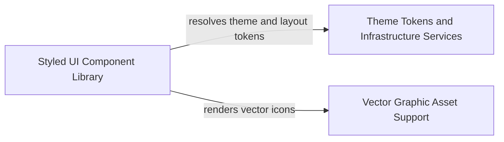

## Details

Provides low-level Flutter infrastructure, theme definitions, file pickers, SVG rendering, and styled UI widgets.

### Styled UI Component Library
Provides styled UI primitives, customizable buttons, dialogs, overlays, popovers, and scrolling containers across platforms.

**Related Classes/Methods**:

- `frontend.appflowy_flutter.packages.flowy_infra_ui.lib.style_widget.container.FlowyContainer.build`:29-42
- `frontend.appflowy_flutter.packages.flowy_infra_ui.lib.style_widget.divider.FlowyDivider.build`:13-22
- `frontend.appflowy_flutter.packages.flowy_infra_ui.lib.style_widget.color_picker.FlowyColorPicker._buildColorOption`:52-78
- `frontend.appflowy_flutter.packages.flowy_infra_ui.lib.style_widget.icon_button.FlowyDropdownButton.build`:113-119

**Source Files:**

- `frontend/appflowy_flutter/packages/flowy_infra_ui/example/lib/home/demo_item.dart`
  - `frontend.appflowy_flutter.packages.flowy_infra_ui.example.lib.home.demo_item.ListItem` (L3-L3) - Class
  - `frontend.appflowy_flutter.packages.flowy_infra_ui.example.lib.home.demo_item.DemoItem` (L5-L9) - Class
  - `frontend.appflowy_flutter.packages.flowy_infra_ui.example.lib.home.demo_item.DemoItem.buildTitle` (L6-L6) - Method
  - `frontend.appflowy_flutter.packages.flowy_infra_ui.example.lib.home.demo_item.DemoItem.handleTap` (L8-L8) - Method
  - `frontend.appflowy_flutter.packages.flowy_infra_ui.example.lib.home.demo_item.SectionHeaderItem` (L11-L17) - Class
  - `frontend.appflowy_flutter.packages.flowy_infra_ui.example.lib.home.demo_item.SectionHeaderItem.SectionHeaderItem` (L12-L12) - Constructor
  - `frontend.appflowy_flutter.packages.flowy_infra_ui.example.lib.home.demo_item.SectionHeaderItem.buildWidget` (L16-L16) - Method
- `frontend/appflowy_flutter/packages/flowy_infra_ui/example/lib/home/home_screen.dart`
  - `frontend.appflowy_flutter.packages.flowy_infra_ui.example.lib.home.home_screen.HomeScreen` (L7-L48) - Class
  - `frontend.appflowy_flutter.packages.flowy_infra_ui.example.lib.home.home_screen.HomeScreen.HomeScreen` (L8-L8) - Constructor
  - `frontend.appflowy_flutter.packages.flowy_infra_ui.example.lib.home.home_screen.HomeScreen.build` (L17-L47) - Method
- `frontend/appflowy_flutter/packages/flowy_infra_ui/example/lib/keyboard/keyboard_screen.dart`
  - `frontend.appflowy_flutter.packages.flowy_infra_ui.example.lib.keyboard.keyboard_screen.KeyboardItem` (L5-L19) - Class
  - `frontend.appflowy_flutter.packages.flowy_infra_ui.example.lib.keyboard.keyboard_screen.KeyboardItem.buildTitle` (L7-L7) - Method
  - `frontend.appflowy_flutter.packages.flowy_infra_ui.example.lib.keyboard.keyboard_screen.KeyboardItem.handleTap` (L10-L18) - Method
  - `frontend.appflowy_flutter.packages.flowy_infra_ui.example.lib.keyboard.keyboard_screen.KeyboardScreen` (L21-L26) - Class
  - `frontend.appflowy_flutter.packages.flowy_infra_ui.example.lib.keyboard.keyboard_screen.KeyboardScreen.KeyboardScreen` (L22-L22) - Constructor
  - `frontend.appflowy_flutter.packages.flowy_infra_ui.example.lib.keyboard.keyboard_screen.KeyboardScreen.createState` (L25-L25) - Method
  - `frontend.appflowy_flutter.packages.flowy_infra_ui.example.lib.keyboard.keyboard_screen._KeyboardScreenState` (L28-L85) - Class
  - `frontend.appflowy_flutter.packages.flowy_infra_ui.example.lib.keyboard.keyboard_screen._KeyboardScreenState.dispose` (L34-L37) - Method
  - `frontend.appflowy_flutter.packages.flowy_infra_ui.example.lib.keyboard.keyboard_screen._KeyboardScreenState.build` (L40-L76) - Method
  - `frontend.appflowy_flutter.packages.flowy_infra_ui.example.lib.keyboard.keyboard_screen._KeyboardScreenState._dismissKeyboard` (L78-L84) - Method
- `frontend/appflowy_flutter/packages/flowy_infra_ui/example/lib/main.dart`
  - `frontend.appflowy_flutter.packages.flowy_infra_ui.example.lib.main.main` (L7-L9) - Function
  - `frontend.appflowy_flutter.packages.flowy_infra_ui.example.lib.main.ExampleApp` (L11-L22) - Class
  - `frontend.appflowy_flutter.packages.flowy_infra_ui.example.lib.main.ExampleApp.ExampleApp` (L12-L12) - Constructor
  - `frontend.appflowy_flutter.packages.flowy_infra_ui.example.lib.main.ExampleApp.build` (L15-L21) - Method
- `frontend/appflowy_flutter/packages/flowy_infra_ui/example/lib/overlay/overlay_screen.dart`
  - `frontend.appflowy_flutter.packages.flowy_infra_ui.example.lib.overlay.overlay_screen.OverlayItem` (L8-L22) - Class
  - `frontend.appflowy_flutter.packages.flowy_infra_ui.example.lib.overlay.overlay_screen.OverlayItem.buildTitle` (L10-L10) - Method
  - `frontend.appflowy_flutter.packages.flowy_infra_ui.example.lib.overlay.overlay_screen.OverlayItem.handleTap` (L13-L21) - Method
  - `frontend.appflowy_flutter.packages.flowy_infra_ui.example.lib.overlay.overlay_screen.OverlayDemoConfiguration` (L24-L44) - Class
  - `frontend.appflowy_flutter.packages.flowy_infra_ui.example.lib.overlay.overlay_screen.OverlayDemoConfiguration.OverlayDemoConfiguration` (L25-L25) - Constructor
  - `frontend.appflowy_flutter.packages.flowy_infra_ui.example.lib.overlay.overlay_screen.OverlayDemoConfiguration.anchorDirection` (L29-L29) - Method
  - `frontend.appflowy_flutter.packages.flowy_infra_ui.example.lib.overlay.overlay_screen.OverlayDemoConfiguration.anchorDirection=` (L31-L34) - Method
  - `frontend.appflowy_flutter.packages.flowy_infra_ui.example.lib.overlay.overlay_screen.OverlayDemoConfiguration.overlapBehaviour` (L38-L38) - Method
  - `frontend.appflowy_flutter.packages.flowy_infra_ui.example.lib.overlay.overlay_screen.OverlayDemoConfiguration.overlapBehaviour=` (L40-L43) - Method
  - `frontend.appflowy_flutter.packages.flowy_infra_ui.example.lib.overlay.overlay_screen.OverlayScreen` (L46-L269) - Class
  - `frontend.appflowy_flutter.packages.flowy_infra_ui.example.lib.overlay.overlay_screen.OverlayScreen.OverlayScreen` (L47-L47) - Constructor
  - `frontend.appflowy_flutter.packages.flowy_infra_ui.example.lib.overlay.overlay_screen.OverlayScreen.build` (L50-L268) - Method
- `frontend/appflowy_flutter/packages/flowy_infra_ui/flowy_infra_ui_platform_interface/lib/flowy_infra_ui_platform_interface.dart`
  - `frontend.appflowy_flutter.packages.flowy_infra_ui.flowy_infra_ui_platform_interface.lib.flowy_infra_ui_platform_interface.FlowyInfraUIPlatform` (L6-L29) - Class
  - `frontend.appflowy_flutter.packages.flowy_infra_ui.flowy_infra_ui_platform_interface.lib.flowy_infra_ui_platform_interface.FlowyInfraUIPlatform.FlowyInfraUIPlatform` (L7-L7) - Constructor
  - `frontend.appflowy_flutter.packages.flowy_infra_ui.flowy_infra_ui_platform_interface.lib.flowy_infra_ui_platform_interface.FlowyInfraUIPlatform.instance` (L13-L13) - Method
  - `frontend.appflowy_flutter.packages.flowy_infra_ui.flowy_infra_ui_platform_interface.lib.flowy_infra_ui_platform_interface.FlowyInfraUIPlatform.instance=` (L15-L18) - Method
  - `frontend.appflowy_flutter.packages.flowy_infra_ui.flowy_infra_ui_platform_interface.lib.flowy_infra_ui_platform_interface.FlowyInfraUIPlatform.onKeyboardVisibilityChange` (L20-L23) - Method
  - `frontend.appflowy_flutter.packages.flowy_infra_ui.flowy_infra_ui_platform_interface.lib.flowy_infra_ui_platform_interface.FlowyInfraUIPlatform.getPlatformVersion` (L25-L28) - Method
- `frontend/appflowy_flutter/packages/flowy_infra_ui/flowy_infra_ui_platform_interface/lib/src/method_channel_flowy_infra_ui.dart`
  - `frontend.appflowy_flutter.packages.flowy_infra_ui.flowy_infra_ui_platform_interface.lib.src.method_channel_flowy_infra_ui.MethodChannelFlowyInfraUI` (L9-L27) - Class
  - `frontend.appflowy_flutter.packages.flowy_infra_ui.flowy_infra_ui_platform_interface.lib.src.method_channel_flowy_infra_ui.MethodChannelFlowyInfraUI.onKeyboardVisibilityChange` (L19-L19) - Method
  - `frontend.appflowy_flutter.packages.flowy_infra_ui.flowy_infra_ui_platform_interface.lib.src.method_channel_flowy_infra_ui.MethodChannelFlowyInfraUI.getPlatformVersion` (L22-L26) - Method
- `frontend/appflowy_flutter/packages/flowy_infra_ui/flowy_infra_ui_web/lib/flowy_infra_ui_web.dart`
  - `frontend.appflowy_flutter.packages.flowy_infra_ui.flowy_infra_ui_web.lib.flowy_infra_ui_web.FlowyInfraUIPlugin` (L7-L25) - Class
  - `frontend.appflowy_flutter.packages.flowy_infra_ui.flowy_infra_ui_web.lib.flowy_infra_ui_web.FlowyInfraUIPlugin.registerWith` (L8-L10) - Method
  - `frontend.appflowy_flutter.packages.flowy_infra_ui.flowy_infra_ui_web.lib.flowy_infra_ui_web.FlowyInfraUIPlugin.onKeyboardVisibilityChange` (L15-L18) - Method
  - `frontend.appflowy_flutter.packages.flowy_infra_ui.flowy_infra_ui_web.lib.flowy_infra_ui_web.FlowyInfraUIPlugin.getPlatformVersion` (L21-L24) - Method
- `frontend/appflowy_flutter/packages/flowy_infra_ui/lib/basis.dart`
  - `frontend.appflowy_flutter.packages.flowy_infra_ui.lib.basis.IndexedCallback` (L2-L2) - Class
  - `frontend.appflowy_flutter.packages.flowy_infra_ui.lib.basis.IndexedValueCallback` (L3-L3) - Class
- `frontend/appflowy_flutter/packages/flowy_infra_ui/lib/src/flowy_overlay/appflowy_popover.dart`
  - `frontend.appflowy_flutter.packages.flowy_infra_ui.lib.src.flowy_overlay.appflowy_popover.ShadowConstants` (L7-L22) - Class
  - `frontend.appflowy_flutter.packages.flowy_infra_ui.lib.src.flowy_overlay.appflowy_popover.ShadowConstants.ShadowConstants._` (L8-L8) - Constructor
  - `frontend.appflowy_flutter.packages.flowy_infra_ui.lib.src.flowy_overlay.appflowy_popover.AppFlowyPopover` (L24-L133) - Class
  - `frontend.appflowy_flutter.packages.flowy_infra_ui.lib.src.flowy_overlay.appflowy_popover.AppFlowyPopover.AppFlowyPopover` (L25-L53) - Constructor
  - `frontend.appflowy_flutter.packages.flowy_infra_ui.lib.src.flowy_overlay.appflowy_popover.AppFlowyPopover.build` (L101-L132) - Method
  - `frontend.appflowy_flutter.packages.flowy_infra_ui.lib.src.flowy_overlay.appflowy_popover._PopoverContainer` (L135-L168) - Class
  - `frontend.appflowy_flutter.packages.flowy_infra_ui.lib.src.flowy_overlay.appflowy_popover._PopoverContainer._PopoverContainer` (L136-L143) - Constructor
  - `frontend.appflowy_flutter.packages.flowy_infra_ui.lib.src.flowy_overlay.appflowy_popover._PopoverContainer.build` (L153-L167) - Method
  - `frontend.appflowy_flutter.packages.flowy_infra_ui.lib.src.flowy_overlay.appflowy_popover.PopoverDecoration.getPopoverDecoration` (L175-L197) - Method
- `frontend/appflowy_flutter/packages/flowy_infra_ui/lib/src/flowy_overlay/flowy_dialog.dart`
  - `frontend.appflowy_flutter.packages.flowy_infra_ui.lib.src.flowy_overlay.flowy_dialog.FlowyDialog` (L9-L67) - Class
  - `frontend.appflowy_flutter.packages.flowy_infra_ui.lib.src.flowy_overlay.flowy_dialog.FlowyDialog.FlowyDialog` (L10-L22) - Constructor
  - `frontend.appflowy_flutter.packages.flowy_infra_ui.lib.src.flowy_overlay.flowy_dialog.FlowyDialog.build` (L41-L66) - Method
- `frontend/appflowy_flutter/packages/flowy_infra_ui/lib/src/flowy_overlay/flowy_overlay.dart`
  - `frontend.appflowy_flutter.packages.flowy_infra_ui.lib.src.flowy_overlay.flowy_overlay.AnchorDirection` (L11-L35) - Enum
  - `frontend.appflowy_flutter.packages.flowy_infra_ui.lib.src.flowy_overlay.flowy_overlay.AnchorDirection.topLeft` (L13-L13) - Enum
  - `frontend.appflowy_flutter.packages.flowy_infra_ui.lib.src.flowy_overlay.flowy_overlay.AnchorDirection.topRight` (L14-L14) - Enum
  - `frontend.appflowy_flutter.packages.flowy_infra_ui.lib.src.flowy_overlay.flowy_overlay.AnchorDirection.bottomLeft` (L15-L15) - Enum
  - `frontend.appflowy_flutter.packages.flowy_infra_ui.lib.src.flowy_overlay.flowy_overlay.AnchorDirection.bottomRight` (L16-L16) - Enum
  - `frontend.appflowy_flutter.packages.flowy_infra_ui.lib.src.flowy_overlay.flowy_overlay.AnchorDirection.center` (L17-L17) - Enum
  - `frontend.appflowy_flutter.packages.flowy_infra_ui.lib.src.flowy_overlay.flowy_overlay.AnchorDirection.topWithLeftAligned` (L20-L20) - Enum
  - `frontend.appflowy_flutter.packages.flowy_infra_ui.lib.src.flowy_overlay.flowy_overlay.AnchorDirection.topWithCenterAligned` (L21-L21) - Enum
  - `frontend.appflowy_flutter.packages.flowy_infra_ui.lib.src.flowy_overlay.flowy_overlay.AnchorDirection.topWithRightAligned` (L22-L22) - Enum
  - `frontend.appflowy_flutter.packages.flowy_infra_ui.lib.src.flowy_overlay.flowy_overlay.AnchorDirection.rightWithTopAligned` (L23-L23) - Enum
  - `frontend.appflowy_flutter.packages.flowy_infra_ui.lib.src.flowy_overlay.flowy_overlay.AnchorDirection.rightWithCenterAligned` (L24-L24) - Enum
  - `frontend.appflowy_flutter.packages.flowy_infra_ui.lib.src.flowy_overlay.flowy_overlay.AnchorDirection.rightWithBottomAligned` (L25-L25) - Enum
  - `frontend.appflowy_flutter.packages.flowy_infra_ui.lib.src.flowy_overlay.flowy_overlay.AnchorDirection.bottomWithLeftAligned` (L26-L26) - Enum
  - `frontend.appflowy_flutter.packages.flowy_infra_ui.lib.src.flowy_overlay.flowy_overlay.AnchorDirection.bottomWithCenterAligned` (L27-L27) - Enum
  - `frontend.appflowy_flutter.packages.flowy_infra_ui.lib.src.flowy_overlay.flowy_overlay.AnchorDirection.bottomWithRightAligned` (L28-L28) - Enum
  - `frontend.appflowy_flutter.packages.flowy_infra_ui.lib.src.flowy_overlay.flowy_overlay.AnchorDirection.leftWithTopAligned` (L29-L29) - Enum
  - `frontend.appflowy_flutter.packages.flowy_infra_ui.lib.src.flowy_overlay.flowy_overlay.AnchorDirection.leftWithCenterAligned` (L30-L30) - Enum
  - `frontend.appflowy_flutter.packages.flowy_infra_ui.lib.src.flowy_overlay.flowy_overlay.AnchorDirection.leftWithBottomAligned` (L31-L31) - Enum
  - `frontend.appflowy_flutter.packages.flowy_infra_ui.lib.src.flowy_overlay.flowy_overlay.AnchorDirection.custom` (L34-L34) - Enum
  - `frontend.appflowy_flutter.packages.flowy_infra_ui.lib.src.flowy_overlay.flowy_overlay.OverlapBehaviour` (L38-L44) - Enum
  - `frontend.appflowy_flutter.packages.flowy_infra_ui.lib.src.flowy_overlay.flowy_overlay.OverlapBehaviour.none` (L40-L40) - Enum
  - `frontend.appflowy_flutter.packages.flowy_infra_ui.lib.src.flowy_overlay.flowy_overlay.OverlapBehaviour.stretch` (L43-L43) - Enum
  - `frontend.appflowy_flutter.packages.flowy_infra_ui.lib.src.flowy_overlay.flowy_overlay.OnBackBehavior` (L46-L58) - Enum
  - `frontend.appflowy_flutter.packages.flowy_infra_ui.lib.src.flowy_overlay.flowy_overlay.OnBackBehavior.none` (L48-L48) - Enum
  - `frontend.appflowy_flutter.packages.flowy_infra_ui.lib.src.flowy_overlay.flowy_overlay.OnBackBehavior.alert` (L51-L51) - Enum
  - `frontend.appflowy_flutter.packages.flowy_infra_ui.lib.src.flowy_overlay.flowy_overlay.OnBackBehavior.abort` (L54-L54) - Enum
  - `frontend.appflowy_flutter.packages.flowy_infra_ui.lib.src.flowy_overlay.flowy_overlay.OnBackBehavior.dismiss` (L57-L57) - Enum
  - `frontend.appflowy_flutter.packages.flowy_infra_ui.lib.src.flowy_overlay.flowy_overlay.FlowyOverlayStyle` (L60-L66) - Class
  - `frontend.appflowy_flutter.packages.flowy_infra_ui.lib.src.flowy_overlay.flowy_overlay.FlowyOverlayStyle.FlowyOverlayStyle` (L64-L65) - Constructor
  - `frontend.appflowy_flutter.packages.flowy_infra_ui.lib.src.flowy_overlay.flowy_overlay.overlayManagerBuilder` (L71-L74) - Function
  - `frontend.appflowy_flutter.packages.flowy_infra_ui.lib.src.flowy_overlay.flowy_overlay.FlowyOverlayDelegate` (L76-L79) - Class
  - `frontend.appflowy_flutter.packages.flowy_infra_ui.lib.src.flowy_overlay.flowy_overlay.FlowyOverlayDelegate.asBarrier` (L77-L77) - Method
  - `frontend.appflowy_flutter.packages.flowy_infra_ui.lib.src.flowy_overlay.flowy_overlay.FlowyOverlayDelegate.didRemove` (L78-L78) - Method
  - `frontend.appflowy_flutter.packages.flowy_infra_ui.lib.src.flowy_overlay.flowy_overlay.FlowyOverlay` (L81-L131) - Class
  - `frontend.appflowy_flutter.packages.flowy_infra_ui.lib.src.flowy_overlay.flowy_overlay.FlowyOverlay.FlowyOverlay` (L82-L82) - Constructor
  - `frontend.appflowy_flutter.packages.flowy_infra_ui.lib.src.flowy_overlay.flowy_overlay.FlowyOverlay.of` (L86-L100) - Method
  - `frontend.appflowy_flutter.packages.flowy_infra_ui.lib.src.flowy_overlay.flowy_overlay.FlowyOverlay.maybeOf` (L102-L113) - Method
  - `frontend.appflowy_flutter.packages.flowy_infra_ui.lib.src.flowy_overlay.flowy_overlay.FlowyOverlay.show` (L115-L123) - Method
  - `frontend.appflowy_flutter.packages.flowy_infra_ui.lib.src.flowy_overlay.flowy_overlay.FlowyOverlay.pop` (L125-L127) - Method
  - `frontend.appflowy_flutter.packages.flowy_infra_ui.lib.src.flowy_overlay.flowy_overlay.FlowyOverlay.createState` (L130-L130) - Method
  - `frontend.appflowy_flutter.packages.flowy_infra_ui.lib.src.flowy_overlay.flowy_overlay.OverlayItem` (L133-L149) - Class
  - `frontend.appflowy_flutter.packages.flowy_infra_ui.lib.src.flowy_overlay.flowy_overlay.OverlayItem.OverlayItem` (L139-L144) - Constructor
  - `frontend.appflowy_flutter.packages.flowy_infra_ui.lib.src.flowy_overlay.flowy_overlay.OverlayItem.dispose` (L146-L148) - Method
  - `frontend.appflowy_flutter.packages.flowy_infra_ui.lib.src.flowy_overlay.flowy_overlay.FlowyOverlayState` (L151-L419) - Class
  - `frontend.appflowy_flutter.packages.flowy_infra_ui.lib.src.flowy_overlay.flowy_overlay.FlowyOverlayState.insertCustom` (L160-L171) - Method
  - `frontend.appflowy_flutter.packages.flowy_infra_ui.lib.src.flowy_overlay.flowy_overlay.FlowyOverlayState.insertWithRect` (L173-L197) - Method
  - `frontend.appflowy_flutter.packages.flowy_infra_ui.lib.src.flowy_overlay.flowy_overlay.FlowyOverlayState.insertWithAnchor` (L199-L221) - Method
  - `frontend.appflowy_flutter.packages.flowy_infra_ui.lib.src.flowy_overlay.flowy_overlay.FlowyOverlayState.remove` (L223-L233) - Method
  - `frontend.appflowy_flutter.packages.flowy_infra_ui.lib.src.flowy_overlay.flowy_overlay.FlowyOverlayState.removeAll` (L235-L262) - Method
  - `frontend.appflowy_flutter.packages.flowy_infra_ui.lib.src.flowy_overlay.flowy_overlay.FlowyOverlayState._markDirty` (L264-L268) - Method
  - `frontend.appflowy_flutter.packages.flowy_infra_ui.lib.src.flowy_overlay.flowy_overlay.FlowyOverlayState._showOverlay` (L270-L341) - Method
  - `frontend.appflowy_flutter.packages.flowy_infra_ui.lib.src.flowy_overlay.flowy_overlay.FlowyOverlayState.initState` (L344-L350) - Method
  - `frontend.appflowy_flutter.packages.flowy_infra_ui.lib.src.flowy_overlay.flowy_overlay.FlowyOverlayState.build` (L353-L395) - Method
  - `frontend.appflowy_flutter.packages.flowy_infra_ui.lib.src.flowy_overlay.flowy_overlay.FlowyOverlayState._handleTapOnBackground` (L397-L397) - Method
  - `frontend.appflowy_flutter.packages.flowy_infra_ui.lib.src.flowy_overlay.flowy_overlay.FlowyOverlayState._renderBackground` (L399-L418) - Method
- `frontend/appflowy_flutter/packages/flowy_infra_ui/lib/src/flowy_overlay/flowy_popover_layout.dart`
  - `frontend.appflowy_flutter.packages.flowy_infra_ui.lib.src.flowy_overlay.flowy_popover_layout.PopoverLayoutDelegate` (L7-L251) - Class
  - `frontend.appflowy_flutter.packages.flowy_infra_ui.lib.src.flowy_overlay.flowy_popover_layout.PopoverLayoutDelegate.PopoverLayoutDelegate` (L8-L12) - Constructor
  - `frontend.appflowy_flutter.packages.flowy_infra_ui.lib.src.flowy_overlay.flowy_popover_layout.PopoverLayoutDelegate.shouldRelayout` (L19-L23) - Method
  - `frontend.appflowy_flutter.packages.flowy_infra_ui.lib.src.flowy_overlay.flowy_popover_layout.PopoverLayoutDelegate.getConstraintsForChild` (L26-L141) - Method
  - `frontend.appflowy_flutter.packages.flowy_infra_ui.lib.src.flowy_overlay.flowy_popover_layout.PopoverLayoutDelegate.getPositionForChild` (L144-L250) - Method
- `frontend/appflowy_flutter/packages/flowy_infra_ui/lib/src/flowy_overlay/layout.dart`
  - `frontend.appflowy_flutter.packages.flowy_infra_ui.lib.src.flowy_overlay.layout.OverlayLayoutDelegate` (L7-L251) - Class
  - `frontend.appflowy_flutter.packages.flowy_infra_ui.lib.src.flowy_overlay.layout.OverlayLayoutDelegate.OverlayLayoutDelegate` (L8-L12) - Constructor
  - `frontend.appflowy_flutter.packages.flowy_infra_ui.lib.src.flowy_overlay.layout.OverlayLayoutDelegate.shouldRelayout` (L19-L23) - Method
  - `frontend.appflowy_flutter.packages.flowy_infra_ui.lib.src.flowy_overlay.layout.OverlayLayoutDelegate.getConstraintsForChild` (L26-L141) - Method
  - `frontend.appflowy_flutter.packages.flowy_infra_ui.lib.src.flowy_overlay.layout.OverlayLayoutDelegate.getPositionForChild` (L144-L250) - Method
- `frontend/appflowy_flutter/packages/flowy_infra_ui/lib/src/flowy_overlay/list_overlay.dart`
  - `frontend.appflowy_flutter.packages.flowy_infra_ui.lib.src.flowy_overlay.list_overlay.ListOverlayFooter` (L7-L16) - Class
  - `frontend.appflowy_flutter.packages.flowy_infra_ui.lib.src.flowy_overlay.list_overlay.ListOverlayFooter.ListOverlayFooter` (L11-L15) - Constructor
  - `frontend.appflowy_flutter.packages.flowy_infra_ui.lib.src.flowy_overlay.list_overlay.ListOverlay` (L18-L108) - Class
  - `frontend.appflowy_flutter.packages.flowy_infra_ui.lib.src.flowy_overlay.list_overlay.ListOverlay.ListOverlay` (L19-L26) - Constructor
  - `frontend.appflowy_flutter.packages.flowy_infra_ui.lib.src.flowy_overlay.list_overlay.ListOverlay.build` (L35-L74) - Method
  - `frontend.appflowy_flutter.packages.flowy_infra_ui.lib.src.flowy_overlay.list_overlay.ListOverlay.showWithAnchor` (L76-L107) - Method
  - `frontend.appflowy_flutter.packages.flowy_infra_ui.lib.src.flowy_overlay.list_overlay.OverlayContainer` (L112-L138) - Class
  - `frontend.appflowy_flutter.packages.flowy_infra_ui.lib.src.flowy_overlay.list_overlay.OverlayContainer.OverlayContainer` (L116-L121) - Constructor
  - `frontend.appflowy_flutter.packages.flowy_infra_ui.lib.src.flowy_overlay.list_overlay.OverlayContainer.build` (L124-L137) - Method
- `frontend/appflowy_flutter/packages/flowy_infra_ui/lib/src/flowy_overlay/option_overlay.dart`
  - `frontend.appflowy_flutter.packages.flowy_infra_ui.lib.src.flowy_overlay.option_overlay.OptionItem` (L4-L9) - Class
  - `frontend.appflowy_flutter.packages.flowy_infra_ui.lib.src.flowy_overlay.option_overlay.OptionItem.OptionItem` (L5-L5) - Constructor
  - `frontend.appflowy_flutter.packages.flowy_infra_ui.lib.src.flowy_overlay.option_overlay.OptionOverlay` (L11-L67) - Class
  - `frontend.appflowy_flutter.packages.flowy_infra_ui.lib.src.flowy_overlay.option_overlay.OptionOverlay.OptionOverlay` (L12-L17) - Constructor
  - `frontend.appflowy_flutter.packages.flowy_infra_ui.lib.src.flowy_overlay.option_overlay.OptionOverlay.showWithAnchor` (L23-L46) - Method
  - `frontend.appflowy_flutter.packages.flowy_infra_ui.lib.src.flowy_overlay.option_overlay.OptionOverlay.build` (L49-L66) - Method
  - `frontend.appflowy_flutter.packages.flowy_infra_ui.lib.src.flowy_overlay.option_overlay._OptionListItem` (L69-L99) - Class
  - `frontend.appflowy_flutter.packages.flowy_infra_ui.lib.src.flowy_overlay.option_overlay._OptionListItem._OptionListItem` (L70-L73) - Constructor
  - `frontend.appflowy_flutter.packages.flowy_infra_ui.lib.src.flowy_overlay.option_overlay._OptionListItem.build` (L78-L98) - Method
- `frontend/appflowy_flutter/packages/flowy_infra_ui/lib/src/focus/auto_unfocus_overlay.dart`
  - `frontend.appflowy_flutter.packages.flowy_infra_ui.lib.src.focus.auto_unfocus_overlay.AutoUnfocus` (L3-L26) - Class
  - `frontend.appflowy_flutter.packages.flowy_infra_ui.lib.src.focus.auto_unfocus_overlay.AutoUnfocus.AutoUnfocus` (L4-L7) - Constructor
  - `frontend.appflowy_flutter.packages.flowy_infra_ui.lib.src.focus.auto_unfocus_overlay.AutoUnfocus.build` (L12-L17) - Method
  - `frontend.appflowy_flutter.packages.flowy_infra_ui.lib.src.focus.auto_unfocus_overlay.AutoUnfocus._unfocusWidget` (L19-L25) - Method
- `frontend/appflowy_flutter/packages/flowy_infra_ui/lib/src/keyboard/keyboard_visibility_detector.dart`
  - `frontend.appflowy_flutter.packages.flowy_infra_ui.lib.src.keyboard.keyboard_visibility_detector.KeyboardVisibilityDetector` (L6-L19) - Class
  - `frontend.appflowy_flutter.packages.flowy_infra_ui.lib.src.keyboard.keyboard_visibility_detector.KeyboardVisibilityDetector.KeyboardVisibilityDetector` (L7-L11) - Constructor
  - `frontend.appflowy_flutter.packages.flowy_infra_ui.lib.src.keyboard.keyboard_visibility_detector.KeyboardVisibilityDetector.createState` (L17-L18) - Method
  - `frontend.appflowy_flutter.packages.flowy_infra_ui.lib.src.keyboard.keyboard_visibility_detector._KeyboardVisibilityDetectorState` (L21-L56) - Class
  - `frontend.appflowy_flutter.packages.flowy_infra_ui.lib.src.keyboard.keyboard_visibility_detector._KeyboardVisibilityDetectorState._platform` (L23-L23) - Method
  - `frontend.appflowy_flutter.packages.flowy_infra_ui.lib.src.keyboard.keyboard_visibility_detector._KeyboardVisibilityDetectorState.initState` (L30-L41) - Method
  - `frontend.appflowy_flutter.packages.flowy_infra_ui.lib.src.keyboard.keyboard_visibility_detector._KeyboardVisibilityDetectorState.dispose` (L44-L47) - Method
  - `frontend.appflowy_flutter.packages.flowy_infra_ui.lib.src.keyboard.keyboard_visibility_detector._KeyboardVisibilityDetectorState.build` (L50-L55) - Method
  - `frontend.appflowy_flutter.packages.flowy_infra_ui.lib.src.keyboard.keyboard_visibility_detector._KeyboardVisibilityDetectorInheritedWidget` (L58-L71) - Class
  - `frontend.appflowy_flutter.packages.flowy_infra_ui.lib.src.keyboard.keyboard_visibility_detector._KeyboardVisibilityDetectorInheritedWidget._KeyboardVisibilityDetectorInheritedWidget` (L59-L62) - Constructor
  - `frontend.appflowy_flutter.packages.flowy_infra_ui.lib.src.keyboard.keyboard_visibility_detector._KeyboardVisibilityDetectorInheritedWidget.updateShouldNotify` (L67-L70) - Method
- `frontend/appflowy_flutter/packages/flowy_infra_ui/lib/style_widget/bar_title.dart`
  - `frontend.appflowy_flutter.packages.flowy_infra_ui.lib.style_widget.bar_title.FlowyBarTitle` (L3-L18) - Class
  - `frontend.appflowy_flutter.packages.flowy_infra_ui.lib.style_widget.bar_title.FlowyBarTitle.FlowyBarTitle` (L6-L9) - Constructor
  - `frontend.appflowy_flutter.packages.flowy_infra_ui.lib.style_widget.bar_title.FlowyBarTitle.build` (L12-L17) - Method
- `frontend/appflowy_flutter/packages/flowy_infra_ui/lib/style_widget/button.dart`
  - `frontend.appflowy_flutter.packages.flowy_infra_ui.lib.style_widget.button.FlowyIconTextButton` (L10-L142) - Class
  - `frontend.appflowy_flutter.packages.flowy_infra_ui.lib.style_widget.button.FlowyIconTextButton.FlowyIconTextButton` (L34-L58) - Constructor
  - `frontend.appflowy_flutter.packages.flowy_infra_ui.lib.style_widget.button.FlowyIconTextButton.build` (L61-L82) - Method
  - `frontend.appflowy_flutter.packages.flowy_infra_ui.lib.style_widget.button.FlowyIconTextButton._render` (L84-L141) - Method
  - `frontend.appflowy_flutter.packages.flowy_infra_ui.lib.style_widget.button.FlowyButton` (L144-L308) - Class
  - `frontend.appflowy_flutter.packages.flowy_infra_ui.lib.style_widget.button.FlowyButton.FlowyButton` (L169-L194) - Constructor
  - `frontend.appflowy_flutter.packages.flowy_infra_ui.lib.style_widget.button.FlowyButton.build` (L197-L231) - Method
  - `frontend.appflowy_flutter.packages.flowy_infra_ui.lib.style_widget.button.FlowyButton._render` (L233-L307) - Method
  - `frontend.appflowy_flutter.packages.flowy_infra_ui.lib.style_widget.button.FlowyTextButton` (L310-L481) - Class
  - `frontend.appflowy_flutter.packages.flowy_infra_ui.lib.style_widget.button.FlowyTextButton.FlowyTextButton` (L311-L333) - Constructor
  - `frontend.appflowy_flutter.packages.flowy_infra_ui.lib.style_widget.button.FlowyTextButton.FlowyTextButton.primary` (L335-L348) - Constructor
  - `frontend.appflowy_flutter.packages.flowy_infra_ui.lib.style_widget.button.FlowyTextButton.FlowyTextButton.secondary` (L350-L364) - Constructor
  - `frontend.appflowy_flutter.packages.flowy_infra_ui.lib.style_widget.button.FlowyTextButton.build` (L391-L480) - Method
  - `frontend.appflowy_flutter.packages.flowy_infra_ui.lib.style_widget.button.FlowyRichTextButton` (L483-L558) - Class
  - `frontend.appflowy_flutter.packages.flowy_infra_ui.lib.style_widget.button.FlowyRichTextButton.FlowyRichTextButton` (L484-L498) - Constructor
  - `frontend.appflowy_flutter.packages.flowy_infra_ui.lib.style_widget.button.FlowyRichTextButton.build` (L516-L557) - Method
- `frontend/appflowy_flutter/packages/flowy_infra_ui/lib/style_widget/close_button.dart`
  - `frontend.appflowy_flutter.packages.flowy_infra_ui.lib.style_widget.close_button.FlowyCloseButton` (L3-L15) - Class
  - `frontend.appflowy_flutter.packages.flowy_infra_ui.lib.style_widget.close_button.FlowyCloseButton.FlowyCloseButton` (L6-L9) - Constructor
  - `frontend.appflowy_flutter.packages.flowy_infra_ui.lib.style_widget.close_button.FlowyCloseButton.build` (L12-L14) - Method
- `frontend/appflowy_flutter/packages/flowy_infra_ui/lib/style_widget/color_picker.dart`
  - `frontend.appflowy_flutter.packages.flowy_infra_ui.lib.style_widget.color_picker.FlowyColorOption` (L5-L15) - Class
  - `frontend.appflowy_flutter.packages.flowy_infra_ui.lib.style_widget.color_picker.FlowyColorOption.FlowyColorOption` (L6-L10) - Constructor
  - `frontend.appflowy_flutter.packages.flowy_infra_ui.lib.style_widget.color_picker.FlowyColorPicker` (L17-L79) - Class
  - `frontend.appflowy_flutter.packages.flowy_infra_ui.lib.style_widget.color_picker.FlowyColorPicker.FlowyColorPicker` (L26-L35) - Constructor
  - `frontend.appflowy_flutter.packages.flowy_infra_ui.lib.style_widget.color_picker.FlowyColorPicker.build` (L38-L50) - Method
  - `frontend.appflowy_flutter.packages.flowy_infra_ui.lib.style_widget.color_picker.FlowyColorPicker._buildColorOption` (L52-L78) - Method
  - `frontend.appflowy_flutter.packages.flowy_infra_ui.lib.style_widget.color_picker.ColorOptionIcon` (L81-L106) - Class
  - `frontend.appflowy_flutter.packages.flowy_infra_ui.lib.style_widget.color_picker.ColorOptionIcon.ColorOptionIcon` (L82-L86) - Constructor
  - `frontend.appflowy_flutter.packages.flowy_infra_ui.lib.style_widget.color_picker.ColorOptionIcon.build` (L92-L105) - Method
- `frontend/appflowy_flutter/packages/flowy_infra_ui/lib/style_widget/container.dart`
  - `frontend.appflowy_flutter.packages.flowy_infra_ui.lib.style_widget.container.FlowyContainer` (L4-L43) - Class
  - `frontend.appflowy_flutter.packages.flowy_infra_ui.lib.style_widget.container.FlowyContainer.FlowyContainer` (L16-L26) - Constructor
  - `frontend.appflowy_flutter.packages.flowy_infra_ui.lib.style_widget.container.FlowyContainer.build` (L29-L42) - Method
- `frontend/appflowy_flutter/packages/flowy_infra_ui/lib/style_widget/decoration.dart`
  - `frontend.appflowy_flutter.packages.flowy_infra_ui.lib.style_widget.decoration.FlowyDecoration` (L3-L27) - Class
  - `frontend.appflowy_flutter.packages.flowy_infra_ui.lib.style_widget.decoration.FlowyDecoration.decoration` (L4-L26) - Method
- `frontend/appflowy_flutter/packages/flowy_infra_ui/lib/style_widget/divider.dart`
  - `frontend.appflowy_flutter.packages.flowy_infra_ui.lib.style_widget.divider.FlowyDivider` (L4-L23) - Class
  - `frontend.appflowy_flutter.packages.flowy_infra_ui.lib.style_widget.divider.FlowyDivider.FlowyDivider` (L5-L8) - Constructor
  - `frontend.appflowy_flutter.packages.flowy_infra_ui.lib.style_widget.divider.FlowyDivider.build` (L13-L22) - Method
- `frontend/appflowy_flutter/packages/flowy_infra_ui/lib/style_widget/extension.dart`
  - `frontend.appflowy_flutter.packages.flowy_infra_ui.lib.style_widget.extension.TopBorder` (L4-L27) - Class
  - `frontend.appflowy_flutter.packages.flowy_infra_ui.lib.style_widget.extension.TopBorder.TopBorder` (L5-L10) - Constructor
  - `frontend.appflowy_flutter.packages.flowy_infra_ui.lib.style_widget.extension.TopBorder.build` (L17-L26) - Method
- `frontend/appflowy_flutter/packages/flowy_infra_ui/lib/style_widget/hover.dart`
  - `frontend.appflowy_flutter.packages.flowy_infra_ui.lib.style_widget.hover.HoverBuilder` (L3-L3) - Class
  - `frontend.appflowy_flutter.packages.flowy_infra_ui.lib.style_widget.hover.FlowyHover` (L5-L40) - Class
  - `frontend.appflowy_flutter.packages.flowy_infra_ui.lib.style_widget.hover.FlowyHover.FlowyHover` (L26-L36) - Constructor
  - `frontend.appflowy_flutter.packages.flowy_infra_ui.lib.style_widget.hover.FlowyHover.createState` (L39-L39) - Method
  - `frontend.appflowy_flutter.packages.flowy_infra_ui.lib.style_widget.hover._FlowyHoverState` (L42-L82) - Class
  - `frontend.appflowy_flutter.packages.flowy_infra_ui.lib.style_widget.hover._FlowyHoverState.didUpdateWidget` (L46-L53) - Method
  - `frontend.appflowy_flutter.packages.flowy_infra_ui.lib.style_widget.hover._FlowyHoverState.build` (L56-L70) - Method
  - `frontend.appflowy_flutter.packages.flowy_infra_ui.lib.style_widget.hover._FlowyHoverState._setOnHover` (L72-L81) - Method
  - `frontend.appflowy_flutter.packages.flowy_infra_ui.lib.style_widget.hover.HoverStyle` (L84-L108) - Class
  - `frontend.appflowy_flutter.packages.flowy_infra_ui.lib.style_widget.hover.HoverStyle.HoverStyle` (L92-L99) - Constructor
  - `frontend.appflowy_flutter.packages.flowy_infra_ui.lib.style_widget.hover.HoverStyle.HoverStyle.transparent` (L101-L107) - Constructor
  - `frontend.appflowy_flutter.packages.flowy_infra_ui.lib.style_widget.hover.FlowyHoverContainer` (L110-L154) - Class
  - `frontend.appflowy_flutter.packages.flowy_infra_ui.lib.style_widget.hover.FlowyHoverContainer.FlowyHoverContainer` (L115-L120) - Constructor
  - `frontend.appflowy_flutter.packages.flowy_infra_ui.lib.style_widget.hover.FlowyHoverContainer.build` (L123-L153) - Method
- `frontend/appflowy_flutter/packages/flowy_infra_ui/lib/style_widget/icon_button.dart`
  - `frontend.appflowy_flutter.packages.flowy_infra_ui.lib.style_widget.icon_button.FlowyIconButton` (L10-L105) - Class
  - `frontend.appflowy_flutter.packages.flowy_infra_ui.lib.style_widget.icon_button.FlowyIconButton.FlowyIconButton` (L26-L44) - Constructor
  - `frontend.appflowy_flutter.packages.flowy_infra_ui.lib.style_widget.icon_button.FlowyIconButton.build` (L47-L104) - Method
  - `frontend.appflowy_flutter.packages.flowy_infra_ui.lib.style_widget.icon_button.FlowyDropdownButton` (L107-L120) - Class
  - `frontend.appflowy_flutter.packages.flowy_infra_ui.lib.style_widget.icon_button.FlowyDropdownButton.FlowyDropdownButton` (L108-L108) - Constructor
  - `frontend.appflowy_flutter.packages.flowy_infra_ui.lib.style_widget.icon_button.FlowyDropdownButton.build` (L113-L119) - Method
- `frontend/appflowy_flutter/packages/flowy_infra_ui/lib/style_widget/image_icon.dart`
  - `frontend.appflowy_flutter.packages.flowy_infra_ui.lib.style_widget.image_icon.FlowyImageIcon` (L4-L16) - Class
  - `frontend.appflowy_flutter.packages.flowy_infra_ui.lib.style_widget.image_icon.FlowyImageIcon.FlowyImageIcon` (L9-L9) - Constructor
  - `frontend.appflowy_flutter.packages.flowy_infra_ui.lib.style_widget.image_icon.FlowyImageIcon.build` (L12-L15) - Method
- `frontend/appflowy_flutter/packages/flowy_infra_ui/lib/style_widget/primary_rounded_button.dart`
  - `frontend.appflowy_flutter.packages.flowy_infra_ui.lib.style_widget.primary_rounded_button.PrimaryRoundedButton` (L5-L62) - Class
  - `frontend.appflowy_flutter.packages.flowy_infra_ui.lib.style_widget.primary_rounded_button.PrimaryRoundedButton.PrimaryRoundedButton` (L6-L22) - Constructor
  - `frontend.appflowy_flutter.packages.flowy_infra_ui.lib.style_widget.primary_rounded_button.PrimaryRoundedButton.build` (L40-L61) - Method
  - `frontend.appflowy_flutter.packages.flowy_infra_ui.lib.style_widget.primary_rounded_button.OutlinedRoundedButton` (L64-L106) - Class
  - `frontend.appflowy_flutter.packages.flowy_infra_ui.lib.style_widget.primary_rounded_button.OutlinedRoundedButton.OutlinedRoundedButton` (L65-L71) - Constructor
  - `frontend.appflowy_flutter.packages.flowy_infra_ui.lib.style_widget.primary_rounded_button.OutlinedRoundedButton.build` (L79-L105) - Method
- `frontend/appflowy_flutter/packages/flowy_infra_ui/lib/style_widget/progress_indicator.dart`
  - `frontend.appflowy_flutter.packages.flowy_infra_ui.lib.style_widget.progress_indicator.FlowyProgressIndicator` (L15-L33) - Class
  - `frontend.appflowy_flutter.packages.flowy_infra_ui.lib.style_widget.progress_indicator.FlowyProgressIndicator.FlowyProgressIndicator` (L16-L16) - Constructor
  - `frontend.appflowy_flutter.packages.flowy_infra_ui.lib.style_widget.progress_indicator.FlowyProgressIndicator.build` (L19-L32) - Method
- `frontend/appflowy_flutter/packages/flowy_infra_ui/lib/style_widget/scrollbar.dart`
  - `frontend.appflowy_flutter.packages.flowy_infra_ui.lib.style_widget.scrollbar.FlowyScrollbar` (L3-L17) - Class
  - `frontend.appflowy_flutter.packages.flowy_infra_ui.lib.style_widget.scrollbar.FlowyScrollbar.FlowyScrollbar` (L4-L9) - Constructor
  - `frontend.appflowy_flutter.packages.flowy_infra_ui.lib.style_widget.scrollbar.FlowyScrollbar.createState` (L16-L16) - Method
  - `frontend.appflowy_flutter.packages.flowy_infra_ui.lib.style_widget.scrollbar._FlowyScrollbarState` (L19-L54) - Class
  - `frontend.appflowy_flutter.packages.flowy_infra_ui.lib.style_widget.scrollbar._FlowyScrollbarState.dispose` (L23-L27) - Method
  - `frontend.appflowy_flutter.packages.flowy_infra_ui.lib.style_widget.scrollbar._FlowyScrollbarState.build` (L30-L53) - Method
  - `frontend.appflowy_flutter.packages.flowy_infra_ui.lib.style_widget.scrollbar.ScrollControllerBuilder` (L56-L63) - Class
  - `frontend.appflowy_flutter.packages.flowy_infra_ui.lib.style_widget.scrollbar.ScrollControllerBuilder.ScrollControllerBuilder` (L57-L57) - Constructor
  - `frontend.appflowy_flutter.packages.flowy_infra_ui.lib.style_widget.scrollbar.ScrollControllerBuilder.createState` (L61-L62) - Method
  - `frontend.appflowy_flutter.packages.flowy_infra_ui.lib.style_widget.scrollbar._ScrollControllerBuilderState` (L65-L78) - Class
  - `frontend.appflowy_flutter.packages.flowy_infra_ui.lib.style_widget.scrollbar._ScrollControllerBuilderState.dispose` (L69-L72) - Method
  - `frontend.appflowy_flutter.packages.flowy_infra_ui.lib.style_widget.scrollbar._ScrollControllerBuilderState.build` (L75-L77) - Method
  - `frontend.appflowy_flutter.packages.flowy_infra_ui.lib.style_widget.scrollbar.ScrollControllerWidgetBuilder` (L80-L83) - Class
- `frontend/appflowy_flutter/packages/flowy_infra_ui/lib/style_widget/scrolling/styled_list.dart`
  - `frontend.appflowy_flutter.packages.flowy_infra_ui.lib.style_widget.scrolling.styled_list.StyledScrollPhysics` (L5-L5) - Class
  - `frontend.appflowy_flutter.packages.flowy_infra_ui.lib.style_widget.scrolling.styled_list.StyledListView` (L10-L35) - Class
  - `frontend.appflowy_flutter.packages.flowy_infra_ui.lib.style_widget.scrolling.styled_list.StyledListView.StyledListView` (L20-L31) - Constructor
  - `frontend.appflowy_flutter.packages.flowy_infra_ui.lib.style_widget.scrolling.styled_list.StyledListView.createState` (L34-L34) - Method
  - `frontend.appflowy_flutter.packages.flowy_infra_ui.lib.style_widget.scrolling.styled_list.StyledListViewState` (L38-L68) - Class
  - `frontend.appflowy_flutter.packages.flowy_infra_ui.lib.style_widget.scrolling.styled_list.StyledListViewState.dispose` (L42-L45) - Method
  - `frontend.appflowy_flutter.packages.flowy_infra_ui.lib.style_widget.scrolling.styled_list.StyledListViewState.build` (L48-L67) - Method
- `frontend/appflowy_flutter/packages/flowy_infra_ui/lib/style_widget/scrolling/styled_scroll_bar.dart`
  - `frontend.appflowy_flutter.packages.flowy_infra_ui.lib.style_widget.scrolling.styled_scroll_bar.StyledScrollbar` (L11-L41) - Class
  - `frontend.appflowy_flutter.packages.flowy_infra_ui.lib.style_widget.scrolling.styled_scroll_bar.StyledScrollbar.StyledScrollbar` (L12-L23) - Constructor
  - `frontend.appflowy_flutter.packages.flowy_infra_ui.lib.style_widget.scrolling.styled_scroll_bar.StyledScrollbar.createState` (L40-L40) - Method
  - `frontend.appflowy_flutter.packages.flowy_infra_ui.lib.style_widget.scrolling.styled_scroll_bar.ScrollbarState` (L43-L221) - Class
  - `frontend.appflowy_flutter.packages.flowy_infra_ui.lib.style_widget.scrolling.styled_scroll_bar.ScrollbarState.initState` (L49-L54) - Method
  - `frontend.appflowy_flutter.packages.flowy_infra_ui.lib.style_widget.scrolling.styled_scroll_bar.ScrollbarState.dispose` (L57-L64) - Method
  - `frontend.appflowy_flutter.packages.flowy_infra_ui.lib.style_widget.scrolling.styled_scroll_bar.ScrollbarState._onScrollChanged` (L66-L66) - Method
  - `frontend.appflowy_flutter.packages.flowy_infra_ui.lib.style_widget.scrolling.styled_scroll_bar.ScrollbarState.build` (L69-L183) - Method
  - `frontend.appflowy_flutter.packages.flowy_infra_ui.lib.style_widget.scrolling.styled_scroll_bar.ScrollbarState._hideScrollbarInTime` (L185-L202) - Method
  - `frontend.appflowy_flutter.packages.flowy_infra_ui.lib.style_widget.scrolling.styled_scroll_bar.ScrollbarState._handleHorizontalDrag` (L204-L211) - Method
  - `frontend.appflowy_flutter.packages.flowy_infra_ui.lib.style_widget.scrolling.styled_scroll_bar.ScrollbarState._handleVerticalDrag` (L213-L220) - Method
  - `frontend.appflowy_flutter.packages.flowy_infra_ui.lib.style_widget.scrolling.styled_scroll_bar.ScrollbarListStack` (L223-L285) - Class
  - `frontend.appflowy_flutter.packages.flowy_infra_ui.lib.style_widget.scrolling.styled_scroll_bar.ScrollbarListStack.ScrollbarListStack` (L224-L237) - Constructor
  - `frontend.appflowy_flutter.packages.flowy_infra_ui.lib.style_widget.scrolling.styled_scroll_bar.ScrollbarListStack.build` (L252-L284) - Method
- `frontend/appflowy_flutter/packages/flowy_infra_ui/lib/style_widget/scrolling/styled_scrollview.dart`
  - `frontend.appflowy_flutter.packages.flowy_infra_ui.lib.style_widget.scrolling.styled_scrollview.StyledSingleChildScrollView` (L6-L35) - Class
  - `frontend.appflowy_flutter.packages.flowy_infra_ui.lib.style_widget.scrolling.styled_scrollview.StyledSingleChildScrollView.StyledSingleChildScrollView` (L7-L19) - Constructor
  - `frontend.appflowy_flutter.packages.flowy_infra_ui.lib.style_widget.scrolling.styled_scrollview.StyledSingleChildScrollView.createState` (L33-L34) - Method
  - `frontend.appflowy_flutter.packages.flowy_infra_ui.lib.style_widget.scrolling.styled_scrollview.StyledSingleChildScrollViewState` (L37-L70) - Class
  - `frontend.appflowy_flutter.packages.flowy_infra_ui.lib.style_widget.scrolling.styled_scrollview.StyledSingleChildScrollViewState.dispose` (L43-L48) - Method
  - `frontend.appflowy_flutter.packages.flowy_infra_ui.lib.style_widget.scrolling.styled_scrollview.StyledSingleChildScrollViewState.build` (L51-L69) - Method
  - `frontend.appflowy_flutter.packages.flowy_infra_ui.lib.style_widget.scrolling.styled_scrollview.StyledCustomScrollView` (L72-L92) - Class
  - `frontend.appflowy_flutter.packages.flowy_infra_ui.lib.style_widget.scrolling.styled_scrollview.StyledCustomScrollView.StyledCustomScrollView` (L73-L81) - Constructor
  - `frontend.appflowy_flutter.packages.flowy_infra_ui.lib.style_widget.scrolling.styled_scrollview.StyledCustomScrollView.createState` (L91-L91) - Method
  - `frontend.appflowy_flutter.packages.flowy_infra_ui.lib.style_widget.scrolling.styled_scrollview.StyledCustomScrollViewState` (L94-L119) - Class
  - `frontend.appflowy_flutter.packages.flowy_infra_ui.lib.style_widget.scrolling.styled_scrollview.StyledCustomScrollViewState.build` (L99-L118) - Method
- `frontend/appflowy_flutter/packages/flowy_infra_ui/lib/style_widget/snap_bar.dart`
  - `frontend.appflowy_flutter.packages.flowy_infra_ui.lib.style_widget.snap_bar.showSnapBar` (L6-L27) - Function
- `frontend/appflowy_flutter/packages/flowy_infra_ui/lib/style_widget/text.dart`
  - `frontend.appflowy_flutter.packages.flowy_infra_ui.lib.style_widget.text.FlowyText` (L7-L242) - Class
  - `frontend.appflowy_flutter.packages.flowy_infra_ui.lib.style_widget.text.FlowyText.FlowyText` (L32-L53) - Constructor
  - `frontend.appflowy_flutter.packages.flowy_infra_ui.lib.style_widget.text.FlowyText.FlowyText.small` (L55-L74) - Constructor
  - `frontend.appflowy_flutter.packages.flowy_infra_ui.lib.style_widget.text.FlowyText.FlowyText.regular` (L76-L95) - Constructor
  - `frontend.appflowy_flutter.packages.flowy_infra_ui.lib.style_widget.text.FlowyText.FlowyText.medium` (L97-L116) - Constructor
  - `frontend.appflowy_flutter.packages.flowy_infra_ui.lib.style_widget.text.FlowyText.FlowyText.semibold` (L118-L137) - Constructor
  - `frontend.appflowy_flutter.packages.flowy_infra_ui.lib.style_widget.text.FlowyText.FlowyText.emoji` (L140-L159) - Constructor
  - `frontend.appflowy_flutter.packages.flowy_infra_ui.lib.style_widget.text.FlowyText.build` (L162-L231) - Method
  - `frontend.appflowy_flutter.packages.flowy_infra_ui.lib.style_widget.text.FlowyText._loadEmojiFontFamilyIfNeeded` (L233-L239) - Method
  - `frontend.appflowy_flutter.packages.flowy_infra_ui.lib.style_widget.text.FlowyText._useNotoColorEmoji` (L241-L241) - Method
- `frontend/appflowy_flutter/packages/flowy_infra_ui/lib/style_widget/text_field.dart`
  - `frontend.appflowy_flutter.packages.flowy_infra_ui.lib.style_widget.text_field.FlowyTextField` (L7-L89) - Class
  - `frontend.appflowy_flutter.packages.flowy_infra_ui.lib.style_widget.text_field.FlowyTextField.FlowyTextField` (L46-L85) - Constructor
  - `frontend.appflowy_flutter.packages.flowy_infra_ui.lib.style_widget.text_field.FlowyTextField.createState` (L88-L88) - Method
  - `frontend.appflowy_flutter.packages.flowy_infra_ui.lib.style_widget.text_field.FlowyTextFieldState` (L91-L260) - Class
  - `frontend.appflowy_flutter.packages.flowy_infra_ui.lib.style_widget.text_field.FlowyTextFieldState.initState` (L97-L119) - Method
  - `frontend.appflowy_flutter.packages.flowy_infra_ui.lib.style_widget.text_field.FlowyTextFieldState.dispose` (L122-L132) - Method
  - `frontend.appflowy_flutter.packages.flowy_infra_ui.lib.style_widget.text_field.FlowyTextFieldState._debounceOnChangedText` (L134-L141) - Method
  - `frontend.appflowy_flutter.packages.flowy_infra_ui.lib.style_widget.text_field.FlowyTextFieldState._onChanged` (L143-L146) - Method
  - `frontend.appflowy_flutter.packages.flowy_infra_ui.lib.style_widget.text_field.FlowyTextFieldState._onSubmitted` (L148-L153) - Method
  - `frontend.appflowy_flutter.packages.flowy_infra_ui.lib.style_widget.text_field.FlowyTextFieldState.build` (L156-L242) - Method
  - `frontend.appflowy_flutter.packages.flowy_infra_ui.lib.style_widget.text_field.FlowyTextFieldState.notifyDidEndEditing` (L244-L252) - Method
  - `frontend.appflowy_flutter.packages.flowy_infra_ui.lib.style_widget.text_field.FlowyTextFieldState._suffixText` (L254-L259) - Method
- `frontend/appflowy_flutter/packages/flowy_infra_ui/lib/style_widget/text_input.dart`
  - `frontend.appflowy_flutter.packages.flowy_infra_ui.lib.style_widget.text_input.FlowyFormTextInput` (L8-L77) - Class
  - `frontend.appflowy_flutter.packages.flowy_infra_ui.lib.style_widget.text_input.FlowyFormTextInput.FlowyFormTextInput` (L28-L46) - Constructor
  - `frontend.appflowy_flutter.packages.flowy_infra_ui.lib.style_widget.text_input.FlowyFormTextInput.build` (L49-L76) - Method
  - `frontend.appflowy_flutter.packages.flowy_infra_ui.lib.style_widget.text_input.StyledSearchTextInput` (L79-L156) - Class
  - `frontend.appflowy_flutter.packages.flowy_infra_ui.lib.style_widget.text_input.StyledSearchTextInput.StyledSearchTextInput` (L116-L152) - Constructor
  - `frontend.appflowy_flutter.packages.flowy_infra_ui.lib.style_widget.text_input.StyledSearchTextInput.createState` (L155-L155) - Method
  - `frontend.appflowy_flutter.packages.flowy_infra_ui.lib.style_widget.text_input.StyledSearchTextInputState` (L158-L260) - Class
  - `frontend.appflowy_flutter.packages.flowy_infra_ui.lib.style_widget.text_input.StyledSearchTextInputState.initState` (L163-L184) - Method
  - `frontend.appflowy_flutter.packages.flowy_infra_ui.lib.style_widget.text_input.StyledSearchTextInputState._onFocusChanged` (L186-L186) - Method
  - `frontend.appflowy_flutter.packages.flowy_infra_ui.lib.style_widget.text_input.StyledSearchTextInputState.dispose` (L189-L196) - Method
  - `frontend.appflowy_flutter.packages.flowy_infra_ui.lib.style_widget.text_input.StyledSearchTextInputState.clear` (L198-L198) - Method
  - `frontend.appflowy_flutter.packages.flowy_infra_ui.lib.style_widget.text_input.StyledSearchTextInputState.text` (L200-L200) - Method
  - `frontend.appflowy_flutter.packages.flowy_infra_ui.lib.style_widget.text_input.StyledSearchTextInputState.text=` (L202-L202) - Method
  - `frontend.appflowy_flutter.packages.flowy_infra_ui.lib.style_widget.text_input.StyledSearchTextInputState.build` (L205-L252) - Method
  - `frontend.appflowy_flutter.packages.flowy_infra_ui.lib.style_widget.text_input.StyledSearchTextInputState._suffixText` (L254-L259) - Method
  - `frontend.appflowy_flutter.packages.flowy_infra_ui.lib.style_widget.text_input.ThinUnderlineBorder` (L262-L388) - Class
  - `frontend.appflowy_flutter.packages.flowy_infra_ui.lib.style_widget.text_input.ThinUnderlineBorder.ThinUnderlineBorder` (L273-L279) - Constructor
  - `frontend.appflowy_flutter.packages.flowy_infra_ui.lib.style_widget.text_input.ThinUnderlineBorder.isOutline` (L293-L293) - Method
  - `frontend.appflowy_flutter.packages.flowy_infra_ui.lib.style_widget.text_input.ThinUnderlineBorder.copyWith` (L296-L304) - Method
  - `frontend.appflowy_flutter.packages.flowy_infra_ui.lib.style_widget.text_input.ThinUnderlineBorder.dimensions` (L307-L308) - Method
  - `frontend.appflowy_flutter.packages.flowy_infra_ui.lib.style_widget.text_input.ThinUnderlineBorder.scale` (L311-L312) - Method
  - `frontend.appflowy_flutter.packages.flowy_infra_ui.lib.style_widget.text_input.ThinUnderlineBorder.getInnerPath` (L315-L319) - Method
  - `frontend.appflowy_flutter.packages.flowy_infra_ui.lib.style_widget.text_input.ThinUnderlineBorder.getOuterPath` (L322-L324) - Method
  - `frontend.appflowy_flutter.packages.flowy_infra_ui.lib.style_widget.text_input.ThinUnderlineBorder.lerpFrom` (L327-L340) - Method
  - `frontend.appflowy_flutter.packages.flowy_infra_ui.lib.style_widget.text_input.ThinUnderlineBorder.lerpTo` (L343-L355) - Method
  - `frontend.appflowy_flutter.packages.flowy_infra_ui.lib.style_widget.text_input.ThinUnderlineBorder.paint` (L364-L377) - Method
  - `frontend.appflowy_flutter.packages.flowy_infra_ui.lib.style_widget.text_input.ThinUnderlineBorder.==` (L380-L384) - Method
  - `frontend.appflowy_flutter.packages.flowy_infra_ui.lib.style_widget.text_input.ThinUnderlineBorder.hashCode` (L387-L387) - Method
- `frontend/appflowy_flutter/packages/flowy_infra_ui/lib/style_widget/toolbar_button.dart`
  - `frontend.appflowy_flutter.packages.flowy_infra_ui.lib.style_widget.toolbar_button.FlowyToolbarButton` (L5-L43) - Class
  - `frontend.appflowy_flutter.packages.flowy_infra_ui.lib.style_widget.toolbar_button.FlowyToolbarButton.FlowyToolbarButton` (L11-L17) - Constructor
  - `frontend.appflowy_flutter.packages.flowy_infra_ui.lib.style_widget.toolbar_button.FlowyToolbarButton.build` (L20-L42) - Method
- `frontend/appflowy_flutter/packages/flowy_infra_ui/lib/widget/buttons/base_styled_button.dart`
  - `frontend.appflowy_flutter.packages.flowy_infra_ui.lib.widget.buttons.base_styled_button.BaseStyledButton` (L4-L46) - Class
  - `frontend.appflowy_flutter.packages.flowy_infra_ui.lib.widget.buttons.base_styled_button.BaseStyledButton.BaseStyledButton` (L24-L42) - Constructor
  - `frontend.appflowy_flutter.packages.flowy_infra_ui.lib.widget.buttons.base_styled_button.BaseStyledButton.createState` (L45-L45) - Method
  - `frontend.appflowy_flutter.packages.flowy_infra_ui.lib.widget.buttons.base_styled_button.BaseStyledBtnState` (L48-L143) - Class
  - `frontend.appflowy_flutter.packages.flowy_infra_ui.lib.widget.buttons.base_styled_button.BaseStyledBtnState.initState` (L53-L57) - Method
  - `frontend.appflowy_flutter.packages.flowy_infra_ui.lib.widget.buttons.base_styled_button.BaseStyledBtnState._onFocusChanged` (L59-L64) - Method
  - `frontend.appflowy_flutter.packages.flowy_infra_ui.lib.widget.buttons.base_styled_button.BaseStyledBtnState.dispose` (L67-L71) - Method
  - `frontend.appflowy_flutter.packages.flowy_infra_ui.lib.widget.buttons.base_styled_button.BaseStyledBtnState.build` (L74-L142) - Method
- `frontend/appflowy_flutter/packages/flowy_infra_ui/lib/widget/buttons/primary_button.dart`
  - `frontend.appflowy_flutter.packages.flowy_infra_ui.lib.widget.buttons.primary_button.PrimaryTextButton` (L7-L26) - Class
  - `frontend.appflowy_flutter.packages.flowy_infra_ui.lib.widget.buttons.primary_button.PrimaryTextButton.PrimaryTextButton` (L12-L13) - Constructor
  - `frontend.appflowy_flutter.packages.flowy_infra_ui.lib.widget.buttons.primary_button.PrimaryTextButton.build` (L16-L25) - Method
  - `frontend.appflowy_flutter.packages.flowy_infra_ui.lib.widget.buttons.primary_button.PrimaryButton` (L28-L55) - Class
  - `frontend.appflowy_flutter.packages.flowy_infra_ui.lib.widget.buttons.primary_button.PrimaryButton.PrimaryButton` (L29-L35) - Constructor
  - `frontend.appflowy_flutter.packages.flowy_infra_ui.lib.widget.buttons.primary_button.PrimaryButton.build` (L43-L54) - Method
- `frontend/appflowy_flutter/packages/flowy_infra_ui/lib/widget/buttons/secondary_button.dart`
  - `frontend.appflowy_flutter.packages.flowy_infra_ui.lib.widget.buttons.secondary_button.TextButtonMode` (L7-L33) - Enum
  - `frontend.appflowy_flutter.packages.flowy_infra_ui.lib.widget.buttons.secondary_button.TextButtonMode.normal` (L8-L8) - Enum
  - `frontend.appflowy_flutter.packages.flowy_infra_ui.lib.widget.buttons.secondary_button.TextButtonMode.big` (L9-L9) - Enum
  - `frontend.appflowy_flutter.packages.flowy_infra_ui.lib.widget.buttons.secondary_button.TextButtonMode.small` (L10-L10) - Enum
  - `frontend.appflowy_flutter.packages.flowy_infra_ui.lib.widget.buttons.secondary_button.TextButtonMode.size` (L12-L21) - Method
  - `frontend.appflowy_flutter.packages.flowy_infra_ui.lib.widget.buttons.secondary_button.TextButtonMode.borderRadius` (L23-L32) - Method
  - `frontend.appflowy_flutter.packages.flowy_infra_ui.lib.widget.buttons.secondary_button.SecondaryTextButton` (L35-L63) - Class
  - `frontend.appflowy_flutter.packages.flowy_infra_ui.lib.widget.buttons.secondary_button.SecondaryTextButton.SecondaryTextButton` (L36-L43) - Constructor
  - `frontend.appflowy_flutter.packages.flowy_infra_ui.lib.widget.buttons.secondary_button.SecondaryTextButton.build` (L52-L62) - Method
  - `frontend.appflowy_flutter.packages.flowy_infra_ui.lib.widget.buttons.secondary_button.SecondaryButton` (L65-L93) - Class
  - `frontend.appflowy_flutter.packages.flowy_infra_ui.lib.widget.buttons.secondary_button.SecondaryButton.SecondaryButton` (L66-L72) - Constructor
  - `frontend.appflowy_flutter.packages.flowy_infra_ui.lib.widget.buttons.secondary_button.SecondaryButton.build` (L80-L92) - Method
- `frontend/appflowy_flutter/packages/flowy_infra_ui/lib/widget/constraint_flex_view.dart`
  - `frontend.appflowy_flutter.packages.flowy_infra_ui.lib.widget.constraint_flex_view.ConstrainedFlexView` (L3-L37) - Class
  - `frontend.appflowy_flutter.packages.flowy_infra_ui.lib.widget.constraint_flex_view.ConstrainedFlexView.ConstrainedFlexView` (L9-L13) - Constructor
  - `frontend.appflowy_flutter.packages.flowy_infra_ui.lib.widget.constraint_flex_view.ConstrainedFlexView.isHz` (L15-L15) - Method
  - `frontend.appflowy_flutter.packages.flowy_infra_ui.lib.widget.constraint_flex_view.ConstrainedFlexView.build` (L18-L36) - Method
- `frontend/appflowy_flutter/packages/flowy_infra_ui/lib/widget/dialog/dialog_size.dart`
  - `frontend.appflowy_flutter.packages.flowy_infra_ui.lib.widget.dialog.dialog_size.DialogSize` (L1-L3) - Class
  - `frontend.appflowy_flutter.packages.flowy_infra_ui.lib.widget.dialog.dialog_size.DialogSize.minDialogWidth` (L2-L2) - Method
- `frontend/appflowy_flutter/packages/flowy_infra_ui/lib/widget/dialog/styled_dialogs.dart`
  - `frontend.appflowy_flutter.packages.flowy_infra_ui.lib.widget.dialog.styled_dialogs.IntoDialog.show` (L11-L26) - Method
  - `frontend.appflowy_flutter.packages.flowy_infra_ui.lib.widget.dialog.styled_dialogs.StyledDialog` (L29-L92) - Class
  - `frontend.appflowy_flutter.packages.flowy_infra_ui.lib.widget.dialog.styled_dialogs.StyledDialog.StyledDialog` (L39-L49) - Constructor
  - `frontend.appflowy_flutter.packages.flowy_infra_ui.lib.widget.dialog.styled_dialogs.StyledDialog.build` (L52-L91) - Method
  - `frontend.appflowy_flutter.packages.flowy_infra_ui.lib.widget.dialog.styled_dialogs.Dialogs` (L94-L107) - Class
  - `frontend.appflowy_flutter.packages.flowy_infra_ui.lib.widget.dialog.styled_dialogs.Dialogs.show` (L95-L106) - Method
  - `frontend.appflowy_flutter.packages.flowy_infra_ui.lib.widget.dialog.styled_dialogs.DialogBarrier` (L109-L121) - Class
  - `frontend.appflowy_flutter.packages.flowy_infra_ui.lib.widget.dialog.styled_dialogs.DialogBarrier.DialogBarrier` (L115-L120) - Constructor
  - `frontend.appflowy_flutter.packages.flowy_infra_ui.lib.widget.dialog.styled_dialogs.StyledDialogRoute` (L123-L176) - Class
  - `frontend.appflowy_flutter.packages.flowy_infra_ui.lib.widget.dialog.styled_dialogs.StyledDialogRoute.StyledDialogRoute` (L127-L136) - Constructor
  - `frontend.appflowy_flutter.packages.flowy_infra_ui.lib.widget.dialog.styled_dialogs.StyledDialogRoute.barrierDismissible` (L139-L141) - Method
  - `frontend.appflowy_flutter.packages.flowy_infra_ui.lib.widget.dialog.styled_dialogs.StyledDialogRoute.barrierLabel` (L144-L144) - Method
  - `frontend.appflowy_flutter.packages.flowy_infra_ui.lib.widget.dialog.styled_dialogs.StyledDialogRoute.barrierColor` (L147-L147) - Method
  - `frontend.appflowy_flutter.packages.flowy_infra_ui.lib.widget.dialog.styled_dialogs.StyledDialogRoute.transitionDuration` (L150-L150) - Method
  - `frontend.appflowy_flutter.packages.flowy_infra_ui.lib.widget.dialog.styled_dialogs.StyledDialogRoute.buildPage` (L156-L163) - Method
  - `frontend.appflowy_flutter.packages.flowy_infra_ui.lib.widget.dialog.styled_dialogs.StyledDialogRoute.buildTransitions` (L166-L175) - Method
- `frontend/appflowy_flutter/packages/flowy_infra_ui/lib/widget/flowy_tooltip.dart`
  - `frontend.appflowy_flutter.packages.flowy_infra_ui.lib.widget.flowy_tooltip.FlowyTooltip` (L5-L51) - Class
  - `frontend.appflowy_flutter.packages.flowy_infra_ui.lib.widget.flowy_tooltip.FlowyTooltip.FlowyTooltip` (L6-L15) - Constructor
  - `frontend.appflowy_flutter.packages.flowy_infra_ui.lib.widget.flowy_tooltip.FlowyTooltip.build` (L26-L50) - Method
  - `frontend.appflowy_flutter.packages.flowy_infra_ui.lib.widget.flowy_tooltip.ManualTooltip` (L53-L77) - Class
  - `frontend.appflowy_flutter.packages.flowy_infra_ui.lib.widget.flowy_tooltip.ManualTooltip.ManualTooltip` (L54-L64) - Constructor
  - `frontend.appflowy_flutter.packages.flowy_infra_ui.lib.widget.flowy_tooltip.ManualTooltip.createState` (L76-L76) - Method
  - `frontend.appflowy_flutter.packages.flowy_infra_ui.lib.widget.flowy_tooltip._ManualTooltipState` (L79-L116) - Class
  - `frontend.appflowy_flutter.packages.flowy_infra_ui.lib.widget.flowy_tooltip._ManualTooltipState.initState` (L83-L90) - Method
  - `frontend.appflowy_flutter.packages.flowy_infra_ui.lib.widget.flowy_tooltip._ManualTooltipState.build` (L93-L115) - Method
  - `frontend.appflowy_flutter.packages.flowy_infra_ui.lib.widget.flowy_tooltip.FlowyToolTipExtension.tooltipFontSize` (L119-L119) - Method
  - `frontend.appflowy_flutter.packages.flowy_infra_ui.lib.widget.flowy_tooltip.FlowyToolTipExtension.tooltipHeight` (L121-L122) - Method
  - `frontend.appflowy_flutter.packages.flowy_infra_ui.lib.widget.flowy_tooltip.FlowyToolTipExtension.tooltipFontColor` (L124-L126) - Method
  - `frontend.appflowy_flutter.packages.flowy_infra_ui.lib.widget.flowy_tooltip.FlowyToolTipExtension.tooltipTextStyle` (L128-L136) - Method
  - `frontend.appflowy_flutter.packages.flowy_infra_ui.lib.widget.flowy_tooltip.FlowyToolTipExtension.tooltipHintTextStyle` (L138-L141) - Method
  - `frontend.appflowy_flutter.packages.flowy_infra_ui.lib.widget.flowy_tooltip.FlowyToolTipExtension.tooltipBackgroundColor` (L143-L146) - Method
- `frontend/appflowy_flutter/packages/flowy_infra_ui/lib/widget/ignore_parent_gesture.dart`
  - `frontend.appflowy_flutter.packages.flowy_infra_ui.lib.widget.ignore_parent_gesture.IgnoreParentGestureWidget` (L3-L31) - Class
  - `frontend.appflowy_flutter.packages.flowy_infra_ui.lib.widget.ignore_parent_gesture.IgnoreParentGestureWidget.IgnoreParentGestureWidget` (L4-L8) - Constructor
  - `frontend.appflowy_flutter.packages.flowy_infra_ui.lib.widget.ignore_parent_gesture.IgnoreParentGestureWidget.build` (L14-L30) - Method
- `frontend/appflowy_flutter/packages/flowy_infra_ui/lib/widget/mouse_hover_builder.dart`
  - `frontend.appflowy_flutter.packages.flowy_infra_ui.lib.widget.mouse_hover_builder.HoverBuilder` (L3-L3) - Class
  - `frontend.appflowy_flutter.packages.flowy_infra_ui.lib.widget.mouse_hover_builder.MouseHoverBuilder` (L5-L15) - Class
  - `frontend.appflowy_flutter.packages.flowy_infra_ui.lib.widget.mouse_hover_builder.MouseHoverBuilder.MouseHoverBuilder` (L8-L9) - Constructor
  - `frontend.appflowy_flutter.packages.flowy_infra_ui.lib.widget.mouse_hover_builder.MouseHoverBuilder.createState` (L14-L14) - Method
  - `frontend.appflowy_flutter.packages.flowy_infra_ui.lib.widget.mouse_hover_builder._MouseHoverBuilderState` (L17-L33) - Class
  - `frontend.appflowy_flutter.packages.flowy_infra_ui.lib.widget.mouse_hover_builder._MouseHoverBuilderState.build` (L21-L30) - Method
  - `frontend.appflowy_flutter.packages.flowy_infra_ui.lib.widget.mouse_hover_builder._MouseHoverBuilderState.setOnHover` (L32-L32) - Method
- `frontend/appflowy_flutter/packages/flowy_infra_ui/lib/widget/rounded_button.dart`
  - `frontend.appflowy_flutter.packages.flowy_infra_ui.lib.widget.rounded_button.RoundedTextButton` (L5-L61) - Class
  - `frontend.appflowy_flutter.packages.flowy_infra_ui.lib.widget.rounded_button.RoundedTextButton.RoundedTextButton` (L19-L33) - Constructor
  - `frontend.appflowy_flutter.packages.flowy_infra_ui.lib.widget.rounded_button.RoundedTextButton.build` (L36-L60) - Method
  - `frontend.appflowy_flutter.packages.flowy_infra_ui.lib.widget.rounded_button.RoundedImageButton` (L63-L95) - Class
  - `frontend.appflowy_flutter.packages.flowy_infra_ui.lib.widget.rounded_button.RoundedImageButton.RoundedImageButton` (L71-L79) - Constructor
  - `frontend.appflowy_flutter.packages.flowy_infra_ui.lib.widget.rounded_button.RoundedImageButton.build` (L82-L94) - Method
- `frontend/appflowy_flutter/packages/flowy_infra_ui/lib/widget/rounded_input_field.dart`
  - `frontend.appflowy_flutter.packages.flowy_infra_ui.lib.widget.rounded_input_field.RoundedInputField` (L8-L60) - Class
  - `frontend.appflowy_flutter.packages.flowy_infra_ui.lib.widget.rounded_input_field.RoundedInputField.RoundedInputField` (L32-L56) - Constructor
  - `frontend.appflowy_flutter.packages.flowy_infra_ui.lib.widget.rounded_input_field.RoundedInputField.createState` (L59-L59) - Method
  - `frontend.appflowy_flutter.packages.flowy_infra_ui.lib.widget.rounded_input_field._RoundedInputFieldState` (L62-L185) - Class
  - `frontend.appflowy_flutter.packages.flowy_infra_ui.lib.widget.rounded_input_field._RoundedInputFieldState.initState` (L67-L73) - Method
  - `frontend.appflowy_flutter.packages.flowy_infra_ui.lib.widget.rounded_input_field._RoundedInputFieldState._suffixText` (L75-L77) - Method
  - `frontend.appflowy_flutter.packages.flowy_infra_ui.lib.widget.rounded_input_field._RoundedInputFieldState.build` (L80-L164) - Method
  - `frontend.appflowy_flutter.packages.flowy_infra_ui.lib.widget.rounded_input_field._RoundedInputFieldState.obscureIcon` (L166-L184) - Method
- `frontend/appflowy_flutter/packages/flowy_infra_ui/lib/widget/route/animation.dart`
  - `frontend.appflowy_flutter.packages.flowy_infra_ui.lib.widget.route.animation.PageBuilder` (L4-L4) - Class
  - `frontend.appflowy_flutter.packages.flowy_infra_ui.lib.widget.route.animation.PageRoutes` (L6-L84) - Class
  - `frontend.appflowy_flutter.packages.flowy_infra_ui.lib.widget.route.animation.PageRoutes.fade` (L11-L21) - Method
  - `frontend.appflowy_flutter.packages.flowy_infra_ui.lib.widget.route.animation.PageRoutes.fadeThrough` (L23-L35) - Method
  - `frontend.appflowy_flutter.packages.flowy_infra_ui.lib.widget.route.animation.PageRoutes.fadeScale` (L37-L46) - Method
  - `frontend.appflowy_flutter.packages.flowy_infra_ui.lib.widget.route.animation.PageRoutes.sharedAxis` (L48-L63) - Method
  - `frontend.appflowy_flutter.packages.flowy_infra_ui.lib.widget.route.animation.PageRoutes.slide` (L65-L83) - Method
- `frontend/appflowy_flutter/packages/flowy_infra_ui/lib/widget/separated_flex.dart`
  - `frontend.appflowy_flutter.packages.flowy_infra_ui.lib.widget.separated_flex.SeparatorBuilder` (L3-L3) - Class
  - `frontend.appflowy_flutter.packages.flowy_infra_ui.lib.widget.separated_flex._defaultColumnSeparatorBuilder` (L5-L5) - Function
  - `frontend.appflowy_flutter.packages.flowy_infra_ui.lib.widget.separated_flex._defaultRowSeparatorBuilder` (L6-L6) - Function
  - `frontend.appflowy_flutter.packages.flowy_infra_ui.lib.widget.separated_flex.SeparatedColumn` (L8-L20) - Class
  - `frontend.appflowy_flutter.packages.flowy_infra_ui.lib.widget.separated_flex.SeparatedColumn.SeparatedColumn` (L9-L19) - Constructor
  - `frontend.appflowy_flutter.packages.flowy_infra_ui.lib.widget.separated_flex.SeparatedRow` (L22-L34) - Class
  - `frontend.appflowy_flutter.packages.flowy_infra_ui.lib.widget.separated_flex.SeparatedRow.SeparatedRow` (L23-L33) - Constructor
  - `frontend.appflowy_flutter.packages.flowy_infra_ui.lib.widget.separated_flex._insertSeparators` (L36-L50) - Function
- `frontend/appflowy_flutter/packages/flowy_infra_ui/lib/widget/spacing.dart`
  - `frontend.appflowy_flutter.packages.flowy_infra_ui.lib.widget.spacing.Space` (L3-L11) - Class
  - `frontend.appflowy_flutter.packages.flowy_infra_ui.lib.widget.spacing.Space.Space` (L7-L7) - Constructor
  - `frontend.appflowy_flutter.packages.flowy_infra_ui.lib.widget.spacing.Space.build` (L10-L10) - Method
  - `frontend.appflowy_flutter.packages.flowy_infra_ui.lib.widget.spacing.VSpace` (L13-L37) - Class
  - `frontend.appflowy_flutter.packages.flowy_infra_ui.lib.widget.spacing.VSpace.VSpace` (L14-L18) - Constructor
  - `frontend.appflowy_flutter.packages.flowy_infra_ui.lib.widget.spacing.VSpace.build` (L24-L36) - Method
  - `frontend.appflowy_flutter.packages.flowy_infra_ui.lib.widget.spacing.HSpace` (L39-L63) - Class
  - `frontend.appflowy_flutter.packages.flowy_infra_ui.lib.widget.spacing.HSpace.HSpace` (L40-L44) - Constructor
  - `frontend.appflowy_flutter.packages.flowy_infra_ui.lib.widget.spacing.HSpace.build` (L50-L62) - Method

### Theme Tokens and Infrastructure Services
Supplies application theme configurations, sizing metrics, animation durations, plugin lifecycle management, and core utility services.

**Related Classes/Methods**:

- `frontend.appflowy_flutter.packages.flowy_infra.lib.theme_extension.AFThemeExtension`:4-226
- `frontend.appflowy_flutter.packages.flowy_infra.lib.time.duration.FlowyDurations`:5-13
- `frontend.appflowy_flutter.packages.flowy_infra.lib.size.Sizes`:54-60

**Source Files:**

- `frontend/appflowy_flutter/packages/flowy_infra/lib/colorscheme/colorscheme.dart`
  - `frontend.appflowy_flutter.packages.flowy_infra.lib.colorscheme.colorscheme.FlowyColorScheme` (L37-L199) - Class
  - `frontend.appflowy_flutter.packages.flowy_infra.lib.colorscheme.colorscheme.FlowyColorScheme.FlowyColorScheme` (L38-L94) - Constructor
  - `frontend.appflowy_flutter.packages.flowy_infra.lib.colorscheme.colorscheme.FlowyColorScheme.FlowyColorScheme.fromJson` (L160-L161) - Constructor
  - `frontend.appflowy_flutter.packages.flowy_infra.lib.colorscheme.colorscheme.FlowyColorScheme.toJson` (L163-L163) - Method
  - `frontend.appflowy_flutter.packages.flowy_infra.lib.colorscheme.colorscheme.FlowyColorScheme.FlowyColorScheme.fromJsonSoft` (L168-L179) - Constructor
  - `frontend.appflowy_flutter.packages.flowy_infra.lib.colorscheme.colorscheme.FlowyColorScheme.getMissingKeys` (L193-L198) - Method
- `frontend/appflowy_flutter/packages/flowy_infra/lib/colorscheme/dandelion.dart`
  - `frontend.appflowy_flutter.packages.flowy_infra.lib.colorscheme.dandelion.DandelionColorScheme` (L26-L150) - Class
  - `frontend.appflowy_flutter.packages.flowy_infra.lib.colorscheme.dandelion.DandelionColorScheme.DandelionColorScheme.light` (L27-L90) - Constructor
  - `frontend.appflowy_flutter.packages.flowy_infra.lib.colorscheme.dandelion.DandelionColorScheme.DandelionColorScheme.dark` (L92-L149) - Constructor
- `frontend/appflowy_flutter/packages/flowy_infra/lib/colorscheme/default_colorscheme.dart`
  - `frontend.appflowy_flutter.packages.flowy_infra.lib.colorscheme.default_colorscheme.ColorSchemeConstants` (L5-L27) - Class
  - `frontend.appflowy_flutter.packages.flowy_infra.lib.colorscheme.default_colorscheme.DefaultColorScheme` (L29-L147) - Class
  - `frontend.appflowy_flutter.packages.flowy_infra.lib.colorscheme.default_colorscheme.DefaultColorScheme.DefaultColorScheme.light` (L30-L87) - Constructor
  - `frontend.appflowy_flutter.packages.flowy_infra.lib.colorscheme.default_colorscheme.DefaultColorScheme.DefaultColorScheme.dark` (L89-L146) - Constructor
- `frontend/appflowy_flutter/packages/flowy_infra/lib/colorscheme/lavender.dart`
  - `frontend.appflowy_flutter.packages.flowy_infra.lib.colorscheme.lavender.LavenderColorScheme` (L28-L146) - Class
  - `frontend.appflowy_flutter.packages.flowy_infra.lib.colorscheme.lavender.LavenderColorScheme.LavenderColorScheme.light` (L29-L86) - Constructor
  - `frontend.appflowy_flutter.packages.flowy_infra.lib.colorscheme.lavender.LavenderColorScheme.LavenderColorScheme.dark` (L88-L145) - Constructor
- `frontend/appflowy_flutter/packages/flowy_infra/lib/colorscheme/lemonade.dart`
  - `frontend.appflowy_flutter.packages.flowy_infra.lib.colorscheme.lemonade.LemonadeColorScheme` (L28-L151) - Class
  - `frontend.appflowy_flutter.packages.flowy_infra.lib.colorscheme.lemonade.LemonadeColorScheme.LemonadeColorScheme.light` (L29-L92) - Constructor
  - `frontend.appflowy_flutter.packages.flowy_infra.lib.colorscheme.lemonade.LemonadeColorScheme.LemonadeColorScheme.dark` (L94-L150) - Constructor
- `frontend/appflowy_flutter/packages/flowy_infra/lib/file_picker/file_picker_impl.dart`
  - `frontend.appflowy_flutter.packages.flowy_infra.lib.file_picker.file_picker_impl.FilePicker` (L6-L67) - Class
  - `frontend.appflowy_flutter.packages.flowy_infra.lib.file_picker.file_picker_impl.FilePicker.getDirectoryPath` (L8-L10) - Method
  - `frontend.appflowy_flutter.packages.flowy_infra.lib.file_picker.file_picker_impl.FilePicker.pickFiles` (L13-L38) - Method
  - `frontend.appflowy_flutter.packages.flowy_infra.lib.file_picker.file_picker_impl.FilePicker.saveFile` (L46-L66) - Method
- `frontend/appflowy_flutter/packages/flowy_infra/lib/file_picker/file_picker_service.dart`
  - `frontend.appflowy_flutter.packages.flowy_infra.lib.file_picker.file_picker_service.FilePickerResult` (L6-L11) - Class
  - `frontend.appflowy_flutter.packages.flowy_infra.lib.file_picker.file_picker_service.FilePickerResult.FilePickerResult` (L7-L7) - Constructor
  - `frontend.appflowy_flutter.packages.flowy_infra.lib.file_picker.file_picker_service.FilePickerService` (L14-L43) - Class
  - `frontend.appflowy_flutter.packages.flowy_infra.lib.file_picker.file_picker_service.FilePickerService.getDirectoryPath` (L15-L18) - Method
  - `frontend.appflowy_flutter.packages.flowy_infra.lib.file_picker.file_picker_service.FilePickerService.pickFiles` (L20-L32) - Method
  - `frontend.appflowy_flutter.packages.flowy_infra.lib.file_picker.file_picker_service.FilePickerService.saveFile` (L34-L42) - Method
- `frontend/appflowy_flutter/packages/flowy_infra/lib/icon_data.dart`
  - `frontend.appflowy_flutter.packages.flowy_infra.lib.icon_data.FlowyIconData` (L21-L31) - Class
  - `frontend.appflowy_flutter.packages.flowy_infra.lib.icon_data.FlowyIconData.FlowyIconData._` (L22-L22) - Constructor
- `frontend/appflowy_flutter/packages/flowy_infra/lib/language.dart`
  - `frontend.appflowy_flutter.packages.flowy_infra.lib.language.languageFromLocale` (L3-L95) - Function
- `frontend/appflowy_flutter/packages/flowy_infra/lib/notifier.dart`
  - `frontend.appflowy_flutter.packages.flowy_infra.lib.notifier.Comparable` (L3-L5) - Class
  - `frontend.appflowy_flutter.packages.flowy_infra.lib.notifier.Comparable.compare` (L4-L4) - Method
  - `frontend.appflowy_flutter.packages.flowy_infra.lib.notifier.ObjectComparable` (L7-L12) - Class
  - `frontend.appflowy_flutter.packages.flowy_infra.lib.notifier.ObjectComparable.compare` (L9-L11) - Method
  - `frontend.appflowy_flutter.packages.flowy_infra.lib.notifier.PublishNotifier` (L14-L50) - Class
  - `frontend.appflowy_flutter.packages.flowy_infra.lib.notifier.PublishNotifier.PublishNotifier` (L18-L18) - Constructor
  - `frontend.appflowy_flutter.packages.flowy_infra.lib.notifier.PublishNotifier.value=` (L20-L30) - Method
  - `frontend.appflowy_flutter.packages.flowy_infra.lib.notifier.PublishNotifier.currentValue` (L32-L32) - Method
  - `frontend.appflowy_flutter.packages.flowy_infra.lib.notifier.PublishNotifier.addPublishListener` (L34-L49) - Method
- `frontend/appflowy_flutter/packages/flowy_infra/lib/platform_extension.dart`
  - `frontend.appflowy_flutter.packages.flowy_infra.lib.platform_extension.PlatformExtension.isMacOS` (L7-L12) - Method
  - `frontend.appflowy_flutter.packages.flowy_infra.lib.platform_extension.PlatformExtension.isWindows` (L15-L20) - Method
  - `frontend.appflowy_flutter.packages.flowy_infra.lib.platform_extension.PlatformExtension.isLinux` (L23-L28) - Method
  - `frontend.appflowy_flutter.packages.flowy_infra.lib.platform_extension.PlatformExtension.isDesktopOrWeb` (L30-L35) - Method
  - `frontend.appflowy_flutter.packages.flowy_infra.lib.platform_extension.PlatformExtension.isDesktop` (L37-L42) - Method
  - `frontend.appflowy_flutter.packages.flowy_infra.lib.platform_extension.PlatformExtension.isMobile` (L44-L49) - Method
  - `frontend.appflowy_flutter.packages.flowy_infra.lib.platform_extension.PlatformExtension.isNotMobile` (L51-L56) - Method
- `frontend/appflowy_flutter/packages/flowy_infra/lib/plugins/bloc/dynamic_plugin_bloc.dart`
  - `frontend.appflowy_flutter.packages.flowy_infra.lib.plugins.bloc.dynamic_plugin_bloc.DynamicPluginBloc` (L10-L85) - Class
  - `frontend.appflowy_flutter.packages.flowy_infra.lib.plugins.bloc.dynamic_plugin_bloc.DynamicPluginBloc.DynamicPluginBloc` (L11-L15) - Constructor
  - `frontend.appflowy_flutter.packages.flowy_infra.lib.plugins.bloc.dynamic_plugin_bloc.DynamicPluginBloc.dispatch` (L17-L24) - Method
  - `frontend.appflowy_flutter.packages.flowy_infra.lib.plugins.bloc.dynamic_plugin_bloc.DynamicPluginBloc.onLoadRequested` (L26-L32) - Method
  - `frontend.appflowy_flutter.packages.flowy_infra.lib.plugins.bloc.dynamic_plugin_bloc.DynamicPluginBloc.addPlugin` (L34-L58) - Method
  - `frontend.appflowy_flutter.packages.flowy_infra.lib.plugins.bloc.dynamic_plugin_bloc.DynamicPluginBloc.removePlugin` (L60-L84) - Method
- `frontend/appflowy_flutter/packages/flowy_infra/lib/plugins/bloc/dynamic_plugin_event.dart`
  - `frontend.appflowy_flutter.packages.flowy_infra.lib.plugins.bloc.dynamic_plugin_event.DynamicPluginEvent` (L6-L11) - Class
  - `frontend.appflowy_flutter.packages.flowy_infra.lib.plugins.bloc.dynamic_plugin_event.DynamicPluginEvent.DynamicPluginEvent.addPlugin` (L7-L7) - Constructor
  - `frontend.appflowy_flutter.packages.flowy_infra.lib.plugins.bloc.dynamic_plugin_event.DynamicPluginEvent.DynamicPluginEvent.removePlugin` (L8-L9) - Constructor
  - `frontend.appflowy_flutter.packages.flowy_infra.lib.plugins.bloc.dynamic_plugin_event.DynamicPluginEvent.DynamicPluginEvent.load` (L10-L10) - Constructor
- `frontend/appflowy_flutter/packages/flowy_infra/lib/plugins/bloc/dynamic_plugin_state.dart`
  - `frontend.appflowy_flutter.packages.flowy_infra.lib.plugins.bloc.dynamic_plugin_state.DynamicPluginState` (L8-L21) - Class
  - `frontend.appflowy_flutter.packages.flowy_infra.lib.plugins.bloc.dynamic_plugin_state.DynamicPluginState.DynamicPluginState.uninitialized` (L9-L9) - Constructor
  - `frontend.appflowy_flutter.packages.flowy_infra.lib.plugins.bloc.dynamic_plugin_state.DynamicPluginState.DynamicPluginState.ready` (L10-L12) - Constructor
  - `frontend.appflowy_flutter.packages.flowy_infra.lib.plugins.bloc.dynamic_plugin_state.DynamicPluginState.DynamicPluginState.processing` (L13-L13) - Constructor
  - `frontend.appflowy_flutter.packages.flowy_infra.lib.plugins.bloc.dynamic_plugin_state.DynamicPluginState.DynamicPluginState.compilationFailure` (L14-L15) - Constructor
  - `frontend.appflowy_flutter.packages.flowy_infra.lib.plugins.bloc.dynamic_plugin_state.DynamicPluginState.DynamicPluginState.deletionFailure` (L16-L18) - Constructor
  - `frontend.appflowy_flutter.packages.flowy_infra.lib.plugins.bloc.dynamic_plugin_state.DynamicPluginState.DynamicPluginState.deletionSuccess` (L19-L19) - Constructor
  - `frontend.appflowy_flutter.packages.flowy_infra.lib.plugins.bloc.dynamic_plugin_state.DynamicPluginState.DynamicPluginState.compilationSuccess` (L20-L20) - Constructor
- `frontend/appflowy_flutter/packages/flowy_infra/lib/plugins/service/location_service.dart`
  - `frontend.appflowy_flutter.packages.flowy_infra.lib.plugins.service.location_service.PluginLocationService` (L3-L13) - Class
  - `frontend.appflowy_flutter.packages.flowy_infra.lib.plugins.service.location_service.PluginLocationService.PluginLocationService` (L4-L6) - Constructor
  - `frontend.appflowy_flutter.packages.flowy_infra.lib.plugins.service.location_service.PluginLocationService.fallback` (L10-L10) - Method
  - `frontend.appflowy_flutter.packages.flowy_infra.lib.plugins.service.location_service.PluginLocationService.location` (L12-L12) - Method
- `frontend/appflowy_flutter/packages/flowy_infra/lib/plugins/service/models/exceptions.dart`
  - `frontend.appflowy_flutter.packages.flowy_infra.lib.plugins.service.models.exceptions.PluginCompilationException` (L1-L5) - Class
  - `frontend.appflowy_flutter.packages.flowy_infra.lib.plugins.service.models.exceptions.PluginCompilationException.PluginCompilationException` (L4-L4) - Constructor
- `frontend/appflowy_flutter/packages/flowy_infra/lib/plugins/service/models/flowy_dynamic_plugin.dart`
  - `frontend.appflowy_flutter.packages.flowy_infra.lib.plugins.service.models.flowy_dynamic_plugin.FlowyDynamicPlugin` (L21-L161) - Class
  - `frontend.appflowy_flutter.packages.flowy_infra.lib.plugins.service.models.flowy_dynamic_plugin.FlowyDynamicPlugin.FlowyDynamicPlugin._` (L22-L27) - Constructor
  - `frontend.appflowy_flutter.packages.flowy_infra.lib.plugins.service.models.flowy_dynamic_plugin.FlowyDynamicPlugin.isPlugin` (L30-L31) - Method
  - `frontend.appflowy_flutter.packages.flowy_infra.lib.plugins.service.models.flowy_dynamic_plugin.FlowyDynamicPlugin.lightExtension` (L35-L35) - Method
  - `frontend.appflowy_flutter.packages.flowy_infra.lib.plugins.service.models.flowy_dynamic_plugin.FlowyDynamicPlugin.darkExtension` (L36-L36) - Method
  - `frontend.appflowy_flutter.packages.flowy_infra.lib.plugins.service.models.flowy_dynamic_plugin.FlowyDynamicPlugin.name` (L38-L38) - Method
  - `frontend.appflowy_flutter.packages.flowy_infra.lib.plugins.service.models.flowy_dynamic_plugin.FlowyDynamicPlugin._fsPluginName` (L41-L41) - Method
  - `frontend.appflowy_flutter.packages.flowy_infra.lib.plugins.service.models.flowy_dynamic_plugin.FlowyDynamicPlugin.source` (L46-L48) - Method
  - `frontend.appflowy_flutter.packages.flowy_infra.lib.plugins.service.models.flowy_dynamic_plugin.FlowyDynamicPlugin.decode` (L55-L70) - Method
  - `frontend.appflowy_flutter.packages.flowy_infra.lib.plugins.service.models.flowy_dynamic_plugin.FlowyDynamicPlugin.encode` (L77-L94) - Method
  - `frontend.appflowy_flutter.packages.flowy_infra.lib.plugins.service.models.flowy_dynamic_plugin.FlowyDynamicPlugin._theme` (L102-L160) - Method
- `frontend/appflowy_flutter/packages/flowy_infra/lib/plugins/service/models/plugin_type.dart`
  - `frontend.appflowy_flutter.packages.flowy_infra.lib.plugins.service.models.plugin_type.PluginType` (L7-L31) - Enum
  - `frontend.appflowy_flutter.packages.flowy_infra.lib.plugins.service.models.plugin_type.PluginType.theme` (L8-L8) - Enum
  - `frontend.appflowy_flutter.packages.flowy_infra.lib.plugins.service.models.plugin_type.PluginType.PluginType._` (L10-L10) - Constructor
  - `frontend.appflowy_flutter.packages.flowy_infra.lib.plugins.service.models.plugin_type.PluginType.PluginType.from` (L12-L18) - Constructor
  - `frontend.appflowy_flutter.packages.flowy_infra.lib.plugins.service.models.plugin_type.PluginType._isTheme` (L20-L30) - Method
- `frontend/appflowy_flutter/packages/flowy_infra/lib/plugins/service/plugin_service.dart`
  - `frontend.appflowy_flutter.packages.flowy_infra.lib.plugins.service.plugin_service.FlowyPluginService` (L12-L102) - Class
  - `frontend.appflowy_flutter.packages.flowy_infra.lib.plugins.service.plugin_service.FlowyPluginService.FlowyPluginService._` (L13-L13) - Constructor
  - `frontend.appflowy_flutter.packages.flowy_infra.lib.plugins.service.plugin_service.FlowyPluginService.instance` (L15-L15) - Method
  - `frontend.appflowy_flutter.packages.flowy_infra.lib.plugins.service.plugin_service.FlowyPluginService.setLocation` (L21-L22) - Method
  - `frontend.appflowy_flutter.packages.flowy_infra.lib.plugins.service.plugin_service.FlowyPluginService._targets` (L24-L28) - Method
  - `frontend.appflowy_flutter.packages.flowy_infra.lib.plugins.service.plugin_service.FlowyPluginService.plugins` (L31-L38) - Method
  - `frontend.appflowy_flutter.packages.flowy_infra.lib.plugins.service.plugin_service.FlowyPluginService.pick` (L43-L54) - Method
  - `frontend.appflowy_flutter.packages.flowy_infra.lib.plugins.service.plugin_service.FlowyPluginService.lookup` (L57-L64) - Method
  - `frontend.appflowy_flutter.packages.flowy_infra.lib.plugins.service.plugin_service.FlowyPluginService.addPlugin` (L68-L78) - Method
  - `frontend.appflowy_flutter.packages.flowy_infra.lib.plugins.service.plugin_service.FlowyPluginService.removePlugin` (L81-L84) - Method
  - `frontend.appflowy_flutter.packages.flowy_infra.lib.plugins.service.plugin_service.FlowyPluginService._copyDirectorySync` (L86-L101) - Method
- `frontend/appflowy_flutter/packages/flowy_infra/lib/size.dart`
  - `frontend.appflowy_flutter.packages.flowy_infra.lib.size.PageBreaks` (L3-L11) - Class
  - `frontend.appflowy_flutter.packages.flowy_infra.lib.size.PageBreaks.largePhone` (L4-L4) - Method
  - `frontend.appflowy_flutter.packages.flowy_infra.lib.size.PageBreaks.tabletPortrait` (L6-L6) - Method
  - `frontend.appflowy_flutter.packages.flowy_infra.lib.size.PageBreaks.tabletLandscape` (L8-L8) - Method
  - `frontend.appflowy_flutter.packages.flowy_infra.lib.size.PageBreaks.desktop` (L10-L10) - Method
  - `frontend.appflowy_flutter.packages.flowy_infra.lib.size.Insets` (L13-L30) - Class
  - `frontend.appflowy_flutter.packages.flowy_infra.lib.size.Insets.xs` (L17-L17) - Method
  - `frontend.appflowy_flutter.packages.flowy_infra.lib.size.Insets.sm` (L19-L19) - Method
  - `frontend.appflowy_flutter.packages.flowy_infra.lib.size.Insets.m` (L21-L21) - Method
  - `frontend.appflowy_flutter.packages.flowy_infra.lib.size.Insets.l` (L23-L23) - Method
  - `frontend.appflowy_flutter.packages.flowy_infra.lib.size.Insets.xl` (L25-L25) - Method
  - `frontend.appflowy_flutter.packages.flowy_infra.lib.size.Insets.xxl` (L27-L27) - Method
  - `frontend.appflowy_flutter.packages.flowy_infra.lib.size.Insets.xxxl` (L29-L29) - Method
  - `frontend.appflowy_flutter.packages.flowy_infra.lib.size.FontSizes` (L32-L52) - Class
  - `frontend.appflowy_flutter.packages.flowy_infra.lib.size.FontSizes.scale` (L33-L33) - Method
  - `frontend.appflowy_flutter.packages.flowy_infra.lib.size.FontSizes.s11` (L35-L35) - Method
  - `frontend.appflowy_flutter.packages.flowy_infra.lib.size.FontSizes.s12` (L37-L37) - Method
  - `frontend.appflowy_flutter.packages.flowy_infra.lib.size.FontSizes.s14` (L39-L39) - Method
  - `frontend.appflowy_flutter.packages.flowy_infra.lib.size.FontSizes.s16` (L41-L41) - Method
  - `frontend.appflowy_flutter.packages.flowy_infra.lib.size.FontSizes.s18` (L43-L43) - Method
  - `frontend.appflowy_flutter.packages.flowy_infra.lib.size.FontSizes.s20` (L45-L45) - Method
  - `frontend.appflowy_flutter.packages.flowy_infra.lib.size.FontSizes.s24` (L47-L47) - Method
  - `frontend.appflowy_flutter.packages.flowy_infra.lib.size.FontSizes.s32` (L49-L49) - Method
  - `frontend.appflowy_flutter.packages.flowy_infra.lib.size.FontSizes.s44` (L51-L51) - Method
  - `frontend.appflowy_flutter.packages.flowy_infra.lib.size.Sizes` (L54-L60) - Class
  - `frontend.appflowy_flutter.packages.flowy_infra.lib.size.Sizes.hit` (L57-L57) - Method
  - `frontend.appflowy_flutter.packages.flowy_infra.lib.size.Sizes.iconMed` (L59-L59) - Method
  - `frontend.appflowy_flutter.packages.flowy_infra.lib.size.Corners` (L62-L86) - Class
- `frontend/appflowy_flutter/packages/flowy_infra/lib/theme.dart`
  - `frontend.appflowy_flutter.packages.flowy_infra.lib.theme.BuiltInTheme` (L5-L10) - Class
  - `frontend.appflowy_flutter.packages.flowy_infra.lib.theme.AppTheme` (L12-L68) - Class
  - `frontend.appflowy_flutter.packages.flowy_infra.lib.theme.AppTheme.AppTheme` (L20-L25) - Constructor
  - `frontend.appflowy_flutter.packages.flowy_infra.lib.theme.AppTheme._plugins` (L34-L37) - Method
  - `frontend.appflowy_flutter.packages.flowy_infra.lib.theme.AppTheme.builtins` (L39-L48) - Method
  - `frontend.appflowy_flutter.packages.flowy_infra.lib.theme.AppTheme.themes` (L50-L54) - Method
  - `frontend.appflowy_flutter.packages.flowy_infra.lib.theme.AppTheme.fromName` (L56-L67) - Method
- `frontend/appflowy_flutter/packages/flowy_infra/lib/theme_extension.dart`
  - `frontend.appflowy_flutter.packages.flowy_infra.lib.theme_extension.AFThemeExtension` (L4-L226) - Class
  - `frontend.appflowy_flutter.packages.flowy_infra.lib.theme_extension.AFThemeExtension.of` (L5-L6) - Method
  - `frontend.appflowy_flutter.packages.flowy_infra.lib.theme_extension.AFThemeExtension.maybeOf` (L8-L9) - Method
  - `frontend.appflowy_flutter.packages.flowy_infra.lib.theme_extension.AFThemeExtension.AFThemeExtension` (L11-L46) - Constructor
  - `frontend.appflowy_flutter.packages.flowy_infra.lib.theme_extension.AFThemeExtension.copyWith` (L94-L166) - Method
  - `frontend.appflowy_flutter.packages.flowy_infra.lib.theme_extension.AFThemeExtension.lerp` (L169-L225) - Method
  - `frontend.appflowy_flutter.packages.flowy_infra.lib.theme_extension.FlowyTint` (L228-L282) - Enum
  - `frontend.appflowy_flutter.packages.flowy_infra.lib.theme_extension.FlowyTint.tint1` (L229-L229) - Enum
  - `frontend.appflowy_flutter.packages.flowy_infra.lib.theme_extension.FlowyTint.tint2` (L230-L230) - Enum
  - `frontend.appflowy_flutter.packages.flowy_infra.lib.theme_extension.FlowyTint.tint3` (L231-L231) - Enum
  - `frontend.appflowy_flutter.packages.flowy_infra.lib.theme_extension.FlowyTint.tint4` (L232-L232) - Enum
  - `frontend.appflowy_flutter.packages.flowy_infra.lib.theme_extension.FlowyTint.tint5` (L233-L233) - Enum
  - `frontend.appflowy_flutter.packages.flowy_infra.lib.theme_extension.FlowyTint.tint6` (L234-L234) - Enum
  - `frontend.appflowy_flutter.packages.flowy_infra.lib.theme_extension.FlowyTint.tint7` (L235-L235) - Enum
  - `frontend.appflowy_flutter.packages.flowy_infra.lib.theme_extension.FlowyTint.tint8` (L236-L236) - Enum
  - `frontend.appflowy_flutter.packages.flowy_infra.lib.theme_extension.FlowyTint.tint9` (L237-L237) - Enum
  - `frontend.appflowy_flutter.packages.flowy_infra.lib.theme_extension.FlowyTint.toJson` (L239-L239) - Method
  - `frontend.appflowy_flutter.packages.flowy_infra.lib.theme_extension.FlowyTint.fromJson` (L240-L246) - Method
  - `frontend.appflowy_flutter.packages.flowy_infra.lib.theme_extension.FlowyTint.fromId` (L248-L255) - Method
  - `frontend.appflowy_flutter.packages.flowy_infra.lib.theme_extension.FlowyTint.color` (L257-L268) - Method
  - `frontend.appflowy_flutter.packages.flowy_infra.lib.theme_extension.FlowyTint.id` (L270-L281) - Method
- `frontend/appflowy_flutter/packages/flowy_infra/lib/time/duration.dart`
  - `frontend.appflowy_flutter.packages.flowy_infra.lib.time.duration.FlowyDurations` (L5-L13) - Class
  - `frontend.appflowy_flutter.packages.flowy_infra.lib.time.duration.FlowyDurations.fastest` (L6-L6) - Method
  - `frontend.appflowy_flutter.packages.flowy_infra.lib.time.duration.FlowyDurations.fast` (L8-L8) - Method
  - `frontend.appflowy_flutter.packages.flowy_infra.lib.time.duration.FlowyDurations.medium` (L10-L10) - Method
  - `frontend.appflowy_flutter.packages.flowy_infra.lib.time.duration.FlowyDurations.slow` (L12-L12) - Method
  - `frontend.appflowy_flutter.packages.flowy_infra.lib.time.duration.RouteDurations` (L15-L18) - Class
  - `frontend.appflowy_flutter.packages.flowy_infra.lib.time.duration.RouteDurations.slow` (L16-L16) - Method
  - `frontend.appflowy_flutter.packages.flowy_infra.lib.time.duration.RouteDurations.medium` (L17-L17) - Method
- `frontend/appflowy_flutter/packages/flowy_infra/lib/utils/color_converter.dart`
  - `frontend.appflowy_flutter.packages.flowy_infra.lib.utils.color_converter.ColorConverter` (L4-L24) - Class
  - `frontend.appflowy_flutter.packages.flowy_infra.lib.utils.color_converter.ColorConverter.ColorConverter` (L5-L5) - Constructor
  - `frontend.appflowy_flutter.packages.flowy_infra.lib.utils.color_converter.ColorConverter.fromJson` (L10-L13) - Method
  - `frontend.appflowy_flutter.packages.flowy_infra.lib.utils.color_converter.ColorConverter.toJson` (L16-L23) - Method
- `frontend/appflowy_flutter/packages/flowy_infra/lib/uuid.dart`
  - `frontend.appflowy_flutter.packages.flowy_infra.lib.uuid.uuid` (L7-L9) - Function
  - `frontend.appflowy_flutter.packages.flowy_infra.lib.uuid.fixedUuid` (L11-L13) - Function
  - `frontend.appflowy_flutter.packages.flowy_infra.lib.uuid.UuidType` (L15-L19) - Enum
  - `frontend.appflowy_flutter.packages.flowy_infra.lib.uuid.UuidType.publicSpace` (L17-L17) - Enum
  - `frontend.appflowy_flutter.packages.flowy_infra.lib.uuid.UuidType.privateSpace` (L18-L18) - Enum

### Vector Graphic Asset Support
Offers SVG rendering widgets and icon data bindings alongside generation utilities for vector graphics.

**Related Classes/Methods**:

- `frontend.appflowy_flutter.packages.flowy_svg.lib.src.flowy_svg.FlowySvg`:20-146
- `frontend.appflowy_flutter.packages.flowy_svg.lib.src.flowy_svg.FlowySvgData`:7-15

**Source Files:**

- `frontend/appflowy_flutter/packages/flowy_svg/bin/flowy_svg.dart`
  - `frontend.appflowy_flutter.packages.flowy_svg.bin.flowy_svg.main` (L81-L87) - Function
  - `frontend.appflowy_flutter.packages.flowy_svg.bin.flowy_svg._isHelpCommand` (L89-L91) - Function
  - `frontend.appflowy_flutter.packages.flowy_svg.bin.flowy_svg._printHelperDisplay` (L93-L96) - Function
  - `frontend.appflowy_flutter.packages.flowy_svg.bin.flowy_svg._generateOption` (L98-L102) - Function
  - `frontend.appflowy_flutter.packages.flowy_svg.bin.flowy_svg._generateArgParser` (L104-L129) - Function
  - `frontend.appflowy_flutter.packages.flowy_svg.bin.flowy_svg.source` (L131-L141) - Function
  - `frontend.appflowy_flutter.packages.flowy_svg.bin.flowy_svg.output` (L143-L157) - Function
  - `frontend.appflowy_flutter.packages.flowy_svg.bin.flowy_svg.generateSvgData` (L160-L171) - Function
  - `frontend.appflowy_flutter.packages.flowy_svg.bin.flowy_svg.dirContents` (L174-L183) - Function
  - `frontend.appflowy_flutter.packages.flowy_svg.bin.flowy_svg.generate` (L186-L206) - Function
  - `frontend.appflowy_flutter.packages.flowy_svg.bin.flowy_svg.lineFor` (L208-L211) - Function
  - `frontend.appflowy_flutter.packages.flowy_svg.bin.flowy_svg.pathFor` (L213-L217) - Function
  - `frontend.appflowy_flutter.packages.flowy_svg.bin.flowy_svg.varNameFor` (L219-L243) - Function
  - `frontend.appflowy_flutter.packages.flowy_svg.bin.flowy_svg.clean` (L254-L272) - Function
- `frontend/appflowy_flutter/packages/flowy_svg/bin/options.dart`
  - `frontend.appflowy_flutter.packages.flowy_svg.bin.options.Options` (L2-L21) - Class
  - `frontend.appflowy_flutter.packages.flowy_svg.bin.options.Options.toString` (L13-L20) - Method
- `frontend/appflowy_flutter/packages/flowy_svg/lib/src/flowy_svg.dart`
  - `frontend.appflowy_flutter.packages.flowy_svg.lib.src.flowy_svg.FlowySvgData` (L7-L15) - Class
  - `frontend.appflowy_flutter.packages.flowy_svg.lib.src.flowy_svg.FlowySvgData.FlowySvgData` (L9-L11) - Constructor
  - `frontend.appflowy_flutter.packages.flowy_svg.lib.src.flowy_svg.FlowySvg` (L20-L146) - Class
  - `frontend.appflowy_flutter.packages.flowy_svg.lib.src.flowy_svg.FlowySvg.FlowySvg` (L22-L30) - Constructor
  - `frontend.appflowy_flutter.packages.flowy_svg.lib.src.flowy_svg.FlowySvg.FlowySvg.string` (L33-L50) - Constructor
  - `frontend.appflowy_flutter.packages.flowy_svg.lib.src.flowy_svg.FlowySvg.build` (L82-L126) - Method
  - `frontend.appflowy_flutter.packages.flowy_svg.lib.src.flowy_svg.FlowySvg._normalized` (L133-L145) - Method

### [FAQ](https://github.com/CodeBoarding/GeneratedOnBoardings/tree/main?tab=readme-ov-file#faq)