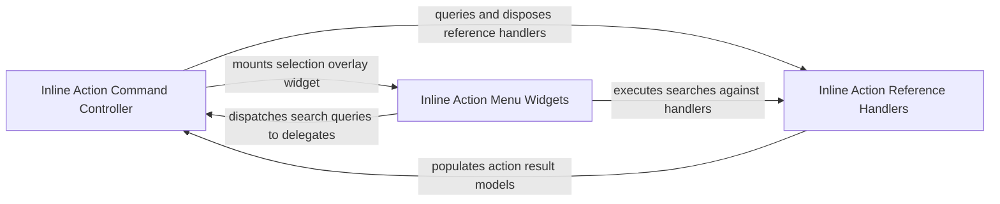

## Details

Handles inline quick-actions and mentions for child pages, dates, reminders, and cross-page references.

### Inline Action Command Controller
Orchestrates inline action editor shortcut commands, overlay lifecycle management, and action delegate interfaces.

**Related Classes/Methods**:

- `frontend.appflowy_flutter.lib.plugins.inline_actions.inline_actions_command.inlineActionsCommandHandler`:26-83
- `frontend.appflowy_flutter.lib.plugins.inline_actions.inline_actions_menu.InlineActionsMenu`:17-211
- `frontend.appflowy_flutter.lib.plugins.inline_actions.inline_actions_service.InlineActionsService`:9-32
- `frontend.appflowy_flutter.lib.plugins.inline_actions.service_handler.InlineActionsDelegate`:3-7
- `frontend.appflowy_flutter.lib.plugins.inline_actions.inline_actions_result.InlineActionsResult`:26-50

**Source Files:**

- `frontend/appflowy_flutter/lib/plugins/inline_actions/inline_actions_command.dart`
  - `frontend.appflowy_flutter.lib.plugins.inline_actions.inline_actions_command.inlineActionsCommand` (L10-L22) - Function
  - `frontend.appflowy_flutter.lib.plugins.inline_actions.inline_actions_command.inlineActionsCommandHandler` (L26-L83) - Function
- `frontend/appflowy_flutter/lib/plugins/inline_actions/inline_actions_menu.dart`
  - `frontend.appflowy_flutter.lib.plugins.inline_actions.inline_actions_menu.InlineActionsMenuService` (L9-L15) - Class
  - `frontend.appflowy_flutter.lib.plugins.inline_actions.inline_actions_menu.InlineActionsMenuService.style` (L10-L10) - Method
  - `frontend.appflowy_flutter.lib.plugins.inline_actions.inline_actions_menu.InlineActionsMenuService.show` (L12-L12) - Method
  - `frontend.appflowy_flutter.lib.plugins.inline_actions.inline_actions_menu.InlineActionsMenuService.dismiss` (L14-L14) - Method
  - `frontend.appflowy_flutter.lib.plugins.inline_actions.inline_actions_menu.InlineActionsMenu` (L17-L211) - Class
  - `frontend.appflowy_flutter.lib.plugins.inline_actions.inline_actions_menu.InlineActionsMenu.InlineActionsMenu` (L18-L26) - Constructor
  - `frontend.appflowy_flutter.lib.plugins.inline_actions.inline_actions_menu.InlineActionsMenu.dismiss` (L43-L60) - Method
  - `frontend.appflowy_flutter.lib.plugins.inline_actions.inline_actions_menu.InlineActionsMenu._onSelectionUpdate` (L62-L62) - Method
  - `frontend.appflowy_flutter.lib.plugins.inline_actions.inline_actions_menu.InlineActionsMenu.show` (L65-L72) - Method
  - `frontend.appflowy_flutter.lib.plugins.inline_actions.inline_actions_menu.InlineActionsMenu._show` (L74-L165) - Method
  - `frontend.appflowy_flutter.lib.plugins.inline_actions.inline_actions_menu.InlineActionsMenu._onSelectionChange` (L167-L183) - Method
  - `frontend.appflowy_flutter.lib.plugins.inline_actions.inline_actions_menu.InlineActionsMenu._getPosition` (L185-L210) - Method
  - `frontend.appflowy_flutter.lib.plugins.inline_actions.inline_actions_menu.InlineActionsMenuStyle` (L213-L255) - Class
  - `frontend.appflowy_flutter.lib.plugins.inline_actions.inline_actions_menu.InlineActionsMenuStyle.InlineActionsMenuStyle` (L214-L220) - Constructor
  - `frontend.appflowy_flutter.lib.plugins.inline_actions.inline_actions_menu.InlineActionsMenuStyle.InlineActionsMenuStyle.light` (L222-L227) - Constructor
  - `frontend.appflowy_flutter.lib.plugins.inline_actions.inline_actions_menu.InlineActionsMenuStyle.InlineActionsMenuStyle.dark` (L229-L234) - Constructor
- `frontend/appflowy_flutter/lib/plugins/inline_actions/inline_actions_result.dart`
  - `frontend.appflowy_flutter.lib.plugins.inline_actions.inline_actions_result.SelectItemHandler` (L5-L10) - Class
  - `frontend.appflowy_flutter.lib.plugins.inline_actions.inline_actions_result.InlineActionsMenuItem` (L12-L24) - Class
  - `frontend.appflowy_flutter.lib.plugins.inline_actions.inline_actions_result.InlineActionsMenuItem.InlineActionsMenuItem` (L13-L18) - Constructor
  - `frontend.appflowy_flutter.lib.plugins.inline_actions.inline_actions_result.InlineActionsResult` (L26-L50) - Class
  - `frontend.appflowy_flutter.lib.plugins.inline_actions.inline_actions_result.InlineActionsResult.InlineActionsResult` (L27-L31) - Constructor
- `frontend/appflowy_flutter/lib/plugins/inline_actions/inline_actions_service.dart`
  - `frontend.appflowy_flutter.lib.plugins.inline_actions.inline_actions_service._InlineActionsProvider` (L5-L7) - Class
  - `frontend.appflowy_flutter.lib.plugins.inline_actions.inline_actions_service._InlineActionsProvider.dispose` (L6-L6) - Method
  - `frontend.appflowy_flutter.lib.plugins.inline_actions.inline_actions_service.InlineActionsService` (L9-L32) - Class
  - `frontend.appflowy_flutter.lib.plugins.inline_actions.inline_actions_service.InlineActionsService.InlineActionsService` (L10-L13) - Constructor
  - `frontend.appflowy_flutter.lib.plugins.inline_actions.inline_actions_service.InlineActionsService.dispose` (L26-L31) - Method
- `frontend/appflowy_flutter/lib/plugins/inline_actions/service_handler.dart`
  - `frontend.appflowy_flutter.lib.plugins.inline_actions.service_handler.InlineActionsDelegate` (L3-L7) - Class
  - `frontend.appflowy_flutter.lib.plugins.inline_actions.service_handler.InlineActionsDelegate.search` (L4-L4) - Method
  - `frontend.appflowy_flutter.lib.plugins.inline_actions.service_handler.InlineActionsDelegate.dispose` (L6-L6) - Method

### Inline Action Reference Handlers
Implements search and creation handlers for references including child pages, dates, page links, and reminders.

**Related Classes/Methods**:

- `frontend.appflowy_flutter.lib.plugins.inline_actions.handlers.child_page.InlineChildPageService`:15-83
- `frontend.appflowy_flutter.lib.plugins.inline_actions.handlers.date_reference.DateReferenceService`:15-214
- `frontend.appflowy_flutter.lib.plugins.inline_actions.handlers.inline_page_reference.InlinePageReferenceService`:28-266
- `frontend.appflowy_flutter.lib.plugins.inline_actions.handlers.reminder_reference.ReminderReferenceService`:24-252

**Source Files:**

- `frontend/appflowy_flutter/lib/plugins/inline_actions/handlers/child_page.dart`
  - `frontend.appflowy_flutter.lib.plugins.inline_actions.handlers.child_page.InlineChildPageService` (L15-L83) - Class
  - `frontend.appflowy_flutter.lib.plugins.inline_actions.handlers.child_page.InlineChildPageService.InlineChildPageService` (L16-L16) - Constructor
  - `frontend.appflowy_flutter.lib.plugins.inline_actions.handlers.child_page.InlineChildPageService.search` (L21-L35) - Method
  - `frontend.appflowy_flutter.lib.plugins.inline_actions.handlers.child_page.InlineChildPageService._onSelected` (L37-L82) - Method
- `frontend/appflowy_flutter/lib/plugins/inline_actions/handlers/date_reference.dart`
  - `frontend.appflowy_flutter.lib.plugins.inline_actions.handlers.date_reference.DateReferenceService` (L15-L214) - Class
  - `frontend.appflowy_flutter.lib.plugins.inline_actions.handlers.date_reference.DateReferenceService.DateReferenceService` (L16-L22) - Constructor
  - `frontend.appflowy_flutter.lib.plugins.inline_actions.handlers.date_reference.DateReferenceService.search` (L32-L51) - Method
  - `frontend.appflowy_flutter.lib.plugins.inline_actions.handlers.date_reference.DateReferenceService._filterOptions` (L53-L74) - Method
  - `frontend.appflowy_flutter.lib.plugins.inline_actions.handlers.date_reference.DateReferenceService._searchDate` (L76-L87) - Method
  - `frontend.appflowy_flutter.lib.plugins.inline_actions.handlers.date_reference.DateReferenceService._searchDateNLP` (L89-L100) - Method
  - `frontend.appflowy_flutter.lib.plugins.inline_actions.handlers.date_reference.DateReferenceService._insertDateReference` (L102-L134) - Method
  - `frontend.appflowy_flutter.lib.plugins.inline_actions.handlers.date_reference.DateReferenceService._setOptions` (L136-L172) - Method
  - `frontend.appflowy_flutter.lib.plugins.inline_actions.handlers.date_reference.DateReferenceService._setLocale` (L176-L183) - Method
  - `frontend.appflowy_flutter.lib.plugins.inline_actions.handlers.date_reference.DateReferenceService._itemFromDate` (L185-L213) - Method
- `frontend/appflowy_flutter/lib/plugins/inline_actions/handlers/inline_page_reference.dart`
  - `frontend.appflowy_flutter.lib.plugins.inline_actions.handlers.inline_page_reference.InlinePageReferenceService` (L28-L266) - Class
  - `frontend.appflowy_flutter.lib.plugins.inline_actions.handlers.inline_page_reference.InlinePageReferenceService.InlinePageReferenceService` (L29-L37) - Constructor
  - `frontend.appflowy_flutter.lib.plugins.inline_actions.handlers.inline_page_reference.InlinePageReferenceService._getRecentViews` (L62-L82) - Method
  - `frontend.appflowy_flutter.lib.plugins.inline_actions.handlers.inline_page_reference.InlinePageReferenceService._getViews` (L87-L101) - Method
  - `frontend.appflowy_flutter.lib.plugins.inline_actions.handlers.inline_page_reference.InlinePageReferenceService.init` (L103-L106) - Method
  - `frontend.appflowy_flutter.lib.plugins.inline_actions.handlers.inline_page_reference.InlinePageReferenceService.dispose` (L109-L115) - Method
  - `frontend.appflowy_flutter.lib.plugins.inline_actions.handlers.inline_page_reference.InlinePageReferenceService.search` (L118-L154) - Method
  - `frontend.appflowy_flutter.lib.plugins.inline_actions.handlers.inline_page_reference.InlinePageReferenceService._onInsertPageRef` (L156-L195) - Method
  - `frontend.appflowy_flutter.lib.plugins.inline_actions.handlers.inline_page_reference.InlinePageReferenceService._onInsertLinkRef` (L197-L232) - Method
  - `frontend.appflowy_flutter.lib.plugins.inline_actions.handlers.inline_page_reference.InlinePageReferenceService._fromView` (L234-L253) - Method
- `frontend/appflowy_flutter/lib/plugins/inline_actions/handlers/reminder_reference.dart`
  - `frontend.appflowy_flutter.lib.plugins.inline_actions.handlers.reminder_reference.ReminderReferenceService` (L24-L252) - Class
  - `frontend.appflowy_flutter.lib.plugins.inline_actions.handlers.reminder_reference.ReminderReferenceService.ReminderReferenceService` (L25-L31) - Constructor
  - `frontend.appflowy_flutter.lib.plugins.inline_actions.handlers.reminder_reference.ReminderReferenceService.search` (L41-L57) - Method
  - `frontend.appflowy_flutter.lib.plugins.inline_actions.handlers.reminder_reference.ReminderReferenceService._groupFromResults` (L59-L69) - Method
  - `frontend.appflowy_flutter.lib.plugins.inline_actions.handlers.reminder_reference.ReminderReferenceService._filterOptions` (L71-L92) - Method
  - `frontend.appflowy_flutter.lib.plugins.inline_actions.handlers.reminder_reference.ReminderReferenceService._searchDate` (L94-L105) - Method
  - `frontend.appflowy_flutter.lib.plugins.inline_actions.handlers.reminder_reference.ReminderReferenceService._searchDateNLP` (L107-L123) - Method
  - `frontend.appflowy_flutter.lib.plugins.inline_actions.handlers.reminder_reference.ReminderReferenceService._insertReminderReference` (L125-L164) - Method
  - `frontend.appflowy_flutter.lib.plugins.inline_actions.handlers.reminder_reference.ReminderReferenceService._setOptions` (L166-L198) - Method
  - `frontend.appflowy_flutter.lib.plugins.inline_actions.handlers.reminder_reference.ReminderReferenceService._setLocale` (L202-L209) - Method
  - `frontend.appflowy_flutter.lib.plugins.inline_actions.handlers.reminder_reference.ReminderReferenceService._itemFromDate` (L211-L234) - Method
  - `frontend.appflowy_flutter.lib.plugins.inline_actions.handlers.reminder_reference.ReminderReferenceService._reminderFromDate` (L236-L251) - Method

### Inline Action Menu Widgets
Renders the interactive overlay popup menu, categorized result groups, and keyboard selection handling.

**Related Classes/Methods**:

- `frontend.appflowy_flutter.lib.plugins.inline_actions.widgets.inline_actions_handler.InlineActionsHandler`:54-80

**Source Files:**

- `frontend/appflowy_flutter/lib/plugins/inline_actions/widgets/inline_actions_handler.dart`
  - `frontend.appflowy_flutter.lib.plugins.inline_actions.widgets.inline_actions_handler._StartWithsSort.sortByStartsWithKeyword` (L25-L49) - Method
  - `frontend.appflowy_flutter.lib.plugins.inline_actions.widgets.inline_actions_handler.InlineActionsHandler` (L54-L80) - Class
  - `frontend.appflowy_flutter.lib.plugins.inline_actions.widgets.inline_actions_handler.InlineActionsHandler.InlineActionsHandler` (L55-L66) - Constructor
  - `frontend.appflowy_flutter.lib.plugins.inline_actions.widgets.inline_actions_handler.InlineActionsHandler.createState` (L79-L79) - Method
  - `frontend.appflowy_flutter.lib.plugins.inline_actions.widgets.inline_actions_handler._InlineActionsHandlerState` (L82-L468) - Class
  - `frontend.appflowy_flutter.lib.plugins.inline_actions.widgets.inline_actions_handler._InlineActionsHandlerState.search=` (L91-L94) - Method
  - `frontend.appflowy_flutter.lib.plugins.inline_actions.widgets.inline_actions_handler._InlineActionsHandlerState._doSearch` (L96-L124) - Method
  - `frontend.appflowy_flutter.lib.plugins.inline_actions.widgets.inline_actions_handler._InlineActionsHandlerState._resetSelection` (L126-L129) - Method
  - `frontend.appflowy_flutter.lib.plugins.inline_actions.widgets.inline_actions_handler._InlineActionsHandlerState.initState` (L135-L142) - Method
  - `frontend.appflowy_flutter.lib.plugins.inline_actions.widgets.inline_actions_handler._InlineActionsHandlerState.dispose` (L145-L149) - Method
  - `frontend.appflowy_flutter.lib.plugins.inline_actions.widgets.inline_actions_handler._InlineActionsHandlerState.build` (L152-L208) - Method
  - `frontend.appflowy_flutter.lib.plugins.inline_actions.widgets.inline_actions_handler._InlineActionsHandlerState.noResults` (L210-L211) - Method
  - `frontend.appflowy_flutter.lib.plugins.inline_actions.widgets.inline_actions_handler._InlineActionsHandlerState.groupLength` (L213-L213) - Method
  - `frontend.appflowy_flutter.lib.plugins.inline_actions.widgets.inline_actions_handler._InlineActionsHandlerState.lengthOfGroup` (L215-L216) - Method
  - `frontend.appflowy_flutter.lib.plugins.inline_actions.widgets.inline_actions_handler._InlineActionsHandlerState.handlerOf` (L218-L219) - Method
  - `frontend.appflowy_flutter.lib.plugins.inline_actions.widgets.inline_actions_handler._InlineActionsHandlerState.onKeyEvent` (L221-L335) - Method
  - `frontend.appflowy_flutter.lib.plugins.inline_actions.widgets.inline_actions_handler._InlineActionsHandlerState._insertCharacter` (L337-L359) - Method
  - `frontend.appflowy_flutter.lib.plugins.inline_actions.widgets.inline_actions_handler._InlineActionsHandlerState._moveSelection` (L361-L391) - Method
  - `frontend.appflowy_flutter.lib.plugins.inline_actions.widgets.inline_actions_handler._InlineActionsHandlerState._scrollToItem` (L393-L435) - Method
  - `frontend.appflowy_flutter.lib.plugins.inline_actions.widgets.inline_actions_handler._InlineActionsHandlerState._deleteCharacterAtSelection` (L437-L453) - Method
  - `frontend.appflowy_flutter.lib.plugins.inline_actions.widgets.inline_actions_handler._InlineActionsHandlerState._canDeleteLastCharacter` (L455-L467) - Method
- `frontend/appflowy_flutter/lib/plugins/inline_actions/widgets/inline_actions_menu_group.dart`
  - `frontend.appflowy_flutter.lib.plugins.inline_actions.widgets.inline_actions_menu_group.InlineActionsGroup` (L10-L64) - Class
  - `frontend.appflowy_flutter.lib.plugins.inline_actions.widgets.inline_actions_menu_group.InlineActionsGroup.InlineActionsGroup` (L11-L23) - Constructor
  - `frontend.appflowy_flutter.lib.plugins.inline_actions.widgets.inline_actions_menu_group.InlineActionsGroup.build` (L38-L63) - Method
  - `frontend.appflowy_flutter.lib.plugins.inline_actions.widgets.inline_actions_menu_group.InlineActionsWidget` (L66-L90) - Class
  - `frontend.appflowy_flutter.lib.plugins.inline_actions.widgets.inline_actions_menu_group.InlineActionsWidget.InlineActionsWidget` (L67-L77) - Constructor
  - `frontend.appflowy_flutter.lib.plugins.inline_actions.widgets.inline_actions_menu_group.InlineActionsWidget.createState` (L89-L89) - Method
  - `frontend.appflowy_flutter.lib.plugins.inline_actions.widgets.inline_actions_menu_group._InlineActionsWidgetState` (L92-L134) - Class
  - `frontend.appflowy_flutter.lib.plugins.inline_actions.widgets.inline_actions_menu_group._InlineActionsWidgetState.build` (L94-L123) - Method
  - `frontend.appflowy_flutter.lib.plugins.inline_actions.widgets.inline_actions_menu_group._InlineActionsWidgetState._onPressed` (L125-L133) - Method

### [FAQ](https://github.com/CodeBoarding/GeneratedOnBoardings/tree/main?tab=readme-ov-file#faq)