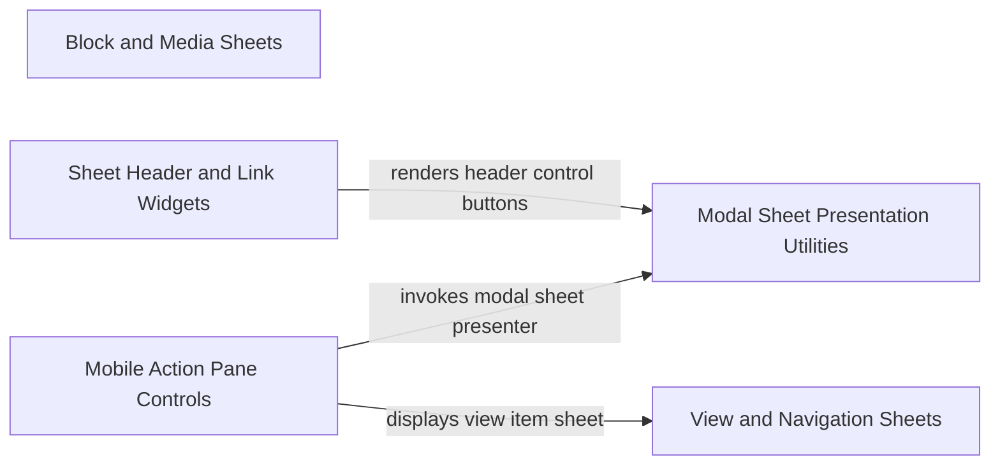

## Details

Provides reusable modal bottom sheets, contextual slide action panes, and bottom navigation bar components.

### View and Navigation Sheets
Renders view item action sheets, page configuration options, renaming modals, and mobile navigation bar items.

**Related Classes/Methods**:

- `frontend.appflowy_flutter.lib.mobile.presentation.bottom_sheet.bottom_sheet_view_item.MobileViewItemBottomSheet`:21-36
- `frontend.appflowy_flutter.lib.mobile.presentation.bottom_sheet.bottom_sheet_view_page.ViewPageBottomSheet`:53-67
- `frontend.appflowy_flutter.lib.mobile.presentation.bottom_sheet.bottom_sheet_rename_widget.MobileBottomSheetRenameWidget`:6-21
- `frontend.appflowy_flutter.lib.mobile.presentation.mobile_bottom_navigation_bar.MobileBottomNavigationBar`:91-104

**Source Files:**

- `frontend/appflowy_flutter/lib/mobile/presentation/bottom_sheet/bottom_sheet_rename_widget.dart`
  - `frontend.appflowy_flutter.lib.mobile.presentation.bottom_sheet.bottom_sheet_rename_widget.MobileBottomSheetRenameWidget` (L6-L21) - Class
  - `frontend.appflowy_flutter.lib.mobile.presentation.bottom_sheet.bottom_sheet_rename_widget.MobileBottomSheetRenameWidget.MobileBottomSheetRenameWidget` (L7-L12) - Constructor
  - `frontend.appflowy_flutter.lib.mobile.presentation.bottom_sheet.bottom_sheet_rename_widget.MobileBottomSheetRenameWidget.createState` (L19-L20) - Method
  - `frontend.appflowy_flutter.lib.mobile.presentation.bottom_sheet.bottom_sheet_rename_widget._MobileBottomSheetRenameWidgetState` (L23-L78) - Class
  - `frontend.appflowy_flutter.lib.mobile.presentation.bottom_sheet.bottom_sheet_rename_widget._MobileBottomSheetRenameWidgetState.initState` (L28-L35) - Method
  - `frontend.appflowy_flutter.lib.mobile.presentation.bottom_sheet.bottom_sheet_rename_widget._MobileBottomSheetRenameWidgetState.dispose` (L38-L41) - Method
  - `frontend.appflowy_flutter.lib.mobile.presentation.bottom_sheet.bottom_sheet_rename_widget._MobileBottomSheetRenameWidgetState.build` (L44-L77) - Method
- `frontend/appflowy_flutter/lib/mobile/presentation/bottom_sheet/bottom_sheet_view_item.dart`
  - `frontend.appflowy_flutter.lib.mobile.presentation.bottom_sheet.bottom_sheet_view_item.MobileBottomSheetType` (L16-L19) - Enum
  - `frontend.appflowy_flutter.lib.mobile.presentation.bottom_sheet.bottom_sheet_view_item.MobileBottomSheetType.view` (L17-L17) - Enum
  - `frontend.appflowy_flutter.lib.mobile.presentation.bottom_sheet.bottom_sheet_view_item.MobileBottomSheetType.rename` (L18-L18) - Enum
  - `frontend.appflowy_flutter.lib.mobile.presentation.bottom_sheet.bottom_sheet_view_item.MobileViewItemBottomSheet` (L21-L36) - Class
  - `frontend.appflowy_flutter.lib.mobile.presentation.bottom_sheet.bottom_sheet_view_item.MobileViewItemBottomSheet.MobileViewItemBottomSheet` (L22-L27) - Constructor
  - `frontend.appflowy_flutter.lib.mobile.presentation.bottom_sheet.bottom_sheet_view_item.MobileViewItemBottomSheet.createState` (L34-L35) - Method
  - `frontend.appflowy_flutter.lib.mobile.presentation.bottom_sheet.bottom_sheet_view_item._MobileViewItemBottomSheetState` (L38-L152) - Class
  - `frontend.appflowy_flutter.lib.mobile.presentation.bottom_sheet.bottom_sheet_view_item._MobileViewItemBottomSheetState.initState` (L43-L48) - Method
  - `frontend.appflowy_flutter.lib.mobile.presentation.bottom_sheet.bottom_sheet_view_item._MobileViewItemBottomSheetState.build` (L51-L110) - Method
  - `frontend.appflowy_flutter.lib.mobile.presentation.bottom_sheet.bottom_sheet_view_item._MobileViewItemBottomSheetState._removeFromRecent` (L112-L122) - Method
  - `frontend.appflowy_flutter.lib.mobile.presentation.bottom_sheet.bottom_sheet_view_item._MobileViewItemBottomSheetState._showConfirmDialog` (L124-L151) - Method
- `frontend/appflowy_flutter/lib/mobile/presentation/bottom_sheet/bottom_sheet_view_item_body.dart`
  - `frontend.appflowy_flutter.lib.mobile.presentation.bottom_sheet.bottom_sheet_view_item_body.MobileViewItemBottomSheetBodyAction` (L9-L18) - Enum
  - `frontend.appflowy_flutter.lib.mobile.presentation.bottom_sheet.bottom_sheet_view_item_body.MobileViewItemBottomSheetBodyAction.rename` (L10-L10) - Enum
  - `frontend.appflowy_flutter.lib.mobile.presentation.bottom_sheet.bottom_sheet_view_item_body.MobileViewItemBottomSheetBodyAction.duplicate` (L11-L11) - Enum
  - `frontend.appflowy_flutter.lib.mobile.presentation.bottom_sheet.bottom_sheet_view_item_body.MobileViewItemBottomSheetBodyAction.share` (L12-L12) - Enum
  - `frontend.appflowy_flutter.lib.mobile.presentation.bottom_sheet.bottom_sheet_view_item_body.MobileViewItemBottomSheetBodyAction.delete` (L13-L13) - Enum
  - `frontend.appflowy_flutter.lib.mobile.presentation.bottom_sheet.bottom_sheet_view_item_body.MobileViewItemBottomSheetBodyAction.addToFavorites` (L14-L14) - Enum
  - `frontend.appflowy_flutter.lib.mobile.presentation.bottom_sheet.bottom_sheet_view_item_body.MobileViewItemBottomSheetBodyAction.removeFromFavorites` (L15-L15) - Enum
  - `frontend.appflowy_flutter.lib.mobile.presentation.bottom_sheet.bottom_sheet_view_item_body.MobileViewItemBottomSheetBodyAction.divider` (L16-L16) - Enum
  - `frontend.appflowy_flutter.lib.mobile.presentation.bottom_sheet.bottom_sheet_view_item_body.MobileViewItemBottomSheetBodyAction.removeFromRecent` (L17-L17) - Enum
  - `frontend.appflowy_flutter.lib.mobile.presentation.bottom_sheet.bottom_sheet_view_item_body.MobileViewItemBottomSheetBody` (L20-L159) - Class
  - `frontend.appflowy_flutter.lib.mobile.presentation.bottom_sheet.bottom_sheet_view_item_body.MobileViewItemBottomSheetBody.MobileViewItemBottomSheetBody` (L21-L26) - Constructor
  - `frontend.appflowy_flutter.lib.mobile.presentation.bottom_sheet.bottom_sheet_view_item_body.MobileViewItemBottomSheetBody.build` (L33-L39) - Method
  - `frontend.appflowy_flutter.lib.mobile.presentation.bottom_sheet.bottom_sheet_view_item_body.MobileViewItemBottomSheetBody._buildActionButton` (L41-L158) - Method
- `frontend/appflowy_flutter/lib/mobile/presentation/bottom_sheet/bottom_sheet_view_page.dart`
  - `frontend.appflowy_flutter.lib.mobile.presentation.bottom_sheet.bottom_sheet_view_page.MobileViewBottomSheetBodyAction` (L16-L39) - Enum
  - `frontend.appflowy_flutter.lib.mobile.presentation.bottom_sheet.bottom_sheet_view_page.MobileViewBottomSheetBodyAction.undo` (L17-L17) - Enum
  - `frontend.appflowy_flutter.lib.mobile.presentation.bottom_sheet.bottom_sheet_view_page.MobileViewBottomSheetBodyAction.redo` (L18-L18) - Enum
  - `frontend.appflowy_flutter.lib.mobile.presentation.bottom_sheet.bottom_sheet_view_page.MobileViewBottomSheetBodyAction.rename` (L19-L19) - Enum
  - `frontend.appflowy_flutter.lib.mobile.presentation.bottom_sheet.bottom_sheet_view_page.MobileViewBottomSheetBodyAction.duplicate` (L20-L20) - Enum
  - `frontend.appflowy_flutter.lib.mobile.presentation.bottom_sheet.bottom_sheet_view_page.MobileViewBottomSheetBodyAction.delete` (L21-L21) - Enum
  - `frontend.appflowy_flutter.lib.mobile.presentation.bottom_sheet.bottom_sheet_view_page.MobileViewBottomSheetBodyAction.addToFavorites` (L22-L22) - Enum
  - `frontend.appflowy_flutter.lib.mobile.presentation.bottom_sheet.bottom_sheet_view_page.MobileViewBottomSheetBodyAction.removeFromFavorites` (L23-L23) - Enum
  - `frontend.appflowy_flutter.lib.mobile.presentation.bottom_sheet.bottom_sheet_view_page.MobileViewBottomSheetBodyAction.helpCenter` (L24-L24) - Enum
  - `frontend.appflowy_flutter.lib.mobile.presentation.bottom_sheet.bottom_sheet_view_page.MobileViewBottomSheetBodyAction.publish` (L25-L25) - Enum
  - `frontend.appflowy_flutter.lib.mobile.presentation.bottom_sheet.bottom_sheet_view_page.MobileViewBottomSheetBodyAction.unpublish` (L26-L26) - Enum
  - `frontend.appflowy_flutter.lib.mobile.presentation.bottom_sheet.bottom_sheet_view_page.MobileViewBottomSheetBodyAction.copyPublishLink` (L27-L27) - Enum
  - `frontend.appflowy_flutter.lib.mobile.presentation.bottom_sheet.bottom_sheet_view_page.MobileViewBottomSheetBodyAction.visitSite` (L28-L28) - Enum
  - `frontend.appflowy_flutter.lib.mobile.presentation.bottom_sheet.bottom_sheet_view_page.MobileViewBottomSheetBodyAction.copyShareLink` (L29-L29) - Enum
  - `frontend.appflowy_flutter.lib.mobile.presentation.bottom_sheet.bottom_sheet_view_page.MobileViewBottomSheetBodyAction.updatePathName` (L30-L30) - Enum
  - `frontend.appflowy_flutter.lib.mobile.presentation.bottom_sheet.bottom_sheet_view_page.MobileViewBottomSheetBodyAction.lockPage` (L31-L31) - Enum
  - `frontend.appflowy_flutter.lib.mobile.presentation.bottom_sheet.bottom_sheet_view_page.MobileViewBottomSheetBodyActionArguments` (L41-L43) - Class
  - `frontend.appflowy_flutter.lib.mobile.presentation.bottom_sheet.bottom_sheet_view_page.MobileViewBottomSheetBodyActionCallback` (L45-L51) - Class
  - `frontend.appflowy_flutter.lib.mobile.presentation.bottom_sheet.bottom_sheet_view_page.ViewPageBottomSheet` (L53-L67) - Class
  - `frontend.appflowy_flutter.lib.mobile.presentation.bottom_sheet.bottom_sheet_view_page.ViewPageBottomSheet.ViewPageBottomSheet` (L54-L59) - Constructor
  - `frontend.appflowy_flutter.lib.mobile.presentation.bottom_sheet.bottom_sheet_view_page.ViewPageBottomSheet.createState` (L66-L66) - Method
  - `frontend.appflowy_flutter.lib.mobile.presentation.bottom_sheet.bottom_sheet_view_page._ViewPageBottomSheetState` (L69-L100) - Class
  - `frontend.appflowy_flutter.lib.mobile.presentation.bottom_sheet.bottom_sheet_view_page._ViewPageBottomSheetState.build` (L73-L99) - Method
  - `frontend.appflowy_flutter.lib.mobile.presentation.bottom_sheet.bottom_sheet_view_page.MobileViewBottomSheetBody` (L102-L256) - Class
  - `frontend.appflowy_flutter.lib.mobile.presentation.bottom_sheet.bottom_sheet_view_page.MobileViewBottomSheetBody.MobileViewBottomSheetBody` (L103-L107) - Constructor
  - `frontend.appflowy_flutter.lib.mobile.presentation.bottom_sheet.bottom_sheet_view_page.MobileViewBottomSheetBody.build` (L113-L200) - Method
  - `frontend.appflowy_flutter.lib.mobile.presentation.bottom_sheet.bottom_sheet_view_page.MobileViewBottomSheetBody._buildPublishActions` (L202-L253) - Method
  - `frontend.appflowy_flutter.lib.mobile.presentation.bottom_sheet.bottom_sheet_view_page.MobileViewBottomSheetBody._divider` (L255-L255) - Method
  - `frontend.appflowy_flutter.lib.mobile.presentation.bottom_sheet.bottom_sheet_view_page._LockPageRightIconBuilder` (L258-L289) - Class
  - `frontend.appflowy_flutter.lib.mobile.presentation.bottom_sheet.bottom_sheet_view_page._LockPageRightIconBuilder._LockPageRightIconBuilder` (L259-L261) - Constructor
  - `frontend.appflowy_flutter.lib.mobile.presentation.bottom_sheet.bottom_sheet_view_page._LockPageRightIconBuilder.build` (L266-L288) - Method
- `frontend/appflowy_flutter/lib/mobile/presentation/mobile_bottom_navigation_bar.dart`
  - `frontend.appflowy_flutter.lib.mobile.presentation.mobile_bottom_navigation_bar.BottomNavigationBarActionType` (L25-L28) - Enum
  - `frontend.appflowy_flutter.lib.mobile.presentation.mobile_bottom_navigation_bar.BottomNavigationBarActionType.home` (L26-L26) - Enum
  - `frontend.appflowy_flutter.lib.mobile.presentation.mobile_bottom_navigation_bar.BottomNavigationBarActionType.notificationMultiSelect` (L27-L27) - Enum
  - `frontend.appflowy_flutter.lib.mobile.presentation.mobile_bottom_navigation_bar.BottomNavigationBarItemType` (L37-L84) - Enum
  - `frontend.appflowy_flutter.lib.mobile.presentation.mobile_bottom_navigation_bar.BottomNavigationBarItemType.home` (L38-L38) - Enum
  - `frontend.appflowy_flutter.lib.mobile.presentation.mobile_bottom_navigation_bar.BottomNavigationBarItemType.search` (L39-L39) - Enum
  - `frontend.appflowy_flutter.lib.mobile.presentation.mobile_bottom_navigation_bar.BottomNavigationBarItemType.add` (L40-L40) - Enum
  - `frontend.appflowy_flutter.lib.mobile.presentation.mobile_bottom_navigation_bar.BottomNavigationBarItemType.notification` (L41-L41) - Enum
  - `frontend.appflowy_flutter.lib.mobile.presentation.mobile_bottom_navigation_bar.BottomNavigationBarItemType.label` (L43-L43) - Method
  - `frontend.appflowy_flutter.lib.mobile.presentation.mobile_bottom_navigation_bar.BottomNavigationBarItemType.routeName` (L44-L51) - Method
  - `frontend.appflowy_flutter.lib.mobile.presentation.mobile_bottom_navigation_bar.BottomNavigationBarItemType.valueKey` (L53-L55) - Method
  - `frontend.appflowy_flutter.lib.mobile.presentation.mobile_bottom_navigation_bar.BottomNavigationBarItemType.iconWidget` (L57-L64) - Method
  - `frontend.appflowy_flutter.lib.mobile.presentation.mobile_bottom_navigation_bar.BottomNavigationBarItemType.activeIcon` (L66-L74) - Method
  - `frontend.appflowy_flutter.lib.mobile.presentation.mobile_bottom_navigation_bar.BottomNavigationBarItemType.navigationItem` (L76-L83) - Method
  - `frontend.appflowy_flutter.lib.mobile.presentation.mobile_bottom_navigation_bar.MobileBottomNavigationBar` (L91-L104) - Class
  - `frontend.appflowy_flutter.lib.mobile.presentation.mobile_bottom_navigation_bar.MobileBottomNavigationBar.MobileBottomNavigationBar` (L93-L96) - Constructor
  - `frontend.appflowy_flutter.lib.mobile.presentation.mobile_bottom_navigation_bar.MobileBottomNavigationBar.createState` (L102-L103) - Method
  - `frontend.appflowy_flutter.lib.mobile.presentation.mobile_bottom_navigation_bar._MobileBottomNavigationBarState` (L106-L171) - Class
  - `frontend.appflowy_flutter.lib.mobile.presentation.mobile_bottom_navigation_bar._MobileBottomNavigationBarState.initState` (L110-L114) - Method
  - `frontend.appflowy_flutter.lib.mobile.presentation.mobile_bottom_navigation_bar._MobileBottomNavigationBarState.dispose` (L117-L120) - Method
  - `frontend.appflowy_flutter.lib.mobile.presentation.mobile_bottom_navigation_bar._MobileBottomNavigationBarState.build` (L123-L142) - Method
  - `frontend.appflowy_flutter.lib.mobile.presentation.mobile_bottom_navigation_bar._MobileBottomNavigationBarState._buildHomePageNavigationBar` (L144-L148) - Method
  - `frontend.appflowy_flutter.lib.mobile.presentation.mobile_bottom_navigation_bar._MobileBottomNavigationBarState._buildNotificationNavigationBar` (L150-L152) - Method
  - `frontend.appflowy_flutter.lib.mobile.presentation.mobile_bottom_navigation_bar._MobileBottomNavigationBarState._transitionBuilder` (L155-L166) - Method
  - `frontend.appflowy_flutter.lib.mobile.presentation.mobile_bottom_navigation_bar._MobileBottomNavigationBarState._animate` (L168-L170) - Method
  - `frontend.appflowy_flutter.lib.mobile.presentation.mobile_bottom_navigation_bar._NotificationNavigationBarItemIcon` (L173-L216) - Class
  - `frontend.appflowy_flutter.lib.mobile.presentation.mobile_bottom_navigation_bar._NotificationNavigationBarItemIcon._NotificationNavigationBarItemIcon` (L174-L176) - Constructor
  - `frontend.appflowy_flutter.lib.mobile.presentation.mobile_bottom_navigation_bar._NotificationNavigationBarItemIcon.build` (L181-L215) - Method
  - `frontend.appflowy_flutter.lib.mobile.presentation.mobile_bottom_navigation_bar._HomePageNavigationBar` (L218-L297) - Class
  - `frontend.appflowy_flutter.lib.mobile.presentation.mobile_bottom_navigation_bar._HomePageNavigationBar._HomePageNavigationBar` (L219-L221) - Constructor
  - `frontend.appflowy_flutter.lib.mobile.presentation.mobile_bottom_navigation_bar._HomePageNavigationBar.build` (L226-L255) - Method
  - `frontend.appflowy_flutter.lib.mobile.presentation.mobile_bottom_navigation_bar._HomePageNavigationBar._getThemeData` (L257-L268) - Method
  - `frontend.appflowy_flutter.lib.mobile.presentation.mobile_bottom_navigation_bar._HomePageNavigationBar._onTap` (L272-L296) - Method
  - `frontend.appflowy_flutter.lib.mobile.presentation.mobile_bottom_navigation_bar._NotificationNavigationBar` (L299-L384) - Class
  - `frontend.appflowy_flutter.lib.mobile.presentation.mobile_bottom_navigation_bar._NotificationNavigationBar._NotificationNavigationBar` (L300-L300) - Constructor
  - `frontend.appflowy_flutter.lib.mobile.presentation.mobile_bottom_navigation_bar._NotificationNavigationBar.build` (L303-L350) - Method
  - `frontend.appflowy_flutter.lib.mobile.presentation.mobile_bottom_navigation_bar._NotificationNavigationBar._onMarkAsRead` (L352-L367) - Method
  - `frontend.appflowy_flutter.lib.mobile.presentation.mobile_bottom_navigation_bar._NotificationNavigationBar._onArchive` (L369-L383) - Method
  - `frontend.appflowy_flutter.lib.mobile.presentation.mobile_bottom_navigation_bar.<unnamed extension>.backgroundColor` (L387-L391) - Method
  - `frontend.appflowy_flutter.lib.mobile.presentation.mobile_bottom_navigation_bar.<unnamed extension>.borderColor` (L393-L397) - Method
  - `frontend.appflowy_flutter.lib.mobile.presentation.mobile_bottom_navigation_bar.<unnamed extension>.border` (L399-L403) - Method

### Block and Media Sheets
Provides bottom sheet widgets and content handlers for block operations, action buttons, drag handlers, and media uploads.

**Related Classes/Methods**:

- `frontend.appflowy_flutter.lib.mobile.presentation.bottom_sheet.bottom_sheet_action_widget.BottomSheetActionWidget`:6-56
- `frontend.appflowy_flutter.lib.mobile.presentation.bottom_sheet.bottom_sheet_block_action_widget.BlockActionBottomSheet`:15-78
- `frontend.appflowy_flutter.lib.mobile.presentation.bottom_sheet.bottom_sheet_media_upload.MobileMediaUploadSheetContent`:12-96

**Source Files:**

- `frontend/appflowy_flutter/lib/mobile/presentation/bottom_sheet/bottom_sheet_action_widget.dart`
  - `frontend.appflowy_flutter.lib.mobile.presentation.bottom_sheet.bottom_sheet_action_widget.BottomSheetActionWidget` (L6-L56) - Class
  - `frontend.appflowy_flutter.lib.mobile.presentation.bottom_sheet.bottom_sheet_action_widget.BottomSheetActionWidget.BottomSheetActionWidget` (L7-L13) - Constructor
  - `frontend.appflowy_flutter.lib.mobile.presentation.bottom_sheet.bottom_sheet_action_widget.BottomSheetActionWidget.build` (L21-L55) - Method
- `frontend/appflowy_flutter/lib/mobile/presentation/bottom_sheet/bottom_sheet_block_action_widget.dart`
  - `frontend.appflowy_flutter.lib.mobile.presentation.bottom_sheet.bottom_sheet_block_action_widget.BlockActionBottomSheetType` (L7-L12) - Enum
  - `frontend.appflowy_flutter.lib.mobile.presentation.bottom_sheet.bottom_sheet_block_action_widget.BlockActionBottomSheetType.delete` (L8-L8) - Enum
  - `frontend.appflowy_flutter.lib.mobile.presentation.bottom_sheet.bottom_sheet_block_action_widget.BlockActionBottomSheetType.duplicate` (L9-L9) - Enum
  - `frontend.appflowy_flutter.lib.mobile.presentation.bottom_sheet.bottom_sheet_block_action_widget.BlockActionBottomSheetType.insertAbove` (L10-L10) - Enum
  - `frontend.appflowy_flutter.lib.mobile.presentation.bottom_sheet.bottom_sheet_block_action_widget.BlockActionBottomSheetType.insertBelow` (L11-L11) - Enum
  - `frontend.appflowy_flutter.lib.mobile.presentation.bottom_sheet.bottom_sheet_block_action_widget.BlockActionBottomSheet` (L15-L78) - Class
  - `frontend.appflowy_flutter.lib.mobile.presentation.bottom_sheet.bottom_sheet_block_action_widget.BlockActionBottomSheet.BlockActionBottomSheet` (L16-L20) - Constructor
  - `frontend.appflowy_flutter.lib.mobile.presentation.bottom_sheet.bottom_sheet_block_action_widget.BlockActionBottomSheet.build` (L26-L77) - Method
- `frontend/appflowy_flutter/lib/mobile/presentation/bottom_sheet/bottom_sheet_drag_handler.dart`
  - `frontend.appflowy_flutter.lib.mobile.presentation.bottom_sheet.bottom_sheet_drag_handler.MobileBottomSheetDragHandler` (L3-L20) - Class
  - `frontend.appflowy_flutter.lib.mobile.presentation.bottom_sheet.bottom_sheet_drag_handler.MobileBottomSheetDragHandler.MobileBottomSheetDragHandler` (L4-L4) - Constructor
  - `frontend.appflowy_flutter.lib.mobile.presentation.bottom_sheet.bottom_sheet_drag_handler.MobileBottomSheetDragHandler.build` (L7-L19) - Method
- `frontend/appflowy_flutter/lib/mobile/presentation/bottom_sheet/bottom_sheet_media_upload.dart`
  - `frontend.appflowy_flutter.lib.mobile.presentation.bottom_sheet.bottom_sheet_media_upload.MobileMediaUploadSheetContent` (L12-L96) - Class
  - `frontend.appflowy_flutter.lib.mobile.presentation.bottom_sheet.bottom_sheet_media_upload.MobileMediaUploadSheetContent.MobileMediaUploadSheetContent` (L13-L13) - Constructor
  - `frontend.appflowy_flutter.lib.mobile.presentation.bottom_sheet.bottom_sheet_media_upload.MobileMediaUploadSheetContent.build` (L18-L60) - Method
  - `frontend.appflowy_flutter.lib.mobile.presentation.bottom_sheet.bottom_sheet_media_upload.MobileMediaUploadSheetContent._onInsertNetworkFile` (L62-L95) - Method

### Modal Sheet Presentation Utilities
Encapsulates bottom sheet presentation functions, animated modal transitions, and reusable header action buttons.

**Related Classes/Methods**:

- `frontend.appflowy_flutter.lib.mobile.presentation.bottom_sheet.show_mobile_bottom_sheet.showMobileBottomSheet`:26-209
- `frontend.appflowy_flutter.lib.mobile.presentation.bottom_sheet.bottom_sheet_buttons.BottomSheetCloseButton`:7-31
- `frontend.appflowy_flutter.lib.mobile.presentation.bottom_sheet.bottom_sheet_buttons.BottomSheetDoneButton`:33-56

**Source Files:**

- `frontend/appflowy_flutter/lib/mobile/presentation/bottom_sheet/bottom_sheet_buttons.dart`
  - `frontend.appflowy_flutter.lib.mobile.presentation.bottom_sheet.bottom_sheet_buttons.BottomSheetCloseButton` (L7-L31) - Class
  - `frontend.appflowy_flutter.lib.mobile.presentation.bottom_sheet.bottom_sheet_buttons.BottomSheetCloseButton.BottomSheetCloseButton` (L8-L11) - Constructor
  - `frontend.appflowy_flutter.lib.mobile.presentation.bottom_sheet.bottom_sheet_buttons.BottomSheetCloseButton.build` (L16-L30) - Method
  - `frontend.appflowy_flutter.lib.mobile.presentation.bottom_sheet.bottom_sheet_buttons.BottomSheetDoneButton` (L33-L56) - Class
  - `frontend.appflowy_flutter.lib.mobile.presentation.bottom_sheet.bottom_sheet_buttons.BottomSheetDoneButton.BottomSheetDoneButton` (L34-L37) - Constructor
  - `frontend.appflowy_flutter.lib.mobile.presentation.bottom_sheet.bottom_sheet_buttons.BottomSheetDoneButton.build` (L42-L55) - Method
  - `frontend.appflowy_flutter.lib.mobile.presentation.bottom_sheet.bottom_sheet_buttons.BottomSheetRemoveButton` (L58-L81) - Class
  - `frontend.appflowy_flutter.lib.mobile.presentation.bottom_sheet.bottom_sheet_buttons.BottomSheetRemoveButton.BottomSheetRemoveButton` (L59-L62) - Constructor
  - `frontend.appflowy_flutter.lib.mobile.presentation.bottom_sheet.bottom_sheet_buttons.BottomSheetRemoveButton.build` (L67-L80) - Method
  - `frontend.appflowy_flutter.lib.mobile.presentation.bottom_sheet.bottom_sheet_buttons.BottomSheetBackButton` (L83-L107) - Class
  - `frontend.appflowy_flutter.lib.mobile.presentation.bottom_sheet.bottom_sheet_buttons.BottomSheetBackButton.BottomSheetBackButton` (L84-L87) - Constructor
  - `frontend.appflowy_flutter.lib.mobile.presentation.bottom_sheet.bottom_sheet_buttons.BottomSheetBackButton.build` (L92-L106) - Method
- `frontend/appflowy_flutter/lib/mobile/presentation/bottom_sheet/show_mobile_bottom_sheet.dart`
  - `frontend.appflowy_flutter.lib.mobile.presentation.bottom_sheet.show_mobile_bottom_sheet.BottomSheetPaddingExtension.bottomSheetPadding` (L10-L23) - Method
  - `frontend.appflowy_flutter.lib.mobile.presentation.bottom_sheet.show_mobile_bottom_sheet.showMobileBottomSheet` (L26-L209) - Function
  - `frontend.appflowy_flutter.lib.mobile.presentation.bottom_sheet.show_mobile_bottom_sheet.BottomSheetHeader` (L211-L297) - Class
  - `frontend.appflowy_flutter.lib.mobile.presentation.bottom_sheet.show_mobile_bottom_sheet.BottomSheetHeader.BottomSheetHeader` (L212-L223) - Constructor
  - `frontend.appflowy_flutter.lib.mobile.presentation.bottom_sheet.show_mobile_bottom_sheet.BottomSheetHeader.build` (L239-L296) - Method
- `frontend/appflowy_flutter/lib/mobile/presentation/bottom_sheet/show_transition_bottom_sheet.dart`
  - `frontend.appflowy_flutter.lib.mobile.presentation.bottom_sheet.show_transition_bottom_sheet.showTransitionMobileBottomSheet` (L11-L89) - Function
  - `frontend.appflowy_flutter.lib.mobile.presentation.bottom_sheet.show_transition_bottom_sheet._CupertinoSheetDecorationBuilder` (L107-L142) - Class
  - `frontend.appflowy_flutter.lib.mobile.presentation.bottom_sheet.show_transition_bottom_sheet._CupertinoSheetDecorationBuilder._CupertinoSheetDecorationBuilder` (L108-L112) - Constructor
  - `frontend.appflowy_flutter.lib.mobile.presentation.bottom_sheet.show_transition_bottom_sheet._CupertinoSheetDecorationBuilder.build` (L124-L141) - Method
  - `frontend.appflowy_flutter.lib.mobile.presentation.bottom_sheet.show_transition_bottom_sheet.TransitionSheetRoute` (L151-L276) - Class
  - `frontend.appflowy_flutter.lib.mobile.presentation.bottom_sheet.show_transition_bottom_sheet.TransitionSheetRoute.TransitionSheetRoute` (L152-L170) - Constructor
  - `frontend.appflowy_flutter.lib.mobile.presentation.bottom_sheet.show_transition_bottom_sheet.TransitionSheetRoute.draggable` (L173-L173) - Method
  - `frontend.appflowy_flutter.lib.mobile.presentation.bottom_sheet.show_transition_bottom_sheet.TransitionSheetRoute.createSheetController` (L178-L178) - Method
  - `frontend.appflowy_flutter.lib.mobile.presentation.bottom_sheet.show_transition_bottom_sheet.TransitionSheetRoute.barrierColor` (L181-L181) - Method
  - `frontend.appflowy_flutter.lib.mobile.presentation.bottom_sheet.show_transition_bottom_sheet.TransitionSheetRoute.barrierDismissible` (L184-L184) - Method
  - `frontend.appflowy_flutter.lib.mobile.presentation.bottom_sheet.show_transition_bottom_sheet.TransitionSheetRoute.buildSheet` (L187-L209) - Method
  - `frontend.appflowy_flutter.lib.mobile.presentation.bottom_sheet.show_transition_bottom_sheet.TransitionSheetRoute.buildTransitions` (L212-L240) - Method
  - `frontend.appflowy_flutter.lib.mobile.presentation.bottom_sheet.show_transition_bottom_sheet.TransitionSheetRoute.canDriveSecondaryTransitionForPreviousRoute` (L243-L246) - Method
  - `frontend.appflowy_flutter.lib.mobile.presentation.bottom_sheet.show_transition_bottom_sheet.TransitionSheetRoute.buildSecondaryTransitionForPreviousRoute` (L249-L275) - Method
  - `frontend.appflowy_flutter.lib.mobile.presentation.bottom_sheet.show_transition_bottom_sheet.CupertinoSheetBottomRouteTransition` (L280-L346) - Class
  - `frontend.appflowy_flutter.lib.mobile.presentation.bottom_sheet.show_transition_bottom_sheet.CupertinoSheetBottomRouteTransition.CupertinoSheetBottomRouteTransition` (L281-L286) - Constructor
  - `frontend.appflowy_flutter.lib.mobile.presentation.bottom_sheet.show_transition_bottom_sheet.CupertinoSheetBottomRouteTransition.build` (L294-L345) - Method

### Sheet Header and Link Widgets
Constructs standardized modal bottom sheet headers with action buttons and provides link editing interfaces.

**Related Classes/Methods**:

- `frontend.appflowy_flutter.lib.mobile.presentation.bottom_sheet.bottom_sheet_header.BottomSheetHeader`:5-49

**Source Files:**

- `frontend/appflowy_flutter/lib/mobile/presentation/bottom_sheet/bottom_sheet_edit_link_widget.dart`
  - `frontend.appflowy_flutter.lib.mobile.presentation.bottom_sheet.bottom_sheet_edit_link_widget.MobileBottomSheetEditLinkWidget` (L20-L39) - Class
  - `frontend.appflowy_flutter.lib.mobile.presentation.bottom_sheet.bottom_sheet_edit_link_widget.MobileBottomSheetEditLinkWidget.MobileBottomSheetEditLinkWidget` (L21-L28) - Constructor
  - `frontend.appflowy_flutter.lib.mobile.presentation.bottom_sheet.bottom_sheet_edit_link_widget.MobileBottomSheetEditLinkWidget.createState` (L37-L38) - Method
  - `frontend.appflowy_flutter.lib.mobile.presentation.bottom_sheet.bottom_sheet_edit_link_widget._MobileBottomSheetEditLinkWidgetState` (L41-L416) - Class
  - `frontend.appflowy_flutter.lib.mobile.presentation.bottom_sheet.bottom_sheet_edit_link_widget._MobileBottomSheetEditLinkWidgetState.onApply` (L43-L43) - Method
  - `frontend.appflowy_flutter.lib.mobile.presentation.bottom_sheet.bottom_sheet_edit_link_widget._MobileBottomSheetEditLinkWidgetState.onRemoveLink` (L45-L45) - Method
  - `frontend.appflowy_flutter.lib.mobile.presentation.bottom_sheet.bottom_sheet_edit_link_widget._MobileBottomSheetEditLinkWidgetState.theme` (L58-L58) - Method
  - `frontend.appflowy_flutter.lib.mobile.presentation.bottom_sheet.bottom_sheet_edit_link_widget._MobileBottomSheetEditLinkWidgetState.initState` (L61-L90) - Method
  - `frontend.appflowy_flutter.lib.mobile.presentation.bottom_sheet.bottom_sheet_edit_link_widget._MobileBottomSheetEditLinkWidgetState.dispose` (L93-L99) - Method
  - `frontend.appflowy_flutter.lib.mobile.presentation.bottom_sheet.bottom_sheet_edit_link_widget._MobileBottomSheetEditLinkWidgetState.build` (L102-L144) - Method
  - `frontend.appflowy_flutter.lib.mobile.presentation.bottom_sheet.bottom_sheet_edit_link_widget._MobileBottomSheetEditLinkWidgetState.buildNameTextField` (L146-L173) - Method
  - `frontend.appflowy_flutter.lib.mobile.presentation.bottom_sheet.bottom_sheet_edit_link_widget._MobileBottomSheetEditLinkWidgetState.buildLinkField` (L175-L225) - Method
  - `frontend.appflowy_flutter.lib.mobile.presentation.bottom_sheet.bottom_sheet_edit_link_widget._MobileBottomSheetEditLinkWidgetState.buildPageView` (L227-L271) - Method
  - `frontend.appflowy_flutter.lib.mobile.presentation.bottom_sheet.bottom_sheet_edit_link_widget._MobileBottomSheetEditLinkWidgetState.buildLinkView` (L273-L298) - Method
  - `frontend.appflowy_flutter.lib.mobile.presentation.bottom_sheet.bottom_sheet_edit_link_widget._MobileBottomSheetEditLinkWidgetState.buildRemoveLink` (L300-L330) - Method
  - `frontend.appflowy_flutter.lib.mobile.presentation.bottom_sheet.bottom_sheet_edit_link_widget._MobileBottomSheetEditLinkWidgetState.onConfirm` (L332-L341) - Method
  - `frontend.appflowy_flutter.lib.mobile.presentation.bottom_sheet.bottom_sheet_edit_link_widget._MobileBottomSheetEditLinkWidgetState.onPageSelected` (L343-L364) - Method
  - `frontend.appflowy_flutter.lib.mobile.presentation.bottom_sheet.bottom_sheet_edit_link_widget._MobileBottomSheetEditLinkWidgetState.onLinkSelected` (L366-L374) - Method
  - `frontend.appflowy_flutter.lib.mobile.presentation.bottom_sheet.bottom_sheet_edit_link_widget._MobileBottomSheetEditLinkWidgetState.hideSearchResult` (L376-L382) - Method
  - `frontend.appflowy_flutter.lib.mobile.presentation.bottom_sheet.bottom_sheet_edit_link_widget._MobileBottomSheetEditLinkWidgetState.showSearchResult` (L384-L390) - Method
  - `frontend.appflowy_flutter.lib.mobile.presentation.bottom_sheet.bottom_sheet_edit_link_widget._MobileBottomSheetEditLinkWidgetState.getPageView` (L392-L401) - Method
  - `frontend.appflowy_flutter.lib.mobile.presentation.bottom_sheet.bottom_sheet_edit_link_widget._MobileBottomSheetEditLinkWidgetState.buildCardDecoration` (L403-L408) - Method
  - `frontend.appflowy_flutter.lib.mobile.presentation.bottom_sheet.bottom_sheet_edit_link_widget._MobileBottomSheetEditLinkWidgetState.buildBorderDecoration` (L410-L415) - Method
- `frontend/appflowy_flutter/lib/mobile/presentation/bottom_sheet/bottom_sheet_header.dart`
  - `frontend.appflowy_flutter.lib.mobile.presentation.bottom_sheet.bottom_sheet_header.BottomSheetHeader` (L5-L49) - Class
  - `frontend.appflowy_flutter.lib.mobile.presentation.bottom_sheet.bottom_sheet_header.BottomSheetHeader.BottomSheetHeader` (L6-L12) - Constructor
  - `frontend.appflowy_flutter.lib.mobile.presentation.bottom_sheet.bottom_sheet_header.BottomSheetHeader.build` (L20-L48) - Method

### Mobile Action Pane Controls
Configures action pane options and bottom sheet controls for quick actions and creating new workspace pages.

**Related Classes/Methods**:

- `frontend.appflowy_flutter.lib.mobile.presentation.bottom_sheet.default_mobile_action_pane.MobilePaneActionType`:20-194

**Source Files:**

- `frontend/appflowy_flutter/lib/mobile/presentation/bottom_sheet/bottom_sheet_add_new_page.dart`
  - `frontend.appflowy_flutter.lib.mobile.presentation.bottom_sheet.bottom_sheet_add_new_page.AddNewPageWidgetBottomSheet` (L8-L80) - Class
  - `frontend.appflowy_flutter.lib.mobile.presentation.bottom_sheet.bottom_sheet_add_new_page.AddNewPageWidgetBottomSheet.AddNewPageWidgetBottomSheet` (L9-L13) - Constructor
  - `frontend.appflowy_flutter.lib.mobile.presentation.bottom_sheet.bottom_sheet_add_new_page.AddNewPageWidgetBottomSheet.build` (L19-L79) - Method
- `frontend/appflowy_flutter/lib/mobile/presentation/bottom_sheet/default_mobile_action_pane.dart`
  - `frontend.appflowy_flutter.lib.mobile.presentation.bottom_sheet.default_mobile_action_pane.MobilePaneActionType` (L20-L194) - Enum
  - `frontend.appflowy_flutter.lib.mobile.presentation.bottom_sheet.default_mobile_action_pane.MobilePaneActionType.delete` (L21-L21) - Enum
  - `frontend.appflowy_flutter.lib.mobile.presentation.bottom_sheet.default_mobile_action_pane.MobilePaneActionType.addToFavorites` (L22-L22) - Enum
  - `frontend.appflowy_flutter.lib.mobile.presentation.bottom_sheet.default_mobile_action_pane.MobilePaneActionType.removeFromFavorites` (L23-L23) - Enum
  - `frontend.appflowy_flutter.lib.mobile.presentation.bottom_sheet.default_mobile_action_pane.MobilePaneActionType.more` (L24-L24) - Enum
  - `frontend.appflowy_flutter.lib.mobile.presentation.bottom_sheet.default_mobile_action_pane.MobilePaneActionType.add` (L25-L25) - Enum
  - `frontend.appflowy_flutter.lib.mobile.presentation.bottom_sheet.default_mobile_action_pane.MobilePaneActionType.actionButton` (L27-L153) - Method
  - `frontend.appflowy_flutter.lib.mobile.presentation.bottom_sheet.default_mobile_action_pane.MobilePaneActionType._buildActions` (L155-L193) - Method
  - `frontend.appflowy_flutter.lib.mobile.presentation.bottom_sheet.default_mobile_action_pane.buildEndActionPane` (L196-L218) - Function

### [FAQ](https://github.com/CodeBoarding/GeneratedOnBoardings/tree/main?tab=readme-ov-file#faq)