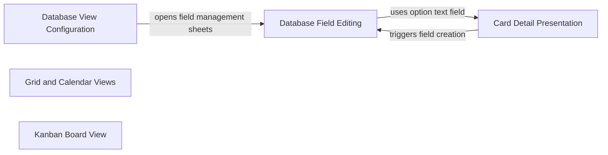

## Details

Implements mobile grid, board, calendar screens, card details, and database view filtering and sorting.

### Database View Configuration
Manages database view settings including filter conditions, sort rules, layout selections, and field visibility.

**Related Classes/Methods**:

- `frontend.appflowy_flutter.lib.mobile.presentation.database.view.database_field_list.DatabaseFieldListTile.build`:152-184
- `frontend.appflowy_flutter.lib.mobile.presentation.database.view.database_view_layout._CalendarLayoutField.build`:148-187

**Source Files:**

- `frontend/appflowy_flutter/lib/mobile/presentation/database/view/database_field_list.dart`
  - `frontend.appflowy_flutter.lib.mobile.presentation.database.view.database_field_list.MobileDatabaseFieldList` (L21-L39) - Class
  - `frontend.appflowy_flutter.lib.mobile.presentation.database.view.database_field_list.MobileDatabaseFieldList.MobileDatabaseFieldList` (L22-L26) - Constructor
  - `frontend.appflowy_flutter.lib.mobile.presentation.database.view.database_field_list.MobileDatabaseFieldList.build` (L32-L38) - Method
  - `frontend.appflowy_flutter.lib.mobile.presentation.database.view.database_field_list._MobileDatabaseFieldListBody` (L41-L135) - Class
  - `frontend.appflowy_flutter.lib.mobile.presentation.database.view.database_field_list._MobileDatabaseFieldListBody._MobileDatabaseFieldListBody` (L42-L46) - Constructor
  - `frontend.appflowy_flutter.lib.mobile.presentation.database.view.database_field_list._MobileDatabaseFieldListBody.build` (L53-L134) - Method
  - `frontend.appflowy_flutter.lib.mobile.presentation.database.view.database_field_list.DatabaseFieldListTile` (L137-L185) - Class
  - `frontend.appflowy_flutter.lib.mobile.presentation.database.view.database_field_list.DatabaseFieldListTile.DatabaseFieldListTile` (L138-L144) - Constructor
  - `frontend.appflowy_flutter.lib.mobile.presentation.database.view.database_field_list.DatabaseFieldListTile.build` (L152-L184) - Method
  - `frontend.appflowy_flutter.lib.mobile.presentation.database.view.database_field_list._NewDatabaseFieldTile` (L187-L205) - Class
  - `frontend.appflowy_flutter.lib.mobile.presentation.database.view.database_field_list._NewDatabaseFieldTile._NewDatabaseFieldTile` (L188-L188) - Constructor
  - `frontend.appflowy_flutter.lib.mobile.presentation.database.view.database_field_list._NewDatabaseFieldTile.build` (L193-L204) - Method
- `frontend/appflowy_flutter/lib/mobile/presentation/database/view/database_filter_bottom_sheet.dart`
  - `frontend.appflowy_flutter.lib.mobile.presentation.database.view.database_filter_bottom_sheet.MobileFilterEditor` (L30-L35) - Class
  - `frontend.appflowy_flutter.lib.mobile.presentation.database.view.database_filter_bottom_sheet.MobileFilterEditor.MobileFilterEditor` (L31-L31) - Constructor
  - `frontend.appflowy_flutter.lib.mobile.presentation.database.view.database_filter_bottom_sheet.MobileFilterEditor.createState` (L34-L34) - Method
  - `frontend.appflowy_flutter.lib.mobile.presentation.database.view.database_filter_bottom_sheet._MobileFilterEditorState` (L37-L76) - Class
  - `frontend.appflowy_flutter.lib.mobile.presentation.database.view.database_filter_bottom_sheet._MobileFilterEditorState.dispose` (L42-L46) - Method
  - `frontend.appflowy_flutter.lib.mobile.presentation.database.view.database_filter_bottom_sheet._MobileFilterEditorState.build` (L49-L75) - Method
  - `frontend.appflowy_flutter.lib.mobile.presentation.database.view.database_filter_bottom_sheet._Header` (L78-L166) - Class
  - `frontend.appflowy_flutter.lib.mobile.presentation.database.view.database_filter_bottom_sheet._Header._Header` (L79-L79) - Constructor
  - `frontend.appflowy_flutter.lib.mobile.presentation.database.view.database_filter_bottom_sheet._Header.build` (L82-L125) - Method
  - `frontend.appflowy_flutter.lib.mobile.presentation.database.view.database_filter_bottom_sheet._Header._isBackButtonShown` (L127-L132) - Method
  - `frontend.appflowy_flutter.lib.mobile.presentation.database.view.database_filter_bottom_sheet._Header._isSaveButtonShown` (L134-L140) - Method
  - `frontend.appflowy_flutter.lib.mobile.presentation.database.view.database_filter_bottom_sheet._Header._isSaveButtonEnabled` (L142-L148) - Method
  - `frontend.appflowy_flutter.lib.mobile.presentation.database.view.database_filter_bottom_sheet._Header._saveOnTapHandler` (L150-L165) - Method
  - `frontend.appflowy_flutter.lib.mobile.presentation.database.view.database_filter_bottom_sheet._ActiveFilters` (L168-L252) - Class
  - `frontend.appflowy_flutter.lib.mobile.presentation.database.view.database_filter_bottom_sheet._ActiveFilters._ActiveFilters` (L169-L171) - Constructor
  - `frontend.appflowy_flutter.lib.mobile.presentation.database.view.database_filter_bottom_sheet._ActiveFilters.build` (L176-L197) - Method
  - `frontend.appflowy_flutter.lib.mobile.presentation.database.view.database_filter_bottom_sheet._ActiveFilters._emptyBackground` (L199-L216) - Method
  - `frontend.appflowy_flutter.lib.mobile.presentation.database.view.database_filter_bottom_sheet._ActiveFilters._filterList` (L218-L251) - Method
  - `frontend.appflowy_flutter.lib.mobile.presentation.database.view.database_filter_bottom_sheet._CreateFilterButton` (L254-L303) - Class
  - `frontend.appflowy_flutter.lib.mobile.presentation.database.view.database_filter_bottom_sheet._CreateFilterButton._CreateFilterButton` (L255-L255) - Constructor
  - `frontend.appflowy_flutter.lib.mobile.presentation.database.view.database_filter_bottom_sheet._CreateFilterButton.build` (L258-L302) - Method
  - `frontend.appflowy_flutter.lib.mobile.presentation.database.view.database_filter_bottom_sheet._FilterItem` (L305-L417) - Class
  - `frontend.appflowy_flutter.lib.mobile.presentation.database.view.database_filter_bottom_sheet._FilterItem._FilterItem` (L306-L309) - Constructor
  - `frontend.appflowy_flutter.lib.mobile.presentation.database.view.database_filter_bottom_sheet._FilterItem.build` (L315-L395) - Method
  - `frontend.appflowy_flutter.lib.mobile.presentation.database.view.database_filter_bottom_sheet._FilterItem._deleteButton` (L397-L416) - Method
  - `frontend.appflowy_flutter.lib.mobile.presentation.database.view.database_filter_bottom_sheet.FilterItemInnerButton` (L419-L470) - Class
  - `frontend.appflowy_flutter.lib.mobile.presentation.database.view.database_filter_bottom_sheet.FilterItemInnerButton.FilterItemInnerButton` (L420-L425) - Constructor
  - `frontend.appflowy_flutter.lib.mobile.presentation.database.view.database_filter_bottom_sheet.FilterItemInnerButton.build` (L432-L469) - Method
  - `frontend.appflowy_flutter.lib.mobile.presentation.database.view.database_filter_bottom_sheet.FilterItemInnerTextField` (L472-L487) - Class
  - `frontend.appflowy_flutter.lib.mobile.presentation.database.view.database_filter_bottom_sheet.FilterItemInnerTextField.FilterItemInnerTextField` (L473-L478) - Constructor
  - `frontend.appflowy_flutter.lib.mobile.presentation.database.view.database_filter_bottom_sheet.FilterItemInnerTextField.createState` (L485-L486) - Method
  - `frontend.appflowy_flutter.lib.mobile.presentation.database.view.database_filter_bottom_sheet._FilterItemInnerTextFieldState` (L489-L536) - Class
  - `frontend.appflowy_flutter.lib.mobile.presentation.database.view.database_filter_bottom_sheet._FilterItemInnerTextFieldState.dispose` (L496-L500) - Method
  - `frontend.appflowy_flutter.lib.mobile.presentation.database.view.database_filter_bottom_sheet._FilterItemInnerTextFieldState.build` (L503-L525) - Method
  - `frontend.appflowy_flutter.lib.mobile.presentation.database.view.database_filter_bottom_sheet._FilterItemInnerTextFieldState._getBorder` (L527-L535) - Method
  - `frontend.appflowy_flutter.lib.mobile.presentation.database.view.database_filter_bottom_sheet._FilterDetail` (L538-L599) - Class
  - `frontend.appflowy_flutter.lib.mobile.presentation.database.view.database_filter_bottom_sheet._FilterDetail._FilterDetail` (L539-L539) - Constructor
  - `frontend.appflowy_flutter.lib.mobile.presentation.database.view.database_filter_bottom_sheet._FilterDetail.build` (L542-L598) - Method
  - `frontend.appflowy_flutter.lib.mobile.presentation.database.view.database_filter_bottom_sheet._FilterableFieldList` (L601-L649) - Class
  - `frontend.appflowy_flutter.lib.mobile.presentation.database.view.database_filter_bottom_sheet._FilterableFieldList._FilterableFieldList` (L602-L604) - Constructor
  - `frontend.appflowy_flutter.lib.mobile.presentation.database.view.database_filter_bottom_sheet._FilterableFieldList.build` (L609-L648) - Method
  - `frontend.appflowy_flutter.lib.mobile.presentation.database.view.database_filter_bottom_sheet._FilterConditionList` (L651-L761) - Class
  - `frontend.appflowy_flutter.lib.mobile.presentation.database.view.database_filter_bottom_sheet._FilterConditionList._FilterConditionList` (L652-L655) - Constructor
  - `frontend.appflowy_flutter.lib.mobile.presentation.database.view.database_filter_bottom_sheet._FilterConditionList.build` (L661-L724) - Method
  - `frontend.appflowy_flutter.lib.mobile.presentation.database.view.database_filter_bottom_sheet._FilterConditionList._isSelected` (L726-L739) - Method
  - `frontend.appflowy_flutter.lib.mobile.presentation.database.view.database_filter_bottom_sheet._FilterConditionList._updateCondition` (L741-L760) - Method
  - `frontend.appflowy_flutter.lib.mobile.presentation.database.view.database_filter_bottom_sheet._DateTimeFilterConditionList` (L763-L837) - Class
  - `frontend.appflowy_flutter.lib.mobile.presentation.database.view.database_filter_bottom_sheet._DateTimeFilterConditionList._DateTimeFilterConditionList` (L764-L766) - Constructor
  - `frontend.appflowy_flutter.lib.mobile.presentation.database.view.database_filter_bottom_sheet._DateTimeFilterConditionList.build` (L771-L836) - Method
  - `frontend.appflowy_flutter.lib.mobile.presentation.database.view.database_filter_bottom_sheet._DateTimeFilterIsStartSelector` (L839-L896) - Class
  - `frontend.appflowy_flutter.lib.mobile.presentation.database.view.database_filter_bottom_sheet._DateTimeFilterIsStartSelector._DateTimeFilterIsStartSelector` (L840-L843) - Constructor
  - `frontend.appflowy_flutter.lib.mobile.presentation.database.view.database_filter_bottom_sheet._DateTimeFilterIsStartSelector.build` (L849-L883) - Method
  - `frontend.appflowy_flutter.lib.mobile.presentation.database.view.database_filter_bottom_sheet._DateTimeFilterIsStartSelector._tab` (L885-L895) - Method
  - `frontend.appflowy_flutter.lib.mobile.presentation.database.view.database_filter_bottom_sheet._FilterContentEditor` (L898-L930) - Class
  - `frontend.appflowy_flutter.lib.mobile.presentation.database.view.database_filter_bottom_sheet._FilterContentEditor._FilterContentEditor` (L899-L902) - Constructor
  - `frontend.appflowy_flutter.lib.mobile.presentation.database.view.database_filter_bottom_sheet._FilterContentEditor.build` (L908-L929) - Method
  - `frontend.appflowy_flutter.lib.mobile.presentation.database.view.database_filter_bottom_sheet._SelectOptionFilterContentEditor` (L932-L945) - Class
  - `frontend.appflowy_flutter.lib.mobile.presentation.database.view.database_filter_bottom_sheet._SelectOptionFilterContentEditor._SelectOptionFilterContentEditor` (L933-L936) - Constructor
  - `frontend.appflowy_flutter.lib.mobile.presentation.database.view.database_filter_bottom_sheet._SelectOptionFilterContentEditor.createState` (L943-L944) - Method
  - `frontend.appflowy_flutter.lib.mobile.presentation.database.view.database_filter_bottom_sheet._SelectOptionFilterContentEditorState` (L947-L1055) - Class
  - `frontend.appflowy_flutter.lib.mobile.presentation.database.view.database_filter_bottom_sheet._SelectOptionFilterContentEditorState.initState` (L954-L957) - Method
  - `frontend.appflowy_flutter.lib.mobile.presentation.database.view.database_filter_bottom_sheet._SelectOptionFilterContentEditorState.dispose` (L960-L963) - Method
  - `frontend.appflowy_flutter.lib.mobile.presentation.database.view.database_filter_bottom_sheet._SelectOptionFilterContentEditorState.build` (L966-L1014) - Method
  - `frontend.appflowy_flutter.lib.mobile.presentation.database.view.database_filter_bottom_sheet._SelectOptionFilterContentEditorState.filterOptions` (L1016-L1028) - Method
  - `frontend.appflowy_flutter.lib.mobile.presentation.database.view.database_filter_bottom_sheet._SelectOptionFilterContentEditorState._onTapHandler` (L1030-L1043) - Method
  - `frontend.appflowy_flutter.lib.mobile.presentation.database.view.database_filter_bottom_sheet._SelectOptionFilterContentEditorState._updateSelectOptions` (L1045-L1054) - Method
  - `frontend.appflowy_flutter.lib.mobile.presentation.database.view.database_filter_bottom_sheet._DateTimeFilterContentEditor` (L1057-L1067) - Class
  - `frontend.appflowy_flutter.lib.mobile.presentation.database.view.database_filter_bottom_sheet._DateTimeFilterContentEditor._DateTimeFilterContentEditor` (L1058-L1060) - Constructor
  - `frontend.appflowy_flutter.lib.mobile.presentation.database.view.database_filter_bottom_sheet._DateTimeFilterContentEditor.createState` (L1065-L1066) - Method
  - `frontend.appflowy_flutter.lib.mobile.presentation.database.view.database_filter_bottom_sheet._DateTimeFilterContentEditorState` (L1069-L1108) - Class
  - `frontend.appflowy_flutter.lib.mobile.presentation.database.view.database_filter_bottom_sheet._DateTimeFilterContentEditorState.isRange` (L1073-L1073) - Method
  - `frontend.appflowy_flutter.lib.mobile.presentation.database.view.database_filter_bottom_sheet._DateTimeFilterContentEditorState.initState` (L1076-L1080) - Method
  - `frontend.appflowy_flutter.lib.mobile.presentation.database.view.database_filter_bottom_sheet._DateTimeFilterContentEditorState.build` (L1083-L1107) - Method
- `frontend/appflowy_flutter/lib/mobile/presentation/database/view/database_filter_bottom_sheet_cubit.dart`
  - `frontend.appflowy_flutter.lib.mobile.presentation.database.view.database_filter_bottom_sheet_cubit.MobileFilterEditorCubit` (L8-L80) - Class
  - `frontend.appflowy_flutter.lib.mobile.presentation.database.view.database_filter_bottom_sheet_cubit.MobileFilterEditorCubit.MobileFilterEditorCubit` (L9-L11) - Constructor
  - `frontend.appflowy_flutter.lib.mobile.presentation.database.view.database_filter_bottom_sheet_cubit.MobileFilterEditorCubit.returnToOverview` (L15-L18) - Method
  - `frontend.appflowy_flutter.lib.mobile.presentation.database.view.database_filter_bottom_sheet_cubit.MobileFilterEditorCubit.startCreatingFilter` (L20-L23) - Method
  - `frontend.appflowy_flutter.lib.mobile.presentation.database.view.database_filter_bottom_sheet_cubit.MobileFilterEditorCubit.startEditingFilterField` (L25-L28) - Method
  - `frontend.appflowy_flutter.lib.mobile.presentation.database.view.database_filter_bottom_sheet_cubit.MobileFilterEditorCubit.updateFilter` (L30-L46) - Method
  - `frontend.appflowy_flutter.lib.mobile.presentation.database.view.database_filter_bottom_sheet_cubit.MobileFilterEditorCubit.startEditingFilterCondition` (L48-L61) - Method
  - `frontend.appflowy_flutter.lib.mobile.presentation.database.view.database_filter_bottom_sheet_cubit.MobileFilterEditorCubit.startEditingFilterContent` (L63-L71) - Method
  - `frontend.appflowy_flutter.lib.mobile.presentation.database.view.database_filter_bottom_sheet_cubit.MobileFilterEditorCubit._animateToPage` (L73-L79) - Method
  - `frontend.appflowy_flutter.lib.mobile.presentation.database.view.database_filter_bottom_sheet_cubit.MobileFilterEditorState` (L83-L104) - Class
  - `frontend.appflowy_flutter.lib.mobile.presentation.database.view.database_filter_bottom_sheet_cubit.MobileFilterEditorState.MobileFilterEditorState.overview` (L84-L86) - Constructor
  - `frontend.appflowy_flutter.lib.mobile.presentation.database.view.database_filter_bottom_sheet_cubit.MobileFilterEditorState.MobileFilterEditorState.create` (L88-L88) - Constructor
  - `frontend.appflowy_flutter.lib.mobile.presentation.database.view.database_filter_bottom_sheet_cubit.MobileFilterEditorState.MobileFilterEditorState.editField` (L90-L92) - Constructor
  - `frontend.appflowy_flutter.lib.mobile.presentation.database.view.database_filter_bottom_sheet_cubit.MobileFilterEditorState.MobileFilterEditorState.editCondition` (L94-L98) - Constructor
  - `frontend.appflowy_flutter.lib.mobile.presentation.database.view.database_filter_bottom_sheet_cubit.MobileFilterEditorState.MobileFilterEditorState.editContent` (L100-L103) - Constructor
- `frontend/appflowy_flutter/lib/mobile/presentation/database/view/database_filter_condition_list.dart`
  - `frontend.appflowy_flutter.lib.mobile.presentation.database.view.database_filter_condition_list.FilterCondition` (L8-L22) - Class
  - `frontend.appflowy_flutter.lib.mobile.presentation.database.view.database_filter_condition_list.FilterCondition.fromFieldType` (L9-L19) - Method
  - `frontend.appflowy_flutter.lib.mobile.presentation.database.view.database_filter_condition_list.FilterCondition.conditions` (L21-L21) - Method
  - `frontend.appflowy_flutter.lib.mobile.presentation.database.view.database_filter_condition_list._GenericCastHelper` (L24-L26) - Class
  - `frontend.appflowy_flutter.lib.mobile.presentation.database.view.database_filter_condition_list._GenericCastHelper.as` (L25-L25) - Method
  - `frontend.appflowy_flutter.lib.mobile.presentation.database.view.database_filter_condition_list.TextFilterCondition` (L28-L44) - Class
  - `frontend.appflowy_flutter.lib.mobile.presentation.database.view.database_filter_condition_list.TextFilterCondition.conditions` (L32-L43) - Method
  - `frontend.appflowy_flutter.lib.mobile.presentation.database.view.database_filter_condition_list.NumberFilterCondition` (L46-L62) - Class
  - `frontend.appflowy_flutter.lib.mobile.presentation.database.view.database_filter_condition_list.NumberFilterCondition.conditions` (L50-L61) - Method
  - `frontend.appflowy_flutter.lib.mobile.presentation.database.view.database_filter_condition_list.CheckboxFilterCondition` (L64-L74) - Class
  - `frontend.appflowy_flutter.lib.mobile.presentation.database.view.database_filter_condition_list.CheckboxFilterCondition.conditions` (L68-L73) - Method
  - `frontend.appflowy_flutter.lib.mobile.presentation.database.view.database_filter_condition_list.ChecklistFilterCondition` (L76-L86) - Class
  - `frontend.appflowy_flutter.lib.mobile.presentation.database.view.database_filter_condition_list.ChecklistFilterCondition.conditions` (L80-L85) - Method
  - `frontend.appflowy_flutter.lib.mobile.presentation.database.view.database_filter_condition_list.SingleSelectOptionFilterCondition` (L88-L100) - Class
  - `frontend.appflowy_flutter.lib.mobile.presentation.database.view.database_filter_condition_list.SingleSelectOptionFilterCondition.conditions` (L92-L99) - Method
  - `frontend.appflowy_flutter.lib.mobile.presentation.database.view.database_filter_condition_list.MultiSelectOptionFilterCondition` (L102-L114) - Class
  - `frontend.appflowy_flutter.lib.mobile.presentation.database.view.database_filter_condition_list.MultiSelectOptionFilterCondition.conditions` (L106-L113) - Method
- `frontend/appflowy_flutter/lib/mobile/presentation/database/view/database_sort_bottom_sheet.dart`
  - `frontend.appflowy_flutter.lib.mobile.presentation.database.view.database_sort_bottom_sheet.MobileSortEditor` (L21-L28) - Class
  - `frontend.appflowy_flutter.lib.mobile.presentation.database.view.database_sort_bottom_sheet.MobileSortEditor.MobileSortEditor` (L22-L24) - Constructor
  - `frontend.appflowy_flutter.lib.mobile.presentation.database.view.database_sort_bottom_sheet.MobileSortEditor.createState` (L27-L27) - Method
  - `frontend.appflowy_flutter.lib.mobile.presentation.database.view.database_sort_bottom_sheet._MobileSortEditorState` (L30-L70) - Class
  - `frontend.appflowy_flutter.lib.mobile.presentation.database.view.database_sort_bottom_sheet._MobileSortEditorState.dispose` (L34-L37) - Method
  - `frontend.appflowy_flutter.lib.mobile.presentation.database.view.database_sort_bottom_sheet._MobileSortEditorState.build` (L40-L69) - Method
  - `frontend.appflowy_flutter.lib.mobile.presentation.database.view.database_sort_bottom_sheet._Header` (L72-L134) - Class
  - `frontend.appflowy_flutter.lib.mobile.presentation.database.view.database_sort_bottom_sheet._Header._Header` (L73-L73) - Constructor
  - `frontend.appflowy_flutter.lib.mobile.presentation.database.view.database_sort_bottom_sheet._Header.build` (L76-L122) - Method
  - `frontend.appflowy_flutter.lib.mobile.presentation.database.view.database_sort_bottom_sheet._Header._tryCreateSort` (L124-L133) - Method
  - `frontend.appflowy_flutter.lib.mobile.presentation.database.view.database_sort_bottom_sheet._Overview` (L136-L234) - Class
  - `frontend.appflowy_flutter.lib.mobile.presentation.database.view.database_sort_bottom_sheet._Overview._Overview` (L137-L137) - Constructor
  - `frontend.appflowy_flutter.lib.mobile.presentation.database.view.database_sort_bottom_sheet._Overview.build` (L140-L233) - Method
  - `frontend.appflowy_flutter.lib.mobile.presentation.database.view.database_sort_bottom_sheet._SortItem` (L236-L389) - Class
  - `frontend.appflowy_flutter.lib.mobile.presentation.database.view.database_sort_bottom_sheet._SortItem._SortItem` (L237-L237) - Constructor
  - `frontend.appflowy_flutter.lib.mobile.presentation.database.view.database_sort_bottom_sheet._SortItem.build` (L242-L388) - Method
  - `frontend.appflowy_flutter.lib.mobile.presentation.database.view.database_sort_bottom_sheet._SortDetail` (L391-L412) - Class
  - `frontend.appflowy_flutter.lib.mobile.presentation.database.view.database_sort_bottom_sheet._SortDetail._SortDetail` (L392-L392) - Constructor
  - `frontend.appflowy_flutter.lib.mobile.presentation.database.view.database_sort_bottom_sheet._SortDetail.build` (L395-L411) - Method
  - `frontend.appflowy_flutter.lib.mobile.presentation.database.view.database_sort_bottom_sheet._SortDetailContent` (L414-L581) - Class
  - `frontend.appflowy_flutter.lib.mobile.presentation.database.view.database_sort_bottom_sheet._SortDetailContent._SortDetailContent` (L415-L417) - Constructor
  - `frontend.appflowy_flutter.lib.mobile.presentation.database.view.database_sort_bottom_sheet._SortDetailContent.isCreatingNewSort` (L421-L421) - Method
  - `frontend.appflowy_flutter.lib.mobile.presentation.database.view.database_sort_bottom_sheet._SortDetailContent.build` (L424-L554) - Method
  - `frontend.appflowy_flutter.lib.mobile.presentation.database.view.database_sort_bottom_sheet._SortDetailContent._changeCondition` (L556-L567) - Method
  - `frontend.appflowy_flutter.lib.mobile.presentation.database.view.database_sort_bottom_sheet._SortDetailContent._changeFieldId` (L569-L580) - Method
- `frontend/appflowy_flutter/lib/mobile/presentation/database/view/database_sort_bottom_sheet_cubit.dart`
  - `frontend.appflowy_flutter.lib.mobile.presentation.database.view.database_sort_bottom_sheet_cubit.MobileSortEditorCubit` (L8-L58) - Class
  - `frontend.appflowy_flutter.lib.mobile.presentation.database.view.database_sort_bottom_sheet_cubit.MobileSortEditorCubit.MobileSortEditorCubit` (L9-L11) - Constructor
  - `frontend.appflowy_flutter.lib.mobile.presentation.database.view.database_sort_bottom_sheet_cubit.MobileSortEditorCubit.returnToOverview` (L15-L18) - Method
  - `frontend.appflowy_flutter.lib.mobile.presentation.database.view.database_sort_bottom_sheet_cubit.MobileSortEditorCubit.startCreatingSort` (L20-L29) - Method
  - `frontend.appflowy_flutter.lib.mobile.presentation.database.view.database_sort_bottom_sheet_cubit.MobileSortEditorCubit.startEditingSort` (L31-L39) - Method
  - `frontend.appflowy_flutter.lib.mobile.presentation.database.view.database_sort_bottom_sheet_cubit.MobileSortEditorCubit.changeFieldId` (L42-L44) - Method
  - `frontend.appflowy_flutter.lib.mobile.presentation.database.view.database_sort_bottom_sheet_cubit.MobileSortEditorCubit.changeSortCondition` (L47-L49) - Method
  - `frontend.appflowy_flutter.lib.mobile.presentation.database.view.database_sort_bottom_sheet_cubit.MobileSortEditorCubit._animateToPage` (L51-L57) - Method
  - `frontend.appflowy_flutter.lib.mobile.presentation.database.view.database_sort_bottom_sheet_cubit.MobileSortEditorState` (L61-L77) - Class
  - `frontend.appflowy_flutter.lib.mobile.presentation.database.view.database_sort_bottom_sheet_cubit.MobileSortEditorState.MobileSortEditorState` (L62-L68) - Constructor
  - `frontend.appflowy_flutter.lib.mobile.presentation.database.view.database_sort_bottom_sheet_cubit.MobileSortEditorState.MobileSortEditorState.initial` (L70-L76) - Constructor
- `frontend/appflowy_flutter/lib/mobile/presentation/database/view/database_view_layout.dart`
  - `frontend.appflowy_flutter.lib.mobile.presentation.database.view.database_view_layout.DatabaseViewLayoutPicker` (L18-L52) - Class
  - `frontend.appflowy_flutter.lib.mobile.presentation.database.view.database_view_layout.DatabaseViewLayoutPicker.DatabaseViewLayoutPicker` (L19-L23) - Constructor
  - `frontend.appflowy_flutter.lib.mobile.presentation.database.view.database_view_layout.DatabaseViewLayoutPicker.build` (L29-L39) - Method
  - `frontend.appflowy_flutter.lib.mobile.presentation.database.view.database_view_layout.DatabaseViewLayoutPicker._buildButton` (L41-L51) - Method
  - `frontend.appflowy_flutter.lib.mobile.presentation.database.view.database_view_layout.MobileCalendarViewLayoutSettings` (L57-L134) - Class
  - `frontend.appflowy_flutter.lib.mobile.presentation.database.view.database_view_layout.MobileCalendarViewLayoutSettings.MobileCalendarViewLayoutSettings` (L58-L61) - Constructor
  - `frontend.appflowy_flutter.lib.mobile.presentation.database.view.database_view_layout.MobileCalendarViewLayoutSettings.build` (L66-L94) - Method
  - `frontend.appflowy_flutter.lib.mobile.presentation.database.view.database_view_layout.MobileCalendarViewLayoutSettings._startWeek` (L96-L131) - Method
  - `frontend.appflowy_flutter.lib.mobile.presentation.database.view.database_view_layout.MobileCalendarViewLayoutSettings._divider` (L133-L133) - Method
  - `frontend.appflowy_flutter.lib.mobile.presentation.database.view.database_view_layout._CalendarLayoutField` (L136-L188) - Class
  - `frontend.appflowy_flutter.lib.mobile.presentation.database.view.database_view_layout._CalendarLayoutField._CalendarLayoutField` (L137-L141) - Constructor
  - `frontend.appflowy_flutter.lib.mobile.presentation.database.view.database_view_layout._CalendarLayoutField.build` (L148-L187) - Method
  - `frontend.appflowy_flutter.lib.mobile.presentation.database.view.database_view_layout.MobileBoardViewLayoutSettings` (L190-L202) - Class
  - `frontend.appflowy_flutter.lib.mobile.presentation.database.view.database_view_layout.MobileBoardViewLayoutSettings.MobileBoardViewLayoutSettings` (L191-L194) - Constructor
  - `frontend.appflowy_flutter.lib.mobile.presentation.database.view.database_view_layout.MobileBoardViewLayoutSettings.build` (L199-L201) - Method
- `frontend/appflowy_flutter/lib/mobile/presentation/database/view/database_view_list.dart`
  - `frontend.appflowy_flutter.lib.mobile.presentation.database.view.database_view_list.MobileDatabaseViewList` (L27-L74) - Class
  - `frontend.appflowy_flutter.lib.mobile.presentation.database.view.database_view_list.MobileDatabaseViewList.MobileDatabaseViewList` (L28-L28) - Constructor
  - `frontend.appflowy_flutter.lib.mobile.presentation.database.view.database_view_list.MobileDatabaseViewList.build` (L31-L73) - Method
  - `frontend.appflowy_flutter.lib.mobile.presentation.database.view.database_view_list._Header` (L78-L128) - Class
  - `frontend.appflowy_flutter.lib.mobile.presentation.database.view.database_view_list._Header._Header` (L79-L84) - Constructor
  - `frontend.appflowy_flutter.lib.mobile.presentation.database.view.database_view_list._Header.build` (L92-L127) - Method
  - `frontend.appflowy_flutter.lib.mobile.presentation.database.view.database_view_list.MobileDatabaseViewListButton` (L131-L231) - Class
  - `frontend.appflowy_flutter.lib.mobile.presentation.database.view.database_view_list.MobileDatabaseViewListButton.MobileDatabaseViewListButton` (L132-L136) - Constructor
  - `frontend.appflowy_flutter.lib.mobile.presentation.database.view.database_view_list.MobileDatabaseViewListButton.build` (L142-L165) - Method
  - `frontend.appflowy_flutter.lib.mobile.presentation.database.view.database_view_list.MobileDatabaseViewListButton._buildViewIconButton` (L167-L183) - Method
  - `frontend.appflowy_flutter.lib.mobile.presentation.database.view.database_view_list.MobileDatabaseViewListButton._trailing` (L185-L230) - Method
  - `frontend.appflowy_flutter.lib.mobile.presentation.database.view.database_view_list.MobileNewDatabaseViewButton` (L233-L262) - Class
  - `frontend.appflowy_flutter.lib.mobile.presentation.database.view.database_view_list.MobileNewDatabaseViewButton.MobileNewDatabaseViewButton` (L234-L234) - Constructor
  - `frontend.appflowy_flutter.lib.mobile.presentation.database.view.database_view_list.MobileNewDatabaseViewButton.build` (L237-L261) - Method
  - `frontend.appflowy_flutter.lib.mobile.presentation.database.view.database_view_list.MobileCreateDatabaseView` (L264-L270) - Class
  - `frontend.appflowy_flutter.lib.mobile.presentation.database.view.database_view_list.MobileCreateDatabaseView.MobileCreateDatabaseView` (L265-L265) - Constructor
  - `frontend.appflowy_flutter.lib.mobile.presentation.database.view.database_view_list.MobileCreateDatabaseView.createState` (L268-L269) - Method
  - `frontend.appflowy_flutter.lib.mobile.presentation.database.view.database_view_list._MobileCreateDatabaseViewState` (L272-L315) - Class
  - `frontend.appflowy_flutter.lib.mobile.presentation.database.view.database_view_list._MobileCreateDatabaseViewState.initState` (L277-L282) - Method
  - `frontend.appflowy_flutter.lib.mobile.presentation.database.view.database_view_list._MobileCreateDatabaseViewState.dispose` (L285-L288) - Method
  - `frontend.appflowy_flutter.lib.mobile.presentation.database.view.database_view_list._MobileCreateDatabaseViewState.build` (L291-L314) - Method
- `frontend/appflowy_flutter/lib/mobile/presentation/database/view/database_view_quick_actions.dart`
  - `frontend.appflowy_flutter.lib.mobile.presentation.database.view.database_view_quick_actions.MobileDatabaseViewQuickActions` (L22-L134) - Class
  - `frontend.appflowy_flutter.lib.mobile.presentation.database.view.database_view_quick_actions.MobileDatabaseViewQuickActions.MobileDatabaseViewQuickActions` (L23-L27) - Constructor
  - `frontend.appflowy_flutter.lib.mobile.presentation.database.view.database_view_quick_actions.MobileDatabaseViewQuickActions.build` (L33-L117) - Method
  - `frontend.appflowy_flutter.lib.mobile.presentation.database.view.database_view_quick_actions.MobileDatabaseViewQuickActions._actionButton` (L119-L133) - Method
  - `frontend.appflowy_flutter.lib.mobile.presentation.database.view.database_view_quick_actions._Action` (L136-L166) - Enum
  - `frontend.appflowy_flutter.lib.mobile.presentation.database.view.database_view_quick_actions._Action.edit` (L137-L137) - Enum
  - `frontend.appflowy_flutter.lib.mobile.presentation.database.view.database_view_quick_actions._Action.changeIcon` (L138-L138) - Enum
  - `frontend.appflowy_flutter.lib.mobile.presentation.database.view.database_view_quick_actions._Action.delete` (L139-L139) - Enum
  - `frontend.appflowy_flutter.lib.mobile.presentation.database.view.database_view_quick_actions._Action.duplicate` (L140-L140) - Enum
  - `frontend.appflowy_flutter.lib.mobile.presentation.database.view.database_view_quick_actions._Action.label` (L142-L149) - Method
  - `frontend.appflowy_flutter.lib.mobile.presentation.database.view.database_view_quick_actions._Action.icon` (L151-L158) - Method
  - `frontend.appflowy_flutter.lib.mobile.presentation.database.view.database_view_quick_actions._Action.color` (L160-L165) - Method
- `frontend/appflowy_flutter/lib/mobile/presentation/database/view/edit_database_view_screen.dart`
  - `frontend.appflowy_flutter.lib.mobile.presentation.database.view.edit_database_view_screen.MobileEditDatabaseViewScreen` (L24-L65) - Class
  - `frontend.appflowy_flutter.lib.mobile.presentation.database.view.edit_database_view_screen.MobileEditDatabaseViewScreen.MobileEditDatabaseViewScreen` (L25-L28) - Constructor
  - `frontend.appflowy_flutter.lib.mobile.presentation.database.view.edit_database_view_screen.MobileEditDatabaseViewScreen.build` (L33-L62) - Method
  - `frontend.appflowy_flutter.lib.mobile.presentation.database.view.edit_database_view_screen.MobileEditDatabaseViewScreen._divider` (L64-L64) - Method
  - `frontend.appflowy_flutter.lib.mobile.presentation.database.view.edit_database_view_screen._NameAndIcon` (L67-L74) - Class
  - `frontend.appflowy_flutter.lib.mobile.presentation.database.view.edit_database_view_screen._NameAndIcon._NameAndIcon` (L68-L68) - Constructor
  - `frontend.appflowy_flutter.lib.mobile.presentation.database.view.edit_database_view_screen._NameAndIcon.createState` (L73-L73) - Method
  - `frontend.appflowy_flutter.lib.mobile.presentation.database.view.edit_database_view_screen._NameAndIconState` (L76-L104) - Class
  - `frontend.appflowy_flutter.lib.mobile.presentation.database.view.edit_database_view_screen._NameAndIconState.initState` (L80-L83) - Method
  - `frontend.appflowy_flutter.lib.mobile.presentation.database.view.edit_database_view_screen._NameAndIconState.dispose` (L86-L89) - Method
  - `frontend.appflowy_flutter.lib.mobile.presentation.database.view.edit_database_view_screen._NameAndIconState.build` (L92-L103) - Method
  - `frontend.appflowy_flutter.lib.mobile.presentation.database.view.edit_database_view_screen.DatabaseViewSettings` (L106-L141) - Enum
  - `frontend.appflowy_flutter.lib.mobile.presentation.database.view.edit_database_view_screen.DatabaseViewSettings.layout` (L107-L107) - Enum
  - `frontend.appflowy_flutter.lib.mobile.presentation.database.view.edit_database_view_screen.DatabaseViewSettings.fields` (L108-L108) - Enum
  - `frontend.appflowy_flutter.lib.mobile.presentation.database.view.edit_database_view_screen.DatabaseViewSettings.filter` (L109-L109) - Enum
  - `frontend.appflowy_flutter.lib.mobile.presentation.database.view.edit_database_view_screen.DatabaseViewSettings.sort` (L110-L110) - Enum
  - `frontend.appflowy_flutter.lib.mobile.presentation.database.view.edit_database_view_screen.DatabaseViewSettings.board` (L111-L111) - Enum
  - `frontend.appflowy_flutter.lib.mobile.presentation.database.view.edit_database_view_screen.DatabaseViewSettings.calendar` (L112-L112) - Enum
  - `frontend.appflowy_flutter.lib.mobile.presentation.database.view.edit_database_view_screen.DatabaseViewSettings.duplicate` (L113-L113) - Enum
  - `frontend.appflowy_flutter.lib.mobile.presentation.database.view.edit_database_view_screen.DatabaseViewSettings.delete` (L114-L114) - Enum
  - `frontend.appflowy_flutter.lib.mobile.presentation.database.view.edit_database_view_screen.DatabaseViewSettings.label` (L116-L127) - Method
  - `frontend.appflowy_flutter.lib.mobile.presentation.database.view.edit_database_view_screen.DatabaseViewSettings.icon` (L129-L140) - Method
  - `frontend.appflowy_flutter.lib.mobile.presentation.database.view.edit_database_view_screen.DatabaseViewSettingTile` (L143-L288) - Class
  - `frontend.appflowy_flutter.lib.mobile.presentation.database.view.edit_database_view_screen.DatabaseViewSettingTile.DatabaseViewSettingTile` (L144-L150) - Constructor
  - `frontend.appflowy_flutter.lib.mobile.presentation.database.view.edit_database_view_screen.DatabaseViewSettingTile.build` (L158-L166) - Method
  - `frontend.appflowy_flutter.lib.mobile.presentation.database.view.edit_database_view_screen.DatabaseViewSettingTile._trailing` (L168-L205) - Method
  - `frontend.appflowy_flutter.lib.mobile.presentation.database.view.edit_database_view_screen.DatabaseViewSettingTile._onTap` (L207-L287) - Method

### Card Detail Presentation
Renders full database card details, cell properties, and row actions on mobile devices.

**Related Classes/Methods**:

- `frontend.appflowy_flutter.lib.mobile.presentation.database.card.card_detail.widgets.option_text_field.OptionTextField`:10-67
- `frontend.appflowy_flutter.lib.mobile.presentation.database.card.card_detail.widgets.mobile_create_field_button.MobileRowDetailCreateFieldButton.build`:21-51

**Source Files:**

- `frontend/appflowy_flutter/lib/mobile/presentation/database/card/card_detail/mobile_card_detail_screen.dart`
  - `frontend.appflowy_flutter.lib.mobile.presentation.database.card.card_detail.mobile_card_detail_screen.MobileRowDetailPage` (L38-L54) - Class
  - `frontend.appflowy_flutter.lib.mobile.presentation.database.card.card_detail.mobile_card_detail_screen.MobileRowDetailPage.MobileRowDetailPage` (L39-L43) - Constructor
  - `frontend.appflowy_flutter.lib.mobile.presentation.database.card.card_detail.mobile_card_detail_screen.MobileRowDetailPage.createState` (L53-L53) - Method
  - `frontend.appflowy_flutter.lib.mobile.presentation.database.card.card_detail.mobile_card_detail_screen._MobileRowDetailPageState` (L56-L269) - Class
  - `frontend.appflowy_flutter.lib.mobile.presentation.database.card.card_detail.mobile_card_detail_screen._MobileRowDetailPageState.viewId` (L60-L60) - Method
  - `frontend.appflowy_flutter.lib.mobile.presentation.database.card.card_detail.mobile_card_detail_screen._MobileRowDetailPageState.rowCache` (L62-L62) - Method
  - `frontend.appflowy_flutter.lib.mobile.presentation.database.card.card_detail.mobile_card_detail_screen._MobileRowDetailPageState.fieldController` (L64-L65) - Method
  - `frontend.appflowy_flutter.lib.mobile.presentation.database.card.card_detail.mobile_card_detail_screen._MobileRowDetailPageState.initState` (L68-L77) - Method
  - `frontend.appflowy_flutter.lib.mobile.presentation.database.card.card_detail.mobile_card_detail_screen._MobileRowDetailPageState.dispose` (L80-L83) - Method
  - `frontend.appflowy_flutter.lib.mobile.presentation.database.card.card_detail.mobile_card_detail_screen._MobileRowDetailPageState.build` (L86-L137) - Method
  - `frontend.appflowy_flutter.lib.mobile.presentation.database.card.card_detail.mobile_card_detail_screen._MobileRowDetailPageState._showCardActions` (L139-L216) - Method
  - `frontend.appflowy_flutter.lib.mobile.presentation.database.card.card_detail.mobile_card_detail_screen._MobileRowDetailPageState._performAction` (L218-L236) - Method
  - `frontend.appflowy_flutter.lib.mobile.presentation.database.card.card_detail.mobile_card_detail_screen._MobileRowDetailPageState._onInsertNetworkFile` (L238-L268) - Method
  - `frontend.appflowy_flutter.lib.mobile.presentation.database.card.card_detail.mobile_card_detail_screen.RowDetailFab` (L271-L361) - Class
  - `frontend.appflowy_flutter.lib.mobile.presentation.database.card.card_detail.mobile_card_detail_screen.RowDetailFab.RowDetailFab` (L272-L276) - Constructor
  - `frontend.appflowy_flutter.lib.mobile.presentation.database.card.card_detail.mobile_card_detail_screen.RowDetailFab.build` (L282-L360) - Method
  - `frontend.appflowy_flutter.lib.mobile.presentation.database.card.card_detail.mobile_card_detail_screen.MobileRowDetailPageContent` (L363-L376) - Class
  - `frontend.appflowy_flutter.lib.mobile.presentation.database.card.card_detail.mobile_card_detail_screen.MobileRowDetailPageContent.MobileRowDetailPageContent` (L364-L368) - Constructor
  - `frontend.appflowy_flutter.lib.mobile.presentation.database.card.card_detail.mobile_card_detail_screen.MobileRowDetailPageContent.createState` (L374-L375) - Method
  - `frontend.appflowy_flutter.lib.mobile.presentation.database.card.card_detail.mobile_card_detail_screen.MobileRowDetailPageContentState` (L378-L541) - Class
  - `frontend.appflowy_flutter.lib.mobile.presentation.database.card.card_detail.mobile_card_detail_screen.MobileRowDetailPageContentState.viewId` (L383-L383) - Method
  - `frontend.appflowy_flutter.lib.mobile.presentation.database.card.card_detail.mobile_card_detail_screen.MobileRowDetailPageContentState.rowCache` (L385-L385) - Method
  - `frontend.appflowy_flutter.lib.mobile.presentation.database.card.card_detail.mobile_card_detail_screen.MobileRowDetailPageContentState.fieldController` (L387-L388) - Method
  - `frontend.appflowy_flutter.lib.mobile.presentation.database.card.card_detail.mobile_card_detail_screen.MobileRowDetailPageContentState.initState` (L392-L405) - Method
  - `frontend.appflowy_flutter.lib.mobile.presentation.database.card.card_detail.mobile_card_detail_screen.MobileRowDetailPageContentState.build` (L408-L540) - Method
  - `frontend.appflowy_flutter.lib.mobile.presentation.database.card.card_detail.mobile_card_detail_screen._TitleSkin` (L543-L578) - Class
  - `frontend.appflowy_flutter.lib.mobile.presentation.database.card.card_detail.mobile_card_detail_screen._TitleSkin.build` (L545-L577) - Method
- `frontend/appflowy_flutter/lib/mobile/presentation/database/card/card_detail/widgets/mobile_create_field_button.dart`
  - `frontend.appflowy_flutter.lib.mobile.presentation.database.card.card_detail.widgets.mobile_create_field_button.MobileRowDetailCreateFieldButton` (L10-L52) - Class
  - `frontend.appflowy_flutter.lib.mobile.presentation.database.card.card_detail.widgets.mobile_create_field_button.MobileRowDetailCreateFieldButton.MobileRowDetailCreateFieldButton` (L11-L15) - Constructor
  - `frontend.appflowy_flutter.lib.mobile.presentation.database.card.card_detail.widgets.mobile_create_field_button.MobileRowDetailCreateFieldButton.build` (L21-L51) - Method
- `frontend/appflowy_flutter/lib/mobile/presentation/database/card/card_detail/widgets/mobile_row_property_list.dart`
  - `frontend.appflowy_flutter.lib.mobile.presentation.database.card.card_detail.widgets.mobile_row_property_list.MobileRowPropertyList` (L11-L47) - Class
  - `frontend.appflowy_flutter.lib.mobile.presentation.database.card.card_detail.widgets.mobile_row_property_list.MobileRowPropertyList.MobileRowPropertyList` (L12-L16) - Constructor
  - `frontend.appflowy_flutter.lib.mobile.presentation.database.card.card_detail.widgets.mobile_row_property_list.MobileRowPropertyList.build` (L22-L43) - Method
  - `frontend.appflowy_flutter.lib.mobile.presentation.database.card.card_detail.widgets.mobile_row_property_list.MobileRowPropertyList._isCellPrimary` (L45-L46) - Method
  - `frontend.appflowy_flutter.lib.mobile.presentation.database.card.card_detail.widgets.mobile_row_property_list._PropertyCell` (L49-L63) - Class
  - `frontend.appflowy_flutter.lib.mobile.presentation.database.card.card_detail.widgets.mobile_row_property_list._PropertyCell._PropertyCell` (L50-L55) - Constructor
  - `frontend.appflowy_flutter.lib.mobile.presentation.database.card.card_detail.widgets.mobile_row_property_list._PropertyCell.createState` (L62-L62) - Method
  - `frontend.appflowy_flutter.lib.mobile.presentation.database.card.card_detail.widgets.mobile_row_property_list._PropertyCellState` (L65-L98) - Class
  - `frontend.appflowy_flutter.lib.mobile.presentation.database.card.card_detail.widgets.mobile_row_property_list._PropertyCellState.build` (L67-L97) - Method
- `frontend/appflowy_flutter/lib/mobile/presentation/database/card/card_detail/widgets/option_text_field.dart`
  - `frontend.appflowy_flutter.lib.mobile.presentation.database.card.card_detail.widgets.option_text_field.OptionTextField` (L10-L67) - Class
  - `frontend.appflowy_flutter.lib.mobile.presentation.database.card.card_detail.widgets.option_text_field.OptionTextField.OptionTextField` (L11-L19) - Constructor
  - `frontend.appflowy_flutter.lib.mobile.presentation.database.card.card_detail.widgets.option_text_field.OptionTextField.build` (L29-L66) - Method
- `frontend/appflowy_flutter/lib/mobile/presentation/database/card/card_detail/widgets/row_page_button.dart`
  - `frontend.appflowy_flutter.lib.mobile.presentation.database.card.card_detail.widgets.row_page_button.OpenRowPageButton` (L21-L36) - Class
  - `frontend.appflowy_flutter.lib.mobile.presentation.database.card.card_detail.widgets.row_page_button.OpenRowPageButton.OpenRowPageButton` (L22-L27) - Constructor
  - `frontend.appflowy_flutter.lib.mobile.presentation.database.card.card_detail.widgets.row_page_button.OpenRowPageButton.createState` (L35-L35) - Method
  - `frontend.appflowy_flutter.lib.mobile.presentation.database.card.card_detail.widgets.row_page_button._OpenRowPageButtonState` (L38-L145) - Class
  - `frontend.appflowy_flutter.lib.mobile.presentation.database.card.card_detail.widgets.row_page_button._OpenRowPageButtonState.initState` (L49-L53) - Method
  - `frontend.appflowy_flutter.lib.mobile.presentation.database.card.card_detail.widgets.row_page_button._OpenRowPageButtonState.build` (L56-L100) - Method
  - `frontend.appflowy_flutter.lib.mobile.presentation.database.card.card_detail.widgets.row_page_button._OpenRowPageButtonState._openRowPage` (L102-L123) - Method
  - `frontend.appflowy_flutter.lib.mobile.presentation.database.card.card_detail.widgets.row_page_button._OpenRowPageButtonState._preloadView` (L126-L144) - Method
- `frontend/appflowy_flutter/lib/mobile/presentation/database/card/mobile_card_content.dart`
  - `frontend.appflowy_flutter.lib.mobile.presentation.database.card.mobile_card_content.MobileCardContent` (L10-L51) - Class
  - `frontend.appflowy_flutter.lib.mobile.presentation.database.card.mobile_card_content.MobileCardContent.MobileCardContent` (L11-L18) - Constructor
  - `frontend.appflowy_flutter.lib.mobile.presentation.database.card.mobile_card_content.MobileCardContent.build` (L27-L50) - Method

### Database Field Editing
Provides bottom sheets, selection dialogs, and editor screens to define and update database fields and options.

**Related Classes/Methods**:

- `frontend.appflowy_flutter.lib.mobile.presentation.database.field.mobile_field_bottom_sheets.showEditFieldScreen`:104-116
- `frontend.appflowy_flutter.lib.mobile.presentation.database.field.mobile_field_bottom_sheets.mobileCreateFieldWorkflow`:77-101
- `frontend.appflowy_flutter.lib.mobile.presentation.database.field.mobile_full_field_editor._MobileFieldEditorState.build`:214-277

**Source Files:**

- `frontend/appflowy_flutter/lib/mobile/presentation/database/field/mobile_create_field_screen.dart`
  - `frontend.appflowy_flutter.lib.mobile.presentation.database.field.mobile_create_field_screen.MobileNewPropertyScreen` (L11-L28) - Class
  - `frontend.appflowy_flutter.lib.mobile.presentation.database.field.mobile_create_field_screen.MobileNewPropertyScreen.MobileNewPropertyScreen` (L12-L16) - Constructor
  - `frontend.appflowy_flutter.lib.mobile.presentation.database.field.mobile_create_field_screen.MobileNewPropertyScreen.createState` (L26-L27) - Method
  - `frontend.appflowy_flutter.lib.mobile.presentation.database.field.mobile_create_field_screen._MobileNewPropertyScreenState` (L30-L69) - Class
  - `frontend.appflowy_flutter.lib.mobile.presentation.database.field.mobile_create_field_screen._MobileNewPropertyScreenState.initState` (L34-L43) - Method
  - `frontend.appflowy_flutter.lib.mobile.presentation.database.field.mobile_create_field_screen._MobileNewPropertyScreenState.build` (L46-L68) - Method
  - `frontend.appflowy_flutter.lib.mobile.presentation.database.field.mobile_create_field_screen._SaveButton` (L71-L93) - Class
  - `frontend.appflowy_flutter.lib.mobile.presentation.database.field.mobile_create_field_screen._SaveButton._SaveButton` (L72-L74) - Constructor
  - `frontend.appflowy_flutter.lib.mobile.presentation.database.field.mobile_create_field_screen._SaveButton.build` (L79-L92) - Method
- `frontend/appflowy_flutter/lib/mobile/presentation/database/field/mobile_edit_field_screen.dart`
  - `frontend.appflowy_flutter.lib.mobile.presentation.database.field.mobile_edit_field_screen.MobileEditPropertyScreen` (L12-L29) - Class
  - `frontend.appflowy_flutter.lib.mobile.presentation.database.field.mobile_edit_field_screen.MobileEditPropertyScreen.MobileEditPropertyScreen` (L13-L17) - Constructor
  - `frontend.appflowy_flutter.lib.mobile.presentation.database.field.mobile_edit_field_screen.MobileEditPropertyScreen.createState` (L27-L28) - Method
  - `frontend.appflowy_flutter.lib.mobile.presentation.database.field.mobile_edit_field_screen._MobileEditPropertyScreenState` (L31-L119) - Class
  - `frontend.appflowy_flutter.lib.mobile.presentation.database.field.mobile_edit_field_screen._MobileEditPropertyScreenState.initState` (L36-L43) - Method
  - `frontend.appflowy_flutter.lib.mobile.presentation.database.field.mobile_edit_field_screen._MobileEditPropertyScreenState.build` (L46-L118) - Method
- `frontend/appflowy_flutter/lib/mobile/presentation/database/field/mobile_field_bottom_sheets.dart`
  - `frontend.appflowy_flutter.lib.mobile.presentation.database.field.mobile_field_bottom_sheets.showFieldTypeGridBottomSheet` (L36-L73) - Function
  - `frontend.appflowy_flutter.lib.mobile.presentation.database.field.mobile_field_bottom_sheets.mobileCreateFieldWorkflow` (L77-L101) - Function
  - `frontend.appflowy_flutter.lib.mobile.presentation.database.field.mobile_field_bottom_sheets.showEditFieldScreen` (L104-L116) - Function
  - `frontend.appflowy_flutter.lib.mobile.presentation.database.field.mobile_field_bottom_sheets.showQuickEditField` (L119-L138) - Function
  - `frontend.appflowy_flutter.lib.mobile.presentation.database.field.mobile_field_bottom_sheets.showFieldPicker` (L141-L160) - Function
- `frontend/appflowy_flutter/lib/mobile/presentation/database/field/mobile_field_picker_list.dart`
  - `frontend.appflowy_flutter.lib.mobile.presentation.database.field.mobile_field_picker_list.MobileFieldPickerList` (L11-L26) - Class
  - `frontend.appflowy_flutter.lib.mobile.presentation.database.field.mobile_field_picker_list.MobileFieldPickerList.MobileFieldPickerList` (L12-L18) - Constructor
  - `frontend.appflowy_flutter.lib.mobile.presentation.database.field.mobile_field_picker_list.MobileFieldPickerList.createState` (L25-L25) - Method
  - `frontend.appflowy_flutter.lib.mobile.presentation.database.field.mobile_field_picker_list._MobileFieldPickerListState` (L28-L72) - Class
  - `frontend.appflowy_flutter.lib.mobile.presentation.database.field.mobile_field_picker_list._MobileFieldPickerListState.initState` (L32-L35) - Method
  - `frontend.appflowy_flutter.lib.mobile.presentation.database.field.mobile_field_picker_list._MobileFieldPickerListState.build` (L38-L71) - Method
  - `frontend.appflowy_flutter.lib.mobile.presentation.database.field.mobile_field_picker_list._Header` (L76-L114) - Class
  - `frontend.appflowy_flutter.lib.mobile.presentation.database.field.mobile_field_picker_list._Header._Header` (L77-L80) - Constructor
  - `frontend.appflowy_flutter.lib.mobile.presentation.database.field.mobile_field_picker_list._Header.build` (L86-L113) - Method
  - `frontend.appflowy_flutter.lib.mobile.presentation.database.field.mobile_field_picker_list._FieldButton` (L116-L142) - Class
  - `frontend.appflowy_flutter.lib.mobile.presentation.database.field.mobile_field_picker_list._FieldButton._FieldButton` (L117-L122) - Constructor
  - `frontend.appflowy_flutter.lib.mobile.presentation.database.field.mobile_field_picker_list._FieldButton.build` (L130-L141) - Method
- `frontend/appflowy_flutter/lib/mobile/presentation/database/field/mobile_full_field_editor.dart`
  - `frontend.appflowy_flutter.lib.mobile.presentation.database.field.mobile_full_field_editor.FieldOptionMode` (L29-L32) - Enum
  - `frontend.appflowy_flutter.lib.mobile.presentation.database.field.mobile_full_field_editor.FieldOptionMode.add` (L30-L30) - Enum
  - `frontend.appflowy_flutter.lib.mobile.presentation.database.field.mobile_full_field_editor.FieldOptionMode.edit` (L31-L31) - Enum
  - `frontend.appflowy_flutter.lib.mobile.presentation.database.field.mobile_full_field_editor.FieldOptionValues` (L34-L159) - Class
  - `frontend.appflowy_flutter.lib.mobile.presentation.database.field.mobile_full_field_editor.FieldOptionValues.FieldOptionValues` (L35-L44) - Constructor
  - `frontend.appflowy_flutter.lib.mobile.presentation.database.field.mobile_full_field_editor.FieldOptionValues.FieldOptionValues.fromField` (L46-L84) - Constructor
  - `frontend.appflowy_flutter.lib.mobile.presentation.database.field.mobile_full_field_editor.FieldOptionValues.create` (L107-L118) - Method
  - `frontend.appflowy_flutter.lib.mobile.presentation.database.field.mobile_full_field_editor.FieldOptionValues.getTypeOptionData` (L120-L158) - Method
  - `frontend.appflowy_flutter.lib.mobile.presentation.database.field.mobile_full_field_editor.FieldOptionAction` (L161-L166) - Enum
  - `frontend.appflowy_flutter.lib.mobile.presentation.database.field.mobile_full_field_editor.FieldOptionAction.hide` (L162-L162) - Enum
  - `frontend.appflowy_flutter.lib.mobile.presentation.database.field.mobile_full_field_editor.FieldOptionAction.show` (L163-L163) - Enum
  - `frontend.appflowy_flutter.lib.mobile.presentation.database.field.mobile_full_field_editor.FieldOptionAction.duplicate` (L164-L164) - Enum
  - `frontend.appflowy_flutter.lib.mobile.presentation.database.field.mobile_full_field_editor.FieldOptionAction.delete` (L165-L165) - Enum
  - `frontend.appflowy_flutter.lib.mobile.presentation.database.field.mobile_full_field_editor.MobileFieldEditor` (L168-L192) - Class
  - `frontend.appflowy_flutter.lib.mobile.presentation.database.field.mobile_full_field_editor.MobileFieldEditor.MobileFieldEditor` (L169-L177) - Constructor
  - `frontend.appflowy_flutter.lib.mobile.presentation.database.field.mobile_full_field_editor.MobileFieldEditor.createState` (L191-L191) - Method
  - `frontend.appflowy_flutter.lib.mobile.presentation.database.field.mobile_full_field_editor._MobileFieldEditorState` (L194-L433) - Class
  - `frontend.appflowy_flutter.lib.mobile.presentation.database.field.mobile_full_field_editor._MobileFieldEditorState.initState` (L201-L205) - Method
  - `frontend.appflowy_flutter.lib.mobile.presentation.database.field.mobile_full_field_editor._MobileFieldEditorState.dispose` (L208-L211) - Method
  - `frontend.appflowy_flutter.lib.mobile.presentation.database.field.mobile_full_field_editor._MobileFieldEditorState.build` (L214-L277) - Method
  - `frontend.appflowy_flutter.lib.mobile.presentation.database.field.mobile_full_field_editor._MobileFieldEditorState._buildOption` (L279-L357) - Method
  - `frontend.appflowy_flutter.lib.mobile.presentation.database.field.mobile_full_field_editor._MobileFieldEditorState._buildOptionActions` (L359-L398) - Method
  - `frontend.appflowy_flutter.lib.mobile.presentation.database.field.mobile_full_field_editor._MobileFieldEditorState._updateOptionValues` (L400-L432) - Method
  - `frontend.appflowy_flutter.lib.mobile.presentation.database.field.mobile_full_field_editor._PropertyType` (L435-L479) - Class
  - `frontend.appflowy_flutter.lib.mobile.presentation.database.field.mobile_full_field_editor._PropertyType._PropertyType` (L436-L439) - Constructor
  - `frontend.appflowy_flutter.lib.mobile.presentation.database.field.mobile_full_field_editor._PropertyType.build` (L445-L478) - Method
  - `frontend.appflowy_flutter.lib.mobile.presentation.database.field.mobile_full_field_editor._Divider` (L481-L490) - Class
  - `frontend.appflowy_flutter.lib.mobile.presentation.database.field.mobile_full_field_editor._Divider._Divider` (L482-L482) - Constructor
  - `frontend.appflowy_flutter.lib.mobile.presentation.database.field.mobile_full_field_editor._Divider.build` (L485-L489) - Method
  - `frontend.appflowy_flutter.lib.mobile.presentation.database.field.mobile_full_field_editor._DateOption` (L492-L503) - Class
  - `frontend.appflowy_flutter.lib.mobile.presentation.database.field.mobile_full_field_editor._DateOption._DateOption` (L493-L496) - Constructor
  - `frontend.appflowy_flutter.lib.mobile.presentation.database.field.mobile_full_field_editor._DateOption.createState` (L502-L502) - Method
  - `frontend.appflowy_flutter.lib.mobile.presentation.database.field.mobile_full_field_editor._DateOptionState` (L505-L544) - Class
  - `frontend.appflowy_flutter.lib.mobile.presentation.database.field.mobile_full_field_editor._DateOptionState.initState` (L509-L513) - Method
  - `frontend.appflowy_flutter.lib.mobile.presentation.database.field.mobile_full_field_editor._DateOptionState.build` (L516-L543) - Method
  - `frontend.appflowy_flutter.lib.mobile.presentation.database.field.mobile_full_field_editor._TimeOption` (L546-L557) - Class
  - `frontend.appflowy_flutter.lib.mobile.presentation.database.field.mobile_full_field_editor._TimeOption._TimeOption` (L547-L550) - Constructor
  - `frontend.appflowy_flutter.lib.mobile.presentation.database.field.mobile_full_field_editor._TimeOption.createState` (L556-L556) - Method
  - `frontend.appflowy_flutter.lib.mobile.presentation.database.field.mobile_full_field_editor._TimeOptionState` (L559-L598) - Class
  - `frontend.appflowy_flutter.lib.mobile.presentation.database.field.mobile_full_field_editor._TimeOptionState.initState` (L563-L567) - Method
  - `frontend.appflowy_flutter.lib.mobile.presentation.database.field.mobile_full_field_editor._TimeOptionState.build` (L570-L597) - Method
  - `frontend.appflowy_flutter.lib.mobile.presentation.database.field.mobile_full_field_editor._IncludeTimeOption` (L600-L611) - Class
  - `frontend.appflowy_flutter.lib.mobile.presentation.database.field.mobile_full_field_editor._IncludeTimeOption._IncludeTimeOption` (L601-L604) - Constructor
  - `frontend.appflowy_flutter.lib.mobile.presentation.database.field.mobile_full_field_editor._IncludeTimeOption.createState` (L610-L610) - Method
  - `frontend.appflowy_flutter.lib.mobile.presentation.database.field.mobile_full_field_editor._IncludeTimeOptionState` (L613-L629) - Class
  - `frontend.appflowy_flutter.lib.mobile.presentation.database.field.mobile_full_field_editor._IncludeTimeOptionState.build` (L617-L628) - Method
  - `frontend.appflowy_flutter.lib.mobile.presentation.database.field.mobile_full_field_editor._NumberOption` (L631-L681) - Class
  - `frontend.appflowy_flutter.lib.mobile.presentation.database.field.mobile_full_field_editor._NumberOption._NumberOption` (L632-L635) - Constructor
  - `frontend.appflowy_flutter.lib.mobile.presentation.database.field.mobile_full_field_editor._NumberOption.build` (L641-L680) - Method
  - `frontend.appflowy_flutter.lib.mobile.presentation.database.field.mobile_full_field_editor._NumberFormatList` (L683-L696) - Class
  - `frontend.appflowy_flutter.lib.mobile.presentation.database.field.mobile_full_field_editor._NumberFormatList._NumberFormatList` (L684-L688) - Constructor
  - `frontend.appflowy_flutter.lib.mobile.presentation.database.field.mobile_full_field_editor._NumberFormatList.createState` (L695-L695) - Method
  - `frontend.appflowy_flutter.lib.mobile.presentation.database.field.mobile_full_field_editor._NumberFormatListState` (L698-L764) - Class
  - `frontend.appflowy_flutter.lib.mobile.presentation.database.field.mobile_full_field_editor._NumberFormatListState.build` (L702-L763) - Method
  - `frontend.appflowy_flutter.lib.mobile.presentation.database.field.mobile_full_field_editor._SelectOption` (L767-L821) - Class
  - `frontend.appflowy_flutter.lib.mobile.presentation.database.field.mobile_full_field_editor._SelectOption._SelectOption` (L768-L773) - Constructor
  - `frontend.appflowy_flutter.lib.mobile.presentation.database.field.mobile_full_field_editor._SelectOption.build` (L783-L820) - Method
  - `frontend.appflowy_flutter.lib.mobile.presentation.database.field.mobile_full_field_editor._SelectOptionList` (L823-L834) - Class
  - `frontend.appflowy_flutter.lib.mobile.presentation.database.field.mobile_full_field_editor._SelectOptionList._SelectOptionList` (L824-L827) - Constructor
  - `frontend.appflowy_flutter.lib.mobile.presentation.database.field.mobile_full_field_editor._SelectOptionList.createState` (L833-L833) - Method
  - `frontend.appflowy_flutter.lib.mobile.presentation.database.field.mobile_full_field_editor._SelectOptionListState` (L836-L889) - Class
  - `frontend.appflowy_flutter.lib.mobile.presentation.database.field.mobile_full_field_editor._SelectOptionListState.initState` (L840-L844) - Method
  - `frontend.appflowy_flutter.lib.mobile.presentation.database.field.mobile_full_field_editor._SelectOptionListState.didUpdateWidget` (L847-L851) - Method
  - `frontend.appflowy_flutter.lib.mobile.presentation.database.field.mobile_full_field_editor._SelectOptionListState.dispose` (L854-L856) - Method
  - `frontend.appflowy_flutter.lib.mobile.presentation.database.field.mobile_full_field_editor._SelectOptionListState.build` (L859-L881) - Method
  - `frontend.appflowy_flutter.lib.mobile.presentation.database.field.mobile_full_field_editor._SelectOptionListState._updateOption` (L883-L888) - Method
  - `frontend.appflowy_flutter.lib.mobile.presentation.database.field.mobile_full_field_editor._SelectOptionTile` (L891-L906) - Class
  - `frontend.appflowy_flutter.lib.mobile.presentation.database.field.mobile_full_field_editor._SelectOptionTile._SelectOptionTile` (L892-L897) - Constructor
  - `frontend.appflowy_flutter.lib.mobile.presentation.database.field.mobile_full_field_editor._SelectOptionTile.createState` (L905-L905) - Method
  - `frontend.appflowy_flutter.lib.mobile.presentation.database.field.mobile_full_field_editor._SelectOptionTileState` (L908-L953) - Class
  - `frontend.appflowy_flutter.lib.mobile.presentation.database.field.mobile_full_field_editor._SelectOptionTileState.initState` (L913-L918) - Method
  - `frontend.appflowy_flutter.lib.mobile.presentation.database.field.mobile_full_field_editor._SelectOptionTileState.dispose` (L921-L924) - Method
  - `frontend.appflowy_flutter.lib.mobile.presentation.database.field.mobile_full_field_editor._SelectOptionTileState.build` (L927-L952) - Method
  - `frontend.appflowy_flutter.lib.mobile.presentation.database.field.mobile_full_field_editor._SelectOptionColor` (L955-L997) - Class
  - `frontend.appflowy_flutter.lib.mobile.presentation.database.field.mobile_full_field_editor._SelectOptionColor._SelectOptionColor` (L956-L959) - Constructor
  - `frontend.appflowy_flutter.lib.mobile.presentation.database.field.mobile_full_field_editor._SelectOptionColor.build` (L965-L996) - Method
- `frontend/appflowy_flutter/lib/mobile/presentation/database/field/mobile_quick_field_editor.dart`
  - `frontend.appflowy_flutter.lib.mobile.presentation.database.field.mobile_quick_field_editor.QuickEditField` (L19-L33) - Class
  - `frontend.appflowy_flutter.lib.mobile.presentation.database.field.mobile_quick_field_editor.QuickEditField.QuickEditField` (L20-L25) - Constructor
  - `frontend.appflowy_flutter.lib.mobile.presentation.database.field.mobile_quick_field_editor.QuickEditField.createState` (L32-L32) - Method
  - `frontend.appflowy_flutter.lib.mobile.presentation.database.field.mobile_quick_field_editor._QuickEditFieldState` (L35-L184) - Class
  - `frontend.appflowy_flutter.lib.mobile.presentation.database.field.mobile_quick_field_editor._QuickEditFieldState.initState` (L46-L51) - Method
  - `frontend.appflowy_flutter.lib.mobile.presentation.database.field.mobile_quick_field_editor._QuickEditFieldState.dispose` (L54-L57) - Method
  - `frontend.appflowy_flutter.lib.mobile.presentation.database.field.mobile_quick_field_editor._QuickEditFieldState.build` (L60-L183) - Method
  - `frontend.appflowy_flutter.lib.mobile.presentation.database.field.mobile_quick_field_editor._Divider` (L186-L193) - Class
  - `frontend.appflowy_flutter.lib.mobile.presentation.database.field.mobile_quick_field_editor._Divider._Divider` (L187-L187) - Constructor
  - `frontend.appflowy_flutter.lib.mobile.presentation.database.field.mobile_quick_field_editor._Divider.build` (L190-L192) - Method

### Grid and Calendar Views
Displays mobile database records using table grid and calendar views alongside date selection workflows.

**Related Classes/Methods**:

- `frontend.appflowy_flutter.lib.mobile.presentation.database.mobile_grid_screen.MobileGridScreen`:6-33
- `frontend.appflowy_flutter.lib.mobile.presentation.database.mobile_calendar_screen.MobileCalendarScreen`:5-28

**Source Files:**

- `frontend/appflowy_flutter/lib/mobile/presentation/database/date_picker/mobile_date_picker_screen.dart`
  - `frontend.appflowy_flutter.lib.mobile.presentation.database.date_picker.mobile_date_picker_screen.MobileDateCellEditScreen` (L14-L35) - Class
  - `frontend.appflowy_flutter.lib.mobile.presentation.database.date_picker.mobile_date_picker_screen.MobileDateCellEditScreen.MobileDateCellEditScreen` (L15-L19) - Constructor
  - `frontend.appflowy_flutter.lib.mobile.presentation.database.date_picker.mobile_date_picker_screen.MobileDateCellEditScreen.createState` (L33-L34) - Method
  - `frontend.appflowy_flutter.lib.mobile.presentation.database.date_picker.mobile_date_picker_screen._MobileDateCellEditScreenState` (L37-L121) - Class
  - `frontend.appflowy_flutter.lib.mobile.presentation.database.date_picker.mobile_date_picker_screen._MobileDateCellEditScreenState.build` (L39-L40) - Method
  - `frontend.appflowy_flutter.lib.mobile.presentation.database.date_picker.mobile_date_picker_screen._MobileDateCellEditScreenState._buildFullScreen` (L42-L47) - Method
  - `frontend.appflowy_flutter.lib.mobile.presentation.database.date_picker.mobile_date_picker_screen._MobileDateCellEditScreenState._buildNotFullScreen` (L49-L71) - Method
  - `frontend.appflowy_flutter.lib.mobile.presentation.database.date_picker.mobile_date_picker_screen._MobileDateCellEditScreenState._buildDatePicker` (L73-L120) - Method
- `frontend/appflowy_flutter/lib/mobile/presentation/database/mobile_calendar_events_empty.dart`
  - `frontend.appflowy_flutter.lib.mobile.presentation.database.mobile_calendar_events_empty.MobileCalendarEventsEmpty` (L8-L35) - Class
  - `frontend.appflowy_flutter.lib.mobile.presentation.database.mobile_calendar_events_empty.MobileCalendarEventsEmpty.MobileCalendarEventsEmpty` (L9-L9) - Constructor
  - `frontend.appflowy_flutter.lib.mobile.presentation.database.mobile_calendar_events_empty.MobileCalendarEventsEmpty.build` (L12-L34) - Method
- `frontend/appflowy_flutter/lib/mobile/presentation/database/mobile_calendar_events_screen.dart`
  - `frontend.appflowy_flutter.lib.mobile.presentation.database.mobile_calendar_events_screen.MobileCalendarEventsScreen` (L13-L41) - Class
  - `frontend.appflowy_flutter.lib.mobile.presentation.database.mobile_calendar_events_screen.MobileCalendarEventsScreen.MobileCalendarEventsScreen` (L14-L21) - Constructor
  - `frontend.appflowy_flutter.lib.mobile.presentation.database.mobile_calendar_events_screen.MobileCalendarEventsScreen.createState` (L39-L40) - Method
  - `frontend.appflowy_flutter.lib.mobile.presentation.database.mobile_calendar_events_screen._MobileCalendarEventsScreenState` (L43-L108) - Class
  - `frontend.appflowy_flutter.lib.mobile.presentation.database.mobile_calendar_events_screen._MobileCalendarEventsScreenState.build` (L48-L107) - Method
- `frontend/appflowy_flutter/lib/mobile/presentation/database/mobile_calendar_screen.dart`
  - `frontend.appflowy_flutter.lib.mobile.presentation.database.mobile_calendar_screen.MobileCalendarScreen` (L5-L28) - Class
  - `frontend.appflowy_flutter.lib.mobile.presentation.database.mobile_calendar_screen.MobileCalendarScreen.MobileCalendarScreen` (L6-L10) - Constructor
  - `frontend.appflowy_flutter.lib.mobile.presentation.database.mobile_calendar_screen.MobileCalendarScreen.build` (L21-L27) - Method
- `frontend/appflowy_flutter/lib/mobile/presentation/database/mobile_grid_screen.dart`
  - `frontend.appflowy_flutter.lib.mobile.presentation.database.mobile_grid_screen.MobileGridScreen` (L6-L33) - Class
  - `frontend.appflowy_flutter.lib.mobile.presentation.database.mobile_grid_screen.MobileGridScreen.MobileGridScreen` (L7-L12) - Constructor
  - `frontend.appflowy_flutter.lib.mobile.presentation.database.mobile_grid_screen.MobileGridScreen.build` (L25-L32) - Method

### Kanban Board View
Implements mobile Kanban board presentation with column grouping, hidden columns, and card arrangement.

**Related Classes/Methods**:

- `frontend.appflowy_flutter.lib.mobile.presentation.database.board.mobile_board_screen.MobileBoardScreen`:5-28

**Source Files:**

- `frontend/appflowy_flutter/lib/mobile/presentation/database/board/mobile_board_page.dart`
  - `frontend.appflowy_flutter.lib.mobile.presentation.database.board.mobile_board_page.MobileBoardPage` (L25-L42) - Class
  - `frontend.appflowy_flutter.lib.mobile.presentation.database.board.mobile_board_page.MobileBoardPage.MobileBoardPage` (L26-L31) - Constructor
  - `frontend.appflowy_flutter.lib.mobile.presentation.database.board.mobile_board_page.MobileBoardPage.createState` (L41-L41) - Method
  - `frontend.appflowy_flutter.lib.mobile.presentation.database.board.mobile_board_page._MobileBoardPageState` (L44-L104) - Class
  - `frontend.appflowy_flutter.lib.mobile.presentation.database.board.mobile_board_page._MobileBoardPageState.initState` (L48-L51) - Method
  - `frontend.appflowy_flutter.lib.mobile.presentation.database.board.mobile_board_page._MobileBoardPageState.dispose` (L54-L59) - Method
  - `frontend.appflowy_flutter.lib.mobile.presentation.database.board.mobile_board_page._MobileBoardPageState.build` (L62-L83) - Method
  - `frontend.appflowy_flutter.lib.mobile.presentation.database.board.mobile_board_page._MobileBoardPageState._handleDidCreateRow` (L85-L103) - Method
  - `frontend.appflowy_flutter.lib.mobile.presentation.database.board.mobile_board_page._BoardContent` (L106-L111) - Class
  - `frontend.appflowy_flutter.lib.mobile.presentation.database.board.mobile_board_page._BoardContent._BoardContent` (L107-L107) - Constructor
  - `frontend.appflowy_flutter.lib.mobile.presentation.database.board.mobile_board_page._BoardContent.createState` (L110-L110) - Method
  - `frontend.appflowy_flutter.lib.mobile.presentation.database.board.mobile_board_page._BoardContentState` (L113-L315) - Class
  - `frontend.appflowy_flutter.lib.mobile.presentation.database.board.mobile_board_page._BoardContentState.initState` (L117-L120) - Method
  - `frontend.appflowy_flutter.lib.mobile.presentation.database.board.mobile_board_page._BoardContentState.dispose` (L123-L126) - Method
  - `frontend.appflowy_flutter.lib.mobile.presentation.database.board.mobile_board_page._BoardContentState.build` (L129-L189) - Method
  - `frontend.appflowy_flutter.lib.mobile.presentation.database.board.mobile_board_page._BoardContentState._buildFooter` (L191-L227) - Method
  - `frontend.appflowy_flutter.lib.mobile.presentation.database.board.mobile_board_page._BoardContentState._buildCard` (L229-L284) - Method
  - `frontend.appflowy_flutter.lib.mobile.presentation.database.board.mobile_board_page._BoardContentState._makeBoxDecoration` (L286-L314) - Method
- `frontend/appflowy_flutter/lib/mobile/presentation/database/board/mobile_board_screen.dart`
  - `frontend.appflowy_flutter.lib.mobile.presentation.database.board.mobile_board_screen.MobileBoardScreen` (L5-L28) - Class
  - `frontend.appflowy_flutter.lib.mobile.presentation.database.board.mobile_board_screen.MobileBoardScreen.MobileBoardScreen` (L6-L10) - Constructor
  - `frontend.appflowy_flutter.lib.mobile.presentation.database.board.mobile_board_screen.MobileBoardScreen.build` (L21-L27) - Method
- `frontend/appflowy_flutter/lib/mobile/presentation/database/board/widgets/group_card_header.dart`
  - `frontend.appflowy_flutter.lib.mobile.presentation.database.board.widgets.group_card_header.GroupCardHeader` (L15-L25) - Class
  - `frontend.appflowy_flutter.lib.mobile.presentation.database.board.widgets.group_card_header.GroupCardHeader.GroupCardHeader` (L16-L19) - Constructor
  - `frontend.appflowy_flutter.lib.mobile.presentation.database.board.widgets.group_card_header.GroupCardHeader.createState` (L24-L24) - Method
  - `frontend.appflowy_flutter.lib.mobile.presentation.database.board.widgets.group_card_header._GroupCardHeaderState` (L27-L184) - Class
  - `frontend.appflowy_flutter.lib.mobile.presentation.database.board.widgets.group_card_header._GroupCardHeaderState.dispose` (L39-L42) - Method
  - `frontend.appflowy_flutter.lib.mobile.presentation.database.board.widgets.group_card_header._GroupCardHeaderState.build` (L45-L172) - Method
  - `frontend.appflowy_flutter.lib.mobile.presentation.database.board.widgets.group_card_header._GroupCardHeaderState._buildHeaderIcon` (L174-L183) - Method
- `frontend/appflowy_flutter/lib/mobile/presentation/database/board/widgets/mobile_board_trailing.dart`
  - `frontend.appflowy_flutter.lib.mobile.presentation.database.board.widgets.mobile_board_trailing.MobileBoardTrailing` (L9-L14) - Class
  - `frontend.appflowy_flutter.lib.mobile.presentation.database.board.widgets.mobile_board_trailing.MobileBoardTrailing.MobileBoardTrailing` (L10-L10) - Constructor
  - `frontend.appflowy_flutter.lib.mobile.presentation.database.board.widgets.mobile_board_trailing.MobileBoardTrailing.createState` (L13-L13) - Method
  - `frontend.appflowy_flutter.lib.mobile.presentation.database.board.widgets.mobile_board_trailing._MobileBoardTrailingState` (L16-L141) - Class
  - `frontend.appflowy_flutter.lib.mobile.presentation.database.board.widgets.mobile_board_trailing._MobileBoardTrailingState.dispose` (L22-L25) - Method
  - `frontend.appflowy_flutter.lib.mobile.presentation.database.board.widgets.mobile_board_trailing._MobileBoardTrailingState.build` (L28-L140) - Method
- `frontend/appflowy_flutter/lib/mobile/presentation/database/board/widgets/mobile_hidden_groups_column.dart`
  - `frontend.appflowy_flutter.lib.mobile.presentation.database.board.widgets.mobile_hidden_groups_column.MobileHiddenGroupsColumn` (L20-L101) - Class
  - `frontend.appflowy_flutter.lib.mobile.presentation.database.board.widgets.mobile_hidden_groups_column.MobileHiddenGroupsColumn.MobileHiddenGroupsColumn` (L21-L21) - Constructor
  - `frontend.appflowy_flutter.lib.mobile.presentation.database.board.widgets.mobile_hidden_groups_column.MobileHiddenGroupsColumn.build` (L26-L82) - Method
  - `frontend.appflowy_flutter.lib.mobile.presentation.database.board.widgets.mobile_hidden_groups_column.MobileHiddenGroupsColumn._collapseExpandIcon` (L84-L100) - Method
  - `frontend.appflowy_flutter.lib.mobile.presentation.database.board.widgets.mobile_hidden_groups_column.MobileHiddenGroupList` (L103-L146) - Class
  - `frontend.appflowy_flutter.lib.mobile.presentation.database.board.widgets.mobile_hidden_groups_column.MobileHiddenGroupList.MobileHiddenGroupList` (L104-L107) - Constructor
  - `frontend.appflowy_flutter.lib.mobile.presentation.database.board.widgets.mobile_hidden_groups_column.MobileHiddenGroupList.build` (L112-L145) - Method
  - `frontend.appflowy_flutter.lib.mobile.presentation.database.board.widgets.mobile_hidden_groups_column.MobileHiddenGroup` (L148-L249) - Class
  - `frontend.appflowy_flutter.lib.mobile.presentation.database.board.widgets.mobile_hidden_groups_column.MobileHiddenGroup.MobileHiddenGroup` (L149-L153) - Constructor
  - `frontend.appflowy_flutter.lib.mobile.presentation.database.board.widgets.mobile_hidden_groups_column.MobileHiddenGroup.build` (L159-L236) - Method
  - `frontend.appflowy_flutter.lib.mobile.presentation.database.board.widgets.mobile_hidden_groups_column.MobileHiddenGroup._titleCellStyle` (L238-L248) - Method

### [FAQ](https://github.com/CodeBoarding/GeneratedOnBoardings/tree/main?tab=readme-ov-file#faq)