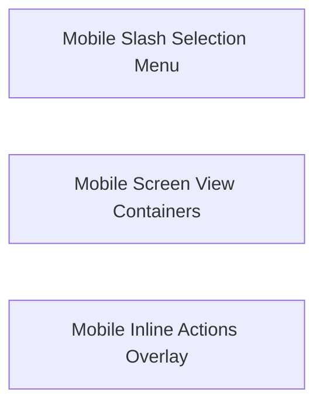

## Details

Implements the mobile document editor, AI chat interface, inline action triggers, and slash selection menus.

### Mobile Slash Selection Menu
Displays and positions mobile slash-command selection overlays with keyboard interception and item selection.

**Related Classes/Methods**: _None_

**Source Files:**

- `frontend/appflowy_flutter/lib/mobile/presentation/selection_menu/mobile_selection_menu.dart`
  - `frontend.appflowy_flutter.lib.mobile.presentation.selection_menu.mobile_selection_menu.MobileSelectionMenu` (L10-L271) - Class
  - `frontend.appflowy_flutter.lib.mobile.presentation.selection_menu.mobile_selection_menu.MobileSelectionMenu.MobileSelectionMenu` (L11-L21) - Constructor
  - `frontend.appflowy_flutter.lib.mobile.presentation.selection_menu.mobile_selection_menu.MobileSelectionMenu.dismiss` (L41-L52) - Method
  - `frontend.appflowy_flutter.lib.mobile.presentation.selection_menu.mobile_selection_menu.MobileSelectionMenu.show` (L55-L63) - Method
  - `frontend.appflowy_flutter.lib.mobile.presentation.selection_menu.mobile_selection_menu.MobileSelectionMenu._show` (L65-L145) - Method
  - `frontend.appflowy_flutter.lib.mobile.presentation.selection_menu.mobile_selection_menu.MobileSelectionMenu._checkPositionAfterScrolling` (L149-L163) - Method
  - `frontend.appflowy_flutter.lib.mobile.presentation.selection_menu.mobile_selection_menu.MobileSelectionMenu._getCurrentPosition` (L165-L174) - Method
  - `frontend.appflowy_flutter.lib.mobile.presentation.selection_menu.mobile_selection_menu.MobileSelectionMenu.alignment` (L177-L179) - Method
  - `frontend.appflowy_flutter.lib.mobile.presentation.selection_menu.mobile_selection_menu.MobileSelectionMenu.offset` (L182-L184) - Method
  - `frontend.appflowy_flutter.lib.mobile.presentation.selection_menu.mobile_selection_menu.MobileSelectionMenu.getPosition` (L187-L208) - Method
  - `frontend.appflowy_flutter.lib.mobile.presentation.selection_menu.mobile_selection_menu.MobileSelectionMenu.calculateSelectionMenuOffset` (L210-L270) - Method
  - `frontend.appflowy_flutter.lib.mobile.presentation.selection_menu.mobile_selection_menu._Position` (L273-L296) - Class
  - `frontend.appflowy_flutter.lib.mobile.presentation.selection_menu.mobile_selection_menu._Position._Position` (L274-L274) - Constructor
  - `frontend.appflowy_flutter.lib.mobile.presentation.selection_menu.mobile_selection_menu._Position.==` (L284-L291) - Method
  - `frontend.appflowy_flutter.lib.mobile.presentation.selection_menu.mobile_selection_menu._Position.hashCode` (L294-L295) - Method
- `frontend/appflowy_flutter/lib/mobile/presentation/selection_menu/mobile_selection_menu_item.dart`
  - `frontend.appflowy_flutter.lib.mobile.presentation.selection_menu.mobile_selection_menu_item.MobileSelectionMenuItem` (L3-L18) - Class
  - `frontend.appflowy_flutter.lib.mobile.presentation.selection_menu.mobile_selection_menu_item.MobileSelectionMenuItem.MobileSelectionMenuItem` (L4-L13) - Constructor
  - `frontend.appflowy_flutter.lib.mobile.presentation.selection_menu.mobile_selection_menu_item.MobileSelectionMenuItem.isNotEmpty` (L17-L17) - Method
- `frontend/appflowy_flutter/lib/mobile/presentation/selection_menu/mobile_selection_menu_item_widget.dart`
  - `frontend.appflowy_flutter.lib.mobile.presentation.selection_menu.mobile_selection_menu_item_widget.MobileSelectionMenuItemWidget` (L6-L77) - Class
  - `frontend.appflowy_flutter.lib.mobile.presentation.selection_menu.mobile_selection_menu_item_widget.MobileSelectionMenuItemWidget.MobileSelectionMenuItemWidget` (L7-L15) - Constructor
  - `frontend.appflowy_flutter.lib.mobile.presentation.selection_menu.mobile_selection_menu_item_widget.MobileSelectionMenuItemWidget.build` (L25-L76) - Method
  - `frontend.appflowy_flutter.lib.mobile.presentation.selection_menu.mobile_selection_menu_item_widget.MobileSelectionMenuStyle` (L79-L138) - Class
  - `frontend.appflowy_flutter.lib.mobile.presentation.selection_menu.mobile_selection_menu_item_widget.MobileSelectionMenuStyle.MobileSelectionMenuStyle` (L80-L97) - Constructor
- `frontend/appflowy_flutter/lib/mobile/presentation/selection_menu/mobile_selection_menu_widget.dart`
  - `frontend.appflowy_flutter.lib.mobile.presentation.selection_menu.mobile_selection_menu_widget.MobileSelectionMenuWidget` (L13-L51) - Class
  - `frontend.appflowy_flutter.lib.mobile.presentation.selection_menu.mobile_selection_menu_widget.MobileSelectionMenuWidget.MobileSelectionMenuWidget` (L14-L28) - Constructor
  - `frontend.appflowy_flutter.lib.mobile.presentation.selection_menu.mobile_selection_menu_widget.MobileSelectionMenuWidget.createState` (L49-L50) - Method
  - `frontend.appflowy_flutter.lib.mobile.presentation.selection_menu.mobile_selection_menu_widget._MobileSelectionMenuWidgetState` (L53-L397) - Class
  - `frontend.appflowy_flutter.lib.mobile.presentation.selection_menu.mobile_selection_menu_widget._MobileSelectionMenuWidgetState.editorState` (L60-L60) - Method
  - `frontend.appflowy_flutter.lib.mobile.presentation.selection_menu.mobile_selection_menu_widget._MobileSelectionMenuWidgetState.menuService` (L62-L62) - Method
  - `frontend.appflowy_flutter.lib.mobile.presentation.selection_menu.mobile_selection_menu_widget._MobileSelectionMenuWidgetState.keyword` (L66-L66) - Method
  - `frontend.appflowy_flutter.lib.mobile.presentation.selection_menu.mobile_selection_menu_widget._MobileSelectionMenuWidgetState.filterItems` (L72-L84) - Method
  - `frontend.appflowy_flutter.lib.mobile.presentation.selection_menu.mobile_selection_menu_widget._MobileSelectionMenuWidgetState.keyword=` (L86-L122) - Method
  - `frontend.appflowy_flutter.lib.mobile.presentation.selection_menu.mobile_selection_menu_widget._MobileSelectionMenuWidgetState.initState` (L125-L164) - Method
  - `frontend.appflowy_flutter.lib.mobile.presentation.selection_menu.mobile_selection_menu_widget._MobileSelectionMenuWidgetState.dispose` (L167-L174) - Method
  - `frontend.appflowy_flutter.lib.mobile.presentation.selection_menu.mobile_selection_menu_widget._MobileSelectionMenuWidgetState.build` (L177-L211) - Method
  - `frontend.appflowy_flutter.lib.mobile.presentation.selection_menu.mobile_selection_menu_widget._MobileSelectionMenuWidgetState.onSelectionChanged` (L213-L233) - Method
  - `frontend.appflowy_flutter.lib.mobile.presentation.selection_menu.mobile_selection_menu_widget._MobileSelectionMenuWidgetState._buildResultsWidget` (L235-L322) - Method
  - `frontend.appflowy_flutter.lib.mobile.presentation.selection_menu.mobile_selection_menu_widget._MobileSelectionMenuWidgetState.refreshSelectedIndex` (L324-L329) - Method
  - `frontend.appflowy_flutter.lib.mobile.presentation.selection_menu.mobile_selection_menu_widget._MobileSelectionMenuWidgetState._buildNoResultsWidget` (L331-L366) - Method
  - `frontend.appflowy_flutter.lib.mobile.presentation.selection_menu.mobile_selection_menu_widget._MobileSelectionMenuWidgetState.buildInitialItems` (L368-L385) - Method
  - `frontend.appflowy_flutter.lib.mobile.presentation.selection_menu.mobile_selection_menu_widget._MobileSelectionMenuWidgetState.isInitialItems` (L387-L396) - Method
- `frontend/appflowy_flutter/lib/mobile/presentation/selection_menu/slash_keyboard_service_interceptor.dart`
  - `frontend.appflowy_flutter.lib.mobile.presentation.selection_menu.slash_keyboard_service_interceptor.SlashKeyboardServiceInterceptor` (L6-L42) - Class
  - `frontend.appflowy_flutter.lib.mobile.presentation.selection_menu.slash_keyboard_service_interceptor.SlashKeyboardServiceInterceptor.SlashKeyboardServiceInterceptor` (L7-L10) - Constructor
  - `frontend.appflowy_flutter.lib.mobile.presentation.selection_menu.slash_keyboard_service_interceptor.SlashKeyboardServiceInterceptor.interceptDelete` (L16-L26) - Method
  - `frontend.appflowy_flutter.lib.mobile.presentation.selection_menu.slash_keyboard_service_interceptor.SlashKeyboardServiceInterceptor.interceptInsert` (L29-L41) - Method

### Mobile Screen View Containers
Provides mobile screen route wrappers for document editing, chat views, and placeholder landing pages.

**Related Classes/Methods**: _None_

**Source Files:**

- `frontend/appflowy_flutter/lib/mobile/presentation/chat/mobile_chat_screen.dart`
  - `frontend.appflowy_flutter.lib.mobile.presentation.chat.mobile_chat_screen.MobileChatScreen` (L5-L28) - Class
  - `frontend.appflowy_flutter.lib.mobile.presentation.chat.mobile_chat_screen.MobileChatScreen.MobileChatScreen` (L6-L10) - Constructor
  - `frontend.appflowy_flutter.lib.mobile.presentation.chat.mobile_chat_screen.MobileChatScreen.build` (L21-L27) - Method
- `frontend/appflowy_flutter/lib/mobile/presentation/editor/mobile_editor_screen.dart`
  - `frontend.appflowy_flutter.lib.mobile.presentation.editor.mobile_editor_screen.MobileDocumentScreen` (L6-L45) - Class
  - `frontend.appflowy_flutter.lib.mobile.presentation.editor.mobile_editor_screen.MobileDocumentScreen.MobileDocumentScreen` (L7-L15) - Constructor
  - `frontend.appflowy_flutter.lib.mobile.presentation.editor.mobile_editor_screen.MobileDocumentScreen.build` (L34-L44) - Method
- `frontend/appflowy_flutter/lib/mobile/presentation/root_placeholder_page.dart`
  - `frontend.appflowy_flutter.lib.mobile.presentation.root_placeholder_page.RootPlaceholderScreen` (L5-L33) - Class
  - `frontend.appflowy_flutter.lib.mobile.presentation.root_placeholder_page.RootPlaceholderScreen.RootPlaceholderScreen` (L7-L12) - Constructor
  - `frontend.appflowy_flutter.lib.mobile.presentation.root_placeholder_page.RootPlaceholderScreen.build` (L24-L32) - Method

### Mobile Inline Actions Overlay
Renders floating inline action menus and manages filtered suggestion lists based on editor cursor positions.

**Related Classes/Methods**: _None_

**Source Files:**

- `frontend/appflowy_flutter/lib/mobile/presentation/inline_actions/mobile_inline_actions_handler.dart`
  - `frontend.appflowy_flutter.lib.mobile.presentation.inline_actions.mobile_inline_actions_handler._StartWithsSort.sortByStartsWithKeyword` (L16-L40) - Method
  - `frontend.appflowy_flutter.lib.mobile.presentation.inline_actions.mobile_inline_actions_handler.MobileInlineActionsHandler` (L45-L72) - Class
  - `frontend.appflowy_flutter.lib.mobile.presentation.inline_actions.mobile_inline_actions_handler.MobileInlineActionsHandler.MobileInlineActionsHandler` (L46-L57) - Constructor
  - `frontend.appflowy_flutter.lib.mobile.presentation.inline_actions.mobile_inline_actions_handler.MobileInlineActionsHandler.createState` (L70-L71) - Method
  - `frontend.appflowy_flutter.lib.mobile.presentation.inline_actions.mobile_inline_actions_handler._MobileInlineActionsHandlerState` (L74-L253) - Class
  - `frontend.appflowy_flutter.lib.mobile.presentation.inline_actions.mobile_inline_actions_handler._MobileInlineActionsHandlerState.search=` (L85-L88) - Method
  - `frontend.appflowy_flutter.lib.mobile.presentation.inline_actions.mobile_inline_actions_handler._MobileInlineActionsHandlerState._doSearch` (L90-L117) - Method
  - `frontend.appflowy_flutter.lib.mobile.presentation.inline_actions.mobile_inline_actions_handler._MobileInlineActionsHandlerState._resetSelection` (L119-L122) - Method
  - `frontend.appflowy_flutter.lib.mobile.presentation.inline_actions.mobile_inline_actions_handler._MobileInlineActionsHandlerState.initState` (L128-L137) - Method
  - `frontend.appflowy_flutter.lib.mobile.presentation.inline_actions.mobile_inline_actions_handler._MobileInlineActionsHandlerState.dispose` (L140-L145) - Method
  - `frontend.appflowy_flutter.lib.mobile.presentation.inline_actions.mobile_inline_actions_handler._MobileInlineActionsHandlerState.build` (L148-L215) - Method
  - `frontend.appflowy_flutter.lib.mobile.presentation.inline_actions.mobile_inline_actions_handler._MobileInlineActionsHandlerState.noResults` (L217-L218) - Method
  - `frontend.appflowy_flutter.lib.mobile.presentation.inline_actions.mobile_inline_actions_handler._MobileInlineActionsHandlerState.groupLength` (L220-L220) - Method
  - `frontend.appflowy_flutter.lib.mobile.presentation.inline_actions.mobile_inline_actions_handler._MobileInlineActionsHandlerState.lengthOfGroup` (L222-L223) - Method
  - `frontend.appflowy_flutter.lib.mobile.presentation.inline_actions.mobile_inline_actions_handler._MobileInlineActionsHandlerState.handlerOf` (L225-L226) - Method
  - `frontend.appflowy_flutter.lib.mobile.presentation.inline_actions.mobile_inline_actions_handler._MobileInlineActionsHandlerState.editorState` (L228-L228) - Method
  - `frontend.appflowy_flutter.lib.mobile.presentation.inline_actions.mobile_inline_actions_handler._MobileInlineActionsHandlerState.menuService` (L230-L230) - Method
  - `frontend.appflowy_flutter.lib.mobile.presentation.inline_actions.mobile_inline_actions_handler._MobileInlineActionsHandlerState.onSelectionChanged` (L232-L252) - Method
- `frontend/appflowy_flutter/lib/mobile/presentation/inline_actions/mobile_inline_actions_menu.dart`
  - `frontend.appflowy_flutter.lib.mobile.presentation.inline_actions.mobile_inline_actions_menu.MobileInlineActionsMenu` (L11-L151) - Class
  - `frontend.appflowy_flutter.lib.mobile.presentation.inline_actions.mobile_inline_actions_menu.MobileInlineActionsMenu.MobileInlineActionsMenu` (L12-L20) - Constructor
  - `frontend.appflowy_flutter.lib.mobile.presentation.inline_actions.mobile_inline_actions_menu.MobileInlineActionsMenu.dismiss` (L36-L44) - Method
  - `frontend.appflowy_flutter.lib.mobile.presentation.inline_actions.mobile_inline_actions_menu.MobileInlineActionsMenu.show` (L47-L54) - Method
  - `frontend.appflowy_flutter.lib.mobile.presentation.inline_actions.mobile_inline_actions_menu.MobileInlineActionsMenu._show` (L56-L123) - Method
  - `frontend.appflowy_flutter.lib.mobile.presentation.inline_actions.mobile_inline_actions_menu.MobileInlineActionsMenu._getPosition` (L125-L150) - Method
- `frontend/appflowy_flutter/lib/mobile/presentation/inline_actions/mobile_inline_actions_menu_group.dart`
  - `frontend.appflowy_flutter.lib.mobile.presentation.inline_actions.mobile_inline_actions_menu_group.MobileInlineActionsGroup` (L9-L79) - Class
  - `frontend.appflowy_flutter.lib.mobile.presentation.inline_actions.mobile_inline_actions_menu_group.MobileInlineActionsGroup.MobileInlineActionsGroup` (L10-L23) - Constructor
  - `frontend.appflowy_flutter.lib.mobile.presentation.inline_actions.mobile_inline_actions_menu_group.MobileInlineActionsGroup.build` (L39-L78) - Method
  - `frontend.appflowy_flutter.lib.mobile.presentation.inline_actions.mobile_inline_actions_menu_group.MobileInlineActionsWidget` (L81-L152) - Class
  - `frontend.appflowy_flutter.lib.mobile.presentation.inline_actions.mobile_inline_actions_menu_group.MobileInlineActionsWidget.MobileInlineActionsWidget` (L82-L92) - Constructor
  - `frontend.appflowy_flutter.lib.mobile.presentation.inline_actions.mobile_inline_actions_menu_group.MobileInlineActionsWidget.build` (L104-L141) - Method
  - `frontend.appflowy_flutter.lib.mobile.presentation.inline_actions.mobile_inline_actions_menu_group.MobileInlineActionsWidget._onPressed` (L143-L151) - Method

### [FAQ](https://github.com/CodeBoarding/GeneratedOnBoardings/tree/main?tab=readme-ov-file#faq)