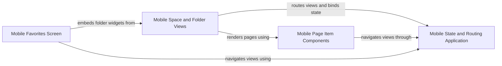

## Details

Coordinates mobile workspace navigation, home dashboard tabs, and top-level application BLoC routing.

### Mobile Space and Folder Views
Renders the mobile home dashboard tabs, workspace switcher, space folders, and recent views.

**Related Classes/Methods**:

- `frontend.appflowy_flutter.lib.mobile.presentation.home.mobile_home_page.MobileHomeScreen`:32-83
- `frontend.appflowy_flutter.lib.mobile.presentation.home.mobile_home_page.MobileHomePage`:88-100
- `frontend.appflowy_flutter.lib.mobile.presentation.home.mobile_home_page_header.MobileHomePageHeader`:23-61
- `frontend.appflowy_flutter.lib.mobile.presentation.home.tab.mobile_space_tab.MobileHomePageTab`:27-37
- `frontend.appflowy_flutter.lib.mobile.presentation.home.space.mobile_space.MobileSpace`:20-115

**Source Files:**

- `frontend/appflowy_flutter/lib/mobile/presentation/home/favorite_folder/favorite_space.dart`
  - `frontend.appflowy_flutter.lib.mobile.presentation.home.favorite_folder.favorite_space.MobileFavoriteSpace` (L15-L25) - Class
  - `frontend.appflowy_flutter.lib.mobile.presentation.home.favorite_folder.favorite_space.MobileFavoriteSpace.MobileFavoriteSpace` (L16-L19) - Constructor
  - `frontend.appflowy_flutter.lib.mobile.presentation.home.favorite_folder.favorite_space.MobileFavoriteSpace.createState` (L24-L24) - Method
  - `frontend.appflowy_flutter.lib.mobile.presentation.home.favorite_folder.favorite_space._MobileFavoriteSpaceState` (L27-L85) - Class
  - `frontend.appflowy_flutter.lib.mobile.presentation.home.favorite_folder.favorite_space._MobileFavoriteSpaceState.wantKeepAlive` (L30-L30) - Method
  - `frontend.appflowy_flutter.lib.mobile.presentation.home.favorite_folder.favorite_space._MobileFavoriteSpaceState.build` (L33-L84) - Method
  - `frontend.appflowy_flutter.lib.mobile.presentation.home.favorite_folder.favorite_space._FavoriteViews` (L87-L129) - Class
  - `frontend.appflowy_flutter.lib.mobile.presentation.home.favorite_folder.favorite_space._FavoriteViews._FavoriteViews` (L88-L90) - Constructor
  - `frontend.appflowy_flutter.lib.mobile.presentation.home.favorite_folder.favorite_space._FavoriteViews.build` (L95-L128) - Method
- `frontend/appflowy_flutter/lib/mobile/presentation/home/favorite_folder/mobile_home_favorite_folder.dart`
  - `frontend.appflowy_flutter.lib.mobile.presentation.home.favorite_folder.mobile_home_favorite_folder.MobileFavoriteFolder` (L11-L85) - Class
  - `frontend.appflowy_flutter.lib.mobile.presentation.home.favorite_folder.mobile_home_favorite_folder.MobileFavoriteFolder.MobileFavoriteFolder` (L12-L17) - Constructor
  - `frontend.appflowy_flutter.lib.mobile.presentation.home.favorite_folder.mobile_home_favorite_folder.MobileFavoriteFolder.build` (L24-L84) - Method
- `frontend/appflowy_flutter/lib/mobile/presentation/home/favorite_folder/mobile_home_favorite_folder_header.dart`
  - `frontend.appflowy_flutter.lib.mobile.presentation.home.favorite_folder.mobile_home_favorite_folder_header.MobileFavoriteFolderHeader` (L6-L21) - Class
  - `frontend.appflowy_flutter.lib.mobile.presentation.home.favorite_folder.mobile_home_favorite_folder_header.MobileFavoriteFolderHeader.MobileFavoriteFolderHeader` (L7-L12) - Constructor
  - `frontend.appflowy_flutter.lib.mobile.presentation.home.favorite_folder.mobile_home_favorite_folder_header.MobileFavoriteFolderHeader.createState` (L19-L20) - Method
  - `frontend.appflowy_flutter.lib.mobile.presentation.home.favorite_folder.mobile_home_favorite_folder_header._MobileFavoriteFolderHeaderState` (L23-L59) - Class
  - `frontend.appflowy_flutter.lib.mobile.presentation.home.favorite_folder.mobile_home_favorite_folder_header._MobileFavoriteFolderHeaderState.build` (L28-L58) - Method
- `frontend/appflowy_flutter/lib/mobile/presentation/home/home_space/home_space.dart`
  - `frontend.appflowy_flutter.lib.mobile.presentation.home.home_space.home_space.MobileHomeSpace` (L8-L15) - Class
  - `frontend.appflowy_flutter.lib.mobile.presentation.home.home_space.home_space.MobileHomeSpace.MobileHomeSpace` (L9-L9) - Constructor
  - `frontend.appflowy_flutter.lib.mobile.presentation.home.home_space.home_space.MobileHomeSpace.createState` (L14-L14) - Method
  - `frontend.appflowy_flutter.lib.mobile.presentation.home.home_space.home_space._MobileHomeSpaceState` (L17-L43) - Class
  - `frontend.appflowy_flutter.lib.mobile.presentation.home.home_space.home_space._MobileHomeSpaceState.wantKeepAlive` (L20-L20) - Method
  - `frontend.appflowy_flutter.lib.mobile.presentation.home.home_space.home_space._MobileHomeSpaceState.build` (L23-L42) - Method
- `frontend/appflowy_flutter/lib/mobile/presentation/home/mobile_folders.dart`
  - `frontend.appflowy_flutter.lib.mobile.presentation.home.mobile_folders.MobileFolders` (L16-L55) - Class
  - `frontend.appflowy_flutter.lib.mobile.presentation.home.mobile_folders.MobileFolders.MobileFolders` (L17-L22) - Constructor
  - `frontend.appflowy_flutter.lib.mobile.presentation.home.mobile_folders.MobileFolders.build` (L29-L54) - Method
  - `frontend.appflowy_flutter.lib.mobile.presentation.home.mobile_folders._MobileFolder` (L57-L62) - Class
  - `frontend.appflowy_flutter.lib.mobile.presentation.home.mobile_folders._MobileFolder._MobileFolder` (L58-L58) - Constructor
  - `frontend.appflowy_flutter.lib.mobile.presentation.home.mobile_folders._MobileFolder.createState` (L61-L61) - Method
  - `frontend.appflowy_flutter.lib.mobile.presentation.home.mobile_folders._MobileFolderState` (L64-L115) - Class
  - `frontend.appflowy_flutter.lib.mobile.presentation.home.mobile_folders._MobileFolderState.build` (L66-L79) - Method
  - `frontend.appflowy_flutter.lib.mobile.presentation.home.mobile_folders._MobileFolderState._buildSpaceOrSection` (L81-L114) - Method
- `frontend/appflowy_flutter/lib/mobile/presentation/home/mobile_home_page.dart`
  - `frontend.appflowy_flutter.lib.mobile.presentation.home.mobile_home_page.MobileHomeScreen` (L32-L83) - Class
  - `frontend.appflowy_flutter.lib.mobile.presentation.home.mobile_home_page.MobileHomeScreen.MobileHomeScreen` (L33-L33) - Constructor
  - `frontend.appflowy_flutter.lib.mobile.presentation.home.mobile_home_page.MobileHomeScreen.build` (L38-L82) - Method
  - `frontend.appflowy_flutter.lib.mobile.presentation.home.mobile_home_page.MobileHomePage` (L88-L100) - Class
  - `frontend.appflowy_flutter.lib.mobile.presentation.home.mobile_home_page.MobileHomePage.MobileHomePage` (L89-L93) - Constructor
  - `frontend.appflowy_flutter.lib.mobile.presentation.home.mobile_home_page.MobileHomePage.createState` (L99-L99) - Method
  - `frontend.appflowy_flutter.lib.mobile.presentation.home.mobile_home_page._MobileHomePageState` (L102-L151) - Class
  - `frontend.appflowy_flutter.lib.mobile.presentation.home.mobile_home_page._MobileHomePageState.initState` (L106-L111) - Method
  - `frontend.appflowy_flutter.lib.mobile.presentation.home.mobile_home_page._MobileHomePageState.dispose` (L114-L118) - Method
  - `frontend.appflowy_flutter.lib.mobile.presentation.home.mobile_home_page._MobileHomePageState.build` (L121-L142) - Method
  - `frontend.appflowy_flutter.lib.mobile.presentation.home.mobile_home_page._MobileHomePageState._onLatestViewChange` (L144-L150) - Method
  - `frontend.appflowy_flutter.lib.mobile.presentation.home.mobile_home_page._HomePage` (L153-L160) - Class
  - `frontend.appflowy_flutter.lib.mobile.presentation.home.mobile_home_page._HomePage._HomePage` (L154-L154) - Constructor
  - `frontend.appflowy_flutter.lib.mobile.presentation.home.mobile_home_page._HomePage.createState` (L159-L159) - Method
  - `frontend.appflowy_flutter.lib.mobile.presentation.home.mobile_home_page._HomePageState` (L162-L340) - Class
  - `frontend.appflowy_flutter.lib.mobile.presentation.home.mobile_home_page._HomePageState.build` (L166-L251) - Method
  - `frontend.appflowy_flutter.lib.mobile.presentation.home.mobile_home_page._HomePageState._showResultDialog` (L253-L339) - Method
- `frontend/appflowy_flutter/lib/mobile/presentation/home/mobile_home_page_header.dart`
  - `frontend.appflowy_flutter.lib.mobile.presentation.home.mobile_home_page_header.MobileHomePageHeader` (L23-L61) - Class
  - `frontend.appflowy_flutter.lib.mobile.presentation.home.mobile_home_page_header.MobileHomePageHeader.MobileHomePageHeader` (L24-L27) - Constructor
  - `frontend.appflowy_flutter.lib.mobile.presentation.home.mobile_home_page_header.MobileHomePageHeader.build` (L32-L60) - Method
  - `frontend.appflowy_flutter.lib.mobile.presentation.home.mobile_home_page_header._MobileUser` (L63-L97) - Class
  - `frontend.appflowy_flutter.lib.mobile.presentation.home.mobile_home_page_header._MobileUser._MobileUser` (L64-L66) - Constructor
  - `frontend.appflowy_flutter.lib.mobile.presentation.home.mobile_home_page_header._MobileUser.build` (L71-L96) - Method
  - `frontend.appflowy_flutter.lib.mobile.presentation.home.mobile_home_page_header._MobileWorkspace` (L99-L207) - Class
  - `frontend.appflowy_flutter.lib.mobile.presentation.home.mobile_home_page_header._MobileWorkspace._MobileWorkspace` (L100-L102) - Constructor
  - `frontend.appflowy_flutter.lib.mobile.presentation.home.mobile_home_page_header._MobileWorkspace.build` (L107-L156) - Method
  - `frontend.appflowy_flutter.lib.mobile.presentation.home.mobile_home_page_header._MobileWorkspace._showSwitchWorkspacesBottomSheet` (L158-L206) - Method
  - `frontend.appflowy_flutter.lib.mobile.presentation.home.mobile_home_page_header._UserIcon` (L209-L254) - Class
  - `frontend.appflowy_flutter.lib.mobile.presentation.home.mobile_home_page_header._UserIcon._UserIcon` (L210-L212) - Constructor
  - `frontend.appflowy_flutter.lib.mobile.presentation.home.mobile_home_page_header._UserIcon.build` (L217-L253) - Method
- `frontend/appflowy_flutter/lib/mobile/presentation/home/mobile_home_setting_page.dart`
  - `frontend.appflowy_flutter.lib.mobile.presentation.home.mobile_home_setting_page.MobileHomeSettingPage` (L23-L32) - Class
  - `frontend.appflowy_flutter.lib.mobile.presentation.home.mobile_home_setting_page.MobileHomeSettingPage.MobileHomeSettingPage` (L24-L26) - Constructor
  - `frontend.appflowy_flutter.lib.mobile.presentation.home.mobile_home_setting_page.MobileHomeSettingPage.createState` (L31-L31) - Method
  - `frontend.appflowy_flutter.lib.mobile.presentation.home.mobile_home_setting_page._MobileHomeSettingPageState` (L34-L121) - Class
  - `frontend.appflowy_flutter.lib.mobile.presentation.home.mobile_home_setting_page._MobileHomeSettingPageState.build` (L36-L65) - Method
  - `frontend.appflowy_flutter.lib.mobile.presentation.home.mobile_home_setting_page._MobileHomeSettingPageState._buildErrorWidget` (L67-L74) - Method
  - `frontend.appflowy_flutter.lib.mobile.presentation.home.mobile_home_setting_page._MobileHomeSettingPageState._buildSettingsWidget` (L76-L120) - Method
- `frontend/appflowy_flutter/lib/mobile/presentation/home/mobile_home_trash_page.dart`
  - `frontend.appflowy_flutter.lib.mobile.presentation.home.mobile_home_trash_page.MobileHomeTrashPage` (L14-L74) - Class
  - `frontend.appflowy_flutter.lib.mobile.presentation.home.mobile_home_trash_page.MobileHomeTrashPage.MobileHomeTrashPage` (L15-L15) - Constructor
  - `frontend.appflowy_flutter.lib.mobile.presentation.home.mobile_home_trash_page.MobileHomeTrashPage.build` (L20-L73) - Method
  - `frontend.appflowy_flutter.lib.mobile.presentation.home.mobile_home_trash_page._TrashActionType` (L76-L79) - Enum
  - `frontend.appflowy_flutter.lib.mobile.presentation.home.mobile_home_trash_page._TrashActionType.restoreAll` (L77-L77) - Enum
  - `frontend.appflowy_flutter.lib.mobile.presentation.home.mobile_home_trash_page._TrashActionType.deleteAll` (L78-L78) - Enum
  - `frontend.appflowy_flutter.lib.mobile.presentation.home.mobile_home_trash_page._EmptyTrashBin` (L81-L114) - Class
  - `frontend.appflowy_flutter.lib.mobile.presentation.home.mobile_home_trash_page._EmptyTrashBin._EmptyTrashBin` (L82-L82) - Constructor
  - `frontend.appflowy_flutter.lib.mobile.presentation.home.mobile_home_trash_page._EmptyTrashBin.build` (L85-L113) - Method
  - `frontend.appflowy_flutter.lib.mobile.presentation.home.mobile_home_trash_page._TrashActionAllButton` (L116-L183) - Class
  - `frontend.appflowy_flutter.lib.mobile.presentation.home.mobile_home_trash_page._TrashActionAllButton._TrashActionAllButton` (L118-L121) - Constructor
  - `frontend.appflowy_flutter.lib.mobile.presentation.home.mobile_home_trash_page._TrashActionAllButton.build` (L126-L182) - Method
  - `frontend.appflowy_flutter.lib.mobile.presentation.home.mobile_home_trash_page._DeletedFilesListView` (L185-L267) - Class
  - `frontend.appflowy_flutter.lib.mobile.presentation.home.mobile_home_trash_page._DeletedFilesListView._DeletedFilesListView` (L186-L188) - Constructor
  - `frontend.appflowy_flutter.lib.mobile.presentation.home.mobile_home_trash_page._DeletedFilesListView.build` (L192-L266) - Method
- `frontend/appflowy_flutter/lib/mobile/presentation/home/recent_folder/mobile_home_recent_views.dart`
  - `frontend.appflowy_flutter.lib.mobile.presentation.home.recent_folder.mobile_home_recent_views.MobileRecentFolder` (L16-L21) - Class
  - `frontend.appflowy_flutter.lib.mobile.presentation.home.recent_folder.mobile_home_recent_views.MobileRecentFolder.MobileRecentFolder` (L17-L17) - Constructor
  - `frontend.appflowy_flutter.lib.mobile.presentation.home.recent_folder.mobile_home_recent_views.MobileRecentFolder.createState` (L20-L20) - Method
  - `frontend.appflowy_flutter.lib.mobile.presentation.home.recent_folder.mobile_home_recent_views._MobileRecentFolderState` (L23-L66) - Class
  - `frontend.appflowy_flutter.lib.mobile.presentation.home.recent_folder.mobile_home_recent_views._MobileRecentFolderState.build` (L25-L65) - Method
  - `frontend.appflowy_flutter.lib.mobile.presentation.home.recent_folder.mobile_home_recent_views._RecentViews` (L68-L141) - Class
  - `frontend.appflowy_flutter.lib.mobile.presentation.home.recent_folder.mobile_home_recent_views._RecentViews._RecentViews` (L69-L72) - Constructor
  - `frontend.appflowy_flutter.lib.mobile.presentation.home.recent_folder.mobile_home_recent_views._RecentViews.build` (L77-L140) - Method
- `frontend/appflowy_flutter/lib/mobile/presentation/home/recent_folder/mobile_recent_view.dart`
  - `frontend.appflowy_flutter.lib.mobile.presentation.home.recent_folder.mobile_recent_view.MobileRecentView` (L21-L120) - Class
  - `frontend.appflowy_flutter.lib.mobile.presentation.home.recent_folder.mobile_recent_view.MobileRecentView.MobileRecentView` (L22-L25) - Constructor
  - `frontend.appflowy_flutter.lib.mobile.presentation.home.recent_folder.mobile_recent_view.MobileRecentView.build` (L30-L68) - Method
  - `frontend.appflowy_flutter.lib.mobile.presentation.home.recent_folder.mobile_recent_view.MobileRecentView._buildCover` (L70-L85) - Method
  - `frontend.appflowy_flutter.lib.mobile.presentation.home.recent_folder.mobile_recent_view.MobileRecentView._buildTitle` (L87-L107) - Method
  - `frontend.appflowy_flutter.lib.mobile.presentation.home.recent_folder.mobile_recent_view.MobileRecentView._buildIcon` (L109-L119) - Method
  - `frontend.appflowy_flutter.lib.mobile.presentation.home.recent_folder.mobile_recent_view._RecentCover` (L122-L229) - Class
  - `frontend.appflowy_flutter.lib.mobile.presentation.home.recent_folder.mobile_recent_view._RecentCover._RecentCover` (L123-L127) - Constructor
  - `frontend.appflowy_flutter.lib.mobile.presentation.home.recent_folder.mobile_recent_view._RecentCover.build` (L134-L148) - Method
  - `frontend.appflowy_flutter.lib.mobile.presentation.home.recent_folder.mobile_recent_view._RecentCover._buildCoverV2` (L150-L196) - Method
  - `frontend.appflowy_flutter.lib.mobile.presentation.home.recent_folder.mobile_recent_view._RecentCover._buildCoverV1` (L198-L228) - Method
- `frontend/appflowy_flutter/lib/mobile/presentation/home/recent_folder/recent_space.dart`
  - `frontend.appflowy_flutter.lib.mobile.presentation.home.recent_folder.recent_space.MobileRecentSpace` (L12-L17) - Class
  - `frontend.appflowy_flutter.lib.mobile.presentation.home.recent_folder.recent_space.MobileRecentSpace.MobileRecentSpace` (L13-L13) - Constructor
  - `frontend.appflowy_flutter.lib.mobile.presentation.home.recent_folder.recent_space.MobileRecentSpace.createState` (L16-L16) - Method
  - `frontend.appflowy_flutter.lib.mobile.presentation.home.recent_folder.recent_space._MobileRecentSpaceState` (L19-L56) - Class
  - `frontend.appflowy_flutter.lib.mobile.presentation.home.recent_folder.recent_space._MobileRecentSpaceState.wantKeepAlive` (L22-L22) - Method
  - `frontend.appflowy_flutter.lib.mobile.presentation.home.recent_folder.recent_space._MobileRecentSpaceState.build` (L25-L48) - Method
  - `frontend.appflowy_flutter.lib.mobile.presentation.home.recent_folder.recent_space._MobileRecentSpaceState._filterRecentViews` (L50-L55) - Method
  - `frontend.appflowy_flutter.lib.mobile.presentation.home.recent_folder.recent_space._RecentViews` (L58-L102) - Class
  - `frontend.appflowy_flutter.lib.mobile.presentation.home.recent_folder.recent_space._RecentViews._RecentViews` (L59-L61) - Constructor
  - `frontend.appflowy_flutter.lib.mobile.presentation.home.recent_folder.recent_space._RecentViews.build` (L66-L101) - Method
- `frontend/appflowy_flutter/lib/mobile/presentation/home/section_folder/mobile_home_section_folder.dart`
  - `frontend.appflowy_flutter.lib.mobile.presentation.home.section_folder.mobile_home_section_folder.MobileSectionFolder` (L16-L79) - Class
  - `frontend.appflowy_flutter.lib.mobile.presentation.home.section_folder.mobile_home_section_folder.MobileSectionFolder.MobileSectionFolder` (L17-L22) - Constructor
  - `frontend.appflowy_flutter.lib.mobile.presentation.home.section_folder.mobile_home_section_folder.MobileSectionFolder.build` (L29-L65) - Method
  - `frontend.appflowy_flutter.lib.mobile.presentation.home.section_folder.mobile_home_section_folder.MobileSectionFolder._createNewPage` (L67-L78) - Method
  - `frontend.appflowy_flutter.lib.mobile.presentation.home.section_folder.mobile_home_section_folder._Pages` (L81-L132) - Class
  - `frontend.appflowy_flutter.lib.mobile.presentation.home.section_folder.mobile_home_section_folder._Pages._Pages` (L82-L85) - Constructor
  - `frontend.appflowy_flutter.lib.mobile.presentation.home.section_folder.mobile_home_section_folder._Pages.build` (L91-L131) - Method
- `frontend/appflowy_flutter/lib/mobile/presentation/home/section_folder/mobile_home_section_folder_header.dart`
  - `frontend.appflowy_flutter.lib.mobile.presentation.home.section_folder.mobile_home_section_folder_header.MobileSectionFolderHeader` (L9-L26) - Class
  - `frontend.appflowy_flutter.lib.mobile.presentation.home.section_folder.mobile_home_section_folder_header.MobileSectionFolderHeader.MobileSectionFolderHeader` (L10-L16) - Constructor
  - `frontend.appflowy_flutter.lib.mobile.presentation.home.section_folder.mobile_home_section_folder_header.MobileSectionFolderHeader.createState` (L24-L25) - Method
  - `frontend.appflowy_flutter.lib.mobile.presentation.home.section_folder.mobile_home_section_folder_header._MobileSectionFolderHeaderState` (L28-L78) - Class
  - `frontend.appflowy_flutter.lib.mobile.presentation.home.section_folder.mobile_home_section_folder_header._MobileSectionFolderHeaderState.build` (L32-L77) - Method
- `frontend/appflowy_flutter/lib/mobile/presentation/home/setting/settings_popup_menu.dart`
  - `frontend.appflowy_flutter.lib.mobile.presentation.home.setting.settings_popup_menu._MobileSettingsPopupMenuItem` (L14-L20) - Enum
  - `frontend.appflowy_flutter.lib.mobile.presentation.home.setting.settings_popup_menu._MobileSettingsPopupMenuItem.settings` (L15-L15) - Enum
  - `frontend.appflowy_flutter.lib.mobile.presentation.home.setting.settings_popup_menu._MobileSettingsPopupMenuItem.members` (L16-L16) - Enum
  - `frontend.appflowy_flutter.lib.mobile.presentation.home.setting.settings_popup_menu._MobileSettingsPopupMenuItem.trash` (L17-L17) - Enum
  - `frontend.appflowy_flutter.lib.mobile.presentation.home.setting.settings_popup_menu._MobileSettingsPopupMenuItem.help` (L18-L18) - Enum
  - `frontend.appflowy_flutter.lib.mobile.presentation.home.setting.settings_popup_menu._MobileSettingsPopupMenuItem.helpAndDocumentation` (L19-L19) - Enum
  - `frontend.appflowy_flutter.lib.mobile.presentation.home.setting.settings_popup_menu.HomePageSettingsPopupMenu` (L22-L140) - Class
  - `frontend.appflowy_flutter.lib.mobile.presentation.home.setting.settings_popup_menu.HomePageSettingsPopupMenu.HomePageSettingsPopupMenu` (L23-L26) - Constructor
  - `frontend.appflowy_flutter.lib.mobile.presentation.home.setting.settings_popup_menu.HomePageSettingsPopupMenu.build` (L31-L104) - Method
  - `frontend.appflowy_flutter.lib.mobile.presentation.home.setting.settings_popup_menu.HomePageSettingsPopupMenu._buildItem` (L106-L119) - Method
  - `frontend.appflowy_flutter.lib.mobile.presentation.home.setting.settings_popup_menu.HomePageSettingsPopupMenu._openMembersPage` (L121-L123) - Method
  - `frontend.appflowy_flutter.lib.mobile.presentation.home.setting.settings_popup_menu.HomePageSettingsPopupMenu._openTrashPage` (L125-L127) - Method
  - `frontend.appflowy_flutter.lib.mobile.presentation.home.setting.settings_popup_menu.HomePageSettingsPopupMenu._openHelpPage` (L129-L131) - Method
  - `frontend.appflowy_flutter.lib.mobile.presentation.home.setting.settings_popup_menu.HomePageSettingsPopupMenu._openSettingsPage` (L133-L135) - Method
  - `frontend.appflowy_flutter.lib.mobile.presentation.home.setting.settings_popup_menu.HomePageSettingsPopupMenu._openHelpAndDocumentationPage` (L137-L139) - Method
  - `frontend.appflowy_flutter.lib.mobile.presentation.home.setting.settings_popup_menu._PopupButton` (L142-L168) - Class
  - `frontend.appflowy_flutter.lib.mobile.presentation.home.setting.settings_popup_menu._PopupButton._PopupButton` (L143-L146) - Constructor
  - `frontend.appflowy_flutter.lib.mobile.presentation.home.setting.settings_popup_menu._PopupButton.build` (L152-L167) - Method
- `frontend/appflowy_flutter/lib/mobile/presentation/home/shared/empty_placeholder.dart`
  - `frontend.appflowy_flutter.lib.mobile.presentation.home.shared.empty_placeholder.EmptySpacePlaceholder` (L8-L59) - Class
  - `frontend.appflowy_flutter.lib.mobile.presentation.home.shared.empty_placeholder.EmptySpacePlaceholder.EmptySpacePlaceholder` (L9-L12) - Constructor
  - `frontend.appflowy_flutter.lib.mobile.presentation.home.shared.empty_placeholder.EmptySpacePlaceholder.build` (L17-L46) - Method
  - `frontend.appflowy_flutter.lib.mobile.presentation.home.shared.empty_placeholder.EmptySpacePlaceholder._emptyPageText` (L48-L51) - Method
  - `frontend.appflowy_flutter.lib.mobile.presentation.home.shared.empty_placeholder.EmptySpacePlaceholder._emptyPageSubText` (L53-L58) - Method
- `frontend/appflowy_flutter/lib/mobile/presentation/home/shared/mobile_page_card.dart`
  - `frontend.appflowy_flutter.lib.mobile.presentation.home.shared.mobile_page_card.MobilePageCardType` (L35-L43) - Enum
  - `frontend.appflowy_flutter.lib.mobile.presentation.home.shared.mobile_page_card.MobilePageCardType.recent` (L36-L36) - Enum
  - `frontend.appflowy_flutter.lib.mobile.presentation.home.shared.mobile_page_card.MobilePageCardType.favorite` (L37-L37) - Enum
  - `frontend.appflowy_flutter.lib.mobile.presentation.home.shared.mobile_page_card.MobilePageCardType.lastOperationHintText` (L39-L42) - Method
  - `frontend.appflowy_flutter.lib.mobile.presentation.home.shared.mobile_page_card.MobileViewPage` (L45-L275) - Class
  - `frontend.appflowy_flutter.lib.mobile.presentation.home.shared.mobile_page_card.MobileViewPage.MobileViewPage` (L46-L51) - Constructor
  - `frontend.appflowy_flutter.lib.mobile.presentation.home.shared.mobile_page_card.MobileViewPage.build` (L58-L112) - Method
  - `frontend.appflowy_flutter.lib.mobile.presentation.home.shared.mobile_page_card.MobileViewPage._buildDescription` (L114-L126) - Method
  - `frontend.appflowy_flutter.lib.mobile.presentation.home.shared.mobile_page_card.MobileViewPage._buildNameAndLastViewed` (L128-L144) - Method
  - `frontend.appflowy_flutter.lib.mobile.presentation.home.shared.mobile_page_card.MobileViewPage._buildAvatar` (L146-L168) - Method
  - `frontend.appflowy_flutter.lib.mobile.presentation.home.shared.mobile_page_card.MobileViewPage._buildCover` (L170-L180) - Method
  - `frontend.appflowy_flutter.lib.mobile.presentation.home.shared.mobile_page_card.MobileViewPage._buildTitle` (L182-L215) - Method
  - `frontend.appflowy_flutter.lib.mobile.presentation.home.shared.mobile_page_card.MobileViewPage._buildAuthor` (L217-L225) - Method
  - `frontend.appflowy_flutter.lib.mobile.presentation.home.shared.mobile_page_card.MobileViewPage._buildLastViewed` (L227-L243) - Method
  - `frontend.appflowy_flutter.lib.mobile.presentation.home.shared.mobile_page_card.MobileViewPage._formatTimestamp` (L245-L274) - Method
  - `frontend.appflowy_flutter.lib.mobile.presentation.home.shared.mobile_page_card._ViewCover` (L277-L421) - Class
  - `frontend.appflowy_flutter.lib.mobile.presentation.home.shared.mobile_page_card._ViewCover._ViewCover` (L278-L283) - Constructor
  - `frontend.appflowy_flutter.lib.mobile.presentation.home.shared.mobile_page_card._ViewCover.build` (L291-L301) - Method
  - `frontend.appflowy_flutter.lib.mobile.presentation.home.shared.mobile_page_card._ViewCover._buildPlaceholder` (L303-L340) - Method
  - `frontend.appflowy_flutter.lib.mobile.presentation.home.shared.mobile_page_card._ViewCover._buildCoverV2` (L342-L388) - Method
  - `frontend.appflowy_flutter.lib.mobile.presentation.home.shared.mobile_page_card._ViewCover._buildCoverV1` (L390-L420) - Method
- `frontend/appflowy_flutter/lib/mobile/presentation/home/space/constants.dart`
  - `frontend.appflowy_flutter.lib.mobile.presentation.home.space.constants.SpaceUIConstants` (L1-L3) - Class
- `frontend/appflowy_flutter/lib/mobile/presentation/home/space/manage_space_widget.dart`
  - `frontend.appflowy_flutter.lib.mobile.presentation.home.space.manage_space_widget.ManageSpaceType` (L8-L11) - Enum
  - `frontend.appflowy_flutter.lib.mobile.presentation.home.space.manage_space_widget.ManageSpaceType.create` (L9-L9) - Enum
  - `frontend.appflowy_flutter.lib.mobile.presentation.home.space.manage_space_widget.ManageSpaceType.edit` (L10-L10) - Enum
  - `frontend.appflowy_flutter.lib.mobile.presentation.home.space.manage_space_widget.ManageSpaceWidget` (L13-L53) - Class
  - `frontend.appflowy_flutter.lib.mobile.presentation.home.space.manage_space_widget.ManageSpaceWidget.ManageSpaceWidget` (L14-L21) - Constructor
  - `frontend.appflowy_flutter.lib.mobile.presentation.home.space.manage_space_widget.ManageSpaceWidget.build` (L30-L52) - Method
- `frontend/appflowy_flutter/lib/mobile/presentation/home/space/mobile_space.dart`
  - `frontend.appflowy_flutter.lib.mobile.presentation.home.space.mobile_space.MobileSpace` (L20-L115) - Class
  - `frontend.appflowy_flutter.lib.mobile.presentation.home.space.mobile_space.MobileSpace.MobileSpace` (L21-L23) - Constructor
  - `frontend.appflowy_flutter.lib.mobile.presentation.home.space.mobile_space.MobileSpace.build` (L26-L56) - Method
  - `frontend.appflowy_flutter.lib.mobile.presentation.home.space.mobile_space.MobileSpace._showSpaceMenu` (L58-L81) - Method
  - `frontend.appflowy_flutter.lib.mobile.presentation.home.space.mobile_space.MobileSpace._showCreatePageMenu` (L83-L114) - Method
  - `frontend.appflowy_flutter.lib.mobile.presentation.home.space.mobile_space._Pages` (L117-L185) - Class
  - `frontend.appflowy_flutter.lib.mobile.presentation.home.space.mobile_space._Pages._Pages` (L118-L121) - Constructor
  - `frontend.appflowy_flutter.lib.mobile.presentation.home.space.mobile_space._Pages.build` (L126-L184) - Method
- `frontend/appflowy_flutter/lib/mobile/presentation/home/space/mobile_space_header.dart`
  - `frontend.appflowy_flutter.lib.mobile.presentation.home.space.mobile_space_header.MobileSpaceHeader` (L11-L143) - Class
  - `frontend.appflowy_flutter.lib.mobile.presentation.home.space.mobile_space_header.MobileSpaceHeader.MobileSpaceHeader` (L12-L18) - Constructor
  - `frontend.appflowy_flutter.lib.mobile.presentation.home.space.mobile_space_header.MobileSpaceHeader.build` (L26-L71) - Method
- `frontend/appflowy_flutter/lib/mobile/presentation/home/space/mobile_space_menu.dart`
  - `frontend.appflowy_flutter.lib.mobile.presentation.home.space.mobile_space_menu.MobileSpaceMenu` (L29-L67) - Class
  - `frontend.appflowy_flutter.lib.mobile.presentation.home.space.mobile_space_menu.MobileSpaceMenu.MobileSpaceMenu` (L30-L32) - Constructor
  - `frontend.appflowy_flutter.lib.mobile.presentation.home.space.mobile_space_menu.MobileSpaceMenu.build` (L35-L66) - Method
  - `frontend.appflowy_flutter.lib.mobile.presentation.home.space.mobile_space_menu.MobileSpaceMenuItem` (L69-L117) - Class
  - `frontend.appflowy_flutter.lib.mobile.presentation.home.space.mobile_space_menu.MobileSpaceMenuItem.MobileSpaceMenuItem` (L70-L74) - Constructor
  - `frontend.appflowy_flutter.lib.mobile.presentation.home.space.mobile_space_menu.MobileSpaceMenuItem.build` (L80-L116) - Method
  - `frontend.appflowy_flutter.lib.mobile.presentation.home.space.mobile_space_menu._CreateSpaceButton` (L119-L124) - Class
  - `frontend.appflowy_flutter.lib.mobile.presentation.home.space.mobile_space_menu._CreateSpaceButton._CreateSpaceButton` (L120-L120) - Constructor
  - `frontend.appflowy_flutter.lib.mobile.presentation.home.space.mobile_space_menu._CreateSpaceButton.createState` (L123-L123) - Method
  - `frontend.appflowy_flutter.lib.mobile.presentation.home.space.mobile_space_menu._CreateSpaceButtonState` (L126-L216) - Class
  - `frontend.appflowy_flutter.lib.mobile.presentation.home.space.mobile_space_menu._CreateSpaceButtonState.dispose` (L139-L146) - Method
  - `frontend.appflowy_flutter.lib.mobile.presentation.home.space.mobile_space_menu._CreateSpaceButtonState.build` (L149-L163) - Method
  - `frontend.appflowy_flutter.lib.mobile.presentation.home.space.mobile_space_menu._CreateSpaceButtonState._showCreateSpaceDialog` (L165-L208) - Method
  - `frontend.appflowy_flutter.lib.mobile.presentation.home.space.mobile_space_menu._CreateSpaceButtonState._resetState` (L210-L215) - Method
  - `frontend.appflowy_flutter.lib.mobile.presentation.home.space.mobile_space_menu.SpaceMenuItemTrailing` (L218-L230) - Class
  - `frontend.appflowy_flutter.lib.mobile.presentation.home.space.mobile_space_menu.SpaceMenuItemTrailing.SpaceMenuItemTrailing` (L219-L223) - Constructor
  - `frontend.appflowy_flutter.lib.mobile.presentation.home.space.mobile_space_menu.SpaceMenuItemTrailing.createState` (L229-L229) - Method
  - `frontend.appflowy_flutter.lib.mobile.presentation.home.space.mobile_space_menu._SpaceMenuItemTrailingState` (L232-L496) - Class
  - `frontend.appflowy_flutter.lib.mobile.presentation.home.space.mobile_space_menu._SpaceMenuItemTrailingState.dispose` (L245-L252) - Method
  - `frontend.appflowy_flutter.lib.mobile.presentation.home.space.mobile_space_menu._SpaceMenuItemTrailingState.build` (L255-L281) - Method
  - `frontend.appflowy_flutter.lib.mobile.presentation.home.space.mobile_space_menu._SpaceMenuItemTrailingState._showMoreOptions` (L283-L308) - Method
  - `frontend.appflowy_flutter.lib.mobile.presentation.home.space.mobile_space_menu._SpaceMenuItemTrailingState._onActions` (L310-L334) - Method
  - `frontend.appflowy_flutter.lib.mobile.presentation.home.space.mobile_space_menu._SpaceMenuItemTrailingState._duplicateSpace` (L336-L347) - Method
  - `frontend.appflowy_flutter.lib.mobile.presentation.home.space.mobile_space_menu._SpaceMenuItemTrailingState._showRenameSpaceBottomSheet` (L349-L382) - Method
  - `frontend.appflowy_flutter.lib.mobile.presentation.home.space.mobile_space_menu._SpaceMenuItemTrailingState._showManageSpaceBottomSheet` (L384-L440) - Method
  - `frontend.appflowy_flutter.lib.mobile.presentation.home.space.mobile_space_menu._SpaceMenuItemTrailingState._deleteSpace` (L442-L463) - Method
  - `frontend.appflowy_flutter.lib.mobile.presentation.home.space.mobile_space_menu._SpaceMenuItemTrailingState._showConfirmDialog` (L465-L495) - Method
- `frontend/appflowy_flutter/lib/mobile/presentation/home/space/space_menu_bottom_sheet.dart`
  - `frontend.appflowy_flutter.lib.mobile.presentation.home.space.space_menu_bottom_sheet.SpaceMenuMoreOptions` (L10-L99) - Class
  - `frontend.appflowy_flutter.lib.mobile.presentation.home.space.space_menu_bottom_sheet.SpaceMenuMoreOptions.SpaceMenuMoreOptions` (L11-L15) - Constructor
  - `frontend.appflowy_flutter.lib.mobile.presentation.home.space.space_menu_bottom_sheet.SpaceMenuMoreOptions.build` (L21-L30) - Method
  - `frontend.appflowy_flutter.lib.mobile.presentation.home.space.space_menu_bottom_sheet.SpaceMenuMoreOptions._buildActionButton` (L32-L98) - Method
- `frontend/appflowy_flutter/lib/mobile/presentation/home/space/space_permission_bottom_sheet.dart`
  - `frontend.appflowy_flutter.lib.mobile.presentation.home.space.space_permission_bottom_sheet.SpacePermissionBottomSheet` (L8-L53) - Class
  - `frontend.appflowy_flutter.lib.mobile.presentation.home.space.space_permission_bottom_sheet.SpacePermissionBottomSheet.SpacePermissionBottomSheet` (L9-L13) - Constructor
  - `frontend.appflowy_flutter.lib.mobile.presentation.home.space.space_permission_bottom_sheet.SpacePermissionBottomSheet.build` (L19-L52) - Method
- `frontend/appflowy_flutter/lib/mobile/presentation/home/space/widgets.dart`
  - `frontend.appflowy_flutter.lib.mobile.presentation.home.space.widgets.ManageSpaceNameOption` (L20-L54) - Class
  - `frontend.appflowy_flutter.lib.mobile.presentation.home.space.widgets.ManageSpaceNameOption.ManageSpaceNameOption` (L21-L25) - Constructor
  - `frontend.appflowy_flutter.lib.mobile.presentation.home.space.widgets.ManageSpaceNameOption.build` (L31-L53) - Method
  - `frontend.appflowy_flutter.lib.mobile.presentation.home.space.widgets.ManageSpacePermissionOption` (L56-L111) - Class
  - `frontend.appflowy_flutter.lib.mobile.presentation.home.space.widgets.ManageSpacePermissionOption.ManageSpacePermissionOption` (L57-L60) - Constructor
  - `frontend.appflowy_flutter.lib.mobile.presentation.home.space.widgets.ManageSpacePermissionOption.build` (L65-L110) - Method
  - `frontend.appflowy_flutter.lib.mobile.presentation.home.space.widgets.ManageSpaceIconOption` (L113-L125) - Class
  - `frontend.appflowy_flutter.lib.mobile.presentation.home.space.widgets.ManageSpaceIconOption.ManageSpaceIconOption` (L114-L118) - Constructor
  - `frontend.appflowy_flutter.lib.mobile.presentation.home.space.widgets.ManageSpaceIconOption.createState` (L124-L124) - Method
  - `frontend.appflowy_flutter.lib.mobile.presentation.home.space.widgets._ManageSpaceIconOptionState` (L127-L268) - Class
  - `frontend.appflowy_flutter.lib.mobile.presentation.home.space.widgets._ManageSpaceIconOptionState.build` (L129-L137) - Method
  - `frontend.appflowy_flutter.lib.mobile.presentation.home.space.widgets._ManageSpaceIconOptionState._buildColorOption` (L139-L175) - Method
  - `frontend.appflowy_flutter.lib.mobile.presentation.home.space.widgets._ManageSpaceIconOptionState._buildSpaceIconOption` (L177-L218) - Method
  - `frontend.appflowy_flutter.lib.mobile.presentation.home.space.widgets._ManageSpaceIconOptionState._buildIconGroups` (L220-L267) - Method
  - `frontend.appflowy_flutter.lib.mobile.presentation.home.space.widgets.SpaceIconItem` (L270-L319) - Class
  - `frontend.appflowy_flutter.lib.mobile.presentation.home.space.widgets.SpaceIconItem.SpaceIconItem` (L271-L277) - Constructor
  - `frontend.appflowy_flutter.lib.mobile.presentation.home.space.widgets.SpaceIconItem.build` (L285-L318) - Method
  - `frontend.appflowy_flutter.lib.mobile.presentation.home.space.widgets.SpaceColorItem` (L321-L369) - Class
  - `frontend.appflowy_flutter.lib.mobile.presentation.home.space.widgets.SpaceColorItem.SpaceColorItem` (L322-L327) - Constructor
  - `frontend.appflowy_flutter.lib.mobile.presentation.home.space.widgets.SpaceColorItem.build` (L334-L368) - Method
  - `frontend.appflowy_flutter.lib.mobile.presentation.home.space.widgets.<unnamed extension>.i18n` (L372-L379) - Method
  - `frontend.appflowy_flutter.lib.mobile.presentation.home.space.widgets.<unnamed extension>.icon` (L381-L388) - Method
- `frontend/appflowy_flutter/lib/mobile/presentation/home/tab/_round_underline_tab_indicator.dart`
  - `frontend.appflowy_flutter.lib.mobile.presentation.home.tab._round_underline_tab_indicator.RoundUnderlineTabIndicator` (L3-L64) - Class
  - `frontend.appflowy_flutter.lib.mobile.presentation.home.tab._round_underline_tab_indicator.RoundUnderlineTabIndicator.RoundUnderlineTabIndicator` (L4-L9) - Constructor
  - `frontend.appflowy_flutter.lib.mobile.presentation.home.tab._round_underline_tab_indicator.RoundUnderlineTabIndicator.lerpFrom` (L17-L25) - Method
  - `frontend.appflowy_flutter.lib.mobile.presentation.home.tab._round_underline_tab_indicator.RoundUnderlineTabIndicator.lerpTo` (L28-L36) - Method
  - `frontend.appflowy_flutter.lib.mobile.presentation.home.tab._round_underline_tab_indicator.RoundUnderlineTabIndicator.createBoxPainter` (L39-L41) - Method
  - `frontend.appflowy_flutter.lib.mobile.presentation.home.tab._round_underline_tab_indicator.RoundUnderlineTabIndicator._indicatorRectFor` (L43-L52) - Method
  - `frontend.appflowy_flutter.lib.mobile.presentation.home.tab._round_underline_tab_indicator.RoundUnderlineTabIndicator.getClipPath` (L55-L63) - Method
  - `frontend.appflowy_flutter.lib.mobile.presentation.home.tab._round_underline_tab_indicator._UnderlinePainter` (L66-L101) - Class
  - `frontend.appflowy_flutter.lib.mobile.presentation.home.tab._round_underline_tab_indicator._UnderlinePainter._UnderlinePainter` (L67-L71) - Constructor
  - `frontend.appflowy_flutter.lib.mobile.presentation.home.tab._round_underline_tab_indicator._UnderlinePainter.paint` (L77-L100) - Method
- `frontend/appflowy_flutter/lib/mobile/presentation/home/tab/_tab_bar.dart`
  - `frontend.appflowy_flutter.lib.mobile.presentation.home.tab._tab_bar.MobileSpaceTabBar` (L6-L59) - Class
  - `frontend.appflowy_flutter.lib.mobile.presentation.home.tab._tab_bar.MobileSpaceTabBar.MobileSpaceTabBar` (L7-L13) - Constructor
  - `frontend.appflowy_flutter.lib.mobile.presentation.home.tab._tab_bar.MobileSpaceTabBar.build` (L21-L58) - Method
- `frontend/appflowy_flutter/lib/mobile/presentation/home/tab/ai_bubble_button.dart`
  - `frontend.appflowy_flutter.lib.mobile.presentation.home.tab.ai_bubble_button.FloatingAIEntry` (L11-L85) - Class
  - `frontend.appflowy_flutter.lib.mobile.presentation.home.tab.ai_bubble_button.FloatingAIEntry.FloatingAIEntry` (L12-L12) - Constructor
  - `frontend.appflowy_flutter.lib.mobile.presentation.home.tab.ai_bubble_button.FloatingAIEntry.build` (L15-L36) - Method
  - `frontend.appflowy_flutter.lib.mobile.presentation.home.tab.ai_bubble_button.FloatingAIEntry._buildShadowDecoration` (L38-L50) - Method
  - `frontend.appflowy_flutter.lib.mobile.presentation.home.tab.ai_bubble_button.FloatingAIEntry._buildWrapperDecoration` (L52-L66) - Method
  - `frontend.appflowy_flutter.lib.mobile.presentation.home.tab.ai_bubble_button.FloatingAIEntry._buildHintText` (L68-L84) - Method
  - `frontend.appflowy_flutter.lib.mobile.presentation.home.tab.ai_bubble_button.FloatingAIEntryV2` (L87-L117) - Class
  - `frontend.appflowy_flutter.lib.mobile.presentation.home.tab.ai_bubble_button.FloatingAIEntryV2.FloatingAIEntryV2` (L88-L88) - Constructor
  - `frontend.appflowy_flutter.lib.mobile.presentation.home.tab.ai_bubble_button.FloatingAIEntryV2.build` (L91-L116) - Method
- `frontend/appflowy_flutter/lib/mobile/presentation/home/tab/mobile_space_tab.dart`
  - `frontend.appflowy_flutter.lib.mobile.presentation.home.tab.mobile_space_tab.MobileHomePageTab` (L27-L37) - Class
  - `frontend.appflowy_flutter.lib.mobile.presentation.home.tab.mobile_space_tab.MobileHomePageTab.MobileHomePageTab` (L28-L31) - Constructor
  - `frontend.appflowy_flutter.lib.mobile.presentation.home.tab.mobile_space_tab.MobileHomePageTab.createState` (L36-L36) - Method
  - `frontend.appflowy_flutter.lib.mobile.presentation.home.tab.mobile_space_tab._MobileHomePageTabState` (L39-L234) - Class
  - `frontend.appflowy_flutter.lib.mobile.presentation.home.tab.mobile_space_tab._MobileHomePageTabState.initState` (L44-L50) - Method
  - `frontend.appflowy_flutter.lib.mobile.presentation.home.tab.mobile_space_tab._MobileHomePageTabState.dispose` (L53-L62) - Method
  - `frontend.appflowy_flutter.lib.mobile.presentation.home.tab.mobile_space_tab._MobileHomePageTabState.build` (L65-L138) - Method
  - `frontend.appflowy_flutter.lib.mobile.presentation.home.tab.mobile_space_tab._MobileHomePageTabState._initTabController` (L140-L150) - Method
  - `frontend.appflowy_flutter.lib.mobile.presentation.home.tab.mobile_space_tab._MobileHomePageTabState._onTabChange` (L152-L159) - Method
  - `frontend.appflowy_flutter.lib.mobile.presentation.home.tab.mobile_space_tab._MobileHomePageTabState._buildTabs` (L161-L196) - Method
  - `frontend.appflowy_flutter.lib.mobile.presentation.home.tab.mobile_space_tab._MobileHomePageTabState._createNewDocument` (L199-L199) - Method
  - `frontend.appflowy_flutter.lib.mobile.presentation.home.tab.mobile_space_tab._MobileHomePageTabState._createNewAIChat` (L201-L201) - Method
  - `frontend.appflowy_flutter.lib.mobile.presentation.home.tab.mobile_space_tab._MobileHomePageTabState._createNewPage` (L203-L222) - Method
  - `frontend.appflowy_flutter.lib.mobile.presentation.home.tab.mobile_space_tab._MobileHomePageTabState._leaveWorkspace` (L224-L233) - Method
- `frontend/appflowy_flutter/lib/mobile/presentation/home/tab/space_order_bloc.dart`
  - `frontend.appflowy_flutter.lib.mobile.presentation.home.tab.space_order_bloc.MobileSpaceTabType` (L14-L33) - Enum
  - `frontend.appflowy_flutter.lib.mobile.presentation.home.tab.space_order_bloc.MobileSpaceTabType.spaces` (L16-L16) - Enum
  - `frontend.appflowy_flutter.lib.mobile.presentation.home.tab.space_order_bloc.MobileSpaceTabType.recent` (L17-L17) - Enum
  - `frontend.appflowy_flutter.lib.mobile.presentation.home.tab.space_order_bloc.MobileSpaceTabType.favorites` (L18-L18) - Enum
  - `frontend.appflowy_flutter.lib.mobile.presentation.home.tab.space_order_bloc.MobileSpaceTabType.shared` (L19-L19) - Enum
  - `frontend.appflowy_flutter.lib.mobile.presentation.home.tab.space_order_bloc.MobileSpaceTabType.tr` (L21-L32) - Method
  - `frontend.appflowy_flutter.lib.mobile.presentation.home.tab.space_order_bloc.SpaceOrderBloc` (L35-L115) - Class
  - `frontend.appflowy_flutter.lib.mobile.presentation.home.tab.space_order_bloc.SpaceOrderBloc.SpaceOrderBloc` (L36-L64) - Constructor
  - `frontend.appflowy_flutter.lib.mobile.presentation.home.tab.space_order_bloc.SpaceOrderBloc._getDefaultTab` (L68-L78) - Method
  - `frontend.appflowy_flutter.lib.mobile.presentation.home.tab.space_order_bloc.SpaceOrderBloc._setDefaultTab` (L80-L85) - Method
  - `frontend.appflowy_flutter.lib.mobile.presentation.home.tab.space_order_bloc.SpaceOrderBloc._getTabsOrder` (L87-L107) - Method
  - `frontend.appflowy_flutter.lib.mobile.presentation.home.tab.space_order_bloc.SpaceOrderBloc._setTabsOrder` (L109-L114) - Method
  - `frontend.appflowy_flutter.lib.mobile.presentation.home.tab.space_order_bloc.SpaceOrderEvent` (L118-L122) - Class
  - `frontend.appflowy_flutter.lib.mobile.presentation.home.tab.space_order_bloc.SpaceOrderEvent.SpaceOrderEvent.initial` (L119-L119) - Constructor
  - `frontend.appflowy_flutter.lib.mobile.presentation.home.tab.space_order_bloc.SpaceOrderEvent.SpaceOrderEvent.open` (L120-L120) - Constructor
  - `frontend.appflowy_flutter.lib.mobile.presentation.home.tab.space_order_bloc.SpaceOrderEvent.SpaceOrderEvent.reorder` (L121-L121) - Constructor
  - `frontend.appflowy_flutter.lib.mobile.presentation.home.tab.space_order_bloc.SpaceOrderState` (L125-L133) - Class
  - `frontend.appflowy_flutter.lib.mobile.presentation.home.tab.space_order_bloc.SpaceOrderState.SpaceOrderState` (L126-L130) - Constructor
  - `frontend.appflowy_flutter.lib.mobile.presentation.home.tab.space_order_bloc.SpaceOrderState.SpaceOrderState.initial` (L132-L132) - Constructor
- `frontend/appflowy_flutter/lib/mobile/presentation/home/workspaces/create_workspace_menu.dart`
  - `frontend.appflowy_flutter.lib.mobile.presentation.home.workspaces.create_workspace_menu.EditWorkspaceNameType` (L6-L27) - Enum
  - `frontend.appflowy_flutter.lib.mobile.presentation.home.workspaces.create_workspace_menu.EditWorkspaceNameType.create` (L7-L7) - Enum
  - `frontend.appflowy_flutter.lib.mobile.presentation.home.workspaces.create_workspace_menu.EditWorkspaceNameType.edit` (L8-L8) - Enum
  - `frontend.appflowy_flutter.lib.mobile.presentation.home.workspaces.create_workspace_menu.EditWorkspaceNameType.title` (L10-L17) - Method
  - `frontend.appflowy_flutter.lib.mobile.presentation.home.workspaces.create_workspace_menu.EditWorkspaceNameType.actionTitle` (L19-L26) - Method
  - `frontend.appflowy_flutter.lib.mobile.presentation.home.workspaces.create_workspace_menu.EditWorkspaceNameBottomSheet` (L29-L55) - Class
  - `frontend.appflowy_flutter.lib.mobile.presentation.home.workspaces.create_workspace_menu.EditWorkspaceNameBottomSheet.EditWorkspaceNameBottomSheet` (L30-L38) - Constructor
  - `frontend.appflowy_flutter.lib.mobile.presentation.home.workspaces.create_workspace_menu.EditWorkspaceNameBottomSheet.createState` (L53-L54) - Method
  - `frontend.appflowy_flutter.lib.mobile.presentation.home.workspaces.create_workspace_menu._EditWorkspaceNameBottomSheetState` (L57-L130) - Class
  - `frontend.appflowy_flutter.lib.mobile.presentation.home.workspaces.create_workspace_menu._EditWorkspaceNameBottomSheetState.initState` (L64-L69) - Method
  - `frontend.appflowy_flutter.lib.mobile.presentation.home.workspaces.create_workspace_menu._EditWorkspaceNameBottomSheetState.dispose` (L72-L75) - Method
  - `frontend.appflowy_flutter.lib.mobile.presentation.home.workspaces.create_workspace_menu._EditWorkspaceNameBottomSheetState.build` (L78-L122) - Method
  - `frontend.appflowy_flutter.lib.mobile.presentation.home.workspaces.create_workspace_menu._EditWorkspaceNameBottomSheetState._onSubmit` (L124-L129) - Method
- `frontend/appflowy_flutter/lib/mobile/presentation/home/workspaces/workspace_menu_bottom_sheet.dart`
  - `frontend.appflowy_flutter.lib.mobile.presentation.home.workspaces.workspace_menu_bottom_sheet.MobileWorkspaceMenu` (L22-L77) - Class
  - `frontend.appflowy_flutter.lib.mobile.presentation.home.workspaces.workspace_menu_bottom_sheet.MobileWorkspaceMenu.MobileWorkspaceMenu` (L23-L29) - Constructor
  - `frontend.appflowy_flutter.lib.mobile.presentation.home.workspaces.workspace_menu_bottom_sheet.MobileWorkspaceMenu.build` (L37-L69) - Method
  - `frontend.appflowy_flutter.lib.mobile.presentation.home.workspaces.workspace_menu_bottom_sheet.MobileWorkspaceMenu._buildDivider` (L71-L76) - Method
  - `frontend.appflowy_flutter.lib.mobile.presentation.home.workspaces.workspace_menu_bottom_sheet._CreateWorkspaceButton` (L79-L150) - Class
  - `frontend.appflowy_flutter.lib.mobile.presentation.home.workspaces.workspace_menu_bottom_sheet._CreateWorkspaceButton._CreateWorkspaceButton` (L80-L80) - Constructor
  - `frontend.appflowy_flutter.lib.mobile.presentation.home.workspaces.workspace_menu_bottom_sheet._CreateWorkspaceButton.build` (L83-L103) - Method
  - `frontend.appflowy_flutter.lib.mobile.presentation.home.workspaces.workspace_menu_bottom_sheet._CreateWorkspaceButton._showCreateWorkspaceBottomSheet` (L105-L133) - Method
  - `frontend.appflowy_flutter.lib.mobile.presentation.home.workspaces.workspace_menu_bottom_sheet._CreateWorkspaceButton._buildLeftIcon` (L135-L149) - Method
  - `frontend.appflowy_flutter.lib.mobile.presentation.home.workspaces.workspace_menu_bottom_sheet._WorkspaceUserItem` (L152-L178) - Class
  - `frontend.appflowy_flutter.lib.mobile.presentation.home.workspaces.workspace_menu_bottom_sheet._WorkspaceUserItem._WorkspaceUserItem` (L153-L153) - Constructor
  - `frontend.appflowy_flutter.lib.mobile.presentation.home.workspaces.workspace_menu_bottom_sheet._WorkspaceUserItem.build` (L158-L177) - Method
  - `frontend.appflowy_flutter.lib.mobile.presentation.home.workspaces.workspace_menu_bottom_sheet._WorkspaceMenuItem` (L180-L225) - Class
  - `frontend.appflowy_flutter.lib.mobile.presentation.home.workspaces.workspace_menu_bottom_sheet._WorkspaceMenuItem._WorkspaceMenuItem` (L181-L188) - Constructor
  - `frontend.appflowy_flutter.lib.mobile.presentation.home.workspaces.workspace_menu_bottom_sheet._WorkspaceMenuItem.build` (L197-L224) - Method
  - `frontend.appflowy_flutter.lib.mobile.presentation.home.workspaces.workspace_menu_bottom_sheet._WorkspaceMenuItemContent` (L229-L264) - Class
  - `frontend.appflowy_flutter.lib.mobile.presentation.home.workspaces.workspace_menu_bottom_sheet._WorkspaceMenuItemContent._WorkspaceMenuItemContent` (L230-L232) - Constructor
  - `frontend.appflowy_flutter.lib.mobile.presentation.home.workspaces.workspace_menu_bottom_sheet._WorkspaceMenuItemContent.build` (L237-L263) - Method
  - `frontend.appflowy_flutter.lib.mobile.presentation.home.workspaces.workspace_menu_bottom_sheet._WorkspaceMenuItemIcon` (L266-L295) - Class
  - `frontend.appflowy_flutter.lib.mobile.presentation.home.workspaces.workspace_menu_bottom_sheet._WorkspaceMenuItemIcon._WorkspaceMenuItemIcon` (L267-L269) - Constructor
  - `frontend.appflowy_flutter.lib.mobile.presentation.home.workspaces.workspace_menu_bottom_sheet._WorkspaceMenuItemIcon.build` (L274-L294) - Method
  - `frontend.appflowy_flutter.lib.mobile.presentation.home.workspaces.workspace_menu_bottom_sheet._WorkspaceMenuItemTrailing` (L297-L490) - Class
  - `frontend.appflowy_flutter.lib.mobile.presentation.home.workspaces.workspace_menu_bottom_sheet._WorkspaceMenuItemTrailing._WorkspaceMenuItemTrailing` (L298-L301) - Constructor
  - `frontend.appflowy_flutter.lib.mobile.presentation.home.workspaces.workspace_menu_bottom_sheet._WorkspaceMenuItemTrailing.build` (L307-L333) - Method
  - `frontend.appflowy_flutter.lib.mobile.presentation.home.workspaces.workspace_menu_bottom_sheet._WorkspaceMenuItemTrailing._showMoreOptions` (L335-L360) - Method
  - `frontend.appflowy_flutter.lib.mobile.presentation.home.workspaces.workspace_menu_bottom_sheet._WorkspaceMenuItemTrailing._onActions` (L362-L383) - Method
  - `frontend.appflowy_flutter.lib.mobile.presentation.home.workspaces.workspace_menu_bottom_sheet._WorkspaceMenuItemTrailing._pushToInviteMembersPage` (L385-L388) - Method
  - `frontend.appflowy_flutter.lib.mobile.presentation.home.workspaces.workspace_menu_bottom_sheet._WorkspaceMenuItemTrailing._showRenameWorkspaceBottomSheet` (L390-L418) - Method
  - `frontend.appflowy_flutter.lib.mobile.presentation.home.workspaces.workspace_menu_bottom_sheet._WorkspaceMenuItemTrailing._deleteWorkspace` (L420-L437) - Method
  - `frontend.appflowy_flutter.lib.mobile.presentation.home.workspaces.workspace_menu_bottom_sheet._WorkspaceMenuItemTrailing._leaveWorkspace` (L439-L456) - Method
  - `frontend.appflowy_flutter.lib.mobile.presentation.home.workspaces.workspace_menu_bottom_sheet._WorkspaceMenuItemTrailing._showConfirmDialog` (L458-L489) - Method
- `frontend/appflowy_flutter/lib/mobile/presentation/home/workspaces/workspace_more_options.dart`
  - `frontend.appflowy_flutter.lib.mobile.presentation.home.workspaces.workspace_more_options.WorkspaceMenuMoreOption` (L7-L12) - Enum
  - `frontend.appflowy_flutter.lib.mobile.presentation.home.workspaces.workspace_more_options.WorkspaceMenuMoreOption.rename` (L8-L8) - Enum
  - `frontend.appflowy_flutter.lib.mobile.presentation.home.workspaces.workspace_more_options.WorkspaceMenuMoreOption.invite` (L9-L9) - Enum
  - `frontend.appflowy_flutter.lib.mobile.presentation.home.workspaces.workspace_more_options.WorkspaceMenuMoreOption.delete` (L10-L10) - Enum
  - `frontend.appflowy_flutter.lib.mobile.presentation.home.workspaces.workspace_more_options.WorkspaceMenuMoreOption.leave` (L11-L11) - Enum
  - `frontend.appflowy_flutter.lib.mobile.presentation.home.workspaces.workspace_more_options.WorkspaceMenuMoreOptions` (L14-L106) - Class
  - `frontend.appflowy_flutter.lib.mobile.presentation.home.workspaces.workspace_more_options.WorkspaceMenuMoreOptions.WorkspaceMenuMoreOptions` (L15-L20) - Constructor
  - `frontend.appflowy_flutter.lib.mobile.presentation.home.workspaces.workspace_more_options.WorkspaceMenuMoreOptions.build` (L27-L36) - Method
  - `frontend.appflowy_flutter.lib.mobile.presentation.home.workspaces.workspace_more_options.WorkspaceMenuMoreOptions._buildActionButton` (L38-L105) - Method

### Mobile State and Routing Application
Manages mobile app state BLoCs and navigation routing for pages and user profiles.

**Related Classes/Methods**:

- `frontend.appflowy_flutter.lib.mobile.application.recent.recent_view_bloc.RecentViewBloc`:14-135
- `frontend.appflowy_flutter.lib.mobile.application.page_style.document_page_style_bloc.DocumentPageStyleBloc`:15-213
- `frontend.appflowy_flutter.lib.mobile.application.base.mobile_view_page_bloc.MobileViewPageBloc`:14-87

**Source Files:**

- `frontend/appflowy_flutter/lib/mobile/application/base/mobile_view_page_bloc.dart`
  - `frontend.appflowy_flutter.lib.mobile.application.base.mobile_view_page_bloc.MobileViewPageBloc` (L14-L87) - Class
  - `frontend.appflowy_flutter.lib.mobile.application.base.mobile_view_page_bloc.MobileViewPageBloc.MobileViewPageBloc` (L16-L51) - Constructor
  - `frontend.appflowy_flutter.lib.mobile.application.base.mobile_view_page_bloc.MobileViewPageBloc.close` (L57-L60) - Method
  - `frontend.appflowy_flutter.lib.mobile.application.base.mobile_view_page_bloc.MobileViewPageBloc._registerListeners` (L62-L69) - Method
  - `frontend.appflowy_flutter.lib.mobile.application.base.mobile_view_page_bloc.MobileViewPageBloc._isImmersiveMode` (L72-L86) - Method
  - `frontend.appflowy_flutter.lib.mobile.application.base.mobile_view_page_bloc.MobileViewPageEvent` (L90-L94) - Class
  - `frontend.appflowy_flutter.lib.mobile.application.base.mobile_view_page_bloc.MobileViewPageEvent.MobileViewPageEvent.initial` (L91-L91) - Constructor
  - `frontend.appflowy_flutter.lib.mobile.application.base.mobile_view_page_bloc.MobileViewPageEvent.MobileViewPageEvent.updateImmersionMode` (L92-L93) - Constructor
  - `frontend.appflowy_flutter.lib.mobile.application.base.mobile_view_page_bloc.MobileViewPageState` (L97-L106) - Class
  - `frontend.appflowy_flutter.lib.mobile.application.base.mobile_view_page_bloc.MobileViewPageState.MobileViewPageState` (L98-L103) - Constructor
  - `frontend.appflowy_flutter.lib.mobile.application.base.mobile_view_page_bloc.MobileViewPageState.MobileViewPageState.initial` (L105-L105) - Constructor
- `frontend/appflowy_flutter/lib/mobile/application/mobile_router.dart`
  - `frontend.appflowy_flutter.lib.mobile.application.mobile_router.MobileRouter.pushView` (L17-L50) - Method
  - `frontend.appflowy_flutter.lib.mobile.application.mobile_router.<unnamed extension>.routeName` (L54-L70) - Method
  - `frontend.appflowy_flutter.lib.mobile.application.mobile_router.<unnamed extension>.queryParameters` (L72-L105) - Method
- `frontend/appflowy_flutter/lib/mobile/application/notification/notification_reminder_bloc.dart`
  - `frontend.appflowy_flutter.lib.mobile.application.notification.notification_reminder_bloc.NotificationReminderBloc` (L20-L178) - Class
  - `frontend.appflowy_flutter.lib.mobile.application.notification.notification_reminder_bloc.NotificationReminderBloc.NotificationReminderBloc` (L22-L86) - Constructor
  - `frontend.appflowy_flutter.lib.mobile.application.notification.notification_reminder_bloc.NotificationReminderBloc._getScheduledAt` (L92-L102) - Method
  - `frontend.appflowy_flutter.lib.mobile.application.notification.notification_reminder_bloc.NotificationReminderBloc._getView` (L104-L107) - Method
  - `frontend.appflowy_flutter.lib.mobile.application.notification.notification_reminder_bloc.NotificationReminderBloc._getContent` (L109-L133) - Method
  - `frontend.appflowy_flutter.lib.mobile.application.notification.notification_reminder_bloc.NotificationReminderBloc._searchById` (L135-L151) - Method
  - `frontend.appflowy_flutter.lib.mobile.application.notification.notification_reminder_bloc.NotificationReminderBloc._formatTimestamp` (L153-L177) - Method
  - `frontend.appflowy_flutter.lib.mobile.application.notification.notification_reminder_bloc.NotificationReminderEvent` (L181-L189) - Class
  - `frontend.appflowy_flutter.lib.mobile.application.notification.notification_reminder_bloc.NotificationReminderEvent.NotificationReminderEvent.initial` (L182-L186) - Constructor
  - `frontend.appflowy_flutter.lib.mobile.application.notification.notification_reminder_bloc.NotificationReminderEvent.NotificationReminderEvent.reset` (L188-L188) - Constructor
  - `frontend.appflowy_flutter.lib.mobile.application.notification.notification_reminder_bloc.NotificationReminderStatus` (L191-L196) - Enum
  - `frontend.appflowy_flutter.lib.mobile.application.notification.notification_reminder_bloc.NotificationReminderStatus.initial` (L192-L192) - Enum
  - `frontend.appflowy_flutter.lib.mobile.application.notification.notification_reminder_bloc.NotificationReminderStatus.loading` (L193-L193) - Enum
  - `frontend.appflowy_flutter.lib.mobile.application.notification.notification_reminder_bloc.NotificationReminderStatus.loaded` (L194-L194) - Enum
  - `frontend.appflowy_flutter.lib.mobile.application.notification.notification_reminder_bloc.NotificationReminderStatus.error` (L195-L195) - Enum
  - `frontend.appflowy_flutter.lib.mobile.application.notification.notification_reminder_bloc.NotificationReminderState` (L199-L221) - Class
  - `frontend.appflowy_flutter.lib.mobile.application.notification.notification_reminder_bloc.NotificationReminderState.NotificationReminderState._` (L200-L200) - Constructor
  - `frontend.appflowy_flutter.lib.mobile.application.notification.notification_reminder_bloc.NotificationReminderState.NotificationReminderState` (L202-L212) - Constructor
  - `frontend.appflowy_flutter.lib.mobile.application.notification.notification_reminder_bloc.NotificationReminderState.NotificationReminderState.initial` (L214-L220) - Constructor
- `frontend/appflowy_flutter/lib/mobile/application/page_style/document_page_style_bloc.dart`
  - `frontend.appflowy_flutter.lib.mobile.application.page_style.document_page_style_bloc.DocumentPageStyleBloc` (L15-L213) - Class
  - `frontend.appflowy_flutter.lib.mobile.application.page_style.document_page_style_bloc.DocumentPageStyleBloc.DocumentPageStyleBloc` (L17-L109) - Constructor
  - `frontend.appflowy_flutter.lib.mobile.application.page_style.document_page_style_bloc.DocumentPageStyleBloc.updateLayoutObject` (L114-L122) - Method
  - `frontend.appflowy_flutter.lib.mobile.application.page_style.document_page_style_bloc.DocumentPageStyleBloc.decodeLayoutObject` (L124-L143) - Method
  - `frontend.appflowy_flutter.lib.mobile.application.page_style.document_page_style_bloc.DocumentPageStyleBloc.calculateIconPadding` (L147-L167) - Method
  - `frontend.appflowy_flutter.lib.mobile.application.page_style.document_page_style_bloc.DocumentPageStyleBloc.calculateIconScale` (L169-L177) - Method
  - `frontend.appflowy_flutter.lib.mobile.application.page_style.document_page_style_bloc.DocumentPageStyleBloc._getSelectedFontLayout` (L179-L185) - Method
  - `frontend.appflowy_flutter.lib.mobile.application.page_style.document_page_style_bloc.DocumentPageStyleBloc._getSelectedLineHeightLayout` (L187-L193) - Method
  - `frontend.appflowy_flutter.lib.mobile.application.page_style.document_page_style_bloc.DocumentPageStyleBloc._getSelectedFontFamily` (L195-L197) - Method
  - `frontend.appflowy_flutter.lib.mobile.application.page_style.document_page_style_bloc.DocumentPageStyleBloc._getSelectedCover` (L199-L212) - Method
  - `frontend.appflowy_flutter.lib.mobile.application.page_style.document_page_style_bloc.DocumentPageStyleEvent` (L216-L230) - Class
  - `frontend.appflowy_flutter.lib.mobile.application.page_style.document_page_style_bloc.DocumentPageStyleEvent.DocumentPageStyleEvent.initial` (L217-L217) - Constructor
  - `frontend.appflowy_flutter.lib.mobile.application.page_style.document_page_style_bloc.DocumentPageStyleEvent.DocumentPageStyleEvent.updateFont` (L218-L220) - Constructor
  - `frontend.appflowy_flutter.lib.mobile.application.page_style.document_page_style_bloc.DocumentPageStyleEvent.DocumentPageStyleEvent.updateLineHeight` (L221-L223) - Constructor
  - `frontend.appflowy_flutter.lib.mobile.application.page_style.document_page_style_bloc.DocumentPageStyleEvent.DocumentPageStyleEvent.updateFontFamily` (L224-L226) - Constructor
  - `frontend.appflowy_flutter.lib.mobile.application.page_style.document_page_style_bloc.DocumentPageStyleEvent.DocumentPageStyleEvent.updateCoverImage` (L227-L229) - Constructor
  - `frontend.appflowy_flutter.lib.mobile.application.page_style.document_page_style_bloc.DocumentPageStyleState` (L233-L247) - Class
  - `frontend.appflowy_flutter.lib.mobile.application.page_style.document_page_style_bloc.DocumentPageStyleState.DocumentPageStyleState` (L234-L242) - Constructor
  - `frontend.appflowy_flutter.lib.mobile.application.page_style.document_page_style_bloc.DocumentPageStyleState.DocumentPageStyleState.initial` (L244-L246) - Constructor
  - `frontend.appflowy_flutter.lib.mobile.application.page_style.document_page_style_bloc.PageStyleFontLayout` (L249-L307) - Enum
  - `frontend.appflowy_flutter.lib.mobile.application.page_style.document_page_style_bloc.PageStyleFontLayout.small` (L250-L250) - Enum
  - `frontend.appflowy_flutter.lib.mobile.application.page_style.document_page_style_bloc.PageStyleFontLayout.normal` (L251-L251) - Enum
  - `frontend.appflowy_flutter.lib.mobile.application.page_style.document_page_style_bloc.PageStyleFontLayout.large` (L252-L252) - Enum
  - `frontend.appflowy_flutter.lib.mobile.application.page_style.document_page_style_bloc.PageStyleFontLayout.toString` (L255-L264) - Method
  - `frontend.appflowy_flutter.lib.mobile.application.page_style.document_page_style_bloc.PageStyleFontLayout.fromString` (L266-L271) - Method
  - `frontend.appflowy_flutter.lib.mobile.application.page_style.document_page_style_bloc.PageStyleFontLayout.fontSize` (L273-L282) - Method
  - `frontend.appflowy_flutter.lib.mobile.application.page_style.document_page_style_bloc.PageStyleFontLayout.headingFontSizes` (L284-L293) - Method
  - `frontend.appflowy_flutter.lib.mobile.application.page_style.document_page_style_bloc.PageStyleFontLayout.factor` (L295-L306) - Method
  - `frontend.appflowy_flutter.lib.mobile.application.page_style.document_page_style_bloc.PageStyleLineHeightLayout` (L309-L365) - Enum
  - `frontend.appflowy_flutter.lib.mobile.application.page_style.document_page_style_bloc.PageStyleLineHeightLayout.small` (L310-L310) - Enum
  - `frontend.appflowy_flutter.lib.mobile.application.page_style.document_page_style_bloc.PageStyleLineHeightLayout.normal` (L311-L311) - Enum
  - `frontend.appflowy_flutter.lib.mobile.application.page_style.document_page_style_bloc.PageStyleLineHeightLayout.large` (L312-L312) - Enum
  - `frontend.appflowy_flutter.lib.mobile.application.page_style.document_page_style_bloc.PageStyleLineHeightLayout.toString` (L315-L324) - Method
  - `frontend.appflowy_flutter.lib.mobile.application.page_style.document_page_style_bloc.PageStyleLineHeightLayout.fromString` (L326-L331) - Method
  - `frontend.appflowy_flutter.lib.mobile.application.page_style.document_page_style_bloc.PageStyleLineHeightLayout.lineHeight` (L333-L342) - Method
  - `frontend.appflowy_flutter.lib.mobile.application.page_style.document_page_style_bloc.PageStyleLineHeightLayout.padding` (L344-L353) - Method
  - `frontend.appflowy_flutter.lib.mobile.application.page_style.document_page_style_bloc.PageStyleLineHeightLayout.headingPaddings` (L355-L364) - Method
  - `frontend.appflowy_flutter.lib.mobile.application.page_style.document_page_style_bloc.PageStyleCoverImageType` (L368-L413) - Enum
  - `frontend.appflowy_flutter.lib.mobile.application.page_style.document_page_style_bloc.PageStyleCoverImageType.none` (L369-L369) - Enum
  - `frontend.appflowy_flutter.lib.mobile.application.page_style.document_page_style_bloc.PageStyleCoverImageType.pureColor` (L371-L371) - Enum
  - `frontend.appflowy_flutter.lib.mobile.application.page_style.document_page_style_bloc.PageStyleCoverImageType.gradientColor` (L373-L373) - Enum
  - `frontend.appflowy_flutter.lib.mobile.application.page_style.document_page_style_bloc.PageStyleCoverImageType.builtInImage` (L375-L375) - Enum
  - `frontend.appflowy_flutter.lib.mobile.application.page_style.document_page_style_bloc.PageStyleCoverImageType.customImage` (L377-L377) - Enum
  - `frontend.appflowy_flutter.lib.mobile.application.page_style.document_page_style_bloc.PageStyleCoverImageType.localImage` (L379-L379) - Enum
  - `frontend.appflowy_flutter.lib.mobile.application.page_style.document_page_style_bloc.PageStyleCoverImageType.unsplashImage` (L381-L381) - Enum
  - `frontend.appflowy_flutter.lib.mobile.application.page_style.document_page_style_bloc.PageStyleCoverImageType.toString` (L384-L401) - Method
  - `frontend.appflowy_flutter.lib.mobile.application.page_style.document_page_style_bloc.PageStyleCoverImageType.fromString` (L403-L408) - Method
  - `frontend.appflowy_flutter.lib.mobile.application.page_style.document_page_style_bloc.PageStyleCoverImageType.builtInImagePath` (L410-L412) - Method
  - `frontend.appflowy_flutter.lib.mobile.application.page_style.document_page_style_bloc.PageStyleCover` (L415-L456) - Class
  - `frontend.appflowy_flutter.lib.mobile.application.page_style.document_page_style_bloc.PageStyleCover.PageStyleCover` (L416-L419) - Constructor
  - `frontend.appflowy_flutter.lib.mobile.application.page_style.document_page_style_bloc.PageStyleCover.PageStyleCover.none` (L421-L424) - Constructor
  - `frontend.appflowy_flutter.lib.mobile.application.page_style.document_page_style_bloc.PageStyleCover.isPresets` (L435-L435) - Method
  - `frontend.appflowy_flutter.lib.mobile.application.page_style.document_page_style_bloc.PageStyleCover.isPhoto` (L436-L436) - Method
  - `frontend.appflowy_flutter.lib.mobile.application.page_style.document_page_style_bloc.PageStyleCover.isNone` (L438-L438) - Method
  - `frontend.appflowy_flutter.lib.mobile.application.page_style.document_page_style_bloc.PageStyleCover.isPureColor` (L439-L439) - Method
  - `frontend.appflowy_flutter.lib.mobile.application.page_style.document_page_style_bloc.PageStyleCover.isGradient` (L440-L440) - Method
  - `frontend.appflowy_flutter.lib.mobile.application.page_style.document_page_style_bloc.PageStyleCover.isBuiltInImage` (L441-L441) - Method
  - `frontend.appflowy_flutter.lib.mobile.application.page_style.document_page_style_bloc.PageStyleCover.isCustomImage` (L442-L442) - Method
  - `frontend.appflowy_flutter.lib.mobile.application.page_style.document_page_style_bloc.PageStyleCover.isUnsplashImage` (L443-L443) - Method
  - `frontend.appflowy_flutter.lib.mobile.application.page_style.document_page_style_bloc.PageStyleCover.isLocalImage` (L444-L444) - Method
  - `frontend.appflowy_flutter.lib.mobile.application.page_style.document_page_style_bloc.PageStyleCover.==` (L447-L452) - Method
  - `frontend.appflowy_flutter.lib.mobile.application.page_style.document_page_style_bloc.PageStyleCover.hashCode` (L455-L455) - Method
- `frontend/appflowy_flutter/lib/mobile/application/recent/recent_view_bloc.dart`
  - `frontend.appflowy_flutter.lib.mobile.application.recent.recent_view_bloc.RecentViewBloc` (L14-L135) - Class
  - `frontend.appflowy_flutter.lib.mobile.application.recent.recent_view_bloc.RecentViewBloc.RecentViewBloc` (L15-L114) - Constructor
  - `frontend.appflowy_flutter.lib.mobile.application.recent.recent_view_bloc.RecentViewBloc.getCoverV2` (L120-L122) - Method
  - `frontend.appflowy_flutter.lib.mobile.application.recent.recent_view_bloc.RecentViewBloc.getCoverV1` (L125-L127) - Method
  - `frontend.appflowy_flutter.lib.mobile.application.recent.recent_view_bloc.RecentViewBloc.close` (L130-L134) - Method
  - `frontend.appflowy_flutter.lib.mobile.application.recent.recent_view_bloc.RecentViewEvent` (L138-L152) - Class
  - `frontend.appflowy_flutter.lib.mobile.application.recent.recent_view_bloc.RecentViewEvent.RecentViewEvent.initial` (L139-L139) - Constructor
  - `frontend.appflowy_flutter.lib.mobile.application.recent.recent_view_bloc.RecentViewEvent.RecentViewEvent.updateCover` (L141-L146) - Constructor
  - `frontend.appflowy_flutter.lib.mobile.application.recent.recent_view_bloc.RecentViewEvent.RecentViewEvent.updateNameOrIcon` (L148-L151) - Constructor
  - `frontend.appflowy_flutter.lib.mobile.application.recent.recent_view_bloc.RecentViewState` (L155-L166) - Class
  - `frontend.appflowy_flutter.lib.mobile.application.recent.recent_view_bloc.RecentViewState.RecentViewState` (L156-L162) - Constructor
  - `frontend.appflowy_flutter.lib.mobile.application.recent.recent_view_bloc.RecentViewState.RecentViewState.initial` (L164-L165) - Constructor
- `frontend/appflowy_flutter/lib/mobile/application/user_profile/user_profile_bloc.dart`
  - `frontend.appflowy_flutter.lib.mobile.application.user_profile.user_profile_bloc.UserProfileBloc` (L11-L48) - Class
  - `frontend.appflowy_flutter.lib.mobile.application.user_profile.user_profile_bloc.UserProfileBloc.UserProfileBloc` (L12-L18) - Constructor
  - `frontend.appflowy_flutter.lib.mobile.application.user_profile.user_profile_bloc.UserProfileBloc._initialize` (L20-L47) - Method
  - `frontend.appflowy_flutter.lib.mobile.application.user_profile.user_profile_bloc.UserProfileEvent` (L51-L53) - Class
  - `frontend.appflowy_flutter.lib.mobile.application.user_profile.user_profile_bloc.UserProfileEvent.UserProfileEvent.started` (L52-L52) - Constructor
  - `frontend.appflowy_flutter.lib.mobile.application.user_profile.user_profile_bloc.UserProfileState` (L56-L64) - Class
  - `frontend.appflowy_flutter.lib.mobile.application.user_profile.user_profile_bloc.UserProfileState.UserProfileState.initial` (L57-L57) - Constructor
  - `frontend.appflowy_flutter.lib.mobile.application.user_profile.user_profile_bloc.UserProfileState.UserProfileState.loading` (L58-L58) - Constructor
  - `frontend.appflowy_flutter.lib.mobile.application.user_profile.user_profile_bloc.UserProfileState.UserProfileState.workspaceFailure` (L59-L59) - Constructor
  - `frontend.appflowy_flutter.lib.mobile.application.user_profile.user_profile_bloc.UserProfileState.UserProfileState.success` (L60-L63) - Constructor

### Mobile Page Item Components
Provides interactive list item widgets with slide actions for displaying and adding workspace pages.

**Related Classes/Methods**:

- `frontend.appflowy_flutter.lib.mobile.presentation.page_item.mobile_view_item.MobileViewItem`:21-97
- `frontend.appflowy_flutter.lib.mobile.presentation.page_item.mobile_slide_action_button.MobileSlideActionButton`:6-39

**Source Files:**

- `frontend/appflowy_flutter/lib/mobile/presentation/page_item/mobile_slide_action_button.dart`
  - `frontend.appflowy_flutter.lib.mobile.presentation.page_item.mobile_slide_action_button.MobileSlideActionButton` (L6-L39) - Class
  - `frontend.appflowy_flutter.lib.mobile.presentation.page_item.mobile_slide_action_button.MobileSlideActionButton.MobileSlideActionButton` (L7-L14) - Constructor
  - `frontend.appflowy_flutter.lib.mobile.presentation.page_item.mobile_slide_action_button.MobileSlideActionButton.build` (L23-L38) - Method
- `frontend/appflowy_flutter/lib/mobile/presentation/page_item/mobile_view_item.dart`
  - `frontend.appflowy_flutter.lib.mobile.presentation.page_item.mobile_view_item.ViewItemOnSelected` (L18-L18) - Class
  - `frontend.appflowy_flutter.lib.mobile.presentation.page_item.mobile_view_item.ActionPaneBuilder` (L19-L19) - Class
  - `frontend.appflowy_flutter.lib.mobile.presentation.page_item.mobile_view_item.MobileViewItem` (L21-L97) - Class
  - `frontend.appflowy_flutter.lib.mobile.presentation.page_item.mobile_view_item.MobileViewItem.MobileViewItem` (L22-L35) - Constructor
  - `frontend.appflowy_flutter.lib.mobile.presentation.page_item.mobile_view_item.MobileViewItem.build` (L68-L96) - Method
  - `frontend.appflowy_flutter.lib.mobile.presentation.page_item.mobile_view_item.InnerMobileViewItem` (L99-L214) - Class
  - `frontend.appflowy_flutter.lib.mobile.presentation.page_item.mobile_view_item.InnerMobileViewItem.InnerMobileViewItem` (L100-L116) - Constructor
  - `frontend.appflowy_flutter.lib.mobile.presentation.page_item.mobile_view_item.InnerMobileViewItem.build` (L140-L213) - Method
  - `frontend.appflowy_flutter.lib.mobile.presentation.page_item.mobile_view_item.SingleMobileInnerViewItem` (L216-L253) - Class
  - `frontend.appflowy_flutter.lib.mobile.presentation.page_item.mobile_view_item.SingleMobileInnerViewItem.SingleMobileInnerViewItem` (L217-L231) - Constructor
  - `frontend.appflowy_flutter.lib.mobile.presentation.page_item.mobile_view_item.SingleMobileInnerViewItem.createState` (L251-L252) - Method
  - `frontend.appflowy_flutter.lib.mobile.presentation.page_item.mobile_view_item._SingleMobileInnerViewItemState` (L255-L345) - Class
  - `frontend.appflowy_flutter.lib.mobile.presentation.page_item.mobile_view_item._SingleMobileInnerViewItemState.build` (L257-L300) - Method
  - `frontend.appflowy_flutter.lib.mobile.presentation.page_item.mobile_view_item._SingleMobileInnerViewItemState._buildViewIcon` (L302-L317) - Method
  - `frontend.appflowy_flutter.lib.mobile.presentation.page_item.mobile_view_item._SingleMobileInnerViewItemState._buildLeftIcon` (L322-L344) - Method
  - `frontend.appflowy_flutter.lib.mobile.presentation.page_item.mobile_view_item.isReferencedDatabaseView` (L348-L353) - Function
- `frontend/appflowy_flutter/lib/mobile/presentation/page_item/mobile_view_item_add_button.dart`
  - `frontend.appflowy_flutter.lib.mobile.presentation.page_item.mobile_view_item_add_button.MobileViewAddButton` (L6-L25) - Class
  - `frontend.appflowy_flutter.lib.mobile.presentation.page_item.mobile_view_item_add_button.MobileViewAddButton.MobileViewAddButton` (L7-L10) - Constructor
  - `frontend.appflowy_flutter.lib.mobile.presentation.page_item.mobile_view_item_add_button.MobileViewAddButton.build` (L15-L24) - Method
  - `frontend.appflowy_flutter.lib.mobile.presentation.page_item.mobile_view_item_add_button.MobileViewMoreButton` (L27-L46) - Class
  - `frontend.appflowy_flutter.lib.mobile.presentation.page_item.mobile_view_item_add_button.MobileViewMoreButton.MobileViewMoreButton` (L28-L31) - Constructor
  - `frontend.appflowy_flutter.lib.mobile.presentation.page_item.mobile_view_item_add_button.MobileViewMoreButton.build` (L36-L45) - Method

### Mobile Favorites Screen
Presents the dedicated mobile favorite pages view and folder listings.

**Related Classes/Methods**:

- `frontend.appflowy_flutter.lib.mobile.presentation.favorite.mobile_favorite_page.MobileFavoritePage`:83-117
- `frontend.appflowy_flutter.lib.mobile.presentation.favorite.mobile_favorite_folder.MobileFavoritePageFolder`:15-86

**Source Files:**

- `frontend/appflowy_flutter/lib/mobile/presentation/favorite/mobile_favorite_folder.dart`
  - `frontend.appflowy_flutter.lib.mobile.presentation.favorite.mobile_favorite_folder.MobileFavoritePageFolder` (L15-L86) - Class
  - `frontend.appflowy_flutter.lib.mobile.presentation.favorite.mobile_favorite_folder.MobileFavoritePageFolder.MobileFavoritePageFolder` (L16-L19) - Constructor
  - `frontend.appflowy_flutter.lib.mobile.presentation.favorite.mobile_favorite_folder.MobileFavoritePageFolder.build` (L24-L85) - Method
- `frontend/appflowy_flutter/lib/mobile/presentation/favorite/mobile_favorite_page.dart`
  - `frontend.appflowy_flutter.lib.mobile.presentation.favorite.mobile_favorite_page.MobileFavoriteScreen` (L16-L81) - Class
  - `frontend.appflowy_flutter.lib.mobile.presentation.favorite.mobile_favorite_page.MobileFavoriteScreen.MobileFavoriteScreen` (L17-L19) - Constructor
  - `frontend.appflowy_flutter.lib.mobile.presentation.favorite.mobile_favorite_page.MobileFavoriteScreen.build` (L24-L80) - Method
  - `frontend.appflowy_flutter.lib.mobile.presentation.favorite.mobile_favorite_page.MobileFavoritePage` (L83-L117) - Class
  - `frontend.appflowy_flutter.lib.mobile.presentation.favorite.mobile_favorite_page.MobileFavoritePage.MobileFavoritePage` (L84-L87) - Constructor
  - `frontend.appflowy_flutter.lib.mobile.presentation.favorite.mobile_favorite_page.MobileFavoritePage.build` (L92-L116) - Method

### [FAQ](https://github.com/CodeBoarding/GeneratedOnBoardings/tree/main?tab=readme-ov-file#faq)