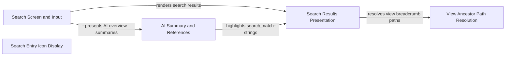

## Details

Coordinates full-text search, ancestor path resolution, AI-assisted querying, and reference inspection sheets.

### Search Screen and Input
Coordinates the mobile search screen layout, handling search query text input and presenting the AI search entrance.

**Related Classes/Methods**:

- `frontend.appflowy_flutter.lib.mobile.presentation.search.mobile_search_page.MobileSearchScreen`:18-66
- `frontend.appflowy_flutter.lib.mobile.presentation.search.mobile_search_page.MobileSearchPage`:68-80
- `frontend.appflowy_flutter.lib.mobile.presentation.search.mobile_search_textfield.MobileSearchTextfield`:14-30
- `frontend.appflowy_flutter.lib.mobile.presentation.search.mobile_search_ask_ai_entrance.MobileSearchAskAiEntrance`:14-31

**Source Files:**

- `frontend/appflowy_flutter/lib/mobile/presentation/search/mobile_search_ask_ai_entrance.dart`
  - `frontend.appflowy_flutter.lib.mobile.presentation.search.mobile_search_ask_ai_entrance.MobileSearchAskAiEntrance` (L14-L31) - Class
  - `frontend.appflowy_flutter.lib.mobile.presentation.search.mobile_search_ask_ai_entrance.MobileSearchAskAiEntrance.MobileSearchAskAiEntrance` (L15-L15) - Constructor
  - `frontend.appflowy_flutter.lib.mobile.presentation.search.mobile_search_ask_ai_entrance.MobileSearchAskAiEntrance.build` (L18-L30) - Method
  - `frontend.appflowy_flutter.lib.mobile.presentation.search.mobile_search_ask_ai_entrance._AskAIFor` (L33-L105) - Class
  - `frontend.appflowy_flutter.lib.mobile.presentation.search.mobile_search_ask_ai_entrance._AskAIFor._AskAIFor` (L34-L34) - Constructor
  - `frontend.appflowy_flutter.lib.mobile.presentation.search.mobile_search_ask_ai_entrance._AskAIFor.build` (L37-L71) - Method
  - `frontend.appflowy_flutter.lib.mobile.presentation.search.mobile_search_ask_ai_entrance._AskAIFor.buildText` (L73-L104) - Method
  - `frontend.appflowy_flutter.lib.mobile.presentation.search.mobile_search_ask_ai_entrance._AISearching` (L107-L143) - Class
  - `frontend.appflowy_flutter.lib.mobile.presentation.search.mobile_search_ask_ai_entrance._AISearching._AISearching` (L108-L108) - Constructor
  - `frontend.appflowy_flutter.lib.mobile.presentation.search.mobile_search_ask_ai_entrance._AISearching.build` (L111-L142) - Method
  - `frontend.appflowy_flutter.lib.mobile.presentation.search.mobile_search_ask_ai_entrance._AIOverview` (L145-L203) - Class
  - `frontend.appflowy_flutter.lib.mobile.presentation.search.mobile_search_ask_ai_entrance._AIOverview._AIOverview` (L146-L146) - Constructor
  - `frontend.appflowy_flutter.lib.mobile.presentation.search.mobile_search_ask_ai_entrance._AIOverview.build` (L149-L183) - Method
  - `frontend.appflowy_flutter.lib.mobile.presentation.search.mobile_search_ask_ai_entrance._AIOverview.buildHeader` (L185-L202) - Method
- `frontend/appflowy_flutter/lib/mobile/presentation/search/mobile_search_page.dart`
  - `frontend.appflowy_flutter.lib.mobile.presentation.search.mobile_search_page.MobileSearchScreen` (L18-L66) - Class
  - `frontend.appflowy_flutter.lib.mobile.presentation.search.mobile_search_page.MobileSearchScreen.MobileSearchScreen` (L19-L21) - Constructor
  - `frontend.appflowy_flutter.lib.mobile.presentation.search.mobile_search_page.MobileSearchScreen.build` (L26-L65) - Method
  - `frontend.appflowy_flutter.lib.mobile.presentation.search.mobile_search_page.MobileSearchPage` (L68-L80) - Class
  - `frontend.appflowy_flutter.lib.mobile.presentation.search.mobile_search_page.MobileSearchPage.MobileSearchPage` (L69-L73) - Constructor
  - `frontend.appflowy_flutter.lib.mobile.presentation.search.mobile_search_page.MobileSearchPage.createState` (L79-L79) - Method
  - `frontend.appflowy_flutter.lib.mobile.presentation.search.mobile_search_page._MobileSearchPageState` (L82-L143) - Class
  - `frontend.appflowy_flutter.lib.mobile.presentation.search.mobile_search_page._MobileSearchPageState.enableShowAISearch` (L83-L84) - Method
  - `frontend.appflowy_flutter.lib.mobile.presentation.search.mobile_search_page._MobileSearchPageState.dispose` (L89-L92) - Method
  - `frontend.appflowy_flutter.lib.mobile.presentation.search.mobile_search_page._MobileSearchPageState.build` (L95-L142) - Method
- `frontend/appflowy_flutter/lib/mobile/presentation/search/mobile_search_textfield.dart`
  - `frontend.appflowy_flutter.lib.mobile.presentation.search.mobile_search_textfield.MobileSearchTextfield` (L14-L30) - Class
  - `frontend.appflowy_flutter.lib.mobile.presentation.search.mobile_search_textfield.MobileSearchTextfield.MobileSearchTextfield` (L15-L21) - Constructor
  - `frontend.appflowy_flutter.lib.mobile.presentation.search.mobile_search_textfield.MobileSearchTextfield.createState` (L29-L29) - Method
  - `frontend.appflowy_flutter.lib.mobile.presentation.search.mobile_search_textfield._MobileSearchTextfieldState` (L32-L206) - Class
  - `frontend.appflowy_flutter.lib.mobile.presentation.search.mobile_search_textfield._MobileSearchTextfieldState.focusNode` (L36-L36) - Method
  - `frontend.appflowy_flutter.lib.mobile.presentation.search.mobile_search_textfield._MobileSearchTextfieldState.initState` (L41-L54) - Method
  - `frontend.appflowy_flutter.lib.mobile.presentation.search.mobile_search_textfield._MobileSearchTextfieldState.dispose` (L57-L63) - Method
  - `frontend.appflowy_flutter.lib.mobile.presentation.search.mobile_search_textfield._MobileSearchTextfieldState.build` (L66-L128) - Method
  - `frontend.appflowy_flutter.lib.mobile.presentation.search.mobile_search_textfield._MobileSearchTextfieldState.buildInputDecoration` (L130-L178) - Method
  - `frontend.appflowy_flutter.lib.mobile.presentation.search.mobile_search_textfield._MobileSearchTextfieldState.makeSureHasFocus` (L180-L186) - Method
  - `frontend.appflowy_flutter.lib.mobile.presentation.search.mobile_search_textfield._MobileSearchTextfieldState.onBackOrLeave` (L188-L197) - Method
  - `frontend.appflowy_flutter.lib.mobile.presentation.search.mobile_search_textfield._MobileSearchTextfieldState.onRoute` (L199-L205) - Method

### Search Results Presentation
Displays search result lists and recent views, rendering individual result cells with matching text highlighting and navigation.

**Related Classes/Methods**:

- `frontend.appflowy_flutter.lib.mobile.presentation.search.mobile_search_result.MobileSearchResult`:18-30
- `frontend.appflowy_flutter.lib.mobile.presentation.search.mobile_search_result.MobileSearchResultList`:85-159
- `frontend.appflowy_flutter.lib.mobile.presentation.search.mobile_search_result.MobileSearchRecentList`:32-83
- `frontend.appflowy_flutter.lib.mobile.presentation.search.mobile_search_cell.MobileSearchResultCell`:15-140

**Source Files:**

- `frontend/appflowy_flutter/lib/mobile/presentation/search/mobile_search_cell.dart`
  - `frontend.appflowy_flutter.lib.mobile.presentation.search.mobile_search_cell.MobileSearchResultCell` (L15-L140) - Class
  - `frontend.appflowy_flutter.lib.mobile.presentation.search.mobile_search_cell.MobileSearchResultCell.MobileSearchResultCell` (L16-L21) - Constructor
  - `frontend.appflowy_flutter.lib.mobile.presentation.search.mobile_search_cell.MobileSearchResultCell.build` (L27-L72) - Method
  - `frontend.appflowy_flutter.lib.mobile.presentation.search.mobile_search_cell.MobileSearchResultCell.buildPath` (L74-L96) - Method
  - `frontend.appflowy_flutter.lib.mobile.presentation.search.mobile_search_cell.MobileSearchResultCell.buildSummary` (L98-L117) - Method
  - `frontend.appflowy_flutter.lib.mobile.presentation.search.mobile_search_cell.MobileSearchResultCell.buildHighLightSpan` (L119-L139) - Method
  - `frontend.appflowy_flutter.lib.mobile.presentation.search.mobile_search_cell.ViewPBToSearchResultItem.toSearchResultItem` (L143-L156) - Method
  - `frontend.appflowy_flutter.lib.mobile.presentation.search.mobile_search_cell.StringSplitExtension.splitIncludeSeparator` (L160-L175) - Method
- `frontend/appflowy_flutter/lib/mobile/presentation/search/mobile_search_result.dart`
  - `frontend.appflowy_flutter.lib.mobile.presentation.search.mobile_search_result.MobileSearchResult` (L18-L30) - Class
  - `frontend.appflowy_flutter.lib.mobile.presentation.search.mobile_search_result.MobileSearchResult.MobileSearchResult` (L19-L19) - Constructor
  - `frontend.appflowy_flutter.lib.mobile.presentation.search.mobile_search_result.MobileSearchResult.build` (L22-L29) - Method
  - `frontend.appflowy_flutter.lib.mobile.presentation.search.mobile_search_result.MobileSearchRecentList` (L32-L83) - Class
  - `frontend.appflowy_flutter.lib.mobile.presentation.search.mobile_search_result.MobileSearchRecentList.MobileSearchRecentList` (L33-L33) - Constructor
  - `frontend.appflowy_flutter.lib.mobile.presentation.search.mobile_search_result.MobileSearchRecentList.build` (L36-L82) - Method
  - `frontend.appflowy_flutter.lib.mobile.presentation.search.mobile_search_result.MobileSearchResultList` (L85-L159) - Class
  - `frontend.appflowy_flutter.lib.mobile.presentation.search.mobile_search_result.MobileSearchResultList.MobileSearchResultList` (L86-L86) - Constructor
  - `frontend.appflowy_flutter.lib.mobile.presentation.search.mobile_search_result.MobileSearchResultList.build` (L89-L158) - Method
  - `frontend.appflowy_flutter.lib.mobile.presentation.search.mobile_search_result._NoResult` (L161-L194) - Class
  - `frontend.appflowy_flutter.lib.mobile.presentation.search.mobile_search_result._NoResult._NoResult` (L162-L162) - Constructor
  - `frontend.appflowy_flutter.lib.mobile.presentation.search.mobile_search_result._NoResult.build` (L165-L193) - Method
  - `frontend.appflowy_flutter.lib.mobile.presentation.search.mobile_search_result._goToView` (L196-L205) - Function

### AI Summary and References
Renders AI-generated search summaries with expandable snippets and presents underlying source references in a bottom sheet.

**Related Classes/Methods**:

- `frontend.appflowy_flutter.lib.mobile.presentation.search.mobile_search_summary_cell.MobileSearchSummaryCell`:17-34
- `frontend.appflowy_flutter.lib.mobile.presentation.search.mobile_search_reference_bottom_sheet.SearchSourceReferenceBottomSheet`:16-59

**Source Files:**

- `frontend/appflowy_flutter/lib/mobile/presentation/search/mobile_search_reference_bottom_sheet.dart`
  - `frontend.appflowy_flutter.lib.mobile.presentation.search.mobile_search_reference_bottom_sheet.SearchSourceReferenceBottomSheet` (L16-L59) - Class
  - `frontend.appflowy_flutter.lib.mobile.presentation.search.mobile_search_reference_bottom_sheet.SearchSourceReferenceBottomSheet.SearchSourceReferenceBottomSheet` (L17-L17) - Constructor
  - `frontend.appflowy_flutter.lib.mobile.presentation.search.mobile_search_reference_bottom_sheet.SearchSourceReferenceBottomSheet.build` (L21-L58) - Method
  - `frontend.appflowy_flutter.lib.mobile.presentation.search.mobile_search_reference_bottom_sheet.PageReferenceList` (L61-L155) - Class
  - `frontend.appflowy_flutter.lib.mobile.presentation.search.mobile_search_reference_bottom_sheet.PageReferenceList.PageReferenceList` (L62-L66) - Constructor
  - `frontend.appflowy_flutter.lib.mobile.presentation.search.mobile_search_reference_bottom_sheet.PageReferenceList.build` (L72-L145) - Method
  - `frontend.appflowy_flutter.lib.mobile.presentation.search.mobile_search_reference_bottom_sheet.PageReferenceList.buildIcon` (L147-L154) - Method
  - `frontend.appflowy_flutter.lib.mobile.presentation.search.mobile_search_reference_bottom_sheet._DragHandler` (L157-L172) - Class
  - `frontend.appflowy_flutter.lib.mobile.presentation.search.mobile_search_reference_bottom_sheet._DragHandler._DragHandler` (L158-L158) - Constructor
  - `frontend.appflowy_flutter.lib.mobile.presentation.search.mobile_search_reference_bottom_sheet._DragHandler.build` (L161-L171) - Method
- `frontend/appflowy_flutter/lib/mobile/presentation/search/mobile_search_summary_cell.dart`
  - `frontend.appflowy_flutter.lib.mobile.presentation.search.mobile_search_summary_cell.MobileSearchSummaryCell` (L17-L34) - Class
  - `frontend.appflowy_flutter.lib.mobile.presentation.search.mobile_search_summary_cell.MobileSearchSummaryCell.MobileSearchSummaryCell` (L18-L24) - Constructor
  - `frontend.appflowy_flutter.lib.mobile.presentation.search.mobile_search_summary_cell.MobileSearchSummaryCell.createState` (L32-L33) - Method
  - `frontend.appflowy_flutter.lib.mobile.presentation.search.mobile_search_summary_cell._MobileSearchSummaryCellState` (L36-L173) - Class
  - `frontend.appflowy_flutter.lib.mobile.presentation.search.mobile_search_summary_cell._MobileSearchSummaryCellState.summary` (L42-L42) - Method
  - `frontend.appflowy_flutter.lib.mobile.presentation.search.mobile_search_summary_cell._MobileSearchSummaryCellState.maxWidth` (L43-L43) - Method
  - `frontend.appflowy_flutter.lib.mobile.presentation.search.mobile_search_summary_cell._MobileSearchSummaryCellState.theme` (L44-L44) - Method
  - `frontend.appflowy_flutter.lib.mobile.presentation.search.mobile_search_summary_cell._MobileSearchSummaryCellState.textStyle` (L46-L46) - Method
  - `frontend.appflowy_flutter.lib.mobile.presentation.search.mobile_search_summary_cell._MobileSearchSummaryCellState.showMoreStyle` (L48-L49) - Method
  - `frontend.appflowy_flutter.lib.mobile.presentation.search.mobile_search_summary_cell._MobileSearchSummaryCellState.initState` (L52-L55) - Method
  - `frontend.appflowy_flutter.lib.mobile.presentation.search.mobile_search_summary_cell._MobileSearchSummaryCellState.didUpdateWidget` (L58-L63) - Method
  - `frontend.appflowy_flutter.lib.mobile.presentation.search.mobile_search_summary_cell._MobileSearchSummaryCellState.dispose` (L66-L69) - Method
  - `frontend.appflowy_flutter.lib.mobile.presentation.search.mobile_search_summary_cell._MobileSearchSummaryCellState.build` (L72-L116) - Method
  - `frontend.appflowy_flutter.lib.mobile.presentation.search.mobile_search_summary_cell._MobileSearchSummaryCellState.buildFadeCover` (L118-L135) - Method
  - `frontend.appflowy_flutter.lib.mobile.presentation.search.mobile_search_summary_cell._MobileSearchSummaryCellState.refreshTextPainter` (L137-L160) - Method
  - `frontend.appflowy_flutter.lib.mobile.presentation.search.mobile_search_summary_cell._MobileSearchSummaryCellState.showPageReferences` (L162-L172) - Method
  - `frontend.appflowy_flutter.lib.mobile.presentation.search.mobile_search_summary_cell._TextInfo` (L175-L340) - Class
  - `frontend.appflowy_flutter.lib.mobile.presentation.search.mobile_search_summary_cell._TextInfo._TextInfo` (L176-L176) - Constructor
  - `frontend.appflowy_flutter.lib.mobile.presentation.search.mobile_search_summary_cell._TextInfo._TextInfo.normal` (L178-L178) - Constructor
  - `frontend.appflowy_flutter.lib.mobile.presentation.search.mobile_search_summary_cell._TextInfo._TextInfo.overflow` (L180-L180) - Constructor
  - `frontend.appflowy_flutter.lib.mobile.presentation.search.mobile_search_summary_cell._TextInfo.build` (L185-L316) - Method
  - `frontend.appflowy_flutter.lib.mobile.presentation.search.mobile_search_summary_cell._TextInfo._buildHighLightSpan` (L318-L339) - Method

### View Ancestor Path Resolution
Manages and caches document hierarchy ancestor chains to display breadcrumb navigation paths for search items.

**Related Classes/Methods**:

- `frontend.appflowy_flutter.lib.mobile.presentation.search.mobile_view_ancestors.ViewAncestorBloc`:11-43
- `frontend.appflowy_flutter.lib.mobile.presentation.search.mobile_view_ancestors.ViewAncestorState`:51-62
- `frontend.appflowy_flutter.lib.mobile.presentation.search.view_ancestor_cache.ViewAncestorCache`:9-47

**Source Files:**

- `frontend/appflowy_flutter/lib/mobile/presentation/search/mobile_view_ancestors.dart`
  - `frontend.appflowy_flutter.lib.mobile.presentation.search.mobile_view_ancestors.ViewAncestorBloc` (L11-L43) - Class
  - `frontend.appflowy_flutter.lib.mobile.presentation.search.mobile_view_ancestors.ViewAncestorBloc.ViewAncestorBloc` (L12-L15) - Constructor
  - `frontend.appflowy_flutter.lib.mobile.presentation.search.mobile_view_ancestors.ViewAncestorBloc._dispatch` (L19-L42) - Method
  - `frontend.appflowy_flutter.lib.mobile.presentation.search.mobile_view_ancestors.ViewAncestorEvent` (L46-L48) - Class
  - `frontend.appflowy_flutter.lib.mobile.presentation.search.mobile_view_ancestors.ViewAncestorEvent.ViewAncestorEvent.initial` (L47-L47) - Constructor
  - `frontend.appflowy_flutter.lib.mobile.presentation.search.mobile_view_ancestors.ViewAncestorState` (L51-L62) - Class
  - `frontend.appflowy_flutter.lib.mobile.presentation.search.mobile_view_ancestors.ViewAncestorState.ViewAncestorState` (L52-L56) - Constructor
  - `frontend.appflowy_flutter.lib.mobile.presentation.search.mobile_view_ancestors.ViewAncestorState.ViewAncestorState.initial` (L58-L61) - Constructor
  - `frontend.appflowy_flutter.lib.mobile.presentation.search.mobile_view_ancestors.ViewAncestorTextExtension.buildPath` (L65-L98) - Method
  - `frontend.appflowy_flutter.lib.mobile.presentation.search.mobile_view_ancestors.ViewAncestorTextExtension._buildTextPainter` (L100-L104) - Method
  - `frontend.appflowy_flutter.lib.mobile.presentation.search.mobile_view_ancestors.ViewAncestorTextExtension.buildOnelinePath` (L106-L137) - Method
- `frontend/appflowy_flutter/lib/mobile/presentation/search/view_ancestor_cache.dart`
  - `frontend.appflowy_flutter.lib.mobile.presentation.search.view_ancestor_cache.ViewAncestorCache` (L9-L47) - Class
  - `frontend.appflowy_flutter.lib.mobile.presentation.search.view_ancestor_cache.ViewAncestorCache.ViewAncestorCache` (L10-L10) - Constructor
  - `frontend.appflowy_flutter.lib.mobile.presentation.search.view_ancestor_cache.ViewAncestorCache.getAncestor` (L14-L24) - Method
  - `frontend.appflowy_flutter.lib.mobile.presentation.search.view_ancestor_cache.ViewAncestorCache._getAncestor` (L26-L46) - Method
  - `frontend.appflowy_flutter.lib.mobile.presentation.search.view_ancestor_cache.ViewAncestor` (L49-L55) - Class
  - `frontend.appflowy_flutter.lib.mobile.presentation.search.view_ancestor_cache.ViewAncestor.ViewAncestor` (L50-L50) - Constructor
  - `frontend.appflowy_flutter.lib.mobile.presentation.search.view_ancestor_cache.ViewAncestor.ViewAncestor.empty` (L52-L52) - Constructor
  - `frontend.appflowy_flutter.lib.mobile.presentation.search.view_ancestor_cache.ViewParent` (L57-L65) - Class
  - `frontend.appflowy_flutter.lib.mobile.presentation.search.view_ancestor_cache.ViewParent.ViewParent` (L58-L58) - Constructor
  - `frontend.appflowy_flutter.lib.mobile.presentation.search.view_ancestor_cache.ViewParent.fromViewPB` (L63-L64) - Method

### Search Entry Icon Display
Provides visual icon presentation components for mobile search entry items.

**Related Classes/Methods**: _None_

**Source Files:**

- `frontend/appflowy_flutter/lib/mobile/presentation/search/mobile_search_icon.dart`
  - `frontend.appflowy_flutter.lib.mobile.presentation.search.mobile_search_icon.MobileSearchIconItemExtension.buildIcon` (L7-L22) - Method

### [FAQ](https://github.com/CodeBoarding/GeneratedOnBoardings/tree/main?tab=readme-ov-file#faq)