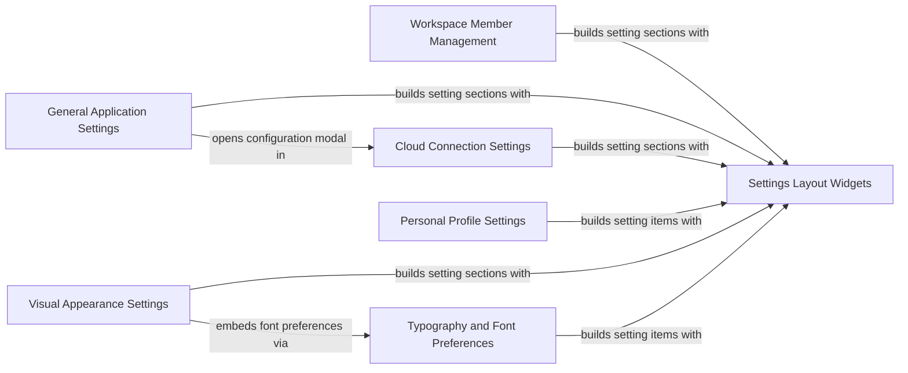

## Details

Provides preference screens and bottom sheets for appearance, AI, cloud sync, fonts, languages, and workspace members.

### General Application Settings
Provides setting groups and screens for language, notifications, AI features, application information, user sessions, and launch setup.

**Related Classes/Methods**:

- `frontend.appflowy_flutter.lib.mobile.presentation.setting.launch_settings_page.MobileLaunchSettingsPage`:11-39
- `frontend.appflowy_flutter.lib.mobile.presentation.setting.about.about_setting_group.AboutSettingGroup`:13-58
- `frontend.appflowy_flutter.lib.mobile.presentation.setting.self_host_setting_group.SelfHostSettingGroup`:11-18
- `frontend.appflowy_flutter.lib.mobile.presentation.setting.language_setting_group.LanguageSettingGroup`:13-20

**Source Files:**

- `frontend/appflowy_flutter/lib/mobile/presentation/setting/about/about_setting_group.dart`
  - `frontend.appflowy_flutter.lib.mobile.presentation.setting.about.about_setting_group.AboutSettingGroup` (L13-L58) - Class
  - `frontend.appflowy_flutter.lib.mobile.presentation.setting.about.about_setting_group.AboutSettingGroup.AboutSettingGroup` (L14-L16) - Constructor
  - `frontend.appflowy_flutter.lib.mobile.presentation.setting.about.about_setting_group.AboutSettingGroup.build` (L19-L57) - Method
- `frontend/appflowy_flutter/lib/mobile/presentation/setting/ai/ai_settings_group.dart`
  - `frontend.appflowy_flutter.lib.mobile.presentation.setting.ai.ai_settings_group.AiSettingsGroup` (L14-L90) - Class
  - `frontend.appflowy_flutter.lib.mobile.presentation.setting.ai.ai_settings_group.AiSettingsGroup.AiSettingsGroup` (L15-L19) - Constructor
  - `frontend.appflowy_flutter.lib.mobile.presentation.setting.ai.ai_settings_group.AiSettingsGroup.build` (L25-L56) - Method
  - `frontend.appflowy_flutter.lib.mobile.presentation.setting.ai.ai_settings_group.AiSettingsGroup._onLLMModelTypeTap` (L58-L89) - Method
- `frontend/appflowy_flutter/lib/mobile/presentation/setting/language/language_picker_screen.dart`
  - `frontend.appflowy_flutter.lib.mobile.presentation.setting.language.language_picker_screen.LanguagePickerScreen` (L9-L16) - Class
  - `frontend.appflowy_flutter.lib.mobile.presentation.setting.language.language_picker_screen.LanguagePickerScreen.LanguagePickerScreen` (L10-L10) - Constructor
  - `frontend.appflowy_flutter.lib.mobile.presentation.setting.language.language_picker_screen.LanguagePickerScreen.build` (L15-L15) - Method
  - `frontend.appflowy_flutter.lib.mobile.presentation.setting.language.language_picker_screen.LanguagePickerPage` (L18-L25) - Class
  - `frontend.appflowy_flutter.lib.mobile.presentation.setting.language.language_picker_screen.LanguagePickerPage.LanguagePickerPage` (L19-L21) - Constructor
  - `frontend.appflowy_flutter.lib.mobile.presentation.setting.language.language_picker_screen.LanguagePickerPage.createState` (L24-L24) - Method
  - `frontend.appflowy_flutter.lib.mobile.presentation.setting.language.language_picker_screen._LanguagePickerPageState` (L27-L52) - Class
  - `frontend.appflowy_flutter.lib.mobile.presentation.setting.language.language_picker_screen._LanguagePickerPageState.build` (L29-L51) - Method
- `frontend/appflowy_flutter/lib/mobile/presentation/setting/language_setting_group.dart`
  - `frontend.appflowy_flutter.lib.mobile.presentation.setting.language_setting_group.LanguageSettingGroup` (L13-L20) - Class
  - `frontend.appflowy_flutter.lib.mobile.presentation.setting.language_setting_group.LanguageSettingGroup.LanguageSettingGroup` (L14-L16) - Constructor
  - `frontend.appflowy_flutter.lib.mobile.presentation.setting.language_setting_group.LanguageSettingGroup.createState` (L19-L19) - Method
  - `frontend.appflowy_flutter.lib.mobile.presentation.setting.language_setting_group._LanguageSettingGroupState` (L22-L56) - Class
  - `frontend.appflowy_flutter.lib.mobile.presentation.setting.language_setting_group._LanguageSettingGroupState.build` (L24-L55) - Method
- `frontend/appflowy_flutter/lib/mobile/presentation/setting/launch_settings_page.dart`
  - `frontend.appflowy_flutter.lib.mobile.presentation.setting.launch_settings_page.MobileLaunchSettingsPage` (L11-L39) - Class
  - `frontend.appflowy_flutter.lib.mobile.presentation.setting.launch_settings_page.MobileLaunchSettingsPage.MobileLaunchSettingsPage` (L12-L14) - Constructor
  - `frontend.appflowy_flutter.lib.mobile.presentation.setting.launch_settings_page.MobileLaunchSettingsPage.build` (L19-L38) - Method
- `frontend/appflowy_flutter/lib/mobile/presentation/setting/notifications_setting_group.dart`
  - `frontend.appflowy_flutter.lib.mobile.presentation.setting.notifications_setting_group.NotificationsSettingGroup` (L8-L14) - Class
  - `frontend.appflowy_flutter.lib.mobile.presentation.setting.notifications_setting_group.NotificationsSettingGroup.NotificationsSettingGroup` (L9-L9) - Constructor
  - `frontend.appflowy_flutter.lib.mobile.presentation.setting.notifications_setting_group.NotificationsSettingGroup.createState` (L12-L13) - Method
  - `frontend.appflowy_flutter.lib.mobile.presentation.setting.notifications_setting_group._NotificationsSettingGroupState` (L16-L40) - Class
  - `frontend.appflowy_flutter.lib.mobile.presentation.setting.notifications_setting_group._NotificationsSettingGroupState.build` (L20-L39) - Method
- `frontend/appflowy_flutter/lib/mobile/presentation/setting/self_host_setting_group.dart`
  - `frontend.appflowy_flutter.lib.mobile.presentation.setting.self_host_setting_group.SelfHostSettingGroup` (L11-L18) - Class
  - `frontend.appflowy_flutter.lib.mobile.presentation.setting.self_host_setting_group.SelfHostSettingGroup.SelfHostSettingGroup` (L12-L14) - Constructor
  - `frontend.appflowy_flutter.lib.mobile.presentation.setting.self_host_setting_group.SelfHostSettingGroup.createState` (L17-L17) - Method
  - `frontend.appflowy_flutter.lib.mobile.presentation.setting.self_host_setting_group._SelfHostSettingGroupState` (L20-L123) - Class
  - `frontend.appflowy_flutter.lib.mobile.presentation.setting.self_host_setting_group._SelfHostSettingGroupState.build` (L27-L46) - Method
  - `frontend.appflowy_flutter.lib.mobile.presentation.setting.self_host_setting_group._SelfHostSettingGroupState._buildSelfHostField` (L48-L84) - Method
  - `frontend.appflowy_flutter.lib.mobile.presentation.setting.self_host_setting_group._SelfHostSettingGroupState._buildShareDomainField` (L86-L122) - Method
- `frontend/appflowy_flutter/lib/mobile/presentation/setting/user_session_setting_group.dart`
  - `frontend.appflowy_flutter.lib.mobile.presentation.setting.user_session_setting_group.UserSessionSettingGroup` (L18-L122) - Class
  - `frontend.appflowy_flutter.lib.mobile.presentation.setting.user_session_setting_group.UserSessionSettingGroup.UserSessionSettingGroup` (L19-L23) - Constructor
  - `frontend.appflowy_flutter.lib.mobile.presentation.setting.user_session_setting_group.UserSessionSettingGroup.build` (L29-L61) - Method
  - `frontend.appflowy_flutter.lib.mobile.presentation.setting.user_session_setting_group.UserSessionSettingGroup._buildThirdPartySignInButtons` (L63-L87) - Method
  - `frontend.appflowy_flutter.lib.mobile.presentation.setting.user_session_setting_group.UserSessionSettingGroup._showDeleteAccountDialog` (L89-L96) - Method
  - `frontend.appflowy_flutter.lib.mobile.presentation.setting.user_session_setting_group.UserSessionSettingGroup._showLogoutDialog` (L98-L121) - Method
  - `frontend.appflowy_flutter.lib.mobile.presentation.setting.user_session_setting_group._DeleteAccountBottomSheet` (L124-L130) - Class
  - `frontend.appflowy_flutter.lib.mobile.presentation.setting.user_session_setting_group._DeleteAccountBottomSheet._DeleteAccountBottomSheet` (L125-L125) - Constructor
  - `frontend.appflowy_flutter.lib.mobile.presentation.setting.user_session_setting_group._DeleteAccountBottomSheet.createState` (L128-L129) - Method
  - `frontend.appflowy_flutter.lib.mobile.presentation.setting.user_session_setting_group._DeleteAccountBottomSheetState` (L132-L235) - Class
  - `frontend.appflowy_flutter.lib.mobile.presentation.setting.user_session_setting_group._DeleteAccountBottomSheetState.dispose` (L137-L141) - Method
  - `frontend.appflowy_flutter.lib.mobile.presentation.setting.user_session_setting_group._DeleteAccountBottomSheetState.build` (L144-L201) - Method
  - `frontend.appflowy_flutter.lib.mobile.presentation.setting.user_session_setting_group._DeleteAccountBottomSheetState._buildCheckbox` (L203-L234) - Method

### Workspace Member Management
Manages workspace member invitations, collaborator lists, and workspace-level configuration views.

**Related Classes/Methods**:

- `frontend.appflowy_flutter.lib.mobile.presentation.setting.workspace.workspace_setting_group.WorkspaceSettingGroup`:13-48

**Source Files:**

- `frontend/appflowy_flutter/lib/mobile/presentation/setting/workspace/add_members_screen.dart`
  - `frontend.appflowy_flutter.lib.mobile.presentation.setting.workspace.add_members_screen.AddMembersScreen` (L23-L40) - Class
  - `frontend.appflowy_flutter.lib.mobile.presentation.setting.workspace.add_members_screen.AddMembersScreen.AddMembersScreen` (L24-L26) - Constructor
  - `frontend.appflowy_flutter.lib.mobile.presentation.setting.workspace.add_members_screen.AddMembersScreen.build` (L31-L39) - Method
  - `frontend.appflowy_flutter.lib.mobile.presentation.setting.workspace.add_members_screen._InviteMemberPage` (L42-L47) - Class
  - `frontend.appflowy_flutter.lib.mobile.presentation.setting.workspace.add_members_screen._InviteMemberPage._InviteMemberPage` (L43-L43) - Constructor
  - `frontend.appflowy_flutter.lib.mobile.presentation.setting.workspace.add_members_screen._InviteMemberPage.createState` (L46-L46) - Method
  - `frontend.appflowy_flutter.lib.mobile.presentation.setting.workspace.add_members_screen._InviteMemberPageState` (L49-L286) - Class
  - `frontend.appflowy_flutter.lib.mobile.presentation.setting.workspace.add_members_screen._InviteMemberPageState.initState` (L55-L61) - Method
  - `frontend.appflowy_flutter.lib.mobile.presentation.setting.workspace.add_members_screen._InviteMemberPageState.dispose` (L64-L67) - Method
  - `frontend.appflowy_flutter.lib.mobile.presentation.setting.workspace.add_members_screen._InviteMemberPageState.build` (L70-L122) - Method
  - `frontend.appflowy_flutter.lib.mobile.presentation.setting.workspace.add_members_screen._InviteMemberPageState._buildError` (L124-L151) - Method
  - `frontend.appflowy_flutter.lib.mobile.presentation.setting.workspace.add_members_screen._InviteMemberPageState._onListener` (L153-L285) - Method
  - `frontend.appflowy_flutter.lib.mobile.presentation.setting.workspace.add_members_screen._LeaveWorkspaceButton` (L288-L324) - Class
  - `frontend.appflowy_flutter.lib.mobile.presentation.setting.workspace.add_members_screen._LeaveWorkspaceButton._LeaveWorkspaceButton` (L289-L289) - Constructor
  - `frontend.appflowy_flutter.lib.mobile.presentation.setting.workspace.add_members_screen._LeaveWorkspaceButton.build` (L292-L302) - Method
  - `frontend.appflowy_flutter.lib.mobile.presentation.setting.workspace.add_members_screen._LeaveWorkspaceButton._leaveWorkspace` (L304-L323) - Method
- `frontend/appflowy_flutter/lib/mobile/presentation/setting/workspace/invite_member_by_link.dart`
  - `frontend.appflowy_flutter.lib.mobile.presentation.setting.workspace.invite_member_by_link.InviteMembersScreen` (L23-L40) - Class
  - `frontend.appflowy_flutter.lib.mobile.presentation.setting.workspace.invite_member_by_link.InviteMembersScreen.InviteMembersScreen` (L24-L26) - Constructor
  - `frontend.appflowy_flutter.lib.mobile.presentation.setting.workspace.invite_member_by_link.InviteMembersScreen.build` (L31-L39) - Method
  - `frontend.appflowy_flutter.lib.mobile.presentation.setting.workspace.invite_member_by_link._InviteMemberPage` (L42-L47) - Class
  - `frontend.appflowy_flutter.lib.mobile.presentation.setting.workspace.invite_member_by_link._InviteMemberPage._InviteMemberPage` (L43-L43) - Constructor
  - `frontend.appflowy_flutter.lib.mobile.presentation.setting.workspace.invite_member_by_link._InviteMemberPage.createState` (L46-L46) - Method
  - `frontend.appflowy_flutter.lib.mobile.presentation.setting.workspace.invite_member_by_link._InviteMemberPageState` (L49-L295) - Class
  - `frontend.appflowy_flutter.lib.mobile.presentation.setting.workspace.invite_member_by_link._InviteMemberPageState.initState` (L55-L61) - Method
  - `frontend.appflowy_flutter.lib.mobile.presentation.setting.workspace.invite_member_by_link._InviteMemberPageState.dispose` (L64-L67) - Method
  - `frontend.appflowy_flutter.lib.mobile.presentation.setting.workspace.invite_member_by_link._InviteMemberPageState.build` (L70-L125) - Method
  - `frontend.appflowy_flutter.lib.mobile.presentation.setting.workspace.invite_member_by_link._InviteMemberPageState._buildInviteMemberArea` (L127-L160) - Method
  - `frontend.appflowy_flutter.lib.mobile.presentation.setting.workspace.invite_member_by_link._InviteMemberPageState._buildError` (L162-L189) - Method
  - `frontend.appflowy_flutter.lib.mobile.presentation.setting.workspace.invite_member_by_link._InviteMemberPageState._onListener` (L191-L278) - Method
  - `frontend.appflowy_flutter.lib.mobile.presentation.setting.workspace.invite_member_by_link._InviteMemberPageState._inviteMember` (L280-L294) - Method
  - `frontend.appflowy_flutter.lib.mobile.presentation.setting.workspace.invite_member_by_link._LeaveWorkspaceButton` (L297-L357) - Class
  - `frontend.appflowy_flutter.lib.mobile.presentation.setting.workspace.invite_member_by_link._LeaveWorkspaceButton._LeaveWorkspaceButton` (L298-L298) - Constructor
  - `frontend.appflowy_flutter.lib.mobile.presentation.setting.workspace.invite_member_by_link._LeaveWorkspaceButton.build` (L301-L326) - Method
  - `frontend.appflowy_flutter.lib.mobile.presentation.setting.workspace.invite_member_by_link._LeaveWorkspaceButton._leaveWorkspace` (L328-L356) - Method
- `frontend/appflowy_flutter/lib/mobile/presentation/setting/workspace/invite_members_screen.dart`
  - `frontend.appflowy_flutter.lib.mobile.presentation.setting.workspace.invite_members_screen.InviteMembersScreen` (L28-L60) - Class
  - `frontend.appflowy_flutter.lib.mobile.presentation.setting.workspace.invite_members_screen.InviteMembersScreen.InviteMembersScreen` (L29-L31) - Constructor
  - `frontend.appflowy_flutter.lib.mobile.presentation.setting.workspace.invite_members_screen.InviteMembersScreen.build` (L36-L47) - Method
  - `frontend.appflowy_flutter.lib.mobile.presentation.setting.workspace.invite_members_screen.InviteMembersScreen._buildAddMemberButton` (L49-L59) - Method
  - `frontend.appflowy_flutter.lib.mobile.presentation.setting.workspace.invite_members_screen._InviteMemberPage` (L62-L67) - Class
  - `frontend.appflowy_flutter.lib.mobile.presentation.setting.workspace.invite_members_screen._InviteMemberPage._InviteMemberPage` (L63-L63) - Constructor
  - `frontend.appflowy_flutter.lib.mobile.presentation.setting.workspace.invite_members_screen._InviteMemberPage.createState` (L66-L66) - Method
  - `frontend.appflowy_flutter.lib.mobile.presentation.setting.workspace.invite_members_screen._InviteMemberPageState` (L69-L309) - Class
  - `frontend.appflowy_flutter.lib.mobile.presentation.setting.workspace.invite_members_screen._InviteMemberPageState.initState` (L75-L81) - Method
  - `frontend.appflowy_flutter.lib.mobile.presentation.setting.workspace.invite_members_screen._InviteMemberPageState.dispose` (L84-L87) - Method
  - `frontend.appflowy_flutter.lib.mobile.presentation.setting.workspace.invite_members_screen._InviteMemberPageState.build` (L90-L144) - Method
  - `frontend.appflowy_flutter.lib.mobile.presentation.setting.workspace.invite_members_screen._InviteMemberPageState._buildError` (L146-L173) - Method
  - `frontend.appflowy_flutter.lib.mobile.presentation.setting.workspace.invite_members_screen._InviteMemberPageState._onListener` (L175-L308) - Method
  - `frontend.appflowy_flutter.lib.mobile.presentation.setting.workspace.invite_members_screen._LeaveWorkspaceButton` (L311-L356) - Class
  - `frontend.appflowy_flutter.lib.mobile.presentation.setting.workspace.invite_members_screen._LeaveWorkspaceButton._LeaveWorkspaceButton` (L312-L312) - Constructor
  - `frontend.appflowy_flutter.lib.mobile.presentation.setting.workspace.invite_members_screen._LeaveWorkspaceButton.build` (L315-L325) - Method
  - `frontend.appflowy_flutter.lib.mobile.presentation.setting.workspace.invite_members_screen._LeaveWorkspaceButton._leaveWorkspace` (L327-L355) - Method
- `frontend/appflowy_flutter/lib/mobile/presentation/setting/workspace/member_list.dart`
  - `frontend.appflowy_flutter.lib.mobile.presentation.setting.workspace.member_list.MobileMemberList` (L17-L62) - Class
  - `frontend.appflowy_flutter.lib.mobile.presentation.setting.workspace.member_list.MobileMemberList.MobileMemberList` (L18-L23) - Constructor
  - `frontend.appflowy_flutter.lib.mobile.presentation.setting.workspace.member_list.MobileMemberList.build` (L30-L61) - Method
  - `frontend.appflowy_flutter.lib.mobile.presentation.setting.workspace.member_list._MemberItem` (L64-L200) - Class
  - `frontend.appflowy_flutter.lib.mobile.presentation.setting.workspace.member_list._MemberItem._MemberItem` (L65-L69) - Constructor
  - `frontend.appflowy_flutter.lib.mobile.presentation.setting.workspace.member_list._MemberItem.build` (L76-L166) - Method
  - `frontend.appflowy_flutter.lib.mobile.presentation.setting.workspace.member_list._MemberItem._showDeleteMenu` (L168-L199) - Method
- `frontend/appflowy_flutter/lib/mobile/presentation/setting/workspace/workspace_setting_group.dart`
  - `frontend.appflowy_flutter.lib.mobile.presentation.setting.workspace.workspace_setting_group.WorkspaceSettingGroup` (L13-L48) - Class
  - `frontend.appflowy_flutter.lib.mobile.presentation.setting.workspace.workspace_setting_group.WorkspaceSettingGroup.WorkspaceSettingGroup` (L14-L16) - Constructor
  - `frontend.appflowy_flutter.lib.mobile.presentation.setting.workspace.workspace_setting_group.WorkspaceSettingGroup.build` (L19-L47) - Method

### Visual Appearance Settings
Controls application visual styling including theme modes, text scaling, and right-to-left layout preferences.

**Related Classes/Methods**:

- `frontend.appflowy_flutter.lib.mobile.presentation.setting.appearance.appearance_setting_group.AppearanceSettingGroup`:10-27
- `frontend.appflowy_flutter.lib.mobile.presentation.setting.appearance.rtl_setting.RTLSetting`:13-92

**Source Files:**

- `frontend/appflowy_flutter/lib/mobile/presentation/setting/appearance/appearance_setting_group.dart`
  - `frontend.appflowy_flutter.lib.mobile.presentation.setting.appearance.appearance_setting_group.AppearanceSettingGroup` (L10-L27) - Class
  - `frontend.appflowy_flutter.lib.mobile.presentation.setting.appearance.appearance_setting_group.AppearanceSettingGroup.AppearanceSettingGroup` (L11-L13) - Constructor
  - `frontend.appflowy_flutter.lib.mobile.presentation.setting.appearance.appearance_setting_group.AppearanceSettingGroup.build` (L16-L26) - Method
- `frontend/appflowy_flutter/lib/mobile/presentation/setting/appearance/rtl_setting.dart`
  - `frontend.appflowy_flutter.lib.mobile.presentation.setting.appearance.rtl_setting.RTLSetting` (L13-L92) - Class
  - `frontend.appflowy_flutter.lib.mobile.presentation.setting.appearance.rtl_setting.RTLSetting.RTLSetting` (L14-L16) - Constructor
  - `frontend.appflowy_flutter.lib.mobile.presentation.setting.appearance.rtl_setting.RTLSetting.build` (L19-L69) - Method
  - `frontend.appflowy_flutter.lib.mobile.presentation.setting.appearance.rtl_setting.RTLSetting._textDirectionLabelText` (L71-L80) - Method
  - `frontend.appflowy_flutter.lib.mobile.presentation.setting.appearance.rtl_setting.RTLSetting.applyTextDirectionAndPop` (L82-L91) - Method
- `frontend/appflowy_flutter/lib/mobile/presentation/setting/appearance/text_scale_setting.dart`
  - `frontend.appflowy_flutter.lib.mobile.presentation.setting.appearance.text_scale_setting.DisplaySizeSetting` (L18-L25) - Class
  - `frontend.appflowy_flutter.lib.mobile.presentation.setting.appearance.text_scale_setting.DisplaySizeSetting.DisplaySizeSetting` (L19-L21) - Constructor
  - `frontend.appflowy_flutter.lib.mobile.presentation.setting.appearance.text_scale_setting.DisplaySizeSetting.createState` (L24-L24) - Method
  - `frontend.appflowy_flutter.lib.mobile.presentation.setting.appearance.text_scale_setting._DisplaySizeSettingState` (L27-L90) - Class
  - `frontend.appflowy_flutter.lib.mobile.presentation.setting.appearance.text_scale_setting._DisplaySizeSettingState.initState` (L32-L41) - Method
  - `frontend.appflowy_flutter.lib.mobile.presentation.setting.appearance.text_scale_setting._DisplaySizeSettingState.build` (L44-L71) - Method
  - `frontend.appflowy_flutter.lib.mobile.presentation.setting.appearance.text_scale_setting._DisplaySizeSettingState._setScale` (L73-L89) - Method
- `frontend/appflowy_flutter/lib/mobile/presentation/setting/appearance/theme_setting.dart`
  - `frontend.appflowy_flutter.lib.mobile.presentation.setting.appearance.theme_setting.ThemeSetting` (L14-L87) - Class
  - `frontend.appflowy_flutter.lib.mobile.presentation.setting.appearance.theme_setting.ThemeSetting.ThemeSetting` (L15-L17) - Constructor
  - `frontend.appflowy_flutter.lib.mobile.presentation.setting.appearance.theme_setting.ThemeSetting.build` (L20-L86) - Method

### Settings Layout Widgets
Supplies shared UI widgets and group containers for rendering mobile settings rows, trailing icons, and support links.

**Related Classes/Methods**:

- `frontend.appflowy_flutter.lib.mobile.presentation.setting.widgets.mobile_setting_group_widget.MobileSettingGroup`:5-38
- `frontend.appflowy_flutter.lib.mobile.presentation.setting.widgets.mobile_setting_item_widget.MobileSettingItem`:5-60
- `frontend.appflowy_flutter.lib.mobile.presentation.setting.widgets.mobile_setting_trailing.MobileSettingTrailing`:6-42
- `frontend.appflowy_flutter.lib.mobile.presentation.setting.support_setting_group.SupportSettingGroup`:20-96

**Source Files:**

- `frontend/appflowy_flutter/lib/mobile/presentation/setting/support_setting_group.dart`
  - `frontend.appflowy_flutter.lib.mobile.presentation.setting.support_setting_group.SupportSettingGroup` (L20-L96) - Class
  - `frontend.appflowy_flutter.lib.mobile.presentation.setting.support_setting_group.SupportSettingGroup.SupportSettingGroup` (L21-L23) - Constructor
  - `frontend.appflowy_flutter.lib.mobile.presentation.setting.support_setting_group.SupportSettingGroup.build` (L26-L95) - Method
  - `frontend.appflowy_flutter.lib.mobile.presentation.setting.support_setting_group._ReportIssuesWidget` (L98-L128) - Class
  - `frontend.appflowy_flutter.lib.mobile.presentation.setting.support_setting_group._ReportIssuesWidget._ReportIssuesWidget` (L99-L101) - Constructor
  - `frontend.appflowy_flutter.lib.mobile.presentation.setting.support_setting_group._ReportIssuesWidget.build` (L106-L127) - Method
- `frontend/appflowy_flutter/lib/mobile/presentation/setting/widgets/mobile_setting_group_widget.dart`
  - `frontend.appflowy_flutter.lib.mobile.presentation.setting.widgets.mobile_setting_group_widget.MobileSettingGroup` (L5-L38) - Class
  - `frontend.appflowy_flutter.lib.mobile.presentation.setting.widgets.mobile_setting_group_widget.MobileSettingGroup.MobileSettingGroup` (L6-L11) - Constructor
  - `frontend.appflowy_flutter.lib.mobile.presentation.setting.widgets.mobile_setting_group_widget.MobileSettingGroup.build` (L18-L37) - Method
- `frontend/appflowy_flutter/lib/mobile/presentation/setting/widgets/mobile_setting_item_widget.dart`
  - `frontend.appflowy_flutter.lib.mobile.presentation.setting.widgets.mobile_setting_item_widget.MobileSettingItem` (L5-L60) - Class
  - `frontend.appflowy_flutter.lib.mobile.presentation.setting.widgets.mobile_setting_item_widget.MobileSettingItem.MobileSettingItem` (L6-L15) - Constructor
  - `frontend.appflowy_flutter.lib.mobile.presentation.setting.widgets.mobile_setting_item_widget.MobileSettingItem.build` (L26-L38) - Method
  - `frontend.appflowy_flutter.lib.mobile.presentation.setting.widgets.mobile_setting_item_widget.MobileSettingItem._buildDefaultTitle` (L40-L59) - Method
- `frontend/appflowy_flutter/lib/mobile/presentation/setting/widgets/mobile_setting_trailing.dart`
  - `frontend.appflowy_flutter.lib.mobile.presentation.setting.widgets.mobile_setting_trailing.MobileSettingTrailing` (L6-L42) - Class
  - `frontend.appflowy_flutter.lib.mobile.presentation.setting.widgets.mobile_setting_trailing.MobileSettingTrailing.MobileSettingTrailing` (L7-L11) - Constructor
  - `frontend.appflowy_flutter.lib.mobile.presentation.setting.widgets.mobile_setting_trailing.MobileSettingTrailing.build` (L17-L41) - Method

### Cloud Connection Settings
Configures AppFlowy Cloud synchronization settings and self-hosted server connection endpoints.

**Related Classes/Methods**:

- `frontend.appflowy_flutter.lib.mobile.presentation.setting.cloud.cloud_setting_group.CloudSettingGroup`:10-37
- `frontend.appflowy_flutter.lib.mobile.presentation.setting.self_host.self_host_bottom_sheet.SelfHostUrlBottomSheet`:14-26

**Source Files:**

- `frontend/appflowy_flutter/lib/mobile/presentation/setting/cloud/appflowy_cloud_page.dart`
  - `frontend.appflowy_flutter.lib.mobile.presentation.setting.cloud.appflowy_cloud_page.AppFlowyCloudPage` (L9-L28) - Class
  - `frontend.appflowy_flutter.lib.mobile.presentation.setting.cloud.appflowy_cloud_page.AppFlowyCloudPage.AppFlowyCloudPage` (L10-L10) - Constructor
  - `frontend.appflowy_flutter.lib.mobile.presentation.setting.cloud.appflowy_cloud_page.AppFlowyCloudPage.build` (L15-L27) - Method
- `frontend/appflowy_flutter/lib/mobile/presentation/setting/cloud/cloud_setting_group.dart`
  - `frontend.appflowy_flutter.lib.mobile.presentation.setting.cloud.cloud_setting_group.CloudSettingGroup` (L10-L37) - Class
  - `frontend.appflowy_flutter.lib.mobile.presentation.setting.cloud.cloud_setting_group.CloudSettingGroup.CloudSettingGroup` (L11-L13) - Constructor
  - `frontend.appflowy_flutter.lib.mobile.presentation.setting.cloud.cloud_setting_group.CloudSettingGroup.build` (L16-L36) - Method
- `frontend/appflowy_flutter/lib/mobile/presentation/setting/self_host/self_host_bottom_sheet.dart`
  - `frontend.appflowy_flutter.lib.mobile.presentation.setting.self_host.self_host_bottom_sheet.SelfHostUrlBottomSheetType` (L9-L12) - Enum
  - `frontend.appflowy_flutter.lib.mobile.presentation.setting.self_host.self_host_bottom_sheet.SelfHostUrlBottomSheetType.shareDomain` (L10-L10) - Enum
  - `frontend.appflowy_flutter.lib.mobile.presentation.setting.self_host.self_host_bottom_sheet.SelfHostUrlBottomSheetType.cloudURL` (L11-L11) - Enum
  - `frontend.appflowy_flutter.lib.mobile.presentation.setting.self_host.self_host_bottom_sheet.SelfHostUrlBottomSheet` (L14-L26) - Class
  - `frontend.appflowy_flutter.lib.mobile.presentation.setting.self_host.self_host_bottom_sheet.SelfHostUrlBottomSheet.SelfHostUrlBottomSheet` (L15-L19) - Constructor
  - `frontend.appflowy_flutter.lib.mobile.presentation.setting.self_host.self_host_bottom_sheet.SelfHostUrlBottomSheet.createState` (L25-L25) - Method
  - `frontend.appflowy_flutter.lib.mobile.presentation.setting.self_host.self_host_bottom_sheet._SelfHostUrlBottomSheetState` (L28-L99) - Class
  - `frontend.appflowy_flutter.lib.mobile.presentation.setting.self_host.self_host_bottom_sheet._SelfHostUrlBottomSheetState.initState` (L33-L37) - Method
  - `frontend.appflowy_flutter.lib.mobile.presentation.setting.self_host.self_host_bottom_sheet._SelfHostUrlBottomSheetState.dispose` (L40-L43) - Method
  - `frontend.appflowy_flutter.lib.mobile.presentation.setting.self_host.self_host_bottom_sheet._SelfHostUrlBottomSheetState.build` (L46-L78) - Method
  - `frontend.appflowy_flutter.lib.mobile.presentation.setting.self_host.self_host_bottom_sheet._SelfHostUrlBottomSheetState._saveSelfHostUrl` (L80-L98) - Method

### Typography and Font Preferences
Provides font family selection screens and setting items for customizing mobile typography.

**Related Classes/Methods**:

- `frontend.appflowy_flutter.lib.mobile.presentation.setting.font.font_setting.FontSetting`:16-43

**Source Files:**

- `frontend/appflowy_flutter/lib/mobile/presentation/setting/font/font_picker_screen.dart`
  - `frontend.appflowy_flutter.lib.mobile.presentation.setting.font.font_picker_screen.FontPickerScreen` (L20-L29) - Class
  - `frontend.appflowy_flutter.lib.mobile.presentation.setting.font.font_picker_screen.FontPickerScreen.FontPickerScreen` (L21-L21) - Constructor
  - `frontend.appflowy_flutter.lib.mobile.presentation.setting.font.font_picker_screen.FontPickerScreen.build` (L26-L28) - Method
  - `frontend.appflowy_flutter.lib.mobile.presentation.setting.font.font_picker_screen.LanguagePickerPage` (L31-L36) - Class
  - `frontend.appflowy_flutter.lib.mobile.presentation.setting.font.font_picker_screen.LanguagePickerPage.LanguagePickerPage` (L32-L32) - Constructor
  - `frontend.appflowy_flutter.lib.mobile.presentation.setting.font.font_picker_screen.LanguagePickerPage.createState` (L35-L35) - Method
  - `frontend.appflowy_flutter.lib.mobile.presentation.setting.font.font_picker_screen._LanguagePickerPageState` (L38-L66) - Class
  - `frontend.appflowy_flutter.lib.mobile.presentation.setting.font.font_picker_screen._LanguagePickerPageState.initState` (L42-L45) - Method
  - `frontend.appflowy_flutter.lib.mobile.presentation.setting.font.font_picker_screen._LanguagePickerPageState.build` (L48-L65) - Method
  - `frontend.appflowy_flutter.lib.mobile.presentation.setting.font.font_picker_screen.FontSelector` (L68-L82) - Class
  - `frontend.appflowy_flutter.lib.mobile.presentation.setting.font.font_picker_screen.FontSelector.FontSelector` (L69-L74) - Constructor
  - `frontend.appflowy_flutter.lib.mobile.presentation.setting.font.font_picker_screen.FontSelector.createState` (L81-L81) - Method
  - `frontend.appflowy_flutter.lib.mobile.presentation.setting.font.font_picker_screen._FontSelectorState` (L84-L145) - Class
  - `frontend.appflowy_flutter.lib.mobile.presentation.setting.font.font_picker_screen._FontSelectorState.initState` (L88-L91) - Method
  - `frontend.appflowy_flutter.lib.mobile.presentation.setting.font.font_picker_screen._FontSelectorState.build` (L94-L119) - Method
  - `frontend.appflowy_flutter.lib.mobile.presentation.setting.font.font_picker_screen._FontSelectorState._buildSearchBar` (L121-L144) - Method
- `frontend/appflowy_flutter/lib/mobile/presentation/setting/font/font_setting.dart`
  - `frontend.appflowy_flutter.lib.mobile.presentation.setting.font.font_setting.FontSetting` (L16-L43) - Class
  - `frontend.appflowy_flutter.lib.mobile.presentation.setting.font.font_setting.FontSetting.FontSetting` (L17-L19) - Constructor
  - `frontend.appflowy_flutter.lib.mobile.presentation.setting.font.font_setting.FontSetting.build` (L22-L42) - Method

### Personal Profile Settings
Manages user profile details, email display, password updates, and username editing dialogs.

**Related Classes/Methods**:

- `frontend.appflowy_flutter.lib.mobile.presentation.setting.personal_info.personal_info_setting_group.PersonalInfoSettingGroup`:20-182

**Source Files:**

- `frontend/appflowy_flutter/lib/mobile/presentation/setting/personal_info/edit_username_bottom_sheet.dart`
  - `frontend.appflowy_flutter.lib.mobile.presentation.setting.personal_info.edit_username_bottom_sheet.EditUsernameBottomSheet` (L8-L21) - Class
  - `frontend.appflowy_flutter.lib.mobile.presentation.setting.personal_info.edit_username_bottom_sheet.EditUsernameBottomSheet.EditUsernameBottomSheet` (L9-L14) - Constructor
  - `frontend.appflowy_flutter.lib.mobile.presentation.setting.personal_info.edit_username_bottom_sheet.EditUsernameBottomSheet.createState` (L19-L20) - Method
  - `frontend.appflowy_flutter.lib.mobile.presentation.setting.personal_info.edit_username_bottom_sheet._EditUsernameBottomSheetState` (L23-L77) - Class
  - `frontend.appflowy_flutter.lib.mobile.presentation.setting.personal_info.edit_username_bottom_sheet._EditUsernameBottomSheetState.initState` (L29-L32) - Method
  - `frontend.appflowy_flutter.lib.mobile.presentation.setting.personal_info.edit_username_bottom_sheet._EditUsernameBottomSheetState.dispose` (L35-L38) - Method
  - `frontend.appflowy_flutter.lib.mobile.presentation.setting.personal_info.edit_username_bottom_sheet._EditUsernameBottomSheetState.build` (L41-L76) - Method
  - `frontend.appflowy_flutter.lib.mobile.presentation.setting.personal_info.edit_username_bottom_sheet._EditUsernameBottomSheetState.build.submitUserName` (L42-L48) - Function
- `frontend/appflowy_flutter/lib/mobile/presentation/setting/personal_info/personal_info_setting_group.dart`
  - `frontend.appflowy_flutter.lib.mobile.presentation.setting.personal_info.personal_info_setting_group.PersonalInfoSettingGroup` (L20-L182) - Class
  - `frontend.appflowy_flutter.lib.mobile.presentation.setting.personal_info.personal_info_setting_group.PersonalInfoSettingGroup.PersonalInfoSettingGroup` (L21-L24) - Constructor
  - `frontend.appflowy_flutter.lib.mobile.presentation.setting.personal_info.personal_info_setting_group.PersonalInfoSettingGroup.build` (L29-L88) - Method
  - `frontend.appflowy_flutter.lib.mobile.presentation.setting.personal_info.personal_info_setting_group.PersonalInfoSettingGroup._buildEmailItem` (L90-L101) - Method
  - `frontend.appflowy_flutter.lib.mobile.presentation.setting.personal_info.personal_info_setting_group.PersonalInfoSettingGroup._buildPasswordItem` (L103-L154) - Method
  - `frontend.appflowy_flutter.lib.mobile.presentation.setting.personal_info.personal_info_setting_group.PersonalInfoSettingGroup._buildLoginItem` (L156-L181) - Method

### [FAQ](https://github.com/CodeBoarding/GeneratedOnBoardings/tree/main?tab=readme-ov-file#faq)