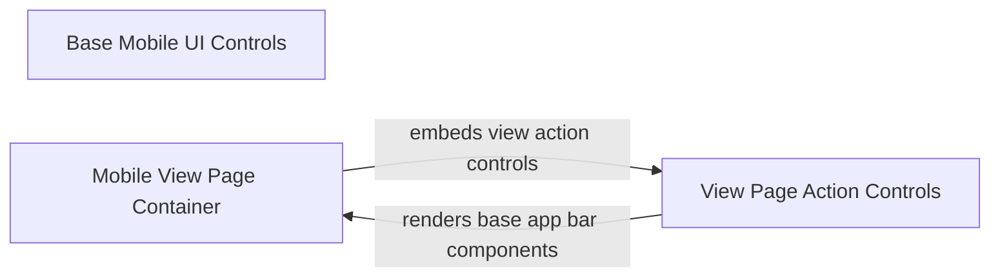

## Details

Provides top app bars, gesture handling, and the standard scaffold container for mobile view pages.

### Base Mobile UI Controls
Provides reusable mobile presentation widgets including animated gestures, search input fields, and option selection components.

**Related Classes/Methods**:

- `frontend.appflowy_flutter.lib.mobile.presentation.base.animated_gesture.AnimatedGestureDetector`:4-27
- `frontend.appflowy_flutter.lib.mobile.presentation.base.flowy_search_text_field.FlowySearchTextField`:5-40
- `frontend.appflowy_flutter.lib.mobile.presentation.base.option_color_list.OptionColorList`:7-58

**Source Files:**

- `frontend/appflowy_flutter/lib/mobile/presentation/base/animated_gesture.dart`
  - `frontend.appflowy_flutter.lib.mobile.presentation.base.animated_gesture.AnimatedGestureDetector` (L4-L27) - Class
  - `frontend.appflowy_flutter.lib.mobile.presentation.base.animated_gesture.AnimatedGestureDetector.AnimatedGestureDetector` (L5-L14) - Constructor
  - `frontend.appflowy_flutter.lib.mobile.presentation.base.animated_gesture.AnimatedGestureDetector.createState` (L25-L26) - Method
  - `frontend.appflowy_flutter.lib.mobile.presentation.base.animated_gesture._AnimatedGestureDetectorState` (L29-L54) - Class
  - `frontend.appflowy_flutter.lib.mobile.presentation.base.animated_gesture._AnimatedGestureDetectorState.build` (L33-L53) - Method
- `frontend/appflowy_flutter/lib/mobile/presentation/base/flowy_search_text_field.dart`
  - `frontend.appflowy_flutter.lib.mobile.presentation.base.flowy_search_text_field.FlowySearchTextField` (L5-L40) - Class
  - `frontend.appflowy_flutter.lib.mobile.presentation.base.flowy_search_text_field.FlowySearchTextField.FlowySearchTextField` (L6-L12) - Constructor
  - `frontend.appflowy_flutter.lib.mobile.presentation.base.flowy_search_text_field.FlowySearchTextField.build` (L20-L39) - Method
- `frontend/appflowy_flutter/lib/mobile/presentation/base/option_color_list.dart`
  - `frontend.appflowy_flutter.lib.mobile.presentation.base.option_color_list.OptionColorList` (L7-L58) - Class
  - `frontend.appflowy_flutter.lib.mobile.presentation.base.option_color_list.OptionColorList.OptionColorList` (L8-L12) - Constructor
  - `frontend.appflowy_flutter.lib.mobile.presentation.base.option_color_list.OptionColorList.build` (L18-L57) - Method
- `frontend/appflowy_flutter/lib/mobile/presentation/base/type_option_menu_item.dart`
  - `frontend.appflowy_flutter.lib.mobile.presentation.base.type_option_menu_item.TypeOptionMenuItemValue` (L5-L21) - Class
  - `frontend.appflowy_flutter.lib.mobile.presentation.base.type_option_menu_item.TypeOptionMenuItemValue.TypeOptionMenuItemValue` (L6-L13) - Constructor
  - `frontend.appflowy_flutter.lib.mobile.presentation.base.type_option_menu_item.TypeOptionMenu` (L23-L61) - Class
  - `frontend.appflowy_flutter.lib.mobile.presentation.base.type_option_menu_item.TypeOptionMenu.TypeOptionMenu` (L24-L32) - Constructor
  - `frontend.appflowy_flutter.lib.mobile.presentation.base.type_option_menu_item.TypeOptionMenu.build` (L43-L60) - Method
  - `frontend.appflowy_flutter.lib.mobile.presentation.base.type_option_menu_item.TypeOptionMenuItem` (L63-L121) - Class
  - `frontend.appflowy_flutter.lib.mobile.presentation.base.type_option_menu_item.TypeOptionMenuItem.TypeOptionMenuItem` (L64-L71) - Constructor
  - `frontend.appflowy_flutter.lib.mobile.presentation.base.type_option_menu_item.TypeOptionMenuItem.scaledIconWidth` (L79-L79) - Method
  - `frontend.appflowy_flutter.lib.mobile.presentation.base.type_option_menu_item.TypeOptionMenuItem.scaledWidth` (L80-L80) - Method
  - `frontend.appflowy_flutter.lib.mobile.presentation.base.type_option_menu_item.TypeOptionMenuItem.build` (L83-L120) - Method
  - `frontend.appflowy_flutter.lib.mobile.presentation.base.type_option_menu_item.TypeOptionGridView` (L123-L162) - Class
  - `frontend.appflowy_flutter.lib.mobile.presentation.base.type_option_menu_item.TypeOptionGridView.TypeOptionGridView` (L124-L130) - Constructor
  - `frontend.appflowy_flutter.lib.mobile.presentation.base.type_option_menu_item.TypeOptionGridView.build` (L138-L161) - Method

### Mobile View Page Container
Hosts the mobile view screen container and base application bar layout with navigation button actions.

**Related Classes/Methods**:

- `frontend.appflowy_flutter.lib.mobile.presentation.base.mobile_view_page.MobileViewPage`:35-64
- `frontend.appflowy_flutter.lib.mobile.presentation.base.app_bar.app_bar.FlowyAppBar`:33-67
- `frontend.appflowy_flutter.lib.mobile.presentation.base.app_bar.app_bar_actions.AppBarButton`:200-223

**Source Files:**

- `frontend/appflowy_flutter/lib/mobile/presentation/base/app_bar/app_bar.dart`
  - `frontend.appflowy_flutter.lib.mobile.presentation.base.app_bar.app_bar.FlowyAppBarLeadingType` (L5-L31) - Enum
  - `frontend.appflowy_flutter.lib.mobile.presentation.base.app_bar.app_bar.FlowyAppBarLeadingType.back` (L6-L6) - Enum
  - `frontend.appflowy_flutter.lib.mobile.presentation.base.app_bar.app_bar.FlowyAppBarLeadingType.close` (L7-L7) - Enum
  - `frontend.appflowy_flutter.lib.mobile.presentation.base.app_bar.app_bar.FlowyAppBarLeadingType.cancel` (L8-L8) - Enum
  - `frontend.appflowy_flutter.lib.mobile.presentation.base.app_bar.app_bar.FlowyAppBarLeadingType.getWidget` (L10-L19) - Method
  - `frontend.appflowy_flutter.lib.mobile.presentation.base.app_bar.app_bar.FlowyAppBarLeadingType.width` (L21-L30) - Method
  - `frontend.appflowy_flutter.lib.mobile.presentation.base.app_bar.app_bar.FlowyAppBar` (L33-L67) - Class
  - `frontend.appflowy_flutter.lib.mobile.presentation.base.app_bar.app_bar.FlowyAppBar.FlowyAppBar` (L34-L66) - Constructor
- `frontend/appflowy_flutter/lib/mobile/presentation/base/app_bar/app_bar_actions.dart`
  - `frontend.appflowy_flutter.lib.mobile.presentation.base.app_bar.app_bar_actions.AppBarBackButton` (L7-L27) - Class
  - `frontend.appflowy_flutter.lib.mobile.presentation.base.app_bar.app_bar_actions.AppBarBackButton.AppBarBackButton` (L8-L12) - Constructor
  - `frontend.appflowy_flutter.lib.mobile.presentation.base.app_bar.app_bar_actions.AppBarBackButton.build` (L18-L26) - Method
  - `frontend.appflowy_flutter.lib.mobile.presentation.base.app_bar.app_bar_actions.AppBarImmersiveBackButton` (L29-L52) - Class
  - `frontend.appflowy_flutter.lib.mobile.presentation.base.app_bar.app_bar_actions.AppBarImmersiveBackButton.AppBarImmersiveBackButton` (L30-L33) - Constructor
  - `frontend.appflowy_flutter.lib.mobile.presentation.base.app_bar.app_bar_actions.AppBarImmersiveBackButton.build` (L38-L51) - Method
  - `frontend.appflowy_flutter.lib.mobile.presentation.base.app_bar.app_bar_actions.AppBarCloseButton` (L54-L71) - Class
  - `frontend.appflowy_flutter.lib.mobile.presentation.base.app_bar.app_bar_actions.AppBarCloseButton.AppBarCloseButton` (L55-L58) - Constructor
  - `frontend.appflowy_flutter.lib.mobile.presentation.base.app_bar.app_bar_actions.AppBarCloseButton.build` (L63-L70) - Method
  - `frontend.appflowy_flutter.lib.mobile.presentation.base.app_bar.app_bar_actions.AppBarCancelButton` (L73-L91) - Class
  - `frontend.appflowy_flutter.lib.mobile.presentation.base.app_bar.app_bar_actions.AppBarCancelButton.AppBarCancelButton` (L74-L77) - Constructor
  - `frontend.appflowy_flutter.lib.mobile.presentation.base.app_bar.app_bar_actions.AppBarCancelButton.build` (L82-L90) - Method
  - `frontend.appflowy_flutter.lib.mobile.presentation.base.app_bar.app_bar_actions.AppBarDoneButton` (L93-L114) - Class
  - `frontend.appflowy_flutter.lib.mobile.presentation.base.app_bar.app_bar_actions.AppBarDoneButton.AppBarDoneButton` (L94-L97) - Constructor
  - `frontend.appflowy_flutter.lib.mobile.presentation.base.app_bar.app_bar_actions.AppBarDoneButton.build` (L102-L113) - Method
  - `frontend.appflowy_flutter.lib.mobile.presentation.base.app_bar.app_bar_actions.AppBarSaveButton` (L116-L147) - Class
  - `frontend.appflowy_flutter.lib.mobile.presentation.base.app_bar.app_bar_actions.AppBarSaveButton.AppBarSaveButton` (L117-L122) - Constructor
  - `frontend.appflowy_flutter.lib.mobile.presentation.base.app_bar.app_bar_actions.AppBarSaveButton.build` (L129-L146) - Method
  - `frontend.appflowy_flutter.lib.mobile.presentation.base.app_bar.app_bar_actions.AppBarFilledDoneButton` (L149-L180) - Class
  - `frontend.appflowy_flutter.lib.mobile.presentation.base.app_bar.app_bar_actions.AppBarFilledDoneButton.AppBarFilledDoneButton` (L150-L150) - Constructor
  - `frontend.appflowy_flutter.lib.mobile.presentation.base.app_bar.app_bar_actions.AppBarFilledDoneButton.build` (L155-L179) - Method
  - `frontend.appflowy_flutter.lib.mobile.presentation.base.app_bar.app_bar_actions.AppBarMoreButton` (L182-L198) - Class
  - `frontend.appflowy_flutter.lib.mobile.presentation.base.app_bar.app_bar_actions.AppBarMoreButton.AppBarMoreButton` (L183-L186) - Constructor
  - `frontend.appflowy_flutter.lib.mobile.presentation.base.app_bar.app_bar_actions.AppBarMoreButton.build` (L191-L197) - Method
  - `frontend.appflowy_flutter.lib.mobile.presentation.base.app_bar.app_bar_actions.AppBarButton` (L200-L223) - Class
  - `frontend.appflowy_flutter.lib.mobile.presentation.base.app_bar.app_bar_actions.AppBarButton.AppBarButton` (L201-L206) - Constructor
  - `frontend.appflowy_flutter.lib.mobile.presentation.base.app_bar.app_bar_actions.AppBarButton.build` (L213-L222) - Method
- `frontend/appflowy_flutter/lib/mobile/presentation/base/mobile_view_page.dart`
  - `frontend.appflowy_flutter.lib.mobile.presentation.base.mobile_view_page.MobileViewPage` (L35-L64) - Class
  - `frontend.appflowy_flutter.lib.mobile.presentation.base.mobile_view_page.MobileViewPage.MobileViewPage` (L36-L47) - Constructor
  - `frontend.appflowy_flutter.lib.mobile.presentation.base.mobile_view_page.MobileViewPage.createState` (L63-L63) - Method
  - `frontend.appflowy_flutter.lib.mobile.presentation.base.mobile_view_page._MobileViewPageState` (L66-L461) - Class
  - `frontend.appflowy_flutter.lib.mobile.presentation.base.mobile_view_page._MobileViewPageState.initState` (L74-L78) - Method
  - `frontend.appflowy_flutter.lib.mobile.presentation.base.mobile_view_page._MobileViewPageState.dispose` (L81-L90) - Method
  - `frontend.appflowy_flutter.lib.mobile.presentation.base.mobile_view_page._MobileViewPageState.build` (L93-L153) - Method
  - `frontend.appflowy_flutter.lib.mobile.presentation.base.mobile_view_page._MobileViewPageState._buildApp` (L155-L191) - Method
  - `frontend.appflowy_flutter.lib.mobile.presentation.base.mobile_view_page._MobileViewPageState._buildBody` (L193-L233) - Method
  - `frontend.appflowy_flutter.lib.mobile.presentation.base.mobile_view_page._MobileViewPageState._buildAppBarActions` (L239-L293) - Method
  - `frontend.appflowy_flutter.lib.mobile.presentation.base.mobile_view_page._MobileViewPageState._buildTitle` (L295-L336) - Method
  - `frontend.appflowy_flutter.lib.mobile.presentation.base.mobile_view_page._MobileViewPageState._buildLockStatus` (L338-L365) - Method
  - `frontend.appflowy_flutter.lib.mobile.presentation.base.mobile_view_page._MobileViewPageState._buildLockStatusIcon` (L367-L429) - Method
  - `frontend.appflowy_flutter.lib.mobile.presentation.base.mobile_view_page._MobileViewPageState._rebuildScrollNotificationObserver` (L431-L435) - Method
  - `frontend.appflowy_flutter.lib.mobile.presentation.base.mobile_view_page._MobileViewPageState._onScrollNotification` (L439-L460) - Method

### View Page Action Controls
Supplies immersive app bar headers, layout and more action buttons, and page options bottom sheets.

**Related Classes/Methods**:

- `frontend.appflowy_flutter.lib.mobile.presentation.base.view_page.app_bar_buttons.MobileViewPageImmersiveAppBar`:24-82
- `frontend.appflowy_flutter.lib.mobile.presentation.base.view_page.app_bar_buttons.MobileViewPageMoreButton`:84-129
- `frontend.appflowy_flutter.lib.mobile.presentation.base.view_page.app_bar_buttons.MobileViewPageLayoutButton`:131-186
- `frontend.appflowy_flutter.lib.mobile.presentation.base.view_page.more_bottom_sheet.MobileViewPageMoreBottomSheet`:30-359

**Source Files:**

- `frontend/appflowy_flutter/lib/mobile/presentation/base/view_page/app_bar_buttons.dart`
  - `frontend.appflowy_flutter.lib.mobile.presentation.base.view_page.app_bar_buttons.MobileViewPageImmersiveAppBar` (L24-L82) - Class
  - `frontend.appflowy_flutter.lib.mobile.presentation.base.view_page.app_bar_buttons.MobileViewPageImmersiveAppBar.MobileViewPageImmersiveAppBar` (L26-L33) - Constructor
  - `frontend.appflowy_flutter.lib.mobile.presentation.base.view_page.app_bar_buttons.MobileViewPageImmersiveAppBar.build` (L43-L59) - Method
  - `frontend.appflowy_flutter.lib.mobile.presentation.base.view_page.app_bar_buttons.MobileViewPageImmersiveAppBar._buildTitle` (L61-L66) - Method
  - `frontend.appflowy_flutter.lib.mobile.presentation.base.view_page.app_bar_buttons.MobileViewPageImmersiveAppBar._buildAppBarBackButton` (L68-L81) - Method
  - `frontend.appflowy_flutter.lib.mobile.presentation.base.view_page.app_bar_buttons.MobileViewPageMoreButton` (L84-L129) - Class
  - `frontend.appflowy_flutter.lib.mobile.presentation.base.view_page.app_bar_buttons.MobileViewPageMoreButton.MobileViewPageMoreButton` (L85-L90) - Constructor
  - `frontend.appflowy_flutter.lib.mobile.presentation.base.view_page.app_bar_buttons.MobileViewPageMoreButton.build` (L97-L128) - Method
  - `frontend.appflowy_flutter.lib.mobile.presentation.base.view_page.app_bar_buttons.MobileViewPageLayoutButton` (L131-L186) - Class
  - `frontend.appflowy_flutter.lib.mobile.presentation.base.view_page.app_bar_buttons.MobileViewPageLayoutButton.MobileViewPageLayoutButton` (L132-L138) - Constructor
  - `frontend.appflowy_flutter.lib.mobile.presentation.base.view_page.app_bar_buttons.MobileViewPageLayoutButton.build` (L146-L185) - Method
  - `frontend.appflowy_flutter.lib.mobile.presentation.base.view_page.app_bar_buttons._ImmersiveAppBarButton` (L188-L249) - Class
  - `frontend.appflowy_flutter.lib.mobile.presentation.base.view_page.app_bar_buttons._ImmersiveAppBarButton._ImmersiveAppBarButton` (L189-L195) - Constructor
  - `frontend.appflowy_flutter.lib.mobile.presentation.base.view_page.app_bar_buttons._ImmersiveAppBarButton.build` (L204-L248) - Method
- `frontend/appflowy_flutter/lib/mobile/presentation/base/view_page/more_bottom_sheet.dart`
  - `frontend.appflowy_flutter.lib.mobile.presentation.base.view_page.more_bottom_sheet.MobileViewPageMoreBottomSheet` (L30-L359) - Class
  - `frontend.appflowy_flutter.lib.mobile.presentation.base.view_page.more_bottom_sheet.MobileViewPageMoreBottomSheet.MobileViewPageMoreBottomSheet` (L31-L31) - Constructor
  - `frontend.appflowy_flutter.lib.mobile.presentation.base.view_page.more_bottom_sheet.MobileViewPageMoreBottomSheet.build` (L36-L62) - Method
  - `frontend.appflowy_flutter.lib.mobile.presentation.base.view_page.more_bottom_sheet.MobileViewPageMoreBottomSheet._onAction` (L64-L130) - Method
  - `frontend.appflowy_flutter.lib.mobile.presentation.base.view_page.more_bottom_sheet.MobileViewPageMoreBottomSheet._lockPage` (L132-L145) - Method
  - `frontend.appflowy_flutter.lib.mobile.presentation.base.view_page.more_bottom_sheet.MobileViewPageMoreBottomSheet._publish` (L147-L165) - Method
  - `frontend.appflowy_flutter.lib.mobile.presentation.base.view_page.more_bottom_sheet.MobileViewPageMoreBottomSheet._duplicate` (L167-L174) - Method
  - `frontend.appflowy_flutter.lib.mobile.presentation.base.view_page.more_bottom_sheet.MobileViewPageMoreBottomSheet._addFavorite` (L176-L182) - Method
  - `frontend.appflowy_flutter.lib.mobile.presentation.base.view_page.more_bottom_sheet.MobileViewPageMoreBottomSheet._removeFavorite` (L184-L190) - Method
  - `frontend.appflowy_flutter.lib.mobile.presentation.base.view_page.more_bottom_sheet.MobileViewPageMoreBottomSheet._toggleFavorite` (L192-L195) - Method
  - `frontend.appflowy_flutter.lib.mobile.presentation.base.view_page.more_bottom_sheet.MobileViewPageMoreBottomSheet._unpublish` (L197-L199) - Method
  - `frontend.appflowy_flutter.lib.mobile.presentation.base.view_page.more_bottom_sheet.MobileViewPageMoreBottomSheet._copyPublishLink` (L201-L213) - Method
  - `frontend.appflowy_flutter.lib.mobile.presentation.base.view_page.more_bottom_sheet.MobileViewPageMoreBottomSheet._visitPublishedSite` (L215-L225) - Method
  - `frontend.appflowy_flutter.lib.mobile.presentation.base.view_page.more_bottom_sheet.MobileViewPageMoreBottomSheet._copyShareLink` (L227-L249) - Method
  - `frontend.appflowy_flutter.lib.mobile.presentation.base.view_page.more_bottom_sheet.MobileViewPageMoreBottomSheet._onRename` (L251-L255) - Method
  - `frontend.appflowy_flutter.lib.mobile.presentation.base.view_page.more_bottom_sheet.MobileViewPageMoreBottomSheet._updatePathName` (L257-L322) - Method
  - `frontend.appflowy_flutter.lib.mobile.presentation.base.view_page.more_bottom_sheet.MobileViewPageMoreBottomSheet._showToast` (L324-L358) - Method

### [FAQ](https://github.com/CodeBoarding/GeneratedOnBoardings/tree/main?tab=readme-ov-file#faq)