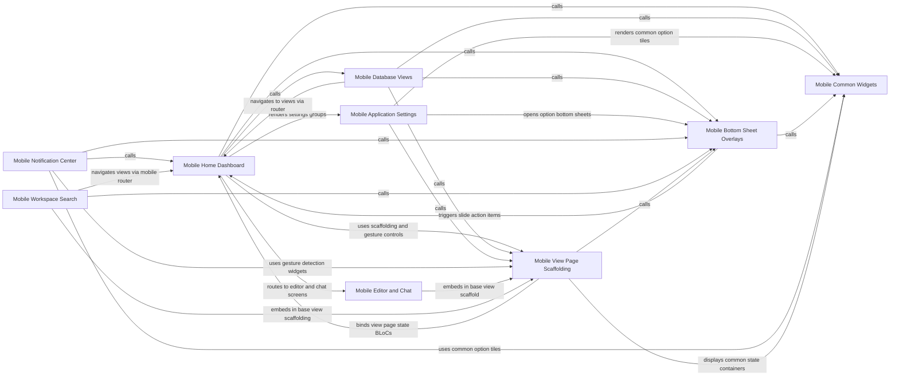

## Details

Implements mobile screens, view navigation, bottom sheets, mobile settings, and notifications.

### Mobile Home Dashboard [[Expand]](./Mobile_Home_Dashboard.md)
Coordinates mobile workspace navigation, home dashboard tabs, and top-level application BLoC routing.

**Related Classes/Methods**:

- `frontend.appflowy_flutter.lib.mobile.application.base.mobile_view_page_bloc.MobileViewPageBloc`:14-87
- `frontend.appflowy_flutter.lib.mobile.application.user_profile.user_profile_bloc.UserProfileBloc`:11-48

**Source Files:**

- `frontend/appflowy_flutter/lib/mobile/application/base/mobile_view_page_bloc.dart`
  - `frontend.appflowy_flutter.lib.mobile.application.base.mobile_view_page_bloc.MobileViewPageBloc` (L14-L87) - Class
  - `frontend.appflowy_flutter.lib.mobile.application.base.mobile_view_page_bloc.MobileViewPageBloc.MobileViewPageBloc` (L16-L51) - Constructor
  - `frontend.appflowy_flutter.lib.mobile.application.base.mobile_view_page_bloc.MobileViewPageBloc.close` (L57-L60) - Method
  - `frontend.appflowy_flutter.lib.mobile.application.base.mobile_view_page_bloc.MobileViewPageBloc._registerListeners` (L62-L69) - Method
  - `frontend.appflowy_flutter.lib.mobile.application.base.mobile_view_page_bloc.MobileViewPageBloc._isImmersiveMode` (L72-L86) - Method
  - `frontend.appflowy_flutter.lib.mobile.application.base.mobile_view_page_bloc.MobileViewPageEvent` (L90-L94) - Class
  - `frontend.appflowy_flutter.lib.mobile.application.base.mobile_view_page_bloc.MobileViewPageEvent.MobileViewPageEvent.initial` (L91-L91) - Constructor
  - `frontend.appflowy_flutter.lib.mobile.application.base.mobile_view_page_bloc.MobileViewPageEvent.MobileViewPageEvent.updateImmersionMode` (L92-L93) - Constructor
  - `frontend.appflowy_flutter.lib.mobile.application.base.mobile_view_page_bloc.MobileViewPageState` (L97-L106) - Class
  - `frontend.appflowy_flutter.lib.mobile.application.base.mobile_view_page_bloc.MobileViewPageState.MobileViewPageState` (L98-L103) - Constructor
  - `frontend.appflowy_flutter.lib.mobile.application.base.mobile_view_page_bloc.MobileViewPageState.MobileViewPageState.initial` (L105-L105) - Constructor
- `frontend/appflowy_flutter/lib/mobile/application/mobile_router.dart`
  - `frontend.appflowy_flutter.lib.mobile.application.mobile_router.MobileRouter.pushView` (L17-L50) - Method
  - `frontend.appflowy_flutter.lib.mobile.application.mobile_router.<unnamed extension>.routeName` (L54-L70) - Method
  - `frontend.appflowy_flutter.lib.mobile.application.mobile_router.<unnamed extension>.queryParameters` (L72-L105) - Method
- `frontend/appflowy_flutter/lib/mobile/application/notification/notification_reminder_bloc.dart`
  - `frontend.appflowy_flutter.lib.mobile.application.notification.notification_reminder_bloc.NotificationReminderBloc` (L20-L178) - Class
  - `frontend.appflowy_flutter.lib.mobile.application.notification.notification_reminder_bloc.NotificationReminderBloc.NotificationReminderBloc` (L22-L86) - Constructor
  - `frontend.appflowy_flutter.lib.mobile.application.notification.notification_reminder_bloc.NotificationReminderBloc._getScheduledAt` (L92-L102) - Method
  - `frontend.appflowy_flutter.lib.mobile.application.notification.notification_reminder_bloc.NotificationReminderBloc._getView` (L104-L107) - Method
  - `frontend.appflowy_flutter.lib.mobile.application.notification.notification_reminder_bloc.NotificationReminderBloc._getContent` (L109-L133) - Method
  - `frontend.appflowy_flutter.lib.mobile.application.notification.notification_reminder_bloc.NotificationReminderBloc._searchById` (L135-L151) - Method
  - `frontend.appflowy_flutter.lib.mobile.application.notification.notification_reminder_bloc.NotificationReminderBloc._formatTimestamp` (L153-L177) - Method
  - `frontend.appflowy_flutter.lib.mobile.application.notification.notification_reminder_bloc.NotificationReminderEvent` (L181-L189) - Class
  - `frontend.appflowy_flutter.lib.mobile.application.notification.notification_reminder_bloc.NotificationReminderEvent.NotificationReminderEvent.initial` (L182-L186) - Constructor
  - `frontend.appflowy_flutter.lib.mobile.application.notification.notification_reminder_bloc.NotificationReminderEvent.NotificationReminderEvent.reset` (L188-L188) - Constructor
  - `frontend.appflowy_flutter.lib.mobile.application.notification.notification_reminder_bloc.NotificationReminderStatus` (L191-L196) - Enum
  - `frontend.appflowy_flutter.lib.mobile.application.notification.notification_reminder_bloc.NotificationReminderStatus.initial` (L192-L192) - Enum
  - `frontend.appflowy_flutter.lib.mobile.application.notification.notification_reminder_bloc.NotificationReminderStatus.loading` (L193-L193) - Enum
  - `frontend.appflowy_flutter.lib.mobile.application.notification.notification_reminder_bloc.NotificationReminderStatus.loaded` (L194-L194) - Enum
  - `frontend.appflowy_flutter.lib.mobile.application.notification.notification_reminder_bloc.NotificationReminderStatus.error` (L195-L195) - Enum
  - `frontend.appflowy_flutter.lib.mobile.application.notification.notification_reminder_bloc.NotificationReminderState` (L199-L221) - Class
  - `frontend.appflowy_flutter.lib.mobile.application.notification.notification_reminder_bloc.NotificationReminderState.NotificationReminderState._` (L200-L200) - Constructor
  - `frontend.appflowy_flutter.lib.mobile.application.notification.notification_reminder_bloc.NotificationReminderState.NotificationReminderState` (L202-L212) - Constructor
  - `frontend.appflowy_flutter.lib.mobile.application.notification.notification_reminder_bloc.NotificationReminderState.NotificationReminderState.initial` (L214-L220) - Constructor
- `frontend/appflowy_flutter/lib/mobile/application/page_style/document_page_style_bloc.dart`
  - `frontend.appflowy_flutter.lib.mobile.application.page_style.document_page_style_bloc.DocumentPageStyleBloc` (L15-L213) - Class
  - `frontend.appflowy_flutter.lib.mobile.application.page_style.document_page_style_bloc.DocumentPageStyleBloc.DocumentPageStyleBloc` (L17-L109) - Constructor
  - `frontend.appflowy_flutter.lib.mobile.application.page_style.document_page_style_bloc.DocumentPageStyleBloc.updateLayoutObject` (L114-L122) - Method
  - `frontend.appflowy_flutter.lib.mobile.application.page_style.document_page_style_bloc.DocumentPageStyleBloc.decodeLayoutObject` (L124-L143) - Method
  - `frontend.appflowy_flutter.lib.mobile.application.page_style.document_page_style_bloc.DocumentPageStyleBloc.calculateIconPadding` (L147-L167) - Method
  - `frontend.appflowy_flutter.lib.mobile.application.page_style.document_page_style_bloc.DocumentPageStyleBloc.calculateIconScale` (L169-L177) - Method
  - `frontend.appflowy_flutter.lib.mobile.application.page_style.document_page_style_bloc.DocumentPageStyleBloc._getSelectedFontLayout` (L179-L185) - Method
  - `frontend.appflowy_flutter.lib.mobile.application.page_style.document_page_style_bloc.DocumentPageStyleBloc._getSelectedLineHeightLayout` (L187-L193) - Method
  - `frontend.appflowy_flutter.lib.mobile.application.page_style.document_page_style_bloc.DocumentPageStyleBloc._getSelectedFontFamily` (L195-L197) - Method
  - `frontend.appflowy_flutter.lib.mobile.application.page_style.document_page_style_bloc.DocumentPageStyleBloc._getSelectedCover` (L199-L212) - Method
  - `frontend.appflowy_flutter.lib.mobile.application.page_style.document_page_style_bloc.DocumentPageStyleEvent` (L216-L230) - Class
  - `frontend.appflowy_flutter.lib.mobile.application.page_style.document_page_style_bloc.DocumentPageStyleEvent.DocumentPageStyleEvent.initial` (L217-L217) - Constructor
  - `frontend.appflowy_flutter.lib.mobile.application.page_style.document_page_style_bloc.DocumentPageStyleEvent.DocumentPageStyleEvent.updateFont` (L218-L220) - Constructor
  - `frontend.appflowy_flutter.lib.mobile.application.page_style.document_page_style_bloc.DocumentPageStyleEvent.DocumentPageStyleEvent.updateLineHeight` (L221-L223) - Constructor
  - `frontend.appflowy_flutter.lib.mobile.application.page_style.document_page_style_bloc.DocumentPageStyleEvent.DocumentPageStyleEvent.updateFontFamily` (L224-L226) - Constructor
  - `frontend.appflowy_flutter.lib.mobile.application.page_style.document_page_style_bloc.DocumentPageStyleEvent.DocumentPageStyleEvent.updateCoverImage` (L227-L229) - Constructor
  - `frontend.appflowy_flutter.lib.mobile.application.page_style.document_page_style_bloc.DocumentPageStyleState` (L233-L247) - Class
  - `frontend.appflowy_flutter.lib.mobile.application.page_style.document_page_style_bloc.DocumentPageStyleState.DocumentPageStyleState` (L234-L242) - Constructor
  - `frontend.appflowy_flutter.lib.mobile.application.page_style.document_page_style_bloc.DocumentPageStyleState.DocumentPageStyleState.initial` (L244-L246) - Constructor
  - `frontend.appflowy_flutter.lib.mobile.application.page_style.document_page_style_bloc.PageStyleFontLayout` (L249-L307) - Enum
  - `frontend.appflowy_flutter.lib.mobile.application.page_style.document_page_style_bloc.PageStyleFontLayout.small` (L250-L250) - Enum
  - `frontend.appflowy_flutter.lib.mobile.application.page_style.document_page_style_bloc.PageStyleFontLayout.normal` (L251-L251) - Enum
  - `frontend.appflowy_flutter.lib.mobile.application.page_style.document_page_style_bloc.PageStyleFontLayout.large` (L252-L252) - Enum
  - `frontend.appflowy_flutter.lib.mobile.application.page_style.document_page_style_bloc.PageStyleFontLayout.toString` (L255-L264) - Method
  - `frontend.appflowy_flutter.lib.mobile.application.page_style.document_page_style_bloc.PageStyleFontLayout.fromString` (L266-L271) - Method
  - `frontend.appflowy_flutter.lib.mobile.application.page_style.document_page_style_bloc.PageStyleFontLayout.fontSize` (L273-L282) - Method
  - `frontend.appflowy_flutter.lib.mobile.application.page_style.document_page_style_bloc.PageStyleFontLayout.headingFontSizes` (L284-L293) - Method
  - `frontend.appflowy_flutter.lib.mobile.application.page_style.document_page_style_bloc.PageStyleFontLayout.factor` (L295-L306) - Method
  - `frontend.appflowy_flutter.lib.mobile.application.page_style.document_page_style_bloc.PageStyleLineHeightLayout` (L309-L365) - Enum
  - `frontend.appflowy_flutter.lib.mobile.application.page_style.document_page_style_bloc.PageStyleLineHeightLayout.small` (L310-L310) - Enum
  - `frontend.appflowy_flutter.lib.mobile.application.page_style.document_page_style_bloc.PageStyleLineHeightLayout.normal` (L311-L311) - Enum
  - `frontend.appflowy_flutter.lib.mobile.application.page_style.document_page_style_bloc.PageStyleLineHeightLayout.large` (L312-L312) - Enum
  - `frontend.appflowy_flutter.lib.mobile.application.page_style.document_page_style_bloc.PageStyleLineHeightLayout.toString` (L315-L324) - Method
  - `frontend.appflowy_flutter.lib.mobile.application.page_style.document_page_style_bloc.PageStyleLineHeightLayout.fromString` (L326-L331) - Method
  - `frontend.appflowy_flutter.lib.mobile.application.page_style.document_page_style_bloc.PageStyleLineHeightLayout.lineHeight` (L333-L342) - Method
  - `frontend.appflowy_flutter.lib.mobile.application.page_style.document_page_style_bloc.PageStyleLineHeightLayout.padding` (L344-L353) - Method
  - `frontend.appflowy_flutter.lib.mobile.application.page_style.document_page_style_bloc.PageStyleLineHeightLayout.headingPaddings` (L355-L364) - Method
  - `frontend.appflowy_flutter.lib.mobile.application.page_style.document_page_style_bloc.PageStyleCoverImageType` (L368-L413) - Enum
  - `frontend.appflowy_flutter.lib.mobile.application.page_style.document_page_style_bloc.PageStyleCoverImageType.none` (L369-L369) - Enum
  - `frontend.appflowy_flutter.lib.mobile.application.page_style.document_page_style_bloc.PageStyleCoverImageType.pureColor` (L371-L371) - Enum
  - `frontend.appflowy_flutter.lib.mobile.application.page_style.document_page_style_bloc.PageStyleCoverImageType.gradientColor` (L373-L373) - Enum
  - `frontend.appflowy_flutter.lib.mobile.application.page_style.document_page_style_bloc.PageStyleCoverImageType.builtInImage` (L375-L375) - Enum
  - `frontend.appflowy_flutter.lib.mobile.application.page_style.document_page_style_bloc.PageStyleCoverImageType.customImage` (L377-L377) - Enum
  - `frontend.appflowy_flutter.lib.mobile.application.page_style.document_page_style_bloc.PageStyleCoverImageType.localImage` (L379-L379) - Enum
  - `frontend.appflowy_flutter.lib.mobile.application.page_style.document_page_style_bloc.PageStyleCoverImageType.unsplashImage` (L381-L381) - Enum
  - `frontend.appflowy_flutter.lib.mobile.application.page_style.document_page_style_bloc.PageStyleCoverImageType.toString` (L384-L401) - Method
  - `frontend.appflowy_flutter.lib.mobile.application.page_style.document_page_style_bloc.PageStyleCoverImageType.fromString` (L403-L408) - Method
  - `frontend.appflowy_flutter.lib.mobile.application.page_style.document_page_style_bloc.PageStyleCoverImageType.builtInImagePath` (L410-L412) - Method
  - `frontend.appflowy_flutter.lib.mobile.application.page_style.document_page_style_bloc.PageStyleCover` (L415-L456) - Class
  - `frontend.appflowy_flutter.lib.mobile.application.page_style.document_page_style_bloc.PageStyleCover.PageStyleCover` (L416-L419) - Constructor
  - `frontend.appflowy_flutter.lib.mobile.application.page_style.document_page_style_bloc.PageStyleCover.PageStyleCover.none` (L421-L424) - Constructor
  - `frontend.appflowy_flutter.lib.mobile.application.page_style.document_page_style_bloc.PageStyleCover.isPresets` (L435-L435) - Method
  - `frontend.appflowy_flutter.lib.mobile.application.page_style.document_page_style_bloc.PageStyleCover.isPhoto` (L436-L436) - Method
  - `frontend.appflowy_flutter.lib.mobile.application.page_style.document_page_style_bloc.PageStyleCover.isNone` (L438-L438) - Method
  - `frontend.appflowy_flutter.lib.mobile.application.page_style.document_page_style_bloc.PageStyleCover.isPureColor` (L439-L439) - Method
  - `frontend.appflowy_flutter.lib.mobile.application.page_style.document_page_style_bloc.PageStyleCover.isGradient` (L440-L440) - Method
  - `frontend.appflowy_flutter.lib.mobile.application.page_style.document_page_style_bloc.PageStyleCover.isBuiltInImage` (L441-L441) - Method
  - `frontend.appflowy_flutter.lib.mobile.application.page_style.document_page_style_bloc.PageStyleCover.isCustomImage` (L442-L442) - Method
  - `frontend.appflowy_flutter.lib.mobile.application.page_style.document_page_style_bloc.PageStyleCover.isUnsplashImage` (L443-L443) - Method
  - `frontend.appflowy_flutter.lib.mobile.application.page_style.document_page_style_bloc.PageStyleCover.isLocalImage` (L444-L444) - Method
  - `frontend.appflowy_flutter.lib.mobile.application.page_style.document_page_style_bloc.PageStyleCover.==` (L447-L452) - Method
  - `frontend.appflowy_flutter.lib.mobile.application.page_style.document_page_style_bloc.PageStyleCover.hashCode` (L455-L455) - Method
- `frontend/appflowy_flutter/lib/mobile/application/recent/recent_view_bloc.dart`
  - `frontend.appflowy_flutter.lib.mobile.application.recent.recent_view_bloc.RecentViewBloc` (L14-L135) - Class
  - `frontend.appflowy_flutter.lib.mobile.application.recent.recent_view_bloc.RecentViewBloc.RecentViewBloc` (L15-L114) - Constructor
  - `frontend.appflowy_flutter.lib.mobile.application.recent.recent_view_bloc.RecentViewBloc.getCoverV2` (L120-L122) - Method
  - `frontend.appflowy_flutter.lib.mobile.application.recent.recent_view_bloc.RecentViewBloc.getCoverV1` (L125-L127) - Method
  - `frontend.appflowy_flutter.lib.mobile.application.recent.recent_view_bloc.RecentViewBloc.close` (L130-L134) - Method
  - `frontend.appflowy_flutter.lib.mobile.application.recent.recent_view_bloc.RecentViewEvent` (L138-L152) - Class
  - `frontend.appflowy_flutter.lib.mobile.application.recent.recent_view_bloc.RecentViewEvent.RecentViewEvent.initial` (L139-L139) - Constructor
  - `frontend.appflowy_flutter.lib.mobile.application.recent.recent_view_bloc.RecentViewEvent.RecentViewEvent.updateCover` (L141-L146) - Constructor
  - `frontend.appflowy_flutter.lib.mobile.application.recent.recent_view_bloc.RecentViewEvent.RecentViewEvent.updateNameOrIcon` (L148-L151) - Constructor
  - `frontend.appflowy_flutter.lib.mobile.application.recent.recent_view_bloc.RecentViewState` (L155-L166) - Class
  - `frontend.appflowy_flutter.lib.mobile.application.recent.recent_view_bloc.RecentViewState.RecentViewState` (L156-L162) - Constructor
  - `frontend.appflowy_flutter.lib.mobile.application.recent.recent_view_bloc.RecentViewState.RecentViewState.initial` (L164-L165) - Constructor
- `frontend/appflowy_flutter/lib/mobile/application/user_profile/user_profile_bloc.dart`
  - `frontend.appflowy_flutter.lib.mobile.application.user_profile.user_profile_bloc.UserProfileBloc` (L11-L48) - Class
  - `frontend.appflowy_flutter.lib.mobile.application.user_profile.user_profile_bloc.UserProfileBloc.UserProfileBloc` (L12-L18) - Constructor
  - `frontend.appflowy_flutter.lib.mobile.application.user_profile.user_profile_bloc.UserProfileBloc._initialize` (L20-L47) - Method
  - `frontend.appflowy_flutter.lib.mobile.application.user_profile.user_profile_bloc.UserProfileEvent` (L51-L53) - Class
  - `frontend.appflowy_flutter.lib.mobile.application.user_profile.user_profile_bloc.UserProfileEvent.UserProfileEvent.started` (L52-L52) - Constructor
  - `frontend.appflowy_flutter.lib.mobile.application.user_profile.user_profile_bloc.UserProfileState` (L56-L64) - Class
  - `frontend.appflowy_flutter.lib.mobile.application.user_profile.user_profile_bloc.UserProfileState.UserProfileState.initial` (L57-L57) - Constructor
  - `frontend.appflowy_flutter.lib.mobile.application.user_profile.user_profile_bloc.UserProfileState.UserProfileState.loading` (L58-L58) - Constructor
  - `frontend.appflowy_flutter.lib.mobile.application.user_profile.user_profile_bloc.UserProfileState.UserProfileState.workspaceFailure` (L59-L59) - Constructor
  - `frontend.appflowy_flutter.lib.mobile.application.user_profile.user_profile_bloc.UserProfileState.UserProfileState.success` (L60-L63) - Constructor
- `frontend/appflowy_flutter/lib/mobile/presentation/favorite/mobile_favorite_folder.dart`
  - `frontend.appflowy_flutter.lib.mobile.presentation.favorite.mobile_favorite_folder.MobileFavoritePageFolder` (L15-L86) - Class
  - `frontend.appflowy_flutter.lib.mobile.presentation.favorite.mobile_favorite_folder.MobileFavoritePageFolder.MobileFavoritePageFolder` (L16-L19) - Constructor
  - `frontend.appflowy_flutter.lib.mobile.presentation.favorite.mobile_favorite_folder.MobileFavoritePageFolder.build` (L24-L85) - Method
- `frontend/appflowy_flutter/lib/mobile/presentation/favorite/mobile_favorite_page.dart`
  - `frontend.appflowy_flutter.lib.mobile.presentation.favorite.mobile_favorite_page.MobileFavoriteScreen` (L16-L81) - Class
  - `frontend.appflowy_flutter.lib.mobile.presentation.favorite.mobile_favorite_page.MobileFavoriteScreen.MobileFavoriteScreen` (L17-L19) - Constructor
  - `frontend.appflowy_flutter.lib.mobile.presentation.favorite.mobile_favorite_page.MobileFavoriteScreen.build` (L24-L80) - Method
  - `frontend.appflowy_flutter.lib.mobile.presentation.favorite.mobile_favorite_page.MobileFavoritePage` (L83-L117) - Class
  - `frontend.appflowy_flutter.lib.mobile.presentation.favorite.mobile_favorite_page.MobileFavoritePage.MobileFavoritePage` (L84-L87) - Constructor
  - `frontend.appflowy_flutter.lib.mobile.presentation.favorite.mobile_favorite_page.MobileFavoritePage.build` (L92-L116) - Method
- `frontend/appflowy_flutter/lib/mobile/presentation/home/favorite_folder/favorite_space.dart`
  - `frontend.appflowy_flutter.lib.mobile.presentation.home.favorite_folder.favorite_space.MobileFavoriteSpace` (L15-L25) - Class
  - `frontend.appflowy_flutter.lib.mobile.presentation.home.favorite_folder.favorite_space.MobileFavoriteSpace.MobileFavoriteSpace` (L16-L19) - Constructor
  - `frontend.appflowy_flutter.lib.mobile.presentation.home.favorite_folder.favorite_space.MobileFavoriteSpace.createState` (L24-L24) - Method
  - `frontend.appflowy_flutter.lib.mobile.presentation.home.favorite_folder.favorite_space._MobileFavoriteSpaceState` (L27-L85) - Class
  - `frontend.appflowy_flutter.lib.mobile.presentation.home.favorite_folder.favorite_space._MobileFavoriteSpaceState.wantKeepAlive` (L30-L30) - Method
  - `frontend.appflowy_flutter.lib.mobile.presentation.home.favorite_folder.favorite_space._MobileFavoriteSpaceState.build` (L33-L84) - Method
  - `frontend.appflowy_flutter.lib.mobile.presentation.home.favorite_folder.favorite_space._FavoriteViews` (L87-L129) - Class
  - `frontend.appflowy_flutter.lib.mobile.presentation.home.favorite_folder.favorite_space._FavoriteViews._FavoriteViews` (L88-L90) - Constructor
  - `frontend.appflowy_flutter.lib.mobile.presentation.home.favorite_folder.favorite_space._FavoriteViews.build` (L95-L128) - Method
- `frontend/appflowy_flutter/lib/mobile/presentation/home/favorite_folder/mobile_home_favorite_folder.dart`
  - `frontend.appflowy_flutter.lib.mobile.presentation.home.favorite_folder.mobile_home_favorite_folder.MobileFavoriteFolder` (L11-L85) - Class
  - `frontend.appflowy_flutter.lib.mobile.presentation.home.favorite_folder.mobile_home_favorite_folder.MobileFavoriteFolder.MobileFavoriteFolder` (L12-L17) - Constructor
  - `frontend.appflowy_flutter.lib.mobile.presentation.home.favorite_folder.mobile_home_favorite_folder.MobileFavoriteFolder.build` (L24-L84) - Method
- `frontend/appflowy_flutter/lib/mobile/presentation/home/favorite_folder/mobile_home_favorite_folder_header.dart`
  - `frontend.appflowy_flutter.lib.mobile.presentation.home.favorite_folder.mobile_home_favorite_folder_header.MobileFavoriteFolderHeader` (L6-L21) - Class
  - `frontend.appflowy_flutter.lib.mobile.presentation.home.favorite_folder.mobile_home_favorite_folder_header.MobileFavoriteFolderHeader.MobileFavoriteFolderHeader` (L7-L12) - Constructor
  - `frontend.appflowy_flutter.lib.mobile.presentation.home.favorite_folder.mobile_home_favorite_folder_header.MobileFavoriteFolderHeader.createState` (L19-L20) - Method
  - `frontend.appflowy_flutter.lib.mobile.presentation.home.favorite_folder.mobile_home_favorite_folder_header._MobileFavoriteFolderHeaderState` (L23-L59) - Class
  - `frontend.appflowy_flutter.lib.mobile.presentation.home.favorite_folder.mobile_home_favorite_folder_header._MobileFavoriteFolderHeaderState.build` (L28-L58) - Method
- `frontend/appflowy_flutter/lib/mobile/presentation/home/home_space/home_space.dart`
  - `frontend.appflowy_flutter.lib.mobile.presentation.home.home_space.home_space.MobileHomeSpace` (L8-L15) - Class
  - `frontend.appflowy_flutter.lib.mobile.presentation.home.home_space.home_space.MobileHomeSpace.MobileHomeSpace` (L9-L9) - Constructor
  - `frontend.appflowy_flutter.lib.mobile.presentation.home.home_space.home_space.MobileHomeSpace.createState` (L14-L14) - Method
  - `frontend.appflowy_flutter.lib.mobile.presentation.home.home_space.home_space._MobileHomeSpaceState` (L17-L43) - Class
  - `frontend.appflowy_flutter.lib.mobile.presentation.home.home_space.home_space._MobileHomeSpaceState.wantKeepAlive` (L20-L20) - Method
  - `frontend.appflowy_flutter.lib.mobile.presentation.home.home_space.home_space._MobileHomeSpaceState.build` (L23-L42) - Method
- `frontend/appflowy_flutter/lib/mobile/presentation/home/mobile_folders.dart`
  - `frontend.appflowy_flutter.lib.mobile.presentation.home.mobile_folders.MobileFolders` (L16-L55) - Class
  - `frontend.appflowy_flutter.lib.mobile.presentation.home.mobile_folders.MobileFolders.MobileFolders` (L17-L22) - Constructor
  - `frontend.appflowy_flutter.lib.mobile.presentation.home.mobile_folders.MobileFolders.build` (L29-L54) - Method
  - `frontend.appflowy_flutter.lib.mobile.presentation.home.mobile_folders._MobileFolder` (L57-L62) - Class
  - `frontend.appflowy_flutter.lib.mobile.presentation.home.mobile_folders._MobileFolder._MobileFolder` (L58-L58) - Constructor
  - `frontend.appflowy_flutter.lib.mobile.presentation.home.mobile_folders._MobileFolder.createState` (L61-L61) - Method
  - `frontend.appflowy_flutter.lib.mobile.presentation.home.mobile_folders._MobileFolderState` (L64-L115) - Class
  - `frontend.appflowy_flutter.lib.mobile.presentation.home.mobile_folders._MobileFolderState.build` (L66-L79) - Method
  - `frontend.appflowy_flutter.lib.mobile.presentation.home.mobile_folders._MobileFolderState._buildSpaceOrSection` (L81-L114) - Method
- `frontend/appflowy_flutter/lib/mobile/presentation/home/mobile_home_page.dart`
  - `frontend.appflowy_flutter.lib.mobile.presentation.home.mobile_home_page.MobileHomeScreen` (L32-L83) - Class
  - `frontend.appflowy_flutter.lib.mobile.presentation.home.mobile_home_page.MobileHomeScreen.MobileHomeScreen` (L33-L33) - Constructor
  - `frontend.appflowy_flutter.lib.mobile.presentation.home.mobile_home_page.MobileHomeScreen.build` (L38-L82) - Method
  - `frontend.appflowy_flutter.lib.mobile.presentation.home.mobile_home_page.MobileHomePage` (L88-L100) - Class
  - `frontend.appflowy_flutter.lib.mobile.presentation.home.mobile_home_page.MobileHomePage.MobileHomePage` (L89-L93) - Constructor
  - `frontend.appflowy_flutter.lib.mobile.presentation.home.mobile_home_page.MobileHomePage.createState` (L99-L99) - Method
  - `frontend.appflowy_flutter.lib.mobile.presentation.home.mobile_home_page._MobileHomePageState` (L102-L151) - Class
  - `frontend.appflowy_flutter.lib.mobile.presentation.home.mobile_home_page._MobileHomePageState.initState` (L106-L111) - Method
  - `frontend.appflowy_flutter.lib.mobile.presentation.home.mobile_home_page._MobileHomePageState.dispose` (L114-L118) - Method
  - `frontend.appflowy_flutter.lib.mobile.presentation.home.mobile_home_page._MobileHomePageState.build` (L121-L142) - Method
  - `frontend.appflowy_flutter.lib.mobile.presentation.home.mobile_home_page._MobileHomePageState._onLatestViewChange` (L144-L150) - Method
  - `frontend.appflowy_flutter.lib.mobile.presentation.home.mobile_home_page._HomePage` (L153-L160) - Class
  - `frontend.appflowy_flutter.lib.mobile.presentation.home.mobile_home_page._HomePage._HomePage` (L154-L154) - Constructor
  - `frontend.appflowy_flutter.lib.mobile.presentation.home.mobile_home_page._HomePage.createState` (L159-L159) - Method
  - `frontend.appflowy_flutter.lib.mobile.presentation.home.mobile_home_page._HomePageState` (L162-L340) - Class
  - `frontend.appflowy_flutter.lib.mobile.presentation.home.mobile_home_page._HomePageState.build` (L166-L251) - Method
  - `frontend.appflowy_flutter.lib.mobile.presentation.home.mobile_home_page._HomePageState._showResultDialog` (L253-L339) - Method
- `frontend/appflowy_flutter/lib/mobile/presentation/home/mobile_home_page_header.dart`
  - `frontend.appflowy_flutter.lib.mobile.presentation.home.mobile_home_page_header.MobileHomePageHeader` (L23-L61) - Class
  - `frontend.appflowy_flutter.lib.mobile.presentation.home.mobile_home_page_header.MobileHomePageHeader.MobileHomePageHeader` (L24-L27) - Constructor
  - `frontend.appflowy_flutter.lib.mobile.presentation.home.mobile_home_page_header.MobileHomePageHeader.build` (L32-L60) - Method
  - `frontend.appflowy_flutter.lib.mobile.presentation.home.mobile_home_page_header._MobileUser` (L63-L97) - Class
  - `frontend.appflowy_flutter.lib.mobile.presentation.home.mobile_home_page_header._MobileUser._MobileUser` (L64-L66) - Constructor
  - `frontend.appflowy_flutter.lib.mobile.presentation.home.mobile_home_page_header._MobileUser.build` (L71-L96) - Method
  - `frontend.appflowy_flutter.lib.mobile.presentation.home.mobile_home_page_header._MobileWorkspace` (L99-L207) - Class
  - `frontend.appflowy_flutter.lib.mobile.presentation.home.mobile_home_page_header._MobileWorkspace._MobileWorkspace` (L100-L102) - Constructor
  - `frontend.appflowy_flutter.lib.mobile.presentation.home.mobile_home_page_header._MobileWorkspace.build` (L107-L156) - Method
  - `frontend.appflowy_flutter.lib.mobile.presentation.home.mobile_home_page_header._MobileWorkspace._showSwitchWorkspacesBottomSheet` (L158-L206) - Method
  - `frontend.appflowy_flutter.lib.mobile.presentation.home.mobile_home_page_header._UserIcon` (L209-L254) - Class
  - `frontend.appflowy_flutter.lib.mobile.presentation.home.mobile_home_page_header._UserIcon._UserIcon` (L210-L212) - Constructor
  - `frontend.appflowy_flutter.lib.mobile.presentation.home.mobile_home_page_header._UserIcon.build` (L217-L253) - Method
- `frontend/appflowy_flutter/lib/mobile/presentation/home/mobile_home_setting_page.dart`
  - `frontend.appflowy_flutter.lib.mobile.presentation.home.mobile_home_setting_page.MobileHomeSettingPage` (L23-L32) - Class
  - `frontend.appflowy_flutter.lib.mobile.presentation.home.mobile_home_setting_page.MobileHomeSettingPage.MobileHomeSettingPage` (L24-L26) - Constructor
  - `frontend.appflowy_flutter.lib.mobile.presentation.home.mobile_home_setting_page.MobileHomeSettingPage.createState` (L31-L31) - Method
  - `frontend.appflowy_flutter.lib.mobile.presentation.home.mobile_home_setting_page._MobileHomeSettingPageState` (L34-L121) - Class
  - `frontend.appflowy_flutter.lib.mobile.presentation.home.mobile_home_setting_page._MobileHomeSettingPageState.build` (L36-L65) - Method
  - `frontend.appflowy_flutter.lib.mobile.presentation.home.mobile_home_setting_page._MobileHomeSettingPageState._buildErrorWidget` (L67-L74) - Method
  - `frontend.appflowy_flutter.lib.mobile.presentation.home.mobile_home_setting_page._MobileHomeSettingPageState._buildSettingsWidget` (L76-L120) - Method
- `frontend/appflowy_flutter/lib/mobile/presentation/home/mobile_home_trash_page.dart`
  - `frontend.appflowy_flutter.lib.mobile.presentation.home.mobile_home_trash_page.MobileHomeTrashPage` (L14-L74) - Class
  - `frontend.appflowy_flutter.lib.mobile.presentation.home.mobile_home_trash_page.MobileHomeTrashPage.MobileHomeTrashPage` (L15-L15) - Constructor
  - `frontend.appflowy_flutter.lib.mobile.presentation.home.mobile_home_trash_page.MobileHomeTrashPage.build` (L20-L73) - Method
  - `frontend.appflowy_flutter.lib.mobile.presentation.home.mobile_home_trash_page._TrashActionType` (L76-L79) - Enum
  - `frontend.appflowy_flutter.lib.mobile.presentation.home.mobile_home_trash_page._TrashActionType.restoreAll` (L77-L77) - Enum
  - `frontend.appflowy_flutter.lib.mobile.presentation.home.mobile_home_trash_page._TrashActionType.deleteAll` (L78-L78) - Enum
  - `frontend.appflowy_flutter.lib.mobile.presentation.home.mobile_home_trash_page._EmptyTrashBin` (L81-L114) - Class
  - `frontend.appflowy_flutter.lib.mobile.presentation.home.mobile_home_trash_page._EmptyTrashBin._EmptyTrashBin` (L82-L82) - Constructor
  - `frontend.appflowy_flutter.lib.mobile.presentation.home.mobile_home_trash_page._EmptyTrashBin.build` (L85-L113) - Method
  - `frontend.appflowy_flutter.lib.mobile.presentation.home.mobile_home_trash_page._TrashActionAllButton` (L116-L183) - Class
  - `frontend.appflowy_flutter.lib.mobile.presentation.home.mobile_home_trash_page._TrashActionAllButton._TrashActionAllButton` (L118-L121) - Constructor
  - `frontend.appflowy_flutter.lib.mobile.presentation.home.mobile_home_trash_page._TrashActionAllButton.build` (L126-L182) - Method
  - `frontend.appflowy_flutter.lib.mobile.presentation.home.mobile_home_trash_page._DeletedFilesListView` (L185-L267) - Class
  - `frontend.appflowy_flutter.lib.mobile.presentation.home.mobile_home_trash_page._DeletedFilesListView._DeletedFilesListView` (L186-L188) - Constructor
  - `frontend.appflowy_flutter.lib.mobile.presentation.home.mobile_home_trash_page._DeletedFilesListView.build` (L192-L266) - Method
- `frontend/appflowy_flutter/lib/mobile/presentation/home/recent_folder/mobile_home_recent_views.dart`
  - `frontend.appflowy_flutter.lib.mobile.presentation.home.recent_folder.mobile_home_recent_views.MobileRecentFolder` (L16-L21) - Class
  - `frontend.appflowy_flutter.lib.mobile.presentation.home.recent_folder.mobile_home_recent_views.MobileRecentFolder.MobileRecentFolder` (L17-L17) - Constructor
  - `frontend.appflowy_flutter.lib.mobile.presentation.home.recent_folder.mobile_home_recent_views.MobileRecentFolder.createState` (L20-L20) - Method
  - `frontend.appflowy_flutter.lib.mobile.presentation.home.recent_folder.mobile_home_recent_views._MobileRecentFolderState` (L23-L66) - Class
  - `frontend.appflowy_flutter.lib.mobile.presentation.home.recent_folder.mobile_home_recent_views._MobileRecentFolderState.build` (L25-L65) - Method
  - `frontend.appflowy_flutter.lib.mobile.presentation.home.recent_folder.mobile_home_recent_views._RecentViews` (L68-L141) - Class
  - `frontend.appflowy_flutter.lib.mobile.presentation.home.recent_folder.mobile_home_recent_views._RecentViews._RecentViews` (L69-L72) - Constructor
  - `frontend.appflowy_flutter.lib.mobile.presentation.home.recent_folder.mobile_home_recent_views._RecentViews.build` (L77-L140) - Method
- `frontend/appflowy_flutter/lib/mobile/presentation/home/recent_folder/mobile_recent_view.dart`
  - `frontend.appflowy_flutter.lib.mobile.presentation.home.recent_folder.mobile_recent_view.MobileRecentView` (L21-L120) - Class
  - `frontend.appflowy_flutter.lib.mobile.presentation.home.recent_folder.mobile_recent_view.MobileRecentView.MobileRecentView` (L22-L25) - Constructor
  - `frontend.appflowy_flutter.lib.mobile.presentation.home.recent_folder.mobile_recent_view.MobileRecentView.build` (L30-L68) - Method
  - `frontend.appflowy_flutter.lib.mobile.presentation.home.recent_folder.mobile_recent_view.MobileRecentView._buildCover` (L70-L85) - Method
  - `frontend.appflowy_flutter.lib.mobile.presentation.home.recent_folder.mobile_recent_view.MobileRecentView._buildTitle` (L87-L107) - Method
  - `frontend.appflowy_flutter.lib.mobile.presentation.home.recent_folder.mobile_recent_view.MobileRecentView._buildIcon` (L109-L119) - Method
  - `frontend.appflowy_flutter.lib.mobile.presentation.home.recent_folder.mobile_recent_view._RecentCover` (L122-L229) - Class
  - `frontend.appflowy_flutter.lib.mobile.presentation.home.recent_folder.mobile_recent_view._RecentCover._RecentCover` (L123-L127) - Constructor
  - `frontend.appflowy_flutter.lib.mobile.presentation.home.recent_folder.mobile_recent_view._RecentCover.build` (L134-L148) - Method
  - `frontend.appflowy_flutter.lib.mobile.presentation.home.recent_folder.mobile_recent_view._RecentCover._buildCoverV2` (L150-L196) - Method
  - `frontend.appflowy_flutter.lib.mobile.presentation.home.recent_folder.mobile_recent_view._RecentCover._buildCoverV1` (L198-L228) - Method
- `frontend/appflowy_flutter/lib/mobile/presentation/home/recent_folder/recent_space.dart`
  - `frontend.appflowy_flutter.lib.mobile.presentation.home.recent_folder.recent_space.MobileRecentSpace` (L12-L17) - Class
  - `frontend.appflowy_flutter.lib.mobile.presentation.home.recent_folder.recent_space.MobileRecentSpace.MobileRecentSpace` (L13-L13) - Constructor
  - `frontend.appflowy_flutter.lib.mobile.presentation.home.recent_folder.recent_space.MobileRecentSpace.createState` (L16-L16) - Method
  - `frontend.appflowy_flutter.lib.mobile.presentation.home.recent_folder.recent_space._MobileRecentSpaceState` (L19-L56) - Class
  - `frontend.appflowy_flutter.lib.mobile.presentation.home.recent_folder.recent_space._MobileRecentSpaceState.wantKeepAlive` (L22-L22) - Method
  - `frontend.appflowy_flutter.lib.mobile.presentation.home.recent_folder.recent_space._MobileRecentSpaceState.build` (L25-L48) - Method
  - `frontend.appflowy_flutter.lib.mobile.presentation.home.recent_folder.recent_space._MobileRecentSpaceState._filterRecentViews` (L50-L55) - Method
  - `frontend.appflowy_flutter.lib.mobile.presentation.home.recent_folder.recent_space._RecentViews` (L58-L102) - Class
  - `frontend.appflowy_flutter.lib.mobile.presentation.home.recent_folder.recent_space._RecentViews._RecentViews` (L59-L61) - Constructor
  - `frontend.appflowy_flutter.lib.mobile.presentation.home.recent_folder.recent_space._RecentViews.build` (L66-L101) - Method
- `frontend/appflowy_flutter/lib/mobile/presentation/home/section_folder/mobile_home_section_folder.dart`
  - `frontend.appflowy_flutter.lib.mobile.presentation.home.section_folder.mobile_home_section_folder.MobileSectionFolder` (L16-L79) - Class
  - `frontend.appflowy_flutter.lib.mobile.presentation.home.section_folder.mobile_home_section_folder.MobileSectionFolder.MobileSectionFolder` (L17-L22) - Constructor
  - `frontend.appflowy_flutter.lib.mobile.presentation.home.section_folder.mobile_home_section_folder.MobileSectionFolder.build` (L29-L65) - Method
  - `frontend.appflowy_flutter.lib.mobile.presentation.home.section_folder.mobile_home_section_folder.MobileSectionFolder._createNewPage` (L67-L78) - Method
  - `frontend.appflowy_flutter.lib.mobile.presentation.home.section_folder.mobile_home_section_folder._Pages` (L81-L132) - Class
  - `frontend.appflowy_flutter.lib.mobile.presentation.home.section_folder.mobile_home_section_folder._Pages._Pages` (L82-L85) - Constructor
  - `frontend.appflowy_flutter.lib.mobile.presentation.home.section_folder.mobile_home_section_folder._Pages.build` (L91-L131) - Method
- `frontend/appflowy_flutter/lib/mobile/presentation/home/section_folder/mobile_home_section_folder_header.dart`
  - `frontend.appflowy_flutter.lib.mobile.presentation.home.section_folder.mobile_home_section_folder_header.MobileSectionFolderHeader` (L9-L26) - Class
  - `frontend.appflowy_flutter.lib.mobile.presentation.home.section_folder.mobile_home_section_folder_header.MobileSectionFolderHeader.MobileSectionFolderHeader` (L10-L16) - Constructor
  - `frontend.appflowy_flutter.lib.mobile.presentation.home.section_folder.mobile_home_section_folder_header.MobileSectionFolderHeader.createState` (L24-L25) - Method
  - `frontend.appflowy_flutter.lib.mobile.presentation.home.section_folder.mobile_home_section_folder_header._MobileSectionFolderHeaderState` (L28-L78) - Class
  - `frontend.appflowy_flutter.lib.mobile.presentation.home.section_folder.mobile_home_section_folder_header._MobileSectionFolderHeaderState.build` (L32-L77) - Method
- `frontend/appflowy_flutter/lib/mobile/presentation/home/setting/settings_popup_menu.dart`
  - `frontend.appflowy_flutter.lib.mobile.presentation.home.setting.settings_popup_menu._MobileSettingsPopupMenuItem` (L14-L20) - Enum
  - `frontend.appflowy_flutter.lib.mobile.presentation.home.setting.settings_popup_menu._MobileSettingsPopupMenuItem.settings` (L15-L15) - Enum
  - `frontend.appflowy_flutter.lib.mobile.presentation.home.setting.settings_popup_menu._MobileSettingsPopupMenuItem.members` (L16-L16) - Enum
  - `frontend.appflowy_flutter.lib.mobile.presentation.home.setting.settings_popup_menu._MobileSettingsPopupMenuItem.trash` (L17-L17) - Enum
  - `frontend.appflowy_flutter.lib.mobile.presentation.home.setting.settings_popup_menu._MobileSettingsPopupMenuItem.help` (L18-L18) - Enum
  - `frontend.appflowy_flutter.lib.mobile.presentation.home.setting.settings_popup_menu._MobileSettingsPopupMenuItem.helpAndDocumentation` (L19-L19) - Enum
  - `frontend.appflowy_flutter.lib.mobile.presentation.home.setting.settings_popup_menu.HomePageSettingsPopupMenu` (L22-L140) - Class
  - `frontend.appflowy_flutter.lib.mobile.presentation.home.setting.settings_popup_menu.HomePageSettingsPopupMenu.HomePageSettingsPopupMenu` (L23-L26) - Constructor
  - `frontend.appflowy_flutter.lib.mobile.presentation.home.setting.settings_popup_menu.HomePageSettingsPopupMenu.build` (L31-L104) - Method
  - `frontend.appflowy_flutter.lib.mobile.presentation.home.setting.settings_popup_menu.HomePageSettingsPopupMenu._buildItem` (L106-L119) - Method
  - `frontend.appflowy_flutter.lib.mobile.presentation.home.setting.settings_popup_menu.HomePageSettingsPopupMenu._openMembersPage` (L121-L123) - Method
  - `frontend.appflowy_flutter.lib.mobile.presentation.home.setting.settings_popup_menu.HomePageSettingsPopupMenu._openTrashPage` (L125-L127) - Method
  - `frontend.appflowy_flutter.lib.mobile.presentation.home.setting.settings_popup_menu.HomePageSettingsPopupMenu._openHelpPage` (L129-L131) - Method
  - `frontend.appflowy_flutter.lib.mobile.presentation.home.setting.settings_popup_menu.HomePageSettingsPopupMenu._openSettingsPage` (L133-L135) - Method
  - `frontend.appflowy_flutter.lib.mobile.presentation.home.setting.settings_popup_menu.HomePageSettingsPopupMenu._openHelpAndDocumentationPage` (L137-L139) - Method
  - `frontend.appflowy_flutter.lib.mobile.presentation.home.setting.settings_popup_menu._PopupButton` (L142-L168) - Class
  - `frontend.appflowy_flutter.lib.mobile.presentation.home.setting.settings_popup_menu._PopupButton._PopupButton` (L143-L146) - Constructor
  - `frontend.appflowy_flutter.lib.mobile.presentation.home.setting.settings_popup_menu._PopupButton.build` (L152-L167) - Method
- `frontend/appflowy_flutter/lib/mobile/presentation/home/shared/empty_placeholder.dart`
  - `frontend.appflowy_flutter.lib.mobile.presentation.home.shared.empty_placeholder.EmptySpacePlaceholder` (L8-L59) - Class
  - `frontend.appflowy_flutter.lib.mobile.presentation.home.shared.empty_placeholder.EmptySpacePlaceholder.EmptySpacePlaceholder` (L9-L12) - Constructor
  - `frontend.appflowy_flutter.lib.mobile.presentation.home.shared.empty_placeholder.EmptySpacePlaceholder.build` (L17-L46) - Method
  - `frontend.appflowy_flutter.lib.mobile.presentation.home.shared.empty_placeholder.EmptySpacePlaceholder._emptyPageText` (L48-L51) - Method
  - `frontend.appflowy_flutter.lib.mobile.presentation.home.shared.empty_placeholder.EmptySpacePlaceholder._emptyPageSubText` (L53-L58) - Method
- `frontend/appflowy_flutter/lib/mobile/presentation/home/shared/mobile_page_card.dart`
  - `frontend.appflowy_flutter.lib.mobile.presentation.home.shared.mobile_page_card.MobilePageCardType` (L35-L43) - Enum
  - `frontend.appflowy_flutter.lib.mobile.presentation.home.shared.mobile_page_card.MobilePageCardType.recent` (L36-L36) - Enum
  - `frontend.appflowy_flutter.lib.mobile.presentation.home.shared.mobile_page_card.MobilePageCardType.favorite` (L37-L37) - Enum
  - `frontend.appflowy_flutter.lib.mobile.presentation.home.shared.mobile_page_card.MobilePageCardType.lastOperationHintText` (L39-L42) - Method
  - `frontend.appflowy_flutter.lib.mobile.presentation.home.shared.mobile_page_card.MobileViewPage` (L45-L275) - Class
  - `frontend.appflowy_flutter.lib.mobile.presentation.home.shared.mobile_page_card.MobileViewPage.MobileViewPage` (L46-L51) - Constructor
  - `frontend.appflowy_flutter.lib.mobile.presentation.home.shared.mobile_page_card.MobileViewPage.build` (L58-L112) - Method
  - `frontend.appflowy_flutter.lib.mobile.presentation.home.shared.mobile_page_card.MobileViewPage._buildDescription` (L114-L126) - Method
  - `frontend.appflowy_flutter.lib.mobile.presentation.home.shared.mobile_page_card.MobileViewPage._buildNameAndLastViewed` (L128-L144) - Method
  - `frontend.appflowy_flutter.lib.mobile.presentation.home.shared.mobile_page_card.MobileViewPage._buildAvatar` (L146-L168) - Method
  - `frontend.appflowy_flutter.lib.mobile.presentation.home.shared.mobile_page_card.MobileViewPage._buildCover` (L170-L180) - Method
  - `frontend.appflowy_flutter.lib.mobile.presentation.home.shared.mobile_page_card.MobileViewPage._buildTitle` (L182-L215) - Method
  - `frontend.appflowy_flutter.lib.mobile.presentation.home.shared.mobile_page_card.MobileViewPage._buildAuthor` (L217-L225) - Method
  - `frontend.appflowy_flutter.lib.mobile.presentation.home.shared.mobile_page_card.MobileViewPage._buildLastViewed` (L227-L243) - Method
  - `frontend.appflowy_flutter.lib.mobile.presentation.home.shared.mobile_page_card.MobileViewPage._formatTimestamp` (L245-L274) - Method
  - `frontend.appflowy_flutter.lib.mobile.presentation.home.shared.mobile_page_card._ViewCover` (L277-L421) - Class
  - `frontend.appflowy_flutter.lib.mobile.presentation.home.shared.mobile_page_card._ViewCover._ViewCover` (L278-L283) - Constructor
  - `frontend.appflowy_flutter.lib.mobile.presentation.home.shared.mobile_page_card._ViewCover.build` (L291-L301) - Method
  - `frontend.appflowy_flutter.lib.mobile.presentation.home.shared.mobile_page_card._ViewCover._buildPlaceholder` (L303-L340) - Method
  - `frontend.appflowy_flutter.lib.mobile.presentation.home.shared.mobile_page_card._ViewCover._buildCoverV2` (L342-L388) - Method
  - `frontend.appflowy_flutter.lib.mobile.presentation.home.shared.mobile_page_card._ViewCover._buildCoverV1` (L390-L420) - Method
- `frontend/appflowy_flutter/lib/mobile/presentation/home/space/constants.dart`
  - `frontend.appflowy_flutter.lib.mobile.presentation.home.space.constants.SpaceUIConstants` (L1-L3) - Class
- `frontend/appflowy_flutter/lib/mobile/presentation/home/space/manage_space_widget.dart`
  - `frontend.appflowy_flutter.lib.mobile.presentation.home.space.manage_space_widget.ManageSpaceType` (L8-L11) - Enum
  - `frontend.appflowy_flutter.lib.mobile.presentation.home.space.manage_space_widget.ManageSpaceType.create` (L9-L9) - Enum
  - `frontend.appflowy_flutter.lib.mobile.presentation.home.space.manage_space_widget.ManageSpaceType.edit` (L10-L10) - Enum
  - `frontend.appflowy_flutter.lib.mobile.presentation.home.space.manage_space_widget.ManageSpaceWidget` (L13-L53) - Class
  - `frontend.appflowy_flutter.lib.mobile.presentation.home.space.manage_space_widget.ManageSpaceWidget.ManageSpaceWidget` (L14-L21) - Constructor
  - `frontend.appflowy_flutter.lib.mobile.presentation.home.space.manage_space_widget.ManageSpaceWidget.build` (L30-L52) - Method
- `frontend/appflowy_flutter/lib/mobile/presentation/home/space/mobile_space.dart`
  - `frontend.appflowy_flutter.lib.mobile.presentation.home.space.mobile_space.MobileSpace` (L20-L115) - Class
  - `frontend.appflowy_flutter.lib.mobile.presentation.home.space.mobile_space.MobileSpace.MobileSpace` (L21-L23) - Constructor
  - `frontend.appflowy_flutter.lib.mobile.presentation.home.space.mobile_space.MobileSpace.build` (L26-L56) - Method
  - `frontend.appflowy_flutter.lib.mobile.presentation.home.space.mobile_space.MobileSpace._showSpaceMenu` (L58-L81) - Method
  - `frontend.appflowy_flutter.lib.mobile.presentation.home.space.mobile_space.MobileSpace._showCreatePageMenu` (L83-L114) - Method
  - `frontend.appflowy_flutter.lib.mobile.presentation.home.space.mobile_space._Pages` (L117-L185) - Class
  - `frontend.appflowy_flutter.lib.mobile.presentation.home.space.mobile_space._Pages._Pages` (L118-L121) - Constructor
  - `frontend.appflowy_flutter.lib.mobile.presentation.home.space.mobile_space._Pages.build` (L126-L184) - Method
- `frontend/appflowy_flutter/lib/mobile/presentation/home/space/mobile_space_header.dart`
  - `frontend.appflowy_flutter.lib.mobile.presentation.home.space.mobile_space_header.MobileSpaceHeader` (L11-L143) - Class
  - `frontend.appflowy_flutter.lib.mobile.presentation.home.space.mobile_space_header.MobileSpaceHeader.MobileSpaceHeader` (L12-L18) - Constructor
  - `frontend.appflowy_flutter.lib.mobile.presentation.home.space.mobile_space_header.MobileSpaceHeader.build` (L26-L71) - Method
- `frontend/appflowy_flutter/lib/mobile/presentation/home/space/mobile_space_menu.dart`
  - `frontend.appflowy_flutter.lib.mobile.presentation.home.space.mobile_space_menu.MobileSpaceMenu` (L29-L67) - Class
  - `frontend.appflowy_flutter.lib.mobile.presentation.home.space.mobile_space_menu.MobileSpaceMenu.MobileSpaceMenu` (L30-L32) - Constructor
  - `frontend.appflowy_flutter.lib.mobile.presentation.home.space.mobile_space_menu.MobileSpaceMenu.build` (L35-L66) - Method
  - `frontend.appflowy_flutter.lib.mobile.presentation.home.space.mobile_space_menu.MobileSpaceMenuItem` (L69-L117) - Class
  - `frontend.appflowy_flutter.lib.mobile.presentation.home.space.mobile_space_menu.MobileSpaceMenuItem.MobileSpaceMenuItem` (L70-L74) - Constructor
  - `frontend.appflowy_flutter.lib.mobile.presentation.home.space.mobile_space_menu.MobileSpaceMenuItem.build` (L80-L116) - Method
  - `frontend.appflowy_flutter.lib.mobile.presentation.home.space.mobile_space_menu._CreateSpaceButton` (L119-L124) - Class
  - `frontend.appflowy_flutter.lib.mobile.presentation.home.space.mobile_space_menu._CreateSpaceButton._CreateSpaceButton` (L120-L120) - Constructor
  - `frontend.appflowy_flutter.lib.mobile.presentation.home.space.mobile_space_menu._CreateSpaceButton.createState` (L123-L123) - Method
  - `frontend.appflowy_flutter.lib.mobile.presentation.home.space.mobile_space_menu._CreateSpaceButtonState` (L126-L216) - Class
  - `frontend.appflowy_flutter.lib.mobile.presentation.home.space.mobile_space_menu._CreateSpaceButtonState.dispose` (L139-L146) - Method
  - `frontend.appflowy_flutter.lib.mobile.presentation.home.space.mobile_space_menu._CreateSpaceButtonState.build` (L149-L163) - Method
  - `frontend.appflowy_flutter.lib.mobile.presentation.home.space.mobile_space_menu._CreateSpaceButtonState._showCreateSpaceDialog` (L165-L208) - Method
  - `frontend.appflowy_flutter.lib.mobile.presentation.home.space.mobile_space_menu._CreateSpaceButtonState._resetState` (L210-L215) - Method
  - `frontend.appflowy_flutter.lib.mobile.presentation.home.space.mobile_space_menu.SpaceMenuItemTrailing` (L218-L230) - Class
  - `frontend.appflowy_flutter.lib.mobile.presentation.home.space.mobile_space_menu.SpaceMenuItemTrailing.SpaceMenuItemTrailing` (L219-L223) - Constructor
  - `frontend.appflowy_flutter.lib.mobile.presentation.home.space.mobile_space_menu.SpaceMenuItemTrailing.createState` (L229-L229) - Method
  - `frontend.appflowy_flutter.lib.mobile.presentation.home.space.mobile_space_menu._SpaceMenuItemTrailingState` (L232-L496) - Class
  - `frontend.appflowy_flutter.lib.mobile.presentation.home.space.mobile_space_menu._SpaceMenuItemTrailingState.dispose` (L245-L252) - Method
  - `frontend.appflowy_flutter.lib.mobile.presentation.home.space.mobile_space_menu._SpaceMenuItemTrailingState.build` (L255-L281) - Method
  - `frontend.appflowy_flutter.lib.mobile.presentation.home.space.mobile_space_menu._SpaceMenuItemTrailingState._showMoreOptions` (L283-L308) - Method
  - `frontend.appflowy_flutter.lib.mobile.presentation.home.space.mobile_space_menu._SpaceMenuItemTrailingState._onActions` (L310-L334) - Method
  - `frontend.appflowy_flutter.lib.mobile.presentation.home.space.mobile_space_menu._SpaceMenuItemTrailingState._duplicateSpace` (L336-L347) - Method
  - `frontend.appflowy_flutter.lib.mobile.presentation.home.space.mobile_space_menu._SpaceMenuItemTrailingState._showRenameSpaceBottomSheet` (L349-L382) - Method
  - `frontend.appflowy_flutter.lib.mobile.presentation.home.space.mobile_space_menu._SpaceMenuItemTrailingState._showManageSpaceBottomSheet` (L384-L440) - Method
  - `frontend.appflowy_flutter.lib.mobile.presentation.home.space.mobile_space_menu._SpaceMenuItemTrailingState._deleteSpace` (L442-L463) - Method
  - `frontend.appflowy_flutter.lib.mobile.presentation.home.space.mobile_space_menu._SpaceMenuItemTrailingState._showConfirmDialog` (L465-L495) - Method
- `frontend/appflowy_flutter/lib/mobile/presentation/home/space/space_menu_bottom_sheet.dart`
  - `frontend.appflowy_flutter.lib.mobile.presentation.home.space.space_menu_bottom_sheet.SpaceMenuMoreOptions` (L10-L99) - Class
  - `frontend.appflowy_flutter.lib.mobile.presentation.home.space.space_menu_bottom_sheet.SpaceMenuMoreOptions.SpaceMenuMoreOptions` (L11-L15) - Constructor
  - `frontend.appflowy_flutter.lib.mobile.presentation.home.space.space_menu_bottom_sheet.SpaceMenuMoreOptions.build` (L21-L30) - Method
  - `frontend.appflowy_flutter.lib.mobile.presentation.home.space.space_menu_bottom_sheet.SpaceMenuMoreOptions._buildActionButton` (L32-L98) - Method
- `frontend/appflowy_flutter/lib/mobile/presentation/home/space/space_permission_bottom_sheet.dart`
  - `frontend.appflowy_flutter.lib.mobile.presentation.home.space.space_permission_bottom_sheet.SpacePermissionBottomSheet` (L8-L53) - Class
  - `frontend.appflowy_flutter.lib.mobile.presentation.home.space.space_permission_bottom_sheet.SpacePermissionBottomSheet.SpacePermissionBottomSheet` (L9-L13) - Constructor
  - `frontend.appflowy_flutter.lib.mobile.presentation.home.space.space_permission_bottom_sheet.SpacePermissionBottomSheet.build` (L19-L52) - Method
- `frontend/appflowy_flutter/lib/mobile/presentation/home/space/widgets.dart`
  - `frontend.appflowy_flutter.lib.mobile.presentation.home.space.widgets.ManageSpaceNameOption` (L20-L54) - Class
  - `frontend.appflowy_flutter.lib.mobile.presentation.home.space.widgets.ManageSpaceNameOption.ManageSpaceNameOption` (L21-L25) - Constructor
  - `frontend.appflowy_flutter.lib.mobile.presentation.home.space.widgets.ManageSpaceNameOption.build` (L31-L53) - Method
  - `frontend.appflowy_flutter.lib.mobile.presentation.home.space.widgets.ManageSpacePermissionOption` (L56-L111) - Class
  - `frontend.appflowy_flutter.lib.mobile.presentation.home.space.widgets.ManageSpacePermissionOption.ManageSpacePermissionOption` (L57-L60) - Constructor
  - `frontend.appflowy_flutter.lib.mobile.presentation.home.space.widgets.ManageSpacePermissionOption.build` (L65-L110) - Method
  - `frontend.appflowy_flutter.lib.mobile.presentation.home.space.widgets.ManageSpaceIconOption` (L113-L125) - Class
  - `frontend.appflowy_flutter.lib.mobile.presentation.home.space.widgets.ManageSpaceIconOption.ManageSpaceIconOption` (L114-L118) - Constructor
  - `frontend.appflowy_flutter.lib.mobile.presentation.home.space.widgets.ManageSpaceIconOption.createState` (L124-L124) - Method
  - `frontend.appflowy_flutter.lib.mobile.presentation.home.space.widgets._ManageSpaceIconOptionState` (L127-L268) - Class
  - `frontend.appflowy_flutter.lib.mobile.presentation.home.space.widgets._ManageSpaceIconOptionState.build` (L129-L137) - Method
  - `frontend.appflowy_flutter.lib.mobile.presentation.home.space.widgets._ManageSpaceIconOptionState._buildColorOption` (L139-L175) - Method
  - `frontend.appflowy_flutter.lib.mobile.presentation.home.space.widgets._ManageSpaceIconOptionState._buildSpaceIconOption` (L177-L218) - Method
  - `frontend.appflowy_flutter.lib.mobile.presentation.home.space.widgets._ManageSpaceIconOptionState._buildIconGroups` (L220-L267) - Method
  - `frontend.appflowy_flutter.lib.mobile.presentation.home.space.widgets.SpaceIconItem` (L270-L319) - Class
  - `frontend.appflowy_flutter.lib.mobile.presentation.home.space.widgets.SpaceIconItem.SpaceIconItem` (L271-L277) - Constructor
  - `frontend.appflowy_flutter.lib.mobile.presentation.home.space.widgets.SpaceIconItem.build` (L285-L318) - Method
  - `frontend.appflowy_flutter.lib.mobile.presentation.home.space.widgets.SpaceColorItem` (L321-L369) - Class
  - `frontend.appflowy_flutter.lib.mobile.presentation.home.space.widgets.SpaceColorItem.SpaceColorItem` (L322-L327) - Constructor
  - `frontend.appflowy_flutter.lib.mobile.presentation.home.space.widgets.SpaceColorItem.build` (L334-L368) - Method
  - `frontend.appflowy_flutter.lib.mobile.presentation.home.space.widgets.<unnamed extension>.i18n` (L372-L379) - Method
  - `frontend.appflowy_flutter.lib.mobile.presentation.home.space.widgets.<unnamed extension>.icon` (L381-L388) - Method
- `frontend/appflowy_flutter/lib/mobile/presentation/home/tab/_round_underline_tab_indicator.dart`
  - `frontend.appflowy_flutter.lib.mobile.presentation.home.tab._round_underline_tab_indicator.RoundUnderlineTabIndicator` (L3-L64) - Class
  - `frontend.appflowy_flutter.lib.mobile.presentation.home.tab._round_underline_tab_indicator.RoundUnderlineTabIndicator.RoundUnderlineTabIndicator` (L4-L9) - Constructor
  - `frontend.appflowy_flutter.lib.mobile.presentation.home.tab._round_underline_tab_indicator.RoundUnderlineTabIndicator.lerpFrom` (L17-L25) - Method
  - `frontend.appflowy_flutter.lib.mobile.presentation.home.tab._round_underline_tab_indicator.RoundUnderlineTabIndicator.lerpTo` (L28-L36) - Method
  - `frontend.appflowy_flutter.lib.mobile.presentation.home.tab._round_underline_tab_indicator.RoundUnderlineTabIndicator.createBoxPainter` (L39-L41) - Method
  - `frontend.appflowy_flutter.lib.mobile.presentation.home.tab._round_underline_tab_indicator.RoundUnderlineTabIndicator._indicatorRectFor` (L43-L52) - Method
  - `frontend.appflowy_flutter.lib.mobile.presentation.home.tab._round_underline_tab_indicator.RoundUnderlineTabIndicator.getClipPath` (L55-L63) - Method
  - `frontend.appflowy_flutter.lib.mobile.presentation.home.tab._round_underline_tab_indicator._UnderlinePainter` (L66-L101) - Class
  - `frontend.appflowy_flutter.lib.mobile.presentation.home.tab._round_underline_tab_indicator._UnderlinePainter._UnderlinePainter` (L67-L71) - Constructor
  - `frontend.appflowy_flutter.lib.mobile.presentation.home.tab._round_underline_tab_indicator._UnderlinePainter.paint` (L77-L100) - Method
- `frontend/appflowy_flutter/lib/mobile/presentation/home/tab/_tab_bar.dart`
  - `frontend.appflowy_flutter.lib.mobile.presentation.home.tab._tab_bar.MobileSpaceTabBar` (L6-L59) - Class
  - `frontend.appflowy_flutter.lib.mobile.presentation.home.tab._tab_bar.MobileSpaceTabBar.MobileSpaceTabBar` (L7-L13) - Constructor
  - `frontend.appflowy_flutter.lib.mobile.presentation.home.tab._tab_bar.MobileSpaceTabBar.build` (L21-L58) - Method
- `frontend/appflowy_flutter/lib/mobile/presentation/home/tab/ai_bubble_button.dart`
  - `frontend.appflowy_flutter.lib.mobile.presentation.home.tab.ai_bubble_button.FloatingAIEntry` (L11-L85) - Class
  - `frontend.appflowy_flutter.lib.mobile.presentation.home.tab.ai_bubble_button.FloatingAIEntry.FloatingAIEntry` (L12-L12) - Constructor
  - `frontend.appflowy_flutter.lib.mobile.presentation.home.tab.ai_bubble_button.FloatingAIEntry.build` (L15-L36) - Method
  - `frontend.appflowy_flutter.lib.mobile.presentation.home.tab.ai_bubble_button.FloatingAIEntry._buildShadowDecoration` (L38-L50) - Method
  - `frontend.appflowy_flutter.lib.mobile.presentation.home.tab.ai_bubble_button.FloatingAIEntry._buildWrapperDecoration` (L52-L66) - Method
  - `frontend.appflowy_flutter.lib.mobile.presentation.home.tab.ai_bubble_button.FloatingAIEntry._buildHintText` (L68-L84) - Method
  - `frontend.appflowy_flutter.lib.mobile.presentation.home.tab.ai_bubble_button.FloatingAIEntryV2` (L87-L117) - Class
  - `frontend.appflowy_flutter.lib.mobile.presentation.home.tab.ai_bubble_button.FloatingAIEntryV2.FloatingAIEntryV2` (L88-L88) - Constructor
  - `frontend.appflowy_flutter.lib.mobile.presentation.home.tab.ai_bubble_button.FloatingAIEntryV2.build` (L91-L116) - Method
- `frontend/appflowy_flutter/lib/mobile/presentation/home/tab/mobile_space_tab.dart`
  - `frontend.appflowy_flutter.lib.mobile.presentation.home.tab.mobile_space_tab.MobileHomePageTab` (L27-L37) - Class
  - `frontend.appflowy_flutter.lib.mobile.presentation.home.tab.mobile_space_tab.MobileHomePageTab.MobileHomePageTab` (L28-L31) - Constructor
  - `frontend.appflowy_flutter.lib.mobile.presentation.home.tab.mobile_space_tab.MobileHomePageTab.createState` (L36-L36) - Method
  - `frontend.appflowy_flutter.lib.mobile.presentation.home.tab.mobile_space_tab._MobileHomePageTabState` (L39-L234) - Class
  - `frontend.appflowy_flutter.lib.mobile.presentation.home.tab.mobile_space_tab._MobileHomePageTabState.initState` (L44-L50) - Method
  - `frontend.appflowy_flutter.lib.mobile.presentation.home.tab.mobile_space_tab._MobileHomePageTabState.dispose` (L53-L62) - Method
  - `frontend.appflowy_flutter.lib.mobile.presentation.home.tab.mobile_space_tab._MobileHomePageTabState.build` (L65-L138) - Method
  - `frontend.appflowy_flutter.lib.mobile.presentation.home.tab.mobile_space_tab._MobileHomePageTabState._initTabController` (L140-L150) - Method
  - `frontend.appflowy_flutter.lib.mobile.presentation.home.tab.mobile_space_tab._MobileHomePageTabState._onTabChange` (L152-L159) - Method
  - `frontend.appflowy_flutter.lib.mobile.presentation.home.tab.mobile_space_tab._MobileHomePageTabState._buildTabs` (L161-L196) - Method
  - `frontend.appflowy_flutter.lib.mobile.presentation.home.tab.mobile_space_tab._MobileHomePageTabState._createNewDocument` (L199-L199) - Method
  - `frontend.appflowy_flutter.lib.mobile.presentation.home.tab.mobile_space_tab._MobileHomePageTabState._createNewAIChat` (L201-L201) - Method
  - `frontend.appflowy_flutter.lib.mobile.presentation.home.tab.mobile_space_tab._MobileHomePageTabState._createNewPage` (L203-L222) - Method
  - `frontend.appflowy_flutter.lib.mobile.presentation.home.tab.mobile_space_tab._MobileHomePageTabState._leaveWorkspace` (L224-L233) - Method
- `frontend/appflowy_flutter/lib/mobile/presentation/home/tab/space_order_bloc.dart`
  - `frontend.appflowy_flutter.lib.mobile.presentation.home.tab.space_order_bloc.MobileSpaceTabType` (L14-L33) - Enum
  - `frontend.appflowy_flutter.lib.mobile.presentation.home.tab.space_order_bloc.MobileSpaceTabType.spaces` (L16-L16) - Enum
  - `frontend.appflowy_flutter.lib.mobile.presentation.home.tab.space_order_bloc.MobileSpaceTabType.recent` (L17-L17) - Enum
  - `frontend.appflowy_flutter.lib.mobile.presentation.home.tab.space_order_bloc.MobileSpaceTabType.favorites` (L18-L18) - Enum
  - `frontend.appflowy_flutter.lib.mobile.presentation.home.tab.space_order_bloc.MobileSpaceTabType.shared` (L19-L19) - Enum
  - `frontend.appflowy_flutter.lib.mobile.presentation.home.tab.space_order_bloc.MobileSpaceTabType.tr` (L21-L32) - Method
  - `frontend.appflowy_flutter.lib.mobile.presentation.home.tab.space_order_bloc.SpaceOrderBloc` (L35-L115) - Class
  - `frontend.appflowy_flutter.lib.mobile.presentation.home.tab.space_order_bloc.SpaceOrderBloc.SpaceOrderBloc` (L36-L64) - Constructor
  - `frontend.appflowy_flutter.lib.mobile.presentation.home.tab.space_order_bloc.SpaceOrderBloc._getDefaultTab` (L68-L78) - Method
  - `frontend.appflowy_flutter.lib.mobile.presentation.home.tab.space_order_bloc.SpaceOrderBloc._setDefaultTab` (L80-L85) - Method
  - `frontend.appflowy_flutter.lib.mobile.presentation.home.tab.space_order_bloc.SpaceOrderBloc._getTabsOrder` (L87-L107) - Method
  - `frontend.appflowy_flutter.lib.mobile.presentation.home.tab.space_order_bloc.SpaceOrderBloc._setTabsOrder` (L109-L114) - Method
  - `frontend.appflowy_flutter.lib.mobile.presentation.home.tab.space_order_bloc.SpaceOrderEvent` (L118-L122) - Class
  - `frontend.appflowy_flutter.lib.mobile.presentation.home.tab.space_order_bloc.SpaceOrderEvent.SpaceOrderEvent.initial` (L119-L119) - Constructor
  - `frontend.appflowy_flutter.lib.mobile.presentation.home.tab.space_order_bloc.SpaceOrderEvent.SpaceOrderEvent.open` (L120-L120) - Constructor
  - `frontend.appflowy_flutter.lib.mobile.presentation.home.tab.space_order_bloc.SpaceOrderEvent.SpaceOrderEvent.reorder` (L121-L121) - Constructor
  - `frontend.appflowy_flutter.lib.mobile.presentation.home.tab.space_order_bloc.SpaceOrderState` (L125-L133) - Class
  - `frontend.appflowy_flutter.lib.mobile.presentation.home.tab.space_order_bloc.SpaceOrderState.SpaceOrderState` (L126-L130) - Constructor
  - `frontend.appflowy_flutter.lib.mobile.presentation.home.tab.space_order_bloc.SpaceOrderState.SpaceOrderState.initial` (L132-L132) - Constructor
- `frontend/appflowy_flutter/lib/mobile/presentation/home/workspaces/create_workspace_menu.dart`
  - `frontend.appflowy_flutter.lib.mobile.presentation.home.workspaces.create_workspace_menu.EditWorkspaceNameType` (L6-L27) - Enum
  - `frontend.appflowy_flutter.lib.mobile.presentation.home.workspaces.create_workspace_menu.EditWorkspaceNameType.create` (L7-L7) - Enum
  - `frontend.appflowy_flutter.lib.mobile.presentation.home.workspaces.create_workspace_menu.EditWorkspaceNameType.edit` (L8-L8) - Enum
  - `frontend.appflowy_flutter.lib.mobile.presentation.home.workspaces.create_workspace_menu.EditWorkspaceNameType.title` (L10-L17) - Method
  - `frontend.appflowy_flutter.lib.mobile.presentation.home.workspaces.create_workspace_menu.EditWorkspaceNameType.actionTitle` (L19-L26) - Method
  - `frontend.appflowy_flutter.lib.mobile.presentation.home.workspaces.create_workspace_menu.EditWorkspaceNameBottomSheet` (L29-L55) - Class
  - `frontend.appflowy_flutter.lib.mobile.presentation.home.workspaces.create_workspace_menu.EditWorkspaceNameBottomSheet.EditWorkspaceNameBottomSheet` (L30-L38) - Constructor
  - `frontend.appflowy_flutter.lib.mobile.presentation.home.workspaces.create_workspace_menu.EditWorkspaceNameBottomSheet.createState` (L53-L54) - Method
  - `frontend.appflowy_flutter.lib.mobile.presentation.home.workspaces.create_workspace_menu._EditWorkspaceNameBottomSheetState` (L57-L130) - Class
  - `frontend.appflowy_flutter.lib.mobile.presentation.home.workspaces.create_workspace_menu._EditWorkspaceNameBottomSheetState.initState` (L64-L69) - Method
  - `frontend.appflowy_flutter.lib.mobile.presentation.home.workspaces.create_workspace_menu._EditWorkspaceNameBottomSheetState.dispose` (L72-L75) - Method
  - `frontend.appflowy_flutter.lib.mobile.presentation.home.workspaces.create_workspace_menu._EditWorkspaceNameBottomSheetState.build` (L78-L122) - Method
  - `frontend.appflowy_flutter.lib.mobile.presentation.home.workspaces.create_workspace_menu._EditWorkspaceNameBottomSheetState._onSubmit` (L124-L129) - Method
- `frontend/appflowy_flutter/lib/mobile/presentation/home/workspaces/workspace_menu_bottom_sheet.dart`
  - `frontend.appflowy_flutter.lib.mobile.presentation.home.workspaces.workspace_menu_bottom_sheet.MobileWorkspaceMenu` (L22-L77) - Class
  - `frontend.appflowy_flutter.lib.mobile.presentation.home.workspaces.workspace_menu_bottom_sheet.MobileWorkspaceMenu.MobileWorkspaceMenu` (L23-L29) - Constructor
  - `frontend.appflowy_flutter.lib.mobile.presentation.home.workspaces.workspace_menu_bottom_sheet.MobileWorkspaceMenu.build` (L37-L69) - Method
  - `frontend.appflowy_flutter.lib.mobile.presentation.home.workspaces.workspace_menu_bottom_sheet.MobileWorkspaceMenu._buildDivider` (L71-L76) - Method
  - `frontend.appflowy_flutter.lib.mobile.presentation.home.workspaces.workspace_menu_bottom_sheet._CreateWorkspaceButton` (L79-L150) - Class
  - `frontend.appflowy_flutter.lib.mobile.presentation.home.workspaces.workspace_menu_bottom_sheet._CreateWorkspaceButton._CreateWorkspaceButton` (L80-L80) - Constructor
  - `frontend.appflowy_flutter.lib.mobile.presentation.home.workspaces.workspace_menu_bottom_sheet._CreateWorkspaceButton.build` (L83-L103) - Method
  - `frontend.appflowy_flutter.lib.mobile.presentation.home.workspaces.workspace_menu_bottom_sheet._CreateWorkspaceButton._showCreateWorkspaceBottomSheet` (L105-L133) - Method
  - `frontend.appflowy_flutter.lib.mobile.presentation.home.workspaces.workspace_menu_bottom_sheet._CreateWorkspaceButton._buildLeftIcon` (L135-L149) - Method
  - `frontend.appflowy_flutter.lib.mobile.presentation.home.workspaces.workspace_menu_bottom_sheet._WorkspaceUserItem` (L152-L178) - Class
  - `frontend.appflowy_flutter.lib.mobile.presentation.home.workspaces.workspace_menu_bottom_sheet._WorkspaceUserItem._WorkspaceUserItem` (L153-L153) - Constructor
  - `frontend.appflowy_flutter.lib.mobile.presentation.home.workspaces.workspace_menu_bottom_sheet._WorkspaceUserItem.build` (L158-L177) - Method
  - `frontend.appflowy_flutter.lib.mobile.presentation.home.workspaces.workspace_menu_bottom_sheet._WorkspaceMenuItem` (L180-L225) - Class
  - `frontend.appflowy_flutter.lib.mobile.presentation.home.workspaces.workspace_menu_bottom_sheet._WorkspaceMenuItem._WorkspaceMenuItem` (L181-L188) - Constructor
  - `frontend.appflowy_flutter.lib.mobile.presentation.home.workspaces.workspace_menu_bottom_sheet._WorkspaceMenuItem.build` (L197-L224) - Method
  - `frontend.appflowy_flutter.lib.mobile.presentation.home.workspaces.workspace_menu_bottom_sheet._WorkspaceMenuItemContent` (L229-L264) - Class
  - `frontend.appflowy_flutter.lib.mobile.presentation.home.workspaces.workspace_menu_bottom_sheet._WorkspaceMenuItemContent._WorkspaceMenuItemContent` (L230-L232) - Constructor
  - `frontend.appflowy_flutter.lib.mobile.presentation.home.workspaces.workspace_menu_bottom_sheet._WorkspaceMenuItemContent.build` (L237-L263) - Method
  - `frontend.appflowy_flutter.lib.mobile.presentation.home.workspaces.workspace_menu_bottom_sheet._WorkspaceMenuItemIcon` (L266-L295) - Class
  - `frontend.appflowy_flutter.lib.mobile.presentation.home.workspaces.workspace_menu_bottom_sheet._WorkspaceMenuItemIcon._WorkspaceMenuItemIcon` (L267-L269) - Constructor
  - `frontend.appflowy_flutter.lib.mobile.presentation.home.workspaces.workspace_menu_bottom_sheet._WorkspaceMenuItemIcon.build` (L274-L294) - Method
  - `frontend.appflowy_flutter.lib.mobile.presentation.home.workspaces.workspace_menu_bottom_sheet._WorkspaceMenuItemTrailing` (L297-L490) - Class
  - `frontend.appflowy_flutter.lib.mobile.presentation.home.workspaces.workspace_menu_bottom_sheet._WorkspaceMenuItemTrailing._WorkspaceMenuItemTrailing` (L298-L301) - Constructor
  - `frontend.appflowy_flutter.lib.mobile.presentation.home.workspaces.workspace_menu_bottom_sheet._WorkspaceMenuItemTrailing.build` (L307-L333) - Method
  - `frontend.appflowy_flutter.lib.mobile.presentation.home.workspaces.workspace_menu_bottom_sheet._WorkspaceMenuItemTrailing._showMoreOptions` (L335-L360) - Method
  - `frontend.appflowy_flutter.lib.mobile.presentation.home.workspaces.workspace_menu_bottom_sheet._WorkspaceMenuItemTrailing._onActions` (L362-L383) - Method
  - `frontend.appflowy_flutter.lib.mobile.presentation.home.workspaces.workspace_menu_bottom_sheet._WorkspaceMenuItemTrailing._pushToInviteMembersPage` (L385-L388) - Method
  - `frontend.appflowy_flutter.lib.mobile.presentation.home.workspaces.workspace_menu_bottom_sheet._WorkspaceMenuItemTrailing._showRenameWorkspaceBottomSheet` (L390-L418) - Method
  - `frontend.appflowy_flutter.lib.mobile.presentation.home.workspaces.workspace_menu_bottom_sheet._WorkspaceMenuItemTrailing._deleteWorkspace` (L420-L437) - Method
  - `frontend.appflowy_flutter.lib.mobile.presentation.home.workspaces.workspace_menu_bottom_sheet._WorkspaceMenuItemTrailing._leaveWorkspace` (L439-L456) - Method
  - `frontend.appflowy_flutter.lib.mobile.presentation.home.workspaces.workspace_menu_bottom_sheet._WorkspaceMenuItemTrailing._showConfirmDialog` (L458-L489) - Method
- `frontend/appflowy_flutter/lib/mobile/presentation/home/workspaces/workspace_more_options.dart`
  - `frontend.appflowy_flutter.lib.mobile.presentation.home.workspaces.workspace_more_options.WorkspaceMenuMoreOption` (L7-L12) - Enum
  - `frontend.appflowy_flutter.lib.mobile.presentation.home.workspaces.workspace_more_options.WorkspaceMenuMoreOption.rename` (L8-L8) - Enum
  - `frontend.appflowy_flutter.lib.mobile.presentation.home.workspaces.workspace_more_options.WorkspaceMenuMoreOption.invite` (L9-L9) - Enum
  - `frontend.appflowy_flutter.lib.mobile.presentation.home.workspaces.workspace_more_options.WorkspaceMenuMoreOption.delete` (L10-L10) - Enum
  - `frontend.appflowy_flutter.lib.mobile.presentation.home.workspaces.workspace_more_options.WorkspaceMenuMoreOption.leave` (L11-L11) - Enum
  - `frontend.appflowy_flutter.lib.mobile.presentation.home.workspaces.workspace_more_options.WorkspaceMenuMoreOptions` (L14-L106) - Class
  - `frontend.appflowy_flutter.lib.mobile.presentation.home.workspaces.workspace_more_options.WorkspaceMenuMoreOptions.WorkspaceMenuMoreOptions` (L15-L20) - Constructor
  - `frontend.appflowy_flutter.lib.mobile.presentation.home.workspaces.workspace_more_options.WorkspaceMenuMoreOptions.build` (L27-L36) - Method
  - `frontend.appflowy_flutter.lib.mobile.presentation.home.workspaces.workspace_more_options.WorkspaceMenuMoreOptions._buildActionButton` (L38-L105) - Method
- `frontend/appflowy_flutter/lib/mobile/presentation/page_item/mobile_slide_action_button.dart`
  - `frontend.appflowy_flutter.lib.mobile.presentation.page_item.mobile_slide_action_button.MobileSlideActionButton` (L6-L39) - Class
  - `frontend.appflowy_flutter.lib.mobile.presentation.page_item.mobile_slide_action_button.MobileSlideActionButton.MobileSlideActionButton` (L7-L14) - Constructor
  - `frontend.appflowy_flutter.lib.mobile.presentation.page_item.mobile_slide_action_button.MobileSlideActionButton.build` (L23-L38) - Method
- `frontend/appflowy_flutter/lib/mobile/presentation/page_item/mobile_view_item.dart`
  - `frontend.appflowy_flutter.lib.mobile.presentation.page_item.mobile_view_item.ViewItemOnSelected` (L18-L18) - Class
  - `frontend.appflowy_flutter.lib.mobile.presentation.page_item.mobile_view_item.ActionPaneBuilder` (L19-L19) - Class
  - `frontend.appflowy_flutter.lib.mobile.presentation.page_item.mobile_view_item.MobileViewItem` (L21-L97) - Class
  - `frontend.appflowy_flutter.lib.mobile.presentation.page_item.mobile_view_item.MobileViewItem.MobileViewItem` (L22-L35) - Constructor
  - `frontend.appflowy_flutter.lib.mobile.presentation.page_item.mobile_view_item.MobileViewItem.build` (L68-L96) - Method
  - `frontend.appflowy_flutter.lib.mobile.presentation.page_item.mobile_view_item.InnerMobileViewItem` (L99-L214) - Class
  - `frontend.appflowy_flutter.lib.mobile.presentation.page_item.mobile_view_item.InnerMobileViewItem.InnerMobileViewItem` (L100-L116) - Constructor
  - `frontend.appflowy_flutter.lib.mobile.presentation.page_item.mobile_view_item.InnerMobileViewItem.build` (L140-L213) - Method
  - `frontend.appflowy_flutter.lib.mobile.presentation.page_item.mobile_view_item.SingleMobileInnerViewItem` (L216-L253) - Class
  - `frontend.appflowy_flutter.lib.mobile.presentation.page_item.mobile_view_item.SingleMobileInnerViewItem.SingleMobileInnerViewItem` (L217-L231) - Constructor
  - `frontend.appflowy_flutter.lib.mobile.presentation.page_item.mobile_view_item.SingleMobileInnerViewItem.createState` (L251-L252) - Method
  - `frontend.appflowy_flutter.lib.mobile.presentation.page_item.mobile_view_item._SingleMobileInnerViewItemState` (L255-L345) - Class
  - `frontend.appflowy_flutter.lib.mobile.presentation.page_item.mobile_view_item._SingleMobileInnerViewItemState.build` (L257-L300) - Method
  - `frontend.appflowy_flutter.lib.mobile.presentation.page_item.mobile_view_item._SingleMobileInnerViewItemState._buildViewIcon` (L302-L317) - Method
  - `frontend.appflowy_flutter.lib.mobile.presentation.page_item.mobile_view_item._SingleMobileInnerViewItemState._buildLeftIcon` (L322-L344) - Method
  - `frontend.appflowy_flutter.lib.mobile.presentation.page_item.mobile_view_item.isReferencedDatabaseView` (L348-L353) - Function
- `frontend/appflowy_flutter/lib/mobile/presentation/page_item/mobile_view_item_add_button.dart`
  - `frontend.appflowy_flutter.lib.mobile.presentation.page_item.mobile_view_item_add_button.MobileViewAddButton` (L6-L25) - Class
  - `frontend.appflowy_flutter.lib.mobile.presentation.page_item.mobile_view_item_add_button.MobileViewAddButton.MobileViewAddButton` (L7-L10) - Constructor
  - `frontend.appflowy_flutter.lib.mobile.presentation.page_item.mobile_view_item_add_button.MobileViewAddButton.build` (L15-L24) - Method
  - `frontend.appflowy_flutter.lib.mobile.presentation.page_item.mobile_view_item_add_button.MobileViewMoreButton` (L27-L46) - Class
  - `frontend.appflowy_flutter.lib.mobile.presentation.page_item.mobile_view_item_add_button.MobileViewMoreButton.MobileViewMoreButton` (L28-L31) - Constructor
  - `frontend.appflowy_flutter.lib.mobile.presentation.page_item.mobile_view_item_add_button.MobileViewMoreButton.build` (L36-L45) - Method

### Mobile Database Views [[Expand]](./Mobile_Database_Views.md)
Presents mobile database views including grid, board, calendar, and card field detail editors.

**Related Classes/Methods**:

- `frontend.appflowy_flutter.lib.mobile.presentation.database.board.mobile_board_screen.MobileBoardScreen`:5-28
- `frontend.appflowy_flutter.lib.mobile.presentation.database.mobile_grid_screen.MobileGridScreen`:6-33
- `frontend.appflowy_flutter.lib.mobile.presentation.database.mobile_calendar_screen.MobileCalendarScreen`:5-28

**Source Files:**

- `frontend/appflowy_flutter/lib/mobile/presentation/database/board/mobile_board_page.dart`
  - `frontend.appflowy_flutter.lib.mobile.presentation.database.board.mobile_board_page.MobileBoardPage` (L25-L42) - Class
  - `frontend.appflowy_flutter.lib.mobile.presentation.database.board.mobile_board_page.MobileBoardPage.MobileBoardPage` (L26-L31) - Constructor
  - `frontend.appflowy_flutter.lib.mobile.presentation.database.board.mobile_board_page.MobileBoardPage.createState` (L41-L41) - Method
  - `frontend.appflowy_flutter.lib.mobile.presentation.database.board.mobile_board_page._MobileBoardPageState` (L44-L104) - Class
  - `frontend.appflowy_flutter.lib.mobile.presentation.database.board.mobile_board_page._MobileBoardPageState.initState` (L48-L51) - Method
  - `frontend.appflowy_flutter.lib.mobile.presentation.database.board.mobile_board_page._MobileBoardPageState.dispose` (L54-L59) - Method
  - `frontend.appflowy_flutter.lib.mobile.presentation.database.board.mobile_board_page._MobileBoardPageState.build` (L62-L83) - Method
  - `frontend.appflowy_flutter.lib.mobile.presentation.database.board.mobile_board_page._MobileBoardPageState._handleDidCreateRow` (L85-L103) - Method
  - `frontend.appflowy_flutter.lib.mobile.presentation.database.board.mobile_board_page._BoardContent` (L106-L111) - Class
  - `frontend.appflowy_flutter.lib.mobile.presentation.database.board.mobile_board_page._BoardContent._BoardContent` (L107-L107) - Constructor
  - `frontend.appflowy_flutter.lib.mobile.presentation.database.board.mobile_board_page._BoardContent.createState` (L110-L110) - Method
  - `frontend.appflowy_flutter.lib.mobile.presentation.database.board.mobile_board_page._BoardContentState` (L113-L315) - Class
  - `frontend.appflowy_flutter.lib.mobile.presentation.database.board.mobile_board_page._BoardContentState.initState` (L117-L120) - Method
  - `frontend.appflowy_flutter.lib.mobile.presentation.database.board.mobile_board_page._BoardContentState.dispose` (L123-L126) - Method
  - `frontend.appflowy_flutter.lib.mobile.presentation.database.board.mobile_board_page._BoardContentState.build` (L129-L189) - Method
  - `frontend.appflowy_flutter.lib.mobile.presentation.database.board.mobile_board_page._BoardContentState._buildFooter` (L191-L227) - Method
  - `frontend.appflowy_flutter.lib.mobile.presentation.database.board.mobile_board_page._BoardContentState._buildCard` (L229-L284) - Method
  - `frontend.appflowy_flutter.lib.mobile.presentation.database.board.mobile_board_page._BoardContentState._makeBoxDecoration` (L286-L314) - Method
- `frontend/appflowy_flutter/lib/mobile/presentation/database/board/mobile_board_screen.dart`
  - `frontend.appflowy_flutter.lib.mobile.presentation.database.board.mobile_board_screen.MobileBoardScreen` (L5-L28) - Class
  - `frontend.appflowy_flutter.lib.mobile.presentation.database.board.mobile_board_screen.MobileBoardScreen.MobileBoardScreen` (L6-L10) - Constructor
  - `frontend.appflowy_flutter.lib.mobile.presentation.database.board.mobile_board_screen.MobileBoardScreen.build` (L21-L27) - Method
- `frontend/appflowy_flutter/lib/mobile/presentation/database/board/widgets/group_card_header.dart`
  - `frontend.appflowy_flutter.lib.mobile.presentation.database.board.widgets.group_card_header.GroupCardHeader` (L15-L25) - Class
  - `frontend.appflowy_flutter.lib.mobile.presentation.database.board.widgets.group_card_header.GroupCardHeader.GroupCardHeader` (L16-L19) - Constructor
  - `frontend.appflowy_flutter.lib.mobile.presentation.database.board.widgets.group_card_header.GroupCardHeader.createState` (L24-L24) - Method
  - `frontend.appflowy_flutter.lib.mobile.presentation.database.board.widgets.group_card_header._GroupCardHeaderState` (L27-L184) - Class
  - `frontend.appflowy_flutter.lib.mobile.presentation.database.board.widgets.group_card_header._GroupCardHeaderState.dispose` (L39-L42) - Method
  - `frontend.appflowy_flutter.lib.mobile.presentation.database.board.widgets.group_card_header._GroupCardHeaderState.build` (L45-L172) - Method
  - `frontend.appflowy_flutter.lib.mobile.presentation.database.board.widgets.group_card_header._GroupCardHeaderState._buildHeaderIcon` (L174-L183) - Method
- `frontend/appflowy_flutter/lib/mobile/presentation/database/board/widgets/mobile_board_trailing.dart`
  - `frontend.appflowy_flutter.lib.mobile.presentation.database.board.widgets.mobile_board_trailing.MobileBoardTrailing` (L9-L14) - Class
  - `frontend.appflowy_flutter.lib.mobile.presentation.database.board.widgets.mobile_board_trailing.MobileBoardTrailing.MobileBoardTrailing` (L10-L10) - Constructor
  - `frontend.appflowy_flutter.lib.mobile.presentation.database.board.widgets.mobile_board_trailing.MobileBoardTrailing.createState` (L13-L13) - Method
  - `frontend.appflowy_flutter.lib.mobile.presentation.database.board.widgets.mobile_board_trailing._MobileBoardTrailingState` (L16-L141) - Class
  - `frontend.appflowy_flutter.lib.mobile.presentation.database.board.widgets.mobile_board_trailing._MobileBoardTrailingState.dispose` (L22-L25) - Method
  - `frontend.appflowy_flutter.lib.mobile.presentation.database.board.widgets.mobile_board_trailing._MobileBoardTrailingState.build` (L28-L140) - Method
- `frontend/appflowy_flutter/lib/mobile/presentation/database/board/widgets/mobile_hidden_groups_column.dart`
  - `frontend.appflowy_flutter.lib.mobile.presentation.database.board.widgets.mobile_hidden_groups_column.MobileHiddenGroupsColumn` (L20-L101) - Class
  - `frontend.appflowy_flutter.lib.mobile.presentation.database.board.widgets.mobile_hidden_groups_column.MobileHiddenGroupsColumn.MobileHiddenGroupsColumn` (L21-L21) - Constructor
  - `frontend.appflowy_flutter.lib.mobile.presentation.database.board.widgets.mobile_hidden_groups_column.MobileHiddenGroupsColumn.build` (L26-L82) - Method
  - `frontend.appflowy_flutter.lib.mobile.presentation.database.board.widgets.mobile_hidden_groups_column.MobileHiddenGroupsColumn._collapseExpandIcon` (L84-L100) - Method
  - `frontend.appflowy_flutter.lib.mobile.presentation.database.board.widgets.mobile_hidden_groups_column.MobileHiddenGroupList` (L103-L146) - Class
  - `frontend.appflowy_flutter.lib.mobile.presentation.database.board.widgets.mobile_hidden_groups_column.MobileHiddenGroupList.MobileHiddenGroupList` (L104-L107) - Constructor
  - `frontend.appflowy_flutter.lib.mobile.presentation.database.board.widgets.mobile_hidden_groups_column.MobileHiddenGroupList.build` (L112-L145) - Method
  - `frontend.appflowy_flutter.lib.mobile.presentation.database.board.widgets.mobile_hidden_groups_column.MobileHiddenGroup` (L148-L249) - Class
  - `frontend.appflowy_flutter.lib.mobile.presentation.database.board.widgets.mobile_hidden_groups_column.MobileHiddenGroup.MobileHiddenGroup` (L149-L153) - Constructor
  - `frontend.appflowy_flutter.lib.mobile.presentation.database.board.widgets.mobile_hidden_groups_column.MobileHiddenGroup.build` (L159-L236) - Method
  - `frontend.appflowy_flutter.lib.mobile.presentation.database.board.widgets.mobile_hidden_groups_column.MobileHiddenGroup._titleCellStyle` (L238-L248) - Method
- `frontend/appflowy_flutter/lib/mobile/presentation/database/card/card_detail/mobile_card_detail_screen.dart`
  - `frontend.appflowy_flutter.lib.mobile.presentation.database.card.card_detail.mobile_card_detail_screen.MobileRowDetailPage` (L38-L54) - Class
  - `frontend.appflowy_flutter.lib.mobile.presentation.database.card.card_detail.mobile_card_detail_screen.MobileRowDetailPage.MobileRowDetailPage` (L39-L43) - Constructor
  - `frontend.appflowy_flutter.lib.mobile.presentation.database.card.card_detail.mobile_card_detail_screen.MobileRowDetailPage.createState` (L53-L53) - Method
  - `frontend.appflowy_flutter.lib.mobile.presentation.database.card.card_detail.mobile_card_detail_screen._MobileRowDetailPageState` (L56-L269) - Class
  - `frontend.appflowy_flutter.lib.mobile.presentation.database.card.card_detail.mobile_card_detail_screen._MobileRowDetailPageState.viewId` (L60-L60) - Method
  - `frontend.appflowy_flutter.lib.mobile.presentation.database.card.card_detail.mobile_card_detail_screen._MobileRowDetailPageState.rowCache` (L62-L62) - Method
  - `frontend.appflowy_flutter.lib.mobile.presentation.database.card.card_detail.mobile_card_detail_screen._MobileRowDetailPageState.fieldController` (L64-L65) - Method
  - `frontend.appflowy_flutter.lib.mobile.presentation.database.card.card_detail.mobile_card_detail_screen._MobileRowDetailPageState.initState` (L68-L77) - Method
  - `frontend.appflowy_flutter.lib.mobile.presentation.database.card.card_detail.mobile_card_detail_screen._MobileRowDetailPageState.dispose` (L80-L83) - Method
  - `frontend.appflowy_flutter.lib.mobile.presentation.database.card.card_detail.mobile_card_detail_screen._MobileRowDetailPageState.build` (L86-L137) - Method
  - `frontend.appflowy_flutter.lib.mobile.presentation.database.card.card_detail.mobile_card_detail_screen._MobileRowDetailPageState._showCardActions` (L139-L216) - Method
  - `frontend.appflowy_flutter.lib.mobile.presentation.database.card.card_detail.mobile_card_detail_screen._MobileRowDetailPageState._performAction` (L218-L236) - Method
  - `frontend.appflowy_flutter.lib.mobile.presentation.database.card.card_detail.mobile_card_detail_screen._MobileRowDetailPageState._onInsertNetworkFile` (L238-L268) - Method
  - `frontend.appflowy_flutter.lib.mobile.presentation.database.card.card_detail.mobile_card_detail_screen.RowDetailFab` (L271-L361) - Class
  - `frontend.appflowy_flutter.lib.mobile.presentation.database.card.card_detail.mobile_card_detail_screen.RowDetailFab.RowDetailFab` (L272-L276) - Constructor
  - `frontend.appflowy_flutter.lib.mobile.presentation.database.card.card_detail.mobile_card_detail_screen.RowDetailFab.build` (L282-L360) - Method
  - `frontend.appflowy_flutter.lib.mobile.presentation.database.card.card_detail.mobile_card_detail_screen.MobileRowDetailPageContent` (L363-L376) - Class
  - `frontend.appflowy_flutter.lib.mobile.presentation.database.card.card_detail.mobile_card_detail_screen.MobileRowDetailPageContent.MobileRowDetailPageContent` (L364-L368) - Constructor
  - `frontend.appflowy_flutter.lib.mobile.presentation.database.card.card_detail.mobile_card_detail_screen.MobileRowDetailPageContent.createState` (L374-L375) - Method
  - `frontend.appflowy_flutter.lib.mobile.presentation.database.card.card_detail.mobile_card_detail_screen.MobileRowDetailPageContentState` (L378-L541) - Class
  - `frontend.appflowy_flutter.lib.mobile.presentation.database.card.card_detail.mobile_card_detail_screen.MobileRowDetailPageContentState.viewId` (L383-L383) - Method
  - `frontend.appflowy_flutter.lib.mobile.presentation.database.card.card_detail.mobile_card_detail_screen.MobileRowDetailPageContentState.rowCache` (L385-L385) - Method
  - `frontend.appflowy_flutter.lib.mobile.presentation.database.card.card_detail.mobile_card_detail_screen.MobileRowDetailPageContentState.fieldController` (L387-L388) - Method
  - `frontend.appflowy_flutter.lib.mobile.presentation.database.card.card_detail.mobile_card_detail_screen.MobileRowDetailPageContentState.initState` (L392-L405) - Method
  - `frontend.appflowy_flutter.lib.mobile.presentation.database.card.card_detail.mobile_card_detail_screen.MobileRowDetailPageContentState.build` (L408-L540) - Method
  - `frontend.appflowy_flutter.lib.mobile.presentation.database.card.card_detail.mobile_card_detail_screen._TitleSkin` (L543-L578) - Class
  - `frontend.appflowy_flutter.lib.mobile.presentation.database.card.card_detail.mobile_card_detail_screen._TitleSkin.build` (L545-L577) - Method
- `frontend/appflowy_flutter/lib/mobile/presentation/database/card/card_detail/widgets/mobile_create_field_button.dart`
  - `frontend.appflowy_flutter.lib.mobile.presentation.database.card.card_detail.widgets.mobile_create_field_button.MobileRowDetailCreateFieldButton` (L10-L52) - Class
  - `frontend.appflowy_flutter.lib.mobile.presentation.database.card.card_detail.widgets.mobile_create_field_button.MobileRowDetailCreateFieldButton.MobileRowDetailCreateFieldButton` (L11-L15) - Constructor
  - `frontend.appflowy_flutter.lib.mobile.presentation.database.card.card_detail.widgets.mobile_create_field_button.MobileRowDetailCreateFieldButton.build` (L21-L51) - Method
- `frontend/appflowy_flutter/lib/mobile/presentation/database/card/card_detail/widgets/mobile_row_property_list.dart`
  - `frontend.appflowy_flutter.lib.mobile.presentation.database.card.card_detail.widgets.mobile_row_property_list.MobileRowPropertyList` (L11-L47) - Class
  - `frontend.appflowy_flutter.lib.mobile.presentation.database.card.card_detail.widgets.mobile_row_property_list.MobileRowPropertyList.MobileRowPropertyList` (L12-L16) - Constructor
  - `frontend.appflowy_flutter.lib.mobile.presentation.database.card.card_detail.widgets.mobile_row_property_list.MobileRowPropertyList.build` (L22-L43) - Method
  - `frontend.appflowy_flutter.lib.mobile.presentation.database.card.card_detail.widgets.mobile_row_property_list.MobileRowPropertyList._isCellPrimary` (L45-L46) - Method
  - `frontend.appflowy_flutter.lib.mobile.presentation.database.card.card_detail.widgets.mobile_row_property_list._PropertyCell` (L49-L63) - Class
  - `frontend.appflowy_flutter.lib.mobile.presentation.database.card.card_detail.widgets.mobile_row_property_list._PropertyCell._PropertyCell` (L50-L55) - Constructor
  - `frontend.appflowy_flutter.lib.mobile.presentation.database.card.card_detail.widgets.mobile_row_property_list._PropertyCell.createState` (L62-L62) - Method
  - `frontend.appflowy_flutter.lib.mobile.presentation.database.card.card_detail.widgets.mobile_row_property_list._PropertyCellState` (L65-L98) - Class
  - `frontend.appflowy_flutter.lib.mobile.presentation.database.card.card_detail.widgets.mobile_row_property_list._PropertyCellState.build` (L67-L97) - Method
- `frontend/appflowy_flutter/lib/mobile/presentation/database/card/card_detail/widgets/option_text_field.dart`
  - `frontend.appflowy_flutter.lib.mobile.presentation.database.card.card_detail.widgets.option_text_field.OptionTextField` (L10-L67) - Class
  - `frontend.appflowy_flutter.lib.mobile.presentation.database.card.card_detail.widgets.option_text_field.OptionTextField.OptionTextField` (L11-L19) - Constructor
  - `frontend.appflowy_flutter.lib.mobile.presentation.database.card.card_detail.widgets.option_text_field.OptionTextField.build` (L29-L66) - Method
- `frontend/appflowy_flutter/lib/mobile/presentation/database/card/card_detail/widgets/row_page_button.dart`
  - `frontend.appflowy_flutter.lib.mobile.presentation.database.card.card_detail.widgets.row_page_button.OpenRowPageButton` (L21-L36) - Class
  - `frontend.appflowy_flutter.lib.mobile.presentation.database.card.card_detail.widgets.row_page_button.OpenRowPageButton.OpenRowPageButton` (L22-L27) - Constructor
  - `frontend.appflowy_flutter.lib.mobile.presentation.database.card.card_detail.widgets.row_page_button.OpenRowPageButton.createState` (L35-L35) - Method
  - `frontend.appflowy_flutter.lib.mobile.presentation.database.card.card_detail.widgets.row_page_button._OpenRowPageButtonState` (L38-L145) - Class
  - `frontend.appflowy_flutter.lib.mobile.presentation.database.card.card_detail.widgets.row_page_button._OpenRowPageButtonState.initState` (L49-L53) - Method
  - `frontend.appflowy_flutter.lib.mobile.presentation.database.card.card_detail.widgets.row_page_button._OpenRowPageButtonState.build` (L56-L100) - Method
  - `frontend.appflowy_flutter.lib.mobile.presentation.database.card.card_detail.widgets.row_page_button._OpenRowPageButtonState._openRowPage` (L102-L123) - Method
  - `frontend.appflowy_flutter.lib.mobile.presentation.database.card.card_detail.widgets.row_page_button._OpenRowPageButtonState._preloadView` (L126-L144) - Method
- `frontend/appflowy_flutter/lib/mobile/presentation/database/card/mobile_card_content.dart`
  - `frontend.appflowy_flutter.lib.mobile.presentation.database.card.mobile_card_content.MobileCardContent` (L10-L51) - Class
  - `frontend.appflowy_flutter.lib.mobile.presentation.database.card.mobile_card_content.MobileCardContent.MobileCardContent` (L11-L18) - Constructor
  - `frontend.appflowy_flutter.lib.mobile.presentation.database.card.mobile_card_content.MobileCardContent.build` (L27-L50) - Method
- `frontend/appflowy_flutter/lib/mobile/presentation/database/date_picker/mobile_date_picker_screen.dart`
  - `frontend.appflowy_flutter.lib.mobile.presentation.database.date_picker.mobile_date_picker_screen.MobileDateCellEditScreen` (L14-L35) - Class
  - `frontend.appflowy_flutter.lib.mobile.presentation.database.date_picker.mobile_date_picker_screen.MobileDateCellEditScreen.MobileDateCellEditScreen` (L15-L19) - Constructor
  - `frontend.appflowy_flutter.lib.mobile.presentation.database.date_picker.mobile_date_picker_screen.MobileDateCellEditScreen.createState` (L33-L34) - Method
  - `frontend.appflowy_flutter.lib.mobile.presentation.database.date_picker.mobile_date_picker_screen._MobileDateCellEditScreenState` (L37-L121) - Class
  - `frontend.appflowy_flutter.lib.mobile.presentation.database.date_picker.mobile_date_picker_screen._MobileDateCellEditScreenState.build` (L39-L40) - Method
  - `frontend.appflowy_flutter.lib.mobile.presentation.database.date_picker.mobile_date_picker_screen._MobileDateCellEditScreenState._buildFullScreen` (L42-L47) - Method
  - `frontend.appflowy_flutter.lib.mobile.presentation.database.date_picker.mobile_date_picker_screen._MobileDateCellEditScreenState._buildNotFullScreen` (L49-L71) - Method
  - `frontend.appflowy_flutter.lib.mobile.presentation.database.date_picker.mobile_date_picker_screen._MobileDateCellEditScreenState._buildDatePicker` (L73-L120) - Method
- `frontend/appflowy_flutter/lib/mobile/presentation/database/field/mobile_create_field_screen.dart`
  - `frontend.appflowy_flutter.lib.mobile.presentation.database.field.mobile_create_field_screen.MobileNewPropertyScreen` (L11-L28) - Class
  - `frontend.appflowy_flutter.lib.mobile.presentation.database.field.mobile_create_field_screen.MobileNewPropertyScreen.MobileNewPropertyScreen` (L12-L16) - Constructor
  - `frontend.appflowy_flutter.lib.mobile.presentation.database.field.mobile_create_field_screen.MobileNewPropertyScreen.createState` (L26-L27) - Method
  - `frontend.appflowy_flutter.lib.mobile.presentation.database.field.mobile_create_field_screen._MobileNewPropertyScreenState` (L30-L69) - Class
  - `frontend.appflowy_flutter.lib.mobile.presentation.database.field.mobile_create_field_screen._MobileNewPropertyScreenState.initState` (L34-L43) - Method
  - `frontend.appflowy_flutter.lib.mobile.presentation.database.field.mobile_create_field_screen._MobileNewPropertyScreenState.build` (L46-L68) - Method
  - `frontend.appflowy_flutter.lib.mobile.presentation.database.field.mobile_create_field_screen._SaveButton` (L71-L93) - Class
  - `frontend.appflowy_flutter.lib.mobile.presentation.database.field.mobile_create_field_screen._SaveButton._SaveButton` (L72-L74) - Constructor
  - `frontend.appflowy_flutter.lib.mobile.presentation.database.field.mobile_create_field_screen._SaveButton.build` (L79-L92) - Method
- `frontend/appflowy_flutter/lib/mobile/presentation/database/field/mobile_edit_field_screen.dart`
  - `frontend.appflowy_flutter.lib.mobile.presentation.database.field.mobile_edit_field_screen.MobileEditPropertyScreen` (L12-L29) - Class
  - `frontend.appflowy_flutter.lib.mobile.presentation.database.field.mobile_edit_field_screen.MobileEditPropertyScreen.MobileEditPropertyScreen` (L13-L17) - Constructor
  - `frontend.appflowy_flutter.lib.mobile.presentation.database.field.mobile_edit_field_screen.MobileEditPropertyScreen.createState` (L27-L28) - Method
  - `frontend.appflowy_flutter.lib.mobile.presentation.database.field.mobile_edit_field_screen._MobileEditPropertyScreenState` (L31-L119) - Class
  - `frontend.appflowy_flutter.lib.mobile.presentation.database.field.mobile_edit_field_screen._MobileEditPropertyScreenState.initState` (L36-L43) - Method
  - `frontend.appflowy_flutter.lib.mobile.presentation.database.field.mobile_edit_field_screen._MobileEditPropertyScreenState.build` (L46-L118) - Method
- `frontend/appflowy_flutter/lib/mobile/presentation/database/field/mobile_field_bottom_sheets.dart`
  - `frontend.appflowy_flutter.lib.mobile.presentation.database.field.mobile_field_bottom_sheets.showFieldTypeGridBottomSheet` (L36-L73) - Function
  - `frontend.appflowy_flutter.lib.mobile.presentation.database.field.mobile_field_bottom_sheets.mobileCreateFieldWorkflow` (L77-L101) - Function
  - `frontend.appflowy_flutter.lib.mobile.presentation.database.field.mobile_field_bottom_sheets.showEditFieldScreen` (L104-L116) - Function
  - `frontend.appflowy_flutter.lib.mobile.presentation.database.field.mobile_field_bottom_sheets.showQuickEditField` (L119-L138) - Function
  - `frontend.appflowy_flutter.lib.mobile.presentation.database.field.mobile_field_bottom_sheets.showFieldPicker` (L141-L160) - Function
- `frontend/appflowy_flutter/lib/mobile/presentation/database/field/mobile_field_picker_list.dart`
  - `frontend.appflowy_flutter.lib.mobile.presentation.database.field.mobile_field_picker_list.MobileFieldPickerList` (L11-L26) - Class
  - `frontend.appflowy_flutter.lib.mobile.presentation.database.field.mobile_field_picker_list.MobileFieldPickerList.MobileFieldPickerList` (L12-L18) - Constructor
  - `frontend.appflowy_flutter.lib.mobile.presentation.database.field.mobile_field_picker_list.MobileFieldPickerList.createState` (L25-L25) - Method
  - `frontend.appflowy_flutter.lib.mobile.presentation.database.field.mobile_field_picker_list._MobileFieldPickerListState` (L28-L72) - Class
  - `frontend.appflowy_flutter.lib.mobile.presentation.database.field.mobile_field_picker_list._MobileFieldPickerListState.initState` (L32-L35) - Method
  - `frontend.appflowy_flutter.lib.mobile.presentation.database.field.mobile_field_picker_list._MobileFieldPickerListState.build` (L38-L71) - Method
  - `frontend.appflowy_flutter.lib.mobile.presentation.database.field.mobile_field_picker_list._Header` (L76-L114) - Class
  - `frontend.appflowy_flutter.lib.mobile.presentation.database.field.mobile_field_picker_list._Header._Header` (L77-L80) - Constructor
  - `frontend.appflowy_flutter.lib.mobile.presentation.database.field.mobile_field_picker_list._Header.build` (L86-L113) - Method
  - `frontend.appflowy_flutter.lib.mobile.presentation.database.field.mobile_field_picker_list._FieldButton` (L116-L142) - Class
  - `frontend.appflowy_flutter.lib.mobile.presentation.database.field.mobile_field_picker_list._FieldButton._FieldButton` (L117-L122) - Constructor
  - `frontend.appflowy_flutter.lib.mobile.presentation.database.field.mobile_field_picker_list._FieldButton.build` (L130-L141) - Method
- `frontend/appflowy_flutter/lib/mobile/presentation/database/field/mobile_full_field_editor.dart`
  - `frontend.appflowy_flutter.lib.mobile.presentation.database.field.mobile_full_field_editor.FieldOptionMode` (L29-L32) - Enum
  - `frontend.appflowy_flutter.lib.mobile.presentation.database.field.mobile_full_field_editor.FieldOptionMode.add` (L30-L30) - Enum
  - `frontend.appflowy_flutter.lib.mobile.presentation.database.field.mobile_full_field_editor.FieldOptionMode.edit` (L31-L31) - Enum
  - `frontend.appflowy_flutter.lib.mobile.presentation.database.field.mobile_full_field_editor.FieldOptionValues` (L34-L159) - Class
  - `frontend.appflowy_flutter.lib.mobile.presentation.database.field.mobile_full_field_editor.FieldOptionValues.FieldOptionValues` (L35-L44) - Constructor
  - `frontend.appflowy_flutter.lib.mobile.presentation.database.field.mobile_full_field_editor.FieldOptionValues.FieldOptionValues.fromField` (L46-L84) - Constructor
  - `frontend.appflowy_flutter.lib.mobile.presentation.database.field.mobile_full_field_editor.FieldOptionValues.create` (L107-L118) - Method
  - `frontend.appflowy_flutter.lib.mobile.presentation.database.field.mobile_full_field_editor.FieldOptionValues.getTypeOptionData` (L120-L158) - Method
  - `frontend.appflowy_flutter.lib.mobile.presentation.database.field.mobile_full_field_editor.FieldOptionAction` (L161-L166) - Enum
  - `frontend.appflowy_flutter.lib.mobile.presentation.database.field.mobile_full_field_editor.FieldOptionAction.hide` (L162-L162) - Enum
  - `frontend.appflowy_flutter.lib.mobile.presentation.database.field.mobile_full_field_editor.FieldOptionAction.show` (L163-L163) - Enum
  - `frontend.appflowy_flutter.lib.mobile.presentation.database.field.mobile_full_field_editor.FieldOptionAction.duplicate` (L164-L164) - Enum
  - `frontend.appflowy_flutter.lib.mobile.presentation.database.field.mobile_full_field_editor.FieldOptionAction.delete` (L165-L165) - Enum
  - `frontend.appflowy_flutter.lib.mobile.presentation.database.field.mobile_full_field_editor.MobileFieldEditor` (L168-L192) - Class
  - `frontend.appflowy_flutter.lib.mobile.presentation.database.field.mobile_full_field_editor.MobileFieldEditor.MobileFieldEditor` (L169-L177) - Constructor
  - `frontend.appflowy_flutter.lib.mobile.presentation.database.field.mobile_full_field_editor.MobileFieldEditor.createState` (L191-L191) - Method
  - `frontend.appflowy_flutter.lib.mobile.presentation.database.field.mobile_full_field_editor._MobileFieldEditorState` (L194-L433) - Class
  - `frontend.appflowy_flutter.lib.mobile.presentation.database.field.mobile_full_field_editor._MobileFieldEditorState.initState` (L201-L205) - Method
  - `frontend.appflowy_flutter.lib.mobile.presentation.database.field.mobile_full_field_editor._MobileFieldEditorState.dispose` (L208-L211) - Method
  - `frontend.appflowy_flutter.lib.mobile.presentation.database.field.mobile_full_field_editor._MobileFieldEditorState.build` (L214-L277) - Method
  - `frontend.appflowy_flutter.lib.mobile.presentation.database.field.mobile_full_field_editor._MobileFieldEditorState._buildOption` (L279-L357) - Method
  - `frontend.appflowy_flutter.lib.mobile.presentation.database.field.mobile_full_field_editor._MobileFieldEditorState._buildOptionActions` (L359-L398) - Method
  - `frontend.appflowy_flutter.lib.mobile.presentation.database.field.mobile_full_field_editor._MobileFieldEditorState._updateOptionValues` (L400-L432) - Method
  - `frontend.appflowy_flutter.lib.mobile.presentation.database.field.mobile_full_field_editor._PropertyType` (L435-L479) - Class
  - `frontend.appflowy_flutter.lib.mobile.presentation.database.field.mobile_full_field_editor._PropertyType._PropertyType` (L436-L439) - Constructor
  - `frontend.appflowy_flutter.lib.mobile.presentation.database.field.mobile_full_field_editor._PropertyType.build` (L445-L478) - Method
  - `frontend.appflowy_flutter.lib.mobile.presentation.database.field.mobile_full_field_editor._Divider` (L481-L490) - Class
  - `frontend.appflowy_flutter.lib.mobile.presentation.database.field.mobile_full_field_editor._Divider._Divider` (L482-L482) - Constructor
  - `frontend.appflowy_flutter.lib.mobile.presentation.database.field.mobile_full_field_editor._Divider.build` (L485-L489) - Method
  - `frontend.appflowy_flutter.lib.mobile.presentation.database.field.mobile_full_field_editor._DateOption` (L492-L503) - Class
  - `frontend.appflowy_flutter.lib.mobile.presentation.database.field.mobile_full_field_editor._DateOption._DateOption` (L493-L496) - Constructor
  - `frontend.appflowy_flutter.lib.mobile.presentation.database.field.mobile_full_field_editor._DateOption.createState` (L502-L502) - Method
  - `frontend.appflowy_flutter.lib.mobile.presentation.database.field.mobile_full_field_editor._DateOptionState` (L505-L544) - Class
  - `frontend.appflowy_flutter.lib.mobile.presentation.database.field.mobile_full_field_editor._DateOptionState.initState` (L509-L513) - Method
  - `frontend.appflowy_flutter.lib.mobile.presentation.database.field.mobile_full_field_editor._DateOptionState.build` (L516-L543) - Method
  - `frontend.appflowy_flutter.lib.mobile.presentation.database.field.mobile_full_field_editor._TimeOption` (L546-L557) - Class
  - `frontend.appflowy_flutter.lib.mobile.presentation.database.field.mobile_full_field_editor._TimeOption._TimeOption` (L547-L550) - Constructor
  - `frontend.appflowy_flutter.lib.mobile.presentation.database.field.mobile_full_field_editor._TimeOption.createState` (L556-L556) - Method
  - `frontend.appflowy_flutter.lib.mobile.presentation.database.field.mobile_full_field_editor._TimeOptionState` (L559-L598) - Class
  - `frontend.appflowy_flutter.lib.mobile.presentation.database.field.mobile_full_field_editor._TimeOptionState.initState` (L563-L567) - Method
  - `frontend.appflowy_flutter.lib.mobile.presentation.database.field.mobile_full_field_editor._TimeOptionState.build` (L570-L597) - Method
  - `frontend.appflowy_flutter.lib.mobile.presentation.database.field.mobile_full_field_editor._IncludeTimeOption` (L600-L611) - Class
  - `frontend.appflowy_flutter.lib.mobile.presentation.database.field.mobile_full_field_editor._IncludeTimeOption._IncludeTimeOption` (L601-L604) - Constructor
  - `frontend.appflowy_flutter.lib.mobile.presentation.database.field.mobile_full_field_editor._IncludeTimeOption.createState` (L610-L610) - Method
  - `frontend.appflowy_flutter.lib.mobile.presentation.database.field.mobile_full_field_editor._IncludeTimeOptionState` (L613-L629) - Class
  - `frontend.appflowy_flutter.lib.mobile.presentation.database.field.mobile_full_field_editor._IncludeTimeOptionState.build` (L617-L628) - Method
  - `frontend.appflowy_flutter.lib.mobile.presentation.database.field.mobile_full_field_editor._NumberOption` (L631-L681) - Class
  - `frontend.appflowy_flutter.lib.mobile.presentation.database.field.mobile_full_field_editor._NumberOption._NumberOption` (L632-L635) - Constructor
  - `frontend.appflowy_flutter.lib.mobile.presentation.database.field.mobile_full_field_editor._NumberOption.build` (L641-L680) - Method
  - `frontend.appflowy_flutter.lib.mobile.presentation.database.field.mobile_full_field_editor._NumberFormatList` (L683-L696) - Class
  - `frontend.appflowy_flutter.lib.mobile.presentation.database.field.mobile_full_field_editor._NumberFormatList._NumberFormatList` (L684-L688) - Constructor
  - `frontend.appflowy_flutter.lib.mobile.presentation.database.field.mobile_full_field_editor._NumberFormatList.createState` (L695-L695) - Method
  - `frontend.appflowy_flutter.lib.mobile.presentation.database.field.mobile_full_field_editor._NumberFormatListState` (L698-L764) - Class
  - `frontend.appflowy_flutter.lib.mobile.presentation.database.field.mobile_full_field_editor._NumberFormatListState.build` (L702-L763) - Method
  - `frontend.appflowy_flutter.lib.mobile.presentation.database.field.mobile_full_field_editor._SelectOption` (L767-L821) - Class
  - `frontend.appflowy_flutter.lib.mobile.presentation.database.field.mobile_full_field_editor._SelectOption._SelectOption` (L768-L773) - Constructor
  - `frontend.appflowy_flutter.lib.mobile.presentation.database.field.mobile_full_field_editor._SelectOption.build` (L783-L820) - Method
  - `frontend.appflowy_flutter.lib.mobile.presentation.database.field.mobile_full_field_editor._SelectOptionList` (L823-L834) - Class
  - `frontend.appflowy_flutter.lib.mobile.presentation.database.field.mobile_full_field_editor._SelectOptionList._SelectOptionList` (L824-L827) - Constructor
  - `frontend.appflowy_flutter.lib.mobile.presentation.database.field.mobile_full_field_editor._SelectOptionList.createState` (L833-L833) - Method
  - `frontend.appflowy_flutter.lib.mobile.presentation.database.field.mobile_full_field_editor._SelectOptionListState` (L836-L889) - Class
  - `frontend.appflowy_flutter.lib.mobile.presentation.database.field.mobile_full_field_editor._SelectOptionListState.initState` (L840-L844) - Method
  - `frontend.appflowy_flutter.lib.mobile.presentation.database.field.mobile_full_field_editor._SelectOptionListState.didUpdateWidget` (L847-L851) - Method
  - `frontend.appflowy_flutter.lib.mobile.presentation.database.field.mobile_full_field_editor._SelectOptionListState.dispose` (L854-L856) - Method
  - `frontend.appflowy_flutter.lib.mobile.presentation.database.field.mobile_full_field_editor._SelectOptionListState.build` (L859-L881) - Method
  - `frontend.appflowy_flutter.lib.mobile.presentation.database.field.mobile_full_field_editor._SelectOptionListState._updateOption` (L883-L888) - Method
  - `frontend.appflowy_flutter.lib.mobile.presentation.database.field.mobile_full_field_editor._SelectOptionTile` (L891-L906) - Class
  - `frontend.appflowy_flutter.lib.mobile.presentation.database.field.mobile_full_field_editor._SelectOptionTile._SelectOptionTile` (L892-L897) - Constructor
  - `frontend.appflowy_flutter.lib.mobile.presentation.database.field.mobile_full_field_editor._SelectOptionTile.createState` (L905-L905) - Method
  - `frontend.appflowy_flutter.lib.mobile.presentation.database.field.mobile_full_field_editor._SelectOptionTileState` (L908-L953) - Class
  - `frontend.appflowy_flutter.lib.mobile.presentation.database.field.mobile_full_field_editor._SelectOptionTileState.initState` (L913-L918) - Method
  - `frontend.appflowy_flutter.lib.mobile.presentation.database.field.mobile_full_field_editor._SelectOptionTileState.dispose` (L921-L924) - Method
  - `frontend.appflowy_flutter.lib.mobile.presentation.database.field.mobile_full_field_editor._SelectOptionTileState.build` (L927-L952) - Method
  - `frontend.appflowy_flutter.lib.mobile.presentation.database.field.mobile_full_field_editor._SelectOptionColor` (L955-L997) - Class
  - `frontend.appflowy_flutter.lib.mobile.presentation.database.field.mobile_full_field_editor._SelectOptionColor._SelectOptionColor` (L956-L959) - Constructor
  - `frontend.appflowy_flutter.lib.mobile.presentation.database.field.mobile_full_field_editor._SelectOptionColor.build` (L965-L996) - Method
- `frontend/appflowy_flutter/lib/mobile/presentation/database/field/mobile_quick_field_editor.dart`
  - `frontend.appflowy_flutter.lib.mobile.presentation.database.field.mobile_quick_field_editor.QuickEditField` (L19-L33) - Class
  - `frontend.appflowy_flutter.lib.mobile.presentation.database.field.mobile_quick_field_editor.QuickEditField.QuickEditField` (L20-L25) - Constructor
  - `frontend.appflowy_flutter.lib.mobile.presentation.database.field.mobile_quick_field_editor.QuickEditField.createState` (L32-L32) - Method
  - `frontend.appflowy_flutter.lib.mobile.presentation.database.field.mobile_quick_field_editor._QuickEditFieldState` (L35-L184) - Class
  - `frontend.appflowy_flutter.lib.mobile.presentation.database.field.mobile_quick_field_editor._QuickEditFieldState.initState` (L46-L51) - Method
  - `frontend.appflowy_flutter.lib.mobile.presentation.database.field.mobile_quick_field_editor._QuickEditFieldState.dispose` (L54-L57) - Method
  - `frontend.appflowy_flutter.lib.mobile.presentation.database.field.mobile_quick_field_editor._QuickEditFieldState.build` (L60-L183) - Method
  - `frontend.appflowy_flutter.lib.mobile.presentation.database.field.mobile_quick_field_editor._Divider` (L186-L193) - Class
  - `frontend.appflowy_flutter.lib.mobile.presentation.database.field.mobile_quick_field_editor._Divider._Divider` (L187-L187) - Constructor
  - `frontend.appflowy_flutter.lib.mobile.presentation.database.field.mobile_quick_field_editor._Divider.build` (L190-L192) - Method
- `frontend/appflowy_flutter/lib/mobile/presentation/database/mobile_calendar_events_empty.dart`
  - `frontend.appflowy_flutter.lib.mobile.presentation.database.mobile_calendar_events_empty.MobileCalendarEventsEmpty` (L8-L35) - Class
  - `frontend.appflowy_flutter.lib.mobile.presentation.database.mobile_calendar_events_empty.MobileCalendarEventsEmpty.MobileCalendarEventsEmpty` (L9-L9) - Constructor
  - `frontend.appflowy_flutter.lib.mobile.presentation.database.mobile_calendar_events_empty.MobileCalendarEventsEmpty.build` (L12-L34) - Method
- `frontend/appflowy_flutter/lib/mobile/presentation/database/mobile_calendar_events_screen.dart`
  - `frontend.appflowy_flutter.lib.mobile.presentation.database.mobile_calendar_events_screen.MobileCalendarEventsScreen` (L13-L41) - Class
  - `frontend.appflowy_flutter.lib.mobile.presentation.database.mobile_calendar_events_screen.MobileCalendarEventsScreen.MobileCalendarEventsScreen` (L14-L21) - Constructor
  - `frontend.appflowy_flutter.lib.mobile.presentation.database.mobile_calendar_events_screen.MobileCalendarEventsScreen.createState` (L39-L40) - Method
  - `frontend.appflowy_flutter.lib.mobile.presentation.database.mobile_calendar_events_screen._MobileCalendarEventsScreenState` (L43-L108) - Class
  - `frontend.appflowy_flutter.lib.mobile.presentation.database.mobile_calendar_events_screen._MobileCalendarEventsScreenState.build` (L48-L107) - Method
- `frontend/appflowy_flutter/lib/mobile/presentation/database/mobile_calendar_screen.dart`
  - `frontend.appflowy_flutter.lib.mobile.presentation.database.mobile_calendar_screen.MobileCalendarScreen` (L5-L28) - Class
  - `frontend.appflowy_flutter.lib.mobile.presentation.database.mobile_calendar_screen.MobileCalendarScreen.MobileCalendarScreen` (L6-L10) - Constructor
  - `frontend.appflowy_flutter.lib.mobile.presentation.database.mobile_calendar_screen.MobileCalendarScreen.build` (L21-L27) - Method
- `frontend/appflowy_flutter/lib/mobile/presentation/database/mobile_grid_screen.dart`
  - `frontend.appflowy_flutter.lib.mobile.presentation.database.mobile_grid_screen.MobileGridScreen` (L6-L33) - Class
  - `frontend.appflowy_flutter.lib.mobile.presentation.database.mobile_grid_screen.MobileGridScreen.MobileGridScreen` (L7-L12) - Constructor
  - `frontend.appflowy_flutter.lib.mobile.presentation.database.mobile_grid_screen.MobileGridScreen.build` (L25-L32) - Method
- `frontend/appflowy_flutter/lib/mobile/presentation/database/view/database_field_list.dart`
  - `frontend.appflowy_flutter.lib.mobile.presentation.database.view.database_field_list.MobileDatabaseFieldList` (L21-L39) - Class
  - `frontend.appflowy_flutter.lib.mobile.presentation.database.view.database_field_list.MobileDatabaseFieldList.MobileDatabaseFieldList` (L22-L26) - Constructor
  - `frontend.appflowy_flutter.lib.mobile.presentation.database.view.database_field_list.MobileDatabaseFieldList.build` (L32-L38) - Method
  - `frontend.appflowy_flutter.lib.mobile.presentation.database.view.database_field_list._MobileDatabaseFieldListBody` (L41-L135) - Class
  - `frontend.appflowy_flutter.lib.mobile.presentation.database.view.database_field_list._MobileDatabaseFieldListBody._MobileDatabaseFieldListBody` (L42-L46) - Constructor
  - `frontend.appflowy_flutter.lib.mobile.presentation.database.view.database_field_list._MobileDatabaseFieldListBody.build` (L53-L134) - Method
  - `frontend.appflowy_flutter.lib.mobile.presentation.database.view.database_field_list.DatabaseFieldListTile` (L137-L185) - Class
  - `frontend.appflowy_flutter.lib.mobile.presentation.database.view.database_field_list.DatabaseFieldListTile.DatabaseFieldListTile` (L138-L144) - Constructor
  - `frontend.appflowy_flutter.lib.mobile.presentation.database.view.database_field_list.DatabaseFieldListTile.build` (L152-L184) - Method
  - `frontend.appflowy_flutter.lib.mobile.presentation.database.view.database_field_list._NewDatabaseFieldTile` (L187-L205) - Class
  - `frontend.appflowy_flutter.lib.mobile.presentation.database.view.database_field_list._NewDatabaseFieldTile._NewDatabaseFieldTile` (L188-L188) - Constructor
  - `frontend.appflowy_flutter.lib.mobile.presentation.database.view.database_field_list._NewDatabaseFieldTile.build` (L193-L204) - Method
- `frontend/appflowy_flutter/lib/mobile/presentation/database/view/database_filter_bottom_sheet.dart`
  - `frontend.appflowy_flutter.lib.mobile.presentation.database.view.database_filter_bottom_sheet.MobileFilterEditor` (L30-L35) - Class
  - `frontend.appflowy_flutter.lib.mobile.presentation.database.view.database_filter_bottom_sheet.MobileFilterEditor.MobileFilterEditor` (L31-L31) - Constructor
  - `frontend.appflowy_flutter.lib.mobile.presentation.database.view.database_filter_bottom_sheet.MobileFilterEditor.createState` (L34-L34) - Method
  - `frontend.appflowy_flutter.lib.mobile.presentation.database.view.database_filter_bottom_sheet._MobileFilterEditorState` (L37-L76) - Class
  - `frontend.appflowy_flutter.lib.mobile.presentation.database.view.database_filter_bottom_sheet._MobileFilterEditorState.dispose` (L42-L46) - Method
  - `frontend.appflowy_flutter.lib.mobile.presentation.database.view.database_filter_bottom_sheet._MobileFilterEditorState.build` (L49-L75) - Method
  - `frontend.appflowy_flutter.lib.mobile.presentation.database.view.database_filter_bottom_sheet._Header` (L78-L166) - Class
  - `frontend.appflowy_flutter.lib.mobile.presentation.database.view.database_filter_bottom_sheet._Header._Header` (L79-L79) - Constructor
  - `frontend.appflowy_flutter.lib.mobile.presentation.database.view.database_filter_bottom_sheet._Header.build` (L82-L125) - Method
  - `frontend.appflowy_flutter.lib.mobile.presentation.database.view.database_filter_bottom_sheet._Header._isBackButtonShown` (L127-L132) - Method
  - `frontend.appflowy_flutter.lib.mobile.presentation.database.view.database_filter_bottom_sheet._Header._isSaveButtonShown` (L134-L140) - Method
  - `frontend.appflowy_flutter.lib.mobile.presentation.database.view.database_filter_bottom_sheet._Header._isSaveButtonEnabled` (L142-L148) - Method
  - `frontend.appflowy_flutter.lib.mobile.presentation.database.view.database_filter_bottom_sheet._Header._saveOnTapHandler` (L150-L165) - Method
  - `frontend.appflowy_flutter.lib.mobile.presentation.database.view.database_filter_bottom_sheet._ActiveFilters` (L168-L252) - Class
  - `frontend.appflowy_flutter.lib.mobile.presentation.database.view.database_filter_bottom_sheet._ActiveFilters._ActiveFilters` (L169-L171) - Constructor
  - `frontend.appflowy_flutter.lib.mobile.presentation.database.view.database_filter_bottom_sheet._ActiveFilters.build` (L176-L197) - Method
  - `frontend.appflowy_flutter.lib.mobile.presentation.database.view.database_filter_bottom_sheet._ActiveFilters._emptyBackground` (L199-L216) - Method
  - `frontend.appflowy_flutter.lib.mobile.presentation.database.view.database_filter_bottom_sheet._ActiveFilters._filterList` (L218-L251) - Method
  - `frontend.appflowy_flutter.lib.mobile.presentation.database.view.database_filter_bottom_sheet._CreateFilterButton` (L254-L303) - Class
  - `frontend.appflowy_flutter.lib.mobile.presentation.database.view.database_filter_bottom_sheet._CreateFilterButton._CreateFilterButton` (L255-L255) - Constructor
  - `frontend.appflowy_flutter.lib.mobile.presentation.database.view.database_filter_bottom_sheet._CreateFilterButton.build` (L258-L302) - Method
  - `frontend.appflowy_flutter.lib.mobile.presentation.database.view.database_filter_bottom_sheet._FilterItem` (L305-L417) - Class
  - `frontend.appflowy_flutter.lib.mobile.presentation.database.view.database_filter_bottom_sheet._FilterItem._FilterItem` (L306-L309) - Constructor
  - `frontend.appflowy_flutter.lib.mobile.presentation.database.view.database_filter_bottom_sheet._FilterItem.build` (L315-L395) - Method
  - `frontend.appflowy_flutter.lib.mobile.presentation.database.view.database_filter_bottom_sheet._FilterItem._deleteButton` (L397-L416) - Method
  - `frontend.appflowy_flutter.lib.mobile.presentation.database.view.database_filter_bottom_sheet.FilterItemInnerButton` (L419-L470) - Class
  - `frontend.appflowy_flutter.lib.mobile.presentation.database.view.database_filter_bottom_sheet.FilterItemInnerButton.FilterItemInnerButton` (L420-L425) - Constructor
  - `frontend.appflowy_flutter.lib.mobile.presentation.database.view.database_filter_bottom_sheet.FilterItemInnerButton.build` (L432-L469) - Method
  - `frontend.appflowy_flutter.lib.mobile.presentation.database.view.database_filter_bottom_sheet.FilterItemInnerTextField` (L472-L487) - Class
  - `frontend.appflowy_flutter.lib.mobile.presentation.database.view.database_filter_bottom_sheet.FilterItemInnerTextField.FilterItemInnerTextField` (L473-L478) - Constructor
  - `frontend.appflowy_flutter.lib.mobile.presentation.database.view.database_filter_bottom_sheet.FilterItemInnerTextField.createState` (L485-L486) - Method
  - `frontend.appflowy_flutter.lib.mobile.presentation.database.view.database_filter_bottom_sheet._FilterItemInnerTextFieldState` (L489-L536) - Class
  - `frontend.appflowy_flutter.lib.mobile.presentation.database.view.database_filter_bottom_sheet._FilterItemInnerTextFieldState.dispose` (L496-L500) - Method
  - `frontend.appflowy_flutter.lib.mobile.presentation.database.view.database_filter_bottom_sheet._FilterItemInnerTextFieldState.build` (L503-L525) - Method
  - `frontend.appflowy_flutter.lib.mobile.presentation.database.view.database_filter_bottom_sheet._FilterItemInnerTextFieldState._getBorder` (L527-L535) - Method
  - `frontend.appflowy_flutter.lib.mobile.presentation.database.view.database_filter_bottom_sheet._FilterDetail` (L538-L599) - Class
  - `frontend.appflowy_flutter.lib.mobile.presentation.database.view.database_filter_bottom_sheet._FilterDetail._FilterDetail` (L539-L539) - Constructor
  - `frontend.appflowy_flutter.lib.mobile.presentation.database.view.database_filter_bottom_sheet._FilterDetail.build` (L542-L598) - Method
  - `frontend.appflowy_flutter.lib.mobile.presentation.database.view.database_filter_bottom_sheet._FilterableFieldList` (L601-L649) - Class
  - `frontend.appflowy_flutter.lib.mobile.presentation.database.view.database_filter_bottom_sheet._FilterableFieldList._FilterableFieldList` (L602-L604) - Constructor
  - `frontend.appflowy_flutter.lib.mobile.presentation.database.view.database_filter_bottom_sheet._FilterableFieldList.build` (L609-L648) - Method
  - `frontend.appflowy_flutter.lib.mobile.presentation.database.view.database_filter_bottom_sheet._FilterConditionList` (L651-L761) - Class
  - `frontend.appflowy_flutter.lib.mobile.presentation.database.view.database_filter_bottom_sheet._FilterConditionList._FilterConditionList` (L652-L655) - Constructor
  - `frontend.appflowy_flutter.lib.mobile.presentation.database.view.database_filter_bottom_sheet._FilterConditionList.build` (L661-L724) - Method
  - `frontend.appflowy_flutter.lib.mobile.presentation.database.view.database_filter_bottom_sheet._FilterConditionList._isSelected` (L726-L739) - Method
  - `frontend.appflowy_flutter.lib.mobile.presentation.database.view.database_filter_bottom_sheet._FilterConditionList._updateCondition` (L741-L760) - Method
  - `frontend.appflowy_flutter.lib.mobile.presentation.database.view.database_filter_bottom_sheet._DateTimeFilterConditionList` (L763-L837) - Class
  - `frontend.appflowy_flutter.lib.mobile.presentation.database.view.database_filter_bottom_sheet._DateTimeFilterConditionList._DateTimeFilterConditionList` (L764-L766) - Constructor
  - `frontend.appflowy_flutter.lib.mobile.presentation.database.view.database_filter_bottom_sheet._DateTimeFilterConditionList.build` (L771-L836) - Method
  - `frontend.appflowy_flutter.lib.mobile.presentation.database.view.database_filter_bottom_sheet._DateTimeFilterIsStartSelector` (L839-L896) - Class
  - `frontend.appflowy_flutter.lib.mobile.presentation.database.view.database_filter_bottom_sheet._DateTimeFilterIsStartSelector._DateTimeFilterIsStartSelector` (L840-L843) - Constructor
  - `frontend.appflowy_flutter.lib.mobile.presentation.database.view.database_filter_bottom_sheet._DateTimeFilterIsStartSelector.build` (L849-L883) - Method
  - `frontend.appflowy_flutter.lib.mobile.presentation.database.view.database_filter_bottom_sheet._DateTimeFilterIsStartSelector._tab` (L885-L895) - Method
  - `frontend.appflowy_flutter.lib.mobile.presentation.database.view.database_filter_bottom_sheet._FilterContentEditor` (L898-L930) - Class
  - `frontend.appflowy_flutter.lib.mobile.presentation.database.view.database_filter_bottom_sheet._FilterContentEditor._FilterContentEditor` (L899-L902) - Constructor
  - `frontend.appflowy_flutter.lib.mobile.presentation.database.view.database_filter_bottom_sheet._FilterContentEditor.build` (L908-L929) - Method
  - `frontend.appflowy_flutter.lib.mobile.presentation.database.view.database_filter_bottom_sheet._SelectOptionFilterContentEditor` (L932-L945) - Class
  - `frontend.appflowy_flutter.lib.mobile.presentation.database.view.database_filter_bottom_sheet._SelectOptionFilterContentEditor._SelectOptionFilterContentEditor` (L933-L936) - Constructor
  - `frontend.appflowy_flutter.lib.mobile.presentation.database.view.database_filter_bottom_sheet._SelectOptionFilterContentEditor.createState` (L943-L944) - Method
  - `frontend.appflowy_flutter.lib.mobile.presentation.database.view.database_filter_bottom_sheet._SelectOptionFilterContentEditorState` (L947-L1055) - Class
  - `frontend.appflowy_flutter.lib.mobile.presentation.database.view.database_filter_bottom_sheet._SelectOptionFilterContentEditorState.initState` (L954-L957) - Method
  - `frontend.appflowy_flutter.lib.mobile.presentation.database.view.database_filter_bottom_sheet._SelectOptionFilterContentEditorState.dispose` (L960-L963) - Method
  - `frontend.appflowy_flutter.lib.mobile.presentation.database.view.database_filter_bottom_sheet._SelectOptionFilterContentEditorState.build` (L966-L1014) - Method
  - `frontend.appflowy_flutter.lib.mobile.presentation.database.view.database_filter_bottom_sheet._SelectOptionFilterContentEditorState.filterOptions` (L1016-L1028) - Method
  - `frontend.appflowy_flutter.lib.mobile.presentation.database.view.database_filter_bottom_sheet._SelectOptionFilterContentEditorState._onTapHandler` (L1030-L1043) - Method
  - `frontend.appflowy_flutter.lib.mobile.presentation.database.view.database_filter_bottom_sheet._SelectOptionFilterContentEditorState._updateSelectOptions` (L1045-L1054) - Method
  - `frontend.appflowy_flutter.lib.mobile.presentation.database.view.database_filter_bottom_sheet._DateTimeFilterContentEditor` (L1057-L1067) - Class
  - `frontend.appflowy_flutter.lib.mobile.presentation.database.view.database_filter_bottom_sheet._DateTimeFilterContentEditor._DateTimeFilterContentEditor` (L1058-L1060) - Constructor
  - `frontend.appflowy_flutter.lib.mobile.presentation.database.view.database_filter_bottom_sheet._DateTimeFilterContentEditor.createState` (L1065-L1066) - Method
  - `frontend.appflowy_flutter.lib.mobile.presentation.database.view.database_filter_bottom_sheet._DateTimeFilterContentEditorState` (L1069-L1108) - Class
  - `frontend.appflowy_flutter.lib.mobile.presentation.database.view.database_filter_bottom_sheet._DateTimeFilterContentEditorState.isRange` (L1073-L1073) - Method
  - `frontend.appflowy_flutter.lib.mobile.presentation.database.view.database_filter_bottom_sheet._DateTimeFilterContentEditorState.initState` (L1076-L1080) - Method
  - `frontend.appflowy_flutter.lib.mobile.presentation.database.view.database_filter_bottom_sheet._DateTimeFilterContentEditorState.build` (L1083-L1107) - Method
- `frontend/appflowy_flutter/lib/mobile/presentation/database/view/database_filter_bottom_sheet_cubit.dart`
  - `frontend.appflowy_flutter.lib.mobile.presentation.database.view.database_filter_bottom_sheet_cubit.MobileFilterEditorCubit` (L8-L80) - Class
  - `frontend.appflowy_flutter.lib.mobile.presentation.database.view.database_filter_bottom_sheet_cubit.MobileFilterEditorCubit.MobileFilterEditorCubit` (L9-L11) - Constructor
  - `frontend.appflowy_flutter.lib.mobile.presentation.database.view.database_filter_bottom_sheet_cubit.MobileFilterEditorCubit.returnToOverview` (L15-L18) - Method
  - `frontend.appflowy_flutter.lib.mobile.presentation.database.view.database_filter_bottom_sheet_cubit.MobileFilterEditorCubit.startCreatingFilter` (L20-L23) - Method
  - `frontend.appflowy_flutter.lib.mobile.presentation.database.view.database_filter_bottom_sheet_cubit.MobileFilterEditorCubit.startEditingFilterField` (L25-L28) - Method
  - `frontend.appflowy_flutter.lib.mobile.presentation.database.view.database_filter_bottom_sheet_cubit.MobileFilterEditorCubit.updateFilter` (L30-L46) - Method
  - `frontend.appflowy_flutter.lib.mobile.presentation.database.view.database_filter_bottom_sheet_cubit.MobileFilterEditorCubit.startEditingFilterCondition` (L48-L61) - Method
  - `frontend.appflowy_flutter.lib.mobile.presentation.database.view.database_filter_bottom_sheet_cubit.MobileFilterEditorCubit.startEditingFilterContent` (L63-L71) - Method
  - `frontend.appflowy_flutter.lib.mobile.presentation.database.view.database_filter_bottom_sheet_cubit.MobileFilterEditorCubit._animateToPage` (L73-L79) - Method
  - `frontend.appflowy_flutter.lib.mobile.presentation.database.view.database_filter_bottom_sheet_cubit.MobileFilterEditorState` (L83-L104) - Class
  - `frontend.appflowy_flutter.lib.mobile.presentation.database.view.database_filter_bottom_sheet_cubit.MobileFilterEditorState.MobileFilterEditorState.overview` (L84-L86) - Constructor
  - `frontend.appflowy_flutter.lib.mobile.presentation.database.view.database_filter_bottom_sheet_cubit.MobileFilterEditorState.MobileFilterEditorState.create` (L88-L88) - Constructor
  - `frontend.appflowy_flutter.lib.mobile.presentation.database.view.database_filter_bottom_sheet_cubit.MobileFilterEditorState.MobileFilterEditorState.editField` (L90-L92) - Constructor
  - `frontend.appflowy_flutter.lib.mobile.presentation.database.view.database_filter_bottom_sheet_cubit.MobileFilterEditorState.MobileFilterEditorState.editCondition` (L94-L98) - Constructor
  - `frontend.appflowy_flutter.lib.mobile.presentation.database.view.database_filter_bottom_sheet_cubit.MobileFilterEditorState.MobileFilterEditorState.editContent` (L100-L103) - Constructor
- `frontend/appflowy_flutter/lib/mobile/presentation/database/view/database_filter_condition_list.dart`
  - `frontend.appflowy_flutter.lib.mobile.presentation.database.view.database_filter_condition_list.FilterCondition` (L8-L22) - Class
  - `frontend.appflowy_flutter.lib.mobile.presentation.database.view.database_filter_condition_list.FilterCondition.fromFieldType` (L9-L19) - Method
  - `frontend.appflowy_flutter.lib.mobile.presentation.database.view.database_filter_condition_list.FilterCondition.conditions` (L21-L21) - Method
  - `frontend.appflowy_flutter.lib.mobile.presentation.database.view.database_filter_condition_list._GenericCastHelper` (L24-L26) - Class
  - `frontend.appflowy_flutter.lib.mobile.presentation.database.view.database_filter_condition_list._GenericCastHelper.as` (L25-L25) - Method
  - `frontend.appflowy_flutter.lib.mobile.presentation.database.view.database_filter_condition_list.TextFilterCondition` (L28-L44) - Class
  - `frontend.appflowy_flutter.lib.mobile.presentation.database.view.database_filter_condition_list.TextFilterCondition.conditions` (L32-L43) - Method
  - `frontend.appflowy_flutter.lib.mobile.presentation.database.view.database_filter_condition_list.NumberFilterCondition` (L46-L62) - Class
  - `frontend.appflowy_flutter.lib.mobile.presentation.database.view.database_filter_condition_list.NumberFilterCondition.conditions` (L50-L61) - Method
  - `frontend.appflowy_flutter.lib.mobile.presentation.database.view.database_filter_condition_list.CheckboxFilterCondition` (L64-L74) - Class
  - `frontend.appflowy_flutter.lib.mobile.presentation.database.view.database_filter_condition_list.CheckboxFilterCondition.conditions` (L68-L73) - Method
  - `frontend.appflowy_flutter.lib.mobile.presentation.database.view.database_filter_condition_list.ChecklistFilterCondition` (L76-L86) - Class
  - `frontend.appflowy_flutter.lib.mobile.presentation.database.view.database_filter_condition_list.ChecklistFilterCondition.conditions` (L80-L85) - Method
  - `frontend.appflowy_flutter.lib.mobile.presentation.database.view.database_filter_condition_list.SingleSelectOptionFilterCondition` (L88-L100) - Class
  - `frontend.appflowy_flutter.lib.mobile.presentation.database.view.database_filter_condition_list.SingleSelectOptionFilterCondition.conditions` (L92-L99) - Method
  - `frontend.appflowy_flutter.lib.mobile.presentation.database.view.database_filter_condition_list.MultiSelectOptionFilterCondition` (L102-L114) - Class
  - `frontend.appflowy_flutter.lib.mobile.presentation.database.view.database_filter_condition_list.MultiSelectOptionFilterCondition.conditions` (L106-L113) - Method
- `frontend/appflowy_flutter/lib/mobile/presentation/database/view/database_sort_bottom_sheet.dart`
  - `frontend.appflowy_flutter.lib.mobile.presentation.database.view.database_sort_bottom_sheet.MobileSortEditor` (L21-L28) - Class
  - `frontend.appflowy_flutter.lib.mobile.presentation.database.view.database_sort_bottom_sheet.MobileSortEditor.MobileSortEditor` (L22-L24) - Constructor
  - `frontend.appflowy_flutter.lib.mobile.presentation.database.view.database_sort_bottom_sheet.MobileSortEditor.createState` (L27-L27) - Method
  - `frontend.appflowy_flutter.lib.mobile.presentation.database.view.database_sort_bottom_sheet._MobileSortEditorState` (L30-L70) - Class
  - `frontend.appflowy_flutter.lib.mobile.presentation.database.view.database_sort_bottom_sheet._MobileSortEditorState.dispose` (L34-L37) - Method
  - `frontend.appflowy_flutter.lib.mobile.presentation.database.view.database_sort_bottom_sheet._MobileSortEditorState.build` (L40-L69) - Method
  - `frontend.appflowy_flutter.lib.mobile.presentation.database.view.database_sort_bottom_sheet._Header` (L72-L134) - Class
  - `frontend.appflowy_flutter.lib.mobile.presentation.database.view.database_sort_bottom_sheet._Header._Header` (L73-L73) - Constructor
  - `frontend.appflowy_flutter.lib.mobile.presentation.database.view.database_sort_bottom_sheet._Header.build` (L76-L122) - Method
  - `frontend.appflowy_flutter.lib.mobile.presentation.database.view.database_sort_bottom_sheet._Header._tryCreateSort` (L124-L133) - Method
  - `frontend.appflowy_flutter.lib.mobile.presentation.database.view.database_sort_bottom_sheet._Overview` (L136-L234) - Class
  - `frontend.appflowy_flutter.lib.mobile.presentation.database.view.database_sort_bottom_sheet._Overview._Overview` (L137-L137) - Constructor
  - `frontend.appflowy_flutter.lib.mobile.presentation.database.view.database_sort_bottom_sheet._Overview.build` (L140-L233) - Method
  - `frontend.appflowy_flutter.lib.mobile.presentation.database.view.database_sort_bottom_sheet._SortItem` (L236-L389) - Class
  - `frontend.appflowy_flutter.lib.mobile.presentation.database.view.database_sort_bottom_sheet._SortItem._SortItem` (L237-L237) - Constructor
  - `frontend.appflowy_flutter.lib.mobile.presentation.database.view.database_sort_bottom_sheet._SortItem.build` (L242-L388) - Method
  - `frontend.appflowy_flutter.lib.mobile.presentation.database.view.database_sort_bottom_sheet._SortDetail` (L391-L412) - Class
  - `frontend.appflowy_flutter.lib.mobile.presentation.database.view.database_sort_bottom_sheet._SortDetail._SortDetail` (L392-L392) - Constructor
  - `frontend.appflowy_flutter.lib.mobile.presentation.database.view.database_sort_bottom_sheet._SortDetail.build` (L395-L411) - Method
  - `frontend.appflowy_flutter.lib.mobile.presentation.database.view.database_sort_bottom_sheet._SortDetailContent` (L414-L581) - Class
  - `frontend.appflowy_flutter.lib.mobile.presentation.database.view.database_sort_bottom_sheet._SortDetailContent._SortDetailContent` (L415-L417) - Constructor
  - `frontend.appflowy_flutter.lib.mobile.presentation.database.view.database_sort_bottom_sheet._SortDetailContent.isCreatingNewSort` (L421-L421) - Method
  - `frontend.appflowy_flutter.lib.mobile.presentation.database.view.database_sort_bottom_sheet._SortDetailContent.build` (L424-L554) - Method
  - `frontend.appflowy_flutter.lib.mobile.presentation.database.view.database_sort_bottom_sheet._SortDetailContent._changeCondition` (L556-L567) - Method
  - `frontend.appflowy_flutter.lib.mobile.presentation.database.view.database_sort_bottom_sheet._SortDetailContent._changeFieldId` (L569-L580) - Method
- `frontend/appflowy_flutter/lib/mobile/presentation/database/view/database_sort_bottom_sheet_cubit.dart`
  - `frontend.appflowy_flutter.lib.mobile.presentation.database.view.database_sort_bottom_sheet_cubit.MobileSortEditorCubit` (L8-L58) - Class
  - `frontend.appflowy_flutter.lib.mobile.presentation.database.view.database_sort_bottom_sheet_cubit.MobileSortEditorCubit.MobileSortEditorCubit` (L9-L11) - Constructor
  - `frontend.appflowy_flutter.lib.mobile.presentation.database.view.database_sort_bottom_sheet_cubit.MobileSortEditorCubit.returnToOverview` (L15-L18) - Method
  - `frontend.appflowy_flutter.lib.mobile.presentation.database.view.database_sort_bottom_sheet_cubit.MobileSortEditorCubit.startCreatingSort` (L20-L29) - Method
  - `frontend.appflowy_flutter.lib.mobile.presentation.database.view.database_sort_bottom_sheet_cubit.MobileSortEditorCubit.startEditingSort` (L31-L39) - Method
  - `frontend.appflowy_flutter.lib.mobile.presentation.database.view.database_sort_bottom_sheet_cubit.MobileSortEditorCubit.changeFieldId` (L42-L44) - Method
  - `frontend.appflowy_flutter.lib.mobile.presentation.database.view.database_sort_bottom_sheet_cubit.MobileSortEditorCubit.changeSortCondition` (L47-L49) - Method
  - `frontend.appflowy_flutter.lib.mobile.presentation.database.view.database_sort_bottom_sheet_cubit.MobileSortEditorCubit._animateToPage` (L51-L57) - Method
  - `frontend.appflowy_flutter.lib.mobile.presentation.database.view.database_sort_bottom_sheet_cubit.MobileSortEditorState` (L61-L77) - Class
  - `frontend.appflowy_flutter.lib.mobile.presentation.database.view.database_sort_bottom_sheet_cubit.MobileSortEditorState.MobileSortEditorState` (L62-L68) - Constructor
  - `frontend.appflowy_flutter.lib.mobile.presentation.database.view.database_sort_bottom_sheet_cubit.MobileSortEditorState.MobileSortEditorState.initial` (L70-L76) - Constructor
- `frontend/appflowy_flutter/lib/mobile/presentation/database/view/database_view_layout.dart`
  - `frontend.appflowy_flutter.lib.mobile.presentation.database.view.database_view_layout.DatabaseViewLayoutPicker` (L18-L52) - Class
  - `frontend.appflowy_flutter.lib.mobile.presentation.database.view.database_view_layout.DatabaseViewLayoutPicker.DatabaseViewLayoutPicker` (L19-L23) - Constructor
  - `frontend.appflowy_flutter.lib.mobile.presentation.database.view.database_view_layout.DatabaseViewLayoutPicker.build` (L29-L39) - Method
  - `frontend.appflowy_flutter.lib.mobile.presentation.database.view.database_view_layout.DatabaseViewLayoutPicker._buildButton` (L41-L51) - Method
  - `frontend.appflowy_flutter.lib.mobile.presentation.database.view.database_view_layout.MobileCalendarViewLayoutSettings` (L57-L134) - Class
  - `frontend.appflowy_flutter.lib.mobile.presentation.database.view.database_view_layout.MobileCalendarViewLayoutSettings.MobileCalendarViewLayoutSettings` (L58-L61) - Constructor
  - `frontend.appflowy_flutter.lib.mobile.presentation.database.view.database_view_layout.MobileCalendarViewLayoutSettings.build` (L66-L94) - Method
  - `frontend.appflowy_flutter.lib.mobile.presentation.database.view.database_view_layout.MobileCalendarViewLayoutSettings._startWeek` (L96-L131) - Method
  - `frontend.appflowy_flutter.lib.mobile.presentation.database.view.database_view_layout.MobileCalendarViewLayoutSettings._divider` (L133-L133) - Method
  - `frontend.appflowy_flutter.lib.mobile.presentation.database.view.database_view_layout._CalendarLayoutField` (L136-L188) - Class
  - `frontend.appflowy_flutter.lib.mobile.presentation.database.view.database_view_layout._CalendarLayoutField._CalendarLayoutField` (L137-L141) - Constructor
  - `frontend.appflowy_flutter.lib.mobile.presentation.database.view.database_view_layout._CalendarLayoutField.build` (L148-L187) - Method
  - `frontend.appflowy_flutter.lib.mobile.presentation.database.view.database_view_layout.MobileBoardViewLayoutSettings` (L190-L202) - Class
  - `frontend.appflowy_flutter.lib.mobile.presentation.database.view.database_view_layout.MobileBoardViewLayoutSettings.MobileBoardViewLayoutSettings` (L191-L194) - Constructor
  - `frontend.appflowy_flutter.lib.mobile.presentation.database.view.database_view_layout.MobileBoardViewLayoutSettings.build` (L199-L201) - Method
- `frontend/appflowy_flutter/lib/mobile/presentation/database/view/database_view_list.dart`
  - `frontend.appflowy_flutter.lib.mobile.presentation.database.view.database_view_list.MobileDatabaseViewList` (L27-L74) - Class
  - `frontend.appflowy_flutter.lib.mobile.presentation.database.view.database_view_list.MobileDatabaseViewList.MobileDatabaseViewList` (L28-L28) - Constructor
  - `frontend.appflowy_flutter.lib.mobile.presentation.database.view.database_view_list.MobileDatabaseViewList.build` (L31-L73) - Method
  - `frontend.appflowy_flutter.lib.mobile.presentation.database.view.database_view_list._Header` (L78-L128) - Class
  - `frontend.appflowy_flutter.lib.mobile.presentation.database.view.database_view_list._Header._Header` (L79-L84) - Constructor
  - `frontend.appflowy_flutter.lib.mobile.presentation.database.view.database_view_list._Header.build` (L92-L127) - Method
  - `frontend.appflowy_flutter.lib.mobile.presentation.database.view.database_view_list.MobileDatabaseViewListButton` (L131-L231) - Class
  - `frontend.appflowy_flutter.lib.mobile.presentation.database.view.database_view_list.MobileDatabaseViewListButton.MobileDatabaseViewListButton` (L132-L136) - Constructor
  - `frontend.appflowy_flutter.lib.mobile.presentation.database.view.database_view_list.MobileDatabaseViewListButton.build` (L142-L165) - Method
  - `frontend.appflowy_flutter.lib.mobile.presentation.database.view.database_view_list.MobileDatabaseViewListButton._buildViewIconButton` (L167-L183) - Method
  - `frontend.appflowy_flutter.lib.mobile.presentation.database.view.database_view_list.MobileDatabaseViewListButton._trailing` (L185-L230) - Method
  - `frontend.appflowy_flutter.lib.mobile.presentation.database.view.database_view_list.MobileNewDatabaseViewButton` (L233-L262) - Class
  - `frontend.appflowy_flutter.lib.mobile.presentation.database.view.database_view_list.MobileNewDatabaseViewButton.MobileNewDatabaseViewButton` (L234-L234) - Constructor
  - `frontend.appflowy_flutter.lib.mobile.presentation.database.view.database_view_list.MobileNewDatabaseViewButton.build` (L237-L261) - Method
  - `frontend.appflowy_flutter.lib.mobile.presentation.database.view.database_view_list.MobileCreateDatabaseView` (L264-L270) - Class
  - `frontend.appflowy_flutter.lib.mobile.presentation.database.view.database_view_list.MobileCreateDatabaseView.MobileCreateDatabaseView` (L265-L265) - Constructor
  - `frontend.appflowy_flutter.lib.mobile.presentation.database.view.database_view_list.MobileCreateDatabaseView.createState` (L268-L269) - Method
  - `frontend.appflowy_flutter.lib.mobile.presentation.database.view.database_view_list._MobileCreateDatabaseViewState` (L272-L315) - Class
  - `frontend.appflowy_flutter.lib.mobile.presentation.database.view.database_view_list._MobileCreateDatabaseViewState.initState` (L277-L282) - Method
  - `frontend.appflowy_flutter.lib.mobile.presentation.database.view.database_view_list._MobileCreateDatabaseViewState.dispose` (L285-L288) - Method
  - `frontend.appflowy_flutter.lib.mobile.presentation.database.view.database_view_list._MobileCreateDatabaseViewState.build` (L291-L314) - Method
- `frontend/appflowy_flutter/lib/mobile/presentation/database/view/database_view_quick_actions.dart`
  - `frontend.appflowy_flutter.lib.mobile.presentation.database.view.database_view_quick_actions.MobileDatabaseViewQuickActions` (L22-L134) - Class
  - `frontend.appflowy_flutter.lib.mobile.presentation.database.view.database_view_quick_actions.MobileDatabaseViewQuickActions.MobileDatabaseViewQuickActions` (L23-L27) - Constructor
  - `frontend.appflowy_flutter.lib.mobile.presentation.database.view.database_view_quick_actions.MobileDatabaseViewQuickActions.build` (L33-L117) - Method
  - `frontend.appflowy_flutter.lib.mobile.presentation.database.view.database_view_quick_actions.MobileDatabaseViewQuickActions._actionButton` (L119-L133) - Method
  - `frontend.appflowy_flutter.lib.mobile.presentation.database.view.database_view_quick_actions._Action` (L136-L166) - Enum
  - `frontend.appflowy_flutter.lib.mobile.presentation.database.view.database_view_quick_actions._Action.edit` (L137-L137) - Enum
  - `frontend.appflowy_flutter.lib.mobile.presentation.database.view.database_view_quick_actions._Action.changeIcon` (L138-L138) - Enum
  - `frontend.appflowy_flutter.lib.mobile.presentation.database.view.database_view_quick_actions._Action.delete` (L139-L139) - Enum
  - `frontend.appflowy_flutter.lib.mobile.presentation.database.view.database_view_quick_actions._Action.duplicate` (L140-L140) - Enum
  - `frontend.appflowy_flutter.lib.mobile.presentation.database.view.database_view_quick_actions._Action.label` (L142-L149) - Method
  - `frontend.appflowy_flutter.lib.mobile.presentation.database.view.database_view_quick_actions._Action.icon` (L151-L158) - Method
  - `frontend.appflowy_flutter.lib.mobile.presentation.database.view.database_view_quick_actions._Action.color` (L160-L165) - Method
- `frontend/appflowy_flutter/lib/mobile/presentation/database/view/edit_database_view_screen.dart`
  - `frontend.appflowy_flutter.lib.mobile.presentation.database.view.edit_database_view_screen.MobileEditDatabaseViewScreen` (L24-L65) - Class
  - `frontend.appflowy_flutter.lib.mobile.presentation.database.view.edit_database_view_screen.MobileEditDatabaseViewScreen.MobileEditDatabaseViewScreen` (L25-L28) - Constructor
  - `frontend.appflowy_flutter.lib.mobile.presentation.database.view.edit_database_view_screen.MobileEditDatabaseViewScreen.build` (L33-L62) - Method
  - `frontend.appflowy_flutter.lib.mobile.presentation.database.view.edit_database_view_screen.MobileEditDatabaseViewScreen._divider` (L64-L64) - Method
  - `frontend.appflowy_flutter.lib.mobile.presentation.database.view.edit_database_view_screen._NameAndIcon` (L67-L74) - Class
  - `frontend.appflowy_flutter.lib.mobile.presentation.database.view.edit_database_view_screen._NameAndIcon._NameAndIcon` (L68-L68) - Constructor
  - `frontend.appflowy_flutter.lib.mobile.presentation.database.view.edit_database_view_screen._NameAndIcon.createState` (L73-L73) - Method
  - `frontend.appflowy_flutter.lib.mobile.presentation.database.view.edit_database_view_screen._NameAndIconState` (L76-L104) - Class
  - `frontend.appflowy_flutter.lib.mobile.presentation.database.view.edit_database_view_screen._NameAndIconState.initState` (L80-L83) - Method
  - `frontend.appflowy_flutter.lib.mobile.presentation.database.view.edit_database_view_screen._NameAndIconState.dispose` (L86-L89) - Method
  - `frontend.appflowy_flutter.lib.mobile.presentation.database.view.edit_database_view_screen._NameAndIconState.build` (L92-L103) - Method
  - `frontend.appflowy_flutter.lib.mobile.presentation.database.view.edit_database_view_screen.DatabaseViewSettings` (L106-L141) - Enum
  - `frontend.appflowy_flutter.lib.mobile.presentation.database.view.edit_database_view_screen.DatabaseViewSettings.layout` (L107-L107) - Enum
  - `frontend.appflowy_flutter.lib.mobile.presentation.database.view.edit_database_view_screen.DatabaseViewSettings.fields` (L108-L108) - Enum
  - `frontend.appflowy_flutter.lib.mobile.presentation.database.view.edit_database_view_screen.DatabaseViewSettings.filter` (L109-L109) - Enum
  - `frontend.appflowy_flutter.lib.mobile.presentation.database.view.edit_database_view_screen.DatabaseViewSettings.sort` (L110-L110) - Enum
  - `frontend.appflowy_flutter.lib.mobile.presentation.database.view.edit_database_view_screen.DatabaseViewSettings.board` (L111-L111) - Enum
  - `frontend.appflowy_flutter.lib.mobile.presentation.database.view.edit_database_view_screen.DatabaseViewSettings.calendar` (L112-L112) - Enum
  - `frontend.appflowy_flutter.lib.mobile.presentation.database.view.edit_database_view_screen.DatabaseViewSettings.duplicate` (L113-L113) - Enum
  - `frontend.appflowy_flutter.lib.mobile.presentation.database.view.edit_database_view_screen.DatabaseViewSettings.delete` (L114-L114) - Enum
  - `frontend.appflowy_flutter.lib.mobile.presentation.database.view.edit_database_view_screen.DatabaseViewSettings.label` (L116-L127) - Method
  - `frontend.appflowy_flutter.lib.mobile.presentation.database.view.edit_database_view_screen.DatabaseViewSettings.icon` (L129-L140) - Method
  - `frontend.appflowy_flutter.lib.mobile.presentation.database.view.edit_database_view_screen.DatabaseViewSettingTile` (L143-L288) - Class
  - `frontend.appflowy_flutter.lib.mobile.presentation.database.view.edit_database_view_screen.DatabaseViewSettingTile.DatabaseViewSettingTile` (L144-L150) - Constructor
  - `frontend.appflowy_flutter.lib.mobile.presentation.database.view.edit_database_view_screen.DatabaseViewSettingTile.build` (L158-L166) - Method
  - `frontend.appflowy_flutter.lib.mobile.presentation.database.view.edit_database_view_screen.DatabaseViewSettingTile._trailing` (L168-L205) - Method
  - `frontend.appflowy_flutter.lib.mobile.presentation.database.view.edit_database_view_screen.DatabaseViewSettingTile._onTap` (L207-L287) - Method

### Mobile Application Settings [[Expand]](./Mobile_Application_Settings.md)
Provides user settings pages for appearance, cloud sync, language, workspace members, and AI configurations.

**Related Classes/Methods**:

- `frontend.appflowy_flutter.lib.mobile.presentation.setting.about.about_setting_group.AboutSettingGroup`:13-58
- `frontend.appflowy_flutter.lib.mobile.presentation.setting.ai.ai_settings_group.AiSettingsGroup`:14-90
- `frontend.appflowy_flutter.lib.mobile.presentation.setting.appearance.appearance_setting_group.AppearanceSettingGroup`:10-27

**Source Files:**

- `frontend/appflowy_flutter/lib/mobile/presentation/setting/about/about_setting_group.dart`
  - `frontend.appflowy_flutter.lib.mobile.presentation.setting.about.about_setting_group.AboutSettingGroup` (L13-L58) - Class
  - `frontend.appflowy_flutter.lib.mobile.presentation.setting.about.about_setting_group.AboutSettingGroup.AboutSettingGroup` (L14-L16) - Constructor
  - `frontend.appflowy_flutter.lib.mobile.presentation.setting.about.about_setting_group.AboutSettingGroup.build` (L19-L57) - Method
- `frontend/appflowy_flutter/lib/mobile/presentation/setting/ai/ai_settings_group.dart`
  - `frontend.appflowy_flutter.lib.mobile.presentation.setting.ai.ai_settings_group.AiSettingsGroup` (L14-L90) - Class
  - `frontend.appflowy_flutter.lib.mobile.presentation.setting.ai.ai_settings_group.AiSettingsGroup.AiSettingsGroup` (L15-L19) - Constructor
  - `frontend.appflowy_flutter.lib.mobile.presentation.setting.ai.ai_settings_group.AiSettingsGroup.build` (L25-L56) - Method
  - `frontend.appflowy_flutter.lib.mobile.presentation.setting.ai.ai_settings_group.AiSettingsGroup._onLLMModelTypeTap` (L58-L89) - Method
- `frontend/appflowy_flutter/lib/mobile/presentation/setting/appearance/appearance_setting_group.dart`
  - `frontend.appflowy_flutter.lib.mobile.presentation.setting.appearance.appearance_setting_group.AppearanceSettingGroup` (L10-L27) - Class
  - `frontend.appflowy_flutter.lib.mobile.presentation.setting.appearance.appearance_setting_group.AppearanceSettingGroup.AppearanceSettingGroup` (L11-L13) - Constructor
  - `frontend.appflowy_flutter.lib.mobile.presentation.setting.appearance.appearance_setting_group.AppearanceSettingGroup.build` (L16-L26) - Method
- `frontend/appflowy_flutter/lib/mobile/presentation/setting/appearance/rtl_setting.dart`
  - `frontend.appflowy_flutter.lib.mobile.presentation.setting.appearance.rtl_setting.RTLSetting` (L13-L92) - Class
  - `frontend.appflowy_flutter.lib.mobile.presentation.setting.appearance.rtl_setting.RTLSetting.RTLSetting` (L14-L16) - Constructor
  - `frontend.appflowy_flutter.lib.mobile.presentation.setting.appearance.rtl_setting.RTLSetting.build` (L19-L69) - Method
  - `frontend.appflowy_flutter.lib.mobile.presentation.setting.appearance.rtl_setting.RTLSetting._textDirectionLabelText` (L71-L80) - Method
  - `frontend.appflowy_flutter.lib.mobile.presentation.setting.appearance.rtl_setting.RTLSetting.applyTextDirectionAndPop` (L82-L91) - Method
- `frontend/appflowy_flutter/lib/mobile/presentation/setting/appearance/text_scale_setting.dart`
  - `frontend.appflowy_flutter.lib.mobile.presentation.setting.appearance.text_scale_setting.DisplaySizeSetting` (L18-L25) - Class
  - `frontend.appflowy_flutter.lib.mobile.presentation.setting.appearance.text_scale_setting.DisplaySizeSetting.DisplaySizeSetting` (L19-L21) - Constructor
  - `frontend.appflowy_flutter.lib.mobile.presentation.setting.appearance.text_scale_setting.DisplaySizeSetting.createState` (L24-L24) - Method
  - `frontend.appflowy_flutter.lib.mobile.presentation.setting.appearance.text_scale_setting._DisplaySizeSettingState` (L27-L90) - Class
  - `frontend.appflowy_flutter.lib.mobile.presentation.setting.appearance.text_scale_setting._DisplaySizeSettingState.initState` (L32-L41) - Method
  - `frontend.appflowy_flutter.lib.mobile.presentation.setting.appearance.text_scale_setting._DisplaySizeSettingState.build` (L44-L71) - Method
  - `frontend.appflowy_flutter.lib.mobile.presentation.setting.appearance.text_scale_setting._DisplaySizeSettingState._setScale` (L73-L89) - Method
- `frontend/appflowy_flutter/lib/mobile/presentation/setting/appearance/theme_setting.dart`
  - `frontend.appflowy_flutter.lib.mobile.presentation.setting.appearance.theme_setting.ThemeSetting` (L14-L87) - Class
  - `frontend.appflowy_flutter.lib.mobile.presentation.setting.appearance.theme_setting.ThemeSetting.ThemeSetting` (L15-L17) - Constructor
  - `frontend.appflowy_flutter.lib.mobile.presentation.setting.appearance.theme_setting.ThemeSetting.build` (L20-L86) - Method
- `frontend/appflowy_flutter/lib/mobile/presentation/setting/cloud/appflowy_cloud_page.dart`
  - `frontend.appflowy_flutter.lib.mobile.presentation.setting.cloud.appflowy_cloud_page.AppFlowyCloudPage` (L9-L28) - Class
  - `frontend.appflowy_flutter.lib.mobile.presentation.setting.cloud.appflowy_cloud_page.AppFlowyCloudPage.AppFlowyCloudPage` (L10-L10) - Constructor
  - `frontend.appflowy_flutter.lib.mobile.presentation.setting.cloud.appflowy_cloud_page.AppFlowyCloudPage.build` (L15-L27) - Method
- `frontend/appflowy_flutter/lib/mobile/presentation/setting/cloud/cloud_setting_group.dart`
  - `frontend.appflowy_flutter.lib.mobile.presentation.setting.cloud.cloud_setting_group.CloudSettingGroup` (L10-L37) - Class
  - `frontend.appflowy_flutter.lib.mobile.presentation.setting.cloud.cloud_setting_group.CloudSettingGroup.CloudSettingGroup` (L11-L13) - Constructor
  - `frontend.appflowy_flutter.lib.mobile.presentation.setting.cloud.cloud_setting_group.CloudSettingGroup.build` (L16-L36) - Method
- `frontend/appflowy_flutter/lib/mobile/presentation/setting/font/font_picker_screen.dart`
  - `frontend.appflowy_flutter.lib.mobile.presentation.setting.font.font_picker_screen.FontPickerScreen` (L20-L29) - Class
  - `frontend.appflowy_flutter.lib.mobile.presentation.setting.font.font_picker_screen.FontPickerScreen.FontPickerScreen` (L21-L21) - Constructor
  - `frontend.appflowy_flutter.lib.mobile.presentation.setting.font.font_picker_screen.FontPickerScreen.build` (L26-L28) - Method
  - `frontend.appflowy_flutter.lib.mobile.presentation.setting.font.font_picker_screen.LanguagePickerPage` (L31-L36) - Class
  - `frontend.appflowy_flutter.lib.mobile.presentation.setting.font.font_picker_screen.LanguagePickerPage.LanguagePickerPage` (L32-L32) - Constructor
  - `frontend.appflowy_flutter.lib.mobile.presentation.setting.font.font_picker_screen.LanguagePickerPage.createState` (L35-L35) - Method
  - `frontend.appflowy_flutter.lib.mobile.presentation.setting.font.font_picker_screen._LanguagePickerPageState` (L38-L66) - Class
  - `frontend.appflowy_flutter.lib.mobile.presentation.setting.font.font_picker_screen._LanguagePickerPageState.initState` (L42-L45) - Method
  - `frontend.appflowy_flutter.lib.mobile.presentation.setting.font.font_picker_screen._LanguagePickerPageState.build` (L48-L65) - Method
  - `frontend.appflowy_flutter.lib.mobile.presentation.setting.font.font_picker_screen.FontSelector` (L68-L82) - Class
  - `frontend.appflowy_flutter.lib.mobile.presentation.setting.font.font_picker_screen.FontSelector.FontSelector` (L69-L74) - Constructor
  - `frontend.appflowy_flutter.lib.mobile.presentation.setting.font.font_picker_screen.FontSelector.createState` (L81-L81) - Method
  - `frontend.appflowy_flutter.lib.mobile.presentation.setting.font.font_picker_screen._FontSelectorState` (L84-L145) - Class
  - `frontend.appflowy_flutter.lib.mobile.presentation.setting.font.font_picker_screen._FontSelectorState.initState` (L88-L91) - Method
  - `frontend.appflowy_flutter.lib.mobile.presentation.setting.font.font_picker_screen._FontSelectorState.build` (L94-L119) - Method
  - `frontend.appflowy_flutter.lib.mobile.presentation.setting.font.font_picker_screen._FontSelectorState._buildSearchBar` (L121-L144) - Method
- `frontend/appflowy_flutter/lib/mobile/presentation/setting/font/font_setting.dart`
  - `frontend.appflowy_flutter.lib.mobile.presentation.setting.font.font_setting.FontSetting` (L16-L43) - Class
  - `frontend.appflowy_flutter.lib.mobile.presentation.setting.font.font_setting.FontSetting.FontSetting` (L17-L19) - Constructor
  - `frontend.appflowy_flutter.lib.mobile.presentation.setting.font.font_setting.FontSetting.build` (L22-L42) - Method
- `frontend/appflowy_flutter/lib/mobile/presentation/setting/language/language_picker_screen.dart`
  - `frontend.appflowy_flutter.lib.mobile.presentation.setting.language.language_picker_screen.LanguagePickerScreen` (L9-L16) - Class
  - `frontend.appflowy_flutter.lib.mobile.presentation.setting.language.language_picker_screen.LanguagePickerScreen.LanguagePickerScreen` (L10-L10) - Constructor
  - `frontend.appflowy_flutter.lib.mobile.presentation.setting.language.language_picker_screen.LanguagePickerScreen.build` (L15-L15) - Method
  - `frontend.appflowy_flutter.lib.mobile.presentation.setting.language.language_picker_screen.LanguagePickerPage` (L18-L25) - Class
  - `frontend.appflowy_flutter.lib.mobile.presentation.setting.language.language_picker_screen.LanguagePickerPage.LanguagePickerPage` (L19-L21) - Constructor
  - `frontend.appflowy_flutter.lib.mobile.presentation.setting.language.language_picker_screen.LanguagePickerPage.createState` (L24-L24) - Method
  - `frontend.appflowy_flutter.lib.mobile.presentation.setting.language.language_picker_screen._LanguagePickerPageState` (L27-L52) - Class
  - `frontend.appflowy_flutter.lib.mobile.presentation.setting.language.language_picker_screen._LanguagePickerPageState.build` (L29-L51) - Method
- `frontend/appflowy_flutter/lib/mobile/presentation/setting/language_setting_group.dart`
  - `frontend.appflowy_flutter.lib.mobile.presentation.setting.language_setting_group.LanguageSettingGroup` (L13-L20) - Class
  - `frontend.appflowy_flutter.lib.mobile.presentation.setting.language_setting_group.LanguageSettingGroup.LanguageSettingGroup` (L14-L16) - Constructor
  - `frontend.appflowy_flutter.lib.mobile.presentation.setting.language_setting_group.LanguageSettingGroup.createState` (L19-L19) - Method
  - `frontend.appflowy_flutter.lib.mobile.presentation.setting.language_setting_group._LanguageSettingGroupState` (L22-L56) - Class
  - `frontend.appflowy_flutter.lib.mobile.presentation.setting.language_setting_group._LanguageSettingGroupState.build` (L24-L55) - Method
- `frontend/appflowy_flutter/lib/mobile/presentation/setting/launch_settings_page.dart`
  - `frontend.appflowy_flutter.lib.mobile.presentation.setting.launch_settings_page.MobileLaunchSettingsPage` (L11-L39) - Class
  - `frontend.appflowy_flutter.lib.mobile.presentation.setting.launch_settings_page.MobileLaunchSettingsPage.MobileLaunchSettingsPage` (L12-L14) - Constructor
  - `frontend.appflowy_flutter.lib.mobile.presentation.setting.launch_settings_page.MobileLaunchSettingsPage.build` (L19-L38) - Method
- `frontend/appflowy_flutter/lib/mobile/presentation/setting/notifications_setting_group.dart`
  - `frontend.appflowy_flutter.lib.mobile.presentation.setting.notifications_setting_group.NotificationsSettingGroup` (L8-L14) - Class
  - `frontend.appflowy_flutter.lib.mobile.presentation.setting.notifications_setting_group.NotificationsSettingGroup.NotificationsSettingGroup` (L9-L9) - Constructor
  - `frontend.appflowy_flutter.lib.mobile.presentation.setting.notifications_setting_group.NotificationsSettingGroup.createState` (L12-L13) - Method
  - `frontend.appflowy_flutter.lib.mobile.presentation.setting.notifications_setting_group._NotificationsSettingGroupState` (L16-L40) - Class
  - `frontend.appflowy_flutter.lib.mobile.presentation.setting.notifications_setting_group._NotificationsSettingGroupState.build` (L20-L39) - Method
- `frontend/appflowy_flutter/lib/mobile/presentation/setting/personal_info/edit_username_bottom_sheet.dart`
  - `frontend.appflowy_flutter.lib.mobile.presentation.setting.personal_info.edit_username_bottom_sheet.EditUsernameBottomSheet` (L8-L21) - Class
  - `frontend.appflowy_flutter.lib.mobile.presentation.setting.personal_info.edit_username_bottom_sheet.EditUsernameBottomSheet.EditUsernameBottomSheet` (L9-L14) - Constructor
  - `frontend.appflowy_flutter.lib.mobile.presentation.setting.personal_info.edit_username_bottom_sheet.EditUsernameBottomSheet.createState` (L19-L20) - Method
  - `frontend.appflowy_flutter.lib.mobile.presentation.setting.personal_info.edit_username_bottom_sheet._EditUsernameBottomSheetState` (L23-L77) - Class
  - `frontend.appflowy_flutter.lib.mobile.presentation.setting.personal_info.edit_username_bottom_sheet._EditUsernameBottomSheetState.initState` (L29-L32) - Method
  - `frontend.appflowy_flutter.lib.mobile.presentation.setting.personal_info.edit_username_bottom_sheet._EditUsernameBottomSheetState.dispose` (L35-L38) - Method
  - `frontend.appflowy_flutter.lib.mobile.presentation.setting.personal_info.edit_username_bottom_sheet._EditUsernameBottomSheetState.build` (L41-L76) - Method
  - `frontend.appflowy_flutter.lib.mobile.presentation.setting.personal_info.edit_username_bottom_sheet._EditUsernameBottomSheetState.build.submitUserName` (L42-L48) - Function
- `frontend/appflowy_flutter/lib/mobile/presentation/setting/personal_info/personal_info_setting_group.dart`
  - `frontend.appflowy_flutter.lib.mobile.presentation.setting.personal_info.personal_info_setting_group.PersonalInfoSettingGroup` (L20-L182) - Class
  - `frontend.appflowy_flutter.lib.mobile.presentation.setting.personal_info.personal_info_setting_group.PersonalInfoSettingGroup.PersonalInfoSettingGroup` (L21-L24) - Constructor
  - `frontend.appflowy_flutter.lib.mobile.presentation.setting.personal_info.personal_info_setting_group.PersonalInfoSettingGroup.build` (L29-L88) - Method
  - `frontend.appflowy_flutter.lib.mobile.presentation.setting.personal_info.personal_info_setting_group.PersonalInfoSettingGroup._buildEmailItem` (L90-L101) - Method
  - `frontend.appflowy_flutter.lib.mobile.presentation.setting.personal_info.personal_info_setting_group.PersonalInfoSettingGroup._buildPasswordItem` (L103-L154) - Method
  - `frontend.appflowy_flutter.lib.mobile.presentation.setting.personal_info.personal_info_setting_group.PersonalInfoSettingGroup._buildLoginItem` (L156-L181) - Method
- `frontend/appflowy_flutter/lib/mobile/presentation/setting/self_host/self_host_bottom_sheet.dart`
  - `frontend.appflowy_flutter.lib.mobile.presentation.setting.self_host.self_host_bottom_sheet.SelfHostUrlBottomSheetType` (L9-L12) - Enum
  - `frontend.appflowy_flutter.lib.mobile.presentation.setting.self_host.self_host_bottom_sheet.SelfHostUrlBottomSheetType.shareDomain` (L10-L10) - Enum
  - `frontend.appflowy_flutter.lib.mobile.presentation.setting.self_host.self_host_bottom_sheet.SelfHostUrlBottomSheetType.cloudURL` (L11-L11) - Enum
  - `frontend.appflowy_flutter.lib.mobile.presentation.setting.self_host.self_host_bottom_sheet.SelfHostUrlBottomSheet` (L14-L26) - Class
  - `frontend.appflowy_flutter.lib.mobile.presentation.setting.self_host.self_host_bottom_sheet.SelfHostUrlBottomSheet.SelfHostUrlBottomSheet` (L15-L19) - Constructor
  - `frontend.appflowy_flutter.lib.mobile.presentation.setting.self_host.self_host_bottom_sheet.SelfHostUrlBottomSheet.createState` (L25-L25) - Method
  - `frontend.appflowy_flutter.lib.mobile.presentation.setting.self_host.self_host_bottom_sheet._SelfHostUrlBottomSheetState` (L28-L99) - Class
  - `frontend.appflowy_flutter.lib.mobile.presentation.setting.self_host.self_host_bottom_sheet._SelfHostUrlBottomSheetState.initState` (L33-L37) - Method
  - `frontend.appflowy_flutter.lib.mobile.presentation.setting.self_host.self_host_bottom_sheet._SelfHostUrlBottomSheetState.dispose` (L40-L43) - Method
  - `frontend.appflowy_flutter.lib.mobile.presentation.setting.self_host.self_host_bottom_sheet._SelfHostUrlBottomSheetState.build` (L46-L78) - Method
  - `frontend.appflowy_flutter.lib.mobile.presentation.setting.self_host.self_host_bottom_sheet._SelfHostUrlBottomSheetState._saveSelfHostUrl` (L80-L98) - Method
- `frontend/appflowy_flutter/lib/mobile/presentation/setting/self_host_setting_group.dart`
  - `frontend.appflowy_flutter.lib.mobile.presentation.setting.self_host_setting_group.SelfHostSettingGroup` (L11-L18) - Class
  - `frontend.appflowy_flutter.lib.mobile.presentation.setting.self_host_setting_group.SelfHostSettingGroup.SelfHostSettingGroup` (L12-L14) - Constructor
  - `frontend.appflowy_flutter.lib.mobile.presentation.setting.self_host_setting_group.SelfHostSettingGroup.createState` (L17-L17) - Method
  - `frontend.appflowy_flutter.lib.mobile.presentation.setting.self_host_setting_group._SelfHostSettingGroupState` (L20-L123) - Class
  - `frontend.appflowy_flutter.lib.mobile.presentation.setting.self_host_setting_group._SelfHostSettingGroupState.build` (L27-L46) - Method
  - `frontend.appflowy_flutter.lib.mobile.presentation.setting.self_host_setting_group._SelfHostSettingGroupState._buildSelfHostField` (L48-L84) - Method
  - `frontend.appflowy_flutter.lib.mobile.presentation.setting.self_host_setting_group._SelfHostSettingGroupState._buildShareDomainField` (L86-L122) - Method
- `frontend/appflowy_flutter/lib/mobile/presentation/setting/support_setting_group.dart`
  - `frontend.appflowy_flutter.lib.mobile.presentation.setting.support_setting_group.SupportSettingGroup` (L20-L96) - Class
  - `frontend.appflowy_flutter.lib.mobile.presentation.setting.support_setting_group.SupportSettingGroup.SupportSettingGroup` (L21-L23) - Constructor
  - `frontend.appflowy_flutter.lib.mobile.presentation.setting.support_setting_group.SupportSettingGroup.build` (L26-L95) - Method
  - `frontend.appflowy_flutter.lib.mobile.presentation.setting.support_setting_group._ReportIssuesWidget` (L98-L128) - Class
  - `frontend.appflowy_flutter.lib.mobile.presentation.setting.support_setting_group._ReportIssuesWidget._ReportIssuesWidget` (L99-L101) - Constructor
  - `frontend.appflowy_flutter.lib.mobile.presentation.setting.support_setting_group._ReportIssuesWidget.build` (L106-L127) - Method
- `frontend/appflowy_flutter/lib/mobile/presentation/setting/user_session_setting_group.dart`
  - `frontend.appflowy_flutter.lib.mobile.presentation.setting.user_session_setting_group.UserSessionSettingGroup` (L18-L122) - Class
  - `frontend.appflowy_flutter.lib.mobile.presentation.setting.user_session_setting_group.UserSessionSettingGroup.UserSessionSettingGroup` (L19-L23) - Constructor
  - `frontend.appflowy_flutter.lib.mobile.presentation.setting.user_session_setting_group.UserSessionSettingGroup.build` (L29-L61) - Method
  - `frontend.appflowy_flutter.lib.mobile.presentation.setting.user_session_setting_group.UserSessionSettingGroup._buildThirdPartySignInButtons` (L63-L87) - Method
  - `frontend.appflowy_flutter.lib.mobile.presentation.setting.user_session_setting_group.UserSessionSettingGroup._showDeleteAccountDialog` (L89-L96) - Method
  - `frontend.appflowy_flutter.lib.mobile.presentation.setting.user_session_setting_group.UserSessionSettingGroup._showLogoutDialog` (L98-L121) - Method
  - `frontend.appflowy_flutter.lib.mobile.presentation.setting.user_session_setting_group._DeleteAccountBottomSheet` (L124-L130) - Class
  - `frontend.appflowy_flutter.lib.mobile.presentation.setting.user_session_setting_group._DeleteAccountBottomSheet._DeleteAccountBottomSheet` (L125-L125) - Constructor
  - `frontend.appflowy_flutter.lib.mobile.presentation.setting.user_session_setting_group._DeleteAccountBottomSheet.createState` (L128-L129) - Method
  - `frontend.appflowy_flutter.lib.mobile.presentation.setting.user_session_setting_group._DeleteAccountBottomSheetState` (L132-L235) - Class
  - `frontend.appflowy_flutter.lib.mobile.presentation.setting.user_session_setting_group._DeleteAccountBottomSheetState.dispose` (L137-L141) - Method
  - `frontend.appflowy_flutter.lib.mobile.presentation.setting.user_session_setting_group._DeleteAccountBottomSheetState.build` (L144-L201) - Method
  - `frontend.appflowy_flutter.lib.mobile.presentation.setting.user_session_setting_group._DeleteAccountBottomSheetState._buildCheckbox` (L203-L234) - Method
- `frontend/appflowy_flutter/lib/mobile/presentation/setting/widgets/mobile_setting_group_widget.dart`
  - `frontend.appflowy_flutter.lib.mobile.presentation.setting.widgets.mobile_setting_group_widget.MobileSettingGroup` (L5-L38) - Class
  - `frontend.appflowy_flutter.lib.mobile.presentation.setting.widgets.mobile_setting_group_widget.MobileSettingGroup.MobileSettingGroup` (L6-L11) - Constructor
  - `frontend.appflowy_flutter.lib.mobile.presentation.setting.widgets.mobile_setting_group_widget.MobileSettingGroup.build` (L18-L37) - Method
- `frontend/appflowy_flutter/lib/mobile/presentation/setting/widgets/mobile_setting_item_widget.dart`
  - `frontend.appflowy_flutter.lib.mobile.presentation.setting.widgets.mobile_setting_item_widget.MobileSettingItem` (L5-L60) - Class
  - `frontend.appflowy_flutter.lib.mobile.presentation.setting.widgets.mobile_setting_item_widget.MobileSettingItem.MobileSettingItem` (L6-L15) - Constructor
  - `frontend.appflowy_flutter.lib.mobile.presentation.setting.widgets.mobile_setting_item_widget.MobileSettingItem.build` (L26-L38) - Method
  - `frontend.appflowy_flutter.lib.mobile.presentation.setting.widgets.mobile_setting_item_widget.MobileSettingItem._buildDefaultTitle` (L40-L59) - Method
- `frontend/appflowy_flutter/lib/mobile/presentation/setting/widgets/mobile_setting_trailing.dart`
  - `frontend.appflowy_flutter.lib.mobile.presentation.setting.widgets.mobile_setting_trailing.MobileSettingTrailing` (L6-L42) - Class
  - `frontend.appflowy_flutter.lib.mobile.presentation.setting.widgets.mobile_setting_trailing.MobileSettingTrailing.MobileSettingTrailing` (L7-L11) - Constructor
  - `frontend.appflowy_flutter.lib.mobile.presentation.setting.widgets.mobile_setting_trailing.MobileSettingTrailing.build` (L17-L41) - Method
- `frontend/appflowy_flutter/lib/mobile/presentation/setting/workspace/add_members_screen.dart`
  - `frontend.appflowy_flutter.lib.mobile.presentation.setting.workspace.add_members_screen.AddMembersScreen` (L23-L40) - Class
  - `frontend.appflowy_flutter.lib.mobile.presentation.setting.workspace.add_members_screen.AddMembersScreen.AddMembersScreen` (L24-L26) - Constructor
  - `frontend.appflowy_flutter.lib.mobile.presentation.setting.workspace.add_members_screen.AddMembersScreen.build` (L31-L39) - Method
  - `frontend.appflowy_flutter.lib.mobile.presentation.setting.workspace.add_members_screen._InviteMemberPage` (L42-L47) - Class
  - `frontend.appflowy_flutter.lib.mobile.presentation.setting.workspace.add_members_screen._InviteMemberPage._InviteMemberPage` (L43-L43) - Constructor
  - `frontend.appflowy_flutter.lib.mobile.presentation.setting.workspace.add_members_screen._InviteMemberPage.createState` (L46-L46) - Method
  - `frontend.appflowy_flutter.lib.mobile.presentation.setting.workspace.add_members_screen._InviteMemberPageState` (L49-L286) - Class
  - `frontend.appflowy_flutter.lib.mobile.presentation.setting.workspace.add_members_screen._InviteMemberPageState.initState` (L55-L61) - Method
  - `frontend.appflowy_flutter.lib.mobile.presentation.setting.workspace.add_members_screen._InviteMemberPageState.dispose` (L64-L67) - Method
  - `frontend.appflowy_flutter.lib.mobile.presentation.setting.workspace.add_members_screen._InviteMemberPageState.build` (L70-L122) - Method
  - `frontend.appflowy_flutter.lib.mobile.presentation.setting.workspace.add_members_screen._InviteMemberPageState._buildError` (L124-L151) - Method
  - `frontend.appflowy_flutter.lib.mobile.presentation.setting.workspace.add_members_screen._InviteMemberPageState._onListener` (L153-L285) - Method
  - `frontend.appflowy_flutter.lib.mobile.presentation.setting.workspace.add_members_screen._LeaveWorkspaceButton` (L288-L324) - Class
  - `frontend.appflowy_flutter.lib.mobile.presentation.setting.workspace.add_members_screen._LeaveWorkspaceButton._LeaveWorkspaceButton` (L289-L289) - Constructor
  - `frontend.appflowy_flutter.lib.mobile.presentation.setting.workspace.add_members_screen._LeaveWorkspaceButton.build` (L292-L302) - Method
  - `frontend.appflowy_flutter.lib.mobile.presentation.setting.workspace.add_members_screen._LeaveWorkspaceButton._leaveWorkspace` (L304-L323) - Method
- `frontend/appflowy_flutter/lib/mobile/presentation/setting/workspace/invite_member_by_link.dart`
  - `frontend.appflowy_flutter.lib.mobile.presentation.setting.workspace.invite_member_by_link.InviteMembersScreen` (L23-L40) - Class
  - `frontend.appflowy_flutter.lib.mobile.presentation.setting.workspace.invite_member_by_link.InviteMembersScreen.InviteMembersScreen` (L24-L26) - Constructor
  - `frontend.appflowy_flutter.lib.mobile.presentation.setting.workspace.invite_member_by_link.InviteMembersScreen.build` (L31-L39) - Method
  - `frontend.appflowy_flutter.lib.mobile.presentation.setting.workspace.invite_member_by_link._InviteMemberPage` (L42-L47) - Class
  - `frontend.appflowy_flutter.lib.mobile.presentation.setting.workspace.invite_member_by_link._InviteMemberPage._InviteMemberPage` (L43-L43) - Constructor
  - `frontend.appflowy_flutter.lib.mobile.presentation.setting.workspace.invite_member_by_link._InviteMemberPage.createState` (L46-L46) - Method
  - `frontend.appflowy_flutter.lib.mobile.presentation.setting.workspace.invite_member_by_link._InviteMemberPageState` (L49-L295) - Class
  - `frontend.appflowy_flutter.lib.mobile.presentation.setting.workspace.invite_member_by_link._InviteMemberPageState.initState` (L55-L61) - Method
  - `frontend.appflowy_flutter.lib.mobile.presentation.setting.workspace.invite_member_by_link._InviteMemberPageState.dispose` (L64-L67) - Method
  - `frontend.appflowy_flutter.lib.mobile.presentation.setting.workspace.invite_member_by_link._InviteMemberPageState.build` (L70-L125) - Method
  - `frontend.appflowy_flutter.lib.mobile.presentation.setting.workspace.invite_member_by_link._InviteMemberPageState._buildInviteMemberArea` (L127-L160) - Method
  - `frontend.appflowy_flutter.lib.mobile.presentation.setting.workspace.invite_member_by_link._InviteMemberPageState._buildError` (L162-L189) - Method
  - `frontend.appflowy_flutter.lib.mobile.presentation.setting.workspace.invite_member_by_link._InviteMemberPageState._onListener` (L191-L278) - Method
  - `frontend.appflowy_flutter.lib.mobile.presentation.setting.workspace.invite_member_by_link._InviteMemberPageState._inviteMember` (L280-L294) - Method
  - `frontend.appflowy_flutter.lib.mobile.presentation.setting.workspace.invite_member_by_link._LeaveWorkspaceButton` (L297-L357) - Class
  - `frontend.appflowy_flutter.lib.mobile.presentation.setting.workspace.invite_member_by_link._LeaveWorkspaceButton._LeaveWorkspaceButton` (L298-L298) - Constructor
  - `frontend.appflowy_flutter.lib.mobile.presentation.setting.workspace.invite_member_by_link._LeaveWorkspaceButton.build` (L301-L326) - Method
  - `frontend.appflowy_flutter.lib.mobile.presentation.setting.workspace.invite_member_by_link._LeaveWorkspaceButton._leaveWorkspace` (L328-L356) - Method
- `frontend/appflowy_flutter/lib/mobile/presentation/setting/workspace/invite_members_screen.dart`
  - `frontend.appflowy_flutter.lib.mobile.presentation.setting.workspace.invite_members_screen.InviteMembersScreen` (L28-L60) - Class
  - `frontend.appflowy_flutter.lib.mobile.presentation.setting.workspace.invite_members_screen.InviteMembersScreen.InviteMembersScreen` (L29-L31) - Constructor
  - `frontend.appflowy_flutter.lib.mobile.presentation.setting.workspace.invite_members_screen.InviteMembersScreen.build` (L36-L47) - Method
  - `frontend.appflowy_flutter.lib.mobile.presentation.setting.workspace.invite_members_screen.InviteMembersScreen._buildAddMemberButton` (L49-L59) - Method
  - `frontend.appflowy_flutter.lib.mobile.presentation.setting.workspace.invite_members_screen._InviteMemberPage` (L62-L67) - Class
  - `frontend.appflowy_flutter.lib.mobile.presentation.setting.workspace.invite_members_screen._InviteMemberPage._InviteMemberPage` (L63-L63) - Constructor
  - `frontend.appflowy_flutter.lib.mobile.presentation.setting.workspace.invite_members_screen._InviteMemberPage.createState` (L66-L66) - Method
  - `frontend.appflowy_flutter.lib.mobile.presentation.setting.workspace.invite_members_screen._InviteMemberPageState` (L69-L309) - Class
  - `frontend.appflowy_flutter.lib.mobile.presentation.setting.workspace.invite_members_screen._InviteMemberPageState.initState` (L75-L81) - Method
  - `frontend.appflowy_flutter.lib.mobile.presentation.setting.workspace.invite_members_screen._InviteMemberPageState.dispose` (L84-L87) - Method
  - `frontend.appflowy_flutter.lib.mobile.presentation.setting.workspace.invite_members_screen._InviteMemberPageState.build` (L90-L144) - Method
  - `frontend.appflowy_flutter.lib.mobile.presentation.setting.workspace.invite_members_screen._InviteMemberPageState._buildError` (L146-L173) - Method
  - `frontend.appflowy_flutter.lib.mobile.presentation.setting.workspace.invite_members_screen._InviteMemberPageState._onListener` (L175-L308) - Method
  - `frontend.appflowy_flutter.lib.mobile.presentation.setting.workspace.invite_members_screen._LeaveWorkspaceButton` (L311-L356) - Class
  - `frontend.appflowy_flutter.lib.mobile.presentation.setting.workspace.invite_members_screen._LeaveWorkspaceButton._LeaveWorkspaceButton` (L312-L312) - Constructor
  - `frontend.appflowy_flutter.lib.mobile.presentation.setting.workspace.invite_members_screen._LeaveWorkspaceButton.build` (L315-L325) - Method
  - `frontend.appflowy_flutter.lib.mobile.presentation.setting.workspace.invite_members_screen._LeaveWorkspaceButton._leaveWorkspace` (L327-L355) - Method
- `frontend/appflowy_flutter/lib/mobile/presentation/setting/workspace/member_list.dart`
  - `frontend.appflowy_flutter.lib.mobile.presentation.setting.workspace.member_list.MobileMemberList` (L17-L62) - Class
  - `frontend.appflowy_flutter.lib.mobile.presentation.setting.workspace.member_list.MobileMemberList.MobileMemberList` (L18-L23) - Constructor
  - `frontend.appflowy_flutter.lib.mobile.presentation.setting.workspace.member_list.MobileMemberList.build` (L30-L61) - Method
  - `frontend.appflowy_flutter.lib.mobile.presentation.setting.workspace.member_list._MemberItem` (L64-L200) - Class
  - `frontend.appflowy_flutter.lib.mobile.presentation.setting.workspace.member_list._MemberItem._MemberItem` (L65-L69) - Constructor
  - `frontend.appflowy_flutter.lib.mobile.presentation.setting.workspace.member_list._MemberItem.build` (L76-L166) - Method
  - `frontend.appflowy_flutter.lib.mobile.presentation.setting.workspace.member_list._MemberItem._showDeleteMenu` (L168-L199) - Method
- `frontend/appflowy_flutter/lib/mobile/presentation/setting/workspace/workspace_setting_group.dart`
  - `frontend.appflowy_flutter.lib.mobile.presentation.setting.workspace.workspace_setting_group.WorkspaceSettingGroup` (L13-L48) - Class
  - `frontend.appflowy_flutter.lib.mobile.presentation.setting.workspace.workspace_setting_group.WorkspaceSettingGroup.WorkspaceSettingGroup` (L14-L16) - Constructor
  - `frontend.appflowy_flutter.lib.mobile.presentation.setting.workspace.workspace_setting_group.WorkspaceSettingGroup.build` (L19-L47) - Method

### Mobile Bottom Sheet Overlays [[Expand]](./Mobile_Bottom_Sheet_Overlays.md)
Implements modal bottom sheet overlays, action panes, and bottom navigation bar components.

**Related Classes/Methods**:

- `frontend.appflowy_flutter.lib.mobile.presentation.bottom_sheet.show_mobile_bottom_sheet.showMobileBottomSheet`:26-209
- `frontend.appflowy_flutter.lib.mobile.presentation.bottom_sheet.default_mobile_action_pane.buildEndActionPane`:196-218
- `frontend.appflowy_flutter.lib.mobile.presentation.mobile_bottom_navigation_bar.BottomNavigationBarActionType`:25-28

**Source Files:**

- `frontend/appflowy_flutter/lib/mobile/presentation/bottom_sheet/bottom_sheet_action_widget.dart`
  - `frontend.appflowy_flutter.lib.mobile.presentation.bottom_sheet.bottom_sheet_action_widget.BottomSheetActionWidget` (L6-L56) - Class
  - `frontend.appflowy_flutter.lib.mobile.presentation.bottom_sheet.bottom_sheet_action_widget.BottomSheetActionWidget.BottomSheetActionWidget` (L7-L13) - Constructor
  - `frontend.appflowy_flutter.lib.mobile.presentation.bottom_sheet.bottom_sheet_action_widget.BottomSheetActionWidget.build` (L21-L55) - Method
- `frontend/appflowy_flutter/lib/mobile/presentation/bottom_sheet/bottom_sheet_add_new_page.dart`
  - `frontend.appflowy_flutter.lib.mobile.presentation.bottom_sheet.bottom_sheet_add_new_page.AddNewPageWidgetBottomSheet` (L8-L80) - Class
  - `frontend.appflowy_flutter.lib.mobile.presentation.bottom_sheet.bottom_sheet_add_new_page.AddNewPageWidgetBottomSheet.AddNewPageWidgetBottomSheet` (L9-L13) - Constructor
  - `frontend.appflowy_flutter.lib.mobile.presentation.bottom_sheet.bottom_sheet_add_new_page.AddNewPageWidgetBottomSheet.build` (L19-L79) - Method
- `frontend/appflowy_flutter/lib/mobile/presentation/bottom_sheet/bottom_sheet_block_action_widget.dart`
  - `frontend.appflowy_flutter.lib.mobile.presentation.bottom_sheet.bottom_sheet_block_action_widget.BlockActionBottomSheetType` (L7-L12) - Enum
  - `frontend.appflowy_flutter.lib.mobile.presentation.bottom_sheet.bottom_sheet_block_action_widget.BlockActionBottomSheetType.delete` (L8-L8) - Enum
  - `frontend.appflowy_flutter.lib.mobile.presentation.bottom_sheet.bottom_sheet_block_action_widget.BlockActionBottomSheetType.duplicate` (L9-L9) - Enum
  - `frontend.appflowy_flutter.lib.mobile.presentation.bottom_sheet.bottom_sheet_block_action_widget.BlockActionBottomSheetType.insertAbove` (L10-L10) - Enum
  - `frontend.appflowy_flutter.lib.mobile.presentation.bottom_sheet.bottom_sheet_block_action_widget.BlockActionBottomSheetType.insertBelow` (L11-L11) - Enum
  - `frontend.appflowy_flutter.lib.mobile.presentation.bottom_sheet.bottom_sheet_block_action_widget.BlockActionBottomSheet` (L15-L78) - Class
  - `frontend.appflowy_flutter.lib.mobile.presentation.bottom_sheet.bottom_sheet_block_action_widget.BlockActionBottomSheet.BlockActionBottomSheet` (L16-L20) - Constructor
  - `frontend.appflowy_flutter.lib.mobile.presentation.bottom_sheet.bottom_sheet_block_action_widget.BlockActionBottomSheet.build` (L26-L77) - Method
- `frontend/appflowy_flutter/lib/mobile/presentation/bottom_sheet/bottom_sheet_buttons.dart`
  - `frontend.appflowy_flutter.lib.mobile.presentation.bottom_sheet.bottom_sheet_buttons.BottomSheetCloseButton` (L7-L31) - Class
  - `frontend.appflowy_flutter.lib.mobile.presentation.bottom_sheet.bottom_sheet_buttons.BottomSheetCloseButton.BottomSheetCloseButton` (L8-L11) - Constructor
  - `frontend.appflowy_flutter.lib.mobile.presentation.bottom_sheet.bottom_sheet_buttons.BottomSheetCloseButton.build` (L16-L30) - Method
  - `frontend.appflowy_flutter.lib.mobile.presentation.bottom_sheet.bottom_sheet_buttons.BottomSheetDoneButton` (L33-L56) - Class
  - `frontend.appflowy_flutter.lib.mobile.presentation.bottom_sheet.bottom_sheet_buttons.BottomSheetDoneButton.BottomSheetDoneButton` (L34-L37) - Constructor
  - `frontend.appflowy_flutter.lib.mobile.presentation.bottom_sheet.bottom_sheet_buttons.BottomSheetDoneButton.build` (L42-L55) - Method
  - `frontend.appflowy_flutter.lib.mobile.presentation.bottom_sheet.bottom_sheet_buttons.BottomSheetRemoveButton` (L58-L81) - Class
  - `frontend.appflowy_flutter.lib.mobile.presentation.bottom_sheet.bottom_sheet_buttons.BottomSheetRemoveButton.BottomSheetRemoveButton` (L59-L62) - Constructor
  - `frontend.appflowy_flutter.lib.mobile.presentation.bottom_sheet.bottom_sheet_buttons.BottomSheetRemoveButton.build` (L67-L80) - Method
  - `frontend.appflowy_flutter.lib.mobile.presentation.bottom_sheet.bottom_sheet_buttons.BottomSheetBackButton` (L83-L107) - Class
  - `frontend.appflowy_flutter.lib.mobile.presentation.bottom_sheet.bottom_sheet_buttons.BottomSheetBackButton.BottomSheetBackButton` (L84-L87) - Constructor
  - `frontend.appflowy_flutter.lib.mobile.presentation.bottom_sheet.bottom_sheet_buttons.BottomSheetBackButton.build` (L92-L106) - Method
- `frontend/appflowy_flutter/lib/mobile/presentation/bottom_sheet/bottom_sheet_drag_handler.dart`
  - `frontend.appflowy_flutter.lib.mobile.presentation.bottom_sheet.bottom_sheet_drag_handler.MobileBottomSheetDragHandler` (L3-L20) - Class
  - `frontend.appflowy_flutter.lib.mobile.presentation.bottom_sheet.bottom_sheet_drag_handler.MobileBottomSheetDragHandler.MobileBottomSheetDragHandler` (L4-L4) - Constructor
  - `frontend.appflowy_flutter.lib.mobile.presentation.bottom_sheet.bottom_sheet_drag_handler.MobileBottomSheetDragHandler.build` (L7-L19) - Method
- `frontend/appflowy_flutter/lib/mobile/presentation/bottom_sheet/bottom_sheet_edit_link_widget.dart`
  - `frontend.appflowy_flutter.lib.mobile.presentation.bottom_sheet.bottom_sheet_edit_link_widget.MobileBottomSheetEditLinkWidget` (L20-L39) - Class
  - `frontend.appflowy_flutter.lib.mobile.presentation.bottom_sheet.bottom_sheet_edit_link_widget.MobileBottomSheetEditLinkWidget.MobileBottomSheetEditLinkWidget` (L21-L28) - Constructor
  - `frontend.appflowy_flutter.lib.mobile.presentation.bottom_sheet.bottom_sheet_edit_link_widget.MobileBottomSheetEditLinkWidget.createState` (L37-L38) - Method
  - `frontend.appflowy_flutter.lib.mobile.presentation.bottom_sheet.bottom_sheet_edit_link_widget._MobileBottomSheetEditLinkWidgetState` (L41-L416) - Class
  - `frontend.appflowy_flutter.lib.mobile.presentation.bottom_sheet.bottom_sheet_edit_link_widget._MobileBottomSheetEditLinkWidgetState.onApply` (L43-L43) - Method
  - `frontend.appflowy_flutter.lib.mobile.presentation.bottom_sheet.bottom_sheet_edit_link_widget._MobileBottomSheetEditLinkWidgetState.onRemoveLink` (L45-L45) - Method
  - `frontend.appflowy_flutter.lib.mobile.presentation.bottom_sheet.bottom_sheet_edit_link_widget._MobileBottomSheetEditLinkWidgetState.theme` (L58-L58) - Method
  - `frontend.appflowy_flutter.lib.mobile.presentation.bottom_sheet.bottom_sheet_edit_link_widget._MobileBottomSheetEditLinkWidgetState.initState` (L61-L90) - Method
  - `frontend.appflowy_flutter.lib.mobile.presentation.bottom_sheet.bottom_sheet_edit_link_widget._MobileBottomSheetEditLinkWidgetState.dispose` (L93-L99) - Method
  - `frontend.appflowy_flutter.lib.mobile.presentation.bottom_sheet.bottom_sheet_edit_link_widget._MobileBottomSheetEditLinkWidgetState.build` (L102-L144) - Method
  - `frontend.appflowy_flutter.lib.mobile.presentation.bottom_sheet.bottom_sheet_edit_link_widget._MobileBottomSheetEditLinkWidgetState.buildNameTextField` (L146-L173) - Method
  - `frontend.appflowy_flutter.lib.mobile.presentation.bottom_sheet.bottom_sheet_edit_link_widget._MobileBottomSheetEditLinkWidgetState.buildLinkField` (L175-L225) - Method
  - `frontend.appflowy_flutter.lib.mobile.presentation.bottom_sheet.bottom_sheet_edit_link_widget._MobileBottomSheetEditLinkWidgetState.buildPageView` (L227-L271) - Method
  - `frontend.appflowy_flutter.lib.mobile.presentation.bottom_sheet.bottom_sheet_edit_link_widget._MobileBottomSheetEditLinkWidgetState.buildLinkView` (L273-L298) - Method
  - `frontend.appflowy_flutter.lib.mobile.presentation.bottom_sheet.bottom_sheet_edit_link_widget._MobileBottomSheetEditLinkWidgetState.buildRemoveLink` (L300-L330) - Method
  - `frontend.appflowy_flutter.lib.mobile.presentation.bottom_sheet.bottom_sheet_edit_link_widget._MobileBottomSheetEditLinkWidgetState.onConfirm` (L332-L341) - Method
  - `frontend.appflowy_flutter.lib.mobile.presentation.bottom_sheet.bottom_sheet_edit_link_widget._MobileBottomSheetEditLinkWidgetState.onPageSelected` (L343-L364) - Method
  - `frontend.appflowy_flutter.lib.mobile.presentation.bottom_sheet.bottom_sheet_edit_link_widget._MobileBottomSheetEditLinkWidgetState.onLinkSelected` (L366-L374) - Method
  - `frontend.appflowy_flutter.lib.mobile.presentation.bottom_sheet.bottom_sheet_edit_link_widget._MobileBottomSheetEditLinkWidgetState.hideSearchResult` (L376-L382) - Method
  - `frontend.appflowy_flutter.lib.mobile.presentation.bottom_sheet.bottom_sheet_edit_link_widget._MobileBottomSheetEditLinkWidgetState.showSearchResult` (L384-L390) - Method
  - `frontend.appflowy_flutter.lib.mobile.presentation.bottom_sheet.bottom_sheet_edit_link_widget._MobileBottomSheetEditLinkWidgetState.getPageView` (L392-L401) - Method
  - `frontend.appflowy_flutter.lib.mobile.presentation.bottom_sheet.bottom_sheet_edit_link_widget._MobileBottomSheetEditLinkWidgetState.buildCardDecoration` (L403-L408) - Method
  - `frontend.appflowy_flutter.lib.mobile.presentation.bottom_sheet.bottom_sheet_edit_link_widget._MobileBottomSheetEditLinkWidgetState.buildBorderDecoration` (L410-L415) - Method
- `frontend/appflowy_flutter/lib/mobile/presentation/bottom_sheet/bottom_sheet_header.dart`
  - `frontend.appflowy_flutter.lib.mobile.presentation.bottom_sheet.bottom_sheet_header.BottomSheetHeader` (L5-L49) - Class
  - `frontend.appflowy_flutter.lib.mobile.presentation.bottom_sheet.bottom_sheet_header.BottomSheetHeader.BottomSheetHeader` (L6-L12) - Constructor
  - `frontend.appflowy_flutter.lib.mobile.presentation.bottom_sheet.bottom_sheet_header.BottomSheetHeader.build` (L20-L48) - Method
- `frontend/appflowy_flutter/lib/mobile/presentation/bottom_sheet/bottom_sheet_media_upload.dart`
  - `frontend.appflowy_flutter.lib.mobile.presentation.bottom_sheet.bottom_sheet_media_upload.MobileMediaUploadSheetContent` (L12-L96) - Class
  - `frontend.appflowy_flutter.lib.mobile.presentation.bottom_sheet.bottom_sheet_media_upload.MobileMediaUploadSheetContent.MobileMediaUploadSheetContent` (L13-L13) - Constructor
  - `frontend.appflowy_flutter.lib.mobile.presentation.bottom_sheet.bottom_sheet_media_upload.MobileMediaUploadSheetContent.build` (L18-L60) - Method
  - `frontend.appflowy_flutter.lib.mobile.presentation.bottom_sheet.bottom_sheet_media_upload.MobileMediaUploadSheetContent._onInsertNetworkFile` (L62-L95) - Method
- `frontend/appflowy_flutter/lib/mobile/presentation/bottom_sheet/bottom_sheet_rename_widget.dart`
  - `frontend.appflowy_flutter.lib.mobile.presentation.bottom_sheet.bottom_sheet_rename_widget.MobileBottomSheetRenameWidget` (L6-L21) - Class
  - `frontend.appflowy_flutter.lib.mobile.presentation.bottom_sheet.bottom_sheet_rename_widget.MobileBottomSheetRenameWidget.MobileBottomSheetRenameWidget` (L7-L12) - Constructor
  - `frontend.appflowy_flutter.lib.mobile.presentation.bottom_sheet.bottom_sheet_rename_widget.MobileBottomSheetRenameWidget.createState` (L19-L20) - Method
  - `frontend.appflowy_flutter.lib.mobile.presentation.bottom_sheet.bottom_sheet_rename_widget._MobileBottomSheetRenameWidgetState` (L23-L78) - Class
  - `frontend.appflowy_flutter.lib.mobile.presentation.bottom_sheet.bottom_sheet_rename_widget._MobileBottomSheetRenameWidgetState.initState` (L28-L35) - Method
  - `frontend.appflowy_flutter.lib.mobile.presentation.bottom_sheet.bottom_sheet_rename_widget._MobileBottomSheetRenameWidgetState.dispose` (L38-L41) - Method
  - `frontend.appflowy_flutter.lib.mobile.presentation.bottom_sheet.bottom_sheet_rename_widget._MobileBottomSheetRenameWidgetState.build` (L44-L77) - Method
- `frontend/appflowy_flutter/lib/mobile/presentation/bottom_sheet/bottom_sheet_view_item.dart`
  - `frontend.appflowy_flutter.lib.mobile.presentation.bottom_sheet.bottom_sheet_view_item.MobileBottomSheetType` (L16-L19) - Enum
  - `frontend.appflowy_flutter.lib.mobile.presentation.bottom_sheet.bottom_sheet_view_item.MobileBottomSheetType.view` (L17-L17) - Enum
  - `frontend.appflowy_flutter.lib.mobile.presentation.bottom_sheet.bottom_sheet_view_item.MobileBottomSheetType.rename` (L18-L18) - Enum
  - `frontend.appflowy_flutter.lib.mobile.presentation.bottom_sheet.bottom_sheet_view_item.MobileViewItemBottomSheet` (L21-L36) - Class
  - `frontend.appflowy_flutter.lib.mobile.presentation.bottom_sheet.bottom_sheet_view_item.MobileViewItemBottomSheet.MobileViewItemBottomSheet` (L22-L27) - Constructor
  - `frontend.appflowy_flutter.lib.mobile.presentation.bottom_sheet.bottom_sheet_view_item.MobileViewItemBottomSheet.createState` (L34-L35) - Method
  - `frontend.appflowy_flutter.lib.mobile.presentation.bottom_sheet.bottom_sheet_view_item._MobileViewItemBottomSheetState` (L38-L152) - Class
  - `frontend.appflowy_flutter.lib.mobile.presentation.bottom_sheet.bottom_sheet_view_item._MobileViewItemBottomSheetState.initState` (L43-L48) - Method
  - `frontend.appflowy_flutter.lib.mobile.presentation.bottom_sheet.bottom_sheet_view_item._MobileViewItemBottomSheetState.build` (L51-L110) - Method
  - `frontend.appflowy_flutter.lib.mobile.presentation.bottom_sheet.bottom_sheet_view_item._MobileViewItemBottomSheetState._removeFromRecent` (L112-L122) - Method
  - `frontend.appflowy_flutter.lib.mobile.presentation.bottom_sheet.bottom_sheet_view_item._MobileViewItemBottomSheetState._showConfirmDialog` (L124-L151) - Method
- `frontend/appflowy_flutter/lib/mobile/presentation/bottom_sheet/bottom_sheet_view_item_body.dart`
  - `frontend.appflowy_flutter.lib.mobile.presentation.bottom_sheet.bottom_sheet_view_item_body.MobileViewItemBottomSheetBodyAction` (L9-L18) - Enum
  - `frontend.appflowy_flutter.lib.mobile.presentation.bottom_sheet.bottom_sheet_view_item_body.MobileViewItemBottomSheetBodyAction.rename` (L10-L10) - Enum
  - `frontend.appflowy_flutter.lib.mobile.presentation.bottom_sheet.bottom_sheet_view_item_body.MobileViewItemBottomSheetBodyAction.duplicate` (L11-L11) - Enum
  - `frontend.appflowy_flutter.lib.mobile.presentation.bottom_sheet.bottom_sheet_view_item_body.MobileViewItemBottomSheetBodyAction.share` (L12-L12) - Enum
  - `frontend.appflowy_flutter.lib.mobile.presentation.bottom_sheet.bottom_sheet_view_item_body.MobileViewItemBottomSheetBodyAction.delete` (L13-L13) - Enum
  - `frontend.appflowy_flutter.lib.mobile.presentation.bottom_sheet.bottom_sheet_view_item_body.MobileViewItemBottomSheetBodyAction.addToFavorites` (L14-L14) - Enum
  - `frontend.appflowy_flutter.lib.mobile.presentation.bottom_sheet.bottom_sheet_view_item_body.MobileViewItemBottomSheetBodyAction.removeFromFavorites` (L15-L15) - Enum
  - `frontend.appflowy_flutter.lib.mobile.presentation.bottom_sheet.bottom_sheet_view_item_body.MobileViewItemBottomSheetBodyAction.divider` (L16-L16) - Enum
  - `frontend.appflowy_flutter.lib.mobile.presentation.bottom_sheet.bottom_sheet_view_item_body.MobileViewItemBottomSheetBodyAction.removeFromRecent` (L17-L17) - Enum
  - `frontend.appflowy_flutter.lib.mobile.presentation.bottom_sheet.bottom_sheet_view_item_body.MobileViewItemBottomSheetBody` (L20-L159) - Class
  - `frontend.appflowy_flutter.lib.mobile.presentation.bottom_sheet.bottom_sheet_view_item_body.MobileViewItemBottomSheetBody.MobileViewItemBottomSheetBody` (L21-L26) - Constructor
  - `frontend.appflowy_flutter.lib.mobile.presentation.bottom_sheet.bottom_sheet_view_item_body.MobileViewItemBottomSheetBody.build` (L33-L39) - Method
  - `frontend.appflowy_flutter.lib.mobile.presentation.bottom_sheet.bottom_sheet_view_item_body.MobileViewItemBottomSheetBody._buildActionButton` (L41-L158) - Method
- `frontend/appflowy_flutter/lib/mobile/presentation/bottom_sheet/bottom_sheet_view_page.dart`
  - `frontend.appflowy_flutter.lib.mobile.presentation.bottom_sheet.bottom_sheet_view_page.MobileViewBottomSheetBodyAction` (L16-L39) - Enum
  - `frontend.appflowy_flutter.lib.mobile.presentation.bottom_sheet.bottom_sheet_view_page.MobileViewBottomSheetBodyAction.undo` (L17-L17) - Enum
  - `frontend.appflowy_flutter.lib.mobile.presentation.bottom_sheet.bottom_sheet_view_page.MobileViewBottomSheetBodyAction.redo` (L18-L18) - Enum
  - `frontend.appflowy_flutter.lib.mobile.presentation.bottom_sheet.bottom_sheet_view_page.MobileViewBottomSheetBodyAction.rename` (L19-L19) - Enum
  - `frontend.appflowy_flutter.lib.mobile.presentation.bottom_sheet.bottom_sheet_view_page.MobileViewBottomSheetBodyAction.duplicate` (L20-L20) - Enum
  - `frontend.appflowy_flutter.lib.mobile.presentation.bottom_sheet.bottom_sheet_view_page.MobileViewBottomSheetBodyAction.delete` (L21-L21) - Enum
  - `frontend.appflowy_flutter.lib.mobile.presentation.bottom_sheet.bottom_sheet_view_page.MobileViewBottomSheetBodyAction.addToFavorites` (L22-L22) - Enum
  - `frontend.appflowy_flutter.lib.mobile.presentation.bottom_sheet.bottom_sheet_view_page.MobileViewBottomSheetBodyAction.removeFromFavorites` (L23-L23) - Enum
  - `frontend.appflowy_flutter.lib.mobile.presentation.bottom_sheet.bottom_sheet_view_page.MobileViewBottomSheetBodyAction.helpCenter` (L24-L24) - Enum
  - `frontend.appflowy_flutter.lib.mobile.presentation.bottom_sheet.bottom_sheet_view_page.MobileViewBottomSheetBodyAction.publish` (L25-L25) - Enum
  - `frontend.appflowy_flutter.lib.mobile.presentation.bottom_sheet.bottom_sheet_view_page.MobileViewBottomSheetBodyAction.unpublish` (L26-L26) - Enum
  - `frontend.appflowy_flutter.lib.mobile.presentation.bottom_sheet.bottom_sheet_view_page.MobileViewBottomSheetBodyAction.copyPublishLink` (L27-L27) - Enum
  - `frontend.appflowy_flutter.lib.mobile.presentation.bottom_sheet.bottom_sheet_view_page.MobileViewBottomSheetBodyAction.visitSite` (L28-L28) - Enum
  - `frontend.appflowy_flutter.lib.mobile.presentation.bottom_sheet.bottom_sheet_view_page.MobileViewBottomSheetBodyAction.copyShareLink` (L29-L29) - Enum
  - `frontend.appflowy_flutter.lib.mobile.presentation.bottom_sheet.bottom_sheet_view_page.MobileViewBottomSheetBodyAction.updatePathName` (L30-L30) - Enum
  - `frontend.appflowy_flutter.lib.mobile.presentation.bottom_sheet.bottom_sheet_view_page.MobileViewBottomSheetBodyAction.lockPage` (L31-L31) - Enum
  - `frontend.appflowy_flutter.lib.mobile.presentation.bottom_sheet.bottom_sheet_view_page.MobileViewBottomSheetBodyActionArguments` (L41-L43) - Class
  - `frontend.appflowy_flutter.lib.mobile.presentation.bottom_sheet.bottom_sheet_view_page.MobileViewBottomSheetBodyActionCallback` (L45-L51) - Class
  - `frontend.appflowy_flutter.lib.mobile.presentation.bottom_sheet.bottom_sheet_view_page.ViewPageBottomSheet` (L53-L67) - Class
  - `frontend.appflowy_flutter.lib.mobile.presentation.bottom_sheet.bottom_sheet_view_page.ViewPageBottomSheet.ViewPageBottomSheet` (L54-L59) - Constructor
  - `frontend.appflowy_flutter.lib.mobile.presentation.bottom_sheet.bottom_sheet_view_page.ViewPageBottomSheet.createState` (L66-L66) - Method
  - `frontend.appflowy_flutter.lib.mobile.presentation.bottom_sheet.bottom_sheet_view_page._ViewPageBottomSheetState` (L69-L100) - Class
  - `frontend.appflowy_flutter.lib.mobile.presentation.bottom_sheet.bottom_sheet_view_page._ViewPageBottomSheetState.build` (L73-L99) - Method
  - `frontend.appflowy_flutter.lib.mobile.presentation.bottom_sheet.bottom_sheet_view_page.MobileViewBottomSheetBody` (L102-L256) - Class
  - `frontend.appflowy_flutter.lib.mobile.presentation.bottom_sheet.bottom_sheet_view_page.MobileViewBottomSheetBody.MobileViewBottomSheetBody` (L103-L107) - Constructor
  - `frontend.appflowy_flutter.lib.mobile.presentation.bottom_sheet.bottom_sheet_view_page.MobileViewBottomSheetBody.build` (L113-L200) - Method
  - `frontend.appflowy_flutter.lib.mobile.presentation.bottom_sheet.bottom_sheet_view_page.MobileViewBottomSheetBody._buildPublishActions` (L202-L253) - Method
  - `frontend.appflowy_flutter.lib.mobile.presentation.bottom_sheet.bottom_sheet_view_page.MobileViewBottomSheetBody._divider` (L255-L255) - Method
  - `frontend.appflowy_flutter.lib.mobile.presentation.bottom_sheet.bottom_sheet_view_page._LockPageRightIconBuilder` (L258-L289) - Class
  - `frontend.appflowy_flutter.lib.mobile.presentation.bottom_sheet.bottom_sheet_view_page._LockPageRightIconBuilder._LockPageRightIconBuilder` (L259-L261) - Constructor
  - `frontend.appflowy_flutter.lib.mobile.presentation.bottom_sheet.bottom_sheet_view_page._LockPageRightIconBuilder.build` (L266-L288) - Method
- `frontend/appflowy_flutter/lib/mobile/presentation/bottom_sheet/default_mobile_action_pane.dart`
  - `frontend.appflowy_flutter.lib.mobile.presentation.bottom_sheet.default_mobile_action_pane.MobilePaneActionType` (L20-L194) - Enum
  - `frontend.appflowy_flutter.lib.mobile.presentation.bottom_sheet.default_mobile_action_pane.MobilePaneActionType.delete` (L21-L21) - Enum
  - `frontend.appflowy_flutter.lib.mobile.presentation.bottom_sheet.default_mobile_action_pane.MobilePaneActionType.addToFavorites` (L22-L22) - Enum
  - `frontend.appflowy_flutter.lib.mobile.presentation.bottom_sheet.default_mobile_action_pane.MobilePaneActionType.removeFromFavorites` (L23-L23) - Enum
  - `frontend.appflowy_flutter.lib.mobile.presentation.bottom_sheet.default_mobile_action_pane.MobilePaneActionType.more` (L24-L24) - Enum
  - `frontend.appflowy_flutter.lib.mobile.presentation.bottom_sheet.default_mobile_action_pane.MobilePaneActionType.add` (L25-L25) - Enum
  - `frontend.appflowy_flutter.lib.mobile.presentation.bottom_sheet.default_mobile_action_pane.MobilePaneActionType.actionButton` (L27-L153) - Method
  - `frontend.appflowy_flutter.lib.mobile.presentation.bottom_sheet.default_mobile_action_pane.MobilePaneActionType._buildActions` (L155-L193) - Method
  - `frontend.appflowy_flutter.lib.mobile.presentation.bottom_sheet.default_mobile_action_pane.buildEndActionPane` (L196-L218) - Function
- `frontend/appflowy_flutter/lib/mobile/presentation/bottom_sheet/show_mobile_bottom_sheet.dart`
  - `frontend.appflowy_flutter.lib.mobile.presentation.bottom_sheet.show_mobile_bottom_sheet.BottomSheetPaddingExtension.bottomSheetPadding` (L10-L23) - Method
  - `frontend.appflowy_flutter.lib.mobile.presentation.bottom_sheet.show_mobile_bottom_sheet.showMobileBottomSheet` (L26-L209) - Function
  - `frontend.appflowy_flutter.lib.mobile.presentation.bottom_sheet.show_mobile_bottom_sheet.BottomSheetHeader` (L211-L297) - Class
  - `frontend.appflowy_flutter.lib.mobile.presentation.bottom_sheet.show_mobile_bottom_sheet.BottomSheetHeader.BottomSheetHeader` (L212-L223) - Constructor
  - `frontend.appflowy_flutter.lib.mobile.presentation.bottom_sheet.show_mobile_bottom_sheet.BottomSheetHeader.build` (L239-L296) - Method
- `frontend/appflowy_flutter/lib/mobile/presentation/bottom_sheet/show_transition_bottom_sheet.dart`
  - `frontend.appflowy_flutter.lib.mobile.presentation.bottom_sheet.show_transition_bottom_sheet.showTransitionMobileBottomSheet` (L11-L89) - Function
  - `frontend.appflowy_flutter.lib.mobile.presentation.bottom_sheet.show_transition_bottom_sheet._CupertinoSheetDecorationBuilder` (L107-L142) - Class
  - `frontend.appflowy_flutter.lib.mobile.presentation.bottom_sheet.show_transition_bottom_sheet._CupertinoSheetDecorationBuilder._CupertinoSheetDecorationBuilder` (L108-L112) - Constructor
  - `frontend.appflowy_flutter.lib.mobile.presentation.bottom_sheet.show_transition_bottom_sheet._CupertinoSheetDecorationBuilder.build` (L124-L141) - Method
  - `frontend.appflowy_flutter.lib.mobile.presentation.bottom_sheet.show_transition_bottom_sheet.TransitionSheetRoute` (L151-L276) - Class
  - `frontend.appflowy_flutter.lib.mobile.presentation.bottom_sheet.show_transition_bottom_sheet.TransitionSheetRoute.TransitionSheetRoute` (L152-L170) - Constructor
  - `frontend.appflowy_flutter.lib.mobile.presentation.bottom_sheet.show_transition_bottom_sheet.TransitionSheetRoute.draggable` (L173-L173) - Method
  - `frontend.appflowy_flutter.lib.mobile.presentation.bottom_sheet.show_transition_bottom_sheet.TransitionSheetRoute.createSheetController` (L178-L178) - Method
  - `frontend.appflowy_flutter.lib.mobile.presentation.bottom_sheet.show_transition_bottom_sheet.TransitionSheetRoute.barrierColor` (L181-L181) - Method
  - `frontend.appflowy_flutter.lib.mobile.presentation.bottom_sheet.show_transition_bottom_sheet.TransitionSheetRoute.barrierDismissible` (L184-L184) - Method
  - `frontend.appflowy_flutter.lib.mobile.presentation.bottom_sheet.show_transition_bottom_sheet.TransitionSheetRoute.buildSheet` (L187-L209) - Method
  - `frontend.appflowy_flutter.lib.mobile.presentation.bottom_sheet.show_transition_bottom_sheet.TransitionSheetRoute.buildTransitions` (L212-L240) - Method
  - `frontend.appflowy_flutter.lib.mobile.presentation.bottom_sheet.show_transition_bottom_sheet.TransitionSheetRoute.canDriveSecondaryTransitionForPreviousRoute` (L243-L246) - Method
  - `frontend.appflowy_flutter.lib.mobile.presentation.bottom_sheet.show_transition_bottom_sheet.TransitionSheetRoute.buildSecondaryTransitionForPreviousRoute` (L249-L275) - Method
  - `frontend.appflowy_flutter.lib.mobile.presentation.bottom_sheet.show_transition_bottom_sheet.CupertinoSheetBottomRouteTransition` (L280-L346) - Class
  - `frontend.appflowy_flutter.lib.mobile.presentation.bottom_sheet.show_transition_bottom_sheet.CupertinoSheetBottomRouteTransition.CupertinoSheetBottomRouteTransition` (L281-L286) - Constructor
  - `frontend.appflowy_flutter.lib.mobile.presentation.bottom_sheet.show_transition_bottom_sheet.CupertinoSheetBottomRouteTransition.build` (L294-L345) - Method
- `frontend/appflowy_flutter/lib/mobile/presentation/mobile_bottom_navigation_bar.dart`
  - `frontend.appflowy_flutter.lib.mobile.presentation.mobile_bottom_navigation_bar.BottomNavigationBarActionType` (L25-L28) - Enum
  - `frontend.appflowy_flutter.lib.mobile.presentation.mobile_bottom_navigation_bar.BottomNavigationBarActionType.home` (L26-L26) - Enum
  - `frontend.appflowy_flutter.lib.mobile.presentation.mobile_bottom_navigation_bar.BottomNavigationBarActionType.notificationMultiSelect` (L27-L27) - Enum
  - `frontend.appflowy_flutter.lib.mobile.presentation.mobile_bottom_navigation_bar.BottomNavigationBarItemType` (L37-L84) - Enum
  - `frontend.appflowy_flutter.lib.mobile.presentation.mobile_bottom_navigation_bar.BottomNavigationBarItemType.home` (L38-L38) - Enum
  - `frontend.appflowy_flutter.lib.mobile.presentation.mobile_bottom_navigation_bar.BottomNavigationBarItemType.search` (L39-L39) - Enum
  - `frontend.appflowy_flutter.lib.mobile.presentation.mobile_bottom_navigation_bar.BottomNavigationBarItemType.add` (L40-L40) - Enum
  - `frontend.appflowy_flutter.lib.mobile.presentation.mobile_bottom_navigation_bar.BottomNavigationBarItemType.notification` (L41-L41) - Enum
  - `frontend.appflowy_flutter.lib.mobile.presentation.mobile_bottom_navigation_bar.BottomNavigationBarItemType.label` (L43-L43) - Method
  - `frontend.appflowy_flutter.lib.mobile.presentation.mobile_bottom_navigation_bar.BottomNavigationBarItemType.routeName` (L44-L51) - Method
  - `frontend.appflowy_flutter.lib.mobile.presentation.mobile_bottom_navigation_bar.BottomNavigationBarItemType.valueKey` (L53-L55) - Method
  - `frontend.appflowy_flutter.lib.mobile.presentation.mobile_bottom_navigation_bar.BottomNavigationBarItemType.iconWidget` (L57-L64) - Method
  - `frontend.appflowy_flutter.lib.mobile.presentation.mobile_bottom_navigation_bar.BottomNavigationBarItemType.activeIcon` (L66-L74) - Method
  - `frontend.appflowy_flutter.lib.mobile.presentation.mobile_bottom_navigation_bar.BottomNavigationBarItemType.navigationItem` (L76-L83) - Method
  - `frontend.appflowy_flutter.lib.mobile.presentation.mobile_bottom_navigation_bar.MobileBottomNavigationBar` (L91-L104) - Class
  - `frontend.appflowy_flutter.lib.mobile.presentation.mobile_bottom_navigation_bar.MobileBottomNavigationBar.MobileBottomNavigationBar` (L93-L96) - Constructor
  - `frontend.appflowy_flutter.lib.mobile.presentation.mobile_bottom_navigation_bar.MobileBottomNavigationBar.createState` (L102-L103) - Method
  - `frontend.appflowy_flutter.lib.mobile.presentation.mobile_bottom_navigation_bar._MobileBottomNavigationBarState` (L106-L171) - Class
  - `frontend.appflowy_flutter.lib.mobile.presentation.mobile_bottom_navigation_bar._MobileBottomNavigationBarState.initState` (L110-L114) - Method
  - `frontend.appflowy_flutter.lib.mobile.presentation.mobile_bottom_navigation_bar._MobileBottomNavigationBarState.dispose` (L117-L120) - Method
  - `frontend.appflowy_flutter.lib.mobile.presentation.mobile_bottom_navigation_bar._MobileBottomNavigationBarState.build` (L123-L142) - Method
  - `frontend.appflowy_flutter.lib.mobile.presentation.mobile_bottom_navigation_bar._MobileBottomNavigationBarState._buildHomePageNavigationBar` (L144-L148) - Method
  - `frontend.appflowy_flutter.lib.mobile.presentation.mobile_bottom_navigation_bar._MobileBottomNavigationBarState._buildNotificationNavigationBar` (L150-L152) - Method
  - `frontend.appflowy_flutter.lib.mobile.presentation.mobile_bottom_navigation_bar._MobileBottomNavigationBarState._transitionBuilder` (L155-L166) - Method
  - `frontend.appflowy_flutter.lib.mobile.presentation.mobile_bottom_navigation_bar._MobileBottomNavigationBarState._animate` (L168-L170) - Method
  - `frontend.appflowy_flutter.lib.mobile.presentation.mobile_bottom_navigation_bar._NotificationNavigationBarItemIcon` (L173-L216) - Class
  - `frontend.appflowy_flutter.lib.mobile.presentation.mobile_bottom_navigation_bar._NotificationNavigationBarItemIcon._NotificationNavigationBarItemIcon` (L174-L176) - Constructor
  - `frontend.appflowy_flutter.lib.mobile.presentation.mobile_bottom_navigation_bar._NotificationNavigationBarItemIcon.build` (L181-L215) - Method
  - `frontend.appflowy_flutter.lib.mobile.presentation.mobile_bottom_navigation_bar._HomePageNavigationBar` (L218-L297) - Class
  - `frontend.appflowy_flutter.lib.mobile.presentation.mobile_bottom_navigation_bar._HomePageNavigationBar._HomePageNavigationBar` (L219-L221) - Constructor
  - `frontend.appflowy_flutter.lib.mobile.presentation.mobile_bottom_navigation_bar._HomePageNavigationBar.build` (L226-L255) - Method
  - `frontend.appflowy_flutter.lib.mobile.presentation.mobile_bottom_navigation_bar._HomePageNavigationBar._getThemeData` (L257-L268) - Method
  - `frontend.appflowy_flutter.lib.mobile.presentation.mobile_bottom_navigation_bar._HomePageNavigationBar._onTap` (L272-L296) - Method
  - `frontend.appflowy_flutter.lib.mobile.presentation.mobile_bottom_navigation_bar._NotificationNavigationBar` (L299-L384) - Class
  - `frontend.appflowy_flutter.lib.mobile.presentation.mobile_bottom_navigation_bar._NotificationNavigationBar._NotificationNavigationBar` (L300-L300) - Constructor
  - `frontend.appflowy_flutter.lib.mobile.presentation.mobile_bottom_navigation_bar._NotificationNavigationBar.build` (L303-L350) - Method
  - `frontend.appflowy_flutter.lib.mobile.presentation.mobile_bottom_navigation_bar._NotificationNavigationBar._onMarkAsRead` (L352-L367) - Method
  - `frontend.appflowy_flutter.lib.mobile.presentation.mobile_bottom_navigation_bar._NotificationNavigationBar._onArchive` (L369-L383) - Method
  - `frontend.appflowy_flutter.lib.mobile.presentation.mobile_bottom_navigation_bar.<unnamed extension>.backgroundColor` (L387-L391) - Method
  - `frontend.appflowy_flutter.lib.mobile.presentation.mobile_bottom_navigation_bar.<unnamed extension>.borderColor` (L393-L397) - Method
  - `frontend.appflowy_flutter.lib.mobile.presentation.mobile_bottom_navigation_bar.<unnamed extension>.border` (L399-L403) - Method

### Mobile Notification Center [[Expand]](./Mobile_Notification_Center.md)
Manages the mobile notification center, reminder updates, and batch notification actions.

**Related Classes/Methods**:

- `frontend.appflowy_flutter.lib.mobile.presentation.notifications.mobile_notifications_page._MobileNotificationsScreenState`:29-65
- `frontend.appflowy_flutter.lib.mobile.presentation.notifications.widgets.multi_select_notification_item.MultiSelectNotificationItem`:11-86
- `frontend.appflowy_flutter.lib.mobile.presentation.notifications.widgets.notification_item.NotificationItem`:15-94

**Source Files:**

- `frontend/appflowy_flutter/lib/mobile/presentation/notifications/mobile_notifications_multiple_select_page.dart`
  - `frontend.appflowy_flutter.lib.mobile.presentation.notifications.mobile_notifications_multiple_select_page.MobileNotificationsMultiSelectScreen` (L9-L21) - Class
  - `frontend.appflowy_flutter.lib.mobile.presentation.notifications.mobile_notifications_multiple_select_page.MobileNotificationsMultiSelectScreen.MobileNotificationsMultiSelectScreen` (L10-L10) - Constructor
  - `frontend.appflowy_flutter.lib.mobile.presentation.notifications.mobile_notifications_multiple_select_page.MobileNotificationsMultiSelectScreen.build` (L15-L20) - Method
  - `frontend.appflowy_flutter.lib.mobile.presentation.notifications.mobile_notifications_multiple_select_page.MobileNotificationMultiSelect` (L23-L31) - Class
  - `frontend.appflowy_flutter.lib.mobile.presentation.notifications.mobile_notifications_multiple_select_page.MobileNotificationMultiSelect.MobileNotificationMultiSelect` (L24-L26) - Constructor
  - `frontend.appflowy_flutter.lib.mobile.presentation.notifications.mobile_notifications_multiple_select_page.MobileNotificationMultiSelect.createState` (L29-L30) - Method
  - `frontend.appflowy_flutter.lib.mobile.presentation.notifications.mobile_notifications_multiple_select_page._MobileNotificationMultiSelectState` (L33-L59) - Class
  - `frontend.appflowy_flutter.lib.mobile.presentation.notifications.mobile_notifications_multiple_select_page._MobileNotificationMultiSelectState.dispose` (L36-L40) - Method
  - `frontend.appflowy_flutter.lib.mobile.presentation.notifications.mobile_notifications_multiple_select_page._MobileNotificationMultiSelectState.build` (L43-L58) - Method
- `frontend/appflowy_flutter/lib/mobile/presentation/notifications/mobile_notifications_page.dart`
  - `frontend.appflowy_flutter.lib.mobile.presentation.notifications.mobile_notifications_page.MobileNotificationsScreen` (L19-L27) - Class
  - `frontend.appflowy_flutter.lib.mobile.presentation.notifications.mobile_notifications_page.MobileNotificationsScreen.MobileNotificationsScreen` (L20-L20) - Constructor
  - `frontend.appflowy_flutter.lib.mobile.presentation.notifications.mobile_notifications_page.MobileNotificationsScreen.createState` (L25-L26) - Method
  - `frontend.appflowy_flutter.lib.mobile.presentation.notifications.mobile_notifications_page._MobileNotificationsScreenState` (L29-L65) - Class
  - `frontend.appflowy_flutter.lib.mobile.presentation.notifications.mobile_notifications_page._MobileNotificationsScreenState.build` (L35-L64) - Method
  - `frontend.appflowy_flutter.lib.mobile.presentation.notifications.mobile_notifications_page._NotificationScreenContent` (L67-L165) - Class
  - `frontend.appflowy_flutter.lib.mobile.presentation.notifications.mobile_notifications_page._NotificationScreenContent._NotificationScreenContent` (L68-L73) - Constructor
  - `frontend.appflowy_flutter.lib.mobile.presentation.notifications.mobile_notifications_page._NotificationScreenContent.build` (L81-L151) - Method
  - `frontend.appflowy_flutter.lib.mobile.presentation.notifications.mobile_notifications_page._NotificationScreenContent._onAction` (L153-L160) - Method
  - `frontend.appflowy_flutter.lib.mobile.presentation.notifications.mobile_notifications_page._NotificationScreenContent._onReadChanged` (L162-L164) - Method
- `frontend/appflowy_flutter/lib/mobile/presentation/notifications/mobile_notifications_screen.dart`
  - `frontend.appflowy_flutter.lib.mobile.presentation.notifications.mobile_notifications_screen.MobileNotificationsScreenV2` (L17-L25) - Class
  - `frontend.appflowy_flutter.lib.mobile.presentation.notifications.mobile_notifications_screen.MobileNotificationsScreenV2.MobileNotificationsScreenV2` (L18-L18) - Constructor
  - `frontend.appflowy_flutter.lib.mobile.presentation.notifications.mobile_notifications_screen.MobileNotificationsScreenV2.createState` (L23-L24) - Method
  - `frontend.appflowy_flutter.lib.mobile.presentation.notifications.mobile_notifications_screen._MobileNotificationsScreenV2State` (L27-L68) - Class
  - `frontend.appflowy_flutter.lib.mobile.presentation.notifications.mobile_notifications_screen._MobileNotificationsScreenV2State.wantKeepAlive` (L31-L31) - Method
  - `frontend.appflowy_flutter.lib.mobile.presentation.notifications.mobile_notifications_screen._MobileNotificationsScreenV2State.initState` (L34-L38) - Method
  - `frontend.appflowy_flutter.lib.mobile.presentation.notifications.mobile_notifications_screen._MobileNotificationsScreenV2State.dispose` (L41-L45) - Method
  - `frontend.appflowy_flutter.lib.mobile.presentation.notifications.mobile_notifications_screen._MobileNotificationsScreenV2State.build` (L48-L65) - Method
  - `frontend.appflowy_flutter.lib.mobile.presentation.notifications.mobile_notifications_screen._MobileNotificationsScreenV2State._onRefresh` (L67-L67) - Method
  - `frontend.appflowy_flutter.lib.mobile.presentation.notifications.mobile_notifications_screen.MobileNotificationsTab` (L70-L75) - Class
  - `frontend.appflowy_flutter.lib.mobile.presentation.notifications.mobile_notifications_screen.MobileNotificationsTab.MobileNotificationsTab` (L71-L71) - Constructor
  - `frontend.appflowy_flutter.lib.mobile.presentation.notifications.mobile_notifications_screen.MobileNotificationsTab.createState` (L74-L74) - Method
  - `frontend.appflowy_flutter.lib.mobile.presentation.notifications.mobile_notifications_screen._MobileNotificationsTabState` (L77-L123) - Class
  - `frontend.appflowy_flutter.lib.mobile.presentation.notifications.mobile_notifications_screen._MobileNotificationsTabState.initState` (L88-L91) - Method
  - `frontend.appflowy_flutter.lib.mobile.presentation.notifications.mobile_notifications_screen._MobileNotificationsTabState.dispose` (L94-L97) - Method
  - `frontend.appflowy_flutter.lib.mobile.presentation.notifications.mobile_notifications_screen._MobileNotificationsTabState.build` (L100-L122) - Method
- `frontend/appflowy_flutter/lib/mobile/presentation/notifications/widgets/color.dart`
  - `frontend.appflowy_flutter.lib.mobile.presentation.notifications.widgets.color.NotificationItemColors.notificationItemTextColor` (L5-L10) - Method
- `frontend/appflowy_flutter/lib/mobile/presentation/notifications/widgets/empty.dart`
  - `frontend.appflowy_flutter.lib.mobile.presentation.notifications.widgets.empty.EmptyNotification` (L8-L58) - Class
  - `frontend.appflowy_flutter.lib.mobile.presentation.notifications.widgets.empty.EmptyNotification.EmptyNotification` (L9-L12) - Constructor
  - `frontend.appflowy_flutter.lib.mobile.presentation.notifications.widgets.empty.EmptyNotification.build` (L17-L57) - Method
- `frontend/appflowy_flutter/lib/mobile/presentation/notifications/widgets/header.dart`
  - `frontend.appflowy_flutter.lib.mobile.presentation.notifications.widgets.header.MobileNotificationPageHeader` (L9-L34) - Class
  - `frontend.appflowy_flutter.lib.mobile.presentation.notifications.widgets.header.MobileNotificationPageHeader.MobileNotificationPageHeader` (L10-L12) - Constructor
  - `frontend.appflowy_flutter.lib.mobile.presentation.notifications.widgets.header.MobileNotificationPageHeader.build` (L15-L33) - Method
  - `frontend.appflowy_flutter.lib.mobile.presentation.notifications.widgets.header.MobileNotificationMultiSelectPageHeader` (L36-L96) - Class
  - `frontend.appflowy_flutter.lib.mobile.presentation.notifications.widgets.header.MobileNotificationMultiSelectPageHeader.MobileNotificationMultiSelectPageHeader` (L37-L39) - Constructor
  - `frontend.appflowy_flutter.lib.mobile.presentation.notifications.widgets.header.MobileNotificationMultiSelectPageHeader.build` (L42-L74) - Method
  - `frontend.appflowy_flutter.lib.mobile.presentation.notifications.widgets.header.MobileNotificationMultiSelectPageHeader._buildCancelButton` (L77-L95) - Method
- `frontend/appflowy_flutter/lib/mobile/presentation/notifications/widgets/mobile_notification_tab_bar.dart`
  - `frontend.appflowy_flutter.lib.mobile.presentation.notifications.widgets.mobile_notification_tab_bar.MobileNotificationTabBar` (L7-L15) - Class
  - `frontend.appflowy_flutter.lib.mobile.presentation.notifications.widgets.mobile_notification_tab_bar.MobileNotificationTabBar.MobileNotificationTabBar` (L8-L8) - Constructor
  - `frontend.appflowy_flutter.lib.mobile.presentation.notifications.widgets.mobile_notification_tab_bar.MobileNotificationTabBar.createState` (L13-L14) - Method
  - `frontend.appflowy_flutter.lib.mobile.presentation.notifications.widgets.mobile_notification_tab_bar._MobileNotificationTabBarState` (L17-L75) - Class
  - `frontend.appflowy_flutter.lib.mobile.presentation.notifications.widgets.mobile_notification_tab_bar._MobileNotificationTabBarState.initState` (L19-L22) - Method
  - `frontend.appflowy_flutter.lib.mobile.presentation.notifications.widgets.mobile_notification_tab_bar._MobileNotificationTabBarState.dispose` (L25-L28) - Method
  - `frontend.appflowy_flutter.lib.mobile.presentation.notifications.widgets.mobile_notification_tab_bar._MobileNotificationTabBarState._updateState` (L30-L30) - Method
  - `frontend.appflowy_flutter.lib.mobile.presentation.notifications.widgets.mobile_notification_tab_bar._MobileNotificationTabBarState.build` (L33-L74) - Method
- `frontend/appflowy_flutter/lib/mobile/presentation/notifications/widgets/multi_select_notification_item.dart`
  - `frontend.appflowy_flutter.lib.mobile.presentation.notifications.widgets.multi_select_notification_item.MultiSelectNotificationItem` (L11-L86) - Class
  - `frontend.appflowy_flutter.lib.mobile.presentation.notifications.widgets.multi_select_notification_item.MultiSelectNotificationItem.MultiSelectNotificationItem` (L12-L15) - Constructor
  - `frontend.appflowy_flutter.lib.mobile.presentation.notifications.widgets.multi_select_notification_item.MultiSelectNotificationItem.build` (L20-L85) - Method
  - `frontend.appflowy_flutter.lib.mobile.presentation.notifications.widgets.multi_select_notification_item._InnerNotificationItem` (L88-L113) - Class
  - `frontend.appflowy_flutter.lib.mobile.presentation.notifications.widgets.multi_select_notification_item._InnerNotificationItem._InnerNotificationItem` (L89-L91) - Constructor
  - `frontend.appflowy_flutter.lib.mobile.presentation.notifications.widgets.multi_select_notification_item._InnerNotificationItem.build` (L96-L112) - Method
- `frontend/appflowy_flutter/lib/mobile/presentation/notifications/widgets/notification_item.dart`
  - `frontend.appflowy_flutter.lib.mobile.presentation.notifications.widgets.notification_item.NotificationItem` (L15-L94) - Class
  - `frontend.appflowy_flutter.lib.mobile.presentation.notifications.widgets.notification_item.NotificationItem.NotificationItem` (L16-L20) - Constructor
  - `frontend.appflowy_flutter.lib.mobile.presentation.notifications.widgets.notification_item.NotificationItem.build` (L26-L93) - Method
  - `frontend.appflowy_flutter.lib.mobile.presentation.notifications.widgets.notification_item._InnerNotificationItem` (L96-L118) - Class
  - `frontend.appflowy_flutter.lib.mobile.presentation.notifications.widgets.notification_item._InnerNotificationItem._InnerNotificationItem` (L97-L100) - Constructor
  - `frontend.appflowy_flutter.lib.mobile.presentation.notifications.widgets.notification_item._InnerNotificationItem.build` (L106-L117) - Method
  - `frontend.appflowy_flutter.lib.mobile.presentation.notifications.widgets.notification_item._SlidableNotificationItem` (L120-L171) - Class
  - `frontend.appflowy_flutter.lib.mobile.presentation.notifications.widgets.notification_item._SlidableNotificationItem._SlidableNotificationItem` (L121-L125) - Constructor
  - `frontend.appflowy_flutter.lib.mobile.presentation.notifications.widgets.notification_item._SlidableNotificationItem.build` (L132-L170) - Method
- `frontend/appflowy_flutter/lib/mobile/presentation/notifications/widgets/settings_popup_menu.dart`
  - `frontend.appflowy_flutter.lib.mobile.presentation.notifications.widgets.settings_popup_menu._NotificationSettingsPopupMenuItem` (L15-L21) - Enum
  - `frontend.appflowy_flutter.lib.mobile.presentation.notifications.widgets.settings_popup_menu._NotificationSettingsPopupMenuItem.settings` (L16-L16) - Enum
  - `frontend.appflowy_flutter.lib.mobile.presentation.notifications.widgets.settings_popup_menu._NotificationSettingsPopupMenuItem.markAllAsRead` (L17-L17) - Enum
  - `frontend.appflowy_flutter.lib.mobile.presentation.notifications.widgets.settings_popup_menu._NotificationSettingsPopupMenuItem.archiveAll` (L18-L18) - Enum
  - `frontend.appflowy_flutter.lib.mobile.presentation.notifications.widgets.settings_popup_menu._NotificationSettingsPopupMenuItem.unarchiveAll` (L20-L20) - Enum
  - `frontend.appflowy_flutter.lib.mobile.presentation.notifications.widgets.settings_popup_menu.NotificationSettingsPopupMenu` (L23-L139) - Class
  - `frontend.appflowy_flutter.lib.mobile.presentation.notifications.widgets.settings_popup_menu.NotificationSettingsPopupMenu.NotificationSettingsPopupMenu` (L24-L24) - Constructor
  - `frontend.appflowy_flutter.lib.mobile.presentation.notifications.widgets.settings_popup_menu.NotificationSettingsPopupMenu.build` (L27-L92) - Method
  - `frontend.appflowy_flutter.lib.mobile.presentation.notifications.widgets.settings_popup_menu.NotificationSettingsPopupMenu._buildItem` (L94-L107) - Method
  - `frontend.appflowy_flutter.lib.mobile.presentation.notifications.widgets.settings_popup_menu.NotificationSettingsPopupMenu._onMarkAllAsRead` (L109-L117) - Method
  - `frontend.appflowy_flutter.lib.mobile.presentation.notifications.widgets.settings_popup_menu.NotificationSettingsPopupMenu._onArchiveAll` (L119-L126) - Method
  - `frontend.appflowy_flutter.lib.mobile.presentation.notifications.widgets.settings_popup_menu.NotificationSettingsPopupMenu._onUnarchiveAll` (L128-L138) - Method
  - `frontend.appflowy_flutter.lib.mobile.presentation.notifications.widgets.settings_popup_menu._PopupButton` (L141-L167) - Class
  - `frontend.appflowy_flutter.lib.mobile.presentation.notifications.widgets.settings_popup_menu._PopupButton._PopupButton` (L142-L145) - Constructor
  - `frontend.appflowy_flutter.lib.mobile.presentation.notifications.widgets.settings_popup_menu._PopupButton.build` (L151-L166) - Method
- `frontend/appflowy_flutter/lib/mobile/presentation/notifications/widgets/shared.dart`
  - `frontend.appflowy_flutter.lib.mobile.presentation.notifications.widgets.shared.NotificationIcon` (L24-L69) - Class
  - `frontend.appflowy_flutter.lib.mobile.presentation.notifications.widgets.shared.NotificationIcon.NotificationIcon` (L25-L29) - Constructor
  - `frontend.appflowy_flutter.lib.mobile.presentation.notifications.widgets.shared.NotificationIcon.build` (L35-L68) - Method
  - `frontend.appflowy_flutter.lib.mobile.presentation.notifications.widgets.shared.NotificationCheckIcon` (L71-L90) - Class
  - `frontend.appflowy_flutter.lib.mobile.presentation.notifications.widgets.shared.NotificationCheckIcon.NotificationCheckIcon` (L72-L72) - Constructor
  - `frontend.appflowy_flutter.lib.mobile.presentation.notifications.widgets.shared.NotificationCheckIcon.build` (L77-L89) - Method
  - `frontend.appflowy_flutter.lib.mobile.presentation.notifications.widgets.shared.UnreadRedDot` (L92-L113) - Class
  - `frontend.appflowy_flutter.lib.mobile.presentation.notifications.widgets.shared.UnreadRedDot.UnreadRedDot` (L93-L93) - Constructor
  - `frontend.appflowy_flutter.lib.mobile.presentation.notifications.widgets.shared.UnreadRedDot.build` (L96-L112) - Method
  - `frontend.appflowy_flutter.lib.mobile.presentation.notifications.widgets.shared.NotificationContent` (L115-L125) - Class
  - `frontend.appflowy_flutter.lib.mobile.presentation.notifications.widgets.shared.NotificationContent.NotificationContent` (L116-L119) - Constructor
  - `frontend.appflowy_flutter.lib.mobile.presentation.notifications.widgets.shared.NotificationContent.createState` (L124-L124) - Method
  - `frontend.appflowy_flutter.lib.mobile.presentation.notifications.widgets.shared._NotificationContentState` (L127-L262) - Class
  - `frontend.appflowy_flutter.lib.mobile.presentation.notifications.widgets.shared._NotificationContentState.theme` (L128-L128) - Method
  - `frontend.appflowy_flutter.lib.mobile.presentation.notifications.widgets.shared._NotificationContentState.didUpdateWidget` (L131-L137) - Method
  - `frontend.appflowy_flutter.lib.mobile.presentation.notifications.widgets.shared._NotificationContentState.build` (L140-L162) - Method
  - `frontend.appflowy_flutter.lib.mobile.presentation.notifications.widgets.shared._NotificationContentState._buildContent` (L164-L191) - Method
  - `frontend.appflowy_flutter.lib.mobile.presentation.notifications.widgets.shared._NotificationContentState._buildHeader` (L193-L219) - Method
  - `frontend.appflowy_flutter.lib.mobile.presentation.notifications.widgets.shared._NotificationContentState._buildPageName` (L221-L261) - Method
  - `frontend.appflowy_flutter.lib.mobile.presentation.notifications.widgets.shared.NotificationEllipse` (L264-L279) - Class
  - `frontend.appflowy_flutter.lib.mobile.presentation.notifications.widgets.shared.NotificationEllipse.NotificationEllipse` (L265-L265) - Constructor
  - `frontend.appflowy_flutter.lib.mobile.presentation.notifications.widgets.shared.NotificationEllipse.build` (L268-L278) - Method
  - `frontend.appflowy_flutter.lib.mobile.presentation.notifications.widgets.shared.NotificationDocumentContent` (L281-L366) - Class
  - `frontend.appflowy_flutter.lib.mobile.presentation.notifications.widgets.shared.NotificationDocumentContent.NotificationDocumentContent` (L282-L286) - Constructor
  - `frontend.appflowy_flutter.lib.mobile.presentation.notifications.widgets.shared.NotificationDocumentContent.build` (L292-L365) - Method
- `frontend/appflowy_flutter/lib/mobile/presentation/notifications/widgets/slide_actions.dart`
  - `frontend.appflowy_flutter.lib.mobile.presentation.notifications.widgets.slide_actions.NotificationPaneActionType` (L16-L83) - Enum
  - `frontend.appflowy_flutter.lib.mobile.presentation.notifications.widgets.slide_actions.NotificationPaneActionType.more` (L17-L17) - Enum
  - `frontend.appflowy_flutter.lib.mobile.presentation.notifications.widgets.slide_actions.NotificationPaneActionType.markAsRead` (L18-L18) - Enum
  - `frontend.appflowy_flutter.lib.mobile.presentation.notifications.widgets.slide_actions.NotificationPaneActionType.unArchive` (L20-L20) - Enum
  - `frontend.appflowy_flutter.lib.mobile.presentation.notifications.widgets.slide_actions.NotificationPaneActionType.actionButton` (L22-L82) - Method
  - `frontend.appflowy_flutter.lib.mobile.presentation.notifications.widgets.slide_actions.NotificationPaneActionExtension.onMoreAction` (L86-L113) - Method
  - `frontend.appflowy_flutter.lib.mobile.presentation.notifications.widgets.slide_actions._NotificationMoreActions` (L116-L210) - Class
  - `frontend.appflowy_flutter.lib.mobile.presentation.notifications.widgets.slide_actions._NotificationMoreActions._NotificationMoreActions` (L117-L119) - Constructor
  - `frontend.appflowy_flutter.lib.mobile.presentation.notifications.widgets.slide_actions._NotificationMoreActions.build` (L124-L165) - Method
  - `frontend.appflowy_flutter.lib.mobile.presentation.notifications.widgets.slide_actions._NotificationMoreActions._onMarkAsRead` (L167-L183) - Method
  - `frontend.appflowy_flutter.lib.mobile.presentation.notifications.widgets.slide_actions._NotificationMoreActions._onMultipleChoice` (L185-L189) - Method
  - `frontend.appflowy_flutter.lib.mobile.presentation.notifications.widgets.slide_actions._NotificationMoreActions._onArchive` (L191-L209) - Method
- `frontend/appflowy_flutter/lib/mobile/presentation/notifications/widgets/tab.dart`
  - `frontend.appflowy_flutter.lib.mobile.presentation.notifications.widgets.tab.NotificationTab` (L15-L25) - Class
  - `frontend.appflowy_flutter.lib.mobile.presentation.notifications.widgets.tab.NotificationTab.NotificationTab` (L16-L19) - Constructor
  - `frontend.appflowy_flutter.lib.mobile.presentation.notifications.widgets.tab.NotificationTab.createState` (L24-L24) - Method
  - `frontend.appflowy_flutter.lib.mobile.presentation.notifications.widgets.tab._NotificationTabState` (L27-L102) - Class
  - `frontend.appflowy_flutter.lib.mobile.presentation.notifications.widgets.tab._NotificationTabState.wantKeepAlive` (L30-L30) - Method
  - `frontend.appflowy_flutter.lib.mobile.presentation.notifications.widgets.tab._NotificationTabState.build` (L33-L66) - Method
  - `frontend.appflowy_flutter.lib.mobile.presentation.notifications.widgets.tab._NotificationTabState._onRefresh` (L68-L81) - Method
  - `frontend.appflowy_flutter.lib.mobile.presentation.notifications.widgets.tab._NotificationTabState._filterReminders` (L83-L101) - Method
  - `frontend.appflowy_flutter.lib.mobile.presentation.notifications.widgets.tab.MultiSelectNotificationTab` (L104-L137) - Class
  - `frontend.appflowy_flutter.lib.mobile.presentation.notifications.widgets.tab.MultiSelectNotificationTab.MultiSelectNotificationTab` (L105-L107) - Constructor
  - `frontend.appflowy_flutter.lib.mobile.presentation.notifications.widgets.tab.MultiSelectNotificationTab.build` (L110-L136) - Method
- `frontend/appflowy_flutter/lib/mobile/presentation/notifications/widgets/tab_bar.dart`
  - `frontend.appflowy_flutter.lib.mobile.presentation.notifications.widgets.tab_bar.MobileNotificationTabBar` (L6-L55) - Class
  - `frontend.appflowy_flutter.lib.mobile.presentation.notifications.widgets.tab_bar.MobileNotificationTabBar.MobileNotificationTabBar` (L7-L12) - Constructor
  - `frontend.appflowy_flutter.lib.mobile.presentation.notifications.widgets.tab_bar.MobileNotificationTabBar.build` (L19-L54) - Method

### Mobile Editor and Chat [[Expand]](./Mobile_Editor_and_Chat.md)
Delivers document editing interfaces, AI chat views, and contextual inline selection menus.

**Related Classes/Methods**:

- `frontend.appflowy_flutter.lib.mobile.presentation.chat.mobile_chat_screen.MobileChatScreen`:5-28
- `frontend.appflowy_flutter.lib.mobile.presentation.editor.mobile_editor_screen.MobileDocumentScreen`:6-45

**Source Files:**

- `frontend/appflowy_flutter/lib/mobile/presentation/chat/mobile_chat_screen.dart`
  - `frontend.appflowy_flutter.lib.mobile.presentation.chat.mobile_chat_screen.MobileChatScreen` (L5-L28) - Class
  - `frontend.appflowy_flutter.lib.mobile.presentation.chat.mobile_chat_screen.MobileChatScreen.MobileChatScreen` (L6-L10) - Constructor
  - `frontend.appflowy_flutter.lib.mobile.presentation.chat.mobile_chat_screen.MobileChatScreen.build` (L21-L27) - Method
- `frontend/appflowy_flutter/lib/mobile/presentation/editor/mobile_editor_screen.dart`
  - `frontend.appflowy_flutter.lib.mobile.presentation.editor.mobile_editor_screen.MobileDocumentScreen` (L6-L45) - Class
  - `frontend.appflowy_flutter.lib.mobile.presentation.editor.mobile_editor_screen.MobileDocumentScreen.MobileDocumentScreen` (L7-L15) - Constructor
  - `frontend.appflowy_flutter.lib.mobile.presentation.editor.mobile_editor_screen.MobileDocumentScreen.build` (L34-L44) - Method
- `frontend/appflowy_flutter/lib/mobile/presentation/inline_actions/mobile_inline_actions_handler.dart`
  - `frontend.appflowy_flutter.lib.mobile.presentation.inline_actions.mobile_inline_actions_handler._StartWithsSort.sortByStartsWithKeyword` (L16-L40) - Method
  - `frontend.appflowy_flutter.lib.mobile.presentation.inline_actions.mobile_inline_actions_handler.MobileInlineActionsHandler` (L45-L72) - Class
  - `frontend.appflowy_flutter.lib.mobile.presentation.inline_actions.mobile_inline_actions_handler.MobileInlineActionsHandler.MobileInlineActionsHandler` (L46-L57) - Constructor
  - `frontend.appflowy_flutter.lib.mobile.presentation.inline_actions.mobile_inline_actions_handler.MobileInlineActionsHandler.createState` (L70-L71) - Method
  - `frontend.appflowy_flutter.lib.mobile.presentation.inline_actions.mobile_inline_actions_handler._MobileInlineActionsHandlerState` (L74-L253) - Class
  - `frontend.appflowy_flutter.lib.mobile.presentation.inline_actions.mobile_inline_actions_handler._MobileInlineActionsHandlerState.search=` (L85-L88) - Method
  - `frontend.appflowy_flutter.lib.mobile.presentation.inline_actions.mobile_inline_actions_handler._MobileInlineActionsHandlerState._doSearch` (L90-L117) - Method
  - `frontend.appflowy_flutter.lib.mobile.presentation.inline_actions.mobile_inline_actions_handler._MobileInlineActionsHandlerState._resetSelection` (L119-L122) - Method
  - `frontend.appflowy_flutter.lib.mobile.presentation.inline_actions.mobile_inline_actions_handler._MobileInlineActionsHandlerState.initState` (L128-L137) - Method
  - `frontend.appflowy_flutter.lib.mobile.presentation.inline_actions.mobile_inline_actions_handler._MobileInlineActionsHandlerState.dispose` (L140-L145) - Method
  - `frontend.appflowy_flutter.lib.mobile.presentation.inline_actions.mobile_inline_actions_handler._MobileInlineActionsHandlerState.build` (L148-L215) - Method
  - `frontend.appflowy_flutter.lib.mobile.presentation.inline_actions.mobile_inline_actions_handler._MobileInlineActionsHandlerState.noResults` (L217-L218) - Method
  - `frontend.appflowy_flutter.lib.mobile.presentation.inline_actions.mobile_inline_actions_handler._MobileInlineActionsHandlerState.groupLength` (L220-L220) - Method
  - `frontend.appflowy_flutter.lib.mobile.presentation.inline_actions.mobile_inline_actions_handler._MobileInlineActionsHandlerState.lengthOfGroup` (L222-L223) - Method
  - `frontend.appflowy_flutter.lib.mobile.presentation.inline_actions.mobile_inline_actions_handler._MobileInlineActionsHandlerState.handlerOf` (L225-L226) - Method
  - `frontend.appflowy_flutter.lib.mobile.presentation.inline_actions.mobile_inline_actions_handler._MobileInlineActionsHandlerState.editorState` (L228-L228) - Method
  - `frontend.appflowy_flutter.lib.mobile.presentation.inline_actions.mobile_inline_actions_handler._MobileInlineActionsHandlerState.menuService` (L230-L230) - Method
  - `frontend.appflowy_flutter.lib.mobile.presentation.inline_actions.mobile_inline_actions_handler._MobileInlineActionsHandlerState.onSelectionChanged` (L232-L252) - Method
- `frontend/appflowy_flutter/lib/mobile/presentation/inline_actions/mobile_inline_actions_menu.dart`
  - `frontend.appflowy_flutter.lib.mobile.presentation.inline_actions.mobile_inline_actions_menu.MobileInlineActionsMenu` (L11-L151) - Class
  - `frontend.appflowy_flutter.lib.mobile.presentation.inline_actions.mobile_inline_actions_menu.MobileInlineActionsMenu.MobileInlineActionsMenu` (L12-L20) - Constructor
  - `frontend.appflowy_flutter.lib.mobile.presentation.inline_actions.mobile_inline_actions_menu.MobileInlineActionsMenu.dismiss` (L36-L44) - Method
  - `frontend.appflowy_flutter.lib.mobile.presentation.inline_actions.mobile_inline_actions_menu.MobileInlineActionsMenu.show` (L47-L54) - Method
  - `frontend.appflowy_flutter.lib.mobile.presentation.inline_actions.mobile_inline_actions_menu.MobileInlineActionsMenu._show` (L56-L123) - Method
  - `frontend.appflowy_flutter.lib.mobile.presentation.inline_actions.mobile_inline_actions_menu.MobileInlineActionsMenu._getPosition` (L125-L150) - Method
- `frontend/appflowy_flutter/lib/mobile/presentation/inline_actions/mobile_inline_actions_menu_group.dart`
  - `frontend.appflowy_flutter.lib.mobile.presentation.inline_actions.mobile_inline_actions_menu_group.MobileInlineActionsGroup` (L9-L79) - Class
  - `frontend.appflowy_flutter.lib.mobile.presentation.inline_actions.mobile_inline_actions_menu_group.MobileInlineActionsGroup.MobileInlineActionsGroup` (L10-L23) - Constructor
  - `frontend.appflowy_flutter.lib.mobile.presentation.inline_actions.mobile_inline_actions_menu_group.MobileInlineActionsGroup.build` (L39-L78) - Method
  - `frontend.appflowy_flutter.lib.mobile.presentation.inline_actions.mobile_inline_actions_menu_group.MobileInlineActionsWidget` (L81-L152) - Class
  - `frontend.appflowy_flutter.lib.mobile.presentation.inline_actions.mobile_inline_actions_menu_group.MobileInlineActionsWidget.MobileInlineActionsWidget` (L82-L92) - Constructor
  - `frontend.appflowy_flutter.lib.mobile.presentation.inline_actions.mobile_inline_actions_menu_group.MobileInlineActionsWidget.build` (L104-L141) - Method
  - `frontend.appflowy_flutter.lib.mobile.presentation.inline_actions.mobile_inline_actions_menu_group.MobileInlineActionsWidget._onPressed` (L143-L151) - Method
- `frontend/appflowy_flutter/lib/mobile/presentation/root_placeholder_page.dart`
  - `frontend.appflowy_flutter.lib.mobile.presentation.root_placeholder_page.RootPlaceholderScreen` (L5-L33) - Class
  - `frontend.appflowy_flutter.lib.mobile.presentation.root_placeholder_page.RootPlaceholderScreen.RootPlaceholderScreen` (L7-L12) - Constructor
  - `frontend.appflowy_flutter.lib.mobile.presentation.root_placeholder_page.RootPlaceholderScreen.build` (L24-L32) - Method
- `frontend/appflowy_flutter/lib/mobile/presentation/selection_menu/mobile_selection_menu.dart`
  - `frontend.appflowy_flutter.lib.mobile.presentation.selection_menu.mobile_selection_menu.MobileSelectionMenu` (L10-L271) - Class
  - `frontend.appflowy_flutter.lib.mobile.presentation.selection_menu.mobile_selection_menu.MobileSelectionMenu.MobileSelectionMenu` (L11-L21) - Constructor
  - `frontend.appflowy_flutter.lib.mobile.presentation.selection_menu.mobile_selection_menu.MobileSelectionMenu.dismiss` (L41-L52) - Method
  - `frontend.appflowy_flutter.lib.mobile.presentation.selection_menu.mobile_selection_menu.MobileSelectionMenu.show` (L55-L63) - Method
  - `frontend.appflowy_flutter.lib.mobile.presentation.selection_menu.mobile_selection_menu.MobileSelectionMenu._show` (L65-L145) - Method
  - `frontend.appflowy_flutter.lib.mobile.presentation.selection_menu.mobile_selection_menu.MobileSelectionMenu._checkPositionAfterScrolling` (L149-L163) - Method
  - `frontend.appflowy_flutter.lib.mobile.presentation.selection_menu.mobile_selection_menu.MobileSelectionMenu._getCurrentPosition` (L165-L174) - Method
  - `frontend.appflowy_flutter.lib.mobile.presentation.selection_menu.mobile_selection_menu.MobileSelectionMenu.alignment` (L177-L179) - Method
  - `frontend.appflowy_flutter.lib.mobile.presentation.selection_menu.mobile_selection_menu.MobileSelectionMenu.offset` (L182-L184) - Method
  - `frontend.appflowy_flutter.lib.mobile.presentation.selection_menu.mobile_selection_menu.MobileSelectionMenu.getPosition` (L187-L208) - Method
  - `frontend.appflowy_flutter.lib.mobile.presentation.selection_menu.mobile_selection_menu.MobileSelectionMenu.calculateSelectionMenuOffset` (L210-L270) - Method
  - `frontend.appflowy_flutter.lib.mobile.presentation.selection_menu.mobile_selection_menu._Position` (L273-L296) - Class
  - `frontend.appflowy_flutter.lib.mobile.presentation.selection_menu.mobile_selection_menu._Position._Position` (L274-L274) - Constructor
  - `frontend.appflowy_flutter.lib.mobile.presentation.selection_menu.mobile_selection_menu._Position.==` (L284-L291) - Method
  - `frontend.appflowy_flutter.lib.mobile.presentation.selection_menu.mobile_selection_menu._Position.hashCode` (L294-L295) - Method
- `frontend/appflowy_flutter/lib/mobile/presentation/selection_menu/mobile_selection_menu_item.dart`
  - `frontend.appflowy_flutter.lib.mobile.presentation.selection_menu.mobile_selection_menu_item.MobileSelectionMenuItem` (L3-L18) - Class
  - `frontend.appflowy_flutter.lib.mobile.presentation.selection_menu.mobile_selection_menu_item.MobileSelectionMenuItem.MobileSelectionMenuItem` (L4-L13) - Constructor
  - `frontend.appflowy_flutter.lib.mobile.presentation.selection_menu.mobile_selection_menu_item.MobileSelectionMenuItem.isNotEmpty` (L17-L17) - Method
- `frontend/appflowy_flutter/lib/mobile/presentation/selection_menu/mobile_selection_menu_item_widget.dart`
  - `frontend.appflowy_flutter.lib.mobile.presentation.selection_menu.mobile_selection_menu_item_widget.MobileSelectionMenuItemWidget` (L6-L77) - Class
  - `frontend.appflowy_flutter.lib.mobile.presentation.selection_menu.mobile_selection_menu_item_widget.MobileSelectionMenuItemWidget.MobileSelectionMenuItemWidget` (L7-L15) - Constructor
  - `frontend.appflowy_flutter.lib.mobile.presentation.selection_menu.mobile_selection_menu_item_widget.MobileSelectionMenuItemWidget.build` (L25-L76) - Method
  - `frontend.appflowy_flutter.lib.mobile.presentation.selection_menu.mobile_selection_menu_item_widget.MobileSelectionMenuStyle` (L79-L138) - Class
  - `frontend.appflowy_flutter.lib.mobile.presentation.selection_menu.mobile_selection_menu_item_widget.MobileSelectionMenuStyle.MobileSelectionMenuStyle` (L80-L97) - Constructor
- `frontend/appflowy_flutter/lib/mobile/presentation/selection_menu/mobile_selection_menu_widget.dart`
  - `frontend.appflowy_flutter.lib.mobile.presentation.selection_menu.mobile_selection_menu_widget.MobileSelectionMenuWidget` (L13-L51) - Class
  - `frontend.appflowy_flutter.lib.mobile.presentation.selection_menu.mobile_selection_menu_widget.MobileSelectionMenuWidget.MobileSelectionMenuWidget` (L14-L28) - Constructor
  - `frontend.appflowy_flutter.lib.mobile.presentation.selection_menu.mobile_selection_menu_widget.MobileSelectionMenuWidget.createState` (L49-L50) - Method
  - `frontend.appflowy_flutter.lib.mobile.presentation.selection_menu.mobile_selection_menu_widget._MobileSelectionMenuWidgetState` (L53-L397) - Class
  - `frontend.appflowy_flutter.lib.mobile.presentation.selection_menu.mobile_selection_menu_widget._MobileSelectionMenuWidgetState.editorState` (L60-L60) - Method
  - `frontend.appflowy_flutter.lib.mobile.presentation.selection_menu.mobile_selection_menu_widget._MobileSelectionMenuWidgetState.menuService` (L62-L62) - Method
  - `frontend.appflowy_flutter.lib.mobile.presentation.selection_menu.mobile_selection_menu_widget._MobileSelectionMenuWidgetState.keyword` (L66-L66) - Method
  - `frontend.appflowy_flutter.lib.mobile.presentation.selection_menu.mobile_selection_menu_widget._MobileSelectionMenuWidgetState.filterItems` (L72-L84) - Method
  - `frontend.appflowy_flutter.lib.mobile.presentation.selection_menu.mobile_selection_menu_widget._MobileSelectionMenuWidgetState.keyword=` (L86-L122) - Method
  - `frontend.appflowy_flutter.lib.mobile.presentation.selection_menu.mobile_selection_menu_widget._MobileSelectionMenuWidgetState.initState` (L125-L164) - Method
  - `frontend.appflowy_flutter.lib.mobile.presentation.selection_menu.mobile_selection_menu_widget._MobileSelectionMenuWidgetState.dispose` (L167-L174) - Method
  - `frontend.appflowy_flutter.lib.mobile.presentation.selection_menu.mobile_selection_menu_widget._MobileSelectionMenuWidgetState.build` (L177-L211) - Method
  - `frontend.appflowy_flutter.lib.mobile.presentation.selection_menu.mobile_selection_menu_widget._MobileSelectionMenuWidgetState.onSelectionChanged` (L213-L233) - Method
  - `frontend.appflowy_flutter.lib.mobile.presentation.selection_menu.mobile_selection_menu_widget._MobileSelectionMenuWidgetState._buildResultsWidget` (L235-L322) - Method
  - `frontend.appflowy_flutter.lib.mobile.presentation.selection_menu.mobile_selection_menu_widget._MobileSelectionMenuWidgetState.refreshSelectedIndex` (L324-L329) - Method
  - `frontend.appflowy_flutter.lib.mobile.presentation.selection_menu.mobile_selection_menu_widget._MobileSelectionMenuWidgetState._buildNoResultsWidget` (L331-L366) - Method
  - `frontend.appflowy_flutter.lib.mobile.presentation.selection_menu.mobile_selection_menu_widget._MobileSelectionMenuWidgetState.buildInitialItems` (L368-L385) - Method
  - `frontend.appflowy_flutter.lib.mobile.presentation.selection_menu.mobile_selection_menu_widget._MobileSelectionMenuWidgetState.isInitialItems` (L387-L396) - Method
- `frontend/appflowy_flutter/lib/mobile/presentation/selection_menu/slash_keyboard_service_interceptor.dart`
  - `frontend.appflowy_flutter.lib.mobile.presentation.selection_menu.slash_keyboard_service_interceptor.SlashKeyboardServiceInterceptor` (L6-L42) - Class
  - `frontend.appflowy_flutter.lib.mobile.presentation.selection_menu.slash_keyboard_service_interceptor.SlashKeyboardServiceInterceptor.SlashKeyboardServiceInterceptor` (L7-L10) - Constructor
  - `frontend.appflowy_flutter.lib.mobile.presentation.selection_menu.slash_keyboard_service_interceptor.SlashKeyboardServiceInterceptor.interceptDelete` (L16-L26) - Method
  - `frontend.appflowy_flutter.lib.mobile.presentation.selection_menu.slash_keyboard_service_interceptor.SlashKeyboardServiceInterceptor.interceptInsert` (L29-L41) - Method

### Mobile Workspace Search [[Expand]](./Mobile_Workspace_Search.md)
Provides full-text search, AI search entry points, and workspace search result navigation.

**Related Classes/Methods**:

- `frontend.appflowy_flutter.lib.mobile.presentation.search.mobile_search_reference_bottom_sheet.SearchSourceReferenceBottomSheet`:16-59
- `frontend.appflowy_flutter.lib.mobile.presentation.search.mobile_search_result._goToView`:196-205

**Source Files:**

- `frontend/appflowy_flutter/lib/mobile/presentation/search/mobile_search_ask_ai_entrance.dart`
  - `frontend.appflowy_flutter.lib.mobile.presentation.search.mobile_search_ask_ai_entrance.MobileSearchAskAiEntrance` (L14-L31) - Class
  - `frontend.appflowy_flutter.lib.mobile.presentation.search.mobile_search_ask_ai_entrance.MobileSearchAskAiEntrance.MobileSearchAskAiEntrance` (L15-L15) - Constructor
  - `frontend.appflowy_flutter.lib.mobile.presentation.search.mobile_search_ask_ai_entrance.MobileSearchAskAiEntrance.build` (L18-L30) - Method
  - `frontend.appflowy_flutter.lib.mobile.presentation.search.mobile_search_ask_ai_entrance._AskAIFor` (L33-L105) - Class
  - `frontend.appflowy_flutter.lib.mobile.presentation.search.mobile_search_ask_ai_entrance._AskAIFor._AskAIFor` (L34-L34) - Constructor
  - `frontend.appflowy_flutter.lib.mobile.presentation.search.mobile_search_ask_ai_entrance._AskAIFor.build` (L37-L71) - Method
  - `frontend.appflowy_flutter.lib.mobile.presentation.search.mobile_search_ask_ai_entrance._AskAIFor.buildText` (L73-L104) - Method
  - `frontend.appflowy_flutter.lib.mobile.presentation.search.mobile_search_ask_ai_entrance._AISearching` (L107-L143) - Class
  - `frontend.appflowy_flutter.lib.mobile.presentation.search.mobile_search_ask_ai_entrance._AISearching._AISearching` (L108-L108) - Constructor
  - `frontend.appflowy_flutter.lib.mobile.presentation.search.mobile_search_ask_ai_entrance._AISearching.build` (L111-L142) - Method
  - `frontend.appflowy_flutter.lib.mobile.presentation.search.mobile_search_ask_ai_entrance._AIOverview` (L145-L203) - Class
  - `frontend.appflowy_flutter.lib.mobile.presentation.search.mobile_search_ask_ai_entrance._AIOverview._AIOverview` (L146-L146) - Constructor
  - `frontend.appflowy_flutter.lib.mobile.presentation.search.mobile_search_ask_ai_entrance._AIOverview.build` (L149-L183) - Method
  - `frontend.appflowy_flutter.lib.mobile.presentation.search.mobile_search_ask_ai_entrance._AIOverview.buildHeader` (L185-L202) - Method
- `frontend/appflowy_flutter/lib/mobile/presentation/search/mobile_search_cell.dart`
  - `frontend.appflowy_flutter.lib.mobile.presentation.search.mobile_search_cell.MobileSearchResultCell` (L15-L140) - Class
  - `frontend.appflowy_flutter.lib.mobile.presentation.search.mobile_search_cell.MobileSearchResultCell.MobileSearchResultCell` (L16-L21) - Constructor
  - `frontend.appflowy_flutter.lib.mobile.presentation.search.mobile_search_cell.MobileSearchResultCell.build` (L27-L72) - Method
  - `frontend.appflowy_flutter.lib.mobile.presentation.search.mobile_search_cell.MobileSearchResultCell.buildPath` (L74-L96) - Method
  - `frontend.appflowy_flutter.lib.mobile.presentation.search.mobile_search_cell.MobileSearchResultCell.buildSummary` (L98-L117) - Method
  - `frontend.appflowy_flutter.lib.mobile.presentation.search.mobile_search_cell.MobileSearchResultCell.buildHighLightSpan` (L119-L139) - Method
  - `frontend.appflowy_flutter.lib.mobile.presentation.search.mobile_search_cell.ViewPBToSearchResultItem.toSearchResultItem` (L143-L156) - Method
  - `frontend.appflowy_flutter.lib.mobile.presentation.search.mobile_search_cell.StringSplitExtension.splitIncludeSeparator` (L160-L175) - Method
- `frontend/appflowy_flutter/lib/mobile/presentation/search/mobile_search_icon.dart`
  - `frontend.appflowy_flutter.lib.mobile.presentation.search.mobile_search_icon.MobileSearchIconItemExtension.buildIcon` (L7-L22) - Method
- `frontend/appflowy_flutter/lib/mobile/presentation/search/mobile_search_page.dart`
  - `frontend.appflowy_flutter.lib.mobile.presentation.search.mobile_search_page.MobileSearchScreen` (L18-L66) - Class
  - `frontend.appflowy_flutter.lib.mobile.presentation.search.mobile_search_page.MobileSearchScreen.MobileSearchScreen` (L19-L21) - Constructor
  - `frontend.appflowy_flutter.lib.mobile.presentation.search.mobile_search_page.MobileSearchScreen.build` (L26-L65) - Method
  - `frontend.appflowy_flutter.lib.mobile.presentation.search.mobile_search_page.MobileSearchPage` (L68-L80) - Class
  - `frontend.appflowy_flutter.lib.mobile.presentation.search.mobile_search_page.MobileSearchPage.MobileSearchPage` (L69-L73) - Constructor
  - `frontend.appflowy_flutter.lib.mobile.presentation.search.mobile_search_page.MobileSearchPage.createState` (L79-L79) - Method
  - `frontend.appflowy_flutter.lib.mobile.presentation.search.mobile_search_page._MobileSearchPageState` (L82-L143) - Class
  - `frontend.appflowy_flutter.lib.mobile.presentation.search.mobile_search_page._MobileSearchPageState.enableShowAISearch` (L83-L84) - Method
  - `frontend.appflowy_flutter.lib.mobile.presentation.search.mobile_search_page._MobileSearchPageState.dispose` (L89-L92) - Method
  - `frontend.appflowy_flutter.lib.mobile.presentation.search.mobile_search_page._MobileSearchPageState.build` (L95-L142) - Method
- `frontend/appflowy_flutter/lib/mobile/presentation/search/mobile_search_reference_bottom_sheet.dart`
  - `frontend.appflowy_flutter.lib.mobile.presentation.search.mobile_search_reference_bottom_sheet.SearchSourceReferenceBottomSheet` (L16-L59) - Class
  - `frontend.appflowy_flutter.lib.mobile.presentation.search.mobile_search_reference_bottom_sheet.SearchSourceReferenceBottomSheet.SearchSourceReferenceBottomSheet` (L17-L17) - Constructor
  - `frontend.appflowy_flutter.lib.mobile.presentation.search.mobile_search_reference_bottom_sheet.SearchSourceReferenceBottomSheet.build` (L21-L58) - Method
  - `frontend.appflowy_flutter.lib.mobile.presentation.search.mobile_search_reference_bottom_sheet.PageReferenceList` (L61-L155) - Class
  - `frontend.appflowy_flutter.lib.mobile.presentation.search.mobile_search_reference_bottom_sheet.PageReferenceList.PageReferenceList` (L62-L66) - Constructor
  - `frontend.appflowy_flutter.lib.mobile.presentation.search.mobile_search_reference_bottom_sheet.PageReferenceList.build` (L72-L145) - Method
  - `frontend.appflowy_flutter.lib.mobile.presentation.search.mobile_search_reference_bottom_sheet.PageReferenceList.buildIcon` (L147-L154) - Method
  - `frontend.appflowy_flutter.lib.mobile.presentation.search.mobile_search_reference_bottom_sheet._DragHandler` (L157-L172) - Class
  - `frontend.appflowy_flutter.lib.mobile.presentation.search.mobile_search_reference_bottom_sheet._DragHandler._DragHandler` (L158-L158) - Constructor
  - `frontend.appflowy_flutter.lib.mobile.presentation.search.mobile_search_reference_bottom_sheet._DragHandler.build` (L161-L171) - Method
- `frontend/appflowy_flutter/lib/mobile/presentation/search/mobile_search_result.dart`
  - `frontend.appflowy_flutter.lib.mobile.presentation.search.mobile_search_result.MobileSearchResult` (L18-L30) - Class
  - `frontend.appflowy_flutter.lib.mobile.presentation.search.mobile_search_result.MobileSearchResult.MobileSearchResult` (L19-L19) - Constructor
  - `frontend.appflowy_flutter.lib.mobile.presentation.search.mobile_search_result.MobileSearchResult.build` (L22-L29) - Method
  - `frontend.appflowy_flutter.lib.mobile.presentation.search.mobile_search_result.MobileSearchRecentList` (L32-L83) - Class
  - `frontend.appflowy_flutter.lib.mobile.presentation.search.mobile_search_result.MobileSearchRecentList.MobileSearchRecentList` (L33-L33) - Constructor
  - `frontend.appflowy_flutter.lib.mobile.presentation.search.mobile_search_result.MobileSearchRecentList.build` (L36-L82) - Method
  - `frontend.appflowy_flutter.lib.mobile.presentation.search.mobile_search_result.MobileSearchResultList` (L85-L159) - Class
  - `frontend.appflowy_flutter.lib.mobile.presentation.search.mobile_search_result.MobileSearchResultList.MobileSearchResultList` (L86-L86) - Constructor
  - `frontend.appflowy_flutter.lib.mobile.presentation.search.mobile_search_result.MobileSearchResultList.build` (L89-L158) - Method
  - `frontend.appflowy_flutter.lib.mobile.presentation.search.mobile_search_result._NoResult` (L161-L194) - Class
  - `frontend.appflowy_flutter.lib.mobile.presentation.search.mobile_search_result._NoResult._NoResult` (L162-L162) - Constructor
  - `frontend.appflowy_flutter.lib.mobile.presentation.search.mobile_search_result._NoResult.build` (L165-L193) - Method
  - `frontend.appflowy_flutter.lib.mobile.presentation.search.mobile_search_result._goToView` (L196-L205) - Function
- `frontend/appflowy_flutter/lib/mobile/presentation/search/mobile_search_summary_cell.dart`
  - `frontend.appflowy_flutter.lib.mobile.presentation.search.mobile_search_summary_cell.MobileSearchSummaryCell` (L17-L34) - Class
  - `frontend.appflowy_flutter.lib.mobile.presentation.search.mobile_search_summary_cell.MobileSearchSummaryCell.MobileSearchSummaryCell` (L18-L24) - Constructor
  - `frontend.appflowy_flutter.lib.mobile.presentation.search.mobile_search_summary_cell.MobileSearchSummaryCell.createState` (L32-L33) - Method
  - `frontend.appflowy_flutter.lib.mobile.presentation.search.mobile_search_summary_cell._MobileSearchSummaryCellState` (L36-L173) - Class
  - `frontend.appflowy_flutter.lib.mobile.presentation.search.mobile_search_summary_cell._MobileSearchSummaryCellState.summary` (L42-L42) - Method
  - `frontend.appflowy_flutter.lib.mobile.presentation.search.mobile_search_summary_cell._MobileSearchSummaryCellState.maxWidth` (L43-L43) - Method
  - `frontend.appflowy_flutter.lib.mobile.presentation.search.mobile_search_summary_cell._MobileSearchSummaryCellState.theme` (L44-L44) - Method
  - `frontend.appflowy_flutter.lib.mobile.presentation.search.mobile_search_summary_cell._MobileSearchSummaryCellState.textStyle` (L46-L46) - Method
  - `frontend.appflowy_flutter.lib.mobile.presentation.search.mobile_search_summary_cell._MobileSearchSummaryCellState.showMoreStyle` (L48-L49) - Method
  - `frontend.appflowy_flutter.lib.mobile.presentation.search.mobile_search_summary_cell._MobileSearchSummaryCellState.initState` (L52-L55) - Method
  - `frontend.appflowy_flutter.lib.mobile.presentation.search.mobile_search_summary_cell._MobileSearchSummaryCellState.didUpdateWidget` (L58-L63) - Method
  - `frontend.appflowy_flutter.lib.mobile.presentation.search.mobile_search_summary_cell._MobileSearchSummaryCellState.dispose` (L66-L69) - Method
  - `frontend.appflowy_flutter.lib.mobile.presentation.search.mobile_search_summary_cell._MobileSearchSummaryCellState.build` (L72-L116) - Method
  - `frontend.appflowy_flutter.lib.mobile.presentation.search.mobile_search_summary_cell._MobileSearchSummaryCellState.buildFadeCover` (L118-L135) - Method
  - `frontend.appflowy_flutter.lib.mobile.presentation.search.mobile_search_summary_cell._MobileSearchSummaryCellState.refreshTextPainter` (L137-L160) - Method
  - `frontend.appflowy_flutter.lib.mobile.presentation.search.mobile_search_summary_cell._MobileSearchSummaryCellState.showPageReferences` (L162-L172) - Method
  - `frontend.appflowy_flutter.lib.mobile.presentation.search.mobile_search_summary_cell._TextInfo` (L175-L340) - Class
  - `frontend.appflowy_flutter.lib.mobile.presentation.search.mobile_search_summary_cell._TextInfo._TextInfo` (L176-L176) - Constructor
  - `frontend.appflowy_flutter.lib.mobile.presentation.search.mobile_search_summary_cell._TextInfo._TextInfo.normal` (L178-L178) - Constructor
  - `frontend.appflowy_flutter.lib.mobile.presentation.search.mobile_search_summary_cell._TextInfo._TextInfo.overflow` (L180-L180) - Constructor
  - `frontend.appflowy_flutter.lib.mobile.presentation.search.mobile_search_summary_cell._TextInfo.build` (L185-L316) - Method
  - `frontend.appflowy_flutter.lib.mobile.presentation.search.mobile_search_summary_cell._TextInfo._buildHighLightSpan` (L318-L339) - Method
- `frontend/appflowy_flutter/lib/mobile/presentation/search/mobile_search_textfield.dart`
  - `frontend.appflowy_flutter.lib.mobile.presentation.search.mobile_search_textfield.MobileSearchTextfield` (L14-L30) - Class
  - `frontend.appflowy_flutter.lib.mobile.presentation.search.mobile_search_textfield.MobileSearchTextfield.MobileSearchTextfield` (L15-L21) - Constructor
  - `frontend.appflowy_flutter.lib.mobile.presentation.search.mobile_search_textfield.MobileSearchTextfield.createState` (L29-L29) - Method
  - `frontend.appflowy_flutter.lib.mobile.presentation.search.mobile_search_textfield._MobileSearchTextfieldState` (L32-L206) - Class
  - `frontend.appflowy_flutter.lib.mobile.presentation.search.mobile_search_textfield._MobileSearchTextfieldState.focusNode` (L36-L36) - Method
  - `frontend.appflowy_flutter.lib.mobile.presentation.search.mobile_search_textfield._MobileSearchTextfieldState.initState` (L41-L54) - Method
  - `frontend.appflowy_flutter.lib.mobile.presentation.search.mobile_search_textfield._MobileSearchTextfieldState.dispose` (L57-L63) - Method
  - `frontend.appflowy_flutter.lib.mobile.presentation.search.mobile_search_textfield._MobileSearchTextfieldState.build` (L66-L128) - Method
  - `frontend.appflowy_flutter.lib.mobile.presentation.search.mobile_search_textfield._MobileSearchTextfieldState.buildInputDecoration` (L130-L178) - Method
  - `frontend.appflowy_flutter.lib.mobile.presentation.search.mobile_search_textfield._MobileSearchTextfieldState.makeSureHasFocus` (L180-L186) - Method
  - `frontend.appflowy_flutter.lib.mobile.presentation.search.mobile_search_textfield._MobileSearchTextfieldState.onBackOrLeave` (L188-L197) - Method
  - `frontend.appflowy_flutter.lib.mobile.presentation.search.mobile_search_textfield._MobileSearchTextfieldState.onRoute` (L199-L205) - Method
- `frontend/appflowy_flutter/lib/mobile/presentation/search/mobile_view_ancestors.dart`
  - `frontend.appflowy_flutter.lib.mobile.presentation.search.mobile_view_ancestors.ViewAncestorBloc` (L11-L43) - Class
  - `frontend.appflowy_flutter.lib.mobile.presentation.search.mobile_view_ancestors.ViewAncestorBloc.ViewAncestorBloc` (L12-L15) - Constructor
  - `frontend.appflowy_flutter.lib.mobile.presentation.search.mobile_view_ancestors.ViewAncestorBloc._dispatch` (L19-L42) - Method
  - `frontend.appflowy_flutter.lib.mobile.presentation.search.mobile_view_ancestors.ViewAncestorEvent` (L46-L48) - Class
  - `frontend.appflowy_flutter.lib.mobile.presentation.search.mobile_view_ancestors.ViewAncestorEvent.ViewAncestorEvent.initial` (L47-L47) - Constructor
  - `frontend.appflowy_flutter.lib.mobile.presentation.search.mobile_view_ancestors.ViewAncestorState` (L51-L62) - Class
  - `frontend.appflowy_flutter.lib.mobile.presentation.search.mobile_view_ancestors.ViewAncestorState.ViewAncestorState` (L52-L56) - Constructor
  - `frontend.appflowy_flutter.lib.mobile.presentation.search.mobile_view_ancestors.ViewAncestorState.ViewAncestorState.initial` (L58-L61) - Constructor
  - `frontend.appflowy_flutter.lib.mobile.presentation.search.mobile_view_ancestors.ViewAncestorTextExtension.buildPath` (L65-L98) - Method
  - `frontend.appflowy_flutter.lib.mobile.presentation.search.mobile_view_ancestors.ViewAncestorTextExtension._buildTextPainter` (L100-L104) - Method
  - `frontend.appflowy_flutter.lib.mobile.presentation.search.mobile_view_ancestors.ViewAncestorTextExtension.buildOnelinePath` (L106-L137) - Method
- `frontend/appflowy_flutter/lib/mobile/presentation/search/view_ancestor_cache.dart`
  - `frontend.appflowy_flutter.lib.mobile.presentation.search.view_ancestor_cache.ViewAncestorCache` (L9-L47) - Class
  - `frontend.appflowy_flutter.lib.mobile.presentation.search.view_ancestor_cache.ViewAncestorCache.ViewAncestorCache` (L10-L10) - Constructor
  - `frontend.appflowy_flutter.lib.mobile.presentation.search.view_ancestor_cache.ViewAncestorCache.getAncestor` (L14-L24) - Method
  - `frontend.appflowy_flutter.lib.mobile.presentation.search.view_ancestor_cache.ViewAncestorCache._getAncestor` (L26-L46) - Method
  - `frontend.appflowy_flutter.lib.mobile.presentation.search.view_ancestor_cache.ViewAncestor` (L49-L55) - Class
  - `frontend.appflowy_flutter.lib.mobile.presentation.search.view_ancestor_cache.ViewAncestor.ViewAncestor` (L50-L50) - Constructor
  - `frontend.appflowy_flutter.lib.mobile.presentation.search.view_ancestor_cache.ViewAncestor.ViewAncestor.empty` (L52-L52) - Constructor
  - `frontend.appflowy_flutter.lib.mobile.presentation.search.view_ancestor_cache.ViewParent` (L57-L65) - Class
  - `frontend.appflowy_flutter.lib.mobile.presentation.search.view_ancestor_cache.ViewParent.ViewParent` (L58-L58) - Constructor
  - `frontend.appflowy_flutter.lib.mobile.presentation.search.view_ancestor_cache.ViewParent.fromViewPB` (L63-L64) - Method

### Mobile View Page Scaffolding [[Expand]](./Mobile_View_Page_Scaffolding.md)
Supplies the base view page scaffold, mobile app bar headers, and view-level action sheets.

**Related Classes/Methods**:

- `frontend.appflowy_flutter.lib.mobile.presentation.base.mobile_view_page.MobileViewPage`:35-64
- `frontend.appflowy_flutter.lib.mobile.presentation.base.app_bar.app_bar.FlowyAppBar`:33-67
- `frontend.appflowy_flutter.lib.mobile.presentation.base.animated_gesture.AnimatedGestureDetector`:4-27

**Source Files:**

- `frontend/appflowy_flutter/lib/mobile/presentation/base/animated_gesture.dart`
  - `frontend.appflowy_flutter.lib.mobile.presentation.base.animated_gesture.AnimatedGestureDetector` (L4-L27) - Class
  - `frontend.appflowy_flutter.lib.mobile.presentation.base.animated_gesture.AnimatedGestureDetector.AnimatedGestureDetector` (L5-L14) - Constructor
  - `frontend.appflowy_flutter.lib.mobile.presentation.base.animated_gesture.AnimatedGestureDetector.createState` (L25-L26) - Method
  - `frontend.appflowy_flutter.lib.mobile.presentation.base.animated_gesture._AnimatedGestureDetectorState` (L29-L54) - Class
  - `frontend.appflowy_flutter.lib.mobile.presentation.base.animated_gesture._AnimatedGestureDetectorState.build` (L33-L53) - Method
- `frontend/appflowy_flutter/lib/mobile/presentation/base/app_bar/app_bar.dart`
  - `frontend.appflowy_flutter.lib.mobile.presentation.base.app_bar.app_bar.FlowyAppBarLeadingType` (L5-L31) - Enum
  - `frontend.appflowy_flutter.lib.mobile.presentation.base.app_bar.app_bar.FlowyAppBarLeadingType.back` (L6-L6) - Enum
  - `frontend.appflowy_flutter.lib.mobile.presentation.base.app_bar.app_bar.FlowyAppBarLeadingType.close` (L7-L7) - Enum
  - `frontend.appflowy_flutter.lib.mobile.presentation.base.app_bar.app_bar.FlowyAppBarLeadingType.cancel` (L8-L8) - Enum
  - `frontend.appflowy_flutter.lib.mobile.presentation.base.app_bar.app_bar.FlowyAppBarLeadingType.getWidget` (L10-L19) - Method
  - `frontend.appflowy_flutter.lib.mobile.presentation.base.app_bar.app_bar.FlowyAppBarLeadingType.width` (L21-L30) - Method
  - `frontend.appflowy_flutter.lib.mobile.presentation.base.app_bar.app_bar.FlowyAppBar` (L33-L67) - Class
  - `frontend.appflowy_flutter.lib.mobile.presentation.base.app_bar.app_bar.FlowyAppBar.FlowyAppBar` (L34-L66) - Constructor
- `frontend/appflowy_flutter/lib/mobile/presentation/base/app_bar/app_bar_actions.dart`
  - `frontend.appflowy_flutter.lib.mobile.presentation.base.app_bar.app_bar_actions.AppBarBackButton` (L7-L27) - Class
  - `frontend.appflowy_flutter.lib.mobile.presentation.base.app_bar.app_bar_actions.AppBarBackButton.AppBarBackButton` (L8-L12) - Constructor
  - `frontend.appflowy_flutter.lib.mobile.presentation.base.app_bar.app_bar_actions.AppBarBackButton.build` (L18-L26) - Method
  - `frontend.appflowy_flutter.lib.mobile.presentation.base.app_bar.app_bar_actions.AppBarImmersiveBackButton` (L29-L52) - Class
  - `frontend.appflowy_flutter.lib.mobile.presentation.base.app_bar.app_bar_actions.AppBarImmersiveBackButton.AppBarImmersiveBackButton` (L30-L33) - Constructor
  - `frontend.appflowy_flutter.lib.mobile.presentation.base.app_bar.app_bar_actions.AppBarImmersiveBackButton.build` (L38-L51) - Method
  - `frontend.appflowy_flutter.lib.mobile.presentation.base.app_bar.app_bar_actions.AppBarCloseButton` (L54-L71) - Class
  - `frontend.appflowy_flutter.lib.mobile.presentation.base.app_bar.app_bar_actions.AppBarCloseButton.AppBarCloseButton` (L55-L58) - Constructor
  - `frontend.appflowy_flutter.lib.mobile.presentation.base.app_bar.app_bar_actions.AppBarCloseButton.build` (L63-L70) - Method
  - `frontend.appflowy_flutter.lib.mobile.presentation.base.app_bar.app_bar_actions.AppBarCancelButton` (L73-L91) - Class
  - `frontend.appflowy_flutter.lib.mobile.presentation.base.app_bar.app_bar_actions.AppBarCancelButton.AppBarCancelButton` (L74-L77) - Constructor
  - `frontend.appflowy_flutter.lib.mobile.presentation.base.app_bar.app_bar_actions.AppBarCancelButton.build` (L82-L90) - Method
  - `frontend.appflowy_flutter.lib.mobile.presentation.base.app_bar.app_bar_actions.AppBarDoneButton` (L93-L114) - Class
  - `frontend.appflowy_flutter.lib.mobile.presentation.base.app_bar.app_bar_actions.AppBarDoneButton.AppBarDoneButton` (L94-L97) - Constructor
  - `frontend.appflowy_flutter.lib.mobile.presentation.base.app_bar.app_bar_actions.AppBarDoneButton.build` (L102-L113) - Method
  - `frontend.appflowy_flutter.lib.mobile.presentation.base.app_bar.app_bar_actions.AppBarSaveButton` (L116-L147) - Class
  - `frontend.appflowy_flutter.lib.mobile.presentation.base.app_bar.app_bar_actions.AppBarSaveButton.AppBarSaveButton` (L117-L122) - Constructor
  - `frontend.appflowy_flutter.lib.mobile.presentation.base.app_bar.app_bar_actions.AppBarSaveButton.build` (L129-L146) - Method
  - `frontend.appflowy_flutter.lib.mobile.presentation.base.app_bar.app_bar_actions.AppBarFilledDoneButton` (L149-L180) - Class
  - `frontend.appflowy_flutter.lib.mobile.presentation.base.app_bar.app_bar_actions.AppBarFilledDoneButton.AppBarFilledDoneButton` (L150-L150) - Constructor
  - `frontend.appflowy_flutter.lib.mobile.presentation.base.app_bar.app_bar_actions.AppBarFilledDoneButton.build` (L155-L179) - Method
  - `frontend.appflowy_flutter.lib.mobile.presentation.base.app_bar.app_bar_actions.AppBarMoreButton` (L182-L198) - Class
  - `frontend.appflowy_flutter.lib.mobile.presentation.base.app_bar.app_bar_actions.AppBarMoreButton.AppBarMoreButton` (L183-L186) - Constructor
  - `frontend.appflowy_flutter.lib.mobile.presentation.base.app_bar.app_bar_actions.AppBarMoreButton.build` (L191-L197) - Method
  - `frontend.appflowy_flutter.lib.mobile.presentation.base.app_bar.app_bar_actions.AppBarButton` (L200-L223) - Class
  - `frontend.appflowy_flutter.lib.mobile.presentation.base.app_bar.app_bar_actions.AppBarButton.AppBarButton` (L201-L206) - Constructor
  - `frontend.appflowy_flutter.lib.mobile.presentation.base.app_bar.app_bar_actions.AppBarButton.build` (L213-L222) - Method
- `frontend/appflowy_flutter/lib/mobile/presentation/base/flowy_search_text_field.dart`
  - `frontend.appflowy_flutter.lib.mobile.presentation.base.flowy_search_text_field.FlowySearchTextField` (L5-L40) - Class
  - `frontend.appflowy_flutter.lib.mobile.presentation.base.flowy_search_text_field.FlowySearchTextField.FlowySearchTextField` (L6-L12) - Constructor
  - `frontend.appflowy_flutter.lib.mobile.presentation.base.flowy_search_text_field.FlowySearchTextField.build` (L20-L39) - Method
- `frontend/appflowy_flutter/lib/mobile/presentation/base/mobile_view_page.dart`
  - `frontend.appflowy_flutter.lib.mobile.presentation.base.mobile_view_page.MobileViewPage` (L35-L64) - Class
  - `frontend.appflowy_flutter.lib.mobile.presentation.base.mobile_view_page.MobileViewPage.MobileViewPage` (L36-L47) - Constructor
  - `frontend.appflowy_flutter.lib.mobile.presentation.base.mobile_view_page.MobileViewPage.createState` (L63-L63) - Method
  - `frontend.appflowy_flutter.lib.mobile.presentation.base.mobile_view_page._MobileViewPageState` (L66-L461) - Class
  - `frontend.appflowy_flutter.lib.mobile.presentation.base.mobile_view_page._MobileViewPageState.initState` (L74-L78) - Method
  - `frontend.appflowy_flutter.lib.mobile.presentation.base.mobile_view_page._MobileViewPageState.dispose` (L81-L90) - Method
  - `frontend.appflowy_flutter.lib.mobile.presentation.base.mobile_view_page._MobileViewPageState.build` (L93-L153) - Method
  - `frontend.appflowy_flutter.lib.mobile.presentation.base.mobile_view_page._MobileViewPageState._buildApp` (L155-L191) - Method
  - `frontend.appflowy_flutter.lib.mobile.presentation.base.mobile_view_page._MobileViewPageState._buildBody` (L193-L233) - Method
  - `frontend.appflowy_flutter.lib.mobile.presentation.base.mobile_view_page._MobileViewPageState._buildAppBarActions` (L239-L293) - Method
  - `frontend.appflowy_flutter.lib.mobile.presentation.base.mobile_view_page._MobileViewPageState._buildTitle` (L295-L336) - Method
  - `frontend.appflowy_flutter.lib.mobile.presentation.base.mobile_view_page._MobileViewPageState._buildLockStatus` (L338-L365) - Method
  - `frontend.appflowy_flutter.lib.mobile.presentation.base.mobile_view_page._MobileViewPageState._buildLockStatusIcon` (L367-L429) - Method
  - `frontend.appflowy_flutter.lib.mobile.presentation.base.mobile_view_page._MobileViewPageState._rebuildScrollNotificationObserver` (L431-L435) - Method
  - `frontend.appflowy_flutter.lib.mobile.presentation.base.mobile_view_page._MobileViewPageState._onScrollNotification` (L439-L460) - Method
- `frontend/appflowy_flutter/lib/mobile/presentation/base/option_color_list.dart`
  - `frontend.appflowy_flutter.lib.mobile.presentation.base.option_color_list.OptionColorList` (L7-L58) - Class
  - `frontend.appflowy_flutter.lib.mobile.presentation.base.option_color_list.OptionColorList.OptionColorList` (L8-L12) - Constructor
  - `frontend.appflowy_flutter.lib.mobile.presentation.base.option_color_list.OptionColorList.build` (L18-L57) - Method
- `frontend/appflowy_flutter/lib/mobile/presentation/base/type_option_menu_item.dart`
  - `frontend.appflowy_flutter.lib.mobile.presentation.base.type_option_menu_item.TypeOptionMenuItemValue` (L5-L21) - Class
  - `frontend.appflowy_flutter.lib.mobile.presentation.base.type_option_menu_item.TypeOptionMenuItemValue.TypeOptionMenuItemValue` (L6-L13) - Constructor
  - `frontend.appflowy_flutter.lib.mobile.presentation.base.type_option_menu_item.TypeOptionMenu` (L23-L61) - Class
  - `frontend.appflowy_flutter.lib.mobile.presentation.base.type_option_menu_item.TypeOptionMenu.TypeOptionMenu` (L24-L32) - Constructor
  - `frontend.appflowy_flutter.lib.mobile.presentation.base.type_option_menu_item.TypeOptionMenu.build` (L43-L60) - Method
  - `frontend.appflowy_flutter.lib.mobile.presentation.base.type_option_menu_item.TypeOptionMenuItem` (L63-L121) - Class
  - `frontend.appflowy_flutter.lib.mobile.presentation.base.type_option_menu_item.TypeOptionMenuItem.TypeOptionMenuItem` (L64-L71) - Constructor
  - `frontend.appflowy_flutter.lib.mobile.presentation.base.type_option_menu_item.TypeOptionMenuItem.scaledIconWidth` (L79-L79) - Method
  - `frontend.appflowy_flutter.lib.mobile.presentation.base.type_option_menu_item.TypeOptionMenuItem.scaledWidth` (L80-L80) - Method
  - `frontend.appflowy_flutter.lib.mobile.presentation.base.type_option_menu_item.TypeOptionMenuItem.build` (L83-L120) - Method
  - `frontend.appflowy_flutter.lib.mobile.presentation.base.type_option_menu_item.TypeOptionGridView` (L123-L162) - Class
  - `frontend.appflowy_flutter.lib.mobile.presentation.base.type_option_menu_item.TypeOptionGridView.TypeOptionGridView` (L124-L130) - Constructor
  - `frontend.appflowy_flutter.lib.mobile.presentation.base.type_option_menu_item.TypeOptionGridView.build` (L138-L161) - Method
- `frontend/appflowy_flutter/lib/mobile/presentation/base/view_page/app_bar_buttons.dart`
  - `frontend.appflowy_flutter.lib.mobile.presentation.base.view_page.app_bar_buttons.MobileViewPageImmersiveAppBar` (L24-L82) - Class
  - `frontend.appflowy_flutter.lib.mobile.presentation.base.view_page.app_bar_buttons.MobileViewPageImmersiveAppBar.MobileViewPageImmersiveAppBar` (L26-L33) - Constructor
  - `frontend.appflowy_flutter.lib.mobile.presentation.base.view_page.app_bar_buttons.MobileViewPageImmersiveAppBar.build` (L43-L59) - Method
  - `frontend.appflowy_flutter.lib.mobile.presentation.base.view_page.app_bar_buttons.MobileViewPageImmersiveAppBar._buildTitle` (L61-L66) - Method
  - `frontend.appflowy_flutter.lib.mobile.presentation.base.view_page.app_bar_buttons.MobileViewPageImmersiveAppBar._buildAppBarBackButton` (L68-L81) - Method
  - `frontend.appflowy_flutter.lib.mobile.presentation.base.view_page.app_bar_buttons.MobileViewPageMoreButton` (L84-L129) - Class
  - `frontend.appflowy_flutter.lib.mobile.presentation.base.view_page.app_bar_buttons.MobileViewPageMoreButton.MobileViewPageMoreButton` (L85-L90) - Constructor
  - `frontend.appflowy_flutter.lib.mobile.presentation.base.view_page.app_bar_buttons.MobileViewPageMoreButton.build` (L97-L128) - Method
  - `frontend.appflowy_flutter.lib.mobile.presentation.base.view_page.app_bar_buttons.MobileViewPageLayoutButton` (L131-L186) - Class
  - `frontend.appflowy_flutter.lib.mobile.presentation.base.view_page.app_bar_buttons.MobileViewPageLayoutButton.MobileViewPageLayoutButton` (L132-L138) - Constructor
  - `frontend.appflowy_flutter.lib.mobile.presentation.base.view_page.app_bar_buttons.MobileViewPageLayoutButton.build` (L146-L185) - Method
  - `frontend.appflowy_flutter.lib.mobile.presentation.base.view_page.app_bar_buttons._ImmersiveAppBarButton` (L188-L249) - Class
  - `frontend.appflowy_flutter.lib.mobile.presentation.base.view_page.app_bar_buttons._ImmersiveAppBarButton._ImmersiveAppBarButton` (L189-L195) - Constructor
  - `frontend.appflowy_flutter.lib.mobile.presentation.base.view_page.app_bar_buttons._ImmersiveAppBarButton.build` (L204-L248) - Method
- `frontend/appflowy_flutter/lib/mobile/presentation/base/view_page/more_bottom_sheet.dart`
  - `frontend.appflowy_flutter.lib.mobile.presentation.base.view_page.more_bottom_sheet.MobileViewPageMoreBottomSheet` (L30-L359) - Class
  - `frontend.appflowy_flutter.lib.mobile.presentation.base.view_page.more_bottom_sheet.MobileViewPageMoreBottomSheet.MobileViewPageMoreBottomSheet` (L31-L31) - Constructor
  - `frontend.appflowy_flutter.lib.mobile.presentation.base.view_page.more_bottom_sheet.MobileViewPageMoreBottomSheet.build` (L36-L62) - Method
  - `frontend.appflowy_flutter.lib.mobile.presentation.base.view_page.more_bottom_sheet.MobileViewPageMoreBottomSheet._onAction` (L64-L130) - Method
  - `frontend.appflowy_flutter.lib.mobile.presentation.base.view_page.more_bottom_sheet.MobileViewPageMoreBottomSheet._lockPage` (L132-L145) - Method
  - `frontend.appflowy_flutter.lib.mobile.presentation.base.view_page.more_bottom_sheet.MobileViewPageMoreBottomSheet._publish` (L147-L165) - Method
  - `frontend.appflowy_flutter.lib.mobile.presentation.base.view_page.more_bottom_sheet.MobileViewPageMoreBottomSheet._duplicate` (L167-L174) - Method
  - `frontend.appflowy_flutter.lib.mobile.presentation.base.view_page.more_bottom_sheet.MobileViewPageMoreBottomSheet._addFavorite` (L176-L182) - Method
  - `frontend.appflowy_flutter.lib.mobile.presentation.base.view_page.more_bottom_sheet.MobileViewPageMoreBottomSheet._removeFavorite` (L184-L190) - Method
  - `frontend.appflowy_flutter.lib.mobile.presentation.base.view_page.more_bottom_sheet.MobileViewPageMoreBottomSheet._toggleFavorite` (L192-L195) - Method
  - `frontend.appflowy_flutter.lib.mobile.presentation.base.view_page.more_bottom_sheet.MobileViewPageMoreBottomSheet._unpublish` (L197-L199) - Method
  - `frontend.appflowy_flutter.lib.mobile.presentation.base.view_page.more_bottom_sheet.MobileViewPageMoreBottomSheet._copyPublishLink` (L201-L213) - Method
  - `frontend.appflowy_flutter.lib.mobile.presentation.base.view_page.more_bottom_sheet.MobileViewPageMoreBottomSheet._visitPublishedSite` (L215-L225) - Method
  - `frontend.appflowy_flutter.lib.mobile.presentation.base.view_page.more_bottom_sheet.MobileViewPageMoreBottomSheet._copyShareLink` (L227-L249) - Method
  - `frontend.appflowy_flutter.lib.mobile.presentation.base.view_page.more_bottom_sheet.MobileViewPageMoreBottomSheet._onRename` (L251-L255) - Method
  - `frontend.appflowy_flutter.lib.mobile.presentation.base.view_page.more_bottom_sheet.MobileViewPageMoreBottomSheet._updatePathName` (L257-L322) - Method
  - `frontend.appflowy_flutter.lib.mobile.presentation.base.view_page.more_bottom_sheet.MobileViewPageMoreBottomSheet._showToast` (L324-L358) - Method

### Mobile Common Widgets
Provides reusable mobile UI widgets including option tiles, confirm dialogs, and action buttons.

**Related Classes/Methods**:

- `frontend.appflowy_flutter.lib.mobile.presentation.widgets.flowy_option_tile.FlowyOptionTile`:14-300
- `frontend.appflowy_flutter.lib.mobile.presentation.widgets.flowy_mobile_state_container.FlowyMobileStateContainer`:17-109
- `frontend.appflowy_flutter.lib.mobile.presentation.widgets.show_flowy_mobile_confirm_dialog.showFlowyMobileConfirmDialog`:22-89

**Source Files:**

- `frontend/appflowy_flutter/lib/mobile/presentation/widgets/flowy_mobile_option_decorate_box.dart`
  - `frontend.appflowy_flutter.lib.mobile.presentation.widgets.flowy_mobile_option_decorate_box.FlowyOptionDecorateBox` (L3-L40) - Class
  - `frontend.appflowy_flutter.lib.mobile.presentation.widgets.flowy_mobile_option_decorate_box.FlowyOptionDecorateBox.FlowyOptionDecorateBox` (L4-L10) - Constructor
  - `frontend.appflowy_flutter.lib.mobile.presentation.widgets.flowy_mobile_option_decorate_box.FlowyOptionDecorateBox.build` (L18-L39) - Method
- `frontend/appflowy_flutter/lib/mobile/presentation/widgets/flowy_mobile_quick_action_button.dart`
  - `frontend.appflowy_flutter.lib.mobile.presentation.widgets.flowy_mobile_quick_action_button.MobileQuickActionButton` (L5-L62) - Class
  - `frontend.appflowy_flutter.lib.mobile.presentation.widgets.flowy_mobile_quick_action_button.MobileQuickActionButton.MobileQuickActionButton` (L6-L16) - Constructor
  - `frontend.appflowy_flutter.lib.mobile.presentation.widgets.flowy_mobile_quick_action_button.MobileQuickActionButton.build` (L28-L61) - Method
  - `frontend.appflowy_flutter.lib.mobile.presentation.widgets.flowy_mobile_quick_action_button.MobileQuickActionDivider` (L64-L71) - Class
  - `frontend.appflowy_flutter.lib.mobile.presentation.widgets.flowy_mobile_quick_action_button.MobileQuickActionDivider.MobileQuickActionDivider` (L65-L65) - Constructor
  - `frontend.appflowy_flutter.lib.mobile.presentation.widgets.flowy_mobile_quick_action_button.MobileQuickActionDivider.build` (L68-L70) - Method
- `frontend/appflowy_flutter/lib/mobile/presentation/widgets/flowy_mobile_search_text_field.dart`
  - `frontend.appflowy_flutter.lib.mobile.presentation.widgets.flowy_mobile_search_text_field.FlowyMobileSearchTextField` (L5-L45) - Class
  - `frontend.appflowy_flutter.lib.mobile.presentation.widgets.flowy_mobile_search_text_field.FlowyMobileSearchTextField.FlowyMobileSearchTextField` (L6-L12) - Constructor
  - `frontend.appflowy_flutter.lib.mobile.presentation.widgets.flowy_mobile_search_text_field.FlowyMobileSearchTextField.build` (L20-L44) - Method
- `frontend/appflowy_flutter/lib/mobile/presentation/widgets/flowy_mobile_state_container.dart`
  - `frontend.appflowy_flutter.lib.mobile.presentation.widgets.flowy_mobile_state_container._FlowyMobileStateContainerType` (L10-L13) - Enum
  - `frontend.appflowy_flutter.lib.mobile.presentation.widgets.flowy_mobile_state_container._FlowyMobileStateContainerType.info` (L11-L11) - Enum
  - `frontend.appflowy_flutter.lib.mobile.presentation.widgets.flowy_mobile_state_container._FlowyMobileStateContainerType.error` (L12-L12) - Enum
  - `frontend.appflowy_flutter.lib.mobile.presentation.widgets.flowy_mobile_state_container.FlowyMobileStateContainer` (L17-L109) - Class
  - `frontend.appflowy_flutter.lib.mobile.presentation.widgets.flowy_mobile_state_container.FlowyMobileStateContainer.FlowyMobileStateContainer.error` (L18-L24) - Constructor
  - `frontend.appflowy_flutter.lib.mobile.presentation.widgets.flowy_mobile_state_container.FlowyMobileStateContainer.FlowyMobileStateContainer.info` (L26-L32) - Constructor
  - `frontend.appflowy_flutter.lib.mobile.presentation.widgets.flowy_mobile_state_container.FlowyMobileStateContainer.build` (L41-L108) - Method
- `frontend/appflowy_flutter/lib/mobile/presentation/widgets/flowy_option_tile.dart`
  - `frontend.appflowy_flutter.lib.mobile.presentation.widgets.flowy_option_tile.FlowyOptionTileType` (L7-L12) - Enum
  - `frontend.appflowy_flutter.lib.mobile.presentation.widgets.flowy_option_tile.FlowyOptionTileType.text` (L8-L8) - Enum
  - `frontend.appflowy_flutter.lib.mobile.presentation.widgets.flowy_option_tile.FlowyOptionTileType.textField` (L9-L9) - Enum
  - `frontend.appflowy_flutter.lib.mobile.presentation.widgets.flowy_option_tile.FlowyOptionTileType.checkbox` (L10-L10) - Enum
  - `frontend.appflowy_flutter.lib.mobile.presentation.widgets.flowy_option_tile.FlowyOptionTileType.toggle` (L11-L11) - Enum
  - `frontend.appflowy_flutter.lib.mobile.presentation.widgets.flowy_option_tile.FlowyOptionTile` (L14-L300) - Class
  - `frontend.appflowy_flutter.lib.mobile.presentation.widgets.flowy_option_tile.FlowyOptionTile.FlowyOptionTile._` (L15-L41) - Constructor
  - `frontend.appflowy_flutter.lib.mobile.presentation.widgets.flowy_option_tile.FlowyOptionTile.FlowyOptionTile.text` (L43-L68) - Constructor
  - `frontend.appflowy_flutter.lib.mobile.presentation.widgets.flowy_option_tile.FlowyOptionTile.FlowyOptionTile.textField` (L70-L99) - Constructor
  - `frontend.appflowy_flutter.lib.mobile.presentation.widgets.flowy_option_tile.FlowyOptionTile.FlowyOptionTile.checkbox` (L101-L136) - Constructor
  - `frontend.appflowy_flutter.lib.mobile.presentation.widgets.flowy_option_tile.FlowyOptionTile.FlowyOptionTile.toggle` (L138-L159) - Constructor
  - `frontend.appflowy_flutter.lib.mobile.presentation.widgets.flowy_option_tile.FlowyOptionTile.build` (L196-L239) - Method
  - `frontend.appflowy_flutter.lib.mobile.presentation.widgets.flowy_option_tile.FlowyOptionTile._buildLeading` (L241-L247) - Method
  - `frontend.appflowy_flutter.lib.mobile.presentation.widgets.flowy_option_tile.FlowyOptionTile._buildText` (L249-L270) - Method
  - `frontend.appflowy_flutter.lib.mobile.presentation.widgets.flowy_option_tile.FlowyOptionTile._buildTextField` (L272-L299) - Method
  - `frontend.appflowy_flutter.lib.mobile.presentation.widgets.flowy_option_tile._Toggle` (L302-L328) - Class
  - `frontend.appflowy_flutter.lib.mobile.presentation.widgets.flowy_option_tile._Toggle._Toggle` (L303-L306) - Constructor
  - `frontend.appflowy_flutter.lib.mobile.presentation.widgets.flowy_option_tile._Toggle.build` (L312-L327) - Method
- `frontend/appflowy_flutter/lib/mobile/presentation/widgets/navigation_bar_button.dart`
  - `frontend.appflowy_flutter.lib.mobile.presentation.widgets.navigation_bar_button.NavigationBarButton` (L5-L47) - Class
  - `frontend.appflowy_flutter.lib.mobile.presentation.widgets.navigation_bar_button.NavigationBarButton.NavigationBarButton` (L6-L12) - Constructor
  - `frontend.appflowy_flutter.lib.mobile.presentation.widgets.navigation_bar_button.NavigationBarButton.build` (L20-L46) - Method
- `frontend/appflowy_flutter/lib/mobile/presentation/widgets/show_flowy_mobile_confirm_dialog.dart`
  - `frontend.appflowy_flutter.lib.mobile.presentation.widgets.show_flowy_mobile_confirm_dialog.ConfirmDialogActionAlignment` (L8-L18) - Enum
  - `frontend.appflowy_flutter.lib.mobile.presentation.widgets.show_flowy_mobile_confirm_dialog.ConfirmDialogActionAlignment.vertical` (L13-L13) - Enum
  - `frontend.appflowy_flutter.lib.mobile.presentation.widgets.show_flowy_mobile_confirm_dialog.ConfirmDialogActionAlignment.horizontal` (L17-L17) - Enum
  - `frontend.appflowy_flutter.lib.mobile.presentation.widgets.show_flowy_mobile_confirm_dialog.showFlowyMobileConfirmDialog` (L22-L89) - Function
  - `frontend.appflowy_flutter.lib.mobile.presentation.widgets.show_flowy_mobile_confirm_dialog.showFlowyCupertinoConfirmDialog` (L91-L135) - Function

### [FAQ](https://github.com/CodeBoarding/GeneratedOnBoardings/tree/main?tab=readme-ov-file#faq)