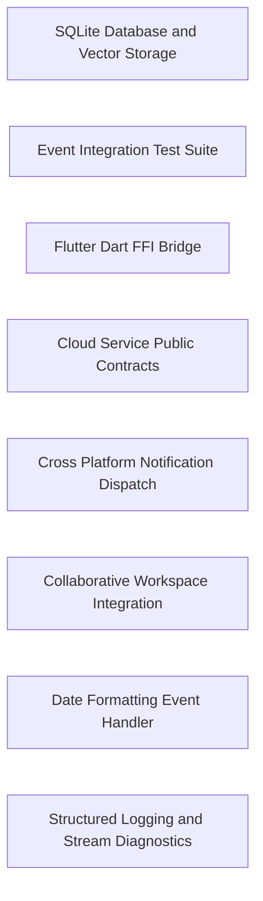

## Details

Provides Dart FFI bindings, SQLite and vector database persistence, notification broadcasting, and collaboration runtime integrations.

### SQLite Database and Vector Storage
Manages relational database connections, schema migrations, and vector similarity search extensions using SQLite.

**Related Classes/Methods**:

- `frontend.rust-lib.flowy-sqlite.src.init`:32-45
- `frontend.rust-lib.flowy-sqlite.src.sqlite_impl.database.Database`:11-14
- `frontend.rust-lib.flowy-sqlite-vec.src.init_sqlite_vector_extension`:9-13

**Source Files:**

- `frontend/rust-lib/flowy-sqlite-vec/src/db.rs`
  - `frontend.rust-lib.flowy-sqlite-vec.src.db.VectorSqliteDB` (L18-L20) - Struct
  - `frontend.rust-lib.flowy-sqlite-vec.src.db.VectorSqliteDB.new` (L23-L48) - Function
  - `frontend.rust-lib.flowy-sqlite-vec.src.db.VectorSqliteDB.select_collabs_fragment_ids` (L50-L91) - Method
  - `frontend.rust-lib.flowy-sqlite-vec.src.db.VectorSqliteDB.delete_collab` (L93-L112) - Method
  - `frontend.rust-lib.flowy-sqlite-vec.src.db.VectorSqliteDB.select_all_embedded_content` (L114-L161) - Method
  - `frontend.rust-lib.flowy-sqlite-vec.src.db.VectorSqliteDB.select_all_embedded_documents` (L163-L246) - Method
  - `frontend.rust-lib.flowy-sqlite-vec.src.db.VectorSqliteDB.upsert_collabs_embeddings` (L250-L377) - Method
  - `frontend.rust-lib.flowy-sqlite-vec.src.db.VectorSqliteDB.search` (L379-L389) - Method
  - `frontend.rust-lib.flowy-sqlite-vec.src.db.VectorSqliteDB.search_with_score` (L391-L410) - Method
  - `frontend.rust-lib.flowy-sqlite-vec.src.db.VectorSqliteDB.search_without_object_ids` (L412-L457) - Method
  - `frontend.rust-lib.flowy-sqlite-vec.src.db.VectorSqliteDB.search_with_object_ids` (L459-L515) - Method
  - `frontend.rust-lib.flowy-sqlite-vec.src.db.VectorSqliteDB.process_search_results` (L518-L547) - Method
  - `frontend.rust-lib.flowy-sqlite-vec.src.db.VectorSqliteDB.delete_pending_indexed_collab` (L549-L592) - Method
  - `frontend.rust-lib.flowy-sqlite-vec.src.db.VectorSqliteDB.queue_pending_indexed_collab` (L594-L596) - Method
  - `frontend.rust-lib.flowy-sqlite-vec.src.db.VectorSqliteDB.batch_queue_pending_indexed_collabs` (L599-L637) - Method
- `frontend/rust-lib/flowy-sqlite-vec/src/entities.rs`
  - `frontend.rust-lib.flowy-sqlite-vec.src.entities.PendingIndexedCollab` (L4-L9) - Struct
  - `frontend.rust-lib.flowy-sqlite-vec.src.entities.SqliteEmbeddedDocument` (L12-L16) - Struct
  - `frontend.rust-lib.flowy-sqlite-vec.src.entities.SqliteEmbeddedFragment` (L19-L22) - Struct
  - `frontend.rust-lib.flowy-sqlite-vec.src.entities.EmbeddedContent` (L25-L28) - Struct
- `frontend/rust-lib/flowy-sqlite-vec/src/lib.rs`
  - `frontend.rust-lib.flowy-sqlite-vec.src.init_sqlite_vector_extension` (L9-L13) - Function
- `frontend/rust-lib/flowy-sqlite-vec/src/migration.rs`
  - `frontend.rust-lib.flowy-sqlite-vec.src.migration.init_sqlite_with_migrations` (L12-L17) - Function
- `frontend/rust-lib/flowy-sqlite/src/kv/kv.rs`
  - `frontend.rust-lib.flowy-sqlite.src.kv.kv.KVStorePreferences` (L17-L19) - Struct
  - `frontend.rust-lib.flowy-sqlite.src.kv.kv.KVStorePreferences.new` (L22-L36) - Function
  - `frontend.rust-lib.flowy-sqlite.src.kv.kv.KVStorePreferences.set_str` (L39-L41) - Method
  - `frontend.rust-lib.flowy-sqlite.src.kv.kv.KVStorePreferences.set_bool` (L44-L46) - Method
  - `frontend.rust-lib.flowy-sqlite.src.kv.kv.KVStorePreferences.set_object` (L49-L53) - Method
  - `frontend.rust-lib.flowy-sqlite.src.kv.kv.KVStorePreferences.set_i64` (L56-L58) - Method
  - `frontend.rust-lib.flowy-sqlite.src.kv.kv.KVStorePreferences.get_str` (L61-L63) - Method
  - `frontend.rust-lib.flowy-sqlite.src.kv.kv.KVStorePreferences.get_bool_or_default` (L66-L72) - Method
  - `frontend.rust-lib.flowy-sqlite.src.kv.kv.KVStorePreferences.get_bool` (L74-L79) - Method
  - `frontend.rust-lib.flowy-sqlite.src.kv.kv.KVStorePreferences.get_i64` (L82-L87) - Method
  - `frontend.rust-lib.flowy-sqlite.src.kv.kv.KVStorePreferences.get_object` (L90-L94) - Method
  - `frontend.rust-lib.flowy-sqlite.src.kv.kv.KVStorePreferences.remove` (L96-L105) - Method
  - `frontend.rust-lib.flowy-sqlite.src.kv.kv.KVStorePreferences.set_key_value` (L107-L124) - Method
  - `frontend.rust-lib.flowy-sqlite.src.kv.kv.KVStorePreferences.get_key_value` (L126-L132) - Method
  - `frontend.rust-lib.flowy-sqlite.src.kv.kv.KeyValue` (L138-L141) - Struct
  - `frontend.rust-lib.flowy-sqlite.src.kv.kv.tests.Person` (L151-L154) - Struct
  - `frontend.rust-lib.flowy-sqlite.src.kv.kv.tests.kv_store_test` (L157-L180) - Function
- `frontend/rust-lib/flowy-sqlite/src/lib.rs`
  - `frontend.rust-lib.flowy-sqlite.src.init` (L32-L45) - Function
  - `frontend.rust-lib.flowy-sqlite.src.as_io_error` (L47-L53) - Function
- `frontend/rust-lib/flowy-sqlite/src/sqlite_impl/conn_ext.rs`
  - `frontend.rust-lib.flowy-sqlite.src.sqlite_impl.conn_ext.ConnectionExtension` (L8-L15) - Interface
  - `frontend.rust-lib.flowy-sqlite.src.sqlite_impl.conn_ext.ConnectionExtension.query` (L9-L12) - Method
  - `frontend.rust-lib.flowy-sqlite.src.sqlite_impl.conn_ext.ConnectionExtension.exec` (L14-L14) - Method
  - `frontend.rust-lib.flowy-sqlite.src.sqlite_impl.conn_ext.SqliteConnection.query` (L18-L24) - Method
  - `frontend.rust-lib.flowy-sqlite.src.sqlite_impl.conn_ext.SqliteConnection.exec` (L26-L28) - Method
- `frontend/rust-lib/flowy-sqlite/src/sqlite_impl/database.rs`
  - `frontend.rust-lib.flowy-sqlite.src.sqlite_impl.database.Database` (L11-L14) - Struct
  - `frontend.rust-lib.flowy-sqlite.src.sqlite_impl.database.Database.new` (L19-L31) - Function
  - `frontend.rust-lib.flowy-sqlite.src.sqlite_impl.database.Database.get_uri` (L33-L35) - Method
  - `frontend.rust-lib.flowy-sqlite.src.sqlite_impl.database.Database.get_connection` (L37-L40) - Method
  - `frontend.rust-lib.flowy-sqlite.src.sqlite_impl.database.Database.get_pool` (L42-L44) - Method
  - `frontend.rust-lib.flowy-sqlite.src.sqlite_impl.database.db_file_uri` (L47-L56) - Function
- `frontend/rust-lib/flowy-sqlite/src/sqlite_impl/errors.rs`
  - `frontend.rust-lib.flowy-sqlite.src.sqlite_impl.errors.Error` (L2-L13) - Enum
- `frontend/rust-lib/flowy-sqlite/src/sqlite_impl/pool.rs`
  - `frontend.rust-lib.flowy-sqlite.src.sqlite_impl.pool.ConnectionPool` (L9-L11) - Struct
  - `frontend.rust-lib.flowy-sqlite.src.sqlite_impl.pool.ConnectionPool.deref` (L16-L18) - Method
  - `frontend.rust-lib.flowy-sqlite.src.sqlite_impl.pool.ConnectionPool.new` (L22-L46) - Function
  - `frontend.rust-lib.flowy-sqlite.src.sqlite_impl.pool.PoolConfig` (L52-L57) - Struct
  - `frontend.rust-lib.flowy-sqlite.src.sqlite_impl.pool.PoolConfig.default` (L60-L67) - Function
  - `frontend.rust-lib.flowy-sqlite.src.sqlite_impl.pool.PoolConfig.min_idle` (L72-L75) - Method
  - `frontend.rust-lib.flowy-sqlite.src.sqlite_impl.pool.PoolConfig.max_size` (L78-L81) - Method
  - `frontend.rust-lib.flowy-sqlite.src.sqlite_impl.pool.ConnectionManager` (L84-L86) - Struct
  - `frontend.rust-lib.flowy-sqlite.src.sqlite_impl.pool.ConnectionManager.connect` (L92-L94) - Method
  - `frontend.rust-lib.flowy-sqlite.src.sqlite_impl.pool.ConnectionManager.is_valid` (L96-L98) - Method
  - `frontend.rust-lib.flowy-sqlite.src.sqlite_impl.pool.ConnectionManager.has_broken` (L100-L102) - Method
  - `frontend.rust-lib.flowy-sqlite.src.sqlite_impl.pool.ConnectionManager.new` (L106-L108) - Function
  - `frontend.rust-lib.flowy-sqlite.src.sqlite_impl.pool.DatabaseCustomizerConfig` (L112-L118) - Struct
  - `frontend.rust-lib.flowy-sqlite.src.sqlite_impl.pool.DatabaseCustomizerConfig.default` (L121-L128) - Function
  - `frontend.rust-lib.flowy-sqlite.src.sqlite_impl.pool.DatabaseCustomizer` (L132-L134) - Struct
  - `frontend.rust-lib.flowy-sqlite.src.sqlite_impl.pool.DatabaseCustomizer.new` (L137-L142) - Function
  - `frontend.rust-lib.flowy-sqlite.src.sqlite_impl.pool.DatabaseCustomizer.on_acquire` (L146-L154) - Method
- `frontend/rust-lib/flowy-sqlite/src/sqlite_impl/pragma.rs`
  - `frontend.rust-lib.flowy-sqlite.src.sqlite_impl.pragma.PragmaExtension` (L20-L108) - Interface
  - `frontend.rust-lib.flowy-sqlite.src.sqlite_impl.pragma.PragmaExtension.pragma` (L21-L34) - Method
  - `frontend.rust-lib.flowy-sqlite.src.sqlite_impl.pragma.PragmaExtension.pragma_ret` (L36-L52) - Method
  - `frontend.rust-lib.flowy-sqlite.src.sqlite_impl.pragma.PragmaExtension.pragma_get` (L55-L66) - Method
  - `frontend.rust-lib.flowy-sqlite.src.sqlite_impl.pragma.PragmaExtension.pragma_set_busy_timeout` (L69-L71) - Method
  - `frontend.rust-lib.flowy-sqlite.src.sqlite_impl.pragma.PragmaExtension.pragma_get_busy_timeout` (L74-L76) - Method
  - `frontend.rust-lib.flowy-sqlite.src.sqlite_impl.pragma.PragmaExtension.pragma_set_journal_mode` (L78-L84) - Method
  - `frontend.rust-lib.flowy-sqlite.src.sqlite_impl.pragma.PragmaExtension.pragma_get_journal_mode` (L87-L91) - Method
  - `frontend.rust-lib.flowy-sqlite.src.sqlite_impl.pragma.PragmaExtension.pragma_set_synchronous` (L94-L100) - Method
  - `frontend.rust-lib.flowy-sqlite.src.sqlite_impl.pragma.PragmaExtension.pragma_get_synchronous` (L103-L107) - Method
  - `frontend.rust-lib.flowy-sqlite.src.sqlite_impl.pragma.SQLiteJournalMode` (L112-L119) - Enum
  - `frontend.rust-lib.flowy-sqlite.src.sqlite_impl.pragma.SQLiteJournalMode.fmt` (L122-L135) - Method
  - `frontend.rust-lib.flowy-sqlite.src.sqlite_impl.pragma.SQLiteJournalMode.from_str` (L141-L151) - Function
  - `frontend.rust-lib.flowy-sqlite.src.sqlite_impl.pragma.SQLiteSynchronous` (L155-L160) - Enum
  - `frontend.rust-lib.flowy-sqlite.src.sqlite_impl.pragma.SQLiteSynchronous.fmt` (L163-L174) - Method
  - `frontend.rust-lib.flowy-sqlite.src.sqlite_impl.pragma.SQLiteSynchronous.try_from` (L180-L188) - Function
  - `frontend.rust-lib.flowy-sqlite.src.sqlite_impl.pragma.SQLiteSynchronous.from_str` (L194-L202) - Function

### Event Integration Test Suite
Executes end-to-end integration test scenarios across user, document, folder, and database events.

**Related Classes/Methods**:

- `frontend.rust-lib.event-integration-test.src.event_builder.EventBuilder`:15-18

**Source Files:**

- `frontend/rust-lib/event-integration-test/src/chat_event.rs`
  - `frontend.rust-lib.event-integration-test.src.chat_event.EventIntegrationTest.create_chat` (L12-L32) - Method
  - `frontend.rust-lib.event-integration-test.src.chat_event.EventIntegrationTest.set_chat_rag_ids` (L34-L46) - Method
  - `frontend.rust-lib.event-integration-test.src.chat_event.EventIntegrationTest.send_message` (L48-L69) - Method
  - `frontend.rust-lib.event-integration-test.src.chat_event.EventIntegrationTest.load_prev_message` (L71-L88) - Method
  - `frontend.rust-lib.event-integration-test.src.chat_event.EventIntegrationTest.load_next_message` (L90-L107) - Method
  - `frontend.rust-lib.event-integration-test.src.chat_event.EventIntegrationTest.toggle_local_ai` (L109-L114) - Method
- `frontend/rust-lib/event-integration-test/src/database_event.rs`
  - `frontend.rust-lib.event-integration-test.src.database_event.EventIntegrationTest.get_database_export_data` (L24-L34) - Method
  - `frontend.rust-lib.event-integration-test.src.database_event.EventIntegrationTest.create_grid` (L37-L57) - Method
  - `frontend.rust-lib.event-integration-test.src.database_event.EventIntegrationTest.open_database` (L59-L68) - Method
  - `frontend.rust-lib.event-integration-test.src.database_event.EventIntegrationTest.create_board` (L70-L90) - Method
  - `frontend.rust-lib.event-integration-test.src.database_event.EventIntegrationTest.create_calendar` (L92-L117) - Method
  - `frontend.rust-lib.event-integration-test.src.database_event.EventIntegrationTest.get_database` (L119-L128) - Method
  - `frontend.rust-lib.event-integration-test.src.database_event.EventIntegrationTest.get_all_database_fields` (L130-L140) - Method
  - `frontend.rust-lib.event-integration-test.src.database_event.EventIntegrationTest.create_field` (L142-L153) - Method
  - `frontend.rust-lib.event-integration-test.src.database_event.EventIntegrationTest.update_field` (L155-L161) - Method
  - `frontend.rust-lib.event-integration-test.src.database_event.EventIntegrationTest.delete_field` (L163-L173) - Method
  - `frontend.rust-lib.event-integration-test.src.database_event.EventIntegrationTest.remove_calculate` (L175-L185) - Method
  - `frontend.rust-lib.event-integration-test.src.database_event.EventIntegrationTest.get_all_calculations` (L187-L196) - Method
  - `frontend.rust-lib.event-integration-test.src.database_event.EventIntegrationTest.update_calculation` (L198-L208) - Method
  - `frontend.rust-lib.event-integration-test.src.database_event.EventIntegrationTest.update_field_type` (L210-L227) - Method
  - `frontend.rust-lib.event-integration-test.src.database_event.EventIntegrationTest.duplicate_field` (L229-L239) - Method
  - `frontend.rust-lib.event-integration-test.src.database_event.EventIntegrationTest.get_primary_field` (L241-L250) - Method
  - `frontend.rust-lib.event-integration-test.src.database_event.EventIntegrationTest.summary_row` (L251-L257) - Method
  - `frontend.rust-lib.event-integration-test.src.database_event.EventIntegrationTest.translate_row` (L259-L265) - Method
  - `frontend.rust-lib.event-integration-test.src.database_event.EventIntegrationTest.create_row` (L267-L284) - Method
  - `frontend.rust-lib.event-integration-test.src.database_event.EventIntegrationTest.delete_row` (L286-L296) - Method
  - `frontend.rust-lib.event-integration-test.src.database_event.EventIntegrationTest.get_row` (L298-L309) - Method
  - `frontend.rust-lib.event-integration-test.src.database_event.EventIntegrationTest.get_row_meta` (L311-L322) - Method
  - `frontend.rust-lib.event-integration-test.src.database_event.EventIntegrationTest.update_row_meta` (L324-L331) - Method
  - `frontend.rust-lib.event-integration-test.src.database_event.EventIntegrationTest.duplicate_row` (L333-L344) - Method
  - `frontend.rust-lib.event-integration-test.src.database_event.EventIntegrationTest.move_row` (L346-L357) - Method
  - `frontend.rust-lib.event-integration-test.src.database_event.EventIntegrationTest.update_cell` (L359-L366) - Method
  - `frontend.rust-lib.event-integration-test.src.database_event.EventIntegrationTest.update_date_cell` (L368-L375) - Method
  - `frontend.rust-lib.event-integration-test.src.database_event.EventIntegrationTest.get_cell` (L377-L388) - Method
  - `frontend.rust-lib.event-integration-test.src.database_event.EventIntegrationTest.get_text_cell` (L390-L393) - Method
  - `frontend.rust-lib.event-integration-test.src.database_event.EventIntegrationTest.get_date_cell` (L395-L398) - Method
  - `frontend.rust-lib.event-integration-test.src.database_event.EventIntegrationTest.get_checklist_cell` (L400-L408) - Method
  - `frontend.rust-lib.event-integration-test.src.database_event.EventIntegrationTest.get_relation_cell` (L410-L418) - Method
  - `frontend.rust-lib.event-integration-test.src.database_event.EventIntegrationTest.update_checklist_cell` (L420-L430) - Method
  - `frontend.rust-lib.event-integration-test.src.database_event.EventIntegrationTest.insert_option` (L432-L461) - Method
  - `frontend.rust-lib.event-integration-test.src.database_event.EventIntegrationTest.get_groups` (L463-L473) - Method
  - `frontend.rust-lib.event-integration-test.src.database_event.EventIntegrationTest.move_group` (L475-L486) - Method
  - `frontend.rust-lib.event-integration-test.src.database_event.EventIntegrationTest.set_group_by_field` (L488-L504) - Method
  - `frontend.rust-lib.event-integration-test.src.database_event.EventIntegrationTest.update_group` (L506-L524) - Method
  - `frontend.rust-lib.event-integration-test.src.database_event.EventIntegrationTest.delete_group` (L526-L536) - Method
  - `frontend.rust-lib.event-integration-test.src.database_event.EventIntegrationTest.update_setting` (L538-L545) - Method
  - `frontend.rust-lib.event-integration-test.src.database_event.EventIntegrationTest.get_all_calendar_events` (L547-L557) - Method
  - `frontend.rust-lib.event-integration-test.src.database_event.EventIntegrationTest.update_relation_cell` (L559-L569) - Method
  - `frontend.rust-lib.event-integration-test.src.database_event.EventIntegrationTest.get_related_row_data` (L571-L586) - Method
  - `frontend.rust-lib.event-integration-test.src.database_event.TestRowBuilder` (L589-L594) - Struct
  - `frontend.rust-lib.event-integration-test.src.database_event.TestRowBuilder.new` (L597-L605) - Function
  - `frontend.rust-lib.event-integration-test.src.database_event.TestRowBuilder.insert_text_cell` (L607-L614) - Method
  - `frontend.rust-lib.event-integration-test.src.database_event.TestRowBuilder.insert_number_cell` (L616-L622) - Method
  - `frontend.rust-lib.event-integration-test.src.database_event.TestRowBuilder.insert_date_cell` (L624-L635) - Method
  - `frontend.rust-lib.event-integration-test.src.database_event.TestRowBuilder.insert_checkbox_cell` (L637-L644) - Method
  - `frontend.rust-lib.event-integration-test.src.database_event.TestRowBuilder.insert_url_cell` (L646-L652) - Method
  - `frontend.rust-lib.event-integration-test.src.database_event.TestRowBuilder.insert_single_select_cell` (L654-L669) - Method
  - `frontend.rust-lib.event-integration-test.src.database_event.TestRowBuilder.insert_multi_select_cell` (L671-L690) - Method
  - `frontend.rust-lib.event-integration-test.src.database_event.TestRowBuilder.insert_checklist_cell` (L692-L698) - Method
  - `frontend.rust-lib.event-integration-test.src.database_event.TestRowBuilder.insert_time_cell` (L700-L704) - Method
  - `frontend.rust-lib.event-integration-test.src.database_event.TestRowBuilder.insert_media_cell` (L706-L710) - Method
  - `frontend.rust-lib.event-integration-test.src.database_event.TestRowBuilder.field_with_type` (L712-L722) - Method
  - `frontend.rust-lib.event-integration-test.src.database_event.TestRowBuilder.build` (L724-L735) - Method
- `frontend/rust-lib/event-integration-test/src/document/document_event.rs`
  - `frontend.rust-lib.event-integration-test.src.document.document_event.DocumentEventTest` (L21-L23) - Struct
  - `frontend.rust-lib.event-integration-test.src.document.document_event.OpenDocumentData` (L25-L28) - Struct
  - `frontend.rust-lib.event-integration-test.src.document.document_event.DocumentEventTest.new` (L31-L34) - Function
  - `frontend.rust-lib.event-integration-test.src.document.document_event.DocumentEventTest.new_with_core` (L36-L38) - Function
  - `frontend.rust-lib.event-integration-test.src.document.document_event.DocumentEventTest.get_encoded_v1` (L40-L50) - Method
  - `frontend.rust-lib.event-integration-test.src.document.document_event.DocumentEventTest.get_encoded_collab` (L52-L63) - Method
  - `frontend.rust-lib.event-integration-test.src.document.document_event.DocumentEventTest.create_document` (L65-L89) - Method
  - `frontend.rust-lib.event-integration-test.src.document.document_event.DocumentEventTest.open_document` (L91-L93) - Method
  - `frontend.rust-lib.event-integration-test.src.document.document_event.DocumentEventTest.get_block` (L95-L98) - Method
  - `frontend.rust-lib.event-integration-test.src.document.document_event.DocumentEventTest.get_page_id` (L100-L103) - Method
  - `frontend.rust-lib.event-integration-test.src.document.document_event.DocumentEventTest.get_document_data` (L105-L108) - Method
  - `frontend.rust-lib.event-integration-test.src.document.document_event.DocumentEventTest.get_block_children` (L110-L117) - Method
  - `frontend.rust-lib.event-integration-test.src.document.document_event.DocumentEventTest.get_text_id` (L119-L122) - Method
  - `frontend.rust-lib.event-integration-test.src.document.document_event.DocumentEventTest.get_delta` (L124-L127) - Method
  - `frontend.rust-lib.event-integration-test.src.document.document_event.DocumentEventTest.apply_actions` (L129-L136) - Method
  - `frontend.rust-lib.event-integration-test.src.document.document_event.DocumentEventTest.convert_document` (L138-L149) - Method
  - `frontend.rust-lib.event-integration-test.src.document.document_event.DocumentEventTest.convert_data_to_json` (L152-L163) - Method
  - `frontend.rust-lib.event-integration-test.src.document.document_event.DocumentEventTest.create_text` (L165-L172) - Method
  - `frontend.rust-lib.event-integration-test.src.document.document_event.DocumentEventTest.apply_text_delta` (L174-L181) - Method
  - `frontend.rust-lib.event-integration-test.src.document.document_event.DocumentEventTest.undo` (L183-L194) - Method
  - `frontend.rust-lib.event-integration-test.src.document.document_event.DocumentEventTest.redo` (L196-L207) - Method
  - `frontend.rust-lib.event-integration-test.src.document.document_event.DocumentEventTest.can_undo_redo` (L209-L220) - Method
  - `frontend.rust-lib.event-integration-test.src.document.document_event.DocumentEventTest.apply_delta_for_block` (L222-L233) - Method
  - `frontend.rust-lib.event-integration-test.src.document.document_event.DocumentEventTest.get_document_snapshot_metas` (L235-L247) - Method
  - `frontend.rust-lib.event-integration-test.src.document.document_event.DocumentEventTest.get_document_snapshot` (L249-L260) - Method
  - `frontend.rust-lib.event-integration-test.src.document.document_event.DocumentEventTest.insert_index` (L264-L333) - Method
  - `frontend.rust-lib.event-integration-test.src.document.document_event.DocumentEventTest.update_data` (L335-L358) - Method
  - `frontend.rust-lib.event-integration-test.src.document.document_event.DocumentEventTest.delete` (L360-L378) - Method
- `frontend/rust-lib/event-integration-test/src/document/utils.rs`
  - `frontend.rust-lib.event-integration-test.src.document.utils.gen_id` (L7-L9) - Function
  - `frontend.rust-lib.event-integration-test.src.document.utils.gen_text_block_data` (L11-L13) - Function
  - `frontend.rust-lib.event-integration-test.src.document.utils.gen_delta_str` (L15-L17) - Function
  - `frontend.rust-lib.event-integration-test.src.document.utils.ParseDocumentData` (L19-L25) - Struct
  - `frontend.rust-lib.event-integration-test.src.document.utils.parse_document_data` (L26-L43) - Function
  - `frontend.rust-lib.event-integration-test.src.document.utils.gen_insert_block_action` (L45-L71) - Function
- `frontend/rust-lib/event-integration-test/src/document_event.rs`
  - `frontend.rust-lib.event-integration-test.src.document_event.EventIntegrationTest.create_document` (L18-L23) - Method
  - `frontend.rust-lib.event-integration-test.src.document_event.EventIntegrationTest.create_and_open_document` (L25-L63) - Method
  - `frontend.rust-lib.event-integration-test.src.document_event.EventIntegrationTest.open_document` (L65-L76) - Method
  - `frontend.rust-lib.event-integration-test.src.document_event.EventIntegrationTest.insert_document_text` (L77-L82) - Method
  - `frontend.rust-lib.event-integration-test.src.document_event.EventIntegrationTest.get_document_data` (L84-L95) - Method
  - `frontend.rust-lib.event-integration-test.src.document_event.EventIntegrationTest.get_document_doc_state` (L97-L102) - Method
  - `frontend.rust-lib.event-integration-test.src.document_event.assert_document_data_equal` (L105-L115) - Function
- `frontend/rust-lib/event-integration-test/src/event_builder.rs`
  - `frontend.rust-lib.event-integration-test.src.event_builder.EventBuilder` (L15-L18) - Struct
  - `frontend.rust-lib.event-integration-test.src.event_builder.EventBuilder.new` (L21-L26) - Function
  - `frontend.rust-lib.event-integration-test.src.event_builder.EventBuilder.payload` (L28-L42) - Method
  - `frontend.rust-lib.event-integration-test.src.event_builder.EventBuilder.event` (L44-L50) - Method
  - `frontend.rust-lib.event-integration-test.src.event_builder.EventBuilder.async_send` (L52-L63) - Method
  - `frontend.rust-lib.event-integration-test.src.event_builder.EventBuilder.parse_or_panic` (L65-L79) - Method
  - `frontend.rust-lib.event-integration-test.src.event_builder.EventBuilder.parse` (L81-L93) - Method
  - `frontend.rust-lib.event-integration-test.src.event_builder.EventBuilder.try_parse` (L95-L101) - Method
  - `frontend.rust-lib.event-integration-test.src.event_builder.EventBuilder.error` (L103-L108) - Method
  - `frontend.rust-lib.event-integration-test.src.event_builder.EventBuilder.dispatch` (L110-L112) - Method
  - `frontend.rust-lib.event-integration-test.src.event_builder.EventBuilder.get_response` (L114-L121) - Method
  - `frontend.rust-lib.event-integration-test.src.event_builder.EventBuilder.get_request` (L123-L125) - Method
  - `frontend.rust-lib.event-integration-test.src.event_builder.TestContext` (L129-L133) - Struct
  - `frontend.rust-lib.event-integration-test.src.event_builder.TestContext.new` (L136-L142) - Function
- `frontend/rust-lib/event-integration-test/src/folder_event.rs`
  - `frontend.rust-lib.event-integration-test.src.folder_event.EventIntegrationTest.invite_workspace_member` (L26-L36) - Method
  - `frontend.rust-lib.event-integration-test.src.folder_event.EventIntegrationTest.add_workspace_member` (L39-L56) - Method
  - `frontend.rust-lib.event-integration-test.src.folder_event.EventIntegrationTest.list_workspace_invitations` (L58-L64) - Method
  - `frontend.rust-lib.event-integration-test.src.folder_event.EventIntegrationTest.accept_workspace_invitation` (L66-L78) - Method
  - `frontend.rust-lib.event-integration-test.src.folder_event.EventIntegrationTest.delete_workspace_member` (L80-L93) - Method
  - `frontend.rust-lib.event-integration-test.src.folder_event.EventIntegrationTest.get_workspace_members` (L95-L105) - Method
  - `frontend.rust-lib.event-integration-test.src.folder_event.EventIntegrationTest.get_current_workspace` (L107-L113) - Method
  - `frontend.rust-lib.event-integration-test.src.folder_event.EventIntegrationTest.get_workspace_id` (L115-L122) - Method
  - `frontend.rust-lib.event-integration-test.src.folder_event.EventIntegrationTest.get_user_workspace` (L124-L134) - Method
  - `frontend.rust-lib.event-integration-test.src.folder_event.EventIntegrationTest.get_folder_search_handler` (L136-L142) - Method
  - `frontend.rust-lib.event-integration-test.src.folder_event.EventIntegrationTest.create_views` (L145-L171) - Method
  - `frontend.rust-lib.event-integration-test.src.folder_event.EventIntegrationTest.create_orphan_view` (L176-L188) - Method
  - `frontend.rust-lib.event-integration-test.src.folder_event.EventIntegrationTest.get_folder_data` (L190-L197) - Method
  - `frontend.rust-lib.event-integration-test.src.folder_event.EventIntegrationTest.get_publish_payload` (L199-L214) - Method
  - `frontend.rust-lib.event-integration-test.src.folder_event.EventIntegrationTest.gather_encode_collab_from_disk` (L216-L227) - Method
  - `frontend.rust-lib.event-integration-test.src.folder_event.EventIntegrationTest.get_all_workspace_views` (L229-L236) - Method
  - `frontend.rust-lib.event-integration-test.src.folder_event.EventIntegrationTest.get_all_views` (L239-L246) - Method
  - `frontend.rust-lib.event-integration-test.src.folder_event.EventIntegrationTest.get_trash` (L248-L254) - Method
  - `frontend.rust-lib.event-integration-test.src.folder_event.EventIntegrationTest.delete_view` (L256-L271) - Method
  - `frontend.rust-lib.event-integration-test.src.folder_event.EventIntegrationTest.update_view` (L273-L281) - Method
  - `frontend.rust-lib.event-integration-test.src.folder_event.EventIntegrationTest.update_view_icon` (L283-L290) - Method
  - `frontend.rust-lib.event-integration-test.src.folder_event.EventIntegrationTest.create_view` (L292-L296) - Method
  - `frontend.rust-lib.event-integration-test.src.folder_event.EventIntegrationTest.create_view_with_layout` (L298-L323) - Method
  - `frontend.rust-lib.event-integration-test.src.folder_event.EventIntegrationTest.get_view` (L325-L334) - Method
  - `frontend.rust-lib.event-integration-test.src.folder_event.EventIntegrationTest.import_data` (L336-L343) - Method
  - `frontend.rust-lib.event-integration-test.src.folder_event.EventIntegrationTest.get_view_ancestors` (L345-L355) - Method
  - `frontend.rust-lib.event-integration-test.src.folder_event.ViewTest` (L358-L362) - Struct
  - `frontend.rust-lib.event-integration-test.src.folder_event.ViewTest.new` (L365-L394) - Function
  - `frontend.rust-lib.event-integration-test.src.folder_event.ViewTest.new_grid_view` (L396-L398) - Function
  - `frontend.rust-lib.event-integration-test.src.folder_event.ViewTest.new_board_view` (L400-L402) - Function
  - `frontend.rust-lib.event-integration-test.src.folder_event.ViewTest.new_calendar_view` (L404-L406) - Function
- `frontend/rust-lib/event-integration-test/src/lib.rs`
  - `frontend.rust-lib.event-integration-test.src.EventIntegrationTest` (L36-L43) - Struct
  - `frontend.rust-lib.event-integration-test.src.EventIntegrationTest.new` (L48-L50) - Function
  - `frontend.rust-lib.event-integration-test.src.EventIntegrationTest.new_with_name` (L52-L56) - Function
  - `frontend.rust-lib.event-integration-test.src.EventIntegrationTest.new_with_config` (L58-L75) - Function
  - `frontend.rust-lib.event-integration-test.src.EventIntegrationTest.new_with_user_data_path` (L77-L101) - Function
  - `frontend.rust-lib.event-integration-test.src.EventIntegrationTest.skip_auto_remove_temp_dir` (L103-L105) - Method
  - `frontend.rust-lib.event-integration-test.src.EventIntegrationTest.instance_name` (L107-L109) - Method
  - `frontend.rust-lib.event-integration-test.src.EventIntegrationTest.user_data_path` (L111-L113) - Method
  - `frontend.rust-lib.event-integration-test.src.EventIntegrationTest.wait_ws_connected` (L115-L148) - Method
  - `frontend.rust-lib.event-integration-test.src.EventIntegrationTest.get_collab_doc_state` (L150-L171) - Method
  - `frontend.rust-lib.event-integration-test.src.document_data_from_document_doc_state` (L174-L178) - Function
  - `frontend.rust-lib.event-integration-test.src.document_from_document_doc_state` (L180-L190) - Function
  - `frontend.rust-lib.event-integration-test.src.init_core` (L192-L196) - Function
  - `frontend.rust-lib.event-integration-test.src.EventIntegrationTest.deref` (L201-L203) - Method
  - `frontend.rust-lib.event-integration-test.src.Cleaner` (L206-L209) - Struct
  - `frontend.rust-lib.event-integration-test.src.Cleaner.new` (L212-L217) - Function
  - `frontend.rust-lib.event-integration-test.src.Cleaner.cleanup` (L219-L221) - Function
  - `frontend.rust-lib.event-integration-test.src.Cleaner.drop` (L225-L229) - Method
- `frontend/rust-lib/event-integration-test/src/user_event.rs`
  - `frontend.rust-lib.event-integration-test.src.user_event.EventIntegrationTest.enable_encryption` (L33-L51) - Method
  - `frontend.rust-lib.event-integration-test.src.user_event.EventIntegrationTest.new_anon` (L54-L58) - Function
  - `frontend.rust-lib.event-integration-test.src.user_event.EventIntegrationTest.sign_up_as_anon` (L60-L90) - Method
  - `frontend.rust-lib.event-integration-test.src.user_event.EventIntegrationTest.af_cloud_sign_up` (L92-L106) - Method
  - `frontend.rust-lib.event-integration-test.src.user_event.EventIntegrationTest.sign_out` (L108-L113) - Method
  - `frontend.rust-lib.event-integration-test.src.user_event.EventIntegrationTest.set_auth_type` (L115-L117) - Method
  - `frontend.rust-lib.event-integration-test.src.user_event.EventIntegrationTest.init_anon_user` (L119-L121) - Method
  - `frontend.rust-lib.event-integration-test.src.user_event.EventIntegrationTest.get_user_profile` (L123-L129) - Method
  - `frontend.rust-lib.event-integration-test.src.user_event.EventIntegrationTest.update_user_profile` (L131-L137) - Method
  - `frontend.rust-lib.event-integration-test.src.user_event.EventIntegrationTest.af_cloud_sign_in_with_email` (L139-L168) - Method
  - `frontend.rust-lib.event-integration-test.src.user_event.EventIntegrationTest.import_appflowy_data` (L170-L190) - Method
  - `frontend.rust-lib.event-integration-test.src.user_event.EventIntegrationTest.create_workspace` (L192-L207) - Method
  - `frontend.rust-lib.event-integration-test.src.user_event.EventIntegrationTest.rename_workspace` (L209-L228) - Method
  - `frontend.rust-lib.event-integration-test.src.user_event.EventIntegrationTest.change_workspace_icon` (L230-L249) - Method
  - `frontend.rust-lib.event-integration-test.src.user_event.EventIntegrationTest.folder_read_current_workspace` (L251-L257) - Method
  - `frontend.rust-lib.event-integration-test.src.user_event.EventIntegrationTest.folder_read_current_workspace_views` (L259-L265) - Method
  - `frontend.rust-lib.event-integration-test.src.user_event.EventIntegrationTest.get_all_workspaces` (L267-L273) - Method
  - `frontend.rust-lib.event-integration-test.src.user_event.EventIntegrationTest.delete_workspace` (L275-L284) - Method
  - `frontend.rust-lib.event-integration-test.src.user_event.EventIntegrationTest.open_workspace` (L286-L296) - Method
  - `frontend.rust-lib.event-integration-test.src.user_event.EventIntegrationTest.leave_workspace` (L298-L307) - Method
  - `frontend.rust-lib.event-integration-test.src.user_event.TestNotificationSender` (L311-L313) - Struct
  - `frontend.rust-lib.event-integration-test.src.user_event.TestNotificationSender.default` (L316-L321) - Function
  - `frontend.rust-lib.event-integration-test.src.user_event.TestNotificationSender.new` (L325-L327) - Function
  - `frontend.rust-lib.event-integration-test.src.user_event.TestNotificationSender.subscribe` (L329-L359) - Method
  - `frontend.rust-lib.event-integration-test.src.user_event.TestNotificationSender.subscribe_without_payload` (L361-L379) - Method
  - `frontend.rust-lib.event-integration-test.src.user_event.TestNotificationSender.subscribe_with_condition` (L381-L403) - Method
  - `frontend.rust-lib.event-integration-test.src.user_event.TestNotificationSender.send_subject` (L406-L411) - Method
  - `frontend.rust-lib.event-integration-test.src.user_event.third_party_sign_up_param` (L414-L423) - Function
  - `frontend.rust-lib.event-integration-test.src.user_event.unique_email` (L425-L427) - Function
  - `frontend.rust-lib.event-integration-test.src.user_event.login_email` (L429-L431) - Function
  - `frontend.rust-lib.event-integration-test.src.user_event.login_password` (L433-L435) - Function
  - `frontend.rust-lib.event-integration-test.src.user_event.SignUpContext` (L436-L439) - Struct
  - `frontend.rust-lib.event-integration-test.src.user_event.use_local_mode` (L440-L443) - Function
  - `frontend.rust-lib.event-integration-test.src.user_event.use_localhost_af_cloud` (L444-L462) - Function
  - `frontend.rust-lib.event-integration-test.src.user_event.user_localhost_af_cloud_with_nginx` (L465-L470) - Function

### Flutter Dart FFI Bridge
Exposes C-compatible foreign function interface entry points and event dispatching between Flutter Dart and the Rust core.

**Related Classes/Methods**:

- `frontend.rust-lib.dart-ffi.src.init_sdk`:114-171
- `frontend.rust-lib.dart-ffi.src.async_event`:175-186
- `frontend.rust-lib.dart-ffi.src.set_stream_port`:240-244
- `frontend.rust-lib.dart-ffi.src.notification.sender.DartNotificationSender`:7-9

**Source Files:**

- `frontend/rust-lib/dart-ffi/build.rs`
  - `frontend.rust-lib.dart-ffi.build.main` (L1-L3) - Function
- `frontend/rust-lib/dart-ffi/src/appflowy_yaml.rs`
  - `frontend.rust-lib.dart-ffi.src.appflowy_yaml.AppFlowyYamlConfiguration` (L10-L12) - Struct
  - `frontend.rust-lib.dart-ffi.src.appflowy_yaml.save_appflowy_cloud_config` (L14-L30) - Function
  - `frontend.rust-lib.dart-ffi.src.appflowy_yaml.read_yaml_file` (L32-L40) - Function
  - `frontend.rust-lib.dart-ffi.src.appflowy_yaml.write_yaml_file` (L42-L54) - Function
- `frontend/rust-lib/dart-ffi/src/c.rs`
  - `frontend.rust-lib.dart-ffi.src.c.forget_rust` (L4-L8) - Function
  - `frontend.rust-lib.dart-ffi.src.c.reclaim_rust` (L12-L17) - Function
  - `frontend.rust-lib.dart-ffi.src.c.extend_front_four_bytes_into_bytes` (L19-L26) - Function
- `frontend/rust-lib/dart-ffi/src/env_serde.rs`
  - `frontend.rust-lib.dart-ffi.src.env_serde.AppFlowyDartConfiguration` (L9-L22) - Struct
  - `frontend.rust-lib.dart-ffi.src.env_serde.AppFlowyDartConfiguration.from_str` (L25-L27) - Function
  - `frontend.rust-lib.dart-ffi.src.env_serde.AppFlowyDartConfiguration.write_env` (L29-L36) - Method
- `frontend/rust-lib/dart-ffi/src/lib.rs`
  - `frontend.rust-lib.dart-ffi.src.Task` (L45-L50) - Struct
  - `frontend.rust-lib.dart-ffi.src.DartAppFlowyCore` (L55-L59) - Struct
  - `frontend.rust-lib.dart-ffi.src.DartAppFlowyCore.new` (L62-L69) - Function
  - `frontend.rust-lib.dart-ffi.src.DartAppFlowyCore.dispatcher` (L71-L78) - Method
  - `frontend.rust-lib.dart-ffi.src.DartAppFlowyCore.dispatch` (L80-L110) - Method
  - `frontend.rust-lib.dart-ffi.src.init_sdk` (L114-L171) - Function
  - `frontend.rust-lib.dart-ffi.src.async_event` (L175-L186) - Function
  - `frontend.rust-lib.dart-ffi.src.Runner` (L189-L191) - Struct
  - `frontend.rust-lib.dart-ffi.src.Runner.poll` (L196-L227) - Method
  - `frontend.rust-lib.dart-ffi.src.sync_event` (L231-L237) - Function
  - `frontend.rust-lib.dart-ffi.src.set_stream_port` (L240-L244) - Function
  - `frontend.rust-lib.dart-ffi.src.set_log_stream_port` (L247-L250) - Function
  - `frontend.rust-lib.dart-ffi.src.link_me_please` (L254-L254) - Function
  - `frontend.rust-lib.dart-ffi.src.post_to_flutter` (L258-L275) - Function
  - `frontend.rust-lib.dart-ffi.src.rust_log` (L278-L305) - Function
  - `frontend.rust-lib.dart-ffi.src.set_env` (L308-L310) - Function
  - `frontend.rust-lib.dart-ffi.src.LogStreamSenderImpl` (L312-L314) - Struct
  - `frontend.rust-lib.dart-ffi.src.LogStreamSenderImpl.send` (L316-L318) - Method
- `frontend/rust-lib/dart-ffi/src/model/ffi_request.rs`
  - `frontend.rust-lib.dart-ffi.src.model.ffi_request.FFIRequest` (L7-L13) - Struct
  - `frontend.rust-lib.dart-ffi.src.model.ffi_request.FFIRequest.from_u8_pointer` (L16-L21) - Function
  - `frontend.rust-lib.dart-ffi.src.model.ffi_request.AFPluginRequest.from` (L25-L27) - Function
- `frontend/rust-lib/dart-ffi/src/model/ffi_response.rs`
  - `frontend.rust-lib.dart-ffi.src.model.ffi_response.FFIStatusCode` (L5-L10) - Enum
  - `frontend.rust-lib.dart-ffi.src.model.ffi_response.FFIResponse` (L13-L19) - Struct
  - `frontend.rust-lib.dart-ffi.src.model.ffi_response.FFIResponse.from` (L22-L39) - Function
- `frontend/rust-lib/dart-ffi/src/notification/sender.rs`
  - `frontend.rust-lib.dart-ffi.src.notification.sender.DartNotificationSender` (L7-L9) - Struct
  - `frontend.rust-lib.dart-ffi.src.notification.sender.DartNotificationSender.new` (L12-L16) - Function
  - `frontend.rust-lib.dart-ffi.src.notification.sender.DartNotificationSender.send_subject` (L20-L24) - Method

### Cloud Service Public Contracts
Defines shared public interfaces, cloud service contracts, and authentication configuration structures.

**Related Classes/Methods**:

- `frontend.rust-lib.flowy-server-pub.src.AuthenticatorType`:36-39

**Source Files:**

- `frontend/rust-lib/flowy-database-pub/src/cloud.rs`
  - `frontend.rust-lib.flowy-database-pub.src.cloud.DatabaseAIService` (L14-L32) - Interface
  - `frontend.rust-lib.flowy-database-pub.src.cloud.DatabaseAIService.summary_database_row` (L15-L22) - Method
  - `frontend.rust-lib.flowy-database-pub.src.cloud.DatabaseAIService.translate_database_row` (L24-L31) - Method
  - `frontend.rust-lib.flowy-database-pub.src.cloud.DatabaseCloudService` (L42-L70) - Interface
  - `frontend.rust-lib.flowy-database-pub.src.cloud.DatabaseCloudService.get_database_encode_collab` (L43-L48) - Method
  - `frontend.rust-lib.flowy-database-pub.src.cloud.DatabaseCloudService.create_database_encode_collab` (L50-L56) - Method
  - `frontend.rust-lib.flowy-database-pub.src.cloud.DatabaseCloudService.batch_get_database_encode_collab` (L58-L63) - Method
  - `frontend.rust-lib.flowy-database-pub.src.cloud.DatabaseCloudService.get_database_collab_object_snapshots` (L65-L69) - Method
  - `frontend.rust-lib.flowy-database-pub.src.cloud.DatabaseSnapshot` (L72-L77) - Struct
- `frontend/rust-lib/flowy-document-pub/src/cloud.rs`
  - `frontend.rust-lib.flowy-document-pub.src.cloud.DocumentCloudService` (L11-L37) - Interface
  - `frontend.rust-lib.flowy-document-pub.src.cloud.DocumentCloudService.get_document_doc_state` (L12-L16) - Method
  - `frontend.rust-lib.flowy-document-pub.src.cloud.DocumentCloudService.get_document_snapshots` (L18-L23) - Method
  - `frontend.rust-lib.flowy-document-pub.src.cloud.DocumentCloudService.get_document_data` (L25-L29) - Method
  - `frontend.rust-lib.flowy-document-pub.src.cloud.DocumentCloudService.create_document_collab` (L31-L36) - Method
  - `frontend.rust-lib.flowy-document-pub.src.cloud.DocumentSnapshot` (L39-L44) - Struct
- `frontend/rust-lib/flowy-server-pub/src/af_cloud_config.rs`
  - `frontend.rust-lib.flowy-server-pub.src.af_cloud_config.AFCloudConfiguration` (L12-L16) - Struct
  - `frontend.rust-lib.flowy-server-pub.src.af_cloud_config.AFCloudConfiguration.fmt` (L19-L24) - Method
  - `frontend.rust-lib.flowy-server-pub.src.af_cloud_config.AFCloudConfiguration.from_env` (L28-L61) - Function
  - `frontend.rust-lib.flowy-server-pub.src.af_cloud_config.AFCloudConfiguration.write_env` (L64-L68) - Method
- `frontend/rust-lib/flowy-server-pub/src/lib.rs`
  - `frontend.rust-lib.flowy-server-pub.src.if_native` (L4-L9) - Function
  - `frontend.rust-lib.flowy-server-pub.src.if_wasm` (L11-L16) - Function
  - `frontend.rust-lib.flowy-server-pub.src.AuthenticatorType` (L36-L39) - Enum
  - `frontend.rust-lib.flowy-server-pub.src.AuthenticatorType.write_env` (L42-L47) - Method
  - `frontend.rust-lib.flowy-server-pub.src.AuthenticatorType.from_str` (L50-L56) - Function
  - `frontend.rust-lib.flowy-server-pub.src.AuthenticatorType.from_env` (L59-L62) - Function
- `frontend/rust-lib/flowy-server-pub/src/native/af_cloud_config.rs`
  - `frontend.rust-lib.flowy-server-pub.src.native.af_cloud_config.AFCloudConfiguration` (L13-L21) - Struct
  - `frontend.rust-lib.flowy-server-pub.src.native.af_cloud_config.AFCloudConfiguration.fmt` (L24-L29) - Method
  - `frontend.rust-lib.flowy-server-pub.src.native.af_cloud_config.AFCloudConfiguration.from_env` (L33-L72) - Function
  - `frontend.rust-lib.flowy-server-pub.src.native.af_cloud_config.AFCloudConfiguration.write_env` (L75-L89) - Method
- `frontend/rust-lib/flowy-server-pub/src/wasm/af_cloud_config.rs`
  - `frontend.rust-lib.flowy-server-pub.src.wasm.af_cloud_config.AFCloudConfiguration` (L5-L9) - Struct
  - `frontend.rust-lib.flowy-server-pub.src.wasm.af_cloud_config.AFCloudConfiguration.fmt` (L12-L17) - Method

### Cross Platform Notification Dispatch
Coordinates event subscription, debounce management, and push notification dispatching to registered client listeners.

**Related Classes/Methods**:

- `frontend.rust-lib.flowy-notification.src.NotificationSender`:37-39
- `frontend.rust-lib.flowy-notification.src.register_notification_sender`:22-28
- `frontend.rust-lib.flowy-notification.src.unregister_all_notification_sender`:30-35

**Source Files:**

- `frontend/rust-lib/flowy-notification/build.rs`
  - `frontend.rust-lib.flowy-notification.build.main` (L1-L4) - Function
- `frontend/rust-lib/flowy-notification/src/builder.rs`
  - `frontend.rust-lib.flowy-notification.src.builder.NotificationBuilder` (L6-L15) - Struct
  - `frontend.rust-lib.flowy-notification.src.builder.NotificationBuilder.new` (L18-L26) - Function
  - `frontend.rust-lib.flowy-notification.src.builder.NotificationBuilder.payload` (L28-L40) - Method
  - `frontend.rust-lib.flowy-notification.src.builder.NotificationBuilder.error` (L42-L53) - Method
  - `frontend.rust-lib.flowy-notification.src.builder.NotificationBuilder.build` (L55-L65) - Method
  - `frontend.rust-lib.flowy-notification.src.builder.NotificationBuilder.send` (L67-L79) - Method
  - `frontend.rust-lib.flowy-notification.src.builder.send_subject` (L83-L94) - Function
- `frontend/rust-lib/flowy-notification/src/debounce.rs`
  - `frontend.rust-lib.flowy-notification.src.debounce.DebounceNotificationSender` (L8-L11) - Struct
  - `frontend.rust-lib.flowy-notification.src.debounce.DebounceNotificationSender.new` (L14-L19) - Function
  - `frontend.rust-lib.flowy-notification.src.debounce.DebounceNotificationSender.send` (L21-L26) - Method
  - `frontend.rust-lib.flowy-notification.src.debounce.DebounceNotificationSender.send_subject` (L28-L53) - Method
- `frontend/rust-lib/flowy-notification/src/entities/subject.rs`
  - `frontend.rust-lib.flowy-notification.src.entities.subject.SubscribeObject` (L6-L21) - Struct
  - `frontend.rust-lib.flowy-notification.src.entities.subject.SubscribeObject.fmt` (L24-L35) - Method
  - `frontend.rust-lib.flowy-notification.src.entities.subject.SubscribeObject.default` (L39-L47) - Function
- `frontend/rust-lib/flowy-notification/src/lib.rs`
  - `frontend.rust-lib.flowy-notification.src.register_notification_sender` (L22-L28) - Function
  - `frontend.rust-lib.flowy-notification.src.unregister_all_notification_sender` (L30-L35) - Function
  - `frontend.rust-lib.flowy-notification.src.NotificationSender` (L37-L39) - Interface
  - `frontend.rust-lib.flowy-notification.src.NotificationSender.send_subject` (L38-L38) - Method

### Collaborative Workspace Integration
Constructs collaborative data models, manages local persistence plugins, and binds cloud sync providers to workspace objects.

**Related Classes/Methods**:

- `frontend.rust-lib.collab-integrate.src.collab_builder.AppFlowyCollabBuilder`:76-84
- `frontend.rust-lib.collab-integrate.src.collab_builder.WorkspaceCollabIntegrate`:71-74
- `frontend.rust-lib.collab-integrate.src.plugin_provider.CollabCloudPluginProvider`:5-11

**Source Files:**

- `frontend/rust-lib/collab-integrate/src/collab_builder.rs`
  - `frontend.rust-lib.collab-integrate.src.collab_builder.CollabPluginProviderType` (L43-L46) - Enum
  - `frontend.rust-lib.collab-integrate.src.collab_builder.CollabPluginProviderContext` (L48-L55) - Enum
  - `frontend.rust-lib.collab-integrate.src.collab_builder.CollabPluginProviderContext.fmt` (L58-L68) - Method
  - `frontend.rust-lib.collab-integrate.src.collab_builder.WorkspaceCollabIntegrate` (L71-L74) - Interface
  - `frontend.rust-lib.collab-integrate.src.collab_builder.WorkspaceCollabIntegrate.workspace_id` (L72-L72) - Method
  - `frontend.rust-lib.collab-integrate.src.collab_builder.WorkspaceCollabIntegrate.device_id` (L73-L73) - Method
  - `frontend.rust-lib.collab-integrate.src.collab_builder.AppFlowyCollabBuilder` (L76-L84) - Struct
  - `frontend.rust-lib.collab-integrate.src.collab_builder.AppFlowyCollabBuilder.new` (L87-L101) - Function
  - `frontend.rust-lib.collab-integrate.src.collab_builder.AppFlowyCollabBuilder.set_snapshot_persistence` (L103-L107) - Method
  - `frontend.rust-lib.collab-integrate.src.collab_builder.AppFlowyCollabBuilder.set_rocksdb_backup` (L110-L112) - Method
  - `frontend.rust-lib.collab-integrate.src.collab_builder.AppFlowyCollabBuilder.update_network` (L114-L124) - Method
  - `frontend.rust-lib.collab-integrate.src.collab_builder.AppFlowyCollabBuilder.collab_object` (L126-L151) - Method
  - `frontend.rust-lib.collab-integrate.src.collab_builder.AppFlowyCollabBuilder.create_document` (L158-L193) - Method
  - `frontend.rust-lib.collab-integrate.src.collab_builder.AppFlowyCollabBuilder.create_folder` (L200-L234) - Method
  - `frontend.rust-lib.collab-integrate.src.collab_builder.AppFlowyCollabBuilder.create_user_awareness` (L241-L255) - Method
  - `frontend.rust-lib.collab-integrate.src.collab_builder.AppFlowyCollabBuilder.create_workspace_database_manager` (L259-L272) - Method
  - `frontend.rust-lib.collab-integrate.src.collab_builder.AppFlowyCollabBuilder.build_collab` (L274-L302) - Method
  - `frontend.rust-lib.collab-integrate.src.collab_builder.AppFlowyCollabBuilder.finalize` (L304-L359) - Method
  - `frontend.rust-lib.collab-integrate.src.collab_builder.AppFlowyCollabBuilder.write_collab_to_disk` (L363-L397) - Method
  - `frontend.rust-lib.collab-integrate.src.collab_builder.CollabBuilderConfig` (L400-L402) - Struct
  - `frontend.rust-lib.collab-integrate.src.collab_builder.CollabBuilderConfig.default` (L405-L407) - Function
  - `frontend.rust-lib.collab-integrate.src.collab_builder.CollabBuilderConfig.sync_enable` (L411-L414) - Method
  - `frontend.rust-lib.collab-integrate.src.collab_builder.CollabPersistenceImpl` (L417-L421) - Struct
  - `frontend.rust-lib.collab-integrate.src.collab_builder.CollabPersistenceImpl.new` (L424-L430) - Function
  - `frontend.rust-lib.collab-integrate.src.collab_builder.CollabPersistenceImpl.into_data_source` (L432-L434) - Method
  - `frontend.rust-lib.collab-integrate.src.collab_builder.CollabPersistenceImpl.load_collab_from_disk` (L438-L466) - Method
  - `frontend.rust-lib.collab-integrate.src.collab_builder.CollabPersistenceImpl.save_collab_to_disk` (L468-L493) - Method
- `frontend/rust-lib/collab-integrate/src/config.rs`
  - `frontend.rust-lib.collab-integrate.src.config.CollabDBPluginProvider` (L5-L8) - Enum
  - `frontend.rust-lib.collab-integrate.src.config.CollabPluginConfig` (L11-L14) - Struct
  - `frontend.rust-lib.collab-integrate.src.config.CollabPluginConfig.from_env` (L17-L20) - Function
  - `frontend.rust-lib.collab-integrate.src.config.CollabPluginConfig.aws_config` (L22-L24) - Method
  - `frontend.rust-lib.collab-integrate.src.config.CollabPluginConfig.from_str` (L32-L34) - Function
  - `frontend.rust-lib.collab-integrate.src.config.AWSDynamoDBConfig` (L44-L50) - Struct
  - `frontend.rust-lib.collab-integrate.src.config.AWSDynamoDBConfig.from_env` (L53-L63) - Function
  - `frontend.rust-lib.collab-integrate.src.config.AWSDynamoDBConfig.write_env` (L65-L71) - Method
- `frontend/rust-lib/collab-integrate/src/instant_indexed_data_provider.rs`
  - `frontend.rust-lib.collab-integrate.src.instant_indexed_data_provider.WriteObject` (L20-L23) - Struct
  - `frontend.rust-lib.collab-integrate.src.instant_indexed_data_provider.InstantIndexedDataWriter` (L25-L28) - Struct
  - `frontend.rust-lib.collab-integrate.src.instant_indexed_data_provider.InstantIndexedDataWriter.default` (L31-L33) - Function
  - `frontend.rust-lib.collab-integrate.src.instant_indexed_data_provider.InstantIndexedDataWriter.new` (L37-L47) - Function
  - `frontend.rust-lib.collab-integrate.src.instant_indexed_data_provider.InstantIndexedDataWriter.num_consumers` (L49-L52) - Method
  - `frontend.rust-lib.collab-integrate.src.instant_indexed_data_provider.InstantIndexedDataWriter.clear_consumers` (L54-L58) - Method
  - `frontend.rust-lib.collab-integrate.src.instant_indexed_data_provider.InstantIndexedDataWriter.register_consumer` (L60-L67) - Method
  - `frontend.rust-lib.collab-integrate.src.instant_indexed_data_provider.InstantIndexedDataWriter.spawn_instant_indexed_provider` (L69-L170) - Method
  - `frontend.rust-lib.collab-integrate.src.instant_indexed_data_provider.InstantIndexedDataWriter.support_collab_type` (L172-L174) - Method
  - `frontend.rust-lib.collab-integrate.src.instant_indexed_data_provider.InstantIndexedDataWriter.index_encoded_collab` (L176-L190) - Method
  - `frontend.rust-lib.collab-integrate.src.instant_indexed_data_provider.InstantIndexedDataWriter.index_unindexed_collab` (L192-L224) - Method
  - `frontend.rust-lib.collab-integrate.src.instant_indexed_data_provider.InstantIndexedDataWriter.queue_collab_embed` (L226-L243) - Method
  - `frontend.rust-lib.collab-integrate.src.instant_indexed_data_provider.unindexed_data_form_collab` (L246-L259) - Function
  - `frontend.rust-lib.collab-integrate.src.instant_indexed_data_provider.unindexed_collab_from_encoded_collab` (L261-L288) - Function
  - `frontend.rust-lib.collab-integrate.src.instant_indexed_data_provider.CollabIndexedData` (L291-L293) - Interface
  - `frontend.rust-lib.collab-integrate.src.instant_indexed_data_provider.CollabIndexedData.get_unindexed_data` (L292-L292) - Method
  - `frontend.rust-lib.collab-integrate.src.instant_indexed_data_provider.RwLock.get_unindexed_data` (L300-L303) - Method
  - `frontend.rust-lib.collab-integrate.src.instant_indexed_data_provider.InstantIndexedDataConsumer` (L308-L324) - Interface
  - `frontend.rust-lib.collab-integrate.src.instant_indexed_data_provider.InstantIndexedDataConsumer.consumer_id` (L309-L309) - Method
  - `frontend.rust-lib.collab-integrate.src.instant_indexed_data_provider.InstantIndexedDataConsumer.consume_collab` (L311-L317) - Method
  - `frontend.rust-lib.collab-integrate.src.instant_indexed_data_provider.InstantIndexedDataConsumer.did_delete_collab` (L319-L323) - Method
- `frontend/rust-lib/collab-integrate/src/plugin_provider.rs`
  - `frontend.rust-lib.collab-integrate.src.plugin_provider.CollabCloudPluginProvider` (L5-L11) - Interface
  - `frontend.rust-lib.collab-integrate.src.plugin_provider.CollabCloudPluginProvider.provider_type` (L6-L6) - Method
  - `frontend.rust-lib.collab-integrate.src.plugin_provider.CollabCloudPluginProvider.get_plugins` (L8-L8) - Method
  - `frontend.rust-lib.collab-integrate.src.plugin_provider.CollabCloudPluginProvider.is_sync_enabled` (L10-L10) - Method
  - `frontend.rust-lib.collab-integrate.src.plugin_provider.std::sync::Arc.provider_type` (L17-L19) - Method
  - `frontend.rust-lib.collab-integrate.src.plugin_provider.std::sync::Arc.get_plugins` (L21-L23) - Method
  - `frontend.rust-lib.collab-integrate.src.plugin_provider.std::sync::Arc.is_sync_enabled` (L25-L27) - Method

### Date Formatting Event Handler
Handles date and time formatting requests and dispatches date-related plugin events.

**Related Classes/Methods**: _None_

**Source Files:**

- `frontend/rust-lib/flowy-date/build.rs`
  - `frontend.rust-lib.flowy-date.build.main` (L1-L7) - Function
- `frontend/rust-lib/flowy-date/src/entities.rs`
  - `frontend.rust-lib.flowy-date.src.entities.DateQueryPB` (L4-L7) - Struct
  - `frontend.rust-lib.flowy-date.src.entities.DateResultPB` (L10-L13) - Struct
- `frontend/rust-lib/flowy-date/src/event_handler.rs`
  - `frontend.rust-lib.flowy-date.src.event_handler.year_regex` (L12-L14) - Function
  - `frontend.rust-lib.flowy-date.src.event_handler.query_date_handler` (L17-L36) - Function
- `frontend/rust-lib/flowy-date/src/event_map.rs`
  - `frontend.rust-lib.flowy-date.src.event_map.init` (L8-L12) - Function
  - `frontend.rust-lib.flowy-date.src.event_map.DateEvent` (L16-L19) - Enum

### Structured Logging and Stream Diagnostics
Provides tracing layers, log formatters, and isolate-backed stream log senders for diagnostics.

**Related Classes/Methods**:

- `frontend.rust-lib.lib-log.src.stream_log.StreamLogSender`:20-22

**Source Files:**

- `frontend/rust-lib/lib-log/src/layer.rs`
  - `frontend.rust-lib.lib-log.src.layer.FlowyFormattingLayer` (L23-L29) - Struct
  - `frontend.rust-lib.lib-log.src.layer.FlowyFormattingLayer.new` (L36-L43) - Function
  - `frontend.rust-lib.lib-log.src.layer.FlowyFormattingLayer.with_target_filter` (L45-L51) - Method
  - `frontend.rust-lib.lib-log.src.layer.FlowyFormattingLayer.should_log` (L53-L58) - Method
  - `frontend.rust-lib.lib-log.src.layer.FlowyFormattingLayer.serialize_fields` (L60-L69) - Method
  - `frontend.rust-lib.lib-log.src.layer.FlowyFormattingLayer.serialize_span` (L71-L104) - Method
  - `frontend.rust-lib.lib-log.src.layer.FlowyFormattingLayer.emit` (L106-L109) - Method
  - `frontend.rust-lib.lib-log.src.layer.Type` (L116-L120) - Enum
  - `frontend.rust-lib.lib-log.src.layer.Type.fmt` (L123-L130) - Method
  - `frontend.rust-lib.lib-log.src.layer.format_span_context` (L133-L143) - Function
  - `frontend.rust-lib.lib-log.src.layer.format_event_message` (L145-L173) - Function
  - `frontend.rust-lib.lib-log.src.layer.FlowyFormattingLayer.on_event` (L180-L240) - Method
  - `frontend.rust-lib.lib-log.src.layer.FlowyFormattingLayer.on_new_span` (L242-L250) - Method
  - `frontend.rust-lib.lib-log.src.layer.FlowyFormattingLayer.on_close` (L252-L260) - Method
- `frontend/rust-lib/lib-log/src/lib.rs`
  - `frontend.rust-lib.lib-log.src.Builder` (L26-L35) - Struct
  - `frontend.rust-lib.lib-log.src.Builder.new` (L39-L68) - Function
  - `frontend.rust-lib.lib-log.src.Builder.env_filter` (L70-L73) - Method
  - `frontend.rust-lib.lib-log.src.Builder.build` (L75-L123) - Method
  - `frontend.rust-lib.lib-log.src.CustomTime` (L126-L126) - Struct
  - `frontend.rust-lib.lib-log.src.CustomTime.format_time` (L128-L130) - Method
  - `frontend.rust-lib.lib-log.src.DebugStdoutWriter` (L133-L133) - Struct
  - `frontend.rust-lib.lib-log.src.DebugStdoutWriter.make_writer` (L138-L144) - Method
- `frontend/rust-lib/lib-log/src/stream_log.rs`
  - `frontend.rust-lib.lib-log.src.stream_log.StreamLog` (L6-L8) - Struct
  - `frontend.rust-lib.lib-log.src.stream_log.StreamLog.make_writer` (L13-L17) - Method
  - `frontend.rust-lib.lib-log.src.stream_log.StreamLogSender` (L20-L22) - Interface
  - `frontend.rust-lib.lib-log.src.stream_log.StreamLogSender.send` (L21-L21) - Method
  - `frontend.rust-lib.lib-log.src.stream_log.SenderWriter` (L24-L26) - Struct
  - `frontend.rust-lib.lib-log.src.stream_log.SenderWriter.write` (L29-L32) - Method
  - `frontend.rust-lib.lib-log.src.stream_log.SenderWriter.flush` (L34-L36) - Method

### [FAQ](https://github.com/CodeBoarding/GeneratedOnBoardings/tree/main?tab=readme-ov-file#faq)