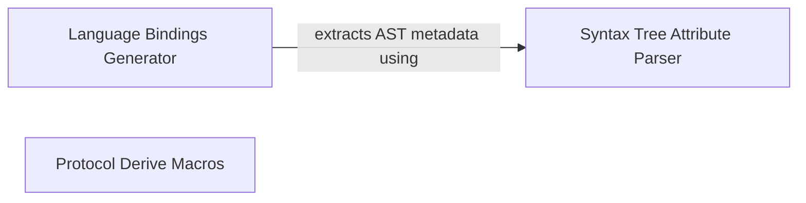

## Details

Analyzes AST structures and generates Protobuf definitions, serialization macros, and Dart/TypeScript event bindings.

### Language Bindings Generator
Generates Protobuf definition files as well as Dart and TypeScript event bindings from Rust structures and templates.

**Related Classes/Methods**:

- `frontend.rust-lib.build-tool.flowy-codegen.src.protobuf_file.ast.parse_protobuf_context_from`:16-31
- `frontend.rust-lib.build-tool.flowy-codegen.src.ast.EventASTContext`:5-12
- `frontend.rust-lib.build-tool.flowy-codegen.src.protobuf_file.ast.get_ast_structs`:114-139
- `frontend.rust-lib.build-tool.flowy-codegen.src.protobuf_file.ast.get_ast_enums`:141-162

**Source Files:**

- `frontend/rust-lib/build-tool/flowy-codegen/src/ast.rs`
  - `frontend.rust-lib.build-tool.flowy-codegen.src.ast.EventASTContext` (L5-L12) - Struct
  - `frontend.rust-lib.build-tool.flowy-codegen.src.ast.EventASTContext.from` (L16-L40) - Function
- `frontend/rust-lib/build-tool/flowy-codegen/src/dart_event/dart_event.rs`
  - `frontend.rust-lib.build-tool.flowy-codegen.src.dart_event.dart_event.r#gen` (L16-L82) - Function
  - `frontend.rust-lib.build-tool.flowy-codegen.src.dart_event.dart_event.DartEventCrate` (L90-L93) - Struct
  - `frontend.rust-lib.build-tool.flowy-codegen.src.dart_event.dart_event.DartEventCrate.from_config` (L96-L101) - Function
  - `frontend.rust-lib.build-tool.flowy-codegen.src.dart_event.dart_event.parse_dart_event_files` (L104-L118) - Function
  - `frontend.rust-lib.build-tool.flowy-codegen.src.dart_event.dart_event.parse_event_crate` (L120-L154) - Function
  - `frontend.rust-lib.build-tool.flowy-codegen.src.dart_event.dart_event.ast_to_event_render_ctx` (L156-L179) - Function
- `frontend/rust-lib/build-tool/flowy-codegen/src/dart_event/event_template.rs`
  - `frontend.rust-lib.build-tool.flowy-codegen.src.dart_event.event_template.EventTemplate` (L4-L6) - Struct
  - `frontend.rust-lib.build-tool.flowy-codegen.src.dart_event.event_template.EventRenderContext` (L8-L14) - Struct
  - `frontend.rust-lib.build-tool.flowy-codegen.src.dart_event.event_template.EventTemplate.new` (L18-L22) - Function
  - `frontend.rust-lib.build-tool.flowy-codegen.src.dart_event.event_template.EventTemplate.render` (L24-L64) - Method
- `frontend/rust-lib/build-tool/flowy-codegen/src/flowy_toml.rs`
  - `frontend.rust-lib.build-tool.flowy-codegen.src.flowy_toml.FlowyConfig` (L5-L20) - Struct
  - `frontend.rust-lib.build-tool.flowy-codegen.src.flowy_toml.default_proto_output` (L22-L26) - Function
  - `frontend.rust-lib.build-tool.flowy-codegen.src.flowy_toml.default_protobuf_crate` (L28-L32) - Function
  - `frontend.rust-lib.build-tool.flowy-codegen.src.flowy_toml.FlowyConfig.from_toml_file` (L35-L39) - Function
  - `frontend.rust-lib.build-tool.flowy-codegen.src.flowy_toml.CrateConfig` (L42-L46) - Struct
  - `frontend.rust-lib.build-tool.flowy-codegen.src.flowy_toml.parse_crate_config_from` (L48-L68) - Function
- `frontend/rust-lib/build-tool/flowy-codegen/src/lib.rs`
  - `frontend.rust-lib.build-tool.flowy-codegen.src.ProtoCache` (L18-L21) - Struct
  - `frontend.rust-lib.build-tool.flowy-codegen.src.Project` (L23-L27) - Enum
  - `frontend.rust-lib.build-tool.flowy-codegen.src.Project.dst` (L30-L38) - Method
  - `frontend.rust-lib.build-tool.flowy-codegen.src.Project.event_root` (L40-L45) - Method
  - `frontend.rust-lib.build-tool.flowy-codegen.src.Project.model_root` (L47-L52) - Method
  - `frontend.rust-lib.build-tool.flowy-codegen.src.Project.event_imports` (L54-L65) - Method
- `frontend/rust-lib/build-tool/flowy-codegen/src/protobuf_file/ast.rs`
  - `frontend.rust-lib.build-tool.flowy-codegen.src.protobuf_file.ast.parse_protobuf_context_from` (L16-L31) - Function
  - `frontend.rust-lib.build-tool.flowy-codegen.src.protobuf_file.ast.parse_files_protobuf` (L33-L112) - Function
  - `frontend.rust-lib.build-tool.flowy-codegen.src.protobuf_file.ast.get_ast_structs` (L114-L139) - Function
  - `frontend.rust-lib.build-tool.flowy-codegen.src.protobuf_file.ast.get_ast_enums` (L141-L162) - Function
  - `frontend.rust-lib.build-tool.flowy-codegen.src.protobuf_file.ast.FlowyEnum` (L164-L167) - Struct
  - `frontend.rust-lib.build-tool.flowy-codegen.src.protobuf_file.ast.Struct` (L169-L172) - Struct
  - `frontend.rust-lib.build-tool.flowy-codegen.src.protobuf_file.ast.find_proto_syntax` (L179-L203) - Function
- `frontend/rust-lib/build-tool/flowy-codegen/src/protobuf_file/mod.rs`
  - `frontend.rust-lib.build-tool.flowy-codegen.src.protobuf_file.dart_gen` (L22-L77) - Function
  - `frontend.rust-lib.build-tool.flowy-codegen.src.protobuf_file.generate_rust_protobuf_files` (L138-L152) - Function
  - `frontend.rust-lib.build-tool.flowy-codegen.src.protobuf_file.remove_box_pointers_lint_from_all_except_mod` (L153-L168) - Function
  - `frontend.rust-lib.build-tool.flowy-codegen.src.protobuf_file.remove_box_pointers_lint` (L170-L183) - Function
  - `frontend.rust-lib.build-tool.flowy-codegen.src.protobuf_file.generate_ts_protobuf_files` (L186-L250) - Function
  - `frontend.rust-lib.build-tool.flowy-codegen.src.protobuf_file.generate_dart_protobuf_files` (L253-L316) - Function
  - `frontend.rust-lib.build-tool.flowy-codegen.src.protobuf_file.check_pb_dart_plugin` (L318-L361) - Function
  - `frontend.rust-lib.build-tool.flowy-codegen.src.protobuf_file.gen_proto_files` (L364-L385) - Function
- `frontend/rust-lib/build-tool/flowy-codegen/src/protobuf_file/proto_gen.rs`
  - `frontend.rust-lib.build-tool.flowy-codegen.src.protobuf_file.proto_gen.ProtoGenerator` (L15-L15) - Struct
  - `frontend.rust-lib.build-tool.flowy-codegen.src.protobuf_file.proto_gen.ProtoGenerator.r#gen` (L17-L49) - Function
  - `frontend.rust-lib.build-tool.flowy-codegen.src.protobuf_file.proto_gen.write_proto_files` (L52-L89) - Function
  - `frontend.rust-lib.build-tool.flowy-codegen.src.protobuf_file.proto_gen.gen_import_content` (L91-L115) - Function
  - `frontend.rust-lib.build-tool.flowy-codegen.src.protobuf_file.proto_gen.ProtoFileSymbol` (L117-L120) - Struct
  - `frontend.rust-lib.build-tool.flowy-codegen.src.protobuf_file.proto_gen.write_rust_crate_mod_file` (L122-L154) - Function
  - `frontend.rust-lib.build-tool.flowy-codegen.src.protobuf_file.proto_gen.ProtoCache.from_crate_contexts` (L157-L172) - Function
- `frontend/rust-lib/build-tool/flowy-codegen/src/protobuf_file/proto_info.rs`
  - `frontend.rust-lib.build-tool.flowy-codegen.src.protobuf_file.proto_info.ProtobufCrateContext` (L11-L14) - Struct
  - `frontend.rust-lib.build-tool.flowy-codegen.src.protobuf_file.proto_info.ProtobufCrateContext.from_crate_info` (L17-L22) - Function
  - `frontend.rust-lib.build-tool.flowy-codegen.src.protobuf_file.proto_info.ProtobufCrateContext.create_crate_mod_file` (L24-L47) - Method
  - `frontend.rust-lib.build-tool.flowy-codegen.src.protobuf_file.proto_info.ProtobufCrateContext.flutter_mod_dir` (L50-L53) - Method
  - `frontend.rust-lib.build-tool.flowy-codegen.src.protobuf_file.proto_info.ProtobufCrateContext.flutter_mod_file` (L56-L62) - Method
  - `frontend.rust-lib.build-tool.flowy-codegen.src.protobuf_file.proto_info.ProtobufCrate` (L66-L70) - Struct
  - `frontend.rust-lib.build-tool.flowy-codegen.src.protobuf_file.proto_info.ProtobufCrate.from_config` (L73-L79) - Function
  - `frontend.rust-lib.build-tool.flowy-codegen.src.protobuf_file.proto_info.ProtobufCrate.proto_input_paths` (L82-L89) - Method
  - `frontend.rust-lib.build-tool.flowy-codegen.src.protobuf_file.proto_info.ProtobufCrate.protobuf_crate_path` (L92-L96) - Method
  - `frontend.rust-lib.build-tool.flowy-codegen.src.protobuf_file.proto_info.ProtobufCrate.proto_output_path` (L99-L103) - Method
  - `frontend.rust-lib.build-tool.flowy-codegen.src.protobuf_file.proto_info.ProtobufCrate.proto_model_mod_file` (L105-L107) - Method
  - `frontend.rust-lib.build-tool.flowy-codegen.src.protobuf_file.proto_info.ProtoFile` (L111-L124) - Struct
  - `frontend.rust-lib.build-tool.flowy-codegen.src.protobuf_file.proto_info.ProtoFile.symbols` (L127-L132) - Method
  - `frontend.rust-lib.build-tool.flowy-codegen.src.protobuf_file.proto_info.parse_crate_info_from_path` (L135-L149) - Function
- `frontend/rust-lib/build-tool/flowy-codegen/src/protobuf_file/template/derive_meta/derive_meta.rs`
  - `frontend.rust-lib.build-tool.flowy-codegen.src.protobuf_file.template.derive_meta.derive_meta.ProtobufDeriveMeta` (L5-L9) - Struct
  - `frontend.rust-lib.build-tool.flowy-codegen.src.protobuf_file.template.derive_meta.derive_meta.ProtobufDeriveMeta.new` (L13-L20) - Function
  - `frontend.rust-lib.build-tool.flowy-codegen.src.protobuf_file.template.derive_meta.derive_meta.ProtobufDeriveMeta.render` (L22-L34) - Method
- `frontend/rust-lib/build-tool/flowy-codegen/src/protobuf_file/template/proto_file/enum_template.rs`
  - `frontend.rust-lib.build-tool.flowy-codegen.src.protobuf_file.template.proto_file.enum_template.EnumTemplate` (L5-L8) - Struct
  - `frontend.rust-lib.build-tool.flowy-codegen.src.protobuf_file.template.proto_file.enum_template.EnumTemplate.new` (L12-L17) - Function
  - `frontend.rust-lib.build-tool.flowy-codegen.src.protobuf_file.template.proto_file.enum_template.EnumTemplate.set_message_enum` (L19-L27) - Method
  - `frontend.rust-lib.build-tool.flowy-codegen.src.protobuf_file.template.proto_file.enum_template.EnumTemplate.render` (L29-L39) - Method
- `frontend/rust-lib/build-tool/flowy-codegen/src/protobuf_file/template/proto_file/struct_template.rs`
  - `frontend.rust-lib.build-tool.flowy-codegen.src.protobuf_file.template.proto_file.struct_template.StructTemplate` (L18-L21) - Struct
  - `frontend.rust-lib.build-tool.flowy-codegen.src.protobuf_file.template.proto_file.struct_template.StructTemplate.new` (L25-L30) - Function
  - `frontend.rust-lib.build-tool.flowy-codegen.src.protobuf_file.template.proto_file.struct_template.StructTemplate.set_message_struct_name` (L32-L34) - Method
  - `frontend.rust-lib.build-tool.flowy-codegen.src.protobuf_file.template.proto_file.struct_template.StructTemplate.set_field` (L36-L97) - Method
  - `frontend.rust-lib.build-tool.flowy-codegen.src.protobuf_file.template.proto_file.struct_template.StructTemplate.render` (L99-L109) - Method
- `frontend/rust-lib/build-tool/flowy-codegen/src/ts_event/event_template.rs`
  - `frontend.rust-lib.build-tool.flowy-codegen.src.ts_event.event_template.EventTemplate` (L4-L6) - Struct
  - `frontend.rust-lib.build-tool.flowy-codegen.src.ts_event.event_template.EventRenderContext` (L8-L15) - Struct
  - `frontend.rust-lib.build-tool.flowy-codegen.src.ts_event.event_template.EventTemplate.new` (L19-L23) - Function
  - `frontend.rust-lib.build-tool.flowy-codegen.src.ts_event.event_template.EventTemplate.render` (L25-L69) - Method
- `frontend/rust-lib/build-tool/flowy-codegen/src/ts_event/mod.rs`
  - `frontend.rust-lib.build-tool.flowy-codegen.src.ts_event.r#gen` (L16-L97) - Function
  - `frontend.rust-lib.build-tool.flowy-codegen.src.ts_event.TsEventCrate` (L100-L103) - Struct
  - `frontend.rust-lib.build-tool.flowy-codegen.src.ts_event.TsEventCrate.from_config` (L106-L111) - Function
  - `frontend.rust-lib.build-tool.flowy-codegen.src.ts_event.parse_ts_event_files` (L114-L128) - Function
  - `frontend.rust-lib.build-tool.flowy-codegen.src.ts_event.parse_event_crate` (L130-L164) - Function
  - `frontend.rust-lib.build-tool.flowy-codegen.src.ts_event.ast_to_event_render_ctx` (L166-L200) - Function
- `frontend/rust-lib/build-tool/flowy-codegen/src/util.rs`
  - `frontend.rust-lib.build-tool.flowy-codegen.src.util.read_file` (L12-L22) - Function
  - `frontend.rust-lib.build-tool.flowy-codegen.src.util.save_content_to_file_with_diff_prompt` (L24-L57) - Function
  - `frontend.rust-lib.build-tool.flowy-codegen.src.util.print_diff` (L59-L81) - Function
  - `frontend.rust-lib.build-tool.flowy-codegen.src.util.is_crate_dir` (L84-L87) - Function
  - `frontend.rust-lib.build-tool.flowy-codegen.src.util.is_proto_file` (L90-L96) - Function
  - `frontend.rust-lib.build-tool.flowy-codegen.src.util.is_hidden` (L98-L104) - Function
  - `frontend.rust-lib.build-tool.flowy-codegen.src.util.create_dir_if_not_exist` (L106-L110) - Function
  - `frontend.rust-lib.build-tool.flowy-codegen.src.util.path_string_with_component` (L112-L117) - Function
  - `frontend.rust-lib.build-tool.flowy-codegen.src.util.path_buf_with_component` (L120-L126) - Function
  - `frontend.rust-lib.build-tool.flowy-codegen.src.util.walk_dir` (L129-L147) - Function
  - `frontend.rust-lib.build-tool.flowy-codegen.src.util.suffix_relative_to_path` (L150-L159) - Function
  - `frontend.rust-lib.build-tool.flowy-codegen.src.util.get_tera` (L161-L185) - Function
  - `frontend.rust-lib.build-tool.flowy-codegen.src.util.cache_dir` (L187-L191) - Function

### Protocol Derive Macros
Implements procedural derive macros for Protocol Buffers serialization, deserialization, events, and AST node transformations.

**Related Classes/Methods**:

- `frontend.rust-lib.build-tool.flowy-derive.src.derive_proto_buf`:17-22
- `frontend.rust-lib.build-tool.flowy-derive.src.derive_proto_buf_enum`:25-30
- `frontend.rust-lib.build-tool.flowy-derive.src.derive_dart_event`:33-38
- `frontend.rust-lib.build-tool.flowy-derive.src.derive_node`:41-46

**Source Files:**

- `frontend/rust-lib/build-tool/flowy-derive/src/dart_event/mod.rs`
  - `frontend.rust-lib.build-tool.flowy-derive.src.dart_event.expand_enum_derive` (L4-L6) - Function
- `frontend/rust-lib/build-tool/flowy-derive/src/lib.rs`
  - `frontend.rust-lib.build-tool.flowy-derive.src.derive_proto_buf` (L17-L22) - Function
  - `frontend.rust-lib.build-tool.flowy-derive.src.derive_proto_buf_enum` (L25-L30) - Function
  - `frontend.rust-lib.build-tool.flowy-derive.src.derive_dart_event` (L33-L38) - Function
  - `frontend.rust-lib.build-tool.flowy-derive.src.derive_node` (L41-L46) - Function
  - `frontend.rust-lib.build-tool.flowy-derive.src.to_compile_errors` (L48-L51) - Function
- `frontend/rust-lib/build-tool/flowy-derive/src/node/mod.rs`
  - `frontend.rust-lib.build-tool.flowy-derive.src.node.expand_derive` (L4-L22) - Function
  - `frontend.rust-lib.build-tool.flowy-derive.src.node.make_helper_funcs_token_stream` (L24-L36) - Function
  - `frontend.rust-lib.build-tool.flowy-derive.src.node.make_alter_children_token_stream` (L38-L118) - Function
  - `frontend.rust-lib.build-tool.flowy-derive.src.node.make_to_node_data_token_stream` (L120-L185) - Function
  - `frontend.rust-lib.build-tool.flowy-derive.src.node.make_get_set_value_token_steam` (L187-L234) - Function
- `frontend/rust-lib/build-tool/flowy-derive/src/proto_buf/deserialize.rs`
  - `frontend.rust-lib.build-tool.flowy-derive.src.proto_buf.deserialize.make_de_token_steam` (L7-L61) - Function
  - `frontend.rust-lib.build-tool.flowy-derive.src.proto_buf.deserialize.token_stream_for_one_of` (L63-L124) - Function
  - `frontend.rust-lib.build-tool.flowy-derive.src.proto_buf.deserialize.token_stream_for_field` (L126-L202) - Function
  - `frontend.rust-lib.build-tool.flowy-derive.src.proto_buf.deserialize.token_stream_for_vec` (L204-L243) - Function
  - `frontend.rust-lib.build-tool.flowy-derive.src.proto_buf.deserialize.token_stream_for_map` (L245-L270) - Function
- `frontend/rust-lib/build-tool/flowy-derive/src/proto_buf/enum_serde.rs`
  - `frontend.rust-lib.build-tool.flowy-derive.src.proto_buf.enum_serde.make_enum_token_stream` (L5-L39) - Function
- `frontend/rust-lib/build-tool/flowy-derive/src/proto_buf/mod.rs`
  - `frontend.rust-lib.build-tool.flowy-derive.src.proto_buf.expand_derive` (L14-L33) - Function
  - `frontend.rust-lib.build-tool.flowy-derive.src.proto_buf.expand_enum_derive` (L35-L50) - Function
- `frontend/rust-lib/build-tool/flowy-derive/src/proto_buf/serialize.rs`
  - `frontend.rust-lib.build-tool.flowy-derive.src.proto_buf.serialize.make_se_token_stream` (L9-L51) - Function
  - `frontend.rust-lib.build-tool.flowy-derive.src.proto_buf.serialize.se_token_stream_for_field` (L53-L66) - Function
  - `frontend.rust-lib.build-tool.flowy-derive.src.proto_buf.serialize.token_stream_for_one_of` (L68-L106) - Function
  - `frontend.rust-lib.build-tool.flowy-derive.src.proto_buf.serialize.gen_token_stream` (L108-L160) - Function
  - `frontend.rust-lib.build-tool.flowy-derive.src.proto_buf.serialize.token_stream_for_vec` (L163-L195) - Function
  - `frontend.rust-lib.build-tool.flowy-derive.src.proto_buf.serialize.token_stream_for_map` (L198-L231) - Function
- `frontend/rust-lib/build-tool/flowy-derive/src/proto_buf/util.rs`
  - `frontend.rust-lib.build-tool.flowy-derive.src.proto_buf.util.ident_category` (L10-L13) - Function
  - `frontend.rust-lib.build-tool.flowy-derive.src.proto_buf.util.get_member_ident` (L15-L28) - Function
  - `frontend.rust-lib.build-tool.flowy-derive.src.proto_buf.util.assert_bracket_ty_is_some` (L30-L37) - Function
  - `frontend.rust-lib.build-tool.flowy-derive.src.proto_buf.util.TypeCategory` (L46-L55) - Enum
  - `frontend.rust-lib.build-tool.flowy-derive.src.proto_buf.util.category_from_str` (L57-L106) - Function
  - `frontend.rust-lib.build-tool.flowy-derive.src.proto_buf.util.read_file` (L108-L119) - Function

### Syntax Tree Attribute Parser
Parses and validates Rust syntax trees and attribute metadata for Protobuf indexing, event bindings, and AST containers.

**Related Classes/Methods**:

- `frontend.rust-lib.build-tool.flowy-ast.src.ast.ASTContainer`:14-23
- `frontend.rust-lib.build-tool.flowy-ast.src.ctxt.ASTResult`:5-7
- `frontend.rust-lib.build-tool.flowy-ast.src.event_attrs.EventEnumAttrs`:18-23
- `frontend.rust-lib.build-tool.flowy-ast.src.ast.struct_from_ast`:226-238
- `frontend.rust-lib.build-tool.flowy-ast.src.ast.enum_from_ast`:240-260

**Source Files:**

- `frontend/rust-lib/build-tool/flowy-ast/src/ast.rs`
  - `frontend.rust-lib.build-tool.flowy-ast.src.ast.ASTContainer` (L14-L23) - Struct
  - `frontend.rust-lib.build-tool.flowy-ast.src.ast.ASTContainer.from_ast` (L26-L62) - Function
  - `frontend.rust-lib.build-tool.flowy-ast.src.ast.ASTData` (L65-L68) - Enum
  - `frontend.rust-lib.build-tool.flowy-ast.src.ast.ASTData.all_fields` (L71-L78) - Method
  - `frontend.rust-lib.build-tool.flowy-ast.src.ast.ASTData.all_variants` (L80-L91) - Method
  - `frontend.rust-lib.build-tool.flowy-ast.src.ast.ASTData.all_idents` (L93-L104) - Method
  - `frontend.rust-lib.build-tool.flowy-ast.src.ast.ASTEnumVariant` (L108-L114) - Struct
  - `frontend.rust-lib.build-tool.flowy-ast.src.ast.ASTEnumVariant.name` (L117-L119) - Method
  - `frontend.rust-lib.build-tool.flowy-ast.src.ast.BracketCategory` (L122-L127) - Enum
  - `frontend.rust-lib.build-tool.flowy-ast.src.ast.ASTField` (L129-L140) - Struct
  - `frontend.rust-lib.build-tool.flowy-ast.src.ast.ASTField.new` (L143-L197) - Function
  - `frontend.rust-lib.build-tool.flowy-ast.src.ast.ASTField.ty_as_str` (L199-L204) - Method
  - `frontend.rust-lib.build-tool.flowy-ast.src.ast.ASTField.name` (L206-L212) - Method
  - `frontend.rust-lib.build-tool.flowy-ast.src.ast.ASTStyle` (L216-L224) - Enum
  - `frontend.rust-lib.build-tool.flowy-ast.src.ast.struct_from_ast` (L226-L238) - Function
  - `frontend.rust-lib.build-tool.flowy-ast.src.ast.enum_from_ast` (L240-L260) - Function
  - `frontend.rust-lib.build-tool.flowy-ast.src.ast.fields_from_ast` (L262-L277) - Function
  - `frontend.rust-lib.build-tool.flowy-ast.src.ast.get_node_type` (L279-L299) - Function
- `frontend/rust-lib/build-tool/flowy-ast/src/ctxt.rs`
  - `frontend.rust-lib.build-tool.flowy-ast.src.ctxt.ASTResult` (L5-L7) - Struct
  - `frontend.rust-lib.build-tool.flowy-ast.src.ctxt.ASTResult.new` (L10-L14) - Function
  - `frontend.rust-lib.build-tool.flowy-ast.src.ctxt.ASTResult.error_spanned_by` (L16-L23) - Method
  - `frontend.rust-lib.build-tool.flowy-ast.src.ctxt.ASTResult.syn_error` (L25-L27) - Method
  - `frontend.rust-lib.build-tool.flowy-ast.src.ctxt.ASTResult.check` (L29-L35) - Method
  - `frontend.rust-lib.build-tool.flowy-ast.src.ctxt.ASTResult.drop` (L39-L43) - Method
- `frontend/rust-lib/build-tool/flowy-ast/src/event_attrs.rs`
  - `frontend.rust-lib.build-tool.flowy-ast.src.event_attrs.EventAttrs` (L10-L15) - Struct
  - `frontend.rust-lib.build-tool.flowy-ast.src.event_attrs.EventEnumAttrs` (L18-L23) - Struct
  - `frontend.rust-lib.build-tool.flowy-ast.src.event_attrs.EventEnumAttrs.from_ast` (L26-L52) - Function
  - `frontend.rust-lib.build-tool.flowy-ast.src.event_attrs.EventEnumAttrs.event_input` (L54-L56) - Method
  - `frontend.rust-lib.build-tool.flowy-ast.src.event_attrs.EventEnumAttrs.event_output` (L58-L60) - Method
  - `frontend.rust-lib.build-tool.flowy-ast.src.event_attrs.EventEnumAttrs.event_error` (L62-L64) - Method
  - `frontend.rust-lib.build-tool.flowy-ast.src.event_attrs.get_event_attrs_from` (L67-L150) - Function
- `frontend/rust-lib/build-tool/flowy-ast/src/node_attrs.rs`
  - `frontend.rust-lib.build-tool.flowy-ast.src.node_attrs.NodeStructAttrs` (L9-L17) - Struct
  - `frontend.rust-lib.build-tool.flowy-ast.src.node_attrs.NodeStructAttrs.from_ast` (L21-L105) - Function
- `frontend/rust-lib/build-tool/flowy-ast/src/pb_attrs.rs`
  - `frontend.rust-lib.build-tool.flowy-ast.src.pb_attrs.PBAttrsContainer` (L14-L18) - Struct
  - `frontend.rust-lib.build-tool.flowy-ast.src.pb_attrs.PBAttrsContainer.from_ast` (L22-L78) - Function
  - `frontend.rust-lib.build-tool.flowy-ast.src.pb_attrs.PBAttrsContainer.pb_struct_type` (L80-L82) - Method
  - `frontend.rust-lib.build-tool.flowy-ast.src.pb_attrs.PBAttrsContainer.pb_enum_type` (L84-L86) - Method
  - `frontend.rust-lib.build-tool.flowy-ast.src.pb_attrs.ASTAttr` (L89-L94) - Struct
  - `frontend.rust-lib.build-tool.flowy-ast.src.pb_attrs.ASTAttr.none` (L97-L104) - Function
  - `frontend.rust-lib.build-tool.flowy-ast.src.pb_attrs.ASTAttr.set` (L106-L117) - Method
  - `frontend.rust-lib.build-tool.flowy-ast.src.pb_attrs.ASTAttr.set_opt` (L119-L123) - Method
  - `frontend.rust-lib.build-tool.flowy-ast.src.pb_attrs.ASTAttr.set_if_none` (L125-L129) - Method
  - `frontend.rust-lib.build-tool.flowy-ast.src.pb_attrs.ASTAttr.get` (L131-L133) - Method
  - `frontend.rust-lib.build-tool.flowy-ast.src.pb_attrs.ASTAttr.get_with_tokens` (L136-L141) - Method
  - `frontend.rust-lib.build-tool.flowy-ast.src.pb_attrs.PBStructAttrs` (L144-L153) - Struct
  - `frontend.rust-lib.build-tool.flowy-ast.src.pb_attrs.is_recognizable_field` (L155-L160) - Function
  - `frontend.rust-lib.build-tool.flowy-ast.src.pb_attrs.PBStructAttrs.from_ast` (L164-L243) - Function
  - `frontend.rust-lib.build-tool.flowy-ast.src.pb_attrs.PBStructAttrs.pb_index` (L246-L251) - Method
  - `frontend.rust-lib.build-tool.flowy-ast.src.pb_attrs.PBStructAttrs.is_one_of` (L253-L255) - Method
  - `frontend.rust-lib.build-tool.flowy-ast.src.pb_attrs.PBStructAttrs.serialize_pb_with` (L257-L259) - Method
  - `frontend.rust-lib.build-tool.flowy-ast.src.pb_attrs.PBStructAttrs.deserialize_pb_with` (L261-L263) - Method
  - `frontend.rust-lib.build-tool.flowy-ast.src.pb_attrs.PBStructAttrs.skip_pb_serializing` (L265-L267) - Method
  - `frontend.rust-lib.build-tool.flowy-ast.src.pb_attrs.PBStructAttrs.skip_pb_deserializing` (L269-L271) - Method
  - `frontend.rust-lib.build-tool.flowy-ast.src.pb_attrs.Default` (L274-L281) - Enum
  - `frontend.rust-lib.build-tool.flowy-ast.src.pb_attrs.is_recognizable_attribute` (L283-L285) - Function
  - `frontend.rust-lib.build-tool.flowy-ast.src.pb_attrs.get_pb_meta_items` (L287-L309) - Function
  - `frontend.rust-lib.build-tool.flowy-ast.src.pb_attrs.get_node_meta_items` (L311-L330) - Function
  - `frontend.rust-lib.build-tool.flowy-ast.src.pb_attrs.get_event_meta_items` (L332-L354) - Function
  - `frontend.rust-lib.build-tool.flowy-ast.src.pb_attrs.parse_lit_into_expr_path` (L356-L365) - Function
  - `frontend.rust-lib.build-tool.flowy-ast.src.pb_attrs.get_lit_str` (L367-L384) - Function
  - `frontend.rust-lib.build-tool.flowy-ast.src.pb_attrs.parse_lit_into_ty` (L386-L399) - Function
  - `frontend.rust-lib.build-tool.flowy-ast.src.pb_attrs.parse_lit_str` (L401-L407) - Function
  - `frontend.rust-lib.build-tool.flowy-ast.src.pb_attrs.spanned_tokens` (L409-L412) - Function
  - `frontend.rust-lib.build-tool.flowy-ast.src.pb_attrs.respan_token_stream` (L414-L419) - Function
  - `frontend.rust-lib.build-tool.flowy-ast.src.pb_attrs.respan_token_tree` (L421-L427) - Function
  - `frontend.rust-lib.build-tool.flowy-ast.src.pb_attrs.default_pb_type` (L429-L442) - Function
  - `frontend.rust-lib.build-tool.flowy-ast.src.pb_attrs.is_option` (L445-L465) - Function
  - `frontend.rust-lib.build-tool.flowy-ast.src.pb_attrs.ungroup` (L468-L473) - Function
  - `frontend.rust-lib.build-tool.flowy-ast.src.pb_attrs.BoolAttr` (L475-L475) - Struct
  - `frontend.rust-lib.build-tool.flowy-ast.src.pb_attrs.BoolAttr.none` (L478-L480) - Function
  - `frontend.rust-lib.build-tool.flowy-ast.src.pb_attrs.BoolAttr.set_true` (L482-L484) - Method
  - `frontend.rust-lib.build-tool.flowy-ast.src.pb_attrs.BoolAttr.get` (L486-L488) - Method
- `frontend/rust-lib/build-tool/flowy-ast/src/symbol.rs`
  - `frontend.rust-lib.build-tool.flowy-ast.src.symbol.Symbol` (L5-L5) - Struct
  - `frontend.rust-lib.build-tool.flowy-ast.src.symbol.Ident.eq` (L51-L53) - Method
  - `frontend.rust-lib.build-tool.flowy-ast.src.symbol.&Ident.eq` (L57-L59) - Method
  - `frontend.rust-lib.build-tool.flowy-ast.src.symbol.Path.eq` (L63-L65) - Method
  - `frontend.rust-lib.build-tool.flowy-ast.src.symbol.&Path.eq` (L69-L71) - Method
  - `frontend.rust-lib.build-tool.flowy-ast.src.symbol.Symbol.fmt` (L75-L77) - Method
- `frontend/rust-lib/build-tool/flowy-ast/src/ty_ext.rs`
  - `frontend.rust-lib.build-tool.flowy-ast.src.ty_ext.PrimitiveTy` (L5-L10) - Enum
  - `frontend.rust-lib.build-tool.flowy-ast.src.ty_ext.TyInfo` (L13-L18) - Struct
  - `frontend.rust-lib.build-tool.flowy-ast.src.ty_ext.MapInfo` (L21-L24) - Struct
  - `frontend.rust-lib.build-tool.flowy-ast.src.ty_ext.MapInfo.new` (L27-L29) - Function
  - `frontend.rust-lib.build-tool.flowy-ast.src.ty_ext.TyInfo.bracketed_ident` (L34-L41) - Method
  - `frontend.rust-lib.build-tool.flowy-ast.src.ty_ext.parse_ty` (L44-L83) - Function
  - `frontend.rust-lib.build-tool.flowy-ast.src.ty_ext.parse_bracketed` (L85-L97) - Function
  - `frontend.rust-lib.build-tool.flowy-ast.src.ty_ext.generate_hashmap_ty_info` (L99-L119) - Function
  - `frontend.rust-lib.build-tool.flowy-ast.src.ty_ext.generate_option_ty_info` (L121-L136) - Function
  - `frontend.rust-lib.build-tool.flowy-ast.src.ty_ext.generate_vec_ty_info` (L138-L156) - Function

### [FAQ](https://github.com/CodeBoarding/GeneratedOnBoardings/tree/main?tab=readme-ov-file#faq)