```mermaid
graph LR
    Editor_Page_and_Slash_Commands["Editor Page and Slash Commands"]
    Simple_Table_Component["Simple Table Component"]
    Mobile_Toolbar_and_Media_Blocks["Mobile Toolbar and Media Blocks"]
    Mention_and_Link_Embed_Components["Mention and Link Embed Components"]
    Document_Page_and_Block_Operations["Document Page and Block Operations"]
    Floating_Toolbars_and_Text_Formatting["Floating Toolbars and Text Formatting"]
    Image_and_Gallery_Components["Image and Gallery Components"]
    Document_Cover_and_Page_Styling["Document Cover and Page Styling"]
    Standard_Content_Blocks_and_Utilities["Standard Content Blocks and Utilities"]
    Document_State_and_Synchronization["Document State and Synchronization"]
    Clipboard_and_Paste_Management["Clipboard and Paste Management"]
    Document_Shell_and_Drag_Drop["Document Shell and Drag Drop"]
    Document_Plugin_Registration_and_Menus["Document Plugin Registration and Menus"]
    Editor_Page_and_Slash_Commands -- "queries document state" --> Document_State_and_Synchronization
    Editor_Page_and_Slash_Commands -- "copies code content to clipboard" --> Clipboard_and_Paste_Management
    Editor_Page_and_Slash_Commands -- "creates simple table blocks" --> Simple_Table_Component
    Editor_Page_and_Slash_Commands -- "renders mobile toolbar and parses media blocks" --> Mobile_Toolbar_and_Media_Blocks
    Editor_Page_and_Slash_Commands -- "initializes localization and mention nodes" --> Mention_and_Link_Embed_Components
    Editor_Page_and_Slash_Commands -- "configures block components and columns" --> Document_Page_and_Block_Operations
    Editor_Page_and_Slash_Commands -- "embeds floating toolbars" --> Floating_Toolbars_and_Text_Formatting
    Editor_Page_and_Slash_Commands -- "inserts and parses image gallery blocks" --> Image_and_Gallery_Components
    Editor_Page_and_Slash_Commands -- "applies editor styling and cover configurations" --> Document_Cover_and_Page_Styling
    Editor_Page_and_Slash_Commands -- "registers find-and-replace and keyboard interceptors" --> Standard_Content_Blocks_and_Utilities
    Document_State_and_Synchronization -- "validates column hierarchy rules" --> Document_Page_and_Block_Operations
    Clipboard_and_Paste_Management -- "checks local mode for pasted media" --> Document_State_and_Synchronization
    Clipboard_and_Paste_Management -- "posts paste notifications" --> Document_Shell_and_Drag_Drop
    Clipboard_and_Paste_Management -- "pastes HTML tables into simple tables" --> Simple_Table_Component
    Clipboard_and_Paste_Management -- "drops file attachments into editor" --> Mobile_Toolbar_and_Media_Blocks
    Clipboard_and_Paste_Management -- "pastes mentions and shows paste-as menus" --> Mention_and_Link_Embed_Components
    Clipboard_and_Paste_Management -- "saves dropped image files" --> Image_and_Gallery_Components
    Document_Shell_and_Drag_Drop -- "displays active document collaborators" --> Document_State_and_Synchronization
    Document_Shell_and_Drag_Drop -- "delegates dropped files and images to paste handlers" --> Clipboard_and_Paste_Management
    Document_Shell_and_Drag_Drop -- "drops view links as page mentions" --> Mention_and_Link_Embed_Components
    Document_Plugin_Registration_and_Menus -- "renders collaborator bar item" --> Document_Shell_and_Drag_Drop
    Document_Plugin_Registration_and_Menus -- "builds main document page widget" --> Document_Page_and_Block_Operations
    Document_Plugin_Registration_and_Menus -- "applies tint styles to table options" --> Standard_Content_Blocks_and_Utilities
    Simple_Table_Component -- "references editor page colors and string helpers" --> Editor_Page_and_Slash_Commands
    Simple_Table_Component -- "copies table cell and row data to clipboard" --> Clipboard_and_Paste_Management
    Simple_Table_Component -- "uses color picker widgets in table bottom sheet" --> Mobile_Toolbar_and_Media_Blocks
    Simple_Table_Component -- "triggers block action option cubit" --> Document_Page_and_Block_Operations
    Simple_Table_Component -- "reads editor style padding and offset metrics" --> Document_Cover_and_Page_Styling
    Simple_Table_Component -- "queries tint color extensions" --> Standard_Content_Blocks_and_Utilities
    Mobile_Toolbar_and_Media_Blocks -- "uses built-in editor font colors" --> Editor_Page_and_Slash_Commands
    Mobile_Toolbar_and_Media_Blocks -- "uploads file attachments via document service" --> Document_State_and_Synchronization
    Mobile_Toolbar_and_Media_Blocks -- "copies block content to clipboard" --> Clipboard_and_Paste_Management
    Mobile_Toolbar_and_Media_Blocks -- "registers drop targets with drop manager" --> Document_Shell_and_Drag_Drop
    Mobile_Toolbar_and_Media_Blocks -- "inserts table blocks from mobile menu" --> Simple_Table_Component
    Mobile_Toolbar_and_Media_Blocks -- "creates date mentions and page selectors" --> Mention_and_Link_Embed_Components
    Mobile_Toolbar_and_Media_Blocks -- "shows mobile block action buttons" --> Document_Page_and_Block_Operations
    Mobile_Toolbar_and_Media_Blocks -- "opens link editing menus" --> Floating_Toolbars_and_Text_Formatting
    Mobile_Toolbar_and_Media_Blocks -- "inserts and uploads images from mobile menu" --> Image_and_Gallery_Components
    Mobile_Toolbar_and_Media_Blocks -- "renders block action delete button" --> Standard_Content_Blocks_and_Utilities
    Mention_and_Link_Embed_Components -- "listens to document node changes" --> Document_State_and_Synchronization
    Mention_and_Link_Embed_Components -- "subscribes to editor notification stream" --> Document_Shell_and_Drag_Drop
    Mention_and_Link_Embed_Components -- "renders mobile block action buttons" --> Document_Page_and_Block_Operations
    Mention_and_Link_Embed_Components -- "triggers link preview and replace menus" --> Floating_Toolbars_and_Text_Formatting
    Mention_and_Link_Embed_Components -- "renders emoji icons and applies editor styles" --> Document_Cover_and_Page_Styling
    Mention_and_Link_Embed_Components -- "calculates menu anchor rectangles" --> Standard_Content_Blocks_and_Utilities
    Document_Page_and_Block_Operations -- "configures AI writer and editor page" --> Editor_Page_and_Slash_Commands
    Document_Page_and_Block_Operations -- "dispatches document lifecycle events" --> Document_State_and_Synchronization
    Document_Page_and_Block_Operations -- "copies block links to clipboard" --> Clipboard_and_Paste_Management
    Document_Page_and_Block_Operations -- "attaches drop handler and displays banners" --> Document_Shell_and_Drag_Drop
    Document_Page_and_Block_Operations -- "builds table block component menus" --> Document_Plugin_Registration_and_Menus
    Document_Page_and_Block_Operations -- "verifies table container context and builds table blocks" --> Simple_Table_Component
    Document_Page_and_Block_Operations -- "builds file and math block components" --> Mobile_Toolbar_and_Media_Blocks
    Document_Page_and_Block_Operations -- "registers transaction service and link preview builders" --> Mention_and_Link_Embed_Components
    Document_Page_and_Block_Operations -- "updates text suggestion blocks" --> Floating_Toolbars_and_Text_Formatting
    Document_Page_and_Block_Operations -- "builds custom and multi-image block components" --> Image_and_Gallery_Components
    Document_Page_and_Block_Operations -- "displays immersive cover and document headers" --> Document_Cover_and_Page_Styling
    Document_Page_and_Block_Operations -- "builds callout, list, and quote block components" --> Standard_Content_Blocks_and_Utilities
    Floating_Toolbars_and_Text_Formatting -- "checks narrow window layout and text types" --> Editor_Page_and_Slash_Commands
    Floating_Toolbars_and_Text_Formatting -- "syncs font family with appearance cubit" --> Document_State_and_Synchronization
    Floating_Toolbars_and_Text_Formatting -- "copies hover link URLs to clipboard" --> Clipboard_and_Paste_Management
    Floating_Toolbars_and_Text_Formatting -- "triggers mobile link edit bottom sheet" --> Mobile_Toolbar_and_Media_Blocks
    Floating_Toolbars_and_Text_Formatting -- "converts links to mentions and link previews" --> Mention_and_Link_Embed_Components
    Floating_Toolbars_and_Text_Formatting -- "turns blocks into headings or text types" --> Document_Page_and_Block_Operations
    Floating_Toolbars_and_Text_Formatting -- "renders raw emoji icons and hover colors" --> Document_Cover_and_Page_Styling
    Image_and_Gallery_Components -- "uploads images via document service" --> Document_State_and_Synchronization
    Image_and_Gallery_Components -- "copies image URLs to clipboard" --> Clipboard_and_Paste_Management
    Image_and_Gallery_Components -- "queries drop manager status" --> Document_Shell_and_Drag_Drop
    Image_and_Gallery_Components -- "shows mobile action buttons on image blocks" --> Document_Page_and_Block_Operations
    Image_and_Gallery_Components -- "uses cover color picker options" --> Document_Cover_and_Page_Styling
    Image_and_Gallery_Components -- "attaches block menu action buttons" --> Standard_Content_Blocks_and_Utilities
    Document_Cover_and_Page_Styling -- "queries status bar height and built-in font colors" --> Editor_Page_and_Slash_Commands
    Document_Cover_and_Page_Styling -- "checks local mode for cover image storage" --> Document_State_and_Synchronization
    Document_Cover_and_Page_Styling -- "migrates and styles math equation blocks" --> Mobile_Toolbar_and_Media_Blocks
    Document_Cover_and_Page_Styling -- "decorates mention block attributes" --> Mention_and_Link_Embed_Components
    Document_Cover_and_Page_Styling -- "binds link hover menu trigger" --> Floating_Toolbars_and_Text_Formatting
    Document_Cover_and_Page_Styling -- "opens upload image menu for covers" --> Image_and_Gallery_Components
    Document_Cover_and_Page_Styling -- "migrates legacy callout and quote nodes" --> Standard_Content_Blocks_and_Utilities
    Standard_Content_Blocks_and_Utilities -- "renders emoji picker button for callouts" --> Editor_Page_and_Slash_Commands
    Standard_Content_Blocks_and_Utilities -- "intercepts delete commands within table cells" --> Simple_Table_Component
    Standard_Content_Blocks_and_Utilities -- "renders mention blocks within outlines" --> Mention_and_Link_Embed_Components
    Standard_Content_Blocks_and_Utilities -- "attaches mobile action buttons to outline blocks" --> Document_Page_and_Block_Operations
```

## Details

Implements the block-based document editor workspace, formatting toolbars, transaction handling, and collaborative document structures.

### Editor Page and Slash Commands
Hosts the main document editor view, slash command menu registry, AI writer integrations, and block parsers.

**Related Classes/Methods**:

- `frontend.appflowy_flutter.lib.plugins.document.presentation.editor_page.AppFlowyEditorPage`:43-74
- `frontend.appflowy_flutter.lib.plugins.document.presentation.editor_plugins.ai.ai_writer_block_component.AIWriterBlockComponentBuilder`:54-81

**Source Files:**

- `frontend/appflowy_flutter/lib/plugins/document/presentation/editor_page.dart`
  - `frontend.appflowy_flutter.lib.plugins.document.presentation.editor_page.AppFlowyEditorPage` (L43-L74) - Class
  - `frontend.appflowy_flutter.lib.plugins.document.presentation.editor_page.AppFlowyEditorPage.AppFlowyEditorPage` (L44-L56) - Constructor
  - `frontend.appflowy_flutter.lib.plugins.document.presentation.editor_page.AppFlowyEditorPage.createState` (L73-L73) - Method
  - `frontend.appflowy_flutter.lib.plugins.document.presentation.editor_page._AppFlowyEditorPageState` (L76-L590) - Class
  - `frontend.appflowy_flutter.lib.plugins.document.presentation.editor_page._AppFlowyEditorPageState.characterShortcutEvents` (L118-L129) - Method
  - `frontend.appflowy_flutter.lib.plugins.document.presentation.editor_page._AppFlowyEditorPageState.styleCustomizer` (L131-L131) - Method
  - `frontend.appflowy_flutter.lib.plugins.document.presentation.editor_page._AppFlowyEditorPageState.documentBloc` (L133-L133) - Method
  - `frontend.appflowy_flutter.lib.plugins.document.presentation.editor_page._AppFlowyEditorPageState.showSlashMenu` (L141-L146) - Method
  - `frontend.appflowy_flutter.lib.plugins.document.presentation.editor_page._AppFlowyEditorPageState.initState` (L154-L230) - Method
  - `frontend.appflowy_flutter.lib.plugins.document.presentation.editor_page._AppFlowyEditorPageState._scrollToSelectionIfNeeded` (L232-L272) - Method
  - `frontend.appflowy_flutter.lib.plugins.document.presentation.editor_page._AppFlowyEditorPageState.onSelectionChanged` (L274-L284) - Method
  - `frontend.appflowy_flutter.lib.plugins.document.presentation.editor_page._AppFlowyEditorPageState.didChangeAppLifecycleState` (L287-L300) - Method
  - `frontend.appflowy_flutter.lib.plugins.document.presentation.editor_page._AppFlowyEditorPageState.didChangeDependencies` (L303-L312) - Method
  - `frontend.appflowy_flutter.lib.plugins.document.presentation.editor_page._AppFlowyEditorPageState.dispose` (L315-L335) - Method
  - `frontend.appflowy_flutter.lib.plugins.document.presentation.editor_page._AppFlowyEditorPageState.build` (L338-L475) - Method
  - `frontend.appflowy_flutter.lib.plugins.document.presentation.editor_page._AppFlowyEditorPageState._customSlashMenuItems` (L477-L491) - Method
  - `frontend.appflowy_flutter.lib.plugins.document.presentation.editor_page._AppFlowyEditorPageState._computeAutoFocusParameters` (L493-L498) - Method
  - `frontend.appflowy_flutter.lib.plugins.document.presentation.editor_page._AppFlowyEditorPageState._initializeShortcuts` (L500-L509) - Method
  - `frontend.appflowy_flutter.lib.plugins.document.presentation.editor_page._AppFlowyEditorPageState._setRTLToolbarItems` (L511-L519) - Method
  - `frontend.appflowy_flutter.lib.plugins.document.presentation.editor_page._AppFlowyEditorPageState._buildFindAndReplaceCommands` (L521-L548) - Method
  - `frontend.appflowy_flutter.lib.plugins.document.presentation.editor_page._AppFlowyEditorPageState._customizeBlockComponentBackgroundColorDecorator` (L550-L557) - Method
  - `frontend.appflowy_flutter.lib.plugins.document.presentation.editor_page._AppFlowyEditorPageState._initEditorL10n` (L559-L559) - Method
  - `frontend.appflowy_flutter.lib.plugins.document.presentation.editor_page._AppFlowyEditorPageState._focusOnLastEmptyParagraph` (L561-L583) - Method
  - `frontend.appflowy_flutter.lib.plugins.document.presentation.editor_page._AppFlowyEditorPageState._loseFocus` (L585-L589) - Method
  - `frontend.appflowy_flutter.lib.plugins.document.presentation.editor_page.buildEditorCustomizedColor` (L592-L630) - Function
  - `frontend.appflowy_flutter.lib.plugins.document.presentation.editor_page.showInAnyTextType` (L632-L640) - Function
- `frontend/appflowy_flutter/lib/plugins/document/presentation/editor_plugins/ai/ai_writer_block_component.dart`
  - `frontend.appflowy_flutter.lib.plugins.document.presentation.editor_plugins.ai.ai_writer_block_component.AiWriterBlockKeys` (L21-L38) - Class
  - `frontend.appflowy_flutter.lib.plugins.document.presentation.editor_plugins.ai.ai_writer_block_component.AiWriterBlockKeys.AiWriterBlockKeys._` (L22-L22) - Constructor
  - `frontend.appflowy_flutter.lib.plugins.document.presentation.editor_plugins.ai.ai_writer_block_component.aiWriterNode` (L40-L52) - Function
  - `frontend.appflowy_flutter.lib.plugins.document.presentation.editor_plugins.ai.ai_writer_block_component.AIWriterBlockComponentBuilder` (L54-L81) - Class
  - `frontend.appflowy_flutter.lib.plugins.document.presentation.editor_plugins.ai.ai_writer_block_component.AIWriterBlockComponentBuilder.AIWriterBlockComponentBuilder` (L55-L55) - Constructor
  - `frontend.appflowy_flutter.lib.plugins.document.presentation.editor_plugins.ai.ai_writer_block_component.AIWriterBlockComponentBuilder.build` (L58-L73) - Method
  - `frontend.appflowy_flutter.lib.plugins.document.presentation.editor_plugins.ai.ai_writer_block_component.AIWriterBlockComponentBuilder.validate` (L76-L80) - Method
  - `frontend.appflowy_flutter.lib.plugins.document.presentation.editor_plugins.ai.ai_writer_block_component.AiWriterBlockComponent` (L83-L95) - Class
  - `frontend.appflowy_flutter.lib.plugins.document.presentation.editor_plugins.ai.ai_writer_block_component.AiWriterBlockComponent.AiWriterBlockComponent` (L84-L91) - Constructor
  - `frontend.appflowy_flutter.lib.plugins.document.presentation.editor_plugins.ai.ai_writer_block_component.AiWriterBlockComponent.createState` (L94-L94) - Method
  - `frontend.appflowy_flutter.lib.plugins.document.presentation.editor_plugins.ai.ai_writer_block_component._AIWriterBlockComponentState` (L97-L178) - Class
  - `frontend.appflowy_flutter.lib.plugins.document.presentation.editor_plugins.ai.ai_writer_block_component._AIWriterBlockComponentState.initState` (L106-L113) - Method
  - `frontend.appflowy_flutter.lib.plugins.document.presentation.editor_plugins.ai.ai_writer_block_component._AIWriterBlockComponentState.dispose` (L116-L120) - Method
  - `frontend.appflowy_flutter.lib.plugins.document.presentation.editor_plugins.ai.ai_writer_block_component._AIWriterBlockComponentState.build` (L123-L177) - Method
  - `frontend.appflowy_flutter.lib.plugins.document.presentation.editor_plugins.ai.ai_writer_block_component.OverlayContent` (L180-L194) - Class
  - `frontend.appflowy_flutter.lib.plugins.document.presentation.editor_plugins.ai.ai_writer_block_component.OverlayContent.OverlayContent` (L181-L186) - Constructor
  - `frontend.appflowy_flutter.lib.plugins.document.presentation.editor_plugins.ai.ai_writer_block_component.OverlayContent.createState` (L193-L193) - Method
  - `frontend.appflowy_flutter.lib.plugins.document.presentation.editor_plugins.ai.ai_writer_block_component._OverlayContentState` (L196-L406) - Class
  - `frontend.appflowy_flutter.lib.plugins.document.presentation.editor_plugins.ai.ai_writer_block_component._OverlayContentState.dispose` (L200-L203) - Method
  - `frontend.appflowy_flutter.lib.plugins.document.presentation.editor_plugins.ai.ai_writer_block_component._OverlayContentState.build` (L206-L339) - Method
  - `frontend.appflowy_flutter.lib.plugins.document.presentation.editor_plugins.ai.ai_writer_block_component._OverlayContentState._getModalDecoration` (L341-L358) - Method
  - `frontend.appflowy_flutter.lib.plugins.document.presentation.editor_plugins.ai.ai_writer_block_component._OverlayContentState._getSingleChildDeocoration` (L360-L365) - Method
  - `frontend.appflowy_flutter.lib.plugins.document.presentation.editor_plugins.ai.ai_writer_block_component._OverlayContentState._secondaryContentDecoration` (L367-L372) - Method
  - `frontend.appflowy_flutter.lib.plugins.document.presentation.editor_plugins.ai.ai_writer_block_component._OverlayContentState._mainContentDecoration` (L374-L379) - Method
  - `frontend.appflowy_flutter.lib.plugins.document.presentation.editor_plugins.ai.ai_writer_block_component._OverlayContentState._onSelectSuggestionAction` (L381-L391) - Method
  - `frontend.appflowy_flutter.lib.plugins.document.presentation.editor_plugins.ai.ai_writer_block_component._OverlayContentState._isDocumentEmpty` (L393-L405) - Method
  - `frontend.appflowy_flutter.lib.plugins.document.presentation.editor_plugins.ai.ai_writer_block_component.SecondaryContentArea` (L408-L470) - Class
  - `frontend.appflowy_flutter.lib.plugins.document.presentation.editor_plugins.ai.ai_writer_block_component.SecondaryContentArea.SecondaryContentArea` (L409-L416) - Constructor
  - `frontend.appflowy_flutter.lib.plugins.document.presentation.editor_plugins.ai.ai_writer_block_component.SecondaryContentArea.build` (L425-L469) - Method
  - `frontend.appflowy_flutter.lib.plugins.document.presentation.editor_plugins.ai.ai_writer_block_component.MainContentArea` (L472-L604) - Class
  - `frontend.appflowy_flutter.lib.plugins.document.presentation.editor_plugins.ai.ai_writer_block_component.MainContentArea.MainContentArea` (L473-L479) - Constructor
  - `frontend.appflowy_flutter.lib.plugins.document.presentation.editor_plugins.ai.ai_writer_block_component.MainContentArea.build` (L487-L603) - Method
- `frontend/appflowy_flutter/lib/plugins/document/presentation/editor_plugins/ai/ai_writer_toolbar_item.dart`
  - `frontend.appflowy_flutter.lib.plugins.document.presentation.editor_plugins.ai.ai_writer_toolbar_item.AiWriterToolbarActionList` (L39-L52) - Class
  - `frontend.appflowy_flutter.lib.plugins.document.presentation.editor_plugins.ai.ai_writer_toolbar_item.AiWriterToolbarActionList.AiWriterToolbarActionList` (L40-L44) - Constructor
  - `frontend.appflowy_flutter.lib.plugins.document.presentation.editor_plugins.ai.ai_writer_toolbar_item.AiWriterToolbarActionList.createState` (L50-L51) - Method
  - `frontend.appflowy_flutter.lib.plugins.document.presentation.editor_plugins.ai.ai_writer_toolbar_item._AiWriterToolbarActionListState` (L54-L167) - Class
  - `frontend.appflowy_flutter.lib.plugins.document.presentation.editor_plugins.ai.ai_writer_toolbar_item._AiWriterToolbarActionListState.build` (L59-L74) - Method
  - `frontend.appflowy_flutter.lib.plugins.document.presentation.editor_plugins.ai.ai_writer_toolbar_item._AiWriterToolbarActionListState.buildPopoverContent` (L76-L91) - Method
  - `frontend.appflowy_flutter.lib.plugins.document.presentation.editor_plugins.ai.ai_writer_toolbar_item._AiWriterToolbarActionListState.actionWrapper` (L93-L110) - Method
  - `frontend.appflowy_flutter.lib.plugins.document.presentation.editor_plugins.ai.ai_writer_toolbar_item._AiWriterToolbarActionListState.divider` (L112-L117) - Method
  - `frontend.appflowy_flutter.lib.plugins.document.presentation.editor_plugins.ai.ai_writer_toolbar_item._AiWriterToolbarActionListState.buildChild` (L119-L166) - Method
  - `frontend.appflowy_flutter.lib.plugins.document.presentation.editor_plugins.ai.ai_writer_toolbar_item.ImproveWritingButton` (L169-L213) - Class
  - `frontend.appflowy_flutter.lib.plugins.document.presentation.editor_plugins.ai.ai_writer_toolbar_item.ImproveWritingButton.ImproveWritingButton` (L170-L174) - Constructor
  - `frontend.appflowy_flutter.lib.plugins.document.presentation.editor_plugins.ai.ai_writer_toolbar_item.ImproveWritingButton.build` (L180-L212) - Method
  - `frontend.appflowy_flutter.lib.plugins.document.presentation.editor_plugins.ai.ai_writer_toolbar_item._insertAiNode` (L215-L239) - Function
  - `frontend.appflowy_flutter.lib.plugins.document.presentation.editor_plugins.ai.ai_writer_toolbar_item._isAIWriterEnabled` (L241-L243) - Function
  - `frontend.appflowy_flutter.lib.plugins.document.presentation.editor_plugins.ai.ai_writer_toolbar_item.onlyShowInTextTypeAndExcludeTable` (L245-L249) - Function
- `frontend/appflowy_flutter/lib/plugins/document/presentation/editor_plugins/ai/operations/ai_writer_block_operations.dart`
  - `frontend.appflowy_flutter.lib.plugins.document.presentation.editor_plugins.ai.operations.ai_writer_block_operations.setAiWriterNodeIsInitialized` (L10-L37) - Function
  - `frontend.appflowy_flutter.lib.plugins.document.presentation.editor_plugins.ai.operations.ai_writer_block_operations.removeAiWriterNode` (L39-L49) - Function
  - `frontend.appflowy_flutter.lib.plugins.document.presentation.editor_plugins.ai.operations.ai_writer_block_operations.formatSelection` (L51-L114) - Function
  - `frontend.appflowy_flutter.lib.plugins.document.presentation.editor_plugins.ai.operations.ai_writer_block_operations.ensurePreviousNodeIsEmptyParagraph` (L116-L145) - Function
  - `frontend.appflowy_flutter.lib.plugins.document.presentation.editor_plugins.ai.operations.ai_writer_block_operations.SaveAIResponseExtension.insertBelow` (L148-L179) - Method
  - `frontend.appflowy_flutter.lib.plugins.document.presentation.editor_plugins.ai.operations.ai_writer_block_operations.SaveAIResponseExtension.replace` (L181-L195) - Method
  - `frontend.appflowy_flutter.lib.plugins.document.presentation.editor_plugins.ai.operations.ai_writer_block_operations.SaveAIResponseExtension._replaceWithMarkdown` (L197-L224) - Method
  - `frontend.appflowy_flutter.lib.plugins.document.presentation.editor_plugins.ai.operations.ai_writer_block_operations.SaveAIResponseExtension._replaceWithPlainText` (L226-L257) - Method
- `frontend/appflowy_flutter/lib/plugins/document/presentation/editor_plugins/ai/operations/ai_writer_cubit.dart`
  - `frontend.appflowy_flutter.lib.plugins.document.presentation.editor_plugins.ai.operations.ai_writer_cubit.AiWriterCubit` (L25-L736) - Class
  - `frontend.appflowy_flutter.lib.plugins.document.presentation.editor_plugins.ai.operations.ai_writer_cubit.AiWriterCubit.AiWriterCubit` (L26-L35) - Constructor
  - `frontend.appflowy_flutter.lib.plugins.document.presentation.editor_plugins.ai.operations.ai_writer_cubit.AiWriterCubit.close` (L51-L54) - Method
  - `frontend.appflowy_flutter.lib.plugins.document.presentation.editor_plugins.ai.operations.ai_writer_cubit.AiWriterCubit.exit` (L56-L90) - Method
  - `frontend.appflowy_flutter.lib.plugins.document.presentation.editor_plugins.ai.operations.ai_writer_cubit.AiWriterCubit.register` (L92-L119) - Method
  - `frontend.appflowy_flutter.lib.plugins.document.presentation.editor_plugins.ai.operations.ai_writer_cubit.AiWriterCubit.runCommand` (L121-L169) - Method
  - `frontend.appflowy_flutter.lib.plugins.document.presentation.editor_plugins.ai.operations.ai_writer_cubit.AiWriterCubit._retry` (L171-L185) - Method
  - `frontend.appflowy_flutter.lib.plugins.document.presentation.editor_plugins.ai.operations.ai_writer_cubit.AiWriterCubit.stopStream` (L187-L217) - Method
  - `frontend.appflowy_flutter.lib.plugins.document.presentation.editor_plugins.ai.operations.ai_writer_cubit.AiWriterCubit.runResponseAction` (L219-L300) - Method
  - `frontend.appflowy_flutter.lib.plugins.document.presentation.editor_plugins.ai.operations.ai_writer_cubit.AiWriterCubit.hasUnusedResponse` (L302-L312) - Method
  - `frontend.appflowy_flutter.lib.plugins.document.presentation.editor_plugins.ai.operations.ai_writer_cubit.AiWriterCubit._addSelectionTextToRecords` (L314-L353) - Method
  - `frontend.appflowy_flutter.lib.plugins.document.presentation.editor_plugins.ai.operations.ai_writer_cubit.AiWriterCubit._getDocumentContentFromTopToPosition` (L355-L369) - Method
  - `frontend.appflowy_flutter.lib.plugins.document.presentation.editor_plugins.ai.operations.ai_writer_cubit.AiWriterCubit._startAskingQuestion` (L371-L457) - Method
  - `frontend.appflowy_flutter.lib.plugins.document.presentation.editor_plugins.ai.operations.ai_writer_cubit.AiWriterCubit._startContinueWriting` (L459-L549) - Method
  - `frontend.appflowy_flutter.lib.plugins.document.presentation.editor_plugins.ai.operations.ai_writer_cubit.AiWriterCubit._startSuggestingEdits` (L551-L654) - Method
  - `frontend.appflowy_flutter.lib.plugins.document.presentation.editor_plugins.ai.operations.ai_writer_cubit.AiWriterCubit._startInforming` (L656-L729) - Method
  - `frontend.appflowy_flutter.lib.plugins.document.presentation.editor_plugins.ai.operations.ai_writer_cubit.AiWriterCubit._aiWriterCubitLog` (L731-L735) - Method
  - `frontend.appflowy_flutter.lib.plugins.document.presentation.editor_plugins.ai.operations.ai_writer_cubit.RegisteredAiWriter` (L738-L740) - Class
  - `frontend.appflowy_flutter.lib.plugins.document.presentation.editor_plugins.ai.operations.ai_writer_cubit.RegisteredAiWriter.command` (L739-L739) - Method
  - `frontend.appflowy_flutter.lib.plugins.document.presentation.editor_plugins.ai.operations.ai_writer_cubit.AiWriterState` (L742-L744) - Class
  - `frontend.appflowy_flutter.lib.plugins.document.presentation.editor_plugins.ai.operations.ai_writer_cubit.AiWriterState.AiWriterState` (L743-L743) - Constructor
  - `frontend.appflowy_flutter.lib.plugins.document.presentation.editor_plugins.ai.operations.ai_writer_cubit.IdleAiWriterState` (L746-L748) - Class
  - `frontend.appflowy_flutter.lib.plugins.document.presentation.editor_plugins.ai.operations.ai_writer_cubit.IdleAiWriterState.IdleAiWriterState` (L747-L747) - Constructor
  - `frontend.appflowy_flutter.lib.plugins.document.presentation.editor_plugins.ai.operations.ai_writer_cubit.ReadyAiWriterState` (L750-L762) - Class
  - `frontend.appflowy_flutter.lib.plugins.document.presentation.editor_plugins.ai.operations.ai_writer_cubit.ReadyAiWriterState.ReadyAiWriterState` (L751-L755) - Constructor
  - `frontend.appflowy_flutter.lib.plugins.document.presentation.editor_plugins.ai.operations.ai_writer_cubit.GeneratingAiWriterState` (L764-L778) - Class
  - `frontend.appflowy_flutter.lib.plugins.document.presentation.editor_plugins.ai.operations.ai_writer_cubit.GeneratingAiWriterState.GeneratingAiWriterState` (L765-L770) - Constructor
  - `frontend.appflowy_flutter.lib.plugins.document.presentation.editor_plugins.ai.operations.ai_writer_cubit.ErrorAiWriterState` (L780-L790) - Class
  - `frontend.appflowy_flutter.lib.plugins.document.presentation.editor_plugins.ai.operations.ai_writer_cubit.ErrorAiWriterState.ErrorAiWriterState` (L781-L784) - Constructor
  - `frontend.appflowy_flutter.lib.plugins.document.presentation.editor_plugins.ai.operations.ai_writer_cubit.DocumentContentEmptyAiWriterState` (L792-L803) - Class
  - `frontend.appflowy_flutter.lib.plugins.document.presentation.editor_plugins.ai.operations.ai_writer_cubit.DocumentContentEmptyAiWriterState.DocumentContentEmptyAiWriterState` (L794-L797) - Constructor
  - `frontend.appflowy_flutter.lib.plugins.document.presentation.editor_plugins.ai.operations.ai_writer_cubit.LocalAIStreamingAiWriterState` (L805-L816) - Class
  - `frontend.appflowy_flutter.lib.plugins.document.presentation.editor_plugins.ai.operations.ai_writer_cubit.LocalAIStreamingAiWriterState.LocalAIStreamingAiWriterState` (L807-L810) - Constructor
- `frontend/appflowy_flutter/lib/plugins/document/presentation/editor_plugins/ai/operations/ai_writer_entities.dart`
  - `frontend.appflowy_flutter.lib.plugins.document.presentation.editor_plugins.ai.operations.ai_writer_entities.AskAIReplacementType` (L13-L16) - Enum
  - `frontend.appflowy_flutter.lib.plugins.document.presentation.editor_plugins.ai.operations.ai_writer_entities.AskAIReplacementType.markdown` (L14-L14) - Enum
  - `frontend.appflowy_flutter.lib.plugins.document.presentation.editor_plugins.ai.operations.ai_writer_entities.AskAIReplacementType.plainText` (L15-L15) - Enum
  - `frontend.appflowy_flutter.lib.plugins.document.presentation.editor_plugins.ai.operations.ai_writer_entities.SuggestionAction` (L18-L55) - Enum
  - `frontend.appflowy_flutter.lib.plugins.document.presentation.editor_plugins.ai.operations.ai_writer_entities.SuggestionAction.accept` (L19-L19) - Enum
  - `frontend.appflowy_flutter.lib.plugins.document.presentation.editor_plugins.ai.operations.ai_writer_entities.SuggestionAction.discard` (L20-L20) - Enum
  - `frontend.appflowy_flutter.lib.plugins.document.presentation.editor_plugins.ai.operations.ai_writer_entities.SuggestionAction.close` (L21-L21) - Enum
  - `frontend.appflowy_flutter.lib.plugins.document.presentation.editor_plugins.ai.operations.ai_writer_entities.SuggestionAction.tryAgain` (L22-L22) - Enum
  - `frontend.appflowy_flutter.lib.plugins.document.presentation.editor_plugins.ai.operations.ai_writer_entities.SuggestionAction.rewrite` (L23-L23) - Enum
  - `frontend.appflowy_flutter.lib.plugins.document.presentation.editor_plugins.ai.operations.ai_writer_entities.SuggestionAction.keep` (L24-L24) - Enum
  - `frontend.appflowy_flutter.lib.plugins.document.presentation.editor_plugins.ai.operations.ai_writer_entities.SuggestionAction.insertBelow` (L25-L25) - Enum
  - `frontend.appflowy_flutter.lib.plugins.document.presentation.editor_plugins.ai.operations.ai_writer_entities.SuggestionAction.i18n` (L27-L35) - Method
  - `frontend.appflowy_flutter.lib.plugins.document.presentation.editor_plugins.ai.operations.ai_writer_entities.SuggestionAction.buildIcon` (L37-L54) - Method
  - `frontend.appflowy_flutter.lib.plugins.document.presentation.editor_plugins.ai.operations.ai_writer_entities.AiWriterCommand` (L57-L115) - Enum
  - `frontend.appflowy_flutter.lib.plugins.document.presentation.editor_plugins.ai.operations.ai_writer_entities.AiWriterCommand.userQuestion` (L58-L58) - Enum
  - `frontend.appflowy_flutter.lib.plugins.document.presentation.editor_plugins.ai.operations.ai_writer_entities.AiWriterCommand.explain` (L59-L59) - Enum
  - `frontend.appflowy_flutter.lib.plugins.document.presentation.editor_plugins.ai.operations.ai_writer_entities.AiWriterCommand.continueWriting` (L61-L61) - Enum
  - `frontend.appflowy_flutter.lib.plugins.document.presentation.editor_plugins.ai.operations.ai_writer_entities.AiWriterCommand.fixSpellingAndGrammar` (L62-L62) - Enum
  - `frontend.appflowy_flutter.lib.plugins.document.presentation.editor_plugins.ai.operations.ai_writer_entities.AiWriterCommand.improveWriting` (L63-L63) - Enum
  - `frontend.appflowy_flutter.lib.plugins.document.presentation.editor_plugins.ai.operations.ai_writer_entities.AiWriterCommand.makeShorter` (L64-L64) - Enum
  - `frontend.appflowy_flutter.lib.plugins.document.presentation.editor_plugins.ai.operations.ai_writer_entities.AiWriterCommand.makeLonger` (L65-L65) - Enum
  - `frontend.appflowy_flutter.lib.plugins.document.presentation.editor_plugins.ai.operations.ai_writer_entities.AiWriterCommand.defaultPrompt` (L67-L77) - Method
  - `frontend.appflowy_flutter.lib.plugins.document.presentation.editor_plugins.ai.operations.ai_writer_entities.AiWriterCommand.i18n` (L79-L91) - Method
  - `frontend.appflowy_flutter.lib.plugins.document.presentation.editor_plugins.ai.operations.ai_writer_entities.AiWriterCommand.icon` (L93-L103) - Method
  - `frontend.appflowy_flutter.lib.plugins.document.presentation.editor_plugins.ai.operations.ai_writer_entities.AiWriterCommand.toCompletionType` (L105-L114) - Method
  - `frontend.appflowy_flutter.lib.plugins.document.presentation.editor_plugins.ai.operations.ai_writer_entities.ApplySuggestionFormatType` (L117-L126) - Enum
  - `frontend.appflowy_flutter.lib.plugins.document.presentation.editor_plugins.ai.operations.ai_writer_entities.ApplySuggestionFormatType.original` (L118-L118) - Enum
  - `frontend.appflowy_flutter.lib.plugins.document.presentation.editor_plugins.ai.operations.ai_writer_entities.ApplySuggestionFormatType.replace` (L119-L119) - Enum
  - `frontend.appflowy_flutter.lib.plugins.document.presentation.editor_plugins.ai.operations.ai_writer_entities.ApplySuggestionFormatType.clear` (L120-L120) - Enum
  - `frontend.appflowy_flutter.lib.plugins.document.presentation.editor_plugins.ai.operations.ai_writer_entities.ApplySuggestionFormatType.ApplySuggestionFormatType` (L122-L122) - Constructor
  - `frontend.appflowy_flutter.lib.plugins.document.presentation.editor_plugins.ai.operations.ai_writer_entities.ApplySuggestionFormatType.attributes` (L125-L125) - Method
  - `frontend.appflowy_flutter.lib.plugins.document.presentation.editor_plugins.ai.operations.ai_writer_entities.AiRole` (L128-L132) - Enum
  - `frontend.appflowy_flutter.lib.plugins.document.presentation.editor_plugins.ai.operations.ai_writer_entities.AiRole.user` (L129-L129) - Enum
  - `frontend.appflowy_flutter.lib.plugins.document.presentation.editor_plugins.ai.operations.ai_writer_entities.AiRole.system` (L130-L130) - Enum
  - `frontend.appflowy_flutter.lib.plugins.document.presentation.editor_plugins.ai.operations.ai_writer_entities.AiRole.ai` (L131-L131) - Enum
  - `frontend.appflowy_flutter.lib.plugins.document.presentation.editor_plugins.ai.operations.ai_writer_entities.AiWriterRecord` (L134-L161) - Class
  - `frontend.appflowy_flutter.lib.plugins.document.presentation.editor_plugins.ai.operations.ai_writer_entities.AiWriterRecord.AiWriterRecord.user` (L135-L138) - Constructor
  - `frontend.appflowy_flutter.lib.plugins.document.presentation.editor_plugins.ai.operations.ai_writer_entities.AiWriterRecord.AiWriterRecord.ai` (L140-L143) - Constructor
  - `frontend.appflowy_flutter.lib.plugins.document.presentation.editor_plugins.ai.operations.ai_writer_entities.AiWriterRecord.props` (L150-L150) - Method
  - `frontend.appflowy_flutter.lib.plugins.document.presentation.editor_plugins.ai.operations.ai_writer_entities.AiWriterRecord.toPB` (L152-L160) - Method
- `frontend/appflowy_flutter/lib/plugins/document/presentation/editor_plugins/ai/operations/ai_writer_node_extension.dart`
  - `frontend.appflowy_flutter.lib.plugins.document.presentation.editor_plugins.ai.operations.ai_writer_node_extension.AiWriterExtension.isAiWriterInitialized` (L10-L12) - Method
  - `frontend.appflowy_flutter.lib.plugins.document.presentation.editor_plugins.ai.operations.ai_writer_node_extension.AiWriterExtension.aiWriterSelection` (L14-L20) - Method
  - `frontend.appflowy_flutter.lib.plugins.document.presentation.editor_plugins.ai.operations.ai_writer_node_extension.AiWriterExtension.aiWriterCommand` (L22-L25) - Method
  - `frontend.appflowy_flutter.lib.plugins.document.presentation.editor_plugins.ai.operations.ai_writer_node_extension.AiWriterNodeExtension.getMarkdownInSelection` (L29-L92) - Method
  - `frontend.appflowy_flutter.lib.plugins.document.presentation.editor_plugins.ai.operations.ai_writer_node_extension.AiWriterNodeExtension.getPlainTextInSelection` (L94-L118) - Method
  - `frontend.appflowy_flutter.lib.plugins.document.presentation.editor_plugins.ai.operations.ai_writer_node_extension.AiWriterNodeExtension.isEmptyForContinueWriting` (L123-L178) - Method
- `frontend/appflowy_flutter/lib/plugins/document/presentation/editor_plugins/ai/widgets/ai_writer_gesture_detector.dart`
  - `frontend.appflowy_flutter.lib.plugins.document.presentation.editor_plugins.ai.widgets.ai_writer_gesture_detector.AiWriterGestureDetector` (L4-L39) - Class
  - `frontend.appflowy_flutter.lib.plugins.document.presentation.editor_plugins.ai.widgets.ai_writer_gesture_detector.AiWriterGestureDetector.AiWriterGestureDetector` (L5-L10) - Constructor
  - `frontend.appflowy_flutter.lib.plugins.document.presentation.editor_plugins.ai.widgets.ai_writer_gesture_detector.AiWriterGestureDetector.build` (L17-L38) - Method
- `frontend/appflowy_flutter/lib/plugins/document/presentation/editor_plugins/ai/widgets/ai_writer_prompt_input_more_button.dart`
  - `frontend.appflowy_flutter.lib.plugins.document.presentation.editor_plugins.ai.widgets.ai_writer_prompt_input_more_button.AiWriterPromptMoreButton` (L14-L67) - Class
  - `frontend.appflowy_flutter.lib.plugins.document.presentation.editor_plugins.ai.widgets.ai_writer_prompt_input_more_button.AiWriterPromptMoreButton.AiWriterPromptMoreButton` (L15-L20) - Constructor
  - `frontend.appflowy_flutter.lib.plugins.document.presentation.editor_plugins.ai.widgets.ai_writer_prompt_input_more_button.AiWriterPromptMoreButton.build` (L27-L66) - Method
  - `frontend.appflowy_flutter.lib.plugins.document.presentation.editor_plugins.ai.widgets.ai_writer_prompt_input_more_button.MoreAiWriterCommands` (L69-L151) - Class
  - `frontend.appflowy_flutter.lib.plugins.document.presentation.editor_plugins.ai.widgets.ai_writer_prompt_input_more_button.MoreAiWriterCommands.MoreAiWriterCommands` (L70-L75) - Constructor
  - `frontend.appflowy_flutter.lib.plugins.document.presentation.editor_plugins.ai.widgets.ai_writer_prompt_input_more_button.MoreAiWriterCommands.build` (L82-L113) - Method
  - `frontend.appflowy_flutter.lib.plugins.document.presentation.editor_plugins.ai.widgets.ai_writer_prompt_input_more_button.MoreAiWriterCommands._getCommands` (L115-L130) - Method
  - `frontend.appflowy_flutter.lib.plugins.document.presentation.editor_plugins.ai.widgets.ai_writer_prompt_input_more_button.MoreAiWriterCommands._bottomButton` (L132-L150) - Method
- `frontend/appflowy_flutter/lib/plugins/document/presentation/editor_plugins/ai/widgets/ai_writer_scroll_wrapper.dart`
  - `frontend.appflowy_flutter.lib.plugins.document.presentation.editor_plugins.ai.widgets.ai_writer_scroll_wrapper.AiWriterScrollWrapper` (L14-L28) - Class
  - `frontend.appflowy_flutter.lib.plugins.document.presentation.editor_plugins.ai.widgets.ai_writer_scroll_wrapper.AiWriterScrollWrapper.AiWriterScrollWrapper` (L15-L20) - Constructor
  - `frontend.appflowy_flutter.lib.plugins.document.presentation.editor_plugins.ai.widgets.ai_writer_scroll_wrapper.AiWriterScrollWrapper.createState` (L27-L27) - Method
  - `frontend.appflowy_flutter.lib.plugins.document.presentation.editor_plugins.ai.widgets.ai_writer_scroll_wrapper._AiWriterScrollWrapperState` (L30-L243) - Class
  - `frontend.appflowy_flutter.lib.plugins.document.presentation.editor_plugins.ai.widgets.ai_writer_scroll_wrapper._AiWriterScrollWrapperState.initState` (L53-L56) - Method
  - `frontend.appflowy_flutter.lib.plugins.document.presentation.editor_plugins.ai.widgets.ai_writer_scroll_wrapper._AiWriterScrollWrapperState.dispose` (L59-L63) - Method
  - `frontend.appflowy_flutter.lib.plugins.document.presentation.editor_plugins.ai.widgets.ai_writer_scroll_wrapper._AiWriterScrollWrapperState.build` (L66-L120) - Method
  - `frontend.appflowy_flutter.lib.plugins.document.presentation.editor_plugins.ai.widgets.ai_writer_scroll_wrapper._AiWriterScrollWrapperState.handleScrollNotification` (L122-L134) - Method
  - `frontend.appflowy_flutter.lib.plugins.document.presentation.editor_plugins.ai.widgets.ai_writer_scroll_wrapper._AiWriterScrollWrapperState.debounceResetUserHasScrolled` (L136-L142) - Method
  - `frontend.appflowy_flutter.lib.plugins.document.presentation.editor_plugins.ai.widgets.ai_writer_scroll_wrapper._AiWriterScrollWrapperState.onTapOutside` (L144-L160) - Method
  - `frontend.appflowy_flutter.lib.plugins.document.presentation.editor_plugins.ai.widgets.ai_writer_scroll_wrapper._AiWriterScrollWrapperState.handleKeyEvent` (L162-L203) - Method
  - `frontend.appflowy_flutter.lib.plugins.document.presentation.editor_plugins.ai.widgets.ai_writer_scroll_wrapper._AiWriterScrollWrapperState.onAppendToDocument` (L205-L235) - Method
  - `frontend.appflowy_flutter.lib.plugins.document.presentation.editor_plugins.ai.widgets.ai_writer_scroll_wrapper._AiWriterScrollWrapperState.stopAndExit` (L237-L242) - Method
- `frontend/appflowy_flutter/lib/plugins/document/presentation/editor_plugins/ai/widgets/ai_writer_suggestion_actions.dart`
  - `frontend.appflowy_flutter.lib.plugins.document.presentation.editor_plugins.ai.widgets.ai_writer_suggestion_actions.SuggestionActionBar` (L6-L78) - Class
  - `frontend.appflowy_flutter.lib.plugins.document.presentation.editor_plugins.ai.widgets.ai_writer_suggestion_actions.SuggestionActionBar.SuggestionActionBar` (L7-L12) - Constructor
  - `frontend.appflowy_flutter.lib.plugins.document.presentation.editor_plugins.ai.widgets.ai_writer_suggestion_actions.SuggestionActionBar.build` (L19-L32) - Method
  - `frontend.appflowy_flutter.lib.plugins.document.presentation.editor_plugins.ai.widgets.ai_writer_suggestion_actions.SuggestionActionBar._getSuggestedActions` (L34-L77) - Method
  - `frontend.appflowy_flutter.lib.plugins.document.presentation.editor_plugins.ai.widgets.ai_writer_suggestion_actions.SuggestionActionButton` (L80-L110) - Class
  - `frontend.appflowy_flutter.lib.plugins.document.presentation.editor_plugins.ai.widgets.ai_writer_suggestion_actions.SuggestionActionButton.SuggestionActionButton` (L81-L85) - Constructor
  - `frontend.appflowy_flutter.lib.plugins.document.presentation.editor_plugins.ai.widgets.ai_writer_suggestion_actions.SuggestionActionButton.build` (L91-L109) - Method
- `frontend/appflowy_flutter/lib/plugins/document/presentation/editor_plugins/base/backtick_character_command.dart`
  - `frontend.appflowy_flutter.lib.plugins.document.presentation.editor_plugins.base.backtick_character_command._convertBacktickToCodeBlock` (L19-L58) - Function
- `frontend/appflowy_flutter/lib/plugins/document/presentation/editor_plugins/base/build_context_extension.dart`
  - `frontend.appflowy_flutter.lib.plugins.document.presentation.editor_plugins.base.build_context_extension.BuildContextExtension.isOffsetInside` (L6-L14) - Method
  - `frontend.appflowy_flutter.lib.plugins.document.presentation.editor_plugins.base.build_context_extension.BuildContextExtension.appBarHeight` (L16-L17) - Method
  - `frontend.appflowy_flutter.lib.plugins.document.presentation.editor_plugins.base.build_context_extension.BuildContextExtension.statusBarHeight` (L18-L18) - Method
  - `frontend.appflowy_flutter.lib.plugins.document.presentation.editor_plugins.base.build_context_extension.BuildContextExtension.statusBarAndAppBarHeight` (L19-L19) - Method
- `frontend/appflowy_flutter/lib/plugins/document/presentation/editor_plugins/base/built_in_page_widget.dart`
  - `frontend.appflowy_flutter.lib.plugins.document.presentation.editor_plugins.base.built_in_page_widget.BuiltInPageWidget` (L12-L26) - Class
  - `frontend.appflowy_flutter.lib.plugins.document.presentation.editor_plugins.base.built_in_page_widget.BuiltInPageWidget.BuiltInPageWidget` (L13-L18) - Constructor
  - `frontend.appflowy_flutter.lib.plugins.document.presentation.editor_plugins.base.built_in_page_widget.BuiltInPageWidget.createState` (L25-L25) - Method
  - `frontend.appflowy_flutter.lib.plugins.document.presentation.editor_plugins.base.built_in_page_widget._BuiltInPageWidgetState` (L28-L104) - Class
  - `frontend.appflowy_flutter.lib.plugins.document.presentation.editor_plugins.base.built_in_page_widget._BuiltInPageWidgetState.parentViewId` (L33-L33) - Method
  - `frontend.appflowy_flutter.lib.plugins.document.presentation.editor_plugins.base.built_in_page_widget._BuiltInPageWidgetState.childViewId` (L34-L34) - Method
  - `frontend.appflowy_flutter.lib.plugins.document.presentation.editor_plugins.base.built_in_page_widget._BuiltInPageWidgetState.initState` (L37-L43) - Method
  - `frontend.appflowy_flutter.lib.plugins.document.presentation.editor_plugins.base.built_in_page_widget._BuiltInPageWidgetState.dispose` (L46-L49) - Method
  - `frontend.appflowy_flutter.lib.plugins.document.presentation.editor_plugins.base.built_in_page_widget._BuiltInPageWidgetState.build` (L52-L71) - Method
  - `frontend.appflowy_flutter.lib.plugins.document.presentation.editor_plugins.base.built_in_page_widget._BuiltInPageWidgetState._build` (L73-L79) - Method
  - `frontend.appflowy_flutter.lib.plugins.document.presentation.editor_plugins.base.built_in_page_widget._BuiltInPageWidgetState._buildPage` (L81-L97) - Method
  - `frontend.appflowy_flutter.lib.plugins.document.presentation.editor_plugins.base.built_in_page_widget._BuiltInPageWidgetState._deletePage` (L99-L103) - Method
- `frontend/appflowy_flutter/lib/plugins/document/presentation/editor_plugins/base/cover_title_command.dart`
  - `frontend.appflowy_flutter.lib.plugins.document.presentation.editor_plugins.base.cover_title_command._backspaceToTitle` (L21-L60) - Function
  - `frontend.appflowy_flutter.lib.plugins.document.presentation.editor_plugins.base.cover_title_command._arrowKeyToTitle` (L106-L132) - Function
- `frontend/appflowy_flutter/lib/plugins/document/presentation/editor_plugins/base/emoji_picker_button.dart`
  - `frontend.appflowy_flutter.lib.plugins.document.presentation.editor_plugins.base.emoji_picker_button.EmojiPickerButton` (L10-L79) - Class
  - `frontend.appflowy_flutter.lib.plugins.document.presentation.editor_plugins.base.emoji_picker_button.EmojiPickerButton.EmojiPickerButton` (L11-L27) - Constructor
  - `frontend.appflowy_flutter.lib.plugins.document.presentation.editor_plugins.base.emoji_picker_button.EmojiPickerButton.build` (L49-L78) - Method
  - `frontend.appflowy_flutter.lib.plugins.document.presentation.editor_plugins.base.emoji_picker_button._DesktopEmojiPickerButton` (L81-L165) - Class
  - `frontend.appflowy_flutter.lib.plugins.document.presentation.editor_plugins.base.emoji_picker_button._DesktopEmojiPickerButton._DesktopEmojiPickerButton` (L82-L96) - Constructor
  - `frontend.appflowy_flutter.lib.plugins.document.presentation.editor_plugins.base.emoji_picker_button._DesktopEmojiPickerButton.build` (L117-L164) - Method
  - `frontend.appflowy_flutter.lib.plugins.document.presentation.editor_plugins.base.emoji_picker_button._MobileEmojiPickerButton` (L167-L222) - Class
  - `frontend.appflowy_flutter.lib.plugins.document.presentation.editor_plugins.base.emoji_picker_button._MobileEmojiPickerButton._MobileEmojiPickerButton` (L168-L177) - Constructor
  - `frontend.appflowy_flutter.lib.plugins.document.presentation.editor_plugins.base.emoji_picker_button._MobileEmojiPickerButton.build` (L192-L221) - Method
- `frontend/appflowy_flutter/lib/plugins/document/presentation/editor_plugins/base/font_colors.dart`
  - `frontend.appflowy_flutter.lib.plugins.document.presentation.editor_plugins.base.font_colors.EditorFontColors` (L3-L66) - Class
  - `frontend.appflowy_flutter.lib.plugins.document.presentation.editor_plugins.base.font_colors.EditorFontColors.fromBuiltInColors` (L47-L65) - Method
- `frontend/appflowy_flutter/lib/plugins/document/presentation/editor_plugins/base/format_arrow_character.dart`
  - `frontend.appflowy_flutter.lib.plugins.document.presentation.editor_plugins.base.format_arrow_character._handleDoubleCharacterReplacement` (L68-L137) - Function
- `frontend/appflowy_flutter/lib/plugins/document/presentation/editor_plugins/base/insert_page_command.dart`
  - `frontend.appflowy_flutter.lib.plugins.document.presentation.editor_plugins.base.insert_page_command.InsertDatabase.insertInlinePage` (L12-L35) - Method
  - `frontend.appflowy_flutter.lib.plugins.document.presentation.editor_plugins.base.insert_page_command.InsertDatabase.insertReferencePage` (L37-L61) - Method
  - `frontend.appflowy_flutter.lib.plugins.document.presentation.editor_plugins.base.insert_page_command.InsertDatabase._insertDocumentReference` (L63-L80) - Method
  - `frontend.appflowy_flutter.lib.plugins.document.presentation.editor_plugins.base.insert_page_command.InsertDatabase._insertDatabaseReference` (L82-L123) - Method
  - `frontend.appflowy_flutter.lib.plugins.document.presentation.editor_plugins.base.insert_page_command.InsertDatabase._referencedDatabasePrefix` (L125-L136) - Method
  - `frontend.appflowy_flutter.lib.plugins.document.presentation.editor_plugins.base.insert_page_command.InsertDatabase._convertPageType` (L138-L149) - Method
- `frontend/appflowy_flutter/lib/plugins/document/presentation/editor_plugins/base/link_to_page_widget.dart`
  - `frontend.appflowy_flutter.lib.plugins.document.presentation.editor_plugins.base.link_to_page_widget.showLinkToPageMenu` (L13-L66) - Function
  - `frontend.appflowy_flutter.lib.plugins.document.presentation.editor_plugins.base.link_to_page_widget.titleFromPageType` (L68-L74) - Function
- `frontend/appflowy_flutter/lib/plugins/document/presentation/editor_plugins/base/markdown_text_robot.dart`
  - `frontend.appflowy_flutter.lib.plugins.document.presentation.editor_plugins.base.markdown_text_robot.MarkdownTextRobot` (L12-L556) - Class
  - `frontend.appflowy_flutter.lib.plugins.document.presentation.editor_plugins.base.markdown_text_robot.MarkdownTextRobot.MarkdownTextRobot` (L13-L15) - Constructor
  - `frontend.appflowy_flutter.lib.plugins.document.presentation.editor_plugins.base.markdown_text_robot.MarkdownTextRobot.hasAnyResult` (L36-L36) - Method
  - `frontend.appflowy_flutter.lib.plugins.document.presentation.editor_plugins.base.markdown_text_robot.MarkdownTextRobot.markdownText` (L38-L38) - Method
  - `frontend.appflowy_flutter.lib.plugins.document.presentation.editor_plugins.base.markdown_text_robot.MarkdownTextRobot.getInsertedSelection` (L40-L56) - Method
  - `frontend.appflowy_flutter.lib.plugins.document.presentation.editor_plugins.base.markdown_text_robot.MarkdownTextRobot.getInsertedNodes` (L58-L61) - Method
  - `frontend.appflowy_flutter.lib.plugins.document.presentation.editor_plugins.base.markdown_text_robot.MarkdownTextRobot.start` (L63-L75) - Method
  - `frontend.appflowy_flutter.lib.plugins.document.presentation.editor_plugins.base.markdown_text_robot.MarkdownTextRobot.appendMarkdownText` (L78-L99) - Method
  - `frontend.appflowy_flutter.lib.plugins.document.presentation.editor_plugins.base.markdown_text_robot.MarkdownTextRobot.stop` (L101-L110) - Method
  - `frontend.appflowy_flutter.lib.plugins.document.presentation.editor_plugins.base.markdown_text_robot.MarkdownTextRobot.persist` (L113-L128) - Method
  - `frontend.appflowy_flutter.lib.plugins.document.presentation.editor_plugins.base.markdown_text_robot.MarkdownTextRobot.replace` (L131-L146) - Method
  - `frontend.appflowy_flutter.lib.plugins.document.presentation.editor_plugins.base.markdown_text_robot.MarkdownTextRobot.deleteAINodes` (L149-L156) - Method
  - `frontend.appflowy_flutter.lib.plugins.document.presentation.editor_plugins.base.markdown_text_robot.MarkdownTextRobot.discard` (L159-L191) - Method
  - `frontend.appflowy_flutter.lib.plugins.document.presentation.editor_plugins.base.markdown_text_robot.MarkdownTextRobot.clear` (L193-L196) - Method
  - `frontend.appflowy_flutter.lib.plugins.document.presentation.editor_plugins.base.markdown_text_robot.MarkdownTextRobot.reset` (L198-L200) - Method
  - `frontend.appflowy_flutter.lib.plugins.document.presentation.editor_plugins.base.markdown_text_robot.MarkdownTextRobot._refresh` (L202-L293) - Method
  - `frontend.appflowy_flutter.lib.plugins.document.presentation.editor_plugins.base.markdown_text_robot.MarkdownTextRobot._styleDelta` (L295-L319) - Method
  - `frontend.appflowy_flutter.lib.plugins.document.presentation.editor_plugins.base.markdown_text_robot.MarkdownTextRobot._replaceInSameLine` (L323-L431) - Method
  - `frontend.appflowy_flutter.lib.plugins.document.presentation.editor_plugins.base.markdown_text_robot.MarkdownTextRobot._replaceInMultiLines` (L434-L555) - Method
  - `frontend.appflowy_flutter.lib.plugins.document.presentation.editor_plugins.base.markdown_text_robot.AINodeExternalValues` (L558-L566) - Class
  - `frontend.appflowy_flutter.lib.plugins.document.presentation.editor_plugins.base.markdown_text_robot.AINodeExternalValues.AINodeExternalValues` (L559-L562) - Constructor
- `frontend/appflowy_flutter/lib/plugins/document/presentation/editor_plugins/base/page_reference_commands.dart`
  - `frontend.appflowy_flutter.lib.plugins.document.presentation.editor_plugins.base.page_reference_commands.pageReferenceShortcutBrackets` (L15-L31) - Function
  - `frontend.appflowy_flutter.lib.plugins.document.presentation.editor_plugins.base.page_reference_commands.pageReferenceShortcutPlusSign` (L33-L48) - Function
  - `frontend.appflowy_flutter.lib.plugins.document.presentation.editor_plugins.base.page_reference_commands.inlinePageReferenceCommandHandler` (L52-L160) - Function
  - `frontend.appflowy_flutter.lib.plugins.document.presentation.editor_plugins.base.page_reference_commands._cancelInlinePageReferenceMenu` (L162-L174) - Function
- `frontend/appflowy_flutter/lib/plugins/document/presentation/editor_plugins/base/selectable_item_list_menu.dart`
  - `frontend.appflowy_flutter.lib.plugins.document.presentation.editor_plugins.base.selectable_item_list_menu.SelectableItemListMenu` (L8-L44) - Class
  - `frontend.appflowy_flutter.lib.plugins.document.presentation.editor_plugins.base.selectable_item_list_menu.SelectableItemListMenu.SelectableItemListMenu` (L9-L16) - Constructor
  - `frontend.appflowy_flutter.lib.plugins.document.presentation.editor_plugins.base.selectable_item_list_menu.SelectableItemListMenu.build` (L30-L43) - Method
  - `frontend.appflowy_flutter.lib.plugins.document.presentation.editor_plugins.base.selectable_item_list_menu.SelectableItem` (L46-L72) - Class
  - `frontend.appflowy_flutter.lib.plugins.document.presentation.editor_plugins.base.selectable_item_list_menu.SelectableItem.SelectableItem` (L47-L52) - Constructor
  - `frontend.appflowy_flutter.lib.plugins.document.presentation.editor_plugins.base.selectable_item_list_menu.SelectableItem.build` (L59-L71) - Method
- `frontend/appflowy_flutter/lib/plugins/document/presentation/editor_plugins/base/selectable_svg_widget.dart`
  - `frontend.appflowy_flutter.lib.plugins.document.presentation.editor_plugins.base.selectable_svg_widget.SelectableSvgWidget` (L5-L37) - Class
  - `frontend.appflowy_flutter.lib.plugins.document.presentation.editor_plugins.base.selectable_svg_widget.SelectableSvgWidget.SelectableSvgWidget` (L6-L13) - Constructor
  - `frontend.appflowy_flutter.lib.plugins.document.presentation.editor_plugins.base.selectable_svg_widget.SelectableSvgWidget.build` (L22-L36) - Method
  - `frontend.appflowy_flutter.lib.plugins.document.presentation.editor_plugins.base.selectable_svg_widget.SelectableIconWidget` (L39-L61) - Class
  - `frontend.appflowy_flutter.lib.plugins.document.presentation.editor_plugins.base.selectable_svg_widget.SelectableIconWidget.SelectableIconWidget` (L40-L45) - Constructor
  - `frontend.appflowy_flutter.lib.plugins.document.presentation.editor_plugins.base.selectable_svg_widget.SelectableIconWidget.build` (L52-L60) - Method
- `frontend/appflowy_flutter/lib/plugins/document/presentation/editor_plugins/base/string_extension.dart`
  - `frontend.appflowy_flutter.lib.plugins.document.presentation.editor_plugins.base.string_extension.Capitalize.capitalize` (L2-L5) - Method
- `frontend/appflowy_flutter/lib/plugins/document/presentation/editor_plugins/base/text_robot.dart`
  - `frontend.appflowy_flutter.lib.plugins.document.presentation.editor_plugins.base.text_robot.TextRobotInputType` (L6-L10) - Enum
  - `frontend.appflowy_flutter.lib.plugins.document.presentation.editor_plugins.base.text_robot.TextRobotInputType.character` (L7-L7) - Enum
  - `frontend.appflowy_flutter.lib.plugins.document.presentation.editor_plugins.base.text_robot.TextRobotInputType.word` (L8-L8) - Enum
  - `frontend.appflowy_flutter.lib.plugins.document.presentation.editor_plugins.base.text_robot.TextRobotInputType.sentence` (L9-L9) - Enum
  - `frontend.appflowy_flutter.lib.plugins.document.presentation.editor_plugins.base.text_robot.TextRobot` (L12-L128) - Class
  - `frontend.appflowy_flutter.lib.plugins.document.presentation.editor_plugins.base.text_robot.TextRobot.TextRobot` (L13-L15) - Constructor
  - `frontend.appflowy_flutter.lib.plugins.document.presentation.editor_plugins.base.text_robot.TextRobot.autoInsertTextSync` (L23-L37) - Method
  - `frontend.appflowy_flutter.lib.plugins.document.presentation.editor_plugins.base.text_robot.TextRobot.autoInsertText` (L42-L70) - Method
  - `frontend.appflowy_flutter.lib.plugins.document.presentation.editor_plugins.base.text_robot.TextRobot.insertCharacter` (L72-L77) - Method
  - `frontend.appflowy_flutter.lib.plugins.document.presentation.editor_plugins.base.text_robot.TextRobot.insertWord` (L79-L90) - Method
  - `frontend.appflowy_flutter.lib.plugins.document.presentation.editor_plugins.base.text_robot.TextRobot.insertSentence` (L92-L94) - Method
  - `frontend.appflowy_flutter.lib.plugins.document.presentation.editor_plugins.base.text_robot.TextRobot.insertNewParagraph` (L96-L112) - Method
  - `frontend.appflowy_flutter.lib.plugins.document.presentation.editor_plugins.base.text_robot.TextRobot.insertText` (L114-L127) - Method
  - `frontend.appflowy_flutter.lib.plugins.document.presentation.editor_plugins.base.text_robot._splitText` (L130-L143) - Function
- `frontend/appflowy_flutter/lib/plugins/document/presentation/editor_plugins/base/toolbar_extension.dart`
  - `frontend.appflowy_flutter.lib.plugins.document.presentation.editor_plugins.base.toolbar_extension._isTableType` (L8-L10) - Function
  - `frontend.appflowy_flutter.lib.plugins.document.presentation.editor_plugins.base.toolbar_extension.notShowInTable` (L12-L31) - Function
  - `frontend.appflowy_flutter.lib.plugins.document.presentation.editor_plugins.base.toolbar_extension.onlyShowInSingleTextTypeSelectionAndExcludeTable` (L33-L38) - Function
  - `frontend.appflowy_flutter.lib.plugins.document.presentation.editor_plugins.base.toolbar_extension.enableSuggestions` (L40-L53) - Function
  - `frontend.appflowy_flutter.lib.plugins.document.presentation.editor_plugins.base.toolbar_extension.isNarrowWindow` (L55-L59) - Function
- `frontend/appflowy_flutter/lib/plugins/document/presentation/editor_plugins/code_block/code_block_copy_button.dart`
  - `frontend.appflowy_flutter.lib.plugins.document.presentation.editor_plugins.code_block.code_block_copy_button._CopyButton` (L19-L63) - Class
  - `frontend.appflowy_flutter.lib.plugins.document.presentation.editor_plugins.code_block.code_block_copy_button._CopyButton._CopyButton` (L20-L20) - Constructor
  - `frontend.appflowy_flutter.lib.plugins.document.presentation.editor_plugins.code_block.code_block_copy_button._CopyButton.build` (L25-L62) - Method
- `frontend/appflowy_flutter/lib/plugins/document/presentation/editor_plugins/code_block/code_block_language_selector.dart`
  - `frontend.appflowy_flutter.lib.plugins.document.presentation.editor_plugins.code_block.code_block_language_selector.CodeBlockLanguageSelector` (L34-L55) - Class
  - `frontend.appflowy_flutter.lib.plugins.document.presentation.editor_plugins.code_block.code_block_language_selector.CodeBlockLanguageSelector.CodeBlockLanguageSelector` (L35-L43) - Constructor
  - `frontend.appflowy_flutter.lib.plugins.document.presentation.editor_plugins.code_block.code_block_language_selector.CodeBlockLanguageSelector.createState` (L53-L54) - Method
  - `frontend.appflowy_flutter.lib.plugins.document.presentation.editor_plugins.code_block.code_block_language_selector._CodeBlockLanguageSelectorState` (L57-L116) - Class
  - `frontend.appflowy_flutter.lib.plugins.document.presentation.editor_plugins.code_block.code_block_language_selector._CodeBlockLanguageSelectorState.dispose` (L61-L64) - Method
  - `frontend.appflowy_flutter.lib.plugins.document.presentation.editor_plugins.code_block.code_block_language_selector._CodeBlockLanguageSelectorState.build` (L67-L115) - Method
  - `frontend.appflowy_flutter.lib.plugins.document.presentation.editor_plugins.code_block.code_block_language_selector._LanguageSelectionPopover` (L118-L134) - Class
  - `frontend.appflowy_flutter.lib.plugins.document.presentation.editor_plugins.code_block.code_block_language_selector._LanguageSelectionPopover._LanguageSelectionPopover` (L119-L124) - Constructor
  - `frontend.appflowy_flutter.lib.plugins.document.presentation.editor_plugins.code_block.code_block_language_selector._LanguageSelectionPopover.createState` (L132-L133) - Method
  - `frontend.appflowy_flutter.lib.plugins.document.presentation.editor_plugins.code_block.code_block_language_selector._LanguageSelectionPopoverState` (L136-L247) - Class
  - `frontend.appflowy_flutter.lib.plugins.document.presentation.editor_plugins.code_block.code_block_language_selector._LanguageSelectionPopoverState.initState` (L146-L156) - Method
  - `frontend.appflowy_flutter.lib.plugins.document.presentation.editor_plugins.code_block.code_block_language_selector._LanguageSelectionPopoverState.dispose` (L159-L163) - Method
  - `frontend.appflowy_flutter.lib.plugins.document.presentation.editor_plugins.code_block.code_block_language_selector._LanguageSelectionPopoverState.build` (L166-L221) - Method
  - `frontend.appflowy_flutter.lib.plugins.document.presentation.editor_plugins.code_block.code_block_language_selector._LanguageSelectionPopoverState.onArrowKey` (L223-L242) - Method
  - `frontend.appflowy_flutter.lib.plugins.document.presentation.editor_plugins.code_block.code_block_language_selector._LanguageSelectionPopoverState.selectLanguage` (L244-L246) - Method
  - `frontend.appflowy_flutter.lib.plugins.document.presentation.editor_plugins.code_block.code_block_language_selector._DirectionIntent` (L250-L254) - Class
  - `frontend.appflowy_flutter.lib.plugins.document.presentation.editor_plugins.code_block.code_block_language_selector._DirectionIntent._DirectionIntent` (L251-L251) - Constructor
- `frontend/appflowy_flutter/lib/plugins/document/presentation/editor_plugins/code_block/code_language_screen.dart`
  - `frontend.appflowy_flutter.lib.plugins.document.presentation.editor_plugins.code_block.code_language_screen.MobileCodeLanguagePickerScreen` (L11-L42) - Class
  - `frontend.appflowy_flutter.lib.plugins.document.presentation.editor_plugins.code_block.code_language_screen.MobileCodeLanguagePickerScreen.MobileCodeLanguagePickerScreen` (L12-L12) - Constructor
  - `frontend.appflowy_flutter.lib.plugins.document.presentation.editor_plugins.code_block.code_language_screen.MobileCodeLanguagePickerScreen.build` (L17-L41) - Method
- `frontend/appflowy_flutter/lib/plugins/document/presentation/editor_plugins/database/database_view_block_component.dart`
  - `frontend.appflowy_flutter.lib.plugins.document.presentation.editor_plugins.database.database_view_block_component.DatabaseBlockKeys` (L11-L21) - Class
  - `frontend.appflowy_flutter.lib.plugins.document.presentation.editor_plugins.database.database_view_block_component.DatabaseBlockKeys.DatabaseBlockKeys._` (L12-L12) - Constructor
  - `frontend.appflowy_flutter.lib.plugins.document.presentation.editor_plugins.database.database_view_block_component.DatabaseViewBlockComponentBuilder` (L28-L57) - Class
  - `frontend.appflowy_flutter.lib.plugins.document.presentation.editor_plugins.database.database_view_block_component.DatabaseViewBlockComponentBuilder.DatabaseViewBlockComponentBuilder` (L29-L31) - Constructor
  - `frontend.appflowy_flutter.lib.plugins.document.presentation.editor_plugins.database.database_view_block_component.DatabaseViewBlockComponentBuilder.build` (L34-L50) - Method
  - `frontend.appflowy_flutter.lib.plugins.document.presentation.editor_plugins.database.database_view_block_component.DatabaseViewBlockComponentBuilder.validate` (L53-L56) - Method
  - `frontend.appflowy_flutter.lib.plugins.document.presentation.editor_plugins.database.database_view_block_component.DatabaseBlockComponentWidget` (L59-L72) - Class
  - `frontend.appflowy_flutter.lib.plugins.document.presentation.editor_plugins.database.database_view_block_component.DatabaseBlockComponentWidget.DatabaseBlockComponentWidget` (L60-L67) - Constructor
  - `frontend.appflowy_flutter.lib.plugins.document.presentation.editor_plugins.database.database_view_block_component.DatabaseBlockComponentWidget.createState` (L70-L71) - Method
  - `frontend.appflowy_flutter.lib.plugins.document.presentation.editor_plugins.database.database_view_block_component._DatabaseBlockComponentWidgetState` (L74-L148) - Class
  - `frontend.appflowy_flutter.lib.plugins.document.presentation.editor_plugins.database.database_view_block_component._DatabaseBlockComponentWidgetState.node` (L78-L78) - Method
  - `frontend.appflowy_flutter.lib.plugins.document.presentation.editor_plugins.database.database_view_block_component._DatabaseBlockComponentWidgetState.configuration` (L81-L81) - Method
  - `frontend.appflowy_flutter.lib.plugins.document.presentation.editor_plugins.database.database_view_block_component._DatabaseBlockComponentWidgetState.initState` (L87-L102) - Method
  - `frontend.appflowy_flutter.lib.plugins.document.presentation.editor_plugins.database.database_view_block_component._DatabaseBlockComponentWidgetState.dispose` (L105-L109) - Method
  - `frontend.appflowy_flutter.lib.plugins.document.presentation.editor_plugins.database.database_view_block_component._DatabaseBlockComponentWidgetState.build` (L112-L147) - Method
- `frontend/appflowy_flutter/lib/plugins/document/presentation/editor_plugins/database/inline_database_menu_item.dart`
  - `frontend.appflowy_flutter.lib.plugins.document.presentation.editor_plugins.database.inline_database_menu_item.inlineGridMenuItem` (L11-L30) - Function
  - `frontend.appflowy_flutter.lib.plugins.document.presentation.editor_plugins.database.inline_database_menu_item.inlineBoardMenuItem` (L32-L51) - Function
  - `frontend.appflowy_flutter.lib.plugins.document.presentation.editor_plugins.database.inline_database_menu_item.inlineCalendarMenuItem` (L53-L72) - Function
- `frontend/appflowy_flutter/lib/plugins/document/presentation/editor_plugins/parsers/callout_node_parser.dart`
  - `frontend.appflowy_flutter.lib.plugins.document.presentation.editor_plugins.parsers.callout_node_parser.CalloutNodeParser` (L5-L32) - Class
  - `frontend.appflowy_flutter.lib.plugins.document.presentation.editor_plugins.parsers.callout_node_parser.CalloutNodeParser.CalloutNodeParser` (L6-L6) - Constructor
  - `frontend.appflowy_flutter.lib.plugins.document.presentation.editor_plugins.parsers.callout_node_parser.CalloutNodeParser.id` (L9-L9) - Method
  - `frontend.appflowy_flutter.lib.plugins.document.presentation.editor_plugins.parsers.callout_node_parser.CalloutNodeParser.transform` (L12-L31) - Method
- `frontend/appflowy_flutter/lib/plugins/document/presentation/editor_plugins/parsers/custom_image_node_parser.dart`
  - `frontend.appflowy_flutter.lib.plugins.document.presentation.editor_plugins.parsers.custom_image_node_parser.CustomImageNodeParser` (L10-L23) - Class
  - `frontend.appflowy_flutter.lib.plugins.document.presentation.editor_plugins.parsers.custom_image_node_parser.CustomImageNodeParser.CustomImageNodeParser` (L11-L11) - Constructor
  - `frontend.appflowy_flutter.lib.plugins.document.presentation.editor_plugins.parsers.custom_image_node_parser.CustomImageNodeParser.id` (L14-L14) - Method
  - `frontend.appflowy_flutter.lib.plugins.document.presentation.editor_plugins.parsers.custom_image_node_parser.CustomImageNodeParser.transform` (L17-L22) - Method
  - `frontend.appflowy_flutter.lib.plugins.document.presentation.editor_plugins.parsers.custom_image_node_parser.CustomImageNodeFileParser` (L25-L51) - Class
  - `frontend.appflowy_flutter.lib.plugins.document.presentation.editor_plugins.parsers.custom_image_node_parser.CustomImageNodeFileParser.CustomImageNodeFileParser` (L26-L26) - Constructor
  - `frontend.appflowy_flutter.lib.plugins.document.presentation.editor_plugins.parsers.custom_image_node_parser.CustomImageNodeFileParser.id` (L32-L32) - Method
  - `frontend.appflowy_flutter.lib.plugins.document.presentation.editor_plugins.parsers.custom_image_node_parser.CustomImageNodeFileParser.transform` (L35-L50) - Method
  - `frontend.appflowy_flutter.lib.plugins.document.presentation.editor_plugins.parsers.custom_image_node_parser.CustomMultiImageNodeFileParser` (L53-L84) - Class
  - `frontend.appflowy_flutter.lib.plugins.document.presentation.editor_plugins.parsers.custom_image_node_parser.CustomMultiImageNodeFileParser.CustomMultiImageNodeFileParser` (L54-L54) - Constructor
  - `frontend.appflowy_flutter.lib.plugins.document.presentation.editor_plugins.parsers.custom_image_node_parser.CustomMultiImageNodeFileParser.id` (L60-L60) - Method
  - `frontend.appflowy_flutter.lib.plugins.document.presentation.editor_plugins.parsers.custom_image_node_parser.CustomMultiImageNodeFileParser.transform` (L63-L83) - Method
- `frontend/appflowy_flutter/lib/plugins/document/presentation/editor_plugins/parsers/custom_paragraph_node_parser.dart`
  - `frontend.appflowy_flutter.lib.plugins.document.presentation.editor_plugins.parsers.custom_paragraph_node_parser.CustomParagraphNodeParser` (L5-L37) - Class
  - `frontend.appflowy_flutter.lib.plugins.document.presentation.editor_plugins.parsers.custom_paragraph_node_parser.CustomParagraphNodeParser.CustomParagraphNodeParser` (L6-L6) - Constructor
  - `frontend.appflowy_flutter.lib.plugins.document.presentation.editor_plugins.parsers.custom_paragraph_node_parser.CustomParagraphNodeParser.id` (L9-L9) - Method
  - `frontend.appflowy_flutter.lib.plugins.document.presentation.editor_plugins.parsers.custom_paragraph_node_parser.CustomParagraphNodeParser.transform` (L12-L36) - Method
- `frontend/appflowy_flutter/lib/plugins/document/presentation/editor_plugins/parsers/database_node_parser.dart`
  - `frontend.appflowy_flutter.lib.plugins.document.presentation.editor_plugins.parsers.database_node_parser.DatabaseNodeParser` (L8-L32) - Class
  - `frontend.appflowy_flutter.lib.plugins.document.presentation.editor_plugins.parsers.database_node_parser.DatabaseNodeParser.DatabaseNodeParser` (L9-L9) - Constructor
  - `frontend.appflowy_flutter.lib.plugins.document.presentation.editor_plugins.parsers.database_node_parser.DatabaseNodeParser.transform` (L15-L20) - Method
  - `frontend.appflowy_flutter.lib.plugins.document.presentation.editor_plugins.parsers.database_node_parser.DatabaseNodeParser._convertDatabaseToCSV` (L22-L31) - Method
  - `frontend.appflowy_flutter.lib.plugins.document.presentation.editor_plugins.parsers.database_node_parser.GridNodeParser` (L34-L39) - Class
  - `frontend.appflowy_flutter.lib.plugins.document.presentation.editor_plugins.parsers.database_node_parser.GridNodeParser.GridNodeParser` (L35-L35) - Constructor
  - `frontend.appflowy_flutter.lib.plugins.document.presentation.editor_plugins.parsers.database_node_parser.GridNodeParser.id` (L38-L38) - Method
  - `frontend.appflowy_flutter.lib.plugins.document.presentation.editor_plugins.parsers.database_node_parser.BoardNodeParser` (L41-L46) - Class
  - `frontend.appflowy_flutter.lib.plugins.document.presentation.editor_plugins.parsers.database_node_parser.BoardNodeParser.BoardNodeParser` (L42-L42) - Constructor
  - `frontend.appflowy_flutter.lib.plugins.document.presentation.editor_plugins.parsers.database_node_parser.BoardNodeParser.id` (L45-L45) - Method
  - `frontend.appflowy_flutter.lib.plugins.document.presentation.editor_plugins.parsers.database_node_parser.CalendarNodeParser` (L48-L53) - Class
  - `frontend.appflowy_flutter.lib.plugins.document.presentation.editor_plugins.parsers.database_node_parser.CalendarNodeParser.CalendarNodeParser` (L49-L49) - Constructor
  - `frontend.appflowy_flutter.lib.plugins.document.presentation.editor_plugins.parsers.database_node_parser.CalendarNodeParser.id` (L52-L52) - Method
- `frontend/appflowy_flutter/lib/plugins/document/presentation/editor_plugins/parsers/file_block_node_parser.dart`
  - `frontend.appflowy_flutter.lib.plugins.document.presentation.editor_plugins.parsers.file_block_node_parser.FileBlockNodeParser` (L4-L19) - Class
  - `frontend.appflowy_flutter.lib.plugins.document.presentation.editor_plugins.parsers.file_block_node_parser.FileBlockNodeParser.FileBlockNodeParser` (L5-L5) - Constructor
  - `frontend.appflowy_flutter.lib.plugins.document.presentation.editor_plugins.parsers.file_block_node_parser.FileBlockNodeParser.id` (L8-L8) - Method
  - `frontend.appflowy_flutter.lib.plugins.document.presentation.editor_plugins.parsers.file_block_node_parser.FileBlockNodeParser.transform` (L11-L18) - Method
- `frontend/appflowy_flutter/lib/plugins/document/presentation/editor_plugins/parsers/link_preview_node_parser.dart`
  - `frontend.appflowy_flutter.lib.plugins.document.presentation.editor_plugins.parsers.link_preview_node_parser.LinkPreviewNodeParser` (L4-L18) - Class
  - `frontend.appflowy_flutter.lib.plugins.document.presentation.editor_plugins.parsers.link_preview_node_parser.LinkPreviewNodeParser.LinkPreviewNodeParser` (L5-L5) - Constructor
  - `frontend.appflowy_flutter.lib.plugins.document.presentation.editor_plugins.parsers.link_preview_node_parser.LinkPreviewNodeParser.id` (L8-L8) - Method
  - `frontend.appflowy_flutter.lib.plugins.document.presentation.editor_plugins.parsers.link_preview_node_parser.LinkPreviewNodeParser.transform` (L11-L17) - Method
- `frontend/appflowy_flutter/lib/plugins/document/presentation/editor_plugins/parsers/markdown_code_parser.dart`
  - `frontend.appflowy_flutter.lib.plugins.document.presentation.editor_plugins.parsers.markdown_code_parser.MarkdownCodeBlockParser` (L5-L50) - Class
  - `frontend.appflowy_flutter.lib.plugins.document.presentation.editor_plugins.parsers.markdown_code_parser.MarkdownCodeBlockParser.MarkdownCodeBlockParser` (L6-L6) - Constructor
  - `frontend.appflowy_flutter.lib.plugins.document.presentation.editor_plugins.parsers.markdown_code_parser.MarkdownCodeBlockParser.transform` (L9-L49) - Method
- `frontend/appflowy_flutter/lib/plugins/document/presentation/editor_plugins/parsers/markdown_simple_table_parser.dart`
  - `frontend.appflowy_flutter.lib.plugins.document.presentation.editor_plugins.parsers.markdown_simple_table_parser.MarkdownSimpleTableParser` (L6-L116) - Class
  - `frontend.appflowy_flutter.lib.plugins.document.presentation.editor_plugins.parsers.markdown_simple_table_parser.MarkdownSimpleTableParser.MarkdownSimpleTableParser` (L7-L9) - Constructor
  - `frontend.appflowy_flutter.lib.plugins.document.presentation.editor_plugins.parsers.markdown_simple_table_parser.MarkdownSimpleTableParser.transform` (L14-L115) - Method
- `frontend/appflowy_flutter/lib/plugins/document/presentation/editor_plugins/parsers/math_equation_node_parser.dart`
  - `frontend.appflowy_flutter.lib.plugins.document.presentation.editor_plugins.parsers.math_equation_node_parser.MathEquationNodeParser` (L4-L14) - Class
  - `frontend.appflowy_flutter.lib.plugins.document.presentation.editor_plugins.parsers.math_equation_node_parser.MathEquationNodeParser.MathEquationNodeParser` (L5-L5) - Constructor
  - `frontend.appflowy_flutter.lib.plugins.document.presentation.editor_plugins.parsers.math_equation_node_parser.MathEquationNodeParser.id` (L8-L8) - Method
  - `frontend.appflowy_flutter.lib.plugins.document.presentation.editor_plugins.parsers.math_equation_node_parser.MathEquationNodeParser.transform` (L11-L13) - Method
- `frontend/appflowy_flutter/lib/plugins/document/presentation/editor_plugins/parsers/simple_table_node_parser.dart`
  - `frontend.appflowy_flutter.lib.plugins.document.presentation.editor_plugins.parsers.simple_table_node_parser.SimpleTableNodeParser` (L5-L92) - Class
  - `frontend.appflowy_flutter.lib.plugins.document.presentation.editor_plugins.parsers.simple_table_node_parser.SimpleTableNodeParser.SimpleTableNodeParser` (L6-L6) - Constructor
  - `frontend.appflowy_flutter.lib.plugins.document.presentation.editor_plugins.parsers.simple_table_node_parser.SimpleTableNodeParser.id` (L9-L9) - Method
  - `frontend.appflowy_flutter.lib.plugins.document.presentation.editor_plugins.parsers.simple_table_node_parser.SimpleTableNodeParser.transform` (L12-L22) - Method
  - `frontend.appflowy_flutter.lib.plugins.document.presentation.editor_plugins.parsers.simple_table_node_parser.SimpleTableNodeParser._extractTableData` (L26-L39) - Method
  - `frontend.appflowy_flutter.lib.plugins.document.presentation.editor_plugins.parsers.simple_table_node_parser.SimpleTableNodeParser._extractRowData` (L42-L52) - Method
  - `frontend.appflowy_flutter.lib.plugins.document.presentation.editor_plugins.parsers.simple_table_node_parser.SimpleTableNodeParser._extractCellContent` (L55-L71) - Method
  - `frontend.appflowy_flutter.lib.plugins.document.presentation.editor_plugins.parsers.simple_table_node_parser.SimpleTableNodeParser._buildMarkdownTable` (L75-L91) - Method
- `frontend/appflowy_flutter/lib/plugins/document/presentation/editor_plugins/parsers/sub_page_node_parser.dart`
  - `frontend.appflowy_flutter.lib.plugins.document.presentation.editor_plugins.parsers.sub_page_node_parser.SubPageNodeParser` (L5-L20) - Class
  - `frontend.appflowy_flutter.lib.plugins.document.presentation.editor_plugins.parsers.sub_page_node_parser.SubPageNodeParser.SubPageNodeParser` (L6-L6) - Constructor
  - `frontend.appflowy_flutter.lib.plugins.document.presentation.editor_plugins.parsers.sub_page_node_parser.SubPageNodeParser.id` (L9-L9) - Method
  - `frontend.appflowy_flutter.lib.plugins.document.presentation.editor_plugins.parsers.sub_page_node_parser.SubPageNodeParser.transform` (L12-L19) - Method
- `frontend/appflowy_flutter/lib/plugins/document/presentation/editor_plugins/parsers/toggle_list_node_parser.dart`
  - `frontend.appflowy_flutter.lib.plugins.document.presentation.editor_plugins.parsers.toggle_list_node_parser.ToggleListExportStyle` (L4-L7) - Enum
  - `frontend.appflowy_flutter.lib.plugins.document.presentation.editor_plugins.parsers.toggle_list_node_parser.ToggleListExportStyle.github` (L5-L5) - Enum
  - `frontend.appflowy_flutter.lib.plugins.document.presentation.editor_plugins.parsers.toggle_list_node_parser.ToggleListExportStyle.markdown` (L6-L6) - Enum
  - `frontend.appflowy_flutter.lib.plugins.document.presentation.editor_plugins.parsers.toggle_list_node_parser.ToggleListNodeParser` (L9-L44) - Class
  - `frontend.appflowy_flutter.lib.plugins.document.presentation.editor_plugins.parsers.toggle_list_node_parser.ToggleListNodeParser.ToggleListNodeParser` (L10-L12) - Constructor
  - `frontend.appflowy_flutter.lib.plugins.document.presentation.editor_plugins.parsers.toggle_list_node_parser.ToggleListNodeParser.id` (L17-L17) - Method
  - `frontend.appflowy_flutter.lib.plugins.document.presentation.editor_plugins.parsers.toggle_list_node_parser.ToggleListNodeParser.transform` (L20-L43) - Method
- `frontend/appflowy_flutter/lib/plugins/document/presentation/editor_plugins/shortcuts/character_shortcuts.dart`
  - `frontend.appflowy_flutter.lib.plugins.document.presentation.editor_plugins.shortcuts.character_shortcuts.buildCharacterShortcutEvents` (L17-L91) - Function
- `frontend/appflowy_flutter/lib/plugins/document/presentation/editor_plugins/shortcuts/numbered_list_block_shortcuts.dart`
  - `frontend.appflowy_flutter.lib.plugins.document.presentation.editor_plugins.shortcuts.numbered_list_block_shortcuts._shouldBeIgnored` (L80-L95) - Function
- `frontend/appflowy_flutter/lib/plugins/document/presentation/editor_plugins/slash_menu/slash_command.dart`
  - `frontend.appflowy_flutter.lib.plugins.document.presentation.editor_plugins.slash_menu.slash_command.SlashMenuItemsBuilder` (L8-L11) - Class
  - `frontend.appflowy_flutter.lib.plugins.document.presentation.editor_plugins.slash_menu.slash_command.customAppFlowySlashCommand` (L28-L49) - Function
  - `frontend.appflowy_flutter.lib.plugins.document.presentation.editor_plugins.slash_menu.slash_command._showSlashMenu` (L53-L138) - Function
  - `frontend.appflowy_flutter.lib.plugins.document.presentation.editor_plugins.slash_menu.slash_command._isSupportSlashMenuNode` (L140-L158) - Function
- `frontend/appflowy_flutter/lib/plugins/document/presentation/editor_plugins/slash_menu/slash_menu_items/ai_writer_item.dart`
  - `frontend.appflowy_flutter.lib.plugins.document.presentation.editor_plugins.slash_menu.slash_menu_items.ai_writer_item._insertAiWriter` (L50-L81) - Function
- `frontend/appflowy_flutter/lib/plugins/document/presentation/editor_plugins/slash_menu/slash_menu_items/database_items.dart`
  - `frontend.appflowy_flutter.lib.plugins.document.presentation.editor_plugins.slash_menu.slash_menu_items.database_items.gridSlashMenuItem` (L51-L72) - Function
  - `frontend.appflowy_flutter.lib.plugins.document.presentation.editor_plugins.slash_menu.slash_menu_items.database_items.kanbanSlashMenuItem` (L74-L95) - Function
  - `frontend.appflowy_flutter.lib.plugins.document.presentation.editor_plugins.slash_menu.slash_menu_items.database_items.calendarSlashMenuItem` (L97-L118) - Function
- `frontend/appflowy_flutter/lib/plugins/document/presentation/editor_plugins/slash_menu/slash_menu_items/date_item.dart`
  - `frontend.appflowy_flutter.lib.plugins.document.presentation.editor_plugins.slash_menu.slash_menu_items.date_item.<unnamed extension>.insertDateReference` (L31-L58) - Method
- `frontend/appflowy_flutter/lib/plugins/document/presentation/editor_plugins/slash_menu/slash_menu_items/divider_item.dart`
  - `frontend.appflowy_flutter.lib.plugins.document.presentation.editor_plugins.slash_menu.slash_menu_items.divider_item.<unnamed extension>.insertDividerBlock` (L31-L48) - Method
- `frontend/appflowy_flutter/lib/plugins/document/presentation/editor_plugins/slash_menu/slash_menu_items/emoji_item.dart`
  - `frontend.appflowy_flutter.lib.plugins.document.presentation.editor_plugins.slash_menu.slash_menu_items.emoji_item.<unnamed extension>.showEmojiPicker` (L37-L54) - Method
- `frontend/appflowy_flutter/lib/plugins/document/presentation/editor_plugins/slash_menu/slash_menu_items/file_item.dart`
  - `frontend.appflowy_flutter.lib.plugins.document.presentation.editor_plugins.slash_menu.slash_menu_items.file_item.<unnamed extension>.insertFileBlock` (L34-L41) - Method
- `frontend/appflowy_flutter/lib/plugins/document/presentation/editor_plugins/slash_menu/slash_menu_items/image_item.dart`
  - `frontend.appflowy_flutter.lib.plugins.document.presentation.editor_plugins.slash_menu.slash_menu_items.image_item.buildImageSlashMenuItem` (L22-L33) - Function
  - `frontend.appflowy_flutter.lib.plugins.document.presentation.editor_plugins.slash_menu.slash_menu_items.image_item.<unnamed extension>.insertImageBlock` (L36-L44) - Method
- `frontend/appflowy_flutter/lib/plugins/document/presentation/editor_plugins/slash_menu/slash_menu_items/outline_item.dart`
  - `frontend.appflowy_flutter.lib.plugins.document.presentation.editor_plugins.slash_menu.slash_menu_items.outline_item.<unnamed extension>.insertOutline` (L34-L74) - Method
- `frontend/appflowy_flutter/lib/plugins/document/presentation/editor_plugins/slash_menu/slash_menu_items/photo_gallery_item.dart`
  - `frontend.appflowy_flutter.lib.plugins.document.presentation.editor_plugins.slash_menu.slash_menu_items.photo_gallery_item.<unnamed extension>.insertPhotoGalleryBlock` (L34-L41) - Method
- `frontend/appflowy_flutter/lib/plugins/document/presentation/editor_plugins/slash_menu/slash_menu_items/simple_columns_item.dart`
  - `frontend.appflowy_flutter.lib.plugins.document.presentation.editor_plugins.slash_menu.slash_menu_items.simple_columns_item._buildColumnsNode` (L92-L97) - Function
- `frontend/appflowy_flutter/lib/plugins/document/presentation/editor_plugins/slash_menu/slash_menu_items/simple_table_item.dart`
  - `frontend.appflowy_flutter.lib.plugins.document.presentation.editor_plugins.slash_menu.slash_menu_items.simple_table_item.<unnamed extension>.insertSimpleTable` (L43-L85) - Method
- `frontend/appflowy_flutter/lib/plugins/document/presentation/editor_plugins/slash_menu/slash_menu_items/slash_menu_item_builder.dart`
  - `frontend.appflowy_flutter.lib.plugins.document.presentation.editor_plugins.slash_menu.slash_menu_items.slash_menu_item_builder.slashMenuItemNameBuilder` (L9-L19) - Function
  - `frontend.appflowy_flutter.lib.plugins.document.presentation.editor_plugins.slash_menu.slash_menu_items.slash_menu_item_builder.slashMenuItemIconBuilder` (L21-L31) - Function
  - `frontend.appflowy_flutter.lib.plugins.document.presentation.editor_plugins.slash_menu.slash_menu_items.slash_menu_item_builder.SlashMenuItemNameBuilder` (L34-L63) - Class
  - `frontend.appflowy_flutter.lib.plugins.document.presentation.editor_plugins.slash_menu.slash_menu_items.slash_menu_item_builder.SlashMenuItemNameBuilder.SlashMenuItemNameBuilder` (L35-L40) - Constructor
  - `frontend.appflowy_flutter.lib.plugins.document.presentation.editor_plugins.slash_menu.slash_menu_items.slash_menu_item_builder.SlashMenuItemNameBuilder.build` (L52-L62) - Method
  - `frontend.appflowy_flutter.lib.plugins.document.presentation.editor_plugins.slash_menu.slash_menu_items.slash_menu_item_builder.SlashMenuIconBuilder` (L66-L93) - Class
  - `frontend.appflowy_flutter.lib.plugins.document.presentation.editor_plugins.slash_menu.slash_menu_items.slash_menu_item_builder.SlashMenuIconBuilder.SlashMenuIconBuilder` (L67-L72) - Constructor
  - `frontend.appflowy_flutter.lib.plugins.document.presentation.editor_plugins.slash_menu.slash_menu_items.slash_menu_item_builder.SlashMenuIconBuilder.build` (L84-L92) - Method
- `frontend/appflowy_flutter/lib/plugins/document/presentation/editor_plugins/slash_menu/slash_menu_items/sub_page_item.dart`
  - `frontend.appflowy_flutter.lib.plugins.document.presentation.editor_plugins.slash_menu.slash_menu_items.sub_page_item.buildSubpageSlashMenuItem` (L27-L50) - Function
- `frontend/appflowy_flutter/lib/plugins/document/presentation/editor_plugins/slash_menu/slash_menu_items_builder.dart`
  - `frontend.appflowy_flutter.lib.plugins.document.presentation.editor_plugins.slash_menu.slash_menu_items_builder.slashMenuItemsBuilder` (L13-L45) - Function
  - `frontend.appflowy_flutter.lib.plugins.document.presentation.editor_plugins.slash_menu.slash_menu_items_builder._defaultSlashMenuItems` (L58-L146) - Function
  - `frontend.appflowy_flutter.lib.plugins.document.presentation.editor_plugins.slash_menu.slash_menu_items_builder._simpleTableSlashMenuItems` (L154-L207) - Function

### Simple Table Component
Implements editable grid tables including rows, cells, shortcuts, column resizing, and table styling actions.

**Related Classes/Methods**:

- `frontend.appflowy_flutter.lib.plugins.document.presentation.editor_plugins.simple_table.simple_table_block_component.SimpleTableBlockComponentBuilder`:143-173

**Source Files:**

- `frontend/appflowy_flutter/lib/plugins/document/presentation/editor_plugins/simple_table/simple_table_block_component.dart`
  - `frontend.appflowy_flutter.lib.plugins.document.presentation.editor_plugins.simple_table.simple_table_block_component.SimpleTableBlockKeys` (L16-L79) - Class
  - `frontend.appflowy_flutter.lib.plugins.document.presentation.editor_plugins.simple_table.simple_table_block_component.SimpleTableBlockKeys.SimpleTableBlockKeys._` (L17-L17) - Constructor
  - `frontend.appflowy_flutter.lib.plugins.document.presentation.editor_plugins.simple_table.simple_table_block_component.simpleTableBlockNode` (L81-L106) - Function
  - `frontend.appflowy_flutter.lib.plugins.document.presentation.editor_plugins.simple_table.simple_table_block_component.createSimpleTableBlockNode` (L120-L141) - Function
  - `frontend.appflowy_flutter.lib.plugins.document.presentation.editor_plugins.simple_table.simple_table_block_component.SimpleTableBlockComponentBuilder` (L143-L173) - Class
  - `frontend.appflowy_flutter.lib.plugins.document.presentation.editor_plugins.simple_table.simple_table_block_component.SimpleTableBlockComponentBuilder.SimpleTableBlockComponentBuilder` (L144-L147) - Constructor
  - `frontend.appflowy_flutter.lib.plugins.document.presentation.editor_plugins.simple_table.simple_table_block_component.SimpleTableBlockComponentBuilder.build` (L152-L169) - Method
  - `frontend.appflowy_flutter.lib.plugins.document.presentation.editor_plugins.simple_table.simple_table_block_component.SimpleTableBlockComponentBuilder.validate` (L172-L172) - Method
  - `frontend.appflowy_flutter.lib.plugins.document.presentation.editor_plugins.simple_table.simple_table_block_component.SimpleTableBlockWidget` (L175-L190) - Class
  - `frontend.appflowy_flutter.lib.plugins.document.presentation.editor_plugins.simple_table.simple_table_block_component.SimpleTableBlockWidget.SimpleTableBlockWidget` (L176-L184) - Constructor
  - `frontend.appflowy_flutter.lib.plugins.document.presentation.editor_plugins.simple_table.simple_table_block_component.SimpleTableBlockWidget.createState` (L189-L189) - Method
  - `frontend.appflowy_flutter.lib.plugins.document.presentation.editor_plugins.simple_table.simple_table_block_component._SimpleTableBlockWidgetState` (L192-L353) - Class
  - `frontend.appflowy_flutter.lib.plugins.document.presentation.editor_plugins.simple_table.simple_table_block_component._SimpleTableBlockWidgetState.configuration` (L199-L199) - Method
  - `frontend.appflowy_flutter.lib.plugins.document.presentation.editor_plugins.simple_table.simple_table_block_component._SimpleTableBlockWidgetState.node` (L202-L202) - Method
  - `frontend.appflowy_flutter.lib.plugins.document.presentation.editor_plugins.simple_table.simple_table_block_component._SimpleTableBlockWidgetState.initState` (L213-L217) - Method
  - `frontend.appflowy_flutter.lib.plugins.document.presentation.editor_plugins.simple_table.simple_table_block_component._SimpleTableBlockWidgetState.dispose` (L220-L226) - Method
  - `frontend.appflowy_flutter.lib.plugins.document.presentation.editor_plugins.simple_table.simple_table_block_component._SimpleTableBlockWidgetState.build` (L229-L276) - Method
  - `frontend.appflowy_flutter.lib.plugins.document.presentation.editor_plugins.simple_table.simple_table_block_component._SimpleTableBlockWidgetState._onSelectionChanged` (L278-L287) - Method
  - `frontend.appflowy_flutter.lib.plugins.document.presentation.editor_plugins.simple_table.simple_table_block_component._SimpleTableBlockWidgetState._renderBox` (L289-L289) - Method
  - `frontend.appflowy_flutter.lib.plugins.document.presentation.editor_plugins.simple_table.simple_table_block_component._SimpleTableBlockWidgetState.start` (L292-L292) - Method
  - `frontend.appflowy_flutter.lib.plugins.document.presentation.editor_plugins.simple_table.simple_table_block_component._SimpleTableBlockWidgetState.end` (L295-L295) - Method
  - `frontend.appflowy_flutter.lib.plugins.document.presentation.editor_plugins.simple_table.simple_table_block_component._SimpleTableBlockWidgetState.getPositionInOffset` (L298-L298) - Method
  - `frontend.appflowy_flutter.lib.plugins.document.presentation.editor_plugins.simple_table.simple_table_block_component._SimpleTableBlockWidgetState.getRectsInSelection` (L301-L316) - Method
  - `frontend.appflowy_flutter.lib.plugins.document.presentation.editor_plugins.simple_table.simple_table_block_component._SimpleTableBlockWidgetState.getSelectionInRange` (L319-L323) - Method
  - `frontend.appflowy_flutter.lib.plugins.document.presentation.editor_plugins.simple_table.simple_table_block_component._SimpleTableBlockWidgetState.shouldCursorBlink` (L326-L326) - Method
  - `frontend.appflowy_flutter.lib.plugins.document.presentation.editor_plugins.simple_table.simple_table_block_component._SimpleTableBlockWidgetState.cursorStyle` (L329-L329) - Method
  - `frontend.appflowy_flutter.lib.plugins.document.presentation.editor_plugins.simple_table.simple_table_block_component._SimpleTableBlockWidgetState.localToGlobal` (L332-L336) - Method
  - `frontend.appflowy_flutter.lib.plugins.document.presentation.editor_plugins.simple_table.simple_table_block_component._SimpleTableBlockWidgetState.getBlockRect` (L339-L343) - Method
  - `frontend.appflowy_flutter.lib.plugins.document.presentation.editor_plugins.simple_table.simple_table_block_component._SimpleTableBlockWidgetState.getCursorRectInPosition` (L346-L352) - Method
- `frontend/appflowy_flutter/lib/plugins/document/presentation/editor_plugins/simple_table/simple_table_cell_block_component.dart`
  - `frontend.appflowy_flutter.lib.plugins.document.presentation.editor_plugins.simple_table.simple_table_cell_block_component.SimpleTableCellBlockKeys` (L9-L13) - Class
  - `frontend.appflowy_flutter.lib.plugins.document.presentation.editor_plugins.simple_table.simple_table_cell_block_component.SimpleTableCellBlockKeys.SimpleTableCellBlockKeys._` (L10-L10) - Constructor
  - `frontend.appflowy_flutter.lib.plugins.document.presentation.editor_plugins.simple_table.simple_table_cell_block_component.simpleTableCellBlockNode` (L15-L27) - Function
  - `frontend.appflowy_flutter.lib.plugins.document.presentation.editor_plugins.simple_table.simple_table_cell_block_component.SimpleTableCellBlockComponentBuilder` (L29-L59) - Class
  - `frontend.appflowy_flutter.lib.plugins.document.presentation.editor_plugins.simple_table.simple_table_cell_block_component.SimpleTableCellBlockComponentBuilder.SimpleTableCellBlockComponentBuilder` (L30-L33) - Constructor
  - `frontend.appflowy_flutter.lib.plugins.document.presentation.editor_plugins.simple_table.simple_table_cell_block_component.SimpleTableCellBlockComponentBuilder.build` (L38-L55) - Method
  - `frontend.appflowy_flutter.lib.plugins.document.presentation.editor_plugins.simple_table.simple_table_cell_block_component.SimpleTableCellBlockComponentBuilder.validate` (L58-L58) - Method
  - `frontend.appflowy_flutter.lib.plugins.document.presentation.editor_plugins.simple_table.simple_table_cell_block_component.SimpleTableCellBlockWidget` (L61-L77) - Class
  - `frontend.appflowy_flutter.lib.plugins.document.presentation.editor_plugins.simple_table.simple_table_cell_block_component.SimpleTableCellBlockWidget.SimpleTableCellBlockWidget` (L62-L70) - Constructor
  - `frontend.appflowy_flutter.lib.plugins.document.presentation.editor_plugins.simple_table.simple_table_cell_block_component.SimpleTableCellBlockWidget.createState` (L75-L76) - Method
  - `frontend.appflowy_flutter.lib.plugins.document.presentation.editor_plugins.simple_table.simple_table_cell_block_component.SimpleTableCellBlockWidgetState` (L80-L601) - Class
  - `frontend.appflowy_flutter.lib.plugins.document.presentation.editor_plugins.simple_table.simple_table_cell_block_component.SimpleTableCellBlockWidgetState.configuration` (L86-L86) - Method
  - `frontend.appflowy_flutter.lib.plugins.document.presentation.editor_plugins.simple_table.simple_table_cell_block_component.SimpleTableCellBlockWidgetState.node` (L89-L89) - Method
  - `frontend.appflowy_flutter.lib.plugins.document.presentation.editor_plugins.simple_table.simple_table_cell_block_component.SimpleTableCellBlockWidgetState.initState` (L111-L123) - Method
  - `frontend.appflowy_flutter.lib.plugins.document.presentation.editor_plugins.simple_table.simple_table_cell_block_component.SimpleTableCellBlockWidgetState.dispose` (L126-L138) - Method
  - `frontend.appflowy_flutter.lib.plugins.document.presentation.editor_plugins.simple_table.simple_table_cell_block_component.SimpleTableCellBlockWidgetState.build` (L141-L199) - Method
  - `frontend.appflowy_flutter.lib.plugins.document.presentation.editor_plugins.simple_table.simple_table_cell_block_component.SimpleTableCellBlockWidgetState._buildCell` (L201-L209) - Method
  - `frontend.appflowy_flutter.lib.plugins.document.presentation.editor_plugins.simple_table.simple_table_cell_block_component.SimpleTableCellBlockWidgetState._buildDesktopCell` (L211-L273) - Method
  - `frontend.appflowy_flutter.lib.plugins.document.presentation.editor_plugins.simple_table.simple_table_cell_block_component.SimpleTableCellBlockWidgetState._buildMobileCell` (L275-L347) - Method
  - `frontend.appflowy_flutter.lib.plugins.document.presentation.editor_plugins.simple_table.simple_table_cell_block_component.SimpleTableCellBlockWidgetState._buildCellContent` (L349-L378) - Method
  - `frontend.appflowy_flutter.lib.plugins.document.presentation.editor_plugins.simple_table.simple_table_cell_block_component.SimpleTableCellBlockWidgetState._buildEmptyCellContent` (L380-L413) - Method
  - `frontend.appflowy_flutter.lib.plugins.document.presentation.editor_plugins.simple_table.simple_table_cell_block_component.SimpleTableCellBlockWidgetState._buildRowMoreActionButton` (L415-L423) - Method
  - `frontend.appflowy_flutter.lib.plugins.document.presentation.editor_plugins.simple_table.simple_table_cell_block_component.SimpleTableCellBlockWidgetState._buildColumnMoreActionButton` (L425-L433) - Method
  - `frontend.appflowy_flutter.lib.plugins.document.presentation.editor_plugins.simple_table.simple_table_cell_block_component.SimpleTableCellBlockWidgetState._buildTableActionMenu` (L435-L447) - Method
  - `frontend.appflowy_flutter.lib.plugins.document.presentation.editor_plugins.simple_table.simple_table_cell_block_component.SimpleTableCellBlockWidgetState._buildAlignment` (L449-L457) - Method
  - `frontend.appflowy_flutter.lib.plugins.document.presentation.editor_plugins.simple_table.simple_table_cell_block_component.SimpleTableCellBlockWidgetState._buildDecoration` (L459-L469) - Method
  - `frontend.appflowy_flutter.lib.plugins.document.presentation.editor_plugins.simple_table.simple_table_cell_block_component.SimpleTableCellBlockWidgetState._buildBackgroundColor` (L471-L497) - Method
  - `frontend.appflowy_flutter.lib.plugins.document.presentation.editor_plugins.simple_table.simple_table_cell_block_component.SimpleTableCellBlockWidgetState._isInHeader` (L499-L508) - Method
  - `frontend.appflowy_flutter.lib.plugins.document.presentation.editor_plugins.simple_table.simple_table_cell_block_component.SimpleTableCellBlockWidgetState._onSelectingTableChanged` (L510-L514) - Method
  - `frontend.appflowy_flutter.lib.plugins.document.presentation.editor_plugins.simple_table.simple_table_cell_block_component.SimpleTableCellBlockWidgetState._onSelectionChanged` (L516-L545) - Method
  - `frontend.appflowy_flutter.lib.plugins.document.presentation.editor_plugins.simple_table.simple_table_cell_block_component.SimpleTableCellBlockWidgetState._onReorderingOffsetChanged` (L549-L600) - Method
- `frontend/appflowy_flutter/lib/plugins/document/presentation/editor_plugins/simple_table/simple_table_constants.dart`
  - `frontend.appflowy_flutter.lib.plugins.document.presentation.editor_plugins.simple_table.simple_table_constants.SimpleTableContext` (L11-L190) - Class
  - `frontend.appflowy_flutter.lib.plugins.document.presentation.editor_plugins.simple_table.simple_table_constants.SimpleTableContext.SimpleTableContext` (L12-L28) - Constructor
  - `frontend.appflowy_flutter.lib.plugins.document.presentation.editor_plugins.simple_table.simple_table_constants.SimpleTableContext.isReordering` (L76-L77) - Method
  - `frontend.appflowy_flutter.lib.plugins.document.presentation.editor_plugins.simple_table.simple_table_constants.SimpleTableContext._onHoveringOnColumnsAndRowsChanged` (L97-L103) - Method
  - `frontend.appflowy_flutter.lib.plugins.document.presentation.editor_plugins.simple_table.simple_table_constants.SimpleTableContext._onHoveringTableNodeChanged` (L105-L116) - Method
  - `frontend.appflowy_flutter.lib.plugins.document.presentation.editor_plugins.simple_table.simple_table_constants.SimpleTableContext._onSelectingColumnChanged` (L118-L124) - Method
  - `frontend.appflowy_flutter.lib.plugins.document.presentation.editor_plugins.simple_table.simple_table_constants.SimpleTableContext._onSelectingRowChanged` (L126-L132) - Method
  - `frontend.appflowy_flutter.lib.plugins.document.presentation.editor_plugins.simple_table.simple_table_constants.SimpleTableContext._onSelectingTableChanged` (L134-L140) - Method
  - `frontend.appflowy_flutter.lib.plugins.document.presentation.editor_plugins.simple_table.simple_table_constants.SimpleTableContext._onHoveringOnTableBlockChanged` (L142-L148) - Method
  - `frontend.appflowy_flutter.lib.plugins.document.presentation.editor_plugins.simple_table.simple_table_constants.SimpleTableContext._onHoveringOnTableAreaChanged` (L150-L156) - Method
  - `frontend.appflowy_flutter.lib.plugins.document.presentation.editor_plugins.simple_table.simple_table_constants.SimpleTableContext._onDraggingColumnChanged` (L158-L164) - Method
  - `frontend.appflowy_flutter.lib.plugins.document.presentation.editor_plugins.simple_table.simple_table_constants.SimpleTableContext._onDraggingRowChanged` (L166-L172) - Method
  - `frontend.appflowy_flutter.lib.plugins.document.presentation.editor_plugins.simple_table.simple_table_constants.SimpleTableContext.dispose` (L174-L189) - Method
  - `frontend.appflowy_flutter.lib.plugins.document.presentation.editor_plugins.simple_table.simple_table_constants.SimpleTableConstants` (L192-L283) - Class
  - `frontend.appflowy_flutter.lib.plugins.document.presentation.editor_plugins.simple_table.simple_table_constants.SimpleTableConstants.tableHitTestTopPadding` (L199-L200) - Method
  - `frontend.appflowy_flutter.lib.plugins.document.presentation.editor_plugins.simple_table.simple_table_constants.SimpleTableConstants.tableHitTestLeftPadding` (L201-L202) - Method
  - `frontend.appflowy_flutter.lib.plugins.document.presentation.editor_plugins.simple_table.simple_table_constants.SimpleTableConstants.tableLeftPadding` (L203-L203) - Method
  - `frontend.appflowy_flutter.lib.plugins.document.presentation.editor_plugins.simple_table.simple_table_constants.SimpleTableConstants.tablePadding` (L210-L216) - Method
  - `frontend.appflowy_flutter.lib.plugins.document.presentation.editor_plugins.simple_table.simple_table_constants.SimpleTableConstants.tablePageOffset` (L218-L221) - Method
  - `frontend.appflowy_flutter.lib.plugins.document.presentation.editor_plugins.simple_table.simple_table_constants.SimpleTableConstants.cellEdgePadding` (L244-L253) - Method
  - `frontend.appflowy_flutter.lib.plugins.document.presentation.editor_plugins.simple_table.simple_table_constants.SimpleTableBorderRenderType` (L285-L288) - Enum
  - `frontend.appflowy_flutter.lib.plugins.document.presentation.editor_plugins.simple_table.simple_table_constants.SimpleTableBorderRenderType.cell` (L286-L286) - Enum
  - `frontend.appflowy_flutter.lib.plugins.document.presentation.editor_plugins.simple_table.simple_table_constants.SimpleTableBorderRenderType.table` (L287-L287) - Enum
  - `frontend.appflowy_flutter.lib.plugins.document.presentation.editor_plugins.simple_table.simple_table_constants.SimpleTableColors.simpleTableBorderColor` (L291-L293) - Method
  - `frontend.appflowy_flutter.lib.plugins.document.presentation.editor_plugins.simple_table.simple_table_constants.SimpleTableColors.simpleTableDividerColor` (L295-L297) - Method
  - `frontend.appflowy_flutter.lib.plugins.document.presentation.editor_plugins.simple_table.simple_table_constants.SimpleTableColors.simpleTableMoreActionBackgroundColor` (L299-L301) - Method
  - `frontend.appflowy_flutter.lib.plugins.document.presentation.editor_plugins.simple_table.simple_table_constants.SimpleTableColors.simpleTableMoreActionBorderColor` (L303-L305) - Method
  - `frontend.appflowy_flutter.lib.plugins.document.presentation.editor_plugins.simple_table.simple_table_constants.SimpleTableColors.simpleTableMoreActionHoverColor` (L307-L309) - Method
  - `frontend.appflowy_flutter.lib.plugins.document.presentation.editor_plugins.simple_table.simple_table_constants.SimpleTableColors.simpleTableDefaultHeaderColor` (L311-L313) - Method
  - `frontend.appflowy_flutter.lib.plugins.document.presentation.editor_plugins.simple_table.simple_table_constants.SimpleTableColors.simpleTableActionButtonBackgroundColor` (L315-L317) - Method
  - `frontend.appflowy_flutter.lib.plugins.document.presentation.editor_plugins.simple_table.simple_table_constants.SimpleTableColors.simpleTableInsertActionBackgroundColor` (L319-L321) - Method
  - `frontend.appflowy_flutter.lib.plugins.document.presentation.editor_plugins.simple_table.simple_table_constants.SimpleTableColors.simpleTableQuickActionBackgroundColor` (L323-L324) - Method
- `frontend/appflowy_flutter/lib/plugins/document/presentation/editor_plugins/simple_table/simple_table_more_action.dart`
  - `frontend.appflowy_flutter.lib.plugins.document.presentation.editor_plugins.simple_table.simple_table_more_action.SimpleTableMoreActionType` (L14-L113) - Enum
  - `frontend.appflowy_flutter.lib.plugins.document.presentation.editor_plugins.simple_table.simple_table_more_action.SimpleTableMoreActionType.column` (L15-L15) - Enum
  - `frontend.appflowy_flutter.lib.plugins.document.presentation.editor_plugins.simple_table.simple_table_more_action.SimpleTableMoreActionType.row` (L16-L16) - Enum
  - `frontend.appflowy_flutter.lib.plugins.document.presentation.editor_plugins.simple_table.simple_table_more_action.SimpleTableMoreActionType.buildDesktopActions` (L18-L60) - Method
  - `frontend.appflowy_flutter.lib.plugins.document.presentation.editor_plugins.simple_table.simple_table_more_action.SimpleTableMoreActionType.buildMobileActions` (L62-L95) - Method
  - `frontend.appflowy_flutter.lib.plugins.document.presentation.editor_plugins.simple_table.simple_table_more_action.SimpleTableMoreActionType.reorderIconSvg` (L97-L104) - Method
  - `frontend.appflowy_flutter.lib.plugins.document.presentation.editor_plugins.simple_table.simple_table_more_action.SimpleTableMoreActionType.toString` (L107-L112) - Method
  - `frontend.appflowy_flutter.lib.plugins.document.presentation.editor_plugins.simple_table.simple_table_more_action.SimpleTableMoreAction` (L115-L227) - Enum
  - `frontend.appflowy_flutter.lib.plugins.document.presentation.editor_plugins.simple_table.simple_table_more_action.SimpleTableMoreAction.insertLeft` (L116-L116) - Enum
  - `frontend.appflowy_flutter.lib.plugins.document.presentation.editor_plugins.simple_table.simple_table_more_action.SimpleTableMoreAction.insertRight` (L117-L117) - Enum
  - `frontend.appflowy_flutter.lib.plugins.document.presentation.editor_plugins.simple_table.simple_table_more_action.SimpleTableMoreAction.insertAbove` (L118-L118) - Enum
  - `frontend.appflowy_flutter.lib.plugins.document.presentation.editor_plugins.simple_table.simple_table_more_action.SimpleTableMoreAction.insertBelow` (L119-L119) - Enum
  - `frontend.appflowy_flutter.lib.plugins.document.presentation.editor_plugins.simple_table.simple_table_more_action.SimpleTableMoreAction.duplicate` (L120-L120) - Enum
  - `frontend.appflowy_flutter.lib.plugins.document.presentation.editor_plugins.simple_table.simple_table_more_action.SimpleTableMoreAction.clearContents` (L121-L121) - Enum
  - `frontend.appflowy_flutter.lib.plugins.document.presentation.editor_plugins.simple_table.simple_table_more_action.SimpleTableMoreAction.delete` (L122-L122) - Enum
  - `frontend.appflowy_flutter.lib.plugins.document.presentation.editor_plugins.simple_table.simple_table_more_action.SimpleTableMoreAction.align` (L123-L123) - Enum
  - `frontend.appflowy_flutter.lib.plugins.document.presentation.editor_plugins.simple_table.simple_table_more_action.SimpleTableMoreAction.backgroundColor` (L124-L124) - Enum
  - `frontend.appflowy_flutter.lib.plugins.document.presentation.editor_plugins.simple_table.simple_table_more_action.SimpleTableMoreAction.enableHeaderColumn` (L125-L125) - Enum
  - `frontend.appflowy_flutter.lib.plugins.document.presentation.editor_plugins.simple_table.simple_table_more_action.SimpleTableMoreAction.enableHeaderRow` (L126-L126) - Enum
  - `frontend.appflowy_flutter.lib.plugins.document.presentation.editor_plugins.simple_table.simple_table_more_action.SimpleTableMoreAction.setToPageWidth` (L127-L127) - Enum
  - `frontend.appflowy_flutter.lib.plugins.document.presentation.editor_plugins.simple_table.simple_table_more_action.SimpleTableMoreAction.distributeColumnsEvenly` (L128-L128) - Enum
  - `frontend.appflowy_flutter.lib.plugins.document.presentation.editor_plugins.simple_table.simple_table_more_action.SimpleTableMoreAction.divider` (L129-L129) - Enum
  - `frontend.appflowy_flutter.lib.plugins.document.presentation.editor_plugins.simple_table.simple_table_more_action.SimpleTableMoreAction.duplicateRow` (L132-L132) - Enum
  - `frontend.appflowy_flutter.lib.plugins.document.presentation.editor_plugins.simple_table.simple_table_more_action.SimpleTableMoreAction.duplicateColumn` (L133-L133) - Enum
  - `frontend.appflowy_flutter.lib.plugins.document.presentation.editor_plugins.simple_table.simple_table_more_action.SimpleTableMoreAction.cut` (L134-L134) - Enum
  - `frontend.appflowy_flutter.lib.plugins.document.presentation.editor_plugins.simple_table.simple_table_more_action.SimpleTableMoreAction.copy` (L135-L135) - Enum
  - `frontend.appflowy_flutter.lib.plugins.document.presentation.editor_plugins.simple_table.simple_table_more_action.SimpleTableMoreAction.paste` (L136-L136) - Enum
  - `frontend.appflowy_flutter.lib.plugins.document.presentation.editor_plugins.simple_table.simple_table_more_action.SimpleTableMoreAction.bold` (L137-L137) - Enum
  - `frontend.appflowy_flutter.lib.plugins.document.presentation.editor_plugins.simple_table.simple_table_more_action.SimpleTableMoreAction.textColor` (L138-L138) - Enum
  - `frontend.appflowy_flutter.lib.plugins.document.presentation.editor_plugins.simple_table.simple_table_more_action.SimpleTableMoreAction.textBackgroundColor` (L139-L139) - Enum
  - `frontend.appflowy_flutter.lib.plugins.document.presentation.editor_plugins.simple_table.simple_table_more_action.SimpleTableMoreAction.duplicateTable` (L140-L140) - Enum
  - `frontend.appflowy_flutter.lib.plugins.document.presentation.editor_plugins.simple_table.simple_table_more_action.SimpleTableMoreAction.copyLinkToBlock` (L141-L141) - Enum
  - `frontend.appflowy_flutter.lib.plugins.document.presentation.editor_plugins.simple_table.simple_table_more_action.SimpleTableMoreAction.name` (L143-L190) - Method
  - `frontend.appflowy_flutter.lib.plugins.document.presentation.editor_plugins.simple_table.simple_table_more_action.SimpleTableMoreAction.leftIconSvg` (L192-L226) - Method
  - `frontend.appflowy_flutter.lib.plugins.document.presentation.editor_plugins.simple_table.simple_table_more_action.SimpleTableMoreActionMenu` (L229-L244) - Class
  - `frontend.appflowy_flutter.lib.plugins.document.presentation.editor_plugins.simple_table.simple_table_more_action.SimpleTableMoreActionMenu.SimpleTableMoreActionMenu` (L230-L235) - Constructor
  - `frontend.appflowy_flutter.lib.plugins.document.presentation.editor_plugins.simple_table.simple_table_more_action.SimpleTableMoreActionMenu.createState` (L242-L243) - Method
  - `frontend.appflowy_flutter.lib.plugins.document.presentation.editor_plugins.simple_table.simple_table_more_action._SimpleTableMoreActionMenuState` (L246-L386) - Class
  - `frontend.appflowy_flutter.lib.plugins.document.presentation.editor_plugins.simple_table.simple_table_more_action._SimpleTableMoreActionMenuState.initState` (L254-L258) - Method
  - `frontend.appflowy_flutter.lib.plugins.document.presentation.editor_plugins.simple_table.simple_table_more_action._SimpleTableMoreActionMenuState.dispose` (L261-L268) - Method
  - `frontend.appflowy_flutter.lib.plugins.document.presentation.editor_plugins.simple_table.simple_table_more_action._SimpleTableMoreActionMenuState.build` (L271-L282) - Method
  - `frontend.appflowy_flutter.lib.plugins.document.presentation.editor_plugins.simple_table.simple_table_more_action._SimpleTableMoreActionMenuState._buildDesktopMenu` (L285-L327) - Method
  - `frontend.appflowy_flutter.lib.plugins.document.presentation.editor_plugins.simple_table.simple_table_more_action._SimpleTableMoreActionMenuState._buildMobileMenu` (L330-L372) - Method
  - `frontend.appflowy_flutter.lib.plugins.document.presentation.editor_plugins.simple_table.simple_table_more_action._SimpleTableMoreActionMenuState._onSelectionChanged` (L374-L385) - Method
  - `frontend.appflowy_flutter.lib.plugins.document.presentation.editor_plugins.simple_table.simple_table_more_action.SimpleTableActionMenu` (L389-L500) - Class
  - `frontend.appflowy_flutter.lib.plugins.document.presentation.editor_plugins.simple_table.simple_table_more_action.SimpleTableActionMenu.SimpleTableActionMenu` (L390-L394) - Constructor
  - `frontend.appflowy_flutter.lib.plugins.document.presentation.editor_plugins.simple_table.simple_table_more_action.SimpleTableActionMenu.build` (L400-L432) - Method
  - `frontend.appflowy_flutter.lib.plugins.document.presentation.editor_plugins.simple_table.simple_table_more_action.SimpleTableActionMenu._showTableActionBottomSheet` (L434-L499) - Method
- `frontend/appflowy_flutter/lib/plugins/document/presentation/editor_plugins/simple_table/simple_table_operations/simple_table_content_operation.dart`
  - `frontend.appflowy_flutter.lib.plugins.document.presentation.editor_plugins.simple_table.simple_table_operations.simple_table_content_operation.TableContentOperation.clearContentAtRowIndex` (L24-L50) - Method
  - `frontend.appflowy_flutter.lib.plugins.document.presentation.editor_plugins.simple_table.simple_table_operations.simple_table_content_operation.TableContentOperation.clearContentAtColumnIndex` (L65-L92) - Method
  - `frontend.appflowy_flutter.lib.plugins.document.presentation.editor_plugins.simple_table.simple_table_operations.simple_table_content_operation.TableContentOperation.clearAllContent` (L95-L107) - Method
  - `frontend.appflowy_flutter.lib.plugins.document.presentation.editor_plugins.simple_table.simple_table_operations.simple_table_content_operation.TableContentOperation.copyColumn` (L113-L172) - Method
  - `frontend.appflowy_flutter.lib.plugins.document.presentation.editor_plugins.simple_table.simple_table_operations.simple_table_content_operation.TableContentOperation.copyRow` (L178-L235) - Method
  - `frontend.appflowy_flutter.lib.plugins.document.presentation.editor_plugins.simple_table.simple_table_operations.simple_table_content_operation.TableContentOperation.copyTable` (L238-L288) - Method
  - `frontend.appflowy_flutter.lib.plugins.document.presentation.editor_plugins.simple_table.simple_table_operations.simple_table_content_operation.TableContentOperation.pasteColumn` (L291-L334) - Method
  - `frontend.appflowy_flutter.lib.plugins.document.presentation.editor_plugins.simple_table.simple_table_operations.simple_table_content_operation.TableContentOperation.pasteRow` (L337-L378) - Method
  - `frontend.appflowy_flutter.lib.plugins.document.presentation.editor_plugins.simple_table.simple_table_operations.simple_table_content_operation.TableContentOperation.pasteTable` (L381-L418) - Method
- `frontend/appflowy_flutter/lib/plugins/document/presentation/editor_plugins/simple_table/simple_table_operations/simple_table_delete_operation.dart`
  - `frontend.appflowy_flutter.lib.plugins.document.presentation.editor_plugins.simple_table.simple_table_operations.simple_table_delete_operation.TableDeletionOperations.deleteRowInTable` (L19-L58) - Method
  - `frontend.appflowy_flutter.lib.plugins.document.presentation.editor_plugins.simple_table.simple_table_operations.simple_table_delete_operation.TableDeletionOperations.deleteColumnInTable` (L73-L115) - Method
- `frontend/appflowy_flutter/lib/plugins/document/presentation/editor_plugins/simple_table/simple_table_operations/simple_table_duplicate_operation.dart`
  - `frontend.appflowy_flutter.lib.plugins.document.presentation.editor_plugins.simple_table.simple_table_operations.simple_table_duplicate_operation.TableDuplicationOperations.duplicateRowInTable` (L20-L57) - Method
  - `frontend.appflowy_flutter.lib.plugins.document.presentation.editor_plugins.simple_table.simple_table_operations.simple_table_duplicate_operation.TableDuplicationOperations.duplicateColumnInTable` (L59-L102) - Method
  - `frontend.appflowy_flutter.lib.plugins.document.presentation.editor_plugins.simple_table.simple_table_operations.simple_table_duplicate_operation.TableDuplicationOperations.duplicateTable` (L107-L120) - Method
- `frontend/appflowy_flutter/lib/plugins/document/presentation/editor_plugins/simple_table/simple_table_operations/simple_table_header_operation.dart`
  - `frontend.appflowy_flutter.lib.plugins.document.presentation.editor_plugins.simple_table.simple_table_operations.simple_table_header_operation.TableHeaderOperation.toggleEnableHeaderColumn` (L7-L32) - Method
  - `frontend.appflowy_flutter.lib.plugins.document.presentation.editor_plugins.simple_table.simple_table_operations.simple_table_header_operation.TableHeaderOperation.toggleEnableHeaderRow` (L35-L58) - Method
- `frontend/appflowy_flutter/lib/plugins/document/presentation/editor_plugins/simple_table/simple_table_operations/simple_table_insert_operation.dart`
  - `frontend.appflowy_flutter.lib.plugins.document.presentation.editor_plugins.simple_table.simple_table_operations.simple_table_insert_operation.TableInsertionOperations.addRowInTable` (L23-L32) - Method
  - `frontend.appflowy_flutter.lib.plugins.document.presentation.editor_plugins.simple_table.simple_table_operations.simple_table_insert_operation.TableInsertionOperations.addColumnInTable` (L46-L55) - Method
  - `frontend.appflowy_flutter.lib.plugins.document.presentation.editor_plugins.simple_table.simple_table_operations.simple_table_insert_operation.TableInsertionOperations.addColumnAndRowInTable` (L70-L79) - Method
  - `frontend.appflowy_flutter.lib.plugins.document.presentation.editor_plugins.simple_table.simple_table_operations.simple_table_insert_operation.TableInsertionOperations.insertColumnInTable` (L93-L146) - Method
  - `frontend.appflowy_flutter.lib.plugins.document.presentation.editor_plugins.simple_table.simple_table_operations.simple_table_insert_operation.TableInsertionOperations.insertRowInTable` (L161-L212) - Method
- `frontend/appflowy_flutter/lib/plugins/document/presentation/editor_plugins/simple_table/simple_table_operations/simple_table_map_operation.dart`
  - `frontend.appflowy_flutter.lib.plugins.document.presentation.editor_plugins.simple_table.simple_table_operations.simple_table_map_operation.TableMapOperationType` (L6-L15) - Enum
  - `frontend.appflowy_flutter.lib.plugins.document.presentation.editor_plugins.simple_table.simple_table_operations.simple_table_map_operation.TableMapOperationType.insertRow` (L7-L7) - Enum
  - `frontend.appflowy_flutter.lib.plugins.document.presentation.editor_plugins.simple_table.simple_table_operations.simple_table_map_operation.TableMapOperationType.deleteRow` (L8-L8) - Enum
  - `frontend.appflowy_flutter.lib.plugins.document.presentation.editor_plugins.simple_table.simple_table_operations.simple_table_map_operation.TableMapOperationType.insertColumn` (L9-L9) - Enum
  - `frontend.appflowy_flutter.lib.plugins.document.presentation.editor_plugins.simple_table.simple_table_operations.simple_table_map_operation.TableMapOperationType.deleteColumn` (L10-L10) - Enum
  - `frontend.appflowy_flutter.lib.plugins.document.presentation.editor_plugins.simple_table.simple_table_operations.simple_table_map_operation.TableMapOperationType.duplicateRow` (L11-L11) - Enum
  - `frontend.appflowy_flutter.lib.plugins.document.presentation.editor_plugins.simple_table.simple_table_operations.simple_table_map_operation.TableMapOperationType.duplicateColumn` (L12-L12) - Enum
  - `frontend.appflowy_flutter.lib.plugins.document.presentation.editor_plugins.simple_table.simple_table_operations.simple_table_map_operation.TableMapOperationType.reorderColumn` (L13-L13) - Enum
  - `frontend.appflowy_flutter.lib.plugins.document.presentation.editor_plugins.simple_table.simple_table_operations.simple_table_map_operation.TableMapOperationType.reorderRow` (L14-L14) - Enum
  - `frontend.appflowy_flutter.lib.plugins.document.presentation.editor_plugins.simple_table.simple_table_operations.simple_table_map_operation.TableMapOperation.mapTableAttributes` (L18-L62) - Method
  - `frontend.appflowy_flutter.lib.plugins.document.presentation.editor_plugins.simple_table.simple_table_operations.simple_table_map_operation.TableMapOperation._mapRowInsertionAttributes` (L92-L140) - Method
  - `frontend.appflowy_flutter.lib.plugins.document.presentation.editor_plugins.simple_table.simple_table_operations.simple_table_map_operation.TableMapOperation._mapColumnInsertionAttributes` (L169-L237) - Method
  - `frontend.appflowy_flutter.lib.plugins.document.presentation.editor_plugins.simple_table.simple_table_operations.simple_table_map_operation.TableMapOperation._mapRowDuplicationAttributes` (L268-L318) - Method
  - `frontend.appflowy_flutter.lib.plugins.document.presentation.editor_plugins.simple_table.simple_table_operations.simple_table_map_operation.TableMapOperation._mapColumnDuplicationAttributes` (L348-L411) - Method
  - `frontend.appflowy_flutter.lib.plugins.document.presentation.editor_plugins.simple_table.simple_table_operations.simple_table_map_operation.TableMapOperation._mapColumnDeletionAttributes` (L441-L509) - Method
  - `frontend.appflowy_flutter.lib.plugins.document.presentation.editor_plugins.simple_table.simple_table_operations.simple_table_map_operation.TableMapOperation._mapRowDeletionAttributes` (L537-L593) - Method
  - `frontend.appflowy_flutter.lib.plugins.document.presentation.editor_plugins.simple_table.simple_table_operations.simple_table_map_operation.TableMapOperation._mapColumnReorderingAttributes` (L662-L848) - Method
  - `frontend.appflowy_flutter.lib.plugins.document.presentation.editor_plugins.simple_table.simple_table_operations.simple_table_map_operation.TableMapOperation._mapRowReorderingAttributes` (L853-L1013) - Method
  - `frontend.appflowy_flutter.lib.plugins.document.presentation.editor_plugins.simple_table.simple_table_operations.simple_table_map_operation._findDuplicatedEntryAndRemap` (L1020-L1037) - Function
  - `frontend.appflowy_flutter.lib.plugins.document.presentation.editor_plugins.simple_table.simple_table_operations.simple_table_map_operation._remapSource` (L1042-L1061) - Function
  - `frontend.appflowy_flutter.lib.plugins.document.presentation.editor_plugins.simple_table.simple_table_operations.simple_table_map_operation.TableMapOperationAttributes.mergeValues` (L1064-L1084) - Method
- `frontend/appflowy_flutter/lib/plugins/document/presentation/editor_plugins/simple_table/simple_table_operations/simple_table_node_extension.dart`
  - `frontend.appflowy_flutter.lib.plugins.document.presentation.editor_plugins.simple_table.simple_table_operations.simple_table_node_extension.TableAlign` (L14-L60) - Enum
  - `frontend.appflowy_flutter.lib.plugins.document.presentation.editor_plugins.simple_table.simple_table_operations.simple_table_node_extension.TableAlign.left` (L15-L15) - Enum
  - `frontend.appflowy_flutter.lib.plugins.document.presentation.editor_plugins.simple_table.simple_table_operations.simple_table_node_extension.TableAlign.center` (L16-L16) - Enum
  - `frontend.appflowy_flutter.lib.plugins.document.presentation.editor_plugins.simple_table.simple_table_operations.simple_table_node_extension.TableAlign.right` (L17-L17) - Enum
  - `frontend.appflowy_flutter.lib.plugins.document.presentation.editor_plugins.simple_table.simple_table_operations.simple_table_node_extension.TableAlign.fromString` (L19-L24) - Method
  - `frontend.appflowy_flutter.lib.plugins.document.presentation.editor_plugins.simple_table.simple_table_operations.simple_table_node_extension.TableAlign.name` (L26-L30) - Method
  - `frontend.appflowy_flutter.lib.plugins.document.presentation.editor_plugins.simple_table.simple_table_operations.simple_table_node_extension.TableAlign.key` (L37-L41) - Method
  - `frontend.appflowy_flutter.lib.plugins.document.presentation.editor_plugins.simple_table.simple_table_operations.simple_table_node_extension.TableAlign.leftIconSvg` (L43-L47) - Method
  - `frontend.appflowy_flutter.lib.plugins.document.presentation.editor_plugins.simple_table.simple_table_operations.simple_table_node_extension.TableAlign.alignment` (L49-L53) - Method
  - `frontend.appflowy_flutter.lib.plugins.document.presentation.editor_plugins.simple_table.simple_table_operations.simple_table_node_extension.TableAlign.textAlign` (L55-L59) - Method
  - `frontend.appflowy_flutter.lib.plugins.document.presentation.editor_plugins.simple_table.simple_table_operations.simple_table_node_extension.TableNodeExtension.rowLength` (L73-L82) - Method
  - `frontend.appflowy_flutter.lib.plugins.document.presentation.editor_plugins.simple_table.simple_table_operations.simple_table_node_extension.TableNodeExtension.columnLength` (L94-L103) - Method
  - `frontend.appflowy_flutter.lib.plugins.document.presentation.editor_plugins.simple_table.simple_table_operations.simple_table_node_extension.TableNodeExtension.cellPosition` (L105-L108) - Method
  - `frontend.appflowy_flutter.lib.plugins.document.presentation.editor_plugins.simple_table.simple_table_operations.simple_table_node_extension.TableNodeExtension.rowIndex` (L110-L120) - Method
  - `frontend.appflowy_flutter.lib.plugins.document.presentation.editor_plugins.simple_table.simple_table_operations.simple_table_node_extension.TableNodeExtension.columnIndex` (L122-L128) - Method
  - `frontend.appflowy_flutter.lib.plugins.document.presentation.editor_plugins.simple_table.simple_table_operations.simple_table_node_extension.TableNodeExtension.isHeaderColumnEnabled` (L130-L139) - Method
  - `frontend.appflowy_flutter.lib.plugins.document.presentation.editor_plugins.simple_table.simple_table_operations.simple_table_node_extension.TableNodeExtension.isHeaderRowEnabled` (L141-L150) - Method
  - `frontend.appflowy_flutter.lib.plugins.document.presentation.editor_plugins.simple_table.simple_table_operations.simple_table_node_extension.TableNodeExtension.rowAlign` (L152-L171) - Method
  - `frontend.appflowy_flutter.lib.plugins.document.presentation.editor_plugins.simple_table.simple_table_operations.simple_table_node_extension.TableNodeExtension.columnAlign` (L173-L192) - Method
  - `frontend.appflowy_flutter.lib.plugins.document.presentation.editor_plugins.simple_table.simple_table_operations.simple_table_node_extension.TableNodeExtension.parentTableNode` (L194-L212) - Method
  - `frontend.appflowy_flutter.lib.plugins.document.presentation.editor_plugins.simple_table.simple_table_operations.simple_table_node_extension.TableNodeExtension.parentTableCellNode` (L214-L224) - Method
  - `frontend.appflowy_flutter.lib.plugins.document.presentation.editor_plugins.simple_table.simple_table_operations.simple_table_node_extension.TableNodeExtension.isInTable` (L227-L229) - Method
  - `frontend.appflowy_flutter.lib.plugins.document.presentation.editor_plugins.simple_table.simple_table_operations.simple_table_node_extension.TableNodeExtension.columnWidth` (L231-L252) - Method
  - `frontend.appflowy_flutter.lib.plugins.document.presentation.editor_plugins.simple_table.simple_table_operations.simple_table_node_extension.TableNodeExtension.buildRowColor` (L257-L273) - Method
  - `frontend.appflowy_flutter.lib.plugins.document.presentation.editor_plugins.simple_table.simple_table_operations.simple_table_node_extension.TableNodeExtension.buildColumnColor` (L278-L294) - Method
  - `frontend.appflowy_flutter.lib.plugins.document.presentation.editor_plugins.simple_table.simple_table_operations.simple_table_node_extension.TableNodeExtension.isInHeaderColumn` (L299-L307) - Method
  - `frontend.appflowy_flutter.lib.plugins.document.presentation.editor_plugins.simple_table.simple_table_operations.simple_table_node_extension.TableNodeExtension.isInBoldColumn` (L312-L324) - Method
  - `frontend.appflowy_flutter.lib.plugins.document.presentation.editor_plugins.simple_table.simple_table_operations.simple_table_node_extension.TableNodeExtension.isInBoldRow` (L329-L341) - Method
  - `frontend.appflowy_flutter.lib.plugins.document.presentation.editor_plugins.simple_table.simple_table_operations.simple_table_node_extension.TableNodeExtension.textColorInColumn` (L346-L357) - Method
  - `frontend.appflowy_flutter.lib.plugins.document.presentation.editor_plugins.simple_table.simple_table_operations.simple_table_node_extension.TableNodeExtension.textColorInRow` (L362-L373) - Method
  - `frontend.appflowy_flutter.lib.plugins.document.presentation.editor_plugins.simple_table.simple_table_operations.simple_table_node_extension.TableNodeExtension.isInHeaderRow` (L378-L386) - Method
  - `frontend.appflowy_flutter.lib.plugins.document.presentation.editor_plugins.simple_table.simple_table_operations.simple_table_node_extension.TableNodeExtension.rowAligns` (L389-L401) - Method
  - `frontend.appflowy_flutter.lib.plugins.document.presentation.editor_plugins.simple_table.simple_table_operations.simple_table_node_extension.TableNodeExtension.rowColors` (L404-L416) - Method
  - `frontend.appflowy_flutter.lib.plugins.document.presentation.editor_plugins.simple_table.simple_table_operations.simple_table_node_extension.TableNodeExtension.columnColors` (L419-L431) - Method
  - `frontend.appflowy_flutter.lib.plugins.document.presentation.editor_plugins.simple_table.simple_table_operations.simple_table_node_extension.TableNodeExtension.columnAligns` (L434-L446) - Method
  - `frontend.appflowy_flutter.lib.plugins.document.presentation.editor_plugins.simple_table.simple_table_operations.simple_table_node_extension.TableNodeExtension.columnWidths` (L449-L461) - Method
  - `frontend.appflowy_flutter.lib.plugins.document.presentation.editor_plugins.simple_table.simple_table_operations.simple_table_node_extension.TableNodeExtension.columnTextColors` (L464-L476) - Method
  - `frontend.appflowy_flutter.lib.plugins.document.presentation.editor_plugins.simple_table.simple_table_operations.simple_table_node_extension.TableNodeExtension.rowTextColors` (L479-L491) - Method
  - `frontend.appflowy_flutter.lib.plugins.document.presentation.editor_plugins.simple_table.simple_table_operations.simple_table_node_extension.TableNodeExtension.columnBoldAttributes` (L494-L506) - Method
  - `frontend.appflowy_flutter.lib.plugins.document.presentation.editor_plugins.simple_table.simple_table_operations.simple_table_node_extension.TableNodeExtension.rowBoldAttributes` (L509-L521) - Method
  - `frontend.appflowy_flutter.lib.plugins.document.presentation.editor_plugins.simple_table.simple_table_operations.simple_table_node_extension.TableNodeExtension.width` (L524-L532) - Method
  - `frontend.appflowy_flutter.lib.plugins.document.presentation.editor_plugins.simple_table.simple_table_operations.simple_table_node_extension.TableNodeExtension.getPreviousCellInSameColumn` (L535-L552) - Method
  - `frontend.appflowy_flutter.lib.plugins.document.presentation.editor_plugins.simple_table.simple_table_operations.simple_table_node_extension.TableNodeExtension.getNextCellInSameColumn` (L555-L572) - Method
  - `frontend.appflowy_flutter.lib.plugins.document.presentation.editor_plugins.simple_table.simple_table_operations.simple_table_node_extension.TableNodeExtension.getNextCellInSameRow` (L575-L600) - Method
  - `frontend.appflowy_flutter.lib.plugins.document.presentation.editor_plugins.simple_table.simple_table_operations.simple_table_node_extension.TableNodeExtension.getPreviousCellInSameRow` (L603-L626) - Method
  - `frontend.appflowy_flutter.lib.plugins.document.presentation.editor_plugins.simple_table.simple_table_operations.simple_table_node_extension.TableNodeExtension.getPreviousFocusableSibling` (L631-L655) - Method
  - `frontend.appflowy_flutter.lib.plugins.document.presentation.editor_plugins.simple_table.simple_table_operations.simple_table_node_extension.TableNodeExtension.getNextFocusableSibling` (L660-L666) - Method
  - `frontend.appflowy_flutter.lib.plugins.document.presentation.editor_plugins.simple_table.simple_table_operations.simple_table_node_extension.TableNodeExtension.isLastCellInTable` (L669-L672) - Method
  - `frontend.appflowy_flutter.lib.plugins.document.presentation.editor_plugins.simple_table.simple_table_operations.simple_table_node_extension.TableNodeExtension.isFirstCellInTable` (L675-L677) - Method
  - `frontend.appflowy_flutter.lib.plugins.document.presentation.editor_plugins.simple_table.simple_table_operations.simple_table_node_extension.TableNodeExtension.getTableCellNode` (L683-L702) - Method
  - `frontend.appflowy_flutter.lib.plugins.document.presentation.editor_plugins.simple_table.simple_table_operations.simple_table_node_extension.TableNodeExtension.getTableCellContent` (L704-L717) - Method
  - `frontend.appflowy_flutter.lib.plugins.document.presentation.editor_plugins.simple_table.simple_table_operations.simple_table_node_extension.TableNodeExtension.getFirstEmptyRowFromBottom` (L731-L765) - Method
  - `frontend.appflowy_flutter.lib.plugins.document.presentation.editor_plugins.simple_table.simple_table_operations.simple_table_node_extension.TableNodeExtension.getFirstEmptyColumnFromRight` (L775-L808) - Method
  - `frontend.appflowy_flutter.lib.plugins.document.presentation.editor_plugins.simple_table.simple_table_operations.simple_table_node_extension.TableNodeExtension.getFirstFocusableChild` (L813-L818) - Method
  - `frontend.appflowy_flutter.lib.plugins.document.presentation.editor_plugins.simple_table.simple_table_operations.simple_table_node_extension.TableNodeExtension.getLastFocusableChild` (L823-L828) - Method
  - `frontend.appflowy_flutter.lib.plugins.document.presentation.editor_plugins.simple_table.simple_table_operations.simple_table_node_extension.TableNodeExtension.allColumnAlign` (L833-L839) - Method
  - `frontend.appflowy_flutter.lib.plugins.document.presentation.editor_plugins.simple_table.simple_table_operations.simple_table_node_extension.TableNodeExtension.allRowAlign` (L844-L850) - Method
  - `frontend.appflowy_flutter.lib.plugins.document.presentation.editor_plugins.simple_table.simple_table_operations.simple_table_node_extension.TableNodeExtension.tableAlign` (L855-L862) - Method
  - `frontend.appflowy_flutter.lib.plugins.document.presentation.editor_plugins.simple_table.simple_table_operations.simple_table_node_extension.<unnamed extension>.toDouble` (L866-L877) - Method
- `frontend/appflowy_flutter/lib/plugins/document/presentation/editor_plugins/simple_table/simple_table_operations/simple_table_reorder_operation.dart`
  - `frontend.appflowy_flutter.lib.plugins.document.presentation.editor_plugins.simple_table.simple_table_operations.simple_table_reorder_operation.SimpleTableReorderOperation.reorderColumn` (L10-L63) - Method
  - `frontend.appflowy_flutter.lib.plugins.document.presentation.editor_plugins.simple_table.simple_table_operations.simple_table_reorder_operation.SimpleTableReorderOperation.reorderRow` (L69-L119) - Method
- `frontend/appflowy_flutter/lib/plugins/document/presentation/editor_plugins/simple_table/simple_table_operations/simple_table_style_operation.dart`
  - `frontend.appflowy_flutter.lib.plugins.document.presentation.editor_plugins.simple_table.simple_table_operations.simple_table_style_operation.TableOptionOperation.updateColumnWidthInMemory` (L14-L56) - Method
  - `frontend.appflowy_flutter.lib.plugins.document.presentation.editor_plugins.simple_table.simple_table_operations.simple_table_style_operation.TableOptionOperation.updateColumnWidth` (L59-L92) - Method
  - `frontend.appflowy_flutter.lib.plugins.document.presentation.editor_plugins.simple_table.simple_table_operations.simple_table_style_operation.TableOptionOperation.updateColumnAlign` (L106-L119) - Method
  - `frontend.appflowy_flutter.lib.plugins.document.presentation.editor_plugins.simple_table.simple_table_operations.simple_table_style_operation.TableOptionOperation.updateRowAlign` (L135-L148) - Method
  - `frontend.appflowy_flutter.lib.plugins.document.presentation.editor_plugins.simple_table.simple_table_operations.simple_table_style_operation.TableOptionOperation.updateTableAlign` (L155-L177) - Method
  - `frontend.appflowy_flutter.lib.plugins.document.presentation.editor_plugins.simple_table.simple_table_operations.simple_table_style_operation.TableOptionOperation.updateColumnBackgroundColor` (L180-L191) - Method
  - `frontend.appflowy_flutter.lib.plugins.document.presentation.editor_plugins.simple_table.simple_table_operations.simple_table_style_operation.TableOptionOperation.updateRowBackgroundColor` (L194-L205) - Method
  - `frontend.appflowy_flutter.lib.plugins.document.presentation.editor_plugins.simple_table.simple_table_operations.simple_table_style_operation.TableOptionOperation.setColumnWidthToPageWidth` (L220-L247) - Method
  - `frontend.appflowy_flutter.lib.plugins.document.presentation.editor_plugins.simple_table.simple_table_operations.simple_table_style_operation.TableOptionOperation.distributeColumnWidthToPageWidth` (L263-L287) - Method
  - `frontend.appflowy_flutter.lib.plugins.document.presentation.editor_plugins.simple_table.simple_table_operations.simple_table_style_operation.TableOptionOperation.toggleColumnBoldAttribute` (L290-L301) - Method
  - `frontend.appflowy_flutter.lib.plugins.document.presentation.editor_plugins.simple_table.simple_table_operations.simple_table_style_operation.TableOptionOperation.toggleRowBoldAttribute` (L304-L315) - Method
  - `frontend.appflowy_flutter.lib.plugins.document.presentation.editor_plugins.simple_table.simple_table_operations.simple_table_style_operation.TableOptionOperation.updateColumnTextColor` (L318-L329) - Method
  - `frontend.appflowy_flutter.lib.plugins.document.presentation.editor_plugins.simple_table.simple_table_operations.simple_table_style_operation.TableOptionOperation.updateRowTextColor` (L332-L343) - Method
  - `frontend.appflowy_flutter.lib.plugins.document.presentation.editor_plugins.simple_table.simple_table_operations.simple_table_style_operation.TableOptionOperation._updateTableAttributes` (L352-L381) - Method
  - `frontend.appflowy_flutter.lib.plugins.document.presentation.editor_plugins.simple_table.simple_table_operations.simple_table_style_operation.TableOptionOperation.clearColumnTextAlign` (L384-L411) - Method
  - `frontend.appflowy_flutter.lib.plugins.document.presentation.editor_plugins.simple_table.simple_table_operations.simple_table_style_operation.TableOptionOperation.clearRowTextAlign` (L414-L444) - Method
- `frontend/appflowy_flutter/lib/plugins/document/presentation/editor_plugins/simple_table/simple_table_row_block_component.dart`
  - `frontend.appflowy_flutter.lib.plugins.document.presentation.editor_plugins.simple_table.simple_table_row_block_component.SimpleTableRowBlockKeys` (L6-L10) - Class
  - `frontend.appflowy_flutter.lib.plugins.document.presentation.editor_plugins.simple_table.simple_table_row_block_component.SimpleTableRowBlockKeys.SimpleTableRowBlockKeys._` (L7-L7) - Constructor
  - `frontend.appflowy_flutter.lib.plugins.document.presentation.editor_plugins.simple_table.simple_table_row_block_component.simpleTableRowBlockNode` (L12-L19) - Function
  - `frontend.appflowy_flutter.lib.plugins.document.presentation.editor_plugins.simple_table.simple_table_row_block_component.SimpleTableRowBlockComponentBuilder` (L21-L51) - Class
  - `frontend.appflowy_flutter.lib.plugins.document.presentation.editor_plugins.simple_table.simple_table_row_block_component.SimpleTableRowBlockComponentBuilder.SimpleTableRowBlockComponentBuilder` (L22-L25) - Constructor
  - `frontend.appflowy_flutter.lib.plugins.document.presentation.editor_plugins.simple_table.simple_table_row_block_component.SimpleTableRowBlockComponentBuilder.build` (L30-L47) - Method
  - `frontend.appflowy_flutter.lib.plugins.document.presentation.editor_plugins.simple_table.simple_table_row_block_component.SimpleTableRowBlockComponentBuilder.validate` (L50-L50) - Method
  - `frontend.appflowy_flutter.lib.plugins.document.presentation.editor_plugins.simple_table.simple_table_row_block_component.SimpleTableRowBlockWidget` (L53-L69) - Class
  - `frontend.appflowy_flutter.lib.plugins.document.presentation.editor_plugins.simple_table.simple_table_row_block_component.SimpleTableRowBlockWidget.SimpleTableRowBlockWidget` (L54-L62) - Constructor
  - `frontend.appflowy_flutter.lib.plugins.document.presentation.editor_plugins.simple_table.simple_table_row_block_component.SimpleTableRowBlockWidget.createState` (L67-L68) - Method
  - `frontend.appflowy_flutter.lib.plugins.document.presentation.editor_plugins.simple_table.simple_table_row_block_component._SimpleTableRowBlockWidgetState` (L71-L124) - Class
  - `frontend.appflowy_flutter.lib.plugins.document.presentation.editor_plugins.simple_table.simple_table_row_block_component._SimpleTableRowBlockWidgetState.configuration` (L77-L77) - Method
  - `frontend.appflowy_flutter.lib.plugins.document.presentation.editor_plugins.simple_table.simple_table_row_block_component._SimpleTableRowBlockWidgetState.node` (L80-L80) - Method
  - `frontend.appflowy_flutter.lib.plugins.document.presentation.editor_plugins.simple_table.simple_table_row_block_component._SimpleTableRowBlockWidgetState.build` (L86-L97) - Method
  - `frontend.appflowy_flutter.lib.plugins.document.presentation.editor_plugins.simple_table.simple_table_row_block_component._SimpleTableRowBlockWidgetState._buildCells` (L99-L123) - Method
- `frontend/appflowy_flutter/lib/plugins/document/presentation/editor_plugins/simple_table/simple_table_shortcuts/simple_table_arrow_down_command.dart`
  - `frontend.appflowy_flutter.lib.plugins.document.presentation.editor_plugins.simple_table.simple_table_shortcuts.simple_table_arrow_down_command._arrowDownInTableCellHandler` (L20-L94) - Function
- `frontend/appflowy_flutter/lib/plugins/document/presentation/editor_plugins/simple_table/simple_table_shortcuts/simple_table_arrow_up_command.dart`
  - `frontend.appflowy_flutter.lib.plugins.document.presentation.editor_plugins.simple_table.simple_table_shortcuts.simple_table_arrow_up_command._arrowUpInTableCellHandler` (L18-L77) - Function
- `frontend/appflowy_flutter/lib/plugins/document/presentation/editor_plugins/simple_table/simple_table_shortcuts/simple_table_backspace_command.dart`
  - `frontend.appflowy_flutter.lib.plugins.document.presentation.editor_plugins.simple_table.simple_table_shortcuts.simple_table_backspace_command._backspaceInTableCellHandler` (L13-L48) - Function
- `frontend/appflowy_flutter/lib/plugins/document/presentation/editor_plugins/simple_table/simple_table_shortcuts/simple_table_command_extension.dart`
  - `frontend.appflowy_flutter.lib.plugins.document.presentation.editor_plugins.simple_table.simple_table_shortcuts.simple_table_command_extension.TableCommandExtension.isCurrentSelectionInTableCell` (L19-L48) - Method
  - `frontend.appflowy_flutter.lib.plugins.document.presentation.editor_plugins.simple_table.simple_table_shortcuts.simple_table_command_extension.TableCommandExtension.moveToPreviousCell` (L51-L111) - Method
  - `frontend.appflowy_flutter.lib.plugins.document.presentation.editor_plugins.simple_table.simple_table_shortcuts.simple_table_command_extension.TableCommandExtension.moveToNextCell` (L114-L171) - Method
- `frontend/appflowy_flutter/lib/plugins/document/presentation/editor_plugins/simple_table/simple_table_shortcuts/simple_table_enter_command.dart`
  - `frontend.appflowy_flutter.lib.plugins.document.presentation.editor_plugins.simple_table.simple_table_shortcuts.simple_table_enter_command._enterInTableCellHandler` (L15-L50) - Function
- `frontend/appflowy_flutter/lib/plugins/document/presentation/editor_plugins/simple_table/simple_table_shortcuts/simple_table_navigation_command.dart`
  - `frontend.appflowy_flutter.lib.plugins.document.presentation.editor_plugins.simple_table.simple_table_shortcuts.simple_table_navigation_command._tableNavigationArrowDownHandler` (L13-L40) - Function
- `frontend/appflowy_flutter/lib/plugins/document/presentation/editor_plugins/simple_table/simple_table_shortcuts/simple_table_select_all_command.dart`
  - `frontend.appflowy_flutter.lib.plugins.document.presentation.editor_plugins.simple_table.simple_table_shortcuts.simple_table_select_all_command._selectAllInTableCellHandler` (L14-L46) - Function
- `frontend/appflowy_flutter/lib/plugins/document/presentation/editor_plugins/simple_table/simple_table_widgets/_desktop_simple_table_widget.dart`
  - `frontend.appflowy_flutter.lib.plugins.document.presentation.editor_plugins.simple_table.simple_table_widgets._desktop_simple_table_widget.DesktopSimpleTableWidget` (L6-L46) - Class
  - `frontend.appflowy_flutter.lib.plugins.document.presentation.editor_plugins.simple_table.simple_table_widgets._desktop_simple_table_widget.DesktopSimpleTableWidget.DesktopSimpleTableWidget` (L7-L17) - Constructor
  - `frontend.appflowy_flutter.lib.plugins.document.presentation.editor_plugins.simple_table.simple_table_widgets._desktop_simple_table_widget.DesktopSimpleTableWidget.createState` (L44-L45) - Method
  - `frontend.appflowy_flutter.lib.plugins.document.presentation.editor_plugins.simple_table.simple_table_widgets._desktop_simple_table_widget._DesktopSimpleTableWidgetState` (L48-L185) - Class
  - `frontend.appflowy_flutter.lib.plugins.document.presentation.editor_plugins.simple_table.simple_table_widgets._desktop_simple_table_widget._DesktopSimpleTableWidgetState.simpleTableContext` (L49-L49) - Method
  - `frontend.appflowy_flutter.lib.plugins.document.presentation.editor_plugins.simple_table.simple_table_widgets._desktop_simple_table_widget._DesktopSimpleTableWidgetState.initState` (L55-L59) - Method
  - `frontend.appflowy_flutter.lib.plugins.document.presentation.editor_plugins.simple_table.simple_table_widgets._desktop_simple_table_widget._DesktopSimpleTableWidgetState.dispose` (L62-L67) - Method
  - `frontend.appflowy_flutter.lib.plugins.document.presentation.editor_plugins.simple_table.simple_table_widgets._desktop_simple_table_widget._DesktopSimpleTableWidgetState.build` (L70-L72) - Method
  - `frontend.appflowy_flutter.lib.plugins.document.presentation.editor_plugins.simple_table.simple_table_widgets._desktop_simple_table_widget._DesktopSimpleTableWidgetState._buildFeedbackTable` (L74-L87) - Method
  - `frontend.appflowy_flutter.lib.plugins.document.presentation.editor_plugins.simple_table.simple_table_widgets._desktop_simple_table_widget._DesktopSimpleTableWidgetState._buildDesktopTable` (L89-L165) - Method
  - `frontend.appflowy_flutter.lib.plugins.document.presentation.editor_plugins.simple_table.simple_table_widgets._desktop_simple_table_widget._DesktopSimpleTableWidgetState._buildRows` (L167-L184) - Method
- `frontend/appflowy_flutter/lib/plugins/document/presentation/editor_plugins/simple_table/simple_table_widgets/_mobile_simple_table_widget.dart`
  - `frontend.appflowy_flutter.lib.plugins.document.presentation.editor_plugins.simple_table.simple_table_widgets._mobile_simple_table_widget.MobileSimpleTableWidget` (L6-L46) - Class
  - `frontend.appflowy_flutter.lib.plugins.document.presentation.editor_plugins.simple_table.simple_table_widgets._mobile_simple_table_widget.MobileSimpleTableWidget.MobileSimpleTableWidget` (L7-L17) - Constructor
  - `frontend.appflowy_flutter.lib.plugins.document.presentation.editor_plugins.simple_table.simple_table_widgets._mobile_simple_table_widget.MobileSimpleTableWidget.createState` (L44-L45) - Method
  - `frontend.appflowy_flutter.lib.plugins.document.presentation.editor_plugins.simple_table.simple_table_widgets._mobile_simple_table_widget._MobileSimpleTableWidgetState` (L48-L126) - Class
  - `frontend.appflowy_flutter.lib.plugins.document.presentation.editor_plugins.simple_table.simple_table_widgets._mobile_simple_table_widget._MobileSimpleTableWidgetState.simpleTableContext` (L49-L49) - Method
  - `frontend.appflowy_flutter.lib.plugins.document.presentation.editor_plugins.simple_table.simple_table_widgets._mobile_simple_table_widget._MobileSimpleTableWidgetState.initState` (L55-L59) - Method
  - `frontend.appflowy_flutter.lib.plugins.document.presentation.editor_plugins.simple_table.simple_table_widgets._mobile_simple_table_widget._MobileSimpleTableWidgetState.dispose` (L62-L67) - Method
  - `frontend.appflowy_flutter.lib.plugins.document.presentation.editor_plugins.simple_table.simple_table_widgets._mobile_simple_table_widget._MobileSimpleTableWidgetState.build` (L70-L72) - Method
  - `frontend.appflowy_flutter.lib.plugins.document.presentation.editor_plugins.simple_table.simple_table_widgets._mobile_simple_table_widget._MobileSimpleTableWidgetState._buildFeedbackTable` (L74-L87) - Method
  - `frontend.appflowy_flutter.lib.plugins.document.presentation.editor_plugins.simple_table.simple_table_widgets._mobile_simple_table_widget._MobileSimpleTableWidgetState._buildMobileTable` (L89-L106) - Method
  - `frontend.appflowy_flutter.lib.plugins.document.presentation.editor_plugins.simple_table.simple_table_widgets._mobile_simple_table_widget._MobileSimpleTableWidgetState._buildRows` (L108-L125) - Method
- `frontend/appflowy_flutter/lib/plugins/document/presentation/editor_plugins/simple_table/simple_table_widgets/_simple_table_bottom_sheet_actions.dart`
  - `frontend.appflowy_flutter.lib.plugins.document.presentation.editor_plugins.simple_table.simple_table_widgets._simple_table_bottom_sheet_actions.ISimpleTableBottomSheetActions` (L16-L27) - Class
  - `frontend.appflowy_flutter.lib.plugins.document.presentation.editor_plugins.simple_table.simple_table_widgets._simple_table_bottom_sheet_actions.ISimpleTableBottomSheetActions.ISimpleTableBottomSheetActions` (L17-L22) - Constructor
  - `frontend.appflowy_flutter.lib.plugins.document.presentation.editor_plugins.simple_table.simple_table_widgets._simple_table_bottom_sheet_actions.SimpleTableCellQuickActions` (L35-L182) - Class
  - `frontend.appflowy_flutter.lib.plugins.document.presentation.editor_plugins.simple_table.simple_table_widgets._simple_table_bottom_sheet_actions.SimpleTableCellQuickActions.SimpleTableCellQuickActions` (L36-L41) - Constructor
  - `frontend.appflowy_flutter.lib.plugins.document.presentation.editor_plugins.simple_table.simple_table_widgets._simple_table_bottom_sheet_actions.SimpleTableCellQuickActions.build` (L44-L81) - Method
  - `frontend.appflowy_flutter.lib.plugins.document.presentation.editor_plugins.simple_table.simple_table_widgets._simple_table_bottom_sheet_actions.SimpleTableCellQuickActions._onActionTap` (L83-L105) - Method
  - `frontend.appflowy_flutter.lib.plugins.document.presentation.editor_plugins.simple_table.simple_table_widgets._simple_table_bottom_sheet_actions.SimpleTableCellQuickActions._onCut` (L107-L128) - Method
  - `frontend.appflowy_flutter.lib.plugins.document.presentation.editor_plugins.simple_table.simple_table_widgets._simple_table_bottom_sheet_actions.SimpleTableCellQuickActions._onCopy` (L130-L151) - Method
  - `frontend.appflowy_flutter.lib.plugins.document.presentation.editor_plugins.simple_table.simple_table_widgets._simple_table_bottom_sheet_actions.SimpleTableCellQuickActions._onPaste` (L153-L166) - Method
  - `frontend.appflowy_flutter.lib.plugins.document.presentation.editor_plugins.simple_table.simple_table_widgets._simple_table_bottom_sheet_actions.SimpleTableCellQuickActions._onDelete` (L168-L181) - Method
  - `frontend.appflowy_flutter.lib.plugins.document.presentation.editor_plugins.simple_table.simple_table_widgets._simple_table_bottom_sheet_actions.SimpleTableQuickAction` (L184-L212) - Class
  - `frontend.appflowy_flutter.lib.plugins.document.presentation.editor_plugins.simple_table.simple_table_widgets._simple_table_bottom_sheet_actions.SimpleTableQuickAction.SimpleTableQuickAction` (L185-L190) - Constructor
  - `frontend.appflowy_flutter.lib.plugins.document.presentation.editor_plugins.simple_table.simple_table_widgets._simple_table_bottom_sheet_actions.SimpleTableQuickAction.build` (L197-L211) - Method
  - `frontend.appflowy_flutter.lib.plugins.document.presentation.editor_plugins.simple_table.simple_table_widgets._simple_table_bottom_sheet_actions.SimpleTableInsertActions` (L218-L341) - Class
  - `frontend.appflowy_flutter.lib.plugins.document.presentation.editor_plugins.simple_table.simple_table_widgets._simple_table_bottom_sheet_actions.SimpleTableInsertActions.SimpleTableInsertActions` (L219-L224) - Constructor
  - `frontend.appflowy_flutter.lib.plugins.document.presentation.editor_plugins.simple_table.simple_table_widgets._simple_table_bottom_sheet_actions.SimpleTableInsertActions.build` (L227-L233) - Method
  - `frontend.appflowy_flutter.lib.plugins.document.presentation.editor_plugins.simple_table.simple_table_widgets._simple_table_bottom_sheet_actions.SimpleTableInsertActions._buildAction` (L235-L284) - Method
  - `frontend.appflowy_flutter.lib.plugins.document.presentation.editor_plugins.simple_table.simple_table_widgets._simple_table_bottom_sheet_actions.SimpleTableInsertActions._onActionTap` (L286-L340) - Method
  - `frontend.appflowy_flutter.lib.plugins.document.presentation.editor_plugins.simple_table.simple_table_widgets._simple_table_bottom_sheet_actions.SimpleTableInsertAction` (L343-L360) - Class
  - `frontend.appflowy_flutter.lib.plugins.document.presentation.editor_plugins.simple_table.simple_table_widgets._simple_table_bottom_sheet_actions.SimpleTableInsertAction.SimpleTableInsertAction` (L344-L350) - Constructor
  - `frontend.appflowy_flutter.lib.plugins.document.presentation.editor_plugins.simple_table.simple_table_widgets._simple_table_bottom_sheet_actions.SimpleTableInsertAction.createState` (L358-L359) - Method
  - `frontend.appflowy_flutter.lib.plugins.document.presentation.editor_plugins.simple_table.simple_table_widgets._simple_table_bottom_sheet_actions._SimpleTableInsertActionState` (L362-L411) - Class
  - `frontend.appflowy_flutter.lib.plugins.document.presentation.editor_plugins.simple_table.simple_table_widgets._simple_table_bottom_sheet_actions._SimpleTableInsertActionState.build` (L367-L396) - Method
  - `frontend.appflowy_flutter.lib.plugins.document.presentation.editor_plugins.simple_table.simple_table_widgets._simple_table_bottom_sheet_actions._SimpleTableInsertActionState._buildBorder` (L398-L410) - Method
  - `frontend.appflowy_flutter.lib.plugins.document.presentation.editor_plugins.simple_table.simple_table_widgets._simple_table_bottom_sheet_actions.SimpleTableCellActionButtons` (L420-L573) - Class
  - `frontend.appflowy_flutter.lib.plugins.document.presentation.editor_plugins.simple_table.simple_table_widgets._simple_table_bottom_sheet_actions.SimpleTableCellActionButtons.SimpleTableCellActionButtons` (L421-L426) - Constructor
  - `frontend.appflowy_flutter.lib.plugins.document.presentation.editor_plugins.simple_table.simple_table_widgets._simple_table_bottom_sheet_actions.SimpleTableCellActionButtons.build` (L429-L436) - Method
  - `frontend.appflowy_flutter.lib.plugins.document.presentation.editor_plugins.simple_table.simple_table_widgets._simple_table_bottom_sheet_actions.SimpleTableCellActionButtons._buildActions` (L438-L510) - Method
  - `frontend.appflowy_flutter.lib.plugins.document.presentation.editor_plugins.simple_table.simple_table_widgets._simple_table_bottom_sheet_actions.SimpleTableCellActionButtons._onActionTap` (L512-L572) - Method
  - `frontend.appflowy_flutter.lib.plugins.document.presentation.editor_plugins.simple_table.simple_table_widgets._simple_table_bottom_sheet_actions.SimpleTableHeaderActionButton` (L581-L596) - Class
  - `frontend.appflowy_flutter.lib.plugins.document.presentation.editor_plugins.simple_table.simple_table_widgets._simple_table_bottom_sheet_actions.SimpleTableHeaderActionButton.SimpleTableHeaderActionButton` (L582-L587) - Constructor
  - `frontend.appflowy_flutter.lib.plugins.document.presentation.editor_plugins.simple_table.simple_table_widgets._simple_table_bottom_sheet_actions.SimpleTableHeaderActionButton.createState` (L594-L595) - Method
  - `frontend.appflowy_flutter.lib.plugins.document.presentation.editor_plugins.simple_table.simple_table_widgets._simple_table_bottom_sheet_actions._SimpleTableHeaderActionButtonState` (L598-L641) - Class
  - `frontend.appflowy_flutter.lib.plugins.document.presentation.editor_plugins.simple_table.simple_table_widgets._simple_table_bottom_sheet_actions._SimpleTableHeaderActionButtonState.initState` (L603-L607) - Method
  - `frontend.appflowy_flutter.lib.plugins.document.presentation.editor_plugins.simple_table.simple_table_widgets._simple_table_bottom_sheet_actions._SimpleTableHeaderActionButtonState.build` (L610-L632) - Method
  - `frontend.appflowy_flutter.lib.plugins.document.presentation.editor_plugins.simple_table.simple_table_widgets._simple_table_bottom_sheet_actions._SimpleTableHeaderActionButtonState._toggle` (L634-L640) - Method
  - `frontend.appflowy_flutter.lib.plugins.document.presentation.editor_plugins.simple_table.simple_table_widgets._simple_table_bottom_sheet_actions.SimpleTableAlignActionButton` (L650-L661) - Class
  - `frontend.appflowy_flutter.lib.plugins.document.presentation.editor_plugins.simple_table.simple_table_widgets._simple_table_bottom_sheet_actions.SimpleTableAlignActionButton.SimpleTableAlignActionButton` (L651-L654) - Constructor
  - `frontend.appflowy_flutter.lib.plugins.document.presentation.editor_plugins.simple_table.simple_table_widgets._simple_table_bottom_sheet_actions.SimpleTableAlignActionButton.createState` (L659-L660) - Method
  - `frontend.appflowy_flutter.lib.plugins.document.presentation.editor_plugins.simple_table.simple_table_widgets._simple_table_bottom_sheet_actions._SimpleTableAlignActionButtonState` (L663-L680) - Class
  - `frontend.appflowy_flutter.lib.plugins.document.presentation.editor_plugins.simple_table.simple_table_widgets._simple_table_bottom_sheet_actions._SimpleTableAlignActionButtonState.build` (L666-L679) - Method
  - `frontend.appflowy_flutter.lib.plugins.document.presentation.editor_plugins.simple_table.simple_table_widgets._simple_table_bottom_sheet_actions.SimpleTableActionButton` (L682-L746) - Class
  - `frontend.appflowy_flutter.lib.plugins.document.presentation.editor_plugins.simple_table.simple_table_widgets._simple_table_bottom_sheet_actions.SimpleTableActionButton.SimpleTableActionButton` (L683-L690) - Constructor
  - `frontend.appflowy_flutter.lib.plugins.document.presentation.editor_plugins.simple_table.simple_table_widgets._simple_table_bottom_sheet_actions.SimpleTableActionButton.build` (L699-L731) - Method
  - `frontend.appflowy_flutter.lib.plugins.document.presentation.editor_plugins.simple_table.simple_table_widgets._simple_table_bottom_sheet_actions.SimpleTableActionButton._buildBorder` (L733-L745) - Method
  - `frontend.appflowy_flutter.lib.plugins.document.presentation.editor_plugins.simple_table.simple_table_widgets._simple_table_bottom_sheet_actions.SimpleTableContentActions` (L748-L817) - Class
  - `frontend.appflowy_flutter.lib.plugins.document.presentation.editor_plugins.simple_table.simple_table_widgets._simple_table_bottom_sheet_actions.SimpleTableContentActions.SimpleTableContentActions` (L749-L760) - Constructor
  - `frontend.appflowy_flutter.lib.plugins.document.presentation.editor_plugins.simple_table.simple_table_widgets._simple_table_bottom_sheet_actions.SimpleTableContentActions.build` (L771-L801) - Method
  - `frontend.appflowy_flutter.lib.plugins.document.presentation.editor_plugins.simple_table.simple_table_widgets._simple_table_bottom_sheet_actions.SimpleTableContentActions._toggleBold` (L803-L816) - Method
  - `frontend.appflowy_flutter.lib.plugins.document.presentation.editor_plugins.simple_table.simple_table_widgets._simple_table_bottom_sheet_actions.SimpleTableContentBoldAction` (L819-L832) - Class
  - `frontend.appflowy_flutter.lib.plugins.document.presentation.editor_plugins.simple_table.simple_table_widgets._simple_table_bottom_sheet_actions.SimpleTableContentBoldAction.SimpleTableContentBoldAction` (L820-L824) - Constructor
  - `frontend.appflowy_flutter.lib.plugins.document.presentation.editor_plugins.simple_table.simple_table_widgets._simple_table_bottom_sheet_actions.SimpleTableContentBoldAction.createState` (L830-L831) - Method
  - `frontend.appflowy_flutter.lib.plugins.document.presentation.editor_plugins.simple_table.simple_table_widgets._simple_table_bottom_sheet_actions._SimpleTableContentBoldActionState` (L834-L867) - Class
  - `frontend.appflowy_flutter.lib.plugins.document.presentation.editor_plugins.simple_table.simple_table_widgets._simple_table_bottom_sheet_actions._SimpleTableContentBoldActionState.initState` (L839-L843) - Method
  - `frontend.appflowy_flutter.lib.plugins.document.presentation.editor_plugins.simple_table.simple_table_widgets._simple_table_bottom_sheet_actions._SimpleTableContentBoldActionState.build` (L846-L866) - Method
  - `frontend.appflowy_flutter.lib.plugins.document.presentation.editor_plugins.simple_table.simple_table_widgets._simple_table_bottom_sheet_actions.SimpleTableContentTextColorAction` (L869-L903) - Class
  - `frontend.appflowy_flutter.lib.plugins.document.presentation.editor_plugins.simple_table.simple_table_widgets._simple_table_bottom_sheet_actions.SimpleTableContentTextColorAction.SimpleTableContentTextColorAction` (L870-L874) - Constructor
  - `frontend.appflowy_flutter.lib.plugins.document.presentation.editor_plugins.simple_table.simple_table_widgets._simple_table_bottom_sheet_actions.SimpleTableContentTextColorAction.build` (L880-L902) - Method
  - `frontend.appflowy_flutter.lib.plugins.document.presentation.editor_plugins.simple_table.simple_table_widgets._simple_table_bottom_sheet_actions.SimpleTableContentCellBackgroundColorAction` (L905-L954) - Class
  - `frontend.appflowy_flutter.lib.plugins.document.presentation.editor_plugins.simple_table.simple_table_widgets._simple_table_bottom_sheet_actions.SimpleTableContentCellBackgroundColorAction.SimpleTableContentCellBackgroundColorAction` (L906-L910) - Constructor
  - `frontend.appflowy_flutter.lib.plugins.document.presentation.editor_plugins.simple_table.simple_table_widgets._simple_table_bottom_sheet_actions.SimpleTableContentCellBackgroundColorAction.build` (L916-L937) - Method
  - `frontend.appflowy_flutter.lib.plugins.document.presentation.editor_plugins.simple_table.simple_table_widgets._simple_table_bottom_sheet_actions.SimpleTableContentCellBackgroundColorAction._buildTextBackgroundColorPreview` (L939-L953) - Method
  - `frontend.appflowy_flutter.lib.plugins.document.presentation.editor_plugins.simple_table.simple_table_widgets._simple_table_bottom_sheet_actions.SimpleTableContentAlignmentAction` (L956-L1002) - Class
  - `frontend.appflowy_flutter.lib.plugins.document.presentation.editor_plugins.simple_table.simple_table_widgets._simple_table_bottom_sheet_actions.SimpleTableContentAlignmentAction.SimpleTableContentAlignmentAction` (L957-L961) - Constructor
  - `frontend.appflowy_flutter.lib.plugins.document.presentation.editor_plugins.simple_table.simple_table_widgets._simple_table_bottom_sheet_actions.SimpleTableContentAlignmentAction.build` (L967-L991) - Method
  - `frontend.appflowy_flutter.lib.plugins.document.presentation.editor_plugins.simple_table.simple_table_widgets._simple_table_bottom_sheet_actions.SimpleTableContentAlignmentAction._onTap` (L993-L1001) - Method
  - `frontend.appflowy_flutter.lib.plugins.document.presentation.editor_plugins.simple_table.simple_table_widgets._simple_table_bottom_sheet_actions.SimpleTableContentActionDecorator` (L1004-L1045) - Class
  - `frontend.appflowy_flutter.lib.plugins.document.presentation.editor_plugins.simple_table.simple_table_widgets._simple_table_bottom_sheet_actions.SimpleTableContentActionDecorator.SimpleTableContentActionDecorator` (L1005-L1011) - Constructor
  - `frontend.appflowy_flutter.lib.plugins.document.presentation.editor_plugins.simple_table.simple_table_widgets._simple_table_bottom_sheet_actions.SimpleTableContentActionDecorator.build` (L1019-L1030) - Method
  - `frontend.appflowy_flutter.lib.plugins.document.presentation.editor_plugins.simple_table.simple_table_widgets._simple_table_bottom_sheet_actions.SimpleTableContentActionDecorator._buildBorder` (L1032-L1044) - Method
  - `frontend.appflowy_flutter.lib.plugins.document.presentation.editor_plugins.simple_table.simple_table_widgets._simple_table_bottom_sheet_actions.SimpleTableActionButtons` (L1047-L1151) - Class
  - `frontend.appflowy_flutter.lib.plugins.document.presentation.editor_plugins.simple_table.simple_table_widgets._simple_table_bottom_sheet_actions.SimpleTableActionButtons.SimpleTableActionButtons` (L1048-L1053) - Constructor
  - `frontend.appflowy_flutter.lib.plugins.document.presentation.editor_plugins.simple_table.simple_table_widgets._simple_table_bottom_sheet_actions.SimpleTableActionButtons.build` (L1060-L1067) - Method
  - `frontend.appflowy_flutter.lib.plugins.document.presentation.editor_plugins.simple_table.simple_table_widgets._simple_table_bottom_sheet_actions.SimpleTableActionButtons._buildActions` (L1069-L1120) - Method
  - `frontend.appflowy_flutter.lib.plugins.document.presentation.editor_plugins.simple_table.simple_table_widgets._simple_table_bottom_sheet_actions.SimpleTableActionButtons._onActionTap` (L1122-L1150) - Method
  - `frontend.appflowy_flutter.lib.plugins.document.presentation.editor_plugins.simple_table.simple_table_widgets._simple_table_bottom_sheet_actions.SimpleTableContentAlignAction` (L1153-L1168) - Class
  - `frontend.appflowy_flutter.lib.plugins.document.presentation.editor_plugins.simple_table.simple_table_widgets._simple_table_bottom_sheet_actions.SimpleTableContentAlignAction.SimpleTableContentAlignAction` (L1154-L1159) - Constructor
  - `frontend.appflowy_flutter.lib.plugins.document.presentation.editor_plugins.simple_table.simple_table_widgets._simple_table_bottom_sheet_actions.SimpleTableContentAlignAction.createState` (L1166-L1167) - Method
  - `frontend.appflowy_flutter.lib.plugins.document.presentation.editor_plugins.simple_table.simple_table_widgets._simple_table_bottom_sheet_actions._SimpleTableContentAlignActionState` (L1170-L1193) - Class
  - `frontend.appflowy_flutter.lib.plugins.document.presentation.editor_plugins.simple_table.simple_table_widgets._simple_table_bottom_sheet_actions._SimpleTableContentAlignActionState.build` (L1173-L1192) - Method
  - `frontend.appflowy_flutter.lib.plugins.document.presentation.editor_plugins.simple_table.simple_table_widgets._simple_table_bottom_sheet_actions.SimpleTableQuickActions` (L1201-L1297) - Class
  - `frontend.appflowy_flutter.lib.plugins.document.presentation.editor_plugins.simple_table.simple_table_widgets._simple_table_bottom_sheet_actions.SimpleTableQuickActions.SimpleTableQuickActions` (L1202-L1206) - Constructor
  - `frontend.appflowy_flutter.lib.plugins.document.presentation.editor_plugins.simple_table.simple_table_widgets._simple_table_bottom_sheet_actions.SimpleTableQuickActions.build` (L1212-L1249) - Method
  - `frontend.appflowy_flutter.lib.plugins.document.presentation.editor_plugins.simple_table.simple_table_widgets._simple_table_bottom_sheet_actions.SimpleTableQuickActions._onActionTap` (L1251-L1267) - Method
  - `frontend.appflowy_flutter.lib.plugins.document.presentation.editor_plugins.simple_table.simple_table_widgets._simple_table_bottom_sheet_actions.SimpleTableQuickActions._onCut` (L1269-L1277) - Method
  - `frontend.appflowy_flutter.lib.plugins.document.presentation.editor_plugins.simple_table.simple_table_widgets._simple_table_bottom_sheet_actions.SimpleTableQuickActions._onCopy` (L1279-L1286) - Method
  - `frontend.appflowy_flutter.lib.plugins.document.presentation.editor_plugins.simple_table.simple_table_widgets._simple_table_bottom_sheet_actions.SimpleTableQuickActions._onPaste` (L1288-L1290) - Method
  - `frontend.appflowy_flutter.lib.plugins.document.presentation.editor_plugins.simple_table.simple_table_widgets._simple_table_bottom_sheet_actions.SimpleTableQuickActions._onDelete` (L1292-L1296) - Method
- `frontend/appflowy_flutter/lib/plugins/document/presentation/editor_plugins/simple_table/simple_table_widgets/simple_table_action_sheet.dart`
  - `frontend.appflowy_flutter.lib.plugins.document.presentation.editor_plugins.simple_table.simple_table_widgets.simple_table_action_sheet.SimpleTableMobileDraggableReorderButton` (L9-L118) - Class
  - `frontend.appflowy_flutter.lib.plugins.document.presentation.editor_plugins.simple_table.simple_table_widgets.simple_table_action_sheet.SimpleTableMobileDraggableReorderButton.SimpleTableMobileDraggableReorderButton` (L10-L18) - Constructor
  - `frontend.appflowy_flutter.lib.plugins.document.presentation.editor_plugins.simple_table.simple_table_widgets.simple_table_action_sheet.SimpleTableMobileDraggableReorderButton.build` (L28-L47) - Method
  - `frontend.appflowy_flutter.lib.plugins.document.presentation.editor_plugins.simple_table.simple_table_widgets.simple_table_action_sheet.SimpleTableMobileDraggableReorderButton._startDragging` (L49-L62) - Method
  - `frontend.appflowy_flutter.lib.plugins.document.presentation.editor_plugins.simple_table.simple_table_widgets.simple_table_action_sheet.SimpleTableMobileDraggableReorderButton._onDragUpdate` (L64-L66) - Method
  - `frontend.appflowy_flutter.lib.plugins.document.presentation.editor_plugins.simple_table.simple_table_widgets.simple_table_action_sheet.SimpleTableMobileDraggableReorderButton._stopDragging` (L68-L89) - Method
  - `frontend.appflowy_flutter.lib.plugins.document.presentation.editor_plugins.simple_table.simple_table_widgets.simple_table_action_sheet.SimpleTableMobileDraggableReorderButton._reorderColumn` (L91-L103) - Method
  - `frontend.appflowy_flutter.lib.plugins.document.presentation.editor_plugins.simple_table.simple_table_widgets.simple_table_action_sheet.SimpleTableMobileDraggableReorderButton._reorderRow` (L105-L117) - Method
  - `frontend.appflowy_flutter.lib.plugins.document.presentation.editor_plugins.simple_table.simple_table_widgets.simple_table_action_sheet.SimpleTableMobileReorderButton` (L120-L137) - Class
  - `frontend.appflowy_flutter.lib.plugins.document.presentation.editor_plugins.simple_table.simple_table_widgets.simple_table_action_sheet.SimpleTableMobileReorderButton.SimpleTableMobileReorderButton` (L121-L127) - Constructor
  - `frontend.appflowy_flutter.lib.plugins.document.presentation.editor_plugins.simple_table.simple_table_widgets.simple_table_action_sheet.SimpleTableMobileReorderButton.createState` (L135-L136) - Method
  - `frontend.appflowy_flutter.lib.plugins.document.presentation.editor_plugins.simple_table.simple_table_widgets.simple_table_action_sheet._SimpleTableMobileReorderButtonState` (L139-L238) - Class
  - `frontend.appflowy_flutter.lib.plugins.document.presentation.editor_plugins.simple_table.simple_table_widgets.simple_table_action_sheet._SimpleTableMobileReorderButtonState.initState` (L146-L151) - Method
  - `frontend.appflowy_flutter.lib.plugins.document.presentation.editor_plugins.simple_table.simple_table_widgets.simple_table_action_sheet._SimpleTableMobileReorderButtonState.dispose` (L154-L159) - Method
  - `frontend.appflowy_flutter.lib.plugins.document.presentation.editor_plugins.simple_table.simple_table_widgets.simple_table_action_sheet._SimpleTableMobileReorderButtonState.build` (L162-L181) - Method
  - `frontend.appflowy_flutter.lib.plugins.document.presentation.editor_plugins.simple_table.simple_table_widgets.simple_table_action_sheet._SimpleTableMobileReorderButtonState._onSelecting` (L183-L221) - Method
  - `frontend.appflowy_flutter.lib.plugins.document.presentation.editor_plugins.simple_table.simple_table_widgets.simple_table_action_sheet._SimpleTableMobileReorderButtonState._onUpdateShowingMenu` (L223-L237) - Method
- `frontend/appflowy_flutter/lib/plugins/document/presentation/editor_plugins/simple_table/simple_table_widgets/simple_table_add_column_and_row_button.dart`
  - `frontend.appflowy_flutter.lib.plugins.document.presentation.editor_plugins.simple_table.simple_table_widgets.simple_table_add_column_and_row_button.SimpleTableAddColumnAndRowHoverButton` (L10-L59) - Class
  - `frontend.appflowy_flutter.lib.plugins.document.presentation.editor_plugins.simple_table.simple_table_widgets.simple_table_add_column_and_row_button.SimpleTableAddColumnAndRowHoverButton.SimpleTableAddColumnAndRowHoverButton` (L11-L15) - Constructor
  - `frontend.appflowy_flutter.lib.plugins.document.presentation.editor_plugins.simple_table.simple_table_widgets.simple_table_add_column_and_row_button.SimpleTableAddColumnAndRowHoverButton.build` (L21-L58) - Method
  - `frontend.appflowy_flutter.lib.plugins.document.presentation.editor_plugins.simple_table.simple_table_widgets.simple_table_add_column_and_row_button.SimpleTableAddColumnAndRowButton` (L61-L96) - Class
  - `frontend.appflowy_flutter.lib.plugins.document.presentation.editor_plugins.simple_table.simple_table_widgets.simple_table_add_column_and_row_button.SimpleTableAddColumnAndRowButton.SimpleTableAddColumnAndRowButton` (L62-L65) - Constructor
  - `frontend.appflowy_flutter.lib.plugins.document.presentation.editor_plugins.simple_table.simple_table_widgets.simple_table_add_column_and_row_button.SimpleTableAddColumnAndRowButton.build` (L70-L95) - Method
- `frontend/appflowy_flutter/lib/plugins/document/presentation/editor_plugins/simple_table/simple_table_widgets/simple_table_add_column_button.dart`
  - `frontend.appflowy_flutter.lib.plugins.document.presentation.editor_plugins.simple_table.simple_table_widgets.simple_table_add_column_button.SimpleTableAddColumnHoverButton` (L10-L23) - Class
  - `frontend.appflowy_flutter.lib.plugins.document.presentation.editor_plugins.simple_table.simple_table_widgets.simple_table_add_column_button.SimpleTableAddColumnHoverButton.SimpleTableAddColumnHoverButton` (L11-L15) - Constructor
  - `frontend.appflowy_flutter.lib.plugins.document.presentation.editor_plugins.simple_table.simple_table_widgets.simple_table_add_column_button.SimpleTableAddColumnHoverButton.createState` (L21-L22) - Method
  - `frontend.appflowy_flutter.lib.plugins.document.presentation.editor_plugins.simple_table.simple_table_widgets.simple_table_add_column_button._SimpleTableAddColumnHoverButtonState` (L25-L176) - Class
  - `frontend.appflowy_flutter.lib.plugins.document.presentation.editor_plugins.simple_table.simple_table_widgets.simple_table_add_column_button._SimpleTableAddColumnHoverButtonState.initState` (L36-L45) - Method
  - `frontend.appflowy_flutter.lib.plugins.document.presentation.editor_plugins.simple_table.simple_table_widgets.simple_table_add_column_button._SimpleTableAddColumnHoverButtonState.dispose` (L48-L54) - Method
  - `frontend.appflowy_flutter.lib.plugins.document.presentation.editor_plugins.simple_table.simple_table_widgets.simple_table_add_column_button._SimpleTableAddColumnHoverButtonState.build` (L57-L108) - Method
  - `frontend.appflowy_flutter.lib.plugins.document.presentation.editor_plugins.simple_table.simple_table_widgets.simple_table_add_column_button._SimpleTableAddColumnHoverButtonState._isTapInBounds` (L110-L120) - Method
  - `frontend.appflowy_flutter.lib.plugins.document.presentation.editor_plugins.simple_table.simple_table_widgets.simple_table_add_column_button._SimpleTableAddColumnHoverButtonState._insertColumnInMemory` (L122-L175) - Method
  - `frontend.appflowy_flutter.lib.plugins.document.presentation.editor_plugins.simple_table.simple_table_widgets.simple_table_add_column_button.SimpleTableAddColumnButton` (L178-L223) - Class
  - `frontend.appflowy_flutter.lib.plugins.document.presentation.editor_plugins.simple_table.simple_table_widgets.simple_table_add_column_button.SimpleTableAddColumnButton.SimpleTableAddColumnButton` (L179-L185) - Constructor
  - `frontend.appflowy_flutter.lib.plugins.document.presentation.editor_plugins.simple_table.simple_table_widgets.simple_table_add_column_button.SimpleTableAddColumnButton.build` (L193-L222) - Method
- `frontend/appflowy_flutter/lib/plugins/document/presentation/editor_plugins/simple_table/simple_table_widgets/simple_table_add_row_button.dart`
  - `frontend.appflowy_flutter.lib.plugins.document.presentation.editor_plugins.simple_table.simple_table_widgets.simple_table_add_row_button.SimpleTableAddRowHoverButton` (L10-L23) - Class
  - `frontend.appflowy_flutter.lib.plugins.document.presentation.editor_plugins.simple_table.simple_table_widgets.simple_table_add_row_button.SimpleTableAddRowHoverButton.SimpleTableAddRowHoverButton` (L11-L15) - Constructor
  - `frontend.appflowy_flutter.lib.plugins.document.presentation.editor_plugins.simple_table.simple_table_widgets.simple_table_add_row_button.SimpleTableAddRowHoverButton.createState` (L21-L22) - Method
  - `frontend.appflowy_flutter.lib.plugins.document.presentation.editor_plugins.simple_table.simple_table_widgets.simple_table_add_row_button._SimpleTableAddRowHoverButtonState` (L25-L179) - Class
  - `frontend.appflowy_flutter.lib.plugins.document.presentation.editor_plugins.simple_table.simple_table_widgets.simple_table_add_row_button._SimpleTableAddRowHoverButtonState.initState` (L36-L45) - Method
  - `frontend.appflowy_flutter.lib.plugins.document.presentation.editor_plugins.simple_table.simple_table_widgets.simple_table_add_row_button._SimpleTableAddRowHoverButtonState.dispose` (L48-L54) - Method
  - `frontend.appflowy_flutter.lib.plugins.document.presentation.editor_plugins.simple_table.simple_table_widgets.simple_table_add_row_button._SimpleTableAddRowHoverButtonState.build` (L57-L112) - Method
  - `frontend.appflowy_flutter.lib.plugins.document.presentation.editor_plugins.simple_table.simple_table_widgets.simple_table_add_row_button._SimpleTableAddRowHoverButtonState._isTapInBounds` (L114-L124) - Method
  - `frontend.appflowy_flutter.lib.plugins.document.presentation.editor_plugins.simple_table.simple_table_widgets.simple_table_add_row_button._SimpleTableAddRowHoverButtonState._insertRowInMemory` (L126-L178) - Method
  - `frontend.appflowy_flutter.lib.plugins.document.presentation.editor_plugins.simple_table.simple_table_widgets.simple_table_add_row_button.SimpleTableAddRowButton` (L181-L226) - Class
  - `frontend.appflowy_flutter.lib.plugins.document.presentation.editor_plugins.simple_table.simple_table_widgets.simple_table_add_row_button.SimpleTableAddRowButton.SimpleTableAddRowButton` (L182-L188) - Constructor
  - `frontend.appflowy_flutter.lib.plugins.document.presentation.editor_plugins.simple_table.simple_table_widgets.simple_table_add_row_button.SimpleTableAddRowButton.build` (L196-L225) - Method
- `frontend/appflowy_flutter/lib/plugins/document/presentation/editor_plugins/simple_table/simple_table_widgets/simple_table_align_button.dart`
  - `frontend.appflowy_flutter.lib.plugins.document.presentation.editor_plugins.simple_table.simple_table_widgets.simple_table_align_button.SimpleTableAlignMenu` (L9-L23) - Class
  - `frontend.appflowy_flutter.lib.plugins.document.presentation.editor_plugins.simple_table.simple_table_widgets.simple_table_align_button.SimpleTableAlignMenu.SimpleTableAlignMenu` (L10-L15) - Constructor
  - `frontend.appflowy_flutter.lib.plugins.document.presentation.editor_plugins.simple_table.simple_table_widgets.simple_table_align_button.SimpleTableAlignMenu.createState` (L22-L22) - Method
  - `frontend.appflowy_flutter.lib.plugins.document.presentation.editor_plugins.simple_table.simple_table_widgets.simple_table_align_button._SimpleTableAlignMenuState` (L25-L81) - Class
  - `frontend.appflowy_flutter.lib.plugins.document.presentation.editor_plugins.simple_table.simple_table_widgets.simple_table_align_button._SimpleTableAlignMenuState.build` (L27-L51) - Method
  - `frontend.appflowy_flutter.lib.plugins.document.presentation.editor_plugins.simple_table.simple_table_widgets.simple_table_align_button._SimpleTableAlignMenuState.build.onClose` (L40-L40) - Function
  - `frontend.appflowy_flutter.lib.plugins.document.presentation.editor_plugins.simple_table.simple_table_widgets.simple_table_align_button._SimpleTableAlignMenuState._buildAlignButton` (L53-L80) - Method
- `frontend/appflowy_flutter/lib/plugins/document/presentation/editor_plugins/simple_table/simple_table_widgets/simple_table_background_menu.dart`
  - `frontend.appflowy_flutter.lib.plugins.document.presentation.editor_plugins.simple_table.simple_table_widgets.simple_table_background_menu.SimpleTableBackgroundColorMenu` (L10-L25) - Class
  - `frontend.appflowy_flutter.lib.plugins.document.presentation.editor_plugins.simple_table.simple_table_widgets.simple_table_background_menu.SimpleTableBackgroundColorMenu.SimpleTableBackgroundColorMenu` (L11-L16) - Constructor
  - `frontend.appflowy_flutter.lib.plugins.document.presentation.editor_plugins.simple_table.simple_table_widgets.simple_table_background_menu.SimpleTableBackgroundColorMenu.createState` (L23-L24) - Method
  - `frontend.appflowy_flutter.lib.plugins.document.presentation.editor_plugins.simple_table.simple_table_widgets.simple_table_background_menu._SimpleTableBackgroundColorMenuState` (L27-L104) - Class
  - `frontend.appflowy_flutter.lib.plugins.document.presentation.editor_plugins.simple_table.simple_table_widgets.simple_table_background_menu._SimpleTableBackgroundColorMenuState.build` (L30-L56) - Method
  - `frontend.appflowy_flutter.lib.plugins.document.presentation.editor_plugins.simple_table.simple_table_widgets.simple_table_background_menu._SimpleTableBackgroundColorMenuState._buildColorOptionMenu` (L58-L103) - Method
- `frontend/appflowy_flutter/lib/plugins/document/presentation/editor_plugins/simple_table/simple_table_widgets/simple_table_basic_button.dart`
  - `frontend.appflowy_flutter.lib.plugins.document.presentation.editor_plugins.simple_table.simple_table_widgets.simple_table_basic_button.SimpleTableBasicButton` (L6-L50) - Class
  - `frontend.appflowy_flutter.lib.plugins.document.presentation.editor_plugins.simple_table.simple_table_widgets.simple_table_basic_button.SimpleTableBasicButton.SimpleTableBasicButton` (L7-L14) - Constructor
  - `frontend.appflowy_flutter.lib.plugins.document.presentation.editor_plugins.simple_table.simple_table_widgets.simple_table_basic_button.SimpleTableBasicButton.build` (L23-L40) - Method
  - `frontend.appflowy_flutter.lib.plugins.document.presentation.editor_plugins.simple_table.simple_table_widgets.simple_table_basic_button.SimpleTableBasicButton._buildLeftIcon` (L42-L49) - Method
- `frontend/appflowy_flutter/lib/plugins/document/presentation/editor_plugins/simple_table/simple_table_widgets/simple_table_border_builder.dart`
  - `frontend.appflowy_flutter.lib.plugins.document.presentation.editor_plugins.simple_table.simple_table_widgets.simple_table_border_builder.SimpleTableBorderBuilder` (L7-L279) - Class
  - `frontend.appflowy_flutter.lib.plugins.document.presentation.editor_plugins.simple_table.simple_table_widgets.simple_table_border_builder.SimpleTableBorderBuilder.SimpleTableBorderBuilder` (L8-L12) - Constructor
  - `frontend.appflowy_flutter.lib.plugins.document.presentation.editor_plugins.simple_table.simple_table_widgets.simple_table_border_builder.SimpleTableBorderBuilder.buildBorder` (L19-L56) - Method
  - `frontend.appflowy_flutter.lib.plugins.document.presentation.editor_plugins.simple_table.simple_table_widgets.simple_table_border_builder.SimpleTableBorderBuilder.buildColumnHighlightBorder` (L66-L77) - Method
  - `frontend.appflowy_flutter.lib.plugins.document.presentation.editor_plugins.simple_table.simple_table_widgets.simple_table_border_builder.SimpleTableBorderBuilder.buildRowHighlightBorder` (L87-L98) - Method
  - `frontend.appflowy_flutter.lib.plugins.document.presentation.editor_plugins.simple_table.simple_table_widgets.simple_table_border_builder.SimpleTableBorderBuilder.buildReorderingBorder` (L104-L115) - Method
  - `frontend.appflowy_flutter.lib.plugins.document.presentation.editor_plugins.simple_table.simple_table_widgets.simple_table_border_builder.SimpleTableBorderBuilder.buildCellBorder` (L118-L133) - Method
  - `frontend.appflowy_flutter.lib.plugins.document.presentation.editor_plugins.simple_table.simple_table_widgets.simple_table_border_builder.SimpleTableBorderBuilder.buildEditingBorder` (L136-L141) - Method
  - `frontend.appflowy_flutter.lib.plugins.document.presentation.editor_plugins.simple_table.simple_table_widgets.simple_table_border_builder.SimpleTableBorderBuilder.buildSelectingTableBorder` (L144-L161) - Method
  - `frontend.appflowy_flutter.lib.plugins.document.presentation.editor_plugins.simple_table.simple_table_widgets.simple_table_border_builder.SimpleTableBorderBuilder._buildColumnReorderingBorder` (L163-L212) - Method
  - `frontend.appflowy_flutter.lib.plugins.document.presentation.editor_plugins.simple_table.simple_table_widgets.simple_table_border_builder.SimpleTableBorderBuilder._buildRowReorderingBorder` (L214-L258) - Method
  - `frontend.appflowy_flutter.lib.plugins.document.presentation.editor_plugins.simple_table.simple_table_widgets.simple_table_border_builder.SimpleTableBorderBuilder._buildHighlightBorderSide` (L260-L265) - Method
  - `frontend.appflowy_flutter.lib.plugins.document.presentation.editor_plugins.simple_table.simple_table_widgets.simple_table_border_builder.SimpleTableBorderBuilder._buildLightBorderSide` (L267-L272) - Method
  - `frontend.appflowy_flutter.lib.plugins.document.presentation.editor_plugins.simple_table.simple_table_widgets.simple_table_border_builder.SimpleTableBorderBuilder._buildDefaultBorderSide` (L274-L278) - Method
- `frontend/appflowy_flutter/lib/plugins/document/presentation/editor_plugins/simple_table/simple_table_widgets/simple_table_bottom_sheet.dart`
  - `frontend.appflowy_flutter.lib.plugins.document.presentation.editor_plugins.simple_table.simple_table_widgets.simple_table_bottom_sheet._SimpleTableBottomSheetMenuState` (L12-L18) - Enum
  - `frontend.appflowy_flutter.lib.plugins.document.presentation.editor_plugins.simple_table.simple_table_widgets.simple_table_bottom_sheet._SimpleTableBottomSheetMenuState.cellActionMenu` (L13-L13) - Enum
  - `frontend.appflowy_flutter.lib.plugins.document.presentation.editor_plugins.simple_table.simple_table_widgets.simple_table_bottom_sheet._SimpleTableBottomSheetMenuState.textColor` (L14-L14) - Enum
  - `frontend.appflowy_flutter.lib.plugins.document.presentation.editor_plugins.simple_table.simple_table_widgets.simple_table_bottom_sheet._SimpleTableBottomSheetMenuState.textBackgroundColor` (L15-L15) - Enum
  - `frontend.appflowy_flutter.lib.plugins.document.presentation.editor_plugins.simple_table.simple_table_widgets.simple_table_bottom_sheet._SimpleTableBottomSheetMenuState.tableActionMenu` (L16-L16) - Enum
  - `frontend.appflowy_flutter.lib.plugins.document.presentation.editor_plugins.simple_table.simple_table_widgets.simple_table_bottom_sheet._SimpleTableBottomSheetMenuState.align` (L17-L17) - Enum
  - `frontend.appflowy_flutter.lib.plugins.document.presentation.editor_plugins.simple_table.simple_table_widgets.simple_table_bottom_sheet.SimpleTableCellBottomSheet` (L25-L42) - Class
  - `frontend.appflowy_flutter.lib.plugins.document.presentation.editor_plugins.simple_table.simple_table_widgets.simple_table_bottom_sheet.SimpleTableCellBottomSheet.SimpleTableCellBottomSheet` (L26-L32) - Constructor
  - `frontend.appflowy_flutter.lib.plugins.document.presentation.editor_plugins.simple_table.simple_table_widgets.simple_table_bottom_sheet.SimpleTableCellBottomSheet.createState` (L40-L41) - Method
  - `frontend.appflowy_flutter.lib.plugins.document.presentation.editor_plugins.simple_table.simple_table_widgets.simple_table_bottom_sheet._SimpleTableCellBottomSheetState` (L44-L324) - Class
  - `frontend.appflowy_flutter.lib.plugins.document.presentation.editor_plugins.simple_table.simple_table_widgets.simple_table_bottom_sheet._SimpleTableCellBottomSheetState.initState` (L54-L74) - Method
  - `frontend.appflowy_flutter.lib.plugins.document.presentation.editor_plugins.simple_table.simple_table_widgets.simple_table_bottom_sheet._SimpleTableCellBottomSheetState.build` (L77-L91) - Method
  - `frontend.appflowy_flutter.lib.plugins.document.presentation.editor_plugins.simple_table.simple_table_widgets.simple_table_bottom_sheet._SimpleTableCellBottomSheetState._buildHeader` (L93-L120) - Method
  - `frontend.appflowy_flutter.lib.plugins.document.presentation.editor_plugins.simple_table.simple_table_widgets.simple_table_bottom_sheet._SimpleTableCellBottomSheetState._buildScrollableContent` (L122-L143) - Method
  - `frontend.appflowy_flutter.lib.plugins.document.presentation.editor_plugins.simple_table.simple_table_widgets.simple_table_bottom_sheet._SimpleTableCellBottomSheetState._buildNonScrollableContent` (L145-L152) - Method
  - `frontend.appflowy_flutter.lib.plugins.document.presentation.editor_plugins.simple_table.simple_table_widgets.simple_table_bottom_sheet._SimpleTableCellBottomSheetState._buildContent` (L154-L165) - Method
  - `frontend.appflowy_flutter.lib.plugins.document.presentation.editor_plugins.simple_table.simple_table_widgets.simple_table_bottom_sheet._SimpleTableCellBottomSheetState._buildActionButtons` (L167-L214) - Method
  - `frontend.appflowy_flutter.lib.plugins.document.presentation.editor_plugins.simple_table.simple_table_widgets.simple_table_bottom_sheet._SimpleTableCellBottomSheetState._buildTextColor` (L216-L238) - Method
  - `frontend.appflowy_flutter.lib.plugins.document.presentation.editor_plugins.simple_table.simple_table_widgets.simple_table_bottom_sheet._SimpleTableCellBottomSheetState._buildTextBackgroundColor` (L240-L264) - Method
  - `frontend.appflowy_flutter.lib.plugins.document.presentation.editor_plugins.simple_table.simple_table_widgets.simple_table_bottom_sheet._SimpleTableCellBottomSheetState._onTextColorSelected` (L266-L284) - Method
  - `frontend.appflowy_flutter.lib.plugins.document.presentation.editor_plugins.simple_table.simple_table_widgets.simple_table_bottom_sheet._SimpleTableCellBottomSheetState._onCellBackgroundColorSelected` (L286-L304) - Method
  - `frontend.appflowy_flutter.lib.plugins.document.presentation.editor_plugins.simple_table.simple_table_widgets.simple_table_bottom_sheet._SimpleTableCellBottomSheetState._onAlignTap` (L306-L323) - Method
  - `frontend.appflowy_flutter.lib.plugins.document.presentation.editor_plugins.simple_table.simple_table_widgets.simple_table_bottom_sheet.SimpleTableBottomSheet` (L331-L345) - Class
  - `frontend.appflowy_flutter.lib.plugins.document.presentation.editor_plugins.simple_table.simple_table_widgets.simple_table_bottom_sheet.SimpleTableBottomSheet.SimpleTableBottomSheet` (L332-L337) - Constructor
  - `frontend.appflowy_flutter.lib.plugins.document.presentation.editor_plugins.simple_table.simple_table_widgets.simple_table_bottom_sheet.SimpleTableBottomSheet.createState` (L344-L344) - Method
  - `frontend.appflowy_flutter.lib.plugins.document.presentation.editor_plugins.simple_table.simple_table_widgets.simple_table_bottom_sheet._SimpleTableBottomSheetState` (L347-L486) - Class
  - `frontend.appflowy_flutter.lib.plugins.document.presentation.editor_plugins.simple_table.simple_table_widgets.simple_table_bottom_sheet._SimpleTableBottomSheetState.build` (L354-L383) - Method
  - `frontend.appflowy_flutter.lib.plugins.document.presentation.editor_plugins.simple_table.simple_table_widgets.simple_table_bottom_sheet._SimpleTableBottomSheetState._buildHeader` (L385-L411) - Method
  - `frontend.appflowy_flutter.lib.plugins.document.presentation.editor_plugins.simple_table.simple_table_widgets.simple_table_bottom_sheet._SimpleTableBottomSheetState._buildContent` (L413-L422) - Method
  - `frontend.appflowy_flutter.lib.plugins.document.presentation.editor_plugins.simple_table.simple_table_widgets.simple_table_bottom_sheet._SimpleTableBottomSheetState._buildActionButtons` (L424-L441) - Method
  - `frontend.appflowy_flutter.lib.plugins.document.presentation.editor_plugins.simple_table.simple_table_widgets.simple_table_bottom_sheet._SimpleTableBottomSheetState._buildAlign` (L443-L460) - Method
  - `frontend.appflowy_flutter.lib.plugins.document.presentation.editor_plugins.simple_table.simple_table_widgets.simple_table_bottom_sheet._SimpleTableBottomSheetState._buildAlignButton` (L462-L468) - Method
  - `frontend.appflowy_flutter.lib.plugins.document.presentation.editor_plugins.simple_table.simple_table_widgets.simple_table_bottom_sheet._SimpleTableBottomSheetState._onTapAlignButton` (L470-L474) - Method
  - `frontend.appflowy_flutter.lib.plugins.document.presentation.editor_plugins.simple_table.simple_table_widgets.simple_table_bottom_sheet._SimpleTableBottomSheetState._onTapAlign` (L476-L485) - Method
- `frontend/appflowy_flutter/lib/plugins/document/presentation/editor_plugins/simple_table/simple_table_widgets/simple_table_column_resize_handle.dart`
  - `frontend.appflowy_flutter.lib.plugins.document.presentation.editor_plugins.simple_table.simple_table_widgets.simple_table_column_resize_handle.SimpleTableColumnResizeHandle` (L10-L23) - Class
  - `frontend.appflowy_flutter.lib.plugins.document.presentation.editor_plugins.simple_table.simple_table_widgets.simple_table_column_resize_handle.SimpleTableColumnResizeHandle.SimpleTableColumnResizeHandle` (L11-L15) - Constructor
  - `frontend.appflowy_flutter.lib.plugins.document.presentation.editor_plugins.simple_table.simple_table_widgets.simple_table_column_resize_handle.SimpleTableColumnResizeHandle.createState` (L21-L22) - Method
  - `frontend.appflowy_flutter.lib.plugins.document.presentation.editor_plugins.simple_table.simple_table_widgets.simple_table_column_resize_handle._SimpleTableColumnResizeHandleState` (L25-L201) - Class
  - `frontend.appflowy_flutter.lib.plugins.document.presentation.editor_plugins.simple_table.simple_table_widgets.simple_table_column_resize_handle._SimpleTableColumnResizeHandleState.build` (L35-L39) - Method
  - `frontend.appflowy_flutter.lib.plugins.document.presentation.editor_plugins.simple_table.simple_table_widgets.simple_table_column_resize_handle._SimpleTableColumnResizeHandleState._buildDesktopResizeHandle` (L41-L70) - Method
  - `frontend.appflowy_flutter.lib.plugins.document.presentation.editor_plugins.simple_table.simple_table_widgets.simple_table_column_resize_handle._SimpleTableColumnResizeHandleState._buildMobileResizeHandle` (L72-L104) - Method
  - `frontend.appflowy_flutter.lib.plugins.document.presentation.editor_plugins.simple_table.simple_table_widgets.simple_table_column_resize_handle._SimpleTableColumnResizeHandleState._onEnterHoverArea` (L106-L108) - Method
  - `frontend.appflowy_flutter.lib.plugins.document.presentation.editor_plugins.simple_table.simple_table_widgets.simple_table_column_resize_handle._SimpleTableColumnResizeHandleState._onExitHoverArea` (L110-L118) - Method
  - `frontend.appflowy_flutter.lib.plugins.document.presentation.editor_plugins.simple_table.simple_table_widgets.simple_table_column_resize_handle._SimpleTableColumnResizeHandleState._onHorizontalDragStart` (L120-L127) - Method
  - `frontend.appflowy_flutter.lib.plugins.document.presentation.editor_plugins.simple_table.simple_table_widgets.simple_table_column_resize_handle._SimpleTableColumnResizeHandleState._onLongPressStart` (L129-L134) - Method
  - `frontend.appflowy_flutter.lib.plugins.document.presentation.editor_plugins.simple_table.simple_table_widgets.simple_table_column_resize_handle._SimpleTableColumnResizeHandleState._onHorizontalDragUpdate` (L136-L147) - Method
  - `frontend.appflowy_flutter.lib.plugins.document.presentation.editor_plugins.simple_table.simple_table_widgets.simple_table_column_resize_handle._SimpleTableColumnResizeHandleState._onLongPressMoveUpdate` (L149-L162) - Method
  - `frontend.appflowy_flutter.lib.plugins.document.presentation.editor_plugins.simple_table.simple_table_widgets.simple_table_column_resize_handle._SimpleTableColumnResizeHandleState._onHorizontalDragEnd` (L164-L177) - Method
  - `frontend.appflowy_flutter.lib.plugins.document.presentation.editor_plugins.simple_table.simple_table_widgets.simple_table_column_resize_handle._SimpleTableColumnResizeHandleState._onLongPressEnd` (L179-L195) - Method
  - `frontend.appflowy_flutter.lib.plugins.document.presentation.editor_plugins.simple_table.simple_table_widgets.simple_table_column_resize_handle._SimpleTableColumnResizeHandleState._onLongPressCancel` (L197-L200) - Method
- `frontend/appflowy_flutter/lib/plugins/document/presentation/editor_plugins/simple_table/simple_table_widgets/simple_table_divider.dart`
  - `frontend.appflowy_flutter.lib.plugins.document.presentation.editor_plugins.simple_table.simple_table_widgets.simple_table_divider.SimpleTableRowDivider` (L4-L16) - Class
  - `frontend.appflowy_flutter.lib.plugins.document.presentation.editor_plugins.simple_table.simple_table_widgets.simple_table_divider.SimpleTableRowDivider.SimpleTableRowDivider` (L5-L7) - Constructor
  - `frontend.appflowy_flutter.lib.plugins.document.presentation.editor_plugins.simple_table.simple_table_widgets.simple_table_divider.SimpleTableRowDivider.build` (L10-L15) - Method
  - `frontend.appflowy_flutter.lib.plugins.document.presentation.editor_plugins.simple_table.simple_table_widgets.simple_table_divider.SimpleTableColumnDivider` (L18-L28) - Class
  - `frontend.appflowy_flutter.lib.plugins.document.presentation.editor_plugins.simple_table.simple_table_widgets.simple_table_divider.SimpleTableColumnDivider.SimpleTableColumnDivider` (L19-L19) - Constructor
  - `frontend.appflowy_flutter.lib.plugins.document.presentation.editor_plugins.simple_table.simple_table_widgets.simple_table_divider.SimpleTableColumnDivider.build` (L22-L27) - Method
- `frontend/appflowy_flutter/lib/plugins/document/presentation/editor_plugins/simple_table/simple_table_widgets/simple_table_feedback.dart`
  - `frontend.appflowy_flutter.lib.plugins.document.presentation.editor_plugins.simple_table.simple_table_widgets.simple_table_feedback.SimpleTableFeedback` (L6-L33) - Class
  - `frontend.appflowy_flutter.lib.plugins.document.presentation.editor_plugins.simple_table.simple_table_widgets.simple_table_feedback.SimpleTableFeedback.SimpleTableFeedback` (L7-L13) - Constructor
  - `frontend.appflowy_flutter.lib.plugins.document.presentation.editor_plugins.simple_table.simple_table_widgets.simple_table_feedback.SimpleTableFeedback.createState` (L32-L32) - Method
  - `frontend.appflowy_flutter.lib.plugins.document.presentation.editor_plugins.simple_table.simple_table_widgets.simple_table_feedback._SimpleTableFeedbackState` (L35-L137) - Class
  - `frontend.appflowy_flutter.lib.plugins.document.presentation.editor_plugins.simple_table.simple_table_widgets.simple_table_feedback._SimpleTableFeedbackState.initState` (L40-L55) - Method
  - `frontend.appflowy_flutter.lib.plugins.document.presentation.editor_plugins.simple_table.simple_table_widgets.simple_table_feedback._SimpleTableFeedbackState.dispose` (L58-L63) - Method
  - `frontend.appflowy_flutter.lib.plugins.document.presentation.editor_plugins.simple_table.simple_table_widgets.simple_table_feedback._SimpleTableFeedbackState.build` (L66-L82) - Method
  - `frontend.appflowy_flutter.lib.plugins.document.presentation.editor_plugins.simple_table.simple_table_widgets.simple_table_feedback._SimpleTableFeedbackState._buildDummyNode` (L90-L136) - Method
- `frontend/appflowy_flutter/lib/plugins/document/presentation/editor_plugins/simple_table/simple_table_widgets/simple_table_more_action_popup.dart`
  - `frontend.appflowy_flutter.lib.plugins.document.presentation.editor_plugins.simple_table.simple_table_widgets.simple_table_more_action_popup.SimpleTableMoreActionPopup` (L9-L24) - Class
  - `frontend.appflowy_flutter.lib.plugins.document.presentation.editor_plugins.simple_table.simple_table_widgets.simple_table_more_action_popup.SimpleTableMoreActionPopup.SimpleTableMoreActionPopup` (L10-L15) - Constructor
  - `frontend.appflowy_flutter.lib.plugins.document.presentation.editor_plugins.simple_table.simple_table_widgets.simple_table_more_action_popup.SimpleTableMoreActionPopup.createState` (L22-L23) - Method
  - `frontend.appflowy_flutter.lib.plugins.document.presentation.editor_plugins.simple_table.simple_table_widgets.simple_table_more_action_popup._SimpleTableMoreActionPopupState` (L26-L156) - Class
  - `frontend.appflowy_flutter.lib.plugins.document.presentation.editor_plugins.simple_table.simple_table_widgets.simple_table_more_action_popup._SimpleTableMoreActionPopupState.renderBox` (L32-L32) - Method
  - `frontend.appflowy_flutter.lib.plugins.document.presentation.editor_plugins.simple_table.simple_table_widgets.simple_table_more_action_popup._SimpleTableMoreActionPopupState.initState` (L39-L51) - Method
  - `frontend.appflowy_flutter.lib.plugins.document.presentation.editor_plugins.simple_table.simple_table_widgets.simple_table_more_action_popup._SimpleTableMoreActionPopupState.dispose` (L54-L62) - Method
  - `frontend.appflowy_flutter.lib.plugins.document.presentation.editor_plugins.simple_table.simple_table_widgets.simple_table_more_action_popup._SimpleTableMoreActionPopupState.build` (L65-L93) - Method
  - `frontend.appflowy_flutter.lib.plugins.document.presentation.editor_plugins.simple_table.simple_table_widgets.simple_table_more_action_popup._SimpleTableMoreActionPopupState._buildPopup` (L95-L114) - Method
  - `frontend.appflowy_flutter.lib.plugins.document.presentation.editor_plugins.simple_table.simple_table_widgets.simple_table_more_action_popup._SimpleTableMoreActionPopupState._onOpen` (L116-L134) - Method
  - `frontend.appflowy_flutter.lib.plugins.document.presentation.editor_plugins.simple_table.simple_table_widgets.simple_table_more_action_popup._SimpleTableMoreActionPopupState._onClose` (L136-L142) - Method
  - `frontend.appflowy_flutter.lib.plugins.document.presentation.editor_plugins.simple_table.simple_table_widgets.simple_table_more_action_popup._SimpleTableMoreActionPopupState._isTapInBounds` (L144-L155) - Method
  - `frontend.appflowy_flutter.lib.plugins.document.presentation.editor_plugins.simple_table.simple_table_widgets.simple_table_more_action_popup.SimpleTableMoreActionList` (L158-L175) - Class
  - `frontend.appflowy_flutter.lib.plugins.document.presentation.editor_plugins.simple_table.simple_table_widgets.simple_table_more_action_popup.SimpleTableMoreActionList.SimpleTableMoreActionList` (L159-L165) - Constructor
  - `frontend.appflowy_flutter.lib.plugins.document.presentation.editor_plugins.simple_table.simple_table_widgets.simple_table_more_action_popup.SimpleTableMoreActionList.createState` (L173-L174) - Method
  - `frontend.appflowy_flutter.lib.plugins.document.presentation.editor_plugins.simple_table.simple_table_widgets.simple_table_more_action_popup._SimpleTableMoreActionListState` (L177-L202) - Class
  - `frontend.appflowy_flutter.lib.plugins.document.presentation.editor_plugins.simple_table.simple_table_widgets.simple_table_more_action_popup._SimpleTableMoreActionListState.build` (L182-L201) - Method
  - `frontend.appflowy_flutter.lib.plugins.document.presentation.editor_plugins.simple_table.simple_table_widgets.simple_table_more_action_popup.SimpleTableMoreActionItem` (L204-L221) - Class
  - `frontend.appflowy_flutter.lib.plugins.document.presentation.editor_plugins.simple_table.simple_table_widgets.simple_table_more_action_popup.SimpleTableMoreActionItem.SimpleTableMoreActionItem` (L205-L211) - Constructor
  - `frontend.appflowy_flutter.lib.plugins.document.presentation.editor_plugins.simple_table.simple_table_widgets.simple_table_more_action_popup.SimpleTableMoreActionItem.createState` (L219-L220) - Method
  - `frontend.appflowy_flutter.lib.plugins.document.presentation.editor_plugins.simple_table.simple_table_widgets.simple_table_more_action_popup._SimpleTableMoreActionItemState` (L223-L596) - Class
  - `frontend.appflowy_flutter.lib.plugins.document.presentation.editor_plugins.simple_table.simple_table_widgets.simple_table_more_action_popup._SimpleTableMoreActionItemState.initState` (L227-L231) - Method
  - `frontend.appflowy_flutter.lib.plugins.document.presentation.editor_plugins.simple_table.simple_table_widgets.simple_table_more_action_popup._SimpleTableMoreActionItemState.dispose` (L234-L238) - Method
  - `frontend.appflowy_flutter.lib.plugins.document.presentation.editor_plugins.simple_table.simple_table_widgets.simple_table_more_action_popup._SimpleTableMoreActionItemState.build` (L241-L255) - Method
  - `frontend.appflowy_flutter.lib.plugins.document.presentation.editor_plugins.simple_table.simple_table_widgets.simple_table_more_action_popup._SimpleTableMoreActionItemState._buildDivider` (L257-L263) - Method
  - `frontend.appflowy_flutter.lib.plugins.document.presentation.editor_plugins.simple_table.simple_table_widgets.simple_table_more_action_popup._SimpleTableMoreActionItemState._buildAlignMenu` (L265-L271) - Method
  - `frontend.appflowy_flutter.lib.plugins.document.presentation.editor_plugins.simple_table.simple_table_widgets.simple_table_more_action_popup._SimpleTableMoreActionItemState._buildBackgroundColorMenu` (L273-L279) - Method
  - `frontend.appflowy_flutter.lib.plugins.document.presentation.editor_plugins.simple_table.simple_table_widgets.simple_table_more_action_popup._SimpleTableMoreActionItemState._buildEnableHeaderButton` (L281-L297) - Method
  - `frontend.appflowy_flutter.lib.plugins.document.presentation.editor_plugins.simple_table.simple_table_widgets.simple_table_more_action_popup._SimpleTableMoreActionItemState._buildActionButton` (L299-L323) - Method
  - `frontend.appflowy_flutter.lib.plugins.document.presentation.editor_plugins.simple_table.simple_table_widgets.simple_table_more_action_popup._SimpleTableMoreActionItemState._onAction` (L325-L364) - Method
  - `frontend.appflowy_flutter.lib.plugins.document.presentation.editor_plugins.simple_table.simple_table_widgets.simple_table_more_action_popup._SimpleTableMoreActionItemState._setToPageWidth` (L366-L374) - Method
  - `frontend.appflowy_flutter.lib.plugins.document.presentation.editor_plugins.simple_table.simple_table_widgets.simple_table_more_action_popup._SimpleTableMoreActionItemState._distributeColumnsEvenly` (L376-L384) - Method
  - `frontend.appflowy_flutter.lib.plugins.document.presentation.editor_plugins.simple_table.simple_table_widgets.simple_table_more_action_popup._SimpleTableMoreActionItemState._duplicateRow` (L386-L394) - Method
  - `frontend.appflowy_flutter.lib.plugins.document.presentation.editor_plugins.simple_table.simple_table_widgets.simple_table_more_action_popup._SimpleTableMoreActionItemState._duplicateColumn` (L396-L404) - Method
  - `frontend.appflowy_flutter.lib.plugins.document.presentation.editor_plugins.simple_table.simple_table_widgets.simple_table_more_action_popup._SimpleTableMoreActionItemState._toggleEnableHeader` (L406-L430) - Method
  - `frontend.appflowy_flutter.lib.plugins.document.presentation.editor_plugins.simple_table.simple_table_widgets.simple_table_more_action_popup._SimpleTableMoreActionItemState._clearContent` (L432-L450) - Method
  - `frontend.appflowy_flutter.lib.plugins.document.presentation.editor_plugins.simple_table.simple_table_widgets.simple_table_more_action_popup._SimpleTableMoreActionItemState._insertColumnLeft` (L452-L476) - Method
  - `frontend.appflowy_flutter.lib.plugins.document.presentation.editor_plugins.simple_table.simple_table_widgets.simple_table_more_action_popup._SimpleTableMoreActionItemState._insertColumnRight` (L478-L502) - Method
  - `frontend.appflowy_flutter.lib.plugins.document.presentation.editor_plugins.simple_table.simple_table_widgets.simple_table_more_action_popup._SimpleTableMoreActionItemState._insertRowAbove` (L504-L525) - Method
  - `frontend.appflowy_flutter.lib.plugins.document.presentation.editor_plugins.simple_table.simple_table_widgets.simple_table_more_action_popup._SimpleTableMoreActionItemState._insertRowBelow` (L527-L548) - Method
  - `frontend.appflowy_flutter.lib.plugins.document.presentation.editor_plugins.simple_table.simple_table_widgets.simple_table_more_action_popup._SimpleTableMoreActionItemState._deleteRow` (L550-L559) - Method
  - `frontend.appflowy_flutter.lib.plugins.document.presentation.editor_plugins.simple_table.simple_table_widgets.simple_table_more_action_popup._SimpleTableMoreActionItemState._deleteColumn` (L561-L570) - Method
  - `frontend.appflowy_flutter.lib.plugins.document.presentation.editor_plugins.simple_table.simple_table_widgets.simple_table_more_action_popup._SimpleTableMoreActionItemState._getTableAndTableCellAndCellPosition` (L572-L579) - Method
  - `frontend.appflowy_flutter.lib.plugins.document.presentation.editor_plugins.simple_table.simple_table_widgets.simple_table_more_action_popup._SimpleTableMoreActionItemState._initEnableHeader` (L581-L595) - Method
- `frontend/appflowy_flutter/lib/plugins/document/presentation/editor_plugins/simple_table/simple_table_widgets/simple_table_reorder_button.dart`
  - `frontend.appflowy_flutter.lib.plugins.document.presentation.editor_plugins.simple_table.simple_table_widgets.simple_table_reorder_button.SimpleTableDraggableReorderButton` (L7-L107) - Class
  - `frontend.appflowy_flutter.lib.plugins.document.presentation.editor_plugins.simple_table.simple_table_widgets.simple_table_reorder_button.SimpleTableDraggableReorderButton.SimpleTableDraggableReorderButton` (L8-L16) - Constructor
  - `frontend.appflowy_flutter.lib.plugins.document.presentation.editor_plugins.simple_table.simple_table_widgets.simple_table_reorder_button.SimpleTableDraggableReorderButton.build` (L26-L43) - Method
  - `frontend.appflowy_flutter.lib.plugins.document.presentation.editor_plugins.simple_table.simple_table_widgets.simple_table_reorder_button.SimpleTableDraggableReorderButton._startDragging` (L45-L54) - Method
  - `frontend.appflowy_flutter.lib.plugins.document.presentation.editor_plugins.simple_table.simple_table_widgets.simple_table_reorder_button.SimpleTableDraggableReorderButton._onDragUpdate` (L56-L58) - Method
  - `frontend.appflowy_flutter.lib.plugins.document.presentation.editor_plugins.simple_table.simple_table_widgets.simple_table_reorder_button.SimpleTableDraggableReorderButton._stopDragging` (L60-L78) - Method
  - `frontend.appflowy_flutter.lib.plugins.document.presentation.editor_plugins.simple_table.simple_table_widgets.simple_table_reorder_button.SimpleTableDraggableReorderButton._reorderColumn` (L80-L92) - Method
  - `frontend.appflowy_flutter.lib.plugins.document.presentation.editor_plugins.simple_table.simple_table_widgets.simple_table_reorder_button.SimpleTableDraggableReorderButton._reorderRow` (L94-L106) - Method
  - `frontend.appflowy_flutter.lib.plugins.document.presentation.editor_plugins.simple_table.simple_table_widgets.simple_table_reorder_button.SimpleTableReorderButton` (L109-L148) - Class
  - `frontend.appflowy_flutter.lib.plugins.document.presentation.editor_plugins.simple_table.simple_table_widgets.simple_table_reorder_button.SimpleTableReorderButton.SimpleTableReorderButton` (L110-L114) - Constructor
  - `frontend.appflowy_flutter.lib.plugins.document.presentation.editor_plugins.simple_table.simple_table_widgets.simple_table_reorder_button.SimpleTableReorderButton.build` (L120-L147) - Method
- `frontend/appflowy_flutter/lib/plugins/document/presentation/editor_plugins/simple_table/simple_table_widgets/simple_table_widget.dart`
  - `frontend.appflowy_flutter.lib.plugins.document.presentation.editor_plugins.simple_table.simple_table_widgets.simple_table_widget.SimpleTableWidget` (L9-L58) - Class
  - `frontend.appflowy_flutter.lib.plugins.document.presentation.editor_plugins.simple_table.simple_table_widgets.simple_table_widget.SimpleTableWidget.SimpleTableWidget` (L10-L20) - Constructor
  - `frontend.appflowy_flutter.lib.plugins.document.presentation.editor_plugins.simple_table.simple_table_widgets.simple_table_widget.SimpleTableWidget.createState` (L57-L57) - Method
  - `frontend.appflowy_flutter.lib.plugins.document.presentation.editor_plugins.simple_table.simple_table_widgets.simple_table_widget._SimpleTableWidgetState` (L60-L85) - Class
  - `frontend.appflowy_flutter.lib.plugins.document.presentation.editor_plugins.simple_table.simple_table_widgets.simple_table_widget._SimpleTableWidgetState.build` (L62-L84) - Method

### Mobile Toolbar and Media Blocks
Provides mobile editing toolbars along with file attachments, toggle lists, and math equation blocks.

**Related Classes/Methods**:

- `frontend.appflowy_flutter.lib.plugins.document.presentation.editor_plugins.mobile_toolbar_v3.appflowy_mobile_toolbar.AppFlowyMobileToolbar`:29-47
- `frontend.appflowy_flutter.lib.plugins.document.presentation.editor_plugins.file.file_block_component.FileBlockComponentBuilder`:128-148
- `frontend.appflowy_flutter.lib.plugins.document.presentation.editor_plugins.math_equation.math_equation_block_component.MathEquationBlockComponentBuilder`:65-93

**Source Files:**

- `frontend/appflowy_flutter/lib/plugins/document/presentation/editor_plugins/error/error_block_component_builder.dart`
  - `frontend.appflowy_flutter.lib.plugins.document.presentation.editor_plugins.error.error_block_component_builder.ErrorBlockComponentBuilder` (L16-L42) - Class
  - `frontend.appflowy_flutter.lib.plugins.document.presentation.editor_plugins.error.error_block_component_builder.ErrorBlockComponentBuilder.ErrorBlockComponentBuilder` (L17-L19) - Constructor
  - `frontend.appflowy_flutter.lib.plugins.document.presentation.editor_plugins.error.error_block_component_builder.ErrorBlockComponentBuilder.build` (L22-L38) - Method
  - `frontend.appflowy_flutter.lib.plugins.document.presentation.editor_plugins.error.error_block_component_builder.ErrorBlockComponentBuilder.validate` (L41-L41) - Method
  - `frontend.appflowy_flutter.lib.plugins.document.presentation.editor_plugins.error.error_block_component_builder.ErrorBlockComponentWidget` (L44-L57) - Class
  - `frontend.appflowy_flutter.lib.plugins.document.presentation.editor_plugins.error.error_block_component_builder.ErrorBlockComponentWidget.ErrorBlockComponentWidget` (L45-L52) - Constructor
  - `frontend.appflowy_flutter.lib.plugins.document.presentation.editor_plugins.error.error_block_component_builder.ErrorBlockComponentWidget.createState` (L55-L56) - Method
  - `frontend.appflowy_flutter.lib.plugins.document.presentation.editor_plugins.error.error_block_component_builder._ErrorBlockComponentWidgetState` (L59-L164) - Class
  - `frontend.appflowy_flutter.lib.plugins.document.presentation.editor_plugins.error.error_block_component_builder._ErrorBlockComponentWidgetState.configuration` (L62-L62) - Method
  - `frontend.appflowy_flutter.lib.plugins.document.presentation.editor_plugins.error.error_block_component_builder._ErrorBlockComponentWidgetState.node` (L65-L65) - Method
  - `frontend.appflowy_flutter.lib.plugins.document.presentation.editor_plugins.error.error_block_component_builder._ErrorBlockComponentWidgetState.build` (L68-L103) - Method
  - `frontend.appflowy_flutter.lib.plugins.document.presentation.editor_plugins.error.error_block_component_builder._ErrorBlockComponentWidgetState._buildDesktopErrorBlock` (L105-L123) - Method
  - `frontend.appflowy_flutter.lib.plugins.document.presentation.editor_plugins.error.error_block_component_builder._ErrorBlockComponentWidgetState._buildMobileErrorBlock` (L125-L153) - Method
  - `frontend.appflowy_flutter.lib.plugins.document.presentation.editor_plugins.error.error_block_component_builder._ErrorBlockComponentWidgetState._copyBlockContent` (L155-L163) - Method
- `frontend/appflowy_flutter/lib/plugins/document/presentation/editor_plugins/file/file_block_component.dart`
  - `frontend.appflowy_flutter.lib.plugins.document.presentation.editor_plugins.file.file_block_component.FileBlockKeys` (L29-L69) - Class
  - `frontend.appflowy_flutter.lib.plugins.document.presentation.editor_plugins.file.file_block_component.FileBlockKeys.FileBlockKeys._` (L30-L30) - Constructor
  - `frontend.appflowy_flutter.lib.plugins.document.presentation.editor_plugins.file.file_block_component.FileUrlType` (L71-L110) - Enum
  - `frontend.appflowy_flutter.lib.plugins.document.presentation.editor_plugins.file.file_block_component.FileUrlType.local` (L72-L72) - Enum
  - `frontend.appflowy_flutter.lib.plugins.document.presentation.editor_plugins.file.file_block_component.FileUrlType.network` (L73-L73) - Enum
  - `frontend.appflowy_flutter.lib.plugins.document.presentation.editor_plugins.file.file_block_component.FileUrlType.cloud` (L74-L74) - Enum
  - `frontend.appflowy_flutter.lib.plugins.document.presentation.editor_plugins.file.file_block_component.FileUrlType.fromIntValue` (L76-L87) - Method
  - `frontend.appflowy_flutter.lib.plugins.document.presentation.editor_plugins.file.file_block_component.FileUrlType.toIntValue` (L89-L98) - Method
  - `frontend.appflowy_flutter.lib.plugins.document.presentation.editor_plugins.file.file_block_component.FileUrlType.toFileUploadTypePB` (L100-L109) - Method
  - `frontend.appflowy_flutter.lib.plugins.document.presentation.editor_plugins.file.file_block_component.fileNode` (L112-L126) - Function
  - `frontend.appflowy_flutter.lib.plugins.document.presentation.editor_plugins.file.file_block_component.FileBlockComponentBuilder` (L128-L148) - Class
  - `frontend.appflowy_flutter.lib.plugins.document.presentation.editor_plugins.file.file_block_component.FileBlockComponentBuilder.FileBlockComponentBuilder` (L129-L129) - Constructor
  - `frontend.appflowy_flutter.lib.plugins.document.presentation.editor_plugins.file.file_block_component.FileBlockComponentBuilder.build` (L132-L144) - Method
  - `frontend.appflowy_flutter.lib.plugins.document.presentation.editor_plugins.file.file_block_component.FileBlockComponentBuilder.validate` (L147-L147) - Method
  - `frontend.appflowy_flutter.lib.plugins.document.presentation.editor_plugins.file.file_block_component.FileBlockComponent` (L150-L164) - Class
  - `frontend.appflowy_flutter.lib.plugins.document.presentation.editor_plugins.file.file_block_component.FileBlockComponent.FileBlockComponent` (L151-L158) - Constructor
  - `frontend.appflowy_flutter.lib.plugins.document.presentation.editor_plugins.file.file_block_component.FileBlockComponent.createState` (L163-L163) - Method
  - `frontend.appflowy_flutter.lib.plugins.document.presentation.editor_plugins.file.file_block_component.FileBlockComponentState` (L166-L632) - Class
  - `frontend.appflowy_flutter.lib.plugins.document.presentation.editor_plugins.file.file_block_component.FileBlockComponentState.configuration` (L169-L169) - Method
  - `frontend.appflowy_flutter.lib.plugins.document.presentation.editor_plugins.file.file_block_component.FileBlockComponentState.node` (L172-L172) - Method
  - `frontend.appflowy_flutter.lib.plugins.document.presentation.editor_plugins.file.file_block_component.FileBlockComponentState._renderBox` (L174-L174) - Method
  - `frontend.appflowy_flutter.lib.plugins.document.presentation.editor_plugins.file.file_block_component.FileBlockComponentState.didChangeDependencies` (L192-L197) - Method
  - `frontend.appflowy_flutter.lib.plugins.document.presentation.editor_plugins.file.file_block_component.FileBlockComponentState.build` (L200-L344) - Method
  - `frontend.appflowy_flutter.lib.plugins.document.presentation.editor_plugins.file.file_block_component.FileBlockComponentState._openFile` (L346-L352) - Method
  - `frontend.appflowy_flutter.lib.plugins.document.presentation.editor_plugins.file.file_block_component.FileBlockComponentState._openMenu` (L354-L362) - Method
  - `frontend.appflowy_flutter.lib.plugins.document.presentation.editor_plugins.file.file_block_component.FileBlockComponentState._buildTrailing` (L364-L431) - Method
  - `frontend.appflowy_flutter.lib.plugins.document.presentation.editor_plugins.file.file_block_component.FileBlockComponentState._buildExtendActionWidgets` (L434-L465) - Method
  - `frontend.appflowy_flutter.lib.plugins.document.presentation.editor_plugins.file.file_block_component.FileBlockComponentState.showUploadFileMobileMenu` (L467-L494) - Method
  - `frontend.appflowy_flutter.lib.plugins.document.presentation.editor_plugins.file.file_block_component.FileBlockComponentState.insertFileFromLocal` (L496-L531) - Method
  - `frontend.appflowy_flutter.lib.plugins.document.presentation.editor_plugins.file.file_block_component.FileBlockComponentState.insertNetworkFile` (L533-L565) - Method
  - `frontend.appflowy_flutter.lib.plugins.document.presentation.editor_plugins.file.file_block_component.FileBlockComponentState.start` (L568-L568) - Method
  - `frontend.appflowy_flutter.lib.plugins.document.presentation.editor_plugins.file.file_block_component.FileBlockComponentState.end` (L571-L571) - Method
  - `frontend.appflowy_flutter.lib.plugins.document.presentation.editor_plugins.file.file_block_component.FileBlockComponentState.getPositionInOffset` (L574-L574) - Method
  - `frontend.appflowy_flutter.lib.plugins.document.presentation.editor_plugins.file.file_block_component.FileBlockComponentState.shouldCursorBlink` (L577-L577) - Method
  - `frontend.appflowy_flutter.lib.plugins.document.presentation.editor_plugins.file.file_block_component.FileBlockComponentState.cursorStyle` (L580-L580) - Method
  - `frontend.appflowy_flutter.lib.plugins.document.presentation.editor_plugins.file.file_block_component.FileBlockComponentState.getBlockRect` (L583-L589) - Method
  - `frontend.appflowy_flutter.lib.plugins.document.presentation.editor_plugins.file.file_block_component.FileBlockComponentState.getCursorRectInPosition` (L592-L598) - Method
  - `frontend.appflowy_flutter.lib.plugins.document.presentation.editor_plugins.file.file_block_component.FileBlockComponentState.getRectsInSelection` (L601-L617) - Method
  - `frontend.appflowy_flutter.lib.plugins.document.presentation.editor_plugins.file.file_block_component.FileBlockComponentState.getSelectionInRange` (L620-L624) - Method
  - `frontend.appflowy_flutter.lib.plugins.document.presentation.editor_plugins.file.file_block_component.FileBlockComponentState.localToGlobal` (L627-L631) - Method
  - `frontend.appflowy_flutter.lib.plugins.document.presentation.editor_plugins.file.file_block_component.FileMenuTrigger` (L635-L650) - Class
  - `frontend.appflowy_flutter.lib.plugins.document.presentation.editor_plugins.file.file_block_component.FileMenuTrigger.FileMenuTrigger` (L636-L636) - Constructor
  - `frontend.appflowy_flutter.lib.plugins.document.presentation.editor_plugins.file.file_block_component.FileMenuTrigger.build` (L639-L649) - Method
- `frontend/appflowy_flutter/lib/plugins/document/presentation/editor_plugins/file/file_block_menu.dart`
  - `frontend.appflowy_flutter.lib.plugins.document.presentation.editor_plugins.file.file_block_menu.FileBlockMenu` (L17-L31) - Class
  - `frontend.appflowy_flutter.lib.plugins.document.presentation.editor_plugins.file.file_block_menu.FileBlockMenu.FileBlockMenu` (L18-L23) - Constructor
  - `frontend.appflowy_flutter.lib.plugins.document.presentation.editor_plugins.file.file_block_menu.FileBlockMenu.createState` (L30-L30) - Method
  - `frontend.appflowy_flutter.lib.plugins.document.presentation.editor_plugins.file.file_block_menu._FileBlockMenuState` (L33-L173) - Class
  - `frontend.appflowy_flutter.lib.plugins.document.presentation.editor_plugins.file.file_block_menu._FileBlockMenuState.initState` (L39-L46) - Method
  - `frontend.appflowy_flutter.lib.plugins.document.presentation.editor_plugins.file.file_block_menu._FileBlockMenuState.dispose` (L49-L52) - Method
  - `frontend.appflowy_flutter.lib.plugins.document.presentation.editor_plugins.file.file_block_menu._FileBlockMenuState.build` (L55-L153) - Method
  - `frontend.appflowy_flutter.lib.plugins.document.presentation.editor_plugins.file.file_block_menu._FileBlockMenuState._saveName` (L155-L172) - Method
  - `frontend.appflowy_flutter.lib.plugins.document.presentation.editor_plugins.file.file_block_menu.FileRenameTextField` (L175-L192) - Class
  - `frontend.appflowy_flutter.lib.plugins.document.presentation.editor_plugins.file.file_block_menu.FileRenameTextField.FileRenameTextField` (L176-L182) - Constructor
  - `frontend.appflowy_flutter.lib.plugins.document.presentation.editor_plugins.file.file_block_menu.FileRenameTextField.createState` (L191-L191) - Method
  - `frontend.appflowy_flutter.lib.plugins.document.presentation.editor_plugins.file.file_block_menu._FileRenameTextFieldState` (L194-L236) - Class
  - `frontend.appflowy_flutter.lib.plugins.document.presentation.editor_plugins.file.file_block_menu._FileRenameTextFieldState.initState` (L196-L199) - Method
  - `frontend.appflowy_flutter.lib.plugins.document.presentation.editor_plugins.file.file_block_menu._FileRenameTextFieldState.dispose` (L202-L208) - Method
  - `frontend.appflowy_flutter.lib.plugins.document.presentation.editor_plugins.file.file_block_menu._FileRenameTextFieldState._setState` (L210-L214) - Method
  - `frontend.appflowy_flutter.lib.plugins.document.presentation.editor_plugins.file.file_block_menu._FileRenameTextFieldState.build` (L217-L235) - Method
- `frontend/appflowy_flutter/lib/plugins/document/presentation/editor_plugins/file/file_selection_menu.dart`
  - `frontend.appflowy_flutter.lib.plugins.document.presentation.editor_plugins.file.file_selection_menu.InsertFile.insertEmptyFileBlock` (L6-L33) - Method
- `frontend/appflowy_flutter/lib/plugins/document/presentation/editor_plugins/file/file_upload_menu.dart`
  - `frontend.appflowy_flutter.lib.plugins.document.presentation.editor_plugins.file.file_upload_menu.FileUploadMenu` (L18-L32) - Class
  - `frontend.appflowy_flutter.lib.plugins.document.presentation.editor_plugins.file.file_upload_menu.FileUploadMenu.FileUploadMenu` (L19-L24) - Constructor
  - `frontend.appflowy_flutter.lib.plugins.document.presentation.editor_plugins.file.file_upload_menu.FileUploadMenu.createState` (L31-L31) - Method
  - `frontend.appflowy_flutter.lib.plugins.document.presentation.editor_plugins.file.file_upload_menu._FileUploadMenuState` (L34-L89) - Class
  - `frontend.appflowy_flutter.lib.plugins.document.presentation.editor_plugins.file.file_upload_menu._FileUploadMenuState.build` (L38-L88) - Method
  - `frontend.appflowy_flutter.lib.plugins.document.presentation.editor_plugins.file.file_upload_menu._Tab` (L91-L114) - Class
  - `frontend.appflowy_flutter.lib.plugins.document.presentation.editor_plugins.file.file_upload_menu._Tab._Tab` (L92-L92) - Constructor
  - `frontend.appflowy_flutter.lib.plugins.document.presentation.editor_plugins.file.file_upload_menu._Tab.build` (L98-L113) - Method
  - `frontend.appflowy_flutter.lib.plugins.document.presentation.editor_plugins.file.file_upload_menu._FileUploadLocal` (L116-L127) - Class
  - `frontend.appflowy_flutter.lib.plugins.document.presentation.editor_plugins.file.file_upload_menu._FileUploadLocal._FileUploadLocal` (L117-L120) - Constructor
  - `frontend.appflowy_flutter.lib.plugins.document.presentation.editor_plugins.file.file_upload_menu._FileUploadLocal.createState` (L126-L126) - Method
  - `frontend.appflowy_flutter.lib.plugins.document.presentation.editor_plugins.file.file_upload_menu._FileUploadLocalState` (L129-L253) - Class
  - `frontend.appflowy_flutter.lib.plugins.document.presentation.editor_plugins.file.file_upload_menu._FileUploadLocalState.build` (L133-L239) - Method
  - `frontend.appflowy_flutter.lib.plugins.document.presentation.editor_plugins.file.file_upload_menu._FileUploadLocalState._uploadFile` (L241-L252) - Method
  - `frontend.appflowy_flutter.lib.plugins.document.presentation.editor_plugins.file.file_upload_menu._FileUploadNetwork` (L255-L262) - Class
  - `frontend.appflowy_flutter.lib.plugins.document.presentation.editor_plugins.file.file_upload_menu._FileUploadNetwork._FileUploadNetwork` (L256-L256) - Constructor
  - `frontend.appflowy_flutter.lib.plugins.document.presentation.editor_plugins.file.file_upload_menu._FileUploadNetwork.createState` (L261-L261) - Method
  - `frontend.appflowy_flutter.lib.plugins.document.presentation.editor_plugins.file.file_upload_menu._FileUploadNetworkState` (L264-L324) - Class
  - `frontend.appflowy_flutter.lib.plugins.document.presentation.editor_plugins.file.file_upload_menu._FileUploadNetworkState.build` (L269-L313) - Method
  - `frontend.appflowy_flutter.lib.plugins.document.presentation.editor_plugins.file.file_upload_menu._FileUploadNetworkState.submit` (L315-L321) - Method
  - `frontend.appflowy_flutter.lib.plugins.document.presentation.editor_plugins.file.file_upload_menu._FileUploadNetworkState.checkUrlValidity` (L323-L323) - Method
- `frontend/appflowy_flutter/lib/plugins/document/presentation/editor_plugins/file/file_util.dart`
  - `frontend.appflowy_flutter.lib.plugins.document.presentation.editor_plugins.file.file_util.saveFileToLocalStorage` (L28-L50) - Function
  - `frontend.appflowy_flutter.lib.plugins.document.presentation.editor_plugins.file.file_util.saveFileToCloudStorage` (L52-L85) - Function
  - `frontend.appflowy_flutter.lib.plugins.document.presentation.editor_plugins.file.file_util.downloadMediaFile` (L92-L173) - Function
  - `frontend.appflowy_flutter.lib.plugins.document.presentation.editor_plugins.file.file_util.insertLocalFile` (L175-L211) - Function
  - `frontend.appflowy_flutter.lib.plugins.document.presentation.editor_plugins.file.file_util.insertLocalFiles` (L218-L261) - Function
- `frontend/appflowy_flutter/lib/plugins/document/presentation/editor_plugins/file/mobile_file_upload_menu.dart`
  - `frontend.appflowy_flutter.lib.plugins.document.presentation.editor_plugins.file.mobile_file_upload_menu.MobileFileUploadMenu` (L18-L32) - Class
  - `frontend.appflowy_flutter.lib.plugins.document.presentation.editor_plugins.file.mobile_file_upload_menu.MobileFileUploadMenu.MobileFileUploadMenu` (L19-L24) - Constructor
  - `frontend.appflowy_flutter.lib.plugins.document.presentation.editor_plugins.file.mobile_file_upload_menu.MobileFileUploadMenu.createState` (L31-L31) - Method
  - `frontend.appflowy_flutter.lib.plugins.document.presentation.editor_plugins.file.mobile_file_upload_menu._MobileFileUploadMenuState` (L34-L86) - Class
  - `frontend.appflowy_flutter.lib.plugins.document.presentation.editor_plugins.file.mobile_file_upload_menu._MobileFileUploadMenuState.build` (L38-L85) - Method
  - `frontend.appflowy_flutter.lib.plugins.document.presentation.editor_plugins.file.mobile_file_upload_menu._Tab` (L88-L111) - Class
  - `frontend.appflowy_flutter.lib.plugins.document.presentation.editor_plugins.file.mobile_file_upload_menu._Tab._Tab` (L89-L89) - Constructor
  - `frontend.appflowy_flutter.lib.plugins.document.presentation.editor_plugins.file.mobile_file_upload_menu._Tab.build` (L95-L110) - Method
  - `frontend.appflowy_flutter.lib.plugins.document.presentation.editor_plugins.file.mobile_file_upload_menu._FileUploadLocal` (L113-L124) - Class
  - `frontend.appflowy_flutter.lib.plugins.document.presentation.editor_plugins.file.mobile_file_upload_menu._FileUploadLocal._FileUploadLocal` (L114-L117) - Constructor
  - `frontend.appflowy_flutter.lib.plugins.document.presentation.editor_plugins.file.mobile_file_upload_menu._FileUploadLocal.createState` (L123-L123) - Method
  - `frontend.appflowy_flutter.lib.plugins.document.presentation.editor_plugins.file.mobile_file_upload_menu._FileUploadLocalState` (L126-L198) - Class
  - `frontend.appflowy_flutter.lib.plugins.document.presentation.editor_plugins.file.mobile_file_upload_menu._FileUploadLocalState.build` (L130-L171) - Method
  - `frontend.appflowy_flutter.lib.plugins.document.presentation.editor_plugins.file.mobile_file_upload_menu._FileUploadLocalState._uploadFileFromGallery` (L173-L184) - Method
  - `frontend.appflowy_flutter.lib.plugins.document.presentation.editor_plugins.file.mobile_file_upload_menu._FileUploadLocalState._uploadFile` (L186-L197) - Method
  - `frontend.appflowy_flutter.lib.plugins.document.presentation.editor_plugins.file.mobile_file_upload_menu._FileUploadNetwork` (L200-L207) - Class
  - `frontend.appflowy_flutter.lib.plugins.document.presentation.editor_plugins.file.mobile_file_upload_menu._FileUploadNetwork._FileUploadNetwork` (L201-L201) - Constructor
  - `frontend.appflowy_flutter.lib.plugins.document.presentation.editor_plugins.file.mobile_file_upload_menu._FileUploadNetwork.createState` (L206-L206) - Method
  - `frontend.appflowy_flutter.lib.plugins.document.presentation.editor_plugins.file.mobile_file_upload_menu._FileUploadNetworkState` (L209-L269) - Class
  - `frontend.appflowy_flutter.lib.plugins.document.presentation.editor_plugins.file.mobile_file_upload_menu._FileUploadNetworkState.build` (L214-L258) - Method
  - `frontend.appflowy_flutter.lib.plugins.document.presentation.editor_plugins.file.mobile_file_upload_menu._FileUploadNetworkState.submit` (L260-L266) - Method
  - `frontend.appflowy_flutter.lib.plugins.document.presentation.editor_plugins.file.mobile_file_upload_menu._FileUploadNetworkState.checkUrlValidity` (L268-L268) - Method
- `frontend/appflowy_flutter/lib/plugins/document/presentation/editor_plugins/inline_math_equation/inline_math_equation.dart`
  - `frontend.appflowy_flutter.lib.plugins.document.presentation.editor_plugins.inline_math_equation.inline_math_equation.InlineMathEquationKeys` (L10-L14) - Class
  - `frontend.appflowy_flutter.lib.plugins.document.presentation.editor_plugins.inline_math_equation.inline_math_equation.InlineMathEquationKeys.InlineMathEquationKeys._` (L11-L11) - Constructor
  - `frontend.appflowy_flutter.lib.plugins.document.presentation.editor_plugins.inline_math_equation.inline_math_equation.InlineMathEquation` (L16-L32) - Class
  - `frontend.appflowy_flutter.lib.plugins.document.presentation.editor_plugins.inline_math_equation.inline_math_equation.InlineMathEquation.InlineMathEquation` (L17-L23) - Constructor
  - `frontend.appflowy_flutter.lib.plugins.document.presentation.editor_plugins.inline_math_equation.inline_math_equation.InlineMathEquation.createState` (L31-L31) - Method
  - `frontend.appflowy_flutter.lib.plugins.document.presentation.editor_plugins.inline_math_equation.inline_math_equation._InlineMathEquationState` (L34-L96) - Class
  - `frontend.appflowy_flutter.lib.plugins.document.presentation.editor_plugins.inline_math_equation.inline_math_equation._InlineMathEquationState.build` (L38-L70) - Method
  - `frontend.appflowy_flutter.lib.plugins.document.presentation.editor_plugins.inline_math_equation.inline_math_equation._InlineMathEquationState._buildMathEquation` (L72-L95) - Method
  - `frontend.appflowy_flutter.lib.plugins.document.presentation.editor_plugins.inline_math_equation.inline_math_equation.MathInputTextField` (L98-L110) - Class
  - `frontend.appflowy_flutter.lib.plugins.document.presentation.editor_plugins.inline_math_equation.inline_math_equation.MathInputTextField.MathInputTextField` (L99-L103) - Constructor
  - `frontend.appflowy_flutter.lib.plugins.document.presentation.editor_plugins.inline_math_equation.inline_math_equation.MathInputTextField.createState` (L109-L109) - Method
  - `frontend.appflowy_flutter.lib.plugins.document.presentation.editor_plugins.inline_math_equation.inline_math_equation._MathInputTextFieldState` (L112-L164) - Class
  - `frontend.appflowy_flutter.lib.plugins.document.presentation.editor_plugins.inline_math_equation.inline_math_equation._MathInputTextFieldState.initState` (L116-L126) - Method
  - `frontend.appflowy_flutter.lib.plugins.document.presentation.editor_plugins.inline_math_equation.inline_math_equation._MathInputTextFieldState.dispose` (L129-L132) - Method
  - `frontend.appflowy_flutter.lib.plugins.document.presentation.editor_plugins.inline_math_equation.inline_math_equation._MathInputTextFieldState.build` (L135-L163) - Method
  - `frontend.appflowy_flutter.lib.plugins.document.presentation.editor_plugins.inline_math_equation.inline_math_equation._IgnoreParentPointer` (L166-L184) - Class
  - `frontend.appflowy_flutter.lib.plugins.document.presentation.editor_plugins.inline_math_equation.inline_math_equation._IgnoreParentPointer._IgnoreParentPointer` (L167-L169) - Constructor
  - `frontend.appflowy_flutter.lib.plugins.document.presentation.editor_plugins.inline_math_equation.inline_math_equation._IgnoreParentPointer.build` (L174-L183) - Method
- `frontend/appflowy_flutter/lib/plugins/document/presentation/editor_plugins/math_equation/math_equation_block_component.dart`
  - `frontend.appflowy_flutter.lib.plugins.document.presentation.editor_plugins.math_equation.math_equation_block_component.MathEquationBlockKeys` (L18-L27) - Class
  - `frontend.appflowy_flutter.lib.plugins.document.presentation.editor_plugins.math_equation.math_equation_block_component.MathEquationBlockKeys.MathEquationBlockKeys._` (L19-L19) - Constructor
  - `frontend.appflowy_flutter.lib.plugins.document.presentation.editor_plugins.math_equation.math_equation_block_component.mathEquationNode` (L29-L39) - Function
  - `frontend.appflowy_flutter.lib.plugins.document.presentation.editor_plugins.math_equation.math_equation_block_component.MathEquationBlockComponentBuilder` (L65-L93) - Class
  - `frontend.appflowy_flutter.lib.plugins.document.presentation.editor_plugins.math_equation.math_equation_block_component.MathEquationBlockComponentBuilder.MathEquationBlockComponentBuilder` (L66-L68) - Constructor
  - `frontend.appflowy_flutter.lib.plugins.document.presentation.editor_plugins.math_equation.math_equation_block_component.MathEquationBlockComponentBuilder.build` (L71-L87) - Method
  - `frontend.appflowy_flutter.lib.plugins.document.presentation.editor_plugins.math_equation.math_equation_block_component.MathEquationBlockComponentBuilder.validate` (L90-L92) - Method
  - `frontend.appflowy_flutter.lib.plugins.document.presentation.editor_plugins.math_equation.math_equation_block_component.MathEquationBlockComponentWidget` (L95-L108) - Class
  - `frontend.appflowy_flutter.lib.plugins.document.presentation.editor_plugins.math_equation.math_equation_block_component.MathEquationBlockComponentWidget.MathEquationBlockComponentWidget` (L96-L103) - Constructor
  - `frontend.appflowy_flutter.lib.plugins.document.presentation.editor_plugins.math_equation.math_equation_block_component.MathEquationBlockComponentWidget.createState` (L106-L107) - Method
  - `frontend.appflowy_flutter.lib.plugins.document.presentation.editor_plugins.math_equation.math_equation_block_component.MathEquationBlockComponentWidgetState` (L110-L313) - Class
  - `frontend.appflowy_flutter.lib.plugins.document.presentation.editor_plugins.math_equation.math_equation_block_component.MathEquationBlockComponentWidgetState.configuration` (L114-L114) - Method
  - `frontend.appflowy_flutter.lib.plugins.document.presentation.editor_plugins.math_equation.math_equation_block_component.MathEquationBlockComponentWidgetState.node` (L117-L117) - Method
  - `frontend.appflowy_flutter.lib.plugins.document.presentation.editor_plugins.math_equation.math_equation_block_component.MathEquationBlockComponentWidgetState.formula` (L119-L120) - Method
  - `frontend.appflowy_flutter.lib.plugins.document.presentation.editor_plugins.math_equation.math_equation_block_component.MathEquationBlockComponentWidgetState.dispose` (L128-L131) - Method
  - `frontend.appflowy_flutter.lib.plugins.document.presentation.editor_plugins.math_equation.math_equation_block_component.MathEquationBlockComponentWidgetState.build` (L134-L140) - Method
  - `frontend.appflowy_flutter.lib.plugins.document.presentation.editor_plugins.math_equation.math_equation_block_component.MathEquationBlockComponentWidgetState._build` (L142-L201) - Method
  - `frontend.appflowy_flutter.lib.plugins.document.presentation.editor_plugins.math_equation.math_equation_block_component.MathEquationBlockComponentWidgetState._buildPlaceholderWidget` (L203-L222) - Method
  - `frontend.appflowy_flutter.lib.plugins.document.presentation.editor_plugins.math_equation.math_equation_block_component.MathEquationBlockComponentWidgetState._buildMathEquation` (L224-L231) - Method
  - `frontend.appflowy_flutter.lib.plugins.document.presentation.editor_plugins.math_equation.math_equation_block_component.MathEquationBlockComponentWidgetState._buildDeleteButton` (L233-L242) - Method
  - `frontend.appflowy_flutter.lib.plugins.document.presentation.editor_plugins.math_equation.math_equation_block_component.MathEquationBlockComponentWidgetState.showEditingDialog` (L244-L292) - Method
  - `frontend.appflowy_flutter.lib.plugins.document.presentation.editor_plugins.math_equation.math_equation_block_component.MathEquationBlockComponentWidgetState.updateMathEquation` (L294-L308) - Method
  - `frontend.appflowy_flutter.lib.plugins.document.presentation.editor_plugins.math_equation.math_equation_block_component.MathEquationBlockComponentWidgetState.dismiss` (L310-L312) - Method
- `frontend/appflowy_flutter/lib/plugins/document/presentation/editor_plugins/mobile_toolbar_item/mobile_add_block_toolbar_item.dart`
  - `frontend.appflowy_flutter.lib.plugins.document.presentation.editor_plugins.mobile_toolbar_item.mobile_add_block_toolbar_item.EditorStateAddBlock.insertMathEquation` (L7-L38) - Method
  - `frontend.appflowy_flutter.lib.plugins.document.presentation.editor_plugins.mobile_toolbar_item.mobile_add_block_toolbar_item.EditorStateAddBlock.insertDivider` (L40-L68) - Method
- `frontend/appflowy_flutter/lib/plugins/document/presentation/editor_plugins/mobile_toolbar_item/mobile_block_settings_screen.dart`
  - `frontend.appflowy_flutter.lib.plugins.document.presentation.editor_plugins.mobile_toolbar_item.mobile_block_settings_screen.MobileBlockActionType` (L8-L51) - Enum
  - `frontend.appflowy_flutter.lib.plugins.document.presentation.editor_plugins.mobile_toolbar_item.mobile_block_settings_screen.MobileBlockActionType.delete` (L9-L9) - Enum
  - `frontend.appflowy_flutter.lib.plugins.document.presentation.editor_plugins.mobile_toolbar_item.mobile_block_settings_screen.MobileBlockActionType.duplicate` (L10-L10) - Enum
  - `frontend.appflowy_flutter.lib.plugins.document.presentation.editor_plugins.mobile_toolbar_item.mobile_block_settings_screen.MobileBlockActionType.insertAbove` (L11-L11) - Enum
  - `frontend.appflowy_flutter.lib.plugins.document.presentation.editor_plugins.mobile_toolbar_item.mobile_block_settings_screen.MobileBlockActionType.insertBelow` (L12-L12) - Enum
  - `frontend.appflowy_flutter.lib.plugins.document.presentation.editor_plugins.mobile_toolbar_item.mobile_block_settings_screen.MobileBlockActionType.color` (L13-L13) - Enum
  - `frontend.appflowy_flutter.lib.plugins.document.presentation.editor_plugins.mobile_toolbar_item.mobile_block_settings_screen.MobileBlockActionType.standard` (L15-L20) - Method
  - `frontend.appflowy_flutter.lib.plugins.document.presentation.editor_plugins.mobile_toolbar_item.mobile_block_settings_screen.MobileBlockActionType.fromActionString` (L22-L27) - Method
  - `frontend.appflowy_flutter.lib.plugins.document.presentation.editor_plugins.mobile_toolbar_item.mobile_block_settings_screen.MobileBlockActionType.actionString` (L29-L29) - Method
  - `frontend.appflowy_flutter.lib.plugins.document.presentation.editor_plugins.mobile_toolbar_item.mobile_block_settings_screen.MobileBlockActionType.icon` (L31-L39) - Method
  - `frontend.appflowy_flutter.lib.plugins.document.presentation.editor_plugins.mobile_toolbar_item.mobile_block_settings_screen.MobileBlockActionType.i18n` (L41-L50) - Method
  - `frontend.appflowy_flutter.lib.plugins.document.presentation.editor_plugins.mobile_toolbar_item.mobile_block_settings_screen.MobileBlockSettingsScreen` (L53-L100) - Class
  - `frontend.appflowy_flutter.lib.plugins.document.presentation.editor_plugins.mobile_toolbar_item.mobile_block_settings_screen.MobileBlockSettingsScreen.MobileBlockSettingsScreen` (L54-L54) - Constructor
  - `frontend.appflowy_flutter.lib.plugins.document.presentation.editor_plugins.mobile_toolbar_item.mobile_block_settings_screen.MobileBlockSettingsScreen.build` (L65-L99) - Method
- `frontend/appflowy_flutter/lib/plugins/document/presentation/editor_plugins/mobile_toolbar_v3/_get_selection_color.dart`
  - `frontend.appflowy_flutter.lib.plugins.document.presentation.editor_plugins.mobile_toolbar_v3._get_selection_color.SelectionColor.getSelectionColor` (L4-L27) - Method
- `frontend/appflowy_flutter/lib/plugins/document/presentation/editor_plugins/mobile_toolbar_v3/aa_menu/_align_items.dart`
  - `frontend.appflowy_flutter.lib.plugins.document.presentation.editor_plugins.mobile_toolbar_v3.aa_menu._align_items.AlignItems` (L15-L116) - Class
  - `frontend.appflowy_flutter.lib.plugins.document.presentation.editor_plugins.mobile_toolbar_v3.aa_menu._align_items.AlignItems.AlignItems` (L16-L19) - Constructor
  - `frontend.appflowy_flutter.lib.plugins.document.presentation.editor_plugins.mobile_toolbar_v3.aa_menu._align_items.AlignItems.build` (L29-L86) - Method
  - `frontend.appflowy_flutter.lib.plugins.document.presentation.editor_plugins.mobile_toolbar_v3.aa_menu._align_items.AlignItems._getCurrentAlignItem` (L88-L97) - Method
  - `frontend.appflowy_flutter.lib.plugins.document.presentation.editor_plugins.mobile_toolbar_v3.aa_menu._align_items.AlignItems._getCurrentBlockAlign` (L99-L115) - Method
- `frontend/appflowy_flutter/lib/plugins/document/presentation/editor_plugins/mobile_toolbar_v3/aa_menu/_bius_items.dart`
  - `frontend.appflowy_flutter.lib.plugins.document.presentation.editor_plugins.mobile_toolbar_v3.aa_menu._bius_items.BIUSItems` (L8-L82) - Class
  - `frontend.appflowy_flutter.lib.plugins.document.presentation.editor_plugins.mobile_toolbar_v3.aa_menu._bius_items.BIUSItems.BIUSItems` (L9-L12) - Constructor
  - `frontend.appflowy_flutter.lib.plugins.document.presentation.editor_plugins.mobile_toolbar_v3.aa_menu._bius_items.BIUSItems.build` (L24-L45) - Method
  - `frontend.appflowy_flutter.lib.plugins.document.presentation.editor_plugins.mobile_toolbar_v3.aa_menu._bius_items.BIUSItems._buildBIUSItem` (L47-L81) - Method
- `frontend/appflowy_flutter/lib/plugins/document/presentation/editor_plugins/mobile_toolbar_v3/aa_menu/_block_items.dart`
  - `frontend.appflowy_flutter.lib.plugins.document.presentation.editor_plugins.mobile_toolbar_v3.aa_menu._block_items.BlockItems` (L15-L187) - Class
  - `frontend.appflowy_flutter.lib.plugins.document.presentation.editor_plugins.mobile_toolbar_v3.aa_menu._block_items.BlockItems.BlockItems` (L16-L20) - Constructor
  - `frontend.appflowy_flutter.lib.plugins.document.presentation.editor_plugins.mobile_toolbar_v3.aa_menu._block_items.BlockItems.build` (L32-L55) - Method
  - `frontend.appflowy_flutter.lib.plugins.document.presentation.editor_plugins.mobile_toolbar_v3.aa_menu._block_items.BlockItems._buildBlockItem` (L57-L80) - Method
  - `frontend.appflowy_flutter.lib.plugins.document.presentation.editor_plugins.mobile_toolbar_v3.aa_menu._block_items.BlockItems._buildLinkItem` (L82-L129) - Method
  - `frontend.appflowy_flutter.lib.plugins.document.presentation.editor_plugins.mobile_toolbar_v3.aa_menu._block_items.BlockItems._onLinkItemTap` (L131-L156) - Method
  - `frontend.appflowy_flutter.lib.plugins.document.presentation.editor_plugins.mobile_toolbar_v3.aa_menu._block_items.BlockItems._closeKeyboard` (L158-L167) - Method
  - `frontend.appflowy_flutter.lib.plugins.document.presentation.editor_plugins.mobile_toolbar_v3.aa_menu._block_items.BlockItems._convert` (L169-L186) - Method
- `frontend/appflowy_flutter/lib/plugins/document/presentation/editor_plugins/mobile_toolbar_v3/aa_menu/_close_keyboard_or_menu_button.dart`
  - `frontend.appflowy_flutter.lib.plugins.document.presentation.editor_plugins.mobile_toolbar_v3.aa_menu._close_keyboard_or_menu_button.CloseKeyboardOrMenuButton` (L5-L26) - Class
  - `frontend.appflowy_flutter.lib.plugins.document.presentation.editor_plugins.mobile_toolbar_v3.aa_menu._close_keyboard_or_menu_button.CloseKeyboardOrMenuButton.CloseKeyboardOrMenuButton` (L6-L9) - Constructor
  - `frontend.appflowy_flutter.lib.plugins.document.presentation.editor_plugins.mobile_toolbar_v3.aa_menu._close_keyboard_or_menu_button.CloseKeyboardOrMenuButton.build` (L14-L25) - Method
- `frontend/appflowy_flutter/lib/plugins/document/presentation/editor_plugins/mobile_toolbar_v3/aa_menu/_color_item.dart`
  - `frontend.appflowy_flutter.lib.plugins.document.presentation.editor_plugins.mobile_toolbar_v3.aa_menu._color_item.ColorItem` (L12-L70) - Class
  - `frontend.appflowy_flutter.lib.plugins.document.presentation.editor_plugins.mobile_toolbar_v3.aa_menu._color_item.ColorItem.ColorItem` (L13-L17) - Constructor
  - `frontend.appflowy_flutter.lib.plugins.document.presentation.editor_plugins.mobile_toolbar_v3.aa_menu._color_item.ColorItem.build` (L23-L69) - Method
- `frontend/appflowy_flutter/lib/plugins/document/presentation/editor_plugins/mobile_toolbar_v3/aa_menu/_color_list.dart`
  - `frontend.appflowy_flutter.lib.plugins.document.presentation.editor_plugins.mobile_toolbar_v3.aa_menu._color_list.showTextColorAndBackgroundColorPicker` (L16-L48) - Function
  - `frontend.appflowy_flutter.lib.plugins.document.presentation.editor_plugins.mobile_toolbar_v3.aa_menu._color_list._TextColorAndBackgroundColor` (L50-L62) - Class
  - `frontend.appflowy_flutter.lib.plugins.document.presentation.editor_plugins.mobile_toolbar_v3.aa_menu._color_list._TextColorAndBackgroundColor._TextColorAndBackgroundColor` (L51-L54) - Constructor
  - `frontend.appflowy_flutter.lib.plugins.document.presentation.editor_plugins.mobile_toolbar_v3.aa_menu._color_list._TextColorAndBackgroundColor.createState` (L60-L61) - Method
  - `frontend.appflowy_flutter.lib.plugins.document.presentation.editor_plugins.mobile_toolbar_v3.aa_menu._color_list._TextColorAndBackgroundColorState` (L64-L152) - Class
  - `frontend.appflowy_flutter.lib.plugins.document.presentation.editor_plugins.mobile_toolbar_v3.aa_menu._color_list._TextColorAndBackgroundColorState.build` (L67-L151) - Method
  - `frontend.appflowy_flutter.lib.plugins.document.presentation.editor_plugins.mobile_toolbar_v3.aa_menu._color_list.EditorBackgroundColors` (L154-L185) - Class
  - `frontend.appflowy_flutter.lib.plugins.document.presentation.editor_plugins.mobile_toolbar_v3.aa_menu._color_list.EditorBackgroundColors.EditorBackgroundColors` (L155-L159) - Constructor
  - `frontend.appflowy_flutter.lib.plugins.document.presentation.editor_plugins.mobile_toolbar_v3.aa_menu._color_list.EditorBackgroundColors.build` (L165-L184) - Method
  - `frontend.appflowy_flutter.lib.plugins.document.presentation.editor_plugins.mobile_toolbar_v3.aa_menu._color_list._BackgroundColorItem` (L187-L226) - Class
  - `frontend.appflowy_flutter.lib.plugins.document.presentation.editor_plugins.mobile_toolbar_v3.aa_menu._color_list._BackgroundColorItem._BackgroundColorItem` (L188-L192) - Constructor
  - `frontend.appflowy_flutter.lib.plugins.document.presentation.editor_plugins.mobile_toolbar_v3.aa_menu._color_list._BackgroundColorItem.build` (L199-L225) - Method
  - `frontend.appflowy_flutter.lib.plugins.document.presentation.editor_plugins.mobile_toolbar_v3.aa_menu._color_list.EditorTextColorWidget` (L228-L266) - Class
  - `frontend.appflowy_flutter.lib.plugins.document.presentation.editor_plugins.mobile_toolbar_v3.aa_menu._color_list.EditorTextColorWidget.EditorTextColorWidget` (L229-L233) - Constructor
  - `frontend.appflowy_flutter.lib.plugins.document.presentation.editor_plugins.mobile_toolbar_v3.aa_menu._color_list.EditorTextColorWidget.build` (L248-L265) - Method
  - `frontend.appflowy_flutter.lib.plugins.document.presentation.editor_plugins.mobile_toolbar_v3.aa_menu._color_list._TextColorItem` (L268-L303) - Class
  - `frontend.appflowy_flutter.lib.plugins.document.presentation.editor_plugins.mobile_toolbar_v3.aa_menu._color_list._TextColorItem._TextColorItem` (L269-L273) - Constructor
  - `frontend.appflowy_flutter.lib.plugins.document.presentation.editor_plugins.mobile_toolbar_v3.aa_menu._color_list._TextColorItem.build` (L280-L302) - Method
- `frontend/appflowy_flutter/lib/plugins/document/presentation/editor_plugins/mobile_toolbar_v3/aa_menu/_font_item.dart`
  - `frontend.appflowy_flutter.lib.plugins.document.presentation.editor_plugins.mobile_toolbar_v3.aa_menu._font_item.FontFamilyItem` (L14-L119) - Class
  - `frontend.appflowy_flutter.lib.plugins.document.presentation.editor_plugins.mobile_toolbar_v3.aa_menu._font_item.FontFamilyItem.FontFamilyItem` (L15-L18) - Constructor
  - `frontend.appflowy_flutter.lib.plugins.document.presentation.editor_plugins.mobile_toolbar_v3.aa_menu._font_item.FontFamilyItem.build` (L23-L94) - Method
  - `frontend.appflowy_flutter.lib.plugins.document.presentation.editor_plugins.mobile_toolbar_v3.aa_menu._font_item.FontFamilyItem._getCurrentSelectedFontFamilyName` (L96-L118) - Method
- `frontend/appflowy_flutter/lib/plugins/document/presentation/editor_plugins/mobile_toolbar_v3/aa_menu/_heading_and_text_items.dart`
  - `frontend.appflowy_flutter.lib.plugins.document.presentation.editor_plugins.mobile_toolbar_v3.aa_menu._heading_and_text_items.HeadingsAndTextItems` (L8-L47) - Class
  - `frontend.appflowy_flutter.lib.plugins.document.presentation.editor_plugins.mobile_toolbar_v3.aa_menu._heading_and_text_items.HeadingsAndTextItems.HeadingsAndTextItems` (L9-L12) - Constructor
  - `frontend.appflowy_flutter.lib.plugins.document.presentation.editor_plugins.mobile_toolbar_v3.aa_menu._heading_and_text_items.HeadingsAndTextItems.build` (L17-L46) - Method
  - `frontend.appflowy_flutter.lib.plugins.document.presentation.editor_plugins.mobile_toolbar_v3.aa_menu._heading_and_text_items._HeadingOrTextItem` (L49-L108) - Class
  - `frontend.appflowy_flutter.lib.plugins.document.presentation.editor_plugins.mobile_toolbar_v3.aa_menu._heading_and_text_items._HeadingOrTextItem._HeadingOrTextItem` (L50-L55) - Constructor
  - `frontend.appflowy_flutter.lib.plugins.document.presentation.editor_plugins.mobile_toolbar_v3.aa_menu._heading_and_text_items._HeadingOrTextItem.build` (L63-L82) - Method
  - `frontend.appflowy_flutter.lib.plugins.document.presentation.editor_plugins.mobile_toolbar_v3.aa_menu._heading_and_text_items._HeadingOrTextItem._convert` (L84-L107) - Method
- `frontend/appflowy_flutter/lib/plugins/document/presentation/editor_plugins/mobile_toolbar_v3/aa_menu/_indent_items.dart`
  - `frontend.appflowy_flutter.lib.plugins.document.presentation.editor_plugins.mobile_toolbar_v3.aa_menu._indent_items.IndentAndOutdentItems` (L7-L56) - Class
  - `frontend.appflowy_flutter.lib.plugins.document.presentation.editor_plugins.mobile_toolbar_v3.aa_menu._indent_items.IndentAndOutdentItems.IndentAndOutdentItems` (L8-L12) - Constructor
  - `frontend.appflowy_flutter.lib.plugins.document.presentation.editor_plugins.mobile_toolbar_v3.aa_menu._indent_items.IndentAndOutdentItems.build` (L18-L55) - Method
- `frontend/appflowy_flutter/lib/plugins/document/presentation/editor_plugins/mobile_toolbar_v3/aa_menu/_menu_item.dart`
  - `frontend.appflowy_flutter.lib.plugins.document.presentation.editor_plugins.mobile_toolbar_v3.aa_menu._menu_item.PopupMenuItemWrapper` (L5-L36) - Class
  - `frontend.appflowy_flutter.lib.plugins.document.presentation.editor_plugins.mobile_toolbar_v3.aa_menu._menu_item.PopupMenuItemWrapper.PopupMenuItemWrapper` (L6-L10) - Constructor
  - `frontend.appflowy_flutter.lib.plugins.document.presentation.editor_plugins.mobile_toolbar_v3.aa_menu._menu_item.PopupMenuItemWrapper.build` (L16-L35) - Method
  - `frontend.appflowy_flutter.lib.plugins.document.presentation.editor_plugins.mobile_toolbar_v3.aa_menu._menu_item.PopupMenuWrapper` (L38-L71) - Class
  - `frontend.appflowy_flutter.lib.plugins.document.presentation.editor_plugins.mobile_toolbar_v3.aa_menu._menu_item.PopupMenuWrapper.PopupMenuWrapper` (L39-L42) - Constructor
  - `frontend.appflowy_flutter.lib.plugins.document.presentation.editor_plugins.mobile_toolbar_v3.aa_menu._menu_item.PopupMenuWrapper.build` (L47-L70) - Method
- `frontend/appflowy_flutter/lib/plugins/document/presentation/editor_plugins/mobile_toolbar_v3/aa_menu/_popup_menu.dart`
  - `frontend.appflowy_flutter.lib.plugins.document.presentation.editor_plugins.mobile_toolbar_v3.aa_menu._popup_menu.PopupMenu` (L5-L25) - Class
  - `frontend.appflowy_flutter.lib.plugins.document.presentation.editor_plugins.mobile_toolbar_v3.aa_menu._popup_menu.PopupMenu.PopupMenu` (L6-L12) - Constructor
  - `frontend.appflowy_flutter.lib.plugins.document.presentation.editor_plugins.mobile_toolbar_v3.aa_menu._popup_menu.PopupMenu.createState` (L24-L24) - Method
  - `frontend.appflowy_flutter.lib.plugins.document.presentation.editor_plugins.mobile_toolbar_v3.aa_menu._popup_menu._PopupMenuState` (L27-L144) - Class
  - `frontend.appflowy_flutter.lib.plugins.document.presentation.editor_plugins.mobile_toolbar_v3.aa_menu._popup_menu._PopupMenuState.rect` (L34-L40) - Method
  - `frontend.appflowy_flutter.lib.plugins.document.presentation.editor_plugins.mobile_toolbar_v3.aa_menu._popup_menu._PopupMenuState.initState` (L43-L53) - Method
  - `frontend.appflowy_flutter.lib.plugins.document.presentation.editor_plugins.mobile_toolbar_v3.aa_menu._popup_menu._PopupMenuState.dispose` (L56-L61) - Method
  - `frontend.appflowy_flutter.lib.plugins.document.presentation.editor_plugins.mobile_toolbar_v3.aa_menu._popup_menu._PopupMenuState.build` (L64-L84) - Method
  - `frontend.appflowy_flutter.lib.plugins.document.presentation.editor_plugins.mobile_toolbar_v3.aa_menu._popup_menu._PopupMenuState._showMenu` (L86-L114) - Method
  - `frontend.appflowy_flutter.lib.plugins.document.presentation.editor_plugins.mobile_toolbar_v3.aa_menu._popup_menu._PopupMenuState._hideMenu` (L116-L121) - Method
  - `frontend.appflowy_flutter.lib.plugins.document.presentation.editor_plugins.mobile_toolbar_v3.aa_menu._popup_menu._PopupMenuState._updateSelection` (L123-L143) - Method
- `frontend/appflowy_flutter/lib/plugins/document/presentation/editor_plugins/mobile_toolbar_v3/aa_menu/_toolbar_theme.dart`
  - `frontend.appflowy_flutter.lib.plugins.document.presentation.editor_plugins.mobile_toolbar_v3.aa_menu._toolbar_theme.ToolbarColorExtension` (L5-L173) - Class
  - `frontend.appflowy_flutter.lib.plugins.document.presentation.editor_plugins.mobile_toolbar_v3.aa_menu._toolbar_theme.ToolbarColorExtension.ToolbarColorExtension.light` (L6-L19) - Constructor
  - `frontend.appflowy_flutter.lib.plugins.document.presentation.editor_plugins.mobile_toolbar_v3.aa_menu._toolbar_theme.ToolbarColorExtension.ToolbarColorExtension.dark` (L21-L34) - Constructor
  - `frontend.appflowy_flutter.lib.plugins.document.presentation.editor_plugins.mobile_toolbar_v3.aa_menu._toolbar_theme.ToolbarColorExtension.ToolbarColorExtension.fromBrightness` (L36-L39) - Constructor
  - `frontend.appflowy_flutter.lib.plugins.document.presentation.editor_plugins.mobile_toolbar_v3.aa_menu._toolbar_theme.ToolbarColorExtension.ToolbarColorExtension` (L41-L54) - Constructor
  - `frontend.appflowy_flutter.lib.plugins.document.presentation.editor_plugins.mobile_toolbar_v3.aa_menu._toolbar_theme.ToolbarColorExtension.of` (L72-L74) - Method
  - `frontend.appflowy_flutter.lib.plugins.document.presentation.editor_plugins.mobile_toolbar_v3.aa_menu._toolbar_theme.ToolbarColorExtension.copyWith` (L77-L115) - Method
  - `frontend.appflowy_flutter.lib.plugins.document.presentation.editor_plugins.mobile_toolbar_v3.aa_menu._toolbar_theme.ToolbarColorExtension.lerp` (L118-L172) - Method
- `frontend/appflowy_flutter/lib/plugins/document/presentation/editor_plugins/mobile_toolbar_v3/aa_toolbar_item.dart`
  - `frontend.appflowy_flutter.lib.plugins.document.presentation.editor_plugins.mobile_toolbar_v3.aa_toolbar_item._TextDecorationMenu` (L37-L50) - Class
  - `frontend.appflowy_flutter.lib.plugins.document.presentation.editor_plugins.mobile_toolbar_v3.aa_toolbar_item._TextDecorationMenu._TextDecorationMenu` (L38-L42) - Constructor
  - `frontend.appflowy_flutter.lib.plugins.document.presentation.editor_plugins.mobile_toolbar_v3.aa_toolbar_item._TextDecorationMenu.createState` (L49-L49) - Method
  - `frontend.appflowy_flutter.lib.plugins.document.presentation.editor_plugins.mobile_toolbar_v3.aa_toolbar_item._TextDecorationMenuState` (L52-L120) - Class
  - `frontend.appflowy_flutter.lib.plugins.document.presentation.editor_plugins.mobile_toolbar_v3.aa_toolbar_item._TextDecorationMenuState.editorState` (L53-L53) - Method
  - `frontend.appflowy_flutter.lib.plugins.document.presentation.editor_plugins.mobile_toolbar_v3.aa_toolbar_item._TextDecorationMenuState.build` (L56-L119) - Method
- `frontend/appflowy_flutter/lib/plugins/document/presentation/editor_plugins/mobile_toolbar_v3/add_attachment_item.dart`
  - `frontend.appflowy_flutter.lib.plugins.document.presentation.editor_plugins.mobile_toolbar_v3.add_attachment_item.showAddAttachmentMenu` (L73-L95) - Function
  - `frontend.appflowy_flutter.lib.plugins.document.presentation.editor_plugins.mobile_toolbar_v3.add_attachment_item._AddAttachmentMenu` (L97-L244) - Class
  - `frontend.appflowy_flutter.lib.plugins.document.presentation.editor_plugins.mobile_toolbar_v3.add_attachment_item._AddAttachmentMenu._AddAttachmentMenu` (L98-L103) - Constructor
  - `frontend.appflowy_flutter.lib.plugins.document.presentation.editor_plugins.mobile_toolbar_v3.add_attachment_item._AddAttachmentMenu.build` (L111-L139) - Method
  - `frontend.appflowy_flutter.lib.plugins.document.presentation.editor_plugins.mobile_toolbar_v3.add_attachment_item._AddAttachmentMenu._insertNode` (L141-L167) - Method
  - `frontend.appflowy_flutter.lib.plugins.document.presentation.editor_plugins.mobile_toolbar_v3.add_attachment_item._AddAttachmentMenu.insertImage` (L169-L183) - Method
  - `frontend.appflowy_flutter.lib.plugins.document.presentation.editor_plugins.mobile_toolbar_v3.add_attachment_item._AddAttachmentMenu.selectPhoto` (L185-L200) - Method
  - `frontend.appflowy_flutter.lib.plugins.document.presentation.editor_plugins.mobile_toolbar_v3.add_attachment_item._AddAttachmentMenu.selectCamera` (L202-L219) - Method
  - `frontend.appflowy_flutter.lib.plugins.document.presentation.editor_plugins.mobile_toolbar_v3.add_attachment_item._AddAttachmentMenu.selectFile` (L221-L243) - Method
- `frontend/appflowy_flutter/lib/plugins/document/presentation/editor_plugins/mobile_toolbar_v3/add_block_menu_item_builder.dart`
  - `frontend.appflowy_flutter.lib.plugins.document.presentation.editor_plugins.mobile_toolbar_v3.add_block_menu_item_builder.AddBlockMenuItemBuilder` (L22-L481) - Class
  - `frontend.appflowy_flutter.lib.plugins.document.presentation.editor_plugins.mobile_toolbar_v3.add_block_menu_item_builder.AddBlockMenuItemBuilder.AddBlockMenuItemBuilder` (L23-L26) - Constructor
  - `frontend.appflowy_flutter.lib.plugins.document.presentation.editor_plugins.mobile_toolbar_v3.add_block_menu_item_builder.AddBlockMenuItemBuilder.buildTypeOptionMenuItemValues` (L31-L41) - Method
  - `frontend.appflowy_flutter.lib.plugins.document.presentation.editor_plugins.mobile_toolbar_v3.add_block_menu_item_builder.AddBlockMenuItemBuilder._buildDefaultTypeOptionMenuItemValues` (L45-L66) - Method
  - `frontend.appflowy_flutter.lib.plugins.document.presentation.editor_plugins.mobile_toolbar_v3.add_block_menu_item_builder.AddBlockMenuItemBuilder._buildTableTypeOptionMenuItemValues` (L69-L88) - Method
  - `frontend.appflowy_flutter.lib.plugins.document.presentation.editor_plugins.mobile_toolbar_v3.add_block_menu_item_builder.AddBlockMenuItemBuilder._buildHeadingMenuItems` (L90-L116) - Method
  - `frontend.appflowy_flutter.lib.plugins.document.presentation.editor_plugins.mobile_toolbar_v3.add_block_menu_item_builder.AddBlockMenuItemBuilder._buildParagraphMenuItems` (L118-L130) - Method
  - `frontend.appflowy_flutter.lib.plugins.document.presentation.editor_plugins.mobile_toolbar_v3.add_block_menu_item_builder.AddBlockMenuItemBuilder._buildTodoListMenuItems` (L132-L144) - Method
  - `frontend.appflowy_flutter.lib.plugins.document.presentation.editor_plugins.mobile_toolbar_v3.add_block_menu_item_builder.AddBlockMenuItemBuilder._buildTableMenuItems` (L146-L160) - Method
  - `frontend.appflowy_flutter.lib.plugins.document.presentation.editor_plugins.mobile_toolbar_v3.add_block_menu_item_builder.AddBlockMenuItemBuilder._buildQuoteMenuItems` (L162-L174) - Method
  - `frontend.appflowy_flutter.lib.plugins.document.presentation.editor_plugins.mobile_toolbar_v3.add_block_menu_item_builder.AddBlockMenuItemBuilder._buildListMenuItems` (L176-L203) - Method
  - `frontend.appflowy_flutter.lib.plugins.document.presentation.editor_plugins.mobile_toolbar_v3.add_block_menu_item_builder.AddBlockMenuItemBuilder._buildToggleHeadingMenuItems` (L205-L234) - Method
  - `frontend.appflowy_flutter.lib.plugins.document.presentation.editor_plugins.mobile_toolbar_v3.add_block_menu_item_builder.AddBlockMenuItemBuilder._buildImageMenuItems` (L236-L254) - Method
  - `frontend.appflowy_flutter.lib.plugins.document.presentation.editor_plugins.mobile_toolbar_v3.add_block_menu_item_builder.AddBlockMenuItemBuilder._buildPhotoGalleryMenuItems` (L256-L274) - Method
  - `frontend.appflowy_flutter.lib.plugins.document.presentation.editor_plugins.mobile_toolbar_v3.add_block_menu_item_builder.AddBlockMenuItemBuilder._buildFileMenuItems` (L276-L294) - Method
  - `frontend.appflowy_flutter.lib.plugins.document.presentation.editor_plugins.mobile_toolbar_v3.add_block_menu_item_builder.AddBlockMenuItemBuilder._buildMentionMenuItems` (L296-L333) - Method
  - `frontend.appflowy_flutter.lib.plugins.document.presentation.editor_plugins.mobile_toolbar_v3.add_block_menu_item_builder.AddBlockMenuItemBuilder._buildDividerMenuItems` (L335-L352) - Method
  - `frontend.appflowy_flutter.lib.plugins.document.presentation.editor_plugins.mobile_toolbar_v3.add_block_menu_item_builder.AddBlockMenuItemBuilder._buildCalloutMenuItems` (L355-L367) - Method
  - `frontend.appflowy_flutter.lib.plugins.document.presentation.editor_plugins.mobile_toolbar_v3.add_block_menu_item_builder.AddBlockMenuItemBuilder._buildCodeMenuItems` (L369-L381) - Method
  - `frontend.appflowy_flutter.lib.plugins.document.presentation.editor_plugins.mobile_toolbar_v3.add_block_menu_item_builder.AddBlockMenuItemBuilder._buildMathEquationMenuItems` (L383-L400) - Method
  - `frontend.appflowy_flutter.lib.plugins.document.presentation.editor_plugins.mobile_toolbar_v3.add_block_menu_item_builder.AddBlockMenuItemBuilder._colorMap` (L402-L438) - Method
  - `frontend.appflowy_flutter.lib.plugins.document.presentation.editor_plugins.mobile_toolbar_v3.add_block_menu_item_builder.AddBlockMenuItemBuilder._insertBlock` (L440-L480) - Method
- `frontend/appflowy_flutter/lib/plugins/document/presentation/editor_plugins/mobile_toolbar_v3/add_block_toolbar_item.dart`
  - `frontend.appflowy_flutter.lib.plugins.document.presentation.editor_plugins.mobile_toolbar_v3.add_block_toolbar_item.showAddBlockMenu` (L56-L76) - Function
  - `frontend.appflowy_flutter.lib.plugins.document.presentation.editor_plugins.mobile_toolbar_v3.add_block_toolbar_item.AddBlockMenu` (L78-L99) - Class
  - `frontend.appflowy_flutter.lib.plugins.document.presentation.editor_plugins.mobile_toolbar_v3.add_block_toolbar_item.AddBlockMenu.AddBlockMenu` (L79-L83) - Constructor
  - `frontend.appflowy_flutter.lib.plugins.document.presentation.editor_plugins.mobile_toolbar_v3.add_block_toolbar_item.AddBlockMenu.build` (L89-L98) - Method
- `frontend/appflowy_flutter/lib/plugins/document/presentation/editor_plugins/mobile_toolbar_v3/appflowy_mobile_toolbar.dart`
  - `frontend.appflowy_flutter.lib.plugins.document.presentation.editor_plugins.mobile_toolbar_v3.appflowy_mobile_toolbar.AppFlowyMobileToolbarWidgetService` (L21-L27) - Class
  - `frontend.appflowy_flutter.lib.plugins.document.presentation.editor_plugins.mobile_toolbar_v3.appflowy_mobile_toolbar.AppFlowyMobileToolbarWidgetService.closeItemMenu` (L22-L22) - Method
  - `frontend.appflowy_flutter.lib.plugins.document.presentation.editor_plugins.mobile_toolbar_v3.appflowy_mobile_toolbar.AppFlowyMobileToolbarWidgetService.closeKeyboard` (L24-L24) - Method
  - `frontend.appflowy_flutter.lib.plugins.document.presentation.editor_plugins.mobile_toolbar_v3.appflowy_mobile_toolbar.AppFlowyMobileToolbarWidgetService.showMenuNotifier` (L26-L26) - Method
  - `frontend.appflowy_flutter.lib.plugins.document.presentation.editor_plugins.mobile_toolbar_v3.appflowy_mobile_toolbar.AppFlowyMobileToolbar` (L29-L47) - Class
  - `frontend.appflowy_flutter.lib.plugins.document.presentation.editor_plugins.mobile_toolbar_v3.appflowy_mobile_toolbar.AppFlowyMobileToolbar.AppFlowyMobileToolbar` (L30-L36) - Constructor
  - `frontend.appflowy_flutter.lib.plugins.document.presentation.editor_plugins.mobile_toolbar_v3.appflowy_mobile_toolbar.AppFlowyMobileToolbar.createState` (L46-L46) - Method
  - `frontend.appflowy_flutter.lib.plugins.document.presentation.editor_plugins.mobile_toolbar_v3.appflowy_mobile_toolbar._AppFlowyMobileToolbarState` (L49-L156) - Class
  - `frontend.appflowy_flutter.lib.plugins.document.presentation.editor_plugins.mobile_toolbar_v3.appflowy_mobile_toolbar._AppFlowyMobileToolbarState.initState` (L55-L60) - Method
  - `frontend.appflowy_flutter.lib.plugins.document.presentation.editor_plugins.mobile_toolbar_v3.appflowy_mobile_toolbar._AppFlowyMobileToolbarState.dispose` (L63-L68) - Method
  - `frontend.appflowy_flutter.lib.plugins.document.presentation.editor_plugins.mobile_toolbar_v3.appflowy_mobile_toolbar._AppFlowyMobileToolbarState.build` (L71-L89) - Method
  - `frontend.appflowy_flutter.lib.plugins.document.presentation.editor_plugins.mobile_toolbar_v3.appflowy_mobile_toolbar._AppFlowyMobileToolbarState._onKeyboardHeightChanged` (L91-L93) - Method
  - `frontend.appflowy_flutter.lib.plugins.document.presentation.editor_plugins.mobile_toolbar_v3.appflowy_mobile_toolbar._AppFlowyMobileToolbarState._removeKeyboardToolbar` (L95-L99) - Method
  - `frontend.appflowy_flutter.lib.plugins.document.presentation.editor_plugins.mobile_toolbar_v3.appflowy_mobile_toolbar._AppFlowyMobileToolbarState._insertKeyboardToolbar` (L101-L155) - Method
  - `frontend.appflowy_flutter.lib.plugins.document.presentation.editor_plugins.mobile_toolbar_v3.appflowy_mobile_toolbar._MobileToolbar` (L158-L171) - Class
  - `frontend.appflowy_flutter.lib.plugins.document.presentation.editor_plugins.mobile_toolbar_v3.appflowy_mobile_toolbar._MobileToolbar._MobileToolbar` (L159-L163) - Constructor
  - `frontend.appflowy_flutter.lib.plugins.document.presentation.editor_plugins.mobile_toolbar_v3.appflowy_mobile_toolbar._MobileToolbar.createState` (L170-L170) - Method
  - `frontend.appflowy_flutter.lib.plugins.document.presentation.editor_plugins.mobile_toolbar_v3.appflowy_mobile_toolbar._MobileToolbarState` (L173-L448) - Class
  - `frontend.appflowy_flutter.lib.plugins.document.presentation.editor_plugins.mobile_toolbar_v3.appflowy_mobile_toolbar._MobileToolbarState.initState` (L203-L211) - Method
  - `frontend.appflowy_flutter.lib.plugins.document.presentation.editor_plugins.mobile_toolbar_v3.appflowy_mobile_toolbar._MobileToolbarState.didUpdateWidget` (L214-L224) - Method
  - `frontend.appflowy_flutter.lib.plugins.document.presentation.editor_plugins.mobile_toolbar_v3.appflowy_mobile_toolbar._MobileToolbarState.dispose` (L227-L235) - Method
  - `frontend.appflowy_flutter.lib.plugins.document.presentation.editor_plugins.mobile_toolbar_v3.appflowy_mobile_toolbar._MobileToolbarState.reassemble` (L238-L244) - Method
  - `frontend.appflowy_flutter.lib.plugins.document.presentation.editor_plugins.mobile_toolbar_v3.appflowy_mobile_toolbar._MobileToolbarState.build` (L247-L265) - Method
  - `frontend.appflowy_flutter.lib.plugins.document.presentation.editor_plugins.mobile_toolbar_v3.appflowy_mobile_toolbar._MobileToolbarState.closeItemMenu` (L268-L270) - Method
  - `frontend.appflowy_flutter.lib.plugins.document.presentation.editor_plugins.mobile_toolbar_v3.appflowy_mobile_toolbar._MobileToolbarState.closeKeyboard` (L273-L275) - Method
  - `frontend.appflowy_flutter.lib.plugins.document.presentation.editor_plugins.mobile_toolbar_v3.appflowy_mobile_toolbar._MobileToolbarState.showItemMenu` (L277-L279) - Method
  - `frontend.appflowy_flutter.lib.plugins.document.presentation.editor_plugins.mobile_toolbar_v3.appflowy_mobile_toolbar._MobileToolbarState._onKeyboardHeightChanged` (L281-L311) - Method
  - `frontend.appflowy_flutter.lib.plugins.document.presentation.editor_plugins.mobile_toolbar_v3.appflowy_mobile_toolbar._MobileToolbarState._buildToolbar` (L314-L397) - Method
  - `frontend.appflowy_flutter.lib.plugins.document.presentation.editor_plugins.mobile_toolbar_v3.appflowy_mobile_toolbar._MobileToolbarState._buildMenuOrSpacer` (L400-L436) - Method
  - `frontend.appflowy_flutter.lib.plugins.document.presentation.editor_plugins.mobile_toolbar_v3.appflowy_mobile_toolbar._MobileToolbarState._showKeyboard` (L438-L443) - Method
  - `frontend.appflowy_flutter.lib.plugins.document.presentation.editor_plugins.mobile_toolbar_v3.appflowy_mobile_toolbar._MobileToolbarState._closeKeyboard` (L445-L447) - Method
  - `frontend.appflowy_flutter.lib.plugins.document.presentation.editor_plugins.mobile_toolbar_v3.appflowy_mobile_toolbar._ToolbarItemListView` (L450-L469) - Class
  - `frontend.appflowy_flutter.lib.plugins.document.presentation.editor_plugins.mobile_toolbar_v3.appflowy_mobile_toolbar._ToolbarItemListView._ToolbarItemListView` (L451-L458) - Constructor
  - `frontend.appflowy_flutter.lib.plugins.document.presentation.editor_plugins.mobile_toolbar_v3.appflowy_mobile_toolbar._ToolbarItemListView.createState` (L468-L468) - Method
  - `frontend.appflowy_flutter.lib.plugins.document.presentation.editor_plugins.mobile_toolbar_v3.appflowy_mobile_toolbar._ToolbarItemListViewState` (L471-L592) - Class
  - `frontend.appflowy_flutter.lib.plugins.document.presentation.editor_plugins.mobile_toolbar_v3.appflowy_mobile_toolbar._ToolbarItemListViewState.initState` (L476-L482) - Method
  - `frontend.appflowy_flutter.lib.plugins.document.presentation.editor_plugins.mobile_toolbar_v3.appflowy_mobile_toolbar._ToolbarItemListViewState.dispose` (L485-L489) - Method
  - `frontend.appflowy_flutter.lib.plugins.document.presentation.editor_plugins.mobile_toolbar_v3.appflowy_mobile_toolbar._ToolbarItemListViewState.build` (L492-L534) - Method
  - `frontend.appflowy_flutter.lib.plugins.document.presentation.editor_plugins.mobile_toolbar_v3.appflowy_mobile_toolbar._ToolbarItemListViewState._calculatePadding` (L536-L551) - Method
  - `frontend.appflowy_flutter.lib.plugins.document.presentation.editor_plugins.mobile_toolbar_v3.appflowy_mobile_toolbar._ToolbarItemListViewState._debounceUpdatePilotPosition` (L553-L559) - Method
  - `frontend.appflowy_flutter.lib.plugins.document.presentation.editor_plugins.mobile_toolbar_v3.appflowy_mobile_toolbar._ToolbarItemListViewState._updatePilotPosition` (L561-L591) - Method
- `frontend/appflowy_flutter/lib/plugins/document/presentation/editor_plugins/mobile_toolbar_v3/appflowy_mobile_toolbar_item.dart`
  - `frontend.appflowy_flutter.lib.plugins.document.presentation.editor_plugins.mobile_toolbar_v3.appflowy_mobile_toolbar_item.AppFlowyMobileToolbarItemBuilder` (L11-L17) - Class
  - `frontend.appflowy_flutter.lib.plugins.document.presentation.editor_plugins.mobile_toolbar_v3.appflowy_mobile_toolbar_item.AppFlowyMobileToolbarItemMenuBuilder` (L20-L24) - Class
  - `frontend.appflowy_flutter.lib.plugins.document.presentation.editor_plugins.mobile_toolbar_v3.appflowy_mobile_toolbar_item.AppFlowyMobileToolbarItem` (L26-L39) - Class
  - `frontend.appflowy_flutter.lib.plugins.document.presentation.editor_plugins.mobile_toolbar_v3.appflowy_mobile_toolbar_item.AppFlowyMobileToolbarItem.AppFlowyMobileToolbarItem` (L28-L33) - Constructor
  - `frontend.appflowy_flutter.lib.plugins.document.presentation.editor_plugins.mobile_toolbar_v3.appflowy_mobile_toolbar_item.AppFlowyMobileToolbarIconItem` (L41-L66) - Class
  - `frontend.appflowy_flutter.lib.plugins.document.presentation.editor_plugins.mobile_toolbar_v3.appflowy_mobile_toolbar_item.AppFlowyMobileToolbarIconItem.AppFlowyMobileToolbarIconItem` (L42-L52) - Constructor
  - `frontend.appflowy_flutter.lib.plugins.document.presentation.editor_plugins.mobile_toolbar_v3.appflowy_mobile_toolbar_item.AppFlowyMobileToolbarIconItem.createState` (L64-L65) - Method
  - `frontend.appflowy_flutter.lib.plugins.document.presentation.editor_plugins.mobile_toolbar_v3.appflowy_mobile_toolbar_item._AppFlowyMobileToolbarIconItemState` (L68-L147) - Class
  - `frontend.appflowy_flutter.lib.plugins.document.presentation.editor_plugins.mobile_toolbar_v3.appflowy_mobile_toolbar_item._AppFlowyMobileToolbarIconItemState.initState` (L74-L84) - Method
  - `frontend.appflowy_flutter.lib.plugins.document.presentation.editor_plugins.mobile_toolbar_v3.appflowy_mobile_toolbar_item._AppFlowyMobileToolbarIconItemState.dispose` (L87-L93) - Method
  - `frontend.appflowy_flutter.lib.plugins.document.presentation.editor_plugins.mobile_toolbar_v3.appflowy_mobile_toolbar_item._AppFlowyMobileToolbarIconItemState.didUpdateWidget` (L96-L102) - Method
  - `frontend.appflowy_flutter.lib.plugins.document.presentation.editor_plugins.mobile_toolbar_v3.appflowy_mobile_toolbar_item._AppFlowyMobileToolbarIconItemState.build` (L105-L135) - Method
  - `frontend.appflowy_flutter.lib.plugins.document.presentation.editor_plugins.mobile_toolbar_v3.appflowy_mobile_toolbar_item._AppFlowyMobileToolbarIconItemState._rebuild` (L137-L146) - Method
- `frontend/appflowy_flutter/lib/plugins/document/presentation/editor_plugins/mobile_toolbar_v3/keyboard_height_observer.dart`
  - `frontend.appflowy_flutter.lib.plugins.document.presentation.editor_plugins.mobile_toolbar_v3.keyboard_height_observer.KeyboardHeightCallback` (L5-L5) - Class
  - `frontend.appflowy_flutter.lib.plugins.document.presentation.editor_plugins.mobile_toolbar_v3.keyboard_height_observer.KeyboardHeightObserver` (L9-L45) - Class
  - `frontend.appflowy_flutter.lib.plugins.document.presentation.editor_plugins.mobile_toolbar_v3.keyboard_height_observer.KeyboardHeightObserver.KeyboardHeightObserver._` (L10-L14) - Constructor
  - `frontend.appflowy_flutter.lib.plugins.document.presentation.editor_plugins.mobile_toolbar_v3.keyboard_height_observer.KeyboardHeightObserver.addListener` (L22-L24) - Method
  - `frontend.appflowy_flutter.lib.plugins.document.presentation.editor_plugins.mobile_toolbar_v3.keyboard_height_observer.KeyboardHeightObserver.removeListener` (L26-L28) - Method
  - `frontend.appflowy_flutter.lib.plugins.document.presentation.editor_plugins.mobile_toolbar_v3.keyboard_height_observer.KeyboardHeightObserver.dispose` (L30-L33) - Method
  - `frontend.appflowy_flutter.lib.plugins.document.presentation.editor_plugins.mobile_toolbar_v3.keyboard_height_observer.KeyboardHeightObserver.notify` (L35-L44) - Method
- `frontend/appflowy_flutter/lib/plugins/document/presentation/editor_plugins/mobile_toolbar_v3/link_toolbar_item.dart`
  - `frontend.appflowy_flutter.lib.plugins.document.presentation.editor_plugins.mobile_toolbar_v3.link_toolbar_item.onMobileLinkButtonTap` (L13-L36) - Function
  - `frontend.appflowy_flutter.lib.plugins.document.presentation.editor_plugins.mobile_toolbar_v3.link_toolbar_item.showEditLinkBottomSheet` (L38-L71) - Function
- `frontend/appflowy_flutter/lib/plugins/document/presentation/editor_plugins/mobile_toolbar_v3/toolbar_item_builder.dart`
  - `frontend.appflowy_flutter.lib.plugins.document.presentation.editor_plugins.mobile_toolbar_v3.toolbar_item_builder.buildMobileToolbarItems` (L63-L87) - Function
- `frontend/appflowy_flutter/lib/plugins/document/presentation/editor_plugins/mobile_toolbar_v3/util.dart`
  - `frontend.appflowy_flutter.lib.plugins.document.presentation.editor_plugins.mobile_toolbar_v3.util.MobileToolbarMenuItemWrapper` (L7-L130) - Class
  - `frontend.appflowy_flutter.lib.plugins.document.presentation.editor_plugins.mobile_toolbar_v3.util.MobileToolbarMenuItemWrapper.MobileToolbarMenuItemWrapper` (L8-L28) - Constructor
  - `frontend.appflowy_flutter.lib.plugins.document.presentation.editor_plugins.mobile_toolbar_v3.util.MobileToolbarMenuItemWrapper.build` (L50-L129) - Method
  - `frontend.appflowy_flutter.lib.plugins.document.presentation.editor_plugins.mobile_toolbar_v3.util.ScaledVerticalDivider` (L132-L139) - Class
  - `frontend.appflowy_flutter.lib.plugins.document.presentation.editor_plugins.mobile_toolbar_v3.util.ScaledVerticalDivider.ScaledVerticalDivider` (L133-L133) - Constructor
  - `frontend.appflowy_flutter.lib.plugins.document.presentation.editor_plugins.mobile_toolbar_v3.util.ScaledVerticalDivider.build` (L136-L138) - Method
  - `frontend.appflowy_flutter.lib.plugins.document.presentation.editor_plugins.mobile_toolbar_v3.util.ScaledVSpace` (L141-L148) - Class
  - `frontend.appflowy_flutter.lib.plugins.document.presentation.editor_plugins.mobile_toolbar_v3.util.ScaledVSpace.ScaledVSpace` (L142-L142) - Constructor
  - `frontend.appflowy_flutter.lib.plugins.document.presentation.editor_plugins.mobile_toolbar_v3.util.ScaledVSpace.build` (L145-L147) - Method
  - `frontend.appflowy_flutter.lib.plugins.document.presentation.editor_plugins.mobile_toolbar_v3.util.MobileToolbarBuildContext.scale` (L151-L151) - Method
  - `frontend.appflowy_flutter.lib.plugins.document.presentation.editor_plugins.mobile_toolbar_v3.util.MobileToolbarEditorState.isBlockTypeSelected` (L162-L177) - Method
  - `frontend.appflowy_flutter.lib.plugins.document.presentation.editor_plugins.mobile_toolbar_v3.util.MobileToolbarEditorState.isTextDecorationSelected` (L179-L211) - Method
  - `frontend.appflowy_flutter.lib.plugins.document.presentation.editor_plugins.mobile_toolbar_v3.util.MobileToolbarEditorState.convertBlockType` (L213-L261) - Method
  - `frontend.appflowy_flutter.lib.plugins.document.presentation.editor_plugins.mobile_toolbar_v3.util.MobileToolbarEditorState.alignBlock` (L263-L278) - Method
  - `frontend.appflowy_flutter.lib.plugins.document.presentation.editor_plugins.mobile_toolbar_v3.util.MobileToolbarEditorState.updateTextAndHref` (L280-L340) - Method
  - `frontend.appflowy_flutter.lib.plugins.document.presentation.editor_plugins.mobile_toolbar_v3.util.MobileToolbarEditorState.insertBlockAfterCurrentSelection` (L342-L357) - Method
- `frontend/appflowy_flutter/lib/plugins/document/presentation/editor_plugins/toggle/toggle_block_component.dart`
  - `frontend.appflowy_flutter.lib.plugins.document.presentation.editor_plugins.toggle.toggle_block_component.ToggleListBlockKeys` (L10-L31) - Class
  - `frontend.appflowy_flutter.lib.plugins.document.presentation.editor_plugins.toggle.toggle_block_component.ToggleListBlockKeys.ToggleListBlockKeys._` (L11-L11) - Constructor
  - `frontend.appflowy_flutter.lib.plugins.document.presentation.editor_plugins.toggle.toggle_block_component.toggleListBlockNode` (L33-L53) - Function
  - `frontend.appflowy_flutter.lib.plugins.document.presentation.editor_plugins.toggle.toggle_block_component.toggleHeadingNode` (L55-L77) - Function
  - `frontend.appflowy_flutter.lib.plugins.document.presentation.editor_plugins.toggle.toggle_block_component.ToggleListBlockComponentBuilder` (L88-L123) - Class
  - `frontend.appflowy_flutter.lib.plugins.document.presentation.editor_plugins.toggle.toggle_block_component.ToggleListBlockComponentBuilder.ToggleListBlockComponentBuilder` (L89-L93) - Constructor
  - `frontend.appflowy_flutter.lib.plugins.document.presentation.editor_plugins.toggle.toggle_block_component.ToggleListBlockComponentBuilder.build` (L101-L119) - Method
  - `frontend.appflowy_flutter.lib.plugins.document.presentation.editor_plugins.toggle.toggle_block_component.ToggleListBlockComponentBuilder.validate` (L122-L122) - Method
  - `frontend.appflowy_flutter.lib.plugins.document.presentation.editor_plugins.toggle.toggle_block_component.ToggleListBlockComponentWidget` (L125-L143) - Class
  - `frontend.appflowy_flutter.lib.plugins.document.presentation.editor_plugins.toggle.toggle_block_component.ToggleListBlockComponentWidget.ToggleListBlockComponentWidget` (L126-L135) - Constructor
  - `frontend.appflowy_flutter.lib.plugins.document.presentation.editor_plugins.toggle.toggle_block_component.ToggleListBlockComponentWidget.createState` (L141-L142) - Method
  - `frontend.appflowy_flutter.lib.plugins.document.presentation.editor_plugins.toggle.toggle_block_component._ToggleListBlockComponentWidgetState` (L145-L432) - Class
  - `frontend.appflowy_flutter.lib.plugins.document.presentation.editor_plugins.toggle.toggle_block_component._ToggleListBlockComponentWidgetState.configuration` (L160-L160) - Method
  - `frontend.appflowy_flutter.lib.plugins.document.presentation.editor_plugins.toggle.toggle_block_component._ToggleListBlockComponentWidgetState.containerKey` (L163-L163) - Method
  - `frontend.appflowy_flutter.lib.plugins.document.presentation.editor_plugins.toggle.toggle_block_component._ToggleListBlockComponentWidgetState.node` (L171-L171) - Method
  - `frontend.appflowy_flutter.lib.plugins.document.presentation.editor_plugins.toggle.toggle_block_component._ToggleListBlockComponentWidgetState.indentPadding` (L174-L179) - Method
  - `frontend.appflowy_flutter.lib.plugins.document.presentation.editor_plugins.toggle.toggle_block_component._ToggleListBlockComponentWidgetState.collapsed` (L181-L181) - Method
  - `frontend.appflowy_flutter.lib.plugins.document.presentation.editor_plugins.toggle.toggle_block_component._ToggleListBlockComponentWidgetState.level` (L183-L183) - Method
  - `frontend.appflowy_flutter.lib.plugins.document.presentation.editor_plugins.toggle.toggle_block_component._ToggleListBlockComponentWidgetState.build` (L186-L190) - Method
  - `frontend.appflowy_flutter.lib.plugins.document.presentation.editor_plugins.toggle.toggle_block_component._ToggleListBlockComponentWidgetState.buildComponentWithChildren` (L193-L219) - Method
  - `frontend.appflowy_flutter.lib.plugins.document.presentation.editor_plugins.toggle.toggle_block_component._ToggleListBlockComponentWidgetState.buildComponent` (L222-L261) - Method
  - `frontend.appflowy_flutter.lib.plugins.document.presentation.editor_plugins.toggle.toggle_block_component._ToggleListBlockComponentWidgetState._buildToggleBlock` (L263-L293) - Method
  - `frontend.appflowy_flutter.lib.plugins.document.presentation.editor_plugins.toggle.toggle_block_component._ToggleListBlockComponentWidgetState._buildPlaceholder` (L295-L315) - Method
  - `frontend.appflowy_flutter.lib.plugins.document.presentation.editor_plugins.toggle.toggle_block_component._ToggleListBlockComponentWidgetState._buildRichText` (L317-L358) - Method
  - `frontend.appflowy_flutter.lib.plugins.document.presentation.editor_plugins.toggle.toggle_block_component._ToggleListBlockComponentWidgetState._buildExpandIcon` (L360-L402) - Method
  - `frontend.appflowy_flutter.lib.plugins.document.presentation.editor_plugins.toggle.toggle_block_component._ToggleListBlockComponentWidgetState.onCollapsed` (L404-L411) - Method
  - `frontend.appflowy_flutter.lib.plugins.document.presentation.editor_plugins.toggle.toggle_block_component._ToggleListBlockComponentWidgetState.onAddContent` (L413-L422) - Method
  - `frontend.appflowy_flutter.lib.plugins.document.presentation.editor_plugins.toggle.toggle_block_component._ToggleListBlockComponentWidgetState.buildPlaceholderText` (L424-L431) - Method
- `frontend/appflowy_flutter/lib/plugins/document/presentation/editor_plugins/toggle/toggle_block_shortcuts.dart`
  - `frontend.appflowy_flutter.lib.plugins.document.presentation.editor_plugins.toggle.toggle_block_shortcuts._formatGreaterToToggleHeading` (L33-L73) - Function
  - `frontend.appflowy_flutter.lib.plugins.document.presentation.editor_plugins.toggle.toggle_block_shortcuts._removeToggleHeadingStyle` (L211-L239) - Function
  - `frontend.appflowy_flutter.lib.plugins.document.presentation.editor_plugins.toggle.toggle_block_shortcuts._formatGreaterSymbol` (L254-L303) - Function

### Mention and Link Embed Components
Manages document mentions, sub-page references, link preview embeds, and transaction event handling.

**Related Classes/Methods**:

- `frontend.appflowy_flutter.lib.plugins.document.presentation.editor_plugins.mention.mention_block.MentionBlock`:97-178
- `frontend.appflowy_flutter.lib.plugins.document.presentation.editor_plugins.transaction_handler.editor_transaction_service.EditorTransactionService`:28-43

**Source Files:**

- `frontend/appflowy_flutter/lib/plugins/document/presentation/editor_plugins/block_transaction_handler/block_transaction_handler.dart`
  - `frontend.appflowy_flutter.lib.plugins.document.presentation.editor_plugins.block_transaction_handler.block_transaction_handler.BlockTransactionHandler` (L7-L39) - Class
  - `frontend.appflowy_flutter.lib.plugins.document.presentation.editor_plugins.block_transaction_handler.block_transaction_handler.BlockTransactionHandler.BlockTransactionHandler` (L8-L8) - Constructor
  - `frontend.appflowy_flutter.lib.plugins.document.presentation.editor_plugins.block_transaction_handler.block_transaction_handler.BlockTransactionHandler.onTransaction` (L15-L24) - Method
  - `frontend.appflowy_flutter.lib.plugins.document.presentation.editor_plugins.block_transaction_handler.block_transaction_handler.BlockTransactionHandler.onUndo` (L26-L31) - Method
  - `frontend.appflowy_flutter.lib.plugins.document.presentation.editor_plugins.block_transaction_handler.block_transaction_handler.BlockTransactionHandler.onRedo` (L33-L38) - Method
- `frontend/appflowy_flutter/lib/plugins/document/presentation/editor_plugins/delta/text_delta_extension.dart`
  - `frontend.appflowy_flutter.lib.plugins.document.presentation.editor_plugins.delta.text_delta_extension.MentionPageNameGetter` (L5-L5) - Class
  - `frontend.appflowy_flutter.lib.plugins.document.presentation.editor_plugins.delta.text_delta_extension.TextDeltaExtension.toText` (L15-L52) - Method
- `frontend/appflowy_flutter/lib/plugins/document/presentation/editor_plugins/i18n/editor_i18n.dart`
  - `frontend.appflowy_flutter.lib.plugins.document.presentation.editor_plugins.i18n.editor_i18n.EditorI18n` (L5-L673) - Class
  - `frontend.appflowy_flutter.lib.plugins.document.presentation.editor_plugins.i18n.editor_i18n.EditorI18n.EditorI18n` (L7-L7) - Constructor
  - `frontend.appflowy_flutter.lib.plugins.document.presentation.editor_plugins.i18n.editor_i18n.EditorI18n.bold` (L10-L12) - Method
  - `frontend.appflowy_flutter.lib.plugins.document.presentation.editor_plugins.i18n.editor_i18n.EditorI18n.bulletedList` (L16-L18) - Method
  - `frontend.appflowy_flutter.lib.plugins.document.presentation.editor_plugins.i18n.editor_i18n.EditorI18n.checkbox` (L22-L24) - Method
  - `frontend.appflowy_flutter.lib.plugins.document.presentation.editor_plugins.i18n.editor_i18n.EditorI18n.embedCode` (L28-L30) - Method
  - `frontend.appflowy_flutter.lib.plugins.document.presentation.editor_plugins.i18n.editor_i18n.EditorI18n.heading1` (L34-L36) - Method
  - `frontend.appflowy_flutter.lib.plugins.document.presentation.editor_plugins.i18n.editor_i18n.EditorI18n.heading2` (L40-L42) - Method
  - `frontend.appflowy_flutter.lib.plugins.document.presentation.editor_plugins.i18n.editor_i18n.EditorI18n.heading3` (L46-L48) - Method
  - `frontend.appflowy_flutter.lib.plugins.document.presentation.editor_plugins.i18n.editor_i18n.EditorI18n.highlight` (L52-L54) - Method
  - `frontend.appflowy_flutter.lib.plugins.document.presentation.editor_plugins.i18n.editor_i18n.EditorI18n.color` (L58-L60) - Method
  - `frontend.appflowy_flutter.lib.plugins.document.presentation.editor_plugins.i18n.editor_i18n.EditorI18n.image` (L64-L66) - Method
  - `frontend.appflowy_flutter.lib.plugins.document.presentation.editor_plugins.i18n.editor_i18n.EditorI18n.italic` (L70-L72) - Method
  - `frontend.appflowy_flutter.lib.plugins.document.presentation.editor_plugins.i18n.editor_i18n.EditorI18n.link` (L76-L78) - Method
  - `frontend.appflowy_flutter.lib.plugins.document.presentation.editor_plugins.i18n.editor_i18n.EditorI18n.numberedList` (L82-L84) - Method
  - `frontend.appflowy_flutter.lib.plugins.document.presentation.editor_plugins.i18n.editor_i18n.EditorI18n.quote` (L88-L90) - Method
  - `frontend.appflowy_flutter.lib.plugins.document.presentation.editor_plugins.i18n.editor_i18n.EditorI18n.strikethrough` (L94-L96) - Method
  - `frontend.appflowy_flutter.lib.plugins.document.presentation.editor_plugins.i18n.editor_i18n.EditorI18n.text` (L100-L102) - Method
  - `frontend.appflowy_flutter.lib.plugins.document.presentation.editor_plugins.i18n.editor_i18n.EditorI18n.underline` (L106-L108) - Method
  - `frontend.appflowy_flutter.lib.plugins.document.presentation.editor_plugins.i18n.editor_i18n.EditorI18n.fontColorDefault` (L112-L114) - Method
  - `frontend.appflowy_flutter.lib.plugins.document.presentation.editor_plugins.i18n.editor_i18n.EditorI18n.fontColorGray` (L118-L120) - Method
  - `frontend.appflowy_flutter.lib.plugins.document.presentation.editor_plugins.i18n.editor_i18n.EditorI18n.fontColorBrown` (L124-L126) - Method
  - `frontend.appflowy_flutter.lib.plugins.document.presentation.editor_plugins.i18n.editor_i18n.EditorI18n.fontColorOrange` (L130-L132) - Method
  - `frontend.appflowy_flutter.lib.plugins.document.presentation.editor_plugins.i18n.editor_i18n.EditorI18n.fontColorYellow` (L136-L138) - Method
  - `frontend.appflowy_flutter.lib.plugins.document.presentation.editor_plugins.i18n.editor_i18n.EditorI18n.fontColorGreen` (L142-L144) - Method
  - `frontend.appflowy_flutter.lib.plugins.document.presentation.editor_plugins.i18n.editor_i18n.EditorI18n.fontColorBlue` (L148-L150) - Method
  - `frontend.appflowy_flutter.lib.plugins.document.presentation.editor_plugins.i18n.editor_i18n.EditorI18n.fontColorPurple` (L154-L156) - Method
  - `frontend.appflowy_flutter.lib.plugins.document.presentation.editor_plugins.i18n.editor_i18n.EditorI18n.fontColorPink` (L160-L162) - Method
  - `frontend.appflowy_flutter.lib.plugins.document.presentation.editor_plugins.i18n.editor_i18n.EditorI18n.fontColorRed` (L166-L168) - Method
  - `frontend.appflowy_flutter.lib.plugins.document.presentation.editor_plugins.i18n.editor_i18n.EditorI18n.backgroundColorDefault` (L172-L174) - Method
  - `frontend.appflowy_flutter.lib.plugins.document.presentation.editor_plugins.i18n.editor_i18n.EditorI18n.backgroundColorGray` (L178-L180) - Method
  - `frontend.appflowy_flutter.lib.plugins.document.presentation.editor_plugins.i18n.editor_i18n.EditorI18n.backgroundColorBrown` (L184-L186) - Method
  - `frontend.appflowy_flutter.lib.plugins.document.presentation.editor_plugins.i18n.editor_i18n.EditorI18n.backgroundColorOrange` (L190-L192) - Method
  - `frontend.appflowy_flutter.lib.plugins.document.presentation.editor_plugins.i18n.editor_i18n.EditorI18n.backgroundColorYellow` (L196-L198) - Method
  - `frontend.appflowy_flutter.lib.plugins.document.presentation.editor_plugins.i18n.editor_i18n.EditorI18n.backgroundColorGreen` (L202-L204) - Method
  - `frontend.appflowy_flutter.lib.plugins.document.presentation.editor_plugins.i18n.editor_i18n.EditorI18n.backgroundColorBlue` (L208-L210) - Method
  - `frontend.appflowy_flutter.lib.plugins.document.presentation.editor_plugins.i18n.editor_i18n.EditorI18n.backgroundColorPurple` (L214-L216) - Method
  - `frontend.appflowy_flutter.lib.plugins.document.presentation.editor_plugins.i18n.editor_i18n.EditorI18n.backgroundColorPink` (L220-L222) - Method
  - `frontend.appflowy_flutter.lib.plugins.document.presentation.editor_plugins.i18n.editor_i18n.EditorI18n.backgroundColorRed` (L226-L228) - Method
  - `frontend.appflowy_flutter.lib.plugins.document.presentation.editor_plugins.i18n.editor_i18n.EditorI18n.done` (L232-L234) - Method
  - `frontend.appflowy_flutter.lib.plugins.document.presentation.editor_plugins.i18n.editor_i18n.EditorI18n.cancel` (L238-L240) - Method
  - `frontend.appflowy_flutter.lib.plugins.document.presentation.editor_plugins.i18n.editor_i18n.EditorI18n.tint1` (L244-L246) - Method
  - `frontend.appflowy_flutter.lib.plugins.document.presentation.editor_plugins.i18n.editor_i18n.EditorI18n.tint2` (L250-L252) - Method
  - `frontend.appflowy_flutter.lib.plugins.document.presentation.editor_plugins.i18n.editor_i18n.EditorI18n.tint3` (L256-L258) - Method
  - `frontend.appflowy_flutter.lib.plugins.document.presentation.editor_plugins.i18n.editor_i18n.EditorI18n.tint4` (L262-L264) - Method
  - `frontend.appflowy_flutter.lib.plugins.document.presentation.editor_plugins.i18n.editor_i18n.EditorI18n.tint5` (L268-L270) - Method
  - `frontend.appflowy_flutter.lib.plugins.document.presentation.editor_plugins.i18n.editor_i18n.EditorI18n.tint6` (L274-L276) - Method
  - `frontend.appflowy_flutter.lib.plugins.document.presentation.editor_plugins.i18n.editor_i18n.EditorI18n.tint7` (L280-L282) - Method
  - `frontend.appflowy_flutter.lib.plugins.document.presentation.editor_plugins.i18n.editor_i18n.EditorI18n.tint8` (L286-L288) - Method
  - `frontend.appflowy_flutter.lib.plugins.document.presentation.editor_plugins.i18n.editor_i18n.EditorI18n.tint9` (L292-L294) - Method
  - `frontend.appflowy_flutter.lib.plugins.document.presentation.editor_plugins.i18n.editor_i18n.EditorI18n.lightLightTint1` (L298-L300) - Method
  - `frontend.appflowy_flutter.lib.plugins.document.presentation.editor_plugins.i18n.editor_i18n.EditorI18n.lightLightTint2` (L304-L306) - Method
  - `frontend.appflowy_flutter.lib.plugins.document.presentation.editor_plugins.i18n.editor_i18n.EditorI18n.lightLightTint3` (L310-L312) - Method
  - `frontend.appflowy_flutter.lib.plugins.document.presentation.editor_plugins.i18n.editor_i18n.EditorI18n.lightLightTint4` (L316-L318) - Method
  - `frontend.appflowy_flutter.lib.plugins.document.presentation.editor_plugins.i18n.editor_i18n.EditorI18n.lightLightTint5` (L322-L324) - Method
  - `frontend.appflowy_flutter.lib.plugins.document.presentation.editor_plugins.i18n.editor_i18n.EditorI18n.lightLightTint6` (L328-L330) - Method
  - `frontend.appflowy_flutter.lib.plugins.document.presentation.editor_plugins.i18n.editor_i18n.EditorI18n.lightLightTint7` (L334-L336) - Method
  - `frontend.appflowy_flutter.lib.plugins.document.presentation.editor_plugins.i18n.editor_i18n.EditorI18n.lightLightTint8` (L340-L342) - Method
  - `frontend.appflowy_flutter.lib.plugins.document.presentation.editor_plugins.i18n.editor_i18n.EditorI18n.lightLightTint9` (L346-L348) - Method
  - `frontend.appflowy_flutter.lib.plugins.document.presentation.editor_plugins.i18n.editor_i18n.EditorI18n.urlHint` (L352-L354) - Method
  - `frontend.appflowy_flutter.lib.plugins.document.presentation.editor_plugins.i18n.editor_i18n.EditorI18n.mobileHeading1` (L358-L360) - Method
  - `frontend.appflowy_flutter.lib.plugins.document.presentation.editor_plugins.i18n.editor_i18n.EditorI18n.mobileHeading2` (L364-L366) - Method
  - `frontend.appflowy_flutter.lib.plugins.document.presentation.editor_plugins.i18n.editor_i18n.EditorI18n.mobileHeading3` (L370-L372) - Method
  - `frontend.appflowy_flutter.lib.plugins.document.presentation.editor_plugins.i18n.editor_i18n.EditorI18n.textColor` (L376-L378) - Method
  - `frontend.appflowy_flutter.lib.plugins.document.presentation.editor_plugins.i18n.editor_i18n.EditorI18n.backgroundColor` (L382-L384) - Method
  - `frontend.appflowy_flutter.lib.plugins.document.presentation.editor_plugins.i18n.editor_i18n.EditorI18n.addYourLink` (L388-L390) - Method
  - `frontend.appflowy_flutter.lib.plugins.document.presentation.editor_plugins.i18n.editor_i18n.EditorI18n.openLink` (L394-L396) - Method
  - `frontend.appflowy_flutter.lib.plugins.document.presentation.editor_plugins.i18n.editor_i18n.EditorI18n.copyLink` (L400-L402) - Method
  - `frontend.appflowy_flutter.lib.plugins.document.presentation.editor_plugins.i18n.editor_i18n.EditorI18n.removeLink` (L406-L408) - Method
  - `frontend.appflowy_flutter.lib.plugins.document.presentation.editor_plugins.i18n.editor_i18n.EditorI18n.editLink` (L412-L414) - Method
  - `frontend.appflowy_flutter.lib.plugins.document.presentation.editor_plugins.i18n.editor_i18n.EditorI18n.linkText` (L418-L420) - Method
  - `frontend.appflowy_flutter.lib.plugins.document.presentation.editor_plugins.i18n.editor_i18n.EditorI18n.linkTextHint` (L424-L426) - Method
  - `frontend.appflowy_flutter.lib.plugins.document.presentation.editor_plugins.i18n.editor_i18n.EditorI18n.linkAddressHint` (L430-L432) - Method
  - `frontend.appflowy_flutter.lib.plugins.document.presentation.editor_plugins.i18n.editor_i18n.EditorI18n.highlightColor` (L436-L438) - Method
  - `frontend.appflowy_flutter.lib.plugins.document.presentation.editor_plugins.i18n.editor_i18n.EditorI18n.clearHighlightColor` (L442-L444) - Method
  - `frontend.appflowy_flutter.lib.plugins.document.presentation.editor_plugins.i18n.editor_i18n.EditorI18n.customColor` (L448-L450) - Method
  - `frontend.appflowy_flutter.lib.plugins.document.presentation.editor_plugins.i18n.editor_i18n.EditorI18n.hexValue` (L454-L456) - Method
  - `frontend.appflowy_flutter.lib.plugins.document.presentation.editor_plugins.i18n.editor_i18n.EditorI18n.opacity` (L460-L462) - Method
  - `frontend.appflowy_flutter.lib.plugins.document.presentation.editor_plugins.i18n.editor_i18n.EditorI18n.resetToDefaultColor` (L466-L468) - Method
  - `frontend.appflowy_flutter.lib.plugins.document.presentation.editor_plugins.i18n.editor_i18n.EditorI18n.ltr` (L472-L474) - Method
  - `frontend.appflowy_flutter.lib.plugins.document.presentation.editor_plugins.i18n.editor_i18n.EditorI18n.rtl` (L478-L480) - Method
  - `frontend.appflowy_flutter.lib.plugins.document.presentation.editor_plugins.i18n.editor_i18n.EditorI18n.auto` (L484-L486) - Method
  - `frontend.appflowy_flutter.lib.plugins.document.presentation.editor_plugins.i18n.editor_i18n.EditorI18n.cut` (L490-L492) - Method
  - `frontend.appflowy_flutter.lib.plugins.document.presentation.editor_plugins.i18n.editor_i18n.EditorI18n.copy` (L496-L498) - Method
  - `frontend.appflowy_flutter.lib.plugins.document.presentation.editor_plugins.i18n.editor_i18n.EditorI18n.paste` (L502-L504) - Method
  - `frontend.appflowy_flutter.lib.plugins.document.presentation.editor_plugins.i18n.editor_i18n.EditorI18n.find` (L508-L510) - Method
  - `frontend.appflowy_flutter.lib.plugins.document.presentation.editor_plugins.i18n.editor_i18n.EditorI18n.previousMatch` (L514-L516) - Method
  - `frontend.appflowy_flutter.lib.plugins.document.presentation.editor_plugins.i18n.editor_i18n.EditorI18n.nextMatch` (L520-L522) - Method
  - `frontend.appflowy_flutter.lib.plugins.document.presentation.editor_plugins.i18n.editor_i18n.EditorI18n.closeFind` (L526-L528) - Method
  - `frontend.appflowy_flutter.lib.plugins.document.presentation.editor_plugins.i18n.editor_i18n.EditorI18n.replace` (L532-L534) - Method
  - `frontend.appflowy_flutter.lib.plugins.document.presentation.editor_plugins.i18n.editor_i18n.EditorI18n.replaceAll` (L538-L540) - Method
  - `frontend.appflowy_flutter.lib.plugins.document.presentation.editor_plugins.i18n.editor_i18n.EditorI18n.regex` (L544-L546) - Method
  - `frontend.appflowy_flutter.lib.plugins.document.presentation.editor_plugins.i18n.editor_i18n.EditorI18n.caseSensitive` (L550-L552) - Method
  - `frontend.appflowy_flutter.lib.plugins.document.presentation.editor_plugins.i18n.editor_i18n.EditorI18n.uploadImage` (L556-L558) - Method
  - `frontend.appflowy_flutter.lib.plugins.document.presentation.editor_plugins.i18n.editor_i18n.EditorI18n.urlImage` (L562-L564) - Method
  - `frontend.appflowy_flutter.lib.plugins.document.presentation.editor_plugins.i18n.editor_i18n.EditorI18n.incorrectLink` (L568-L570) - Method
  - `frontend.appflowy_flutter.lib.plugins.document.presentation.editor_plugins.i18n.editor_i18n.EditorI18n.upload` (L574-L576) - Method
  - `frontend.appflowy_flutter.lib.plugins.document.presentation.editor_plugins.i18n.editor_i18n.EditorI18n.chooseImage` (L580-L582) - Method
  - `frontend.appflowy_flutter.lib.plugins.document.presentation.editor_plugins.i18n.editor_i18n.EditorI18n.loading` (L586-L588) - Method
  - `frontend.appflowy_flutter.lib.plugins.document.presentation.editor_plugins.i18n.editor_i18n.EditorI18n.imageLoadFailed` (L592-L594) - Method
  - `frontend.appflowy_flutter.lib.plugins.document.presentation.editor_plugins.i18n.editor_i18n.EditorI18n.divider` (L598-L600) - Method
  - `frontend.appflowy_flutter.lib.plugins.document.presentation.editor_plugins.i18n.editor_i18n.EditorI18n.table` (L604-L606) - Method
  - `frontend.appflowy_flutter.lib.plugins.document.presentation.editor_plugins.i18n.editor_i18n.EditorI18n.colAddBefore` (L610-L612) - Method
  - `frontend.appflowy_flutter.lib.plugins.document.presentation.editor_plugins.i18n.editor_i18n.EditorI18n.rowAddBefore` (L616-L618) - Method
  - `frontend.appflowy_flutter.lib.plugins.document.presentation.editor_plugins.i18n.editor_i18n.EditorI18n.colAddAfter` (L622-L624) - Method
  - `frontend.appflowy_flutter.lib.plugins.document.presentation.editor_plugins.i18n.editor_i18n.EditorI18n.rowAddAfter` (L628-L630) - Method
  - `frontend.appflowy_flutter.lib.plugins.document.presentation.editor_plugins.i18n.editor_i18n.EditorI18n.colRemove` (L634-L636) - Method
  - `frontend.appflowy_flutter.lib.plugins.document.presentation.editor_plugins.i18n.editor_i18n.EditorI18n.rowRemove` (L640-L642) - Method
  - `frontend.appflowy_flutter.lib.plugins.document.presentation.editor_plugins.i18n.editor_i18n.EditorI18n.colDuplicate` (L646-L648) - Method
  - `frontend.appflowy_flutter.lib.plugins.document.presentation.editor_plugins.i18n.editor_i18n.EditorI18n.rowDuplicate` (L652-L654) - Method
  - `frontend.appflowy_flutter.lib.plugins.document.presentation.editor_plugins.i18n.editor_i18n.EditorI18n.colClear` (L658-L660) - Method
  - `frontend.appflowy_flutter.lib.plugins.document.presentation.editor_plugins.i18n.editor_i18n.EditorI18n.rowClear` (L664-L666) - Method
  - `frontend.appflowy_flutter.lib.plugins.document.presentation.editor_plugins.i18n.editor_i18n.EditorI18n.slashPlaceHolder` (L670-L672) - Method
- `frontend/appflowy_flutter/lib/plugins/document/presentation/editor_plugins/link_embed/link_embed_block_component.dart`
  - `frontend.appflowy_flutter.lib.plugins.document.presentation.editor_plugins.link_embed.link_embed_block_component.LinkEmbedKeys` (L19-L24) - Class
  - `frontend.appflowy_flutter.lib.plugins.document.presentation.editor_plugins.link_embed.link_embed_block_component.LinkEmbedKeys.LinkEmbedKeys._` (L20-L20) - Constructor
  - `frontend.appflowy_flutter.lib.plugins.document.presentation.editor_plugins.link_embed.link_embed_block_component.linkEmbedNode` (L26-L32) - Function
  - `frontend.appflowy_flutter.lib.plugins.document.presentation.editor_plugins.link_embed.link_embed_block_component.LinkEmbedBlockComponent` (L34-L46) - Class
  - `frontend.appflowy_flutter.lib.plugins.document.presentation.editor_plugins.link_embed.link_embed_block_component.LinkEmbedBlockComponent.LinkEmbedBlockComponent` (L35-L41) - Constructor
  - `frontend.appflowy_flutter.lib.plugins.document.presentation.editor_plugins.link_embed.link_embed_block_component.LinkEmbedBlockComponent.createState` (L44-L45) - Method
  - `frontend.appflowy_flutter.lib.plugins.document.presentation.editor_plugins.link_embed.link_embed_block_component.LinkEmbedBlockComponentState` (L48-L323) - Class
  - `frontend.appflowy_flutter.lib.plugins.document.presentation.editor_plugins.link_embed.link_embed_block_component.LinkEmbedBlockComponentState.configuration` (L52-L52) - Method
  - `frontend.appflowy_flutter.lib.plugins.document.presentation.editor_plugins.link_embed.link_embed_block_component.LinkEmbedBlockComponentState.node` (L55-L55) - Method
  - `frontend.appflowy_flutter.lib.plugins.document.presentation.editor_plugins.link_embed.link_embed_block_component.LinkEmbedBlockComponentState.url` (L57-L57) - Method
  - `frontend.appflowy_flutter.lib.plugins.document.presentation.editor_plugins.link_embed.link_embed_block_component.LinkEmbedBlockComponentState.initState` (L67-L83) - Method
  - `frontend.appflowy_flutter.lib.plugins.document.presentation.editor_plugins.link_embed.link_embed_block_component.LinkEmbedBlockComponentState.dispose` (L86-L89) - Method
  - `frontend.appflowy_flutter.lib.plugins.document.presentation.editor_plugins.link_embed.link_embed_block_component.LinkEmbedBlockComponentState.build` (L92-L123) - Method
  - `frontend.appflowy_flutter.lib.plugins.document.presentation.editor_plugins.link_embed.link_embed_block_component.LinkEmbedBlockComponentState.buildChild` (L125-L151) - Method
  - `frontend.appflowy_flutter.lib.plugins.document.presentation.editor_plugins.link_embed.link_embed_block_component.LinkEmbedBlockComponentState.buildMenu` (L153-L187) - Method
  - `frontend.appflowy_flutter.lib.plugins.document.presentation.editor_plugins.link_embed.link_embed_block_component.LinkEmbedBlockComponentState.buildContent` (L189-L255) - Method
  - `frontend.appflowy_flutter.lib.plugins.document.presentation.editor_plugins.link_embed.link_embed_block_component.LinkEmbedBlockComponentState.buildErrorLoadingWidget` (L257-L316) - Method
  - `frontend.appflowy_flutter.lib.plugins.document.presentation.editor_plugins.link_embed.link_embed_block_component.LinkEmbedBlockComponentState.currentNode` (L319-L319) - Method
  - `frontend.appflowy_flutter.lib.plugins.document.presentation.editor_plugins.link_embed.link_embed_block_component.LinkEmbedBlockComponentState.boxPadding` (L322-L322) - Method
- `frontend/appflowy_flutter/lib/plugins/document/presentation/editor_plugins/link_embed/link_embed_menu.dart`
  - `frontend.appflowy_flutter.lib.plugins.document.presentation.editor_plugins.link_embed.link_embed_menu.LinkEmbedMenu` (L17-L35) - Class
  - `frontend.appflowy_flutter.lib.plugins.document.presentation.editor_plugins.link_embed.link_embed_menu.LinkEmbedMenu.LinkEmbedMenu` (L18-L25) - Constructor
  - `frontend.appflowy_flutter.lib.plugins.document.presentation.editor_plugins.link_embed.link_embed_menu.LinkEmbedMenu.createState` (L34-L34) - Method
  - `frontend.appflowy_flutter.lib.plugins.document.presentation.editor_plugins.link_embed.link_embed_menu._LinkEmbedMenuState` (L37-L319) - Class
  - `frontend.appflowy_flutter.lib.plugins.document.presentation.editor_plugins.link_embed.link_embed_menu._LinkEmbedMenuState.isTurnIntoShowing` (L42-L42) - Method
  - `frontend.appflowy_flutter.lib.plugins.document.presentation.editor_plugins.link_embed.link_embed_menu._LinkEmbedMenuState.isMoreOptionShowing` (L43-L43) - Method
  - `frontend.appflowy_flutter.lib.plugins.document.presentation.editor_plugins.link_embed.link_embed_menu._LinkEmbedMenuState.isAlignMenuShowing` (L44-L44) - Method
  - `frontend.appflowy_flutter.lib.plugins.document.presentation.editor_plugins.link_embed.link_embed_menu._LinkEmbedMenuState.node` (L46-L46) - Method
  - `frontend.appflowy_flutter.lib.plugins.document.presentation.editor_plugins.link_embed.link_embed_menu._LinkEmbedMenuState.editorState` (L47-L47) - Method
  - `frontend.appflowy_flutter.lib.plugins.document.presentation.editor_plugins.link_embed.link_embed_menu._LinkEmbedMenuState.editable` (L48-L48) - Method
  - `frontend.appflowy_flutter.lib.plugins.document.presentation.editor_plugins.link_embed.link_embed_menu._LinkEmbedMenuState.url` (L50-L50) - Method
  - `frontend.appflowy_flutter.lib.plugins.document.presentation.editor_plugins.link_embed.link_embed_menu._LinkEmbedMenuState.dispose` (L53-L58) - Method
  - `frontend.appflowy_flutter.lib.plugins.document.presentation.editor_plugins.link_embed.link_embed_menu._LinkEmbedMenuState.build` (L61-L63) - Method
  - `frontend.appflowy_flutter.lib.plugins.document.presentation.editor_plugins.link_embed.link_embed_menu._LinkEmbedMenuState.buildChild` (L65-L103) - Method
  - `frontend.appflowy_flutter.lib.plugins.document.presentation.editor_plugins.link_embed.link_embed_menu._LinkEmbedMenuState.buildConvertButton` (L105-L135) - Method
  - `frontend.appflowy_flutter.lib.plugins.document.presentation.editor_plugins.link_embed.link_embed_menu._LinkEmbedMenuState.buildConvertMenu` (L137-L173) - Method
  - `frontend.appflowy_flutter.lib.plugins.document.presentation.editor_plugins.link_embed.link_embed_menu._LinkEmbedMenuState.buildMoreOptionButton` (L175-L206) - Method
  - `frontend.appflowy_flutter.lib.plugins.document.presentation.editor_plugins.link_embed.link_embed_menu._LinkEmbedMenuState.buildMoreOptionMenu` (L208-L231) - Method
  - `frontend.appflowy_flutter.lib.plugins.document.presentation.editor_plugins.link_embed.link_embed_menu._LinkEmbedMenuState.showTurnIntoMenu` (L233-L239) - Method
  - `frontend.appflowy_flutter.lib.plugins.document.presentation.editor_plugins.link_embed.link_embed_menu._LinkEmbedMenuState.closeTurnIntoMenu` (L241-L244) - Method
  - `frontend.appflowy_flutter.lib.plugins.document.presentation.editor_plugins.link_embed.link_embed_menu._LinkEmbedMenuState.showMoreOptionMenu` (L246-L252) - Method
  - `frontend.appflowy_flutter.lib.plugins.document.presentation.editor_plugins.link_embed.link_embed_menu._LinkEmbedMenuState.closeMoreOptionMenu` (L254-L257) - Method
  - `frontend.appflowy_flutter.lib.plugins.document.presentation.editor_plugins.link_embed.link_embed_menu._LinkEmbedMenuState.checkToHideMenu` (L259-L266) - Method
  - `frontend.appflowy_flutter.lib.plugins.document.presentation.editor_plugins.link_embed.link_embed_menu._LinkEmbedMenuState.checkToShowMenu` (L268-L272) - Method
  - `frontend.appflowy_flutter.lib.plugins.document.presentation.editor_plugins.link_embed.link_embed_menu._LinkEmbedMenuState.copyLink` (L274-L277) - Method
  - `frontend.appflowy_flutter.lib.plugins.document.presentation.editor_plugins.link_embed.link_embed_menu._LinkEmbedMenuState.onEmbedMenuCommand` (L279-L313) - Method
  - `frontend.appflowy_flutter.lib.plugins.document.presentation.editor_plugins.link_embed.link_embed_menu._LinkEmbedMenuState.getTapCallback` (L315-L318) - Method
  - `frontend.appflowy_flutter.lib.plugins.document.presentation.editor_plugins.link_embed.link_embed_menu.LinkEmbedMenuCommand` (L321-L343) - Enum
  - `frontend.appflowy_flutter.lib.plugins.document.presentation.editor_plugins.link_embed.link_embed_menu.LinkEmbedMenuCommand.openLink` (L322-L322) - Enum
  - `frontend.appflowy_flutter.lib.plugins.document.presentation.editor_plugins.link_embed.link_embed_menu.LinkEmbedMenuCommand.replace` (L323-L323) - Enum
  - `frontend.appflowy_flutter.lib.plugins.document.presentation.editor_plugins.link_embed.link_embed_menu.LinkEmbedMenuCommand.reload` (L324-L324) - Enum
  - `frontend.appflowy_flutter.lib.plugins.document.presentation.editor_plugins.link_embed.link_embed_menu.LinkEmbedMenuCommand.removeLink` (L325-L325) - Enum
  - `frontend.appflowy_flutter.lib.plugins.document.presentation.editor_plugins.link_embed.link_embed_menu.LinkEmbedMenuCommand.title` (L327-L342) - Method
  - `frontend.appflowy_flutter.lib.plugins.document.presentation.editor_plugins.link_embed.link_embed_menu.LinkEmbedConvertCommand` (L345-L364) - Enum
  - `frontend.appflowy_flutter.lib.plugins.document.presentation.editor_plugins.link_embed.link_embed_menu.LinkEmbedConvertCommand.toMention` (L346-L346) - Enum
  - `frontend.appflowy_flutter.lib.plugins.document.presentation.editor_plugins.link_embed.link_embed_menu.LinkEmbedConvertCommand.toURL` (L347-L347) - Enum
  - `frontend.appflowy_flutter.lib.plugins.document.presentation.editor_plugins.link_embed.link_embed_menu.LinkEmbedConvertCommand.toBookmark` (L348-L348) - Enum
  - `frontend.appflowy_flutter.lib.plugins.document.presentation.editor_plugins.link_embed.link_embed_menu.LinkEmbedConvertCommand.title` (L350-L363) - Method
- `frontend/appflowy_flutter/lib/plugins/document/presentation/editor_plugins/link_preview/custom_link_parser.dart`
  - `frontend.appflowy_flutter.lib.plugins.document.presentation.editor_plugins.link_preview.custom_link_parser.LinkParser` (L12-L58) - Class
  - `frontend.appflowy_flutter.lib.plugins.document.presentation.editor_plugins.link_preview.custom_link_parser.LinkParser.start` (L20-L30) - Method
  - `frontend.appflowy_flutter.lib.plugins.document.presentation.editor_plugins.link_preview.custom_link_parser.LinkParser._getLinkInfo` (L32-L43) - Method
  - `frontend.appflowy_flutter.lib.plugins.document.presentation.editor_plugins.link_preview.custom_link_parser.LinkParser.refreshLinkInfo` (L45-L49) - Method
  - `frontend.appflowy_flutter.lib.plugins.document.presentation.editor_plugins.link_preview.custom_link_parser.LinkParser.addLinkInfoListener` (L51-L53) - Method
  - `frontend.appflowy_flutter.lib.plugins.document.presentation.editor_plugins.link_preview.custom_link_parser.LinkParser.dispose` (L55-L57) - Method
  - `frontend.appflowy_flutter.lib.plugins.document.presentation.editor_plugins.link_preview.custom_link_parser.LinkInfo` (L60-L126) - Class
  - `frontend.appflowy_flutter.lib.plugins.document.presentation.editor_plugins.link_preview.custom_link_parser.LinkInfo.LinkInfo.fromJson` (L61-L68) - Constructor
  - `frontend.appflowy_flutter.lib.plugins.document.presentation.editor_plugins.link_preview.custom_link_parser.LinkInfo.LinkInfo` (L70-L77) - Constructor
  - `frontend.appflowy_flutter.lib.plugins.document.presentation.editor_plugins.link_preview.custom_link_parser.LinkInfo.toJson` (L86-L93) - Method
  - `frontend.appflowy_flutter.lib.plugins.document.presentation.editor_plugins.link_preview.custom_link_parser.LinkInfo.toString` (L96-L98) - Method
  - `frontend.appflowy_flutter.lib.plugins.document.presentation.editor_plugins.link_preview.custom_link_parser.LinkInfo.isEmpty` (L100-L102) - Method
  - `frontend.appflowy_flutter.lib.plugins.document.presentation.editor_plugins.link_preview.custom_link_parser.LinkInfo.buildIconWidget` (L104-L125) - Method
  - `frontend.appflowy_flutter.lib.plugins.document.presentation.editor_plugins.link_preview.custom_link_parser.LinkInfoCache` (L128-L145) - Class
  - `frontend.appflowy_flutter.lib.plugins.document.presentation.editor_plugins.link_preview.custom_link_parser.LinkInfoCache.get` (L131-L137) - Method
  - `frontend.appflowy_flutter.lib.plugins.document.presentation.editor_plugins.link_preview.custom_link_parser.LinkInfoCache.set` (L139-L144) - Method
  - `frontend.appflowy_flutter.lib.plugins.document.presentation.editor_plugins.link_preview.custom_link_parser.LinkLoadingStatus` (L147-L151) - Enum
  - `frontend.appflowy_flutter.lib.plugins.document.presentation.editor_plugins.link_preview.custom_link_parser.LinkLoadingStatus.loading` (L148-L148) - Enum
  - `frontend.appflowy_flutter.lib.plugins.document.presentation.editor_plugins.link_preview.custom_link_parser.LinkLoadingStatus.idle` (L149-L149) - Enum
  - `frontend.appflowy_flutter.lib.plugins.document.presentation.editor_plugins.link_preview.custom_link_parser.LinkLoadingStatus.error` (L150-L150) - Enum
- `frontend/appflowy_flutter/lib/plugins/document/presentation/editor_plugins/link_preview/custom_link_preview.dart`
  - `frontend.appflowy_flutter.lib.plugins.document.presentation.editor_plugins.link_preview.custom_link_preview.CustomLinkPreviewWidget` (L21-L219) - Class
  - `frontend.appflowy_flutter.lib.plugins.document.presentation.editor_plugins.link_preview.custom_link_preview.CustomLinkPreviewWidget.CustomLinkPreviewWidget` (L22-L31) - Constructor
  - `frontend.appflowy_flutter.lib.plugins.document.presentation.editor_plugins.link_preview.custom_link_preview.CustomLinkPreviewWidget.build` (L42-L142) - Method
  - `frontend.appflowy_flutter.lib.plugins.document.presentation.editor_plugins.link_preview.custom_link_preview.CustomLinkPreviewWidget._buildExtendActionWidgets` (L145-L163) - Method
  - `frontend.appflowy_flutter.lib.plugins.document.presentation.editor_plugins.link_preview.custom_link_preview.CustomLinkPreviewWidget.buildImage` (L165-L194) - Method
  - `frontend.appflowy_flutter.lib.plugins.document.presentation.editor_plugins.link_preview.custom_link_preview.CustomLinkPreviewWidget.buildLoadingOrErrorWidget` (L196-L218) - Method
- `frontend/appflowy_flutter/lib/plugins/document/presentation/editor_plugins/link_preview/custom_link_preview_block_component.dart`
  - `frontend.appflowy_flutter.lib.plugins.document.presentation.editor_plugins.link_preview.custom_link_preview_block_component.CustomLinkPreviewBlockComponentBuilder` (L13-L45) - Class
  - `frontend.appflowy_flutter.lib.plugins.document.presentation.editor_plugins.link_preview.custom_link_preview_block_component.CustomLinkPreviewBlockComponentBuilder.CustomLinkPreviewBlockComponentBuilder` (L14-L16) - Constructor
  - `frontend.appflowy_flutter.lib.plugins.document.presentation.editor_plugins.link_preview.custom_link_preview_block_component.CustomLinkPreviewBlockComponentBuilder.build` (L19-L40) - Method
  - `frontend.appflowy_flutter.lib.plugins.document.presentation.editor_plugins.link_preview.custom_link_preview_block_component.CustomLinkPreviewBlockComponentBuilder.validate` (L43-L44) - Method
  - `frontend.appflowy_flutter.lib.plugins.document.presentation.editor_plugins.link_preview.custom_link_preview_block_component.CustomLinkPreviewBlockComponent` (L47-L59) - Class
  - `frontend.appflowy_flutter.lib.plugins.document.presentation.editor_plugins.link_preview.custom_link_preview_block_component.CustomLinkPreviewBlockComponent.CustomLinkPreviewBlockComponent` (L48-L54) - Constructor
  - `frontend.appflowy_flutter.lib.plugins.document.presentation.editor_plugins.link_preview.custom_link_preview_block_component.CustomLinkPreviewBlockComponent.createState` (L57-L58) - Method
  - `frontend.appflowy_flutter.lib.plugins.document.presentation.editor_plugins.link_preview.custom_link_preview_block_component.CustomLinkPreviewBlockComponentState` (L61-L195) - Class
  - `frontend.appflowy_flutter.lib.plugins.document.presentation.editor_plugins.link_preview.custom_link_preview_block_component.CustomLinkPreviewBlockComponentState.configuration` (L65-L65) - Method
  - `frontend.appflowy_flutter.lib.plugins.document.presentation.editor_plugins.link_preview.custom_link_preview_block_component.CustomLinkPreviewBlockComponentState.node` (L68-L68) - Method
  - `frontend.appflowy_flutter.lib.plugins.document.presentation.editor_plugins.link_preview.custom_link_preview_block_component.CustomLinkPreviewBlockComponentState.url` (L70-L70) - Method
  - `frontend.appflowy_flutter.lib.plugins.document.presentation.editor_plugins.link_preview.custom_link_preview_block_component.CustomLinkPreviewBlockComponentState.initState` (L80-L96) - Method
  - `frontend.appflowy_flutter.lib.plugins.document.presentation.editor_plugins.link_preview.custom_link_preview_block_component.CustomLinkPreviewBlockComponentState.dispose` (L99-L102) - Method
  - `frontend.appflowy_flutter.lib.plugins.document.presentation.editor_plugins.link_preview.custom_link_preview_block_component.CustomLinkPreviewBlockComponentState.build` (L105-L127) - Method
  - `frontend.appflowy_flutter.lib.plugins.document.presentation.editor_plugins.link_preview.custom_link_preview_block_component.CustomLinkPreviewBlockComponentState.buildPreview` (L129-L188) - Method
  - `frontend.appflowy_flutter.lib.plugins.document.presentation.editor_plugins.link_preview.custom_link_preview_block_component.CustomLinkPreviewBlockComponentState.currentNode` (L191-L191) - Method
  - `frontend.appflowy_flutter.lib.plugins.document.presentation.editor_plugins.link_preview.custom_link_preview_block_component.CustomLinkPreviewBlockComponentState.boxPadding` (L194-L194) - Method
- `frontend/appflowy_flutter/lib/plugins/document/presentation/editor_plugins/link_preview/default_selectable_mixin.dart`
  - `frontend.appflowy_flutter.lib.plugins.document.presentation.editor_plugins.link_preview.default_selectable_mixin.DefaultSelectableMixinState` (L4-L77) - Class
  - `frontend.appflowy_flutter.lib.plugins.document.presentation.editor_plugins.link_preview.default_selectable_mixin.DefaultSelectableMixinState._renderBox` (L7-L8) - Method
  - `frontend.appflowy_flutter.lib.plugins.document.presentation.editor_plugins.link_preview.default_selectable_mixin.DefaultSelectableMixinState.currentNode` (L10-L10) - Method
  - `frontend.appflowy_flutter.lib.plugins.document.presentation.editor_plugins.link_preview.default_selectable_mixin.DefaultSelectableMixinState.boxPadding` (L12-L12) - Method
  - `frontend.appflowy_flutter.lib.plugins.document.presentation.editor_plugins.link_preview.default_selectable_mixin.DefaultSelectableMixinState.start` (L15-L15) - Method
  - `frontend.appflowy_flutter.lib.plugins.document.presentation.editor_plugins.link_preview.default_selectable_mixin.DefaultSelectableMixinState.end` (L18-L18) - Method
  - `frontend.appflowy_flutter.lib.plugins.document.presentation.editor_plugins.link_preview.default_selectable_mixin.DefaultSelectableMixinState.getPositionInOffset` (L21-L21) - Method
  - `frontend.appflowy_flutter.lib.plugins.document.presentation.editor_plugins.link_preview.default_selectable_mixin.DefaultSelectableMixinState.shouldCursorBlink` (L24-L24) - Method
  - `frontend.appflowy_flutter.lib.plugins.document.presentation.editor_plugins.link_preview.default_selectable_mixin.DefaultSelectableMixinState.cursorStyle` (L27-L27) - Method
  - `frontend.appflowy_flutter.lib.plugins.document.presentation.editor_plugins.link_preview.default_selectable_mixin.DefaultSelectableMixinState.getBlockRect` (L30-L38) - Method
  - `frontend.appflowy_flutter.lib.plugins.document.presentation.editor_plugins.link_preview.default_selectable_mixin.DefaultSelectableMixinState.getCursorRectInPosition` (L41-L47) - Method
  - `frontend.appflowy_flutter.lib.plugins.document.presentation.editor_plugins.link_preview.default_selectable_mixin.DefaultSelectableMixinState.getRectsInSelection` (L50-L65) - Method
  - `frontend.appflowy_flutter.lib.plugins.document.presentation.editor_plugins.link_preview.default_selectable_mixin.DefaultSelectableMixinState.getSelectionInRange` (L68-L72) - Method
  - `frontend.appflowy_flutter.lib.plugins.document.presentation.editor_plugins.link_preview.default_selectable_mixin.DefaultSelectableMixinState.localToGlobal` (L75-L76) - Method
- `frontend/appflowy_flutter/lib/plugins/document/presentation/editor_plugins/link_preview/link_parsers/default_parser.dart`
  - `frontend.appflowy_flutter.lib.plugins.document.presentation.editor_plugins.link_preview.link_parsers.default_parser.LinkInfoParser` (L8-L25) - Class
  - `frontend.appflowy_flutter.lib.plugins.document.presentation.editor_plugins.link_preview.link_parsers.default_parser.LinkInfoParser.parse` (L9-L13) - Method
  - `frontend.appflowy_flutter.lib.plugins.document.presentation.editor_plugins.link_preview.link_parsers.default_parser.LinkInfoParser.formatUrl` (L15-L24) - Method
  - `frontend.appflowy_flutter.lib.plugins.document.presentation.editor_plugins.link_preview.link_parsers.default_parser.DefaultParser` (L27-L95) - Class
  - `frontend.appflowy_flutter.lib.plugins.document.presentation.editor_plugins.link_preview.link_parsers.default_parser.DefaultParser.parse` (L29-L94) - Method
- `frontend/appflowy_flutter/lib/plugins/document/presentation/editor_plugins/link_preview/link_parsers/youtube_parser.dart`
  - `frontend.appflowy_flutter.lib.plugins.document.presentation.editor_plugins.link_preview.link_parsers.youtube_parser.YoutubeParser` (L8-L51) - Class
  - `frontend.appflowy_flutter.lib.plugins.document.presentation.editor_plugins.link_preview.link_parsers.youtube_parser.YoutubeParser.parse` (L10-L50) - Method
  - `frontend.appflowy_flutter.lib.plugins.document.presentation.editor_plugins.link_preview.link_parsers.youtube_parser.YoutubeInfo` (L53-L86) - Class
  - `frontend.appflowy_flutter.lib.plugins.document.presentation.editor_plugins.link_preview.link_parsers.youtube_parser.YoutubeInfo.YoutubeInfo` (L54-L61) - Constructor
  - `frontend.appflowy_flutter.lib.plugins.document.presentation.editor_plugins.link_preview.link_parsers.youtube_parser.YoutubeInfo.YoutubeInfo.fromJson` (L63-L70) - Constructor
  - `frontend.appflowy_flutter.lib.plugins.document.presentation.editor_plugins.link_preview.link_parsers.youtube_parser.YoutubeInfo.toJson` (L78-L85) - Method
- `frontend/appflowy_flutter/lib/plugins/document/presentation/editor_plugins/link_preview/link_preview_menu.dart`
  - `frontend.appflowy_flutter.lib.plugins.document.presentation.editor_plugins.link_preview.link_preview_menu.CustomLinkPreviewMenu` (L15-L30) - Class
  - `frontend.appflowy_flutter.lib.plugins.document.presentation.editor_plugins.link_preview.link_preview_menu.CustomLinkPreviewMenu.CustomLinkPreviewMenu` (L16-L22) - Constructor
  - `frontend.appflowy_flutter.lib.plugins.document.presentation.editor_plugins.link_preview.link_preview_menu.CustomLinkPreviewMenu.createState` (L29-L29) - Method
  - `frontend.appflowy_flutter.lib.plugins.document.presentation.editor_plugins.link_preview.link_preview_menu._CustomLinkPreviewMenuState` (L32-L175) - Class
  - `frontend.appflowy_flutter.lib.plugins.document.presentation.editor_plugins.link_preview.link_preview_menu._CustomLinkPreviewMenuState.dispose` (L39-L43) - Method
  - `frontend.appflowy_flutter.lib.plugins.document.presentation.editor_plugins.link_preview.link_preview_menu._CustomLinkPreviewMenuState.build` (L46-L74) - Method
  - `frontend.appflowy_flutter.lib.plugins.document.presentation.editor_plugins.link_preview.link_preview_menu._CustomLinkPreviewMenuState.buildMenu` (L76-L106) - Method
  - `frontend.appflowy_flutter.lib.plugins.document.presentation.editor_plugins.link_preview.link_preview_menu._CustomLinkPreviewMenuState.onTap` (L108-L160) - Method
  - `frontend.appflowy_flutter.lib.plugins.document.presentation.editor_plugins.link_preview.link_preview_menu._CustomLinkPreviewMenuState.showPopover` (L162-L169) - Method
  - `frontend.appflowy_flutter.lib.plugins.document.presentation.editor_plugins.link_preview.link_preview_menu._CustomLinkPreviewMenuState.closePopover` (L171-L174) - Method
  - `frontend.appflowy_flutter.lib.plugins.document.presentation.editor_plugins.link_preview.link_preview_menu.LinkPreviewMenuCommand` (L177-L212) - Enum
  - `frontend.appflowy_flutter.lib.plugins.document.presentation.editor_plugins.link_preview.link_preview_menu.LinkPreviewMenuCommand.convertToMention` (L178-L178) - Enum
  - `frontend.appflowy_flutter.lib.plugins.document.presentation.editor_plugins.link_preview.link_preview_menu.LinkPreviewMenuCommand.convertToUrl` (L179-L179) - Enum
  - `frontend.appflowy_flutter.lib.plugins.document.presentation.editor_plugins.link_preview.link_preview_menu.LinkPreviewMenuCommand.convertToEmbed` (L180-L180) - Enum
  - `frontend.appflowy_flutter.lib.plugins.document.presentation.editor_plugins.link_preview.link_preview_menu.LinkPreviewMenuCommand.copyLink` (L181-L181) - Enum
  - `frontend.appflowy_flutter.lib.plugins.document.presentation.editor_plugins.link_preview.link_preview_menu.LinkPreviewMenuCommand.replace` (L182-L182) - Enum
  - `frontend.appflowy_flutter.lib.plugins.document.presentation.editor_plugins.link_preview.link_preview_menu.LinkPreviewMenuCommand.reload` (L183-L183) - Enum
  - `frontend.appflowy_flutter.lib.plugins.document.presentation.editor_plugins.link_preview.link_preview_menu.LinkPreviewMenuCommand.removeLink` (L184-L184) - Enum
  - `frontend.appflowy_flutter.lib.plugins.document.presentation.editor_plugins.link_preview.link_preview_menu.LinkPreviewMenuCommand.title` (L186-L211) - Method
- `frontend/appflowy_flutter/lib/plugins/document/presentation/editor_plugins/link_preview/paste_as/paste_as_menu.dart`
  - `frontend.appflowy_flutter.lib.plugins.document.presentation.editor_plugins.link_preview.paste_as.paste_as_menu.PasteAsMenuService` (L15-L98) - Class
  - `frontend.appflowy_flutter.lib.plugins.document.presentation.editor_plugins.link_preview.paste_as.paste_as_menu.PasteAsMenuService.PasteAsMenuService` (L16-L19) - Constructor
  - `frontend.appflowy_flutter.lib.plugins.document.presentation.editor_plugins.link_preview.paste_as.paste_as_menu.PasteAsMenuService.show` (L25-L27) - Method
  - `frontend.appflowy_flutter.lib.plugins.document.presentation.editor_plugins.link_preview.paste_as.paste_as_menu.PasteAsMenuService.dismiss` (L29-L37) - Method
  - `frontend.appflowy_flutter.lib.plugins.document.presentation.editor_plugins.link_preview.paste_as.paste_as_menu.PasteAsMenuService._show` (L39-L97) - Method
  - `frontend.appflowy_flutter.lib.plugins.document.presentation.editor_plugins.link_preview.paste_as.paste_as_menu.PasteAsMenu` (L100-L113) - Class
  - `frontend.appflowy_flutter.lib.plugins.document.presentation.editor_plugins.link_preview.paste_as.paste_as_menu.PasteAsMenu.PasteAsMenu` (L101-L106) - Constructor
  - `frontend.appflowy_flutter.lib.plugins.document.presentation.editor_plugins.link_preview.paste_as.paste_as_menu.PasteAsMenu.createState` (L112-L112) - Method
  - `frontend.appflowy_flutter.lib.plugins.document.presentation.editor_plugins.link_preview.paste_as.paste_as_menu._PasteAsMenuState` (L115-L235) - Class
  - `frontend.appflowy_flutter.lib.plugins.document.presentation.editor_plugins.link_preview.paste_as.paste_as_menu._PasteAsMenuState.editorState` (L119-L119) - Method
  - `frontend.appflowy_flutter.lib.plugins.document.presentation.editor_plugins.link_preview.paste_as.paste_as_menu._PasteAsMenuState.initState` (L122-L128) - Method
  - `frontend.appflowy_flutter.lib.plugins.document.presentation.editor_plugins.link_preview.paste_as.paste_as_menu._PasteAsMenuState.dispose` (L131-L136) - Method
  - `frontend.appflowy_flutter.lib.plugins.document.presentation.editor_plugins.link_preview.paste_as.paste_as_menu._PasteAsMenuState.build` (L139-L173) - Method
  - `frontend.appflowy_flutter.lib.plugins.document.presentation.editor_plugins.link_preview.paste_as.paste_as_menu._PasteAsMenuState.buildItem` (L175-L192) - Method
  - `frontend.appflowy_flutter.lib.plugins.document.presentation.editor_plugins.link_preview.paste_as.paste_as_menu._PasteAsMenuState.changeIndex` (L194-L194) - Method
  - `frontend.appflowy_flutter.lib.plugins.document.presentation.editor_plugins.link_preview.paste_as.paste_as_menu._PasteAsMenuState.onKeyEvent` (L196-L230) - Method
  - `frontend.appflowy_flutter.lib.plugins.document.presentation.editor_plugins.link_preview.paste_as.paste_as_menu._PasteAsMenuState.onSelect` (L232-L232) - Method
  - `frontend.appflowy_flutter.lib.plugins.document.presentation.editor_plugins.link_preview.paste_as.paste_as_menu._PasteAsMenuState.dismiss` (L234-L234) - Method
  - `frontend.appflowy_flutter.lib.plugins.document.presentation.editor_plugins.link_preview.paste_as.paste_as_menu.PasteMenuType` (L237-L242) - Enum
  - `frontend.appflowy_flutter.lib.plugins.document.presentation.editor_plugins.link_preview.paste_as.paste_as_menu.PasteMenuType.mention` (L238-L238) - Enum
  - `frontend.appflowy_flutter.lib.plugins.document.presentation.editor_plugins.link_preview.paste_as.paste_as_menu.PasteMenuType.url` (L239-L239) - Enum
  - `frontend.appflowy_flutter.lib.plugins.document.presentation.editor_plugins.link_preview.paste_as.paste_as_menu.PasteMenuType.bookmark` (L240-L240) - Enum
  - `frontend.appflowy_flutter.lib.plugins.document.presentation.editor_plugins.link_preview.paste_as.paste_as_menu.PasteMenuType.embed` (L241-L241) - Enum
  - `frontend.appflowy_flutter.lib.plugins.document.presentation.editor_plugins.link_preview.paste_as.paste_as_menu.PasteMenuTypeExtension.title` (L245-L258) - Method
- `frontend/appflowy_flutter/lib/plugins/document/presentation/editor_plugins/link_preview/shared.dart`
  - `frontend.appflowy_flutter.lib.plugins.document.presentation.editor_plugins.link_preview.shared.convertUrlPreviewNodeToLink` (L6-L33) - Function
  - `frontend.appflowy_flutter.lib.plugins.document.presentation.editor_plugins.link_preview.shared.convertUrlPreviewNodeToMention` (L35-L65) - Function
  - `frontend.appflowy_flutter.lib.plugins.document.presentation.editor_plugins.link_preview.shared.removeUrlPreviewLink` (L67-L88) - Function
  - `frontend.appflowy_flutter.lib.plugins.document.presentation.editor_plugins.link_preview.shared.convertUrlToLinkPreview` (L90-L126) - Function
  - `frontend.appflowy_flutter.lib.plugins.document.presentation.editor_plugins.link_preview.shared.convertUrlToMention` (L128-L164) - Function
  - `frontend.appflowy_flutter.lib.plugins.document.presentation.editor_plugins.link_preview.shared.convertLinkBlockToOtherLinkBlock` (L166-L202) - Function
- `frontend/appflowy_flutter/lib/plugins/document/presentation/editor_plugins/mention/child_page_transaction_handler.dart`
  - `frontend.appflowy_flutter.lib.plugins.document.presentation.editor_plugins.mention.child_page_transaction_handler.ChildPageTransactionHandler` (L18-L219) - Class
  - `frontend.appflowy_flutter.lib.plugins.document.presentation.editor_plugins.mention.child_page_transaction_handler.ChildPageTransactionHandler.ChildPageTransactionHandler` (L19-L19) - Constructor
  - `frontend.appflowy_flutter.lib.plugins.document.presentation.editor_plugins.mention.child_page_transaction_handler.ChildPageTransactionHandler.onTransaction` (L22-L88) - Method
  - `frontend.appflowy_flutter.lib.plugins.document.presentation.editor_plugins.mention.child_page_transaction_handler.ChildPageTransactionHandler._handleDeletion` (L90-L109) - Method
  - `frontend.appflowy_flutter.lib.plugins.document.presentation.editor_plugins.mention.child_page_transaction_handler.ChildPageTransactionHandler._handleAddition` (L111-L136) - Method
  - `frontend.appflowy_flutter.lib.plugins.document.presentation.editor_plugins.mention.child_page_transaction_handler.ChildPageTransactionHandler._handlePasteFromCut` (L138-L156) - Method
  - `frontend.appflowy_flutter.lib.plugins.document.presentation.editor_plugins.mention.child_page_transaction_handler.ChildPageTransactionHandler._handlePasteFromCopy` (L158-L218) - Method
- `frontend/appflowy_flutter/lib/plugins/document/presentation/editor_plugins/mention/date_transaction_handler.dart`
  - `frontend.appflowy_flutter.lib.plugins.document.presentation.editor_plugins.mention.date_transaction_handler.DateTransactionHandler` (L19-L230) - Class
  - `frontend.appflowy_flutter.lib.plugins.document.presentation.editor_plugins.mention.date_transaction_handler.DateTransactionHandler.DateTransactionHandler` (L20-L20) - Constructor
  - `frontend.appflowy_flutter.lib.plugins.document.presentation.editor_plugins.mention.date_transaction_handler.DateTransactionHandler.onTransaction` (L23-L89) - Method
  - `frontend.appflowy_flutter.lib.plugins.document.presentation.editor_plugins.mention.date_transaction_handler.DateTransactionHandler._handleDeletion` (L91-L101) - Method
  - `frontend.appflowy_flutter.lib.plugins.document.presentation.editor_plugins.mention.date_transaction_handler.DateTransactionHandler._handleAddition` (L103-L129) - Method
  - `frontend.appflowy_flutter.lib.plugins.document.presentation.editor_plugins.mention.date_transaction_handler.DateTransactionHandler._handlePasteFromCut` (L131-L158) - Method
  - `frontend.appflowy_flutter.lib.plugins.document.presentation.editor_plugins.mention.date_transaction_handler.DateTransactionHandler._handlePasteFromCopy` (L160-L229) - Method
  - `frontend.appflowy_flutter.lib.plugins.document.presentation.editor_plugins.mention.date_transaction_handler._MentionDateBlockData` (L233-L261) - Class
  - `frontend.appflowy_flutter.lib.plugins.document.presentation.editor_plugins.mention.date_transaction_handler._MentionDateBlockData._MentionDateBlockData.fromData` (L234-L255) - Constructor
- `frontend/appflowy_flutter/lib/plugins/document/presentation/editor_plugins/mention/mention_block.dart`
  - `frontend.appflowy_flutter.lib.plugins.document.presentation.editor_plugins.mention.mention_block.MentionType` (L11-L26) - Enum
  - `frontend.appflowy_flutter.lib.plugins.document.presentation.editor_plugins.mention.mention_block.MentionType.page` (L12-L12) - Enum
  - `frontend.appflowy_flutter.lib.plugins.document.presentation.editor_plugins.mention.mention_block.MentionType.date` (L13-L13) - Enum
  - `frontend.appflowy_flutter.lib.plugins.document.presentation.editor_plugins.mention.mention_block.MentionType.externalLink` (L14-L14) - Enum
  - `frontend.appflowy_flutter.lib.plugins.document.presentation.editor_plugins.mention.mention_block.MentionType.childPage` (L15-L15) - Enum
  - `frontend.appflowy_flutter.lib.plugins.document.presentation.editor_plugins.mention.mention_block.MentionType.fromString` (L17-L25) - Method
  - `frontend.appflowy_flutter.lib.plugins.document.presentation.editor_plugins.mention.mention_block.dateMentionNode` (L28-L44) - Function
  - `frontend.appflowy_flutter.lib.plugins.document.presentation.editor_plugins.mention.mention_block.MentionBlockKeys` (L46-L95) - Class
  - `frontend.appflowy_flutter.lib.plugins.document.presentation.editor_plugins.mention.mention_block.MentionBlockKeys.MentionBlockKeys._` (L47-L47) - Constructor
  - `frontend.appflowy_flutter.lib.plugins.document.presentation.editor_plugins.mention.mention_block.MentionBlockKeys.buildMentionPageAttributes` (L64-L76) - Method
  - `frontend.appflowy_flutter.lib.plugins.document.presentation.editor_plugins.mention.mention_block.MentionBlockKeys.buildMentionDateAttributes` (L78-L94) - Method
  - `frontend.appflowy_flutter.lib.plugins.document.presentation.editor_plugins.mention.mention_block.MentionBlock` (L97-L178) - Class
  - `frontend.appflowy_flutter.lib.plugins.document.presentation.editor_plugins.mention.mention_block.MentionBlock.MentionBlock` (L98-L104) - Constructor
  - `frontend.appflowy_flutter.lib.plugins.document.presentation.editor_plugins.mention.mention_block.MentionBlock.build` (L112-L177) - Method
- `frontend/appflowy_flutter/lib/plugins/document/presentation/editor_plugins/mention/mention_date_block.dart`
  - `frontend.appflowy_flutter.lib.plugins.document.presentation.editor_plugins.mention.mention_date_block.MentionDateBlock` (L30-L60) - Class
  - `frontend.appflowy_flutter.lib.plugins.document.presentation.editor_plugins.mention.mention_date_block.MentionDateBlock.MentionDateBlock` (L31-L41) - Constructor
  - `frontend.appflowy_flutter.lib.plugins.document.presentation.editor_plugins.mention.mention_date_block.MentionDateBlock.createState` (L59-L59) - Method
  - `frontend.appflowy_flutter.lib.plugins.document.presentation.editor_plugins.mention.mention_date_block._MentionDateBlockState` (L62-L352) - Class
  - `frontend.appflowy_flutter.lib.plugins.document.presentation.editor_plugins.mention.mention_date_block._MentionDateBlockState.getReminder` (L68-L73) - Method
  - `frontend.appflowy_flutter.lib.plugins.document.presentation.editor_plugins.mention.mention_date_block._MentionDateBlockState.didUpdateWidget` (L76-L88) - Method
  - `frontend.appflowy_flutter.lib.plugins.document.presentation.editor_plugins.mention.mention_date_block._MentionDateBlockState.build` (L91-L215) - Method
  - `frontend.appflowy_flutter.lib.plugins.document.presentation.editor_plugins.mention.mention_date_block._MentionDateBlockState._updateBlock` (L217-L246) - Method
  - `frontend.appflowy_flutter.lib.plugins.document.presentation.editor_plugins.mention.mention_date_block._MentionDateBlockState._updateReminder` (L248-L314) - Method
  - `frontend.appflowy_flutter.lib.plugins.document.presentation.editor_plugins.mention.mention_date_block._MentionDateBlockState._showDatePicker` (L316-L351) - Method
  - `frontend.appflowy_flutter.lib.plugins.document.presentation.editor_plugins.mention.mention_date_block._DatePickerBottomSheet` (L354-L398) - Class
  - `frontend.appflowy_flutter.lib.plugins.document.presentation.editor_plugins.mention.mention_date_block._DatePickerBottomSheet._DatePickerBottomSheet` (L355-L362) - Constructor
  - `frontend.appflowy_flutter.lib.plugins.document.presentation.editor_plugins.mention.mention_date_block._DatePickerBottomSheet.build` (L372-L397) - Method
- `frontend/appflowy_flutter/lib/plugins/document/presentation/editor_plugins/mention/mention_link_block.dart`
  - `frontend.appflowy_flutter.lib.plugins.document.presentation.editor_plugins.mention.mention_link_block.MentionLinkBlock` (L21-L41) - Class
  - `frontend.appflowy_flutter.lib.plugins.document.presentation.editor_plugins.mention.mention_link_block.MentionLinkBlock.MentionLinkBlock` (L22-L30) - Constructor
  - `frontend.appflowy_flutter.lib.plugins.document.presentation.editor_plugins.mention.mention_link_block.MentionLinkBlock.createState` (L40-L40) - Method
  - `frontend.appflowy_flutter.lib.plugins.document.presentation.editor_plugins.mention.mention_link_block._MentionLinkBlockState` (L43-L355) - Class
  - `frontend.appflowy_flutter.lib.plugins.document.presentation.editor_plugins.mention.mention_link_block._MentionLinkBlockState.isPreviewShowing` (L54-L54) - Method
  - `frontend.appflowy_flutter.lib.plugins.document.presentation.editor_plugins.mention.mention_link_block._MentionLinkBlockState.url` (L55-L55) - Method
  - `frontend.appflowy_flutter.lib.plugins.document.presentation.editor_plugins.mention.mention_link_block._MentionLinkBlockState.editorState` (L57-L57) - Method
  - `frontend.appflowy_flutter.lib.plugins.document.presentation.editor_plugins.mention.mention_link_block._MentionLinkBlockState.editable` (L59-L59) - Method
  - `frontend.appflowy_flutter.lib.plugins.document.presentation.editor_plugins.mention.mention_link_block._MentionLinkBlockState.node` (L61-L61) - Method
  - `frontend.appflowy_flutter.lib.plugins.document.presentation.editor_plugins.mention.mention_link_block._MentionLinkBlockState.index` (L63-L63) - Method
  - `frontend.appflowy_flutter.lib.plugins.document.presentation.editor_plugins.mention.mention_link_block._MentionLinkBlockState.readyForPreview` (L65-L66) - Method
  - `frontend.appflowy_flutter.lib.plugins.document.presentation.editor_plugins.mention.mention_link_block._MentionLinkBlockState.initState` (L69-L86) - Method
  - `frontend.appflowy_flutter.lib.plugins.document.presentation.editor_plugins.mention.mention_link_block._MentionLinkBlockState.dispose` (L89-L93) - Method
  - `frontend.appflowy_flutter.lib.plugins.document.presentation.editor_plugins.mention.mention_link_block._MentionLinkBlockState.build` (L96-L162) - Method
  - `frontend.appflowy_flutter.lib.plugins.document.presentation.editor_plugins.mention.mention_link_block._MentionLinkBlockState.buildIconWithTitle` (L164-L209) - Method
  - `frontend.appflowy_flutter.lib.plugins.document.presentation.editor_plugins.mention.mention_link_block._MentionLinkBlockState.buildIcon` (L211-L227) - Method
  - `frontend.appflowy_flutter.lib.plugins.document.presentation.editor_plugins.mention.mention_link_block._MentionLinkBlockState.box` (L229-L229) - Method
  - `frontend.appflowy_flutter.lib.plugins.document.presentation.editor_plugins.mention.mention_link_block._MentionLinkBlockState.getSizeFromKey` (L231-L231) - Method
  - `frontend.appflowy_flutter.lib.plugins.document.presentation.editor_plugins.mention.mention_link_block._MentionLinkBlockState.copyLink` (L233-L236) - Method
  - `frontend.appflowy_flutter.lib.plugins.document.presentation.editor_plugins.mention.mention_link_block._MentionLinkBlockState.openLink` (L238-L240) - Method
  - `frontend.appflowy_flutter.lib.plugins.document.presentation.editor_plugins.mention.mention_link_block._MentionLinkBlockState.removeLink` (L242-L246) - Method
  - `frontend.appflowy_flutter.lib.plugins.document.presentation.editor_plugins.mention.mention_link_block._MentionLinkBlockState.convertTo` (L248-L256) - Method
  - `frontend.appflowy_flutter.lib.plugins.document.presentation.editor_plugins.mention.mention_link_block._MentionLinkBlockState.toUrl` (L258-L270) - Method
  - `frontend.appflowy_flutter.lib.plugins.document.presentation.editor_plugins.mention.mention_link_block._MentionLinkBlockState.toLinkPreview` (L272-L283) - Method
  - `frontend.appflowy_flutter.lib.plugins.document.presentation.editor_plugins.mention.mention_link_block._MentionLinkBlockState.changeHovering` (L285-L292) - Method
  - `frontend.appflowy_flutter.lib.plugins.document.presentation.editor_plugins.mention.mention_link_block._MentionLinkBlockState.changeShowAtBottom` (L294-L301) - Method
  - `frontend.appflowy_flutter.lib.plugins.document.presentation.editor_plugins.mention.mention_link_block._MentionLinkBlockState.tryToDismissPreview` (L303-L310) - Method
  - `frontend.appflowy_flutter.lib.plugins.document.presentation.editor_plugins.mention.mention_link_block._MentionLinkBlockState.onEnter` (L312-L327) - Method
  - `frontend.appflowy_flutter.lib.plugins.document.presentation.editor_plugins.mention.mention_link_block._MentionLinkBlockState.onExit` (L329-L332) - Method
  - `frontend.appflowy_flutter.lib.plugins.document.presentation.editor_plugins.mention.mention_link_block._MentionLinkBlockState.showPreview` (L334-L339) - Method
  - `frontend.appflowy_flutter.lib.plugins.document.presentation.editor_plugins.mention.mention_link_block._MentionLinkBlockState.getConstraints` (L341-L354) - Method
  - `frontend.appflowy_flutter.lib.plugins.document.presentation.editor_plugins.mention.mention_link_block._LoadingStatus` (L357-L361) - Enum
  - `frontend.appflowy_flutter.lib.plugins.document.presentation.editor_plugins.mention.mention_link_block._LoadingStatus.loading` (L358-L358) - Enum
  - `frontend.appflowy_flutter.lib.plugins.document.presentation.editor_plugins.mention.mention_link_block._LoadingStatus.idle` (L359-L359) - Enum
  - `frontend.appflowy_flutter.lib.plugins.document.presentation.editor_plugins.mention.mention_link_block._LoadingStatus.error` (L360-L360) - Enum
- `frontend/appflowy_flutter/lib/plugins/document/presentation/editor_plugins/mention/mention_link_error_preview.dart`
  - `frontend.appflowy_flutter.lib.plugins.document.presentation.editor_plugins.mention.mention_link_error_preview.MentionLinkErrorPreview` (L14-L41) - Class
  - `frontend.appflowy_flutter.lib.plugins.document.presentation.editor_plugins.mention.mention_link_error_preview.MentionLinkErrorPreview.MentionLinkErrorPreview` (L15-L26) - Constructor
  - `frontend.appflowy_flutter.lib.plugins.document.presentation.editor_plugins.mention.mention_link_error_preview.MentionLinkErrorPreview.createState` (L39-L40) - Method
  - `frontend.appflowy_flutter.lib.plugins.document.presentation.editor_plugins.mention.mention_link_error_preview._MentionLinkErrorPreviewState` (L43-L208) - Class
  - `frontend.appflowy_flutter.lib.plugins.document.presentation.editor_plugins.mention.mention_link_error_preview._MentionLinkErrorPreviewState.dispose` (L48-L51) - Method
  - `frontend.appflowy_flutter.lib.plugins.document.presentation.editor_plugins.mention.mention_link_error_preview._MentionLinkErrorPreviewState.build` (L54-L111) - Method
  - `frontend.appflowy_flutter.lib.plugins.document.presentation.editor_plugins.mention.mention_link_error_preview._MentionLinkErrorPreviewState.buildLinkWidget` (L113-L125) - Method
  - `frontend.appflowy_flutter.lib.plugins.document.presentation.editor_plugins.mention.mention_link_error_preview._MentionLinkErrorPreviewState.buildConvertButton` (L127-L151) - Method
  - `frontend.appflowy_flutter.lib.plugins.document.presentation.editor_plugins.mention.mention_link_error_preview._MentionLinkErrorPreviewState.buildConvertMenu` (L153-L180) - Method
  - `frontend.appflowy_flutter.lib.plugins.document.presentation.editor_plugins.mention.mention_link_error_preview._MentionLinkErrorPreviewState.showPopover` (L182-L185) - Method
  - `frontend.appflowy_flutter.lib.plugins.document.presentation.editor_plugins.mention.mention_link_error_preview._MentionLinkErrorPreviewState.closePopover` (L187-L189) - Method
  - `frontend.appflowy_flutter.lib.plugins.document.presentation.editor_plugins.mention.mention_link_error_preview._MentionLinkErrorPreviewState.onTap` (L191-L207) - Method
  - `frontend.appflowy_flutter.lib.plugins.document.presentation.editor_plugins.mention.mention_link_error_preview.MentionLinktErrorMenuCommand` (L210-L234) - Enum
  - `frontend.appflowy_flutter.lib.plugins.document.presentation.editor_plugins.mention.mention_link_error_preview.MentionLinktErrorMenuCommand.toURL` (L211-L211) - Enum
  - `frontend.appflowy_flutter.lib.plugins.document.presentation.editor_plugins.mention.mention_link_error_preview.MentionLinktErrorMenuCommand.toBookmark` (L212-L212) - Enum
  - `frontend.appflowy_flutter.lib.plugins.document.presentation.editor_plugins.mention.mention_link_error_preview.MentionLinktErrorMenuCommand.toEmbed` (L213-L213) - Enum
  - `frontend.appflowy_flutter.lib.plugins.document.presentation.editor_plugins.mention.mention_link_error_preview.MentionLinktErrorMenuCommand.removeLink` (L214-L214) - Enum
  - `frontend.appflowy_flutter.lib.plugins.document.presentation.editor_plugins.mention.mention_link_error_preview.MentionLinktErrorMenuCommand.title` (L216-L233) - Method
- `frontend/appflowy_flutter/lib/plugins/document/presentation/editor_plugins/mention/mention_link_preview.dart`
  - `frontend.appflowy_flutter.lib.plugins.document.presentation.editor_plugins.mention.mention_link_preview.MentionLinkPreview` (L15-L43) - Class
  - `frontend.appflowy_flutter.lib.plugins.document.presentation.editor_plugins.mention.mention_link_preview.MentionLinkPreview.MentionLinkPreview` (L16-L28) - Constructor
  - `frontend.appflowy_flutter.lib.plugins.document.presentation.editor_plugins.mention.mention_link_preview.MentionLinkPreview.createState` (L42-L42) - Method
  - `frontend.appflowy_flutter.lib.plugins.document.presentation.editor_plugins.mention.mention_link_preview._MentionLinkPreviewState` (L45-L253) - Class
  - `frontend.appflowy_flutter.lib.plugins.document.presentation.editor_plugins.mention.mention_link_preview._MentionLinkPreviewState.linkInfo` (L49-L49) - Method
  - `frontend.appflowy_flutter.lib.plugins.document.presentation.editor_plugins.mention.mention_link_preview._MentionLinkPreviewState.editable` (L51-L51) - Method
  - `frontend.appflowy_flutter.lib.plugins.document.presentation.editor_plugins.mention.mention_link_preview._MentionLinkPreviewState.dispose` (L54-L57) - Method
  - `frontend.appflowy_flutter.lib.plugins.document.presentation.editor_plugins.mention.mention_link_preview._MentionLinkPreviewState.build` (L60-L162) - Method
  - `frontend.appflowy_flutter.lib.plugins.document.presentation.editor_plugins.mention.mention_link_preview._MentionLinkPreviewState.buildMoreOptionButton` (L164-L190) - Method
  - `frontend.appflowy_flutter.lib.plugins.document.presentation.editor_plugins.mention.mention_link_preview._MentionLinkPreviewState.buildConvertMenu` (L192-L222) - Method
  - `frontend.appflowy_flutter.lib.plugins.document.presentation.editor_plugins.mention.mention_link_preview._MentionLinkPreviewState.showPopover` (L224-L227) - Method
  - `frontend.appflowy_flutter.lib.plugins.document.presentation.editor_plugins.mention.mention_link_preview._MentionLinkPreviewState.closePopover` (L229-L231) - Method
  - `frontend.appflowy_flutter.lib.plugins.document.presentation.editor_plugins.mention.mention_link_preview._MentionLinkPreviewState.onTap` (L233-L252) - Method
  - `frontend.appflowy_flutter.lib.plugins.document.presentation.editor_plugins.mention.mention_link_preview.MentionLinktMenuCommand` (L255-L283) - Enum
  - `frontend.appflowy_flutter.lib.plugins.document.presentation.editor_plugins.mention.mention_link_preview.MentionLinktMenuCommand.toURL` (L256-L256) - Enum
  - `frontend.appflowy_flutter.lib.plugins.document.presentation.editor_plugins.mention.mention_link_preview.MentionLinktMenuCommand.toBookmark` (L257-L257) - Enum
  - `frontend.appflowy_flutter.lib.plugins.document.presentation.editor_plugins.mention.mention_link_preview.MentionLinktMenuCommand.toEmbed` (L258-L258) - Enum
  - `frontend.appflowy_flutter.lib.plugins.document.presentation.editor_plugins.mention.mention_link_preview.MentionLinktMenuCommand.copyLink` (L259-L259) - Enum
  - `frontend.appflowy_flutter.lib.plugins.document.presentation.editor_plugins.mention.mention_link_preview.MentionLinktMenuCommand.removeLink` (L260-L260) - Enum
  - `frontend.appflowy_flutter.lib.plugins.document.presentation.editor_plugins.mention.mention_link_preview.MentionLinktMenuCommand.title` (L262-L282) - Method
- `frontend/appflowy_flutter/lib/plugins/document/presentation/editor_plugins/mention/mention_page_bloc.dart`
  - `frontend.appflowy_flutter.lib.plugins.document.presentation.editor_plugins.mention.mention_page_bloc.MentionPageBloc` (L22-L219) - Class
  - `frontend.appflowy_flutter.lib.plugins.document.presentation.editor_plugins.mention.mention_page_bloc.MentionPageBloc.MentionPageBloc` (L23-L80) - Constructor
  - `frontend.appflowy_flutter.lib.plugins.document.presentation.editor_plugins.mention.mention_page_bloc.MentionPageBloc.close` (L83-L88) - Method
  - `frontend.appflowy_flutter.lib.plugins.document.presentation.editor_plugins.mention.mention_page_bloc.MentionPageBloc._startListeningView` (L104-L113) - Method
  - `frontend.appflowy_flutter.lib.plugins.document.presentation.editor_plugins.mention.mention_page_bloc.MentionPageBloc._startListeningTrash` (L115-L128) - Method
  - `frontend.appflowy_flutter.lib.plugins.document.presentation.editor_plugins.mention.mention_page_bloc.MentionPageBloc._convertDeltaToText` (L130-L148) - Method
  - `frontend.appflowy_flutter.lib.plugins.document.presentation.editor_plugins.mention.mention_page_bloc.MentionPageBloc._getBlockContent` (L150-L175) - Method
  - `frontend.appflowy_flutter.lib.plugins.document.presentation.editor_plugins.mention.mention_page_bloc.MentionPageBloc._startListeningDocument` (L177-L202) - Method
  - `frontend.appflowy_flutter.lib.plugins.document.presentation.editor_plugins.mention.mention_page_bloc.MentionPageBloc._updateBlockContent` (L204-L218) - Method
  - `frontend.appflowy_flutter.lib.plugins.document.presentation.editor_plugins.mention.mention_page_bloc.MentionPageEvent` (L222-L234) - Class
  - `frontend.appflowy_flutter.lib.plugins.document.presentation.editor_plugins.mention.mention_page_bloc.MentionPageEvent.MentionPageEvent.initial` (L223-L223) - Constructor
  - `frontend.appflowy_flutter.lib.plugins.document.presentation.editor_plugins.mention.mention_page_bloc.MentionPageEvent.MentionPageEvent.didUpdateViewStatus` (L224-L227) - Constructor
  - `frontend.appflowy_flutter.lib.plugins.document.presentation.editor_plugins.mention.mention_page_bloc.MentionPageEvent.MentionPageEvent.didUpdateTrashStatus` (L228-L230) - Constructor
  - `frontend.appflowy_flutter.lib.plugins.document.presentation.editor_plugins.mention.mention_page_bloc.MentionPageEvent.MentionPageEvent.didUpdateBlockContent` (L231-L233) - Constructor
  - `frontend.appflowy_flutter.lib.plugins.document.presentation.editor_plugins.mention.mention_page_bloc.MentionPageState` (L237-L260) - Class
  - `frontend.appflowy_flutter.lib.plugins.document.presentation.editor_plugins.mention.mention_page_bloc.MentionPageState.MentionPageState` (L238-L251) - Constructor
  - `frontend.appflowy_flutter.lib.plugins.document.presentation.editor_plugins.mention.mention_page_bloc.MentionPageState.MentionPageState.initial` (L253-L259) - Constructor
- `frontend/appflowy_flutter/lib/plugins/document/presentation/editor_plugins/mention/mention_page_block.dart`
  - `frontend.appflowy_flutter.lib.plugins.document.presentation.editor_plugins.mention.mention_page_block.pageMentionNode` (L47-L62) - Function
  - `frontend.appflowy_flutter.lib.plugins.document.presentation.editor_plugins.mention.mention_page_block.ReferenceState` (L64-L68) - Class
  - `frontend.appflowy_flutter.lib.plugins.document.presentation.editor_plugins.mention.mention_page_block.ReferenceState.ReferenceState` (L65-L65) - Constructor
  - `frontend.appflowy_flutter.lib.plugins.document.presentation.editor_plugins.mention.mention_page_block.MentionPageBlock` (L70-L92) - Class
  - `frontend.appflowy_flutter.lib.plugins.document.presentation.editor_plugins.mention.mention_page_block.MentionPageBlock.MentionPageBlock` (L71-L79) - Constructor
  - `frontend.appflowy_flutter.lib.plugins.document.presentation.editor_plugins.mention.mention_page_block.MentionPageBlock.createState` (L91-L91) - Method
  - `frontend.appflowy_flutter.lib.plugins.document.presentation.editor_plugins.mention.mention_page_block._MentionPageBlockState` (L94-L159) - Class
  - `frontend.appflowy_flutter.lib.plugins.document.presentation.editor_plugins.mention.mention_page_block._MentionPageBlockState.build` (L96-L151) - Method
  - `frontend.appflowy_flutter.lib.plugins.document.presentation.editor_plugins.mention.mention_page_block._MentionPageBlockState.updateSelection` (L153-L158) - Method
  - `frontend.appflowy_flutter.lib.plugins.document.presentation.editor_plugins.mention.mention_page_block.MentionSubPageBlock` (L161-L181) - Class
  - `frontend.appflowy_flutter.lib.plugins.document.presentation.editor_plugins.mention.mention_page_block.MentionSubPageBlock.MentionSubPageBlock` (L162-L169) - Constructor
  - `frontend.appflowy_flutter.lib.plugins.document.presentation.editor_plugins.mention.mention_page_block.MentionSubPageBlock.createState` (L180-L180) - Method
  - `frontend.appflowy_flutter.lib.plugins.document.presentation.editor_plugins.mention.mention_page_block._MentionSubPageBlockState` (L183-L301) - Class
  - `frontend.appflowy_flutter.lib.plugins.document.presentation.editor_plugins.mention.mention_page_block._MentionSubPageBlockState.build` (L187-L249) - Method
  - `frontend.appflowy_flutter.lib.plugins.document.presentation.editor_plugins.mention.mention_page_block._MentionSubPageBlockState.fetchView` (L251-L271) - Method
  - `frontend.appflowy_flutter.lib.plugins.document.presentation.editor_plugins.mention.mention_page_block._MentionSubPageBlockState.updateSelection` (L273-L278) - Method
  - `frontend.appflowy_flutter.lib.plugins.document.presentation.editor_plugins.mention.mention_page_block._MentionSubPageBlockState.turnIntoPageRef` (L280-L300) - Method
  - `frontend.appflowy_flutter.lib.plugins.document.presentation.editor_plugins.mention.mention_page_block._findNodePathByBlockId` (L303-L322) - Function
  - `frontend.appflowy_flutter.lib.plugins.document.presentation.editor_plugins.mention.mention_page_block.handleMentionBlockTap` (L324-L370) - Function
  - `frontend.appflowy_flutter.lib.plugins.document.presentation.editor_plugins.mention.mention_page_block._handleDoubleTap` (L372-L406) - Function
  - `frontend.appflowy_flutter.lib.plugins.document.presentation.editor_plugins.mention.mention_page_block._MentionPageBlockContent` (L408-L558) - Class
  - `frontend.appflowy_flutter.lib.plugins.document.presentation.editor_plugins.mention.mention_page_block._MentionPageBlockContent._MentionPageBlockContent` (L409-L415) - Constructor
  - `frontend.appflowy_flutter.lib.plugins.document.presentation.editor_plugins.mention.mention_page_block._MentionPageBlockContent.build` (L424-L456) - Method
  - `frontend.appflowy_flutter.lib.plugins.document.presentation.editor_plugins.mention.mention_page_block._MentionPageBlockContent._buildPrefixIcons` (L458-L511) - Method
  - `frontend.appflowy_flutter.lib.plugins.document.presentation.editor_plugins.mention.mention_page_block._MentionPageBlockContent._getDisplayText` (L513-L534) - Method
  - `frontend.appflowy_flutter.lib.plugins.document.presentation.editor_plugins.mention.mention_page_block._MentionPageBlockContent._shouldDisplayViewName` (L543-L552) - Method
  - `frontend.appflowy_flutter.lib.plugins.document.presentation.editor_plugins.mention.mention_page_block._MentionPageBlockContent._isSameDocument` (L554-L557) - Method
  - `frontend.appflowy_flutter.lib.plugins.document.presentation.editor_plugins.mention.mention_page_block._NoAccessMentionPageBlock` (L560-L580) - Class
  - `frontend.appflowy_flutter.lib.plugins.document.presentation.editor_plugins.mention.mention_page_block._NoAccessMentionPageBlock._NoAccessMentionPageBlock` (L561-L561) - Constructor
  - `frontend.appflowy_flutter.lib.plugins.document.presentation.editor_plugins.mention.mention_page_block._NoAccessMentionPageBlock.build` (L566-L579) - Method
  - `frontend.appflowy_flutter.lib.plugins.document.presentation.editor_plugins.mention.mention_page_block._DeletedPageBlock` (L582-L602) - Class
  - `frontend.appflowy_flutter.lib.plugins.document.presentation.editor_plugins.mention.mention_page_block._DeletedPageBlock._DeletedPageBlock` (L583-L583) - Constructor
  - `frontend.appflowy_flutter.lib.plugins.document.presentation.editor_plugins.mention.mention_page_block._DeletedPageBlock.build` (L588-L601) - Method
  - `frontend.appflowy_flutter.lib.plugins.document.presentation.editor_plugins.mention.mention_page_block._MobileMentionPageBlock` (L604-L638) - Class
  - `frontend.appflowy_flutter.lib.plugins.document.presentation.editor_plugins.mention.mention_page_block._MobileMentionPageBlock._MobileMentionPageBlock` (L605-L613) - Constructor
  - `frontend.appflowy_flutter.lib.plugins.document.presentation.editor_plugins.mention.mention_page_block._MobileMentionPageBlock.build` (L624-L637) - Method
  - `frontend.appflowy_flutter.lib.plugins.document.presentation.editor_plugins.mention.mention_page_block._DesktopMentionPageBlock` (L640-L674) - Class
  - `frontend.appflowy_flutter.lib.plugins.document.presentation.editor_plugins.mention.mention_page_block._DesktopMentionPageBlock._DesktopMentionPageBlock` (L641-L648) - Constructor
  - `frontend.appflowy_flutter.lib.plugins.document.presentation.editor_plugins.mention.mention_page_block._DesktopMentionPageBlock.build` (L658-L673) - Method
- `frontend/appflowy_flutter/lib/plugins/document/presentation/editor_plugins/mention/mobile_page_selector_sheet.dart`
  - `frontend.appflowy_flutter.lib.plugins.document.presentation.editor_plugins.mention.mobile_page_selector_sheet.showPageSelectorSheet` (L15-L43) - Function
  - `frontend.appflowy_flutter.lib.plugins.document.presentation.editor_plugins.mention.mobile_page_selector_sheet._MobilePageSelectorBody` (L45-L59) - Class
  - `frontend.appflowy_flutter.lib.plugins.document.presentation.editor_plugins.mention.mobile_page_selector_sheet._MobilePageSelectorBody._MobilePageSelectorBody` (L46-L50) - Constructor
  - `frontend.appflowy_flutter.lib.plugins.document.presentation.editor_plugins.mention.mobile_page_selector_sheet._MobilePageSelectorBody.createState` (L57-L58) - Method
  - `frontend.appflowy_flutter.lib.plugins.document.presentation.editor_plugins.mention.mobile_page_selector_sheet._MobilePageSelectorBodyState` (L61-L148) - Class
  - `frontend.appflowy_flutter.lib.plugins.document.presentation.editor_plugins.mention.mobile_page_selector_sheet._MobilePageSelectorBodyState.build` (L66-L144) - Method
  - `frontend.appflowy_flutter.lib.plugins.document.presentation.editor_plugins.mention.mobile_page_selector_sheet._MobilePageSelectorBodyState._fetchViews` (L146-L147) - Method
- `frontend/appflowy_flutter/lib/plugins/document/presentation/editor_plugins/sub_page/block_transaction_handler.dart`
  - `frontend.appflowy_flutter.lib.plugins.document.presentation.editor_plugins.sub_page.block_transaction_handler.SubPageBlockTransactionHandler` (L18-L300) - Class
  - `frontend.appflowy_flutter.lib.plugins.document.presentation.editor_plugins.sub_page.block_transaction_handler.SubPageBlockTransactionHandler.SubPageBlockTransactionHandler` (L19-L19) - Constructor
  - `frontend.appflowy_flutter.lib.plugins.document.presentation.editor_plugins.sub_page.block_transaction_handler.SubPageBlockTransactionHandler.onRedo` (L24-L31) - Method
  - `frontend.appflowy_flutter.lib.plugins.document.presentation.editor_plugins.sub_page.block_transaction_handler.SubPageBlockTransactionHandler.onUndo` (L34-L41) - Method
  - `frontend.appflowy_flutter.lib.plugins.document.presentation.editor_plugins.sub_page.block_transaction_handler.SubPageBlockTransactionHandler._handleUndoRedo` (L43-L61) - Method
  - `frontend.appflowy_flutter.lib.plugins.document.presentation.editor_plugins.sub_page.block_transaction_handler.SubPageBlockTransactionHandler.onTransaction` (L64-L93) - Method
  - `frontend.appflowy_flutter.lib.plugins.document.presentation.editor_plugins.sub_page.block_transaction_handler.SubPageBlockTransactionHandler._subPageDeleted` (L95-L123) - Method
  - `frontend.appflowy_flutter.lib.plugins.document.presentation.editor_plugins.sub_page.block_transaction_handler.SubPageBlockTransactionHandler._subPageAdded` (L125-L299) - Method
- `frontend/appflowy_flutter/lib/plugins/document/presentation/editor_plugins/sub_page/sub_page_block_component.dart`
  - `frontend.appflowy_flutter.lib.plugins.document.presentation.editor_plugins.sub_page.sub_page_block_component.subPageNode` (L26-L31) - Function
  - `frontend.appflowy_flutter.lib.plugins.document.presentation.editor_plugins.sub_page.sub_page_block_component.SubPageBlockKeys` (L33-L49) - Class
  - `frontend.appflowy_flutter.lib.plugins.document.presentation.editor_plugins.sub_page.sub_page_block_component.SubPageBlockKeys.SubPageBlockKeys._` (L34-L34) - Constructor
  - `frontend.appflowy_flutter.lib.plugins.document.presentation.editor_plugins.sub_page.sub_page_block_component.SubPageBlockComponentBuilder` (L51-L68) - Class
  - `frontend.appflowy_flutter.lib.plugins.document.presentation.editor_plugins.sub_page.sub_page_block_component.SubPageBlockComponentBuilder.SubPageBlockComponentBuilder` (L52-L52) - Constructor
  - `frontend.appflowy_flutter.lib.plugins.document.presentation.editor_plugins.sub_page.sub_page_block_component.SubPageBlockComponentBuilder.build` (L55-L64) - Method
  - `frontend.appflowy_flutter.lib.plugins.document.presentation.editor_plugins.sub_page.sub_page_block_component.SubPageBlockComponentBuilder.validate` (L67-L67) - Method
  - `frontend.appflowy_flutter.lib.plugins.document.presentation.editor_plugins.sub_page.sub_page_block_component.SubPageBlockComponent` (L70-L82) - Class
  - `frontend.appflowy_flutter.lib.plugins.document.presentation.editor_plugins.sub_page.sub_page_block_component.SubPageBlockComponent.SubPageBlockComponent` (L71-L78) - Constructor
  - `frontend.appflowy_flutter.lib.plugins.document.presentation.editor_plugins.sub_page.sub_page_block_component.SubPageBlockComponent.createState` (L81-L81) - Method
  - `frontend.appflowy_flutter.lib.plugins.document.presentation.editor_plugins.sub_page.sub_page_block_component.SubPageBlockComponentState` (L84-L419) - Class
  - `frontend.appflowy_flutter.lib.plugins.document.presentation.editor_plugins.sub_page.sub_page_block_component.SubPageBlockComponentState.configuration` (L87-L87) - Method
  - `frontend.appflowy_flutter.lib.plugins.document.presentation.editor_plugins.sub_page.sub_page_block_component.SubPageBlockComponentState.node` (L90-L90) - Method
  - `frontend.appflowy_flutter.lib.plugins.document.presentation.editor_plugins.sub_page.sub_page_block_component.SubPageBlockComponentState._renderBox` (L92-L92) - Method
  - `frontend.appflowy_flutter.lib.plugins.document.presentation.editor_plugins.sub_page.sub_page_block_component.SubPageBlockComponentState.editorState` (L103-L103) - Method
  - `frontend.appflowy_flutter.lib.plugins.document.presentation.editor_plugins.sub_page.sub_page_block_component.SubPageBlockComponentState.initState` (L108-L117) - Method
  - `frontend.appflowy_flutter.lib.plugins.document.presentation.editor_plugins.sub_page.sub_page_block_component.SubPageBlockComponentState.didUpdateWidget` (L120-L131) - Method
  - `frontend.appflowy_flutter.lib.plugins.document.presentation.editor_plugins.sub_page.sub_page_block_component.SubPageBlockComponentState.didUpdateTrash` (L133-L152) - Method
  - `frontend.appflowy_flutter.lib.plugins.document.presentation.editor_plugins.sub_page.sub_page_block_component.SubPageBlockComponentState.onViewUpdated` (L154-L171) - Method
  - `frontend.appflowy_flutter.lib.plugins.document.presentation.editor_plugins.sub_page.sub_page_block_component.SubPageBlockComponentState.dispose` (L174-L177) - Method
  - `frontend.appflowy_flutter.lib.plugins.document.presentation.editor_plugins.sub_page.sub_page_block_component.SubPageBlockComponentState.build` (L180-L314) - Method
  - `frontend.appflowy_flutter.lib.plugins.document.presentation.editor_plugins.sub_page.sub_page_block_component.SubPageBlockComponentState.fetchView` (L316-L336) - Method
  - `frontend.appflowy_flutter.lib.plugins.document.presentation.editor_plugins.sub_page.sub_page_block_component.SubPageBlockComponentState.start` (L339-L339) - Method
  - `frontend.appflowy_flutter.lib.plugins.document.presentation.editor_plugins.sub_page.sub_page_block_component.SubPageBlockComponentState.end` (L342-L342) - Method
  - `frontend.appflowy_flutter.lib.plugins.document.presentation.editor_plugins.sub_page.sub_page_block_component.SubPageBlockComponentState.getPositionInOffset` (L345-L345) - Method
  - `frontend.appflowy_flutter.lib.plugins.document.presentation.editor_plugins.sub_page.sub_page_block_component.SubPageBlockComponentState.shouldCursorBlink` (L348-L348) - Method
  - `frontend.appflowy_flutter.lib.plugins.document.presentation.editor_plugins.sub_page.sub_page_block_component.SubPageBlockComponentState.cursorStyle` (L351-L351) - Method
  - `frontend.appflowy_flutter.lib.plugins.document.presentation.editor_plugins.sub_page.sub_page_block_component.SubPageBlockComponentState.getBlockRect` (L354-L358) - Method
  - `frontend.appflowy_flutter.lib.plugins.document.presentation.editor_plugins.sub_page.sub_page_block_component.SubPageBlockComponentState.getCursorRectInPosition` (L361-L370) - Method
  - `frontend.appflowy_flutter.lib.plugins.document.presentation.editor_plugins.sub_page.sub_page_block_component.SubPageBlockComponentState.getRectsInSelection` (L373-L389) - Method
  - `frontend.appflowy_flutter.lib.plugins.document.presentation.editor_plugins.sub_page.sub_page_block_component.SubPageBlockComponentState.getSelectionInRange` (L392-L393) - Method
  - `frontend.appflowy_flutter.lib.plugins.document.presentation.editor_plugins.sub_page.sub_page_block_component.SubPageBlockComponentState.localToGlobal` (L396-L397) - Method
  - `frontend.appflowy_flutter.lib.plugins.document.presentation.editor_plugins.sub_page.sub_page_block_component.SubPageBlockComponentState._openSubPage` (L399-L418) - Method
- `frontend/appflowy_flutter/lib/plugins/document/presentation/editor_plugins/sub_page/sub_page_transaction_handler.dart`
  - `frontend.appflowy_flutter.lib.plugins.document.presentation.editor_plugins.sub_page.sub_page_transaction_handler.SubPageTransactionHandler` (L16-L249) - Class
  - `frontend.appflowy_flutter.lib.plugins.document.presentation.editor_plugins.sub_page.sub_page_transaction_handler.SubPageTransactionHandler.SubPageTransactionHandler` (L17-L17) - Constructor
  - `frontend.appflowy_flutter.lib.plugins.document.presentation.editor_plugins.sub_page.sub_page_transaction_handler.SubPageTransactionHandler.onTransaction` (L22-L55) - Method
  - `frontend.appflowy_flutter.lib.plugins.document.presentation.editor_plugins.sub_page.sub_page_transaction_handler.SubPageTransactionHandler._subPageDeleted` (L57-L83) - Method
  - `frontend.appflowy_flutter.lib.plugins.document.presentation.editor_plugins.sub_page.sub_page_transaction_handler.SubPageTransactionHandler._subPageAdded` (L85-L248) - Method
- `frontend/appflowy_flutter/lib/plugins/document/presentation/editor_plugins/transaction_handler/block_transaction_handler.dart`
  - `frontend.appflowy_flutter.lib.plugins.document.presentation.editor_plugins.transaction_handler.block_transaction_handler.BlockTransactionHandler` (L10-L13) - Class
  - `frontend.appflowy_flutter.lib.plugins.document.presentation.editor_plugins.transaction_handler.block_transaction_handler.BlockTransactionHandler.BlockTransactionHandler` (L11-L12) - Constructor
- `frontend/appflowy_flutter/lib/plugins/document/presentation/editor_plugins/transaction_handler/editor_transaction_handler.dart`
  - `frontend.appflowy_flutter.lib.plugins.document.presentation.editor_plugins.transaction_handler.editor_transaction_handler.EditorTransactionHandler` (L11-L39) - Class
  - `frontend.appflowy_flutter.lib.plugins.document.presentation.editor_plugins.transaction_handler.editor_transaction_handler.EditorTransactionHandler.EditorTransactionHandler` (L12-L15) - Constructor
  - `frontend.appflowy_flutter.lib.plugins.document.presentation.editor_plugins.transaction_handler.editor_transaction_handler.EditorTransactionHandler.onTransaction` (L26-L38) - Method
- `frontend/appflowy_flutter/lib/plugins/document/presentation/editor_plugins/transaction_handler/editor_transaction_service.dart`
  - `frontend.appflowy_flutter.lib.plugins.document.presentation.editor_plugins.transaction_handler.editor_transaction_service.EditorTransactionService` (L28-L43) - Class
  - `frontend.appflowy_flutter.lib.plugins.document.presentation.editor_plugins.transaction_handler.editor_transaction_service.EditorTransactionService.EditorTransactionService` (L29-L34) - Constructor
  - `frontend.appflowy_flutter.lib.plugins.document.presentation.editor_plugins.transaction_handler.editor_transaction_service.EditorTransactionService.createState` (L41-L42) - Method
  - `frontend.appflowy_flutter.lib.plugins.document.presentation.editor_plugins.transaction_handler.editor_transaction_service._EditorTransactionServiceState` (L45-L331) - Class
  - `frontend.appflowy_flutter.lib.plugins.document.presentation.editor_plugins.transaction_handler.editor_transaction_service._EditorTransactionServiceState.initState` (L54-L59) - Method
  - `frontend.appflowy_flutter.lib.plugins.document.presentation.editor_plugins.transaction_handler.editor_transaction_service._EditorTransactionServiceState.dispose` (L62-L66) - Method
  - `frontend.appflowy_flutter.lib.plugins.document.presentation.editor_plugins.transaction_handler.editor_transaction_service._EditorTransactionServiceState.build` (L69-L71) - Method
  - `frontend.appflowy_flutter.lib.plugins.document.presentation.editor_plugins.transaction_handler.editor_transaction_service._EditorTransactionServiceState.onEditorNotification` (L73-L98) - Method
  - `frontend.appflowy_flutter.lib.plugins.document.presentation.editor_plugins.transaction_handler.editor_transaction_service._EditorTransactionServiceState.collectMatchingNodes` (L102-L135) - Method
  - `frontend.appflowy_flutter.lib.plugins.document.presentation.editor_plugins.transaction_handler.editor_transaction_service._EditorTransactionServiceState.onEditorTransaction` (L137-L257) - Method
  - `frontend.appflowy_flutter.lib.plugins.document.presentation.editor_plugins.transaction_handler.editor_transaction_service._EditorTransactionServiceState.getMentionBlockData` (L261-L282) - Method
  - `frontend.appflowy_flutter.lib.plugins.document.presentation.editor_plugins.transaction_handler.editor_transaction_service._EditorTransactionServiceState.extractMentionsForType` (L284-L318) - Method
  - `frontend.appflowy_flutter.lib.plugins.document.presentation.editor_plugins.transaction_handler.editor_transaction_service._EditorTransactionServiceState.diffDeltas` (L320-L330) - Method
- `frontend/appflowy_flutter/lib/plugins/document/presentation/editor_plugins/transaction_handler/mention_transaction_handler.dart`
  - `frontend.appflowy_flutter.lib.plugins.document.presentation.editor_plugins.transaction_handler.mention_transaction_handler.MentionTransactionHandler` (L13-L17) - Class
  - `frontend.appflowy_flutter.lib.plugins.document.presentation.editor_plugins.transaction_handler.mention_transaction_handler.MentionTransactionHandler.MentionTransactionHandler` (L15-L16) - Constructor

### Document Page and Block Operations
Coordinates the top-level document screen, block component configuration builders, action option menus, and column layouts.

**Related Classes/Methods**:

- `frontend.appflowy_flutter.lib.plugins.document.document_page.DocumentPage`:31-51
- `frontend.appflowy_flutter.lib.plugins.document.presentation.editor_configuration.buildBlockComponentBuilders`:63-102
- `frontend.appflowy_flutter.lib.plugins.document.presentation.editor_plugins.actions.block_action_option_cubit.BlockActionOptionCubit`:19-690

**Source Files:**

- `frontend/appflowy_flutter/lib/plugins/document/document_page.dart`
  - `frontend.appflowy_flutter.lib.plugins.document.document_page.DocumentPage` (L31-L51) - Class
  - `frontend.appflowy_flutter.lib.plugins.document.document_page.DocumentPage.DocumentPage` (L32-L40) - Constructor
  - `frontend.appflowy_flutter.lib.plugins.document.document_page.DocumentPage.createState` (L50-L50) - Method
  - `frontend.appflowy_flutter.lib.plugins.document.document_page._DocumentPageState` (L53-L386) - Class
  - `frontend.appflowy_flutter.lib.plugins.document.document_page._DocumentPageState.initState` (L61-L64) - Method
  - `frontend.appflowy_flutter.lib.plugins.document.document_page._DocumentPageState.dispose` (L67-L72) - Method
  - `frontend.appflowy_flutter.lib.plugins.document.document_page._DocumentPageState.didChangeAppLifecycleState` (L75-L82) - Method
  - `frontend.appflowy_flutter.lib.plugins.document.document_page._DocumentPageState.build` (L85-L154) - Method
  - `frontend.appflowy_flutter.lib.plugins.document.document_page._DocumentPageState.buildEditorPage` (L156-L238) - Method
  - `frontend.appflowy_flutter.lib.plugins.document.document_page._DocumentPageState.buildBanner` (L240-L249) - Method
  - `frontend.appflowy_flutter.lib.plugins.document.document_page._DocumentPageState.buildCoverAndIcon` (L251-L278) - Method
  - `frontend.appflowy_flutter.lib.plugins.document.document_page._DocumentPageState.onNotificationAction` (L280-L302) - Method
  - `frontend.appflowy_flutter.lib.plugins.document.document_page._DocumentPageState._getPathFromAction` (L304-L317) - Method
  - `frontend.appflowy_flutter.lib.plugins.document.document_page._DocumentPageState._findNodePathByBlockId` (L319-L335) - Method
  - `frontend.appflowy_flutter.lib.plugins.document.document_page._DocumentPageState.shouldRebuildDocument` (L337-L362) - Method
  - `frontend.appflowy_flutter.lib.plugins.document.document_page._DocumentPageState._calculateInitialSelection` (L364-L385) - Method
- `frontend/appflowy_flutter/lib/plugins/document/presentation/editor_configuration.dart`
  - `frontend.appflowy_flutter.lib.plugins.document.presentation.editor_configuration.EditorGlobalConfiguration` (L23-L28) - Class
  - `frontend.appflowy_flutter.lib.plugins.document.presentation.editor_configuration.buildBlockComponentBuilders` (L63-L102) - Function
  - `frontend.appflowy_flutter.lib.plugins.document.presentation.editor_configuration._buildDefaultConfiguration` (L104-L153) - Function
  - `frontend.appflowy_flutter.lib.plugins.document.presentation.editor_configuration._buildOptionActions` (L159-L193) - Function
  - `frontend.appflowy_flutter.lib.plugins.document.presentation.editor_configuration._customBlockOptionActions` (L195-L292) - Function
  - `frontend.appflowy_flutter.lib.plugins.document.presentation.editor_configuration._buildBlockComponentBuilderMap` (L294-L447) - Function
  - `frontend.appflowy_flutter.lib.plugins.document.presentation.editor_configuration._buildSimpleTableBlockComponentBuilder` (L449-L468) - Function
  - `frontend.appflowy_flutter.lib.plugins.document.presentation.editor_configuration._buildSimpleTableRowBlockComponentBuilder` (L470-L479) - Function
  - `frontend.appflowy_flutter.lib.plugins.document.presentation.editor_configuration._buildSimpleTableCellBlockComponentBuilder` (L481-L490) - Function
  - `frontend.appflowy_flutter.lib.plugins.document.presentation.editor_configuration._buildParagraphBlockComponentBuilder` (L492-L515) - Function
  - `frontend.appflowy_flutter.lib.plugins.document.presentation.editor_configuration._buildTodoListBlockComponentBuilder` (L517-L546) - Function
  - `frontend.appflowy_flutter.lib.plugins.document.presentation.editor_configuration._buildBulletedListBlockComponentBuilder` (L548-L569) - Function
  - `frontend.appflowy_flutter.lib.plugins.document.presentation.editor_configuration._buildNumberedListBlockComponentBuilder` (L571-L604) - Function
  - `frontend.appflowy_flutter.lib.plugins.document.presentation.editor_configuration._buildQuoteBlockComponentBuilder` (L606-L639) - Function
  - `frontend.appflowy_flutter.lib.plugins.document.presentation.editor_configuration._buildHeadingBlockComponentBuilder` (L641-L697) - Function
  - `frontend.appflowy_flutter.lib.plugins.document.presentation.editor_configuration._buildCustomImageBlockComponentBuilder` (L699-L716) - Function
  - `frontend.appflowy_flutter.lib.plugins.document.presentation.editor_configuration._buildMultiImageBlockComponentBuilder` (L718-L743) - Function
  - `frontend.appflowy_flutter.lib.plugins.document.presentation.editor_configuration._buildTableBlockComponentBuilder` (L745-L767) - Function
  - `frontend.appflowy_flutter.lib.plugins.document.presentation.editor_configuration._buildTableCellBlockComponentBuilder` (L769-L801) - Function
  - `frontend.appflowy_flutter.lib.plugins.document.presentation.editor_configuration._buildDatabaseViewBlockComponentBuilder` (L803-L817) - Function
  - `frontend.appflowy_flutter.lib.plugins.document.presentation.editor_configuration._buildCalloutBlockComponentBuilder` (L819-L853) - Function
  - `frontend.appflowy_flutter.lib.plugins.document.presentation.editor_configuration._buildDividerBlockComponentBuilder` (L855-L870) - Function
  - `frontend.appflowy_flutter.lib.plugins.document.presentation.editor_configuration._buildMathEquationBlockComponentBuilder` (L872-L879) - Function
  - `frontend.appflowy_flutter.lib.plugins.document.presentation.editor_configuration._buildCodeBlockComponentBuilder` (L881-L893) - Function
  - `frontend.appflowy_flutter.lib.plugins.document.presentation.editor_configuration._buildAIWriterBlockComponentBuilder` (L895-L900) - Function
  - `frontend.appflowy_flutter.lib.plugins.document.presentation.editor_configuration._buildToggleListBlockComponentBuilder` (L902-L959) - Function
  - `frontend.appflowy_flutter.lib.plugins.document.presentation.editor_configuration._buildOutlineBlockComponentBuilder` (L961-L978) - Function
  - `frontend.appflowy_flutter.lib.plugins.document.presentation.editor_configuration._buildLinkPreviewBlockComponentBuilder` (L980-L994) - Function
  - `frontend.appflowy_flutter.lib.plugins.document.presentation.editor_configuration._buildFileBlockComponentBuilder` (L996-L1003) - Function
  - `frontend.appflowy_flutter.lib.plugins.document.presentation.editor_configuration._buildSubPageBlockComponentBuilder` (L1005-L1022) - Function
  - `frontend.appflowy_flutter.lib.plugins.document.presentation.editor_configuration._buildSimpleColumnsBlockComponentBuilder` (L1024-L1039) - Function
  - `frontend.appflowy_flutter.lib.plugins.document.presentation.editor_configuration._buildSimpleColumnBlockComponentBuilder` (L1041-L1050) - Function
  - `frontend.appflowy_flutter.lib.plugins.document.presentation.editor_configuration._buildTextStyleInTableCell` (L1052-L1092) - Function
  - `frontend.appflowy_flutter.lib.plugins.document.presentation.editor_configuration._buildTextAlignInTableCell` (L1094-L1105) - Function
- `frontend/appflowy_flutter/lib/plugins/document/presentation/editor_plugins/actions/block_action_add_button.dart`
  - `frontend.appflowy_flutter.lib.plugins.document.presentation.editor_plugins.actions.block_action_add_button.BlockAddButton` (L12-L82) - Class
  - `frontend.appflowy_flutter.lib.plugins.document.presentation.editor_plugins.actions.block_action_add_button.BlockAddButton.BlockAddButton` (L13-L19) - Constructor
  - `frontend.appflowy_flutter.lib.plugins.document.presentation.editor_plugins.actions.block_action_add_button.BlockAddButton.build` (L28-L81) - Method
- `frontend/appflowy_flutter/lib/plugins/document/presentation/editor_plugins/actions/block_action_button.dart`
  - `frontend.appflowy_flutter.lib.plugins.document.presentation.editor_plugins.actions.block_action_button.BlockActionButton` (L7-L45) - Class
  - `frontend.appflowy_flutter.lib.plugins.document.presentation.editor_plugins.actions.block_action_button.BlockActionButton.BlockActionButton` (L8-L15) - Constructor
  - `frontend.appflowy_flutter.lib.plugins.document.presentation.editor_plugins.actions.block_action_button.BlockActionButton.build` (L24-L44) - Method
- `frontend/appflowy_flutter/lib/plugins/document/presentation/editor_plugins/actions/block_action_list.dart`
  - `frontend.appflowy_flutter.lib.plugins.document.presentation.editor_plugins.actions.block_action_list.BlockActionList` (L8-L49) - Class
  - `frontend.appflowy_flutter.lib.plugins.document.presentation.editor_plugins.actions.block_action_list.BlockActionList.BlockActionList` (L9-L17) - Constructor
  - `frontend.appflowy_flutter.lib.plugins.document.presentation.editor_plugins.actions.block_action_list.BlockActionList.build` (L27-L48) - Method
- `frontend/appflowy_flutter/lib/plugins/document/presentation/editor_plugins/actions/block_action_option_button.dart`
  - `frontend.appflowy_flutter.lib.plugins.document.presentation.editor_plugins.actions.block_action_option_button.BlockOptionButton` (L12-L30) - Class
  - `frontend.appflowy_flutter.lib.plugins.document.presentation.editor_plugins.actions.block_action_option_button.BlockOptionButton.BlockOptionButton` (L13-L20) - Constructor
  - `frontend.appflowy_flutter.lib.plugins.document.presentation.editor_plugins.actions.block_action_option_button.BlockOptionButton.createState` (L29-L29) - Method
  - `frontend.appflowy_flutter.lib.plugins.document.presentation.editor_plugins.actions.block_action_option_button._BlockOptionButtonState` (L32-L139) - Class
  - `frontend.appflowy_flutter.lib.plugins.document.presentation.editor_plugins.actions.block_action_option_button._BlockOptionButtonState.build` (L39-L74) - Method
  - `frontend.appflowy_flutter.lib.plugins.document.presentation.editor_plugins.actions.block_action_option_button._BlockOptionButtonState.dispose` (L77-L81) - Method
  - `frontend.appflowy_flutter.lib.plugins.document.presentation.editor_plugins.actions.block_action_option_button._BlockOptionButtonState._buildPopoverActions` (L83-L107) - Method
  - `frontend.appflowy_flutter.lib.plugins.document.presentation.editor_plugins.actions.block_action_option_button._BlockOptionButtonState._onPopoverBuilder` (L109-L112) - Method
  - `frontend.appflowy_flutter.lib.plugins.document.presentation.editor_plugins.actions.block_action_option_button._BlockOptionButtonState._onPopoverClosed` (L114-L122) - Method
  - `frontend.appflowy_flutter.lib.plugins.document.presentation.editor_plugins.actions.block_action_option_button._BlockOptionButtonState._onActionSelected` (L124-L138) - Method
- `frontend/appflowy_flutter/lib/plugins/document/presentation/editor_plugins/actions/block_action_option_cubit.dart`
  - `frontend.appflowy_flutter.lib.plugins.document.presentation.editor_plugins.actions.block_action_option_cubit.BlockActionOptionState` (L17-L17) - Class
  - `frontend.appflowy_flutter.lib.plugins.document.presentation.editor_plugins.actions.block_action_option_cubit.BlockActionOptionCubit` (L19-L690) - Class
  - `frontend.appflowy_flutter.lib.plugins.document.presentation.editor_plugins.actions.block_action_option_cubit.BlockActionOptionCubit.BlockActionOptionCubit` (L20-L23) - Constructor
  - `frontend.appflowy_flutter.lib.plugins.document.presentation.editor_plugins.actions.block_action_option_cubit.BlockActionOptionCubit.handleAction` (L28-L62) - Method
  - `frontend.appflowy_flutter.lib.plugins.document.presentation.editor_plugins.actions.block_action_option_cubit.BlockActionOptionCubit._deleteBlocks` (L66-L75) - Method
  - `frontend.appflowy_flutter.lib.plugins.document.presentation.editor_plugins.actions.block_action_option_cubit.BlockActionOptionCubit._duplicateBlock` (L77-L93) - Method
  - `frontend.appflowy_flutter.lib.plugins.document.presentation.editor_plugins.actions.block_action_option_cubit.BlockActionOptionCubit._validateNode` (L95-L108) - Method
  - `frontend.appflowy_flutter.lib.plugins.document.presentation.editor_plugins.actions.block_action_option_cubit.BlockActionOptionCubit._copyBlock` (L110-L134) - Method
  - `frontend.appflowy_flutter.lib.plugins.document.presentation.editor_plugins.actions.block_action_option_cubit.BlockActionOptionCubit._fixTableBlock` (L136-L179) - Method
  - `frontend.appflowy_flutter.lib.plugins.document.presentation.editor_plugins.actions.block_action_option_cubit.BlockActionOptionCubit._convertTableToSimpleTable` (L181-L217) - Method
  - `frontend.appflowy_flutter.lib.plugins.document.presentation.editor_plugins.actions.block_action_option_cubit.BlockActionOptionCubit._copyLinkToBlock` (L219-L260) - Method
  - `frontend.appflowy_flutter.lib.plugins.document.presentation.editor_plugins.actions.block_action_option_cubit.BlockActionOptionCubit.turnIntoBlock` (L262-L356) - Method
  - `frontend.appflowy_flutter.lib.plugins.document.presentation.editor_plugins.actions.block_action_option_cubit.BlockActionOptionCubit._handleSubPageNode` (L362-L374) - Method
  - `frontend.appflowy_flutter.lib.plugins.document.presentation.editor_plugins.actions.block_action_option_cubit.BlockActionOptionCubit._deltaFromSubPageNode` (L379-L393) - Method
  - `frontend.appflowy_flutter.lib.plugins.document.presentation.editor_plugins.actions.block_action_option_cubit.BlockActionOptionCubit.turnIntoSingleToggleHeading` (L409-L500) - Method
  - `frontend.appflowy_flutter.lib.plugins.document.presentation.editor_plugins.actions.block_action_option_cubit.BlockActionOptionCubit.turnIntoPage` (L502-L561) - Method
  - `frontend.appflowy_flutter.lib.plugins.document.presentation.editor_plugins.actions.block_action_option_cubit.BlockActionOptionCubit._extractNameFromNodes` (L563-L611) - Method
  - `frontend.appflowy_flutter.lib.plugins.document.presentation.editor_plugins.actions.block_action_option_cubit.BlockActionOptionCubit._extractChildViewIds` (L613-L644) - Method
  - `frontend.appflowy_flutter.lib.plugins.document.presentation.editor_plugins.actions.block_action_option_cubit.BlockActionOptionCubit.calculateTurnIntoSelection` (L646-L673) - Method
  - `frontend.appflowy_flutter.lib.plugins.document.presentation.editor_plugins.actions.block_action_option_cubit.BlockActionOptionCubit._setToPageWidth` (L675-L681) - Method
  - `frontend.appflowy_flutter.lib.plugins.document.presentation.editor_plugins.actions.block_action_option_cubit.BlockActionOptionCubit._distributeColumnsEvenly` (L683-L689) - Method
- `frontend/appflowy_flutter/lib/plugins/document/presentation/editor_plugins/actions/drag_to_reorder/draggable_option_button.dart`
  - `frontend.appflowy_flutter.lib.plugins.document.presentation.editor_plugins.actions.drag_to_reorder.draggable_option_button.DraggableOptionButton` (L15-L31) - Class
  - `frontend.appflowy_flutter.lib.plugins.document.presentation.editor_plugins.actions.drag_to_reorder.draggable_option_button.DraggableOptionButton.DraggableOptionButton` (L16-L22) - Constructor
  - `frontend.appflowy_flutter.lib.plugins.document.presentation.editor_plugins.actions.drag_to_reorder.draggable_option_button.DraggableOptionButton.createState` (L30-L30) - Method
  - `frontend.appflowy_flutter.lib.plugins.document.presentation.editor_plugins.actions.drag_to_reorder.draggable_option_button._DraggableOptionButtonState` (L33-L188) - Class
  - `frontend.appflowy_flutter.lib.plugins.document.presentation.editor_plugins.actions.drag_to_reorder.draggable_option_button._DraggableOptionButtonState.initState` (L40-L45) - Method
  - `frontend.appflowy_flutter.lib.plugins.document.presentation.editor_plugins.actions.drag_to_reorder.draggable_option_button._DraggableOptionButtonState.dispose` (L48-L52) - Method
  - `frontend.appflowy_flutter.lib.plugins.document.presentation.editor_plugins.actions.drag_to_reorder.draggable_option_button._DraggableOptionButtonState.build` (L55-L74) - Method
  - `frontend.appflowy_flutter.lib.plugins.document.presentation.editor_plugins.actions.drag_to_reorder.draggable_option_button._DraggableOptionButtonState._onDragStart` (L76-L80) - Method
  - `frontend.appflowy_flutter.lib.plugins.document.presentation.editor_plugins.actions.drag_to_reorder.draggable_option_button._DraggableOptionButtonState._onDragUpdate` (L82-L134) - Method
  - `frontend.appflowy_flutter.lib.plugins.document.presentation.editor_plugins.actions.drag_to_reorder.draggable_option_button._DraggableOptionButtonState._onDragEnd` (L136-L187) - Method
- `frontend/appflowy_flutter/lib/plugins/document/presentation/editor_plugins/actions/drag_to_reorder/draggable_option_button_feedback.dart`
  - `frontend.appflowy_flutter.lib.plugins.document.presentation.editor_plugins.actions.drag_to_reorder.draggable_option_button_feedback.DraggleOptionButtonFeedback` (L14-L31) - Class
  - `frontend.appflowy_flutter.lib.plugins.document.presentation.editor_plugins.actions.drag_to_reorder.draggable_option_button_feedback.DraggleOptionButtonFeedback.DraggleOptionButtonFeedback` (L15-L21) - Constructor
  - `frontend.appflowy_flutter.lib.plugins.document.presentation.editor_plugins.actions.drag_to_reorder.draggable_option_button_feedback.DraggleOptionButtonFeedback.createState` (L29-L30) - Method
  - `frontend.appflowy_flutter.lib.plugins.document.presentation.editor_plugins.actions.drag_to_reorder.draggable_option_button_feedback._DraggleOptionButtonFeedbackState` (L33-L131) - Class
  - `frontend.appflowy_flutter.lib.plugins.document.presentation.editor_plugins.actions.drag_to_reorder.draggable_option_button_feedback._DraggleOptionButtonFeedbackState.initState` (L39-L44) - Method
  - `frontend.appflowy_flutter.lib.plugins.document.presentation.editor_plugins.actions.drag_to_reorder.draggable_option_button_feedback._DraggleOptionButtonFeedbackState.dispose` (L47-L52) - Method
  - `frontend.appflowy_flutter.lib.plugins.document.presentation.editor_plugins.actions.drag_to_reorder.draggable_option_button_feedback._DraggleOptionButtonFeedbackState.build` (L55-L77) - Method
  - `frontend.appflowy_flutter.lib.plugins.document.presentation.editor_plugins.actions.drag_to_reorder.draggable_option_button_feedback._DraggleOptionButtonFeedbackState._buildBlock` (L79-L118) - Method
  - `frontend.appflowy_flutter.lib.plugins.document.presentation.editor_plugins.actions.drag_to_reorder.draggable_option_button_feedback._DraggleOptionButtonFeedbackState._updateBlockComponentContext` (L120-L122) - Method
  - `frontend.appflowy_flutter.lib.plugins.document.presentation.editor_plugins.actions.drag_to_reorder.draggable_option_button_feedback._DraggleOptionButtonFeedbackState._setupLockComponentContext` (L124-L130) - Method
  - `frontend.appflowy_flutter.lib.plugins.document.presentation.editor_plugins.actions.drag_to_reorder.draggable_option_button_feedback._OptionButton` (L133-L148) - Class
  - `frontend.appflowy_flutter.lib.plugins.document.presentation.editor_plugins.actions.drag_to_reorder.draggable_option_button_feedback._OptionButton._OptionButton` (L134-L139) - Constructor
  - `frontend.appflowy_flutter.lib.plugins.document.presentation.editor_plugins.actions.drag_to_reorder.draggable_option_button_feedback._OptionButton.createState` (L147-L147) - Method
  - `frontend.appflowy_flutter.lib.plugins.document.presentation.editor_plugins.actions.drag_to_reorder.draggable_option_button_feedback._OptionButtonState` (L152-L263) - Class
  - `frontend.appflowy_flutter.lib.plugins.document.presentation.editor_plugins.actions.drag_to_reorder.draggable_option_button_feedback._OptionButtonState.renderBox` (L161-L161) - Method
  - `frontend.appflowy_flutter.lib.plugins.document.presentation.editor_plugins.actions.drag_to_reorder.draggable_option_button_feedback._OptionButtonState.initState` (L164-L170) - Method
  - `frontend.appflowy_flutter.lib.plugins.document.presentation.editor_plugins.actions.drag_to_reorder.draggable_option_button_feedback._OptionButtonState.dispose` (L173-L179) - Method
  - `frontend.appflowy_flutter.lib.plugins.document.presentation.editor_plugins.actions.drag_to_reorder.draggable_option_button_feedback._OptionButtonState.build` (L182-L228) - Method
  - `frontend.appflowy_flutter.lib.plugins.document.presentation.editor_plugins.actions.drag_to_reorder.draggable_option_button_feedback._OptionButtonState._updateBlockSelection` (L230-L246) - Method
  - `frontend.appflowy_flutter.lib.plugins.document.presentation.editor_plugins.actions.drag_to_reorder.draggable_option_button_feedback._OptionButtonState._isTapInBounds` (L248-L262) - Method
- `frontend/appflowy_flutter/lib/plugins/document/presentation/editor_plugins/actions/drag_to_reorder/option_button.dart`
  - `frontend.appflowy_flutter.lib.plugins.document.presentation.editor_plugins.actions.drag_to_reorder.option_button.OptionButton` (L13-L29) - Class
  - `frontend.appflowy_flutter.lib.plugins.document.presentation.editor_plugins.actions.drag_to_reorder.option_button.OptionButton.OptionButton` (L14-L20) - Constructor
  - `frontend.appflowy_flutter.lib.plugins.document.presentation.editor_plugins.actions.drag_to_reorder.option_button.OptionButton.createState` (L28-L28) - Method
  - `frontend.appflowy_flutter.lib.plugins.document.presentation.editor_plugins.actions.drag_to_reorder.option_button._OptionButtonState` (L31-L136) - Class
  - `frontend.appflowy_flutter.lib.plugins.document.presentation.editor_plugins.actions.drag_to_reorder.option_button._OptionButtonState.renderBox` (L42-L42) - Method
  - `frontend.appflowy_flutter.lib.plugins.document.presentation.editor_plugins.actions.drag_to_reorder.option_button._OptionButtonState.initState` (L45-L51) - Method
  - `frontend.appflowy_flutter.lib.plugins.document.presentation.editor_plugins.actions.drag_to_reorder.option_button._OptionButtonState.dispose` (L54-L60) - Method
  - `frontend.appflowy_flutter.lib.plugins.document.presentation.editor_plugins.actions.drag_to_reorder.option_button._OptionButtonState.build` (L63-L105) - Method
  - `frontend.appflowy_flutter.lib.plugins.document.presentation.editor_plugins.actions.drag_to_reorder.option_button._OptionButtonState._updateBlockSelection` (L107-L118) - Method
  - `frontend.appflowy_flutter.lib.plugins.document.presentation.editor_plugins.actions.drag_to_reorder.option_button._OptionButtonState._isTapInBounds` (L120-L135) - Method
- `frontend/appflowy_flutter/lib/plugins/document/presentation/editor_plugins/actions/drag_to_reorder/util.dart`
  - `frontend.appflowy_flutter.lib.plugins.document.presentation.editor_plugins.actions.drag_to_reorder.util.HorizontalPosition` (L8-L8) - Enum
  - `frontend.appflowy_flutter.lib.plugins.document.presentation.editor_plugins.actions.drag_to_reorder.util.HorizontalPosition.center` (L8-L8) - Enum
  - `frontend.appflowy_flutter.lib.plugins.document.presentation.editor_plugins.actions.drag_to_reorder.util.HorizontalPosition.left` (L8-L8) - Enum
  - `frontend.appflowy_flutter.lib.plugins.document.presentation.editor_plugins.actions.drag_to_reorder.util.HorizontalPosition.right` (L8-L8) - Enum
  - `frontend.appflowy_flutter.lib.plugins.document.presentation.editor_plugins.actions.drag_to_reorder.util.VerticalPosition` (L10-L10) - Enum
  - `frontend.appflowy_flutter.lib.plugins.document.presentation.editor_plugins.actions.drag_to_reorder.util.VerticalPosition.bottom` (L10-L10) - Enum
  - `frontend.appflowy_flutter.lib.plugins.document.presentation.editor_plugins.actions.drag_to_reorder.util.VerticalPosition.middle` (L10-L10) - Enum
  - `frontend.appflowy_flutter.lib.plugins.document.presentation.editor_plugins.actions.drag_to_reorder.util.VerticalPosition.top` (L10-L10) - Enum
  - `frontend.appflowy_flutter.lib.plugins.document.presentation.editor_plugins.actions.drag_to_reorder.util.dragToMoveNode` (L21-L184) - Function
  - `frontend.appflowy_flutter.lib.plugins.document.presentation.editor_plugins.actions.drag_to_reorder.util.getDragAreaPosition` (L186-L250) - Function
  - `frontend.appflowy_flutter.lib.plugins.document.presentation.editor_plugins.actions.drag_to_reorder.util.shouldIgnoreDragTarget` (L252-L277) - Function
- `frontend/appflowy_flutter/lib/plugins/document/presentation/editor_plugins/actions/drag_to_reorder/visual_drag_area.dart`
  - `frontend.appflowy_flutter.lib.plugins.document.presentation.editor_plugins.actions.drag_to_reorder.visual_drag_area.VisualDragArea` (L8-L120) - Class
  - `frontend.appflowy_flutter.lib.plugins.document.presentation.editor_plugins.actions.drag_to_reorder.visual_drag_area.VisualDragArea.VisualDragArea` (L9-L14) - Constructor
  - `frontend.appflowy_flutter.lib.plugins.document.presentation.editor_plugins.actions.drag_to_reorder.visual_drag_area.VisualDragArea.build` (L21-L119) - Method
- `frontend/appflowy_flutter/lib/plugins/document/presentation/editor_plugins/actions/mobile_block_action_buttons.dart`
  - `frontend.appflowy_flutter.lib.plugins.document.presentation.editor_plugins.actions.mobile_block_action_buttons.MobileBlockActionButtons` (L21-L123) - Class
  - `frontend.appflowy_flutter.lib.plugins.document.presentation.editor_plugins.actions.mobile_block_action_buttons.MobileBlockActionButtons.MobileBlockActionButtons` (L22-L29) - Constructor
  - `frontend.appflowy_flutter.lib.plugins.document.presentation.editor_plugins.actions.mobile_block_action_buttons.MobileBlockActionButtons.build` (L38-L68) - Method
  - `frontend.appflowy_flutter.lib.plugins.document.presentation.editor_plugins.actions.mobile_block_action_buttons.MobileBlockActionButtons._showBottomSheet` (L70-L122) - Method
- `frontend/appflowy_flutter/lib/plugins/document/presentation/editor_plugins/actions/option/align_option_action.dart`
  - `frontend.appflowy_flutter.lib.plugins.document.presentation.editor_plugins.actions.option.align_option_action.OptionAlignType` (L9-L48) - Enum
  - `frontend.appflowy_flutter.lib.plugins.document.presentation.editor_plugins.actions.option.align_option_action.OptionAlignType.left` (L10-L10) - Enum
  - `frontend.appflowy_flutter.lib.plugins.document.presentation.editor_plugins.actions.option.align_option_action.OptionAlignType.center` (L11-L11) - Enum
  - `frontend.appflowy_flutter.lib.plugins.document.presentation.editor_plugins.actions.option.align_option_action.OptionAlignType.right` (L12-L12) - Enum
  - `frontend.appflowy_flutter.lib.plugins.document.presentation.editor_plugins.actions.option.align_option_action.OptionAlignType.fromString` (L14-L25) - Method
  - `frontend.appflowy_flutter.lib.plugins.document.presentation.editor_plugins.actions.option.align_option_action.OptionAlignType.svg` (L27-L36) - Method
  - `frontend.appflowy_flutter.lib.plugins.document.presentation.editor_plugins.actions.option.align_option_action.OptionAlignType.description` (L38-L47) - Method
  - `frontend.appflowy_flutter.lib.plugins.document.presentation.editor_plugins.actions.option.align_option_action.AlignOptionAction` (L50-L155) - Class
  - `frontend.appflowy_flutter.lib.plugins.document.presentation.editor_plugins.actions.option.align_option_action.AlignOptionAction.AlignOptionAction` (L51-L53) - Constructor
  - `frontend.appflowy_flutter.lib.plugins.document.presentation.editor_plugins.actions.option.align_option_action.AlignOptionAction.leftIcon` (L58-L63) - Method
  - `frontend.appflowy_flutter.lib.plugins.document.presentation.editor_plugins.actions.option.align_option_action.AlignOptionAction.name` (L66-L68) - Method
  - `frontend.appflowy_flutter.lib.plugins.document.presentation.editor_plugins.actions.option.align_option_action.AlignOptionAction.builder` (L71-L93) - Method
  - `frontend.appflowy_flutter.lib.plugins.document.presentation.editor_plugins.actions.option.align_option_action.AlignOptionAction.buildAlignOptions` (L95-L114) - Method
  - `frontend.appflowy_flutter.lib.plugins.document.presentation.editor_plugins.actions.option.align_option_action.AlignOptionAction.align` (L116-L126) - Method
  - `frontend.appflowy_flutter.lib.plugins.document.presentation.editor_plugins.actions.option.align_option_action.AlignOptionAction.onAlignChanged` (L128-L154) - Method
  - `frontend.appflowy_flutter.lib.plugins.document.presentation.editor_plugins.actions.option.align_option_action.OptionAlignWrapper` (L157-L167) - Class
  - `frontend.appflowy_flutter.lib.plugins.document.presentation.editor_plugins.actions.option.align_option_action.OptionAlignWrapper.OptionAlignWrapper` (L158-L158) - Constructor
  - `frontend.appflowy_flutter.lib.plugins.document.presentation.editor_plugins.actions.option.align_option_action.OptionAlignWrapper.leftIcon` (L163-L163) - Method
  - `frontend.appflowy_flutter.lib.plugins.document.presentation.editor_plugins.actions.option.align_option_action.OptionAlignWrapper.name` (L166-L166) - Method
- `frontend/appflowy_flutter/lib/plugins/document/presentation/editor_plugins/actions/option/color_option_action.dart`
  - `frontend.appflowy_flutter.lib.plugins.document.presentation.editor_plugins.actions.option.color_option_action.ColorOptionAction` (L13-L35) - Class
  - `frontend.appflowy_flutter.lib.plugins.document.presentation.editor_plugins.actions.option.color_option_action.ColorOptionAction.ColorOptionAction` (L14-L17) - Constructor
  - `frontend.appflowy_flutter.lib.plugins.document.presentation.editor_plugins.actions.option.color_option_action.ColorOptionAction.buildWithContext` (L24-L34) - Method
  - `frontend.appflowy_flutter.lib.plugins.document.presentation.editor_plugins.actions.option.color_option_action.ColorOptionButton` (L37-L51) - Class
  - `frontend.appflowy_flutter.lib.plugins.document.presentation.editor_plugins.actions.option.color_option_action.ColorOptionButton.ColorOptionButton` (L38-L43) - Constructor
  - `frontend.appflowy_flutter.lib.plugins.document.presentation.editor_plugins.actions.option.color_option_action.ColorOptionButton.createState` (L50-L50) - Method
  - `frontend.appflowy_flutter.lib.plugins.document.presentation.editor_plugins.actions.option.color_option_action._ColorOptionButtonState` (L53-L176) - Class
  - `frontend.appflowy_flutter.lib.plugins.document.presentation.editor_plugins.actions.option.color_option_action._ColorOptionButtonState.build` (L58-L89) - Method
  - `frontend.appflowy_flutter.lib.plugins.document.presentation.editor_plugins.actions.option.color_option_action._ColorOptionButtonState._buildColorOptionMenu` (L91-L106) - Method
  - `frontend.appflowy_flutter.lib.plugins.document.presentation.editor_plugins.actions.option.color_option_action._ColorOptionButtonState._buildColorOptions` (L108-L175) - Method
- `frontend/appflowy_flutter/lib/plugins/document/presentation/editor_plugins/actions/option/depth_option_action.dart`
  - `frontend.appflowy_flutter.lib.plugins.document.presentation.editor_plugins.actions.option.depth_option_action.OptionDepthType` (L9-L33) - Enum
  - `frontend.appflowy_flutter.lib.plugins.document.presentation.editor_plugins.actions.option.depth_option_action.OptionDepthType.h1` (L10-L10) - Enum
  - `frontend.appflowy_flutter.lib.plugins.document.presentation.editor_plugins.actions.option.depth_option_action.OptionDepthType.h2` (L11-L11) - Enum
  - `frontend.appflowy_flutter.lib.plugins.document.presentation.editor_plugins.actions.option.depth_option_action.OptionDepthType.h3` (L12-L12) - Enum
  - `frontend.appflowy_flutter.lib.plugins.document.presentation.editor_plugins.actions.option.depth_option_action.OptionDepthType.h4` (L13-L13) - Enum
  - `frontend.appflowy_flutter.lib.plugins.document.presentation.editor_plugins.actions.option.depth_option_action.OptionDepthType.h5` (L14-L14) - Enum
  - `frontend.appflowy_flutter.lib.plugins.document.presentation.editor_plugins.actions.option.depth_option_action.OptionDepthType.h6` (L15-L15) - Enum
  - `frontend.appflowy_flutter.lib.plugins.document.presentation.editor_plugins.actions.option.depth_option_action.OptionDepthType.OptionDepthType` (L17-L17) - Constructor
  - `frontend.appflowy_flutter.lib.plugins.document.presentation.editor_plugins.actions.option.depth_option_action.OptionDepthType.fromLevel` (L22-L32) - Method
  - `frontend.appflowy_flutter.lib.plugins.document.presentation.editor_plugins.actions.option.depth_option_action.DepthOptionAction` (L35-L85) - Class
  - `frontend.appflowy_flutter.lib.plugins.document.presentation.editor_plugins.actions.option.depth_option_action.DepthOptionAction.DepthOptionAction` (L36-L38) - Constructor
  - `frontend.appflowy_flutter.lib.plugins.document.presentation.editor_plugins.actions.option.depth_option_action.DepthOptionAction.leftIcon` (L43-L48) - Method
  - `frontend.appflowy_flutter.lib.plugins.document.presentation.editor_plugins.actions.option.depth_option_action.DepthOptionAction.name` (L51-L51) - Method
  - `frontend.appflowy_flutter.lib.plugins.document.presentation.editor_plugins.actions.option.depth_option_action.DepthOptionAction.builder` (L54-L63) - Method
  - `frontend.appflowy_flutter.lib.plugins.document.presentation.editor_plugins.actions.option.depth_option_action.DepthOptionAction.depth` (L65-L68) - Method
  - `frontend.appflowy_flutter.lib.plugins.document.presentation.editor_plugins.actions.option.depth_option_action.DepthOptionAction.onDepthChanged` (L70-L84) - Method
  - `frontend.appflowy_flutter.lib.plugins.document.presentation.editor_plugins.actions.option.depth_option_action.DepthOptionMenu` (L87-L121) - Class
  - `frontend.appflowy_flutter.lib.plugins.document.presentation.editor_plugins.actions.option.depth_option_action.DepthOptionMenu.DepthOptionMenu` (L88-L91) - Constructor
  - `frontend.appflowy_flutter.lib.plugins.document.presentation.editor_plugins.actions.option.depth_option_action.DepthOptionMenu.build` (L96-L104) - Method
  - `frontend.appflowy_flutter.lib.plugins.document.presentation.editor_plugins.actions.option.depth_option_action.DepthOptionMenu.buildDepthOptions` (L106-L120) - Method
  - `frontend.appflowy_flutter.lib.plugins.document.presentation.editor_plugins.actions.option.depth_option_action.OptionDepthWrapper` (L123-L130) - Class
  - `frontend.appflowy_flutter.lib.plugins.document.presentation.editor_plugins.actions.option.depth_option_action.OptionDepthWrapper.OptionDepthWrapper` (L124-L124) - Constructor
  - `frontend.appflowy_flutter.lib.plugins.document.presentation.editor_plugins.actions.option.depth_option_action.OptionDepthWrapper.name` (L129-L129) - Method
  - `frontend.appflowy_flutter.lib.plugins.document.presentation.editor_plugins.actions.option.depth_option_action.OptionActionWrapper` (L132-L142) - Class
  - `frontend.appflowy_flutter.lib.plugins.document.presentation.editor_plugins.actions.option.depth_option_action.OptionActionWrapper.OptionActionWrapper` (L133-L133) - Constructor
  - `frontend.appflowy_flutter.lib.plugins.document.presentation.editor_plugins.actions.option.depth_option_action.OptionActionWrapper.leftIcon` (L138-L138) - Method
  - `frontend.appflowy_flutter.lib.plugins.document.presentation.editor_plugins.actions.option.depth_option_action.OptionActionWrapper.name` (L141-L141) - Method
- `frontend/appflowy_flutter/lib/plugins/document/presentation/editor_plugins/actions/option/divider_option_action.dart`
  - `frontend.appflowy_flutter.lib.plugins.document.presentation.editor_plugins.actions.option.divider_option_action.DividerOptionAction` (L5-L20) - Class
  - `frontend.appflowy_flutter.lib.plugins.document.presentation.editor_plugins.actions.option.divider_option_action.DividerOptionAction.buildWithContext` (L7-L19) - Method
- `frontend/appflowy_flutter/lib/plugins/document/presentation/editor_plugins/actions/option/option_actions.dart`
  - `frontend.appflowy_flutter.lib.plugins.document.presentation.editor_plugins.actions.option.option_actions.EditorOptionActionType` (L15-L58) - Enum
  - `frontend.appflowy_flutter.lib.plugins.document.presentation.editor_plugins.actions.option.option_actions.EditorOptionActionType.turnInto` (L16-L16) - Enum
  - `frontend.appflowy_flutter.lib.plugins.document.presentation.editor_plugins.actions.option.option_actions.EditorOptionActionType.color` (L17-L17) - Enum
  - `frontend.appflowy_flutter.lib.plugins.document.presentation.editor_plugins.actions.option.option_actions.EditorOptionActionType.align` (L18-L18) - Enum
  - `frontend.appflowy_flutter.lib.plugins.document.presentation.editor_plugins.actions.option.option_actions.EditorOptionActionType.depth` (L19-L19) - Enum
  - `frontend.appflowy_flutter.lib.plugins.document.presentation.editor_plugins.actions.option.option_actions.EditorOptionActionType.supportTypes` (L21-L57) - Method
  - `frontend.appflowy_flutter.lib.plugins.document.presentation.editor_plugins.actions.option.option_actions.OptionAction` (L60-L141) - Enum
  - `frontend.appflowy_flutter.lib.plugins.document.presentation.editor_plugins.actions.option.option_actions.OptionAction.delete` (L61-L61) - Enum
  - `frontend.appflowy_flutter.lib.plugins.document.presentation.editor_plugins.actions.option.option_actions.OptionAction.duplicate` (L62-L62) - Enum
  - `frontend.appflowy_flutter.lib.plugins.document.presentation.editor_plugins.actions.option.option_actions.OptionAction.turnInto` (L63-L63) - Enum
  - `frontend.appflowy_flutter.lib.plugins.document.presentation.editor_plugins.actions.option.option_actions.OptionAction.moveUp` (L64-L64) - Enum
  - `frontend.appflowy_flutter.lib.plugins.document.presentation.editor_plugins.actions.option.option_actions.OptionAction.moveDown` (L65-L65) - Enum
  - `frontend.appflowy_flutter.lib.plugins.document.presentation.editor_plugins.actions.option.option_actions.OptionAction.copyLinkToBlock` (L66-L66) - Enum
  - `frontend.appflowy_flutter.lib.plugins.document.presentation.editor_plugins.actions.option.option_actions.OptionAction.color` (L69-L69) - Enum
  - `frontend.appflowy_flutter.lib.plugins.document.presentation.editor_plugins.actions.option.option_actions.OptionAction.divider` (L70-L70) - Enum
  - `frontend.appflowy_flutter.lib.plugins.document.presentation.editor_plugins.actions.option.option_actions.OptionAction.align` (L71-L71) - Enum
  - `frontend.appflowy_flutter.lib.plugins.document.presentation.editor_plugins.actions.option.option_actions.OptionAction.depth` (L74-L74) - Enum
  - `frontend.appflowy_flutter.lib.plugins.document.presentation.editor_plugins.actions.option.option_actions.OptionAction.setToPageWidth` (L77-L77) - Enum
  - `frontend.appflowy_flutter.lib.plugins.document.presentation.editor_plugins.actions.option.option_actions.OptionAction.distributeColumnsEvenly` (L78-L78) - Enum
  - `frontend.appflowy_flutter.lib.plugins.document.presentation.editor_plugins.actions.option.option_actions.OptionAction.svg` (L80-L107) - Method
  - `frontend.appflowy_flutter.lib.plugins.document.presentation.editor_plugins.actions.option.option_actions.OptionAction.description` (L109-L140) - Method
- `frontend/appflowy_flutter/lib/plugins/document/presentation/editor_plugins/actions/option/turn_into_option_action.dart`
  - `frontend.appflowy_flutter.lib.plugins.document.presentation.editor_plugins.actions.option.turn_into_option_action.TurnIntoOptionAction` (L14-L38) - Class
  - `frontend.appflowy_flutter.lib.plugins.document.presentation.editor_plugins.actions.option.turn_into_option_action.TurnIntoOptionAction.TurnIntoOptionAction` (L15-L19) - Constructor
  - `frontend.appflowy_flutter.lib.plugins.document.presentation.editor_plugins.actions.option.turn_into_option_action.TurnIntoOptionAction.buildWithContext` (L27-L37) - Method
  - `frontend.appflowy_flutter.lib.plugins.document.presentation.editor_plugins.actions.option.turn_into_option_action.TurnInfoButton` (L40-L54) - Class
  - `frontend.appflowy_flutter.lib.plugins.document.presentation.editor_plugins.actions.option.turn_into_option_action.TurnInfoButton.TurnInfoButton` (L41-L46) - Constructor
  - `frontend.appflowy_flutter.lib.plugins.document.presentation.editor_plugins.actions.option.turn_into_option_action.TurnInfoButton.createState` (L53-L53) - Method
  - `frontend.appflowy_flutter.lib.plugins.document.presentation.editor_plugins.actions.option.turn_into_option_action._TurnInfoButtonState` (L56-L133) - Class
  - `frontend.appflowy_flutter.lib.plugins.document.presentation.editor_plugins.actions.option.turn_into_option_action._TurnInfoButtonState.build` (L61-L95) - Method
  - `frontend.appflowy_flutter.lib.plugins.document.presentation.editor_plugins.actions.option.turn_into_option_action._TurnInfoButtonState._buildTurnIntoOptionMenu` (L97-L117) - Method
  - `frontend.appflowy_flutter.lib.plugins.document.presentation.editor_plugins.actions.option.turn_into_option_action._TurnInfoButtonState._hasNonSupportedTypes` (L119-L132) - Method
  - `frontend.appflowy_flutter.lib.plugins.document.presentation.editor_plugins.actions.option.turn_into_option_action.TurnIntoOptionMenu` (L135-L281) - Class
  - `frontend.appflowy_flutter.lib.plugins.document.presentation.editor_plugins.actions.option.turn_into_option_action.TurnIntoOptionMenu.TurnIntoOptionMenu` (L136-L140) - Constructor
  - `frontend.appflowy_flutter.lib.plugins.document.presentation.editor_plugins.actions.option.turn_into_option_action.TurnIntoOptionMenu.build` (L150-L160) - Method
  - `frontend.appflowy_flutter.lib.plugins.document.presentation.editor_plugins.actions.option.turn_into_option_action.TurnIntoOptionMenu._buildTurnIntoOptions` (L162-L242) - Method
  - `frontend.appflowy_flutter.lib.plugins.document.presentation.editor_plugins.actions.option.turn_into_option_action.TurnIntoOptionMenu._buildTurnIntoOptions.refreshSuggestions` (L170-L213) - Function
  - `frontend.appflowy_flutter.lib.plugins.document.presentation.editor_plugins.actions.option.turn_into_option_action.TurnIntoOptionMenu.buildSubTitle` (L244-L257) - Method
  - `frontend.appflowy_flutter.lib.plugins.document.presentation.editor_plugins.actions.option.turn_into_option_action.TurnIntoOptionMenu.buildItem` (L259-L280) - Method
- `frontend/appflowy_flutter/lib/plugins/document/presentation/editor_plugins/columns/simple_column_block_component.dart`
  - `frontend.appflowy_flutter.lib.plugins.document.presentation.editor_plugins.columns.simple_column_block_component.simpleColumnNode` (L8-L19) - Function
  - `frontend.appflowy_flutter.lib.plugins.document.presentation.editor_plugins.columns.simple_column_block_component.SimpleColumnBlockAttributes.nextColumn` (L24-L31) - Method
  - `frontend.appflowy_flutter.lib.plugins.document.presentation.editor_plugins.columns.simple_column_block_component.SimpleColumnBlockAttributes.previousColumn` (L35-L42) - Method
  - `frontend.appflowy_flutter.lib.plugins.document.presentation.editor_plugins.columns.simple_column_block_component.SimpleColumnBlockKeys` (L45-L60) - Class
  - `frontend.appflowy_flutter.lib.plugins.document.presentation.editor_plugins.columns.simple_column_block_component.SimpleColumnBlockKeys.SimpleColumnBlockKeys._` (L46-L46) - Constructor
  - `frontend.appflowy_flutter.lib.plugins.document.presentation.editor_plugins.columns.simple_column_block_component.SimpleColumnBlockComponentBuilder` (L62-L81) - Class
  - `frontend.appflowy_flutter.lib.plugins.document.presentation.editor_plugins.columns.simple_column_block_component.SimpleColumnBlockComponentBuilder.SimpleColumnBlockComponentBuilder` (L63-L65) - Constructor
  - `frontend.appflowy_flutter.lib.plugins.document.presentation.editor_plugins.columns.simple_column_block_component.SimpleColumnBlockComponentBuilder.build` (L68-L77) - Method
  - `frontend.appflowy_flutter.lib.plugins.document.presentation.editor_plugins.columns.simple_column_block_component.SimpleColumnBlockComponentBuilder.validate` (L80-L80) - Method
  - `frontend.appflowy_flutter.lib.plugins.document.presentation.editor_plugins.columns.simple_column_block_component.SimpleColumnBlockComponent` (L83-L96) - Class
  - `frontend.appflowy_flutter.lib.plugins.document.presentation.editor_plugins.columns.simple_column_block_component.SimpleColumnBlockComponent.SimpleColumnBlockComponent` (L84-L91) - Constructor
  - `frontend.appflowy_flutter.lib.plugins.document.presentation.editor_plugins.columns.simple_column_block_component.SimpleColumnBlockComponent.createState` (L94-L95) - Method
  - `frontend.appflowy_flutter.lib.plugins.document.presentation.editor_plugins.columns.simple_column_block_component.SimpleColumnBlockComponentState` (L98-L221) - Class
  - `frontend.appflowy_flutter.lib.plugins.document.presentation.editor_plugins.columns.simple_column_block_component.SimpleColumnBlockComponentState.configuration` (L101-L101) - Method
  - `frontend.appflowy_flutter.lib.plugins.document.presentation.editor_plugins.columns.simple_column_block_component.SimpleColumnBlockComponentState.node` (L104-L104) - Method
  - `frontend.appflowy_flutter.lib.plugins.document.presentation.editor_plugins.columns.simple_column_block_component.SimpleColumnBlockComponentState._renderBox` (L106-L106) - Method
  - `frontend.appflowy_flutter.lib.plugins.document.presentation.editor_plugins.columns.simple_column_block_component.SimpleColumnBlockComponentState.build` (L113-L159) - Method
  - `frontend.appflowy_flutter.lib.plugins.document.presentation.editor_plugins.columns.simple_column_block_component.SimpleColumnBlockComponentState.start` (L162-L162) - Method
  - `frontend.appflowy_flutter.lib.plugins.document.presentation.editor_plugins.columns.simple_column_block_component.SimpleColumnBlockComponentState.end` (L165-L165) - Method
  - `frontend.appflowy_flutter.lib.plugins.document.presentation.editor_plugins.columns.simple_column_block_component.SimpleColumnBlockComponentState.getPositionInOffset` (L168-L168) - Method
  - `frontend.appflowy_flutter.lib.plugins.document.presentation.editor_plugins.columns.simple_column_block_component.SimpleColumnBlockComponentState.shouldCursorBlink` (L171-L171) - Method
  - `frontend.appflowy_flutter.lib.plugins.document.presentation.editor_plugins.columns.simple_column_block_component.SimpleColumnBlockComponentState.cursorStyle` (L174-L174) - Method
  - `frontend.appflowy_flutter.lib.plugins.document.presentation.editor_plugins.columns.simple_column_block_component.SimpleColumnBlockComponentState.getBlockRect` (L177-L181) - Method
  - `frontend.appflowy_flutter.lib.plugins.document.presentation.editor_plugins.columns.simple_column_block_component.SimpleColumnBlockComponentState.getCursorRectInPosition` (L184-L193) - Method
  - `frontend.appflowy_flutter.lib.plugins.document.presentation.editor_plugins.columns.simple_column_block_component.SimpleColumnBlockComponentState.getRectsInSelection` (L196-L212) - Method
  - `frontend.appflowy_flutter.lib.plugins.document.presentation.editor_plugins.columns.simple_column_block_component.SimpleColumnBlockComponentState.getSelectionInRange` (L215-L216) - Method
  - `frontend.appflowy_flutter.lib.plugins.document.presentation.editor_plugins.columns.simple_column_block_component.SimpleColumnBlockComponentState.localToGlobal` (L219-L220) - Method
- `frontend/appflowy_flutter/lib/plugins/document/presentation/editor_plugins/columns/simple_column_block_width_resizer.dart`
  - `frontend.appflowy_flutter.lib.plugins.document.presentation.editor_plugins.columns.simple_column_block_width_resizer.SimpleColumnBlockWidthResizer` (L8-L23) - Class
  - `frontend.appflowy_flutter.lib.plugins.document.presentation.editor_plugins.columns.simple_column_block_width_resizer.SimpleColumnBlockWidthResizer.SimpleColumnBlockWidthResizer` (L9-L14) - Constructor
  - `frontend.appflowy_flutter.lib.plugins.document.presentation.editor_plugins.columns.simple_column_block_width_resizer.SimpleColumnBlockWidthResizer.createState` (L21-L22) - Method
  - `frontend.appflowy_flutter.lib.plugins.document.presentation.editor_plugins.columns.simple_column_block_width_resizer._SimpleColumnBlockWidthResizerState` (L25-L169) - Class
  - `frontend.appflowy_flutter.lib.plugins.document.presentation.editor_plugins.columns.simple_column_block_width_resizer._SimpleColumnBlockWidthResizerState.dispose` (L32-L36) - Method
  - `frontend.appflowy_flutter.lib.plugins.document.presentation.editor_plugins.columns.simple_column_block_width_resizer._SimpleColumnBlockWidthResizerState.build` (L39-L79) - Method
  - `frontend.appflowy_flutter.lib.plugins.document.presentation.editor_plugins.columns.simple_column_block_width_resizer._SimpleColumnBlockWidthResizerState._onHorizontalDragStart` (L81-L84) - Method
  - `frontend.appflowy_flutter.lib.plugins.document.presentation.editor_plugins.columns.simple_column_block_width_resizer._SimpleColumnBlockWidthResizerState._onHorizontalDragUpdate` (L86-L138) - Method
  - `frontend.appflowy_flutter.lib.plugins.document.presentation.editor_plugins.columns.simple_column_block_width_resizer._SimpleColumnBlockWidthResizerState._onHorizontalDragEnd` (L140-L162) - Method
  - `frontend.appflowy_flutter.lib.plugins.document.presentation.editor_plugins.columns.simple_column_block_width_resizer._SimpleColumnBlockWidthResizerState._onHorizontalDragCancel` (L164-L168) - Method
- `frontend/appflowy_flutter/lib/plugins/document/presentation/editor_plugins/columns/simple_column_node_extension.dart`
  - `frontend.appflowy_flutter.lib.plugins.document.presentation.editor_plugins.columns.simple_column_node_extension.SimpleColumnNodeExtension.columnsParent` (L6-L15) - Method
  - `frontend.appflowy_flutter.lib.plugins.document.presentation.editor_plugins.columns.simple_column_node_extension.SimpleColumnNodeExtension.columnParent` (L18-L27) - Method
  - `frontend.appflowy_flutter.lib.plugins.document.presentation.editor_plugins.columns.simple_column_node_extension.SimpleColumnNodeExtension.isInColumnsBlock` (L30-L30) - Method
  - `frontend.appflowy_flutter.lib.plugins.document.presentation.editor_plugins.columns.simple_column_node_extension.SimpleColumnNodeExtension.isInColumnBlock` (L33-L33) - Method
- `frontend/appflowy_flutter/lib/plugins/document/presentation/editor_plugins/columns/simple_columns_block_component.dart`
  - `frontend.appflowy_flutter.lib.plugins.document.presentation.editor_plugins.columns.simple_columns_block_component.simpleColumnsNode` (L13-L38) - Function
  - `frontend.appflowy_flutter.lib.plugins.document.presentation.editor_plugins.columns.simple_columns_block_component.SimpleColumnsBlockKeys` (L40-L44) - Class
  - `frontend.appflowy_flutter.lib.plugins.document.presentation.editor_plugins.columns.simple_columns_block_component.SimpleColumnsBlockKeys.SimpleColumnsBlockKeys._` (L41-L41) - Constructor
  - `frontend.appflowy_flutter.lib.plugins.document.presentation.editor_plugins.columns.simple_columns_block_component.SimpleColumnsBlockComponentBuilder` (L46-L63) - Class
  - `frontend.appflowy_flutter.lib.plugins.document.presentation.editor_plugins.columns.simple_columns_block_component.SimpleColumnsBlockComponentBuilder.SimpleColumnsBlockComponentBuilder` (L47-L47) - Constructor
  - `frontend.appflowy_flutter.lib.plugins.document.presentation.editor_plugins.columns.simple_columns_block_component.SimpleColumnsBlockComponentBuilder.build` (L50-L59) - Method
  - `frontend.appflowy_flutter.lib.plugins.document.presentation.editor_plugins.columns.simple_columns_block_component.SimpleColumnsBlockComponentBuilder.validate` (L62-L62) - Method
  - `frontend.appflowy_flutter.lib.plugins.document.presentation.editor_plugins.columns.simple_columns_block_component.ColumnsBlockComponent` (L65-L77) - Class
  - `frontend.appflowy_flutter.lib.plugins.document.presentation.editor_plugins.columns.simple_columns_block_component.ColumnsBlockComponent.ColumnsBlockComponent` (L66-L73) - Constructor
  - `frontend.appflowy_flutter.lib.plugins.document.presentation.editor_plugins.columns.simple_columns_block_component.ColumnsBlockComponent.createState` (L76-L76) - Method
  - `frontend.appflowy_flutter.lib.plugins.document.presentation.editor_plugins.columns.simple_columns_block_component.ColumnsBlockComponentState` (L79-L275) - Class
  - `frontend.appflowy_flutter.lib.plugins.document.presentation.editor_plugins.columns.simple_columns_block_component.ColumnsBlockComponentState.configuration` (L82-L82) - Method
  - `frontend.appflowy_flutter.lib.plugins.document.presentation.editor_plugins.columns.simple_columns_block_component.ColumnsBlockComponentState.node` (L85-L85) - Method
  - `frontend.appflowy_flutter.lib.plugins.document.presentation.editor_plugins.columns.simple_columns_block_component.ColumnsBlockComponentState._renderBox` (L87-L87) - Method
  - `frontend.appflowy_flutter.lib.plugins.document.presentation.editor_plugins.columns.simple_columns_block_component.ColumnsBlockComponentState.initState` (L98-L101) - Method
  - `frontend.appflowy_flutter.lib.plugins.document.presentation.editor_plugins.columns.simple_columns_block_component.ColumnsBlockComponentState.dispose` (L104-L108) - Method
  - `frontend.appflowy_flutter.lib.plugins.document.presentation.editor_plugins.columns.simple_columns_block_component.ColumnsBlockComponentState.build` (L111-L147) - Method
  - `frontend.appflowy_flutter.lib.plugins.document.presentation.editor_plugins.columns.simple_columns_block_component.ColumnsBlockComponentState._buildChildren` (L149-L183) - Method
  - `frontend.appflowy_flutter.lib.plugins.document.presentation.editor_plugins.columns.simple_columns_block_component.ColumnsBlockComponentState._updateColumnsBlock` (L187-L203) - Method
  - `frontend.appflowy_flutter.lib.plugins.document.presentation.editor_plugins.columns.simple_columns_block_component.ColumnsBlockComponentState.updateHeightValueNotifier` (L205-L213) - Method
  - `frontend.appflowy_flutter.lib.plugins.document.presentation.editor_plugins.columns.simple_columns_block_component.ColumnsBlockComponentState.start` (L216-L216) - Method
  - `frontend.appflowy_flutter.lib.plugins.document.presentation.editor_plugins.columns.simple_columns_block_component.ColumnsBlockComponentState.end` (L219-L219) - Method
  - `frontend.appflowy_flutter.lib.plugins.document.presentation.editor_plugins.columns.simple_columns_block_component.ColumnsBlockComponentState.getPositionInOffset` (L222-L222) - Method
  - `frontend.appflowy_flutter.lib.plugins.document.presentation.editor_plugins.columns.simple_columns_block_component.ColumnsBlockComponentState.shouldCursorBlink` (L225-L225) - Method
  - `frontend.appflowy_flutter.lib.plugins.document.presentation.editor_plugins.columns.simple_columns_block_component.ColumnsBlockComponentState.cursorStyle` (L228-L228) - Method
  - `frontend.appflowy_flutter.lib.plugins.document.presentation.editor_plugins.columns.simple_columns_block_component.ColumnsBlockComponentState.getBlockRect` (L231-L235) - Method
  - `frontend.appflowy_flutter.lib.plugins.document.presentation.editor_plugins.columns.simple_columns_block_component.ColumnsBlockComponentState.getCursorRectInPosition` (L238-L247) - Method
  - `frontend.appflowy_flutter.lib.plugins.document.presentation.editor_plugins.columns.simple_columns_block_component.ColumnsBlockComponentState.getRectsInSelection` (L250-L266) - Method
  - `frontend.appflowy_flutter.lib.plugins.document.presentation.editor_plugins.columns.simple_columns_block_component.ColumnsBlockComponentState.getSelectionInRange` (L269-L270) - Method
  - `frontend.appflowy_flutter.lib.plugins.document.presentation.editor_plugins.columns.simple_columns_block_component.ColumnsBlockComponentState.localToGlobal` (L273-L274) - Method
- `frontend/appflowy_flutter/lib/plugins/document/presentation/editor_plugins/columns/simple_columns_block_constant.dart`
  - `frontend.appflowy_flutter.lib.plugins.document.presentation.editor_plugins.columns.simple_columns_block_constant.SimpleColumnsBlockConstants` (L1-L6) - Class
  - `frontend.appflowy_flutter.lib.plugins.document.presentation.editor_plugins.columns.simple_columns_block_constant.SimpleColumnsBlockConstants.SimpleColumnsBlockConstants._` (L2-L2) - Constructor

### Floating Toolbars and Text Formatting
Provides desktop and mobile floating selection toolbars, link creation menus, and inline text formatting controls.

**Related Classes/Methods**:

- `frontend.appflowy_flutter.lib.plugins.document.presentation.editor_plugins.desktop_toolbar.desktop_floating_toolbar.DesktopFloatingToolbar`:8-24
- `frontend.appflowy_flutter.lib.plugins.document.presentation.editor_plugins.mobile_floating_toolbar.custom_mobile_floating_toolbar.CustomMobileFloatingToolbar`:90-147

**Source Files:**

- `frontend/appflowy_flutter/lib/plugins/document/presentation/editor_plugins/desktop_toolbar/color_picker.dart`
  - `frontend.appflowy_flutter.lib.plugins.document.presentation.editor_plugins.desktop_toolbar.color_picker.ColorPicker` (L7-L32) - Class
  - `frontend.appflowy_flutter.lib.plugins.document.presentation.editor_plugins.desktop_toolbar.color_picker.ColorPicker.ColorPicker` (L8-L18) - Constructor
  - `frontend.appflowy_flutter.lib.plugins.document.presentation.editor_plugins.desktop_toolbar.color_picker.ColorPicker.createState` (L31-L31) - Method
  - `frontend.appflowy_flutter.lib.plugins.document.presentation.editor_plugins.desktop_toolbar.color_picker._ColorPickerState` (L34-L144) - Class
  - `frontend.appflowy_flutter.lib.plugins.document.presentation.editor_plugins.desktop_toolbar.color_picker._ColorPickerState.initState` (L39-L47) - Method
  - `frontend.appflowy_flutter.lib.plugins.document.presentation.editor_plugins.desktop_toolbar.color_picker._ColorPickerState.build` (L50-L80) - Method
  - `frontend.appflowy_flutter.lib.plugins.document.presentation.editor_plugins.desktop_toolbar.color_picker._ColorPickerState._buildColorItems` (L82-L92) - Method
  - `frontend.appflowy_flutter.lib.plugins.document.presentation.editor_plugins.desktop_toolbar.color_picker._ColorPickerState._buildColorItem` (L94-L131) - Method
  - `frontend.appflowy_flutter.lib.plugins.document.presentation.editor_plugins.desktop_toolbar.color_picker._ColorPickerState._convertHexToOpacity` (L133-L138) - Method
  - `frontend.appflowy_flutter.lib.plugins.document.presentation.editor_plugins.desktop_toolbar.color_picker._ColorPickerState._extractColorHex` (L140-L143) - Method
  - `frontend.appflowy_flutter.lib.plugins.document.presentation.editor_plugins.desktop_toolbar.color_picker.ResetColorButton` (L146-L192) - Class
  - `frontend.appflowy_flutter.lib.plugins.document.presentation.editor_plugins.desktop_toolbar.color_picker.ResetColorButton.ResetColorButton` (L147-L152) - Constructor
  - `frontend.appflowy_flutter.lib.plugins.document.presentation.editor_plugins.desktop_toolbar.color_picker.ResetColorButton.build` (L159-L191) - Method
  - `frontend.appflowy_flutter.lib.plugins.document.presentation.editor_plugins.desktop_toolbar.color_picker.CustomColorItem` (L194-L208) - Class
  - `frontend.appflowy_flutter.lib.plugins.document.presentation.editor_plugins.desktop_toolbar.color_picker.CustomColorItem.CustomColorItem` (L195-L200) - Constructor
  - `frontend.appflowy_flutter.lib.plugins.document.presentation.editor_plugins.desktop_toolbar.color_picker.CustomColorItem.createState` (L207-L207) - Method
  - `frontend.appflowy_flutter.lib.plugins.document.presentation.editor_plugins.desktop_toolbar.color_picker._CustomColorItemState` (L210-L330) - Class
  - `frontend.appflowy_flutter.lib.plugins.document.presentation.editor_plugins.desktop_toolbar.color_picker._CustomColorItemState.build` (L212-L268) - Method
  - `frontend.appflowy_flutter.lib.plugins.document.presentation.editor_plugins.desktop_toolbar.color_picker._CustomColorItemState._customColorDetailsTextField` (L270-L293) - Method
  - `frontend.appflowy_flutter.lib.plugins.document.presentation.editor_plugins.desktop_toolbar.color_picker._CustomColorItemState._combineColorHexAndOpacity` (L295-L300) - Method
  - `frontend.appflowy_flutter.lib.plugins.document.presentation.editor_plugins.desktop_toolbar.color_picker._CustomColorItemState._fixColorHex` (L302-L310) - Method
  - `frontend.appflowy_flutter.lib.plugins.document.presentation.editor_plugins.desktop_toolbar.color_picker._CustomColorItemState._fixOpacity` (L312-L321) - Method
  - `frontend.appflowy_flutter.lib.plugins.document.presentation.editor_plugins.desktop_toolbar.color_picker._CustomColorItemState._submitCustomColorHex` (L323-L329) - Method
- `frontend/appflowy_flutter/lib/plugins/document/presentation/editor_plugins/desktop_toolbar/desktop_floating_toolbar.dart`
  - `frontend.appflowy_flutter.lib.plugins.document.presentation.editor_plugins.desktop_toolbar.desktop_floating_toolbar.DesktopFloatingToolbar` (L8-L24) - Class
  - `frontend.appflowy_flutter.lib.plugins.document.presentation.editor_plugins.desktop_toolbar.desktop_floating_toolbar.DesktopFloatingToolbar.DesktopFloatingToolbar` (L9-L15) - Constructor
  - `frontend.appflowy_flutter.lib.plugins.document.presentation.editor_plugins.desktop_toolbar.desktop_floating_toolbar.DesktopFloatingToolbar.createState` (L23-L23) - Method
  - `frontend.appflowy_flutter.lib.plugins.document.presentation.editor_plugins.desktop_toolbar.desktop_floating_toolbar._DesktopFloatingToolbarState` (L26-L94) - Class
  - `frontend.appflowy_flutter.lib.plugins.document.presentation.editor_plugins.desktop_toolbar.desktop_floating_toolbar._DesktopFloatingToolbarState.editorState` (L27-L27) - Method
  - `frontend.appflowy_flutter.lib.plugins.document.presentation.editor_plugins.desktop_toolbar.desktop_floating_toolbar._DesktopFloatingToolbarState.initState` (L33-L43) - Method
  - `frontend.appflowy_flutter.lib.plugins.document.presentation.editor_plugins.desktop_toolbar.desktop_floating_toolbar._DesktopFloatingToolbarState.dispose` (L46-L49) - Method
  - `frontend.appflowy_flutter.lib.plugins.document.presentation.editor_plugins.desktop_toolbar.desktop_floating_toolbar._DesktopFloatingToolbarState.build` (L52-L62) - Method
  - `frontend.appflowy_flutter.lib.plugins.document.presentation.editor_plugins.desktop_toolbar.desktop_floating_toolbar._DesktopFloatingToolbarState.dismiss` (L64-L66) - Method
  - `frontend.appflowy_flutter.lib.plugins.document.presentation.editor_plugins.desktop_toolbar.desktop_floating_toolbar._DesktopFloatingToolbarState.calculateSelectionMenuOffset` (L68-L93) - Method
  - `frontend.appflowy_flutter.lib.plugins.document.presentation.editor_plugins.desktop_toolbar.desktop_floating_toolbar._Position` (L96-L102) - Class
  - `frontend.appflowy_flutter.lib.plugins.document.presentation.editor_plugins.desktop_toolbar.desktop_floating_toolbar._Position._Position` (L97-L97) - Constructor
  - `frontend.appflowy_flutter.lib.plugins.document.presentation.editor_plugins.desktop_toolbar.desktop_floating_toolbar.FloatingToolbarController` (L104-L132) - Class
  - `frontend.appflowy_flutter.lib.plugins.document.presentation.editor_plugins.desktop_toolbar.desktop_floating_toolbar.FloatingToolbarController._addCallback` (L108-L113) - Method
  - `frontend.appflowy_flutter.lib.plugins.document.presentation.editor_plugins.desktop_toolbar.desktop_floating_toolbar.FloatingToolbarController._removeCallback` (L115-L116) - Method
  - `frontend.appflowy_flutter.lib.plugins.document.presentation.editor_plugins.desktop_toolbar.desktop_floating_toolbar.FloatingToolbarController.isToolbarShowing` (L118-L118) - Method
  - `frontend.appflowy_flutter.lib.plugins.document.presentation.editor_plugins.desktop_toolbar.desktop_floating_toolbar.FloatingToolbarController.addDisplayListener` (L120-L121) - Method
  - `frontend.appflowy_flutter.lib.plugins.document.presentation.editor_plugins.desktop_toolbar.desktop_floating_toolbar.FloatingToolbarController.removeDisplayListener` (L123-L124) - Method
  - `frontend.appflowy_flutter.lib.plugins.document.presentation.editor_plugins.desktop_toolbar.desktop_floating_toolbar.FloatingToolbarController.hideToolbar` (L126-L131) - Method
- `frontend/appflowy_flutter/lib/plugins/document/presentation/editor_plugins/desktop_toolbar/link/link_create_menu.dart`
  - `frontend.appflowy_flutter.lib.plugins.document.presentation.editor_plugins.desktop_toolbar.link.link_create_menu.LinkCreateMenu` (L15-L35) - Class
  - `frontend.appflowy_flutter.lib.plugins.document.presentation.editor_plugins.desktop_toolbar.link.link_create_menu.LinkCreateMenu.LinkCreateMenu` (L16-L24) - Constructor
  - `frontend.appflowy_flutter.lib.plugins.document.presentation.editor_plugins.desktop_toolbar.link.link_create_menu.LinkCreateMenu.createState` (L34-L34) - Method
  - `frontend.appflowy_flutter.lib.plugins.document.presentation.editor_plugins.desktop_toolbar.link.link_create_menu._LinkCreateMenuState` (L37-L189) - Class
  - `frontend.appflowy_flutter.lib.plugins.document.presentation.editor_plugins.desktop_toolbar.link.link_create_menu._LinkCreateMenuState.isTextfieldEnable` (L57-L57) - Method
  - `frontend.appflowy_flutter.lib.plugins.document.presentation.editor_plugins.desktop_toolbar.link.link_create_menu._LinkCreateMenuState.searchText` (L59-L59) - Method
  - `frontend.appflowy_flutter.lib.plugins.document.presentation.editor_plugins.desktop_toolbar.link.link_create_menu._LinkCreateMenuState.showAtTop` (L61-L61) - Method
  - `frontend.appflowy_flutter.lib.plugins.document.presentation.editor_plugins.desktop_toolbar.link.link_create_menu._LinkCreateMenuState.initState` (L66-L79) - Method
  - `frontend.appflowy_flutter.lib.plugins.document.presentation.editor_plugins.desktop_toolbar.link.link_create_menu._LinkCreateMenuState.dispose` (L82-L85) - Method
  - `frontend.appflowy_flutter.lib.plugins.document.presentation.editor_plugins.desktop_toolbar.link.link_create_menu._LinkCreateMenuState.build` (L88-L113) - Method
  - `frontend.appflowy_flutter.lib.plugins.document.presentation.editor_plugins.desktop_toolbar.link.link_create_menu._LinkCreateMenuState.buildSearchContainer` (L115-L164) - Method
  - `frontend.appflowy_flutter.lib.plugins.document.presentation.editor_plugins.desktop_toolbar.link.link_create_menu._LinkCreateMenuState.onSubmittedLink` (L166-L174) - Method
  - `frontend.appflowy_flutter.lib.plugins.document.presentation.editor_plugins.desktop_toolbar.link.link_create_menu._LinkCreateMenuState.onSubmittedPageLink` (L176-L188) - Method
  - `frontend.appflowy_flutter.lib.plugins.document.presentation.editor_plugins.desktop_toolbar.link.link_create_menu.showLinkCreateMenu` (L191-L244) - Function
  - `frontend.appflowy_flutter.lib.plugins.document.presentation.editor_plugins.desktop_toolbar.link.link_create_menu.showLinkCreateMenu.dismissOverlay` (L208-L212) - Function
  - `frontend.appflowy_flutter.lib.plugins.document.presentation.editor_plugins.desktop_toolbar.link.link_create_menu._getPosition` (L253-L307) - Function
  - `frontend.appflowy_flutter.lib.plugins.document.presentation.editor_plugins.desktop_toolbar.link.link_create_menu.buildToolbarLinkDecoration` (L309-L321) - Function
- `frontend/appflowy_flutter/lib/plugins/document/presentation/editor_plugins/desktop_toolbar/link/link_edit_menu.dart`
  - `frontend.appflowy_flutter.lib.plugins.document.presentation.editor_plugins.desktop_toolbar.link.link_edit_menu.LinkEditMenu` (L21-L39) - Class
  - `frontend.appflowy_flutter.lib.plugins.document.presentation.editor_plugins.desktop_toolbar.link.link_edit_menu.LinkEditMenu.LinkEditMenu` (L22-L29) - Constructor
  - `frontend.appflowy_flutter.lib.plugins.document.presentation.editor_plugins.desktop_toolbar.link.link_edit_menu.LinkEditMenu.createState` (L38-L38) - Method
  - `frontend.appflowy_flutter.lib.plugins.document.presentation.editor_plugins.desktop_toolbar.link.link_edit_menu._LinkEditMenuState` (L41-L505) - Class
  - `frontend.appflowy_flutter.lib.plugins.document.presentation.editor_plugins.desktop_toolbar.link.link_edit_menu._LinkEditMenuState.onRemoveLink` (L42-L42) - Method
  - `frontend.appflowy_flutter.lib.plugins.document.presentation.editor_plugins.desktop_toolbar.link.link_edit_menu._LinkEditMenuState.onDismiss` (L44-L44) - Method
  - `frontend.appflowy_flutter.lib.plugins.document.presentation.editor_plugins.desktop_toolbar.link.link_edit_menu._LinkEditMenuState.theme` (L56-L56) - Method
  - `frontend.appflowy_flutter.lib.plugins.document.presentation.editor_plugins.desktop_toolbar.link.link_edit_menu._LinkEditMenuState.initState` (L59-L80) - Method
  - `frontend.appflowy_flutter.lib.plugins.document.presentation.editor_plugins.desktop_toolbar.link.link_edit_menu._LinkEditMenuState.dispose` (L83-L89) - Method
  - `frontend.appflowy_flutter.lib.plugins.document.presentation.editor_plugins.desktop_toolbar.link.link_edit_menu._LinkEditMenuState.build` (L92-L155) - Method
  - `frontend.appflowy_flutter.lib.plugins.document.presentation.editor_plugins.desktop_toolbar.link.link_edit_menu._LinkEditMenuState.buildLinkField` (L157-L207) - Method
  - `frontend.appflowy_flutter.lib.plugins.document.presentation.editor_plugins.desktop_toolbar.link.link_edit_menu._LinkEditMenuState.buildButtons` (L209-L271) - Method
  - `frontend.appflowy_flutter.lib.plugins.document.presentation.editor_plugins.desktop_toolbar.link.link_edit_menu._LinkEditMenuState.buildNameTextField` (L273-L301) - Method
  - `frontend.appflowy_flutter.lib.plugins.document.presentation.editor_plugins.desktop_toolbar.link.link_edit_menu._LinkEditMenuState.buildPageView` (L303-L353) - Method
  - `frontend.appflowy_flutter.lib.plugins.document.presentation.editor_plugins.desktop_toolbar.link.link_edit_menu._LinkEditMenuState.buildLinkView` (L355-L387) - Method
  - `frontend.appflowy_flutter.lib.plugins.document.presentation.editor_plugins.desktop_toolbar.link.link_edit_menu._LinkEditMenuState.onFocusKeyEvent` (L389-L399) - Method
  - `frontend.appflowy_flutter.lib.plugins.document.presentation.editor_plugins.desktop_toolbar.link.link_edit_menu._LinkEditMenuState.makeSureHasFocus` (L401-L408) - Method
  - `frontend.appflowy_flutter.lib.plugins.document.presentation.editor_plugins.desktop_toolbar.link.link_edit_menu._LinkEditMenuState.onApply` (L410-L427) - Method
  - `frontend.appflowy_flutter.lib.plugins.document.presentation.editor_plugins.desktop_toolbar.link.link_edit_menu._LinkEditMenuState.onConfirm` (L429-L439) - Method
  - `frontend.appflowy_flutter.lib.plugins.document.presentation.editor_plugins.desktop_toolbar.link.link_edit_menu._LinkEditMenuState.getPageView` (L441-L450) - Method
  - `frontend.appflowy_flutter.lib.plugins.document.presentation.editor_plugins.desktop_toolbar.link.link_edit_menu._LinkEditMenuState.showSearchResult` (L452-L458) - Method
  - `frontend.appflowy_flutter.lib.plugins.document.presentation.editor_plugins.desktop_toolbar.link.link_edit_menu._LinkEditMenuState.hideSearchResult` (L460-L466) - Method
  - `frontend.appflowy_flutter.lib.plugins.document.presentation.editor_plugins.desktop_toolbar.link.link_edit_menu._LinkEditMenuState.onLinkSelected` (L468-L476) - Method
  - `frontend.appflowy_flutter.lib.plugins.document.presentation.editor_plugins.desktop_toolbar.link.link_edit_menu._LinkEditMenuState.onPageSelected` (L478-L499) - Method
  - `frontend.appflowy_flutter.lib.plugins.document.presentation.editor_plugins.desktop_toolbar.link.link_edit_menu._LinkEditMenuState.buildDecoration` (L501-L504) - Method
  - `frontend.appflowy_flutter.lib.plugins.document.presentation.editor_plugins.desktop_toolbar.link.link_edit_menu.LinkInfo` (L507-L518) - Class
  - `frontend.appflowy_flutter.lib.plugins.document.presentation.editor_plugins.desktop_toolbar.link.link_edit_menu.LinkInfo.LinkInfo` (L508-L508) - Constructor
  - `frontend.appflowy_flutter.lib.plugins.document.presentation.editor_plugins.desktop_toolbar.link.link_edit_menu.LinkInfo.toAttribute` (L514-L515) - Method
  - `frontend.appflowy_flutter.lib.plugins.document.presentation.editor_plugins.desktop_toolbar.link.link_edit_menu.LinkInfo.viewId` (L517-L517) - Method
- `frontend/appflowy_flutter/lib/plugins/document/presentation/editor_plugins/desktop_toolbar/link/link_extension.dart`
  - `frontend.appflowy_flutter.lib.plugins.document.presentation.editor_plugins.desktop_toolbar.link.link_extension.LinkExtension.removeLink` (L6-L24) - Method
  - `frontend.appflowy_flutter.lib.plugins.document.presentation.editor_plugins.desktop_toolbar.link.link_extension.LinkExtension.applyLink` (L26-L39) - Method
- `frontend/appflowy_flutter/lib/plugins/document/presentation/editor_plugins/desktop_toolbar/link/link_hover_menu.dart`
  - `frontend.appflowy_flutter.lib.plugins.document.presentation.editor_plugins.desktop_toolbar.link.link_hover_menu.LinkHoverTrigger` (L33-L55) - Class
  - `frontend.appflowy_flutter.lib.plugins.document.presentation.editor_plugins.desktop_toolbar.link.link_hover_menu.LinkHoverTrigger.LinkHoverTrigger` (L34-L43) - Constructor
  - `frontend.appflowy_flutter.lib.plugins.document.presentation.editor_plugins.desktop_toolbar.link.link_hover_menu.LinkHoverTrigger.createState` (L54-L54) - Method
  - `frontend.appflowy_flutter.lib.plugins.document.presentation.editor_plugins.desktop_toolbar.link.link_hover_menu._LinkHoverTriggerState` (L57-L298) - Class
  - `frontend.appflowy_flutter.lib.plugins.document.presentation.editor_plugins.desktop_toolbar.link.link_hover_menu._LinkHoverTriggerState.size` (L65-L65) - Method
  - `frontend.appflowy_flutter.lib.plugins.document.presentation.editor_plugins.desktop_toolbar.link.link_hover_menu._LinkHoverTriggerState.editorState` (L67-L67) - Method
  - `frontend.appflowy_flutter.lib.plugins.document.presentation.editor_plugins.desktop_toolbar.link.link_hover_menu._LinkHoverTriggerState.selection` (L69-L69) - Method
  - `frontend.appflowy_flutter.lib.plugins.document.presentation.editor_plugins.desktop_toolbar.link.link_hover_menu._LinkHoverTriggerState.attribute` (L71-L71) - Method
  - `frontend.appflowy_flutter.lib.plugins.document.presentation.editor_plugins.desktop_toolbar.link.link_hover_menu._LinkHoverTriggerState.initState` (L76-L80) - Method
  - `frontend.appflowy_flutter.lib.plugins.document.presentation.editor_plugins.desktop_toolbar.link.link_hover_menu._LinkHoverTriggerState.dispose` (L83-L89) - Method
  - `frontend.appflowy_flutter.lib.plugins.document.presentation.editor_plugins.desktop_toolbar.link.link_hover_menu._LinkHoverTriggerState.build` (L92-L123) - Method
  - `frontend.appflowy_flutter.lib.plugins.document.presentation.editor_plugins.desktop_toolbar.link.link_hover_menu._LinkHoverTriggerState.buildHoverPopover` (L125-L164) - Method
  - `frontend.appflowy_flutter.lib.plugins.document.presentation.editor_plugins.desktop_toolbar.link.link_hover_menu._LinkHoverTriggerState.buildEditPopover` (L166-L198) - Method
  - `frontend.appflowy_flutter.lib.plugins.document.presentation.editor_plugins.desktop_toolbar.link.link_hover_menu._LinkHoverTriggerState.onToolbarShow` (L200-L200) - Method
  - `frontend.appflowy_flutter.lib.plugins.document.presentation.editor_plugins.desktop_toolbar.link.link_hover_menu._LinkHoverTriggerState.showLinkHoverMenu` (L202-L211) - Method
  - `frontend.appflowy_flutter.lib.plugins.document.presentation.editor_plugins.desktop_toolbar.link.link_hover_menu._LinkHoverTriggerState.showLinkEditMenu` (L213-L218) - Method
  - `frontend.appflowy_flutter.lib.plugins.document.presentation.editor_plugins.desktop_toolbar.link.link_hover_menu._LinkHoverTriggerState.tryToDismissLinkHoverMenu` (L220-L227) - Method
  - `frontend.appflowy_flutter.lib.plugins.document.presentation.editor_plugins.desktop_toolbar.link.link_hover_menu._LinkHoverTriggerState.openLink` (L229-L246) - Method
  - `frontend.appflowy_flutter.lib.plugins.document.presentation.editor_plugins.desktop_toolbar.link.link_hover_menu._LinkHoverTriggerState.copyLink` (L248-L252) - Method
  - `frontend.appflowy_flutter.lib.plugins.document.presentation.editor_plugins.desktop_toolbar.link.link_hover_menu._LinkHoverTriggerState.convertLinkTo` (L254-L272) - Method
  - `frontend.appflowy_flutter.lib.plugins.document.presentation.editor_plugins.desktop_toolbar.link.link_hover_menu._LinkHoverTriggerState.onRemoveAndReplaceLink` (L274-L297) - Method
  - `frontend.appflowy_flutter.lib.plugins.document.presentation.editor_plugins.desktop_toolbar.link.link_hover_menu.LinkHoverMenu` (L300-L328) - Class
  - `frontend.appflowy_flutter.lib.plugins.document.presentation.editor_plugins.desktop_toolbar.link.link_hover_menu.LinkHoverMenu.LinkHoverMenu` (L301-L313) - Constructor
  - `frontend.appflowy_flutter.lib.plugins.document.presentation.editor_plugins.desktop_toolbar.link.link_hover_menu.LinkHoverMenu.createState` (L327-L327) - Method
  - `frontend.appflowy_flutter.lib.plugins.document.presentation.editor_plugins.desktop_toolbar.link.link_hover_menu._LinkHoverMenuState` (L330-L545) - Class
  - `frontend.appflowy_flutter.lib.plugins.document.presentation.editor_plugins.desktop_toolbar.link.link_hover_menu._LinkHoverMenuState.editable` (L337-L337) - Method
  - `frontend.appflowy_flutter.lib.plugins.document.presentation.editor_plugins.desktop_toolbar.link.link_hover_menu._LinkHoverMenuState.initState` (L340-L343) - Method
  - `frontend.appflowy_flutter.lib.plugins.document.presentation.editor_plugins.desktop_toolbar.link.link_hover_menu._LinkHoverMenuState.dispose` (L346-L349) - Method
  - `frontend.appflowy_flutter.lib.plugins.document.presentation.editor_plugins.desktop_toolbar.link.link_hover_menu._LinkHoverMenuState.build` (L352-L427) - Method
  - `frontend.appflowy_flutter.lib.plugins.document.presentation.editor_plugins.desktop_toolbar.link.link_hover_menu._LinkHoverMenuState.getPageView` (L429-L438) - Method
  - `frontend.appflowy_flutter.lib.plugins.document.presentation.editor_plugins.desktop_toolbar.link.link_hover_menu._LinkHoverMenuState.buildLinkWidget` (L440-L467) - Method
  - `frontend.appflowy_flutter.lib.plugins.document.presentation.editor_plugins.desktop_toolbar.link.link_hover_menu._LinkHoverMenuState.buildConvertButton` (L469-L496) - Method
  - `frontend.appflowy_flutter.lib.plugins.document.presentation.editor_plugins.desktop_toolbar.link.link_hover_menu._LinkHoverMenuState.buildConvertMenu` (L498-L528) - Method
  - `frontend.appflowy_flutter.lib.plugins.document.presentation.editor_plugins.desktop_toolbar.link.link_hover_menu._LinkHoverMenuState.hoverColor` (L530-L530) - Method
  - `frontend.appflowy_flutter.lib.plugins.document.presentation.editor_plugins.desktop_toolbar.link.link_hover_menu._LinkHoverMenuState.getTapCallback` (L532-L535) - Method
  - `frontend.appflowy_flutter.lib.plugins.document.presentation.editor_plugins.desktop_toolbar.link.link_hover_menu._LinkHoverMenuState.showConvertMenu` (L537-L540) - Method
  - `frontend.appflowy_flutter.lib.plugins.document.presentation.editor_plugins.desktop_toolbar.link.link_hover_menu._LinkHoverMenuState.closeConvertMenu` (L542-L544) - Method
  - `frontend.appflowy_flutter.lib.plugins.document.presentation.editor_plugins.desktop_toolbar.link.link_hover_menu.HoverTriggerKey` (L547-L567) - Class
  - `frontend.appflowy_flutter.lib.plugins.document.presentation.editor_plugins.desktop_toolbar.link.link_hover_menu.HoverTriggerKey.HoverTriggerKey` (L548-L548) - Constructor
  - `frontend.appflowy_flutter.lib.plugins.document.presentation.editor_plugins.desktop_toolbar.link.link_hover_menu.HoverTriggerKey.==` (L554-L559) - Method
  - `frontend.appflowy_flutter.lib.plugins.document.presentation.editor_plugins.desktop_toolbar.link.link_hover_menu.HoverTriggerKey.isSelectionSame` (L561-L563) - Method
  - `frontend.appflowy_flutter.lib.plugins.document.presentation.editor_plugins.desktop_toolbar.link.link_hover_menu.HoverTriggerKey.hashCode` (L566-L566) - Method
  - `frontend.appflowy_flutter.lib.plugins.document.presentation.editor_plugins.desktop_toolbar.link.link_hover_menu.LinkHoverTriggers` (L569-L589) - Class
  - `frontend.appflowy_flutter.lib.plugins.document.presentation.editor_plugins.desktop_toolbar.link.link_hover_menu.LinkHoverTriggers._add` (L572-L576) - Method
  - `frontend.appflowy_flutter.lib.plugins.document.presentation.editor_plugins.desktop_toolbar.link.link_hover_menu.LinkHoverTriggers._remove` (L578-L582) - Method
  - `frontend.appflowy_flutter.lib.plugins.document.presentation.editor_plugins.desktop_toolbar.link.link_hover_menu.LinkHoverTriggers.call` (L584-L588) - Method
  - `frontend.appflowy_flutter.lib.plugins.document.presentation.editor_plugins.desktop_toolbar.link.link_hover_menu.LinkConvertMenuCommand` (L591-L621) - Enum
  - `frontend.appflowy_flutter.lib.plugins.document.presentation.editor_plugins.desktop_toolbar.link.link_hover_menu.LinkConvertMenuCommand.toMention` (L592-L592) - Enum
  - `frontend.appflowy_flutter.lib.plugins.document.presentation.editor_plugins.desktop_toolbar.link.link_hover_menu.LinkConvertMenuCommand.toBookmark` (L593-L593) - Enum
  - `frontend.appflowy_flutter.lib.plugins.document.presentation.editor_plugins.desktop_toolbar.link.link_hover_menu.LinkConvertMenuCommand.toEmbed` (L594-L594) - Enum
  - `frontend.appflowy_flutter.lib.plugins.document.presentation.editor_plugins.desktop_toolbar.link.link_hover_menu.LinkConvertMenuCommand.title` (L596-L609) - Method
  - `frontend.appflowy_flutter.lib.plugins.document.presentation.editor_plugins.desktop_toolbar.link.link_hover_menu.LinkConvertMenuCommand.type` (L611-L620) - Method
  - `frontend.appflowy_flutter.lib.plugins.document.presentation.editor_plugins.desktop_toolbar.link.link_hover_menu.LinkExtension.copyLink` (L624-L633) - Method
- `frontend/appflowy_flutter/lib/plugins/document/presentation/editor_plugins/desktop_toolbar/link/link_replace_menu.dart`
  - `frontend.appflowy_flutter.lib.plugins.document.presentation.editor_plugins.desktop_toolbar.link.link_replace_menu.showReplaceMenu` (L15-L51) - Function
  - `frontend.appflowy_flutter.lib.plugins.document.presentation.editor_plugins.desktop_toolbar.link.link_replace_menu.showReplaceMenu.dismissOverlay` (L25-L29) - Function
  - `frontend.appflowy_flutter.lib.plugins.document.presentation.editor_plugins.desktop_toolbar.link.link_replace_menu.LinkReplaceMenu` (L53-L67) - Class
  - `frontend.appflowy_flutter.lib.plugins.document.presentation.editor_plugins.desktop_toolbar.link.link_replace_menu.LinkReplaceMenu.LinkReplaceMenu` (L54-L59) - Constructor
  - `frontend.appflowy_flutter.lib.plugins.document.presentation.editor_plugins.desktop_toolbar.link.link_replace_menu.LinkReplaceMenu.createState` (L66-L66) - Method
  - `frontend.appflowy_flutter.lib.plugins.document.presentation.editor_plugins.desktop_toolbar.link.link_replace_menu._LinkReplaceMenuState` (L69-L186) - Class
  - `frontend.appflowy_flutter.lib.plugins.document.presentation.editor_plugins.desktop_toolbar.link.link_replace_menu._LinkReplaceMenuState.initState` (L76-L81) - Method
  - `frontend.appflowy_flutter.lib.plugins.document.presentation.editor_plugins.desktop_toolbar.link.link_replace_menu._LinkReplaceMenuState.dispose` (L84-L88) - Method
  - `frontend.appflowy_flutter.lib.plugins.document.presentation.editor_plugins.desktop_toolbar.link.link_replace_menu._LinkReplaceMenuState.build` (L91-L105) - Method
  - `frontend.appflowy_flutter.lib.plugins.document.presentation.editor_plugins.desktop_toolbar.link.link_replace_menu._LinkReplaceMenuState.buildLinkField` (L107-L145) - Method
  - `frontend.appflowy_flutter.lib.plugins.document.presentation.editor_plugins.desktop_toolbar.link.link_replace_menu._LinkReplaceMenuState.buildReplaceButton` (L147-L162) - Method
  - `frontend.appflowy_flutter.lib.plugins.document.presentation.editor_plugins.desktop_toolbar.link.link_replace_menu._LinkReplaceMenuState.onSubmit` (L164-L173) - Method
  - `frontend.appflowy_flutter.lib.plugins.document.presentation.editor_plugins.desktop_toolbar.link.link_replace_menu._LinkReplaceMenuState.onKeyEvent` (L175-L185) - Method
- `frontend/appflowy_flutter/lib/plugins/document/presentation/editor_plugins/desktop_toolbar/link/link_search_text_field.dart`
  - `frontend.appflowy_flutter.lib.plugins.document.presentation.editor_plugins.desktop_toolbar.link.link_search_text_field.LinkSearchTextField` (L26-L357) - Class
  - `frontend.appflowy_flutter.lib.plugins.document.presentation.editor_plugins.desktop_toolbar.link.link_search_text_field.LinkSearchTextField.LinkSearchTextField` (L27-L36) - Constructor
  - `frontend.appflowy_flutter.lib.plugins.document.presentation.editor_plugins.desktop_toolbar.link.link_search_text_field.LinkSearchTextField.searchText` (L51-L51) - Method
  - `frontend.appflowy_flutter.lib.plugins.document.presentation.editor_plugins.desktop_toolbar.link.link_search_text_field.LinkSearchTextField.isTextfieldEnable` (L53-L53) - Method
  - `frontend.appflowy_flutter.lib.plugins.document.presentation.editor_plugins.desktop_toolbar.link.link_search_text_field.LinkSearchTextField.showingRecent` (L55-L55) - Method
  - `frontend.appflowy_flutter.lib.plugins.document.presentation.editor_plugins.desktop_toolbar.link.link_search_text_field.LinkSearchTextField.currentSearchedView` (L57-L57) - Method
  - `frontend.appflowy_flutter.lib.plugins.document.presentation.editor_plugins.desktop_toolbar.link.link_search_text_field.LinkSearchTextField.currentRecentView` (L59-L59) - Method
  - `frontend.appflowy_flutter.lib.plugins.document.presentation.editor_plugins.desktop_toolbar.link.link_search_text_field.LinkSearchTextField.dispose` (L61-L66) - Method
  - `frontend.appflowy_flutter.lib.plugins.document.presentation.editor_plugins.desktop_toolbar.link.link_search_text_field.LinkSearchTextField.buildTextField` (L68-L103) - Method
  - `frontend.appflowy_flutter.lib.plugins.document.presentation.editor_plugins.desktop_toolbar.link.link_search_text_field.LinkSearchTextField.buildResultContainer` (L105-L190) - Method
  - `frontend.appflowy_flutter.lib.plugins.document.presentation.editor_plugins.desktop_toolbar.link.link_search_text_field.LinkSearchTextField.buildPageItem` (L192-L217) - Method
  - `frontend.appflowy_flutter.lib.plugins.document.presentation.editor_plugins.desktop_toolbar.link.link_search_text_field.LinkSearchTextField.buildIcon` (L219-L233) - Method
  - `frontend.appflowy_flutter.lib.plugins.document.presentation.editor_plugins.desktop_toolbar.link.link_search_text_field.LinkSearchTextField.requestFocus` (L235-L235) - Method
  - `frontend.appflowy_flutter.lib.plugins.document.presentation.editor_plugins.desktop_toolbar.link.link_search_text_field.LinkSearchTextField.unfocus` (L237-L237) - Method
  - `frontend.appflowy_flutter.lib.plugins.document.presentation.editor_plugins.desktop_toolbar.link.link_search_text_field.LinkSearchTextField.updateText` (L239-L239) - Method
  - `frontend.appflowy_flutter.lib.plugins.document.presentation.editor_plugins.desktop_toolbar.link.link_search_text_field.LinkSearchTextField.onSearchResult` (L241-L255) - Method
  - `frontend.appflowy_flutter.lib.plugins.document.presentation.editor_plugins.desktop_toolbar.link.link_search_text_field.LinkSearchTextField.onKeyEvent` (L257-L312) - Method
  - `frontend.appflowy_flutter.lib.plugins.document.presentation.editor_plugins.desktop_toolbar.link.link_search_text_field.LinkSearchTextField.searchRecentViews` (L314-L327) - Method
  - `frontend.appflowy_flutter.lib.plugins.document.presentation.editor_plugins.desktop_toolbar.link.link_search_text_field.LinkSearchTextField.searchViews` (L329-L351) - Method
  - `frontend.appflowy_flutter.lib.plugins.document.presentation.editor_plugins.desktop_toolbar.link.link_search_text_field.LinkSearchTextField.refreshIndex` (L353-L356) - Method
- `frontend/appflowy_flutter/lib/plugins/document/presentation/editor_plugins/desktop_toolbar/link/link_styles.dart`
  - `frontend.appflowy_flutter.lib.plugins.document.presentation.editor_plugins.desktop_toolbar.link.link_styles.LinkStyle` (L5-L44) - Class
  - `frontend.appflowy_flutter.lib.plugins.document.presentation.editor_plugins.desktop_toolbar.link.link_styles.LinkStyle.borderColor` (L6-L7) - Method
  - `frontend.appflowy_flutter.lib.plugins.document.presentation.editor_plugins.desktop_toolbar.link.link_styles.LinkStyle.buildLinkTextFieldInputDecoration` (L9-L43) - Method
- `frontend/appflowy_flutter/lib/plugins/document/presentation/editor_plugins/desktop_toolbar/toolbar_animation.dart`
  - `frontend.appflowy_flutter.lib.plugins.document.presentation.editor_plugins.desktop_toolbar.toolbar_animation.ToolbarAnimationWidget` (L3-L23) - Class
  - `frontend.appflowy_flutter.lib.plugins.document.presentation.editor_plugins.desktop_toolbar.toolbar_animation.ToolbarAnimationWidget.ToolbarAnimationWidget` (L4-L12) - Constructor
  - `frontend.appflowy_flutter.lib.plugins.document.presentation.editor_plugins.desktop_toolbar.toolbar_animation.ToolbarAnimationWidget.createState` (L22-L22) - Method
  - `frontend.appflowy_flutter.lib.plugins.document.presentation.editor_plugins.desktop_toolbar.toolbar_animation._ToolbarAnimationWidgetState` (L25-L87) - Class
  - `frontend.appflowy_flutter.lib.plugins.document.presentation.editor_plugins.desktop_toolbar.toolbar_animation._ToolbarAnimationWidgetState.initState` (L32-L41) - Method
  - `frontend.appflowy_flutter.lib.plugins.document.presentation.editor_plugins.desktop_toolbar.toolbar_animation._ToolbarAnimationWidgetState.dispose` (L44-L47) - Method
  - `frontend.appflowy_flutter.lib.plugins.document.presentation.editor_plugins.desktop_toolbar.toolbar_animation._ToolbarAnimationWidgetState.build` (L50-L62) - Method
  - `frontend.appflowy_flutter.lib.plugins.document.presentation.editor_plugins.desktop_toolbar.toolbar_animation._ToolbarAnimationWidgetState._buildFadeAnimation` (L64-L74) - Method
  - `frontend.appflowy_flutter.lib.plugins.document.presentation.editor_plugins.desktop_toolbar.toolbar_animation._ToolbarAnimationWidgetState._buildScaleAnimation` (L76-L86) - Method
- `frontend/appflowy_flutter/lib/plugins/document/presentation/editor_plugins/font/customize_font_toolbar_item.dart`
  - `frontend.appflowy_flutter.lib.plugins.document.presentation.editor_plugins.font.customize_font_toolbar_item.ThemeFontFamilySetting` (L22-L35) - Class
  - `frontend.appflowy_flutter.lib.plugins.document.presentation.editor_plugins.font.customize_font_toolbar_item.ThemeFontFamilySetting.ThemeFontFamilySetting` (L23-L26) - Constructor
  - `frontend.appflowy_flutter.lib.plugins.document.presentation.editor_plugins.font.customize_font_toolbar_item.ThemeFontFamilySetting.createState` (L34-L34) - Method
  - `frontend.appflowy_flutter.lib.plugins.document.presentation.editor_plugins.font.customize_font_toolbar_item._ThemeFontFamilySettingState` (L37-L54) - Class
  - `frontend.appflowy_flutter.lib.plugins.document.presentation.editor_plugins.font.customize_font_toolbar_item._ThemeFontFamilySettingState.build` (L39-L53) - Method
  - `frontend.appflowy_flutter.lib.plugins.document.presentation.editor_plugins.font.customize_font_toolbar_item.FontFamilyDropDown` (L56-L80) - Class
  - `frontend.appflowy_flutter.lib.plugins.document.presentation.editor_plugins.font.customize_font_toolbar_item.FontFamilyDropDown.FontFamilyDropDown` (L57-L67) - Constructor
  - `frontend.appflowy_flutter.lib.plugins.document.presentation.editor_plugins.font.customize_font_toolbar_item.FontFamilyDropDown.createState` (L79-L79) - Method
  - `frontend.appflowy_flutter.lib.plugins.document.presentation.editor_plugins.font.customize_font_toolbar_item._FontFamilyDropDownState` (L82-L225) - Class
  - `frontend.appflowy_flutter.lib.plugins.document.presentation.editor_plugins.font.customize_font_toolbar_item._FontFamilyDropDownState.dispose` (L90-L93) - Method
  - `frontend.appflowy_flutter.lib.plugins.document.presentation.editor_plugins.font.customize_font_toolbar_item._FontFamilyDropDownState.build` (L96-L179) - Method
  - `frontend.appflowy_flutter.lib.plugins.document.presentation.editor_plugins.font.customize_font_toolbar_item._FontFamilyDropDownState._fontFamilyItemButton` (L181-L224) - Method
- `frontend/appflowy_flutter/lib/plugins/document/presentation/editor_plugins/heading/heading_toolbar_item.dart`
  - `frontend.appflowy_flutter.lib.plugins.document.presentation.editor_plugins.heading.heading_toolbar_item.HeadingPopup` (L107-L148) - Class
  - `frontend.appflowy_flutter.lib.plugins.document.presentation.editor_plugins.heading.heading_toolbar_item.HeadingPopup.HeadingPopup` (L108-L114) - Constructor
  - `frontend.appflowy_flutter.lib.plugins.document.presentation.editor_plugins.heading.heading_toolbar_item.HeadingPopup.build` (L122-L147) - Method
  - `frontend.appflowy_flutter.lib.plugins.document.presentation.editor_plugins.heading.heading_toolbar_item._HeadingButtons` (L150-L190) - Class
  - `frontend.appflowy_flutter.lib.plugins.document.presentation.editor_plugins.heading.heading_toolbar_item._HeadingButtons._HeadingButtons` (L151-L155) - Constructor
  - `frontend.appflowy_flutter.lib.plugins.document.presentation.editor_plugins.heading.heading_toolbar_item._HeadingButtons.build` (L162-L189) - Method
  - `frontend.appflowy_flutter.lib.plugins.document.presentation.editor_plugins.heading.heading_toolbar_item.HeadingButton` (L192-L225) - Class
  - `frontend.appflowy_flutter.lib.plugins.document.presentation.editor_plugins.heading.heading_toolbar_item.HeadingButton.HeadingButton` (L193-L200) - Constructor
  - `frontend.appflowy_flutter.lib.plugins.document.presentation.editor_plugins.heading.heading_toolbar_item.HeadingButton.build` (L209-L224) - Method
  - `frontend.appflowy_flutter.lib.plugins.document.presentation.editor_plugins.heading.heading_toolbar_item._Divider` (L227-L240) - Class
  - `frontend.appflowy_flutter.lib.plugins.document.presentation.editor_plugins.heading.heading_toolbar_item._Divider._Divider` (L228-L228) - Constructor
  - `frontend.appflowy_flutter.lib.plugins.document.presentation.editor_plugins.heading.heading_toolbar_item._Divider.build` (L231-L239) - Method
- `frontend/appflowy_flutter/lib/plugins/document/presentation/editor_plugins/mobile_floating_toolbar/custom_mobile_floating_toolbar.dart`
  - `frontend.appflowy_flutter.lib.plugins.document.presentation.editor_plugins.mobile_floating_toolbar.custom_mobile_floating_toolbar.buildMobileFloatingToolbarItems` (L10-L77) - Function
  - `frontend.appflowy_flutter.lib.plugins.document.presentation.editor_plugins.mobile_floating_toolbar.custom_mobile_floating_toolbar.<unnamed extension>.selectWord` (L80-L87) - Method
  - `frontend.appflowy_flutter.lib.plugins.document.presentation.editor_plugins.mobile_floating_toolbar.custom_mobile_floating_toolbar.CustomMobileFloatingToolbar` (L90-L147) - Class
  - `frontend.appflowy_flutter.lib.plugins.document.presentation.editor_plugins.mobile_floating_toolbar.custom_mobile_floating_toolbar.CustomMobileFloatingToolbar.CustomMobileFloatingToolbar` (L91-L96) - Constructor
  - `frontend.appflowy_flutter.lib.plugins.document.presentation.editor_plugins.mobile_floating_toolbar.custom_mobile_floating_toolbar.CustomMobileFloatingToolbar.build` (L103-L118) - Method
  - `frontend.appflowy_flutter.lib.plugins.document.presentation.editor_plugins.mobile_floating_toolbar.custom_mobile_floating_toolbar.CustomMobileFloatingToolbar._getEffects` (L120-L146) - Method
- `frontend/appflowy_flutter/lib/plugins/document/presentation/editor_plugins/toolbar_item/custom_format_toolbar_items.dart`
  - `frontend.appflowy_flutter.lib.plugins.document.presentation.editor_plugins.toolbar_item.custom_format_toolbar_items._FormatToolbarItem` (L44-L104) - Class
  - `frontend.appflowy_flutter.lib.plugins.document.presentation.editor_plugins.toolbar_item.custom_format_toolbar_items._FormatToolbarItem._FormatToolbarItem` (L45-L103) - Constructor
  - `frontend.appflowy_flutter.lib.plugins.document.presentation.editor_plugins.toolbar_item.custom_format_toolbar_items._getTooltipText` (L106-L135) - Function
- `frontend/appflowy_flutter/lib/plugins/document/presentation/editor_plugins/toolbar_item/custom_hightlight_color_toolbar_item.dart`
  - `frontend.appflowy_flutter.lib.plugins.document.presentation.editor_plugins.toolbar_item.custom_hightlight_color_toolbar_item.HighlightColorPickerWidget` (L26-L41) - Class
  - `frontend.appflowy_flutter.lib.plugins.document.presentation.editor_plugins.toolbar_item.custom_hightlight_color_toolbar_item.HighlightColorPickerWidget.HighlightColorPickerWidget` (L27-L32) - Constructor
  - `frontend.appflowy_flutter.lib.plugins.document.presentation.editor_plugins.toolbar_item.custom_hightlight_color_toolbar_item.HighlightColorPickerWidget.createState` (L39-L40) - Method
  - `frontend.appflowy_flutter.lib.plugins.document.presentation.editor_plugins.toolbar_item.custom_hightlight_color_toolbar_item._HighlightColorPickerWidgetState` (L43-L227) - Class
  - `frontend.appflowy_flutter.lib.plugins.document.presentation.editor_plugins.toolbar_item.custom_hightlight_color_toolbar_item._HighlightColorPickerWidgetState.editorState` (L49-L49) - Method
  - `frontend.appflowy_flutter.lib.plugins.document.presentation.editor_plugins.toolbar_item.custom_hightlight_color_toolbar_item._HighlightColorPickerWidgetState.highlightColor` (L51-L51) - Method
  - `frontend.appflowy_flutter.lib.plugins.document.presentation.editor_plugins.toolbar_item.custom_hightlight_color_toolbar_item._HighlightColorPickerWidgetState.dispose` (L54-L57) - Method
  - `frontend.appflowy_flutter.lib.plugins.document.presentation.editor_plugins.toolbar_item.custom_hightlight_color_toolbar_item._HighlightColorPickerWidgetState.build` (L60-L82) - Method
  - `frontend.appflowy_flutter.lib.plugins.document.presentation.editor_plugins.toolbar_item.custom_hightlight_color_toolbar_item._HighlightColorPickerWidgetState.buildChild` (L84-L121) - Method
  - `frontend.appflowy_flutter.lib.plugins.document.presentation.editor_plugins.toolbar_item.custom_hightlight_color_toolbar_item._HighlightColorPickerWidgetState.buildColorfulDivider` (L123-L161) - Method
  - `frontend.appflowy_flutter.lib.plugins.document.presentation.editor_plugins.toolbar_item.custom_hightlight_color_toolbar_item._HighlightColorPickerWidgetState.buildPopoverContent` (L163-L216) - Method
  - `frontend.appflowy_flutter.lib.plugins.document.presentation.editor_plugins.toolbar_item.custom_hightlight_color_toolbar_item._HighlightColorPickerWidgetState.showPopover` (L218-L221) - Method
  - `frontend.appflowy_flutter.lib.plugins.document.presentation.editor_plugins.toolbar_item.custom_hightlight_color_toolbar_item._HighlightColorPickerWidgetState.hidePopover` (L223-L226) - Method
- `frontend/appflowy_flutter/lib/plugins/document/presentation/editor_plugins/toolbar_item/custom_link_toolbar_item.dart`
  - `frontend.appflowy_flutter.lib.plugins.document.presentation.editor_plugins.toolbar_item.custom_link_toolbar_item.AttributeExtension.isPage` (L78-L83) - Method
  - `frontend.appflowy_flutter.lib.plugins.document.presentation.editor_plugins.toolbar_item.custom_link_toolbar_item.LinkMenuAlignment` (L86-L91) - Enum
  - `frontend.appflowy_flutter.lib.plugins.document.presentation.editor_plugins.toolbar_item.custom_link_toolbar_item.LinkMenuAlignment.topLeft` (L87-L87) - Enum
  - `frontend.appflowy_flutter.lib.plugins.document.presentation.editor_plugins.toolbar_item.custom_link_toolbar_item.LinkMenuAlignment.topRight` (L88-L88) - Enum
  - `frontend.appflowy_flutter.lib.plugins.document.presentation.editor_plugins.toolbar_item.custom_link_toolbar_item.LinkMenuAlignment.bottomLeft` (L89-L89) - Enum
  - `frontend.appflowy_flutter.lib.plugins.document.presentation.editor_plugins.toolbar_item.custom_link_toolbar_item.LinkMenuAlignment.bottomRight` (L90-L90) - Enum
  - `frontend.appflowy_flutter.lib.plugins.document.presentation.editor_plugins.toolbar_item.custom_link_toolbar_item.LinkMenuAlignmentExtension.isTop` (L94-L95) - Method
- `frontend/appflowy_flutter/lib/plugins/document/presentation/editor_plugins/toolbar_item/custom_placeholder_toolbar_item.dart`
  - `frontend.appflowy_flutter.lib.plugins.document.presentation.editor_plugins.toolbar_item.custom_placeholder_toolbar_item.buildPaddingPlaceholderItem` (L26-L35) - Function
- `frontend/appflowy_flutter/lib/plugins/document/presentation/editor_plugins/toolbar_item/custom_text_align_toolbar_item.dart`
  - `frontend.appflowy_flutter.lib.plugins.document.presentation.editor_plugins.toolbar_item.custom_text_align_toolbar_item.TextAlignActionList` (L33-L57) - Class
  - `frontend.appflowy_flutter.lib.plugins.document.presentation.editor_plugins.toolbar_item.custom_text_align_toolbar_item.TextAlignActionList.TextAlignActionList` (L34-L44) - Constructor
  - `frontend.appflowy_flutter.lib.plugins.document.presentation.editor_plugins.toolbar_item.custom_text_align_toolbar_item.TextAlignActionList.createState` (L56-L56) - Method
  - `frontend.appflowy_flutter.lib.plugins.document.presentation.editor_plugins.toolbar_item.custom_text_align_toolbar_item._TextAlignActionListState` (L59-L176) - Class
  - `frontend.appflowy_flutter.lib.plugins.document.presentation.editor_plugins.toolbar_item.custom_text_align_toolbar_item._TextAlignActionListState.editorState` (L65-L65) - Method
  - `frontend.appflowy_flutter.lib.plugins.document.presentation.editor_plugins.toolbar_item.custom_text_align_toolbar_item._TextAlignActionListState.highlightColor` (L67-L67) - Method
  - `frontend.appflowy_flutter.lib.plugins.document.presentation.editor_plugins.toolbar_item.custom_text_align_toolbar_item._TextAlignActionListState.dispose` (L70-L73) - Method
  - `frontend.appflowy_flutter.lib.plugins.document.presentation.editor_plugins.toolbar_item.custom_text_align_toolbar_item._TextAlignActionListState.build` (L76-L91) - Method
  - `frontend.appflowy_flutter.lib.plugins.document.presentation.editor_plugins.toolbar_item.custom_text_align_toolbar_item._TextAlignActionListState.showPopover` (L93-L96) - Method
  - `frontend.appflowy_flutter.lib.plugins.document.presentation.editor_plugins.toolbar_item.custom_text_align_toolbar_item._TextAlignActionListState.buildChild` (L98-L137) - Method
  - `frontend.appflowy_flutter.lib.plugins.document.presentation.editor_plugins.toolbar_item.custom_text_align_toolbar_item._TextAlignActionListState.buildPopoverContent` (L139-L175) - Method
  - `frontend.appflowy_flutter.lib.plugins.document.presentation.editor_plugins.toolbar_item.custom_text_align_toolbar_item.TextAlignCommand` (L178-L215) - Enum
  - `frontend.appflowy_flutter.lib.plugins.document.presentation.editor_plugins.toolbar_item.custom_text_align_toolbar_item.TextAlignCommand.left` (L179-L179) - Enum
  - `frontend.appflowy_flutter.lib.plugins.document.presentation.editor_plugins.toolbar_item.custom_text_align_toolbar_item.TextAlignCommand.center` (L180-L180) - Enum
  - `frontend.appflowy_flutter.lib.plugins.document.presentation.editor_plugins.toolbar_item.custom_text_align_toolbar_item.TextAlignCommand.right` (L181-L181) - Enum
  - `frontend.appflowy_flutter.lib.plugins.document.presentation.editor_plugins.toolbar_item.custom_text_align_toolbar_item.TextAlignCommand.TextAlignCommand` (L183-L183) - Constructor
  - `frontend.appflowy_flutter.lib.plugins.document.presentation.editor_plugins.toolbar_item.custom_text_align_toolbar_item.TextAlignCommand.title` (L187-L196) - Method
  - `frontend.appflowy_flutter.lib.plugins.document.presentation.editor_plugins.toolbar_item.custom_text_align_toolbar_item.TextAlignCommand.onAlignChanged` (L198-L214) - Method
- `frontend/appflowy_flutter/lib/plugins/document/presentation/editor_plugins/toolbar_item/custom_text_color_toolbar_item.dart`
  - `frontend.appflowy_flutter.lib.plugins.document.presentation.editor_plugins.toolbar_item.custom_text_color_toolbar_item.TextColorPickerWidget` (L27-L41) - Class
  - `frontend.appflowy_flutter.lib.plugins.document.presentation.editor_plugins.toolbar_item.custom_text_color_toolbar_item.TextColorPickerWidget.TextColorPickerWidget` (L28-L33) - Constructor
  - `frontend.appflowy_flutter.lib.plugins.document.presentation.editor_plugins.toolbar_item.custom_text_color_toolbar_item.TextColorPickerWidget.createState` (L40-L40) - Method
  - `frontend.appflowy_flutter.lib.plugins.document.presentation.editor_plugins.toolbar_item.custom_text_color_toolbar_item._TextColorPickerWidgetState` (L43-L226) - Class
  - `frontend.appflowy_flutter.lib.plugins.document.presentation.editor_plugins.toolbar_item.custom_text_color_toolbar_item._TextColorPickerWidgetState.editorState` (L48-L48) - Method
  - `frontend.appflowy_flutter.lib.plugins.document.presentation.editor_plugins.toolbar_item.custom_text_color_toolbar_item._TextColorPickerWidgetState.highlightColor` (L50-L50) - Method
  - `frontend.appflowy_flutter.lib.plugins.document.presentation.editor_plugins.toolbar_item.custom_text_color_toolbar_item._TextColorPickerWidgetState.dispose` (L53-L56) - Method
  - `frontend.appflowy_flutter.lib.plugins.document.presentation.editor_plugins.toolbar_item.custom_text_color_toolbar_item._TextColorPickerWidgetState.build` (L59-L81) - Method
  - `frontend.appflowy_flutter.lib.plugins.document.presentation.editor_plugins.toolbar_item.custom_text_color_toolbar_item._TextColorPickerWidgetState.buildChild` (L83-L119) - Method
  - `frontend.appflowy_flutter.lib.plugins.document.presentation.editor_plugins.toolbar_item.custom_text_color_toolbar_item._TextColorPickerWidgetState.buildColorfulDivider` (L121-L159) - Method
  - `frontend.appflowy_flutter.lib.plugins.document.presentation.editor_plugins.toolbar_item.custom_text_color_toolbar_item._TextColorPickerWidgetState.buildPopoverContent` (L161-L215) - Method
  - `frontend.appflowy_flutter.lib.plugins.document.presentation.editor_plugins.toolbar_item.custom_text_color_toolbar_item._TextColorPickerWidgetState.showPopover` (L217-L220) - Method
  - `frontend.appflowy_flutter.lib.plugins.document.presentation.editor_plugins.toolbar_item.custom_text_color_toolbar_item._TextColorPickerWidgetState.hidePopover` (L222-L225) - Method
- `frontend/appflowy_flutter/lib/plugins/document/presentation/editor_plugins/toolbar_item/more_option_toolbar_item.dart`
  - `frontend.appflowy_flutter.lib.plugins.document.presentation.editor_plugins.toolbar_item.more_option_toolbar_item.MoreOptionActionList` (L48-L62) - Class
  - `frontend.appflowy_flutter.lib.plugins.document.presentation.editor_plugins.toolbar_item.more_option_toolbar_item.MoreOptionActionList.MoreOptionActionList` (L49-L54) - Constructor
  - `frontend.appflowy_flutter.lib.plugins.document.presentation.editor_plugins.toolbar_item.more_option_toolbar_item.MoreOptionActionList.createState` (L61-L61) - Method
  - `frontend.appflowy_flutter.lib.plugins.document.presentation.editor_plugins.toolbar_item.more_option_toolbar_item._MoreOptionActionListState` (L64-L341) - Class
  - `frontend.appflowy_flutter.lib.plugins.document.presentation.editor_plugins.toolbar_item.more_option_toolbar_item._MoreOptionActionListState.editorState` (L72-L72) - Method
  - `frontend.appflowy_flutter.lib.plugins.document.presentation.editor_plugins.toolbar_item.more_option_toolbar_item._MoreOptionActionListState.highlightColor` (L74-L74) - Method
  - `frontend.appflowy_flutter.lib.plugins.document.presentation.editor_plugins.toolbar_item.more_option_toolbar_item._MoreOptionActionListState.dispose` (L79-L85) - Method
  - `frontend.appflowy_flutter.lib.plugins.document.presentation.editor_plugins.toolbar_item.more_option_toolbar_item._MoreOptionActionListState.build` (L88-L103) - Method
  - `frontend.appflowy_flutter.lib.plugins.document.presentation.editor_plugins.toolbar_item.more_option_toolbar_item._MoreOptionActionListState.showPopover` (L105-L108) - Method
  - `frontend.appflowy_flutter.lib.plugins.document.presentation.editor_plugins.toolbar_item.more_option_toolbar_item._MoreOptionActionListState.buildChild` (L110-L137) - Method
  - `frontend.appflowy_flutter.lib.plugins.document.presentation.editor_plugins.toolbar_item.more_option_toolbar_item._MoreOptionActionListState.getFormulaColor` (L139-L144) - Method
  - `frontend.appflowy_flutter.lib.plugins.document.presentation.editor_plugins.toolbar_item.more_option_toolbar_item._MoreOptionActionListState.getStrikethroughColor` (L146-L167) - Method
  - `frontend.appflowy_flutter.lib.plugins.document.presentation.editor_plugins.toolbar_item.more_option_toolbar_item._MoreOptionActionListState.buildPopoverContent` (L169-L216) - Method
  - `frontend.appflowy_flutter.lib.plugins.document.presentation.editor_plugins.toolbar_item.more_option_toolbar_item._MoreOptionActionListState.buildCommandItem` (L218-L247) - Method
  - `frontend.appflowy_flutter.lib.plugins.document.presentation.editor_plugins.toolbar_item.more_option_toolbar_item._MoreOptionActionListState.buildFontSelector` (L249-L281) - Method
  - `frontend.appflowy_flutter.lib.plugins.document.presentation.editor_plugins.toolbar_item.more_option_toolbar_item._MoreOptionActionListState.buildTurnIntoSelector` (L283-L304) - Method
  - `frontend.appflowy_flutter.lib.plugins.document.presentation.editor_plugins.toolbar_item.more_option_toolbar_item._MoreOptionActionListState.buildTextAlignSelector` (L306-L325) - Method
  - `frontend.appflowy_flutter.lib.plugins.document.presentation.editor_plugins.toolbar_item.more_option_toolbar_item._MoreOptionActionListState.hideOtherPopovers` (L327-L340) - Method
  - `frontend.appflowy_flutter.lib.plugins.document.presentation.editor_plugins.toolbar_item.more_option_toolbar_item.MoreOptionCommand` (L343-L436) - Enum
  - `frontend.appflowy_flutter.lib.plugins.document.presentation.editor_plugins.toolbar_item.more_option_toolbar_item.MoreOptionCommand.suggestions` (L344-L344) - Enum
  - `frontend.appflowy_flutter.lib.plugins.document.presentation.editor_plugins.toolbar_item.more_option_toolbar_item.MoreOptionCommand.link` (L345-L345) - Enum
  - `frontend.appflowy_flutter.lib.plugins.document.presentation.editor_plugins.toolbar_item.more_option_toolbar_item.MoreOptionCommand.textAlign` (L346-L348) - Enum
  - `frontend.appflowy_flutter.lib.plugins.document.presentation.editor_plugins.toolbar_item.more_option_toolbar_item.MoreOptionCommand.font` (L349-L349) - Enum
  - `frontend.appflowy_flutter.lib.plugins.document.presentation.editor_plugins.toolbar_item.more_option_toolbar_item.MoreOptionCommand.strikethrough` (L350-L350) - Enum
  - `frontend.appflowy_flutter.lib.plugins.document.presentation.editor_plugins.toolbar_item.more_option_toolbar_item.MoreOptionCommand.formula` (L351-L351) - Enum
  - `frontend.appflowy_flutter.lib.plugins.document.presentation.editor_plugins.toolbar_item.more_option_toolbar_item.MoreOptionCommand.MoreOptionCommand` (L353-L353) - Constructor
  - `frontend.appflowy_flutter.lib.plugins.document.presentation.editor_plugins.toolbar_item.more_option_toolbar_item.MoreOptionCommand.title` (L357-L372) - Method
  - `frontend.appflowy_flutter.lib.plugins.document.presentation.editor_plugins.toolbar_item.more_option_toolbar_item.MoreOptionCommand.onExecute` (L374-L435) - Method
  - `frontend.appflowy_flutter.lib.plugins.document.presentation.editor_plugins.toolbar_item.more_option_toolbar_item.isFormulaHighlight` (L438-L455) - Function
- `frontend/appflowy_flutter/lib/plugins/document/presentation/editor_plugins/toolbar_item/text_heading_toolbar_item.dart`
  - `frontend.appflowy_flutter.lib.plugins.document.presentation.editor_plugins.toolbar_item.text_heading_toolbar_item.TextHeadingActionList` (L32-L44) - Class
  - `frontend.appflowy_flutter.lib.plugins.document.presentation.editor_plugins.toolbar_item.text_heading_toolbar_item.TextHeadingActionList.TextHeadingActionList` (L33-L37) - Constructor
  - `frontend.appflowy_flutter.lib.plugins.document.presentation.editor_plugins.toolbar_item.text_heading_toolbar_item.TextHeadingActionList.createState` (L43-L43) - Method
  - `frontend.appflowy_flutter.lib.plugins.document.presentation.editor_plugins.toolbar_item.text_heading_toolbar_item._TextHeadingActionListState` (L46-L175) - Class
  - `frontend.appflowy_flutter.lib.plugins.document.presentation.editor_plugins.toolbar_item.text_heading_toolbar_item._TextHeadingActionListState.dispose` (L52-L55) - Method
  - `frontend.appflowy_flutter.lib.plugins.document.presentation.editor_plugins.toolbar_item.text_heading_toolbar_item._TextHeadingActionListState.build` (L58-L73) - Method
  - `frontend.appflowy_flutter.lib.plugins.document.presentation.editor_plugins.toolbar_item.text_heading_toolbar_item._TextHeadingActionListState.showPopover` (L75-L78) - Method
  - `frontend.appflowy_flutter.lib.plugins.document.presentation.editor_plugins.toolbar_item.text_heading_toolbar_item._TextHeadingActionListState.buildChild` (L80-L119) - Method
  - `frontend.appflowy_flutter.lib.plugins.document.presentation.editor_plugins.toolbar_item.text_heading_toolbar_item._TextHeadingActionListState.buildPopoverContent` (L121-L153) - Method
  - `frontend.appflowy_flutter.lib.plugins.document.presentation.editor_plugins.toolbar_item.text_heading_toolbar_item._TextHeadingActionListState.getSelectingCommand` (L155-L174) - Method
  - `frontend.appflowy_flutter.lib.plugins.document.presentation.editor_plugins.toolbar_item.text_heading_toolbar_item.TextHeadingCommand` (L177-L228) - Enum
  - `frontend.appflowy_flutter.lib.plugins.document.presentation.editor_plugins.toolbar_item.text_heading_toolbar_item.TextHeadingCommand.text` (L178-L178) - Enum
  - `frontend.appflowy_flutter.lib.plugins.document.presentation.editor_plugins.toolbar_item.text_heading_toolbar_item.TextHeadingCommand.h1` (L179-L179) - Enum
  - `frontend.appflowy_flutter.lib.plugins.document.presentation.editor_plugins.toolbar_item.text_heading_toolbar_item.TextHeadingCommand.h2` (L180-L180) - Enum
  - `frontend.appflowy_flutter.lib.plugins.document.presentation.editor_plugins.toolbar_item.text_heading_toolbar_item.TextHeadingCommand.h3` (L181-L181) - Enum
  - `frontend.appflowy_flutter.lib.plugins.document.presentation.editor_plugins.toolbar_item.text_heading_toolbar_item.TextHeadingCommand.TextHeadingCommand` (L183-L183) - Constructor
  - `frontend.appflowy_flutter.lib.plugins.document.presentation.editor_plugins.toolbar_item.text_heading_toolbar_item.TextHeadingCommand.title` (L187-L198) - Method
  - `frontend.appflowy_flutter.lib.plugins.document.presentation.editor_plugins.toolbar_item.text_heading_toolbar_item.TextHeadingCommand.onExecute` (L200-L215) - Method
  - `frontend.appflowy_flutter.lib.plugins.document.presentation.editor_plugins.toolbar_item.text_heading_toolbar_item.TextHeadingCommand._turnInto` (L217-L227) - Method
  - `frontend.appflowy_flutter.lib.plugins.document.presentation.editor_plugins.toolbar_item.text_heading_toolbar_item.formatNodeToText` (L230-L247) - Function
- `frontend/appflowy_flutter/lib/plugins/document/presentation/editor_plugins/toolbar_item/text_suggestions_toolbar_item.dart`
  - `frontend.appflowy_flutter.lib.plugins.document.presentation.editor_plugins.toolbar_item.text_suggestions_toolbar_item.SuggestionsActionList` (L45-L67) - Class
  - `frontend.appflowy_flutter.lib.plugins.document.presentation.editor_plugins.toolbar_item.text_suggestions_toolbar_item.SuggestionsActionList.SuggestionsActionList` (L46-L55) - Constructor
  - `frontend.appflowy_flutter.lib.plugins.document.presentation.editor_plugins.toolbar_item.text_suggestions_toolbar_item.SuggestionsActionList.createState` (L66-L66) - Method
  - `frontend.appflowy_flutter.lib.plugins.document.presentation.editor_plugins.toolbar_item.text_suggestions_toolbar_item._SuggestionsActionListState` (L69-L297) - Class
  - `frontend.appflowy_flutter.lib.plugins.document.presentation.editor_plugins.toolbar_item.text_suggestions_toolbar_item._SuggestionsActionListState.editorState` (L79-L79) - Method
  - `frontend.appflowy_flutter.lib.plugins.document.presentation.editor_plugins.toolbar_item.text_suggestions_toolbar_item._SuggestionsActionListState.initState` (L84-L88) - Method
  - `frontend.appflowy_flutter.lib.plugins.document.presentation.editor_plugins.toolbar_item.text_suggestions_toolbar_item._SuggestionsActionListState.dispose` (L91-L95) - Method
  - `frontend.appflowy_flutter.lib.plugins.document.presentation.editor_plugins.toolbar_item.text_suggestions_toolbar_item._SuggestionsActionListState.build` (L98-L114) - Method
  - `frontend.appflowy_flutter.lib.plugins.document.presentation.editor_plugins.toolbar_item.text_suggestions_toolbar_item._SuggestionsActionListState.showPopover` (L116-L119) - Method
  - `frontend.appflowy_flutter.lib.plugins.document.presentation.editor_plugins.toolbar_item.text_suggestions_toolbar_item._SuggestionsActionListState.buildChild` (L121-L182) - Method
  - `frontend.appflowy_flutter.lib.plugins.document.presentation.editor_plugins.toolbar_item.text_suggestions_toolbar_item._SuggestionsActionListState.buildPopoverContent` (L184-L208) - Method
  - `frontend.appflowy_flutter.lib.plugins.document.presentation.editor_plugins.toolbar_item.text_suggestions_toolbar_item._SuggestionsActionListState.buildItem` (L210-L231) - Method
  - `frontend.appflowy_flutter.lib.plugins.document.presentation.editor_plugins.toolbar_item.text_suggestions_toolbar_item._SuggestionsActionListState.buildSubTitle` (L233-L246) - Method
  - `frontend.appflowy_flutter.lib.plugins.document.presentation.editor_plugins.toolbar_item.text_suggestions_toolbar_item._SuggestionsActionListState.refreshSuggestions` (L248-L296) - Method
  - `frontend.appflowy_flutter.lib.plugins.document.presentation.editor_plugins.toolbar_item.text_suggestions_toolbar_item.SuggestionItem` (L299-L311) - Class
  - `frontend.appflowy_flutter.lib.plugins.document.presentation.editor_plugins.toolbar_item.text_suggestions_toolbar_item.SuggestionItem.SuggestionItem` (L300-L305) - Constructor
  - `frontend.appflowy_flutter.lib.plugins.document.presentation.editor_plugins.toolbar_item.text_suggestions_toolbar_item.SuggestionGroup` (L313-L313) - Enum
  - `frontend.appflowy_flutter.lib.plugins.document.presentation.editor_plugins.toolbar_item.text_suggestions_toolbar_item.SuggestionGroup.list` (L313-L313) - Enum
  - `frontend.appflowy_flutter.lib.plugins.document.presentation.editor_plugins.toolbar_item.text_suggestions_toolbar_item.SuggestionGroup.page` (L313-L313) - Enum
  - `frontend.appflowy_flutter.lib.plugins.document.presentation.editor_plugins.toolbar_item.text_suggestions_toolbar_item.SuggestionGroup.quote` (L313-L313) - Enum
  - `frontend.appflowy_flutter.lib.plugins.document.presentation.editor_plugins.toolbar_item.text_suggestions_toolbar_item.SuggestionGroup.textHeading` (L313-L313) - Enum
  - `frontend.appflowy_flutter.lib.plugins.document.presentation.editor_plugins.toolbar_item.text_suggestions_toolbar_item.SuggestionGroup.toggle` (L313-L313) - Enum
  - `frontend.appflowy_flutter.lib.plugins.document.presentation.editor_plugins.toolbar_item.text_suggestions_toolbar_item.SuggestionType` (L315-L334) - Enum
  - `frontend.appflowy_flutter.lib.plugins.document.presentation.editor_plugins.toolbar_item.text_suggestions_toolbar_item.SuggestionType.text` (L316-L316) - Enum
  - `frontend.appflowy_flutter.lib.plugins.document.presentation.editor_plugins.toolbar_item.text_suggestions_toolbar_item.SuggestionType.h1` (L317-L317) - Enum
  - `frontend.appflowy_flutter.lib.plugins.document.presentation.editor_plugins.toolbar_item.text_suggestions_toolbar_item.SuggestionType.h2` (L318-L318) - Enum
  - `frontend.appflowy_flutter.lib.plugins.document.presentation.editor_plugins.toolbar_item.text_suggestions_toolbar_item.SuggestionType.h3` (L319-L319) - Enum
  - `frontend.appflowy_flutter.lib.plugins.document.presentation.editor_plugins.toolbar_item.text_suggestions_toolbar_item.SuggestionType.checkbox` (L320-L320) - Enum
  - `frontend.appflowy_flutter.lib.plugins.document.presentation.editor_plugins.toolbar_item.text_suggestions_toolbar_item.SuggestionType.bulleted` (L321-L321) - Enum
  - `frontend.appflowy_flutter.lib.plugins.document.presentation.editor_plugins.toolbar_item.text_suggestions_toolbar_item.SuggestionType.numbered` (L322-L322) - Enum
  - `frontend.appflowy_flutter.lib.plugins.document.presentation.editor_plugins.toolbar_item.text_suggestions_toolbar_item.SuggestionType.toggle` (L323-L323) - Enum
  - `frontend.appflowy_flutter.lib.plugins.document.presentation.editor_plugins.toolbar_item.text_suggestions_toolbar_item.SuggestionType.toggleH1` (L324-L324) - Enum
  - `frontend.appflowy_flutter.lib.plugins.document.presentation.editor_plugins.toolbar_item.text_suggestions_toolbar_item.SuggestionType.toggleH2` (L325-L325) - Enum
  - `frontend.appflowy_flutter.lib.plugins.document.presentation.editor_plugins.toolbar_item.text_suggestions_toolbar_item.SuggestionType.toggleH3` (L326-L326) - Enum
  - `frontend.appflowy_flutter.lib.plugins.document.presentation.editor_plugins.toolbar_item.text_suggestions_toolbar_item.SuggestionType.callOut` (L327-L327) - Enum
  - `frontend.appflowy_flutter.lib.plugins.document.presentation.editor_plugins.toolbar_item.text_suggestions_toolbar_item.SuggestionType.quote` (L328-L328) - Enum
  - `frontend.appflowy_flutter.lib.plugins.document.presentation.editor_plugins.toolbar_item.text_suggestions_toolbar_item.SuggestionType.page` (L329-L329) - Enum
  - `frontend.appflowy_flutter.lib.plugins.document.presentation.editor_plugins.toolbar_item.text_suggestions_toolbar_item.SuggestionType.SuggestionType` (L331-L331) - Constructor
  - `frontend.appflowy_flutter.lib.plugins.document.presentation.editor_plugins.toolbar_item.text_suggestions_toolbar_item._turnInto` (L493-L510) - Function
- `frontend/appflowy_flutter/lib/plugins/document/presentation/editor_plugins/toolbar_item/toolbar_id_enum.dart`
  - `frontend.appflowy_flutter.lib.plugins.document.presentation.editor_plugins.toolbar_item.toolbar_id_enum.ToolbarId` (L1-L15) - Enum
  - `frontend.appflowy_flutter.lib.plugins.document.presentation.editor_plugins.toolbar_item.toolbar_id_enum.ToolbarId.bold` (L2-L2) - Enum
  - `frontend.appflowy_flutter.lib.plugins.document.presentation.editor_plugins.toolbar_item.toolbar_id_enum.ToolbarId.underline` (L3-L3) - Enum
  - `frontend.appflowy_flutter.lib.plugins.document.presentation.editor_plugins.toolbar_item.toolbar_id_enum.ToolbarId.italic` (L4-L4) - Enum
  - `frontend.appflowy_flutter.lib.plugins.document.presentation.editor_plugins.toolbar_item.toolbar_id_enum.ToolbarId.code` (L5-L5) - Enum
  - `frontend.appflowy_flutter.lib.plugins.document.presentation.editor_plugins.toolbar_item.toolbar_id_enum.ToolbarId.highlightColor` (L6-L6) - Enum
  - `frontend.appflowy_flutter.lib.plugins.document.presentation.editor_plugins.toolbar_item.toolbar_id_enum.ToolbarId.textColor` (L7-L7) - Enum
  - `frontend.appflowy_flutter.lib.plugins.document.presentation.editor_plugins.toolbar_item.toolbar_id_enum.ToolbarId.link` (L8-L8) - Enum
  - `frontend.appflowy_flutter.lib.plugins.document.presentation.editor_plugins.toolbar_item.toolbar_id_enum.ToolbarId.placeholder` (L9-L9) - Enum
  - `frontend.appflowy_flutter.lib.plugins.document.presentation.editor_plugins.toolbar_item.toolbar_id_enum.ToolbarId.paddingPlaceHolder` (L10-L10) - Enum
  - `frontend.appflowy_flutter.lib.plugins.document.presentation.editor_plugins.toolbar_item.toolbar_id_enum.ToolbarId.textAlign` (L11-L11) - Enum
  - `frontend.appflowy_flutter.lib.plugins.document.presentation.editor_plugins.toolbar_item.toolbar_id_enum.ToolbarId.moreOption` (L12-L12) - Enum
  - `frontend.appflowy_flutter.lib.plugins.document.presentation.editor_plugins.toolbar_item.toolbar_id_enum.ToolbarId.textHeading` (L13-L13) - Enum
  - `frontend.appflowy_flutter.lib.plugins.document.presentation.editor_plugins.toolbar_item.toolbar_id_enum.ToolbarId.suggestions` (L14-L14) - Enum
  - `frontend.appflowy_flutter.lib.plugins.document.presentation.editor_plugins.toolbar_item.toolbar_id_enum.ToolbarIdExtension.id` (L18-L18) - Method

### Image and Gallery Components
Handles single and multi-image blocks, image resizing, image picker dialogs, and cloud or local storage uploads.

**Related Classes/Methods**:

- `frontend.appflowy_flutter.lib.plugins.document.presentation.editor_plugins.image.custom_image_block_component.custom_image_block_component.CustomImageBlockComponentBuilder`:89-118
- `frontend.appflowy_flutter.lib.plugins.document.presentation.editor_plugins.image.multi_image_block_component.multi_image_block_component.MultiImageBlockComponentBuilder`:48-74
- `frontend.appflowy_flutter.lib.plugins.document.presentation.editor_plugins.image.image_placeholder.ImagePlaceholderState`:43-419

**Source Files:**

- `frontend/appflowy_flutter/lib/plugins/document/presentation/editor_plugins/image/common.dart`
  - `frontend.appflowy_flutter.lib.plugins.document.presentation.editor_plugins.image.common.CustomImageType` (L5-L33) - Enum
  - `frontend.appflowy_flutter.lib.plugins.document.presentation.editor_plugins.image.common.CustomImageType.local` (L6-L6) - Enum
  - `frontend.appflowy_flutter.lib.plugins.document.presentation.editor_plugins.image.common.CustomImageType.internal` (L7-L7) - Enum
  - `frontend.appflowy_flutter.lib.plugins.document.presentation.editor_plugins.image.common.CustomImageType.external` (L8-L8) - Enum
  - `frontend.appflowy_flutter.lib.plugins.document.presentation.editor_plugins.image.common.CustomImageType.fromIntValue` (L10-L21) - Method
  - `frontend.appflowy_flutter.lib.plugins.document.presentation.editor_plugins.image.common.CustomImageType.toIntValue` (L23-L32) - Method
  - `frontend.appflowy_flutter.lib.plugins.document.presentation.editor_plugins.image.common.ImageBlockData` (L35-L64) - Class
  - `frontend.appflowy_flutter.lib.plugins.document.presentation.editor_plugins.image.common.ImageBlockData.ImageBlockData.fromJson` (L36-L41) - Constructor
  - `frontend.appflowy_flutter.lib.plugins.document.presentation.editor_plugins.image.common.ImageBlockData.ImageBlockData` (L43-L43) - Constructor
  - `frontend.appflowy_flutter.lib.plugins.document.presentation.editor_plugins.image.common.ImageBlockData.isLocal` (L48-L48) - Method
  - `frontend.appflowy_flutter.lib.plugins.document.presentation.editor_plugins.image.common.ImageBlockData.isNotInternal` (L49-L49) - Method
  - `frontend.appflowy_flutter.lib.plugins.document.presentation.editor_plugins.image.common.ImageBlockData.toJson` (L51-L53) - Method
  - `frontend.appflowy_flutter.lib.plugins.document.presentation.editor_plugins.image.common.ImageBlockData.toImageProvider` (L55-L63) - Method
- `frontend/appflowy_flutter/lib/plugins/document/presentation/editor_plugins/image/custom_image_block_component/custom_image_block_component.dart`
  - `frontend.appflowy_flutter.lib.plugins.document.presentation.editor_plugins.image.custom_image_block_component.custom_image_block_component.CustomImageBlockKeys` (L31-L62) - Class
  - `frontend.appflowy_flutter.lib.plugins.document.presentation.editor_plugins.image.custom_image_block_component.custom_image_block_component.CustomImageBlockKeys.CustomImageBlockKeys._` (L32-L32) - Constructor
  - `frontend.appflowy_flutter.lib.plugins.document.presentation.editor_plugins.image.custom_image_block_component.custom_image_block_component.customImageNode` (L64-L81) - Function
  - `frontend.appflowy_flutter.lib.plugins.document.presentation.editor_plugins.image.custom_image_block_component.custom_image_block_component.CustomImageBlockComponentMenuBuilder` (L83-L87) - Class
  - `frontend.appflowy_flutter.lib.plugins.document.presentation.editor_plugins.image.custom_image_block_component.custom_image_block_component.CustomImageBlockComponentBuilder` (L89-L118) - Class
  - `frontend.appflowy_flutter.lib.plugins.document.presentation.editor_plugins.image.custom_image_block_component.custom_image_block_component.CustomImageBlockComponentBuilder.CustomImageBlockComponentBuilder` (L90-L94) - Constructor
  - `frontend.appflowy_flutter.lib.plugins.document.presentation.editor_plugins.image.custom_image_block_component.custom_image_block_component.CustomImageBlockComponentBuilder.build` (L103-L114) - Method
  - `frontend.appflowy_flutter.lib.plugins.document.presentation.editor_plugins.image.custom_image_block_component.custom_image_block_component.CustomImageBlockComponentBuilder.validate` (L117-L117) - Method
  - `frontend.appflowy_flutter.lib.plugins.document.presentation.editor_plugins.image.custom_image_block_component.custom_image_block_component.CustomImageBlockComponent` (L120-L140) - Class
  - `frontend.appflowy_flutter.lib.plugins.document.presentation.editor_plugins.image.custom_image_block_component.custom_image_block_component.CustomImageBlockComponent.CustomImageBlockComponent` (L121-L130) - Constructor
  - `frontend.appflowy_flutter.lib.plugins.document.presentation.editor_plugins.image.custom_image_block_component.custom_image_block_component.CustomImageBlockComponent.createState` (L138-L139) - Method
  - `frontend.appflowy_flutter.lib.plugins.document.presentation.editor_plugins.image.custom_image_block_component.custom_image_block_component.CustomImageBlockComponentState` (L142-L440) - Class
  - `frontend.appflowy_flutter.lib.plugins.document.presentation.editor_plugins.image.custom_image_block_component.custom_image_block_component.CustomImageBlockComponentState.configuration` (L145-L145) - Method
  - `frontend.appflowy_flutter.lib.plugins.document.presentation.editor_plugins.image.custom_image_block_component.custom_image_block_component.CustomImageBlockComponentState.node` (L148-L148) - Method
  - `frontend.appflowy_flutter.lib.plugins.document.presentation.editor_plugins.image.custom_image_block_component.custom_image_block_component.CustomImageBlockComponentState._renderBox` (L151-L151) - Method
  - `frontend.appflowy_flutter.lib.plugins.document.presentation.editor_plugins.image.custom_image_block_component.custom_image_block_component.CustomImageBlockComponentState.build` (L162-L294) - Method
  - `frontend.appflowy_flutter.lib.plugins.document.presentation.editor_plugins.image.custom_image_block_component.custom_image_block_component.CustomImageBlockComponentState.start` (L297-L297) - Method
  - `frontend.appflowy_flutter.lib.plugins.document.presentation.editor_plugins.image.custom_image_block_component.custom_image_block_component.CustomImageBlockComponentState.end` (L300-L300) - Method
  - `frontend.appflowy_flutter.lib.plugins.document.presentation.editor_plugins.image.custom_image_block_component.custom_image_block_component.CustomImageBlockComponentState.getPositionInOffset` (L303-L303) - Method
  - `frontend.appflowy_flutter.lib.plugins.document.presentation.editor_plugins.image.custom_image_block_component.custom_image_block_component.CustomImageBlockComponentState.shouldCursorBlink` (L306-L306) - Method
  - `frontend.appflowy_flutter.lib.plugins.document.presentation.editor_plugins.image.custom_image_block_component.custom_image_block_component.CustomImageBlockComponentState.cursorStyle` (L309-L309) - Method
  - `frontend.appflowy_flutter.lib.plugins.document.presentation.editor_plugins.image.custom_image_block_component.custom_image_block_component.CustomImageBlockComponentState.getBlockRect` (L312-L320) - Method
  - `frontend.appflowy_flutter.lib.plugins.document.presentation.editor_plugins.image.custom_image_block_component.custom_image_block_component.CustomImageBlockComponentState.getCursorRectInPosition` (L323-L329) - Method
  - `frontend.appflowy_flutter.lib.plugins.document.presentation.editor_plugins.image.custom_image_block_component.custom_image_block_component.CustomImageBlockComponentState.getRectsInSelection` (L332-L348) - Method
  - `frontend.appflowy_flutter.lib.plugins.document.presentation.editor_plugins.image.custom_image_block_component.custom_image_block_component.CustomImageBlockComponentState.getSelectionInRange` (L351-L355) - Method
  - `frontend.appflowy_flutter.lib.plugins.document.presentation.editor_plugins.image.custom_image_block_component.custom_image_block_component.CustomImageBlockComponentState.localToGlobal` (L358-L362) - Method
  - `frontend.appflowy_flutter.lib.plugins.document.presentation.editor_plugins.image.custom_image_block_component.custom_image_block_component.CustomImageBlockComponentState._buildExtendActionWidgets` (L365-L400) - Method
  - `frontend.appflowy_flutter.lib.plugins.document.presentation.editor_plugins.image.custom_image_block_component.custom_image_block_component.CustomImageBlockComponentState._checkIfURLIsValid` (L402-L416) - Method
  - `frontend.appflowy_flutter.lib.plugins.document.presentation.editor_plugins.image.custom_image_block_component.custom_image_block_component.CustomImageBlockComponentState._saveImageToGallery` (L418-L439) - Method
- `frontend/appflowy_flutter/lib/plugins/document/presentation/editor_plugins/image/custom_image_block_component/image_menu.dart`
  - `frontend.appflowy_flutter.lib.plugins.document.presentation.editor_plugins.image.custom_image_block_component.image_menu.ImageMenu` (L25-L39) - Class
  - `frontend.appflowy_flutter.lib.plugins.document.presentation.editor_plugins.image.custom_image_block_component.image_menu.ImageMenu.ImageMenu` (L26-L31) - Constructor
  - `frontend.appflowy_flutter.lib.plugins.document.presentation.editor_plugins.image.custom_image_block_component.image_menu.ImageMenu.createState` (L38-L38) - Method
  - `frontend.appflowy_flutter.lib.plugins.document.presentation.editor_plugins.image.custom_image_block_component.image_menu._ImageMenuState` (L41-L180) - Class
  - `frontend.appflowy_flutter.lib.plugins.document.presentation.editor_plugins.image.custom_image_block_component.image_menu._ImageMenuState.build` (L45-L102) - Method
  - `frontend.appflowy_flutter.lib.plugins.document.presentation.editor_plugins.image.custom_image_block_component.image_menu._ImageMenuState.copyImageLink` (L104-L132) - Method
  - `frontend.appflowy_flutter.lib.plugins.document.presentation.editor_plugins.image.custom_image_block_component.image_menu._ImageMenuState.deleteImage` (L134-L141) - Method
  - `frontend.appflowy_flutter.lib.plugins.document.presentation.editor_plugins.image.custom_image_block_component.image_menu._ImageMenuState.openFullScreen` (L143-L168) - Method
  - `frontend.appflowy_flutter.lib.plugins.document.presentation.editor_plugins.image.custom_image_block_component.image_menu._ImageMenuState.captureImage` (L170-L179) - Method
  - `frontend.appflowy_flutter.lib.plugins.document.presentation.editor_plugins.image.custom_image_block_component.image_menu._ImageAlignButton` (L182-L190) - Class
  - `frontend.appflowy_flutter.lib.plugins.document.presentation.editor_plugins.image.custom_image_block_component.image_menu._ImageAlignButton._ImageAlignButton` (L183-L183) - Constructor
  - `frontend.appflowy_flutter.lib.plugins.document.presentation.editor_plugins.image.custom_image_block_component.image_menu._ImageAlignButton.createState` (L189-L189) - Method
  - `frontend.appflowy_flutter.lib.plugins.document.presentation.editor_plugins.image.custom_image_block_component.image_menu._ImageAlignButtonState` (L194-L274) - Class
  - `frontend.appflowy_flutter.lib.plugins.document.presentation.editor_plugins.image.custom_image_block_component.image_menu._ImageAlignButtonState.align` (L200-L201) - Method
  - `frontend.appflowy_flutter.lib.plugins.document.presentation.editor_plugins.image.custom_image_block_component.image_menu._ImageAlignButtonState.initState` (L206-L209) - Method
  - `frontend.appflowy_flutter.lib.plugins.document.presentation.editor_plugins.image.custom_image_block_component.image_menu._ImageAlignButtonState.dispose` (L212-L215) - Method
  - `frontend.appflowy_flutter.lib.plugins.document.presentation.editor_plugins.image.custom_image_block_component.image_menu._ImageAlignButtonState.build` (L218-L237) - Method
  - `frontend.appflowy_flutter.lib.plugins.document.presentation.editor_plugins.image.custom_image_block_component.image_menu._ImageAlignButtonState.onAlignChanged` (L239-L247) - Method
  - `frontend.appflowy_flutter.lib.plugins.document.presentation.editor_plugins.image.custom_image_block_component.image_menu._ImageAlignButtonState.preventMenuClose` (L249-L254) - Method
  - `frontend.appflowy_flutter.lib.plugins.document.presentation.editor_plugins.image.custom_image_block_component.image_menu._ImageAlignButtonState.allowMenuClose` (L256-L261) - Method
  - `frontend.appflowy_flutter.lib.plugins.document.presentation.editor_plugins.image.custom_image_block_component.image_menu._ImageAlignButtonState.iconFor` (L263-L273) - Method
  - `frontend.appflowy_flutter.lib.plugins.document.presentation.editor_plugins.image.custom_image_block_component.image_menu._AlignButtons` (L276-L311) - Class
  - `frontend.appflowy_flutter.lib.plugins.document.presentation.editor_plugins.image.custom_image_block_component.image_menu._AlignButtons._AlignButtons` (L277-L277) - Constructor
  - `frontend.appflowy_flutter.lib.plugins.document.presentation.editor_plugins.image.custom_image_block_component.image_menu._AlignButtons.build` (L282-L310) - Method
  - `frontend.appflowy_flutter.lib.plugins.document.presentation.editor_plugins.image.custom_image_block_component.image_menu._Divider` (L313-L323) - Class
  - `frontend.appflowy_flutter.lib.plugins.document.presentation.editor_plugins.image.custom_image_block_component.image_menu._Divider._Divider` (L314-L314) - Constructor
  - `frontend.appflowy_flutter.lib.plugins.document.presentation.editor_plugins.image.custom_image_block_component.image_menu._Divider.build` (L317-L322) - Method
- `frontend/appflowy_flutter/lib/plugins/document/presentation/editor_plugins/image/custom_image_block_component/unsupport_image_widget.dart`
  - `frontend.appflowy_flutter.lib.plugins.document.presentation.editor_plugins.image.custom_image_block_component.unsupport_image_widget.UnsupportedImageWidget` (L9-L38) - Class
  - `frontend.appflowy_flutter.lib.plugins.document.presentation.editor_plugins.image.custom_image_block_component.unsupport_image_widget.UnsupportedImageWidget.UnsupportedImageWidget` (L10-L10) - Constructor
  - `frontend.appflowy_flutter.lib.plugins.document.presentation.editor_plugins.image.custom_image_block_component.unsupport_image_widget.UnsupportedImageWidget.build` (L13-L37) - Method
- `frontend/appflowy_flutter/lib/plugins/document/presentation/editor_plugins/image/image_picker_screen.dart`
  - `frontend.appflowy_flutter.lib.plugins.document.presentation.editor_plugins.image.image_picker_screen.MobileImagePickerScreen` (L9-L16) - Class
  - `frontend.appflowy_flutter.lib.plugins.document.presentation.editor_plugins.image.image_picker_screen.MobileImagePickerScreen.MobileImagePickerScreen` (L10-L10) - Constructor
  - `frontend.appflowy_flutter.lib.plugins.document.presentation.editor_plugins.image.image_picker_screen.MobileImagePickerScreen.build` (L15-L15) - Method
  - `frontend.appflowy_flutter.lib.plugins.document.presentation.editor_plugins.image.image_picker_screen.ImagePickerPage` (L18-L40) - Class
  - `frontend.appflowy_flutter.lib.plugins.document.presentation.editor_plugins.image.image_picker_screen.ImagePickerPage.ImagePickerPage` (L19-L19) - Constructor
  - `frontend.appflowy_flutter.lib.plugins.document.presentation.editor_plugins.image.image_picker_screen.ImagePickerPage.build` (L22-L39) - Method
- `frontend/appflowy_flutter/lib/plugins/document/presentation/editor_plugins/image/image_placeholder.dart`
  - `frontend.appflowy_flutter.lib.plugins.document.presentation.editor_plugins.image.image_placeholder.ImagePlaceholder` (L34-L41) - Class
  - `frontend.appflowy_flutter.lib.plugins.document.presentation.editor_plugins.image.image_placeholder.ImagePlaceholder.ImagePlaceholder` (L35-L35) - Constructor
  - `frontend.appflowy_flutter.lib.plugins.document.presentation.editor_plugins.image.image_placeholder.ImagePlaceholder.createState` (L40-L40) - Method
  - `frontend.appflowy_flutter.lib.plugins.document.presentation.editor_plugins.image.image_placeholder.ImagePlaceholderState` (L43-L419) - Class
  - `frontend.appflowy_flutter.lib.plugins.document.presentation.editor_plugins.image.image_placeholder.ImagePlaceholderState.isDragEnabled` (L52-L54) - Method
  - `frontend.appflowy_flutter.lib.plugins.document.presentation.editor_plugins.image.image_placeholder.ImagePlaceholderState.didChangeDependencies` (L62-L67) - Method
  - `frontend.appflowy_flutter.lib.plugins.document.presentation.editor_plugins.image.image_placeholder.ImagePlaceholderState.build` (L70-L192) - Method
  - `frontend.appflowy_flutter.lib.plugins.document.presentation.editor_plugins.image.image_placeholder.ImagePlaceholderState._buildTrailing` (L194-L226) - Method
  - `frontend.appflowy_flutter.lib.plugins.document.presentation.editor_plugins.image.image_placeholder.ImagePlaceholderState.showUploadImageMenu` (L228-L276) - Method
  - `frontend.appflowy_flutter.lib.plugins.document.presentation.editor_plugins.image.image_placeholder.ImagePlaceholderState.insertMultipleLocalImages` (L278-L365) - Method
  - `frontend.appflowy_flutter.lib.plugins.document.presentation.editor_plugins.image.image_placeholder.ImagePlaceholderState.insertAIImage` (L367-L397) - Method
  - `frontend.appflowy_flutter.lib.plugins.document.presentation.editor_plugins.image.image_placeholder.ImagePlaceholderState.insertNetworkImage` (L399-L414) - Method
  - `frontend.appflowy_flutter.lib.plugins.document.presentation.editor_plugins.image.image_placeholder.ImagePlaceholderState._isLocalMode` (L416-L418) - Method
- `frontend/appflowy_flutter/lib/plugins/document/presentation/editor_plugins/image/image_selection_menu.dart`
  - `frontend.appflowy_flutter.lib.plugins.document.presentation.editor_plugins.image.image_selection_menu.InsertImage.insertEmptyImageBlock` (L56-L77) - Method
  - `frontend.appflowy_flutter.lib.plugins.document.presentation.editor_plugins.image.image_selection_menu.InsertImage.insertEmptyMultiImageBlock` (L79-L100) - Method
- `frontend/appflowy_flutter/lib/plugins/document/presentation/editor_plugins/image/image_util.dart`
  - `frontend.appflowy_flutter.lib.plugins.document.presentation.editor_plugins.image.image_util.saveImageToLocalStorage` (L18-L42) - Function
  - `frontend.appflowy_flutter.lib.plugins.document.presentation.editor_plugins.image.image_util.saveImageToCloudStorage` (L44-L73) - Function
  - `frontend.appflowy_flutter.lib.plugins.document.presentation.editor_plugins.image.image_util.extractAndUploadImages` (L75-L119) - Function
  - `frontend.appflowy_flutter.lib.plugins.document.presentation.editor_plugins.image.image_util.deleteImageFromLocalStorage` (L124-L132) - Function
- `frontend/appflowy_flutter/lib/plugins/document/presentation/editor_plugins/image/multi_image_block_component/image_render.dart`
  - `frontend.appflowy_flutter.lib.plugins.document.presentation.editor_plugins.image.multi_image_block_component.image_render.ImageRender` (L11-L42) - Class
  - `frontend.appflowy_flutter.lib.plugins.document.presentation.editor_plugins.image.multi_image_block_component.image_render.ImageRender.ImageRender` (L12-L18) - Constructor
  - `frontend.appflowy_flutter.lib.plugins.document.presentation.editor_plugins.image.multi_image_block_component.image_render.ImageRender.build` (L26-L41) - Method
- `frontend/appflowy_flutter/lib/plugins/document/presentation/editor_plugins/image/multi_image_block_component/layouts/image_browser_layout.dart`
  - `frontend.appflowy_flutter.lib.plugins.document.presentation.editor_plugins.image.multi_image_block_component.layouts.image_browser_layout.ImageBrowserLayout` (L32-L47) - Class
  - `frontend.appflowy_flutter.lib.plugins.document.presentation.editor_plugins.image.multi_image_block_component.layouts.image_browser_layout.ImageBrowserLayout.ImageBrowserLayout` (L33-L41) - Constructor
  - `frontend.appflowy_flutter.lib.plugins.document.presentation.editor_plugins.image.multi_image_block_component.layouts.image_browser_layout.ImageBrowserLayout.createState` (L46-L46) - Method
  - `frontend.appflowy_flutter.lib.plugins.document.presentation.editor_plugins.image.multi_image_block_component.layouts.image_browser_layout._ImageBrowserLayoutState` (L49-L328) - Class
  - `frontend.appflowy_flutter.lib.plugins.document.presentation.editor_plugins.image.multi_image_block_component.layouts.image_browser_layout._ImageBrowserLayoutState.initState` (L54-L58) - Method
  - `frontend.appflowy_flutter.lib.plugins.document.presentation.editor_plugins.image.multi_image_block_component.layouts.image_browser_layout._ImageBrowserLayoutState.build` (L61-L265) - Method
  - `frontend.appflowy_flutter.lib.plugins.document.presentation.editor_plugins.image.multi_image_block_component.layouts.image_browser_layout._ImageBrowserLayoutState._openInteractiveViewer` (L267-L303) - Method
  - `frontend.appflowy_flutter.lib.plugins.document.presentation.editor_plugins.image.multi_image_block_component.layouts.image_browser_layout._ImageBrowserLayoutState.insertLocalImages` (L305-L327) - Method
  - `frontend.appflowy_flutter.lib.plugins.document.presentation.editor_plugins.image.multi_image_block_component.layouts.image_browser_layout.ThumbnailItem` (L331-L349) - Class
  - `frontend.appflowy_flutter.lib.plugins.document.presentation.editor_plugins.image.multi_image_block_component.layouts.image_browser_layout.ThumbnailItem.ThumbnailItem` (L332-L339) - Constructor
  - `frontend.appflowy_flutter.lib.plugins.document.presentation.editor_plugins.image.multi_image_block_component.layouts.image_browser_layout.ThumbnailItem.createState` (L348-L348) - Method
  - `frontend.appflowy_flutter.lib.plugins.document.presentation.editor_plugins.image.multi_image_block_component.layouts.image_browser_layout._ThumbnailItemState` (L351-L415) - Class
  - `frontend.appflowy_flutter.lib.plugins.document.presentation.editor_plugins.image.multi_image_block_component.layouts.image_browser_layout._ThumbnailItemState.build` (L355-L414) - Method
- `frontend/appflowy_flutter/lib/plugins/document/presentation/editor_plugins/image/multi_image_block_component/layouts/image_grid_layout.dart`
  - `frontend.appflowy_flutter.lib.plugins.document.presentation.editor_plugins.image.multi_image_block_component.layouts.image_grid_layout.ImageGridLayout` (L15-L27) - Class
  - `frontend.appflowy_flutter.lib.plugins.document.presentation.editor_plugins.image.multi_image_block_component.layouts.image_grid_layout.ImageGridLayout.ImageGridLayout` (L16-L23) - Constructor
  - `frontend.appflowy_flutter.lib.plugins.document.presentation.editor_plugins.image.multi_image_block_component.layouts.image_grid_layout.ImageGridLayout.createState` (L26-L26) - Method
  - `frontend.appflowy_flutter.lib.plugins.document.presentation.editor_plugins.image.multi_image_block_component.layouts.image_grid_layout._ImageGridLayoutState` (L29-L71) - Class
  - `frontend.appflowy_flutter.lib.plugins.document.presentation.editor_plugins.image.multi_image_block_component.layouts.image_grid_layout._ImageGridLayoutState.build` (L31-L38) - Method
  - `frontend.appflowy_flutter.lib.plugins.document.presentation.editor_plugins.image.multi_image_block_component.layouts.image_grid_layout._ImageGridLayoutState._openInteractiveViewer` (L40-L70) - Method
  - `frontend.appflowy_flutter.lib.plugins.document.presentation.editor_plugins.image.multi_image_block_component.layouts.image_grid_layout.StaggeredGridBuilder` (L100-L112) - Class
  - `frontend.appflowy_flutter.lib.plugins.document.presentation.editor_plugins.image.multi_image_block_component.layouts.image_grid_layout.StaggeredGridBuilder.StaggeredGridBuilder` (L101-L105) - Constructor
  - `frontend.appflowy_flutter.lib.plugins.document.presentation.editor_plugins.image.multi_image_block_component.layouts.image_grid_layout.StaggeredGridBuilder.createState` (L111-L111) - Method
  - `frontend.appflowy_flutter.lib.plugins.document.presentation.editor_plugins.image.multi_image_block_component.layouts.image_grid_layout._StaggeredGridBuilderState` (L114-L323) - Class
  - `frontend.appflowy_flutter.lib.plugins.document.presentation.editor_plugins.image.multi_image_block_component.layouts.image_grid_layout._StaggeredGridBuilderState.initState` (L119-L127) - Method
  - `frontend.appflowy_flutter.lib.plugins.document.presentation.editor_plugins.image.multi_image_block_component.layouts.image_grid_layout._StaggeredGridBuilderState.didUpdateWidget` (L130-L140) - Method
  - `frontend.appflowy_flutter.lib.plugins.document.presentation.editor_plugins.image.multi_image_block_component.layouts.image_grid_layout._StaggeredGridBuilderState.build` (L143-L151) - Method
  - `frontend.appflowy_flutter.lib.plugins.document.presentation.editor_plugins.image.multi_image_block_component.layouts.image_grid_layout._StaggeredGridBuilderState._buildTilesForImages` (L153-L322) - Method
- `frontend/appflowy_flutter/lib/plugins/document/presentation/editor_plugins/image/multi_image_block_component/layouts/multi_image_layouts.dart`
  - `frontend.appflowy_flutter.lib.plugins.document.presentation.editor_plugins.image.multi_image_block_component.layouts.multi_image_layouts.ImageBlockMultiLayout` (L8-L23) - Class
  - `frontend.appflowy_flutter.lib.plugins.document.presentation.editor_plugins.image.multi_image_block_component.layouts.multi_image_layouts.ImageBlockMultiLayout.ImageBlockMultiLayout` (L9-L16) - Constructor
  - `frontend.appflowy_flutter.lib.plugins.document.presentation.editor_plugins.image.multi_image_block_component.layouts.multi_image_layouts.ImageLayoutRender` (L25-L77) - Class
  - `frontend.appflowy_flutter.lib.plugins.document.presentation.editor_plugins.image.multi_image_block_component.layouts.multi_image_layouts.ImageLayoutRender.ImageLayoutRender` (L26-L34) - Constructor
  - `frontend.appflowy_flutter.lib.plugins.document.presentation.editor_plugins.image.multi_image_block_component.layouts.multi_image_layouts.ImageLayoutRender.build` (L44-L48) - Method
  - `frontend.appflowy_flutter.lib.plugins.document.presentation.editor_plugins.image.multi_image_block_component.layouts.multi_image_layouts.ImageLayoutRender._getLayout` (L50-L54) - Method
  - `frontend.appflowy_flutter.lib.plugins.document.presentation.editor_plugins.image.multi_image_block_component.layouts.multi_image_layouts.ImageLayoutRender._buildLayout` (L56-L76) - Method
- `frontend/appflowy_flutter/lib/plugins/document/presentation/editor_plugins/image/multi_image_block_component/multi_image_block_component.dart`
  - `frontend.appflowy_flutter.lib.plugins.document.presentation.editor_plugins.image.multi_image_block_component.multi_image_block_component.multiImageNode` (L16-L23) - Function
  - `frontend.appflowy_flutter.lib.plugins.document.presentation.editor_plugins.image.multi_image_block_component.multi_image_block_component.MultiImageBlockKeys` (L25-L39) - Class
  - `frontend.appflowy_flutter.lib.plugins.document.presentation.editor_plugins.image.multi_image_block_component.multi_image_block_component.MultiImageBlockKeys.MultiImageBlockKeys._` (L26-L26) - Constructor
  - `frontend.appflowy_flutter.lib.plugins.document.presentation.editor_plugins.image.multi_image_block_component.multi_image_block_component.MultiImageBlockComponentMenuBuilder` (L41-L46) - Class
  - `frontend.appflowy_flutter.lib.plugins.document.presentation.editor_plugins.image.multi_image_block_component.multi_image_block_component.MultiImageBlockComponentBuilder` (L48-L74) - Class
  - `frontend.appflowy_flutter.lib.plugins.document.presentation.editor_plugins.image.multi_image_block_component.multi_image_block_component.MultiImageBlockComponentBuilder.MultiImageBlockComponentBuilder` (L49-L53) - Constructor
  - `frontend.appflowy_flutter.lib.plugins.document.presentation.editor_plugins.image.multi_image_block_component.multi_image_block_component.MultiImageBlockComponentBuilder.build` (L59-L70) - Method
  - `frontend.appflowy_flutter.lib.plugins.document.presentation.editor_plugins.image.multi_image_block_component.multi_image_block_component.MultiImageBlockComponentBuilder.validate` (L73-L73) - Method
  - `frontend.appflowy_flutter.lib.plugins.document.presentation.editor_plugins.image.multi_image_block_component.multi_image_block_component.MultiImageBlockComponent` (L76-L95) - Class
  - `frontend.appflowy_flutter.lib.plugins.document.presentation.editor_plugins.image.multi_image_block_component.multi_image_block_component.MultiImageBlockComponent.MultiImageBlockComponent` (L77-L86) - Constructor
  - `frontend.appflowy_flutter.lib.plugins.document.presentation.editor_plugins.image.multi_image_block_component.multi_image_block_component.MultiImageBlockComponent.createState` (L93-L94) - Method
  - `frontend.appflowy_flutter.lib.plugins.document.presentation.editor_plugins.image.multi_image_block_component.multi_image_block_component.MultiImageBlockComponentState` (L97-L321) - Class
  - `frontend.appflowy_flutter.lib.plugins.document.presentation.editor_plugins.image.multi_image_block_component.multi_image_block_component.MultiImageBlockComponentState.configuration` (L100-L100) - Method
  - `frontend.appflowy_flutter.lib.plugins.document.presentation.editor_plugins.image.multi_image_block_component.multi_image_block_component.MultiImageBlockComponentState.node` (L103-L103) - Method
  - `frontend.appflowy_flutter.lib.plugins.document.presentation.editor_plugins.image.multi_image_block_component.multi_image_block_component.MultiImageBlockComponentState._renderBox` (L107-L107) - Method
  - `frontend.appflowy_flutter.lib.plugins.document.presentation.editor_plugins.image.multi_image_block_component.multi_image_block_component.MultiImageBlockComponentState.initState` (L126-L129) - Method
  - `frontend.appflowy_flutter.lib.plugins.document.presentation.editor_plugins.image.multi_image_block_component.multi_image_block_component.MultiImageBlockComponentState.dispose` (L132-L135) - Method
  - `frontend.appflowy_flutter.lib.plugins.document.presentation.editor_plugins.image.multi_image_block_component.multi_image_block_component.MultiImageBlockComponentState._isTapInBounds` (L137-L147) - Method
  - `frontend.appflowy_flutter.lib.plugins.document.presentation.editor_plugins.image.multi_image_block_component.multi_image_block_component.MultiImageBlockComponentState.build` (L150-L252) - Method
  - `frontend.appflowy_flutter.lib.plugins.document.presentation.editor_plugins.image.multi_image_block_component.multi_image_block_component.MultiImageBlockComponentState.start` (L255-L255) - Method
  - `frontend.appflowy_flutter.lib.plugins.document.presentation.editor_plugins.image.multi_image_block_component.multi_image_block_component.MultiImageBlockComponentState.end` (L258-L258) - Method
  - `frontend.appflowy_flutter.lib.plugins.document.presentation.editor_plugins.image.multi_image_block_component.multi_image_block_component.MultiImageBlockComponentState.getPositionInOffset` (L261-L261) - Method
  - `frontend.appflowy_flutter.lib.plugins.document.presentation.editor_plugins.image.multi_image_block_component.multi_image_block_component.MultiImageBlockComponentState.shouldCursorBlink` (L264-L264) - Method
  - `frontend.appflowy_flutter.lib.plugins.document.presentation.editor_plugins.image.multi_image_block_component.multi_image_block_component.MultiImageBlockComponentState.cursorStyle` (L267-L267) - Method
  - `frontend.appflowy_flutter.lib.plugins.document.presentation.editor_plugins.image.multi_image_block_component.multi_image_block_component.MultiImageBlockComponentState.getBlockRect` (L270-L278) - Method
  - `frontend.appflowy_flutter.lib.plugins.document.presentation.editor_plugins.image.multi_image_block_component.multi_image_block_component.MultiImageBlockComponentState.getCursorRectInPosition` (L281-L287) - Method
  - `frontend.appflowy_flutter.lib.plugins.document.presentation.editor_plugins.image.multi_image_block_component.multi_image_block_component.MultiImageBlockComponentState.getRectsInSelection` (L290-L306) - Method
  - `frontend.appflowy_flutter.lib.plugins.document.presentation.editor_plugins.image.multi_image_block_component.multi_image_block_component.MultiImageBlockComponentState.getSelectionInRange` (L309-L313) - Method
  - `frontend.appflowy_flutter.lib.plugins.document.presentation.editor_plugins.image.multi_image_block_component.multi_image_block_component.MultiImageBlockComponentState.localToGlobal` (L316-L320) - Method
  - `frontend.appflowy_flutter.lib.plugins.document.presentation.editor_plugins.image.multi_image_block_component.multi_image_block_component.MultiImageData` (L326-L339) - Class
  - `frontend.appflowy_flutter.lib.plugins.document.presentation.editor_plugins.image.multi_image_block_component.multi_image_block_component.MultiImageData.MultiImageData.fromJson` (L327-L332) - Constructor
  - `frontend.appflowy_flutter.lib.plugins.document.presentation.editor_plugins.image.multi_image_block_component.multi_image_block_component.MultiImageData.MultiImageData` (L334-L334) - Constructor
  - `frontend.appflowy_flutter.lib.plugins.document.presentation.editor_plugins.image.multi_image_block_component.multi_image_block_component.MultiImageData.toJson` (L338-L338) - Method
  - `frontend.appflowy_flutter.lib.plugins.document.presentation.editor_plugins.image.multi_image_block_component.multi_image_block_component.MultiImageLayout` (L341-L374) - Enum
  - `frontend.appflowy_flutter.lib.plugins.document.presentation.editor_plugins.image.multi_image_block_component.multi_image_block_component.MultiImageLayout.browser` (L342-L342) - Enum
  - `frontend.appflowy_flutter.lib.plugins.document.presentation.editor_plugins.image.multi_image_block_component.multi_image_block_component.MultiImageLayout.grid` (L343-L343) - Enum
  - `frontend.appflowy_flutter.lib.plugins.document.presentation.editor_plugins.image.multi_image_block_component.multi_image_block_component.MultiImageLayout.toIntValue` (L345-L352) - Method
  - `frontend.appflowy_flutter.lib.plugins.document.presentation.editor_plugins.image.multi_image_block_component.multi_image_block_component.MultiImageLayout.fromIntValue` (L354-L363) - Method
  - `frontend.appflowy_flutter.lib.plugins.document.presentation.editor_plugins.image.multi_image_block_component.multi_image_block_component.MultiImageLayout.label` (L365-L368) - Method
  - `frontend.appflowy_flutter.lib.plugins.document.presentation.editor_plugins.image.multi_image_block_component.multi_image_block_component.MultiImageLayout.icon` (L370-L373) - Method
- `frontend/appflowy_flutter/lib/plugins/document/presentation/editor_plugins/image/multi_image_block_component/multi_image_menu.dart`
  - `frontend.appflowy_flutter.lib.plugins.document.presentation.editor_plugins.image.multi_image_block_component.multi_image_menu.MultiImageMenu` (L35-L53) - Class
  - `frontend.appflowy_flutter.lib.plugins.document.presentation.editor_plugins.image.multi_image_block_component.multi_image_menu.MultiImageMenu.MultiImageMenu` (L36-L43) - Constructor
  - `frontend.appflowy_flutter.lib.plugins.document.presentation.editor_plugins.image.multi_image_block_component.multi_image_menu.MultiImageMenu.createState` (L52-L52) - Method
  - `frontend.appflowy_flutter.lib.plugins.document.presentation.editor_plugins.image.multi_image_block_component.multi_image_menu._MultiImageMenuState` (L55-L374) - Class
  - `frontend.appflowy_flutter.lib.plugins.document.presentation.editor_plugins.image.multi_image_block_component.multi_image_menu._MultiImageMenuState.initState` (L67-L73) - Method
  - `frontend.appflowy_flutter.lib.plugins.document.presentation.editor_plugins.image.multi_image_block_component.multi_image_menu._MultiImageMenuState.dispose` (L76-L81) - Method
  - `frontend.appflowy_flutter.lib.plugins.document.presentation.editor_plugins.image.multi_image_block_component.multi_image_menu._MultiImageMenuState.didUpdateWidget` (L84-L90) - Method
  - `frontend.appflowy_flutter.lib.plugins.document.presentation.editor_plugins.image.multi_image_block_component.multi_image_menu._MultiImageMenuState.build` (L93-L214) - Method
  - `frontend.appflowy_flutter.lib.plugins.document.presentation.editor_plugins.image.multi_image_block_component.multi_image_menu._MultiImageMenuState.copyImageLink` (L216-L223) - Method
  - `frontend.appflowy_flutter.lib.plugins.document.presentation.editor_plugins.image.multi_image_block_component.multi_image_menu._MultiImageMenuState.deleteImage` (L225-L232) - Method
  - `frontend.appflowy_flutter.lib.plugins.document.presentation.editor_plugins.image.multi_image_block_component.multi_image_menu._MultiImageMenuState.openFullScreen` (L234-L263) - Method
  - `frontend.appflowy_flutter.lib.plugins.document.presentation.editor_plugins.image.multi_image_block_component.multi_image_menu._MultiImageMenuState.preventMenuClose` (L265-L270) - Method
  - `frontend.appflowy_flutter.lib.plugins.document.presentation.editor_plugins.image.multi_image_block_component.multi_image_menu._MultiImageMenuState.allowMenuClose` (L272-L277) - Method
  - `frontend.appflowy_flutter.lib.plugins.document.presentation.editor_plugins.image.multi_image_block_component.multi_image_menu._MultiImageMenuState.insertLocalImages` (L279-L310) - Method
  - `frontend.appflowy_flutter.lib.plugins.document.presentation.editor_plugins.image.multi_image_block_component.multi_image_menu._MultiImageMenuState.insertAIImage` (L312-L344) - Method
  - `frontend.appflowy_flutter.lib.plugins.document.presentation.editor_plugins.image.multi_image_block_component.multi_image_menu._MultiImageMenuState.insertNetworkImage` (L346-L373) - Method
  - `frontend.appflowy_flutter.lib.plugins.document.presentation.editor_plugins.image.multi_image_block_component.multi_image_menu._Divider` (L376-L386) - Class
  - `frontend.appflowy_flutter.lib.plugins.document.presentation.editor_plugins.image.multi_image_block_component.multi_image_menu._Divider._Divider` (L377-L377) - Constructor
  - `frontend.appflowy_flutter.lib.plugins.document.presentation.editor_plugins.image.multi_image_block_component.multi_image_menu._Divider.build` (L380-L385) - Method
  - `frontend.appflowy_flutter.lib.plugins.document.presentation.editor_plugins.image.multi_image_block_component.multi_image_menu._LayoutSelector` (L388-L441) - Class
  - `frontend.appflowy_flutter.lib.plugins.document.presentation.editor_plugins.image.multi_image_block_component.multi_image_menu._LayoutSelector._LayoutSelector` (L389-L392) - Constructor
  - `frontend.appflowy_flutter.lib.plugins.document.presentation.editor_plugins.image.multi_image_block_component.multi_image_menu._LayoutSelector.build` (L398-L440) - Method
- `frontend/appflowy_flutter/lib/plugins/document/presentation/editor_plugins/image/multi_image_block_component/multi_image_placeholder.dart`
  - `frontend.appflowy_flutter.lib.plugins.document.presentation.editor_plugins.image.multi_image_block_component.multi_image_placeholder.MultiImagePlaceholder` (L32-L39) - Class
  - `frontend.appflowy_flutter.lib.plugins.document.presentation.editor_plugins.image.multi_image_block_component.multi_image_placeholder.MultiImagePlaceholder.MultiImagePlaceholder` (L33-L33) - Constructor
  - `frontend.appflowy_flutter.lib.plugins.document.presentation.editor_plugins.image.multi_image_block_component.multi_image_placeholder.MultiImagePlaceholder.createState` (L38-L38) - Method
  - `frontend.appflowy_flutter.lib.plugins.document.presentation.editor_plugins.image.multi_image_block_component.multi_image_placeholder.MultiImagePlaceholderState` (L41-L302) - Class
  - `frontend.appflowy_flutter.lib.plugins.document.presentation.editor_plugins.image.multi_image_block_component.multi_image_placeholder.MultiImagePlaceholderState.build` (L49-L166) - Method
  - `frontend.appflowy_flutter.lib.plugins.document.presentation.editor_plugins.image.multi_image_block_component.multi_image_placeholder.MultiImagePlaceholderState.showUploadImageMenu` (L168-L212) - Method
  - `frontend.appflowy_flutter.lib.plugins.document.presentation.editor_plugins.image.multi_image_block_component.multi_image_placeholder.MultiImagePlaceholderState.insertLocalImages` (L214-L237) - Method
  - `frontend.appflowy_flutter.lib.plugins.document.presentation.editor_plugins.image.multi_image_block_component.multi_image_placeholder.MultiImagePlaceholderState.insertAIImage` (L239-L269) - Method
  - `frontend.appflowy_flutter.lib.plugins.document.presentation.editor_plugins.image.multi_image_block_component.multi_image_placeholder.MultiImagePlaceholderState.insertNetworkImage` (L271-L297) - Method
  - `frontend.appflowy_flutter.lib.plugins.document.presentation.editor_plugins.image.multi_image_block_component.multi_image_placeholder.MultiImagePlaceholderState._isLocalMode` (L299-L301) - Method
- `frontend/appflowy_flutter/lib/plugins/document/presentation/editor_plugins/image/resizeable_image.dart`
  - `frontend.appflowy_flutter.lib.plugins.document.presentation.editor_plugins.image.resizeable_image.ResizableImageState` (L19-L23) - Enum
  - `frontend.appflowy_flutter.lib.plugins.document.presentation.editor_plugins.image.resizeable_image.ResizableImageState.loading` (L20-L20) - Enum
  - `frontend.appflowy_flutter.lib.plugins.document.presentation.editor_plugins.image.resizeable_image.ResizableImageState.loaded` (L21-L21) - Enum
  - `frontend.appflowy_flutter.lib.plugins.document.presentation.editor_plugins.image.resizeable_image.ResizableImageState.failed` (L22-L22) - Enum
  - `frontend.appflowy_flutter.lib.plugins.document.presentation.editor_plugins.image.resizeable_image.ResizableImage` (L25-L52) - Class
  - `frontend.appflowy_flutter.lib.plugins.document.presentation.editor_plugins.image.resizeable_image.ResizableImage.ResizableImage` (L26-L37) - Constructor
  - `frontend.appflowy_flutter.lib.plugins.document.presentation.editor_plugins.image.resizeable_image.ResizableImage.createState` (L51-L51) - Method
  - `frontend.appflowy_flutter.lib.plugins.document.presentation.editor_plugins.image.resizeable_image._ResizableImageState` (L56-L242) - Class
  - `frontend.appflowy_flutter.lib.plugins.document.presentation.editor_plugins.image.resizeable_image._ResizableImageState.initState` (L71-L78) - Method
  - `frontend.appflowy_flutter.lib.plugins.document.presentation.editor_plugins.image.resizeable_image._ResizableImageState.build` (L81-L97) - Method
  - `frontend.appflowy_flutter.lib.plugins.document.presentation.editor_plugins.image.resizeable_image._ResizableImageState._buildResizableImage` (L99-L167) - Method
  - `frontend.appflowy_flutter.lib.plugins.document.presentation.editor_plugins.image.resizeable_image._ResizableImageState._buildLoading` (L169-L184) - Method
  - `frontend.appflowy_flutter.lib.plugins.document.presentation.editor_plugins.image.resizeable_image._ResizableImageState._buildEdgeGesture` (L186-L241) - Method
  - `frontend.appflowy_flutter.lib.plugins.document.presentation.editor_plugins.image.resizeable_image._ImageLoadFailedWidget` (L244-L309) - Class
  - `frontend.appflowy_flutter.lib.plugins.document.presentation.editor_plugins.image.resizeable_image._ImageLoadFailedWidget._ImageLoadFailedWidget` (L245-L249) - Constructor
  - `frontend.appflowy_flutter.lib.plugins.document.presentation.editor_plugins.image.resizeable_image._ImageLoadFailedWidget.build` (L256-L300) - Method
  - `frontend.appflowy_flutter.lib.plugins.document.presentation.editor_plugins.image.resizeable_image._ImageLoadFailedWidget._getErrorMessage` (L302-L308) - Method
- `frontend/appflowy_flutter/lib/plugins/document/presentation/editor_plugins/image/unsplash_image_widget.dart`
  - `frontend.appflowy_flutter.lib.plugins.document.presentation.editor_plugins.image.unsplash_image_widget.UnsplashImageType` (L11-L16) - Enum
  - `frontend.appflowy_flutter.lib.plugins.document.presentation.editor_plugins.image.unsplash_image_widget.UnsplashImageType.halfScreen` (L13-L13) - Enum
  - `frontend.appflowy_flutter.lib.plugins.document.presentation.editor_plugins.image.unsplash_image_widget.UnsplashImageType.fullScreen` (L15-L15) - Enum
  - `frontend.appflowy_flutter.lib.plugins.document.presentation.editor_plugins.image.unsplash_image_widget.OnSelectUnsplashImage` (L18-L18) - Class
  - `frontend.appflowy_flutter.lib.plugins.document.presentation.editor_plugins.image.unsplash_image_widget.UnsplashImageWidget` (L20-L32) - Class
  - `frontend.appflowy_flutter.lib.plugins.document.presentation.editor_plugins.image.unsplash_image_widget.UnsplashImageWidget.UnsplashImageWidget` (L21-L25) - Constructor
  - `frontend.appflowy_flutter.lib.plugins.document.presentation.editor_plugins.image.unsplash_image_widget.UnsplashImageWidget.createState` (L31-L31) - Method
  - `frontend.appflowy_flutter.lib.plugins.document.presentation.editor_plugins.image.unsplash_image_widget._UnsplashImageWidgetState` (L34-L111) - Class
  - `frontend.appflowy_flutter.lib.plugins.document.presentation.editor_plugins.image.unsplash_image_widget._UnsplashImageWidgetState.initState` (L49-L54) - Method
  - `frontend.appflowy_flutter.lib.plugins.document.presentation.editor_plugins.image.unsplash_image_widget._UnsplashImageWidgetState.dispose` (L57-L60) - Method
  - `frontend.appflowy_flutter.lib.plugins.document.presentation.editor_plugins.image.unsplash_image_widget._UnsplashImageWidgetState.build` (L63-L98) - Method
  - `frontend.appflowy_flutter.lib.plugins.document.presentation.editor_plugins.image.unsplash_image_widget._UnsplashImageWidgetState._search` (L100-L110) - Method
  - `frontend.appflowy_flutter.lib.plugins.document.presentation.editor_plugins.image.unsplash_image_widget._UnsplashImages` (L113-L126) - Class
  - `frontend.appflowy_flutter.lib.plugins.document.presentation.editor_plugins.image.unsplash_image_widget._UnsplashImages._UnsplashImages` (L114-L118) - Constructor
  - `frontend.appflowy_flutter.lib.plugins.document.presentation.editor_plugins.image.unsplash_image_widget._UnsplashImages.createState` (L125-L125) - Method
  - `frontend.appflowy_flutter.lib.plugins.document.presentation.editor_plugins.image.unsplash_image_widget._UnsplashImagesState` (L128-L163) - Class
  - `frontend.appflowy_flutter.lib.plugins.document.presentation.editor_plugins.image.unsplash_image_widget._UnsplashImagesState.build` (L132-L162) - Method
  - `frontend.appflowy_flutter.lib.plugins.document.presentation.editor_plugins.image.unsplash_image_widget._UnsplashImage` (L165-L245) - Class
  - `frontend.appflowy_flutter.lib.plugins.document.presentation.editor_plugins.image.unsplash_image_widget._UnsplashImage._UnsplashImage` (L166-L171) - Constructor
  - `frontend.appflowy_flutter.lib.plugins.document.presentation.editor_plugins.image.unsplash_image_widget._UnsplashImage.build` (L179-L201) - Method
  - `frontend.appflowy_flutter.lib.plugins.document.presentation.editor_plugins.image.unsplash_image_widget._UnsplashImage._buildHalfScreenImage` (L203-L217) - Method
  - `frontend.appflowy_flutter.lib.plugins.document.presentation.editor_plugins.image.unsplash_image_widget._UnsplashImage._buildFullScreenImage` (L219-L244) - Method
  - `frontend.appflowy_flutter.lib.plugins.document.presentation.editor_plugins.image.unsplash_image_widget.<unnamed extension>.name` (L248-L258) - Method
- `frontend/appflowy_flutter/lib/plugins/document/presentation/editor_plugins/image/upload_image_menu/upload_image_menu.dart`
  - `frontend.appflowy_flutter.lib.plugins.document.presentation.editor_plugins.image.upload_image_menu.upload_image_menu.UploadImageType` (L17-L32) - Enum
  - `frontend.appflowy_flutter.lib.plugins.document.presentation.editor_plugins.image.upload_image_menu.upload_image_menu.UploadImageType.local` (L18-L18) - Enum
  - `frontend.appflowy_flutter.lib.plugins.document.presentation.editor_plugins.image.upload_image_menu.upload_image_menu.UploadImageType.url` (L19-L19) - Enum
  - `frontend.appflowy_flutter.lib.plugins.document.presentation.editor_plugins.image.upload_image_menu.upload_image_menu.UploadImageType.unsplash` (L20-L20) - Enum
  - `frontend.appflowy_flutter.lib.plugins.document.presentation.editor_plugins.image.upload_image_menu.upload_image_menu.UploadImageType.color` (L21-L21) - Enum
  - `frontend.appflowy_flutter.lib.plugins.document.presentation.editor_plugins.image.upload_image_menu.upload_image_menu.UploadImageType.description` (L23-L31) - Method
  - `frontend.appflowy_flutter.lib.plugins.document.presentation.editor_plugins.image.upload_image_menu.upload_image_menu.UploadImageMenu` (L34-L56) - Class
  - `frontend.appflowy_flutter.lib.plugins.document.presentation.editor_plugins.image.upload_image_menu.upload_image_menu.UploadImageMenu.UploadImageMenu` (L35-L44) - Constructor
  - `frontend.appflowy_flutter.lib.plugins.document.presentation.editor_plugins.image.upload_image_menu.upload_image_menu.UploadImageMenu.createState` (L55-L55) - Method
  - `frontend.appflowy_flutter.lib.plugins.document.presentation.editor_plugins.image.upload_image_menu.upload_image_menu._UploadImageMenuState` (L58-L195) - Class
  - `frontend.appflowy_flutter.lib.plugins.document.presentation.editor_plugins.image.upload_image_menu.upload_image_menu._UploadImageMenuState.initState` (L63-L66) - Method
  - `frontend.appflowy_flutter.lib.plugins.document.presentation.editor_plugins.image.upload_image_menu.upload_image_menu._UploadImageMenuState.build` (L69-L113) - Method
  - `frontend.appflowy_flutter.lib.plugins.document.presentation.editor_plugins.image.upload_image_menu.upload_image_menu._UploadImageMenuState._buildTab` (L115-L194) - Method
- `frontend/appflowy_flutter/lib/plugins/document/presentation/editor_plugins/image/upload_image_menu/widgets/embed_image_url_widget.dart`
  - `frontend.appflowy_flutter.lib.plugins.document.presentation.editor_plugins.image.upload_image_menu.widgets.embed_image_url_widget.EmbedImageUrlWidget` (L8-L18) - Class
  - `frontend.appflowy_flutter.lib.plugins.document.presentation.editor_plugins.image.upload_image_menu.widgets.embed_image_url_widget.EmbedImageUrlWidget.EmbedImageUrlWidget` (L9-L12) - Constructor
  - `frontend.appflowy_flutter.lib.plugins.document.presentation.editor_plugins.image.upload_image_menu.widgets.embed_image_url_widget.EmbedImageUrlWidget.createState` (L17-L17) - Method
  - `frontend.appflowy_flutter.lib.plugins.document.presentation.editor_plugins.image.upload_image_menu.widgets.embed_image_url_widget._EmbedImageUrlWidgetState` (L20-L92) - Class
  - `frontend.appflowy_flutter.lib.plugins.document.presentation.editor_plugins.image.upload_image_menu.widgets.embed_image_url_widget._EmbedImageUrlWidgetState.build` (L25-L81) - Method
  - `frontend.appflowy_flutter.lib.plugins.document.presentation.editor_plugins.image.upload_image_menu.widgets.embed_image_url_widget._EmbedImageUrlWidgetState.submit` (L83-L89) - Method
  - `frontend.appflowy_flutter.lib.plugins.document.presentation.editor_plugins.image.upload_image_menu.widgets.embed_image_url_widget._EmbedImageUrlWidgetState.checkUrlValidity` (L91-L91) - Method
- `frontend/appflowy_flutter/lib/plugins/document/presentation/editor_plugins/image/upload_image_menu/widgets/upload_image_file_widget.dart`
  - `frontend.appflowy_flutter.lib.plugins.document.presentation.editor_plugins.image.upload_image_menu.widgets.upload_image_file_widget.UploadImageFileWidget` (L14-L75) - Class
  - `frontend.appflowy_flutter.lib.plugins.document.presentation.editor_plugins.image.upload_image_menu.widgets.upload_image_file_widget.UploadImageFileWidget.UploadImageFileWidget` (L15-L20) - Constructor
  - `frontend.appflowy_flutter.lib.plugins.document.presentation.editor_plugins.image.upload_image_menu.widgets.upload_image_file_widget.UploadImageFileWidget.build` (L27-L51) - Method
  - `frontend.appflowy_flutter.lib.plugins.document.presentation.editor_plugins.image.upload_image_menu.widgets.upload_image_file_widget.UploadImageFileWidget._uploadImage` (L53-L74) - Method

### Document Cover and Page Styling
Controls document header covers, emoji icon selectors, page layout themes, and custom editor styling.

**Related Classes/Methods**:

- `frontend.appflowy_flutter.lib.plugins.document.presentation.editor_style.EditorStyleCustomizer`:31-606
- `frontend.appflowy_flutter.lib.plugins.document.presentation.editor_plugins.header.document_cover_widget.DocumentCoverWidget`:70-88

**Source Files:**

- `frontend/appflowy_flutter/lib/plugins/document/presentation/editor_plugins/cover/document_immersive_cover.dart`
  - `frontend.appflowy_flutter.lib.plugins.document.presentation.editor_plugins.cover.document_immersive_cover.DocumentImmersiveCover` (L35-L51) - Class
  - `frontend.appflowy_flutter.lib.plugins.document.presentation.editor_plugins.cover.document_immersive_cover.DocumentImmersiveCover.DocumentImmersiveCover` (L36-L42) - Constructor
  - `frontend.appflowy_flutter.lib.plugins.document.presentation.editor_plugins.cover.document_immersive_cover.DocumentImmersiveCover.createState` (L50-L50) - Method
  - `frontend.appflowy_flutter.lib.plugins.document.presentation.editor_plugins.cover.document_immersive_cover._DocumentImmersiveCoverState` (L53-L360) - Class
  - `frontend.appflowy_flutter.lib.plugins.document.presentation.editor_plugins.cover.document_immersive_cover._DocumentImmersiveCoverState.initState` (L62-L68) - Method
  - `frontend.appflowy_flutter.lib.plugins.document.presentation.editor_plugins.cover.document_immersive_cover._DocumentImmersiveCoverState.dispose` (L71-L77) - Method
  - `frontend.appflowy_flutter.lib.plugins.document.presentation.editor_plugins.cover.document_immersive_cover._DocumentImmersiveCoverState.build` (L80-L124) - Method
  - `frontend.appflowy_flutter.lib.plugins.document.presentation.editor_plugins.cover.document_immersive_cover._DocumentImmersiveCoverState._buildIconAndTitle` (L126-L143) - Method
  - `frontend.appflowy_flutter.lib.plugins.document.presentation.editor_plugins.cover.document_immersive_cover._DocumentImmersiveCoverState._buildTitle` (L145-L206) - Method
  - `frontend.appflowy_flutter.lib.plugins.document.presentation.editor_plugins.cover.document_immersive_cover._DocumentImmersiveCoverState._buildIcon` (L208-L252) - Method
  - `frontend.appflowy_flutter.lib.plugins.document.presentation.editor_plugins.cover.document_immersive_cover._DocumentImmersiveCoverState._buildCover` (L254-L316) - Method
  - `frontend.appflowy_flutter.lib.plugins.document.presentation.editor_plugins.cover.document_immersive_cover._DocumentImmersiveCoverState._unfocus` (L318-L323) - Method
  - `frontend.appflowy_flutter.lib.plugins.document.presentation.editor_plugins.cover.document_immersive_cover._DocumentImmersiveCoverState._rename` (L325-L328) - Method
  - `frontend.appflowy_flutter.lib.plugins.document.presentation.editor_plugins.cover.document_immersive_cover._DocumentImmersiveCoverState._createNewLine` (L330-L359) - Method
- `frontend/appflowy_flutter/lib/plugins/document/presentation/editor_plugins/cover/document_immersive_cover_bloc.dart`
  - `frontend.appflowy_flutter.lib.plugins.document.presentation.editor_plugins.cover.document_immersive_cover_bloc.DocumentImmersiveCoverBloc` (L13-L69) - Class
  - `frontend.appflowy_flutter.lib.plugins.document.presentation.editor_plugins.cover.document_immersive_cover_bloc.DocumentImmersiveCoverBloc.DocumentImmersiveCoverBloc` (L15-L59) - Constructor
  - `frontend.appflowy_flutter.lib.plugins.document.presentation.editor_plugins.cover.document_immersive_cover_bloc.DocumentImmersiveCoverBloc.close` (L65-L68) - Method
  - `frontend.appflowy_flutter.lib.plugins.document.presentation.editor_plugins.cover.document_immersive_cover_bloc.DocumentImmersiveCoverEvent` (L72-L80) - Class
  - `frontend.appflowy_flutter.lib.plugins.document.presentation.editor_plugins.cover.document_immersive_cover_bloc.DocumentImmersiveCoverEvent.DocumentImmersiveCoverEvent.initial` (L73-L73) - Constructor
  - `frontend.appflowy_flutter.lib.plugins.document.presentation.editor_plugins.cover.document_immersive_cover_bloc.DocumentImmersiveCoverEvent.DocumentImmersiveCoverEvent.updateCoverAndIcon` (L75-L79) - Constructor
  - `frontend.appflowy_flutter.lib.plugins.document.presentation.editor_plugins.cover.document_immersive_cover_bloc.DocumentImmersiveCoverState` (L83-L93) - Class
  - `frontend.appflowy_flutter.lib.plugins.document.presentation.editor_plugins.cover.document_immersive_cover_bloc.DocumentImmersiveCoverState.DocumentImmersiveCoverState` (L84-L88) - Constructor
  - `frontend.appflowy_flutter.lib.plugins.document.presentation.editor_plugins.cover.document_immersive_cover_bloc.DocumentImmersiveCoverState.DocumentImmersiveCoverState.initial` (L90-L92) - Constructor
- `frontend/appflowy_flutter/lib/plugins/document/presentation/editor_plugins/header/cover_editor.dart`
  - `frontend.appflowy_flutter.lib.plugins.document.presentation.editor_plugins.header.cover_editor.builtInAssetImages` (L8-L15) - Method
  - `frontend.appflowy_flutter.lib.plugins.document.presentation.editor_plugins.header.cover_editor.ColorOption` (L17-L25) - Class
  - `frontend.appflowy_flutter.lib.plugins.document.presentation.editor_plugins.header.cover_editor.ColorOption.ColorOption` (L18-L21) - Constructor
  - `frontend.appflowy_flutter.lib.plugins.document.presentation.editor_plugins.header.cover_editor.CoverColorPicker` (L27-L45) - Class
  - `frontend.appflowy_flutter.lib.plugins.document.presentation.editor_plugins.header.cover_editor.CoverColorPicker.CoverColorPicker` (L28-L35) - Constructor
  - `frontend.appflowy_flutter.lib.plugins.document.presentation.editor_plugins.header.cover_editor.CoverColorPicker.createState` (L44-L44) - Method
  - `frontend.appflowy_flutter.lib.plugins.document.presentation.editor_plugins.header.cover_editor._CoverColorPickerState` (L47-L95) - Class
  - `frontend.appflowy_flutter.lib.plugins.document.presentation.editor_plugins.header.cover_editor._CoverColorPickerState.dispose` (L51-L54) - Method
  - `frontend.appflowy_flutter.lib.plugins.document.presentation.editor_plugins.header.cover_editor._CoverColorPickerState.build` (L57-L78) - Method
  - `frontend.appflowy_flutter.lib.plugins.document.presentation.editor_plugins.header.cover_editor._CoverColorPickerState._buildColorItems` (L80-L94) - Method
  - `frontend.appflowy_flutter.lib.plugins.document.presentation.editor_plugins.header.cover_editor.ColorItem` (L98-L147) - Class
  - `frontend.appflowy_flutter.lib.plugins.document.presentation.editor_plugins.header.cover_editor.ColorItem.ColorItem` (L99-L105) - Constructor
  - `frontend.appflowy_flutter.lib.plugins.document.presentation.editor_plugins.header.cover_editor.ColorItem.build` (L113-L146) - Method
- `frontend/appflowy_flutter/lib/plugins/document/presentation/editor_plugins/header/cover_editor_bloc.dart`
  - `frontend.appflowy_flutter.lib.plugins.document.presentation.editor_plugins.header.cover_editor_bloc.ChangeCoverPopoverBloc` (L13-L109) - Class
  - `frontend.appflowy_flutter.lib.plugins.document.presentation.editor_plugins.header.cover_editor_bloc.ChangeCoverPopoverBloc.ChangeCoverPopoverBloc` (L15-L23) - Constructor
  - `frontend.appflowy_flutter.lib.plugins.document.presentation.editor_plugins.header.cover_editor_bloc.ChangeCoverPopoverBloc._dispatch` (L30-L77) - Method
  - `frontend.appflowy_flutter.lib.plugins.document.presentation.editor_plugins.header.cover_editor_bloc.ChangeCoverPopoverBloc._getPreviouslyPickedImagePaths` (L79-L88) - Method
  - `frontend.appflowy_flutter.lib.plugins.document.presentation.editor_plugins.header.cover_editor_bloc.ChangeCoverPopoverBloc._updateImagePathsInStorage` (L90-L93) - Method
  - `frontend.appflowy_flutter.lib.plugins.document.presentation.editor_plugins.header.cover_editor_bloc.ChangeCoverPopoverBloc._deleteImageInStorage` (L95-L98) - Method
  - `frontend.appflowy_flutter.lib.plugins.document.presentation.editor_plugins.header.cover_editor_bloc.ChangeCoverPopoverBloc._removeCoverImageFromNode` (L100-L108) - Method
  - `frontend.appflowy_flutter.lib.plugins.document.presentation.editor_plugins.header.cover_editor_bloc.ChangeCoverPopoverEvent` (L112-L119) - Class
  - `frontend.appflowy_flutter.lib.plugins.document.presentation.editor_plugins.header.cover_editor_bloc.ChangeCoverPopoverEvent.ChangeCoverPopoverEvent.fetchPickedImagePaths` (L113-L115) - Constructor
  - `frontend.appflowy_flutter.lib.plugins.document.presentation.editor_plugins.header.cover_editor_bloc.ChangeCoverPopoverEvent.ChangeCoverPopoverEvent.deleteImage` (L117-L117) - Constructor
  - `frontend.appflowy_flutter.lib.plugins.document.presentation.editor_plugins.header.cover_editor_bloc.ChangeCoverPopoverEvent.ChangeCoverPopoverEvent.clearAllImages` (L118-L118) - Constructor
  - `frontend.appflowy_flutter.lib.plugins.document.presentation.editor_plugins.header.cover_editor_bloc.ChangeCoverPopoverState` (L122-L129) - Class
  - `frontend.appflowy_flutter.lib.plugins.document.presentation.editor_plugins.header.cover_editor_bloc.ChangeCoverPopoverState.ChangeCoverPopoverState.initial` (L123-L123) - Constructor
  - `frontend.appflowy_flutter.lib.plugins.document.presentation.editor_plugins.header.cover_editor_bloc.ChangeCoverPopoverState.ChangeCoverPopoverState.loading` (L124-L124) - Constructor
  - `frontend.appflowy_flutter.lib.plugins.document.presentation.editor_plugins.header.cover_editor_bloc.ChangeCoverPopoverState.ChangeCoverPopoverState.loaded` (L125-L128) - Constructor
- `frontend/appflowy_flutter/lib/plugins/document/presentation/editor_plugins/header/cover_title.dart`
  - `frontend.appflowy_flutter.lib.plugins.document.presentation.editor_plugins.header.cover_title.CoverTitle` (L17-L34) - Class
  - `frontend.appflowy_flutter.lib.plugins.document.presentation.editor_plugins.header.cover_title.CoverTitle.CoverTitle` (L18-L21) - Constructor
  - `frontend.appflowy_flutter.lib.plugins.document.presentation.editor_plugins.header.cover_title.CoverTitle.build` (L26-L33) - Method
  - `frontend.appflowy_flutter.lib.plugins.document.presentation.editor_plugins.header.cover_title._InnerCoverTitle` (L36-L45) - Class
  - `frontend.appflowy_flutter.lib.plugins.document.presentation.editor_plugins.header.cover_title._InnerCoverTitle._InnerCoverTitle` (L37-L39) - Constructor
  - `frontend.appflowy_flutter.lib.plugins.document.presentation.editor_plugins.header.cover_title._InnerCoverTitle.createState` (L44-L44) - Method
  - `frontend.appflowy_flutter.lib.plugins.document.presentation.editor_plugins.header.cover_title._InnerCoverTitleState` (L47-L324) - Class
  - `frontend.appflowy_flutter.lib.plugins.document.presentation.editor_plugins.header.cover_title._InnerCoverTitleState.initState` (L58-L71) - Method
  - `frontend.appflowy_flutter.lib.plugins.document.presentation.editor_plugins.header.cover_title._InnerCoverTitleState.dispose` (L74-L81) - Method
  - `frontend.appflowy_flutter.lib.plugins.document.presentation.editor_plugins.header.cover_title._InnerCoverTitleState.build` (L84-L124) - Method
  - `frontend.appflowy_flutter.lib.plugins.document.presentation.editor_plugins.header.cover_title._InnerCoverTitleState._requestInitialFocus` (L126-L146) - Method
  - `frontend.appflowy_flutter.lib.plugins.document.presentation.editor_plugins.header.cover_title._InnerCoverTitleState._requestInitialFocus.requestFocus` (L128-L132) - Function
  - `frontend.appflowy_flutter.lib.plugins.document.presentation.editor_plugins.header.cover_title._InnerCoverTitleState._onSelectionChanged` (L148-L154) - Method
  - `frontend.appflowy_flutter.lib.plugins.document.presentation.editor_plugins.header.cover_title._InnerCoverTitleState._onListen` (L156-L162) - Method
  - `frontend.appflowy_flutter.lib.plugins.document.presentation.editor_plugins.header.cover_title._InnerCoverTitleState._shouldFocus` (L164-L177) - Method
  - `frontend.appflowy_flutter.lib.plugins.document.presentation.editor_plugins.header.cover_title._InnerCoverTitleState._requestFocusIfNeeded` (L179-L184) - Method
  - `frontend.appflowy_flutter.lib.plugins.document.presentation.editor_plugins.header.cover_title._InnerCoverTitleState._onFocusChanged` (L186-L208) - Method
  - `frontend.appflowy_flutter.lib.plugins.document.presentation.editor_plugins.header.cover_title._InnerCoverTitleState._onViewNameChanged` (L210-L233) - Method
  - `frontend.appflowy_flutter.lib.plugins.document.presentation.editor_plugins.header.cover_title._InnerCoverTitleState._onKeyEvent` (L235-L255) - Method
  - `frontend.appflowy_flutter.lib.plugins.document.presentation.editor_plugins.header.cover_title._InnerCoverTitleState._exitEditing` (L257-L260) - Method
  - `frontend.appflowy_flutter.lib.plugins.document.presentation.editor_plugins.header.cover_title._InnerCoverTitleState._createNewLine` (L262-L285) - Method
  - `frontend.appflowy_flutter.lib.plugins.document.presentation.editor_plugins.header.cover_title._InnerCoverTitleState._moveCursorToNextLine` (L287-L323) - Method
- `frontend/appflowy_flutter/lib/plugins/document/presentation/editor_plugins/header/custom_cover_picker.dart`
  - `frontend.appflowy_flutter.lib.plugins.document.presentation.editor_plugins.header.custom_cover_picker.CoverImagePicker` (L17-L29) - Class
  - `frontend.appflowy_flutter.lib.plugins.document.presentation.editor_plugins.header.custom_cover_picker.CoverImagePicker.CoverImagePicker` (L18-L22) - Constructor
  - `frontend.appflowy_flutter.lib.plugins.document.presentation.editor_plugins.header.custom_cover_picker.CoverImagePicker.createState` (L28-L28) - Method
  - `frontend.appflowy_flutter.lib.plugins.document.presentation.editor_plugins.header.custom_cover_picker._CoverImagePickerState` (L31-L102) - Class
  - `frontend.appflowy_flutter.lib.plugins.document.presentation.editor_plugins.header.custom_cover_picker._CoverImagePickerState.build` (L33-L101) - Method
  - `frontend.appflowy_flutter.lib.plugins.document.presentation.editor_plugins.header.custom_cover_picker.NetworkImageUrlInput` (L104-L111) - Class
  - `frontend.appflowy_flutter.lib.plugins.document.presentation.editor_plugins.header.custom_cover_picker.NetworkImageUrlInput.NetworkImageUrlInput` (L105-L105) - Constructor
  - `frontend.appflowy_flutter.lib.plugins.document.presentation.editor_plugins.header.custom_cover_picker.NetworkImageUrlInput.createState` (L110-L110) - Method
  - `frontend.appflowy_flutter.lib.plugins.document.presentation.editor_plugins.header.custom_cover_picker._NetworkImageUrlInputState` (L113-L165) - Class
  - `frontend.appflowy_flutter.lib.plugins.document.presentation.editor_plugins.header.custom_cover_picker._NetworkImageUrlInputState.buttonDisabled` (L115-L115) - Method
  - `frontend.appflowy_flutter.lib.plugins.document.presentation.editor_plugins.header.custom_cover_picker._NetworkImageUrlInputState.initState` (L118-L121) - Method
  - `frontend.appflowy_flutter.lib.plugins.document.presentation.editor_plugins.header.custom_cover_picker._NetworkImageUrlInputState._updateState` (L123-L123) - Method
  - `frontend.appflowy_flutter.lib.plugins.document.presentation.editor_plugins.header.custom_cover_picker._NetworkImageUrlInputState.dispose` (L126-L130) - Method
  - `frontend.appflowy_flutter.lib.plugins.document.presentation.editor_plugins.header.custom_cover_picker._NetworkImageUrlInputState.build` (L133-L164) - Method
  - `frontend.appflowy_flutter.lib.plugins.document.presentation.editor_plugins.header.custom_cover_picker.ImagePickerActionButtons` (L167-L200) - Class
  - `frontend.appflowy_flutter.lib.plugins.document.presentation.editor_plugins.header.custom_cover_picker.ImagePickerActionButtons.ImagePickerActionButtons` (L168-L172) - Constructor
  - `frontend.appflowy_flutter.lib.plugins.document.presentation.editor_plugins.header.custom_cover_picker.ImagePickerActionButtons.build` (L178-L199) - Method
  - `frontend.appflowy_flutter.lib.plugins.document.presentation.editor_plugins.header.custom_cover_picker.CoverImagePreviewWidget` (L202-L210) - Class
  - `frontend.appflowy_flutter.lib.plugins.document.presentation.editor_plugins.header.custom_cover_picker.CoverImagePreviewWidget.CoverImagePreviewWidget` (L203-L203) - Constructor
  - `frontend.appflowy_flutter.lib.plugins.document.presentation.editor_plugins.header.custom_cover_picker.CoverImagePreviewWidget.createState` (L208-L209) - Method
  - `frontend.appflowy_flutter.lib.plugins.document.presentation.editor_plugins.header.custom_cover_picker._CoverImagePreviewWidgetState` (L212-L343) - Class
  - `frontend.appflowy_flutter.lib.plugins.document.presentation.editor_plugins.header.custom_cover_picker._CoverImagePreviewWidgetState._buildFilePickerWidget` (L213-L268) - Method
  - `frontend.appflowy_flutter.lib.plugins.document.presentation.editor_plugins.header.custom_cover_picker._CoverImagePreviewWidgetState._buildImageDeleteButton` (L270-L292) - Method
  - `frontend.appflowy_flutter.lib.plugins.document.presentation.editor_plugins.header.custom_cover_picker._CoverImagePreviewWidgetState.build` (L295-L342) - Method
- `frontend/appflowy_flutter/lib/plugins/document/presentation/editor_plugins/header/custom_cover_picker_bloc.dart`
  - `frontend.appflowy_flutter.lib.plugins.document.presentation.editor_plugins.header.custom_cover_picker_bloc.CoverImagePickerBloc` (L21-L196) - Class
  - `frontend.appflowy_flutter.lib.plugins.document.presentation.editor_plugins.header.custom_cover_picker_bloc.CoverImagePickerBloc.CoverImagePickerBloc` (L23-L25) - Constructor
  - `frontend.appflowy_flutter.lib.plugins.document.presentation.editor_plugins.header.custom_cover_picker_bloc.CoverImagePickerBloc._dispatch` (L27-L89) - Method
  - `frontend.appflowy_flutter.lib.plugins.document.presentation.editor_plugins.header.custom_cover_picker_bloc.CoverImagePickerBloc._saveToGallery` (L91-L124) - Method
  - `frontend.appflowy_flutter.lib.plugins.document.presentation.editor_plugins.header.custom_cover_picker_bloc.CoverImagePickerBloc._pickImages` (L126-L136) - Method
  - `frontend.appflowy_flutter.lib.plugins.document.presentation.editor_plugins.header.custom_cover_picker_bloc.CoverImagePickerBloc._coverPath` (L138-L143) - Method
  - `frontend.appflowy_flutter.lib.plugins.document.presentation.editor_plugins.header.custom_cover_picker_bloc.CoverImagePickerBloc._networkImageName` (L145-L150) - Method
  - `frontend.appflowy_flutter.lib.plugins.document.presentation.editor_plugins.header.custom_cover_picker_bloc.CoverImagePickerBloc._getExtension` (L152-L182) - Method
  - `frontend.appflowy_flutter.lib.plugins.document.presentation.editor_plugins.header.custom_cover_picker_bloc.CoverImagePickerBloc._validateURL` (L184-L195) - Method
  - `frontend.appflowy_flutter.lib.plugins.document.presentation.editor_plugins.header.custom_cover_picker_bloc.CoverImagePickerEvent` (L199-L207) - Class
  - `frontend.appflowy_flutter.lib.plugins.document.presentation.editor_plugins.header.custom_cover_picker_bloc.CoverImagePickerEvent.CoverImagePickerEvent.urlSubmit` (L200-L200) - Constructor
  - `frontend.appflowy_flutter.lib.plugins.document.presentation.editor_plugins.header.custom_cover_picker_bloc.CoverImagePickerEvent.CoverImagePickerEvent.pickFileImage` (L201-L201) - Constructor
  - `frontend.appflowy_flutter.lib.plugins.document.presentation.editor_plugins.header.custom_cover_picker_bloc.CoverImagePickerEvent.CoverImagePickerEvent.deleteImage` (L202-L202) - Constructor
  - `frontend.appflowy_flutter.lib.plugins.document.presentation.editor_plugins.header.custom_cover_picker_bloc.CoverImagePickerEvent.CoverImagePickerEvent.saveToGallery` (L203-L205) - Constructor
  - `frontend.appflowy_flutter.lib.plugins.document.presentation.editor_plugins.header.custom_cover_picker_bloc.CoverImagePickerEvent.CoverImagePickerEvent.initialEvent` (L206-L206) - Constructor
  - `frontend.appflowy_flutter.lib.plugins.document.presentation.editor_plugins.header.custom_cover_picker_bloc.CoverImagePickerState` (L210-L221) - Class
  - `frontend.appflowy_flutter.lib.plugins.document.presentation.editor_plugins.header.custom_cover_picker_bloc.CoverImagePickerState.CoverImagePickerState.initial` (L211-L211) - Constructor
  - `frontend.appflowy_flutter.lib.plugins.document.presentation.editor_plugins.header.custom_cover_picker_bloc.CoverImagePickerState.CoverImagePickerState.loading` (L212-L212) - Constructor
  - `frontend.appflowy_flutter.lib.plugins.document.presentation.editor_plugins.header.custom_cover_picker_bloc.CoverImagePickerState.CoverImagePickerState.networkImage` (L213-L215) - Constructor
  - `frontend.appflowy_flutter.lib.plugins.document.presentation.editor_plugins.header.custom_cover_picker_bloc.CoverImagePickerState.CoverImagePickerState.fileImage` (L216-L216) - Constructor
  - `frontend.appflowy_flutter.lib.plugins.document.presentation.editor_plugins.header.custom_cover_picker_bloc.CoverImagePickerState.CoverImagePickerState.done` (L218-L220) - Constructor
- `frontend/appflowy_flutter/lib/plugins/document/presentation/editor_plugins/header/desktop_cover.dart`
  - `frontend.appflowy_flutter.lib.plugins.document.presentation.editor_plugins.header.desktop_cover.DesktopCover` (L19-L37) - Class
  - `frontend.appflowy_flutter.lib.plugins.document.presentation.editor_plugins.header.desktop_cover.DesktopCover.DesktopCover` (L20-L27) - Constructor
  - `frontend.appflowy_flutter.lib.plugins.document.presentation.editor_plugins.header.desktop_cover.DesktopCover.createState` (L36-L36) - Method
  - `frontend.appflowy_flutter.lib.plugins.document.presentation.editor_plugins.header.desktop_cover._DesktopCoverState` (L39-L169) - Class
  - `frontend.appflowy_flutter.lib.plugins.document.presentation.editor_plugins.header.desktop_cover._DesktopCoverState.coverType` (L40-L42) - Method
  - `frontend.appflowy_flutter.lib.plugins.document.presentation.editor_plugins.header.desktop_cover._DesktopCoverState.coverDetails` (L43-L44) - Method
  - `frontend.appflowy_flutter.lib.plugins.document.presentation.editor_plugins.header.desktop_cover._DesktopCoverState.build` (L47-L53) - Method
  - `frontend.appflowy_flutter.lib.plugins.document.presentation.editor_plugins.header.desktop_cover._DesktopCoverState._buildCoverImageV2` (L56-L129) - Method
  - `frontend.appflowy_flutter.lib.plugins.document.presentation.editor_plugins.header.desktop_cover._DesktopCoverState._buildCoverImageV1` (L132-L168) - Method
- `frontend/appflowy_flutter/lib/plugins/document/presentation/editor_plugins/header/document_cover_widget.dart`
  - `frontend.appflowy_flutter.lib.plugins.document.presentation.editor_plugins.header.document_cover_widget.DocumentHeaderBlockKeys` (L41-L47) - Class
  - `frontend.appflowy_flutter.lib.plugins.document.presentation.editor_plugins.header.document_cover_widget.DocumentHeaderBlockKeys.DocumentHeaderBlockKeys._` (L42-L42) - Constructor
  - `frontend.appflowy_flutter.lib.plugins.document.presentation.editor_plugins.header.document_cover_widget.CoverType` (L50-L65) - Enum
  - `frontend.appflowy_flutter.lib.plugins.document.presentation.editor_plugins.header.document_cover_widget.CoverType.none` (L51-L51) - Enum
  - `frontend.appflowy_flutter.lib.plugins.document.presentation.editor_plugins.header.document_cover_widget.CoverType.color` (L52-L52) - Enum
  - `frontend.appflowy_flutter.lib.plugins.document.presentation.editor_plugins.header.document_cover_widget.CoverType.file` (L53-L53) - Enum
  - `frontend.appflowy_flutter.lib.plugins.document.presentation.editor_plugins.header.document_cover_widget.CoverType.asset` (L54-L54) - Enum
  - `frontend.appflowy_flutter.lib.plugins.document.presentation.editor_plugins.header.document_cover_widget.CoverType.fromString` (L56-L64) - Method
  - `frontend.appflowy_flutter.lib.plugins.document.presentation.editor_plugins.header.document_cover_widget.DocumentCoverWidget` (L70-L88) - Class
  - `frontend.appflowy_flutter.lib.plugins.document.presentation.editor_plugins.header.document_cover_widget.DocumentCoverWidget.DocumentCoverWidget` (L71-L78) - Constructor
  - `frontend.appflowy_flutter.lib.plugins.document.presentation.editor_plugins.header.document_cover_widget.DocumentCoverWidget.createState` (L87-L87) - Method
  - `frontend.appflowy_flutter.lib.plugins.document.presentation.editor_plugins.header.document_cover_widget._DocumentCoverWidgetState` (L90-L360) - Class
  - `frontend.appflowy_flutter.lib.plugins.document.presentation.editor_plugins.header.document_cover_widget._DocumentCoverWidgetState.coverType` (L91-L93) - Method
  - `frontend.appflowy_flutter.lib.plugins.document.presentation.editor_plugins.header.document_cover_widget._DocumentCoverWidgetState.coverDetails` (L95-L96) - Method
  - `frontend.appflowy_flutter.lib.plugins.document.presentation.editor_plugins.header.document_cover_widget._DocumentCoverWidgetState.icon` (L98-L98) - Method
  - `frontend.appflowy_flutter.lib.plugins.document.presentation.editor_plugins.header.document_cover_widget._DocumentCoverWidgetState.hasIcon` (L100-L100) - Method
  - `frontend.appflowy_flutter.lib.plugins.document.presentation.editor_plugins.header.document_cover_widget._DocumentCoverWidgetState.hasCover` (L102-L104) - Method
  - `frontend.appflowy_flutter.lib.plugins.document.presentation.editor_plugins.header.document_cover_widget._DocumentCoverWidgetState._renderBox` (L106-L106) - Method
  - `frontend.appflowy_flutter.lib.plugins.document.presentation.editor_plugins.header.document_cover_widget._DocumentCoverWidgetState.initState` (L124-L144) - Method
  - `frontend.appflowy_flutter.lib.plugins.document.presentation.editor_plugins.header.document_cover_widget._DocumentCoverWidgetState.dispose` (L147-L154) - Method
  - `frontend.appflowy_flutter.lib.plugins.document.presentation.editor_plugins.header.document_cover_widget._DocumentCoverWidgetState.build` (L157-L202) - Method
  - `frontend.appflowy_flutter.lib.plugins.document.presentation.editor_plugins.header.document_cover_widget._DocumentCoverWidgetState._buildAlignedTitle` (L204-L221) - Method
  - `frontend.appflowy_flutter.lib.plugins.document.presentation.editor_plugins.header.document_cover_widget._DocumentCoverWidgetState._buildAlignedCoverIcon` (L223-L255) - Method
  - `frontend.appflowy_flutter.lib.plugins.document.presentation.editor_plugins.header.document_cover_widget._DocumentCoverWidgetState._reload` (L257-L257) - Method
  - `frontend.appflowy_flutter.lib.plugins.document.presentation.editor_plugins.header.document_cover_widget._DocumentCoverWidgetState._calculateIconLeft` (L259-L290) - Method
  - `frontend.appflowy_flutter.lib.plugins.document.presentation.editor_plugins.header.document_cover_widget._DocumentCoverWidgetState._calculateOverallHeight` (L292-L301) - Method
  - `frontend.appflowy_flutter.lib.plugins.document.presentation.editor_plugins.header.document_cover_widget._DocumentCoverWidgetState._saveIconOrCover` (L303-L341) - Method
  - `frontend.appflowy_flutter.lib.plugins.document.presentation.editor_plugins.header.document_cover_widget._DocumentCoverWidgetState._isTapInBounds` (L343-L350) - Method
  - `frontend.appflowy_flutter.lib.plugins.document.presentation.editor_plugins.header.document_cover_widget._DocumentCoverWidgetState._isDragInBounds` (L352-L359) - Method
  - `frontend.appflowy_flutter.lib.plugins.document.presentation.editor_plugins.header.document_cover_widget.DocumentHeaderToolbar` (L363-L390) - Class
  - `frontend.appflowy_flutter.lib.plugins.document.presentation.editor_plugins.header.document_cover_widget.DocumentHeaderToolbar.DocumentHeaderToolbar` (L364-L375) - Constructor
  - `frontend.appflowy_flutter.lib.plugins.document.presentation.editor_plugins.header.document_cover_widget.DocumentHeaderToolbar.createState` (L389-L389) - Method
  - `frontend.appflowy_flutter.lib.plugins.document.presentation.editor_plugins.header.document_cover_widget._DocumentHeaderToolbarState` (L392-L528) - Class
  - `frontend.appflowy_flutter.lib.plugins.document.presentation.editor_plugins.header.document_cover_widget._DocumentHeaderToolbarState.build` (L399-L431) - Method
  - `frontend.appflowy_flutter.lib.plugins.document.presentation.editor_plugins.header.document_cover_widget._DocumentHeaderToolbarState.buildRowChildren` (L433-L520) - Method
  - `frontend.appflowy_flutter.lib.plugins.document.presentation.editor_plugins.header.document_cover_widget._DocumentHeaderToolbarState.setHidden` (L522-L527) - Method
  - `frontend.appflowy_flutter.lib.plugins.document.presentation.editor_plugins.header.document_cover_widget.DocumentCover` (L531-L551) - Class
  - `frontend.appflowy_flutter.lib.plugins.document.presentation.editor_plugins.header.document_cover_widget.DocumentCover.DocumentCover` (L532-L540) - Constructor
  - `frontend.appflowy_flutter.lib.plugins.document.presentation.editor_plugins.header.document_cover_widget.DocumentCover.createState` (L550-L550) - Method
  - `frontend.appflowy_flutter.lib.plugins.document.presentation.editor_plugins.header.document_cover_widget.DocumentCoverState` (L553-L839) - Class
  - `frontend.appflowy_flutter.lib.plugins.document.presentation.editor_plugins.header.document_cover_widget.DocumentCoverState.build` (L560-L564) - Method
  - `frontend.appflowy_flutter.lib.plugins.document.presentation.editor_plugins.header.document_cover_widget.DocumentCoverState._buildDesktopCover` (L566-L591) - Method
  - `frontend.appflowy_flutter.lib.plugins.document.presentation.editor_plugins.header.document_cover_widget.DocumentCoverState._buildMobileCover` (L593-L685) - Method
  - `frontend.appflowy_flutter.lib.plugins.document.presentation.editor_plugins.header.document_cover_widget.DocumentCoverState._buildCoverImage` (L687-L726) - Method
  - `frontend.appflowy_flutter.lib.plugins.document.presentation.editor_plugins.header.document_cover_widget.DocumentCoverState._buildCoverOverlayButtons` (L728-L801) - Method
  - `frontend.appflowy_flutter.lib.plugins.document.presentation.editor_plugins.header.document_cover_widget.DocumentCoverState.onCoverChanged` (L803-L827) - Method
  - `frontend.appflowy_flutter.lib.plugins.document.presentation.editor_plugins.header.document_cover_widget.DocumentCoverState.onCoverChanged.isFileType` (L810-L811) - Function
  - `frontend.appflowy_flutter.lib.plugins.document.presentation.editor_plugins.header.document_cover_widget.DocumentCoverState.setOverlayButtonsHidden` (L829-L834) - Method
  - `frontend.appflowy_flutter.lib.plugins.document.presentation.editor_plugins.header.document_cover_widget.DocumentCoverState._isLocalMode` (L836-L838) - Method
  - `frontend.appflowy_flutter.lib.plugins.document.presentation.editor_plugins.header.document_cover_widget.DeleteCoverButton` (L842-L867) - Class
  - `frontend.appflowy_flutter.lib.plugins.document.presentation.editor_plugins.header.document_cover_widget.DeleteCoverButton.DeleteCoverButton` (L843-L843) - Constructor
  - `frontend.appflowy_flutter.lib.plugins.document.presentation.editor_plugins.header.document_cover_widget.DeleteCoverButton.build` (L848-L866) - Method
  - `frontend.appflowy_flutter.lib.plugins.document.presentation.editor_plugins.header.document_cover_widget.DocumentIcon` (L870-L888) - Class
  - `frontend.appflowy_flutter.lib.plugins.document.presentation.editor_plugins.header.document_cover_widget.DocumentIcon.DocumentIcon` (L871-L878) - Constructor
  - `frontend.appflowy_flutter.lib.plugins.document.presentation.editor_plugins.header.document_cover_widget.DocumentIcon.createState` (L887-L887) - Method
  - `frontend.appflowy_flutter.lib.plugins.document.presentation.editor_plugins.header.document_cover_widget._DocumentIconState` (L890-L942) - Class
  - `frontend.appflowy_flutter.lib.plugins.document.presentation.editor_plugins.header.document_cover_widget._DocumentIconState.build` (L894-L941) - Method
- `frontend/appflowy_flutter/lib/plugins/document/presentation/editor_plugins/header/emoji_icon_widget.dart`
  - `frontend.appflowy_flutter.lib.plugins.document.presentation.editor_plugins.header.emoji_icon_widget.EmojiIconWidget` (L19-L31) - Class
  - `frontend.appflowy_flutter.lib.plugins.document.presentation.editor_plugins.header.emoji_icon_widget.EmojiIconWidget.EmojiIconWidget` (L20-L24) - Constructor
  - `frontend.appflowy_flutter.lib.plugins.document.presentation.editor_plugins.header.emoji_icon_widget.EmojiIconWidget.createState` (L30-L30) - Method
  - `frontend.appflowy_flutter.lib.plugins.document.presentation.editor_plugins.header.emoji_icon_widget._EmojiIconWidgetState` (L33-L67) - Class
  - `frontend.appflowy_flutter.lib.plugins.document.presentation.editor_plugins.header.emoji_icon_widget._EmojiIconWidgetState.build` (L37-L59) - Method
  - `frontend.appflowy_flutter.lib.plugins.document.presentation.editor_plugins.header.emoji_icon_widget._EmojiIconWidgetState.setHidden` (L61-L66) - Method
  - `frontend.appflowy_flutter.lib.plugins.document.presentation.editor_plugins.header.emoji_icon_widget.RawEmojiIconWidget` (L69-L85) - Class
  - `frontend.appflowy_flutter.lib.plugins.document.presentation.editor_plugins.header.emoji_icon_widget.RawEmojiIconWidget.RawEmojiIconWidget` (L70-L76) - Constructor
  - `frontend.appflowy_flutter.lib.plugins.document.presentation.editor_plugins.header.emoji_icon_widget.RawEmojiIconWidget.createState` (L84-L84) - Method
  - `frontend.appflowy_flutter.lib.plugins.document.presentation.editor_plugins.header.emoji_icon_widget._RawEmojiIconWidgetState` (L87-L219) - Class
  - `frontend.appflowy_flutter.lib.plugins.document.presentation.editor_plugins.header.emoji_icon_widget._RawEmojiIconWidgetState.emoji` (L90-L90) - Method
  - `frontend.appflowy_flutter.lib.plugins.document.presentation.editor_plugins.header.emoji_icon_widget._RawEmojiIconWidgetState.initState` (L93-L96) - Method
  - `frontend.appflowy_flutter.lib.plugins.document.presentation.editor_plugins.header.emoji_icon_widget._RawEmojiIconWidgetState.didUpdateWidget` (L99-L102) - Method
  - `frontend.appflowy_flutter.lib.plugins.document.presentation.editor_plugins.header.emoji_icon_widget._RawEmojiIconWidgetState.build` (L105-L190) - Method
  - `frontend.appflowy_flutter.lib.plugins.document.presentation.editor_plugins.header.emoji_icon_widget._RawEmojiIconWidgetState._buildRequestHeader` (L192-L202) - Method
  - `frontend.appflowy_flutter.lib.plugins.document.presentation.editor_plugins.header.emoji_icon_widget._RawEmojiIconWidgetState.loadUserProfile` (L204-L218) - Method
- `frontend/appflowy_flutter/lib/plugins/document/presentation/editor_plugins/migration/editor_migration.dart`
  - `frontend.appflowy_flutter.lib.plugins.document.presentation.editor_plugins.migration.editor_migration.EditorMigration` (L16-L272) - Class
  - `frontend.appflowy_flutter.lib.plugins.document.presentation.editor_plugins.migration.editor_migration.EditorMigration.migrateDocument` (L31-L38) - Method
  - `frontend.appflowy_flutter.lib.plugins.document.presentation.editor_plugins.migration.editor_migration.EditorMigration.migrateNode` (L40-L141) - Method
  - `frontend.appflowy_flutter.lib.plugins.document.presentation.editor_plugins.migration.editor_migration.EditorMigration.migrateDelta` (L146-L157) - Method
  - `frontend.appflowy_flutter.lib.plugins.document.presentation.editor_plugins.migration.editor_migration.EditorMigration.migrateAttributes` (L159-L175) - Method
  - `frontend.appflowy_flutter.lib.plugins.document.presentation.editor_plugins.migration.editor_migration.EditorMigration.migrateCoverIfNeeded` (L179-L271) - Method
- `frontend/appflowy_flutter/lib/plugins/document/presentation/editor_plugins/page_style/_page_cover_bottom_sheet.dart`
  - `frontend.appflowy_flutter.lib.plugins.document.presentation.editor_plugins.page_style._page_cover_bottom_sheet.PageCoverBottomSheet` (L12-L287) - Class
  - `frontend.appflowy_flutter.lib.plugins.document.presentation.editor_plugins.page_style._page_cover_bottom_sheet.PageCoverBottomSheet.PageCoverBottomSheet` (L13-L15) - Constructor
  - `frontend.appflowy_flutter.lib.plugins.document.presentation.editor_plugins.page_style._page_cover_bottom_sheet.PageCoverBottomSheet.build` (L18-L62) - Method
  - `frontend.appflowy_flutter.lib.plugins.document.presentation.editor_plugins.page_style._page_cover_bottom_sheet.PageCoverBottomSheet._buildPureColors` (L64-L81) - Method
  - `frontend.appflowy_flutter.lib.plugins.document.presentation.editor_plugins.page_style._page_cover_bottom_sheet.PageCoverBottomSheet._buildGradientColors` (L83-L100) - Method
  - `frontend.appflowy_flutter.lib.plugins.document.presentation.editor_plugins.page_style._page_cover_bottom_sheet.PageCoverBottomSheet._buildColorButton` (L102-L160) - Method
  - `frontend.appflowy_flutter.lib.plugins.document.presentation.editor_plugins.page_style._page_cover_bottom_sheet.PageCoverBottomSheet._buildGradientButton` (L162-L220) - Method
  - `frontend.appflowy_flutter.lib.plugins.document.presentation.editor_plugins.page_style._page_cover_bottom_sheet.PageCoverBottomSheet._buildBuiltImages` (L222-L242) - Method
  - `frontend.appflowy_flutter.lib.plugins.document.presentation.editor_plugins.page_style._page_cover_bottom_sheet.PageCoverBottomSheet._buildBuiltInImage` (L244-L286) - Method
- `frontend/appflowy_flutter/lib/plugins/document/presentation/editor_plugins/page_style/_page_style_cover_image.dart`
  - `frontend.appflowy_flutter.lib.plugins.document.presentation.editor_plugins.page_style._page_style_cover_image.PageStyleCoverImage` (L32-L306) - Class
  - `frontend.appflowy_flutter.lib.plugins.document.presentation.editor_plugins.page_style._page_style_cover_image.PageStyleCoverImage.PageStyleCoverImage` (L33-L36) - Constructor
  - `frontend.appflowy_flutter.lib.plugins.document.presentation.editor_plugins.page_style._page_style_cover_image.PageStyleCoverImage.build` (L42-L55) - Method
  - `frontend.appflowy_flutter.lib.plugins.document.presentation.editor_plugins.page_style._page_style_cover_image.PageStyleCoverImage._buildOptionGroup` (L57-L97) - Method
  - `frontend.appflowy_flutter.lib.plugins.document.presentation.editor_plugins.page_style._page_style_cover_image.PageStyleCoverImage._buildPreview` (L99-L173) - Method
  - `frontend.appflowy_flutter.lib.plugins.document.presentation.editor_plugins.page_style._page_style_cover_image.PageStyleCoverImage._showPresets` (L175-L203) - Method
  - `frontend.appflowy_flutter.lib.plugins.document.presentation.editor_plugins.page_style._page_style_cover_image.PageStyleCoverImage._pickImage` (L205-L255) - Method
  - `frontend.appflowy_flutter.lib.plugins.document.presentation.editor_plugins.page_style._page_style_cover_image.PageStyleCoverImage._showUnsplash` (L257-L305) - Method
  - `frontend.appflowy_flutter.lib.plugins.document.presentation.editor_plugins.page_style._page_style_cover_image._UnsplashCover` (L308-L325) - Class
  - `frontend.appflowy_flutter.lib.plugins.document.presentation.editor_plugins.page_style._page_style_cover_image._UnsplashCover._UnsplashCover` (L309-L309) - Constructor
  - `frontend.appflowy_flutter.lib.plugins.document.presentation.editor_plugins.page_style._page_style_cover_image._UnsplashCover.build` (L312-L324) - Method
  - `frontend.appflowy_flutter.lib.plugins.document.presentation.editor_plugins.page_style._page_style_cover_image._PhotoCover` (L327-L344) - Class
  - `frontend.appflowy_flutter.lib.plugins.document.presentation.editor_plugins.page_style._page_style_cover_image._PhotoCover._PhotoCover` (L328-L328) - Constructor
  - `frontend.appflowy_flutter.lib.plugins.document.presentation.editor_plugins.page_style._page_style_cover_image._PhotoCover.build` (L331-L343) - Method
  - `frontend.appflowy_flutter.lib.plugins.document.presentation.editor_plugins.page_style._page_style_cover_image._PresetCover` (L346-L366) - Class
  - `frontend.appflowy_flutter.lib.plugins.document.presentation.editor_plugins.page_style._page_style_cover_image._PresetCover._PresetCover` (L347-L347) - Constructor
  - `frontend.appflowy_flutter.lib.plugins.document.presentation.editor_plugins.page_style._page_style_cover_image._PresetCover.build` (L350-L365) - Method
  - `frontend.appflowy_flutter.lib.plugins.document.presentation.editor_plugins.page_style._page_style_cover_image._CoverOptionButton` (L368-L410) - Class
  - `frontend.appflowy_flutter.lib.plugins.document.presentation.editor_plugins.page_style._page_style_cover_image._CoverOptionButton._CoverOptionButton` (L369-L375) - Constructor
  - `frontend.appflowy_flutter.lib.plugins.document.presentation.editor_plugins.page_style._page_style_cover_image._CoverOptionButton.build` (L384-L409) - Method
- `frontend/appflowy_flutter/lib/plugins/document/presentation/editor_plugins/page_style/_page_style_icon.dart`
  - `frontend.appflowy_flutter.lib.plugins.document.presentation.editor_plugins.page_style._page_style_icon.PageStyleIcon` (L17-L29) - Class
  - `frontend.appflowy_flutter.lib.plugins.document.presentation.editor_plugins.page_style._page_style_icon.PageStyleIcon.PageStyleIcon` (L18-L22) - Constructor
  - `frontend.appflowy_flutter.lib.plugins.document.presentation.editor_plugins.page_style._page_style_icon.PageStyleIcon.createState` (L28-L28) - Method
  - `frontend.appflowy_flutter.lib.plugins.document.presentation.editor_plugins.page_style._page_style_icon._PageStyleIconState` (L31-L110) - Class
  - `frontend.appflowy_flutter.lib.plugins.document.presentation.editor_plugins.page_style._page_style_icon._PageStyleIconState.build` (L33-L73) - Method
  - `frontend.appflowy_flutter.lib.plugins.document.presentation.editor_plugins.page_style._page_style_icon._PageStyleIconState._showIconSelector` (L75-L109) - Method
- `frontend/appflowy_flutter/lib/plugins/document/presentation/editor_plugins/page_style/_page_style_icon_bloc.dart`
  - `frontend.appflowy_flutter.lib.plugins.document.presentation.editor_plugins.page_style._page_style_icon_bloc.PageStyleIconBloc` (L10-L58) - Class
  - `frontend.appflowy_flutter.lib.plugins.document.presentation.editor_plugins.page_style._page_style_icon_bloc.PageStyleIconBloc.PageStyleIconBloc` (L11-L48) - Constructor
  - `frontend.appflowy_flutter.lib.plugins.document.presentation.editor_plugins.page_style._page_style_icon_bloc.PageStyleIconBloc.close` (L54-L57) - Method
  - `frontend.appflowy_flutter.lib.plugins.document.presentation.editor_plugins.page_style._page_style_icon_bloc.PageStyleIconEvent` (L61-L68) - Class
  - `frontend.appflowy_flutter.lib.plugins.document.presentation.editor_plugins.page_style._page_style_icon_bloc.PageStyleIconEvent.PageStyleIconEvent.initial` (L62-L62) - Constructor
  - `frontend.appflowy_flutter.lib.plugins.document.presentation.editor_plugins.page_style._page_style_icon_bloc.PageStyleIconEvent.PageStyleIconEvent.updateIcon` (L64-L67) - Constructor
  - `frontend.appflowy_flutter.lib.plugins.document.presentation.editor_plugins.page_style._page_style_icon_bloc.PageStyleIconState` (L71-L77) - Class
  - `frontend.appflowy_flutter.lib.plugins.document.presentation.editor_plugins.page_style._page_style_icon_bloc.PageStyleIconState.PageStyleIconState` (L72-L74) - Constructor
  - `frontend.appflowy_flutter.lib.plugins.document.presentation.editor_plugins.page_style._page_style_icon_bloc.PageStyleIconState.PageStyleIconState.initial` (L76-L76) - Constructor
- `frontend/appflowy_flutter/lib/plugins/document/presentation/editor_plugins/page_style/_page_style_layout.dart`
  - `frontend.appflowy_flutter.lib.plugins.document.presentation.editor_plugins.page_style._page_style_layout.PageStyleLayout` (L19-L64) - Class
  - `frontend.appflowy_flutter.lib.plugins.document.presentation.editor_plugins.page_style._page_style_layout.PageStyleLayout.PageStyleLayout` (L20-L22) - Constructor
  - `frontend.appflowy_flutter.lib.plugins.document.presentation.editor_plugins.page_style._page_style_layout.PageStyleLayout.build` (L25-L63) - Method
  - `frontend.appflowy_flutter.lib.plugins.document.presentation.editor_plugins.page_style._page_style_layout._OptionGroup` (L66-L161) - Class
  - `frontend.appflowy_flutter.lib.plugins.document.presentation.editor_plugins.page_style._page_style_layout._OptionGroup._OptionGroup` (L67-L71) - Constructor
  - `frontend.appflowy_flutter.lib.plugins.document.presentation.editor_plugins.page_style._page_style_layout._OptionGroup.build` (L78-L104) - Method
  - `frontend.appflowy_flutter.lib.plugins.document.presentation.editor_plugins.page_style._page_style_layout._OptionGroup._buildOptionButton` (L106-L137) - Method
  - `frontend.appflowy_flutter.lib.plugins.document.presentation.editor_plugins.page_style._page_style_layout._OptionGroup._buildSvg` (L139-L160) - Method
  - `frontend.appflowy_flutter.lib.plugins.document.presentation.editor_plugins.page_style._page_style_layout._FontButton` (L163-L245) - Class
  - `frontend.appflowy_flutter.lib.plugins.document.presentation.editor_plugins.page_style._page_style_layout._FontButton._FontButton` (L164-L164) - Constructor
  - `frontend.appflowy_flutter.lib.plugins.document.presentation.editor_plugins.page_style._page_style_layout._FontButton.build` (L167-L199) - Method
  - `frontend.appflowy_flutter.lib.plugins.document.presentation.editor_plugins.page_style._page_style_layout._FontButton._showFontSelector` (L201-L244) - Method
- `frontend/appflowy_flutter/lib/plugins/document/presentation/editor_plugins/page_style/_page_style_util.dart`
  - `frontend.appflowy_flutter.lib.plugins.document.presentation.editor_plugins.page_style._page_style_util.PageStyleUtil.pageStyleBackgroundColor` (L4-L9) - Method
  - `frontend.appflowy_flutter.lib.plugins.document.presentation.editor_plugins.page_style._page_style_util.PageStyleUtil.pageStyleTextColor` (L11-L16) - Method
- `frontend/appflowy_flutter/lib/plugins/document/presentation/editor_plugins/page_style/page_style_bottom_sheet.dart`
  - `frontend.appflowy_flutter.lib.plugins.document.presentation.editor_plugins.page_style.page_style_bottom_sheet.PageStyleBottomSheet` (L12-L62) - Class
  - `frontend.appflowy_flutter.lib.plugins.document.presentation.editor_plugins.page_style.page_style_bottom_sheet.PageStyleBottomSheet.PageStyleBottomSheet` (L13-L17) - Constructor
  - `frontend.appflowy_flutter.lib.plugins.document.presentation.editor_plugins.page_style.page_style_bottom_sheet.PageStyleBottomSheet.build` (L23-L61) - Method
- `frontend/appflowy_flutter/lib/plugins/document/presentation/editor_plugins/shared_context/shared_context.dart`
  - `frontend.appflowy_flutter.lib.plugins.document.presentation.editor_plugins.shared_context.shared_context.SharedEditorContext` (L8-L23) - Class
  - `frontend.appflowy_flutter.lib.plugins.document.presentation.editor_plugins.shared_context.shared_context.SharedEditorContext.SharedEditorContext` (L9-L9) - Constructor
  - `frontend.appflowy_flutter.lib.plugins.document.presentation.editor_plugins.shared_context.shared_context.SharedEditorContext.coverTitleFocusNode` (L18-L18) - Method
  - `frontend.appflowy_flutter.lib.plugins.document.presentation.editor_plugins.shared_context.shared_context.SharedEditorContext.dispose` (L20-L22) - Method
- `frontend/appflowy_flutter/lib/plugins/document/presentation/editor_style.dart`
  - `frontend.appflowy_flutter.lib.plugins.document.presentation.editor_style.EditorStyleCustomizer` (L31-L606) - Class
  - `frontend.appflowy_flutter.lib.plugins.document.presentation.editor_style.EditorStyleCustomizer.EditorStyleCustomizer` (L32-L37) - Constructor
  - `frontend.appflowy_flutter.lib.plugins.document.presentation.editor_style.EditorStyleCustomizer.documentPadding` (L47-L52) - Method
  - `frontend.appflowy_flutter.lib.plugins.document.presentation.editor_style.EditorStyleCustomizer.nodeHorizontalPadding` (L54-L55) - Method
  - `frontend.appflowy_flutter.lib.plugins.document.presentation.editor_style.EditorStyleCustomizer.documentPaddingWithOptionMenu` (L57-L58) - Method
  - `frontend.appflowy_flutter.lib.plugins.document.presentation.editor_style.EditorStyleCustomizer.optionMenuWidth` (L60-L60) - Method
  - `frontend.appflowy_flutter.lib.plugins.document.presentation.editor_style.EditorStyleCustomizer.toolbarHoverColor` (L62-L66) - Method
  - `frontend.appflowy_flutter.lib.plugins.document.presentation.editor_style.EditorStyleCustomizer.style` (L68-L75) - Method
  - `frontend.appflowy_flutter.lib.plugins.document.presentation.editor_style.EditorStyleCustomizer.desktop` (L77-L139) - Method
  - `frontend.appflowy_flutter.lib.plugins.document.presentation.editor_style.EditorStyleCustomizer.mobile` (L141-L192) - Method
  - `frontend.appflowy_flutter.lib.plugins.document.presentation.editor_style.EditorStyleCustomizer.headingStyleBuilder` (L194-L222) - Method
  - `frontend.appflowy_flutter.lib.plugins.document.presentation.editor_style.EditorStyleCustomizer.codeBlockStyleBuilder` (L224-L238) - Method
  - `frontend.appflowy_flutter.lib.plugins.document.presentation.editor_style.EditorStyleCustomizer.calloutBlockStyleBuilder` (L240-L258) - Method
  - `frontend.appflowy_flutter.lib.plugins.document.presentation.editor_style.EditorStyleCustomizer.outlineBlockPlaceholderStyleBuilder` (L260-L268) - Method
  - `frontend.appflowy_flutter.lib.plugins.document.presentation.editor_style.EditorStyleCustomizer.subPageBlockTextStyleBuilder` (L270-L286) - Method
  - `frontend.appflowy_flutter.lib.plugins.document.presentation.editor_style.EditorStyleCustomizer.selectionMenuStyleBuilder` (L288-L308) - Method
  - `frontend.appflowy_flutter.lib.plugins.document.presentation.editor_style.EditorStyleCustomizer.inlineActionsMenuStyleBuilder` (L310-L320) - Method
  - `frontend.appflowy_flutter.lib.plugins.document.presentation.editor_style.EditorStyleCustomizer.baseTextStyle` (L322-L338) - Method
  - `frontend.appflowy_flutter.lib.plugins.document.presentation.editor_style.EditorStyleCustomizer.customizeAttributeDecorator` (L340-L452) - Method
  - `frontend.appflowy_flutter.lib.plugins.document.presentation.editor_style.EditorStyleCustomizer.buildToolbarItemTooltip` (L454-L487) - Method
  - `frontend.appflowy_flutter.lib.plugins.document.presentation.editor_style.EditorStyleCustomizer._buildTooltipMessage` (L489-L535) - Method
  - `frontend.appflowy_flutter.lib.plugins.document.presentation.editor_style.EditorStyleCustomizer._styleSuggestion` (L537-L557) - Method
  - `frontend.appflowy_flutter.lib.plugins.document.presentation.editor_style.EditorStyleCustomizer._buildTextSpanOverlay` (L559-L605) - Method

### Standard Content Blocks and Utilities
Implements callouts, outlines, quotes, lists, video blocks, find-and-replace menus, and keyboard interceptors.

**Related Classes/Methods**:

- `frontend.appflowy_flutter.lib.plugins.document.presentation.editor_plugins.callout.callout_block_component.CalloutBlockComponentBuilder`:76-109
- `frontend.appflowy_flutter.lib.plugins.document.presentation.editor_plugins.keyboard_interceptor.keyboard_interceptor.EditorKeyboardInterceptor`:10-125

**Source Files:**

- `frontend/appflowy_flutter/lib/plugins/document/presentation/editor_plugins/block_menu/block_menu_button.dart`
  - `frontend.appflowy_flutter.lib.plugins.document.presentation.editor_plugins.block_menu.block_menu_button.MenuBlockButton` (L5-L31) - Class
  - `frontend.appflowy_flutter.lib.plugins.document.presentation.editor_plugins.block_menu.block_menu_button.MenuBlockButton.MenuBlockButton` (L6-L11) - Constructor
  - `frontend.appflowy_flutter.lib.plugins.document.presentation.editor_plugins.block_menu.block_menu_button.MenuBlockButton.build` (L18-L30) - Method
- `frontend/appflowy_flutter/lib/plugins/document/presentation/editor_plugins/bulleted_list/bulleted_list_icon.dart`
  - `frontend.appflowy_flutter.lib.plugins.document.presentation.editor_plugins.bulleted_list.bulleted_list_icon.BulletedListIcon` (L6-L22) - Class
  - `frontend.appflowy_flutter.lib.plugins.document.presentation.editor_plugins.bulleted_list.bulleted_list_icon.BulletedListIcon.BulletedListIcon` (L7-L10) - Constructor
  - `frontend.appflowy_flutter.lib.plugins.document.presentation.editor_plugins.bulleted_list.bulleted_list_icon.BulletedListIcon.createState` (L21-L21) - Method
  - `frontend.appflowy_flutter.lib.plugins.document.presentation.editor_plugins.bulleted_list.bulleted_list_icon._BulletedListIconState` (L24-L66) - Class
  - `frontend.appflowy_flutter.lib.plugins.document.presentation.editor_plugins.bulleted_list.bulleted_list_icon._BulletedListIconState.initState` (L29-L38) - Method
  - `frontend.appflowy_flutter.lib.plugins.document.presentation.editor_plugins.bulleted_list.bulleted_list_icon._BulletedListIconState.build` (L41-L53) - Method
  - `frontend.appflowy_flutter.lib.plugins.document.presentation.editor_plugins.bulleted_list.bulleted_list_icon._BulletedListIconState.level` (L55-L65) - Method
- `frontend/appflowy_flutter/lib/plugins/document/presentation/editor_plugins/callout/callout_block_component.dart`
  - `frontend.appflowy_flutter.lib.plugins.document.presentation.editor_plugins.callout.callout_block_component.CalloutBlockKeys` (L19-L41) - Class
  - `frontend.appflowy_flutter.lib.plugins.document.presentation.editor_plugins.callout.callout_block_component.CalloutBlockKeys.CalloutBlockKeys._` (L20-L20) - Constructor
  - `frontend.appflowy_flutter.lib.plugins.document.presentation.editor_plugins.callout.callout_block_component.calloutNode` (L44-L60) - Function
  - `frontend.appflowy_flutter.lib.plugins.document.presentation.editor_plugins.callout.callout_block_component.CalloutBlockComponentBuilder` (L76-L109) - Class
  - `frontend.appflowy_flutter.lib.plugins.document.presentation.editor_plugins.callout.callout_block_component.CalloutBlockComponentBuilder.CalloutBlockComponentBuilder` (L77-L81) - Constructor
  - `frontend.appflowy_flutter.lib.plugins.document.presentation.editor_plugins.callout.callout_block_component.CalloutBlockComponentBuilder.build` (L87-L105) - Method
  - `frontend.appflowy_flutter.lib.plugins.document.presentation.editor_plugins.callout.callout_block_component.CalloutBlockComponentBuilder.validate` (L108-L108) - Method
  - `frontend.appflowy_flutter.lib.plugins.document.presentation.editor_plugins.callout.callout_block_component.CalloutBlockComponentWidget` (L112-L130) - Class
  - `frontend.appflowy_flutter.lib.plugins.document.presentation.editor_plugins.callout.callout_block_component.CalloutBlockComponentWidget.CalloutBlockComponentWidget` (L113-L122) - Constructor
  - `frontend.appflowy_flutter.lib.plugins.document.presentation.editor_plugins.callout.callout_block_component.CalloutBlockComponentWidget.createState` (L128-L129) - Method
  - `frontend.appflowy_flutter.lib.plugins.document.presentation.editor_plugins.callout.callout_block_component._CalloutBlockComponentWidgetState` (L132-L378) - Class
  - `frontend.appflowy_flutter.lib.plugins.document.presentation.editor_plugins.callout.callout_block_component._CalloutBlockComponentWidgetState.containerKey` (L148-L148) - Method
  - `frontend.appflowy_flutter.lib.plugins.document.presentation.editor_plugins.callout.callout_block_component._CalloutBlockComponentWidgetState.configuration` (L156-L156) - Method
  - `frontend.appflowy_flutter.lib.plugins.document.presentation.editor_plugins.callout.callout_block_component._CalloutBlockComponentWidgetState.node` (L159-L159) - Method
  - `frontend.appflowy_flutter.lib.plugins.document.presentation.editor_plugins.callout.callout_block_component._CalloutBlockComponentWidgetState.backgroundColor` (L162-L168) - Method
  - `frontend.appflowy_flutter.lib.plugins.document.presentation.editor_plugins.callout.callout_block_component._CalloutBlockComponentWidgetState.emoji` (L171-L180) - Method
  - `frontend.appflowy_flutter.lib.plugins.document.presentation.editor_plugins.callout.callout_block_component._CalloutBlockComponentWidgetState.build` (L183-L196) - Method
  - `frontend.appflowy_flutter.lib.plugins.document.presentation.editor_plugins.callout.callout_block_component._CalloutBlockComponentWidgetState.buildComponentWithChildren` (L199-L230) - Method
  - `frontend.appflowy_flutter.lib.plugins.document.presentation.editor_plugins.callout.callout_block_component._CalloutBlockComponentWidgetState.buildComponent` (L234-L329) - Method
  - `frontend.appflowy_flutter.lib.plugins.document.presentation.editor_plugins.callout.callout_block_component._CalloutBlockComponentWidgetState.buildCalloutBlockComponent` (L332-L353) - Method
  - `frontend.appflowy_flutter.lib.plugins.document.presentation.editor_plugins.callout.callout_block_component._CalloutBlockComponentWidgetState.setEmojiIconData` (L356-L366) - Method
  - `frontend.appflowy_flutter.lib.plugins.document.presentation.editor_plugins.callout.callout_block_component._CalloutBlockComponentWidgetState.calculateEmojiSize` (L368-L377) - Method
- `frontend/appflowy_flutter/lib/plugins/document/presentation/editor_plugins/extensions/flowy_tint_extension.dart`
  - `frontend.appflowy_flutter.lib.plugins.document.presentation.editor_plugins.extensions.flowy_tint_extension.FlowyTintExtension.tintName` (L6-L31) - Method
- `frontend/appflowy_flutter/lib/plugins/document/presentation/editor_plugins/find_and_replace/find_and_replace_menu.dart`
  - `frontend.appflowy_flutter.lib.plugins.document.presentation.editor_plugins.find_and_replace.find_and_replace_menu.FindAndReplaceMenuWidget` (L9-L26) - Class
  - `frontend.appflowy_flutter.lib.plugins.document.presentation.editor_plugins.find_and_replace.find_and_replace_menu.FindAndReplaceMenuWidget.FindAndReplaceMenuWidget` (L10-L15) - Constructor
  - `frontend.appflowy_flutter.lib.plugins.document.presentation.editor_plugins.find_and_replace.find_and_replace_menu.FindAndReplaceMenuWidget.createState` (L24-L25) - Method
  - `frontend.appflowy_flutter.lib.plugins.document.presentation.editor_plugins.find_and_replace.find_and_replace_menu._FindAndReplaceMenuWidgetState` (L28-L103) - Class
  - `frontend.appflowy_flutter.lib.plugins.document.presentation.editor_plugins.find_and_replace.find_and_replace_menu._FindAndReplaceMenuWidgetState.initState` (L39-L48) - Method
  - `frontend.appflowy_flutter.lib.plugins.document.presentation.editor_plugins.find_and_replace.find_and_replace_menu._FindAndReplaceMenuWidgetState.dispose` (L51-L55) - Method
  - `frontend.appflowy_flutter.lib.plugins.document.presentation.editor_plugins.find_and_replace.find_and_replace_menu._FindAndReplaceMenuWidgetState.build` (L58-L102) - Method
  - `frontend.appflowy_flutter.lib.plugins.document.presentation.editor_plugins.find_and_replace.find_and_replace_menu.FindMenu` (L105-L127) - Class
  - `frontend.appflowy_flutter.lib.plugins.document.presentation.editor_plugins.find_and_replace.find_and_replace_menu.FindMenu.FindMenu` (L106-L114) - Constructor
  - `frontend.appflowy_flutter.lib.plugins.document.presentation.editor_plugins.find_and_replace.find_and_replace_menu.FindMenu.createState` (L126-L126) - Method
  - `frontend.appflowy_flutter.lib.plugins.document.presentation.editor_plugins.find_and_replace.find_and_replace_menu._FindMenuState` (L129-L250) - Class
  - `frontend.appflowy_flutter.lib.plugins.document.presentation.editor_plugins.find_and_replace.find_and_replace_menu._FindMenuState.initState` (L135-L142) - Method
  - `frontend.appflowy_flutter.lib.plugins.document.presentation.editor_plugins.find_and_replace.find_and_replace_menu._FindMenuState.dispose` (L145-L151) - Method
  - `frontend.appflowy_flutter.lib.plugins.document.presentation.editor_plugins.find_and_replace.find_and_replace_menu._FindMenuState.build` (L154-L240) - Method
  - `frontend.appflowy_flutter.lib.plugins.document.presentation.editor_plugins.find_and_replace.find_and_replace_menu._FindMenuState._searchPattern` (L242-L245) - Method
  - `frontend.appflowy_flutter.lib.plugins.document.presentation.editor_plugins.find_and_replace.find_and_replace_menu._FindMenuState._setState` (L247-L249) - Method
  - `frontend.appflowy_flutter.lib.plugins.document.presentation.editor_plugins.find_and_replace.find_and_replace_menu.ReplaceMenu` (L252-L267) - Class
  - `frontend.appflowy_flutter.lib.plugins.document.presentation.editor_plugins.find_and_replace.find_and_replace_menu.ReplaceMenu.ReplaceMenu` (L253-L258) - Constructor
  - `frontend.appflowy_flutter.lib.plugins.document.presentation.editor_plugins.find_and_replace.find_and_replace_menu.ReplaceMenu.createState` (L266-L266) - Method
  - `frontend.appflowy_flutter.lib.plugins.document.presentation.editor_plugins.find_and_replace.find_and_replace_menu._ReplaceMenuState` (L269-L331) - Class
  - `frontend.appflowy_flutter.lib.plugins.document.presentation.editor_plugins.find_and_replace.find_and_replace_menu._ReplaceMenuState.dispose` (L273-L276) - Method
  - `frontend.appflowy_flutter.lib.plugins.document.presentation.editor_plugins.find_and_replace.find_and_replace_menu._ReplaceMenuState.build` (L279-L326) - Method
  - `frontend.appflowy_flutter.lib.plugins.document.presentation.editor_plugins.find_and_replace.find_and_replace_menu._ReplaceMenuState._replaceSelectedWord` (L328-L330) - Method
  - `frontend.appflowy_flutter.lib.plugins.document.presentation.editor_plugins.find_and_replace.find_and_replace_menu._FindAndReplaceIcon` (L333-L363) - Class
  - `frontend.appflowy_flutter.lib.plugins.document.presentation.editor_plugins.find_and_replace.find_and_replace_menu._FindAndReplaceIcon._FindAndReplaceIcon` (L334-L340) - Constructor
  - `frontend.appflowy_flutter.lib.plugins.document.presentation.editor_plugins.find_and_replace.find_and_replace_menu._FindAndReplaceIcon.build` (L349-L362) - Method
  - `frontend.appflowy_flutter.lib.plugins.document.presentation.editor_plugins.find_and_replace.find_and_replace_menu._buildInputDecoration` (L365-L371) - Function
- `frontend/appflowy_flutter/lib/plugins/document/presentation/editor_plugins/keyboard_interceptor/keyboard_interceptor.dart`
  - `frontend.appflowy_flutter.lib.plugins.document.presentation.editor_plugins.keyboard_interceptor.keyboard_interceptor.EditorKeyboardInterceptor` (L10-L125) - Class
  - `frontend.appflowy_flutter.lib.plugins.document.presentation.editor_plugins.keyboard_interceptor.keyboard_interceptor.EditorKeyboardInterceptor.interceptInsert` (L12-L24) - Method
  - `frontend.appflowy_flutter.lib.plugins.document.presentation.editor_plugins.keyboard_interceptor.keyboard_interceptor.EditorKeyboardInterceptor.interceptReplace` (L27-L39) - Method
  - `frontend.appflowy_flutter.lib.plugins.document.presentation.editor_plugins.keyboard_interceptor.keyboard_interceptor.EditorKeyboardInterceptor.interceptNonTextUpdate` (L42-L51) - Method
  - `frontend.appflowy_flutter.lib.plugins.document.presentation.editor_plugins.keyboard_interceptor.keyboard_interceptor.EditorKeyboardInterceptor.interceptDelete` (L54-L79) - Method
  - `frontend.appflowy_flutter.lib.plugins.document.presentation.editor_plugins.keyboard_interceptor.keyboard_interceptor.EditorKeyboardInterceptor._checkIfBacktickPressed` (L82-L124) - Method
- `frontend/appflowy_flutter/lib/plugins/document/presentation/editor_plugins/menu/menu_extension.dart`
  - `frontend.appflowy_flutter.lib.plugins.document.presentation.editor_plugins.menu.menu_extension.MenuExtension.calculateMenuOffset` (L5-L64) - Method
  - `frontend.appflowy_flutter.lib.plugins.document.presentation.editor_plugins.menu.menu_extension.MenuPosition` (L67-L99) - Class
  - `frontend.appflowy_flutter.lib.plugins.document.presentation.editor_plugins.menu.menu_extension.MenuPosition.MenuPosition` (L68-L71) - Constructor
  - `frontend.appflowy_flutter.lib.plugins.document.presentation.editor_plugins.menu.menu_extension.MenuPosition.ltrb` (L76-L98) - Method
  - `frontend.appflowy_flutter.lib.plugins.document.presentation.editor_plugins.menu.menu_extension.LTRB` (L101-L116) - Class
  - `frontend.appflowy_flutter.lib.plugins.document.presentation.editor_plugins.menu.menu_extension.LTRB.LTRB` (L102-L102) - Constructor
  - `frontend.appflowy_flutter.lib.plugins.document.presentation.editor_plugins.menu.menu_extension.LTRB.buildPositioned` (L109-L115) - Method
- `frontend/appflowy_flutter/lib/plugins/document/presentation/editor_plugins/numbered_list/numbered_list_icon.dart`
  - `frontend.appflowy_flutter.lib.plugins.document.presentation.editor_plugins.numbered_list.numbered_list_icon.NumberedListIcon` (L7-L49) - Class
  - `frontend.appflowy_flutter.lib.plugins.document.presentation.editor_plugins.numbered_list.numbered_list_icon.NumberedListIcon.NumberedListIcon` (L8-L13) - Constructor
  - `frontend.appflowy_flutter.lib.plugins.document.presentation.editor_plugins.numbered_list.numbered_list_icon.NumberedListIcon.build` (L20-L48) - Method
  - `frontend.appflowy_flutter.lib.plugins.document.presentation.editor_plugins.numbered_list.numbered_list_icon.NumberedListNodeIndex.buildLevelString` (L52-L66) - Method
  - `frontend.appflowy_flutter.lib.plugins.document.presentation.editor_plugins.numbered_list.numbered_list_icon.NumberedListIndexBuilder` (L69-L125) - Class
  - `frontend.appflowy_flutter.lib.plugins.document.presentation.editor_plugins.numbered_list.numbered_list_icon.NumberedListIndexBuilder.NumberedListIndexBuilder` (L70-L73) - Constructor
  - `frontend.appflowy_flutter.lib.plugins.document.presentation.editor_plugins.numbered_list.numbered_list_icon.NumberedListIndexBuilder.indexInRootLevel` (L79-L89) - Method
  - `frontend.appflowy_flutter.lib.plugins.document.presentation.editor_plugins.numbered_list.numbered_list_icon.NumberedListIndexBuilder.indexInSameLevel` (L92-L124) - Method
  - `frontend.appflowy_flutter.lib.plugins.document.presentation.editor_plugins.numbered_list.numbered_list_icon.<unnamed extension>.latin` (L128-L137) - Method
  - `frontend.appflowy_flutter.lib.plugins.document.presentation.editor_plugins.numbered_list.numbered_list_icon.<unnamed extension>.roman` (L139-L141) - Method
- `frontend/appflowy_flutter/lib/plugins/document/presentation/editor_plugins/outline/outline_block_component.dart`
  - `frontend.appflowy_flutter.lib.plugins.document.presentation.editor_plugins.outline.outline_block_component.OutlineBlockKeys` (L13-L19) - Class
  - `frontend.appflowy_flutter.lib.plugins.document.presentation.editor_plugins.outline.outline_block_component.OutlineBlockKeys.OutlineBlockKeys._` (L14-L14) - Constructor
  - `frontend.appflowy_flutter.lib.plugins.document.presentation.editor_plugins.outline.outline_block_component.outlineBlockNode` (L21-L25) - Function
  - `frontend.appflowy_flutter.lib.plugins.document.presentation.editor_plugins.outline.outline_block_component._OutlineBlockStatus` (L27-L31) - Enum
  - `frontend.appflowy_flutter.lib.plugins.document.presentation.editor_plugins.outline.outline_block_component._OutlineBlockStatus.noHeadings` (L28-L28) - Enum
  - `frontend.appflowy_flutter.lib.plugins.document.presentation.editor_plugins.outline.outline_block_component._OutlineBlockStatus.noMatchHeadings` (L29-L29) - Enum
  - `frontend.appflowy_flutter.lib.plugins.document.presentation.editor_plugins.outline.outline_block_component._OutlineBlockStatus.success` (L30-L30) - Enum
  - `frontend.appflowy_flutter.lib.plugins.document.presentation.editor_plugins.outline.outline_block_component.OutlineBlockComponentBuilder` (L38-L64) - Class
  - `frontend.appflowy_flutter.lib.plugins.document.presentation.editor_plugins.outline.outline_block_component.OutlineBlockComponentBuilder.OutlineBlockComponentBuilder` (L39-L41) - Constructor
  - `frontend.appflowy_flutter.lib.plugins.document.presentation.editor_plugins.outline.outline_block_component.OutlineBlockComponentBuilder.build` (L44-L60) - Method
  - `frontend.appflowy_flutter.lib.plugins.document.presentation.editor_plugins.outline.outline_block_component.OutlineBlockComponentBuilder.validate` (L63-L63) - Method
  - `frontend.appflowy_flutter.lib.plugins.document.presentation.editor_plugins.outline.outline_block_component.OutlineBlockWidget` (L66-L78) - Class
  - `frontend.appflowy_flutter.lib.plugins.document.presentation.editor_plugins.outline.outline_block_component.OutlineBlockWidget.OutlineBlockWidget` (L67-L74) - Constructor
  - `frontend.appflowy_flutter.lib.plugins.document.presentation.editor_plugins.outline.outline_block_component.OutlineBlockWidget.createState` (L77-L77) - Method
  - `frontend.appflowy_flutter.lib.plugins.document.presentation.editor_plugins.outline.outline_block_component._OutlineBlockWidgetState` (L80-L274) - Class
  - `frontend.appflowy_flutter.lib.plugins.document.presentation.editor_plugins.outline.outline_block_component._OutlineBlockWidgetState.configuration` (L91-L91) - Method
  - `frontend.appflowy_flutter.lib.plugins.document.presentation.editor_plugins.outline.outline_block_component._OutlineBlockWidgetState.node` (L94-L94) - Method
  - `frontend.appflowy_flutter.lib.plugins.document.presentation.editor_plugins.outline.outline_block_component._OutlineBlockWidgetState.containerKey` (L106-L106) - Method
  - `frontend.appflowy_flutter.lib.plugins.document.presentation.editor_plugins.outline.outline_block_component._OutlineBlockWidgetState.forwardKey` (L109-L109) - Method
  - `frontend.appflowy_flutter.lib.plugins.document.presentation.editor_plugins.outline.outline_block_component._OutlineBlockWidgetState.build` (L112-L154) - Method
  - `frontend.appflowy_flutter.lib.plugins.document.presentation.editor_plugins.outline.outline_block_component._OutlineBlockWidgetState._buildOutlineBlock` (L156-L234) - Method
  - `frontend.appflowy_flutter.lib.plugins.document.presentation.editor_plugins.outline.outline_block_component._OutlineBlockWidgetState.getHeadingNodes` (L236-L259) - Method
  - `frontend.appflowy_flutter.lib.plugins.document.presentation.editor_plugins.outline.outline_block_component._OutlineBlockWidgetState._isHeadingNode` (L261-L273) - Method
  - `frontend.appflowy_flutter.lib.plugins.document.presentation.editor_plugins.outline.outline_block_component.OutlineItemWidget` (L276-L369) - Class
  - `frontend.appflowy_flutter.lib.plugins.document.presentation.editor_plugins.outline.outline_block_component.OutlineItemWidget.OutlineItemWidget` (L277-L283) - Constructor
  - `frontend.appflowy_flutter.lib.plugins.document.presentation.editor_plugins.outline.outline_block_component.OutlineItemWidget.build` (L289-L302) - Method
  - `frontend.appflowy_flutter.lib.plugins.document.presentation.editor_plugins.outline.outline_block_component.OutlineItemWidget.scrollToBlock` (L304-L314) - Method
  - `frontend.appflowy_flutter.lib.plugins.document.presentation.editor_plugins.outline.outline_block_component.OutlineItemWidget.buildOutlineItemWidget` (L316-L368) - Method
  - `frontend.appflowy_flutter.lib.plugins.document.presentation.editor_plugins.outline.outline_block_component.<unnamed extension>.leftIndent` (L372-L387) - Method
- `frontend/appflowy_flutter/lib/plugins/document/presentation/editor_plugins/page_block/custom_page_block_component.dart`
  - `frontend.appflowy_flutter.lib.plugins.document.presentation.editor_plugins.page_block.custom_page_block_component.CustomPageBlockComponentBuilder` (L10-L21) - Class
  - `frontend.appflowy_flutter.lib.plugins.document.presentation.editor_plugins.page_block.custom_page_block_component.CustomPageBlockComponentBuilder.build` (L12-L20) - Method
  - `frontend.appflowy_flutter.lib.plugins.document.presentation.editor_plugins.page_block.custom_page_block_component.CustomPageBlockComponent` (L23-L128) - Class
  - `frontend.appflowy_flutter.lib.plugins.document.presentation.editor_plugins.page_block.custom_page_block_component.CustomPageBlockComponent.CustomPageBlockComponent` (L24-L34) - Constructor
  - `frontend.appflowy_flutter.lib.plugins.document.presentation.editor_plugins.page_block.custom_page_block_component.CustomPageBlockComponent.build` (L41-L127) - Method
- `frontend/appflowy_flutter/lib/plugins/document/presentation/editor_plugins/quote/quote_block_component.dart`
  - `frontend.appflowy_flutter.lib.plugins.document.presentation.editor_plugins.quote.quote_block_component.QuoteBlockIconBuilder` (L11-L14) - Class
  - `frontend.appflowy_flutter.lib.plugins.document.presentation.editor_plugins.quote.quote_block_component.QuoteBlockKeys` (L16-L26) - Class
  - `frontend.appflowy_flutter.lib.plugins.document.presentation.editor_plugins.quote.quote_block_component.QuoteBlockKeys.QuoteBlockKeys._` (L17-L17) - Constructor
  - `frontend.appflowy_flutter.lib.plugins.document.presentation.editor_plugins.quote.quote_block_component.quoteNode` (L28-L43) - Function
  - `frontend.appflowy_flutter.lib.plugins.document.presentation.editor_plugins.quote.quote_block_component.QuoteBlockComponentBuilder` (L45-L75) - Class
  - `frontend.appflowy_flutter.lib.plugins.document.presentation.editor_plugins.quote.quote_block_component.QuoteBlockComponentBuilder.QuoteBlockComponentBuilder` (L46-L49) - Constructor
  - `frontend.appflowy_flutter.lib.plugins.document.presentation.editor_plugins.quote.quote_block_component.QuoteBlockComponentBuilder.build` (L54-L71) - Method
  - `frontend.appflowy_flutter.lib.plugins.document.presentation.editor_plugins.quote.quote_block_component.QuoteBlockComponentBuilder.validate` (L74-L74) - Method
  - `frontend.appflowy_flutter.lib.plugins.document.presentation.editor_plugins.quote.quote_block_component.QuoteBlockComponentWidget` (L77-L93) - Class
  - `frontend.appflowy_flutter.lib.plugins.document.presentation.editor_plugins.quote.quote_block_component.QuoteBlockComponentWidget.QuoteBlockComponentWidget` (L78-L86) - Constructor
  - `frontend.appflowy_flutter.lib.plugins.document.presentation.editor_plugins.quote.quote_block_component.QuoteBlockComponentWidget.createState` (L91-L92) - Method
  - `frontend.appflowy_flutter.lib.plugins.document.presentation.editor_plugins.quote.quote_block_component._QuoteBlockComponentWidgetState` (L95-L289) - Class
  - `frontend.appflowy_flutter.lib.plugins.document.presentation.editor_plugins.quote.quote_block_component._QuoteBlockComponentWidgetState.containerKey` (L108-L108) - Method
  - `frontend.appflowy_flutter.lib.plugins.document.presentation.editor_plugins.quote.quote_block_component._QuoteBlockComponentWidgetState.configuration` (L116-L116) - Method
  - `frontend.appflowy_flutter.lib.plugins.document.presentation.editor_plugins.quote.quote_block_component._QuoteBlockComponentWidgetState.node` (L119-L119) - Method
  - `frontend.appflowy_flutter.lib.plugins.document.presentation.editor_plugins.quote.quote_block_component._QuoteBlockComponentWidgetState.initState` (L130-L134) - Method
  - `frontend.appflowy_flutter.lib.plugins.document.presentation.editor_plugins.quote.quote_block_component._QuoteBlockComponentWidgetState.dispose` (L137-L141) - Method
  - `frontend.appflowy_flutter.lib.plugins.document.presentation.editor_plugins.quote.quote_block_component._QuoteBlockComponentWidgetState.build` (L144-L157) - Method
  - `frontend.appflowy_flutter.lib.plugins.document.presentation.editor_plugins.quote.quote_block_component._QuoteBlockComponentWidgetState.buildComponentWithChildren` (L160-L182) - Method
  - `frontend.appflowy_flutter.lib.plugins.document.presentation.editor_plugins.quote.quote_block_component._QuoteBlockComponentWidgetState.buildComponent` (L185-L269) - Method
  - `frontend.appflowy_flutter.lib.plugins.document.presentation.editor_plugins.quote.quote_block_component._QuoteBlockComponentWidgetState._updateQuoteBlockHeight` (L271-L288) - Method
  - `frontend.appflowy_flutter.lib.plugins.document.presentation.editor_plugins.quote.quote_block_component.QuoteIcon` (L291-L324) - Class
  - `frontend.appflowy_flutter.lib.plugins.document.presentation.editor_plugins.quote.quote_block_component.QuoteIcon.QuoteIcon` (L292-L295) - Constructor
  - `frontend.appflowy_flutter.lib.plugins.document.presentation.editor_plugins.quote.quote_block_component.QuoteIcon.build` (L300-L323) - Method
- `frontend/appflowy_flutter/lib/plugins/document/presentation/editor_plugins/todo_list/todo_list_icon.dart`
  - `frontend.appflowy_flutter.lib.plugins.document.presentation.editor_plugins.todo_list.todo_list_icon.TodoListIcon` (L7-L50) - Class
  - `frontend.appflowy_flutter.lib.plugins.document.presentation.editor_plugins.todo_list.todo_list_icon.TodoListIcon.TodoListIcon` (L8-L12) - Constructor
  - `frontend.appflowy_flutter.lib.plugins.document.presentation.editor_plugins.todo_list.todo_list_icon.TodoListIcon.build` (L18-L49) - Method
- `frontend/appflowy_flutter/lib/plugins/document/presentation/editor_plugins/video/video_block_component.dart`
  - `frontend.appflowy_flutter.lib.plugins.document.presentation.editor_plugins.video.video_block_component.VideoBlockKeys` (L1-L6) - Class
  - `frontend.appflowy_flutter.lib.plugins.document.presentation.editor_plugins.video.video_block_component.VideoBlockKeys.VideoBlockKeys._` (L2-L2) - Constructor

### Document State and Synchronization
Provides business logic, document state BLoCs, transaction adapters, sync services, and collaboration metadata.

**Related Classes/Methods**:

- `frontend.appflowy_flutter.lib.plugins.document.application.document_bloc.DocumentBloc`:47-451
- `frontend.appflowy_flutter.lib.plugins.document.application.document_service.DocumentService`:11-222

**Source Files:**

- `frontend/appflowy_flutter/lib/plugins/document/application/doc_sync_state_listener.dart`
  - `frontend.appflowy_flutter.lib.plugins.document.application.doc_sync_state_listener.DocumentSyncStateCallback` (L11-L13) - Class
  - `frontend.appflowy_flutter.lib.plugins.document.application.doc_sync_state_listener.DocumentSyncStateListener` (L15-L61) - Class
  - `frontend.appflowy_flutter.lib.plugins.document.application.doc_sync_state_listener.DocumentSyncStateListener.DocumentSyncStateListener` (L16-L18) - Constructor
  - `frontend.appflowy_flutter.lib.plugins.document.application.doc_sync_state_listener.DocumentSyncStateListener.start` (L25-L37) - Method
  - `frontend.appflowy_flutter.lib.plugins.document.application.doc_sync_state_listener.DocumentSyncStateListener._callback` (L39-L55) - Method
  - `frontend.appflowy_flutter.lib.plugins.document.application.doc_sync_state_listener.DocumentSyncStateListener.stop` (L57-L60) - Method
- `frontend/appflowy_flutter/lib/plugins/document/application/document_appearance_cubit.dart`
  - `frontend.appflowy_flutter.lib.plugins.document.application.document_appearance_cubit.DocumentAppearance` (L12-L61) - Class
  - `frontend.appflowy_flutter.lib.plugins.document.application.document_appearance_cubit.DocumentAppearance.DocumentAppearance` (L13-L21) - Constructor
  - `frontend.appflowy_flutter.lib.plugins.document.application.document_appearance_cubit.DocumentAppearance.copyWith` (L36-L60) - Method
  - `frontend.appflowy_flutter.lib.plugins.document.application.document_appearance_cubit.DocumentAppearanceCubit` (L63-L217) - Class
  - `frontend.appflowy_flutter.lib.plugins.document.application.document_appearance_cubit.DocumentAppearanceCubit.DocumentAppearanceCubit` (L64-L74) - Constructor
  - `frontend.appflowy_flutter.lib.plugins.document.application.document_appearance_cubit.DocumentAppearanceCubit.fetch` (L76-L116) - Method
  - `frontend.appflowy_flutter.lib.plugins.document.application.document_appearance_cubit.DocumentAppearanceCubit.syncFontSize` (L118-L125) - Method
  - `frontend.appflowy_flutter.lib.plugins.document.application.document_appearance_cubit.DocumentAppearanceCubit.syncFontFamily` (L127-L134) - Method
  - `frontend.appflowy_flutter.lib.plugins.document.application.document_appearance_cubit.DocumentAppearanceCubit.syncDefaultTextDirection` (L136-L155) - Method
  - `frontend.appflowy_flutter.lib.plugins.document.application.document_appearance_cubit.DocumentAppearanceCubit.syncCursorColor` (L157-L177) - Method
  - `frontend.appflowy_flutter.lib.plugins.document.application.document_appearance_cubit.DocumentAppearanceCubit.syncSelectionColor` (L179-L199) - Method
  - `frontend.appflowy_flutter.lib.plugins.document.application.document_appearance_cubit.DocumentAppearanceCubit.syncWidth` (L201-L216) - Method
- `frontend/appflowy_flutter/lib/plugins/document/application/document_awareness_metadata.dart`
  - `frontend.appflowy_flutter.lib.plugins.document.application.document_awareness_metadata.DocumentAwarenessMetadata` (L8-L22) - Class
  - `frontend.appflowy_flutter.lib.plugins.document.application.document_awareness_metadata.DocumentAwarenessMetadata.DocumentAwarenessMetadata` (L9-L18) - Constructor
  - `frontend.appflowy_flutter.lib.plugins.document.application.document_awareness_metadata.DocumentAwarenessMetadata.DocumentAwarenessMetadata.fromJson` (L20-L21) - Constructor
- `frontend/appflowy_flutter/lib/plugins/document/application/document_bloc.dart`
  - `frontend.appflowy_flutter.lib.plugins.document.application.document_bloc.DocumentBloc` (L47-L451) - Class
  - `frontend.appflowy_flutter.lib.plugins.document.application.document_bloc.DocumentBloc.DocumentBloc` (L48-L61) - Constructor
  - `frontend.appflowy_flutter.lib.plugins.document.application.document_bloc.DocumentBloc.findOpen` (L63-L64) - Method
  - `frontend.appflowy_flutter.lib.plugins.document.application.document_bloc.DocumentBloc.isLocalMode` (L102-L106) - Method
  - `frontend.appflowy_flutter.lib.plugins.document.application.document_bloc.DocumentBloc.close` (L109-L118) - Method
  - `frontend.appflowy_flutter.lib.plugins.document.application.document_bloc.DocumentBloc._cancelSubscriptions` (L120-L127) - Method
  - `frontend.appflowy_flutter.lib.plugins.document.application.document_bloc.DocumentBloc._clearEditorState` (L129-L139) - Method
  - `frontend.appflowy_flutter.lib.plugins.document.application.document_bloc.DocumentBloc._onDocumentEvent` (L141-L208) - Method
  - `frontend.appflowy_flutter.lib.plugins.document.application.document_bloc.DocumentBloc._onViewChanged` (L211-L221) - Method
  - `frontend.appflowy_flutter.lib.plugins.document.application.document_bloc.DocumentBloc._onDocumentChanged` (L224-L237) - Method
  - `frontend.appflowy_flutter.lib.plugins.document.application.document_bloc.DocumentBloc._fetchDocumentState` (L240-L246) - Method
  - `frontend.appflowy_flutter.lib.plugins.document.application.document_bloc.DocumentBloc._initAppFlowyEditorState` (L248-L320) - Method
  - `frontend.appflowy_flutter.lib.plugins.document.application.document_bloc.DocumentBloc._onDocumentStateUpdate` (L322-L328) - Method
  - `frontend.appflowy_flutter.lib.plugins.document.application.document_bloc.DocumentBloc._onAwarenessStatesUpdate` (L330-L344) - Method
  - `frontend.appflowy_flutter.lib.plugins.document.application.document_bloc.DocumentBloc._debounceOnSelectionUpdate` (L346-L348) - Method
  - `frontend.appflowy_flutter.lib.plugins.document.application.document_bloc.DocumentBloc._throttleSyncDoc` (L350-L357) - Method
  - `frontend.appflowy_flutter.lib.plugins.document.application.document_bloc.DocumentBloc._onSelectionUpdate` (L359-L389) - Method
  - `frontend.appflowy_flutter.lib.plugins.document.application.document_bloc.DocumentBloc._updateCollaborator` (L391-L411) - Method
  - `frontend.appflowy_flutter.lib.plugins.document.application.document_bloc.DocumentBloc.forceReloadDocumentState` (L413-L415) - Method
  - `frontend.appflowy_flutter.lib.plugins.document.application.document_bloc.DocumentBloc.checkDocumentIntegrity` (L418-L450) - Method
  - `frontend.appflowy_flutter.lib.plugins.document.application.document_bloc.DocumentEvent` (L454-L465) - Class
  - `frontend.appflowy_flutter.lib.plugins.document.application.document_bloc.DocumentEvent.DocumentEvent.initial` (L455-L455) - Constructor
  - `frontend.appflowy_flutter.lib.plugins.document.application.document_bloc.DocumentEvent.DocumentEvent.moveToTrash` (L456-L456) - Constructor
  - `frontend.appflowy_flutter.lib.plugins.document.application.document_bloc.DocumentEvent.DocumentEvent.restore` (L457-L457) - Constructor
  - `frontend.appflowy_flutter.lib.plugins.document.application.document_bloc.DocumentEvent.DocumentEvent.restorePage` (L458-L458) - Constructor
  - `frontend.appflowy_flutter.lib.plugins.document.application.document_bloc.DocumentEvent.DocumentEvent.deletePermanently` (L459-L459) - Constructor
  - `frontend.appflowy_flutter.lib.plugins.document.application.document_bloc.DocumentEvent.DocumentEvent.syncStateChanged` (L460-L462) - Constructor
  - `frontend.appflowy_flutter.lib.plugins.document.application.document_bloc.DocumentEvent.DocumentEvent.syncAwarenessStates` (L463-L463) - Constructor
  - `frontend.appflowy_flutter.lib.plugins.document.application.document_bloc.DocumentEvent.DocumentEvent.clearAwarenessStates` (L464-L464) - Constructor
  - `frontend.appflowy_flutter.lib.plugins.document.application.document_bloc.DocumentState` (L468-L487) - Class
  - `frontend.appflowy_flutter.lib.plugins.document.application.document_bloc.DocumentState.DocumentState` (L469-L479) - Constructor
  - `frontend.appflowy_flutter.lib.plugins.document.application.document_bloc.DocumentState.DocumentState.initial` (L481-L486) - Constructor
- `frontend/appflowy_flutter/lib/plugins/document/application/document_collab_adapter.dart`
  - `frontend.appflowy_flutter.lib.plugins.document.application.document_collab_adapter.DocumentCollabAdapter` (L19-L257) - Class
  - `frontend.appflowy_flutter.lib.plugins.document.application.document_collab_adapter.DocumentCollabAdapter.DocumentCollabAdapter` (L20-L23) - Constructor
  - `frontend.appflowy_flutter.lib.plugins.document.application.document_collab_adapter.DocumentCollabAdapter.syncV1` (L36-L43) - Method
  - `frontend.appflowy_flutter.lib.plugins.document.application.document_collab_adapter.DocumentCollabAdapter.syncV2` (L50-L71) - Method
  - `frontend.appflowy_flutter.lib.plugins.document.application.document_collab_adapter.DocumentCollabAdapter.syncV3` (L76-L111) - Method
  - `frontend.appflowy_flutter.lib.plugins.document.application.document_collab_adapter.DocumentCollabAdapter.forceReload` (L113-L131) - Method
  - `frontend.appflowy_flutter.lib.plugins.document.application.document_collab_adapter.DocumentCollabAdapter._syncUpdated` (L133-L174) - Method
  - `frontend.appflowy_flutter.lib.plugins.document.application.document_collab_adapter.DocumentCollabAdapter.updateRemoteSelection` (L176-L256) - Method
  - `frontend.appflowy_flutter.lib.plugins.document.application.document_collab_adapter.<unnamed extension>.toIntList` (L260-L262) - Method
  - `frontend.appflowy_flutter.lib.plugins.document.application.document_collab_adapter.<unnamed extension>.isTextDeltaChangeset` (L266-L268) - Method
  - `frontend.appflowy_flutter.lib.plugins.document.application.document_collab_adapter.<unnamed extension>.isBlockChangeset` (L270-L272) - Method
- `frontend/appflowy_flutter/lib/plugins/document/application/document_collaborators_bloc.dart`
  - `frontend.appflowy_flutter.lib.plugins.document.application.document_collaborators_bloc.DocumentCollaboratorsBloc` (L20-L114) - Class
  - `frontend.appflowy_flutter.lib.plugins.document.application.document_collaborators_bloc.DocumentCollaboratorsBloc.DocumentCollaboratorsBloc` (L22-L68) - Constructor
  - `frontend.appflowy_flutter.lib.plugins.document.application.document_collaborators_bloc.DocumentCollaboratorsBloc.close` (L74-L77) - Method
  - `frontend.appflowy_flutter.lib.plugins.document.application.document_collaborators_bloc.DocumentCollaboratorsBloc._buildCollaborators` (L79-L113) - Method
  - `frontend.appflowy_flutter.lib.plugins.document.application.document_collaborators_bloc.DocumentCollaboratorsEvent` (L117-L124) - Class
  - `frontend.appflowy_flutter.lib.plugins.document.application.document_collaborators_bloc.DocumentCollaboratorsEvent.DocumentCollaboratorsEvent.initial` (L118-L118) - Constructor
  - `frontend.appflowy_flutter.lib.plugins.document.application.document_collaborators_bloc.DocumentCollaboratorsEvent.DocumentCollaboratorsEvent.update` (L119-L123) - Constructor
  - `frontend.appflowy_flutter.lib.plugins.document.application.document_collaborators_bloc.DocumentCollaboratorsState` (L127-L135) - Class
  - `frontend.appflowy_flutter.lib.plugins.document.application.document_collaborators_bloc.DocumentCollaboratorsState.DocumentCollaboratorsState` (L128-L131) - Constructor
  - `frontend.appflowy_flutter.lib.plugins.document.application.document_collaborators_bloc.DocumentCollaboratorsState.DocumentCollaboratorsState.initial` (L133-L134) - Constructor
- `frontend/appflowy_flutter/lib/plugins/document/application/document_data_pb_extension.dart`
  - `frontend.appflowy_flutter.lib.plugins.document.application.document_data_pb_extension.ExternalValues` (L22-L30) - Class
  - `frontend.appflowy_flutter.lib.plugins.document.application.document_data_pb_extension.ExternalValues.ExternalValues` (L23-L26) - Constructor
  - `frontend.appflowy_flutter.lib.plugins.document.application.document_data_pb_extension.DocumentDataPBFromTo.fromDocument` (L33-L81) - Method
  - `frontend.appflowy_flutter.lib.plugins.document.application.document_data_pb_extension.DocumentDataPBFromTo.toDocument` (L83-L97) - Method
  - `frontend.appflowy_flutter.lib.plugins.document.application.document_data_pb_extension.DocumentDataPBFromTo.buildNode` (L99-L119) - Method
  - `frontend.appflowy_flutter.lib.plugins.document.application.document_data_pb_extension.BlockToNode.toNode` (L123-L138) - Method
  - `frontend.appflowy_flutter.lib.plugins.document.application.document_data_pb_extension.BlockToNode._dataAdapter` (L140-L173) - Method
  - `frontend.appflowy_flutter.lib.plugins.document.application.document_data_pb_extension.BlockToNode._dataAdapter.adapterCallback` (L157-L161) - Function
  - `frontend.appflowy_flutter.lib.plugins.document.application.document_data_pb_extension.NodeToBlock.toBlock` (L177-L202) - Method
  - `frontend.appflowy_flutter.lib.plugins.document.application.document_data_pb_extension.NodeToBlock._dataAdapter` (L204-L219) - Method
- `frontend/appflowy_flutter/lib/plugins/document/application/document_diff.dart`
  - `frontend.appflowy_flutter.lib.plugins.document.application.document_diff.DocumentDiff` (L7-L172) - Class
  - `frontend.appflowy_flutter.lib.plugins.document.application.document_diff.DocumentDiff.DocumentDiff` (L8-L10) - Constructor
  - `frontend.appflowy_flutter.lib.plugins.document.application.document_diff.DocumentDiff.diffDocument` (L19-L21) - Method
  - `frontend.appflowy_flutter.lib.plugins.document.application.document_diff.DocumentDiff.diffNode` (L25-L66) - Method
  - `frontend.appflowy_flutter.lib.plugins.document.application.document_diff.DocumentDiff._optimizeOperations` (L70-L78) - Method
  - `frontend.appflowy_flutter.lib.plugins.document.application.document_diff.DocumentDiff.mergeInsertOperations` (L82-L112) - Method
  - `frontend.appflowy_flutter.lib.plugins.document.application.document_diff.DocumentDiff.mergeDeleteOperations` (L116-L146) - Method
  - `frontend.appflowy_flutter.lib.plugins.document.application.document_diff.DocumentDiff._mergeConsecutiveOperations` (L149-L163) - Method
  - `frontend.appflowy_flutter.lib.plugins.document.application.document_diff.DocumentDiff._logOperations` (L165-L167) - Method
  - `frontend.appflowy_flutter.lib.plugins.document.application.document_diff.DocumentDiff._descendingCompareTo` (L169-L171) - Method
- `frontend/appflowy_flutter/lib/plugins/document/application/document_listener.dart`
  - `frontend.appflowy_flutter.lib.plugins.document.application.document_listener.OnDocumentEventUpdate` (L11-L11) - Class
  - `frontend.appflowy_flutter.lib.plugins.document.application.document_listener.OnDocumentAwarenessStateUpdate` (L12-L14) - Class
  - `frontend.appflowy_flutter.lib.plugins.document.application.document_listener.DocumentListener` (L16-L73) - Class
  - `frontend.appflowy_flutter.lib.plugins.document.application.document_listener.DocumentListener.DocumentListener` (L17-L19) - Constructor
  - `frontend.appflowy_flutter.lib.plugins.document.application.document_listener.DocumentListener.start` (L29-L43) - Method
  - `frontend.appflowy_flutter.lib.plugins.document.application.document_listener.DocumentListener._callback` (L45-L65) - Method
  - `frontend.appflowy_flutter.lib.plugins.document.application.document_listener.DocumentListener.stop` (L67-L72) - Method
- `frontend/appflowy_flutter/lib/plugins/document/application/document_rules.dart`
  - `frontend.appflowy_flutter.lib.plugins.document.application.document_rules.DocumentRules` (L8-L140) - Class
  - `frontend.appflowy_flutter.lib.plugins.document.application.document_rules.DocumentRules.DocumentRules` (L9-L11) - Constructor
  - `frontend.appflowy_flutter.lib.plugins.document.application.document_rules.DocumentRules.applyRules` (L15-L22) - Method
  - `frontend.appflowy_flutter.lib.plugins.document.application.document_rules.DocumentRules._ensureAtLeastOneParagraphExists` (L24-L37) - Method
  - `frontend.appflowy_flutter.lib.plugins.document.application.document_rules.DocumentRules._removeColumnIfItIsEmpty` (L39-L139) - Method
- `frontend/appflowy_flutter/lib/plugins/document/application/document_service.dart`
  - `frontend.appflowy_flutter.lib.plugins.document.application.document_service.DocumentService` (L11-L222) - Class
  - `frontend.appflowy_flutter.lib.plugins.document.application.document_service.DocumentService.createDocument` (L13-L23) - Method
  - `frontend.appflowy_flutter.lib.plugins.document.application.document_service.DocumentService.openDocument` (L25-L31) - Method
  - `frontend.appflowy_flutter.lib.plugins.document.application.document_service.DocumentService.getDocument` (L33-L39) - Method
  - `frontend.appflowy_flutter.lib.plugins.document.application.document_service.DocumentService.getDocumentNode` (L42-L74) - Method
  - `frontend.appflowy_flutter.lib.plugins.document.application.document_service.DocumentService.getBlockFromDocument` (L76-L91) - Method
  - `frontend.appflowy_flutter.lib.plugins.document.application.document_service.DocumentService.closeDocument` (L93-L99) - Method
  - `frontend.appflowy_flutter.lib.plugins.document.application.document_service.DocumentService.applyAction` (L101-L111) - Method
  - `frontend.appflowy_flutter.lib.plugins.document.application.document_service.DocumentService.createExternalText` (L118-L130) - Method
  - `frontend.appflowy_flutter.lib.plugins.document.application.document_service.DocumentService.updateExternalText` (L137-L149) - Method
  - `frontend.appflowy_flutter.lib.plugins.document.application.document_service.DocumentService.uploadFile` (L152-L170) - Method
  - `frontend.appflowy_flutter.lib.plugins.document.application.document_service.DocumentService.downloadFile` (L173-L186) - Method
  - `frontend.appflowy_flutter.lib.plugins.document.application.document_service.DocumentService.syncAwarenessStates` (L190-L203) - Method
  - `frontend.appflowy_flutter.lib.plugins.document.application.document_service.DocumentService.convertSelectionToAwarenessSelection` (L205-L221) - Method
- `frontend/appflowy_flutter/lib/plugins/document/application/document_sync_bloc.dart`
  - `frontend.appflowy_flutter.lib.plugins.document.application.document_sync_bloc.DocumentSyncBloc` (L16-L80) - Class
  - `frontend.appflowy_flutter.lib.plugins.document.application.document_sync_bloc.DocumentSyncBloc.DocumentSyncBloc` (L17-L66) - Constructor
  - `frontend.appflowy_flutter.lib.plugins.document.application.document_sync_bloc.DocumentSyncBloc.close` (L75-L79) - Method
  - `frontend.appflowy_flutter.lib.plugins.document.application.document_sync_bloc.DocumentSyncEvent` (L83-L91) - Class
  - `frontend.appflowy_flutter.lib.plugins.document.application.document_sync_bloc.DocumentSyncEvent.DocumentSyncEvent.initial` (L84-L84) - Constructor
  - `frontend.appflowy_flutter.lib.plugins.document.application.document_sync_bloc.DocumentSyncEvent.DocumentSyncEvent.syncStateChanged` (L85-L87) - Constructor
  - `frontend.appflowy_flutter.lib.plugins.document.application.document_sync_bloc.DocumentSyncEvent.DocumentSyncEvent.networkStateChanged` (L88-L90) - Constructor
  - `frontend.appflowy_flutter.lib.plugins.document.application.document_sync_bloc.DocumentSyncBlocState` (L94-L104) - Class
  - `frontend.appflowy_flutter.lib.plugins.document.application.document_sync_bloc.DocumentSyncBlocState.DocumentSyncBlocState` (L95-L99) - Constructor
  - `frontend.appflowy_flutter.lib.plugins.document.application.document_sync_bloc.DocumentSyncBlocState.DocumentSyncBlocState.initial` (L101-L103) - Constructor
- `frontend/appflowy_flutter/lib/plugins/document/application/document_validator.dart`
  - `frontend.appflowy_flutter.lib.plugins.document.application.document_validator.DocumentValidator` (L3-L65) - Class
  - `frontend.appflowy_flutter.lib.plugins.document.application.document_validator.DocumentValidator.DocumentValidator` (L4-L7) - Constructor
  - `frontend.appflowy_flutter.lib.plugins.document.application.document_validator.DocumentValidator.validate` (L12-L37) - Method
  - `frontend.appflowy_flutter.lib.plugins.document.application.document_validator.DocumentValidator.applyTransactionInDummyDocument` (L39-L64) - Method
  - `frontend.appflowy_flutter.lib.plugins.document.application.document_validator.DocumentRule` (L67-L77) - Class
  - `frontend.appflowy_flutter.lib.plugins.document.application.document_validator.DocumentRule.DocumentRule` (L68-L70) - Constructor
  - `frontend.appflowy_flutter.lib.plugins.document.application.document_validator.DocumentRule.validate` (L74-L76) - Method
- `frontend/appflowy_flutter/lib/plugins/document/application/editor_transaction_adapter.dart`
  - `frontend.appflowy_flutter.lib.plugins.document.application.editor_transaction_adapter.TransactionAdapter` (L20-L138) - Class
  - `frontend.appflowy_flutter.lib.plugins.document.application.editor_transaction_adapter.TransactionAdapter.TransactionAdapter` (L21-L24) - Constructor
  - `frontend.appflowy_flutter.lib.plugins.document.application.editor_transaction_adapter.TransactionAdapter.apply` (L29-L43) - Method
  - `frontend.appflowy_flutter.lib.plugins.document.application.editor_transaction_adapter.TransactionAdapter._applyInternal` (L45-L108) - Method
  - `frontend.appflowy_flutter.lib.plugins.document.application.editor_transaction_adapter.TransactionAdapter.transactionToBlockActions` (L110-L119) - Method
  - `frontend.appflowy_flutter.lib.plugins.document.application.editor_transaction_adapter.TransactionAdapter.filterTextDeltaActions` (L121-L131) - Method
  - `frontend.appflowy_flutter.lib.plugins.document.application.editor_transaction_adapter.TransactionAdapter.filterBlockActions` (L133-L137) - Method
  - `frontend.appflowy_flutter.lib.plugins.document.application.editor_transaction_adapter.BlockAction.toBlockAction` (L141-L154) - Method
  - `frontend.appflowy_flutter.lib.plugins.document.application.editor_transaction_adapter.<unnamed extension>._correctDelta` (L369-L394) - Method
  - `frontend.appflowy_flutter.lib.plugins.document.application.editor_transaction_adapter.<unnamed extension>._correctAttributes` (L397-L417) - Method
  - `frontend.appflowy_flutter.lib.plugins.document.application.editor_transaction_adapter.<unnamed extension>.toBlockAction` (L421-L441) - Method
  - `frontend.appflowy_flutter.lib.plugins.document.application.editor_transaction_adapter.TextDeltaType` (L444-L448) - Enum
  - `frontend.appflowy_flutter.lib.plugins.document.application.editor_transaction_adapter.TextDeltaType.none` (L445-L445) - Enum
  - `frontend.appflowy_flutter.lib.plugins.document.application.editor_transaction_adapter.TextDeltaType.create` (L446-L446) - Enum
  - `frontend.appflowy_flutter.lib.plugins.document.application.editor_transaction_adapter.TextDeltaType.update` (L447-L447) - Enum
  - `frontend.appflowy_flutter.lib.plugins.document.application.editor_transaction_adapter.BlockActionWrapper` (L450-L460) - Class
  - `frontend.appflowy_flutter.lib.plugins.document.application.editor_transaction_adapter.BlockActionWrapper.BlockActionWrapper` (L451-L455) - Constructor

### Clipboard and Paste Management
Manages clipboard interactions and format-specific paste handlers for text, images, files, HTML, and blocks.

**Related Classes/Methods**:

- `frontend.appflowy_flutter.lib.plugins.document.presentation.editor_plugins.copy_and_paste.clipboard_service.ClipboardService`:63-155
- `frontend.appflowy_flutter.lib.plugins.document.presentation.editor_plugins.copy_and_paste.custom_paste_command.doPaste`:74-160

**Source Files:**

- `frontend/appflowy_flutter/lib/plugins/document/presentation/editor_plugins/copy_and_paste/clipboard_service.dart`
  - `frontend.appflowy_flutter.lib.plugins.document.presentation.editor_plugins.copy_and_paste.clipboard_service.ClipboardServiceData` (L24-L61) - Class
  - `frontend.appflowy_flutter.lib.plugins.document.presentation.editor_plugins.copy_and_paste.clipboard_service.ClipboardServiceData.ClipboardServiceData` (L25-L31) - Constructor
  - `frontend.appflowy_flutter.lib.plugins.document.presentation.editor_plugins.copy_and_paste.clipboard_service.ClipboardService` (L63-L155) - Class
  - `frontend.appflowy_flutter.lib.plugins.document.presentation.editor_plugins.copy_and_paste.clipboard_service.ClipboardService.mockSetData` (L67-L69) - Method
  - `frontend.appflowy_flutter.lib.plugins.document.presentation.editor_plugins.copy_and_paste.clipboard_service.ClipboardService.setData` (L71-L107) - Method
  - `frontend.appflowy_flutter.lib.plugins.document.presentation.editor_plugins.copy_and_paste.clipboard_service.ClipboardService.setPlainText` (L109-L113) - Method
  - `frontend.appflowy_flutter.lib.plugins.document.presentation.editor_plugins.copy_and_paste.clipboard_service.ClipboardService.getData` (L115-L154) - Method
  - `frontend.appflowy_flutter.lib.plugins.document.presentation.editor_plugins.copy_and_paste.clipboard_service.<unnamed extension>.readFile` (L158-L178) - Method
  - `frontend.appflowy_flutter.lib.plugins.document.presentation.editor_plugins.copy_and_paste.clipboard_service._defaultDecode` (L182-L193) - Function
  - `frontend.appflowy_flutter.lib.plugins.document.presentation.editor_plugins.copy_and_paste.clipboard_service._defaultEncode` (L196-L198) - Function
- `frontend/appflowy_flutter/lib/plugins/document/presentation/editor_plugins/copy_and_paste/custom_copy_command.dart`
  - `frontend.appflowy_flutter.lib.plugins.document.presentation.editor_plugins.copy_and_paste.custom_copy_command.handleCopyCommand` (L27-L84) - Function
  - `frontend.appflowy_flutter.lib.plugins.document.presentation.editor_plugins.copy_and_paste.custom_copy_command._buildCopiedDocument` (L86-L118) - Function
  - `frontend.appflowy_flutter.lib.plugins.document.presentation.editor_plugins.copy_and_paste.custom_copy_command._handleSubPageNodes` (L120-L127) - Function
  - `frontend.appflowy_flutter.lib.plugins.document.presentation.editor_plugins.copy_and_paste.custom_copy_command._handleNode` (L129-L148) - Function
- `frontend/appflowy_flutter/lib/plugins/document/presentation/editor_plugins/copy_and_paste/custom_paste_command.dart`
  - `frontend.appflowy_flutter.lib.plugins.document.presentation.editor_plugins.copy_and_paste.custom_paste_command.doPaste` (L74-L160) - Function
  - `frontend.appflowy_flutter.lib.plugins.document.presentation.editor_plugins.copy_and_paste.custom_paste_command._pasteAsLinkPreview` (L162-L233) - Function
  - `frontend.appflowy_flutter.lib.plugins.document.presentation.editor_plugins.copy_and_paste.custom_paste_command.doPlainPaste` (L235-L254) - Function
  - `frontend.appflowy_flutter.lib.plugins.document.presentation.editor_plugins.copy_and_paste.custom_paste_command._isImageUrl` (L256-L269) - Function
- `frontend/appflowy_flutter/lib/plugins/document/presentation/editor_plugins/copy_and_paste/paste_from_block_link.dart`
  - `frontend.appflowy_flutter.lib.plugins.document.presentation.editor_plugins.copy_and_paste.paste_from_block_link.PasteFromBlockLink.pasteAppFlowySharePageLink` (L7-L55) - Method
- `frontend/appflowy_flutter/lib/plugins/document/presentation/editor_plugins/copy_and_paste/paste_from_file.dart`
  - `frontend.appflowy_flutter.lib.plugins.document.presentation.editor_plugins.copy_and_paste.paste_from_file.PasteFromFile.dropFiles` (L7-L39) - Method
- `frontend/appflowy_flutter/lib/plugins/document/presentation/editor_plugins/copy_and_paste/paste_from_html.dart`
  - `frontend.appflowy_flutter.lib.plugins.document.presentation.editor_plugins.copy_and_paste.paste_from_html.PasteFromHtml.pasteHtml` (L9-L22) - Method
  - `frontend.appflowy_flutter.lib.plugins.document.presentation.editor_plugins.copy_and_paste.paste_from_html.PasteFromHtml.convertHtmlToNodes` (L26-L75) - Method
  - `frontend.appflowy_flutter.lib.plugins.document.presentation.editor_plugins.copy_and_paste.paste_from_html.PasteFromHtml._convertTableToSimpleTable` (L79-L116) - Method
- `frontend/appflowy_flutter/lib/plugins/document/presentation/editor_plugins/copy_and_paste/paste_from_image.dart`
  - `frontend.appflowy_flutter.lib.plugins.document.presentation.editor_plugins.copy_and_paste.paste_from_image.PasteFromImage.dropImages` (L24-L58) - Method
  - `frontend.appflowy_flutter.lib.plugins.document.presentation.editor_plugins.copy_and_paste.paste_from_image.PasteFromImage.pasteImage` (L60-L138) - Method
  - `frontend.appflowy_flutter.lib.plugins.document.presentation.editor_plugins.copy_and_paste.paste_from_image.PasteFromImage.insertImageNode` (L140-L183) - Method
- `frontend/appflowy_flutter/lib/plugins/document/presentation/editor_plugins/copy_and_paste/paste_from_in_app_json.dart`
  - `frontend.appflowy_flutter.lib.plugins.document.presentation.editor_plugins.copy_and_paste.paste_from_in_app_json.PasteFromInAppJson.pasteInAppJson` (L8-L40) - Method
- `frontend/appflowy_flutter/lib/plugins/document/presentation/editor_plugins/copy_and_paste/paste_from_plain_text.dart`
  - `frontend.appflowy_flutter.lib.plugins.document.presentation.editor_plugins.copy_and_paste.paste_from_plain_text.PasteFromPlainText.pastePlainText` (L8-L28) - Method
  - `frontend.appflowy_flutter.lib.plugins.document.presentation.editor_plugins.copy_and_paste.paste_from_plain_text.PasteFromPlainText.pasteText` (L30-L50) - Method
  - `frontend.appflowy_flutter.lib.plugins.document.presentation.editor_plugins.copy_and_paste.paste_from_plain_text.PasteFromPlainText.pasteHtmlIfAvailable` (L52-L73) - Method
  - `frontend.appflowy_flutter.lib.plugins.document.presentation.editor_plugins.copy_and_paste.paste_from_plain_text.PasteFromPlainText.checkToShowPasteAsMenu` (L75-L85) - Method
  - `frontend.appflowy_flutter.lib.plugins.document.presentation.editor_plugins.copy_and_paste.paste_from_plain_text.PasteFromPlainText._getLinkFromNode` (L87-L95) - Method

### Document Shell and Drag Drop
Provides document shell overlays, collaborator indicators, editor notification dispatchers, and drag-and-drop managers.

**Related Classes/Methods**:

- `frontend.appflowy_flutter.lib.plugins.document.presentation.editor_drop_handler.EditorDropHandler`:24-178
- `frontend.appflowy_flutter.lib.plugins.document.presentation.document_collaborators.DocumentCollaborators`:12-81

**Source Files:**

- `frontend/appflowy_flutter/lib/plugins/document/presentation/banner.dart`
  - `frontend.appflowy_flutter.lib.plugins.document.presentation.banner.DocumentBanner` (L10-L86) - Class
  - `frontend.appflowy_flutter.lib.plugins.document.presentation.banner.DocumentBanner.DocumentBanner` (L11-L16) - Constructor
  - `frontend.appflowy_flutter.lib.plugins.document.presentation.banner.DocumentBanner.build` (L23-L85) - Method
- `frontend/appflowy_flutter/lib/plugins/document/presentation/collaborator_avatar_stack.dart`
  - `frontend.appflowy_flutter.lib.plugins.document.presentation.collaborator_avatar_stack.CollaboratorAvatarStack` (L5-L64) - Class
  - `frontend.appflowy_flutter.lib.plugins.document.presentation.collaborator_avatar_stack.CollaboratorAvatarStack.CollaboratorAvatarStack` (L6-L17) - Constructor
  - `frontend.appflowy_flutter.lib.plugins.document.presentation.collaborator_avatar_stack.CollaboratorAvatarStack.build` (L30-L63) - Method
- `frontend/appflowy_flutter/lib/plugins/document/presentation/compact_mode_event.dart`
  - `frontend.appflowy_flutter.lib.plugins.document.presentation.compact_mode_event.CompactModeEvent` (L5-L13) - Class
  - `frontend.appflowy_flutter.lib.plugins.document.presentation.compact_mode_event.CompactModeEvent.CompactModeEvent` (L6-L9) - Constructor
- `frontend/appflowy_flutter/lib/plugins/document/presentation/document_collaborators.dart`
  - `frontend.appflowy_flutter.lib.plugins.document.presentation.document_collaborators.DocumentCollaborators` (L12-L81) - Class
  - `frontend.appflowy_flutter.lib.plugins.document.presentation.document_collaborators.DocumentCollaborators.DocumentCollaborators` (L13-L20) - Constructor
  - `frontend.appflowy_flutter.lib.plugins.document.presentation.document_collaborators.DocumentCollaborators.build` (L29-L80) - Method
  - `frontend.appflowy_flutter.lib.plugins.document.presentation.document_collaborators._UserAvatar` (L83-L107) - Class
  - `frontend.appflowy_flutter.lib.plugins.document.presentation.document_collaborators._UserAvatar._UserAvatar` (L84-L88) - Constructor
  - `frontend.appflowy_flutter.lib.plugins.document.presentation.document_collaborators._UserAvatar.build` (L95-L106) - Method
- `frontend/appflowy_flutter/lib/plugins/document/presentation/editor_drop_handler.dart`
  - `frontend.appflowy_flutter.lib.plugins.document.presentation.editor_drop_handler.EditorDropHandler` (L24-L178) - Class
  - `frontend.appflowy_flutter.lib.plugins.document.presentation.editor_drop_handler.EditorDropHandler.EditorDropHandler` (L25-L32) - Constructor
  - `frontend.appflowy_flutter.lib.plugins.document.presentation.editor_drop_handler.EditorDropHandler.build` (L41-L107) - Method
  - `frontend.appflowy_flutter.lib.plugins.document.presentation.editor_drop_handler.EditorDropHandler._onDragUpdated` (L109-L127) - Method
  - `frontend.appflowy_flutter.lib.plugins.document.presentation.editor_drop_handler.EditorDropHandler._onDragDone` (L129-L155) - Method
  - `frontend.appflowy_flutter.lib.plugins.document.presentation.editor_drop_handler.EditorDropHandler._onDragViewDone` (L157-L177) - Method
- `frontend/appflowy_flutter/lib/plugins/document/presentation/editor_drop_manager.dart`
  - `frontend.appflowy_flutter.lib.plugins.document.presentation.editor_drop_manager.EditorDropManagerState` (L3-L19) - Class
  - `frontend.appflowy_flutter.lib.plugins.document.presentation.editor_drop_manager.EditorDropManagerState.add` (L6-L9) - Method
  - `frontend.appflowy_flutter.lib.plugins.document.presentation.editor_drop_manager.EditorDropManagerState.remove` (L11-L14) - Method
  - `frontend.appflowy_flutter.lib.plugins.document.presentation.editor_drop_manager.EditorDropManagerState.isDropEnabled` (L16-L16) - Method
  - `frontend.appflowy_flutter.lib.plugins.document.presentation.editor_drop_manager.EditorDropManagerState.contains` (L18-L18) - Method
- `frontend/appflowy_flutter/lib/plugins/document/presentation/editor_notification.dart`
  - `frontend.appflowy_flutter.lib.plugins.document.presentation.editor_notification.EditorNotificationType` (L5-L14) - Enum
  - `frontend.appflowy_flutter.lib.plugins.document.presentation.editor_notification.EditorNotificationType.none` (L6-L6) - Enum
  - `frontend.appflowy_flutter.lib.plugins.document.presentation.editor_notification.EditorNotificationType.undo` (L7-L7) - Enum
  - `frontend.appflowy_flutter.lib.plugins.document.presentation.editor_notification.EditorNotificationType.redo` (L8-L8) - Enum
  - `frontend.appflowy_flutter.lib.plugins.document.presentation.editor_notification.EditorNotificationType.exitEditing` (L9-L9) - Enum
  - `frontend.appflowy_flutter.lib.plugins.document.presentation.editor_notification.EditorNotificationType.paste` (L10-L10) - Enum
  - `frontend.appflowy_flutter.lib.plugins.document.presentation.editor_notification.EditorNotificationType.dragStart` (L11-L11) - Enum
  - `frontend.appflowy_flutter.lib.plugins.document.presentation.editor_notification.EditorNotificationType.dragEnd` (L12-L12) - Enum
  - `frontend.appflowy_flutter.lib.plugins.document.presentation.editor_notification.EditorNotificationType.turnInto` (L13-L13) - Enum
  - `frontend.appflowy_flutter.lib.plugins.document.presentation.editor_notification.EditorNotification` (L16-L43) - Class
  - `frontend.appflowy_flutter.lib.plugins.document.presentation.editor_notification.EditorNotification.EditorNotification` (L17-L17) - Constructor
  - `frontend.appflowy_flutter.lib.plugins.document.presentation.editor_notification.EditorNotification.EditorNotification.undo` (L19-L19) - Constructor
  - `frontend.appflowy_flutter.lib.plugins.document.presentation.editor_notification.EditorNotification.EditorNotification.redo` (L20-L20) - Constructor
  - `frontend.appflowy_flutter.lib.plugins.document.presentation.editor_notification.EditorNotification.EditorNotification.exitEditing` (L21-L21) - Constructor
  - `frontend.appflowy_flutter.lib.plugins.document.presentation.editor_notification.EditorNotification.EditorNotification.paste` (L22-L22) - Constructor
  - `frontend.appflowy_flutter.lib.plugins.document.presentation.editor_notification.EditorNotification.EditorNotification.dragStart` (L23-L23) - Constructor
  - `frontend.appflowy_flutter.lib.plugins.document.presentation.editor_notification.EditorNotification.EditorNotification.dragEnd` (L24-L24) - Constructor
  - `frontend.appflowy_flutter.lib.plugins.document.presentation.editor_notification.EditorNotification.EditorNotification.turnInto` (L25-L25) - Constructor
  - `frontend.appflowy_flutter.lib.plugins.document.presentation.editor_notification.EditorNotification.post` (L32-L32) - Method
  - `frontend.appflowy_flutter.lib.plugins.document.presentation.editor_notification.EditorNotification.addListener` (L34-L36) - Method
  - `frontend.appflowy_flutter.lib.plugins.document.presentation.editor_notification.EditorNotification.removeListener` (L38-L40) - Method
  - `frontend.appflowy_flutter.lib.plugins.document.presentation.editor_notification.EditorNotification.dispose` (L42-L42) - Method

### Document Plugin Registration and Menus
Defines the document plugin entry point and builders along with table option menus and text alignment commands.

**Related Classes/Methods**:

- `frontend.appflowy_flutter.lib.plugins.document.document.DocumentPluginWidgetBuilder`:106-231
- `frontend.appflowy_flutter.lib.plugins.document.presentation.editor_plugins.table.table_menu.TableMenu`:19-112

**Source Files:**

- `frontend/appflowy_flutter/lib/plugins/document/document.dart`
  - `frontend.appflowy_flutter.lib.plugins.document.document.DocumentPluginBuilder` (L29-L50) - Class
  - `frontend.appflowy_flutter.lib.plugins.document.document.DocumentPluginBuilder.build` (L31-L37) - Method
  - `frontend.appflowy_flutter.lib.plugins.document.document.DocumentPluginBuilder.menuName` (L40-L40) - Method
  - `frontend.appflowy_flutter.lib.plugins.document.document.DocumentPluginBuilder.icon` (L43-L43) - Method
  - `frontend.appflowy_flutter.lib.plugins.document.document.DocumentPluginBuilder.pluginType` (L46-L46) - Method
  - `frontend.appflowy_flutter.lib.plugins.document.document.DocumentPluginBuilder.layoutType` (L49-L49) - Method
  - `frontend.appflowy_flutter.lib.plugins.document.document.DocumentPlugin` (L52-L104) - Class
  - `frontend.appflowy_flutter.lib.plugins.document.document.DocumentPlugin.DocumentPlugin` (L53-L60) - Constructor
  - `frontend.appflowy_flutter.lib.plugins.document.document.DocumentPlugin.widgetBuilder` (L76-L82) - Method
  - `frontend.appflowy_flutter.lib.plugins.document.document.DocumentPlugin.pluginType` (L85-L85) - Method
  - `frontend.appflowy_flutter.lib.plugins.document.document.DocumentPlugin.id` (L88-L88) - Method
  - `frontend.appflowy_flutter.lib.plugins.document.document.DocumentPlugin.init` (L91-L96) - Method
  - `frontend.appflowy_flutter.lib.plugins.document.document.DocumentPlugin.dispose` (L99-L103) - Method
  - `frontend.appflowy_flutter.lib.plugins.document.document.DocumentPluginWidgetBuilder` (L106-L231) - Class
  - `frontend.appflowy_flutter.lib.plugins.document.document.DocumentPluginWidgetBuilder.DocumentPluginWidgetBuilder` (L108-L114) - Constructor
  - `frontend.appflowy_flutter.lib.plugins.document.document.DocumentPluginWidgetBuilder.view` (L120-L120) - Method
  - `frontend.appflowy_flutter.lib.plugins.document.document.DocumentPluginWidgetBuilder.contentPadding` (L126-L126) - Method
  - `frontend.appflowy_flutter.lib.plugins.document.document.DocumentPluginWidgetBuilder.buildWidget` (L129-L171) - Method
  - `frontend.appflowy_flutter.lib.plugins.document.document.DocumentPluginWidgetBuilder.viewName` (L174-L174) - Method
  - `frontend.appflowy_flutter.lib.plugins.document.document.DocumentPluginWidgetBuilder.leftBarItem` (L177-L182) - Method
  - `frontend.appflowy_flutter.lib.plugins.document.document.DocumentPluginWidgetBuilder.tabBarItem` (L185-L186) - Method
  - `frontend.appflowy_flutter.lib.plugins.document.document.DocumentPluginWidgetBuilder.rightBarItem` (L189-L227) - Method
  - `frontend.appflowy_flutter.lib.plugins.document.document.DocumentPluginWidgetBuilder.navigationItems` (L230-L230) - Method
- `frontend/appflowy_flutter/lib/plugins/document/presentation/editor_plugins/align_toolbar_item/align_toolbar_item.dart`
  - `frontend.appflowy_flutter.lib.plugins.document.presentation.editor_plugins.align_toolbar_item.align_toolbar_item._AlignmentButtons` (L74-L85) - Class
  - `frontend.appflowy_flutter.lib.plugins.document.presentation.editor_plugins.align_toolbar_item.align_toolbar_item._AlignmentButtons._AlignmentButtons` (L75-L78) - Constructor
  - `frontend.appflowy_flutter.lib.plugins.document.presentation.editor_plugins.align_toolbar_item.align_toolbar_item._AlignmentButtons.createState` (L84-L84) - Method
  - `frontend.appflowy_flutter.lib.plugins.document.presentation.editor_plugins.align_toolbar_item.align_toolbar_item._AlignmentButtonsState` (L87-L114) - Class
  - `frontend.appflowy_flutter.lib.plugins.document.presentation.editor_plugins.align_toolbar_item.align_toolbar_item._AlignmentButtonsState.build` (L91-L113) - Method
  - `frontend.appflowy_flutter.lib.plugins.document.presentation.editor_plugins.align_toolbar_item.align_toolbar_item._AlignButtons` (L116-L153) - Class
  - `frontend.appflowy_flutter.lib.plugins.document.presentation.editor_plugins.align_toolbar_item.align_toolbar_item._AlignButtons._AlignButtons` (L117-L119) - Constructor
  - `frontend.appflowy_flutter.lib.plugins.document.presentation.editor_plugins.align_toolbar_item.align_toolbar_item._AlignButtons.build` (L124-L152) - Method
  - `frontend.appflowy_flutter.lib.plugins.document.presentation.editor_plugins.align_toolbar_item.align_toolbar_item._AlignButton` (L155-L182) - Class
  - `frontend.appflowy_flutter.lib.plugins.document.presentation.editor_plugins.align_toolbar_item.align_toolbar_item._AlignButton._AlignButton` (L156-L160) - Constructor
  - `frontend.appflowy_flutter.lib.plugins.document.presentation.editor_plugins.align_toolbar_item.align_toolbar_item._AlignButton.build` (L167-L181) - Method
  - `frontend.appflowy_flutter.lib.plugins.document.presentation.editor_plugins.align_toolbar_item.align_toolbar_item._Divider` (L184-L197) - Class
  - `frontend.appflowy_flutter.lib.plugins.document.presentation.editor_plugins.align_toolbar_item.align_toolbar_item._Divider._Divider` (L185-L185) - Constructor
  - `frontend.appflowy_flutter.lib.plugins.document.presentation.editor_plugins.align_toolbar_item.align_toolbar_item._Divider.build` (L188-L196) - Method
- `frontend/appflowy_flutter/lib/plugins/document/presentation/editor_plugins/align_toolbar_item/custom_text_align_command.dart`
  - `frontend.appflowy_flutter.lib.plugins.document.presentation.editor_plugins.align_toolbar_item.custom_text_align_command._textAlignHandler` (L58-L76) - Function
- `frontend/appflowy_flutter/lib/plugins/document/presentation/editor_plugins/table/table_menu.dart`
  - `frontend.appflowy_flutter.lib.plugins.document.presentation.editor_plugins.table.table_menu.TableMenu` (L19-L112) - Class
  - `frontend.appflowy_flutter.lib.plugins.document.presentation.editor_plugins.table.table_menu.TableMenu.TableMenu` (L20-L28) - Constructor
  - `frontend.appflowy_flutter.lib.plugins.document.presentation.editor_plugins.table.table_menu.TableMenu.build` (L38-L68) - Method
  - `frontend.appflowy_flutter.lib.plugins.document.presentation.editor_plugins.table.table_menu.TableMenu._buildOptionButton` (L70-L90) - Method
  - `frontend.appflowy_flutter.lib.plugins.document.presentation.editor_plugins.table.table_menu.TableMenu._onSelectAction` (L92-L111) - Method
- `frontend/appflowy_flutter/lib/plugins/document/presentation/editor_plugins/table/table_option_action.dart`
  - `frontend.appflowy_flutter.lib.plugins.document.presentation.editor_plugins.table.table_option_action.TableOptionAction` (L15-L61) - Enum
  - `frontend.appflowy_flutter.lib.plugins.document.presentation.editor_plugins.table.table_option_action.TableOptionAction.addAfter` (L16-L16) - Enum
  - `frontend.appflowy_flutter.lib.plugins.document.presentation.editor_plugins.table.table_option_action.TableOptionAction.addBefore` (L17-L17) - Enum
  - `frontend.appflowy_flutter.lib.plugins.document.presentation.editor_plugins.table.table_option_action.TableOptionAction.delete` (L18-L18) - Enum
  - `frontend.appflowy_flutter.lib.plugins.document.presentation.editor_plugins.table.table_option_action.TableOptionAction.duplicate` (L19-L19) - Enum
  - `frontend.appflowy_flutter.lib.plugins.document.presentation.editor_plugins.table.table_option_action.TableOptionAction.clear` (L20-L20) - Enum
  - `frontend.appflowy_flutter.lib.plugins.document.presentation.editor_plugins.table.table_option_action.TableOptionAction.bgColor` (L23-L23) - Enum
  - `frontend.appflowy_flutter.lib.plugins.document.presentation.editor_plugins.table.table_option_action.TableOptionAction.icon` (L25-L43) - Method
  - `frontend.appflowy_flutter.lib.plugins.document.presentation.editor_plugins.table.table_option_action.TableOptionAction.description` (L45-L60) - Method
  - `frontend.appflowy_flutter.lib.plugins.document.presentation.editor_plugins.table.table_option_action.TableOptionActionWrapper` (L63-L73) - Class
  - `frontend.appflowy_flutter.lib.plugins.document.presentation.editor_plugins.table.table_option_action.TableOptionActionWrapper.TableOptionActionWrapper` (L64-L64) - Constructor
  - `frontend.appflowy_flutter.lib.plugins.document.presentation.editor_plugins.table.table_option_action.TableOptionActionWrapper.leftIcon` (L69-L69) - Method
  - `frontend.appflowy_flutter.lib.plugins.document.presentation.editor_plugins.table.table_option_action.TableOptionActionWrapper.name` (L72-L72) - Method
  - `frontend.appflowy_flutter.lib.plugins.document.presentation.editor_plugins.table.table_option_action.TableColorOptionAction` (L75-L157) - Class
  - `frontend.appflowy_flutter.lib.plugins.document.presentation.editor_plugins.table.table_option_action.TableColorOptionAction.TableColorOptionAction` (L76-L81) - Constructor
  - `frontend.appflowy_flutter.lib.plugins.document.presentation.editor_plugins.table.table_option_action.TableColorOptionAction.leftIcon` (L89-L90) - Method
  - `frontend.appflowy_flutter.lib.plugins.document.presentation.editor_plugins.table.table_option_action.TableColorOptionAction.name` (L93-L93) - Method
  - `frontend.appflowy_flutter.lib.plugins.document.presentation.editor_plugins.table.table_option_action.TableColorOptionAction.builder` (L100-L156) - Method

### [FAQ](https://github.com/CodeBoarding/GeneratedOnBoardings/tree/main?tab=readme-ov-file#faq)