```mermaid
graph LR
    Database_Management_Engine["Database Management Engine"]
    AI_Assistant_Service["AI Assistant Service"]
    User_Account_Service["User Account Service"]
    Platform_Bridge_and_Storage["Platform Bridge and Storage"]
    Workspace_Navigation_Service["Workspace Navigation Service"]
    Protocol_Code_Generator["Protocol Code Generator"]
    Cloud_and_Local_Server["Cloud and Local Server"]
    Core_Application_Orchestration["Core Application Orchestration"]
    Document_Management_Engine["Document Management Engine"]
    Request_Dispatch_Runtime["Request Dispatch Runtime"]
    Search_and_Indexing_Engine["Search and Indexing Engine"]
    Core_Foundation_Utilities["Core Foundation Utilities"]
    Unified_Error_System["Unified Error System"]
    File_Storage_Service["File Storage Service"]
    click Database_Management_Engine href "./Database_Management_Engine.md" "Details"
    click AI_Assistant_Service href "./AI_Assistant_Service.md" "Details"
    click User_Account_Service href "./User_Account_Service.md" "Details"
    click Platform_Bridge_and_Storage href "./Platform_Bridge_and_Storage.md" "Details"
    click Workspace_Navigation_Service href "./Workspace_Navigation_Service.md" "Details"
    click Protocol_Code_Generator href "./Protocol_Code_Generator.md" "Details"
    click Cloud_and_Local_Server href "./Cloud_and_Local_Server.md" "Details"
    click Core_Application_Orchestration href "./Core_Application_Orchestration.md" "Details"
    click Document_Management_Engine href "./Document_Management_Engine.md" "Details"
    click Request_Dispatch_Runtime href "./Request_Dispatch_Runtime.md" "Details"
    click Search_and_Indexing_Engine href "./Search_and_Indexing_Engine.md" "Details"
    click Core_Foundation_Utilities href "./Core_Foundation_Utilities.md" "Details"
    click File_Storage_Service href "./File_Storage_Service.md" "Details"
```

## Details

Implements core business logic, collaborative data models, local database services, search indexing, and native dispatch handlers.

### Database Management Engine [[Expand]](./Database_Management_Engine.md)
Implements relational and grid database tables, supporting field configurations, cell operations, view layouts, sorting, grouping, and calculation services.

**Related Classes/Methods**:

- `frontend.rust-lib.flowy-database2.src.manager.DatabaseManager`:56-65
- `frontend.rust-lib.flowy-database2.src.services.database.database_editor.DatabaseEditor`:61-75

**Source Files:**

- `frontend/rust-lib/flowy-database2/build.rs`
  - `frontend.rust-lib.flowy-database2.build.main` (L1-L23) - Function
- `frontend/rust-lib/flowy-database2/src/entities/board_entities.rs`
  - `frontend.rust-lib.flowy-database2.src.entities.board_entities.BoardLayoutSettingPB` (L6-L12) - Struct
  - `frontend.rust-lib.flowy-database2.src.entities.board_entities.BoardLayoutSettingPB.from` (L15-L20) - Function
  - `frontend.rust-lib.flowy-database2.src.entities.board_entities.BoardLayoutSetting.from` (L24-L29) - Function
- `frontend/rust-lib/flowy-database2/src/entities/calculation/calculation_changeset.rs`
  - `frontend.rust-lib.flowy-database2.src.entities.calculation.calculation_changeset.UpdateCalculationChangesetPB` (L9-L23) - Struct
  - `frontend.rust-lib.flowy-database2.src.entities.calculation.calculation_changeset.RemoveCalculationChangesetPB` (L26-L38) - Struct
  - `frontend.rust-lib.flowy-database2.src.entities.calculation.calculation_changeset.CalculationChangesetNotificationPB` (L41-L53) - Struct
  - `frontend.rust-lib.flowy-database2.src.entities.calculation.calculation_changeset.CalculationChangesetNotificationPB.from_insert` (L56-L63) - Function
  - `frontend.rust-lib.flowy-database2.src.entities.calculation.calculation_changeset.CalculationChangesetNotificationPB.from_delete` (L64-L71) - Function
  - `frontend.rust-lib.flowy-database2.src.entities.calculation.calculation_changeset.CalculationChangesetNotificationPB.from_update` (L73-L80) - Function
- `frontend/rust-lib/flowy-database2/src/entities/calculation/calculation_entities.rs`
  - `frontend.rust-lib.flowy-database2.src.entities.calculation.calculation_entities.CalculationPB` (L12-L24) - Struct
  - `frontend.rust-lib.flowy-database2.src.entities.calculation.calculation_entities.Calculation.from` (L27-L36) - Function
  - `frontend.rust-lib.flowy-database2.src.entities.calculation.calculation_entities.CalculationPB.from` (L53-L62) - Function
  - `frontend.rust-lib.flowy-database2.src.entities.calculation.calculation_entities.CalculationType` (L69-L79) - Enum
  - `frontend.rust-lib.flowy-database2.src.entities.calculation.calculation_entities.CalculationType.fmt` (L82-L85) - Method
  - `frontend.rust-lib.flowy-database2.src.entities.calculation.calculation_entities.CalculationType.as_ref` (L89-L91) - Method
  - `frontend.rust-lib.flowy-database2.src.entities.calculation.calculation_entities.CalculationType.from` (L95-L97) - Function
  - `frontend.rust-lib.flowy-database2.src.entities.calculation.calculation_entities.CalculationType.value` (L101-L103) - Method
  - `frontend.rust-lib.flowy-database2.src.entities.calculation.calculation_entities.i64.from` (L116-L118) - Function
  - `frontend.rust-lib.flowy-database2.src.entities.calculation.calculation_entities.CalculationType.is_allowed` (L122-L140) - Method
  - `frontend.rust-lib.flowy-database2.src.entities.calculation.calculation_entities.RepeatedCalculationsPB` (L144-L147) - Struct
  - `frontend.rust-lib.flowy-database2.src.entities.calculation.calculation_entities.RepeatedCalculationsPB.from` (L161-L163) - Function
- `frontend/rust-lib/flowy-database2/src/entities/calendar_entities.rs`
  - `frontend.rust-lib.flowy-database2.src.entities.calendar_entities.CalendarLayoutSettingPB` (L11-L26) - Struct
  - `frontend.rust-lib.flowy-database2.src.entities.calendar_entities.CalendarLayoutSetting.from` (L29-L37) - Function
  - `frontend.rust-lib.flowy-database2.src.entities.calendar_entities.CalendarLayoutSettingPB.from` (L41-L49) - Function
  - `frontend.rust-lib.flowy-database2.src.entities.calendar_entities.CalendarLayoutPB` (L54-L59) - Enum
  - `frontend.rust-lib.flowy-database2.src.entities.calendar_entities.CalendarLayout.from` (L62-L68) - Function
  - `frontend.rust-lib.flowy-database2.src.entities.calendar_entities.CalendarLayoutPB.from` (L71-L77) - Function
  - `frontend.rust-lib.flowy-database2.src.entities.calendar_entities.CalendarEventRequestPB` (L81-L84) - Struct
  - `frontend.rust-lib.flowy-database2.src.entities.calendar_entities.CalendarEventRequestParams` (L87-L89) - Struct
  - `frontend.rust-lib.flowy-database2.src.entities.calendar_entities.CalendarEventRequestPB.try_into` (L94-L97) - Method
  - `frontend.rust-lib.flowy-database2.src.entities.calendar_entities.CalendarEventPB` (L101-L113) - Struct
  - `frontend.rust-lib.flowy-database2.src.entities.calendar_entities.RepeatedCalendarEventPB` (L116-L119) - Struct
  - `frontend.rust-lib.flowy-database2.src.entities.calendar_entities.MoveCalendarEventPB` (L122-L128) - Struct
  - `frontend.rust-lib.flowy-database2.src.entities.calendar_entities.NoDateCalendarEventPB` (L131-L137) - Struct
  - `frontend.rust-lib.flowy-database2.src.entities.calendar_entities.RepeatedNoDateCalendarEventPB` (L140-L143) - Struct
- `frontend/rust-lib/flowy-database2/src/entities/cell_entities.rs`
  - `frontend.rust-lib.flowy-database2.src.entities.cell_entities.CreateSelectOptionPayloadPB` (L12-L21) - Struct
  - `frontend.rust-lib.flowy-database2.src.entities.cell_entities.CreateSelectOptionParams` (L23-L27) - Struct
  - `frontend.rust-lib.flowy-database2.src.entities.cell_entities.CreateSelectOptionPayloadPB.try_into` (L32-L42) - Method
  - `frontend.rust-lib.flowy-database2.src.entities.cell_entities.CellIdPB` (L46-L58) - Struct
  - `frontend.rust-lib.flowy-database2.src.entities.cell_entities.CellIdParams` (L62-L66) - Struct
  - `frontend.rust-lib.flowy-database2.src.entities.cell_entities.CellIdPB.try_into` (L71-L79) - Method
  - `frontend.rust-lib.flowy-database2.src.entities.cell_entities.CellPB` (L84-L99) - Struct
  - `frontend.rust-lib.flowy-database2.src.entities.cell_entities.CellPB.new` (L102-L109) - Function
  - `frontend.rust-lib.flowy-database2.src.entities.cell_entities.CellPB.empty` (L111-L118) - Function
  - `frontend.rust-lib.flowy-database2.src.entities.cell_entities.RepeatedCellPB` (L122-L125) - Struct
  - `frontend.rust-lib.flowy-database2.src.entities.cell_entities.RepeatedCellPB.deref` (L129-L131) - Method
  - `frontend.rust-lib.flowy-database2.src.entities.cell_entities.RepeatedCellPB.deref_mut` (L135-L137) - Method
  - `frontend.rust-lib.flowy-database2.src.entities.cell_entities.RepeatedCellPB.from` (L141-L143) - Function
  - `frontend.rust-lib.flowy-database2.src.entities.cell_entities.CellChangesetPB` (L147-L159) - Struct
  - `frontend.rust-lib.flowy-database2.src.entities.cell_entities.CellChangesetNotifyPB` (L162-L171) - Struct
- `frontend/rust-lib/flowy-database2/src/entities/database_entities.rs`
  - `frontend.rust-lib.flowy-database2.src.entities.database_entities.DatabasePB` (L18-L30) - Struct
  - `frontend.rust-lib.flowy-database2.src.entities.database_entities.CreateDatabaseViewPayloadPB` (L33-L42) - Struct
  - `frontend.rust-lib.flowy-database2.src.entities.database_entities.CreateDatabaseViewPayloadPB.try_into` (L47-L54) - Method
  - `frontend.rust-lib.flowy-database2.src.entities.database_entities.DatabaseIdPB` (L58-L61) - Struct
  - `frontend.rust-lib.flowy-database2.src.entities.database_entities.DatabaseIdPB.as_ref` (L64-L66) - Method
  - `frontend.rust-lib.flowy-database2.src.entities.database_entities.RepeatedDatabaseIdPB` (L70-L73) - Struct
  - `frontend.rust-lib.flowy-database2.src.entities.database_entities.DatabaseViewIdPB` (L76-L80) - Struct
  - `frontend.rust-lib.flowy-database2.src.entities.database_entities.DatabaseViewIdPB.as_ref` (L83-L85) - Method
  - `frontend.rust-lib.flowy-database2.src.entities.database_entities.MoveFieldPayloadPB` (L89-L98) - Struct
  - `frontend.rust-lib.flowy-database2.src.entities.database_entities.MoveFieldParams` (L101-L105) - Struct
  - `frontend.rust-lib.flowy-database2.src.entities.database_entities.MoveFieldPayloadPB.try_into` (L110-L120) - Method
  - `frontend.rust-lib.flowy-database2.src.entities.database_entities.MoveRowPayloadPB` (L124-L133) - Struct
  - `frontend.rust-lib.flowy-database2.src.entities.database_entities.MoveRowParams` (L135-L139) - Struct
  - `frontend.rust-lib.flowy-database2.src.entities.database_entities.MoveRowPayloadPB.try_into` (L144-L154) - Method
  - `frontend.rust-lib.flowy-database2.src.entities.database_entities.MoveGroupRowPayloadPB` (L158-L173) - Struct
  - `frontend.rust-lib.flowy-database2.src.entities.database_entities.MoveGroupRowParams` (L175-L181) - Struct
  - `frontend.rust-lib.flowy-database2.src.entities.database_entities.MoveGroupRowPayloadPB.try_into` (L186-L200) - Method
  - `frontend.rust-lib.flowy-database2.src.entities.database_entities.DatabaseMetaPB` (L204-L210) - Struct
  - `frontend.rust-lib.flowy-database2.src.entities.database_entities.RepeatedDatabaseDescriptionPB` (L213-L216) - Struct
  - `frontend.rust-lib.flowy-database2.src.entities.database_entities.DatabaseGroupIdPB` (L219-L225) - Struct
  - `frontend.rust-lib.flowy-database2.src.entities.database_entities.DatabaseGroupIdParams` (L227-L230) - Struct
  - `frontend.rust-lib.flowy-database2.src.entities.database_entities.DatabaseGroupIdPB.try_into` (L235-L242) - Method
  - `frontend.rust-lib.flowy-database2.src.entities.database_entities.DatabaseLayoutMetaPB` (L245-L251) - Struct
  - `frontend.rust-lib.flowy-database2.src.entities.database_entities.DatabaseLayoutMeta` (L254-L257) - Struct
  - `frontend.rust-lib.flowy-database2.src.entities.database_entities.DatabaseLayoutMetaPB.try_into` (L262-L269) - Method
  - `frontend.rust-lib.flowy-database2.src.entities.database_entities.DatabaseSyncStatePB` (L273-L276) - Struct
  - `frontend.rust-lib.flowy-database2.src.entities.database_entities.DatabaseSyncState` (L279-L285) - Enum
  - `frontend.rust-lib.flowy-database2.src.entities.database_entities.DatabaseSyncStatePB.from` (L288-L296) - Function
  - `frontend.rust-lib.flowy-database2.src.entities.database_entities.DatabaseSnapshotStatePB` (L300-L303) - Struct
  - `frontend.rust-lib.flowy-database2.src.entities.database_entities.RepeatedDatabaseSnapshotPB` (L306-L309) - Struct
  - `frontend.rust-lib.flowy-database2.src.entities.database_entities.DatabaseSnapshotPB` (L312-L324) - Struct
  - `frontend.rust-lib.flowy-database2.src.entities.database_entities.RemoveCoverPayloadPB` (L327-L333) - Struct
  - `frontend.rust-lib.flowy-database2.src.entities.database_entities.RemoveCoverParams` (L335-L338) - Struct
  - `frontend.rust-lib.flowy-database2.src.entities.database_entities.RemoveCoverPayloadPB.try_into` (L343-L351) - Method
  - `frontend.rust-lib.flowy-database2.src.entities.database_entities.RepeatedCustomPromptPB` (L355-L358) - Struct
  - `frontend.rust-lib.flowy-database2.src.entities.database_entities.CustomPromptPB` (L361-L376) - Struct
  - `frontend.rust-lib.flowy-database2.src.entities.database_entities.CustomPromptDatabaseConfigPB` (L379-L394) - Struct
- `frontend/rust-lib/flowy-database2/src/entities/field_entities.rs`
  - `frontend.rust-lib.flowy-database2.src.entities.field_entities.FieldPB` (L23-L41) - Struct
  - `frontend.rust-lib.flowy-database2.src.entities.field_entities.FieldPB.new` (L44-L57) - Function
  - `frontend.rust-lib.flowy-database2.src.entities.field_entities.FieldIdPB` (L62-L65) - Struct
  - `frontend.rust-lib.flowy-database2.src.entities.field_entities.from` (L68-L72) - Function
  - `frontend.rust-lib.flowy-database2.src.entities.field_entities.FieldIdPB.from` (L90-L94) - Function
  - `frontend.rust-lib.flowy-database2.src.entities.field_entities.DatabaseFieldChangesetPB` (L97-L109) - Struct
  - `frontend.rust-lib.flowy-database2.src.entities.field_entities.DatabaseFieldChangesetPB.insert` (L112-L119) - Function
  - `frontend.rust-lib.flowy-database2.src.entities.field_entities.DatabaseFieldChangesetPB.delete` (L121-L128) - Function
  - `frontend.rust-lib.flowy-database2.src.entities.field_entities.DatabaseFieldChangesetPB.update` (L130-L137) - Function
  - `frontend.rust-lib.flowy-database2.src.entities.field_entities.IndexFieldPB` (L141-L147) - Struct
  - `frontend.rust-lib.flowy-database2.src.entities.field_entities.CreateFieldPayloadPB` (L150-L170) - Struct
  - `frontend.rust-lib.flowy-database2.src.entities.field_entities.CreateFieldParams` (L173-L179) - Struct
  - `frontend.rust-lib.flowy-database2.src.entities.field_entities.CreateFieldPayloadPB.try_into` (L184-L205) - Method
  - `frontend.rust-lib.flowy-database2.src.entities.field_entities.UpdateFieldTypePayloadPB` (L209-L221) - Struct
  - `frontend.rust-lib.flowy-database2.src.entities.field_entities.EditFieldParams` (L223-L228) - Struct
  - `frontend.rust-lib.flowy-database2.src.entities.field_entities.UpdateFieldTypePayloadPB.try_into` (L233-L242) - Method
  - `frontend.rust-lib.flowy-database2.src.entities.field_entities.RepeatedFieldPB` (L247-L250) - Struct
  - `frontend.rust-lib.flowy-database2.src.entities.field_entities.RepeatedFieldPB.deref` (L253-L255) - Method
  - `frontend.rust-lib.flowy-database2.src.entities.field_entities.RepeatedFieldPB.deref_mut` (L259-L261) - Method
  - `frontend.rust-lib.flowy-database2.src.entities.field_entities.RepeatedFieldPB.from` (L265-L267) - Function
  - `frontend.rust-lib.flowy-database2.src.entities.field_entities.RepeatedFieldIdPB` (L271-L274) - Struct
  - `frontend.rust-lib.flowy-database2.src.entities.field_entities.RepeatedFieldIdPB.deref` (L278-L280) - Method
  - `frontend.rust-lib.flowy-database2.src.entities.field_entities.RepeatedFieldIdPB.from` (L298-L301) - Function
  - `frontend.rust-lib.flowy-database2.src.entities.field_entities.TypeOptionChangesetPB` (L306-L316) - Struct
  - `frontend.rust-lib.flowy-database2.src.entities.field_entities.TypeOptionChangesetParams` (L319-L323) - Struct
  - `frontend.rust-lib.flowy-database2.src.entities.field_entities.TypeOptionChangesetPB.try_into` (L328-L337) - Method
  - `frontend.rust-lib.flowy-database2.src.entities.field_entities.GetFieldPayloadPB` (L341-L347) - Struct
  - `frontend.rust-lib.flowy-database2.src.entities.field_entities.GetFieldParams` (L349-L352) - Struct
  - `frontend.rust-lib.flowy-database2.src.entities.field_entities.GetFieldPayloadPB.try_into` (L357-L371) - Method
  - `frontend.rust-lib.flowy-database2.src.entities.field_entities.FieldChangesetPB` (L381-L401) - Struct
  - `frontend.rust-lib.flowy-database2.src.entities.field_entities.FieldType` (L427-L444) - Enum
  - `frontend.rust-lib.flowy-database2.src.entities.field_entities.FieldType.fmt` (L447-L450) - Method
  - `frontend.rust-lib.flowy-database2.src.entities.field_entities.FieldType.as_ref` (L454-L456) - Method
  - `frontend.rust-lib.flowy-database2.src.entities.field_entities.FieldType.from` (L460-L462) - Function
  - `frontend.rust-lib.flowy-database2.src.entities.field_entities.FieldType.value` (L466-L468) - Method
  - `frontend.rust-lib.flowy-database2.src.entities.field_entities.FieldType.default_name` (L470-L489) - Method
  - `frontend.rust-lib.flowy-database2.src.entities.field_entities.FieldType.is_ai_field` (L491-L493) - Method
  - `frontend.rust-lib.flowy-database2.src.entities.field_entities.FieldType.is_number` (L495-L497) - Method
  - `frontend.rust-lib.flowy-database2.src.entities.field_entities.FieldType.is_text` (L499-L501) - Method
  - `frontend.rust-lib.flowy-database2.src.entities.field_entities.FieldType.is_checkbox` (L503-L505) - Method
  - `frontend.rust-lib.flowy-database2.src.entities.field_entities.FieldType.is_date` (L507-L509) - Method
  - `frontend.rust-lib.flowy-database2.src.entities.field_entities.FieldType.is_single_select` (L511-L513) - Method
  - `frontend.rust-lib.flowy-database2.src.entities.field_entities.FieldType.is_multi_select` (L515-L517) - Method
  - `frontend.rust-lib.flowy-database2.src.entities.field_entities.FieldType.is_last_edited_time` (L519-L521) - Method
  - `frontend.rust-lib.flowy-database2.src.entities.field_entities.FieldType.is_created_time` (L523-L525) - Method
  - `frontend.rust-lib.flowy-database2.src.entities.field_entities.FieldType.is_url` (L527-L529) - Method
  - `frontend.rust-lib.flowy-database2.src.entities.field_entities.FieldType.is_select_option` (L531-L533) - Method
  - `frontend.rust-lib.flowy-database2.src.entities.field_entities.FieldType.is_checklist` (L535-L537) - Method
  - `frontend.rust-lib.flowy-database2.src.entities.field_entities.FieldType.is_relation` (L539-L541) - Method
  - `frontend.rust-lib.flowy-database2.src.entities.field_entities.FieldType.is_time` (L543-L545) - Method
  - `frontend.rust-lib.flowy-database2.src.entities.field_entities.FieldType.is_media` (L547-L549) - Method
  - `frontend.rust-lib.flowy-database2.src.entities.field_entities.FieldType.can_be_group` (L551-L553) - Method
  - `frontend.rust-lib.flowy-database2.src.entities.field_entities.FieldType.is_auto_update` (L555-L557) - Method
  - `frontend.rust-lib.flowy-database2.src.entities.field_entities.i64.from` (L570-L572) - Function
  - `frontend.rust-lib.flowy-database2.src.entities.field_entities.DuplicateFieldPayloadPB` (L576-L582) - Struct
  - `frontend.rust-lib.flowy-database2.src.entities.field_entities.DuplicateFieldPayloadPB.try_into` (L596-L603) - Method
  - `frontend.rust-lib.flowy-database2.src.entities.field_entities.ClearFieldPayloadPB` (L607-L615) - Struct
  - `frontend.rust-lib.flowy-database2.src.entities.field_entities.ClearFieldPayloadPB.try_into` (L620-L627) - Method
  - `frontend.rust-lib.flowy-database2.src.entities.field_entities.DeleteFieldPayloadPB` (L631-L637) - Struct
  - `frontend.rust-lib.flowy-database2.src.entities.field_entities.DeleteFieldPayloadPB.try_into` (L642-L649) - Method
  - `frontend.rust-lib.flowy-database2.src.entities.field_entities.FieldIdParams` (L652-L655) - Struct
- `frontend/rust-lib/flowy-database2/src/entities/field_settings_entities.rs`
  - `frontend.rust-lib.flowy-database2.src.entities.field_settings_entities.FieldSettingsPB` (L14-L26) - Struct
  - `frontend.rust-lib.flowy-database2.src.entities.field_settings_entities.FieldSettingsPB.from` (L29-L36) - Function
  - `frontend.rust-lib.flowy-database2.src.entities.field_settings_entities.FieldVisibility` (L41-L46) - Enum
  - `frontend.rust-lib.flowy-database2.src.entities.field_settings_entities.i64.from` (L52-L54) - Function
  - `frontend.rust-lib.flowy-database2.src.entities.field_settings_entities.FieldIdsPB` (L58-L64) - Struct
  - `frontend.rust-lib.flowy-database2.src.entities.field_settings_entities.FieldIdsParams` (L67-L70) - Struct
  - `frontend.rust-lib.flowy-database2.src.entities.field_settings_entities.FieldIdsPB.try_into` (L75-L87) - Method
  - `frontend.rust-lib.flowy-database2.src.entities.field_settings_entities.RepeatedFieldSettingsPB` (L91-L94) - Struct
  - `frontend.rust-lib.flowy-database2.src.entities.field_settings_entities.RepeatedFieldSettingsPB.from` (L97-L99) - Function
  - `frontend.rust-lib.flowy-database2.src.entities.field_settings_entities.FieldSettingsChangesetPB` (L103-L120) - Struct
- `frontend/rust-lib/flowy-database2/src/entities/file_entities.rs`
  - `frontend.rust-lib.flowy-database2.src.entities.file_entities.FileUploadTypePB` (L8-L13) - Enum
  - `frontend.rust-lib.flowy-database2.src.entities.file_entities.MediaUploadType.from` (L16-L22) - Function
  - `frontend.rust-lib.flowy-database2.src.entities.file_entities.FileUploadTypePB.from` (L36-L42) - Function
  - `frontend.rust-lib.flowy-database2.src.entities.file_entities.FileUploadType.from` (L46-L52) - Function
- `frontend/rust-lib/flowy-database2/src/entities/filter_entities/checkbox_filter.rs`
  - `frontend.rust-lib.flowy-database2.src.entities.filter_entities.checkbox_filter.CheckboxFilterPB` (L7-L10) - Struct
  - `frontend.rust-lib.flowy-database2.src.entities.filter_entities.checkbox_filter.CheckboxFilterConditionPB` (L14-L18) - Enum
  - `frontend.rust-lib.flowy-database2.src.entities.filter_entities.checkbox_filter.u32.from` (L21-L23) - Function
  - `frontend.rust-lib.flowy-database2.src.entities.filter_entities.checkbox_filter.CheckboxFilterConditionPB.try_from` (L29-L35) - Function
  - `frontend.rust-lib.flowy-database2.src.entities.filter_entities.checkbox_filter.CheckboxFilterPB.parse` (L39-L44) - Function
- `frontend/rust-lib/flowy-database2/src/entities/filter_entities/checklist_filter.rs`
  - `frontend.rust-lib.flowy-database2.src.entities.filter_entities.checklist_filter.ChecklistFilterPB` (L7-L10) - Struct
  - `frontend.rust-lib.flowy-database2.src.entities.filter_entities.checklist_filter.ChecklistFilterConditionPB` (L14-L18) - Enum
  - `frontend.rust-lib.flowy-database2.src.entities.filter_entities.checklist_filter.u32.from` (L21-L23) - Function
  - `frontend.rust-lib.flowy-database2.src.entities.filter_entities.checklist_filter.ChecklistFilterConditionPB.try_from` (L29-L35) - Function
  - `frontend.rust-lib.flowy-database2.src.entities.filter_entities.checklist_filter.ChecklistFilterPB.parse` (L39-L44) - Function
- `frontend/rust-lib/flowy-database2/src/entities/filter_entities/date_filter.rs`
  - `frontend.rust-lib.flowy-database2.src.entities.filter_entities.date_filter.DateFilterPB` (L11-L23) - Struct
  - `frontend.rust-lib.flowy-database2.src.entities.filter_entities.date_filter.DateFilterContent` (L26-L30) - Struct
  - `frontend.rust-lib.flowy-database2.src.entities.filter_entities.date_filter.DateFilterContent.to_json_string` (L33-L35) - Method
  - `frontend.rust-lib.flowy-database2.src.entities.filter_entities.date_filter.DateFilterContent.from_str` (L41-L43) - Function
  - `frontend.rust-lib.flowy-database2.src.entities.filter_entities.date_filter.DateFilterConditionPB` (L48-L66) - Enum
  - `frontend.rust-lib.flowy-database2.src.entities.filter_entities.date_filter.DateFilterConditionPB.is_filter_on_start_timestamp` (L69-L81) - Method
  - `frontend.rust-lib.flowy-database2.src.entities.filter_entities.date_filter.u32.from` (L85-L87) - Function
  - `frontend.rust-lib.flowy-database2.src.entities.filter_entities.date_filter.DateFilterConditionPB.try_from` (L93-L113) - Function
  - `frontend.rust-lib.flowy-database2.src.entities.filter_entities.date_filter.DateFilterPB.parse` (L117-L132) - Function
  - `frontend.rust-lib.flowy-database2.src.entities.filter_entities.date_filter.DateFilterPB.remove_end_date_conditions` (L136-L142) - Method
- `frontend/rust-lib/flowy-database2/src/entities/filter_entities/filter_changeset.rs`
  - `frontend.rust-lib.flowy-database2.src.entities.filter_entities.filter_changeset.FilterChangesetNotificationPB` (L7-L13) - Struct
  - `frontend.rust-lib.flowy-database2.src.entities.filter_entities.filter_changeset.FilterChangesetNotificationPB.from_filters` (L16-L21) - Function
- `frontend/rust-lib/flowy-database2/src/entities/filter_entities/media_filter.rs`
  - `frontend.rust-lib.flowy-database2.src.entities.filter_entities.media_filter.MediaFilterPB` (L7-L13) - Struct
  - `frontend.rust-lib.flowy-database2.src.entities.filter_entities.media_filter.MediaFilterConditionPB` (L17-L21) - Enum
  - `frontend.rust-lib.flowy-database2.src.entities.filter_entities.media_filter.u32.from` (L24-L26) - Function
  - `frontend.rust-lib.flowy-database2.src.entities.filter_entities.media_filter.MediaFilterConditionPB.try_from` (L32-L38) - Function
  - `frontend.rust-lib.flowy-database2.src.entities.filter_entities.media_filter.MediaFilterPB.parse` (L42-L48) - Function
- `frontend/rust-lib/flowy-database2/src/entities/filter_entities/number_filter.rs`
  - `frontend.rust-lib.flowy-database2.src.entities.filter_entities.number_filter.NumberFilterPB` (L7-L13) - Struct
  - `frontend.rust-lib.flowy-database2.src.entities.filter_entities.number_filter.NumberFilterConditionPB` (L17-L27) - Enum
  - `frontend.rust-lib.flowy-database2.src.entities.filter_entities.number_filter.u32.from` (L30-L32) - Function
  - `frontend.rust-lib.flowy-database2.src.entities.filter_entities.number_filter.NumberFilterConditionPB.try_from` (L37-L49) - Function
  - `frontend.rust-lib.flowy-database2.src.entities.filter_entities.number_filter.NumberFilterPB.parse` (L53-L59) - Function
- `frontend/rust-lib/flowy-database2/src/entities/filter_entities/relation_filter.rs`
  - `frontend.rust-lib.flowy-database2.src.entities.filter_entities.relation_filter.RelationFilterPB` (L7-L10) - Struct
  - `frontend.rust-lib.flowy-database2.src.entities.filter_entities.relation_filter.RelationFilterPB.parse` (L13-L15) - Function
  - `frontend.rust-lib.flowy-database2.src.entities.filter_entities.relation_filter.RelationFilterPB.get_compliant_cell` (L19-L21) - Method
- `frontend/rust-lib/flowy-database2/src/entities/filter_entities/select_option_filter.rs`
  - `frontend.rust-lib.flowy-database2.src.entities.filter_entities.select_option_filter.SelectOptionFilterPB` (L9-L15) - Struct
  - `frontend.rust-lib.flowy-database2.src.entities.filter_entities.select_option_filter.SelectOptionFilterConditionPB` (L19-L27) - Enum
  - `frontend.rust-lib.flowy-database2.src.entities.filter_entities.select_option_filter.u32.from` (L30-L32) - Function
  - `frontend.rust-lib.flowy-database2.src.entities.filter_entities.select_option_filter.SelectOptionFilterConditionPB.try_from` (L38-L48) - Function
  - `frontend.rust-lib.flowy-database2.src.entities.filter_entities.select_option_filter.SelectOptionFilterPB.parse` (L51-L59) - Function
  - `frontend.rust-lib.flowy-database2.src.entities.filter_entities.select_option_filter.SelectOptionFilterPB.to_single_select_filter` (L63-L73) - Method
  - `frontend.rust-lib.flowy-database2.src.entities.filter_entities.select_option_filter.SelectOptionFilterPB.to_multi_select_filter` (L75-L84) - Method
- `frontend/rust-lib/flowy-database2/src/entities/filter_entities/text_filter.rs`
  - `frontend.rust-lib.flowy-database2.src.entities.filter_entities.text_filter.TextFilterPB` (L7-L13) - Struct
  - `frontend.rust-lib.flowy-database2.src.entities.filter_entities.text_filter.TextFilterConditionPB` (L17-L27) - Enum
  - `frontend.rust-lib.flowy-database2.src.entities.filter_entities.text_filter.u32.from` (L30-L32) - Function
  - `frontend.rust-lib.flowy-database2.src.entities.filter_entities.text_filter.TextFilterConditionPB.try_from` (L38-L50) - Function
  - `frontend.rust-lib.flowy-database2.src.entities.filter_entities.text_filter.TextFilterPB.parse` (L54-L60) - Function
- `frontend/rust-lib/flowy-database2/src/entities/filter_entities/time_filter.rs`
  - `frontend.rust-lib.flowy-database2.src.entities.filter_entities.time_filter.TimeFilterPB` (L7-L13) - Struct
  - `frontend.rust-lib.flowy-database2.src.entities.filter_entities.time_filter.TimeFilterPB.parse` (L16-L22) - Function
- `frontend/rust-lib/flowy-database2/src/entities/filter_entities/util.rs`
  - `frontend.rust-lib.flowy-database2.src.entities.filter_entities.util.FilterType` (L21-L26) - Enum
  - `frontend.rust-lib.flowy-database2.src.entities.filter_entities.util.FilterType.from` (L29-L35) - Function
  - `frontend.rust-lib.flowy-database2.src.entities.filter_entities.util.FilterPB` (L39-L51) - Struct
  - `frontend.rust-lib.flowy-database2.src.entities.filter_entities.util.FilterDataPB` (L54-L63) - Struct
  - `frontend.rust-lib.flowy-database2.src.entities.filter_entities.util.FilterPB.from` (L66-L140) - Function
  - `frontend.rust-lib.flowy-database2.src.entities.filter_entities.util.FilterInner.try_from` (L146-L189) - Function
  - `frontend.rust-lib.flowy-database2.src.entities.filter_entities.util.RepeatedFilterPB` (L193-L196) - Struct
  - `frontend.rust-lib.flowy-database2.src.entities.filter_entities.util.RepeatedFilterPB.from` (L207-L209) - Function
  - `frontend.rust-lib.flowy-database2.src.entities.filter_entities.util.InsertFilterPB` (L213-L221) - Struct
  - `frontend.rust-lib.flowy-database2.src.entities.filter_entities.util.UpdateFilterTypePB` (L224-L231) - Struct
  - `frontend.rust-lib.flowy-database2.src.entities.filter_entities.util.UpdateFilterDataPB` (L234-L241) - Struct
  - `frontend.rust-lib.flowy-database2.src.entities.filter_entities.util.DeleteFilterPB` (L244-L248) - Struct
  - `frontend.rust-lib.flowy-database2.src.entities.filter_entities.util.FilterChangeset.try_from` (L279-L289) - Function
  - `frontend.rust-lib.flowy-database2.src.entities.filter_entities.util.FilterChangeset.from` (L293-L297) - Function
- `frontend/rust-lib/flowy-database2/src/entities/group_entities/configuration.rs`
  - `frontend.rust-lib.flowy-database2.src.entities.group_entities.configuration.URLGroupConfigurationPB` (L10-L13) - Struct
  - `frontend.rust-lib.flowy-database2.src.entities.group_entities.configuration.TextGroupConfigurationPB` (L16-L19) - Struct
  - `frontend.rust-lib.flowy-database2.src.entities.group_entities.configuration.SelectOptionGroupConfigurationPB` (L22-L25) - Struct
  - `frontend.rust-lib.flowy-database2.src.entities.group_entities.configuration.GroupRecordPB` (L28-L34) - Struct
  - `frontend.rust-lib.flowy-database2.src.entities.group_entities.configuration.GroupRecordPB.from` (L37-L42) - Function
  - `frontend.rust-lib.flowy-database2.src.entities.group_entities.configuration.NumberGroupConfigurationPB` (L46-L49) - Struct
  - `frontend.rust-lib.flowy-database2.src.entities.group_entities.configuration.DateGroupConfigurationPB` (L52-L58) - Struct
  - `frontend.rust-lib.flowy-database2.src.entities.group_entities.configuration.DateGroupConfiguration.from` (L61-L66) - Function
  - `frontend.rust-lib.flowy-database2.src.entities.group_entities.configuration.DateGroupConfigurationPB.from` (L70-L75) - Function
  - `frontend.rust-lib.flowy-database2.src.entities.group_entities.configuration.DateConditionPB` (L80-L87) - Enum
  - `frontend.rust-lib.flowy-database2.src.entities.group_entities.configuration.DateCondition.from` (L90-L98) - Function
  - `frontend.rust-lib.flowy-database2.src.entities.group_entities.configuration.DateConditionPB.from` (L102-L110) - Function
  - `frontend.rust-lib.flowy-database2.src.entities.group_entities.configuration.CheckboxGroupConfigurationPB` (L114-L117) - Struct
  - `frontend.rust-lib.flowy-database2.src.entities.group_entities.configuration.group_config_pb_to_json_str` (L119-L129) - Function
  - `frontend.rust-lib.flowy-database2.src.entities.group_entities.configuration.group_config_json_to_pb` (L131-L141) - Function
- `frontend/rust-lib/flowy-database2/src/entities/group_entities/group.rs`
  - `frontend.rust-lib.flowy-database2.src.entities.group_entities.group.GroupSettingPB` (L15-L24) - Struct
  - `frontend.rust-lib.flowy-database2.src.entities.group_entities.group.GroupSettingPB.from` (L27-L34) - Function
  - `frontend.rust-lib.flowy-database2.src.entities.group_entities.group.RepeatedGroupSettingPB` (L38-L41) - Struct
  - `frontend.rust-lib.flowy-database2.src.entities.group_entities.group.RepeatedGroupSettingPB.from` (L50-L57) - Function
  - `frontend.rust-lib.flowy-database2.src.entities.group_entities.group.RepeatedGroupPB` (L61-L64) - Struct
  - `frontend.rust-lib.flowy-database2.src.entities.group_entities.group.RepeatedGroupPB.deref` (L68-L70) - Method
  - `frontend.rust-lib.flowy-database2.src.entities.group_entities.group.RepeatedGroupPB.deref_mut` (L74-L76) - Method
  - `frontend.rust-lib.flowy-database2.src.entities.group_entities.group.GroupPB` (L80-L95) - Struct
  - `frontend.rust-lib.flowy-database2.src.entities.group_entities.group.GroupPB.from` (L98-L106) - Function
  - `frontend.rust-lib.flowy-database2.src.entities.group_entities.group.GroupByFieldPayloadPB` (L110-L119) - Struct
  - `frontend.rust-lib.flowy-database2.src.entities.group_entities.group.GroupByFieldPayloadPB.try_into` (L124-L137) - Method
  - `frontend.rust-lib.flowy-database2.src.entities.group_entities.group.GroupByFieldParams` (L140-L144) - Struct
  - `frontend.rust-lib.flowy-database2.src.entities.group_entities.group.UpdateGroupPB` (L147-L161) - Struct
  - `frontend.rust-lib.flowy-database2.src.entities.group_entities.group.UpdateGroupPB.try_into` (L166-L180) - Method
  - `frontend.rust-lib.flowy-database2.src.entities.group_entities.group.UpdateGroupParams` (L183-L188) - Struct
  - `frontend.rust-lib.flowy-database2.src.entities.group_entities.group.GroupChangeset.from` (L191-L197) - Function
  - `frontend.rust-lib.flowy-database2.src.entities.group_entities.group.CreateGroupPayloadPB` (L201-L210) - Struct
  - `frontend.rust-lib.flowy-database2.src.entities.group_entities.group.CreateGroupParams` (L213-L217) - Struct
  - `frontend.rust-lib.flowy-database2.src.entities.group_entities.group.CreateGroupParams.try_from` (L222-L230) - Function
  - `frontend.rust-lib.flowy-database2.src.entities.group_entities.group.DeleteGroupPayloadPB` (L234-L240) - Struct
  - `frontend.rust-lib.flowy-database2.src.entities.group_entities.group.DeleteGroupParams` (L242-L245) - Struct
  - `frontend.rust-lib.flowy-database2.src.entities.group_entities.group.DeleteGroupParams.try_from` (L250-L259) - Function
- `frontend/rust-lib/flowy-database2/src/entities/group_entities/group_changeset.rs`
  - `frontend.rust-lib.flowy-database2.src.entities.group_entities.group_changeset.GroupRowsNotificationPB` (L10-L22) - Struct
  - `frontend.rust-lib.flowy-database2.src.entities.group_entities.group_changeset.GroupRowsNotificationPB.fmt` (L25-L38) - Method
  - `frontend.rust-lib.flowy-database2.src.entities.group_entities.group_changeset.GroupRowsNotificationPB.is_empty` (L42-L44) - Method
  - `frontend.rust-lib.flowy-database2.src.entities.group_entities.group_changeset.GroupRowsNotificationPB.new` (L46-L51) - Function
  - `frontend.rust-lib.flowy-database2.src.entities.group_entities.group_changeset.GroupRowsNotificationPB.insert` (L53-L59) - Function
  - `frontend.rust-lib.flowy-database2.src.entities.group_entities.group_changeset.GroupRowsNotificationPB.delete` (L61-L67) - Function
  - `frontend.rust-lib.flowy-database2.src.entities.group_entities.group_changeset.GroupRowsNotificationPB.update` (L69-L75) - Function
  - `frontend.rust-lib.flowy-database2.src.entities.group_entities.group_changeset.MoveGroupPayloadPB` (L78-L87) - Struct
  - `frontend.rust-lib.flowy-database2.src.entities.group_entities.group_changeset.MoveGroupParams` (L90-L94) - Struct
  - `frontend.rust-lib.flowy-database2.src.entities.group_entities.group_changeset.MoveGroupPayloadPB.try_into` (L99-L114) - Method
  - `frontend.rust-lib.flowy-database2.src.entities.group_entities.group_changeset.GroupChangesPB` (L118-L133) - Struct
  - `frontend.rust-lib.flowy-database2.src.entities.group_entities.group_changeset.GroupChangesPB.is_empty` (L136-L141) - Method
  - `frontend.rust-lib.flowy-database2.src.entities.group_entities.group_changeset.InsertedGroupPB` (L145-L151) - Struct
- `frontend/rust-lib/flowy-database2/src/entities/macros.rs`
  - `frontend.rust-lib.flowy-database2.src.entities.macros.impl_into_field_type` (L2-L30) - Function
  - `frontend.rust-lib.flowy-database2.src.entities.macros.impl_into_field_visibility` (L33-L49) - Function
  - `frontend.rust-lib.flowy-database2.src.entities.macros.impl_into_calculation_type` (L52-L73) - Function
- `frontend/rust-lib/flowy-database2/src/entities/parser.rs`
  - `frontend.rust-lib.flowy-database2.src.entities.parser.NotEmptyStr` (L2-L2) - Struct
  - `frontend.rust-lib.flowy-database2.src.entities.parser.NotEmptyStr.parse` (L5-L10) - Function
  - `frontend.rust-lib.flowy-database2.src.entities.parser.NotEmptyStr.as_ref` (L14-L16) - Method
- `frontend/rust-lib/flowy-database2/src/entities/position_entities.rs`
  - `frontend.rust-lib.flowy-database2.src.entities.position_entities.OrderObjectPositionPB` (L8-L14) - Struct
  - `frontend.rust-lib.flowy-database2.src.entities.position_entities.OrderObjectPositionPB.start` (L17-L22) - Function
  - `frontend.rust-lib.flowy-database2.src.entities.position_entities.OrderObjectPositionPB.end` (L24-L29) - Function
  - `frontend.rust-lib.flowy-database2.src.entities.position_entities.OrderObjectPositionPB.before` (L31-L36) - Function
  - `frontend.rust-lib.flowy-database2.src.entities.position_entities.OrderObjectPositionPB.after` (L38-L43) - Function
  - `frontend.rust-lib.flowy-database2.src.entities.position_entities.OrderObjectPositionTypePB` (L48-L54) - Enum
  - `frontend.rust-lib.flowy-database2.src.entities.position_entities.OrderObjectPosition.try_from` (L59-L88) - Function
- `frontend/rust-lib/flowy-database2/src/entities/row_entities.rs`
  - `frontend.rust-lib.flowy-database2.src.entities.row_entities.RowPB` (L21-L27) - Struct
  - `frontend.rust-lib.flowy-database2.src.entities.row_entities.from` (L30-L35) - Function
  - `frontend.rust-lib.flowy-database2.src.entities.row_entities.RowPB.from` (L48-L53) - Function
  - `frontend.rust-lib.flowy-database2.src.entities.row_entities.RowMetaPB` (L57-L75) - Struct
  - `frontend.rust-lib.flowy-database2.src.entities.row_entities.RowCoverPB` (L78-L87) - Struct
  - `frontend.rust-lib.flowy-database2.src.entities.row_entities.RowCover.from` (L90-L96) - Function
  - `frontend.rust-lib.flowy-database2.src.entities.row_entities.RowCoverPB.from` (L100-L106) - Function
  - `frontend.rust-lib.flowy-database2.src.entities.row_entities.CoverTypePB` (L111-L117) - Enum
  - `frontend.rust-lib.flowy-database2.src.entities.row_entities.CoverType.from` (L120-L127) - Function
  - `frontend.rust-lib.flowy-database2.src.entities.row_entities.CoverTypePB.from` (L131-L138) - Function
  - `frontend.rust-lib.flowy-database2.src.entities.row_entities.RepeatedRowMetaPB` (L142-L145) - Struct
  - `frontend.rust-lib.flowy-database2.src.entities.row_entities.RowMetaPB.from` (L200-L209) - Function
  - `frontend.rust-lib.flowy-database2.src.entities.row_entities.UpdateRowMetaChangesetPB` (L213-L231) - Struct
  - `frontend.rust-lib.flowy-database2.src.entities.row_entities.UpdateRowMetaParams` (L234-L241) - Struct
  - `frontend.rust-lib.flowy-database2.src.entities.row_entities.UpdateRowMetaChangesetPB.try_into` (L246-L262) - Method
  - `frontend.rust-lib.flowy-database2.src.entities.row_entities.UpdateRowPayloadPB` (L266-L275) - Struct
  - `frontend.rust-lib.flowy-database2.src.entities.row_entities.UpdateRowParams` (L278-L281) - Struct
  - `frontend.rust-lib.flowy-database2.src.entities.row_entities.UpdateRowPayloadPB.try_into` (L286-L299) - Method
  - `frontend.rust-lib.flowy-database2.src.entities.row_entities.RowCommentPayloadPB` (L303-L309) - Struct
  - `frontend.rust-lib.flowy-database2.src.entities.row_entities.RowCommentParams` (L312-L315) - Struct
  - `frontend.rust-lib.flowy-database2.src.entities.row_entities.RowCommentPayloadPB.try_into` (L320-L329) - Method
  - `frontend.rust-lib.flowy-database2.src.entities.row_entities.OptionalRowPB` (L333-L336) - Struct
  - `frontend.rust-lib.flowy-database2.src.entities.row_entities.InsertedRowPB` (L339-L351) - Struct
  - `frontend.rust-lib.flowy-database2.src.entities.row_entities.InsertedRowPB.new` (L354-L361) - Function
  - `frontend.rust-lib.flowy-database2.src.entities.row_entities.InsertedRowPB.with_index` (L363-L366) - Method
  - `frontend.rust-lib.flowy-database2.src.entities.row_entities.InsertedRowPB.from` (L381-L388) - Function
  - `frontend.rust-lib.flowy-database2.src.entities.row_entities.UpdatedRowPB` (L392-L403) - Struct
  - `frontend.rust-lib.flowy-database2.src.entities.row_entities.UpdatedRowPB.from` (L406-L413) - Function
  - `frontend.rust-lib.flowy-database2.src.entities.row_entities.DatabaseViewRowIdPB` (L417-L426) - Struct
  - `frontend.rust-lib.flowy-database2.src.entities.row_entities.RowIdParams` (L428-L432) - Struct
  - `frontend.rust-lib.flowy-database2.src.entities.row_entities.DatabaseViewRowIdPB.try_into` (L437-L454) - Method
  - `frontend.rust-lib.flowy-database2.src.entities.row_entities.RepeatedRowIdPB` (L458-L464) - Struct
  - `frontend.rust-lib.flowy-database2.src.entities.row_entities.CreateRowPayloadPB` (L467-L481) - Struct
  - `frontend.rust-lib.flowy-database2.src.entities.row_entities.SummaryRowPB` (L484-L493) - Struct
  - `frontend.rust-lib.flowy-database2.src.entities.row_entities.TranslateRowPB` (L496-L508) - Struct
- `frontend/rust-lib/flowy-database2/src/entities/setting_entities.rs`
  - `frontend.rust-lib.flowy-database2.src.entities.setting_entities.DatabaseViewSettingPB` (L22-L40) - Struct
  - `frontend.rust-lib.flowy-database2.src.entities.setting_entities.DatabaseLayoutPB` (L44-L49) - Enum
  - `frontend.rust-lib.flowy-database2.src.entities.setting_entities.DatabaseLayoutPB.from` (L52-L58) - Function
  - `frontend.rust-lib.flowy-database2.src.entities.setting_entities.DatabaseLayout.from` (L62-L68) - Function
  - `frontend.rust-lib.flowy-database2.src.entities.setting_entities.DatabaseSettingChangesetPB` (L72-L111) - Struct
  - `frontend.rust-lib.flowy-database2.src.entities.setting_entities.DatabaseLayoutSettingPB` (L114-L123) - Struct
  - `frontend.rust-lib.flowy-database2.src.entities.setting_entities.DatabaseLayoutSettingPB.from_board` (L126-L132) - Function
  - `frontend.rust-lib.flowy-database2.src.entities.setting_entities.DatabaseLayoutSettingPB.from_calendar` (L134-L140) - Function
  - `frontend.rust-lib.flowy-database2.src.entities.setting_entities.LayoutSettingParams` (L144-L148) - Struct
  - `frontend.rust-lib.flowy-database2.src.entities.setting_entities.LayoutSettingParams.new` (L151-L156) - Function
  - `frontend.rust-lib.flowy-database2.src.entities.setting_entities.DatabaseLayoutSettingPB.from` (L160-L166) - Function
  - `frontend.rust-lib.flowy-database2.src.entities.setting_entities.LayoutSettingChangesetPB` (L170-L182) - Struct
  - `frontend.rust-lib.flowy-database2.src.entities.setting_entities.LayoutSettingChangeset` (L185-L190) - Struct
  - `frontend.rust-lib.flowy-database2.src.entities.setting_entities.LayoutSettingChangeset.is_valid` (L193-L196) - Method
  - `frontend.rust-lib.flowy-database2.src.entities.setting_entities.LayoutSettingChangesetPB.try_into` (L202-L213) - Method
- `frontend/rust-lib/flowy-database2/src/entities/share_entities.rs`
  - `frontend.rust-lib.flowy-database2.src.entities.share_entities.DatabaseExportDataType` (L4-L10) - Enum
  - `frontend.rust-lib.flowy-database2.src.entities.share_entities.DatabaseExportDataPB` (L13-L19) - Struct
- `frontend/rust-lib/flowy-database2/src/entities/sort_entities.rs`
  - `frontend.rust-lib.flowy-database2.src.entities.sort_entities.SortPB` (L8-L17) - Struct
  - `frontend.rust-lib.flowy-database2.src.entities.sort_entities.from` (L20-L26) - Function
  - `frontend.rust-lib.flowy-database2.src.entities.sort_entities.SortPB.from` (L30-L36) - Function
  - `frontend.rust-lib.flowy-database2.src.entities.sort_entities.SortWithIndexPB` (L40-L46) - Struct
  - `frontend.rust-lib.flowy-database2.src.entities.sort_entities.RepeatedSortPB` (L49-L52) - Struct
  - `frontend.rust-lib.flowy-database2.src.entities.sort_entities.RepeatedSortPB.from` (L63-L65) - Function
  - `frontend.rust-lib.flowy-database2.src.entities.sort_entities.SortConditionPB` (L70-L73) - Enum
  - `frontend.rust-lib.flowy-database2.src.entities.sort_entities.SortConditionPB.default` (L75-L77) - Function
  - `frontend.rust-lib.flowy-database2.src.entities.sort_entities.SortConditionPB.from` (L81-L86) - Function
  - `frontend.rust-lib.flowy-database2.src.entities.sort_entities.SortCondition.from` (L89-L94) - Function
  - `frontend.rust-lib.flowy-database2.src.entities.sort_entities.UpdateSortPayloadPB` (L98-L114) - Struct
  - `frontend.rust-lib.flowy-database2.src.entities.sort_entities.ReorderSortPayloadPB` (L117-L129) - Struct
  - `frontend.rust-lib.flowy-database2.src.entities.sort_entities.DeleteSortPayloadPB` (L132-L140) - Struct
  - `frontend.rust-lib.flowy-database2.src.entities.sort_entities.SortChangesetNotificationPB` (L143-L155) - Struct
  - `frontend.rust-lib.flowy-database2.src.entities.sort_entities.SortChangesetNotificationPB.new` (L158-L165) - Function
  - `frontend.rust-lib.flowy-database2.src.entities.sort_entities.SortChangesetNotificationPB.extend` (L167-L171) - Method
  - `frontend.rust-lib.flowy-database2.src.entities.sort_entities.SortChangesetNotificationPB.is_empty` (L173-L175) - Method
  - `frontend.rust-lib.flowy-database2.src.entities.sort_entities.ReorderAllRowsPB` (L179-L182) - Struct
  - `frontend.rust-lib.flowy-database2.src.entities.sort_entities.ReorderSingleRowPB` (L185-L194) - Struct
- `frontend/rust-lib/flowy-database2/src/entities/type_option_entities/checkbox_entities.rs`
  - `frontend.rust-lib.flowy-database2.src.entities.type_option_entities.checkbox_entities.CheckboxCellDataPB` (L7-L10) - Struct
  - `frontend.rust-lib.flowy-database2.src.entities.type_option_entities.checkbox_entities.CheckboxCellDataPB.new` (L13-L15) - Function
  - `frontend.rust-lib.flowy-database2.src.entities.type_option_entities.checkbox_entities.CheckboxCellDataPB.to_cell_string` (L19-L25) - Method
  - `frontend.rust-lib.flowy-database2.src.entities.type_option_entities.checkbox_entities.CheckboxTypeOptionPB` (L29-L33) - Struct
  - `frontend.rust-lib.flowy-database2.src.entities.type_option_entities.checkbox_entities.CheckboxTypeOptionPB.from` (L36-L38) - Function
  - `frontend.rust-lib.flowy-database2.src.entities.type_option_entities.checkbox_entities.CheckboxTypeOption.from` (L42-L44) - Function
- `frontend/rust-lib/flowy-database2/src/entities/type_option_entities/checklist_entities.rs`
  - `frontend.rust-lib.flowy-database2.src.entities.type_option_entities.checklist_entities.ChecklistCellDataPB` (L7-L16) - Struct
  - `frontend.rust-lib.flowy-database2.src.entities.type_option_entities.checklist_entities.ChecklistCellDataChangesetPB` (L19-L38) - Struct
  - `frontend.rust-lib.flowy-database2.src.entities.type_option_entities.checklist_entities.ChecklistCellInsertPB` (L41-L47) - Struct
- `frontend/rust-lib/flowy-database2/src/entities/type_option_entities/date_entities.rs`
  - `frontend.rust-lib.flowy-database2.src.entities.type_option_entities.date_entities.DateCellDataPB` (L13-L28) - Struct
  - `frontend.rust-lib.flowy-database2.src.entities.type_option_entities.date_entities.DateCellData.from` (L31-L39) - Function
  - `frontend.rust-lib.flowy-database2.src.entities.type_option_entities.date_entities.DateCellChangesetPB` (L43-L64) - Struct
  - `frontend.rust-lib.flowy-database2.src.entities.type_option_entities.date_entities.DateTypeOptionPB` (L68-L77) - Struct
  - `frontend.rust-lib.flowy-database2.src.entities.type_option_entities.date_entities.DateTypeOptionPB.from` (L80-L86) - Function
  - `frontend.rust-lib.flowy-database2.src.entities.type_option_entities.date_entities.DateTypeOption.from` (L90-L96) - Function
  - `frontend.rust-lib.flowy-database2.src.entities.type_option_entities.date_entities.DateFormatPB` (L100-L108) - Enum
  - `frontend.rust-lib.flowy-database2.src.entities.type_option_entities.date_entities.DateFormat.from` (L111-L120) - Function
  - `frontend.rust-lib.flowy-database2.src.entities.type_option_entities.date_entities.DateFormatPB.from` (L124-L133) - Function
  - `frontend.rust-lib.flowy-database2.src.entities.type_option_entities.date_entities.TimeFormatPB` (L137-L141) - Enum
  - `frontend.rust-lib.flowy-database2.src.entities.type_option_entities.date_entities.TimeFormat.from` (L144-L149) - Function
  - `frontend.rust-lib.flowy-database2.src.entities.type_option_entities.date_entities.TimeFormatPB.from` (L153-L158) - Function
- `frontend/rust-lib/flowy-database2/src/entities/type_option_entities/media_entities.rs`
  - `frontend.rust-lib.flowy-database2.src.entities.type_option_entities.media_entities.MediaCellDataPB` (L9-L12) - Struct
  - `frontend.rust-lib.flowy-database2.src.entities.type_option_entities.media_entities.MediaCellDataPB.from` (L15-L19) - Function
  - `frontend.rust-lib.flowy-database2.src.entities.type_option_entities.media_entities.MediaCellData.from` (L23-L27) - Function
  - `frontend.rust-lib.flowy-database2.src.entities.type_option_entities.media_entities.MediaTypeOptionPB` (L31-L34) - Struct
  - `frontend.rust-lib.flowy-database2.src.entities.type_option_entities.media_entities.MediaTypeOptionPB.from` (L37-L41) - Function
  - `frontend.rust-lib.flowy-database2.src.entities.type_option_entities.media_entities.MediaTypeOption.from` (L45-L49) - Function
  - `frontend.rust-lib.flowy-database2.src.entities.type_option_entities.media_entities.MediaFilePB` (L53-L68) - Struct
  - `frontend.rust-lib.flowy-database2.src.entities.type_option_entities.media_entities.MediaFileTypePB` (L72-L89) - Enum
  - `frontend.rust-lib.flowy-database2.src.entities.type_option_entities.media_entities.MediaFileTypePB.from` (L92-L103) - Function
  - `frontend.rust-lib.flowy-database2.src.entities.type_option_entities.media_entities.MediaFileType.from` (L107-L118) - Function
  - `frontend.rust-lib.flowy-database2.src.entities.type_option_entities.media_entities.MediaFilePB.from` (L122-L130) - Function
  - `frontend.rust-lib.flowy-database2.src.entities.type_option_entities.media_entities.MediaFile.from` (L134-L142) - Function
  - `frontend.rust-lib.flowy-database2.src.entities.type_option_entities.media_entities.MediaCellChangesetPB` (L146-L158) - Struct
  - `frontend.rust-lib.flowy-database2.src.entities.type_option_entities.media_entities.MediaCellChangeset` (L161-L164) - Struct
  - `frontend.rust-lib.flowy-database2.src.entities.type_option_entities.media_entities.RenameMediaChangesetPB` (L167-L179) - Struct
- `frontend/rust-lib/flowy-database2/src/entities/type_option_entities/number_entities.rs`
  - `frontend.rust-lib.flowy-database2.src.entities.type_option_entities.number_entities.NumberTypeOptionPB` (L6-L18) - Struct
  - `frontend.rust-lib.flowy-database2.src.entities.type_option_entities.number_entities.NumberTypeOptionPB.from` (L21-L28) - Function
  - `frontend.rust-lib.flowy-database2.src.entities.type_option_entities.number_entities.NumberTypeOption.from` (L32-L39) - Function
  - `frontend.rust-lib.flowy-database2.src.entities.type_option_entities.number_entities.NumberFormatPB` (L43-L81) - Enum
  - `frontend.rust-lib.flowy-database2.src.entities.type_option_entities.number_entities.NumberFormatPB.from` (L84-L123) - Function
  - `frontend.rust-lib.flowy-database2.src.entities.type_option_entities.number_entities.NumberFormat.from` (L127-L166) - Function
- `frontend/rust-lib/flowy-database2/src/entities/type_option_entities/relation_entities.rs`
  - `frontend.rust-lib.flowy-database2.src.entities.type_option_entities.relation_entities.RelationCellDataPB` (L8-L11) - Struct
  - `frontend.rust-lib.flowy-database2.src.entities.type_option_entities.relation_entities.RelationCellDataPB.from` (L14-L18) - Function
  - `frontend.rust-lib.flowy-database2.src.entities.type_option_entities.relation_entities.RelationCellData.from` (L22-L26) - Function
  - `frontend.rust-lib.flowy-database2.src.entities.type_option_entities.relation_entities.RelationCellChangesetPB` (L30-L42) - Struct
  - `frontend.rust-lib.flowy-database2.src.entities.type_option_entities.relation_entities.RelationTypeOptionPB` (L45-L48) - Struct
  - `frontend.rust-lib.flowy-database2.src.entities.type_option_entities.relation_entities.RelationTypeOptionPB.from` (L51-L55) - Function
  - `frontend.rust-lib.flowy-database2.src.entities.type_option_entities.relation_entities.RelationTypeOption.from` (L59-L63) - Function
  - `frontend.rust-lib.flowy-database2.src.entities.type_option_entities.relation_entities.RelatedRowDataPB` (L67-L73) - Struct
  - `frontend.rust-lib.flowy-database2.src.entities.type_option_entities.relation_entities.RepeatedRelatedRowDataPB` (L76-L79) - Struct
  - `frontend.rust-lib.flowy-database2.src.entities.type_option_entities.relation_entities.GetRelatedRowDataPB` (L82-L88) - Struct
- `frontend/rust-lib/flowy-database2/src/entities/type_option_entities/select_option_entities.rs`
  - `frontend.rust-lib.flowy-database2.src.entities.type_option_entities.select_option_entities.SelectOptionPB` (L12-L21) - Struct
  - `frontend.rust-lib.flowy-database2.src.entities.type_option_entities.select_option_entities.SelectOptionPB.from` (L24-L30) - Function
  - `frontend.rust-lib.flowy-database2.src.entities.type_option_entities.select_option_entities.SelectOption.from` (L34-L40) - Function
  - `frontend.rust-lib.flowy-database2.src.entities.type_option_entities.select_option_entities.RepeatedSelectOptionPayload` (L44-L56) - Struct
  - `frontend.rust-lib.flowy-database2.src.entities.type_option_entities.select_option_entities.SelectOptionColorPB` (L60-L71) - Enum
  - `frontend.rust-lib.flowy-database2.src.entities.type_option_entities.select_option_entities.SelectOptionColorPB.from` (L74-L86) - Function
  - `frontend.rust-lib.flowy-database2.src.entities.type_option_entities.select_option_entities.SelectOptionColor.from` (L90-L102) - Function
  - `frontend.rust-lib.flowy-database2.src.entities.type_option_entities.select_option_entities.SelectOptionCellDataPB` (L107-L110) - Struct
  - `frontend.rust-lib.flowy-database2.src.entities.type_option_entities.select_option_entities.SelectOptionChangesetPB` (L115-L127) - Struct
  - `frontend.rust-lib.flowy-database2.src.entities.type_option_entities.select_option_entities.SelectOptionChangeset` (L129-L134) - Struct
  - `frontend.rust-lib.flowy-database2.src.entities.type_option_entities.select_option_entities.SelectOptionChangesetPB.try_into` (L139-L147) - Method
  - `frontend.rust-lib.flowy-database2.src.entities.type_option_entities.select_option_entities.SelectOptionCellChangesetPB` (L151-L160) - Struct
  - `frontend.rust-lib.flowy-database2.src.entities.type_option_entities.select_option_entities.SelectOptionCellChangesetParams` (L162-L166) - Struct
  - `frontend.rust-lib.flowy-database2.src.entities.type_option_entities.select_option_entities.SelectOptionCellChangesetPB.try_into` (L171-L202) - Method
  - `frontend.rust-lib.flowy-database2.src.entities.type_option_entities.select_option_entities.SingleSelectTypeOptionPB` (L207-L213) - Struct
  - `frontend.rust-lib.flowy-database2.src.entities.type_option_entities.select_option_entities.SingleSelectTypeOptionPB.from` (L216-L225) - Function
  - `frontend.rust-lib.flowy-database2.src.entities.type_option_entities.select_option_entities.SingleSelectTypeOption.from` (L229-L238) - Function
  - `frontend.rust-lib.flowy-database2.src.entities.type_option_entities.select_option_entities.MultiSelectTypeOptionPB` (L242-L248) - Struct
  - `frontend.rust-lib.flowy-database2.src.entities.type_option_entities.select_option_entities.MultiSelectTypeOptionPB.from` (L251-L260) - Function
  - `frontend.rust-lib.flowy-database2.src.entities.type_option_entities.select_option_entities.MultiSelectTypeOption.from` (L264-L273) - Function
  - `frontend.rust-lib.flowy-database2.src.entities.type_option_entities.select_option_entities.ChecklistTypeOptionPB` (L277-L280) - Struct
  - `frontend.rust-lib.flowy-database2.src.entities.type_option_entities.select_option_entities.ChecklistTypeOptionPB.from` (L283-L287) - Function
  - `frontend.rust-lib.flowy-database2.src.entities.type_option_entities.select_option_entities.ChecklistTypeOption.from` (L291-L293) - Function
- `frontend/rust-lib/flowy-database2/src/entities/type_option_entities/summary_entities.rs`
  - `frontend.rust-lib.flowy-database2.src.entities.type_option_entities.summary_entities.SummarizationTypeOptionPB` (L5-L8) - Struct
  - `frontend.rust-lib.flowy-database2.src.entities.type_option_entities.summary_entities.SummarizationTypeOptionPB.from` (L11-L15) - Function
  - `frontend.rust-lib.flowy-database2.src.entities.type_option_entities.summary_entities.SummarizationTypeOption.from` (L19-L23) - Function
- `frontend/rust-lib/flowy-database2/src/entities/type_option_entities/text_entities.rs`
  - `frontend.rust-lib.flowy-database2.src.entities.type_option_entities.text_entities.RichTextTypeOptionPB` (L5-L8) - Struct
  - `frontend.rust-lib.flowy-database2.src.entities.type_option_entities.text_entities.RichTextTypeOptionPB.from` (L11-L15) - Function
  - `frontend.rust-lib.flowy-database2.src.entities.type_option_entities.text_entities.RichTextTypeOption.from` (L19-L21) - Function
- `frontend/rust-lib/flowy-database2/src/entities/type_option_entities/time_entities.rs`
  - `frontend.rust-lib.flowy-database2.src.entities.type_option_entities.time_entities.TimeTypeOptionPB` (L5-L8) - Struct
  - `frontend.rust-lib.flowy-database2.src.entities.type_option_entities.time_entities.TimeTypeOptionPB.from` (L11-L15) - Function
  - `frontend.rust-lib.flowy-database2.src.entities.type_option_entities.time_entities.TimeTypeOption.from` (L19-L21) - Function
  - `frontend.rust-lib.flowy-database2.src.entities.type_option_entities.time_entities.TimeCellDataPB` (L25-L28) - Struct
- `frontend/rust-lib/flowy-database2/src/entities/type_option_entities/timestamp_entities.rs`
  - `frontend.rust-lib.flowy-database2.src.entities.type_option_entities.timestamp_entities.TimestampCellDataPB` (L7-L13) - Struct
  - `frontend.rust-lib.flowy-database2.src.entities.type_option_entities.timestamp_entities.TimestampTypeOptionPB` (L16-L28) - Struct
  - `frontend.rust-lib.flowy-database2.src.entities.type_option_entities.timestamp_entities.TimestampTypeOptionPB.from` (L31-L38) - Function
  - `frontend.rust-lib.flowy-database2.src.entities.type_option_entities.timestamp_entities.TimestampTypeOption.from` (L42-L50) - Function
- `frontend/rust-lib/flowy-database2/src/entities/type_option_entities/translate_entities.rs`
  - `frontend.rust-lib.flowy-database2.src.entities.type_option_entities.translate_entities.TranslateTypeOptionPB` (L5-L11) - Struct
  - `frontend.rust-lib.flowy-database2.src.entities.type_option_entities.translate_entities.TranslateTypeOptionPB.from` (L14-L19) - Function
  - `frontend.rust-lib.flowy-database2.src.entities.type_option_entities.translate_entities.TranslateTypeOption.from` (L23-L28) - Function
  - `frontend.rust-lib.flowy-database2.src.entities.type_option_entities.translate_entities.TranslateLanguagePB` (L32-L43) - Enum
  - `frontend.rust-lib.flowy-database2.src.entities.type_option_entities.translate_entities.TranslateLanguagePB.from` (L46-L59) - Function
- `frontend/rust-lib/flowy-database2/src/entities/type_option_entities/url_entities.rs`
  - `frontend.rust-lib.flowy-database2.src.entities.type_option_entities.url_entities.URLCellDataPB` (L5-L8) - Struct
  - `frontend.rust-lib.flowy-database2.src.entities.type_option_entities.url_entities.URLTypeOptionPB` (L11-L17) - Struct
  - `frontend.rust-lib.flowy-database2.src.entities.type_option_entities.url_entities.URLTypeOptionPB.from` (L20-L25) - Function
  - `frontend.rust-lib.flowy-database2.src.entities.type_option_entities.url_entities.URLTypeOption.from` (L29-L34) - Function
- `frontend/rust-lib/flowy-database2/src/entities/view_entities.rs`
  - `frontend.rust-lib.flowy-database2.src.entities.view_entities.RowsVisibilityChangePB` (L9-L18) - Struct
  - `frontend.rust-lib.flowy-database2.src.entities.view_entities.RowsChangePB` (L21-L33) - Struct
  - `frontend.rust-lib.flowy-database2.src.entities.view_entities.RowsChangePB.new` (L36-L38) - Function
  - `frontend.rust-lib.flowy-database2.src.entities.view_entities.RowsChangePB.fmt` (L41-L77) - Method
  - `frontend.rust-lib.flowy-database2.src.entities.view_entities.RowsChangePB.from_insert` (L81-L86) - Function
  - `frontend.rust-lib.flowy-database2.src.entities.view_entities.RowsChangePB.from_delete` (L88-L93) - Function
  - `frontend.rust-lib.flowy-database2.src.entities.view_entities.RowsChangePB.from_update` (L95-L100) - Function
  - `frontend.rust-lib.flowy-database2.src.entities.view_entities.RowsChangePB.from_move` (L102-L108) - Function
  - `frontend.rust-lib.flowy-database2.src.entities.view_entities.RowsChangePB.is_empty` (L110-L112) - Method
  - `frontend.rust-lib.flowy-database2.src.entities.view_entities.DidFetchRowPB` (L116-L134) - Struct
  - `frontend.rust-lib.flowy-database2.src.entities.view_entities.DidFetchRowPB.from` (L137-L146) - Function
- `frontend/rust-lib/flowy-database2/src/event_handler.rs`
  - `frontend.rust-lib.flowy-database2.src.event_handler.upgrade_manager` (L21-L28) - Function
  - `frontend.rust-lib.flowy-database2.src.event_handler.get_database_data_handler` (L31-L54) - Function
  - `frontend.rust-lib.flowy-database2.src.event_handler.get_all_rows_handler` (L57-L73) - Function
  - `frontend.rust-lib.flowy-database2.src.event_handler.open_database_handler` (L75-L86) - Function
  - `frontend.rust-lib.flowy-database2.src.event_handler.get_database_id_handler` (L89-L99) - Function
  - `frontend.rust-lib.flowy-database2.src.event_handler.get_database_setting_handler` (L102-L115) - Function
  - `frontend.rust-lib.flowy-database2.src.event_handler.update_database_setting_handler` (L118-L170) - Function
  - `frontend.rust-lib.flowy-database2.src.event_handler.get_all_filters_handler` (L173-L184) - Function
  - `frontend.rust-lib.flowy-database2.src.event_handler.get_all_sorts_handler` (L187-L198) - Function
  - `frontend.rust-lib.flowy-database2.src.event_handler.delete_all_sorts_handler` (L201-L212) - Function
  - `frontend.rust-lib.flowy-database2.src.event_handler.get_fields_handler` (L215-L232) - Function
  - `frontend.rust-lib.flowy-database2.src.event_handler.get_primary_field_handler` (L235-L262) - Function
  - `frontend.rust-lib.flowy-database2.src.event_handler.update_field_handler` (L265-L276) - Function
  - `frontend.rust-lib.flowy-database2.src.event_handler.update_field_type_option_handler` (L279-L296) - Function
  - `frontend.rust-lib.flowy-database2.src.event_handler.delete_field_handler` (L299-L310) - Function
  - `frontend.rust-lib.flowy-database2.src.event_handler.clear_field_handler` (L313-L326) - Function
  - `frontend.rust-lib.flowy-database2.src.event_handler.switch_to_field_handler` (L329-L348) - Function
  - `frontend.rust-lib.flowy-database2.src.event_handler.duplicate_field_handler` (L351-L364) - Function
  - `frontend.rust-lib.flowy-database2.src.event_handler.create_field_handler` (L368-L382) - Function
  - `frontend.rust-lib.flowy-database2.src.event_handler.move_field_handler` (L385-L396) - Function
  - `frontend.rust-lib.flowy-database2.src.event_handler.get_row_handler` (L399-L413) - Function
  - `frontend.rust-lib.flowy-database2.src.event_handler.init_row_handler` (L415-L426) - Function
  - `frontend.rust-lib.flowy-database2.src.event_handler.get_row_meta_handler` (L428-L444) - Function
  - `frontend.rust-lib.flowy-database2.src.event_handler.update_row_meta_handler` (L446-L460) - Function
  - `frontend.rust-lib.flowy-database2.src.event_handler.delete_rows_handler` (L463-L479) - Function
  - `frontend.rust-lib.flowy-database2.src.event_handler.duplicate_row_handler` (L482-L495) - Function
  - `frontend.rust-lib.flowy-database2.src.event_handler.move_row_handler` (L498-L511) - Function
  - `frontend.rust-lib.flowy-database2.src.event_handler.remove_cover_handler` (L514-L536) - Function
  - `frontend.rust-lib.flowy-database2.src.event_handler.create_row_handler` (L539-L553) - Function
  - `frontend.rust-lib.flowy-database2.src.event_handler.get_cell_handler` (L556-L570) - Function
  - `frontend.rust-lib.flowy-database2.src.event_handler.update_cell_handler` (L573-L591) - Function
  - `frontend.rust-lib.flowy-database2.src.event_handler.new_select_option_handler` (L594-L613) - Function
  - `frontend.rust-lib.flowy-database2.src.event_handler.insert_or_update_select_option_handler` (L616-L634) - Function
  - `frontend.rust-lib.flowy-database2.src.event_handler.delete_select_option_handler` (L637-L655) - Function
  - `frontend.rust-lib.flowy-database2.src.event_handler.update_select_option_cell_handler` (L658-L680) - Function
  - `frontend.rust-lib.flowy-database2.src.event_handler.update_checklist_cell_handler` (L683-L704) - Function
  - `frontend.rust-lib.flowy-database2.src.event_handler.update_date_cell_handler` (L707-L735) - Function
  - `frontend.rust-lib.flowy-database2.src.event_handler.get_groups_handler` (L738-L749) - Function
  - `frontend.rust-lib.flowy-database2.src.event_handler.get_group_handler` (L752-L765) - Function
  - `frontend.rust-lib.flowy-database2.src.event_handler.set_group_by_field_handler` (L768-L781) - Function
  - `frontend.rust-lib.flowy-database2.src.event_handler.update_group_handler` (L784-L797) - Function
  - `frontend.rust-lib.flowy-database2.src.event_handler.move_group_handler` (L800-L813) - Function
  - `frontend.rust-lib.flowy-database2.src.event_handler.move_group_row_handler` (L816-L835) - Function
  - `frontend.rust-lib.flowy-database2.src.event_handler.create_group_handler` (L838-L851) - Function
  - `frontend.rust-lib.flowy-database2.src.event_handler.delete_group_handler` (L854-L865) - Function
  - `frontend.rust-lib.flowy-database2.src.event_handler.get_default_database_view_id_handler` (L868-L889) - Function
  - `frontend.rust-lib.flowy-database2.src.event_handler.get_databases_handler` (L892-L910) - Function
  - `frontend.rust-lib.flowy-database2.src.event_handler.set_layout_setting_handler` (L913-L924) - Function
  - `frontend.rust-lib.flowy-database2.src.event_handler.get_layout_setting_handler` (L925-L940) - Function
  - `frontend.rust-lib.flowy-database2.src.event_handler.get_calendar_events_handler` (L943-L956) - Function
  - `frontend.rust-lib.flowy-database2.src.event_handler.get_no_date_calendar_events_handler` (L959-L972) - Function
  - `frontend.rust-lib.flowy-database2.src.event_handler.get_calendar_event_handler` (L975-L991) - Function
  - `frontend.rust-lib.flowy-database2.src.event_handler.move_calendar_event_handler` (L994-L1017) - Function
  - `frontend.rust-lib.flowy-database2.src.event_handler.create_database_view` (L1020-L1026) - Function
  - `frontend.rust-lib.flowy-database2.src.event_handler.export_csv_handler` (L1029-L1041) - Function
  - `frontend.rust-lib.flowy-database2.src.event_handler.export_raw_database_data_handler` (L1044-L1055) - Function
  - `frontend.rust-lib.flowy-database2.src.event_handler.get_snapshots_handler` (L1058-L1066) - Function
  - `frontend.rust-lib.flowy-database2.src.event_handler.get_field_settings_handler` (L1069-L1087) - Function
  - `frontend.rust-lib.flowy-database2.src.event_handler.get_all_field_settings_handler` (L1090-L1110) - Function
  - `frontend.rust-lib.flowy-database2.src.event_handler.update_field_settings_handler` (L1113-L1126) - Function
  - `frontend.rust-lib.flowy-database2.src.event_handler.get_all_calculations_handler` (L1129-L1141) - Function
  - `frontend.rust-lib.flowy-database2.src.event_handler.update_calculation_handler` (L1144-L1157) - Function
  - `frontend.rust-lib.flowy-database2.src.event_handler.remove_calculation_handler` (L1160-L1173) - Function
  - `frontend.rust-lib.flowy-database2.src.event_handler.get_related_database_ids_handler` (L1175-L1180) - Function
  - `frontend.rust-lib.flowy-database2.src.event_handler.update_relation_cell_handler` (L1183-L1225) - Function
  - `frontend.rust-lib.flowy-database2.src.event_handler.get_related_row_datas_handler` (L1228-L1243) - Function
  - `frontend.rust-lib.flowy-database2.src.event_handler.get_related_database_rows_handler` (L1246-L1260) - Function
  - `frontend.rust-lib.flowy-database2.src.event_handler.summarize_row_handler` (L1262-L1279) - Function
  - `frontend.rust-lib.flowy-database2.src.event_handler.translate_row_handler` (L1281-L1298) - Function
  - `frontend.rust-lib.flowy-database2.src.event_handler.update_media_cell_handler` (L1301-L1332) - Function
  - `frontend.rust-lib.flowy-database2.src.event_handler.rename_media_cell_file_handler` (L1341-L1415) - Function
  - `frontend.rust-lib.flowy-database2.src.event_handler.get_database_custom_prompts_handler` (L1418-L1432) - Function
  - `frontend.rust-lib.flowy-database2.src.event_handler.test_custom_prompt_database_configuration_handler` (L1435-L1450) - Function
- `frontend/rust-lib/flowy-database2/src/event_map.rs`
  - `frontend.rust-lib.flowy-database2.src.event_map.init` (L11-L103) - Function
  - `frontend.rust-lib.flowy-database2.src.event_map.DatabaseEvent` (L109-L415) - Enum
- `frontend/rust-lib/flowy-database2/src/manager.rs`
  - `frontend.rust-lib.flowy-database2.src.manager.DatabaseUser` (L48-L53) - Interface
  - `frontend.rust-lib.flowy-database2.src.manager.DatabaseUser.user_id` (L49-L49) - Method
  - `frontend.rust-lib.flowy-database2.src.manager.DatabaseUser.collab_db` (L50-L50) - Method
  - `frontend.rust-lib.flowy-database2.src.manager.DatabaseUser.workspace_id` (L51-L51) - Method
  - `frontend.rust-lib.flowy-database2.src.manager.DatabaseUser.workspace_database_object_id` (L52-L52) - Method
  - `frontend.rust-lib.flowy-database2.src.manager.DatabaseManager` (L56-L65) - Struct
  - `frontend.rust-lib.flowy-database2.src.manager.DatabaseManager.drop` (L68-L70) - Method
  - `frontend.rust-lib.flowy-database2.src.manager.DatabaseManager.new` (L74-L91) - Function
  - `frontend.rust-lib.flowy-database2.src.manager.DatabaseManager.collab_builder` (L93-L95) - Method
  - `frontend.rust-lib.flowy-database2.src.manager.DatabaseManager.initialize` (L98-L144) - Method
  - `frontend.rust-lib.flowy-database2.src.manager.DatabaseManager.initialize_after_sign_up` (L152-L159) - Method
  - `frontend.rust-lib.flowy-database2.src.manager.DatabaseManager.initialize_after_open_workspace` (L161-L168) - Method
  - `frontend.rust-lib.flowy-database2.src.manager.DatabaseManager.initialize_after_sign_in` (L170-L177) - Method
  - `frontend.rust-lib.flowy-database2.src.manager.DatabaseManager.get_all_databases_meta` (L179-L186) - Method
  - `frontend.rust-lib.flowy-database2.src.manager.DatabaseManager.get_database_meta` (L188-L195) - Method
  - `frontend.rust-lib.flowy-database2.src.manager.DatabaseManager.update_database_indexing` (L198-L210) - Method
  - `frontend.rust-lib.flowy-database2.src.manager.DatabaseManager.get_database_id_with_view_id` (L212-L220) - Method
  - `frontend.rust-lib.flowy-database2.src.manager.DatabaseManager.encode_database` (L222-L233) - Method
  - `frontend.rust-lib.flowy-database2.src.manager.DatabaseManager.get_database_row_ids_with_view_id` (L235-L238) - Method
  - `frontend.rust-lib.flowy-database2.src.manager.DatabaseManager.get_database_row_metas_with_view_id` (L240-L256) - Method
  - `frontend.rust-lib.flowy-database2.src.manager.DatabaseManager.get_database_editor_with_view_id` (L258-L264) - Method
  - `frontend.rust-lib.flowy-database2.src.manager.DatabaseManager.get_or_init_database_editor` (L266-L275) - Method
  - `frontend.rust-lib.flowy-database2.src.manager.DatabaseManager.open_database` (L278-L309) - Method
  - `frontend.rust-lib.flowy-database2.src.manager.DatabaseManager.open_database_view` (L313-L327) - Method
  - `frontend.rust-lib.flowy-database2.src.manager.DatabaseManager.close_database_view` (L330-L380) - Method
  - `frontend.rust-lib.flowy-database2.src.manager.DatabaseManager.delete_database_view` (L382-L386) - Method
  - `frontend.rust-lib.flowy-database2.src.manager.DatabaseManager.get_database_data` (L388-L393) - Method
  - `frontend.rust-lib.flowy-database2.src.manager.DatabaseManager.get_database_json_string` (L395-L401) - Method
  - `frontend.rust-lib.flowy-database2.src.manager.DatabaseManager.create_database_with_data` (L405-L434) - Method
  - `frontend.rust-lib.flowy-database2.src.manager.DatabaseManager.duplicate_database` (L439-L457) - Method
  - `frontend.rust-lib.flowy-database2.src.manager.DatabaseManager.import_database` (L459-L476) - Method
  - `frontend.rust-lib.flowy-database2.src.manager.DatabaseManager.create_linked_view` (L480-L508) - Method
  - `frontend.rust-lib.flowy-database2.src.manager.DatabaseManager.import_csv` (L510-L549) - Method
  - `frontend.rust-lib.flowy-database2.src.manager.DatabaseManager.export_csv` (L551-L554) - Method
  - `frontend.rust-lib.flowy-database2.src.manager.DatabaseManager.update_database_layout` (L556-L565) - Method
  - `frontend.rust-lib.flowy-database2.src.manager.DatabaseManager.get_database_snapshots` (L567-L587) - Method
  - `frontend.rust-lib.flowy-database2.src.manager.DatabaseManager.workspace_database` (L589-L594) - Method
  - `frontend.rust-lib.flowy-database2.src.manager.DatabaseManager.summarize_row` (L597-L641) - Method
  - `frontend.rust-lib.flowy-database2.src.manager.DatabaseManager.translate_row` (L644-L716) - Method
  - `frontend.rust-lib.flowy-database2.src.manager.DatabaseManager.get_cloud_service` (L720-L722) - Method
  - `frontend.rust-lib.flowy-database2.src.manager.WorkspaceDatabaseCollabServiceImpl` (L725-L731) - Struct
  - `frontend.rust-lib.flowy-database2.src.manager.WorkspaceDatabaseCollabServiceImpl.new` (L734-L748) - Function
  - `frontend.rust-lib.flowy-database2.src.manager.WorkspaceDatabaseCollabServiceImpl.collab_builder` (L750-L755) - Method
  - `frontend.rust-lib.flowy-database2.src.manager.WorkspaceDatabaseCollabServiceImpl.get_encode_collab` (L757-L773) - Method
  - `frontend.rust-lib.flowy-database2.src.manager.WorkspaceDatabaseCollabServiceImpl.batch_get_encode_collab` (L775-L796) - Method
  - `frontend.rust-lib.flowy-database2.src.manager.WorkspaceDatabaseCollabServiceImpl.collab_db` (L798-L807) - Method
  - `frontend.rust-lib.flowy-database2.src.manager.WorkspaceDatabaseCollabServiceImpl.build_collab_object` (L809-L827) - Method
  - `frontend.rust-lib.flowy-database2.src.manager.WorkspaceDatabaseCollabServiceImpl.build_collab` (L835-L935) - Method
  - `frontend.rust-lib.flowy-database2.src.manager.WorkspaceDatabaseCollabServiceImpl.get_collabs` (L937-L987) - Method
  - `frontend.rust-lib.flowy-database2.src.manager.WorkspaceDatabaseCollabServiceImpl.persistence` (L989-L991) - Method
  - `frontend.rust-lib.flowy-database2.src.manager.DatabasePersistenceImpl` (L994-L996) - Struct
  - `frontend.rust-lib.flowy-database2.src.manager.DatabasePersistenceImpl.workspace_id` (L999-L1005) - Method
  - `frontend.rust-lib.flowy-database2.src.manager.DatabasePersistenceImpl.load_collab` (L1009-L1049) - Method
  - `frontend.rust-lib.flowy-database2.src.manager.DatabasePersistenceImpl.get_encoded_collab` (L1051-L1068) - Method
  - `frontend.rust-lib.flowy-database2.src.manager.DatabasePersistenceImpl.delete_collab` (L1070-L1086) - Method
  - `frontend.rust-lib.flowy-database2.src.manager.DatabasePersistenceImpl.save_collab` (L1088-L1114) - Method
  - `frontend.rust-lib.flowy-database2.src.manager.DatabasePersistenceImpl.is_collab_exist` (L1116-L1136) - Method
  - `frontend.rust-lib.flowy-database2.src.manager.DatabasePersistenceImpl.flush_collabs` (L1138-L1170) - Method
  - `frontend.rust-lib.flowy-database2.src.manager.open_database_with_retry` (L1172-L1226) - Function
- `frontend/rust-lib/flowy-database2/src/notification.rs`
  - `frontend.rust-lib.flowy-database2.src.notification.DatabaseNotification` (L7-L55) - Enum
  - `frontend.rust-lib.flowy-database2.src.notification.i32.from` (L58-L60) - Function
  - `frontend.rust-lib.flowy-database2.src.notification.DatabaseNotification.from` (L64-L89) - Function
  - `frontend.rust-lib.flowy-database2.src.notification.database_notification_builder` (L93-L98) - Function
- `frontend/rust-lib/flowy-database2/src/services/calculations/controller.rs`
  - `frontend.rust-lib.flowy-database2.src.services.calculations.controller.CalculationsDelegate` (L24-L31) - Interface
  - `frontend.rust-lib.flowy-database2.src.services.calculations.controller.CalculationsDelegate.get_cells_for_field` (L25-L25) - Method
  - `frontend.rust-lib.flowy-database2.src.services.calculations.controller.CalculationsDelegate.get_field` (L26-L26) - Method
  - `frontend.rust-lib.flowy-database2.src.services.calculations.controller.CalculationsDelegate.get_calculation` (L27-L27) - Method
  - `frontend.rust-lib.flowy-database2.src.services.calculations.controller.CalculationsDelegate.get_all_calculations` (L28-L28) - Method
  - `frontend.rust-lib.flowy-database2.src.services.calculations.controller.CalculationsDelegate.update_calculation` (L29-L29) - Method
  - `frontend.rust-lib.flowy-database2.src.services.calculations.controller.CalculationsDelegate.remove_calculation` (L30-L30) - Method
  - `frontend.rust-lib.flowy-database2.src.services.calculations.controller.CalculationsController` (L33-L41) - Struct
  - `frontend.rust-lib.flowy-database2.src.services.calculations.controller.CalculationsController.drop` (L44-L46) - Method
  - `frontend.rust-lib.flowy-database2.src.services.calculations.controller.CalculationsController.new` (L50-L72) - Function
  - `frontend.rust-lib.flowy-database2.src.services.calculations.controller.CalculationsController.close` (L74-L81) - Method
  - `frontend.rust-lib.flowy-database2.src.services.calculations.controller.CalculationsController.gen_task` (L84-L93) - Method
  - `frontend.rust-lib.flowy-database2.src.services.calculations.controller.CalculationsController.process` (L102-L120) - Method
  - `frontend.rust-lib.flowy-database2.src.services.calculations.controller.CalculationsController.did_receive_field_deleted` (L122-L129) - Method
  - `frontend.rust-lib.flowy-database2.src.services.calculations.controller.CalculationsController.handle_field_deleted` (L131-L154) - Method
  - `frontend.rust-lib.flowy-database2.src.services.calculations.controller.CalculationsController.did_receive_field_type_changed` (L156-L163) - Method
  - `frontend.rust-lib.flowy-database2.src.services.calculations.controller.CalculationsController.handle_field_type_changed` (L165-L191) - Method
  - `frontend.rust-lib.flowy-database2.src.services.calculations.controller.CalculationsController.did_receive_cell_changed` (L193-L200) - Method
  - `frontend.rust-lib.flowy-database2.src.services.calculations.controller.CalculationsController.handle_cell_changed` (L202-L242) - Method
  - `frontend.rust-lib.flowy-database2.src.services.calculations.controller.CalculationsController.did_receive_row_changed` (L244-L251) - Method
  - `frontend.rust-lib.flowy-database2.src.services.calculations.controller.CalculationsController.handle_row_changed` (L253-L305) - Method
  - `frontend.rust-lib.flowy-database2.src.services.calculations.controller.CalculationsController.get_or_fetch_cells` (L307-L324) - Method
  - `frontend.rust-lib.flowy-database2.src.services.calculations.controller.CalculationsController.handle_cells_changed` (L327-L346) - Method
  - `frontend.rust-lib.flowy-database2.src.services.calculations.controller.CalculationsController.update_calculation` (L349-L364) - Method
  - `frontend.rust-lib.flowy-database2.src.services.calculations.controller.CalculationsController.did_receive_changes` (L366-L408) - Method
  - `frontend.rust-lib.flowy-database2.src.services.calculations.controller.CalculationsController.update_cache` (L410-L417) - Method
  - `frontend.rust-lib.flowy-database2.src.services.calculations.controller.CalculationEvent` (L421-L426) - Enum
  - `frontend.rust-lib.flowy-database2.src.services.calculations.controller.CalculationEvent.to_json_string` (L429-L431) - Method
  - `frontend.rust-lib.flowy-database2.src.services.calculations.controller.CalculationEvent.from_str` (L436-L438) - Function
- `frontend/rust-lib/flowy-database2/src/services/calculations/entities.rs`
  - `frontend.rust-lib.flowy-database2.src.services.calculations.entities.Calculation` (L7-L14) - Struct
  - `frontend.rust-lib.flowy-database2.src.services.calculations.entities.CalculationMap.from` (L22-L29) - Function
  - `frontend.rust-lib.flowy-database2.src.services.calculations.entities.Calculation.try_from` (L35-L37) - Function
  - `frontend.rust-lib.flowy-database2.src.services.calculations.entities.CalculationUpdatedNotification` (L41-L45) - Struct
  - `frontend.rust-lib.flowy-database2.src.services.calculations.entities.CalculationUpdatedNotification.new` (L48-L53) - Function
  - `frontend.rust-lib.flowy-database2.src.services.calculations.entities.Calculation.none` (L57-L64) - Function
  - `frontend.rust-lib.flowy-database2.src.services.calculations.entities.Calculation.with_value` (L66-L73) - Method
  - `frontend.rust-lib.flowy-database2.src.services.calculations.entities.CalculationChangeset` (L77-L80) - Struct
  - `frontend.rust-lib.flowy-database2.src.services.calculations.entities.CalculationChangeset.from_insert` (L83-L88) - Function
  - `frontend.rust-lib.flowy-database2.src.services.calculations.entities.CalculationChangeset.from_delete` (L90-L95) - Function
- `frontend/rust-lib/flowy-database2/src/services/calculations/service.rs`
  - `frontend.rust-lib.flowy-database2.src.services.calculations.service.CalculationsService` (L10-L10) - Struct
  - `frontend.rust-lib.flowy-database2.src.services.calculations.service.CalculationsService.new` (L12-L14) - Function
  - `frontend.rust-lib.flowy-database2.src.services.calculations.service.CalculationsService.calculate` (L16-L29) - Method
  - `frontend.rust-lib.flowy-database2.src.services.calculations.service.CalculationsService.calculate_average` (L31-L50) - Method
  - `frontend.rust-lib.flowy-database2.src.services.calculations.service.CalculationsService.calculate_median` (L52-L61) - Method
  - `frontend.rust-lib.flowy-database2.src.services.calculations.service.CalculationsService.calculate_min` (L63-L70) - Method
  - `frontend.rust-lib.flowy-database2.src.services.calculations.service.CalculationsService.calculate_max` (L72-L79) - Method
  - `frontend.rust-lib.flowy-database2.src.services.calculations.service.CalculationsService.calculate_sum` (L81-L88) - Method
  - `frontend.rust-lib.flowy-database2.src.services.calculations.service.CalculationsService.calculate_count` (L90-L92) - Method
  - `frontend.rust-lib.flowy-database2.src.services.calculations.service.CalculationsService.calculate_count_empty` (L94-L104) - Method
  - `frontend.rust-lib.flowy-database2.src.services.calculations.service.CalculationsService.calculate_count_non_empty` (L106-L116) - Method
  - `frontend.rust-lib.flowy-database2.src.services.calculations.service.CalculationsService.reduce_values_f64` (L118-L127) - Method
  - `frontend.rust-lib.flowy-database2.src.services.calculations.service.CalculationsService.median` (L129-L137) - Function
- `frontend/rust-lib/flowy-database2/src/services/calculations/task.rs`
  - `frontend.rust-lib.flowy-database2.src.services.calculations.task.CalculationsTaskHandler` (L7-L10) - Struct
  - `frontend.rust-lib.flowy-database2.src.services.calculations.task.CalculationsTaskHandler.new` (L13-L18) - Function
  - `frontend.rust-lib.flowy-database2.src.services.calculations.task.CalculationsTaskHandler.handler_id` (L23-L25) - Method
  - `frontend.rust-lib.flowy-database2.src.services.calculations.task.CalculationsTaskHandler.handler_name` (L27-L29) - Method
  - `frontend.rust-lib.flowy-database2.src.services.calculations.task.CalculationsTaskHandler.run` (L31-L40) - Method
- `frontend/rust-lib/flowy-database2/src/services/cell/cell_operation.rs`
  - `frontend.rust-lib.flowy-database2.src.services.cell.cell_operation.CellDataDecoder` (L23-L58) - Interface
  - `frontend.rust-lib.flowy-database2.src.services.cell.cell_operation.CellDataDecoder.decode_cell` (L32-L34) - Method
  - `frontend.rust-lib.flowy-database2.src.services.cell.cell_operation.CellDataDecoder.decode_cell_with_transform` (L44-L51) - Method
  - `frontend.rust-lib.flowy-database2.src.services.cell.cell_operation.CellDataDecoder.stringify_cell_data` (L57-L57) - Method
  - `frontend.rust-lib.flowy-database2.src.services.cell.cell_operation.CellDataChangeset` (L60-L74) - Interface
  - `frontend.rust-lib.flowy-database2.src.services.cell.cell_operation.CellDataChangeset.apply_changeset` (L69-L73) - Method
  - `frontend.rust-lib.flowy-database2.src.services.cell.cell_operation.apply_cell_changeset` (L87-L97) - Function
  - `frontend.rust-lib.flowy-database2.src.services.cell.cell_operation.get_cell_protobuf` (L111-L122) - Function
  - `frontend.rust-lib.flowy-database2.src.services.cell.cell_operation.stringify_cell` (L132-L141) - Function
  - `frontend.rust-lib.flowy-database2.src.services.cell.cell_operation.insert_text_cell` (L143-L145) - Function
  - `frontend.rust-lib.flowy-database2.src.services.cell.cell_operation.insert_number_cell` (L147-L149) - Function
  - `frontend.rust-lib.flowy-database2.src.services.cell.cell_operation.insert_url_cell` (L151-L163) - Function
  - `frontend.rust-lib.flowy-database2.src.services.cell.cell_operation.insert_checkbox_cell` (L165-L172) - Function
  - `frontend.rust-lib.flowy-database2.src.services.cell.cell_operation.insert_date_cell` (L174-L187) - Function
  - `frontend.rust-lib.flowy-database2.src.services.cell.cell_operation.insert_select_option_cell` (L189-L192) - Function
  - `frontend.rust-lib.flowy-database2.src.services.cell.cell_operation.insert_checklist_cell` (L194-L203) - Function
  - `frontend.rust-lib.flowy-database2.src.services.cell.cell_operation.delete_select_option_cell` (L205-L208) - Function
  - `frontend.rust-lib.flowy-database2.src.services.cell.cell_operation.CellBuilder` (L210-L213) - Struct
  - `frontend.rust-lib.flowy-database2.src.services.cell.cell_operation.CellBuilder.with_cells` (L217-L283) - Function
  - `frontend.rust-lib.flowy-database2.src.services.cell.cell_operation.CellBuilder.build` (L285-L287) - Method
  - `frontend.rust-lib.flowy-database2.src.services.cell.cell_operation.CellBuilder.insert_text_cell` (L289-L298) - Method
  - `frontend.rust-lib.flowy-database2.src.services.cell.cell_operation.CellBuilder.insert_url_cell` (L300-L309) - Method
  - `frontend.rust-lib.flowy-database2.src.services.cell.cell_operation.CellBuilder.insert_number_cell` (L311-L320) - Method
  - `frontend.rust-lib.flowy-database2.src.services.cell.cell_operation.CellBuilder.insert_checkbox_cell` (L322-L331) - Method
  - `frontend.rust-lib.flowy-database2.src.services.cell.cell_operation.CellBuilder.insert_date_cell` (L333-L343) - Method
  - `frontend.rust-lib.flowy-database2.src.services.cell.cell_operation.CellBuilder.insert_select_option_cell` (L345-L355) - Method
  - `frontend.rust-lib.flowy-database2.src.services.cell.cell_operation.CellBuilder.insert_checklist_cell` (L356-L369) - Method
- `frontend/rust-lib/flowy-database2/src/services/cell/type_cell_data.rs`
  - `frontend.rust-lib.flowy-database2.src.services.cell.type_cell_data.CellProtobufBlob` (L15-L15) - Struct
  - `frontend.rust-lib.flowy-database2.src.services.cell.type_cell_data.CellProtobufBlobParser` (L17-L20) - Interface
  - `frontend.rust-lib.flowy-database2.src.services.cell.type_cell_data.CellProtobufBlobParser.parser` (L19-L19) - Function
  - `frontend.rust-lib.flowy-database2.src.services.cell.type_cell_data.CellStringParser` (L22-L25) - Interface
  - `frontend.rust-lib.flowy-database2.src.services.cell.type_cell_data.CellStringParser.parser_cell_str` (L24-L24) - Method
  - `frontend.rust-lib.flowy-database2.src.services.cell.type_cell_data.CellBytesCustomParser` (L27-L30) - Interface
  - `frontend.rust-lib.flowy-database2.src.services.cell.type_cell_data.CellBytesCustomParser.parse` (L29-L29) - Method
  - `frontend.rust-lib.flowy-database2.src.services.cell.type_cell_data.CellProtobufBlob.new` (L33-L36) - Function
  - `frontend.rust-lib.flowy-database2.src.services.cell.type_cell_data.CellProtobufBlob.from` (L38-L44) - Function
  - `frontend.rust-lib.flowy-database2.src.services.cell.type_cell_data.CellProtobufBlob.parser` (L46-L51) - Method
  - `frontend.rust-lib.flowy-database2.src.services.cell.type_cell_data.CellProtobufBlob.custom_parser` (L53-L58) - Method
  - `frontend.rust-lib.flowy-database2.src.services.cell.type_cell_data.CellProtobufBlob.fmt` (L69-L72) - Method
  - `frontend.rust-lib.flowy-database2.src.services.cell.type_cell_data.CellProtobufBlob.deref` (L78-L80) - Method
- `frontend/rust-lib/flowy-database2/src/services/database/database_editor.rs`
  - `frontend.rust-lib.flowy-database2.src.services.database.database_editor.DatabaseEditor` (L61-L75) - Struct
  - `frontend.rust-lib.flowy-database2.src.services.database.database_editor.DatabaseEditor.new` (L78-L151) - Function
  - `frontend.rust-lib.flowy-database2.src.services.database.database_editor.DatabaseEditor.collab_builder` (L153-L158) - Method
  - `frontend.rust-lib.flowy-database2.src.services.database.database_editor.DatabaseEditor.close_view` (L160-L162) - Method
  - `frontend.rust-lib.flowy-database2.src.services.database.database_editor.DatabaseEditor.get_row_ids` (L164-L174) - Method
  - `frontend.rust-lib.flowy-database2.src.services.database.database_editor.DatabaseEditor.num_of_opening_views` (L176-L178) - Method
  - `frontend.rust-lib.flowy-database2.src.services.database.database_editor.DatabaseEditor.close_all_views` (L181-L185) - Method
  - `frontend.rust-lib.flowy-database2.src.services.database.database_editor.DatabaseEditor.get_layout_type` (L187-L198) - Method
  - `frontend.rust-lib.flowy-database2.src.services.database.database_editor.DatabaseEditor.update_view_layout` (L200-L209) - Method
  - `frontend.rust-lib.flowy-database2.src.services.database.database_editor.DatabaseEditor.subscribe_view_changed` (L211-L217) - Method
  - `frontend.rust-lib.flowy-database2.src.services.database.database_editor.DatabaseEditor.get_field` (L219-L221) - Method
  - `frontend.rust-lib.flowy-database2.src.services.database.database_editor.DatabaseEditor.set_group_by_field` (L223-L255) - Method
  - `frontend.rust-lib.flowy-database2.src.services.database.database_editor.DatabaseEditor.delete_group` (L257-L272) - Method
  - `frontend.rust-lib.flowy-database2.src.services.database.database_editor.DatabaseEditor.delete_database_view` (L278-L280) - Method
  - `frontend.rust-lib.flowy-database2.src.services.database.database_editor.DatabaseEditor.update_group` (L282-L290) - Method
  - `frontend.rust-lib.flowy-database2.src.services.database.database_editor.DatabaseEditor.modify_view_filters` (L292-L300) - Method
  - `frontend.rust-lib.flowy-database2.src.services.database.database_editor.DatabaseEditor.create_or_update_sort` (L302-L309) - Method
  - `frontend.rust-lib.flowy-database2.src.services.database.database_editor.DatabaseEditor.reorder_sort` (L311-L318) - Method
  - `frontend.rust-lib.flowy-database2.src.services.database.database_editor.DatabaseEditor.delete_sort` (L320-L327) - Method
  - `frontend.rust-lib.flowy-database2.src.services.database.database_editor.DatabaseEditor.get_all_calculations` (L329-L335) - Method
  - `frontend.rust-lib.flowy-database2.src.services.database.database_editor.DatabaseEditor.update_calculation` (L337-L344) - Method
  - `frontend.rust-lib.flowy-database2.src.services.database.database_editor.DatabaseEditor.remove_calculation` (L346-L353) - Method
  - `frontend.rust-lib.flowy-database2.src.services.database.database_editor.DatabaseEditor.get_all_filters` (L355-L362) - Method
  - `frontend.rust-lib.flowy-database2.src.services.database.database_editor.DatabaseEditor.get_filter` (L364-L370) - Method
  - `frontend.rust-lib.flowy-database2.src.services.database.database_editor.DatabaseEditor.get_all_sorts` (L371-L377) - Method
  - `frontend.rust-lib.flowy-database2.src.services.database.database_editor.DatabaseEditor.delete_all_sorts` (L379-L383) - Method
  - `frontend.rust-lib.flowy-database2.src.services.database.database_editor.DatabaseEditor.get_fields` (L388-L398) - Method
  - `frontend.rust-lib.flowy-database2.src.services.database.database_editor.DatabaseEditor.update_field` (L400-L409) - Method
  - `frontend.rust-lib.flowy-database2.src.services.database.database_editor.DatabaseEditor.delete_field` (L411-L441) - Method
  - `frontend.rust-lib.flowy-database2.src.services.database.database_editor.DatabaseEditor.clear_field` (L443-L466) - Method
  - `frontend.rust-lib.flowy-database2.src.services.database.database_editor.DatabaseEditor.update_field_type_option` (L470-L489) - Method
  - `frontend.rust-lib.flowy-database2.src.services.database.database_editor.DatabaseEditor.switch_to_field_type` (L491-L543) - Method
  - `frontend.rust-lib.flowy-database2.src.services.database.database_editor.DatabaseEditor.duplicate_field` (L545-L579) - Method
  - `frontend.rust-lib.flowy-database2.src.services.database.database_editor.DatabaseEditor.duplicate_row` (L581-L610) - Method
  - `frontend.rust-lib.flowy-database2.src.services.database.database_editor.DatabaseEditor.move_row` (L613-L625) - Method
  - `frontend.rust-lib.flowy-database2.src.services.database.database_editor.DatabaseEditor.move_group_row` (L628-L680) - Method
  - `frontend.rust-lib.flowy-database2.src.services.database.database_editor.DatabaseEditor.create_row` (L682-L704) - Method
  - `frontend.rust-lib.flowy-database2.src.services.database.database_editor.DatabaseEditor.create_field_with_type_option` (L706-L738) - Method
  - `frontend.rust-lib.flowy-database2.src.services.database.database_editor.DatabaseEditor.move_field` (L740-L777) - Method
  - `frontend.rust-lib.flowy-database2.src.services.database.database_editor.DatabaseEditor.get_all_rows` (L779-L782) - Method
  - `frontend.rust-lib.flowy-database2.src.services.database.database_editor.DatabaseEditor.get_row` (L784-L791) - Method
  - `frontend.rust-lib.flowy-database2.src.services.database.database_editor.DatabaseEditor.init_database_row` (L793-L838) - Method
  - `frontend.rust-lib.flowy-database2.src.services.database.database_editor.DatabaseEditor.get_row_meta` (L840-L861) - Method
  - `frontend.rust-lib.flowy-database2.src.services.database.database_editor.DatabaseEditor.delete_rows` (L863-L865) - Method
  - `frontend.rust-lib.flowy-database2.src.services.database.database_editor.DatabaseEditor.update_row_meta` (L868-L894) - Method
  - `frontend.rust-lib.flowy-database2.src.services.database.database_editor.DatabaseEditor.get_cell` (L896-L913) - Method
  - `frontend.rust-lib.flowy-database2.src.services.database.database_editor.DatabaseEditor.get_cell_pb` (L915-L930) - Method
  - `frontend.rust-lib.flowy-database2.src.services.database.database_editor.DatabaseEditor.get_cells_for_field` (L932-L965) - Method
  - `frontend.rust-lib.flowy-database2.src.services.database.database_editor.DatabaseEditor.update_cell_with_changeset` (L968-L990) - Method
  - `frontend.rust-lib.flowy-database2.src.services.database.database_editor.DatabaseEditor.update_cell` (L995-L1020) - Method
  - `frontend.rust-lib.flowy-database2.src.services.database.database_editor.DatabaseEditor.update_row` (L1022-L1035) - Method
  - `frontend.rust-lib.flowy-database2.src.services.database.database_editor.DatabaseEditor.clear_cell` (L1037-L1055) - Method
  - `frontend.rust-lib.flowy-database2.src.services.database.database_editor.DatabaseEditor.did_update_row` (L1057-L1092) - Method
  - `frontend.rust-lib.flowy-database2.src.services.database.database_editor.DatabaseEditor.did_update_attachments` (L1094-L1162) - Method
  - `frontend.rust-lib.flowy-database2.src.services.database.database_editor.DatabaseEditor.get_auto_updated_fields_changesets` (L1164-L1186) - Method
  - `frontend.rust-lib.flowy-database2.src.services.database.database_editor.DatabaseEditor.create_select_option` (L1189-L1198) - Method
  - `frontend.rust-lib.flowy-database2.src.services.database.database_editor.DatabaseEditor.insert_select_options` (L1202-L1238) - Method
  - `frontend.rust-lib.flowy-database2.src.services.database.database_editor.DatabaseEditor.delete_select_options` (L1240-L1279) - Method
  - `frontend.rust-lib.flowy-database2.src.services.database.database_editor.DatabaseEditor.set_checklist_options` (L1281-L1303) - Method
  - `frontend.rust-lib.flowy-database2.src.services.database.database_editor.DatabaseEditor.load_groups` (L1306-L1310) - Method
  - `frontend.rust-lib.flowy-database2.src.services.database.database_editor.DatabaseEditor.get_group` (L1313-L1317) - Method
  - `frontend.rust-lib.flowy-database2.src.services.database.database_editor.DatabaseEditor.move_group` (L1320-L1334) - Method
  - `frontend.rust-lib.flowy-database2.src.services.database.database_editor.DatabaseEditor.group_by_field` (L1336-L1340) - Method
  - `frontend.rust-lib.flowy-database2.src.services.database.database_editor.DatabaseEditor.create_group` (L1342-L1346) - Method
  - `frontend.rust-lib.flowy-database2.src.services.database.database_editor.DatabaseEditor.set_layout_setting` (L1349-L1357) - Method
  - `frontend.rust-lib.flowy-database2.src.services.database.database_editor.DatabaseEditor.get_layout_setting` (L1359-L1371) - Method
  - `frontend.rust-lib.flowy-database2.src.services.database.database_editor.DatabaseEditor.get_all_calendar_events` (L1374-L1382) - Method
  - `frontend.rust-lib.flowy-database2.src.services.database.database_editor.DatabaseEditor.get_all_no_date_calendar_events` (L1385-L1391) - Method
  - `frontend.rust-lib.flowy-database2.src.services.database.database_editor.DatabaseEditor.get_calendar_event` (L1394-L1401) - Method
  - `frontend.rust-lib.flowy-database2.src.services.database.database_editor.DatabaseEditor.notify_did_insert_database_field` (L1404-L1413) - Method
  - `frontend.rust-lib.flowy-database2.src.services.database.database_editor.DatabaseEditor.notify_did_update_database` (L1415-L1427) - Method
  - `frontend.rust-lib.flowy-database2.src.services.database.database_editor.DatabaseEditor.get_database_view_setting` (L1429-L1443) - Method
  - `frontend.rust-lib.flowy-database2.src.services.database.database_editor.DatabaseEditor.close_database` (L1445-L1475) - Method
  - `frontend.rust-lib.flowy-database2.src.services.database.database_editor.DatabaseEditor.open_database_view` (L1482-L1583) - Method
  - `frontend.rust-lib.flowy-database2.src.services.database.database_editor.DatabaseEditor.async_load_rows` (L1585-L1700) - Method
  - `frontend.rust-lib.flowy-database2.src.services.database.database_editor.DatabaseEditor.export_csv` (L1702-L1710) - Method
  - `frontend.rust-lib.flowy-database2.src.services.database.database_editor.DatabaseEditor.get_field_settings` (L1712-L1726) - Method
  - `frontend.rust-lib.flowy-database2.src.services.database.database_editor.DatabaseEditor.get_all_field_settings` (L1728-L1737) - Method
  - `frontend.rust-lib.flowy-database2.src.services.database.database_editor.DatabaseEditor.update_field_settings_with_changeset` (L1739-L1750) - Method
  - `frontend.rust-lib.flowy-database2.src.services.database.database_editor.DatabaseEditor.get_related_database_id` (L1752-L1765) - Method
  - `frontend.rust-lib.flowy-database2.src.services.database.database_editor.DatabaseEditor.get_row_index` (L1767-L1769) - Method
  - `frontend.rust-lib.flowy-database2.src.services.database.database_editor.DatabaseEditor.get_row_order_at_index` (L1771-L1778) - Method
  - `frontend.rust-lib.flowy-database2.src.services.database.database_editor.DatabaseEditor.get_related_rows` (L1780-L1853) - Method
  - `frontend.rust-lib.flowy-database2.src.services.database.database_editor.DatabaseEditor.get_prompts_from_database` (L1855-L1931) - Method
  - `frontend.rust-lib.flowy-database2.src.services.database.database_editor.DatabaseEditor.get_prompts_from_database.extract_cell_value` (L1886-L1891) - Function
  - `frontend.rust-lib.flowy-database2.src.services.database.database_editor.DatabaseEditor.test_custom_prompt_database_configuration` (L1933-L1984) - Method
  - `frontend.rust-lib.flowy-database2.src.services.database.database_editor.DatabaseEditor.get_auto_updated_fields` (L1986-L1995) - Method
  - `frontend.rust-lib.flowy-database2.src.services.database.database_editor.DatabaseEditor.get_mutex_database` (L1999-L2001) - Method
  - `frontend.rust-lib.flowy-database2.src.services.database.database_editor.DatabaseViewOperationImpl` (L2004-L2011) - Struct
  - `frontend.rust-lib.flowy-database2.src.services.database.database_editor.DatabaseViewOperationImpl.get_database` (L2015-L2017) - Method
  - `frontend.rust-lib.flowy-database2.src.services.database.database_editor.DatabaseViewOperationImpl.get_view` (L2019-L2021) - Method
  - `frontend.rust-lib.flowy-database2.src.services.database.database_editor.DatabaseViewOperationImpl.get_fields` (L2023-L2029) - Method
  - `frontend.rust-lib.flowy-database2.src.services.database.database_editor.DatabaseViewOperationImpl.get_field` (L2031-L2033) - Method
  - `frontend.rust-lib.flowy-database2.src.services.database.database_editor.DatabaseViewOperationImpl.create_field` (L2035-L2055) - Method
  - `frontend.rust-lib.flowy-database2.src.services.database.database_editor.DatabaseViewOperationImpl.update_field` (L2057-L2083) - Method
  - `frontend.rust-lib.flowy-database2.src.services.database.database_editor.DatabaseViewOperationImpl.get_primary_field` (L2085-L2087) - Method
  - `frontend.rust-lib.flowy-database2.src.services.database.database_editor.DatabaseViewOperationImpl.index_of_row` (L2089-L2091) - Method
  - `frontend.rust-lib.flowy-database2.src.services.database.database_editor.DatabaseViewOperationImpl.get_row_detail` (L2093-L2101) - Method
  - `frontend.rust-lib.flowy-database2.src.services.database.database_editor.DatabaseViewOperationImpl.get_all_rows` (L2103-L2124) - Method
  - `frontend.rust-lib.flowy-database2.src.services.database.database_editor.DatabaseViewOperationImpl.get_all_row_orders` (L2126-L2128) - Method
  - `frontend.rust-lib.flowy-database2.src.services.database.database_editor.DatabaseViewOperationImpl.remove_row` (L2130-L2132) - Method
  - `frontend.rust-lib.flowy-database2.src.services.database.database_editor.DatabaseViewOperationImpl.get_cells_for_field` (L2134-L2140) - Method
  - `frontend.rust-lib.flowy-database2.src.services.database.database_editor.DatabaseViewOperationImpl.get_cell_in_row` (L2142-L2145) - Method
  - `frontend.rust-lib.flowy-database2.src.services.database.database_editor.DatabaseViewOperationImpl.get_layout_for_view` (L2147-L2149) - Method
  - `frontend.rust-lib.flowy-database2.src.services.database.database_editor.DatabaseViewOperationImpl.get_group_setting` (L2151-L2153) - Method
  - `frontend.rust-lib.flowy-database2.src.services.database.database_editor.DatabaseViewOperationImpl.insert_group_setting` (L2155-L2161) - Method
  - `frontend.rust-lib.flowy-database2.src.services.database.database_editor.DatabaseViewOperationImpl.get_sort` (L2163-L2169) - Method
  - `frontend.rust-lib.flowy-database2.src.services.database.database_editor.DatabaseViewOperationImpl.insert_sort` (L2171-L2173) - Method
  - `frontend.rust-lib.flowy-database2.src.services.database.database_editor.DatabaseViewOperationImpl.move_sort` (L2175-L2181) - Method
  - `frontend.rust-lib.flowy-database2.src.services.database.database_editor.DatabaseViewOperationImpl.remove_sort` (L2183-L2185) - Method
  - `frontend.rust-lib.flowy-database2.src.services.database.database_editor.DatabaseViewOperationImpl.get_all_sorts` (L2187-L2189) - Method
  - `frontend.rust-lib.flowy-database2.src.services.database.database_editor.DatabaseViewOperationImpl.remove_all_sorts` (L2191-L2193) - Method
  - `frontend.rust-lib.flowy-database2.src.services.database.database_editor.DatabaseViewOperationImpl.get_all_calculations` (L2195-L2204) - Method
  - `frontend.rust-lib.flowy-database2.src.services.database.database_editor.DatabaseViewOperationImpl.get_calculation` (L2206-L2212) - Method
  - `frontend.rust-lib.flowy-database2.src.services.database.database_editor.DatabaseViewOperationImpl.get_all_filters` (L2214-L2222) - Method
  - `frontend.rust-lib.flowy-database2.src.services.database.database_editor.DatabaseViewOperationImpl.delete_filter` (L2224-L2230) - Method
  - `frontend.rust-lib.flowy-database2.src.services.database.database_editor.DatabaseViewOperationImpl.insert_filter` (L2232-L2234) - Method
  - `frontend.rust-lib.flowy-database2.src.services.database.database_editor.DatabaseViewOperationImpl.save_filters` (L2236-L2242) - Method
  - `frontend.rust-lib.flowy-database2.src.services.database.database_editor.DatabaseViewOperationImpl.get_filter` (L2244-L2250) - Method
  - `frontend.rust-lib.flowy-database2.src.services.database.database_editor.DatabaseViewOperationImpl.get_layout_setting` (L2252-L2262) - Method
  - `frontend.rust-lib.flowy-database2.src.services.database.database_editor.DatabaseViewOperationImpl.insert_layout_setting` (L2264-L2275) - Method
  - `frontend.rust-lib.flowy-database2.src.services.database.database_editor.DatabaseViewOperationImpl.update_layout_type` (L2277-L2283) - Method
  - `frontend.rust-lib.flowy-database2.src.services.database.database_editor.DatabaseViewOperationImpl.get_task_scheduler` (L2285-L2287) - Method
  - `frontend.rust-lib.flowy-database2.src.services.database.database_editor.DatabaseViewOperationImpl.get_type_option_cell_handler` (L2289-L2294) - Method
  - `frontend.rust-lib.flowy-database2.src.services.database.database_editor.DatabaseViewOperationImpl.get_field_settings` (L2296-L2332) - Method
  - `frontend.rust-lib.flowy-database2.src.services.database.database_editor.DatabaseViewOperationImpl.update_field_settings` (L2334-L2372) - Method
  - `frontend.rust-lib.flowy-database2.src.services.database.database_editor.DatabaseViewOperationImpl.update_calculation` (L2374-L2380) - Method
  - `frontend.rust-lib.flowy-database2.src.services.database.database_editor.DatabaseViewOperationImpl.remove_calculation` (L2382-L2388) - Method
  - `frontend.rust-lib.flowy-database2.src.services.database.database_editor.update_field_type_option_fn` (L2392-L2420) - Function
  - `frontend.rust-lib.flowy-database2.src.services.database.database_editor.notify_did_update_database_field` (L2423-L2447) - Function
  - `frontend.rust-lib.flowy-database2.src.services.database.database_editor.database_row_evict_listener` (L2449-L2451) - Function
  - `frontend.rust-lib.flowy-database2.src.services.database.database_editor.remove_row_sync_plugin` (L2453-L2464) - Function
- `frontend/rust-lib/flowy-database2/src/services/database/database_observe.rs`
  - `frontend.rust-lib.flowy-database2.src.services.database.database_observe.observe_sync_state` (L21-L39) - Function
  - `frontend.rust-lib.flowy-database2.src.services.database.database_observe.observe_rows_change` (L41-L86) - Function
  - `frontend.rust-lib.flowy-database2.src.services.database.database_observe.observe_field_change` (L88-L111) - Function
  - `frontend.rust-lib.flowy-database2.src.services.database.database_observe.observe_view_change` (L114-L165) - Function
  - `frontend.rust-lib.flowy-database2.src.services.database.database_observe.handle_did_update_row_orders` (L167-L283) - Function
  - `frontend.rust-lib.flowy-database2.src.services.database.database_observe.observe_block_event` (L285-L317) - Function
  - `frontend.rust-lib.flowy-database2.src.services.database.database_observe.notify_row` (L319-L335) - Function
  - `frontend.rust-lib.flowy-database2.src.services.database.database_observe.notify_cell` (L337-L345) - Function
  - `frontend.rust-lib.flowy-database2.src.services.database.database_observe.is_move_row` (L347-L368) - Function
- `frontend/rust-lib/flowy-database2/src/services/database/entities.rs`
  - `frontend.rust-lib.flowy-database2.src.services.database.entities.DatabaseRowEvent` (L5-L13) - Enum
  - `frontend.rust-lib.flowy-database2.src.services.database.entities.InsertedRow` (L16-L20) - Struct
  - `frontend.rust-lib.flowy-database2.src.services.database.entities.UpdatedRow` (L23-L33) - Struct
  - `frontend.rust-lib.flowy-database2.src.services.database.entities.UpdatedRow.new` (L36-L43) - Function
  - `frontend.rust-lib.flowy-database2.src.services.database.entities.UpdatedRow.with_field_ids` (L45-L48) - Method
  - `frontend.rust-lib.flowy-database2.src.services.database.entities.UpdatedRow.with_height` (L50-L53) - Method
  - `frontend.rust-lib.flowy-database2.src.services.database.entities.UpdatedRow.with_row_meta` (L55-L58) - Method
  - `frontend.rust-lib.flowy-database2.src.services.database.entities.CreateDatabaseViewParams` (L62-L66) - Struct
- `frontend/rust-lib/flowy-database2/src/services/database/util.rs`
  - `frontend.rust-lib.flowy-database2.src.services.database.util.database_view_setting_pb_from_view` (L13-L85) - Function
- `frontend/rust-lib/flowy-database2/src/services/database_view/layout_deps.rs`
  - `frontend.rust-lib.flowy-database2.src.services.database_view.layout_deps.DatabaseLayoutDepsResolver` (L18-L22) - Struct
  - `frontend.rust-lib.flowy-database2.src.services.database_view.layout_deps.DatabaseLayoutDepsResolver.new` (L25-L30) - Function
  - `frontend.rust-lib.flowy-database2.src.services.database_view.layout_deps.DatabaseLayoutDepsResolver.resolve_deps_when_create_database_linked_view` (L32-L89) - Method
  - `frontend.rust-lib.flowy-database2.src.services.database_view.layout_deps.DatabaseLayoutDepsResolver.resolve_deps_when_update_layout_type` (L93-L136) - Method
  - `frontend.rust-lib.flowy-database2.src.services.database_view.layout_deps.DatabaseLayoutDepsResolver.create_date_field` (L138-L144) - Method
  - `frontend.rust-lib.flowy-database2.src.services.database_view.layout_deps.DatabaseLayoutDepsResolver.create_select_field` (L146-L152) - Method
- `frontend/rust-lib/flowy-database2/src/services/database_view/notifier.rs`
  - `frontend.rust-lib.flowy-database2.src.services.database_view.notifier.DatabaseViewChanged` (L15-L20) - Enum
  - `frontend.rust-lib.flowy-database2.src.services.database_view.notifier.DatabaseViewChangedReceiverRunner` (L24-L26) - Struct
  - `frontend.rust-lib.flowy-database2.src.services.database_view.notifier.DatabaseViewChangedReceiverRunner.run` (L29-L95) - Method
  - `frontend.rust-lib.flowy-database2.src.services.database_view.notifier.notify_did_update_group_rows` (L98-L102) - Function
  - `frontend.rust-lib.flowy-database2.src.services.database_view.notifier.notify_did_update_filter` (L104-L108) - Function
  - `frontend.rust-lib.flowy-database2.src.services.database_view.notifier.notify_did_update_calculation` (L110-L117) - Function
  - `frontend.rust-lib.flowy-database2.src.services.database_view.notifier.notify_did_update_sort` (L119-L125) - Function
  - `frontend.rust-lib.flowy-database2.src.services.database_view.notifier.notify_did_update_num_of_groups` (L127-L131) - Function
  - `frontend.rust-lib.flowy-database2.src.services.database_view.notifier.notify_did_update_setting` (L133-L137) - Function
- `frontend/rust-lib/flowy-database2/src/services/database_view/view_calculations.rs`
  - `frontend.rust-lib.flowy-database2.src.services.database_view.view_calculations.make_calculations_controller` (L15-L43) - Function
  - `frontend.rust-lib.flowy-database2.src.services.database_view.view_calculations.DatabaseViewCalculationsDelegateImpl` (L45-L45) - Struct
  - `frontend.rust-lib.flowy-database2.src.services.database_view.view_calculations.DatabaseViewCalculationsDelegateImpl.get_cells_for_field` (L49-L57) - Method
  - `frontend.rust-lib.flowy-database2.src.services.database_view.view_calculations.DatabaseViewCalculationsDelegateImpl.get_field` (L59-L61) - Method
  - `frontend.rust-lib.flowy-database2.src.services.database_view.view_calculations.DatabaseViewCalculationsDelegateImpl.get_calculation` (L63-L69) - Method
  - `frontend.rust-lib.flowy-database2.src.services.database_view.view_calculations.DatabaseViewCalculationsDelegateImpl.update_calculation` (L71-L73) - Method
  - `frontend.rust-lib.flowy-database2.src.services.database_view.view_calculations.DatabaseViewCalculationsDelegateImpl.remove_calculation` (L75-L77) - Method
  - `frontend.rust-lib.flowy-database2.src.services.database_view.view_calculations.DatabaseViewCalculationsDelegateImpl.get_all_calculations` (L79-L81) - Method
- `frontend/rust-lib/flowy-database2/src/services/database_view/view_editor.rs`
  - `frontend.rust-lib.flowy-database2.src.services.database_view.view_editor.DatabaseViewEditor` (L46-L62) - Struct
  - `frontend.rust-lib.flowy-database2.src.services.database_view.view_editor.DatabaseViewEditor.drop` (L65-L67) - Method
  - `frontend.rust-lib.flowy-database2.src.services.database_view.view_editor.DatabaseViewEditor.new` (L79-L134) - Function
  - `frontend.rust-lib.flowy-database2.src.services.database_view.view_editor.DatabaseViewEditor.initialize` (L138-L144) - Method
  - `frontend.rust-lib.flowy-database2.src.services.database_view.view_editor.DatabaseViewEditor.insert_row` (L146-L160) - Method
  - `frontend.rust-lib.flowy-database2.src.services.database_view.view_editor.DatabaseViewEditor.set_row_orders` (L162-L164) - Method
  - `frontend.rust-lib.flowy-database2.src.services.database_view.view_editor.DatabaseViewEditor.get_all_row_orders` (L166-L169) - Method
  - `frontend.rust-lib.flowy-database2.src.services.database_view.view_editor.DatabaseViewEditor.close` (L171-L175) - Method
  - `frontend.rust-lib.flowy-database2.src.services.database_view.view_editor.DatabaseViewEditor.has_filters` (L177-L179) - Method
  - `frontend.rust-lib.flowy-database2.src.services.database_view.view_editor.DatabaseViewEditor.has_sorts` (L181-L183) - Method
  - `frontend.rust-lib.flowy-database2.src.services.database_view.view_editor.DatabaseViewEditor.v_get_view` (L185-L187) - Method
  - `frontend.rust-lib.flowy-database2.src.services.database_view.view_editor.DatabaseViewEditor.v_will_create_row` (L189-L228) - Method
  - `frontend.rust-lib.flowy-database2.src.services.database_view.view_editor.DatabaseViewEditor.v_did_update_row_meta` (L230-L240) - Method
  - `frontend.rust-lib.flowy-database2.src.services.database_view.view_editor.DatabaseViewEditor.v_did_create_row` (L242-L287) - Method
  - `frontend.rust-lib.flowy-database2.src.services.database_view.view_editor.DatabaseViewEditor.v_did_delete_row` (L290-L315) - Method
  - `frontend.rust-lib.flowy-database2.src.services.database_view.view_editor.DatabaseViewEditor.v_did_update_row` (L321-L380) - Method
  - `frontend.rust-lib.flowy-database2.src.services.database_view.view_editor.DatabaseViewEditor.v_filter_rows` (L382-L384) - Method
  - `frontend.rust-lib.flowy-database2.src.services.database_view.view_editor.DatabaseViewEditor.v_filter_rows_and_notify` (L386-L388) - Method
  - `frontend.rust-lib.flowy-database2.src.services.database_view.view_editor.DatabaseViewEditor.v_sort_rows` (L390-L392) - Method
  - `frontend.rust-lib.flowy-database2.src.services.database_view.view_editor.DatabaseViewEditor.v_sort_rows_and_notify` (L394-L401) - Method
  - `frontend.rust-lib.flowy-database2.src.services.database_view.view_editor.DatabaseViewEditor.v_get_all_rows` (L404-L410) - Method
  - `frontend.rust-lib.flowy-database2.src.services.database_view.view_editor.DatabaseViewEditor.v_get_cells_for_field` (L412-L431) - Method
  - `frontend.rust-lib.flowy-database2.src.services.database_view.view_editor.DatabaseViewEditor.v_get_row` (L433-L435) - Method
  - `frontend.rust-lib.flowy-database2.src.services.database_view.view_editor.DatabaseViewEditor.v_move_group_row` (L437-L459) - Method
  - `frontend.rust-lib.flowy-database2.src.services.database_view.view_editor.DatabaseViewEditor.v_load_groups` (L463-L475) - Method
  - `frontend.rust-lib.flowy-database2.src.services.database_view.view_editor.DatabaseViewEditor.v_get_group` (L478-L489) - Method
  - `frontend.rust-lib.flowy-database2.src.services.database_view.view_editor.DatabaseViewEditor.v_move_group` (L492-L497) - Method
  - `frontend.rust-lib.flowy-database2.src.services.database_view.view_editor.DatabaseViewEditor.is_grouping_field` (L499-L504) - Method
  - `frontend.rust-lib.flowy-database2.src.services.database_view.view_editor.DatabaseViewEditor.v_initialize_new_group` (L507-L515) - Method
  - `frontend.rust-lib.flowy-database2.src.services.database_view.view_editor.DatabaseViewEditor.v_create_group` (L517-L548) - Method
  - `frontend.rust-lib.flowy-database2.src.services.database_view.view_editor.DatabaseViewEditor.v_delete_group` (L550-L585) - Method
  - `frontend.rust-lib.flowy-database2.src.services.database_view.view_editor.DatabaseViewEditor.v_update_group` (L587-L623) - Method
  - `frontend.rust-lib.flowy-database2.src.services.database_view.view_editor.DatabaseViewEditor.v_get_all_sorts` (L625-L627) - Method
  - `frontend.rust-lib.flowy-database2.src.services.database_view.view_editor.DatabaseViewEditor.v_create_or_update_sort` (L630-L657) - Method
  - `frontend.rust-lib.flowy-database2.src.services.database_view.view_editor.DatabaseViewEditor.v_reorder_sort` (L659-L677) - Method
  - `frontend.rust-lib.flowy-database2.src.services.database_view.view_editor.DatabaseViewEditor.v_delete_sort` (L679-L694) - Method
  - `frontend.rust-lib.flowy-database2.src.services.database_view.view_editor.DatabaseViewEditor.v_update_calculate` (L696-L729) - Method
  - `frontend.rust-lib.flowy-database2.src.services.database_view.view_editor.DatabaseViewEditor.v_calculate_rows` (L731-L784) - Method
  - `frontend.rust-lib.flowy-database2.src.services.database_view.view_editor.DatabaseViewEditor.v_delete_all_sorts` (L786-L795) - Method
  - `frontend.rust-lib.flowy-database2.src.services.database_view.view_editor.DatabaseViewEditor.v_get_all_calculations` (L797-L799) - Method
  - `frontend.rust-lib.flowy-database2.src.services.database_view.view_editor.DatabaseViewEditor.v_update_calculations` (L801-L834) - Method
  - `frontend.rust-lib.flowy-database2.src.services.database_view.view_editor.DatabaseViewEditor.v_remove_calculation` (L836-L857) - Method
  - `frontend.rust-lib.flowy-database2.src.services.database_view.view_editor.DatabaseViewEditor.v_get_all_filters` (L859-L861) - Method
  - `frontend.rust-lib.flowy-database2.src.services.database_view.view_editor.DatabaseViewEditor.v_get_filter` (L863-L865) - Method
  - `frontend.rust-lib.flowy-database2.src.services.database_view.view_editor.DatabaseViewEditor.v_modify_filters` (L868-L887) - Method
  - `frontend.rust-lib.flowy-database2.src.services.database_view.view_editor.DatabaseViewEditor.v_get_layout_settings` (L891-L929) - Method
  - `frontend.rust-lib.flowy-database2.src.services.database_view.view_editor.DatabaseViewEditor.v_set_layout_settings` (L932-L984) - Method
  - `frontend.rust-lib.flowy-database2.src.services.database_view.view_editor.DatabaseViewEditor.v_did_delete_field` (L986-L1012) - Method
  - `frontend.rust-lib.flowy-database2.src.services.database_view.view_editor.DatabaseViewEditor.v_did_update_field_type` (L1014-L1035) - Method
  - `frontend.rust-lib.flowy-database2.src.services.database_view.view_editor.DatabaseViewEditor.v_did_update_field_type_option` (L1041-L1065) - Method
  - `frontend.rust-lib.flowy-database2.src.services.database_view.view_editor.DatabaseViewEditor.v_group_by_field` (L1069-L1110) - Method
  - `frontend.rust-lib.flowy-database2.src.services.database_view.view_editor.DatabaseViewEditor.v_get_calendar_event` (L1112-L1142) - Method
  - `frontend.rust-lib.flowy-database2.src.services.database_view.view_editor.DatabaseViewEditor.v_get_all_calendar_events` (L1144-L1190) - Method
  - `frontend.rust-lib.flowy-database2.src.services.database_view.view_editor.DatabaseViewEditor.v_get_layout_type` (L1192-L1194) - Method
  - `frontend.rust-lib.flowy-database2.src.services.database_view.view_editor.DatabaseViewEditor.v_update_layout_type` (L1197-L1239) - Method
  - `frontend.rust-lib.flowy-database2.src.services.database_view.view_editor.DatabaseViewEditor.handle_row_event` (L1241-L1255) - Method
  - `frontend.rust-lib.flowy-database2.src.services.database_view.view_editor.DatabaseViewEditor.v_get_field_settings` (L1257-L1262) - Method
  - `frontend.rust-lib.flowy-database2.src.services.database_view.view_editor.DatabaseViewEditor.v_update_field_settings` (L1264-L1267) - Method
  - `frontend.rust-lib.flowy-database2.src.services.database_view.view_editor.DatabaseViewEditor.mut_group_controller` (L1269-L1286) - Method
  - `frontend.rust-lib.flowy-database2.src.services.database_view.view_editor.DatabaseViewEditor.gen_did_update_row_view_tasks` (L1288-L1314) - Method
  - `frontend.rust-lib.flowy-database2.src.services.database_view.view_editor.DatabaseViewEditor.gen_did_create_row_view_tasks` (L1316-L1325) - Method
  - `frontend.rust-lib.flowy-database2.src.services.database_view.view_editor.handle_mut_group_result` (L1328-L1344) - Function
- `frontend/rust-lib/flowy-database2/src/services/database_view/view_filter.rs`
  - `frontend.rust-lib.flowy-database2.src.services.database_view.view_filter.make_filter_controller` (L12-L40) - Function
  - `frontend.rust-lib.flowy-database2.src.services.database_view.view_filter.DatabaseViewFilterDelegateImpl` (L42-L42) - Struct
  - `frontend.rust-lib.flowy-database2.src.services.database_view.view_filter.DatabaseViewFilterDelegateImpl.get_field` (L46-L48) - Method
  - `frontend.rust-lib.flowy-database2.src.services.database_view.view_filter.DatabaseViewFilterDelegateImpl.get_fields` (L50-L52) - Method
  - `frontend.rust-lib.flowy-database2.src.services.database_view.view_filter.DatabaseViewFilterDelegateImpl.get_rows` (L54-L57) - Method
  - `frontend.rust-lib.flowy-database2.src.services.database_view.view_filter.DatabaseViewFilterDelegateImpl.get_row` (L59-L61) - Method
  - `frontend.rust-lib.flowy-database2.src.services.database_view.view_filter.DatabaseViewFilterDelegateImpl.get_all_filters` (L63-L65) - Method
  - `frontend.rust-lib.flowy-database2.src.services.database_view.view_filter.DatabaseViewFilterDelegateImpl.save_filters` (L67-L69) - Method
- `frontend/rust-lib/flowy-database2/src/services/database_view/view_group.rs`
  - `frontend.rust-lib.flowy-database2.src.services.database_view.view_group.new_group_controller` (L18-L56) - Function
  - `frontend.rust-lib.flowy-database2.src.services.database_view.view_group.GroupControllerDelegateImpl` (L58-L61) - Struct
  - `frontend.rust-lib.flowy-database2.src.services.database_view.view_group.GroupControllerDelegateImpl.get_group_setting` (L65-L72) - Method
  - `frontend.rust-lib.flowy-database2.src.services.database_view.view_group.GroupControllerDelegateImpl.get_configuration_cells` (L74-L77) - Method
  - `frontend.rust-lib.flowy-database2.src.services.database_view.view_group.GroupControllerDelegateImpl.save_configuration` (L79-L89) - Method
  - `frontend.rust-lib.flowy-database2.src.services.database_view.view_group.GroupControllerDelegateImpl.get_field` (L94-L96) - Method
  - `frontend.rust-lib.flowy-database2.src.services.database_view.view_group.GroupControllerDelegateImpl.get_all_rows` (L98-L103) - Method
  - `frontend.rust-lib.flowy-database2.src.services.database_view.view_group.get_cell_for_row` (L106-L126) - Function
  - `frontend.rust-lib.flowy-database2.src.services.database_view.view_group.get_cells_for_field` (L129-L157) - Function
  - `frontend.rust-lib.flowy-database2.src.services.database_view.view_group.find_suitable_grouping_field` (L159-L169) - Function
- `frontend/rust-lib/flowy-database2/src/services/database_view/view_operation.rs`
  - `frontend.rust-lib.flowy-database2.src.services.database_view.view_operation.DatabaseViewOperation` (L25-L137) - Interface
  - `frontend.rust-lib.flowy-database2.src.services.database_view.view_operation.DatabaseViewOperation.get_database` (L27-L27) - Method
  - `frontend.rust-lib.flowy-database2.src.services.database_view.view_operation.DatabaseViewOperation.get_view` (L30-L30) - Method
  - `frontend.rust-lib.flowy-database2.src.services.database_view.view_operation.DatabaseViewOperation.get_fields` (L32-L32) - Method
  - `frontend.rust-lib.flowy-database2.src.services.database_view.view_operation.DatabaseViewOperation.get_field` (L35-L35) - Method
  - `frontend.rust-lib.flowy-database2.src.services.database_view.view_operation.DatabaseViewOperation.create_field` (L37-L43) - Method
  - `frontend.rust-lib.flowy-database2.src.services.database_view.view_operation.DatabaseViewOperation.update_field` (L45-L49) - Method
  - `frontend.rust-lib.flowy-database2.src.services.database_view.view_operation.DatabaseViewOperation.get_primary_field` (L51-L51) - Method
  - `frontend.rust-lib.flowy-database2.src.services.database_view.view_operation.DatabaseViewOperation.index_of_row` (L54-L54) - Method
  - `frontend.rust-lib.flowy-database2.src.services.database_view.view_operation.DatabaseViewOperation.get_row_detail` (L57-L57) - Method
  - `frontend.rust-lib.flowy-database2.src.services.database_view.view_operation.DatabaseViewOperation.get_all_rows` (L60-L60) - Method
  - `frontend.rust-lib.flowy-database2.src.services.database_view.view_operation.DatabaseViewOperation.get_all_row_orders` (L61-L61) - Method
  - `frontend.rust-lib.flowy-database2.src.services.database_view.view_operation.DatabaseViewOperation.remove_row` (L63-L63) - Method
  - `frontend.rust-lib.flowy-database2.src.services.database_view.view_operation.DatabaseViewOperation.get_cells_for_field` (L65-L65) - Method
  - `frontend.rust-lib.flowy-database2.src.services.database_view.view_operation.DatabaseViewOperation.get_cell_in_row` (L67-L67) - Method
  - `frontend.rust-lib.flowy-database2.src.services.database_view.view_operation.DatabaseViewOperation.get_layout_for_view` (L71-L71) - Method
  - `frontend.rust-lib.flowy-database2.src.services.database_view.view_operation.DatabaseViewOperation.get_group_setting` (L73-L73) - Method
  - `frontend.rust-lib.flowy-database2.src.services.database_view.view_operation.DatabaseViewOperation.insert_group_setting` (L75-L75) - Method
  - `frontend.rust-lib.flowy-database2.src.services.database_view.view_operation.DatabaseViewOperation.get_sort` (L77-L77) - Method
  - `frontend.rust-lib.flowy-database2.src.services.database_view.view_operation.DatabaseViewOperation.insert_sort` (L79-L79) - Method
  - `frontend.rust-lib.flowy-database2.src.services.database_view.view_operation.DatabaseViewOperation.move_sort` (L81-L81) - Method
  - `frontend.rust-lib.flowy-database2.src.services.database_view.view_operation.DatabaseViewOperation.remove_sort` (L83-L83) - Method
  - `frontend.rust-lib.flowy-database2.src.services.database_view.view_operation.DatabaseViewOperation.get_all_sorts` (L85-L85) - Method
  - `frontend.rust-lib.flowy-database2.src.services.database_view.view_operation.DatabaseViewOperation.remove_all_sorts` (L87-L87) - Method
  - `frontend.rust-lib.flowy-database2.src.services.database_view.view_operation.DatabaseViewOperation.get_all_calculations` (L89-L89) - Method
  - `frontend.rust-lib.flowy-database2.src.services.database_view.view_operation.DatabaseViewOperation.get_calculation` (L91-L91) - Method
  - `frontend.rust-lib.flowy-database2.src.services.database_view.view_operation.DatabaseViewOperation.update_calculation` (L93-L93) - Method
  - `frontend.rust-lib.flowy-database2.src.services.database_view.view_operation.DatabaseViewOperation.remove_calculation` (L95-L95) - Method
  - `frontend.rust-lib.flowy-database2.src.services.database_view.view_operation.DatabaseViewOperation.get_all_filters` (L97-L97) - Method
  - `frontend.rust-lib.flowy-database2.src.services.database_view.view_operation.DatabaseViewOperation.get_filter` (L99-L99) - Method
  - `frontend.rust-lib.flowy-database2.src.services.database_view.view_operation.DatabaseViewOperation.delete_filter` (L101-L101) - Method
  - `frontend.rust-lib.flowy-database2.src.services.database_view.view_operation.DatabaseViewOperation.insert_filter` (L103-L103) - Method
  - `frontend.rust-lib.flowy-database2.src.services.database_view.view_operation.DatabaseViewOperation.save_filters` (L105-L105) - Method
  - `frontend.rust-lib.flowy-database2.src.services.database_view.view_operation.DatabaseViewOperation.get_layout_setting` (L107-L111) - Method
  - `frontend.rust-lib.flowy-database2.src.services.database_view.view_operation.DatabaseViewOperation.insert_layout_setting` (L113-L118) - Method
  - `frontend.rust-lib.flowy-database2.src.services.database_view.view_operation.DatabaseViewOperation.update_layout_type` (L120-L120) - Method
  - `frontend.rust-lib.flowy-database2.src.services.database_view.view_operation.DatabaseViewOperation.get_task_scheduler` (L123-L123) - Method
  - `frontend.rust-lib.flowy-database2.src.services.database_view.view_operation.DatabaseViewOperation.get_type_option_cell_handler` (L125-L128) - Method
  - `frontend.rust-lib.flowy-database2.src.services.database_view.view_operation.DatabaseViewOperation.get_field_settings` (L130-L134) - Method
  - `frontend.rust-lib.flowy-database2.src.services.database_view.view_operation.DatabaseViewOperation.update_field_settings` (L136-L136) - Method
- `frontend/rust-lib/flowy-database2/src/services/database_view/view_sort.rs`
  - `frontend.rust-lib.flowy-database2.src.services.database_view.view_sort.make_sort_controller` (L15-L49) - Function
  - `frontend.rust-lib.flowy-database2.src.services.database_view.view_sort.DatabaseViewSortDelegateImpl` (L51-L54) - Struct
  - `frontend.rust-lib.flowy-database2.src.services.database_view.view_sort.DatabaseViewSortDelegateImpl.get_sort` (L58-L60) - Method
  - `frontend.rust-lib.flowy-database2.src.services.database_view.view_sort.DatabaseViewSortDelegateImpl.get_rows` (L62-L68) - Method
  - `frontend.rust-lib.flowy-database2.src.services.database_view.view_sort.DatabaseViewSortDelegateImpl.filter_row` (L70-L74) - Method
  - `frontend.rust-lib.flowy-database2.src.services.database_view.view_sort.DatabaseViewSortDelegateImpl.get_field` (L76-L78) - Method
  - `frontend.rust-lib.flowy-database2.src.services.database_view.view_sort.DatabaseViewSortDelegateImpl.get_fields` (L80-L82) - Method
- `frontend/rust-lib/flowy-database2/src/services/database_view/views.rs`
  - `frontend.rust-lib.flowy-database2.src.services.database_view.views.DatabaseViews` (L17-L23) - Struct
  - `frontend.rust-lib.flowy-database2.src.services.database_view.views.DatabaseViews.new` (L26-L38) - Function
  - `frontend.rust-lib.flowy-database2.src.services.database_view.views.DatabaseViews.remove_view` (L40-L45) - Method
  - `frontend.rust-lib.flowy-database2.src.services.database_view.views.DatabaseViews.num_editors` (L47-L49) - Method
  - `frontend.rust-lib.flowy-database2.src.services.database_view.views.DatabaseViews.editors` (L51-L53) - Method
  - `frontend.rust-lib.flowy-database2.src.services.database_view.views.DatabaseViews.get_or_init_view_editor` (L55-L82) - Method
  - `frontend.rust-lib.flowy-database2.src.services.database_view.views.DatabaseViews.get_view_editor` (L84-L86) - Method
  - `frontend.rust-lib.flowy-database2.src.services.database_view.views.gen_handler_id` (L89-L91) - Function
- `frontend/rust-lib/flowy-database2/src/services/field/field_builder.rs`
  - `frontend.rust-lib.flowy-database2.src.services.field.field_builder.FieldBuilder` (L6-L8) - Struct
  - `frontend.rust-lib.flowy-database2.src.services.field.field_builder.FieldBuilder.new` (L11-L17) - Function
  - `frontend.rust-lib.flowy-database2.src.services.field.field_builder.FieldBuilder.from_field_type` (L19-L22) - Function
  - `frontend.rust-lib.flowy-database2.src.services.field.field_builder.FieldBuilder.name` (L24-L27) - Method
  - `frontend.rust-lib.flowy-database2.src.services.field.field_builder.FieldBuilder.primary` (L29-L32) - Method
  - `frontend.rust-lib.flowy-database2.src.services.field.field_builder.FieldBuilder.build` (L34-L36) - Method
- `frontend/rust-lib/flowy-database2/src/services/field/field_operation.rs`
  - `frontend.rust-lib.flowy-database2.src.services.field.field_operation.edit_field_type_option` (L9-L32) - Function
  - `frontend.rust-lib.flowy-database2.src.services.field.field_operation.edit_single_select_type_option` (L34-L40) - Function
  - `frontend.rust-lib.flowy-database2.src.services.field.field_operation.edit_multi_select_type_option` (L42-L48) - Function
- `frontend/rust-lib/flowy-database2/src/services/field/type_option_transform.rs`
  - `frontend.rust-lib.flowy-database2.src.services.field.type_option_transform.transform_type_option` (L19-L45) - Function
  - `frontend.rust-lib.flowy-database2.src.services.field.type_option_transform.TypeOptionTransformHandler` (L49-L61) - Interface
  - `frontend.rust-lib.flowy-database2.src.services.field.type_option_transform.TypeOptionTransformHandler.transform` (L50-L58) - Method
  - `frontend.rust-lib.flowy-database2.src.services.field.type_option_transform.TypeOptionTransformHandler.to_type_option_data` (L60-L60) - Method
  - `frontend.rust-lib.flowy-database2.src.services.field.type_option_transform.T.transform` (L68-L87) - Method
  - `frontend.rust-lib.flowy-database2.src.services.field.type_option_transform.T.to_type_option_data` (L89-L91) - Method
  - `frontend.rust-lib.flowy-database2.src.services.field.type_option_transform.get_type_option_transform_handler` (L94-L140) - Function
- `frontend/rust-lib/flowy-database2/src/services/field/type_options/checkbox_type_option/checkbox_filter.rs`
  - `frontend.rust-lib.flowy-database2.src.services.field.type_options.checkbox_type_option.checkbox_filter.CheckboxFilterPB.is_visible` (L7-L12) - Method
  - `frontend.rust-lib.flowy-database2.src.services.field.type_options.checkbox_type_option.checkbox_filter.CheckboxFilterPB.get_compliant_cell` (L16-L23) - Method
  - `frontend.rust-lib.flowy-database2.src.services.field.type_options.checkbox_type_option.checkbox_filter.tests.checkbox_filter_is_check_test` (L32-L46) - Function
  - `frontend.rust-lib.flowy-database2.src.services.field.type_options.checkbox_type_option.checkbox_filter.tests.checkbox_filter_is_uncheck_test` (L49-L63) - Function
- `frontend/rust-lib/flowy-database2/src/services/field/type_options/checkbox_type_option/checkbox_tests.rs`
  - `frontend.rust-lib.flowy-database2.src.services.field.type_options.checkbox_type_option.checkbox_tests.tests.checkout_box_description_test` (L16-L37) - Function
  - `frontend.rust-lib.flowy-database2.src.services.field.type_options.checkbox_type_option.checkbox_tests.tests.assert_checkbox` (L39-L53) - Function
- `frontend/rust-lib/flowy-database2/src/services/field/type_options/checkbox_type_option/checkbox_type_option.rs`
  - `frontend.rust-lib.flowy-database2.src.services.field.type_options.checkbox_type_option.checkbox_type_option.CheckboxTypeOption.protobuf_encode` (L28-L33) - Method
  - `frontend.rust-lib.flowy-database2.src.services.field.type_options.checkbox_type_option.checkbox_type_option.CheckboxTypeOption.decode_cell_with_transform` (L37-L48) - Method
  - `frontend.rust-lib.flowy-database2.src.services.field.type_options.checkbox_type_option.checkbox_type_option.CheckboxTypeOption.stringify_cell_data` (L50-L52) - Method
  - `frontend.rust-lib.flowy-database2.src.services.field.type_options.checkbox_type_option.checkbox_type_option.CheckboxTypeOption.apply_changeset` (L58-L65) - Method
  - `frontend.rust-lib.flowy-database2.src.services.field.type_options.checkbox_type_option.checkbox_type_option.CheckboxTypeOption.apply_filter` (L69-L75) - Method
  - `frontend.rust-lib.flowy-database2.src.services.field.type_options.checkbox_type_option.checkbox_type_option.CheckboxTypeOption.apply_cmp` (L79-L87) - Method
  - `frontend.rust-lib.flowy-database2.src.services.field.type_options.checkbox_type_option.checkbox_type_option.CheckboxTypeOption.apply_cmp_with_uninitialized` (L95-L110) - Method
- `frontend/rust-lib/flowy-database2/src/services/field/type_options/checkbox_type_option/checkbox_type_option_entities.rs`
  - `frontend.rust-lib.flowy-database2.src.services.field.type_options.checkbox_type_option.checkbox_type_option_entities.CheckboxCellDataPB.is_cell_empty` (L17-L19) - Method
  - `frontend.rust-lib.flowy-database2.src.services.field.type_options.checkbox_type_option.checkbox_type_option_entities.CheckboxCellDataPB.from` (L23-L26) - Function
  - `frontend.rust-lib.flowy-database2.src.services.field.type_options.checkbox_type_option.checkbox_type_option_entities.Cell.from` (L30-L34) - Function
  - `frontend.rust-lib.flowy-database2.src.services.field.type_options.checkbox_type_option.checkbox_type_option_entities.CheckboxCellDataPB.from_str` (L40-L49) - Function
  - `frontend.rust-lib.flowy-database2.src.services.field.type_options.checkbox_type_option.checkbox_type_option_entities.CheckboxCellDataParser` (L52-L52) - Struct
  - `frontend.rust-lib.flowy-database2.src.services.field.type_options.checkbox_type_option.checkbox_type_option_entities.CheckboxCellDataParser.parser` (L56-L58) - Function
- `frontend/rust-lib/flowy-database2/src/services/field/type_options/checklist_type_option/checklist_filter.rs`
  - `frontend.rust-lib.flowy-database2.src.services.field.type_options.checklist_type_option.checklist_filter.ChecklistFilterPB.is_visible` (L13-L46) - Method
  - `frontend.rust-lib.flowy-database2.src.services.field.type_options.checklist_type_option.checklist_filter.ChecklistFilterPB.get_compliant_cell` (L50-L52) - Method
  - `frontend.rust-lib.flowy-database2.src.services.field.type_options.checklist_type_option.checklist_filter.checklist_from_options` (L55-L70) - Function
  - `frontend.rust-lib.flowy-database2.src.services.field.type_options.checklist_type_option.checklist_filter.ChecklistCellChangeset` (L73-L79) - Struct
  - `frontend.rust-lib.flowy-database2.src.services.field.type_options.checklist_type_option.checklist_filter.ChecklistCellChangeset.from` (L82-L102) - Function
  - `frontend.rust-lib.flowy-database2.src.services.field.type_options.checklist_type_option.checklist_filter.ChecklistCellInsertChangeset` (L106-L110) - Struct
  - `frontend.rust-lib.flowy-database2.src.services.field.type_options.checklist_type_option.checklist_filter.ChecklistCellInsertChangeset.new` (L113-L119) - Function
  - `frontend.rust-lib.flowy-database2.src.services.field.type_options.checklist_type_option.checklist_filter.tests.test` (L125-L131) - Function
- `frontend/rust-lib/flowy-database2/src/services/field/type_options/checklist_type_option/checklist_type_option.rs`
  - `frontend.rust-lib.flowy-database2.src.services.field.type_options.checklist_type_option.checklist_type_option.ChecklistTypeOption.protobuf_encode` (L25-L48) - Method
  - `frontend.rust-lib.flowy-database2.src.services.field.type_options.checklist_type_option.checklist_type_option.ChecklistTypeOption.apply_changeset` (L52-L68) - Method
  - `frontend.rust-lib.flowy-database2.src.services.field.type_options.checklist_type_option.checklist_type_option.update_cell_data_with_changeset` (L72-L140) - Function
  - `frontend.rust-lib.flowy-database2.src.services.field.type_options.checklist_type_option.checklist_type_option.ChecklistTypeOption.stringify_cell_data` (L143-L150) - Method
  - `frontend.rust-lib.flowy-database2.src.services.field.type_options.checklist_type_option.checklist_type_option.ChecklistTypeOption.apply_filter` (L154-L161) - Method
  - `frontend.rust-lib.flowy-database2.src.services.field.type_options.checklist_type_option.checklist_type_option.ChecklistTypeOption.apply_cmp` (L165-L183) - Method
- `frontend/rust-lib/flowy-database2/src/services/field/type_options/date_type_option/date_filter.rs`
  - `frontend.rust-lib.flowy-database2.src.services.field.type_options.date_type_option.date_filter.DateFilterPB.is_visible` (L20-L30) - Method
  - `frontend.rust-lib.flowy-database2.src.services.field.type_options.date_type_option.date_filter.DateFilterPB.is_timestamp_cell_data_visible` (L32-L36) - Method
  - `frontend.rust-lib.flowy-database2.src.services.field.type_options.date_type_option.date_filter.DateFilterPB.get_strategy` (L38-L70) - Method
  - `frontend.rust-lib.flowy-database2.src.services.field.type_options.date_type_option.date_filter.naive_date_from_timestamp` (L74-L79) - Function
  - `frontend.rust-lib.flowy-database2.src.services.field.type_options.date_type_option.date_filter.DateFilterStrategy` (L81-L90) - Enum
  - `frontend.rust-lib.flowy-database2.src.services.field.type_options.date_type_option.date_filter.DateFilterStrategy.filter` (L93-L135) - Method
  - `frontend.rust-lib.flowy-database2.src.services.field.type_options.date_type_option.date_filter.DateFilterPB.get_compliant_cell` (L139-L184) - Method
  - `frontend.rust-lib.flowy-database2.src.services.field.type_options.date_type_option.date_filter.DateCellChangeset` (L188-L195) - Struct
  - `frontend.rust-lib.flowy-database2.src.services.field.type_options.date_type_option.date_filter.DateCellDataParser` (L197-L197) - Struct
  - `frontend.rust-lib.flowy-database2.src.services.field.type_options.date_type_option.date_filter.DateCellDataParser.parser` (L201-L203) - Function
  - `frontend.rust-lib.flowy-database2.src.services.field.type_options.date_type_option.date_filter.tests.to_cell_data` (L211-L217) - Function
  - `frontend.rust-lib.flowy-database2.src.services.field.type_options.date_type_option.date_filter.tests.date_filter_is_test` (L220-L256) - Function
  - `frontend.rust-lib.flowy-database2.src.services.field.type_options.date_type_option.date_filter.tests.date_filter_before_test` (L259-L276) - Function
  - `frontend.rust-lib.flowy-database2.src.services.field.type_options.date_type_option.date_filter.tests.date_filter_before_or_on_test` (L279-L296) - Function
  - `frontend.rust-lib.flowy-database2.src.services.field.type_options.date_type_option.date_filter.tests.date_filter_after_test` (L298-L316) - Function
  - `frontend.rust-lib.flowy-database2.src.services.field.type_options.date_type_option.date_filter.tests.date_filter_within_test` (L319-L359) - Function
  - `frontend.rust-lib.flowy-database2.src.services.field.type_options.date_type_option.date_filter.tests.date_filter_is_empty_test` (L362-L376) - Function
  - `frontend.rust-lib.flowy-database2.src.services.field.type_options.date_type_option.date_filter.tests.date_filter_end_test` (L379-L422) - Function
- `frontend/rust-lib/flowy-database2/src/services/field/type_options/date_type_option/date_tests.rs`
  - `frontend.rust-lib.flowy-database2.src.services.field.type_options.date_type_option.date_tests.tests.apply_changeset_to_empty_cell` (L10-L44) - Function
  - `frontend.rust-lib.flowy-database2.src.services.field.type_options.date_type_option.date_tests.tests.apply_changeset_to_exsiting_cell` (L47-L139) - Function
  - `frontend.rust-lib.flowy-database2.src.services.field.type_options.date_type_option.date_tests.tests.apply_invalid_changeset_to_empty_cell` (L142-L168) - Function
  - `frontend.rust-lib.flowy-database2.src.services.field.type_options.date_type_option.date_tests.tests.apply_invalid_changeset_to_existing_cell` (L171-L214) - Function
  - `frontend.rust-lib.flowy-database2.src.services.field.type_options.date_type_option.date_tests.tests.assert_date` (L216-L232) - Function
  - `frontend.rust-lib.flowy-database2.src.services.field.type_options.date_type_option.date_tests.tests.decode_cell_data` (L234-L236) - Function
  - `frontend.rust-lib.flowy-database2.src.services.field.type_options.date_type_option.date_tests.tests.initialize_date_cell` (L238-L241) - Function
- `frontend/rust-lib/flowy-database2/src/services/field/type_options/date_type_option/date_type_option.rs`
  - `frontend.rust-lib.flowy-database2.src.services.field.type_options.date_type_option.date_type_option.DateTypeOption.protobuf_encode` (L30-L53) - Method
  - `frontend.rust-lib.flowy-database2.src.services.field.type_options.date_type_option.date_type_option.DateTypeOption.transform_type_option` (L58-L100) - Method
  - `frontend.rust-lib.flowy-database2.src.services.field.type_options.date_type_option.date_type_option.DateTypeOption.stringify_cell_data` (L104-L130) - Method
  - `frontend.rust-lib.flowy-database2.src.services.field.type_options.date_type_option.date_type_option.DateTypeOption.decode_cell_with_transform` (L132-L141) - Method
  - `frontend.rust-lib.flowy-database2.src.services.field.type_options.date_type_option.date_type_option.DateTypeOption.apply_changeset` (L145-L200) - Method
  - `frontend.rust-lib.flowy-database2.src.services.field.type_options.date_type_option.date_type_option.DateTypeOption.apply_filter` (L204-L210) - Method
  - `frontend.rust-lib.flowy-database2.src.services.field.type_options.date_type_option.date_type_option.DateTypeOption.apply_cmp` (L214-L229) - Method
- `frontend/rust-lib/flowy-database2/src/services/field/type_options/media_type_option/media_file.rs`
  - `frontend.rust-lib.flowy-database2.src.services.field.type_options.media_type_option.media_file.MediaUploadType` (L10-L15) - Enum
  - `frontend.rust-lib.flowy-database2.src.services.field.type_options.media_type_option.media_file.FileUploadTypePB.from` (L18-L24) - Function
  - `frontend.rust-lib.flowy-database2.src.services.field.type_options.media_type_option.media_file.FileUploadType.from` (L38-L44) - Function
  - `frontend.rust-lib.flowy-database2.src.services.field.type_options.media_type_option.media_file.MediaUploadType.from` (L48-L54) - Function
  - `frontend.rust-lib.flowy-database2.src.services.field.type_options.media_type_option.media_file.MediaFile` (L58-L64) - Struct
  - `frontend.rust-lib.flowy-database2.src.services.field.type_options.media_type_option.media_file.MediaFile.rename` (L67-L75) - Method
  - `frontend.rust-lib.flowy-database2.src.services.field.type_options.media_type_option.media_file.MediaFile.fmt` (L79-L85) - Method
  - `frontend.rust-lib.flowy-database2.src.services.field.type_options.media_type_option.media_file.MediaFileType` (L90-L100) - Enum
- `frontend/rust-lib/flowy-database2/src/services/field/type_options/media_type_option/media_filter.rs`
  - `frontend.rust-lib.flowy-database2.src.services.field.type_options.media_type_option.media_filter.MediaFilterPB.is_visible` (L9-L15) - Method
  - `frontend.rust-lib.flowy-database2.src.services.field.type_options.media_type_option.media_filter.MediaFilterPB.get_compliant_cell` (L19-L21) - Method
- `frontend/rust-lib/flowy-database2/src/services/field/type_options/media_type_option/media_type_option.rs`
  - `frontend.rust-lib.flowy-database2.src.services.field.type_options.media_type_option.media_type_option.MediaTypeOption.protobuf_encode` (L28-L33) - Method
  - `frontend.rust-lib.flowy-database2.src.services.field.type_options.media_type_option.media_type_option.MediaTypeOption.decode_cell_with_transform` (L37-L60) - Method
  - `frontend.rust-lib.flowy-database2.src.services.field.type_options.media_type_option.media_type_option.MediaTypeOption.stringify_cell_data` (L62-L64) - Method
  - `frontend.rust-lib.flowy-database2.src.services.field.type_options.media_type_option.media_type_option.MediaTypeOption.apply_changeset` (L68-L97) - Method
  - `frontend.rust-lib.flowy-database2.src.services.field.type_options.media_type_option.media_type_option.MediaTypeOption.apply_filter` (L101-L107) - Method
  - `frontend.rust-lib.flowy-database2.src.services.field.type_options.media_type_option.media_type_option.MediaTypeOption.apply_cmp` (L111-L123) - Method
- `frontend/rust-lib/flowy-database2/src/services/field/type_options/number_type_option/number_filter.rs`
  - `frontend.rust-lib.flowy-database2.src.services.field.type_options.number_type_option.number_filter.NumberFilterPB.is_visible` (L13-L34) - Method
  - `frontend.rust-lib.flowy-database2.src.services.field.type_options.number_type_option.number_filter.NumberFilterPB.get_compliant_cell` (L38-L66) - Method
  - `frontend.rust-lib.flowy-database2.src.services.field.type_options.number_type_option.number_filter.NumberFilterStrategy` (L68-L77) - Enum
  - `frontend.rust-lib.flowy-database2.src.services.field.type_options.number_type_option.number_filter.NumberFilterStrategy.filter` (L80-L103) - Method
  - `frontend.rust-lib.flowy-database2.src.services.field.type_options.number_type_option.number_filter.tests.number_filter_equal_test` (L112-L128) - Function
  - `frontend.rust-lib.flowy-database2.src.services.field.type_options.number_type_option.number_filter.tests.number_filter_greater_than_test` (L131-L140) - Function
  - `frontend.rust-lib.flowy-database2.src.services.field.type_options.number_type_option.number_filter.tests.number_filter_less_than_test` (L143-L152) - Function
- `frontend/rust-lib/flowy-database2/src/services/field/type_options/number_type_option/number_type_option.rs`
  - `frontend.rust-lib.flowy-database2.src.services.field.type_options.number_type_option.number_type_option.NumberTypeOption.protobuf_encode` (L35-L40) - Method
  - `frontend.rust-lib.flowy-database2.src.services.field.type_options.number_type_option.number_type_option.NumberTypeOption.transform_type_option` (L45-L86) - Method
  - `frontend.rust-lib.flowy-database2.src.services.field.type_options.number_type_option.number_type_option.NumberTypeOption.decode_cell` (L90-L95) - Method
  - `frontend.rust-lib.flowy-database2.src.services.field.type_options.number_type_option.number_type_option.NumberTypeOption.stringify_cell_data` (L97-L102) - Method
  - `frontend.rust-lib.flowy-database2.src.services.field.type_options.number_type_option.number_type_option.NumberTypeOption.decode_cell_with_transform` (L104-L114) - Method
  - `frontend.rust-lib.flowy-database2.src.services.field.type_options.number_type_option.number_type_option.NumberTypeOption.apply_changeset` (L120-L145) - Method
  - `frontend.rust-lib.flowy-database2.src.services.field.type_options.number_type_option.number_type_option.NumberTypeOption.apply_filter` (L149-L158) - Method
  - `frontend.rust-lib.flowy-database2.src.services.field.type_options.number_type_option.number_type_option.NumberTypeOption.apply_cmp` (L170-L194) - Method
- `frontend/rust-lib/flowy-database2/src/services/field/type_options/number_type_option/number_type_option_entities.rs`
  - `frontend.rust-lib.flowy-database2.src.services.field.type_options.number_type_option.number_type_option_entities.NumberCellDataParser` (L6-L6) - Struct
  - `frontend.rust-lib.flowy-database2.src.services.field.type_options.number_type_option.number_type_option_entities.NumberCellDataParser.parser` (L9-L14) - Function
  - `frontend.rust-lib.flowy-database2.src.services.field.type_options.number_type_option.number_type_option_entities.NumberCellCustomDataParser` (L17-L17) - Struct
  - `frontend.rust-lib.flowy-database2.src.services.field.type_options.number_type_option.number_type_option_entities.NumberCellCustomDataParser.parse` (L20-L25) - Method
- `frontend/rust-lib/flowy-database2/src/services/field/type_options/relation_type_option/relation.rs`
  - `frontend.rust-lib.flowy-database2.src.services.field.type_options.relation_type_option.relation.RelationTypeOption.apply_changeset` (L28-L56) - Method
  - `frontend.rust-lib.flowy-database2.src.services.field.type_options.relation_type_option.relation.RelationTypeOption.stringify_cell_data` (L60-L62) - Method
  - `frontend.rust-lib.flowy-database2.src.services.field.type_options.relation_type_option.relation.RelationTypeOption.apply_cmp` (L66-L73) - Method
  - `frontend.rust-lib.flowy-database2.src.services.field.type_options.relation_type_option.relation.RelationTypeOption.apply_filter` (L77-L79) - Method
  - `frontend.rust-lib.flowy-database2.src.services.field.type_options.relation_type_option.relation.RelationTypeOption.protobuf_encode` (L85-L87) - Method
- `frontend/rust-lib/flowy-database2/src/services/field/type_options/relation_type_option/relation_entities.rs`
  - `frontend.rust-lib.flowy-database2.src.services.field.type_options.relation_type_option.relation_entities.RelationCellChangeset` (L4-L7) - Struct
- `frontend/rust-lib/flowy-database2/src/services/field/type_options/selection_type_option/multi_select_type_option.rs`
  - `frontend.rust-lib.flowy-database2.src.services.field.type_options.selection_type_option.multi_select_type_option.MultiSelectTypeOption.protobuf_encode` (L26-L31) - Method
  - `frontend.rust-lib.flowy-database2.src.services.field.type_options.selection_type_option.multi_select_type_option.MultiSelectTypeOption.number_of_max_options` (L35-L37) - Method
  - `frontend.rust-lib.flowy-database2.src.services.field.type_options.selection_type_option.multi_select_type_option.MultiSelectTypeOption.to_type_option_data` (L39-L41) - Method
  - `frontend.rust-lib.flowy-database2.src.services.field.type_options.selection_type_option.multi_select_type_option.MultiSelectTypeOption.options` (L43-L45) - Method
  - `frontend.rust-lib.flowy-database2.src.services.field.type_options.selection_type_option.multi_select_type_option.MultiSelectTypeOption.mut_options` (L47-L49) - Method
  - `frontend.rust-lib.flowy-database2.src.services.field.type_options.selection_type_option.multi_select_type_option.MultiSelectTypeOption.apply_changeset` (L53-L81) - Method
  - `frontend.rust-lib.flowy-database2.src.services.field.type_options.selection_type_option.multi_select_type_option.MultiSelectTypeOption.apply_filter` (L85-L92) - Method
  - `frontend.rust-lib.flowy-database2.src.services.field.type_options.selection_type_option.multi_select_type_option.MultiSelectTypeOption.apply_cmp` (L107-L136) - Method
- `frontend/rust-lib/flowy-database2/src/services/field/type_options/selection_type_option/select_filter.rs`
  - `frontend.rust-lib.flowy-database2.src.services.field.type_options.selection_type_option.select_filter.SelectOptionFilterPB.is_visible` (L11-L38) - Method
  - `frontend.rust-lib.flowy-database2.src.services.field.type_options.selection_type_option.select_filter.SelectOptionFilterStrategy` (L41-L48) - Enum
  - `frontend.rust-lib.flowy-database2.src.services.field.type_options.selection_type_option.select_filter.SelectOptionFilterStrategy.filter` (L51-L94) - Method
  - `frontend.rust-lib.flowy-database2.src.services.field.type_options.selection_type_option.select_filter.SelectOptionFilterPB.get_compliant_cell` (L98-L117) - Method
  - `frontend.rust-lib.flowy-database2.src.services.field.type_options.selection_type_option.select_filter.tests.select_option_filter_is_empty_test` (L126-L135) - Function
  - `frontend.rust-lib.flowy-database2.src.services.field.type_options.selection_type_option.select_filter.tests.select_option_filter_is_not_empty_test` (L138-L149) - Function
  - `frontend.rust-lib.flowy-database2.src.services.field.type_options.selection_type_option.select_filter.tests.select_option_filter_is_test` (L152-L196) - Function
  - `frontend.rust-lib.flowy-database2.src.services.field.type_options.selection_type_option.select_filter.tests.select_option_filter_is_not_test` (L199-L244) - Function
  - `frontend.rust-lib.flowy-database2.src.services.field.type_options.selection_type_option.select_filter.tests.select_option_filter_contains_test` (L247-L300) - Function
  - `frontend.rust-lib.flowy-database2.src.services.field.type_options.selection_type_option.select_filter.tests.select_option_filter_does_not_contain_test` (L303-L356) - Function
- `frontend/rust-lib/flowy-database2/src/services/field/type_options/selection_type_option/select_option_tests.rs`
  - `frontend.rust-lib.flowy-database2.src.services.field.type_options.selection_type_option.select_option_tests.tests.empty_select_type_option_test` (L14-L51) - Function
  - `frontend.rust-lib.flowy-database2.src.services.field.type_options.selection_type_option.select_option_tests.tests.single_select_insert_option_test` (L54-L88) - Function
  - `frontend.rust-lib.flowy-database2.src.services.field.type_options.selection_type_option.select_option_tests.tests.multi_select_insert_option_test` (L91-L134) - Function
  - `frontend.rust-lib.flowy-database2.src.services.field.type_options.selection_type_option.select_option_tests.tests.single_select_unselect_multi_option_test` (L137-L158) - Function
  - `frontend.rust-lib.flowy-database2.src.services.field.type_options.selection_type_option.select_option_tests.tests.multi_select_unselect_multi_option_test` (L161-L182) - Function
- `frontend/rust-lib/flowy-database2/src/services/field/type_options/selection_type_option/select_type_option.rs`
  - `frontend.rust-lib.flowy-database2.src.services.field.type_options.selection_type_option.select_type_option.SelectTypeOptionSharedAction` (L21-L71) - Interface
  - `frontend.rust-lib.flowy-database2.src.services.field.type_options.selection_type_option.select_type_option.SelectTypeOptionSharedAction.number_of_max_options` (L23-L23) - Method
  - `frontend.rust-lib.flowy-database2.src.services.field.type_options.selection_type_option.select_type_option.SelectTypeOptionSharedAction.insert_option` (L28-L40) - Method
  - `frontend.rust-lib.flowy-database2.src.services.field.type_options.selection_type_option.select_type_option.SelectTypeOptionSharedAction.delete_option` (L42-L47) - Method
  - `frontend.rust-lib.flowy-database2.src.services.field.type_options.selection_type_option.select_type_option.SelectTypeOptionSharedAction.create_option` (L49-L52) - Method
  - `frontend.rust-lib.flowy-database2.src.services.field.type_options.selection_type_option.select_type_option.SelectTypeOptionSharedAction.get_selected_options` (L55-L64) - Method
  - `frontend.rust-lib.flowy-database2.src.services.field.type_options.selection_type_option.select_type_option.SelectTypeOptionSharedAction.to_type_option_data` (L66-L66) - Method
  - `frontend.rust-lib.flowy-database2.src.services.field.type_options.selection_type_option.select_type_option.SelectTypeOptionSharedAction.options` (L68-L68) - Method
  - `frontend.rust-lib.flowy-database2.src.services.field.type_options.selection_type_option.select_type_option.SelectTypeOptionSharedAction.mut_options` (L70-L70) - Method
  - `frontend.rust-lib.flowy-database2.src.services.field.type_options.selection_type_option.select_type_option.T.transform_type_option` (L78-L97) - Method
  - `frontend.rust-lib.flowy-database2.src.services.field.type_options.selection_type_option.select_type_option.T.decode_cell_with_transform` (L105-L133) - Method
  - `frontend.rust-lib.flowy-database2.src.services.field.type_options.selection_type_option.select_type_option.T.stringify_cell_data` (L135-L143) - Method
  - `frontend.rust-lib.flowy-database2.src.services.field.type_options.selection_type_option.select_type_option.select_type_option_from_field` (L146-L168) - Function
  - `frontend.rust-lib.flowy-database2.src.services.field.type_options.selection_type_option.select_type_option.new_select_option_color` (L170-L195) - Function
  - `frontend.rust-lib.flowy-database2.src.services.field.type_options.selection_type_option.select_type_option.SelectOptionIdsParser` (L197-L197) - Struct
  - `frontend.rust-lib.flowy-database2.src.services.field.type_options.selection_type_option.select_type_option.SelectOptionIdsParser.parser` (L200-L205) - Function
  - `frontend.rust-lib.flowy-database2.src.services.field.type_options.selection_type_option.select_type_option.SelectOptionCellDataParser` (L208-L208) - Struct
  - `frontend.rust-lib.flowy-database2.src.services.field.type_options.selection_type_option.select_type_option.SelectOptionCellDataParser.parser` (L212-L214) - Function
  - `frontend.rust-lib.flowy-database2.src.services.field.type_options.selection_type_option.select_type_option.SelectOptionCellChangeset` (L218-L221) - Struct
  - `frontend.rust-lib.flowy-database2.src.services.field.type_options.selection_type_option.select_type_option.SelectOptionCellChangeset.from_insert_option_id` (L224-L229) - Function
  - `frontend.rust-lib.flowy-database2.src.services.field.type_options.selection_type_option.select_type_option.SelectOptionCellChangeset.from_insert_options` (L231-L236) - Function
  - `frontend.rust-lib.flowy-database2.src.services.field.type_options.selection_type_option.select_type_option.SelectOptionCellChangeset.from_delete_option_id` (L238-L243) - Function
  - `frontend.rust-lib.flowy-database2.src.services.field.type_options.selection_type_option.select_type_option.SelectOptionCellChangeset.from_delete_options` (L245-L250) - Function
  - `frontend.rust-lib.flowy-database2.src.services.field.type_options.selection_type_option.select_type_option.SelectOptionCellData` (L254-L256) - Struct
  - `frontend.rust-lib.flowy-database2.src.services.field.type_options.selection_type_option.select_type_option.SelectOptionCellDataPB.from` (L259-L267) - Function
  - `frontend.rust-lib.flowy-database2.src.services.field.type_options.selection_type_option.select_type_option.make_selected_options` (L270-L280) - Function
- `frontend/rust-lib/flowy-database2/src/services/field/type_options/selection_type_option/single_select_type_option.rs`
  - `frontend.rust-lib.flowy-database2.src.services.field.type_options.selection_type_option.single_select_type_option.SingleSelectTypeOption.protobuf_encode` (L29-L34) - Method
  - `frontend.rust-lib.flowy-database2.src.services.field.type_options.selection_type_option.single_select_type_option.SingleSelectTypeOption.number_of_max_options` (L38-L40) - Method
  - `frontend.rust-lib.flowy-database2.src.services.field.type_options.selection_type_option.single_select_type_option.SingleSelectTypeOption.to_type_option_data` (L42-L44) - Method
  - `frontend.rust-lib.flowy-database2.src.services.field.type_options.selection_type_option.single_select_type_option.SingleSelectTypeOption.options` (L46-L48) - Method
  - `frontend.rust-lib.flowy-database2.src.services.field.type_options.selection_type_option.single_select_type_option.SingleSelectTypeOption.mut_options` (L50-L52) - Method
  - `frontend.rust-lib.flowy-database2.src.services.field.type_options.selection_type_option.single_select_type_option.SingleSelectTypeOption.apply_changeset` (L56-L83) - Method
  - `frontend.rust-lib.flowy-database2.src.services.field.type_options.selection_type_option.single_select_type_option.SingleSelectTypeOption.apply_filter` (L87-L94) - Method
  - `frontend.rust-lib.flowy-database2.src.services.field.type_options.selection_type_option.single_select_type_option.SingleSelectTypeOption.apply_cmp` (L98-L120) - Method
- `frontend/rust-lib/flowy-database2/src/services/field/type_options/selection_type_option/type_option_transform.rs`
  - `frontend.rust-lib.flowy-database2.src.services.field.type_options.selection_type_option.type_option_transform.SelectOptionTypeOptionTransformHelper` (L14-L14) - Struct
  - `frontend.rust-lib.flowy-database2.src.services.field.type_options.selection_type_option.type_option_transform.SelectOptionTypeOptionTransformHelper.transform_type_option` (L22-L124) - Function
- `frontend/rust-lib/flowy-database2/src/services/field/type_options/summary_type_option/summary.rs`
  - `frontend.rust-lib.flowy-database2.src.services.field.type_options.summary_type_option.summary.SummarizationTypeOption.apply_changeset` (L23-L30) - Method
  - `frontend.rust-lib.flowy-database2.src.services.field.type_options.summary_type_option.summary.SummarizationTypeOption.apply_filter` (L34-L40) - Method
  - `frontend.rust-lib.flowy-database2.src.services.field.type_options.summary_type_option.summary.SummarizationTypeOption.apply_cmp` (L44-L59) - Method
  - `frontend.rust-lib.flowy-database2.src.services.field.type_options.summary_type_option.summary.SummarizationTypeOption.stringify_cell_data` (L63-L65) - Method
  - `frontend.rust-lib.flowy-database2.src.services.field.type_options.summary_type_option.summary.SummarizationTypeOption.protobuf_encode` (L70-L75) - Method
- `frontend/rust-lib/flowy-database2/src/services/field/type_options/text_type_option/text_filter.rs`
  - `frontend.rust-lib.flowy-database2.src.services.field.type_options.text_type_option.text_filter.TextFilterPB.is_visible` (L8-L32) - Method
  - `frontend.rust-lib.flowy-database2.src.services.field.type_options.text_type_option.text_filter.TextFilterPB.get_compliant_cell` (L36-L50) - Method
  - `frontend.rust-lib.flowy-database2.src.services.field.type_options.text_type_option.text_filter.tests.text_filter_equal_test` (L59-L81) - Function
  - `frontend.rust-lib.flowy-database2.src.services.field.type_options.text_type_option.text_filter.tests.text_filter_start_with_test` (L83-L103) - Function
  - `frontend.rust-lib.flowy-database2.src.services.field.type_options.text_type_option.text_filter.tests.text_filter_end_with_test` (L106-L126) - Function
  - `frontend.rust-lib.flowy-database2.src.services.field.type_options.text_type_option.text_filter.tests.text_filter_empty_test` (L128-L144) - Function
  - `frontend.rust-lib.flowy-database2.src.services.field.type_options.text_type_option.text_filter.tests.text_filter_contain_test` (L146-L168) - Function
- `frontend/rust-lib/flowy-database2/src/services/field/type_options/text_type_option/text_tests.rs`
  - `frontend.rust-lib.flowy-database2.src.services.field.type_options.text_type_option.text_tests.tests.date_type_to_text_type` (L13-L62) - Function
  - `frontend.rust-lib.flowy-database2.src.services.field.type_options.text_type_option.text_tests.tests.single_select_to_text_type` (L67-L81) - Function
  - `frontend.rust-lib.flowy-database2.src.services.field.type_options.text_type_option.text_tests.tests.multiselect_to_text_type` (L84-L105) - Function
- `frontend/rust-lib/flowy-database2/src/services/field/type_options/text_type_option/text_type_option.rs`
  - `frontend.rust-lib.flowy-database2.src.services.field.type_options.text_type_option.text_type_option.RichTextTypeOption.protobuf_encode` (L29-L34) - Method
  - `frontend.rust-lib.flowy-database2.src.services.field.type_options.text_type_option.text_type_option.RichTextTypeOption.decode_cell_with_transform` (L38-L61) - Method
  - `frontend.rust-lib.flowy-database2.src.services.field.type_options.text_type_option.text_type_option.RichTextTypeOption.stringify_cell_data` (L63-L65) - Method
  - `frontend.rust-lib.flowy-database2.src.services.field.type_options.text_type_option.text_type_option.RichTextTypeOption.apply_changeset` (L69-L83) - Method
  - `frontend.rust-lib.flowy-database2.src.services.field.type_options.text_type_option.text_type_option.RichTextTypeOption.apply_filter` (L87-L93) - Method
  - `frontend.rust-lib.flowy-database2.src.services.field.type_options.text_type_option.text_type_option.RichTextTypeOption.apply_cmp` (L97-L112) - Method
  - `frontend.rust-lib.flowy-database2.src.services.field.type_options.text_type_option.text_type_option.StringCellData` (L116-L116) - Struct
  - `frontend.rust-lib.flowy-database2.src.services.field.type_options.text_type_option.text_type_option.StringCellData.into_inner` (L118-L120) - Method
  - `frontend.rust-lib.flowy-database2.src.services.field.type_options.text_type_option.text_type_option.StringCellData.deref` (L125-L127) - Method
  - `frontend.rust-lib.flowy-database2.src.services.field.type_options.text_type_option.text_type_option.StringCellData.is_cell_empty` (L131-L133) - Method
  - `frontend.rust-lib.flowy-database2.src.services.field.type_options.text_type_option.text_type_option.from` (L137-L139) - Function
  - `frontend.rust-lib.flowy-database2.src.services.field.type_options.text_type_option.text_type_option.Cell.from` (L143-L147) - Function
  - `frontend.rust-lib.flowy-database2.src.services.field.type_options.text_type_option.text_type_option.StringCellData.deref_mut` (L151-L153) - Method
  - `frontend.rust-lib.flowy-database2.src.services.field.type_options.text_type_option.text_type_option.StringCellData.to_cell_string` (L163-L165) - Method
  - `frontend.rust-lib.flowy-database2.src.services.field.type_options.text_type_option.text_type_option.String.from` (L169-L171) - Function
  - `frontend.rust-lib.flowy-database2.src.services.field.type_options.text_type_option.text_type_option.StringCellData.from` (L175-L177) - Function
  - `frontend.rust-lib.flowy-database2.src.services.field.type_options.text_type_option.text_type_option.StringCellData.as_ref` (L181-L183) - Method
- `frontend/rust-lib/flowy-database2/src/services/field/type_options/time_type_option/time.rs`
  - `frontend.rust-lib.flowy-database2.src.services.field.type_options.time_type_option.time.TimeTypeOption.protobuf_encode` (L24-L34) - Method
  - `frontend.rust-lib.flowy-database2.src.services.field.type_options.time_type_option.time.TimeTypeOption.stringify_cell_data` (L40-L45) - Method
  - `frontend.rust-lib.flowy-database2.src.services.field.type_options.time_type_option.time.TimeTypeOption.apply_changeset` (L51-L60) - Method
  - `frontend.rust-lib.flowy-database2.src.services.field.type_options.time_type_option.time.TimeTypeOption.apply_filter` (L64-L70) - Method
  - `frontend.rust-lib.flowy-database2.src.services.field.type_options.time_type_option.time.TimeTypeOption.apply_cmp` (L74-L82) - Method
- `frontend/rust-lib/flowy-database2/src/services/field/type_options/time_type_option/time_filter.rs`
  - `frontend.rust-lib.flowy-database2.src.services.field.type_options.time_type_option.time_filter.TimeFilterPB.is_visible` (L9-L37) - Method
  - `frontend.rust-lib.flowy-database2.src.services.field.type_options.time_type_option.time_filter.TimeFilterPB.get_compliant_cell` (L41-L69) - Method
- `frontend/rust-lib/flowy-database2/src/services/field/type_options/timestamp_type_option/timestamp_type_option.rs`
  - `frontend.rust-lib.flowy-database2.src.services.field.type_options.timestamp_type_option.timestamp_type_option.TimestampTypeOption.protobuf_encode` (L22-L33) - Method
  - `frontend.rust-lib.flowy-database2.src.services.field.type_options.timestamp_type_option.timestamp_type_option.TimestampTypeOption.stringify_cell_data` (L39-L47) - Method
  - `frontend.rust-lib.flowy-database2.src.services.field.type_options.timestamp_type_option.timestamp_type_option.TimestampTypeOption.apply_changeset` (L51-L60) - Method
  - `frontend.rust-lib.flowy-database2.src.services.field.type_options.timestamp_type_option.timestamp_type_option.TimestampTypeOption.apply_filter` (L64-L72) - Method
  - `frontend.rust-lib.flowy-database2.src.services.field.type_options.timestamp_type_option.timestamp_type_option.TimestampTypeOption.apply_cmp` (L76-L91) - Method
- `frontend/rust-lib/flowy-database2/src/services/field/type_options/translate_type_option/translate.rs`
  - `frontend.rust-lib.flowy-database2.src.services.field.type_options.translate_type_option.translate.TranslateTypeOption.apply_changeset` (L23-L30) - Method
  - `frontend.rust-lib.flowy-database2.src.services.field.type_options.translate_type_option.translate.TranslateTypeOption.apply_filter` (L34-L40) - Method
  - `frontend.rust-lib.flowy-database2.src.services.field.type_options.translate_type_option.translate.TranslateTypeOption.apply_cmp` (L44-L59) - Method
  - `frontend.rust-lib.flowy-database2.src.services.field.type_options.translate_type_option.translate.TranslateTypeOption.stringify_cell_data` (L63-L65) - Method
  - `frontend.rust-lib.flowy-database2.src.services.field.type_options.translate_type_option.translate.TranslateTypeOption.protobuf_encode` (L70-L75) - Method
- `frontend/rust-lib/flowy-database2/src/services/field/type_options/type_option.rs`
  - `frontend.rust-lib.flowy-database2.src.services.field.type_options.type_option.TypeOption` (L33-L70) - Interface
  - `frontend.rust-lib.flowy-database2.src.services.field.type_options.type_option.CellDataProtobufEncoder` (L75-L84) - Interface
  - `frontend.rust-lib.flowy-database2.src.services.field.type_options.type_option.CellDataProtobufEncoder.protobuf_encode` (L80-L83) - Method
  - `frontend.rust-lib.flowy-database2.src.services.field.type_options.type_option.TypeOptionTransform` (L87-L109) - Interface
  - `frontend.rust-lib.flowy-database2.src.services.field.type_options.type_option.TypeOptionTransform.transform_type_option` (L99-L108) - Method
  - `frontend.rust-lib.flowy-database2.src.services.field.type_options.type_option.TypeOptionCellDataFilter` (L111-L117) - Interface
  - `frontend.rust-lib.flowy-database2.src.services.field.type_options.type_option.TypeOptionCellDataFilter.apply_filter` (L112-L116) - Method
  - `frontend.rust-lib.flowy-database2.src.services.field.type_options.type_option.default_order` (L120-L122) - Function
  - `frontend.rust-lib.flowy-database2.src.services.field.type_options.type_option.TypeOptionCellDataCompare` (L124-L147) - Interface
  - `frontend.rust-lib.flowy-database2.src.services.field.type_options.type_option.TypeOptionCellDataCompare.apply_cmp` (L127-L132) - Method
  - `frontend.rust-lib.flowy-database2.src.services.field.type_options.type_option.TypeOptionCellDataCompare.apply_cmp_with_uninitialized` (L135-L146) - Method
  - `frontend.rust-lib.flowy-database2.src.services.field.type_options.type_option.type_option_data_from_pb` (L149-L194) - Function
  - `frontend.rust-lib.flowy-database2.src.services.field.type_options.type_option.type_option_to_pb` (L196-L277) - Function
  - `frontend.rust-lib.flowy-database2.src.services.field.type_options.type_option.default_type_option_data_from_type` (L279-L300) - Function
- `frontend/rust-lib/flowy-database2/src/services/field/type_options/type_option_cell.rs`
  - `frontend.rust-lib.flowy-database2.src.services.field.type_options.type_option_cell.TypeOptionCellDataHandler` (L41-L99) - Interface
  - `frontend.rust-lib.flowy-database2.src.services.field.type_options.type_option_cell.TypeOptionCellDataHandler.handle_get_boxed_cell_data` (L44-L44) - Method
  - `frontend.rust-lib.flowy-database2.src.services.field.type_options.type_option_cell.TypeOptionCellDataHandler.handle_get_protobuf_cell_data` (L46-L50) - Method
  - `frontend.rust-lib.flowy-database2.src.services.field.type_options.type_option_cell.TypeOptionCellDataHandler.handle_cell_changeset` (L52-L57) - Method
  - `frontend.rust-lib.flowy-database2.src.services.field.type_options.type_option_cell.TypeOptionCellDataHandler.handle_cell_compare` (L80-L86) - Method
  - `frontend.rust-lib.flowy-database2.src.services.field.type_options.type_option_cell.TypeOptionCellDataHandler.handle_cell_filter` (L88-L88) - Method
  - `frontend.rust-lib.flowy-database2.src.services.field.type_options.type_option_cell.TypeOptionCellDataHandler.handle_stringify_cell` (L94-L94) - Method
  - `frontend.rust-lib.flowy-database2.src.services.field.type_options.type_option_cell.TypeOptionCellDataHandler.handle_numeric_cell` (L96-L96) - Method
  - `frontend.rust-lib.flowy-database2.src.services.field.type_options.type_option_cell.TypeOptionCellDataHandler.handle_is_empty` (L98-L98) - Method
  - `frontend.rust-lib.flowy-database2.src.services.field.type_options.type_option_cell.CellDataCacheKey` (L102-L102) - Struct
  - `frontend.rust-lib.flowy-database2.src.services.field.type_options.type_option_cell.CellDataCacheKey.new` (L104-L113) - Function
  - `frontend.rust-lib.flowy-database2.src.services.field.type_options.type_option_cell.any_hash` (L116-L132) - Function
  - `frontend.rust-lib.flowy-database2.src.services.field.type_options.type_option_cell.map_hash` (L134-L139) - Function
  - `frontend.rust-lib.flowy-database2.src.services.field.type_options.type_option_cell.CellDataCacheKey.as_ref` (L142-L144) - Method
  - `frontend.rust-lib.flowy-database2.src.services.field.type_options.type_option_cell.TypeOptionCellDataHandlerImpl` (L147-L151) - Struct
  - `frontend.rust-lib.flowy-database2.src.services.field.type_options.type_option_cell.TypeOptionCellDataHandlerImpl.into_boxed` (L166-L168) - Method
  - `frontend.rust-lib.flowy-database2.src.services.field.type_options.type_option_cell.TypeOptionCellDataHandlerImpl.new_with_boxed` (L170-L181) - Function
  - `frontend.rust-lib.flowy-database2.src.services.field.type_options.type_option_cell.TypeOptionCellDataHandlerImpl.get_cell_data_cache_key` (L188-L190) - Method
  - `frontend.rust-lib.flowy-database2.src.services.field.type_options.type_option_cell.TypeOptionCellDataHandlerImpl.get_cell_data_from_cache` (L192-L197) - Method
  - `frontend.rust-lib.flowy-database2.src.services.field.type_options.type_option_cell.TypeOptionCellDataHandlerImpl.set_cell_data_in_cache` (L199-L211) - Method
  - `frontend.rust-lib.flowy-database2.src.services.field.type_options.type_option_cell.TypeOptionCellDataHandlerImpl.get_cell_data` (L213-L238) - Method
  - `frontend.rust-lib.flowy-database2.src.services.field.type_options.type_option_cell.TypeOptionCellDataHandlerImpl.deref` (L244-L246) - Method
  - `frontend.rust-lib.flowy-database2.src.services.field.type_options.type_option_cell.TypeOptionCellDataHandlerImpl.handle_get_boxed_cell_data` (L262-L265) - Method
  - `frontend.rust-lib.flowy-database2.src.services.field.type_options.type_option_cell.TypeOptionCellDataHandlerImpl.handle_get_protobuf_cell_data` (L267-L274) - Method
  - `frontend.rust-lib.flowy-database2.src.services.field.type_options.type_option_cell.TypeOptionCellDataHandlerImpl.handle_cell_changeset` (L276-L286) - Method
  - `frontend.rust-lib.flowy-database2.src.services.field.type_options.type_option_cell.TypeOptionCellDataHandlerImpl.handle_cell_compare` (L288-L314) - Method
  - `frontend.rust-lib.flowy-database2.src.services.field.type_options.type_option_cell.TypeOptionCellDataHandlerImpl.handle_cell_filter` (L316-L324) - Method
  - `frontend.rust-lib.flowy-database2.src.services.field.type_options.type_option_cell.TypeOptionCellDataHandlerImpl.handle_stringify_cell` (L333-L341) - Method
  - `frontend.rust-lib.flowy-database2.src.services.field.type_options.type_option_cell.TypeOptionCellDataHandlerImpl.handle_numeric_cell` (L343-L345) - Method
  - `frontend.rust-lib.flowy-database2.src.services.field.type_options.type_option_cell.TypeOptionCellDataHandlerImpl.handle_is_empty` (L347-L351) - Method
  - `frontend.rust-lib.flowy-database2.src.services.field.type_options.type_option_cell.TypeOptionCellExt` (L354-L357) - Struct
  - `frontend.rust-lib.flowy-database2.src.services.field.type_options.type_option_cell.TypeOptionCellExt.new` (L360-L365) - Function
  - `frontend.rust-lib.flowy-database2.src.services.field.type_options.type_option_cell.TypeOptionCellExt.get_type_option_cell_data_handler_with_field_type` (L367-L515) - Method
  - `frontend.rust-lib.flowy-database2.src.services.field.type_options.type_option_cell.TypeOptionCellExt.get_type_option_cell_data_handler` (L517-L520) - Method
  - `frontend.rust-lib.flowy-database2.src.services.field.type_options.type_option_cell.is_type_option_cell_transformable` (L524-L544) - Function
  - `frontend.rust-lib.flowy-database2.src.services.field.type_options.type_option_cell.RowSingleCellData` (L548-L553) - Struct
  - `frontend.rust-lib.flowy-database2.src.services.field.type_options.type_option_cell.into_cell_data` (L555-L562) - Function
- `frontend/rust-lib/flowy-database2/src/services/field/type_options/url_type_option/url_tests.rs`
  - `frontend.rust-lib.flowy-database2.src.services.field.type_options.url_type_option.url_tests.tests.url_test` (L11-L23) - Function
  - `frontend.rust-lib.flowy-database2.src.services.field.type_options.url_type_option.url_tests.tests.assert_url` (L25-L31) - Function
- `frontend/rust-lib/flowy-database2/src/services/field/type_options/url_type_option/url_type_option.rs`
  - `frontend.rust-lib.flowy-database2.src.services.field.type_options.url_type_option.url_type_option.URLTypeOption.transform_type_option` (L27-L63) - Method
  - `frontend.rust-lib.flowy-database2.src.services.field.type_options.url_type_option.url_type_option.URLTypeOption.protobuf_encode` (L67-L72) - Method
  - `frontend.rust-lib.flowy-database2.src.services.field.type_options.url_type_option.url_type_option.URLTypeOption.decode_cell_with_transform` (L76-L86) - Method
  - `frontend.rust-lib.flowy-database2.src.services.field.type_options.url_type_option.url_type_option.URLTypeOption.stringify_cell_data` (L88-L90) - Method
  - `frontend.rust-lib.flowy-database2.src.services.field.type_options.url_type_option.url_type_option.URLTypeOption.apply_changeset` (L96-L103) - Method
  - `frontend.rust-lib.flowy-database2.src.services.field.type_options.url_type_option.url_type_option.URLTypeOption.apply_filter` (L107-L113) - Method
  - `frontend.rust-lib.flowy-database2.src.services.field.type_options.url_type_option.url_type_option.URLTypeOption.apply_cmp` (L117-L134) - Method
- `frontend/rust-lib/flowy-database2/src/services/field/type_options/url_type_option/url_type_option_entities.rs`
  - `frontend.rust-lib.flowy-database2.src.services.field.type_options.url_type_option.url_type_option_entities.URLCellDataPB.from` (L11-L13) - Function
  - `frontend.rust-lib.flowy-database2.src.services.field.type_options.url_type_option.url_type_option_entities.URLCellData.from` (L17-L19) - Function
  - `frontend.rust-lib.flowy-database2.src.services.field.type_options.url_type_option.url_type_option_entities.URLCellDataParser` (L22-L22) - Struct
  - `frontend.rust-lib.flowy-database2.src.services.field.type_options.url_type_option.url_type_option_entities.URLCellDataParser.parser` (L26-L28) - Function
- `frontend/rust-lib/flowy-database2/src/services/field/type_options/util.rs`
  - `frontend.rust-lib.flowy-database2.src.services.field.type_options.util.ProtobufStr` (L6-L6) - Struct
  - `frontend.rust-lib.flowy-database2.src.services.field.type_options.util.ProtobufStr.deref` (L10-L12) - Method
  - `frontend.rust-lib.flowy-database2.src.services.field.type_options.util.ProtobufStr.deref_mut` (L16-L18) - Method
  - `frontend.rust-lib.flowy-database2.src.services.field.type_options.util.ProtobufStr.from` (L22-L24) - Function
  - `frontend.rust-lib.flowy-database2.src.services.field.type_options.util.ProtobufStr.fmt` (L28-L30) - Method
  - `frontend.rust-lib.flowy-database2.src.services.field.type_options.util.Bytes.try_from` (L36-L38) - Function
  - `frontend.rust-lib.flowy-database2.src.services.field.type_options.util.as_ref` (L42-L44) - Method
  - `frontend.rust-lib.flowy-database2.src.services.field.type_options.util.ProtobufStr.as_ref` (L47-L49) - Method
- `frontend/rust-lib/flowy-database2/src/services/field_settings/entities.rs`
  - `frontend.rust-lib.flowy-database2.src.services.field_settings.entities.FieldSettings` (L10-L15) - Struct
  - `frontend.rust-lib.flowy-database2.src.services.field_settings.entities.FieldSettings.from_any_map` (L23-L41) - Function
  - `frontend.rust-lib.flowy-database2.src.services.field_settings.entities.FieldSettingsMap.from` (L45-L57) - Function
- `frontend/rust-lib/flowy-database2/src/services/field_settings/field_settings_builder.rs`
  - `frontend.rust-lib.flowy-database2.src.services.field_settings.field_settings_builder.FieldSettingsBuilder` (L13-L15) - Struct
  - `frontend.rust-lib.flowy-database2.src.services.field_settings.field_settings_builder.FieldSettingsBuilder.new` (L18-L29) - Function
  - `frontend.rust-lib.flowy-database2.src.services.field_settings.field_settings_builder.FieldSettingsBuilder.visibility` (L31-L34) - Method
  - `frontend.rust-lib.flowy-database2.src.services.field_settings.field_settings_builder.FieldSettingsBuilder.width` (L36-L39) - Method
  - `frontend.rust-lib.flowy-database2.src.services.field_settings.field_settings_builder.FieldSettingsBuilder.build` (L41-L43) - Method
  - `frontend.rust-lib.flowy-database2.src.services.field_settings.field_settings_builder.default_field_visibility` (L47-L53) - Function
  - `frontend.rust-lib.flowy-database2.src.services.field_settings.field_settings_builder.default_field_settings_for_fields` (L55-L67) - Function
  - `frontend.rust-lib.flowy-database2.src.services.field_settings.field_settings_builder.field_settings_for_field` (L69-L83) - Function
  - `frontend.rust-lib.flowy-database2.src.services.field_settings.field_settings_builder.default_field_settings_by_layout_map` (L85-L95) - Function
- `frontend/rust-lib/flowy-database2/src/services/filter/controller.rs`
  - `frontend.rust-lib.flowy-database2.src.services.filter.controller.FilterDelegate` (L28-L35) - Interface
  - `frontend.rust-lib.flowy-database2.src.services.filter.controller.FilterDelegate.get_field` (L29-L29) - Method
  - `frontend.rust-lib.flowy-database2.src.services.filter.controller.FilterDelegate.get_fields` (L30-L30) - Method
  - `frontend.rust-lib.flowy-database2.src.services.filter.controller.FilterDelegate.get_rows` (L31-L31) - Method
  - `frontend.rust-lib.flowy-database2.src.services.filter.controller.FilterDelegate.get_row` (L32-L32) - Method
  - `frontend.rust-lib.flowy-database2.src.services.filter.controller.FilterDelegate.get_all_filters` (L33-L33) - Method
  - `frontend.rust-lib.flowy-database2.src.services.filter.controller.FilterDelegate.save_filters` (L34-L34) - Method
  - `frontend.rust-lib.flowy-database2.src.services.filter.controller.PreFillCellsWithFilter` (L37-L39) - Interface
  - `frontend.rust-lib.flowy-database2.src.services.filter.controller.PreFillCellsWithFilter.get_compliant_cell` (L38-L38) - Method
  - `frontend.rust-lib.flowy-database2.src.services.filter.controller.FilterController` (L41-L50) - Struct
  - `frontend.rust-lib.flowy-database2.src.services.filter.controller.FilterController.drop` (L53-L55) - Method
  - `frontend.rust-lib.flowy-database2.src.services.filter.controller.FilterController.new` (L59-L113) - Function
  - `frontend.rust-lib.flowy-database2.src.services.filter.controller.FilterController.has_filters` (L115-L117) - Method
  - `frontend.rust-lib.flowy-database2.src.services.filter.controller.FilterController.close` (L119-L126) - Method
  - `frontend.rust-lib.flowy-database2.src.services.filter.controller.FilterController.gen_task` (L129-L138) - Method
  - `frontend.rust-lib.flowy-database2.src.services.filter.controller.FilterController.did_receive_row_changed` (L140-L149) - Method
  - `frontend.rust-lib.flowy-database2.src.services.filter.controller.FilterController.apply_changeset` (L152-L224) - Method
  - `frontend.rust-lib.flowy-database2.src.services.filter.controller.FilterController.fill_cells` (L226-L299) - Method
  - `frontend.rust-lib.flowy-database2.src.services.filter.controller.FilterController.process` (L308-L318) - Method
  - `frontend.rust-lib.flowy-database2.src.services.filter.controller.FilterController.filter_single_row_handler` (L320-L348) - Method
  - `frontend.rust-lib.flowy-database2.src.services.filter.controller.FilterController.filter_rows_and_notify` (L350-L384) - Method
  - `frontend.rust-lib.flowy-database2.src.services.filter.controller.FilterController.filter_rows` (L386-L409) - Method
  - `frontend.rust-lib.flowy-database2.src.services.filter.controller.FilterController.get_field_map` (L411-L419) - Method
  - `frontend.rust-lib.flowy-database2.src.services.filter.controller.FilterController.delete_filter` (L421-L443) - Function
  - `frontend.rust-lib.flowy-database2.src.services.filter.controller.filter_row` (L449-L472) - Function
  - `frontend.rust-lib.flowy-database2.src.services.filter.controller.apply_filter` (L475-L542) - Function
  - `frontend.rust-lib.flowy-database2.src.services.filter.controller.FilterEvent` (L545-L548) - Enum
  - `frontend.rust-lib.flowy-database2.src.services.filter.controller.FilterEvent.to_json_string` (L551-L553) - Method
  - `frontend.rust-lib.flowy-database2.src.services.filter.controller.FilterEvent.from_str` (L559-L561) - Function
- `frontend/rust-lib/flowy-database2/src/services/filter/entities.rs`
  - `frontend.rust-lib.flowy-database2.src.services.filter.entities.ParseFilterData` (L23-L25) - Interface
  - `frontend.rust-lib.flowy-database2.src.services.filter.entities.ParseFilterData.parse` (L24-L24) - Function
  - `frontend.rust-lib.flowy-database2.src.services.filter.entities.Filter` (L28-L31) - Struct
  - `frontend.rust-lib.flowy-database2.src.services.filter.entities.Filter.is_empty` (L36-L43) - Method
  - `frontend.rust-lib.flowy-database2.src.services.filter.entities.Filter.find_filter` (L46-L62) - Method
  - `frontend.rust-lib.flowy-database2.src.services.filter.entities.Filter.find_parent_of_filter` (L66-L85) - Method
  - `frontend.rust-lib.flowy-database2.src.services.filter.entities.Filter.convert_to_and_or_filter_type` (L89-L128) - Method
  - `frontend.rust-lib.flowy-database2.src.services.filter.entities.Filter.insert_filter` (L134-L155) - Method
  - `frontend.rust-lib.flowy-database2.src.services.filter.entities.Filter.update_filter_data` (L159-L169) - Method
  - `frontend.rust-lib.flowy-database2.src.services.filter.entities.Filter.delete_filter` (L174-L190) - Method
  - `frontend.rust-lib.flowy-database2.src.services.filter.entities.Filter.find_all_filters_with_field_id` (L194-L207) - Method
  - `frontend.rust-lib.flowy-database2.src.services.filter.entities.Filter.get_min_effective_filters` (L217-L231) - Method
  - `frontend.rust-lib.flowy-database2.src.services.filter.entities.Filter.get_all_filtering_field_ids` (L234-L248) - Method
  - `frontend.rust-lib.flowy-database2.src.services.filter.entities.FilterInner` (L252-L264) - Enum
  - `frontend.rust-lib.flowy-database2.src.services.filter.entities.FilterInner.new_data` (L267-L306) - Function
  - `frontend.rust-lib.flowy-database2.src.services.filter.entities.FilterInner.get_int_repr` (L308-L314) - Method
  - `frontend.rust-lib.flowy-database2.src.services.filter.entities.FilterMap.from` (L330-L422) - Function
  - `frontend.rust-lib.flowy-database2.src.services.filter.entities.Filter.try_from` (L428-L461) - Function
  - `frontend.rust-lib.flowy-database2.src.services.filter.entities.get_children` (L464-L483) - Function
  - `frontend.rust-lib.flowy-database2.src.services.filter.entities.FilterChangeset` (L486-L505) - Enum
  - `frontend.rust-lib.flowy-database2.src.services.filter.entities.FilterResultNotification` (L508-L516) - Struct
  - `frontend.rust-lib.flowy-database2.src.services.filter.entities.FilterResultNotification.new` (L519-L525) - Function
- `frontend/rust-lib/flowy-database2/src/services/filter/task.rs`
  - `frontend.rust-lib.flowy-database2.src.services.filter.task.FilterTaskHandler` (L7-L10) - Struct
  - `frontend.rust-lib.flowy-database2.src.services.filter.task.FilterTaskHandler.new` (L13-L18) - Function
  - `frontend.rust-lib.flowy-database2.src.services.filter.task.FilterTaskHandler.handler_id` (L23-L25) - Method
  - `frontend.rust-lib.flowy-database2.src.services.filter.task.FilterTaskHandler.handler_name` (L27-L29) - Method
  - `frontend.rust-lib.flowy-database2.src.services.filter.task.FilterTaskHandler.run` (L31-L40) - Method
- `frontend/rust-lib/flowy-database2/src/services/group/action.rs`
  - `frontend.rust-lib.flowy-database2.src.services.group.action.GroupCustomize` (L15-L89) - Interface
  - `frontend.rust-lib.flowy-database2.src.services.group.action.GroupCustomize.placeholder_cell` (L23-L25) - Method
  - `frontend.rust-lib.flowy-database2.src.services.group.action.GroupCustomize.can_group` (L28-L32) - Method
  - `frontend.rust-lib.flowy-database2.src.services.group.action.GroupCustomize.create_or_delete_group_when_cell_changed` (L34-L41) - Method
  - `frontend.rust-lib.flowy-database2.src.services.group.action.GroupCustomize.add_or_remove_row_when_cell_changed` (L46-L50) - Method
  - `frontend.rust-lib.flowy-database2.src.services.group.action.GroupCustomize.delete_row` (L53-L57) - Method
  - `frontend.rust-lib.flowy-database2.src.services.group.action.GroupCustomize.move_row` (L60-L60) - Method
  - `frontend.rust-lib.flowy-database2.src.services.group.action.GroupCustomize.delete_group_after_moving_row` (L63-L69) - Method
  - `frontend.rust-lib.flowy-database2.src.services.group.action.GroupCustomize.create_group` (L71-L76) - Method
  - `frontend.rust-lib.flowy-database2.src.services.group.action.GroupCustomize.delete_group` (L78-L78) - Method
  - `frontend.rust-lib.flowy-database2.src.services.group.action.GroupCustomize.update_type_option_when_update_group` (L80-L86) - Method
  - `frontend.rust-lib.flowy-database2.src.services.group.action.GroupCustomize.will_create_row` (L88-L88) - Method
  - `frontend.rust-lib.flowy-database2.src.services.group.action.GroupController` (L100-L193) - Interface
  - `frontend.rust-lib.flowy-database2.src.services.group.action.GroupController.load_group_data` (L101-L101) - Method
  - `frontend.rust-lib.flowy-database2.src.services.group.action.GroupController.get_grouping_field_id` (L103-L103) - Method
  - `frontend.rust-lib.flowy-database2.src.services.group.action.GroupController.get_all_groups` (L106-L106) - Method
  - `frontend.rust-lib.flowy-database2.src.services.group.action.GroupController.get_group` (L111-L111) - Method
  - `frontend.rust-lib.flowy-database2.src.services.group.action.GroupController.fill_groups` (L117-L117) - Method
  - `frontend.rust-lib.flowy-database2.src.services.group.action.GroupController.create_group` (L124-L127) - Method
  - `frontend.rust-lib.flowy-database2.src.services.group.action.GroupController.move_group` (L134-L134) - Method
  - `frontend.rust-lib.flowy-database2.src.services.group.action.GroupController.did_create_row` (L141-L141) - Method
  - `frontend.rust-lib.flowy-database2.src.services.group.action.GroupController.did_update_group_row` (L151-L156) - Method
  - `frontend.rust-lib.flowy-database2.src.services.group.action.GroupController.did_delete_row` (L162-L162) - Method
  - `frontend.rust-lib.flowy-database2.src.services.group.action.GroupController.move_group_row` (L167-L167) - Method
  - `frontend.rust-lib.flowy-database2.src.services.group.action.GroupController.delete_group` (L175-L178) - Method
  - `frontend.rust-lib.flowy-database2.src.services.group.action.GroupController.apply_group_changeset` (L186-L189) - Method
  - `frontend.rust-lib.flowy-database2.src.services.group.action.GroupController.will_create_row` (L192-L192) - Method
  - `frontend.rust-lib.flowy-database2.src.services.group.action.DidUpdateGroupRowResult` (L196-L200) - Struct
  - `frontend.rust-lib.flowy-database2.src.services.group.action.DidMoveGroupRowResult` (L203-L206) - Struct
- `frontend/rust-lib/flowy-database2/src/services/group/configuration.rs`
  - `frontend.rust-lib.flowy-database2.src.services.group.configuration.GroupContextDelegate` (L21-L28) - Interface
  - `frontend.rust-lib.flowy-database2.src.services.group.configuration.GroupContextDelegate.get_group_setting` (L22-L22) - Method
  - `frontend.rust-lib.flowy-database2.src.services.group.configuration.GroupContextDelegate.get_configuration_cells` (L24-L24) - Method
  - `frontend.rust-lib.flowy-database2.src.services.group.configuration.GroupContextDelegate.save_configuration` (L26-L27) - Method
  - `frontend.rust-lib.flowy-database2.src.services.group.configuration.GroupControllerContext.fmt` (L31-L41) - Method
  - `frontend.rust-lib.flowy-database2.src.services.group.configuration.GroupControllerContext` (L49-L67) - Struct
  - `frontend.rust-lib.flowy-database2.src.services.group.configuration.GroupControllerContext.new` (L74-L99) - Function
  - `frontend.rust-lib.flowy-database2.src.services.group.configuration.GroupControllerContext.get_no_status_group` (L105-L107) - Method
  - `frontend.rust-lib.flowy-database2.src.services.group.configuration.GroupControllerContext.get_mut_no_status_group` (L109-L111) - Method
  - `frontend.rust-lib.flowy-database2.src.services.group.configuration.GroupControllerContext.groups` (L113-L115) - Method
  - `frontend.rust-lib.flowy-database2.src.services.group.configuration.GroupControllerContext.get_mut_group` (L117-L119) - Method
  - `frontend.rust-lib.flowy-database2.src.services.group.configuration.GroupControllerContext.get_group` (L122-L130) - Method
  - `frontend.rust-lib.flowy-database2.src.services.group.configuration.GroupControllerContext.iter_mut_status_groups` (L133-L139) - Method
  - `frontend.rust-lib.flowy-database2.src.services.group.configuration.GroupControllerContext.iter_mut_groups` (L141-L145) - Method
  - `frontend.rust-lib.flowy-database2.src.services.group.configuration.GroupControllerContext.add_new_group` (L147-L162) - Method
  - `frontend.rust-lib.flowy-database2.src.services.group.configuration.GroupControllerContext.delete_group` (L165-L174) - Method
  - `frontend.rust-lib.flowy-database2.src.services.group.configuration.GroupControllerContext.move_group` (L176-L219) - Method
  - `frontend.rust-lib.flowy-database2.src.services.group.configuration.GroupControllerContext.init_groups` (L236-L323) - Method
  - `frontend.rust-lib.flowy-database2.src.services.group.configuration.GroupControllerContext.update_group` (L325-L338) - Method
  - `frontend.rust-lib.flowy-database2.src.services.group.configuration.GroupControllerContext.get_all_cells` (L340-L345) - Method
  - `frontend.rust-lib.flowy-database2.src.services.group.configuration.GroupControllerContext.get_setting_content` (L347-L349) - Method
  - `frontend.rust-lib.flowy-database2.src.services.group.configuration.GroupControllerContext.mut_configuration` (L356-L376) - Method
  - `frontend.rust-lib.flowy-database2.src.services.group.configuration.GroupControllerContext.mut_group` (L378-L399) - Method
  - `frontend.rust-lib.flowy-database2.src.services.group.configuration.merge_groups` (L404-L443) - Function
  - `frontend.rust-lib.flowy-database2.src.services.group.configuration.MergeGroupResult` (L445-L450) - Struct
  - `frontend.rust-lib.flowy-database2.src.services.group.configuration.MergeGroupResult.new` (L453-L459) - Function
  - `frontend.rust-lib.flowy-database2.src.services.group.configuration.tests.merge_groups_test` (L469-L530) - Function
  - `frontend.rust-lib.flowy-database2.src.services.group.configuration.tests.merge_groups_test.GroupMergeTest` (L470-L477) - Struct
- `frontend/rust-lib/flowy-database2/src/services/group/controller.rs`
  - `frontend.rust-lib.flowy-database2.src.services.group.controller.GroupControllerDelegate` (L25-L29) - Interface
  - `frontend.rust-lib.flowy-database2.src.services.group.controller.GroupControllerDelegate.get_field` (L26-L26) - Method
  - `frontend.rust-lib.flowy-database2.src.services.group.controller.GroupControllerDelegate.get_all_rows` (L28-L28) - Method
  - `frontend.rust-lib.flowy-database2.src.services.group.controller.BaseGroupController` (L40-L46) - Struct
  - `frontend.rust-lib.flowy-database2.src.services.group.controller.BaseGroupController.new` (L54-L66) - Function
  - `frontend.rust-lib.flowy-database2.src.services.group.controller.BaseGroupController.get_grouping_field_type_option` (L68-L74) - Method
  - `frontend.rust-lib.flowy-database2.src.services.group.controller.BaseGroupController.update_no_status_group` (L76-L145) - Method
  - `frontend.rust-lib.flowy-database2.src.services.group.controller.BaseGroupController.load_group_data` (L157-L179) - Method
  - `frontend.rust-lib.flowy-database2.src.services.group.controller.BaseGroupController.get_grouping_field_id` (L181-L183) - Method
  - `frontend.rust-lib.flowy-database2.src.services.group.controller.BaseGroupController.get_all_groups` (L185-L187) - Method
  - `frontend.rust-lib.flowy-database2.src.services.group.controller.BaseGroupController.get_group` (L189-L192) - Method
  - `frontend.rust-lib.flowy-database2.src.services.group.controller.BaseGroupController.fill_groups` (L195-L232) - Method
  - `frontend.rust-lib.flowy-database2.src.services.group.controller.BaseGroupController.create_group` (L234-L239) - Method
  - `frontend.rust-lib.flowy-database2.src.services.group.controller.BaseGroupController.move_group` (L241-L243) - Method
  - `frontend.rust-lib.flowy-database2.src.services.group.controller.BaseGroupController.did_create_row` (L245-L293) - Method
  - `frontend.rust-lib.flowy-database2.src.services.group.controller.BaseGroupController.did_update_group_row` (L295-L325) - Method
  - `frontend.rust-lib.flowy-database2.src.services.group.controller.BaseGroupController.did_delete_row` (L327-L360) - Method
  - `frontend.rust-lib.flowy-database2.src.services.group.controller.BaseGroupController.move_group_row` (L363-L382) - Method
  - `frontend.rust-lib.flowy-database2.src.services.group.controller.BaseGroupController.delete_group` (L384-L402) - Method
  - `frontend.rust-lib.flowy-database2.src.services.group.controller.BaseGroupController.apply_group_changeset` (L404-L442) - Method
  - `frontend.rust-lib.flowy-database2.src.services.group.controller.BaseGroupController.will_create_row` (L444-L446) - Method
  - `frontend.rust-lib.flowy-database2.src.services.group.controller.GroupedRow` (L449-L452) - Struct
  - `frontend.rust-lib.flowy-database2.src.services.group.controller.get_cell_data_from_row` (L454-L461) - Function
- `frontend/rust-lib/flowy-database2/src/services/group/controller_impls/checkbox_controller.rs`
  - `frontend.rust-lib.flowy-database2.src.services.group.controller_impls.checkbox_controller.CheckboxGroupConfiguration` (L19-L21) - Struct
  - `frontend.rust-lib.flowy-database2.src.services.group.controller_impls.checkbox_controller.CheckboxGroupController.placeholder_cell` (L31-L35) - Method
  - `frontend.rust-lib.flowy-database2.src.services.group.controller_impls.checkbox_controller.CheckboxGroupController.can_group` (L37-L47) - Method
  - `frontend.rust-lib.flowy-database2.src.services.group.controller_impls.checkbox_controller.CheckboxGroupController.add_or_remove_row_when_cell_changed` (L49-L95) - Method
  - `frontend.rust-lib.flowy-database2.src.services.group.controller_impls.checkbox_controller.CheckboxGroupController.delete_row` (L97-L115) - Method
  - `frontend.rust-lib.flowy-database2.src.services.group.controller_impls.checkbox_controller.CheckboxGroupController.move_row` (L117-L125) - Method
  - `frontend.rust-lib.flowy-database2.src.services.group.controller_impls.checkbox_controller.CheckboxGroupController.delete_group` (L127-L129) - Method
  - `frontend.rust-lib.flowy-database2.src.services.group.controller_impls.checkbox_controller.CheckboxGroupController.will_create_row` (L131-L140) - Method
  - `frontend.rust-lib.flowy-database2.src.services.group.controller_impls.checkbox_controller.CheckboxGroupBuilder` (L143-L143) - Struct
  - `frontend.rust-lib.flowy-database2.src.services.group.controller_impls.checkbox_controller.CheckboxGroupBuilder.build` (L149-L161) - Function
- `frontend/rust-lib/flowy-database2/src/services/group/controller_impls/date_controller.rs`
  - `frontend.rust-lib.flowy-database2.src.services.group.controller_impls.date_controller.DateGroupConfiguration` (L25-L28) - Struct
  - `frontend.rust-lib.flowy-database2.src.services.group.controller_impls.date_controller.DateGroupConfiguration.from_json` (L31-L33) - Function
  - `frontend.rust-lib.flowy-database2.src.services.group.controller_impls.date_controller.DateGroupConfiguration.to_json` (L36-L38) - Method
  - `frontend.rust-lib.flowy-database2.src.services.group.controller_impls.date_controller.DateCondition` (L43-L50) - Enum
  - `frontend.rust-lib.flowy-database2.src.services.group.controller_impls.date_controller.DateGroupController.placeholder_cell` (L61-L65) - Method
  - `frontend.rust-lib.flowy-database2.src.services.group.controller_impls.date_controller.DateGroupController.can_group` (L67-L73) - Method
  - `frontend.rust-lib.flowy-database2.src.services.group.controller_impls.date_controller.DateGroupController.create_or_delete_group_when_cell_changed` (L75-L119) - Method
  - `frontend.rust-lib.flowy-database2.src.services.group.controller_impls.date_controller.DateGroupController.add_or_remove_row_when_cell_changed` (L121-L147) - Method
  - `frontend.rust-lib.flowy-database2.src.services.group.controller_impls.date_controller.DateGroupController.delete_row` (L149-L182) - Method
  - `frontend.rust-lib.flowy-database2.src.services.group.controller_impls.date_controller.DateGroupController.move_row` (L184-L192) - Method
  - `frontend.rust-lib.flowy-database2.src.services.group.controller_impls.date_controller.DateGroupController.delete_group_after_moving_row` (L194-L213) - Method
  - `frontend.rust-lib.flowy-database2.src.services.group.controller_impls.date_controller.DateGroupController.delete_group` (L215-L218) - Method
  - `frontend.rust-lib.flowy-database2.src.services.group.controller_impls.date_controller.DateGroupController.will_create_row` (L220-L229) - Method
  - `frontend.rust-lib.flowy-database2.src.services.group.controller_impls.date_controller.DateGroupBuilder` (L232-L232) - Struct
  - `frontend.rust-lib.flowy-database2.src.services.group.controller_impls.date_controller.DateGroupBuilder.build` (L238-L261) - Function
  - `frontend.rust-lib.flowy-database2.src.services.group.controller_impls.date_controller.make_group_from_date_cell` (L264-L267) - Function
  - `frontend.rust-lib.flowy-database2.src.services.group.controller_impls.date_controller.get_date_group_id` (L271-L326) - Function
  - `frontend.rust-lib.flowy-database2.src.services.group.controller_impls.date_controller.date_time_from_timestamp` (L328-L340) - Function
  - `frontend.rust-lib.flowy-database2.src.services.group.controller_impls.date_controller.tests.group_id_name_test` (L351-L456) - Function
  - `frontend.rust-lib.flowy-database2.src.services.group.controller_impls.date_controller.tests.group_id_name_test.GroupIDTest` (L352-L356) - Struct
- `frontend/rust-lib/flowy-database2/src/services/group/controller_impls/default_controller.rs`
  - `frontend.rust-lib.flowy-database2.src.services.group.controller_impls.default_controller.DefaultGroupController` (L21-L26) - Struct
  - `frontend.rust-lib.flowy-database2.src.services.group.controller_impls.default_controller.DefaultGroupController.new` (L31-L39) - Function
  - `frontend.rust-lib.flowy-database2.src.services.group.controller_impls.default_controller.DefaultGroupController.load_group_data` (L44-L55) - Method
  - `frontend.rust-lib.flowy-database2.src.services.group.controller_impls.default_controller.DefaultGroupController.get_grouping_field_id` (L57-L59) - Method
  - `frontend.rust-lib.flowy-database2.src.services.group.controller_impls.default_controller.DefaultGroupController.get_all_groups` (L61-L63) - Method
  - `frontend.rust-lib.flowy-database2.src.services.group.controller_impls.default_controller.DefaultGroupController.get_group` (L65-L67) - Method
  - `frontend.rust-lib.flowy-database2.src.services.group.controller_impls.default_controller.DefaultGroupController.fill_groups` (L69-L74) - Method
  - `frontend.rust-lib.flowy-database2.src.services.group.controller_impls.default_controller.DefaultGroupController.create_group` (L76-L81) - Method
  - `frontend.rust-lib.flowy-database2.src.services.group.controller_impls.default_controller.DefaultGroupController.move_group` (L83-L85) - Method
  - `frontend.rust-lib.flowy-database2.src.services.group.controller_impls.default_controller.DefaultGroupController.did_create_row` (L87-L99) - Method
  - `frontend.rust-lib.flowy-database2.src.services.group.controller_impls.default_controller.DefaultGroupController.did_update_group_row` (L101-L112) - Method
  - `frontend.rust-lib.flowy-database2.src.services.group.controller_impls.default_controller.DefaultGroupController.did_delete_row` (L114-L128) - Method
  - `frontend.rust-lib.flowy-database2.src.services.group.controller_impls.default_controller.DefaultGroupController.move_group_row` (L130-L138) - Method
  - `frontend.rust-lib.flowy-database2.src.services.group.controller_impls.default_controller.DefaultGroupController.delete_group` (L140-L145) - Method
  - `frontend.rust-lib.flowy-database2.src.services.group.controller_impls.default_controller.DefaultGroupController.apply_group_changeset` (L147-L152) - Method
  - `frontend.rust-lib.flowy-database2.src.services.group.controller_impls.default_controller.DefaultGroupController.will_create_row` (L154-L154) - Method
- `frontend/rust-lib/flowy-database2/src/services/group/controller_impls/select_option_controller/multi_select_controller.rs`
  - `frontend.rust-lib.flowy-database2.src.services.group.controller_impls.select_option_controller.multi_select_controller.MultiSelectGroupConfiguration` (L22-L24) - Struct
  - `frontend.rust-lib.flowy-database2.src.services.group.controller_impls.select_option_controller.multi_select_controller.MultiSelectGroupController.can_group` (L38-L44) - Method
  - `frontend.rust-lib.flowy-database2.src.services.group.controller_impls.select_option_controller.multi_select_controller.MultiSelectGroupController.placeholder_cell` (L46-L50) - Method
  - `frontend.rust-lib.flowy-database2.src.services.group.controller_impls.select_option_controller.multi_select_controller.MultiSelectGroupController.add_or_remove_row_when_cell_changed` (L52-L64) - Method
  - `frontend.rust-lib.flowy-database2.src.services.group.controller_impls.select_option_controller.multi_select_controller.MultiSelectGroupController.delete_row` (L66-L78) - Method
  - `frontend.rust-lib.flowy-database2.src.services.group.controller_impls.select_option_controller.multi_select_controller.MultiSelectGroupController.move_row` (L80-L88) - Method
  - `frontend.rust-lib.flowy-database2.src.services.group.controller_impls.select_option_controller.multi_select_controller.MultiSelectGroupController.create_group` (L90-L104) - Method
  - `frontend.rust-lib.flowy-database2.src.services.group.controller_impls.select_option_controller.multi_select_controller.MultiSelectGroupController.delete_group` (L106-L122) - Method
  - `frontend.rust-lib.flowy-database2.src.services.group.controller_impls.select_option_controller.multi_select_controller.MultiSelectGroupController.update_type_option_when_update_group` (L124-L148) - Method
  - `frontend.rust-lib.flowy-database2.src.services.group.controller_impls.select_option_controller.multi_select_controller.MultiSelectGroupController.will_create_row` (L150-L158) - Method
  - `frontend.rust-lib.flowy-database2.src.services.group.controller_impls.select_option_controller.multi_select_controller.MultiSelectGroupBuilder` (L161-L161) - Struct
  - `frontend.rust-lib.flowy-database2.src.services.group.controller_impls.select_option_controller.multi_select_controller.MultiSelectGroupBuilder.build` (L167-L178) - Function
- `frontend/rust-lib/flowy-database2/src/services/group/controller_impls/select_option_controller/single_select_controller.rs`
  - `frontend.rust-lib.flowy-database2.src.services.group.controller_impls.select_option_controller.single_select_controller.SingleSelectGroupConfiguration` (L22-L24) - Struct
  - `frontend.rust-lib.flowy-database2.src.services.group.controller_impls.select_option_controller.single_select_controller.SingleSelectGroupController.can_group` (L40-L46) - Method
  - `frontend.rust-lib.flowy-database2.src.services.group.controller_impls.select_option_controller.single_select_controller.SingleSelectGroupController.placeholder_cell` (L48-L52) - Method
  - `frontend.rust-lib.flowy-database2.src.services.group.controller_impls.select_option_controller.single_select_controller.SingleSelectGroupController.add_or_remove_row_when_cell_changed` (L54-L66) - Method
  - `frontend.rust-lib.flowy-database2.src.services.group.controller_impls.select_option_controller.single_select_controller.SingleSelectGroupController.delete_row` (L68-L80) - Method
  - `frontend.rust-lib.flowy-database2.src.services.group.controller_impls.select_option_controller.single_select_controller.SingleSelectGroupController.move_row` (L82-L90) - Method
  - `frontend.rust-lib.flowy-database2.src.services.group.controller_impls.select_option_controller.single_select_controller.SingleSelectGroupController.create_group` (L92-L106) - Method
  - `frontend.rust-lib.flowy-database2.src.services.group.controller_impls.select_option_controller.single_select_controller.SingleSelectGroupController.delete_group` (L108-L124) - Method
  - `frontend.rust-lib.flowy-database2.src.services.group.controller_impls.select_option_controller.single_select_controller.SingleSelectGroupController.update_type_option_when_update_group` (L126-L150) - Method
  - `frontend.rust-lib.flowy-database2.src.services.group.controller_impls.select_option_controller.single_select_controller.SingleSelectGroupController.will_create_row` (L152-L160) - Method
  - `frontend.rust-lib.flowy-database2.src.services.group.controller_impls.select_option_controller.single_select_controller.SingleSelectGroupBuilder` (L163-L163) - Struct
  - `frontend.rust-lib.flowy-database2.src.services.group.controller_impls.select_option_controller.single_select_controller.SingleSelectGroupBuilder.build` (L168-L179) - Function
- `frontend/rust-lib/flowy-database2/src/services/group/controller_impls/select_option_controller/util.rs`
  - `frontend.rust-lib.flowy-database2.src.services.group.controller_impls.select_option_controller.util.add_or_remove_select_option_row` (L15-L47) - Function
  - `frontend.rust-lib.flowy-database2.src.services.group.controller_impls.select_option_controller.util.remove_select_option_row` (L49-L67) - Function
  - `frontend.rust-lib.flowy-database2.src.services.group.controller_impls.select_option_controller.util.move_group_row` (L69-L135) - Function
  - `frontend.rust-lib.flowy-database2.src.services.group.controller_impls.select_option_controller.util.make_inserted_cell` (L137-L168) - Function
  - `frontend.rust-lib.flowy-database2.src.services.group.controller_impls.select_option_controller.util.generate_select_option_groups` (L170-L177) - Function
- `frontend/rust-lib/flowy-database2/src/services/group/controller_impls/url_controller.rs`
  - `frontend.rust-lib.flowy-database2.src.services.group.controller_impls.url_controller.URLGroupConfiguration` (L22-L24) - Struct
  - `frontend.rust-lib.flowy-database2.src.services.group.controller_impls.url_controller.URLGroupController.placeholder_cell` (L35-L39) - Method
  - `frontend.rust-lib.flowy-database2.src.services.group.controller_impls.url_controller.URLGroupController.can_group` (L41-L47) - Method
  - `frontend.rust-lib.flowy-database2.src.services.group.controller_impls.url_controller.URLGroupController.create_or_delete_group_when_cell_changed` (L49-L88) - Method
  - `frontend.rust-lib.flowy-database2.src.services.group.controller_impls.url_controller.URLGroupController.add_or_remove_row_when_cell_changed` (L90-L115) - Method
  - `frontend.rust-lib.flowy-database2.src.services.group.controller_impls.url_controller.URLGroupController.delete_row` (L117-L146) - Method
  - `frontend.rust-lib.flowy-database2.src.services.group.controller_impls.url_controller.URLGroupController.move_row` (L148-L156) - Method
  - `frontend.rust-lib.flowy-database2.src.services.group.controller_impls.url_controller.URLGroupController.delete_group_after_moving_row` (L158-L173) - Method
  - `frontend.rust-lib.flowy-database2.src.services.group.controller_impls.url_controller.URLGroupController.delete_group` (L175-L178) - Method
  - `frontend.rust-lib.flowy-database2.src.services.group.controller_impls.url_controller.URLGroupController.will_create_row` (L180-L188) - Method
  - `frontend.rust-lib.flowy-database2.src.services.group.controller_impls.url_controller.URLGroupGenerator` (L191-L191) - Struct
  - `frontend.rust-lib.flowy-database2.src.services.group.controller_impls.url_controller.URLGroupGenerator.build` (L197-L219) - Function
- `frontend/rust-lib/flowy-database2/src/services/group/entities.rs`
  - `frontend.rust-lib.flowy-database2.src.services.group.entities.GroupSetting` (L11-L20) - Struct
  - `frontend.rust-lib.flowy-database2.src.services.group.entities.GroupChangeset` (L23-L27) - Struct
  - `frontend.rust-lib.flowy-database2.src.services.group.entities.GroupSetting.new` (L30-L38) - Function
  - `frontend.rust-lib.flowy-database2.src.services.group.entities.GroupSetting.try_from` (L50-L52) - Function
  - `frontend.rust-lib.flowy-database2.src.services.group.entities.GroupSettingMap.from` (L56-L65) - Function
  - `frontend.rust-lib.flowy-database2.src.services.group.entities.Group` (L69-L73) - Struct
  - `frontend.rust-lib.flowy-database2.src.services.group.entities.Group.try_from` (L78-L80) - Function
  - `frontend.rust-lib.flowy-database2.src.services.group.entities.GroupMap.from` (L84-L89) - Function
  - `frontend.rust-lib.flowy-database2.src.services.group.entities.Group.new` (L95-L97) - Function
  - `frontend.rust-lib.flowy-database2.src.services.group.entities.GroupData` (L101-L107) - Struct
  - `frontend.rust-lib.flowy-database2.src.services.group.entities.GroupData.fmt` (L110-L112) - Method
  - `frontend.rust-lib.flowy-database2.src.services.group.entities.GroupData.new` (L116-L125) - Function
  - `frontend.rust-lib.flowy-database2.src.services.group.entities.GroupData.contains_row` (L127-L129) - Method
  - `frontend.rust-lib.flowy-database2.src.services.group.entities.GroupData.remove_row` (L131-L145) - Method
  - `frontend.rust-lib.flowy-database2.src.services.group.entities.GroupData.add_row` (L147-L153) - Method
  - `frontend.rust-lib.flowy-database2.src.services.group.entities.GroupData.insert_row` (L155-L172) - Method
  - `frontend.rust-lib.flowy-database2.src.services.group.entities.GroupData.index_of_row` (L174-L176) - Method
  - `frontend.rust-lib.flowy-database2.src.services.group.entities.GroupData.number_of_row` (L178-L180) - Method
  - `frontend.rust-lib.flowy-database2.src.services.group.entities.GroupData.is_empty` (L182-L184) - Method
- `frontend/rust-lib/flowy-database2/src/services/group/group_builder.rs`
  - `frontend.rust-lib.flowy-database2.src.services.group.group_builder.GroupsBuilder` (L21-L30) - Interface
  - `frontend.rust-lib.flowy-database2.src.services.group.group_builder.GroupsBuilder.build` (L25-L29) - Function
  - `frontend.rust-lib.flowy-database2.src.services.group.group_builder.GeneratedGroups` (L32-L35) - Struct
  - `frontend.rust-lib.flowy-database2.src.services.group.group_builder.MoveGroupRowContext` (L37-L43) - Struct
  - `frontend.rust-lib.flowy-database2.src.services.group.group_builder.make_group_controller` (L66-L152) - Function
  - `frontend.rust-lib.flowy-database2.src.services.group.group_builder.default_group_setting` (L160-L163) - Function
  - `frontend.rust-lib.flowy-database2.src.services.group.group_builder.make_no_status_group` (L165-L170) - Function
- `frontend/rust-lib/flowy-database2/src/services/setting/entities.rs`
  - `frontend.rust-lib.flowy-database2.src.services.setting.entities.CalendarLayoutSetting` (L8-L19) - Struct
  - `frontend.rust-lib.flowy-database2.src.services.setting.entities.CalendarLayoutSetting.from` (L22-L24) - Function
  - `frontend.rust-lib.flowy-database2.src.services.setting.entities.CalendarLayoutSetting.new` (L46-L54) - Function
  - `frontend.rust-lib.flowy-database2.src.services.setting.entities.CalendarLayout` (L59-L64) - Enum
  - `frontend.rust-lib.flowy-database2.src.services.setting.entities.CalendarLayout.from` (L67-L74) - Function
  - `frontend.rust-lib.flowy-database2.src.services.setting.entities.CalendarLayout.value` (L78-L80) - Method
  - `frontend.rust-lib.flowy-database2.src.services.setting.entities.BoardLayoutSetting` (L88-L93) - Struct
  - `frontend.rust-lib.flowy-database2.src.services.setting.entities.BoardLayoutSetting.new` (L96-L101) - Function
  - `frontend.rust-lib.flowy-database2.src.services.setting.entities.BoardLayoutSetting.from` (L105-L107) - Function
  - `frontend.rust-lib.flowy-database2.src.services.setting.entities.LayoutSetting.from` (L111-L122) - Function
- `frontend/rust-lib/flowy-database2/src/services/share/csv/export.rs`
  - `frontend.rust-lib.flowy-database2.src.services.share.csv.export.CSVFormat` (L14-L21) - Enum
  - `frontend.rust-lib.flowy-database2.src.services.share.csv.export.CSVExport` (L23-L23) - Struct
  - `frontend.rust-lib.flowy-database2.src.services.share.csv.export.CSVExport.export_database` (L25-L98) - Method
- `frontend/rust-lib/flowy-database2/src/services/share/csv/import.rs`
  - `frontend.rust-lib.flowy-database2.src.services.share.csv.import.CSVImporter` (L16-L16) - Struct
  - `frontend.rust-lib.flowy-database2.src.services.share.csv.import.CSVImporter.import_csv_from_file` (L19-L31) - Method
  - `frontend.rust-lib.flowy-database2.src.services.share.csv.import.CSVImporter.import_csv_from_string` (L33-L42) - Method
  - `frontend.rust-lib.flowy-database2.src.services.share.csv.import.CSVImporter.get_fields_and_rows` (L44-L71) - Method
  - `frontend.rust-lib.flowy-database2.src.services.share.csv.import.database_from_fields_and_rows` (L74-L147) - Function
  - `frontend.rust-lib.flowy-database2.src.services.share.csv.import.default_field` (L149-L154) - Function
  - `frontend.rust-lib.flowy-database2.src.services.share.csv.import.FieldsRows` (L156-L159) - Struct
  - `frontend.rust-lib.flowy-database2.src.services.share.csv.import.FieldsRows.split` (L161-L163) - Method
  - `frontend.rust-lib.flowy-database2.src.services.share.csv.import.ImportResult` (L166-L170) - Struct
  - `frontend.rust-lib.flowy-database2.src.services.share.csv.import.ImportResult.fmt` (L173-L187) - Method
  - `frontend.rust-lib.flowy-database2.src.services.share.csv.import.tests.test_import_csv_from_str` (L196-L220) - Function
  - `frontend.rust-lib.flowy-database2.src.services.share.csv.import.tests.import_empty_csv_data_test` (L223-L229) - Function
- `frontend/rust-lib/flowy-database2/src/services/sort/controller.rs`
  - `frontend.rust-lib.flowy-database2.src.services.sort.controller.SortDelegate` (L27-L34) - Interface
  - `frontend.rust-lib.flowy-database2.src.services.sort.controller.SortDelegate.get_sort` (L28-L28) - Method
  - `frontend.rust-lib.flowy-database2.src.services.sort.controller.SortDelegate.get_rows` (L30-L30) - Method
  - `frontend.rust-lib.flowy-database2.src.services.sort.controller.SortDelegate.filter_row` (L31-L31) - Method
  - `frontend.rust-lib.flowy-database2.src.services.sort.controller.SortDelegate.get_field` (L32-L32) - Method
  - `frontend.rust-lib.flowy-database2.src.services.sort.controller.SortDelegate.get_fields` (L33-L33) - Method
  - `frontend.rust-lib.flowy-database2.src.services.sort.controller.SortController` (L36-L45) - Struct
  - `frontend.rust-lib.flowy-database2.src.services.sort.controller.SortController.drop` (L48-L50) - Method
  - `frontend.rust-lib.flowy-database2.src.services.sort.controller.SortController.new` (L54-L76) - Function
  - `frontend.rust-lib.flowy-database2.src.services.sort.controller.SortController.close` (L78-L84) - Method
  - `frontend.rust-lib.flowy-database2.src.services.sort.controller.SortController.has_sorts` (L86-L88) - Method
  - `frontend.rust-lib.flowy-database2.src.services.sort.controller.SortController.did_receive_row_changed` (L90-L99) - Method
  - `frontend.rust-lib.flowy-database2.src.services.sort.controller.SortController.did_create_row` (L101-L127) - Method
  - `frontend.rust-lib.flowy-database2.src.services.sort.controller.SortController.did_update_field_type` (L129-L135) - Method
  - `frontend.rust-lib.flowy-database2.src.services.sort.controller.SortController.process` (L138-L172) - Method
  - `frontend.rust-lib.flowy-database2.src.services.sort.controller.SortController.gen_task` (L175-L184) - Method
  - `frontend.rust-lib.flowy-database2.src.services.sort.controller.SortController.sort_rows_and_notify` (L186-L203) - Method
  - `frontend.rust-lib.flowy-database2.src.services.sort.controller.SortController.sort_rows` (L205-L213) - Method
  - `frontend.rust-lib.flowy-database2.src.services.sort.controller.SortController.delete_all_sorts` (L215-L220) - Method
  - `frontend.rust-lib.flowy-database2.src.services.sort.controller.SortController.did_update_field_type_option` (L222-L224) - Method
  - `frontend.rust-lib.flowy-database2.src.services.sort.controller.SortController.apply_changeset` (L227-L284) - Method
  - `frontend.rust-lib.flowy-database2.src.services.sort.controller.cmp_row` (L287-L330) - Function
  - `frontend.rust-lib.flowy-database2.src.services.sort.controller.cmp_cell` (L332-L345) - Function
  - `frontend.rust-lib.flowy-database2.src.services.sort.controller.SortEvent` (L348-L352) - Enum
  - `frontend.rust-lib.flowy-database2.src.services.sort.controller.SortEvent.to_json_string` (L355-L357) - Method
  - `frontend.rust-lib.flowy-database2.src.services.sort.controller.SortEvent.from_str` (L362-L364) - Function
- `frontend/rust-lib/flowy-database2/src/services/sort/entities.rs`
  - `frontend.rust-lib.flowy-database2.src.services.sort.entities.Sort` (L10-L14) - Struct
  - `frontend.rust-lib.flowy-database2.src.services.sort.entities.Sort.try_from` (L23-L43) - Function
  - `frontend.rust-lib.flowy-database2.src.services.sort.entities.SortMap.from` (L47-L53) - Function
  - `frontend.rust-lib.flowy-database2.src.services.sort.entities.SortCondition` (L58-L62) - Enum
  - `frontend.rust-lib.flowy-database2.src.services.sort.entities.SortCondition.value` (L65-L67) - Method
  - `frontend.rust-lib.flowy-database2.src.services.sort.entities.SortCondition.evaluate_order` (L72-L77) - Method
  - `frontend.rust-lib.flowy-database2.src.services.sort.entities.SortCondition.from` (L81-L87) - Function
  - `frontend.rust-lib.flowy-database2.src.services.sort.entities.ReorderAllRowsResult` (L91-L94) - Struct
  - `frontend.rust-lib.flowy-database2.src.services.sort.entities.ReorderAllRowsResult.new` (L97-L102) - Function
  - `frontend.rust-lib.flowy-database2.src.services.sort.entities.ReorderSingleRowResult` (L106-L111) - Struct
  - `frontend.rust-lib.flowy-database2.src.services.sort.entities.SortChangeset` (L114-L119) - Struct
  - `frontend.rust-lib.flowy-database2.src.services.sort.entities.SortChangeset.from_insert` (L122-L127) - Function
  - `frontend.rust-lib.flowy-database2.src.services.sort.entities.SortChangeset.from_update` (L129-L134) - Function
  - `frontend.rust-lib.flowy-database2.src.services.sort.entities.SortChangeset.from_delete` (L136-L141) - Function
  - `frontend.rust-lib.flowy-database2.src.services.sort.entities.SortChangeset.from_reorder` (L143-L148) - Function
- `frontend/rust-lib/flowy-database2/src/services/sort/task.rs`
  - `frontend.rust-lib.flowy-database2.src.services.sort.task.SortTaskHandler` (L8-L12) - Struct
  - `frontend.rust-lib.flowy-database2.src.services.sort.task.SortTaskHandler.new` (L15-L20) - Function
  - `frontend.rust-lib.flowy-database2.src.services.sort.task.SortTaskHandler.handler_id` (L25-L27) - Method
  - `frontend.rust-lib.flowy-database2.src.services.sort.task.SortTaskHandler.handler_name` (L29-L31) - Method
  - `frontend.rust-lib.flowy-database2.src.services.sort.task.SortTaskHandler.run` (L33-L44) - Method
- `frontend/rust-lib/flowy-database2/src/template.rs`
  - `frontend.rust-lib.flowy-database2.src.template.make_default_grid` (L15-L59) - Function
  - `frontend.rust-lib.flowy-database2.src.template.make_default_board` (L61-L125) - Function
  - `frontend.rust-lib.flowy-database2.src.template.make_default_calendar` (L127-L177) - Function
- `frontend/rust-lib/flowy-database2/src/utils/cache.rs`
  - `frontend.rust-lib.flowy-database2.src.utils.cache.AnyTypeCache` (L10-L12) - Struct
  - `frontend.rust-lib.flowy-database2.src.utils.cache.AnyTypeCache.new` (L18-L20) - Function
  - `frontend.rust-lib.flowy-database2.src.utils.cache.AnyTypeCache.insert` (L22-L30) - Method
  - `frontend.rust-lib.flowy-database2.src.utils.cache.AnyTypeCache.remove` (L32-L34) - Method
  - `frontend.rust-lib.flowy-database2.src.utils.cache.AnyTypeCache.get` (L36-L42) - Method
  - `frontend.rust-lib.flowy-database2.src.utils.cache.AnyTypeCache.get_mut` (L44-L50) - Method
  - `frontend.rust-lib.flowy-database2.src.utils.cache.AnyTypeCache.contains` (L52-L54) - Method
  - `frontend.rust-lib.flowy-database2.src.utils.cache.AnyTypeCache.is_empty` (L56-L58) - Method
  - `frontend.rust-lib.flowy-database2.src.utils.cache.downcast_owned` (L61-L63) - Function
  - `frontend.rust-lib.flowy-database2.src.utils.cache.TypeValue` (L66-L70) - Struct
  - `frontend.rust-lib.flowy-database2.src.utils.cache.TypeValue.new` (L73-L81) - Function
  - `frontend.rust-lib.flowy-database2.src.utils.cache.TypeValue.deref` (L87-L89) - Method
  - `frontend.rust-lib.flowy-database2.src.utils.cache.TypeValue.deref_mut` (L93-L95) - Method

### AI Assistant Service [[Expand]](./AI_Assistant_Service.md)
Coordinates conversational AI, context question chains, document embeddings, vector indexing, and local LLM execution.

**Related Classes/Methods**:

- `frontend.rust-lib.flowy-ai.src.ai_manager.AIManager`:58-66
- `frontend.rust-lib.flowy-ai.src.local_ai.controller.LocalAIController`:51-58

**Source Files:**

- `frontend/rust-lib/flowy-ai-pub/src/cloud.rs`
  - `frontend.rust-lib.flowy-ai-pub.src.cloud.AIModel` (L29-L34) - Struct
  - `frontend.rust-lib.flowy-ai-pub.src.cloud.AIModel.new` (L38-L44) - Function
  - `frontend.rust-lib.flowy-ai-pub.src.cloud.AIModel.from` (L48-L59) - Function
  - `frontend.rust-lib.flowy-ai-pub.src.cloud.AIModel.server` (L63-L69) - Function
  - `frontend.rust-lib.flowy-ai-pub.src.cloud.AIModel.local` (L71-L77) - Function
  - `frontend.rust-lib.flowy-ai-pub.src.cloud.AIModel.default` (L82-L88) - Function
  - `frontend.rust-lib.flowy-ai-pub.src.cloud.ChatCloudService` (L92-L196) - Interface
  - `frontend.rust-lib.flowy-ai-pub.src.cloud.ChatCloudService.create_chat` (L93-L101) - Method
  - `frontend.rust-lib.flowy-ai-pub.src.cloud.ChatCloudService.create_question` (L103-L110) - Method
  - `frontend.rust-lib.flowy-ai-pub.src.cloud.ChatCloudService.create_answer` (L112-L119) - Method
  - `frontend.rust-lib.flowy-ai-pub.src.cloud.ChatCloudService.stream_answer` (L121-L128) - Method
  - `frontend.rust-lib.flowy-ai-pub.src.cloud.ChatCloudService.get_answer` (L130-L135) - Method
  - `frontend.rust-lib.flowy-ai-pub.src.cloud.ChatCloudService.get_chat_messages` (L137-L143) - Method
  - `frontend.rust-lib.flowy-ai-pub.src.cloud.ChatCloudService.get_question_from_answer_id` (L145-L150) - Method
  - `frontend.rust-lib.flowy-ai-pub.src.cloud.ChatCloudService.get_related_message` (L152-L158) - Method
  - `frontend.rust-lib.flowy-ai-pub.src.cloud.ChatCloudService.stream_complete` (L160-L165) - Method
  - `frontend.rust-lib.flowy-ai-pub.src.cloud.ChatCloudService.embed_file` (L167-L173) - Method
  - `frontend.rust-lib.flowy-ai-pub.src.cloud.ChatCloudService.get_chat_settings` (L175-L179) - Method
  - `frontend.rust-lib.flowy-ai-pub.src.cloud.ChatCloudService.update_chat_settings` (L181-L186) - Method
  - `frontend.rust-lib.flowy-ai-pub.src.cloud.ChatCloudService.get_available_models` (L188-L188) - Method
  - `frontend.rust-lib.flowy-ai-pub.src.cloud.ChatCloudService.get_workspace_default_model` (L190-L190) - Method
  - `frontend.rust-lib.flowy-ai-pub.src.cloud.ChatCloudService.set_workspace_default_model` (L191-L195) - Method
- `frontend/rust-lib/flowy-ai-pub/src/entities.rs`
  - `frontend.rust-lib.flowy-ai-pub.src.entities.EmbeddingRecord` (L10-L14) - Struct
  - `frontend.rust-lib.flowy-ai-pub.src.entities.UnindexedCollabMetadata` (L17-L20) - Struct
  - `frontend.rust-lib.flowy-ai-pub.src.entities.UnindexedCollab` (L23-L29) - Struct
  - `frontend.rust-lib.flowy-ai-pub.src.entities.UnindexedData` (L32-L35) - Enum
  - `frontend.rust-lib.flowy-ai-pub.src.entities.UnindexedData.is_empty` (L38-L43) - Method
  - `frontend.rust-lib.flowy-ai-pub.src.entities.UnindexedData.into_string` (L45-L50) - Method
  - `frontend.rust-lib.flowy-ai-pub.src.entities.UnindexedData.content_hash` (L52-L64) - Method
  - `frontend.rust-lib.flowy-ai-pub.src.entities.EmbeddedChunk` (L68-L77) - Struct
  - `frontend.rust-lib.flowy-ai-pub.src.entities.SearchResult` (L80-L85) - Struct
- `frontend/rust-lib/flowy-ai-pub/src/persistence/chat_message_sql.rs`
  - `frontend.rust-lib.flowy-ai-pub.src.persistence.chat_message_sql.ChatMessageTable` (L16-L26) - Struct
  - `frontend.rust-lib.flowy-ai-pub.src.persistence.chat_message_sql.ChatMessageTable.from_message` (L28-L40) - Function
  - `frontend.rust-lib.flowy-ai-pub.src.persistence.chat_message_sql.select_latest_user_message` (L43-L54) - Function
  - `frontend.rust-lib.flowy-ai-pub.src.persistence.chat_message_sql.update_chat_message_is_sync` (L56-L69) - Function
  - `frontend.rust-lib.flowy-ai-pub.src.persistence.chat_message_sql.upsert_chat_messages` (L71-L96) - Function
  - `frontend.rust-lib.flowy-ai-pub.src.persistence.chat_message_sql.ChatMessagesResult` (L98-L102) - Struct
  - `frontend.rust-lib.flowy-ai-pub.src.persistence.chat_message_sql.select_chat_messages` (L104-L195) - Function
  - `frontend.rust-lib.flowy-ai-pub.src.persistence.chat_message_sql.total_message_count` (L197-L202) - Function
  - `frontend.rust-lib.flowy-ai-pub.src.persistence.chat_message_sql.select_message` (L204-L213) - Function
  - `frontend.rust-lib.flowy-ai-pub.src.persistence.chat_message_sql.select_message_content` (L215-L225) - Function
  - `frontend.rust-lib.flowy-ai-pub.src.persistence.chat_message_sql.select_answer_where_match_reply_message_id` (L227-L237) - Function
- `frontend/rust-lib/flowy-ai-pub/src/persistence/chat_sql.rs`
  - `frontend.rust-lib.flowy-ai-pub.src.persistence.chat_sql.ChatTable` (L18-L25) - Struct
  - `frontend.rust-lib.flowy-ai-pub.src.persistence.chat_sql.ChatTable.new` (L28-L40) - Function
  - `frontend.rust-lib.flowy-ai-pub.src.persistence.chat_sql.ChatTableMetadata` (L44-L46) - Struct
  - `frontend.rust-lib.flowy-ai-pub.src.persistence.chat_sql.ChatTableMetadata.add_file` (L49-L55) - Method
  - `frontend.rust-lib.flowy-ai-pub.src.persistence.chat_sql.ChatTableFile` (L59-L62) - Struct
  - `frontend.rust-lib.flowy-ai-pub.src.persistence.chat_sql.ChatTableChangeset` (L67-L73) - Struct
  - `frontend.rust-lib.flowy-ai-pub.src.persistence.chat_sql.ChatTableChangeset.summary` (L76-L84) - Function
  - `frontend.rust-lib.flowy-ai-pub.src.persistence.chat_sql.ChatTableChangeset.rag_ids` (L86-L95) - Function
  - `frontend.rust-lib.flowy-ai-pub.src.persistence.chat_sql.serialize_rag_ids` (L98-L100) - Function
  - `frontend.rust-lib.flowy-ai-pub.src.persistence.chat_sql.deserialize_rag_ids` (L102-L107) - Function
  - `frontend.rust-lib.flowy-ai-pub.src.persistence.chat_sql.deserialize_chat_metadata` (L109-L114) - Function
  - `frontend.rust-lib.flowy-ai-pub.src.persistence.chat_sql.serialize_chat_metadata` (L116-L121) - Function
  - `frontend.rust-lib.flowy-ai-pub.src.persistence.chat_sql.upsert_chat` (L123-L135) - Function
  - `frontend.rust-lib.flowy-ai-pub.src.persistence.chat_sql.update_chat` (L137-L164) - Function
  - `frontend.rust-lib.flowy-ai-pub.src.persistence.chat_sql.update_chat_is_sync` (L166-L174) - Function
  - `frontend.rust-lib.flowy-ai-pub.src.persistence.chat_sql.select_chat` (L176-L181) - Function
  - `frontend.rust-lib.flowy-ai-pub.src.persistence.chat_sql.select_chat_summary` (L183-L189) - Function
  - `frontend.rust-lib.flowy-ai-pub.src.persistence.chat_sql.select_chat_rag_ids` (L191-L200) - Function
  - `frontend.rust-lib.flowy-ai-pub.src.persistence.chat_sql.select_chat_metadata` (L202-L211) - Function
  - `frontend.rust-lib.flowy-ai-pub.src.persistence.chat_sql.delete_chat` (L214-L216) - Function
- `frontend/rust-lib/flowy-ai-pub/src/persistence/collab_metadata_sql.rs`
  - `frontend.rust-lib.flowy-ai-pub.src.persistence.collab_metadata_sql.AFCollabMetadata` (L15-L20) - Struct
  - `frontend.rust-lib.flowy-ai-pub.src.persistence.collab_metadata_sql.batch_insert_collab_metadata` (L22-L43) - Function
  - `frontend.rust-lib.flowy-ai-pub.src.persistence.collab_metadata_sql.batch_select_collab_metadata` (L45-L61) - Function
- `frontend/rust-lib/flowy-ai-pub/src/persistence/collab_sql.rs`
  - `frontend.rust-lib.flowy-ai-pub.src.persistence.collab_sql.IndexCollabRecordTable` (L13-L17) - Struct
  - `frontend.rust-lib.flowy-ai-pub.src.persistence.collab_sql.IndexCollabRecordTable.new` (L20-L26) - Function
  - `frontend.rust-lib.flowy-ai-pub.src.persistence.collab_sql.batch_upsert_index_collab` (L29-L53) - Function
  - `frontend.rust-lib.flowy-ai-pub.src.persistence.collab_sql.upsert_index_collab` (L55-L69) - Function
  - `frontend.rust-lib.flowy-ai-pub.src.persistence.collab_sql.select_indexed_collab_ids` (L71-L81) - Function
  - `frontend.rust-lib.flowy-ai-pub.src.persistence.collab_sql.select_indexed_collab` (L83-L96) - Function
- `frontend/rust-lib/flowy-ai-pub/src/persistence/local_model_sql.rs`
  - `frontend.rust-lib.flowy-ai-pub.src.persistence.local_model_sql.LocalAIModelTable` (L13-L16) - Struct
  - `frontend.rust-lib.flowy-ai-pub.src.persistence.local_model_sql.ModelType` (L19-L22) - Enum
  - `frontend.rust-lib.flowy-ai-pub.src.persistence.local_model_sql.ModelType.from` (L25-L31) - Function
  - `frontend.rust-lib.flowy-ai-pub.src.persistence.local_model_sql.select_local_ai_model` (L34-L39) - Function
  - `frontend.rust-lib.flowy-ai-pub.src.persistence.local_model_sql.upsert_local_ai_model` (L41-L53) - Function
- `frontend/rust-lib/flowy-ai-pub/src/user_service.rs`
  - `frontend.rust-lib.flowy-ai-pub.src.user_service.AIUserService` (L9-L18) - Interface
  - `frontend.rust-lib.flowy-ai-pub.src.user_service.AIUserService.user_id` (L10-L10) - Method
  - `frontend.rust-lib.flowy-ai-pub.src.user_service.AIUserService.is_local_model` (L11-L11) - Method
  - `frontend.rust-lib.flowy-ai-pub.src.user_service.AIUserService.workspace_id` (L12-L12) - Method
  - `frontend.rust-lib.flowy-ai-pub.src.user_service.AIUserService.workspace_type` (L14-L14) - Method
  - `frontend.rust-lib.flowy-ai-pub.src.user_service.AIUserService.sqlite_connection` (L16-L16) - Method
  - `frontend.rust-lib.flowy-ai-pub.src.user_service.AIUserService.application_root_dir` (L17-L17) - Method
- `frontend/rust-lib/flowy-ai/build.rs`
  - `frontend.rust-lib.flowy-ai.build.main` (L1-L7) - Function
- `frontend/rust-lib/flowy-ai/src/ai_manager.rs`
  - `frontend.rust-lib.flowy-ai.src.ai_manager.AIExternalService` (L41-L56) - Interface
  - `frontend.rust-lib.flowy-ai.src.ai_manager.AIExternalService.query_chat_rag_ids` (L42-L46) - Method
  - `frontend.rust-lib.flowy-ai.src.ai_manager.AIExternalService.sync_rag_documents` (L48-L53) - Method
  - `frontend.rust-lib.flowy-ai.src.ai_manager.AIExternalService.notify_did_send_message` (L55-L55) - Method
  - `frontend.rust-lib.flowy-ai.src.ai_manager.AIManager` (L58-L66) - Struct
  - `frontend.rust-lib.flowy-ai.src.ai_manager.AIManager.drop` (L68-L70) - Method
  - `frontend.rust-lib.flowy-ai.src.ai_manager.AIManager.new` (L74-L104) - Function
  - `frontend.rust-lib.flowy-ai.src.ai_manager.AIManager.reload_with_workspace_id` (L106-L154) - Method
  - `frontend.rust-lib.flowy-ai.src.ai_manager.AIManager.prepare_local_ai` (L156-L170) - Method
  - `frontend.rust-lib.flowy-ai.src.ai_manager.AIManager.on_launch_if_authenticated` (L173-L182) - Method
  - `frontend.rust-lib.flowy-ai.src.ai_manager.AIManager.initialize_after_sign_in` (L184-L187) - Method
  - `frontend.rust-lib.flowy-ai.src.ai_manager.AIManager.initialize_after_sign_up` (L189-L192) - Method
  - `frontend.rust-lib.flowy-ai.src.ai_manager.AIManager.initialize_after_open_workspace` (L195-L201) - Method
  - `frontend.rust-lib.flowy-ai.src.ai_manager.AIManager.open_chat` (L203-L258) - Method
  - `frontend.rust-lib.flowy-ai.src.ai_manager.AIManager.close_chat` (L260-L264) - Method
  - `frontend.rust-lib.flowy-ai.src.ai_manager.AIManager.delete_chat` (L266-L272) - Method
  - `frontend.rust-lib.flowy-ai.src.ai_manager.AIManager.get_chat_info` (L274-L291) - Method
  - `frontend.rust-lib.flowy-ai.src.ai_manager.AIManager.create_chat` (L293-L320) - Method
  - `frontend.rust-lib.flowy-ai.src.ai_manager.AIManager.stream_chat_message` (L322-L334) - Method
  - `frontend.rust-lib.flowy-ai.src.ai_manager.AIManager.stream_regenerate_response` (L336-L357) - Method
  - `frontend.rust-lib.flowy-ai.src.ai_manager.AIManager.update_local_ai_setting` (L359-L390) - Method
  - `frontend.rust-lib.flowy-ai.src.ai_manager.AIManager.update_selected_model` (L393-L429) - Method
  - `frontend.rust-lib.flowy-ai.src.ai_manager.AIManager.toggle_local_ai` (L432-L475) - Method
  - `frontend.rust-lib.flowy-ai.src.ai_manager.AIManager.get_active_model` (L477-L490) - Method
  - `frontend.rust-lib.flowy-ai.src.ai_manager.AIManager.get_local_available_models` (L492-L528) - Method
  - `frontend.rust-lib.flowy-ai.src.ai_manager.AIManager.get_available_models` (L530-L569) - Method
  - `frontend.rust-lib.flowy-ai.src.ai_manager.AIManager.get_or_create_chat_instance` (L571-L586) - Method
  - `frontend.rust-lib.flowy-ai.src.ai_manager.AIManager.load_prev_chat_messages` (L602-L613) - Method
  - `frontend.rust-lib.flowy-ai.src.ai_manager.AIManager.load_latest_chat_messages` (L615-L626) - Method
  - `frontend.rust-lib.flowy-ai.src.ai_manager.AIManager.get_related_questions` (L628-L637) - Method
  - `frontend.rust-lib.flowy-ai.src.ai_manager.AIManager.generate_answer` (L639-L647) - Method
  - `frontend.rust-lib.flowy-ai.src.ai_manager.AIManager.stop_stream` (L649-L653) - Method
  - `frontend.rust-lib.flowy-ai.src.ai_manager.AIManager.chat_with_file` (L655-L659) - Method
  - `frontend.rust-lib.flowy-ai.src.ai_manager.AIManager.get_rag_ids` (L661-L690) - Method
  - `frontend.rust-lib.flowy-ai.src.ai_manager.AIManager.update_rag_ids` (L692-L722) - Method
  - `frontend.rust-lib.flowy-ai.src.ai_manager.AIManager.get_custom_prompt_database_configuration` (L724-L732) - Method
  - `frontend.rust-lib.flowy-ai.src.ai_manager.AIManager.set_custom_prompt_database_configuration` (L734-L749) - Method
  - `frontend.rust-lib.flowy-ai.src.ai_manager.sync_chat_documents` (L752-L782) - Function
  - `frontend.rust-lib.flowy-ai.src.ai_manager.refresh_chat_setting` (L784-L807) - Function
  - `frontend.rust-lib.flowy-ai.src.ai_manager.setting_store_key` (L809-L811) - Function
- `frontend/rust-lib/flowy-ai/src/ai_tool/markdown.rs`
  - `frontend.rust-lib.flowy-ai.src.ai_tool.markdown.MdRead` (L4-L6) - Struct
  - `frontend.rust-lib.flowy-ai.src.ai_tool.markdown.MdRead.new` (L10-L12) - Function
  - `frontend.rust-lib.flowy-ai.src.ai_tool.markdown.MdRead.read_markdown` (L14-L16) - Method
  - `frontend.rust-lib.flowy-ai.src.ai_tool.markdown.MdRead.render_html` (L19-L31) - Method
- `frontend/rust-lib/flowy-ai/src/ai_tool/pdf.rs`
  - `frontend.rust-lib.flowy-ai.src.ai_tool.pdf.PdfRead` (L3-L5) - Struct
  - `frontend.rust-lib.flowy-ai.src.ai_tool.pdf.PdfRead.new` (L8-L10) - Function
  - `frontend.rust-lib.flowy-ai.src.ai_tool.pdf.PdfRead.read_all` (L13-L30) - Method
- `frontend/rust-lib/flowy-ai/src/chat.rs`
  - `frontend.rust-lib.flowy-ai.src.chat.PrevMessageState` (L28-L32) - Enum
  - `frontend.rust-lib.flowy-ai.src.chat.Chat` (L34-L43) - Struct
  - `frontend.rust-lib.flowy-ai.src.chat.Chat.new` (L46-L62) - Function
  - `frontend.rust-lib.flowy-ai.src.chat.Chat.close` (L64-L64) - Method
  - `frontend.rust-lib.flowy-ai.src.chat.Chat.stop_stream_message` (L66-L70) - Method
  - `frontend.rust-lib.flowy-ai.src.chat.Chat.stream_chat_message` (L73-L128) - Method
  - `frontend.rust-lib.flowy-ai.src.chat.Chat.stream_regenerate_response` (L131-L165) - Method
  - `frontend.rust-lib.flowy-ai.src.chat.Chat.stream_response` (L168-L311) - Method
  - `frontend.rust-lib.flowy-ai.src.chat.Chat.load_prev_chat_messages` (L325-L369) - Method
  - `frontend.rust-lib.flowy-ai.src.chat.Chat.load_latest_chat_messages` (L371-L399) - Method
  - `frontend.rust-lib.flowy-ai.src.chat.Chat.load_remote_chat_messages` (L401-L475) - Method
  - `frontend.rust-lib.flowy-ai.src.chat.Chat.get_question_id_from_answer_id` (L477-L501) - Method
  - `frontend.rust-lib.flowy-ai.src.chat.Chat.get_related_question` (L503-L519) - Method
  - `frontend.rust-lib.flowy-ai.src.chat.Chat.generate_answer` (L522-L536) - Method
  - `frontend.rust-lib.flowy-ai.src.chat.Chat.load_local_chat_messages` (L538-L563) - Method
  - `frontend.rust-lib.flowy-ai.src.chat.Chat.index_file` (L566-L599) - Method
  - `frontend.rust-lib.flowy-ai.src.chat.save_chat_message_disk` (L602-L624) - Function
  - `frontend.rust-lib.flowy-ai.src.chat.StringBuffer` (L627-L630) - Struct
  - `frontend.rust-lib.flowy-ai.src.chat.StringBuffer.clear` (L633-L636) - Method
  - `frontend.rust-lib.flowy-ai.src.chat.StringBuffer.push_str` (L638-L640) - Method
  - `frontend.rust-lib.flowy-ai.src.chat.StringBuffer.set_metadata` (L642-L644) - Method
  - `frontend.rust-lib.flowy-ai.src.chat.StringBuffer.is_empty` (L646-L648) - Method
  - `frontend.rust-lib.flowy-ai.src.chat.StringBuffer.take_metadata` (L650-L652) - Method
  - `frontend.rust-lib.flowy-ai.src.chat.StringBuffer.take_content` (L654-L656) - Method
  - `frontend.rust-lib.flowy-ai.src.chat.notify_message` (L659-L667) - Function
- `frontend/rust-lib/flowy-ai/src/completion.rs`
  - `frontend.rust-lib.flowy-ai.src.completion.AICompletion` (L22-L26) - Struct
  - `frontend.rust-lib.flowy-ai.src.completion.AICompletion.new` (L29-L38) - Function
  - `frontend.rust-lib.flowy-ai.src.completion.AICompletion.create_complete_task` (L40-L72) - Method
  - `frontend.rust-lib.flowy-ai.src.completion.AICompletion.cancel_complete_task` (L74-L78) - Method
  - `frontend.rust-lib.flowy-ai.src.completion.CompletionTask` (L81-L88) - Struct
  - `frontend.rust-lib.flowy-ai.src.completion.CompletionTask.new` (L91-L106) - Function
  - `frontend.rust-lib.flowy-ai.src.completion.CompletionTask.start` (L108-L188) - Method
  - `frontend.rust-lib.flowy-ai.src.completion.handle_error` (L191-L207) - Function
- `frontend/rust-lib/flowy-ai/src/embeddings/context.rs`
  - `frontend.rust-lib.flowy-ai.src.embeddings.context.EmbedContext` (L11-L15) - Struct
  - `frontend.rust-lib.flowy-ai.src.embeddings.context.EmbedContext.shared` (L18-L27) - Function
  - `frontend.rust-lib.flowy-ai.src.embeddings.context.EmbedContext.get_vector_db` (L29-L31) - Method
  - `frontend.rust-lib.flowy-ai.src.embeddings.context.EmbedContext.init_vector_db` (L33-L51) - Method
  - `frontend.rust-lib.flowy-ai.src.embeddings.context.EmbedContext.set_ollama` (L53-L71) - Method
  - `frontend.rust-lib.flowy-ai.src.embeddings.context.EmbedContext.get_scheduler` (L73-L80) - Method
  - `frontend.rust-lib.flowy-ai.src.embeddings.context.EmbedContext.try_create_scheduler` (L82-L96) - Method
- `frontend/rust-lib/flowy-ai/src/embeddings/document_indexer.rs`
  - `frontend.rust-lib.flowy-ai.src.embeddings.document_indexer.DocumentIndexer` (L13-L13) - Struct
  - `frontend.rust-lib.flowy-ai.src.embeddings.document_indexer.DocumentIndexer.create_embedded_chunks_from_text` (L17-L32) - Method
  - `frontend.rust-lib.flowy-ai.src.embeddings.document_indexer.DocumentIndexer.embed` (L34-L81) - Method
  - `frontend.rust-lib.flowy-ai.src.embeddings.document_indexer.split_text_into_chunks` (L91-L145) - Function
  - `frontend.rust-lib.flowy-ai.src.embeddings.document_indexer.group_paragraphs_by_max_content_len` (L147-L192) - Function
- `frontend/rust-lib/flowy-ai/src/embeddings/embedder.rs`
  - `frontend.rust-lib.flowy-ai.src.embeddings.embedder.Embedder` (L9-L11) - Enum
  - `frontend.rust-lib.flowy-ai.src.embeddings.embedder.Embedder.embed` (L14-L21) - Method
  - `frontend.rust-lib.flowy-ai.src.embeddings.embedder.Embedder.model` (L23-L25) - Method
  - `frontend.rust-lib.flowy-ai.src.embeddings.embedder.OllamaEmbedder` (L29-L31) - Struct
  - `frontend.rust-lib.flowy-ai.src.embeddings.embedder.OllamaEmbedder.embed` (L34-L40) - Method
- `frontend/rust-lib/flowy-ai/src/embeddings/indexer.rs`
  - `frontend.rust-lib.flowy-ai.src.embeddings.indexer.EmbeddingModel` (L13-L15) - Enum
  - `frontend.rust-lib.flowy-ai.src.embeddings.indexer.EmbeddingModel.name` (L18-L22) - Method
  - `frontend.rust-lib.flowy-ai.src.embeddings.indexer.EmbeddingModel.dimension` (L25-L30) - Method
  - `frontend.rust-lib.flowy-ai.src.embeddings.indexer.Indexer` (L34-L47) - Interface
  - `frontend.rust-lib.flowy-ai.src.embeddings.indexer.Indexer.create_embedded_chunks_from_text` (L35-L40) - Method
  - `frontend.rust-lib.flowy-ai.src.embeddings.indexer.Indexer.embed` (L42-L46) - Method
  - `frontend.rust-lib.flowy-ai.src.embeddings.indexer.IndexerProvider` (L51-L53) - Struct
  - `frontend.rust-lib.flowy-ai.src.embeddings.indexer.IndexerProvider.new` (L56-L62) - Function
  - `frontend.rust-lib.flowy-ai.src.embeddings.indexer.IndexerProvider.indexer_for` (L67-L69) - Method
- `frontend/rust-lib/flowy-ai/src/embeddings/scheduler.rs`
  - `frontend.rust-lib.flowy-ai.src.embeddings.scheduler.EmbeddingScheduler` (L22-L29) - Struct
  - `frontend.rust-lib.flowy-ai.src.embeddings.scheduler.EmbeddingScheduler.new` (L32-L67) - Function
  - `frontend.rust-lib.flowy-ai.src.embeddings.scheduler.EmbeddingScheduler.create_embedder` (L69-L74) - Method
  - `frontend.rust-lib.flowy-ai.src.embeddings.scheduler.EmbeddingScheduler.index_collab` (L76-L82) - Method
  - `frontend.rust-lib.flowy-ai.src.embeddings.scheduler.EmbeddingScheduler.delete_collab` (L84-L94) - Method
  - `frontend.rust-lib.flowy-ai.src.embeddings.scheduler.EmbeddingScheduler.search` (L96-L137) - Method
  - `frontend.rust-lib.flowy-ai.src.embeddings.scheduler.EmbeddingScheduler.generate_summary` (L139-L184) - Method
  - `frontend.rust-lib.flowy-ai.src.embeddings.scheduler.spawn_write_embeddings` (L189-L239) - Function
  - `frontend.rust-lib.flowy-ai.src.embeddings.scheduler.spawn_generate_embeddings` (L241-L354) - Function
- `frontend/rust-lib/flowy-ai/src/embeddings/store.rs`
  - `frontend.rust-lib.flowy-ai.src.embeddings.store.SqliteVectorStore` (L24-L28) - Struct
  - `frontend.rust-lib.flowy-ai.src.embeddings.store.SqliteVectorStore.new` (L31-L37) - Function
  - `frontend.rust-lib.flowy-ai.src.embeddings.store.SqliteVectorStore.create_embedder` (L39-L47) - Method
  - `frontend.rust-lib.flowy-ai.src.embeddings.store.SqliteVectorStore.select_all_embedded_documents` (L49-L66) - Method
  - `frontend.rust-lib.flowy-ai.src.embeddings.store.SqliteVectorStore.select_all_embedded_content` (L68-L85) - Method
  - `frontend.rust-lib.flowy-ai.src.embeddings.store.SqliteVectorStore.retriever_name` (L90-L92) - Method
  - `frontend.rust-lib.flowy-ai.src.embeddings.store.SqliteVectorStore.read_documents` (L94-L159) - Method
  - `frontend.rust-lib.flowy-ai.src.embeddings.store.SqliteVectorStore.add_documents` (L165-L259) - Method
  - `frontend.rust-lib.flowy-ai.src.embeddings.store.SqliteVectorStore.similarity_search` (L261-L309) - Method
- `frontend/rust-lib/flowy-ai/src/entities.rs`
  - `frontend.rust-lib.flowy-ai.src.entities.ChatId` (L15-L19) - Struct
  - `frontend.rust-lib.flowy-ai.src.entities.ChatInfoPB` (L22-L28) - Struct
  - `frontend.rust-lib.flowy-ai.src.entities.FilePB` (L31-L36) - Struct
  - `frontend.rust-lib.flowy-ai.src.entities.SendChatPayloadPB` (L39-L50) - Struct
  - `frontend.rust-lib.flowy-ai.src.entities.StreamChatPayloadPB` (L53-L76) - Struct
  - `frontend.rust-lib.flowy-ai.src.entities.StreamMessageParams` (L79-L87) - Struct
  - `frontend.rust-lib.flowy-ai.src.entities.RegenerateResponsePB` (L90-L106) - Struct
  - `frontend.rust-lib.flowy-ai.src.entities.ChatMessageMetaPB` (L109-L124) - Struct
  - `frontend.rust-lib.flowy-ai.src.entities.ContextLoaderTypePB` (L127-L133) - Enum
  - `frontend.rust-lib.flowy-ai.src.entities.StopStreamPB` (L136-L140) - Struct
  - `frontend.rust-lib.flowy-ai.src.entities.ChatMessageTypePB` (L143-L147) - Enum
  - `frontend.rust-lib.flowy-ai.src.entities.LoadPrevChatMessagePB` (L150-L160) - Struct
  - `frontend.rust-lib.flowy-ai.src.entities.LoadNextChatMessagePB` (L163-L173) - Struct
  - `frontend.rust-lib.flowy-ai.src.entities.ChatMessageListPB` (L176-L186) - Struct
  - `frontend.rust-lib.flowy-ai.src.entities.ServerModelSelectionPB` (L189-L192) - Struct
  - `frontend.rust-lib.flowy-ai.src.entities.AvailableModelPB` (L195-L204) - Struct
  - `frontend.rust-lib.flowy-ai.src.entities.ModelSourcePB` (L207-L211) - Struct
  - `frontend.rust-lib.flowy-ai.src.entities.UpdateSelectedModelPB` (L214-L221) - Struct
  - `frontend.rust-lib.flowy-ai.src.entities.ModelSelectionPB` (L224-L230) - Struct
  - `frontend.rust-lib.flowy-ai.src.entities.RepeatedAIModelPB` (L233-L236) - Struct
  - `frontend.rust-lib.flowy-ai.src.entities.AIModelPB` (L239-L248) - Struct
  - `frontend.rust-lib.flowy-ai.src.entities.AIModelPB.from` (L251-L257) - Function
  - `frontend.rust-lib.flowy-ai.src.entities.AIModel.from` (L261-L267) - Function
  - `frontend.rust-lib.flowy-ai.src.entities.ChatMessageListPB.from` (L271-L282) - Function
  - `frontend.rust-lib.flowy-ai.src.entities.ChatMessagePB` (L286-L309) - Struct
  - `frontend.rust-lib.flowy-ai.src.entities.ChatMessageErrorPB` (L312-L318) - Struct
  - `frontend.rust-lib.flowy-ai.src.entities.ChatMessagePB.from` (L321-L331) - Function
  - `frontend.rust-lib.flowy-ai.src.entities.RepeatedChatMessagePB` (L335-L338) - Struct
  - `frontend.rust-lib.flowy-ai.src.entities.RepeatedChatMessagePB.from` (L341-L345) - Function
  - `frontend.rust-lib.flowy-ai.src.entities.ChatMessageIdPB` (L349-L355) - Struct
  - `frontend.rust-lib.flowy-ai.src.entities.RelatedQuestionPB` (L358-L361) - Struct
  - `frontend.rust-lib.flowy-ai.src.entities.RelatedQuestionPB.from` (L364-L368) - Function
  - `frontend.rust-lib.flowy-ai.src.entities.RepeatedRelatedQuestionPB` (L372-L378) - Struct
  - `frontend.rust-lib.flowy-ai.src.entities.RepeatedRelatedQuestionPB.from` (L381-L390) - Function
  - `frontend.rust-lib.flowy-ai.src.entities.LLMModelPB` (L394-L409) - Struct
  - `frontend.rust-lib.flowy-ai.src.entities.LLMModelPB.from` (L412-L420) - Function
  - `frontend.rust-lib.flowy-ai.src.entities.CompleteTextPB` (L424-L451) - Struct
  - `frontend.rust-lib.flowy-ai.src.entities.CompleteTextTaskPB` (L454-L457) - Struct
  - `frontend.rust-lib.flowy-ai.src.entities.CompletionTypePB` (L460-L470) - Enum
  - `frontend.rust-lib.flowy-ai.src.entities.CompletionRecordPB` (L473-L479) - Struct
  - `frontend.rust-lib.flowy-ai.src.entities.CompletionMessage.from` (L482-L491) - Function
  - `frontend.rust-lib.flowy-ai.src.entities.ChatStatePB` (L495-L501) - Struct
  - `frontend.rust-lib.flowy-ai.src.entities.ModelTypePB` (L504-L508) - Enum
  - `frontend.rust-lib.flowy-ai.src.entities.ChatFilePB` (L511-L519) - Struct
  - `frontend.rust-lib.flowy-ai.src.entities.LocalModelStatePB` (L522-L537) - Struct
  - `frontend.rust-lib.flowy-ai.src.entities.PendingResourcePB` (L540-L552) - Struct
  - `frontend.rust-lib.flowy-ai.src.entities.PendingResourceTypePB` (L555-L559) - Enum
  - `frontend.rust-lib.flowy-ai.src.entities.PendingResourceTypePB.from` (L562-L567) - Function
  - `frontend.rust-lib.flowy-ai.src.entities.RunningStatePB` (L571-L578) - Enum
  - `frontend.rust-lib.flowy-ai.src.entities.LocalAIPB` (L581-L590) - Struct
  - `frontend.rust-lib.flowy-ai.src.entities.CreateChatContextPB` (L593-L608) - Struct
  - `frontend.rust-lib.flowy-ai.src.entities.ChatSettingsPB` (L611-L614) - Struct
  - `frontend.rust-lib.flowy-ai.src.entities.UpdateChatSettingsPB` (L617-L624) - Struct
  - `frontend.rust-lib.flowy-ai.src.entities.PredefinedFormatPB` (L627-L633) - Struct
  - `frontend.rust-lib.flowy-ai.src.entities.ResponseImageFormatPB` (L636-L641) - Enum
  - `frontend.rust-lib.flowy-ai.src.entities.ResponseTextFormatPB` (L644-L650) - Enum
  - `frontend.rust-lib.flowy-ai.src.entities.ResponseFormat.from` (L653-L671) - Function
  - `frontend.rust-lib.flowy-ai.src.entities.LocalAISettingPB` (L675-L687) - Struct
  - `frontend.rust-lib.flowy-ai.src.entities.LocalAISettingPB.from` (L690-L696) - Function
  - `frontend.rust-lib.flowy-ai.src.entities.LocalAISetting.from` (L700-L706) - Function
  - `frontend.rust-lib.flowy-ai.src.entities.LackOfAIResourcePB` (L710-L716) - Struct
  - `frontend.rust-lib.flowy-ai.src.entities.LackOfAIResourceTypePB` (L719-L724) - Enum
  - `frontend.rust-lib.flowy-ai.src.entities.LackOfAIResourcePB.from` (L727-L742) - Function
  - `frontend.rust-lib.flowy-ai.src.entities.CustomPromptDatabaseViewIdPB` (L746-L749) - Struct
  - `frontend.rust-lib.flowy-ai.src.entities.CustomPromptDatabaseConfigurationPB` (L752-L767) - Struct
- `frontend/rust-lib/flowy-ai/src/event_handler.rs`
  - `frontend.rust-lib.flowy-ai.src.event_handler.upgrade_ai_manager` (L14-L19) - Function
  - `frontend.rust-lib.flowy-ai.src.event_handler.stream_chat_message_handler` (L22-L58) - Function
  - `frontend.rust-lib.flowy-ai.src.event_handler.regenerate_response_handler` (L61-L79) - Function
  - `frontend.rust-lib.flowy-ai.src.event_handler.get_setting_model_selection_handler` (L82-L90) - Function
  - `frontend.rust-lib.flowy-ai.src.event_handler.get_source_model_selection_handler` (L93-L101) - Function
  - `frontend.rust-lib.flowy-ai.src.event_handler.update_selected_model_handler` (L104-L114) - Function
  - `frontend.rust-lib.flowy-ai.src.event_handler.load_prev_message_handler` (L117-L130) - Function
  - `frontend.rust-lib.flowy-ai.src.event_handler.load_next_message_handler` (L133-L146) - Function
  - `frontend.rust-lib.flowy-ai.src.event_handler.get_related_question_handler` (L149-L160) - Function
  - `frontend.rust-lib.flowy-ai.src.event_handler.get_answer_handler` (L163-L174) - Function
  - `frontend.rust-lib.flowy-ai.src.event_handler.stop_stream_handler` (L177-L188) - Function
  - `frontend.rust-lib.flowy-ai.src.event_handler.start_complete_text_handler` (L190-L200) - Function
  - `frontend.rust-lib.flowy-ai.src.event_handler.stop_complete_text_handler` (L203-L210) - Function
  - `frontend.rust-lib.flowy-ai.src.event_handler.chat_file_handler` (L213-L259) - Function
  - `frontend.rust-lib.flowy-ai.src.event_handler.restart_local_ai_handler` (L262-L268) - Function
  - `frontend.rust-lib.flowy-ai.src.event_handler.toggle_local_ai_handler` (L271-L278) - Function
  - `frontend.rust-lib.flowy-ai.src.event_handler.get_local_ai_state_handler` (L281-L287) - Function
  - `frontend.rust-lib.flowy-ai.src.event_handler.create_chat_context_handler` (L290-L297) - Function
  - `frontend.rust-lib.flowy-ai.src.event_handler.get_chat_info_handler` (L300-L308) - Function
  - `frontend.rust-lib.flowy-ai.src.event_handler.get_chat_settings_handler` (L311-L323) - Function
  - `frontend.rust-lib.flowy-ai.src.event_handler.update_chat_settings_handler` (L326-L336) - Function
  - `frontend.rust-lib.flowy-ai.src.event_handler.get_local_ai_setting_handler` (L339-L346) - Function
  - `frontend.rust-lib.flowy-ai.src.event_handler.get_local_ai_models_handler` (L349-L355) - Function
  - `frontend.rust-lib.flowy-ai.src.event_handler.update_local_ai_setting_handler` (L358-L366) - Function
  - `frontend.rust-lib.flowy-ai.src.event_handler.get_custom_prompt_database_configuration_handler` (L369-L384) - Function
  - `frontend.rust-lib.flowy-ai.src.event_handler.set_custom_prompt_database_configuration_handler` (L387-L399) - Function
- `frontend/rust-lib/flowy-ai/src/event_map.rs`
  - `frontend.rust-lib.flowy-ai.src.event_map.init` (L12-L61) - Function
  - `frontend.rust-lib.flowy-ai.src.event_map.AIEvent` (L65-L145) - Enum
- `frontend/rust-lib/flowy-ai/src/local_ai/chat/chains/context_question_chain.rs`
  - `frontend.rust-lib.flowy-ai.src.local_ai.chat.chains.context_question_chain.ContextQuestionsResponse` (L55-L57) - Struct
  - `frontend.rust-lib.flowy-ai.src.local_ai.chat.chains.context_question_chain.ContextQuestion` (L60-L63) - Struct
  - `frontend.rust-lib.flowy-ai.src.local_ai.chat.chains.context_question_chain.ContextRelatedQuestionChain` (L65-L69) - Struct
  - `frontend.rust-lib.flowy-ai.src.local_ai.chat.chains.context_question_chain.ContextRelatedQuestionChain.new` (L72-L79) - Function
  - `frontend.rust-lib.flowy-ai.src.local_ai.chat.chains.context_question_chain.ContextRelatedQuestionChain.generate_questions_from_context` (L81-L115) - Method
  - `frontend.rust-lib.flowy-ai.src.local_ai.chat.chains.context_question_chain.ContextRelatedQuestionChain.generate_questions` (L117-L145) - Method
  - `frontend.rust-lib.flowy-ai.src.local_ai.chat.chains.context_question_chain.embedded_documents_to_context_str` (L148-L150) - Function
- `frontend/rust-lib/flowy-ai/src/local_ai/chat/chains/conversation_chain.rs`
  - `frontend.rust-lib.flowy-ai.src.local_ai.chat.chains.conversation_chain.ConversationalRetrieverChain` (L42-L54) - Struct
  - `frontend.rust-lib.flowy-ai.src.local_ai.chat.chains.conversation_chain.StreamValue` (L57-L65) - Enum
  - `frontend.rust-lib.flowy-ai.src.local_ai.chat.chains.conversation_chain.ConversationalRetrieverChain.get_question` (L68-L97) - Method
  - `frontend.rust-lib.flowy-ai.src.local_ai.chat.chains.conversation_chain.ConversationalRetrieverChain.get_related_questions` (L99-L118) - Method
  - `frontend.rust-lib.flowy-ai.src.local_ai.chat.chains.conversation_chain.ConversationalRetrieverChain.get_documents_or_result` (L120-L196) - Method
  - `frontend.rust-lib.flowy-ai.src.local_ai.chat.chains.conversation_chain.ConversationalRetrieverChain.call` (L201-L205) - Method
  - `frontend.rust-lib.flowy-ai.src.local_ai.chat.chains.conversation_chain.ConversationalRetrieverChain.execute` (L207-L294) - Method
  - `frontend.rust-lib.flowy-ai.src.local_ai.chat.chains.conversation_chain.ConversationalRetrieverChain.stream` (L296-L447) - Method
  - `frontend.rust-lib.flowy-ai.src.local_ai.chat.chains.conversation_chain.ConversationalRetrieverChain.get_input_keys` (L449-L451) - Method
  - `frontend.rust-lib.flowy-ai.src.local_ai.chat.chains.conversation_chain.ConversationalRetrieverChain.get_output_keys` (L453-L467) - Method
  - `frontend.rust-lib.flowy-ai.src.local_ai.chat.chains.conversation_chain.ConversationalRetrieverChainBuilder` (L470-L481) - Struct
  - `frontend.rust-lib.flowy-ai.src.local_ai.chat.chains.conversation_chain.ConversationalRetrieverChainBuilder.new` (L483-L501) - Function
  - `frontend.rust-lib.flowy-ai.src.local_ai.chat.chains.conversation_chain.ConversationalRetrieverChainBuilder.prompt` (L504-L507) - Method
  - `frontend.rust-lib.flowy-ai.src.local_ai.chat.chains.conversation_chain.ConversationalRetrieverChainBuilder.memory` (L509-L512) - Method
  - `frontend.rust-lib.flowy-ai.src.local_ai.chat.chains.conversation_chain.ConversationalRetrieverChainBuilder.rephrase_question` (L514-L517) - Method
  - `frontend.rust-lib.flowy-ai.src.local_ai.chat.chains.conversation_chain.ConversationalRetrieverChainBuilder.return_source_documents` (L520-L523) - Method
  - `frontend.rust-lib.flowy-ai.src.local_ai.chat.chains.conversation_chain.ConversationalRetrieverChainBuilder.build` (L525-L558) - Method
  - `frontend.rust-lib.flowy-ai.src.local_ai.chat.chains.conversation_chain.deduplicate_metadata` (L562-L575) - Function
- `frontend/rust-lib/flowy-ai/src/local_ai/chat/chains/related_question_chain.rs`
  - `frontend.rust-lib.flowy-ai.src.local_ai.chat.chains.related_question_chain.QuestionsResponse` (L15-L17) - Struct
  - `frontend.rust-lib.flowy-ai.src.local_ai.chat.chains.related_question_chain.RelatedQuestionChain` (L19-L21) - Struct
  - `frontend.rust-lib.flowy-ai.src.local_ai.chat.chains.related_question_chain.RelatedQuestionChain.new` (L24-L29) - Function
  - `frontend.rust-lib.flowy-ai.src.local_ai.chat.chains.related_question_chain.RelatedQuestionChain.generate_related_question` (L31-L43) - Method
- `frontend/rust-lib/flowy-ai/src/local_ai/chat/format_prompt.rs`
  - `frontend.rust-lib.flowy-ai.src.local_ai.chat.format_prompt.template_from_rag_ids` (L27-L33) - Function
  - `frontend.rust-lib.flowy-ai.src.local_ai.chat.format_prompt.FormatState` (L35-L38) - Struct
  - `frontend.rust-lib.flowy-ai.src.local_ai.chat.format_prompt.AFContextPrompt` (L40-L45) - Struct
  - `frontend.rust-lib.flowy-ai.src.local_ai.chat.format_prompt.AFContextPrompt.new` (L48-L61) - Function
  - `frontend.rust-lib.flowy-ai.src.local_ai.chat.format_prompt.AFContextPrompt.set_rag_ids` (L63-L72) - Method
  - `frontend.rust-lib.flowy-ai.src.local_ai.chat.format_prompt.AFContextPrompt.update_format` (L75-L87) - Method
  - `frontend.rust-lib.flowy-ai.src.local_ai.chat.format_prompt.AFContextPrompt.clone` (L91-L98) - Method
  - `frontend.rust-lib.flowy-ai.src.local_ai.chat.format_prompt.AFContextPrompt.format_messages` (L102-L115) - Method
  - `frontend.rust-lib.flowy-ai.src.local_ai.chat.format_prompt.AFContextPrompt.input_variables` (L117-L119) - Method
  - `frontend.rust-lib.flowy-ai.src.local_ai.chat.format_prompt.AFContextPrompt.format_prompt` (L123-L126) - Method
  - `frontend.rust-lib.flowy-ai.src.local_ai.chat.format_prompt.AFContextPrompt.get_input_variables` (L128-L130) - Method
- `frontend/rust-lib/flowy-ai/src/local_ai/chat/llm.rs`
  - `frontend.rust-lib.flowy-ai.src.local_ai.chat.llm.LLMOllama` (L17-L22) - Struct
  - `frontend.rust-lib.flowy-ai.src.local_ai.chat.llm.LLMOllama.default` (L25-L32) - Function
  - `frontend.rust-lib.flowy-ai.src.local_ai.chat.llm.LLMOllama.new` (L36-L48) - Function
  - `frontend.rust-lib.flowy-ai.src.local_ai.chat.llm.LLMOllama.with_options` (L50-L53) - Method
  - `frontend.rust-lib.flowy-ai.src.local_ai.chat.llm.LLMOllama.with_format` (L55-L58) - Method
  - `frontend.rust-lib.flowy-ai.src.local_ai.chat.llm.LLMOllama.with_model` (L60-L63) - Method
  - `frontend.rust-lib.flowy-ai.src.local_ai.chat.llm.LLMOllama.set_model` (L65-L67) - Method
  - `frontend.rust-lib.flowy-ai.src.local_ai.chat.llm.LLMOllama.generate_request` (L69-L79) - Method
  - `frontend.rust-lib.flowy-ai.src.local_ai.chat.llm.LLMOllama.generate` (L84-L99) - Method
  - `frontend.rust-lib.flowy-ai.src.local_ai.chat.llm.LLMOllama.stream` (L101-L118) - Method
- `frontend/rust-lib/flowy-ai/src/local_ai/chat/llm_chat.rs`
  - `frontend.rust-lib.flowy-ai.src.local_ai.chat.llm_chat.LLMChat` (L29-L36) - Struct
  - `frontend.rust-lib.flowy-ai.src.local_ai.chat.llm_chat.LLMChat.new` (L39-L73) - Function
  - `frontend.rust-lib.flowy-ai.src.local_ai.chat.llm_chat.LLMChat.get_related_question` (L75-L77) - Method
  - `frontend.rust-lib.flowy-ai.src.local_ai.chat.llm_chat.LLMChat.set_chat_model` (L79-L81) - Method
  - `frontend.rust-lib.flowy-ai.src.local_ai.chat.llm_chat.LLMChat.set_rag_ids` (L83-L86) - Method
  - `frontend.rust-lib.flowy-ai.src.local_ai.chat.llm_chat.LLMChat.search` (L88-L106) - Method
  - `frontend.rust-lib.flowy-ai.src.local_ai.chat.llm_chat.LLMChat.get_all_embedded_documents` (L109-L123) - Method
  - `frontend.rust-lib.flowy-ai.src.local_ai.chat.llm_chat.LLMChat.embed_paragraphs` (L125-L141) - Method
  - `frontend.rust-lib.flowy-ai.src.local_ai.chat.llm_chat.LLMChat.ask_question` (L143-L154) - Method
  - `frontend.rust-lib.flowy-ai.src.local_ai.chat.llm_chat.LLMChat.stream_question` (L157-L182) - Method
  - `frontend.rust-lib.flowy-ai.src.local_ai.chat.llm_chat.create_formatter_prompt_with_format` (L185-L192) - Function
  - `frontend.rust-lib.flowy-ai.src.local_ai.chat.llm_chat.create_retriever` (L194-L231) - Function
  - `frontend.rust-lib.flowy-ai.src.local_ai.chat.llm_chat.map_chain_error` (L233-L246) - Function
- `frontend/rust-lib/flowy-ai/src/local_ai/chat/mod.rs`
  - `frontend.rust-lib.flowy-ai.src.local_ai.chat.LLMChatInfo` (L37-L43) - Struct
  - `frontend.rust-lib.flowy-ai.src.local_ai.chat.LLMChatController` (L47-L53) - Struct
  - `frontend.rust-lib.flowy-ai.src.local_ai.chat.LLMChatController.new` (L55-L63) - Function
  - `frontend.rust-lib.flowy-ai.src.local_ai.chat.LLMChatController.set_retriever_sources` (L65-L67) - Method
  - `frontend.rust-lib.flowy-ai.src.local_ai.chat.LLMChatController.is_ready` (L69-L71) - Method
  - `frontend.rust-lib.flowy-ai.src.local_ai.chat.LLMChatController.initialize` (L74-L82) - Method
  - `frontend.rust-lib.flowy-ai.src.local_ai.chat.LLMChatController.set_rag_ids` (L84-L88) - Method
  - `frontend.rust-lib.flowy-ai.src.local_ai.chat.LLMChatController.create_chat_if_not_exist` (L90-L120) - Method
  - `frontend.rust-lib.flowy-ai.src.local_ai.chat.LLMChatController.open_chat` (L122-L125) - Method
  - `frontend.rust-lib.flowy-ai.src.local_ai.chat.LLMChatController.close_chat` (L127-L129) - Method
  - `frontend.rust-lib.flowy-ai.src.local_ai.chat.LLMChatController.get_chat` (L131-L133) - Method
  - `frontend.rust-lib.flowy-ai.src.local_ai.chat.LLMChatController.summarize_database_row` (L135-L152) - Method
  - `frontend.rust-lib.flowy-ai.src.local_ai.chat.LLMChatController.translate_database_row` (L154-L177) - Method
  - `frontend.rust-lib.flowy-ai.src.local_ai.chat.LLMChatController.complete_text` (L179-L200) - Method
  - `frontend.rust-lib.flowy-ai.src.local_ai.chat.LLMChatController.embed_file` (L202-L209) - Method
  - `frontend.rust-lib.flowy-ai.src.local_ai.chat.LLMChatController.get_related_question` (L211-L238) - Method
  - `frontend.rust-lib.flowy-ai.src.local_ai.chat.LLMChatController.ask_question` (L240-L247) - Method
  - `frontend.rust-lib.flowy-ai.src.local_ai.chat.LLMChatController.stream_question` (L249-L263) - Method
- `frontend/rust-lib/flowy-ai/src/local_ai/chat/retriever/mod.rs`
  - `frontend.rust-lib.flowy-ai.src.local_ai.chat.retriever.AFRetriever` (L11-L17) - Interface
  - `frontend.rust-lib.flowy-ai.src.local_ai.chat.retriever.AFRetriever.get_rag_ids` (L12-L12) - Method
  - `frontend.rust-lib.flowy-ai.src.local_ai.chat.retriever.AFRetriever.set_rag_ids` (L13-L13) - Method
  - `frontend.rust-lib.flowy-ai.src.local_ai.chat.retriever.AFRetriever.retrieve_documents` (L15-L16) - Method
  - `frontend.rust-lib.flowy-ai.src.local_ai.chat.retriever.MultipleSourceRetrieverStore` (L20-L31) - Interface
  - `frontend.rust-lib.flowy-ai.src.local_ai.chat.retriever.MultipleSourceRetrieverStore.retriever_name` (L21-L21) - Method
  - `frontend.rust-lib.flowy-ai.src.local_ai.chat.retriever.MultipleSourceRetrieverStore.read_documents` (L22-L30) - Method
- `frontend/rust-lib/flowy-ai/src/local_ai/chat/retriever/multi_source_retriever.rs`
  - `frontend.rust-lib.flowy-ai.src.local_ai.chat.retriever.multi_source_retriever.MultipleSourceRetriever` (L10-L17) - Struct
  - `frontend.rust-lib.flowy-ai.src.local_ai.chat.retriever.multi_source_retriever.MultipleSourceRetriever.new` (L20-L35) - Function
  - `frontend.rust-lib.flowy-ai.src.local_ai.chat.retriever.multi_source_retriever.set_rag_ids` (L36-L38) - Method
  - `frontend.rust-lib.flowy-ai.src.local_ai.chat.retriever.multi_source_retriever.get_rag_ids` (L40-L46) - Method
  - `frontend.rust-lib.flowy-ai.src.local_ai.chat.retriever.multi_source_retriever.MultipleSourceRetriever.get_rag_ids` (L51-L57) - Method
  - `frontend.rust-lib.flowy-ai.src.local_ai.chat.retriever.multi_source_retriever.MultipleSourceRetriever.set_rag_ids` (L59-L61) - Method
  - `frontend.rust-lib.flowy-ai.src.local_ai.chat.retriever.multi_source_retriever.MultipleSourceRetriever.retrieve_documents` (L63-L118) - Method
- `frontend/rust-lib/flowy-ai/src/local_ai/chat/retriever/sqlite_retriever.rs`
  - `frontend.rust-lib.flowy-ai.src.local_ai.chat.retriever.sqlite_retriever.SqliteVecRetriever` (L12-L16) - Struct
  - `frontend.rust-lib.flowy-ai.src.local_ai.chat.retriever.sqlite_retriever.SqliteVecRetriever.new` (L18-L28) - Function
  - `frontend.rust-lib.flowy-ai.src.local_ai.chat.retriever.sqlite_retriever.SqliteVecRetriever.get_rag_ids` (L33-L41) - Method
  - `frontend.rust-lib.flowy-ai.src.local_ai.chat.retriever.sqlite_retriever.SqliteVecRetriever.set_rag_ids` (L43-L46) - Method
  - `frontend.rust-lib.flowy-ai.src.local_ai.chat.retriever.sqlite_retriever.SqliteVecRetriever.retrieve_documents` (L48-L62) - Method
  - `frontend.rust-lib.flowy-ai.src.local_ai.chat.retriever.sqlite_retriever.SqliteVecRetriever.get_relevant_documents` (L67-L69) - Method
- `frontend/rust-lib/flowy-ai/src/local_ai/chat/summary_memory.rs`
  - `frontend.rust-lib.flowy-ai.src.local_ai.chat.summary_memory.SummaryMemory` (L11-L17) - Struct
  - `frontend.rust-lib.flowy-ai.src.local_ai.chat.summary_memory.SummaryMemory.new` (L20-L32) - Function
  - `frontend.rust-lib.flowy-ai.src.local_ai.chat.summary_memory.SummaryMemory.generate_summary` (L35-L43) - Method
  - `frontend.rust-lib.flowy-ai.src.local_ai.chat.summary_memory.from` (L47-L49) - Function
  - `frontend.rust-lib.flowy-ai.src.local_ai.chat.summary_memory.Arc.from` (L53-L55) - Function
  - `frontend.rust-lib.flowy-ai.src.local_ai.chat.summary_memory.SummaryMemory.messages` (L60-L62) - Method
  - `frontend.rust-lib.flowy-ai.src.local_ai.chat.summary_memory.SummaryMemory.add_message` (L63-L65) - Method
  - `frontend.rust-lib.flowy-ai.src.local_ai.chat.summary_memory.SummaryMemory.clear` (L66-L68) - Method
  - `frontend.rust-lib.flowy-ai.src.local_ai.chat.summary_memory.message_to_string_with_role` (L71-L76) - Function
  - `frontend.rust-lib.flowy-ai.src.local_ai.chat.summary_memory.SummaryMessageChain` (L88-L90) - Struct
  - `frontend.rust-lib.flowy-ai.src.local_ai.chat.summary_memory.SummaryMessageChain.new` (L93-L106) - Function
  - `frontend.rust-lib.flowy-ai.src.local_ai.chat.summary_memory.SummaryMessageChain.generate_summary` (L108-L123) - Method
- `frontend/rust-lib/flowy-ai/src/local_ai/completion/chain.rs`
  - `frontend.rust-lib.flowy-ai.src.local_ai.completion.chain.CompletionWriter` (L20-L32) - Interface
  - `frontend.rust-lib.flowy-ai.src.local_ai.completion.chain.CompletionWriter.system_message` (L21-L21) - Method
  - `frontend.rust-lib.flowy-ai.src.local_ai.completion.chain.CompletionWriter.reformat_human_input` (L22-L24) - Method
  - `frontend.rust-lib.flowy-ai.src.local_ai.completion.chain.CompletionWriter.reasoning_system_message` (L25-L27) - Method
  - `frontend.rust-lib.flowy-ai.src.local_ai.completion.chain.CompletionWriter.support_format` (L28-L28) - Method
  - `frontend.rust-lib.flowy-ai.src.local_ai.completion.chain.CompletionWriter.support_reasoning` (L29-L31) - Method
  - `frontend.rust-lib.flowy-ai.src.local_ai.completion.chain.WriterConfig` (L35-L37) - Struct
  - `frontend.rust-lib.flowy-ai.src.local_ai.completion.chain.CompletionChain` (L39-L41) - Struct
  - `frontend.rust-lib.flowy-ai.src.local_ai.completion.chain.CompletionChain.new` (L44-L46) - Function
  - `frontend.rust-lib.flowy-ai.src.local_ai.completion.chain.CompletionChain.complete` (L48-L95) - Method
  - `frontend.rust-lib.flowy-ai.src.local_ai.completion.chain.spawn_stream` (L98-L115) - Function
  - `frontend.rust-lib.flowy-ai.src.local_ai.completion.chain.writer_from_type` (L118-L143) - Function
- `frontend/rust-lib/flowy-ai/src/local_ai/completion/stream_interpreter.rs`
  - `frontend.rust-lib.flowy-ai.src.local_ai.completion.stream_interpreter.stream_interpreter_for_completion` (L10-L22) - Function
  - `frontend.rust-lib.flowy-ai.src.local_ai.completion.stream_interpreter.map_response_to_completion_value` (L24-L41) - Function
  - `frontend.rust-lib.flowy-ai.src.local_ai.completion.stream_interpreter.create_improve_writing_mapping` (L44-L53) - Function
  - `frontend.rust-lib.flowy-ai.src.local_ai.completion.stream_interpreter.create_spelling_grammar_mapping` (L56-L68) - Function
  - `frontend.rust-lib.flowy-ai.src.local_ai.completion.stream_interpreter.interpret_completion_stream` (L77-L132) - Function
  - `frontend.rust-lib.flowy-ai.src.local_ai.completion.stream_interpreter.completion_stream_value_from_value` (L134-L153) - Function
  - `frontend.rust-lib.flowy-ai.src.local_ai.completion.stream_interpreter.StreamInterpreter` (L155-L165) - Struct
  - `frontend.rust-lib.flowy-ai.src.local_ai.completion.stream_interpreter.TagStyle` (L169-L174) - Enum
  - `frontend.rust-lib.flowy-ai.src.local_ai.completion.stream_interpreter.StreamInterpreter.new` (L178-L189) - Function
  - `frontend.rust-lib.flowy-ai.src.local_ai.completion.stream_interpreter.StreamInterpreter.create_value_from_content` (L192-L220) - Method
  - `frontend.rust-lib.flowy-ai.src.local_ai.completion.stream_interpreter.StreamInterpreter.find_earliest_start_tag` (L226-L245) - Method
  - `frontend.rust-lib.flowy-ai.src.local_ai.completion.stream_interpreter.StreamInterpreter.detect_tag` (L248-L281) - Method
  - `frontend.rust-lib.flowy-ai.src.local_ai.completion.stream_interpreter.StreamInterpreter.generate_end_tag` (L284-L300) - Method
  - `frontend.rust-lib.flowy-ai.src.local_ai.completion.stream_interpreter.StreamInterpreter.find_end_tag` (L303-L350) - Method
  - `frontend.rust-lib.flowy-ai.src.local_ai.completion.stream_interpreter.StreamInterpreter.post_process_output` (L358-L458) - Method
  - `frontend.rust-lib.flowy-ai.src.local_ai.completion.stream_interpreter.StreamInterpreter.consume_post_process_pending` (L461-L519) - Method
- `frontend/rust-lib/flowy-ai/src/local_ai/completion/writer.rs`
  - `frontend.rust-lib.flowy-ai.src.local_ai.completion.writer.CompletionWriterContext` (L4-L6) - Struct
  - `frontend.rust-lib.flowy-ai.src.local_ai.completion.writer.CompletionWriterContext.new` (L9-L13) - Function
  - `frontend.rust-lib.flowy-ai.src.local_ai.completion.writer.ImproveWritingWriter` (L17-L19) - Struct
  - `frontend.rust-lib.flowy-ai.src.local_ai.completion.writer.ImproveWritingWriter.new` (L22-L24) - Function
  - `frontend.rust-lib.flowy-ai.src.local_ai.completion.writer.ImproveWritingWriter.system_message` (L28-L32) - Method
  - `frontend.rust-lib.flowy-ai.src.local_ai.completion.writer.ImproveWritingWriter.reasoning_system_message` (L34-L60) - Method
  - `frontend.rust-lib.flowy-ai.src.local_ai.completion.writer.ImproveWritingWriter.support_format` (L62-L64) - Method
  - `frontend.rust-lib.flowy-ai.src.local_ai.completion.writer.ImproveWritingWriter.support_reasoning` (L66-L68) - Method
  - `frontend.rust-lib.flowy-ai.src.local_ai.completion.writer.SpellingGrammarWriter` (L72-L74) - Struct
  - `frontend.rust-lib.flowy-ai.src.local_ai.completion.writer.SpellingGrammarWriter.new` (L77-L79) - Function
  - `frontend.rust-lib.flowy-ai.src.local_ai.completion.writer.SpellingGrammarWriter.system_message` (L83-L85) - Method
  - `frontend.rust-lib.flowy-ai.src.local_ai.completion.writer.SpellingGrammarWriter.reasoning_system_message` (L87-L111) - Method
  - `frontend.rust-lib.flowy-ai.src.local_ai.completion.writer.SpellingGrammarWriter.support_format` (L113-L115) - Method
  - `frontend.rust-lib.flowy-ai.src.local_ai.completion.writer.SpellingGrammarWriter.support_reasoning` (L117-L119) - Method
  - `frontend.rust-lib.flowy-ai.src.local_ai.completion.writer.SummaryWriter` (L123-L126) - Struct
  - `frontend.rust-lib.flowy-ai.src.local_ai.completion.writer.SummaryWriter.new` (L129-L131) - Function
  - `frontend.rust-lib.flowy-ai.src.local_ai.completion.writer.SummaryWriter.system_message` (L135-L137) - Method
  - `frontend.rust-lib.flowy-ai.src.local_ai.completion.writer.SummaryWriter.support_format` (L139-L141) - Method
  - `frontend.rust-lib.flowy-ai.src.local_ai.completion.writer.MakeLongerWriter` (L145-L148) - Struct
  - `frontend.rust-lib.flowy-ai.src.local_ai.completion.writer.MakeLongerWriter.new` (L151-L153) - Function
  - `frontend.rust-lib.flowy-ai.src.local_ai.completion.writer.MakeLongerWriter.system_message` (L157-L159) - Method
  - `frontend.rust-lib.flowy-ai.src.local_ai.completion.writer.MakeLongerWriter.support_format` (L161-L163) - Method
  - `frontend.rust-lib.flowy-ai.src.local_ai.completion.writer.ContinueWriteWriter` (L167-L170) - Struct
  - `frontend.rust-lib.flowy-ai.src.local_ai.completion.writer.ContinueWriteWriter.new` (L173-L175) - Function
  - `frontend.rust-lib.flowy-ai.src.local_ai.completion.writer.ContinueWriteWriter.system_message` (L179-L185) - Method
  - `frontend.rust-lib.flowy-ai.src.local_ai.completion.writer.ContinueWriteWriter.support_format` (L187-L189) - Method
  - `frontend.rust-lib.flowy-ai.src.local_ai.completion.writer.ExplainWriter` (L193-L196) - Struct
  - `frontend.rust-lib.flowy-ai.src.local_ai.completion.writer.ExplainWriter.new` (L199-L201) - Function
  - `frontend.rust-lib.flowy-ai.src.local_ai.completion.writer.ExplainWriter.system_message` (L205-L227) - Method
  - `frontend.rust-lib.flowy-ai.src.local_ai.completion.writer.ExplainWriter.support_format` (L229-L231) - Method
  - `frontend.rust-lib.flowy-ai.src.local_ai.completion.writer.AskAiWriter` (L235-L238) - Struct
  - `frontend.rust-lib.flowy-ai.src.local_ai.completion.writer.AskAiWriter.new` (L241-L243) - Function
  - `frontend.rust-lib.flowy-ai.src.local_ai.completion.writer.AskAiWriter.system_message` (L247-L252) - Method
  - `frontend.rust-lib.flowy-ai.src.local_ai.completion.writer.AskAiWriter.support_format` (L254-L256) - Method
  - `frontend.rust-lib.flowy-ai.src.local_ai.completion.writer.CustomWriter` (L260-L264) - Struct
  - `frontend.rust-lib.flowy-ai.src.local_ai.completion.writer.CustomWriter.new` (L267-L269) - Function
  - `frontend.rust-lib.flowy-ai.src.local_ai.completion.writer.CustomWriter.system_message` (L273-L275) - Method
  - `frontend.rust-lib.flowy-ai.src.local_ai.completion.writer.CustomWriter.support_format` (L277-L279) - Method
- `frontend/rust-lib/flowy-ai/src/local_ai/controller.rs`
  - `frontend.rust-lib.flowy-ai.src.local_ai.controller.LocalAISetting` (L33-L37) - Struct
  - `frontend.rust-lib.flowy-ai.src.local_ai.controller.LocalAISetting.default` (L40-L46) - Function
  - `frontend.rust-lib.flowy-ai.src.local_ai.controller.LocalAIController` (L51-L58) - Struct
  - `frontend.rust-lib.flowy-ai.src.local_ai.controller.LocalAIController.deref` (L63-L65) - Method
  - `frontend.rust-lib.flowy-ai.src.local_ai.controller.LocalAIController.new` (L69-L97) - Function
  - `frontend.rust-lib.flowy-ai.src.local_ai.controller.LocalAIController.reload_ollama_client` (L99-L144) - Method
  - `frontend.rust-lib.flowy-ai.src.local_ai.controller.LocalAIController.upgrade_store_preferences` (L146-L151) - Method
  - `frontend.rust-lib.flowy-ai.src.local_ai.controller.LocalAIController.is_enabled` (L156-L166) - Method
  - `frontend.rust-lib.flowy-ai.src.local_ai.controller.LocalAIController.is_enabled_on_workspace` (L168-L178) - Method
  - `frontend.rust-lib.flowy-ai.src.local_ai.controller.LocalAIController.get_local_chat_model` (L180-L185) - Method
  - `frontend.rust-lib.flowy-ai.src.local_ai.controller.LocalAIController.set_chat_rag_ids` (L187-L193) - Method
  - `frontend.rust-lib.flowy-ai.src.local_ai.controller.LocalAIController.open_chat` (L195-L228) - Method
  - `frontend.rust-lib.flowy-ai.src.local_ai.controller.LocalAIController.close_chat` (L230-L233) - Method
  - `frontend.rust-lib.flowy-ai.src.local_ai.controller.LocalAIController.get_local_ai_setting` (L235-L237) - Method
  - `frontend.rust-lib.flowy-ai.src.local_ai.controller.LocalAIController.get_all_chat_local_models` (L239-L243) - Method
  - `frontend.rust-lib.flowy-ai.src.local_ai.controller.LocalAIController.get_all_embedded_local_models` (L245-L249) - Method
  - `frontend.rust-lib.flowy-ai.src.local_ai.controller.LocalAIController.get_filtered_local_models` (L252-L270) - Method
  - `frontend.rust-lib.flowy-ai.src.local_ai.controller.LocalAIController.check_model_type` (L272-L309) - Method
  - `frontend.rust-lib.flowy-ai.src.local_ai.controller.LocalAIController.update_local_ai_setting` (L311-L319) - Method
  - `frontend.rust-lib.flowy-ai.src.local_ai.controller.LocalAIController.get_local_ai_state` (L322-L337) - Method
  - `frontend.rust-lib.flowy-ai.src.local_ai.controller.LocalAIController.restart_plugin` (L340-L344) - Method
  - `frontend.rust-lib.flowy-ai.src.local_ai.controller.LocalAIController.get_model_storage_directory` (L346-L351) - Method
  - `frontend.rust-lib.flowy-ai.src.local_ai.controller.LocalAIController.toggle_local_ai` (L353-L362) - Method
  - `frontend.rust-lib.flowy-ai.src.local_ai.controller.LocalAIController.process_index_file` (L417-L458) - Method
  - `frontend.rust-lib.flowy-ai.src.local_ai.controller.LocalAIController.toggle_plugin` (L461-L484) - Method
  - `frontend.rust-lib.flowy-ai.src.local_ai.controller.check_local_ai_resources` (L488-L522) - Function
  - `frontend.rust-lib.flowy-ai.src.local_ai.controller.LLMResourceServiceImpl` (L524-L526) - Struct
  - `frontend.rust-lib.flowy-ai.src.local_ai.controller.LLMResourceServiceImpl.upgrade_store_preferences` (L529-L534) - Method
  - `frontend.rust-lib.flowy-ai.src.local_ai.controller.LLMResourceServiceImpl.store_setting` (L538-L542) - Method
  - `frontend.rust-lib.flowy-ai.src.local_ai.controller.LLMResourceServiceImpl.retrieve_setting` (L544-L547) - Method
  - `frontend.rust-lib.flowy-ai.src.local_ai.controller.local_ai_enabled_key` (L551-L553) - Function
- `frontend/rust-lib/flowy-ai/src/local_ai/database/summary.rs`
  - `frontend.rust-lib.flowy-ai.src.local_ai.database.summary.DatabaseSummaryChain` (L31-L33) - Struct
  - `frontend.rust-lib.flowy-ai.src.local_ai.database.summary.DatabaseSummaryChain.new` (L36-L38) - Function
  - `frontend.rust-lib.flowy-ai.src.local_ai.database.summary.DatabaseSummaryChain.summarize` (L40-L43) - Method
  - `frontend.rust-lib.flowy-ai.src.local_ai.database.summary.DatabaseSummaryChain.format_summary_data` (L45-L55) - Method
  - `frontend.rust-lib.flowy-ai.src.local_ai.database.summary.DatabaseSummaryChain.summarize_text` (L57-L72) - Method
- `frontend/rust-lib/flowy-ai/src/local_ai/database/translate.rs`
  - `frontend.rust-lib.flowy-ai.src.local_ai.database.translate.DatabaseTranslateChain` (L45-L47) - Struct
  - `frontend.rust-lib.flowy-ai.src.local_ai.database.translate.DatabaseTranslateChain.new` (L50-L52) - Function
  - `frontend.rust-lib.flowy-ai.src.local_ai.database.translate.DatabaseTranslateChain.translate` (L55-L82) - Method
  - `frontend.rust-lib.flowy-ai.src.local_ai.database.translate.DatabaseTranslateChain.parse_response` (L85-L96) - Method
  - `frontend.rust-lib.flowy-ai.src.local_ai.database.translate.DatabaseTranslateChain.try_parse_json_array` (L99-L109) - Method
  - `frontend.rust-lib.flowy-ai.src.local_ai.database.translate.DatabaseTranslateChain.try_parse_json_object` (L112-L143) - Method
  - `frontend.rust-lib.flowy-ai.src.local_ai.database.translate.DatabaseTranslateChain.fallback_parse` (L146-L167) - Method
  - `frontend.rust-lib.flowy-ai.src.local_ai.database.translate.DatabaseTranslateChain.convert_values_to_response` (L170-L202) - Method
  - `frontend.rust-lib.flowy-ai.src.local_ai.database.translate.map_translate_items_to_response` (L205-L217) - Function
- `frontend/rust-lib/flowy-ai/src/local_ai/prompt/mod.rs`
  - `frontend.rust-lib.flowy-ai.src.local_ai.prompt.format_prompt` (L42-L50) - Function
  - `frontend.rust-lib.flowy-ai.src.local_ai.prompt.history_prompt` (L52-L81) - Function
- `frontend/rust-lib/flowy-ai/src/local_ai/request.rs`
  - `frontend.rust-lib.flowy-ai.src.local_ai.request.download_model` (L19-L96) - Function
  - `frontend.rust-lib.flowy-ai.src.local_ai.request.make_request` (L99-L117) - Function
- `frontend/rust-lib/flowy-ai/src/local_ai/resource.rs`
  - `frontend.rust-lib.flowy-ai.src.local_ai.resource.TagsResponse` (L19-L21) - Struct
  - `frontend.rust-lib.flowy-ai.src.local_ai.resource.ModelEntry` (L24-L26) - Struct
  - `frontend.rust-lib.flowy-ai.src.local_ai.resource.LLMResourceService` (L29-L33) - Interface
  - `frontend.rust-lib.flowy-ai.src.local_ai.resource.LLMResourceService.store_setting` (L31-L31) - Method
  - `frontend.rust-lib.flowy-ai.src.local_ai.resource.LLMResourceService.retrieve_setting` (L32-L32) - Method
  - `frontend.rust-lib.flowy-ai.src.local_ai.resource.WatchDiskEvent` (L39-L42) - Enum
  - `frontend.rust-lib.flowy-ai.src.local_ai.resource.PendingResource` (L45-L49) - Enum
  - `frontend.rust-lib.flowy-ai.src.local_ai.resource.LocalAIResourceController` (L51-L54) - Struct
  - `frontend.rust-lib.flowy-ai.src.local_ai.resource.LocalAIResourceController.new` (L57-L65) - Function
  - `frontend.rust-lib.flowy-ai.src.local_ai.resource.LocalAIResourceController.is_resource_ready` (L68-L78) - Method
  - `frontend.rust-lib.flowy-ai.src.local_ai.resource.LocalAIResourceController.get_llm_setting` (L81-L83) - Method
  - `frontend.rust-lib.flowy-ai.src.local_ai.resource.LocalAIResourceController.set_llm_setting` (L86-L99) - Method
  - `frontend.rust-lib.flowy-ai.src.local_ai.resource.LocalAIResourceController.get_lack_of_resource` (L101-L107) - Method
  - `frontend.rust-lib.flowy-ai.src.local_ai.resource.LocalAIResourceController.calculate_pending_resources` (L109-L163) - Method
  - `frontend.rust-lib.flowy-ai.src.local_ai.resource.LocalAIResourceController.user_model_folder` (L165-L167) - Method
  - `frontend.rust-lib.flowy-ai.src.local_ai.resource.LocalAIResourceController.resource_dir` (L169-L172) - Method
  - `frontend.rust-lib.flowy-ai.src.local_ai.resource.bytes_to_readable_format` (L176-L187) - Function
- `frontend/rust-lib/flowy-ai/src/mcp/manager.rs`
  - `frontend.rust-lib.flowy-ai.src.mcp.manager.MCPClientManager` (L7-L9) - Struct
  - `frontend.rust-lib.flowy-ai.src.mcp.manager.MCPClientManager.new` (L12-L16) - Function
  - `frontend.rust-lib.flowy-ai.src.mcp.manager.MCPClientManager.connect_server` (L18-L23) - Method
  - `frontend.rust-lib.flowy-ai.src.mcp.manager.MCPClientManager.remove_server` (L25-L31) - Method
  - `frontend.rust-lib.flowy-ai.src.mcp.manager.MCPClientManager.tool_list` (L33-L38) - Method
- `frontend/rust-lib/flowy-ai/src/middleware/chat_service_mw.rs`
  - `frontend.rust-lib.flowy-ai.src.middleware.chat_service_mw.ChatServiceMiddleware` (L21-L27) - Struct
  - `frontend.rust-lib.flowy-ai.src.middleware.chat_service_mw.ChatServiceMiddleware.new` (L30-L42) - Function
  - `frontend.rust-lib.flowy-ai.src.middleware.chat_service_mw.ChatServiceMiddleware.get_message_content` (L44-L51) - Method
  - `frontend.rust-lib.flowy-ai.src.middleware.chat_service_mw.ChatServiceMiddleware.create_chat` (L56-L69) - Method
  - `frontend.rust-lib.flowy-ai.src.middleware.chat_service_mw.ChatServiceMiddleware.create_question` (L71-L83) - Method
  - `frontend.rust-lib.flowy-ai.src.middleware.chat_service_mw.ChatServiceMiddleware.create_answer` (L85-L97) - Method
  - `frontend.rust-lib.flowy-ai.src.middleware.chat_service_mw.ChatServiceMiddleware.stream_answer` (L99-L124) - Method
  - `frontend.rust-lib.flowy-ai.src.middleware.chat_service_mw.ChatServiceMiddleware.get_answer` (L126-L147) - Method
  - `frontend.rust-lib.flowy-ai.src.middleware.chat_service_mw.ChatServiceMiddleware.get_chat_messages` (L149-L160) - Method
  - `frontend.rust-lib.flowy-ai.src.middleware.chat_service_mw.ChatServiceMiddleware.get_question_from_answer_id` (L162-L172) - Method
  - `frontend.rust-lib.flowy-ai.src.middleware.chat_service_mw.ChatServiceMiddleware.get_related_message` (L174-L209) - Method
  - `frontend.rust-lib.flowy-ai.src.middleware.chat_service_mw.ChatServiceMiddleware.stream_complete` (L211-L230) - Method
  - `frontend.rust-lib.flowy-ai.src.middleware.chat_service_mw.ChatServiceMiddleware.embed_file` (L232-L251) - Method
  - `frontend.rust-lib.flowy-ai.src.middleware.chat_service_mw.ChatServiceMiddleware.get_chat_settings` (L253-L262) - Method
  - `frontend.rust-lib.flowy-ai.src.middleware.chat_service_mw.ChatServiceMiddleware.update_chat_settings` (L264-L274) - Method
  - `frontend.rust-lib.flowy-ai.src.middleware.chat_service_mw.ChatServiceMiddleware.get_available_models` (L276-L278) - Method
  - `frontend.rust-lib.flowy-ai.src.middleware.chat_service_mw.ChatServiceMiddleware.get_workspace_default_model` (L280-L285) - Method
  - `frontend.rust-lib.flowy-ai.src.middleware.chat_service_mw.ChatServiceMiddleware.set_workspace_default_model` (L287-L296) - Method
- `frontend/rust-lib/flowy-ai/src/model_select.rs`
  - `frontend.rust-lib.flowy-ai.src.model_select.ModelSelectionControl` (L18-L24) - Struct
  - `frontend.rust-lib.flowy-ai.src.model_select.ModelSelectionControl.new` (L28-L37) - Function
  - `frontend.rust-lib.flowy-ai.src.model_select.ModelSelectionControl.set_local_storage` (L40-L42) - Method
  - `frontend.rust-lib.flowy-ai.src.model_select.ModelSelectionControl.set_server_storage` (L45-L47) - Method
  - `frontend.rust-lib.flowy-ai.src.model_select.ModelSelectionControl.add_source` (L50-L58) - Method
  - `frontend.rust-lib.flowy-ai.src.model_select.ModelSelectionControl.remove_local_source` (L61-L66) - Method
  - `frontend.rust-lib.flowy-ai.src.model_select.ModelSelectionControl.get_models` (L69-L80) - Method
  - `frontend.rust-lib.flowy-ai.src.model_select.ModelSelectionControl.get_models_with_specific_local_model` (L90-L120) - Method
  - `frontend.rust-lib.flowy-ai.src.model_select.ModelSelectionControl.get_local_models` (L122-L129) - Method
  - `frontend.rust-lib.flowy-ai.src.model_select.ModelSelectionControl.get_all_unset_sources` (L131-L134) - Method
  - `frontend.rust-lib.flowy-ai.src.model_select.ModelSelectionControl.get_global_active_model` (L136-L143) - Method
  - `frontend.rust-lib.flowy-ai.src.model_select.ModelSelectionControl.get_active_model` (L147-L221) - Method
  - `frontend.rust-lib.flowy-ai.src.model_select.ModelSelectionControl.set_active_model` (L224-L258) - Method
  - `frontend.rust-lib.flowy-ai.src.model_select.SourceKey` (L263-L265) - Struct
  - `frontend.rust-lib.flowy-ai.src.model_select.SourceKey.new` (L269-L271) - Function
  - `frontend.rust-lib.flowy-ai.src.model_select.SourceKey.storage_id` (L274-L276) - Method
  - `frontend.rust-lib.flowy-ai.src.model_select.ModelSource` (L281-L287) - Interface
  - `frontend.rust-lib.flowy-ai.src.model_select.ModelSource.source_name` (L283-L283) - Method
  - `frontend.rust-lib.flowy-ai.src.model_select.ModelSource.list_chat_models` (L286-L286) - Method
  - `frontend.rust-lib.flowy-ai.src.model_select.LocalAiSource` (L289-L291) - Struct
  - `frontend.rust-lib.flowy-ai.src.model_select.LocalAiSource.new` (L294-L296) - Function
  - `frontend.rust-lib.flowy-ai.src.model_select.LocalAiSource.source_name` (L301-L303) - Method
  - `frontend.rust-lib.flowy-ai.src.model_select.LocalAiSource.list_chat_models` (L305-L320) - Method
  - `frontend.rust-lib.flowy-ai.src.model_select.ServerModelsCache` (L325-L328) - Struct
  - `frontend.rust-lib.flowy-ai.src.model_select.ServerAiSource` (L330-L333) - Struct
  - `frontend.rust-lib.flowy-ai.src.model_select.ServerAiSource.new` (L336-L341) - Function
  - `frontend.rust-lib.flowy-ai.src.model_select.ServerAiSource.update_models_cache` (L343-L354) - Method
  - `frontend.rust-lib.flowy-ai.src.model_select.ServerAiSource.source_name` (L359-L361) - Method
  - `frontend.rust-lib.flowy-ai.src.model_select.ServerAiSource.list_chat_models` (L363-L394) - Method
  - `frontend.rust-lib.flowy-ai.src.model_select.UserModelStorage` (L398-L406) - Interface
  - `frontend.rust-lib.flowy-ai.src.model_select.UserModelStorage.get_selected_model` (L399-L399) - Method
  - `frontend.rust-lib.flowy-ai.src.model_select.UserModelStorage.set_selected_model` (L400-L405) - Method
  - `frontend.rust-lib.flowy-ai.src.model_select.ServerModelStorageImpl` (L408-L408) - Struct
  - `frontend.rust-lib.flowy-ai.src.model_select.ServerModelStorageImpl.get_selected_model` (L412-L423) - Method
  - `frontend.rust-lib.flowy-ai.src.model_select.ServerModelStorageImpl.set_selected_model` (L425-L445) - Method
  - `frontend.rust-lib.flowy-ai.src.model_select.LocalModelStorageImpl` (L448-L448) - Struct
  - `frontend.rust-lib.flowy-ai.src.model_select.LocalModelStorageImpl.get_selected_model` (L452-L458) - Method
  - `frontend.rust-lib.flowy-ai.src.model_select.LocalModelStorageImpl.set_selected_model` (L460-L470) - Method
- `frontend/rust-lib/flowy-ai/src/notification.rs`
  - `frontend.rust-lib.flowy-ai.src.notification.ChatNotification` (L8-L20) - Enum
  - `frontend.rust-lib.flowy-ai.src.notification.i32.from` (L23-L25) - Function
  - `frontend.rust-lib.flowy-ai.src.notification.ChatNotification.from` (L28-L40) - Function
  - `frontend.rust-lib.flowy-ai.src.notification.chat_notification_builder` (L44-L51) - Function
- `frontend/rust-lib/flowy-ai/src/offline/offline_message_sync.rs`
  - `frontend.rust-lib.flowy-ai.src.offline.offline_message_sync.AutoSyncChatService` (L19-L22) - Struct
  - `frontend.rust-lib.flowy-ai.src.offline.offline_message_sync.AutoSyncChatService.new` (L25-L33) - Function
  - `frontend.rust-lib.flowy-ai.src.offline.offline_message_sync.AutoSyncChatService.upsert_message` (L35-L46) - Method
  - `frontend.rust-lib.flowy-ai.src.offline.offline_message_sync.AutoSyncChatService.update_message_is_sync` (L49-L58) - Method
  - `frontend.rust-lib.flowy-ai.src.offline.offline_message_sync.AutoSyncChatService.create_chat` (L63-L91) - Method
  - `frontend.rust-lib.flowy-ai.src.offline.offline_message_sync.AutoSyncChatService.create_question` (L93-L111) - Method
  - `frontend.rust-lib.flowy-ai.src.offline.offline_message_sync.AutoSyncChatService.create_answer` (L113-L129) - Method
  - `frontend.rust-lib.flowy-ai.src.offline.offline_message_sync.AutoSyncChatService.stream_answer` (L131-L143) - Method
  - `frontend.rust-lib.flowy-ai.src.offline.offline_message_sync.AutoSyncChatService.get_answer` (L145-L159) - Method
  - `frontend.rust-lib.flowy-ai.src.offline.offline_message_sync.AutoSyncChatService.get_chat_messages` (L161-L172) - Method
  - `frontend.rust-lib.flowy-ai.src.offline.offline_message_sync.AutoSyncChatService.get_question_from_answer_id` (L174-L184) - Method
  - `frontend.rust-lib.flowy-ai.src.offline.offline_message_sync.AutoSyncChatService.get_related_message` (L186-L197) - Method
  - `frontend.rust-lib.flowy-ai.src.offline.offline_message_sync.AutoSyncChatService.stream_complete` (L199-L209) - Method
  - `frontend.rust-lib.flowy-ai.src.offline.offline_message_sync.AutoSyncChatService.embed_file` (L211-L222) - Method
  - `frontend.rust-lib.flowy-ai.src.offline.offline_message_sync.AutoSyncChatService.get_chat_settings` (L224-L234) - Method
  - `frontend.rust-lib.flowy-ai.src.offline.offline_message_sync.AutoSyncChatService.update_chat_settings` (L236-L247) - Method
  - `frontend.rust-lib.flowy-ai.src.offline.offline_message_sync.AutoSyncChatService.get_available_models` (L249-L251) - Method
  - `frontend.rust-lib.flowy-ai.src.offline.offline_message_sync.AutoSyncChatService.get_workspace_default_model` (L253-L258) - Method
  - `frontend.rust-lib.flowy-ai.src.offline.offline_message_sync.AutoSyncChatService.set_workspace_default_model` (L260-L269) - Method
- `frontend/rust-lib/flowy-ai/src/search/summary.rs`
  - `frontend.rust-lib.flowy-ai.src.search.summary.SearchSummary` (L13-L17) - Struct
  - `frontend.rust-lib.flowy-ai.src.search.summary.SummarySearchResponse` (L20-L22) - Struct
  - `frontend.rust-lib.flowy-ai.src.search.summary.SummarySearchSchema` (L26-L30) - Struct
  - `frontend.rust-lib.flowy-ai.src.search.summary.LLMDocument` (L42-L45) - Struct
  - `frontend.rust-lib.flowy-ai.src.search.summary.LLMDocument.new` (L49-L51) - Function
  - `frontend.rust-lib.flowy-ai.src.search.summary.convert_documents_to_text` (L54-L60) - Function
  - `frontend.rust-lib.flowy-ai.src.search.summary.summarize_documents` (L62-L102) - Function
  - `frontend.rust-lib.flowy-ai.src.search.summary.tests.summarize_documents_test` (L110-L121) - Function
- `frontend/rust-lib/flowy-ai/src/stream_message.rs`
  - `frontend.rust-lib.flowy-ai.src.stream_message.StreamMessage` (L5-L22) - Enum
  - `frontend.rust-lib.flowy-ai.src.stream_message.AIFollowUpData` (L25-L27) - Struct
  - `frontend.rust-lib.flowy-ai.src.stream_message.StreamMessage.fmt` (L30-L61) - Method

### User Account Service [[Expand]](./User_Account_Service.md)
Manages user authentication, profile settings, workspace memberships, encryption keys, and session data migrations.

**Related Classes/Methods**:

- `frontend.rust-lib.flowy-user.src.user_manager.manager.UserManager`:45-56
- `frontend.rust-lib.flowy-user.src.services.authenticate_user.AuthenticateUser`:21-27

**Source Files:**

- `frontend/rust-lib/flowy-user-pub/src/cloud.rs`
  - `frontend.rust-lib.flowy-user-pub.src.cloud.UserCloudConfig` (L28-L33) - Struct
  - `frontend.rust-lib.flowy-user-pub.src.cloud.UserCloudConfig.new` (L36-L42) - Function
  - `frontend.rust-lib.flowy-user-pub.src.cloud.UserCloudConfig.with_enable_encrypt` (L44-L49) - Method
  - `frontend.rust-lib.flowy-user-pub.src.cloud.UserCloudConfig.fmt` (L53-L59) - Method
  - `frontend.rust-lib.flowy-user-pub.src.cloud.UserCloudServiceProvider` (L62-L118) - Interface
  - `frontend.rust-lib.flowy-user-pub.src.cloud.UserCloudServiceProvider.set_token` (L70-L70) - Method
  - `frontend.rust-lib.flowy-user-pub.src.cloud.UserCloudServiceProvider.set_ai_model` (L71-L71) - Method
  - `frontend.rust-lib.flowy-user-pub.src.cloud.UserCloudServiceProvider.subscribe_token_state` (L78-L78) - Method
  - `frontend.rust-lib.flowy-user-pub.src.cloud.UserCloudServiceProvider.set_enable_sync` (L85-L85) - Method
  - `frontend.rust-lib.flowy-user-pub.src.cloud.UserCloudServiceProvider.set_server_auth_type` (L87-L91) - Method
  - `frontend.rust-lib.flowy-user-pub.src.cloud.UserCloudServiceProvider.get_server_auth_type` (L93-L93) - Method
  - `frontend.rust-lib.flowy-user-pub.src.cloud.UserCloudServiceProvider.set_network_reachable` (L99-L99) - Method
  - `frontend.rust-lib.flowy-user-pub.src.cloud.UserCloudServiceProvider.set_encrypt_secret` (L105-L105) - Method
  - `frontend.rust-lib.flowy-user-pub.src.cloud.UserCloudServiceProvider.get_user_service` (L111-L111) - Method
  - `frontend.rust-lib.flowy-user-pub.src.cloud.UserCloudServiceProvider.service_url` (L117-L117) - Method
  - `frontend.rust-lib.flowy-user-pub.src.cloud.UserCloudService` (L124-L347) - Interface
  - `frontend.rust-lib.flowy-user-pub.src.cloud.UserCloudService.sign_up` (L128-L128) - Method
  - `frontend.rust-lib.flowy-user-pub.src.cloud.UserCloudService.sign_in` (L132-L132) - Method
  - `frontend.rust-lib.flowy-user-pub.src.cloud.UserCloudService.sign_out` (L135-L135) - Method
  - `frontend.rust-lib.flowy-user-pub.src.cloud.UserCloudService.delete_account` (L138-L140) - Method
  - `frontend.rust-lib.flowy-user-pub.src.cloud.UserCloudService.generate_sign_in_url_with_email` (L144-L144) - Method
  - `frontend.rust-lib.flowy-user-pub.src.cloud.UserCloudService.create_user` (L146-L146) - Method
  - `frontend.rust-lib.flowy-user-pub.src.cloud.UserCloudService.sign_in_with_password` (L148-L152) - Method
  - `frontend.rust-lib.flowy-user-pub.src.cloud.UserCloudService.sign_in_with_magic_link` (L154-L155) - Method
  - `frontend.rust-lib.flowy-user-pub.src.cloud.UserCloudService.sign_in_with_passcode` (L157-L161) - Method
  - `frontend.rust-lib.flowy-user-pub.src.cloud.UserCloudService.generate_oauth_url_with_provider` (L168-L168) - Method
  - `frontend.rust-lib.flowy-user-pub.src.cloud.UserCloudService.update_user` (L171-L171) - Method
  - `frontend.rust-lib.flowy-user-pub.src.cloud.UserCloudService.get_user_profile` (L175-L176) - Method
  - `frontend.rust-lib.flowy-user-pub.src.cloud.UserCloudService.open_workspace` (L178-L178) - Method
  - `frontend.rust-lib.flowy-user-pub.src.cloud.UserCloudService.get_all_workspace` (L181-L181) - Method
  - `frontend.rust-lib.flowy-user-pub.src.cloud.UserCloudService.create_workspace` (L185-L185) - Method
  - `frontend.rust-lib.flowy-user-pub.src.cloud.UserCloudService.patch_workspace` (L188-L193) - Method
  - `frontend.rust-lib.flowy-user-pub.src.cloud.UserCloudService.delete_workspace` (L196-L196) - Method
  - `frontend.rust-lib.flowy-user-pub.src.cloud.UserCloudService.invite_workspace_member` (L198-L205) - Method
  - `frontend.rust-lib.flowy-user-pub.src.cloud.UserCloudService.list_workspace_invitations` (L207-L212) - Method
  - `frontend.rust-lib.flowy-user-pub.src.cloud.UserCloudService.accept_workspace_invitations` (L214-L216) - Method
  - `frontend.rust-lib.flowy-user-pub.src.cloud.UserCloudService.remove_workspace_member` (L218-L224) - Method
  - `frontend.rust-lib.flowy-user-pub.src.cloud.UserCloudService.update_workspace_member` (L226-L233) - Method
  - `frontend.rust-lib.flowy-user-pub.src.cloud.UserCloudService.get_workspace_members` (L235-L238) - Method
  - `frontend.rust-lib.flowy-user-pub.src.cloud.UserCloudService.get_user_awareness_doc_state` (L240-L245) - Method
  - `frontend.rust-lib.flowy-user-pub.src.cloud.UserCloudService.receive_realtime_event` (L247-L247) - Method
  - `frontend.rust-lib.flowy-user-pub.src.cloud.UserCloudService.subscribe_user_update` (L249-L251) - Method
  - `frontend.rust-lib.flowy-user-pub.src.cloud.UserCloudService.create_collab_object` (L253-L257) - Method
  - `frontend.rust-lib.flowy-user-pub.src.cloud.UserCloudService.batch_create_collab_object` (L259-L263) - Method
  - `frontend.rust-lib.flowy-user-pub.src.cloud.UserCloudService.leave_workspace` (L265-L267) - Method
  - `frontend.rust-lib.flowy-user-pub.src.cloud.UserCloudService.subscribe_workspace` (L269-L277) - Method
  - `frontend.rust-lib.flowy-user-pub.src.cloud.UserCloudService.get_workspace_member` (L279-L283) - Method
  - `frontend.rust-lib.flowy-user-pub.src.cloud.UserCloudService.get_workspace_subscriptions` (L285-L289) - Method
  - `frontend.rust-lib.flowy-user-pub.src.cloud.UserCloudService.get_workspace_subscription_one` (L292-L297) - Method
  - `frontend.rust-lib.flowy-user-pub.src.cloud.UserCloudService.cancel_workspace_subscription` (L299-L306) - Method
  - `frontend.rust-lib.flowy-user-pub.src.cloud.UserCloudService.get_workspace_plan` (L308-L313) - Method
  - `frontend.rust-lib.flowy-user-pub.src.cloud.UserCloudService.get_workspace_usage` (L315-L318) - Method
  - `frontend.rust-lib.flowy-user-pub.src.cloud.UserCloudService.get_billing_portal_url` (L320-L322) - Method
  - `frontend.rust-lib.flowy-user-pub.src.cloud.UserCloudService.update_workspace_subscription_payment_period` (L324-L331) - Method
  - `frontend.rust-lib.flowy-user-pub.src.cloud.UserCloudService.get_subscription_plan_details` (L333-L335) - Method
  - `frontend.rust-lib.flowy-user-pub.src.cloud.UserCloudService.get_workspace_setting` (L337-L340) - Method
  - `frontend.rust-lib.flowy-user-pub.src.cloud.UserCloudService.update_workspace_setting` (L342-L346) - Method
  - `frontend.rust-lib.flowy-user-pub.src.cloud.UserUpdate` (L352-L357) - Struct
  - `frontend.rust-lib.flowy-user-pub.src.cloud.uuid_from_map` (L359-L365) - Function
  - `frontend.rust-lib.flowy-user-pub.src.cloud.UserCollabParams` (L368-L372) - Struct
- `frontend/rust-lib/flowy-user-pub/src/entities.rs`
  - `frontend.rust-lib.flowy-user-pub.src.entities.UserAuthResponse` (L16-L27) - Interface
  - `frontend.rust-lib.flowy-user-pub.src.entities.UserAuthResponse.user_id` (L17-L17) - Method
  - `frontend.rust-lib.flowy-user-pub.src.entities.UserAuthResponse.user_uuid` (L18-L18) - Method
  - `frontend.rust-lib.flowy-user-pub.src.entities.UserAuthResponse.user_name` (L19-L19) - Method
  - `frontend.rust-lib.flowy-user-pub.src.entities.UserAuthResponse.latest_workspace` (L20-L20) - Method
  - `frontend.rust-lib.flowy-user-pub.src.entities.UserAuthResponse.user_workspaces` (L21-L21) - Method
  - `frontend.rust-lib.flowy-user-pub.src.entities.UserAuthResponse.user_token` (L22-L22) - Method
  - `frontend.rust-lib.flowy-user-pub.src.entities.UserAuthResponse.user_email` (L23-L23) - Method
  - `frontend.rust-lib.flowy-user-pub.src.entities.UserAuthResponse.encryption_type` (L24-L24) - Method
  - `frontend.rust-lib.flowy-user-pub.src.entities.UserAuthResponse.metadata` (L25-L25) - Method
  - `frontend.rust-lib.flowy-user-pub.src.entities.UserAuthResponse.updated_at` (L26-L26) - Method
  - `frontend.rust-lib.flowy-user-pub.src.entities.SignInParams` (L30-L35) - Struct
  - `frontend.rust-lib.flowy-user-pub.src.entities.SignUpParams` (L38-L44) - Struct
  - `frontend.rust-lib.flowy-user-pub.src.entities.AuthResponse` (L47-L59) - Struct
  - `frontend.rust-lib.flowy-user-pub.src.entities.AuthResponse.user_id` (L62-L64) - Method
  - `frontend.rust-lib.flowy-user-pub.src.entities.AuthResponse.user_uuid` (L66-L68) - Method
  - `frontend.rust-lib.flowy-user-pub.src.entities.AuthResponse.user_name` (L70-L72) - Method
  - `frontend.rust-lib.flowy-user-pub.src.entities.AuthResponse.latest_workspace` (L74-L76) - Method
  - `frontend.rust-lib.flowy-user-pub.src.entities.AuthResponse.user_workspaces` (L78-L80) - Method
  - `frontend.rust-lib.flowy-user-pub.src.entities.AuthResponse.user_token` (L82-L84) - Method
  - `frontend.rust-lib.flowy-user-pub.src.entities.AuthResponse.user_email` (L86-L88) - Method
  - `frontend.rust-lib.flowy-user-pub.src.entities.AuthResponse.encryption_type` (L90-L92) - Method
  - `frontend.rust-lib.flowy-user-pub.src.entities.AuthResponse.metadata` (L94-L96) - Method
  - `frontend.rust-lib.flowy-user-pub.src.entities.AuthResponse.updated_at` (L98-L100) - Method
  - `frontend.rust-lib.flowy-user-pub.src.entities.UserWorkspace` (L104-L119) - Struct
  - `frontend.rust-lib.flowy-user-pub.src.entities.default_workspace_type` (L121-L123) - Function
  - `frontend.rust-lib.flowy-user-pub.src.entities.UserWorkspace.workspace_id` (L126-L129) - Method
  - `frontend.rust-lib.flowy-user-pub.src.entities.UserWorkspace.new_local` (L131-L142) - Function
  - `frontend.rust-lib.flowy-user-pub.src.entities.UserProfile` (L146-L155) - Struct
  - `frontend.rust-lib.flowy-user-pub.src.entities.EncryptionType` (L158-L162) - Enum
  - `frontend.rust-lib.flowy-user-pub.src.entities.EncryptionType.from_sign` (L165-L171) - Function
  - `frontend.rust-lib.flowy-user-pub.src.entities.EncryptionType.require_encrypt_secret` (L173-L178) - Method
  - `frontend.rust-lib.flowy-user-pub.src.entities.EncryptionType.sign` (L180-L185) - Method
  - `frontend.rust-lib.flowy-user-pub.src.entities.EncryptionType.from_str` (L191-L193) - Function
  - `frontend.rust-lib.flowy-user-pub.src.entities.UserProfile.from` (L200-L222) - Function
  - `frontend.rust-lib.flowy-user-pub.src.entities.UpdateUserProfileParams` (L226-L233) - Struct
  - `frontend.rust-lib.flowy-user-pub.src.entities.UpdateUserProfileParams.new` (L236-L241) - Function
  - `frontend.rust-lib.flowy-user-pub.src.entities.UpdateUserProfileParams.with_token` (L243-L246) - Method
  - `frontend.rust-lib.flowy-user-pub.src.entities.UpdateUserProfileParams.with_name` (L248-L251) - Method
  - `frontend.rust-lib.flowy-user-pub.src.entities.UpdateUserProfileParams.with_email` (L253-L256) - Method
  - `frontend.rust-lib.flowy-user-pub.src.entities.UpdateUserProfileParams.with_password` (L258-L261) - Method
  - `frontend.rust-lib.flowy-user-pub.src.entities.UpdateUserProfileParams.with_icon_url` (L263-L266) - Method
  - `frontend.rust-lib.flowy-user-pub.src.entities.WorkspaceType` (L271-L274) - Enum
  - `frontend.rust-lib.flowy-user-pub.src.entities.WorkspaceType.default` (L277-L279) - Function
  - `frontend.rust-lib.flowy-user-pub.src.entities.WorkspaceType.is_local` (L283-L285) - Method
  - `frontend.rust-lib.flowy-user-pub.src.entities.WorkspaceType.from` (L299-L304) - Function
  - `frontend.rust-lib.flowy-user-pub.src.entities.AuthType` (L309-L315) - Enum
  - `frontend.rust-lib.flowy-user-pub.src.entities.AuthType.fmt` (L327-L332) - Method
  - `frontend.rust-lib.flowy-user-pub.src.entities.AuthType.default` (L336-L338) - Function
  - `frontend.rust-lib.flowy-user-pub.src.entities.AuthType.is_local` (L342-L344) - Method
  - `frontend.rust-lib.flowy-user-pub.src.entities.AuthType.is_appflowy_cloud` (L346-L348) - Method
  - `frontend.rust-lib.flowy-user-pub.src.entities.AuthType.from` (L352-L358) - Function
  - `frontend.rust-lib.flowy-user-pub.src.entities.SupabaseOAuthParams` (L360-L363) - Struct
  - `frontend.rust-lib.flowy-user-pub.src.entities.AFCloudOAuthParams` (L365-L367) - Struct
  - `frontend.rust-lib.flowy-user-pub.src.entities.UserTokenState` (L370-L374) - Enum
  - `frontend.rust-lib.flowy-user-pub.src.entities.Role` (L379-L383) - Enum
  - `frontend.rust-lib.flowy-user-pub.src.entities.i32.from` (L397-L403) - Function
  - `frontend.rust-lib.flowy-user-pub.src.entities.Role.from` (L407-L413) - Function
  - `frontend.rust-lib.flowy-user-pub.src.entities.WorkspaceMember` (L416-L422) - Struct
  - `frontend.rust-lib.flowy-user-pub.src.entities.user_awareness_object_id` (L425-L430) - Function
  - `frontend.rust-lib.flowy-user-pub.src.entities.WorkspaceInvitationStatus` (L433-L437) - Enum
  - `frontend.rust-lib.flowy-user-pub.src.entities.WorkspaceInvitation` (L439-L447) - Struct
- `frontend/rust-lib/flowy-user-pub/src/session.rs`
  - `frontend.rust-lib.flowy-user-pub.src.session.Session` (L8-L12) - Struct
  - `frontend.rust-lib.flowy-user-pub.src.session.Session.fmt` (L15-L21) - Method
  - `frontend.rust-lib.flowy-user-pub.src.session.Session.from` (L28-L34) - Function
  - `frontend.rust-lib.flowy-user-pub.src.session.String.from` (L38-L43) - Function
- `frontend/rust-lib/flowy-user-pub/src/sql/member_sql.rs`
  - `frontend.rust-lib.flowy-user-pub.src.sql.member_sql.WorkspaceMemberTable` (L11-L20) - Struct
  - `frontend.rust-lib.flowy-user-pub.src.sql.member_sql.WorkspaceMember.from` (L23-L31) - Function
  - `frontend.rust-lib.flowy-user-pub.src.sql.member_sql.upsert_workspace_member` (L34-L51) - Function
  - `frontend.rust-lib.flowy-user-pub.src.sql.member_sql.select_workspace_member` (L53-L64) - Function
- `frontend/rust-lib/flowy-user-pub/src/sql/user_sql.rs`
  - `frontend.rust-lib.flowy-user-pub.src.sql.user_sql.UserTable` (L17-L25) - Struct
  - `frontend.rust-lib.flowy-user-pub.src.sql.user_sql.UserTable.from` (L29-L41) - Function
  - `frontend.rust-lib.flowy-user-pub.src.sql.user_sql.UserTableChangeset` (L46-L52) - Struct
  - `frontend.rust-lib.flowy-user-pub.src.sql.user_sql.UserTableChangeset.new` (L55-L63) - Function
  - `frontend.rust-lib.flowy-user-pub.src.sql.user_sql.UserTableChangeset.from_user_profile` (L65-L73) - Function
  - `frontend.rust-lib.flowy-user-pub.src.sql.user_sql.UserTableChangeset.from` (L77-L84) - Function
  - `frontend.rust-lib.flowy-user-pub.src.sql.user_sql.update_user_profile` (L87-L97) - Function
  - `frontend.rust-lib.flowy-user-pub.src.sql.user_sql.insert_local_workspace` (L99-L125) - Function
  - `frontend.rust-lib.flowy-user-pub.src.sql.user_sql.select_user_table_row` (L127-L138) - Function
  - `frontend.rust-lib.flowy-user-pub.src.sql.user_sql.select_user_profile` (L140-L161) - Function
  - `frontend.rust-lib.flowy-user-pub.src.sql.user_sql.select_user_auth_type` (L163-L169) - Function
  - `frontend.rust-lib.flowy-user-pub.src.sql.user_sql.select_user_token` (L171-L174) - Function
  - `frontend.rust-lib.flowy-user-pub.src.sql.user_sql.upsert_user` (L176-L188) - Function
- `frontend/rust-lib/flowy-user-pub/src/sql/workspace_setting_sql.rs`
  - `frontend.rust-lib.flowy-user-pub.src.sql.workspace_setting_sql.WorkspaceSettingsTable` (L11-L15) - Struct
  - `frontend.rust-lib.flowy-user-pub.src.sql.workspace_setting_sql.WorkspaceSettingsChangeset` (L19-L23) - Struct
  - `frontend.rust-lib.flowy-user-pub.src.sql.workspace_setting_sql.WorkspaceSettingsTable.from_workspace_settings` (L26-L32) - Function
  - `frontend.rust-lib.flowy-user-pub.src.sql.workspace_setting_sql.update_workspace_setting` (L35-L44) - Function
  - `frontend.rust-lib.flowy-user-pub.src.sql.workspace_setting_sql.upsert_workspace_setting` (L47-L61) - Function
  - `frontend.rust-lib.flowy-user-pub.src.sql.workspace_setting_sql.select_workspace_setting` (L64-L72) - Function
- `frontend/rust-lib/flowy-user-pub/src/sql/workspace_sql.rs`
  - `frontend.rust-lib.flowy-user-pub.src.sql.workspace_sql.UserWorkspaceTable` (L13-L23) - Struct
  - `frontend.rust-lib.flowy-user-pub.src.sql.workspace_sql.UserWorkspaceChangeset` (L27-L33) - Struct
  - `frontend.rust-lib.flowy-user-pub.src.sql.workspace_sql.UserWorkspaceChangeset.has_changes` (L36-L38) - Method
  - `frontend.rust-lib.flowy-user-pub.src.sql.workspace_sql.UserWorkspaceChangeset.from_version` (L39-L62) - Function
  - `frontend.rust-lib.flowy-user-pub.src.sql.workspace_sql.UserWorkspaceTable.from_workspace` (L66-L89) - Function
  - `frontend.rust-lib.flowy-user-pub.src.sql.workspace_sql.select_user_workspace` (L92-L100) - Function
  - `frontend.rust-lib.flowy-user-pub.src.sql.workspace_sql.select_user_workspace_type` (L102-L111) - Function
  - `frontend.rust-lib.flowy-user-pub.src.sql.workspace_sql.select_all_user_workspace` (L113-L122) - Function
  - `frontend.rust-lib.flowy-user-pub.src.sql.workspace_sql.update_user_workspace` (L124-L134) - Function
  - `frontend.rust-lib.flowy-user-pub.src.sql.workspace_sql.delete_user_workspace` (L136-L148) - Function
  - `frontend.rust-lib.flowy-user-pub.src.sql.workspace_sql.UserWorkspace.from` (L151-L165) - Function
  - `frontend.rust-lib.flowy-user-pub.src.sql.workspace_sql.delete_user_all_workspace` (L169-L185) - Function
  - `frontend.rust-lib.flowy-user-pub.src.sql.workspace_sql.WorkspaceChange` (L188-L191) - Enum
  - `frontend.rust-lib.flowy-user-pub.src.sql.workspace_sql.upsert_user_workspace` (L193-L216) - Function
  - `frontend.rust-lib.flowy-user-pub.src.sql.workspace_sql.sync_user_workspaces_with_diff` (L218-L276) - Function
- `frontend/rust-lib/flowy-user-pub/src/workspace_service.rs`
  - `frontend.rust-lib.flowy-user-pub.src.workspace_service.UserWorkspaceService` (L8-L20) - Interface
  - `frontend.rust-lib.flowy-user-pub.src.workspace_service.UserWorkspaceService.import_views` (L9-L15) - Method
  - `frontend.rust-lib.flowy-user-pub.src.workspace_service.UserWorkspaceService.import_database_views` (L16-L19) - Method
- `frontend/rust-lib/flowy-user/build.rs`
  - `frontend.rust-lib.flowy-user.build.main` (L1-L7) - Function
- `frontend/rust-lib/flowy-user/src/entities/auth.rs`
  - `frontend.rust-lib.flowy-user.src.entities.auth.SignInPayloadPB` (L12-L27) - Struct
  - `frontend.rust-lib.flowy-user.src.entities.auth.SignInPayloadPB.try_into` (L32-L41) - Method
  - `frontend.rust-lib.flowy-user.src.entities.auth.SignUpPayloadPB` (L45-L60) - Struct
  - `frontend.rust-lib.flowy-user.src.entities.auth.SignUpPayloadPB.try_into` (L65-L77) - Method
  - `frontend.rust-lib.flowy-user.src.entities.auth.MagicLinkSignInPB` (L81-L87) - Struct
  - `frontend.rust-lib.flowy-user.src.entities.auth.PasscodeSignInPB` (L90-L96) - Struct
  - `frontend.rust-lib.flowy-user.src.entities.auth.GotrueTokenResponsePB` (L99-L120) - Struct
  - `frontend.rust-lib.flowy-user.src.entities.auth.GotrueTokenResponsePB.from` (L123-L133) - Function
  - `frontend.rust-lib.flowy-user.src.entities.auth.OauthSignInPB` (L137-L148) - Struct
  - `frontend.rust-lib.flowy-user.src.entities.auth.SignInUrlPayloadPB` (L151-L157) - Struct
  - `frontend.rust-lib.flowy-user.src.entities.auth.SignInUrlPB` (L160-L163) - Struct
  - `frontend.rust-lib.flowy-user.src.entities.auth.OauthProviderPB` (L166-L169) - Struct
  - `frontend.rust-lib.flowy-user.src.entities.auth.ProviderTypePB` (L172-L195) - Enum
  - `frontend.rust-lib.flowy-user.src.entities.auth.ProviderTypePB.as_str` (L198-L222) - Method
  - `frontend.rust-lib.flowy-user.src.entities.auth.OauthProviderDataPB` (L226-L229) - Struct
  - `frontend.rust-lib.flowy-user.src.entities.auth.UserStatePB` (L232-L235) - Struct
  - `frontend.rust-lib.flowy-user.src.entities.auth.AuthStateChangedPB` (L238-L244) - Struct
  - `frontend.rust-lib.flowy-user.src.entities.auth.AuthStatePB` (L247-L253) - Enum
  - `frontend.rust-lib.flowy-user.src.entities.auth.AuthStatePB.default` (L256-L258) - Function
- `frontend/rust-lib/flowy-user/src/entities/date_time.rs`
  - `frontend.rust-lib.flowy-user.src.entities.date_time.UserDateFormatPB` (L6-L13) - Enum
  - `frontend.rust-lib.flowy-user.src.entities.date_time.UserDateFormatPB.from` (L16-L28) - Function
  - `frontend.rust-lib.flowy-user.src.entities.date_time.UserDateFormatPB.value` (L32-L34) - Method
  - `frontend.rust-lib.flowy-user.src.entities.date_time.UserDateFormatPB.format_str` (L36-L44) - Method
  - `frontend.rust-lib.flowy-user.src.entities.date_time.UserTimeFormatPB` (L48-L52) - Enum
  - `frontend.rust-lib.flowy-user.src.entities.date_time.UserTimeFormatPB.from` (L55-L64) - Function
  - `frontend.rust-lib.flowy-user.src.entities.date_time.UserTimeFormatPB.value` (L68-L70) - Method
  - `frontend.rust-lib.flowy-user.src.entities.date_time.UserTimeFormatPB.format_str` (L73-L78) - Method
- `frontend/rust-lib/flowy-user/src/entities/import_data.rs`
  - `frontend.rust-lib.flowy-user.src.entities.import_data.ImportAppFlowyDataPB` (L6-L16) - Struct
- `frontend/rust-lib/flowy-user/src/entities/parser/mod.rs`
  - `frontend.rust-lib.flowy-user.src.entities.parser.validate_not_empty_str` (L20-L25) - Function
- `frontend/rust-lib/flowy-user/src/entities/parser/user_email.rs`
  - `frontend.rust-lib.flowy-user.src.entities.parser.user_email.UserEmail` (L5-L5) - Struct
  - `frontend.rust-lib.flowy-user.src.entities.parser.user_email.UserEmail.parse` (L8-L18) - Function
  - `frontend.rust-lib.flowy-user.src.entities.parser.user_email.UserEmail.as_ref` (L22-L24) - Method
  - `frontend.rust-lib.flowy-user.src.entities.parser.user_email.tests.empty_string_is_rejected` (L36-L39) - Function
  - `frontend.rust-lib.flowy-user.src.entities.parser.user_email.tests.email_missing_at_symbol_is_rejected` (L42-L45) - Function
  - `frontend.rust-lib.flowy-user.src.entities.parser.user_email.tests.email_missing_subject_is_rejected` (L48-L51) - Function
  - `frontend.rust-lib.flowy-user.src.entities.parser.user_email.tests.ValidEmailFixture` (L54-L54) - Struct
  - `frontend.rust-lib.flowy-user.src.entities.parser.user_email.tests.ValidEmailFixture.arbitrary` (L57-L66) - Function
  - `frontend.rust-lib.flowy-user.src.entities.parser.user_email.tests.valid_emails_are_parsed_successfully` (L70-L72) - Function
- `frontend/rust-lib/flowy-user/src/entities/parser/user_icon.rs`
  - `frontend.rust-lib.flowy-user.src.entities.parser.user_icon.UserIcon` (L4-L4) - Struct
  - `frontend.rust-lib.flowy-user.src.entities.parser.user_icon.UserIcon.parse` (L7-L9) - Function
  - `frontend.rust-lib.flowy-user.src.entities.parser.user_icon.UserIcon.as_ref` (L13-L15) - Method
- `frontend/rust-lib/flowy-user/src/entities/parser/user_id.rs`
  - `frontend.rust-lib.flowy-user.src.entities.parser.user_id.UserId` (L4-L4) - Struct
  - `frontend.rust-lib.flowy-user.src.entities.parser.user_id.UserId.parse` (L7-L13) - Function
  - `frontend.rust-lib.flowy-user.src.entities.parser.user_id.UserId.as_ref` (L17-L19) - Method
- `frontend/rust-lib/flowy-user/src/entities/parser/user_name.rs`
  - `frontend.rust-lib.flowy-user.src.entities.parser.user_name.UserName` (L6-L6) - Struct
  - `frontend.rust-lib.flowy-user.src.entities.parser.user_name.UserName.parse` (L9-L34) - Function
  - `frontend.rust-lib.flowy-user.src.entities.parser.user_name.UserName.as_ref` (L38-L40) - Method
  - `frontend.rust-lib.flowy-user.src.entities.parser.user_name.tests.a_256_grapheme_long_name_is_valid` (L48-L51) - Function
  - `frontend.rust-lib.flowy-user.src.entities.parser.user_name.tests.a_name_longer_than_256_graphemes_is_rejected` (L54-L57) - Function
  - `frontend.rust-lib.flowy-user.src.entities.parser.user_name.tests.whitespace_only_names_are_rejected` (L60-L63) - Function
  - `frontend.rust-lib.flowy-user.src.entities.parser.user_name.tests.empty_string_is_rejected` (L66-L69) - Function
  - `frontend.rust-lib.flowy-user.src.entities.parser.user_name.tests.names_containing_an_invalid_character_are_rejected` (L72-L77) - Function
  - `frontend.rust-lib.flowy-user.src.entities.parser.user_name.tests.a_valid_name_is_parsed_successfully` (L80-L83) - Function
- `frontend/rust-lib/flowy-user/src/entities/parser/user_openai_key.rs`
  - `frontend.rust-lib.flowy-user.src.entities.parser.user_openai_key.UserOpenaiKey` (L4-L4) - Struct
  - `frontend.rust-lib.flowy-user.src.entities.parser.user_openai_key.UserOpenaiKey.parse` (L7-L9) - Function
  - `frontend.rust-lib.flowy-user.src.entities.parser.user_openai_key.UserOpenaiKey.as_ref` (L13-L15) - Method
- `frontend/rust-lib/flowy-user/src/entities/parser/user_password.rs`
  - `frontend.rust-lib.flowy-user.src.entities.parser.user_password.UserPassword` (L8-L8) - Struct
  - `frontend.rust-lib.flowy-user.src.entities.parser.user_password.UserPassword.parse` (L11-L31) - Function
  - `frontend.rust-lib.flowy-user.src.entities.parser.user_password.UserPassword.as_ref` (L35-L37) - Method
  - `frontend.rust-lib.flowy-user.src.entities.parser.user_password.validate_password` (L57-L65) - Function
- `frontend/rust-lib/flowy-user/src/entities/parser/user_stability_ai_key.rs`
  - `frontend.rust-lib.flowy-user.src.entities.parser.user_stability_ai_key.UserStabilityAIKey` (L4-L4) - Struct
  - `frontend.rust-lib.flowy-user.src.entities.parser.user_stability_ai_key.UserStabilityAIKey.parse` (L7-L9) - Function
  - `frontend.rust-lib.flowy-user.src.entities.parser.user_stability_ai_key.UserStabilityAIKey.as_ref` (L13-L15) - Method
- `frontend/rust-lib/flowy-user/src/entities/realtime.rs`
  - `frontend.rust-lib.flowy-user.src.entities.realtime.RealtimePayloadPB` (L4-L7) - Struct
- `frontend/rust-lib/flowy-user/src/entities/reminder.rs`
  - `frontend.rust-lib.flowy-user.src.entities.reminder.ReminderPB` (L6-L30) - Struct
  - `frontend.rust-lib.flowy-user.src.entities.reminder.RepeatedReminderPB` (L33-L36) - Struct
  - `frontend.rust-lib.flowy-user.src.entities.reminder.Reminder.from` (L39-L51) - Function
  - `frontend.rust-lib.flowy-user.src.entities.reminder.ReminderPB.from` (L55-L66) - Function
  - `frontend.rust-lib.flowy-user.src.entities.reminder.RepeatedReminderPB.from` (L70-L72) - Function
  - `frontend.rust-lib.flowy-user.src.entities.reminder.ReminderIdentifierPB` (L76-L79) - Struct
- `frontend/rust-lib/flowy-user/src/entities/user_profile.rs`
  - `frontend.rust-lib.flowy-user.src.entities.user_profile.UserTokenPB` (L13-L16) - Struct
  - `frontend.rust-lib.flowy-user.src.entities.user_profile.UserSettingPB` (L19-L22) - Struct
  - `frontend.rust-lib.flowy-user.src.entities.user_profile.UserProfilePB` (L25-L46) - Struct
  - `frontend.rust-lib.flowy-user.src.entities.user_profile.EncryptionTypePB` (L49-L52) - Enum
  - `frontend.rust-lib.flowy-user.src.entities.user_profile.EncryptionTypePB.default` (L55-L57) - Function
  - `frontend.rust-lib.flowy-user.src.entities.user_profile.UserProfilePB.from` (L61-L71) - Function
  - `frontend.rust-lib.flowy-user.src.entities.user_profile.UpdateUserProfilePayloadPB` (L75-L90) - Struct
  - `frontend.rust-lib.flowy-user.src.entities.user_profile.UpdateUserProfilePayloadPB.new` (L93-L98) - Function
  - `frontend.rust-lib.flowy-user.src.entities.user_profile.UpdateUserProfilePayloadPB.name` (L100-L103) - Method
  - `frontend.rust-lib.flowy-user.src.entities.user_profile.UpdateUserProfilePayloadPB.email` (L105-L108) - Method
  - `frontend.rust-lib.flowy-user.src.entities.user_profile.UpdateUserProfilePayloadPB.password` (L110-L113) - Method
  - `frontend.rust-lib.flowy-user.src.entities.user_profile.UpdateUserProfilePayloadPB.icon_url` (L115-L118) - Method
  - `frontend.rust-lib.flowy-user.src.entities.user_profile.UpdateUserProfilePayloadPB.try_into` (L124-L150) - Method
  - `frontend.rust-lib.flowy-user.src.entities.user_profile.RepeatedUserWorkspacePB` (L154-L157) - Struct
  - `frontend.rust-lib.flowy-user.src.entities.user_profile.RepeatedUserWorkspacePB.from` (L160-L164) - Function
  - `frontend.rust-lib.flowy-user.src.entities.user_profile.UserWorkspacePB` (L168-L190) - Struct
  - `frontend.rust-lib.flowy-user.src.entities.user_profile.UserWorkspacePB.from` (L207-L217) - Function
  - `frontend.rust-lib.flowy-user.src.entities.user_profile.ResetWorkspacePB` (L221-L227) - Struct
- `frontend/rust-lib/flowy-user/src/entities/user_setting.rs`
  - `frontend.rust-lib.flowy-user.src.entities.user_setting.UserPreferencesPB` (L12-L21) - Struct
  - `frontend.rust-lib.flowy-user.src.entities.user_setting.AppearanceSettingsPB` (L24-L75) - Struct
  - `frontend.rust-lib.flowy-user.src.entities.user_setting.ThemeModePB` (L80-L85) - Enum
  - `frontend.rust-lib.flowy-user.src.entities.user_setting.LayoutDirectionPB` (L88-L92) - Enum
  - `frontend.rust-lib.flowy-user.src.entities.user_setting.TextDirectionPB` (L95-L101) - Enum
  - `frontend.rust-lib.flowy-user.src.entities.user_setting.LocaleSettingsPB` (L104-L110) - Struct
  - `frontend.rust-lib.flowy-user.src.entities.user_setting.LocaleSettingsPB.default` (L113-L118) - Function
  - `frontend.rust-lib.flowy-user.src.entities.user_setting.DocumentSettingsPB` (L122-L128) - Struct
  - `frontend.rust-lib.flowy-user.src.entities.user_setting.AppearanceSettingsPB.default` (L139-L155) - Function
  - `frontend.rust-lib.flowy-user.src.entities.user_setting.CloudSettingPB` (L159-L171) - Struct
  - `frontend.rust-lib.flowy-user.src.entities.user_setting.UpdateCloudConfigPB` (L174-L180) - Struct
  - `frontend.rust-lib.flowy-user.src.entities.user_setting.UserSecretPB` (L183-L195) - Struct
  - `frontend.rust-lib.flowy-user.src.entities.user_setting.UserEncryptionConfigurationPB` (L198-L201) - Struct
  - `frontend.rust-lib.flowy-user.src.entities.user_setting.NetworkTypePB` (L204-L212) - Enum
  - `frontend.rust-lib.flowy-user.src.entities.user_setting.NetworkTypePB.is_reachable` (L215-L222) - Method
  - `frontend.rust-lib.flowy-user.src.entities.user_setting.NetworkStatePB` (L226-L229) - Struct
  - `frontend.rust-lib.flowy-user.src.entities.user_setting.DateTimeSettingsPB` (L232-L241) - Struct
  - `frontend.rust-lib.flowy-user.src.entities.user_setting.DateTimeSettingsPB.default` (L244-L250) - Function
  - `frontend.rust-lib.flowy-user.src.entities.user_setting.NotificationSettingsPB` (L254-L258) - Struct
  - `frontend.rust-lib.flowy-user.src.entities.user_setting.NotificationSettingsPB.default` (L261-L265) - Function
  - `frontend.rust-lib.flowy-user.src.entities.user_setting.AppFlowyCloudSettingPB` (L269-L278) - Struct
- `frontend/rust-lib/flowy-user/src/entities/workspace.rs`
  - `frontend.rust-lib.flowy-user.src.entities.workspace.WorkspaceMemberPB` (L16-L31) - Struct
  - `frontend.rust-lib.flowy-user.src.entities.workspace.WorkspaceMemberPB.from` (L34-L42) - Function
  - `frontend.rust-lib.flowy-user.src.entities.workspace.RepeatedWorkspaceMemberPB` (L46-L49) - Struct
  - `frontend.rust-lib.flowy-user.src.entities.workspace.WorkspaceMemberInvitationPB` (L52-L63) - Struct
  - `frontend.rust-lib.flowy-user.src.entities.workspace.RepeatedWorkspaceInvitationPB` (L66-L69) - Struct
  - `frontend.rust-lib.flowy-user.src.entities.workspace.WorkspaceInvitationPB` (L72-L87) - Struct
  - `frontend.rust-lib.flowy-user.src.entities.workspace.WorkspaceInvitationPB.from` (L90-L100) - Function
  - `frontend.rust-lib.flowy-user.src.entities.workspace.AcceptWorkspaceInvitationPB` (L104-L108) - Struct
  - `frontend.rust-lib.flowy-user.src.entities.workspace.AddWorkspaceMemberPB` (L112-L120) - Struct
  - `frontend.rust-lib.flowy-user.src.entities.workspace.QueryWorkspacePB` (L123-L127) - Struct
  - `frontend.rust-lib.flowy-user.src.entities.workspace.RemoveWorkspaceMemberPB` (L130-L138) - Struct
  - `frontend.rust-lib.flowy-user.src.entities.workspace.UpdateWorkspaceMemberPB` (L141-L152) - Struct
  - `frontend.rust-lib.flowy-user.src.entities.workspace.AFRolePB` (L156-L161) - Enum
  - `frontend.rust-lib.flowy-user.src.entities.workspace.Role.from` (L175-L181) - Function
  - `frontend.rust-lib.flowy-user.src.entities.workspace.AFRolePB.from` (L185-L191) - Function
  - `frontend.rust-lib.flowy-user.src.entities.workspace.UserWorkspaceIdPB` (L195-L199) - Struct
  - `frontend.rust-lib.flowy-user.src.entities.workspace.OpenUserWorkspacePB` (L202-L209) - Struct
  - `frontend.rust-lib.flowy-user.src.entities.workspace.CancelWorkspaceSubscriptionPB` (L212-L222) - Struct
  - `frontend.rust-lib.flowy-user.src.entities.workspace.SuccessWorkspaceSubscriptionPB` (L225-L232) - Struct
  - `frontend.rust-lib.flowy-user.src.entities.workspace.WorkspaceMemberIdPB` (L235-L238) - Struct
  - `frontend.rust-lib.flowy-user.src.entities.workspace.CreateWorkspacePB` (L241-L248) - Struct
  - `frontend.rust-lib.flowy-user.src.entities.workspace.WorkspaceTypePB` (L252-L256) - Enum
  - `frontend.rust-lib.flowy-user.src.entities.workspace.WorkspaceTypePB.from` (L269-L274) - Function
  - `frontend.rust-lib.flowy-user.src.entities.workspace.WorkspaceType.from` (L278-L283) - Function
  - `frontend.rust-lib.flowy-user.src.entities.workspace.AuthTypePB` (L288-L292) - Enum
  - `frontend.rust-lib.flowy-user.src.entities.workspace.AuthTypePB.from` (L305-L310) - Function
  - `frontend.rust-lib.flowy-user.src.entities.workspace.AuthType.from` (L314-L319) - Function
  - `frontend.rust-lib.flowy-user.src.entities.workspace.RenameWorkspacePB` (L323-L331) - Struct
  - `frontend.rust-lib.flowy-user.src.entities.workspace.ChangeWorkspaceIconPB` (L334-L341) - Struct
  - `frontend.rust-lib.flowy-user.src.entities.workspace.SubscribeWorkspacePB` (L344-L357) - Struct
  - `frontend.rust-lib.flowy-user.src.entities.workspace.RecurringIntervalPB` (L360-L364) - Enum
  - `frontend.rust-lib.flowy-user.src.entities.workspace.RecurringInterval.from` (L367-L372) - Function
  - `frontend.rust-lib.flowy-user.src.entities.workspace.RecurringIntervalPB.from` (L376-L381) - Function
  - `frontend.rust-lib.flowy-user.src.entities.workspace.SubscriptionPlanPB` (L385-L394) - Enum
  - `frontend.rust-lib.flowy-user.src.entities.workspace.SubscriptionPlan.from` (L407-L415) - Function
  - `frontend.rust-lib.flowy-user.src.entities.workspace.SubscriptionPlanPB.from` (L419-L427) - Function
  - `frontend.rust-lib.flowy-user.src.entities.workspace.PaymentLinkPB` (L431-L434) - Struct
  - `frontend.rust-lib.flowy-user.src.entities.workspace.WorkspaceUsagePB` (L437-L456) - Struct
  - `frontend.rust-lib.flowy-user.src.entities.workspace.WorkspaceUsagePB.from` (L459-L471) - Function
  - `frontend.rust-lib.flowy-user.src.entities.workspace.BillingPortalPB` (L475-L478) - Struct
  - `frontend.rust-lib.flowy-user.src.entities.workspace.WorkspaceSettingsPB` (L481-L490) - Struct
  - `frontend.rust-lib.flowy-user.src.entities.workspace.WorkspaceSettingsPB.from` (L493-L499) - Function
  - `frontend.rust-lib.flowy-user.src.entities.workspace.UpdateUserWorkspaceSettingPB` (L503-L513) - Struct
  - `frontend.rust-lib.flowy-user.src.entities.workspace.AFWorkspaceSettingsChange.from` (L516-L525) - Function
  - `frontend.rust-lib.flowy-user.src.entities.workspace.WorkspaceSubscriptionInfoPB` (L529-L536) - Struct
  - `frontend.rust-lib.flowy-user.src.entities.workspace.WorkspaceSubscriptionInfoPB.default_from_workspace_id` (L539-L551) - Function
  - `frontend.rust-lib.flowy-user.src.entities.workspace.WorkspaceSubscriptionInfoPB.from` (L555-L601) - Function
  - `frontend.rust-lib.flowy-user.src.entities.workspace.WorkspacePlanPB` (L605-L610) - Enum
  - `frontend.rust-lib.flowy-user.src.entities.workspace.WorkspacePlanPB.from` (L619-L626) - Function
  - `frontend.rust-lib.flowy-user.src.entities.workspace.WorkspaceAddOnPB` (L630-L635) - Struct
  - `frontend.rust-lib.flowy-user.src.entities.workspace.WorkspaceAddOnPBType` (L638-L642) - Enum
  - `frontend.rust-lib.flowy-user.src.entities.workspace.WorkspaceSubscriptionV2PB` (L645-L660) - Struct
  - `frontend.rust-lib.flowy-user.src.entities.workspace.WorkspaceSubscriptionV2PB.default_with_workspace_id` (L663-L671) - Function
  - `frontend.rust-lib.flowy-user.src.entities.workspace.WorkspaceSubscriptionV2PB.from` (L675-L687) - Function
  - `frontend.rust-lib.flowy-user.src.entities.workspace.WorkspaceSubscriptionStatusPB` (L691-L695) - Enum
  - `frontend.rust-lib.flowy-user.src.entities.workspace.i64.from` (L698-L700) - Function
  - `frontend.rust-lib.flowy-user.src.entities.workspace.WorkspaceSubscriptionStatusPB.from` (L704-L709) - Function
  - `frontend.rust-lib.flowy-user.src.entities.workspace.UpdateWorkspaceSubscriptionPaymentPeriodPB` (L713-L723) - Struct
  - `frontend.rust-lib.flowy-user.src.entities.workspace.RepeatedSubscriptionPlanDetailPB` (L726-L729) - Struct
  - `frontend.rust-lib.flowy-user.src.entities.workspace.SubscriptionPlanDetailPB` (L732-L741) - Struct
  - `frontend.rust-lib.flowy-user.src.entities.workspace.SubscriptionPlanDetailPB.from` (L744-L751) - Function
  - `frontend.rust-lib.flowy-user.src.entities.workspace.CurrencyPB` (L755-L758) - Enum
  - `frontend.rust-lib.flowy-user.src.entities.workspace.CurrencyPB.from` (L761-L765) - Function
- `frontend/rust-lib/flowy-user/src/event_handler.rs`
  - `frontend.rust-lib.flowy-user.src.event_handler.upgrade_manager` (L21-L26) - Function
  - `frontend.rust-lib.flowy-user.src.event_handler.upgrade_store_preferences` (L28-L35) - Function
  - `frontend.rust-lib.flowy-user.src.event_handler.sign_in_with_email_password_handler` (L40-L54) - Function
  - `frontend.rust-lib.flowy-user.src.event_handler.sign_up` (L66-L78) - Function
  - `frontend.rust-lib.flowy-user.src.event_handler.init_user_handler` (L81-L87) - Function
  - `frontend.rust-lib.flowy-user.src.event_handler.get_user_profile_handler` (L90-L120) - Function
  - `frontend.rust-lib.flowy-user.src.event_handler.sign_out_handler` (L123-L136) - Function
  - `frontend.rust-lib.flowy-user.src.event_handler.delete_account_handler` (L139-L145) - Function
  - `frontend.rust-lib.flowy-user.src.event_handler.update_user_profile_handler` (L148-L156) - Function
  - `frontend.rust-lib.flowy-user.src.event_handler.set_appearance_setting` (L161-L172) - Function
  - `frontend.rust-lib.flowy-user.src.event_handler.get_appearance_setting` (L175-L192) - Function
  - `frontend.rust-lib.flowy-user.src.event_handler.set_date_time_settings` (L197-L209) - Function
  - `frontend.rust-lib.flowy-user.src.event_handler.get_date_time_settings` (L212-L232) - Function
  - `frontend.rust-lib.flowy-user.src.event_handler.set_notification_settings` (L237-L245) - Function
  - `frontend.rust-lib.flowy-user.src.event_handler.get_notification_settings` (L248-L265) - Function
  - `frontend.rust-lib.flowy-user.src.event_handler.import_appflowy_data_folder_handler` (L268-L293) - Function
  - `frontend.rust-lib.flowy-user.src.event_handler.get_user_setting` (L296-L302) - Function
  - `frontend.rust-lib.flowy-user.src.event_handler.sign_in_with_magic_link_handler` (L305-L315) - Function
  - `frontend.rust-lib.flowy-user.src.event_handler.sign_in_with_passcode_handler` (L318-L328) - Function
  - `frontend.rust-lib.flowy-user.src.event_handler.oauth_sign_in_handler` (L331-L342) - Function
  - `frontend.rust-lib.flowy-user.src.event_handler.gen_sign_in_url_handler` (L345-L356) - Function
  - `frontend.rust-lib.flowy-user.src.event_handler.sign_in_with_provider_handler` (L359-L370) - Function
  - `frontend.rust-lib.flowy-user.src.event_handler.set_cloud_config_handler` (L373-L408) - Function
  - `frontend.rust-lib.flowy-user.src.event_handler.get_cloud_config_handler` (L411-L427) - Function
  - `frontend.rust-lib.flowy-user.src.event_handler.get_all_workspace_handler` (L430-L443) - Function
  - `frontend.rust-lib.flowy-user.src.event_handler.open_workspace_handler` (L446-L457) - Function
  - `frontend.rust-lib.flowy-user.src.event_handler.get_user_workspace_handler` (L460-L470) - Function
  - `frontend.rust-lib.flowy-user.src.event_handler.update_network_state_handler` (L473-L486) - Function
  - `frontend.rust-lib.flowy-user.src.event_handler.get_anon_user_handler` (L489-L495) - Function
  - `frontend.rust-lib.flowy-user.src.event_handler.open_anon_user_handler` (L498-L504) - Function
  - `frontend.rust-lib.flowy-user.src.event_handler.push_realtime_event_handler` (L506-L520) - Function
  - `frontend.rust-lib.flowy-user.src.event_handler.create_reminder_event_handler` (L523-L531) - Function
  - `frontend.rust-lib.flowy-user.src.event_handler.get_all_reminder_event_handler` (L534-L547) - Function
  - `frontend.rust-lib.flowy-user.src.event_handler.remove_reminder_event_handler` (L550-L560) - Function
  - `frontend.rust-lib.flowy-user.src.event_handler.update_reminder_event_handler` (L563-L571) - Function
  - `frontend.rust-lib.flowy-user.src.event_handler.delete_workspace_member_handler` (L574-L585) - Function
  - `frontend.rust-lib.flowy-user.src.event_handler.get_workspace_members_handler` (L588-L602) - Function
  - `frontend.rust-lib.flowy-user.src.event_handler.update_workspace_member_handler` (L605-L616) - Function
  - `frontend.rust-lib.flowy-user.src.event_handler.create_workspace_handler` (L619-L628) - Function
  - `frontend.rust-lib.flowy-user.src.event_handler.delete_workspace_handler` (L631-L640) - Function
  - `frontend.rust-lib.flowy-user.src.event_handler.rename_workspace_handler` (L643-L659) - Function
  - `frontend.rust-lib.flowy-user.src.event_handler.change_workspace_icon_handler` (L662-L678) - Function
  - `frontend.rust-lib.flowy-user.src.event_handler.invite_workspace_member_handler` (L681-L692) - Function
  - `frontend.rust-lib.flowy-user.src.event_handler.list_workspace_invitations_handler` (L695-L707) - Function
  - `frontend.rust-lib.flowy-user.src.event_handler.accept_workspace_invitations_handler` (L710-L718) - Function
  - `frontend.rust-lib.flowy-user.src.event_handler.leave_workspace_handler` (L720-L729) - Function
  - `frontend.rust-lib.flowy-user.src.event_handler.subscribe_workspace_handler` (L732-L740) - Function
  - `frontend.rust-lib.flowy-user.src.event_handler.get_workspace_subscription_info_handler` (L743-L753) - Function
  - `frontend.rust-lib.flowy-user.src.event_handler.cancel_workspace_subscription_handler` (L756-L766) - Function
  - `frontend.rust-lib.flowy-user.src.event_handler.get_workspace_usage_handler` (L769-L777) - Function
  - `frontend.rust-lib.flowy-user.src.event_handler.get_billing_portal_handler` (L780-L786) - Function
  - `frontend.rust-lib.flowy-user.src.event_handler.update_workspace_subscription_payment_period_handler` (L789-L803) - Function
  - `frontend.rust-lib.flowy-user.src.event_handler.get_subscription_plan_details_handler` (L806-L817) - Function
  - `frontend.rust-lib.flowy-user.src.event_handler.get_workspace_member_info` (L820-L830) - Function
  - `frontend.rust-lib.flowy-user.src.event_handler.update_workspace_setting_handler` (L833-L841) - Function
  - `frontend.rust-lib.flowy-user.src.event_handler.get_workspace_setting_handler` (L844-L853) - Function
  - `frontend.rust-lib.flowy-user.src.event_handler.notify_did_switch_plan_handler` (L856-L864) - Function
- `frontend/rust-lib/flowy-user/src/event_map.rs`
  - `frontend.rust-lib.flowy-user.src.event_map.init` (L17-L84) - Function
  - `frontend.rust-lib.flowy-user.src.event_map.UserEvent` (L88-L277) - Enum
  - `frontend.rust-lib.flowy-user.src.event_map.AppLifeCycle` (L280-L355) - Interface
  - `frontend.rust-lib.flowy-user.src.event_map.AppLifeCycle.on_launch_if_authenticated` (L282-L292) - Method
  - `frontend.rust-lib.flowy-user.src.event_map.AppLifeCycle.did_launch` (L294-L296) - Method
  - `frontend.rust-lib.flowy-user.src.event_map.AppLifeCycle.on_sign_in` (L299-L308) - Method
  - `frontend.rust-lib.flowy-user.src.event_map.AppLifeCycle.on_sign_up` (L311-L321) - Method
  - `frontend.rust-lib.flowy-user.src.event_map.AppLifeCycle.on_token_expired` (L324-L326) - Method
  - `frontend.rust-lib.flowy-user.src.event_map.AppLifeCycle.on_workspace_closed` (L328-L330) - Method
  - `frontend.rust-lib.flowy-user.src.event_map.AppLifeCycle.on_workspace_opened` (L333-L343) - Method
  - `frontend.rust-lib.flowy-user.src.event_map.AppLifeCycle.on_workspace_deleted` (L345-L347) - Method
  - `frontend.rust-lib.flowy-user.src.event_map.AppLifeCycle.on_network_status_changed` (L348-L348) - Method
  - `frontend.rust-lib.flowy-user.src.event_map.AppLifeCycle.on_subscription_plans_updated` (L349-L349) - Method
  - `frontend.rust-lib.flowy-user.src.event_map.AppLifeCycle.on_storage_permission_updated` (L350-L350) - Method
  - `frontend.rust-lib.flowy-user.src.event_map.AppLifeCycle.subscribe_full_indexed_finish` (L352-L354) - Method
  - `frontend.rust-lib.flowy-user.src.event_map.DefaultUserStatusCallback` (L358-L358) - Struct
- `frontend/rust-lib/flowy-user/src/migrations/anon_user_workspace.rs`
  - `frontend.rust-lib.flowy-user.src.migrations.anon_user_workspace.AnonUserWorkspaceTableMigration` (L16-L16) - Struct
  - `frontend.rust-lib.flowy-user.src.migrations.anon_user_workspace.AnonUserWorkspaceTableMigration.name` (L19-L21) - Method
  - `frontend.rust-lib.flowy-user.src.migrations.anon_user_workspace.AnonUserWorkspaceTableMigration.run_when` (L23-L32) - Method
  - `frontend.rust-lib.flowy-user.src.migrations.anon_user_workspace.AnonUserWorkspaceTableMigration.run` (L35-L55) - Method
- `frontend/rust-lib/flowy-user/src/migrations/doc_key_with_workspace.rs`
  - `frontend.rust-lib.flowy-user.src.migrations.doc_key_with_workspace.CollabDocKeyWithWorkspaceIdMigration` (L17-L17) - Struct
  - `frontend.rust-lib.flowy-user.src.migrations.doc_key_with_workspace.CollabDocKeyWithWorkspaceIdMigration.name` (L20-L22) - Method
  - `frontend.rust-lib.flowy-user.src.migrations.doc_key_with_workspace.CollabDocKeyWithWorkspaceIdMigration.run_when` (L24-L37) - Method
  - `frontend.rust-lib.flowy-user.src.migrations.doc_key_with_workspace.CollabDocKeyWithWorkspaceIdMigration.run` (L40-L57) - Method
- `frontend/rust-lib/flowy-user/src/migrations/document_empty_content.rs`
  - `frontend.rust-lib.flowy-user.src.migrations.document_empty_content.HistoricalEmptyDocumentMigration` (L23-L23) - Struct
  - `frontend.rust-lib.flowy-user.src.migrations.document_empty_content.HistoricalEmptyDocumentMigration.name` (L26-L28) - Method
  - `frontend.rust-lib.flowy-user.src.migrations.document_empty_content.HistoricalEmptyDocumentMigration.run_when` (L30-L39) - Method
  - `frontend.rust-lib.flowy-user.src.migrations.document_empty_content.HistoricalEmptyDocumentMigration.run` (L42-L94) - Method
  - `frontend.rust-lib.flowy-user.src.migrations.document_empty_content.migrate_empty_document` (L97-L128) - Function
- `frontend/rust-lib/flowy-user/src/migrations/migration.rs`
  - `frontend.rust-lib.flowy-user.src.migrations.migration.UserLocalDataMigration` (L19-L24) - Struct
  - `frontend.rust-lib.flowy-user.src.migrations.migration.UserLocalDataMigration.new` (L27-L39) - Function
  - `frontend.rust-lib.flowy-user.src.migrations.migration.UserLocalDataMigration.run` (L54-L94) - Method
  - `frontend.rust-lib.flowy-user.src.migrations.migration.UserDataMigration` (L97-L111) - Interface
  - `frontend.rust-lib.flowy-user.src.migrations.migration.UserDataMigration.name` (L99-L99) - Method
  - `frontend.rust-lib.flowy-user.src.migrations.migration.UserDataMigration.run_when` (L102-L102) - Method
  - `frontend.rust-lib.flowy-user.src.migrations.migration.UserDataMigration.run` (L103-L110) - Method
  - `frontend.rust-lib.flowy-user.src.migrations.migration.save_migration_record` (L113-L121) - Function
  - `frontend.rust-lib.flowy-user.src.migrations.migration.get_all_records` (L123-L129) - Function
  - `frontend.rust-lib.flowy-user.src.migrations.migration.UserDataMigrationRecord` (L133-L137) - Struct
  - `frontend.rust-lib.flowy-user.src.migrations.migration.NewUserDataMigrationRecord` (L141-L143) - Struct
- `frontend/rust-lib/flowy-user/src/migrations/mod.rs`
  - `frontend.rust-lib.flowy-user.src.migrations.AnonUser` (L14-L16) - Struct
- `frontend/rust-lib/flowy-user/src/migrations/session_migration.rs`
  - `frontend.rust-lib.flowy-user.src.migrations.session_migration.migrate_session` (L16-L43) - Function
  - `frontend.rust-lib.flowy-user.src.migrations.session_migration.SessionBackup` (L46-L50) - Struct
  - `frontend.rust-lib.flowy-user.src.migrations.session_migration.get_v0_session_workspace` (L51-L57) - Function
  - `frontend.rust-lib.flowy-user.src.migrations.session_migration.SessionVisitor` (L59-L59) - Struct
  - `frontend.rust-lib.flowy-user.src.migrations.session_migration.SessionVisitor.expecting` (L63-L65) - Method
  - `frontend.rust-lib.flowy-user.src.migrations.session_migration.SessionVisitor.visit_map` (L67-L121) - Method
  - `frontend.rust-lib.flowy-user.src.migrations.session_migration.SessionBackup.deserialize` (L125-L130) - Function
- `frontend/rust-lib/flowy-user/src/migrations/util.rs`
  - `frontend.rust-lib.flowy-user.src.migrations.util.load_collab` (L6-L19) - Function
- `frontend/rust-lib/flowy-user/src/migrations/workspace_and_favorite_v1.rs`
  - `frontend.rust-lib.flowy-user.src.migrations.workspace_and_favorite_v1.FavoriteV1AndWorkspaceArrayMigration` (L21-L21) - Struct
  - `frontend.rust-lib.flowy-user.src.migrations.workspace_and_favorite_v1.FavoriteV1AndWorkspaceArrayMigration.name` (L24-L26) - Method
  - `frontend.rust-lib.flowy-user.src.migrations.workspace_and_favorite_v1.FavoriteV1AndWorkspaceArrayMigration.run_when` (L28-L37) - Method
  - `frontend.rust-lib.flowy-user.src.migrations.workspace_and_favorite_v1.FavoriteV1AndWorkspaceArrayMigration.run` (L40-L89) - Method
- `frontend/rust-lib/flowy-user/src/migrations/workspace_trash_v1.rs`
  - `frontend.rust-lib.flowy-user.src.migrations.workspace_trash_v1.WorkspaceTrashMapToSectionMigration` (L19-L19) - Struct
  - `frontend.rust-lib.flowy-user.src.migrations.workspace_trash_v1.WorkspaceTrashMapToSectionMigration.name` (L22-L24) - Method
  - `frontend.rust-lib.flowy-user.src.migrations.workspace_trash_v1.WorkspaceTrashMapToSectionMigration.run_when` (L26-L35) - Method
  - `frontend.rust-lib.flowy-user.src.migrations.workspace_trash_v1.WorkspaceTrashMapToSectionMigration.run` (L38-L83) - Method
- `frontend/rust-lib/flowy-user/src/notification.rs`
  - `frontend.rust-lib.flowy-user.src.notification.UserNotification` (L11-L24) - Enum
  - `frontend.rust-lib.flowy-user.src.notification.send_notification` (L27-L30) - Function
  - `frontend.rust-lib.flowy-user.src.notification.send_auth_state_notification` (L33-L41) - Function
- `frontend/rust-lib/flowy-user/src/services/authenticate_user.rs`
  - `frontend.rust-lib.flowy-user.src.services.authenticate_user.AuthenticateUser` (L21-L27) - Struct
  - `frontend.rust-lib.flowy-user.src.services.authenticate_user.AuthenticateUser.drop` (L30-L35) - Method
  - `frontend.rust-lib.flowy-user.src.services.authenticate_user.AuthenticateUser.new` (L39-L50) - Function
  - `frontend.rust-lib.flowy-user.src.services.authenticate_user.AuthenticateUser.user_id` (L52-L55) - Method
  - `frontend.rust-lib.flowy-user.src.services.authenticate_user.AuthenticateUser.is_local_mode` (L57-L62) - Method
  - `frontend.rust-lib.flowy-user.src.services.authenticate_user.AuthenticateUser.device_id` (L64-L66) - Method
  - `frontend.rust-lib.flowy-user.src.services.authenticate_user.AuthenticateUser.workspace_id` (L68-L72) - Method
  - `frontend.rust-lib.flowy-user.src.services.authenticate_user.AuthenticateUser.workspace_type` (L74-L79) - Method
  - `frontend.rust-lib.flowy-user.src.services.authenticate_user.AuthenticateUser.workspace_database_object_id` (L81-L87) - Method
  - `frontend.rust-lib.flowy-user.src.services.authenticate_user.AuthenticateUser.get_collab_db` (L89-L91) - Method
  - `frontend.rust-lib.flowy-user.src.services.authenticate_user.AuthenticateUser.get_sqlite_connection` (L93-L95) - Method
  - `frontend.rust-lib.flowy-user.src.services.authenticate_user.AuthenticateUser.get_index_path` (L97-L100) - Method
  - `frontend.rust-lib.flowy-user.src.services.authenticate_user.AuthenticateUser.get_user_data_dir` (L102-L105) - Method
  - `frontend.rust-lib.flowy-user.src.services.authenticate_user.AuthenticateUser.get_application_root_dir` (L107-L109) - Method
  - `frontend.rust-lib.flowy-user.src.services.authenticate_user.AuthenticateUser.close_db` (L111-L116) - Method
  - `frontend.rust-lib.flowy-user.src.services.authenticate_user.AuthenticateUser.is_collab_on_disk` (L118-L127) - Method
  - `frontend.rust-lib.flowy-user.src.services.authenticate_user.AuthenticateUser.set_session` (L129-L148) - Method
  - `frontend.rust-lib.flowy-user.src.services.authenticate_user.AuthenticateUser.set_user_workspace` (L150-L157) - Method
  - `frontend.rust-lib.flowy-user.src.services.authenticate_user.AuthenticateUser.get_session` (L159-L178) - Method
  - `frontend.rust-lib.flowy-user.src.services.authenticate_user.AuthenticateUser.get_active_user_workspace` (L180-L185) - Method
- `frontend/rust-lib/flowy-user/src/services/billing_check.rs`
  - `frontend.rust-lib.flowy-user.src.services.billing_check.PeriodicallyCheckBillingState` (L16-L21) - Struct
  - `frontend.rust-lib.flowy-user.src.services.billing_check.PeriodicallyCheckBillingState.new` (L24-L36) - Function
  - `frontend.rust-lib.flowy-user.src.services.billing_check.PeriodicallyCheckBillingState.start` (L38-L88) - Method
- `frontend/rust-lib/flowy-user/src/services/cloud_config.rs`
  - `frontend.rust-lib.flowy-user.src.services.cloud_config.generate_cloud_config` (L10-L15) - Function
  - `frontend.rust-lib.flowy-user.src.services.cloud_config.save_cloud_config` (L17-L26) - Function
  - `frontend.rust-lib.flowy-user.src.services.cloud_config.cache_key_for_cloud_config` (L28-L30) - Function
  - `frontend.rust-lib.flowy-user.src.services.cloud_config.get_cloud_config` (L32-L38) - Function
  - `frontend.rust-lib.flowy-user.src.services.cloud_config.get_or_create_cloud_config` (L40-L48) - Function
  - `frontend.rust-lib.flowy-user.src.services.cloud_config.get_encrypt_secret` (L50-L55) - Function
- `frontend/rust-lib/flowy-user/src/services/collab_interact.rs`
  - `frontend.rust-lib.flowy-user.src.services.collab_interact.UserReminder` (L6-L16) - Interface
  - `frontend.rust-lib.flowy-user.src.services.collab_interact.UserReminder.add_reminder` (L7-L9) - Method
  - `frontend.rust-lib.flowy-user.src.services.collab_interact.UserReminder.remove_reminder` (L10-L12) - Method
  - `frontend.rust-lib.flowy-user.src.services.collab_interact.UserReminder.update_reminder` (L13-L15) - Method
  - `frontend.rust-lib.flowy-user.src.services.collab_interact.DefaultCollabInteract` (L18-L18) - Struct
- `frontend/rust-lib/flowy-user/src/services/data_import/appflowy_data_import.rs`
  - `frontend.rust-lib.flowy-user.src.services.data_import.appflowy_data_import.ImportedFolder` (L48-L55) - Struct
  - `frontend.rust-lib.flowy-user.src.services.data_import.appflowy_data_import.ImportedSource` (L58-L60) - Enum
  - `frontend.rust-lib.flowy-user.src.services.data_import.appflowy_data_import.ImportedFolder.with_container_name` (L63-L66) - Method
  - `frontend.rust-lib.flowy-user.src.services.data_import.appflowy_data_import.prepare_import` (L69-L142) - Function
  - `frontend.rust-lib.flowy-user.src.services.data_import.appflowy_data_import.migrate_user_awareness` (L145-L154) - Function
  - `frontend.rust-lib.flowy-user.src.services.data_import.appflowy_data_import.generate_import_data` (L163-L416) - Function
  - `frontend.rust-lib.flowy-user.src.services.data_import.appflowy_data_import.create_empty_document_for_view` (L418-L451) - Function
  - `frontend.rust-lib.flowy-user.src.services.data_import.appflowy_data_import.create_new_container_view` (L454-L520) - Function
  - `frontend.rust-lib.flowy-user.src.services.data_import.appflowy_data_import.mapping_workspace_database_ids` (L523-L570) - Function
  - `frontend.rust-lib.flowy-user.src.services.data_import.appflowy_data_import.init_workspace_database` (L572-L584) - Function
  - `frontend.rust-lib.flowy-user.src.services.data_import.appflowy_data_import.MigrateDatabase` (L586-L589) - Struct
  - `frontend.rust-lib.flowy-user.src.services.data_import.appflowy_data_import.migrate_databases` (L592-L721) - Function
  - `frontend.rust-lib.flowy-user.src.services.data_import.appflowy_data_import.migrate_database_rows` (L724-L789) - Function
  - `frontend.rust-lib.flowy-user.src.services.data_import.appflowy_data_import.write_collab_object` (L791-L839) - Function
  - `frontend.rust-lib.flowy-user.src.services.data_import.appflowy_data_import.GenCollab` (L841-L846) - Struct
  - `frontend.rust-lib.flowy-user.src.services.data_import.appflowy_data_import.write_gen_collab` (L848-L865) - Function
  - `frontend.rust-lib.flowy-user.src.services.data_import.appflowy_data_import.gen_sv_and_doc_state` (L867-L924) - Function
  - `frontend.rust-lib.flowy-user.src.services.data_import.appflowy_data_import.MigrateViews` (L926-L932) - Struct
  - `frontend.rust-lib.flowy-user.src.services.data_import.appflowy_data_import.migrate_folder_views` (L935-L1131) - Function
  - `frontend.rust-lib.flowy-user.src.services.data_import.appflowy_data_import.parent_view_from_view` (L1133-L1152) - Function
  - `frontend.rust-lib.flowy-user.src.services.data_import.appflowy_data_import.OldToNewIdMap` (L1155-L1155) - Struct
  - `frontend.rust-lib.flowy-user.src.services.data_import.appflowy_data_import.OldToNewIdMap.new` (L1158-L1160) - Function
  - `frontend.rust-lib.flowy-user.src.services.data_import.appflowy_data_import.OldToNewIdMap.exchange_new_id` (L1161-L1167) - Method
  - `frontend.rust-lib.flowy-user.src.services.data_import.appflowy_data_import.OldToNewIdMap.get_exchanged_id` (L1169-L1171) - Method
  - `frontend.rust-lib.flowy-user.src.services.data_import.appflowy_data_import.OldToNewIdMap.deref` (L1177-L1179) - Method
  - `frontend.rust-lib.flowy-user.src.services.data_import.appflowy_data_import.OldToNewIdMap.deref_mut` (L1183-L1185) - Method
  - `frontend.rust-lib.flowy-user.src.services.data_import.appflowy_data_import.upload_collab_objects_data` (L1189-L1291) - Function
  - `frontend.rust-lib.flowy-user.src.services.data_import.appflowy_data_import.batch_create` (L1293-L1317) - Function
  - `frontend.rust-lib.flowy-user.src.services.data_import.appflowy_data_import.load_and_process_collab_data` (L1320-L1342) - Function
  - `frontend.rust-lib.flowy-user.src.services.data_import.appflowy_data_import.replace_document_ref_ids` (L1344-L1409) - Function
- `frontend/rust-lib/flowy-user/src/services/data_import/importer.rs`
  - `frontend.rust-lib.flowy-user.src.services.data_import.importer.load_collab_by_object_ids` (L6-L31) - Function
  - `frontend.rust-lib.flowy-user.src.services.data_import.importer.load_collab_by_object_id` (L34-L47) - Function
- `frontend/rust-lib/flowy-user/src/services/db.rs`
  - `frontend.rust-lib.flowy-user.src.services.db.UserDBPath` (L17-L21) - Interface
  - `frontend.rust-lib.flowy-user.src.services.db.UserDBPath.sqlite_db_path` (L18-L18) - Method
  - `frontend.rust-lib.flowy-user.src.services.db.UserDBPath.collab_db_path` (L19-L19) - Method
  - `frontend.rust-lib.flowy-user.src.services.db.UserDBPath.collab_db_history` (L20-L20) - Method
  - `frontend.rust-lib.flowy-user.src.services.db.UserDB` (L23-L27) - Struct
  - `frontend.rust-lib.flowy-user.src.services.db.UserDB.new` (L30-L36) - Function
  - `frontend.rust-lib.flowy-user.src.services.db.UserDB.backup` (L40-L63) - Method
  - `frontend.rust-lib.flowy-user.src.services.db.UserDB.get_collab_backup_list` (L66-L74) - Method
  - `frontend.rust-lib.flowy-user.src.services.db.UserDB.close` (L77-L88) - Method
  - `frontend.rust-lib.flowy-user.src.services.db.UserDB.get_connection` (L90-L93) - Method
  - `frontend.rust-lib.flowy-user.src.services.db.UserDB.get_pool` (L95-L98) - Method
  - `frontend.rust-lib.flowy-user.src.services.db.UserDB.get_collab_db` (L100-L103) - Method
  - `frontend.rust-lib.flowy-user.src.services.db.UserDB.open_sqlite_db` (L105-L122) - Method
  - `frontend.rust-lib.flowy-user.src.services.db.UserDB.get_user_profile` (L124-L133) - Method
  - `frontend.rust-lib.flowy-user.src.services.db.UserDB.open_collab_db` (L137-L163) - Method
  - `frontend.rust-lib.flowy-user.src.services.db.CollabDBZipBackup` (L166-L169) - Struct
  - `frontend.rust-lib.flowy-user.src.services.db.CollabDBZipBackup.new` (L172-L177) - Function
  - `frontend.rust-lib.flowy-user.src.services.db.CollabDBZipBackup.backup` (L180-L209) - Method
  - `frontend.rust-lib.flowy-user.src.services.db.CollabDBZipBackup.get_backup_list` (L212-L225) - Method
  - `frontend.rust-lib.flowy-user.src.services.db.CollabDBZipBackup.restore_latest_backup` (L229-L266) - Method
  - `frontend.rust-lib.flowy-user.src.services.db.CollabDBZipBackup.clean_old_backups` (L268-L313) - Method
  - `frontend.rust-lib.flowy-user.src.services.db.today_zip_timestamp` (L316-L318) - Function
  - `frontend.rust-lib.flowy-user.src.services.db.zip_time_format` (L320-L322) - Function
  - `frontend.rust-lib.flowy-user.src.services.db.validate_collab_db` (L324-L350) - Function
- `frontend/rust-lib/flowy-user/src/services/entities.rs`
  - `frontend.rust-lib.flowy-user.src.services.entities.UserConfig` (L12-L24) - Struct
  - `frontend.rust-lib.flowy-user.src.services.entities.UserConfig.new` (L29-L44) - Function
  - `frontend.rust-lib.flowy-user.src.services.entities.UserConfig.is_custom_storage_path` (L47-L49) - Method
  - `frontend.rust-lib.flowy-user.src.services.entities.UserPaths` (L53-L55) - Struct
  - `frontend.rust-lib.flowy-user.src.services.entities.UserPaths.new` (L58-L60) - Function
  - `frontend.rust-lib.flowy-user.src.services.entities.UserPaths.user_data_dir` (L63-L65) - Method
  - `frontend.rust-lib.flowy-user.src.services.entities.UserPaths.tanvity_index_path` (L67-L69) - Method
  - `frontend.rust-lib.flowy-user.src.services.entities.UserPaths.root` (L72-L74) - Method
  - `frontend.rust-lib.flowy-user.src.services.entities.UserPaths.sqlite_db_path` (L78-L80) - Method
  - `frontend.rust-lib.flowy-user.src.services.entities.UserPaths.collab_db_path` (L82-L86) - Method
  - `frontend.rust-lib.flowy-user.src.services.entities.UserPaths.collab_db_history` (L88-L94) - Method
- `frontend/rust-lib/flowy-user/src/user_manager/manager.rs`
  - `frontend.rust-lib.flowy-user.src.user_manager.manager.UserManager` (L45-L56) - Struct
  - `frontend.rust-lib.flowy-user.src.user_manager.manager.UserManager.drop` (L59-L61) - Method
  - `frontend.rust-lib.flowy-user.src.user_manager.manager.UserManager.new` (L65-L110) - Function
  - `frontend.rust-lib.flowy-user.src.user_manager.manager.UserManager.cloud_service` (L112-L117) - Method
  - `frontend.rust-lib.flowy-user.src.user_manager.manager.UserManager.close_db` (L119-L123) - Method
  - `frontend.rust-lib.flowy-user.src.user_manager.manager.UserManager.get_store_preferences` (L125-L127) - Method
  - `frontend.rust-lib.flowy-user.src.user_manager.manager.UserManager.init_with_callback` (L137-L317) - Method
  - `frontend.rust-lib.flowy-user.src.user_manager.manager.UserManager.set_first_time_installed_version` (L319-L336) - Method
  - `frontend.rust-lib.flowy-user.src.user_manager.manager.UserManager.get_session` (L338-L340) - Method
  - `frontend.rust-lib.flowy-user.src.user_manager.manager.UserManager.db_connection` (L342-L344) - Method
  - `frontend.rust-lib.flowy-user.src.user_manager.manager.UserManager.db_pool` (L346-L348) - Method
  - `frontend.rust-lib.flowy-user.src.user_manager.manager.UserManager.get_collab_db` (L350-L352) - Method
  - `frontend.rust-lib.flowy-user.src.user_manager.manager.UserManager.get_collab_backup_list` (L355-L357) - Method
  - `frontend.rust-lib.flowy-user.src.user_manager.manager.UserManager.sign_in` (L368-L413) - Method
  - `frontend.rust-lib.flowy-user.src.user_manager.manager.UserManager.sign_up` (L423-L438) - Method
  - `frontend.rust-lib.flowy-user.src.user_manager.manager.UserManager.continue_sign_up` (L441-L494) - Method
  - `frontend.rust-lib.flowy-user.src.user_manager.manager.UserManager.sign_out` (L497-L508) - Method
  - `frontend.rust-lib.flowy-user.src.user_manager.manager.UserManager.delete_account` (L511-L518) - Method
  - `frontend.rust-lib.flowy-user.src.user_manager.manager.UserManager.update_user_profile` (L527-L546) - Method
  - `frontend.rust-lib.flowy-user.src.user_manager.manager.UserManager.init_user` (L548-L550) - Method
  - `frontend.rust-lib.flowy-user.src.user_manager.manager.UserManager.prepare_user` (L552-L554) - Method
  - `frontend.rust-lib.flowy-user.src.user_manager.manager.UserManager.prepare_backup` (L556-L566) - Method
  - `frontend.rust-lib.flowy-user.src.user_manager.manager.UserManager.get_user_profile_from_disk` (L569-L576) - Method
  - `frontend.rust-lib.flowy-user.src.user_manager.manager.UserManager.refresh_user_profile` (L579-L638) - Method
  - `frontend.rust-lib.flowy-user.src.user_manager.manager.UserManager.user_dir` (L641-L643) - Method
  - `frontend.rust-lib.flowy-user.src.user_manager.manager.UserManager.token_from_auth_type` (L645-L654) - Method
  - `frontend.rust-lib.flowy-user.src.user_manager.manager.UserManager.user_setting` (L655-L661) - Method
  - `frontend.rust-lib.flowy-user.src.user_manager.manager.UserManager.user_id` (L663-L665) - Method
  - `frontend.rust-lib.flowy-user.src.user_manager.manager.UserManager.user_uuid` (L667-L669) - Method
  - `frontend.rust-lib.flowy-user.src.user_manager.manager.UserManager.workspace_id` (L671-L675) - Method
  - `frontend.rust-lib.flowy-user.src.user_manager.manager.UserManager.token` (L677-L679) - Method
  - `frontend.rust-lib.flowy-user.src.user_manager.manager.UserManager.save_user` (L681-L685) - Method
  - `frontend.rust-lib.flowy-user.src.user_manager.manager.UserManager.receive_realtime_event` (L687-L691) - Method
  - `frontend.rust-lib.flowy-user.src.user_manager.manager.UserManager.generate_sign_in_url_with_email` (L694-L705) - Method
  - `frontend.rust-lib.flowy-user.src.user_manager.manager.UserManager.sign_in_with_password` (L708-L719) - Method
  - `frontend.rust-lib.flowy-user.src.user_manager.manager.UserManager.sign_in_with_magic_link` (L722-L735) - Method
  - `frontend.rust-lib.flowy-user.src.user_manager.manager.UserManager.sign_in_with_passcode` (L738-L749) - Method
  - `frontend.rust-lib.flowy-user.src.user_manager.manager.UserManager.generate_oauth_url` (L752-L764) - Method
  - `frontend.rust-lib.flowy-user.src.user_manager.manager.UserManager.save_auth_data` (L767-L796) - Method
  - `frontend.rust-lib.flowy-user.src.user_manager.manager.UserManager.handler_user_update` (L798-L812) - Method
  - `frontend.rust-lib.flowy-user.src.user_manager.manager.upsert_user_profile_change` (L815-L832) - Function
  - `frontend.rust-lib.flowy-user.src.user_manager.manager.save_user_token` (L835-L844) - Function
  - `frontend.rust-lib.flowy-user.src.user_manager.manager.remove_user_token` (L847-L852) - Function
  - `frontend.rust-lib.flowy-user.src.user_manager.manager.collab_migration_list` (L854-L864) - Function
  - `frontend.rust-lib.flowy-user.src.user_manager.manager.mark_all_migrations_as_applied` (L866-L873) - Function
  - `frontend.rust-lib.flowy-user.src.user_manager.manager.run_data_migration` (L875-L899) - Function
  - `frontend.rust-lib.flowy-user.src.user_manager.manager.sign_out` (L902-L924) - Function
- `frontend/rust-lib/flowy-user/src/user_manager/manager_history_user.rs`
  - `frontend.rust-lib.flowy-user.src.user_manager.manager_history_user.UserManager.get_migration_user` (L15-L32) - Method
  - `frontend.rust-lib.flowy-user.src.user_manager.manager_history_user.UserManager.set_anon_user` (L34-L36) - Method
  - `frontend.rust-lib.flowy-user.src.user_manager.manager_history_user.UserManager.remove_anon_user` (L38-L40) - Method
  - `frontend.rust-lib.flowy-user.src.user_manager.manager_history_user.UserManager.get_anon_user` (L42-L54) - Method
  - `frontend.rust-lib.flowy-user.src.user_manager.manager_history_user.UserManager.get_anon_user_id` (L56-L66) - Method
  - `frontend.rust-lib.flowy-user.src.user_manager.manager_history_user.UserManager.open_anon_user` (L73-L83) - Method
- `frontend/rust-lib/flowy-user/src/user_manager/manager_user_awareness.rs`
  - `frontend.rust-lib.flowy-user.src.user_manager.manager_user_awareness.UserManager.add_reminder` (L37-L50) - Method
  - `frontend.rust-lib.flowy-user.src.user_manager.manager_user_awareness.UserManager.remove_reminder` (L54-L70) - Method
  - `frontend.rust-lib.flowy-user.src.user_manager.manager_user_awareness.UserManager.update_reminder` (L74-L102) - Method
  - `frontend.rust-lib.flowy-user.src.user_manager.manager_user_awareness.UserManager.get_all_reminders` (L113-L123) - Method
  - `frontend.rust-lib.flowy-user.src.user_manager.manager_user_awareness.UserManager.initial_user_awareness` (L129-L209) - Method
  - `frontend.rust-lib.flowy-user.src.user_manager.manager_user_awareness.UserManager.load_awareness_from_server` (L214-L308) - Method
  - `frontend.rust-lib.flowy-user.src.user_manager.manager_user_awareness.UserManager.collab_for_user_awareness` (L315-L341) - Function
  - `frontend.rust-lib.flowy-user.src.user_manager.manager_user_awareness.UserManager.get_awareness` (L343-L349) - Method
- `frontend/rust-lib/flowy-user/src/user_manager/manager_user_encryption.rs`
  - `frontend.rust-lib.flowy-user.src.user_manager.manager_user_encryption.UserManager.generate_encryption_sign` (L7-L10) - Method
  - `frontend.rust-lib.flowy-user.src.user_manager.manager_user_encryption.UserManager.check_encryption_sign` (L12-L27) - Method
  - `frontend.rust-lib.flowy-user.src.user_manager.manager_user_encryption.UserManager.check_encryption_sign_with_secret` (L29-L42) - Method
- `frontend/rust-lib/flowy-user/src/user_manager/manager_user_workspace.rs`
  - `frontend.rust-lib.flowy-user.src.user_manager.manager_user_workspace.UserManager.perform_import` (L38-L74) - Method
  - `frontend.rust-lib.flowy-user.src.user_manager.manager_user_workspace.UserManager.upload_folder_data` (L76-L98) - Method
  - `frontend.rust-lib.flowy-user.src.user_manager.manager_user_workspace.UserManager.upload_collab_data` (L100-L139) - Method
  - `frontend.rust-lib.flowy-user.src.user_manager.manager_user_workspace.UserManager.open_workspace` (L142-L249) - Method
  - `frontend.rust-lib.flowy-user.src.user_manager.manager_user_workspace.UserManager.create_workspace` (L252-L278) - Method
  - `frontend.rust-lib.flowy-user.src.user_manager.manager_user_workspace.UserManager.patch_workspace` (L280-L303) - Method
  - `frontend.rust-lib.flowy-user.src.user_manager.manager_user_workspace.UserManager.leave_workspace` (L306-L326) - Method
  - `frontend.rust-lib.flowy-user.src.user_manager.manager_user_workspace.UserManager.delete_workspace` (L329-L348) - Method
  - `frontend.rust-lib.flowy-user.src.user_manager.manager_user_workspace.UserManager.invite_member_to_workspace` (L350-L362) - Method
  - `frontend.rust-lib.flowy-user.src.user_manager.manager_user_workspace.UserManager.list_pending_workspace_invitations` (L364-L372) - Method
  - `frontend.rust-lib.flowy-user.src.user_manager.manager_user_workspace.UserManager.accept_workspace_invitation` (L374-L381) - Method
  - `frontend.rust-lib.flowy-user.src.user_manager.manager_user_workspace.UserManager.remove_workspace_member` (L383-L394) - Method
  - `frontend.rust-lib.flowy-user.src.user_manager.manager_user_workspace.UserManager.get_workspace_members` (L396-L406) - Method
  - `frontend.rust-lib.flowy-user.src.user_manager.manager_user_workspace.UserManager.get_workspace_member` (L408-L419) - Method
  - `frontend.rust-lib.flowy-user.src.user_manager.manager_user_workspace.UserManager.update_workspace_member` (L421-L433) - Method
  - `frontend.rust-lib.flowy-user.src.user_manager.manager_user_workspace.UserManager.get_user_workspace_from_db` (L435-L442) - Method
  - `frontend.rust-lib.flowy-user.src.user_manager.manager_user_workspace.UserManager.get_all_user_workspaces` (L444-L504) - Method
  - `frontend.rust-lib.flowy-user.src.user_manager.manager_user_workspace.UserManager.subscribe_workspace` (L507-L524) - Method
  - `frontend.rust-lib.flowy-user.src.user_manager.manager_user_workspace.UserManager.get_workspace_subscription_info` (L527-L539) - Method
  - `frontend.rust-lib.flowy-user.src.user_manager.manager_user_workspace.UserManager.cancel_workspace_subscription` (L542-L554) - Method
  - `frontend.rust-lib.flowy-user.src.user_manager.manager_user_workspace.UserManager.update_workspace_subscription_payment_period` (L557-L569) - Method
  - `frontend.rust-lib.flowy-user.src.user_manager.manager_user_workspace.UserManager.get_subscription_plan_details` (L572-L579) - Method
  - `frontend.rust-lib.flowy-user.src.user_manager.manager_user_workspace.UserManager.get_workspace_usage` (L582-L608) - Method
  - `frontend.rust-lib.flowy-user.src.user_manager.manager_user_workspace.UserManager.get_billing_portal_url` (L611-L618) - Method
  - `frontend.rust-lib.flowy-user.src.user_manager.manager_user_workspace.UserManager.update_workspace_setting` (L620-L645) - Method
  - `frontend.rust-lib.flowy-user.src.user_manager.manager_user_workspace.UserManager.get_workspace_settings` (L647-L691) - Method
  - `frontend.rust-lib.flowy-user.src.user_manager.manager_user_workspace.UserManager.get_workspace_member_info` (L693-L721) - Method
  - `frontend.rust-lib.flowy-user.src.user_manager.manager_user_workspace.UserManager.get_workspace_member_info_from_remote` (L723-L749) - Method
  - `frontend.rust-lib.flowy-user.src.user_manager.manager_user_workspace.UserManager.notify_did_switch_plan` (L751-L773) - Method
  - `frontend.rust-lib.flowy-user.src.user_manager.manager_user_workspace.is_older_than_n_minutes` (L776-L782) - Function
  - `frontend.rust-lib.flowy-user.src.user_manager.manager_user_workspace.sync_workspace_settings` (L784-L807) - Function
  - `frontend.rust-lib.flowy-user.src.user_manager.manager_user_workspace.sync_workspace` (L809-L821) - Function

### Platform Bridge and Storage [[Expand]](./Platform_Bridge_and_Storage.md)
Provides Dart FFI bindings, SQLite and vector database persistence, notification broadcasting, and collaboration runtime integrations.

**Related Classes/Methods**:

- `frontend.rust-lib.collab-integrate.src.collab_builder.AppFlowyCollabBuilder`:76-84
- `frontend.rust-lib.flowy-sqlite.src.kv.kv.KVStorePreferences`:17-19

**Source Files:**

- `frontend/rust-lib/collab-integrate/src/collab_builder.rs`
  - `frontend.rust-lib.collab-integrate.src.collab_builder.CollabPluginProviderType` (L43-L46) - Enum
  - `frontend.rust-lib.collab-integrate.src.collab_builder.CollabPluginProviderContext` (L48-L55) - Enum
  - `frontend.rust-lib.collab-integrate.src.collab_builder.CollabPluginProviderContext.fmt` (L58-L68) - Method
  - `frontend.rust-lib.collab-integrate.src.collab_builder.WorkspaceCollabIntegrate` (L71-L74) - Interface
  - `frontend.rust-lib.collab-integrate.src.collab_builder.WorkspaceCollabIntegrate.workspace_id` (L72-L72) - Method
  - `frontend.rust-lib.collab-integrate.src.collab_builder.WorkspaceCollabIntegrate.device_id` (L73-L73) - Method
  - `frontend.rust-lib.collab-integrate.src.collab_builder.AppFlowyCollabBuilder` (L76-L84) - Struct
  - `frontend.rust-lib.collab-integrate.src.collab_builder.AppFlowyCollabBuilder.new` (L87-L101) - Function
  - `frontend.rust-lib.collab-integrate.src.collab_builder.AppFlowyCollabBuilder.set_snapshot_persistence` (L103-L107) - Method
  - `frontend.rust-lib.collab-integrate.src.collab_builder.AppFlowyCollabBuilder.set_rocksdb_backup` (L110-L112) - Method
  - `frontend.rust-lib.collab-integrate.src.collab_builder.AppFlowyCollabBuilder.update_network` (L114-L124) - Method
  - `frontend.rust-lib.collab-integrate.src.collab_builder.AppFlowyCollabBuilder.collab_object` (L126-L151) - Method
  - `frontend.rust-lib.collab-integrate.src.collab_builder.AppFlowyCollabBuilder.create_document` (L158-L193) - Method
  - `frontend.rust-lib.collab-integrate.src.collab_builder.AppFlowyCollabBuilder.create_folder` (L200-L234) - Method
  - `frontend.rust-lib.collab-integrate.src.collab_builder.AppFlowyCollabBuilder.create_user_awareness` (L241-L255) - Method
  - `frontend.rust-lib.collab-integrate.src.collab_builder.AppFlowyCollabBuilder.create_workspace_database_manager` (L259-L272) - Method
  - `frontend.rust-lib.collab-integrate.src.collab_builder.AppFlowyCollabBuilder.build_collab` (L274-L302) - Method
  - `frontend.rust-lib.collab-integrate.src.collab_builder.AppFlowyCollabBuilder.finalize` (L304-L359) - Method
  - `frontend.rust-lib.collab-integrate.src.collab_builder.AppFlowyCollabBuilder.write_collab_to_disk` (L363-L397) - Method
  - `frontend.rust-lib.collab-integrate.src.collab_builder.CollabBuilderConfig` (L400-L402) - Struct
  - `frontend.rust-lib.collab-integrate.src.collab_builder.CollabBuilderConfig.default` (L405-L407) - Function
  - `frontend.rust-lib.collab-integrate.src.collab_builder.CollabBuilderConfig.sync_enable` (L411-L414) - Method
  - `frontend.rust-lib.collab-integrate.src.collab_builder.CollabPersistenceImpl` (L417-L421) - Struct
  - `frontend.rust-lib.collab-integrate.src.collab_builder.CollabPersistenceImpl.new` (L424-L430) - Function
  - `frontend.rust-lib.collab-integrate.src.collab_builder.CollabPersistenceImpl.into_data_source` (L432-L434) - Method
  - `frontend.rust-lib.collab-integrate.src.collab_builder.CollabPersistenceImpl.load_collab_from_disk` (L438-L466) - Method
  - `frontend.rust-lib.collab-integrate.src.collab_builder.CollabPersistenceImpl.save_collab_to_disk` (L468-L493) - Method
- `frontend/rust-lib/collab-integrate/src/config.rs`
  - `frontend.rust-lib.collab-integrate.src.config.CollabDBPluginProvider` (L5-L8) - Enum
  - `frontend.rust-lib.collab-integrate.src.config.CollabPluginConfig` (L11-L14) - Struct
  - `frontend.rust-lib.collab-integrate.src.config.CollabPluginConfig.from_env` (L17-L20) - Function
  - `frontend.rust-lib.collab-integrate.src.config.CollabPluginConfig.aws_config` (L22-L24) - Method
  - `frontend.rust-lib.collab-integrate.src.config.CollabPluginConfig.from_str` (L32-L34) - Function
  - `frontend.rust-lib.collab-integrate.src.config.AWSDynamoDBConfig` (L44-L50) - Struct
  - `frontend.rust-lib.collab-integrate.src.config.AWSDynamoDBConfig.from_env` (L53-L63) - Function
  - `frontend.rust-lib.collab-integrate.src.config.AWSDynamoDBConfig.write_env` (L65-L71) - Method
- `frontend/rust-lib/collab-integrate/src/instant_indexed_data_provider.rs`
  - `frontend.rust-lib.collab-integrate.src.instant_indexed_data_provider.WriteObject` (L20-L23) - Struct
  - `frontend.rust-lib.collab-integrate.src.instant_indexed_data_provider.InstantIndexedDataWriter` (L25-L28) - Struct
  - `frontend.rust-lib.collab-integrate.src.instant_indexed_data_provider.InstantIndexedDataWriter.default` (L31-L33) - Function
  - `frontend.rust-lib.collab-integrate.src.instant_indexed_data_provider.InstantIndexedDataWriter.new` (L37-L47) - Function
  - `frontend.rust-lib.collab-integrate.src.instant_indexed_data_provider.InstantIndexedDataWriter.num_consumers` (L49-L52) - Method
  - `frontend.rust-lib.collab-integrate.src.instant_indexed_data_provider.InstantIndexedDataWriter.clear_consumers` (L54-L58) - Method
  - `frontend.rust-lib.collab-integrate.src.instant_indexed_data_provider.InstantIndexedDataWriter.register_consumer` (L60-L67) - Method
  - `frontend.rust-lib.collab-integrate.src.instant_indexed_data_provider.InstantIndexedDataWriter.spawn_instant_indexed_provider` (L69-L170) - Method
  - `frontend.rust-lib.collab-integrate.src.instant_indexed_data_provider.InstantIndexedDataWriter.support_collab_type` (L172-L174) - Method
  - `frontend.rust-lib.collab-integrate.src.instant_indexed_data_provider.InstantIndexedDataWriter.index_encoded_collab` (L176-L190) - Method
  - `frontend.rust-lib.collab-integrate.src.instant_indexed_data_provider.InstantIndexedDataWriter.index_unindexed_collab` (L192-L224) - Method
  - `frontend.rust-lib.collab-integrate.src.instant_indexed_data_provider.InstantIndexedDataWriter.queue_collab_embed` (L226-L243) - Method
  - `frontend.rust-lib.collab-integrate.src.instant_indexed_data_provider.unindexed_data_form_collab` (L246-L259) - Function
  - `frontend.rust-lib.collab-integrate.src.instant_indexed_data_provider.unindexed_collab_from_encoded_collab` (L261-L288) - Function
  - `frontend.rust-lib.collab-integrate.src.instant_indexed_data_provider.CollabIndexedData` (L291-L293) - Interface
  - `frontend.rust-lib.collab-integrate.src.instant_indexed_data_provider.CollabIndexedData.get_unindexed_data` (L292-L292) - Method
  - `frontend.rust-lib.collab-integrate.src.instant_indexed_data_provider.RwLock.get_unindexed_data` (L300-L303) - Method
  - `frontend.rust-lib.collab-integrate.src.instant_indexed_data_provider.InstantIndexedDataConsumer` (L308-L324) - Interface
  - `frontend.rust-lib.collab-integrate.src.instant_indexed_data_provider.InstantIndexedDataConsumer.consumer_id` (L309-L309) - Method
  - `frontend.rust-lib.collab-integrate.src.instant_indexed_data_provider.InstantIndexedDataConsumer.consume_collab` (L311-L317) - Method
  - `frontend.rust-lib.collab-integrate.src.instant_indexed_data_provider.InstantIndexedDataConsumer.did_delete_collab` (L319-L323) - Method
- `frontend/rust-lib/collab-integrate/src/plugin_provider.rs`
  - `frontend.rust-lib.collab-integrate.src.plugin_provider.CollabCloudPluginProvider` (L5-L11) - Interface
  - `frontend.rust-lib.collab-integrate.src.plugin_provider.CollabCloudPluginProvider.provider_type` (L6-L6) - Method
  - `frontend.rust-lib.collab-integrate.src.plugin_provider.CollabCloudPluginProvider.get_plugins` (L8-L8) - Method
  - `frontend.rust-lib.collab-integrate.src.plugin_provider.CollabCloudPluginProvider.is_sync_enabled` (L10-L10) - Method
  - `frontend.rust-lib.collab-integrate.src.plugin_provider.std::sync::Arc.provider_type` (L17-L19) - Method
  - `frontend.rust-lib.collab-integrate.src.plugin_provider.std::sync::Arc.get_plugins` (L21-L23) - Method
  - `frontend.rust-lib.collab-integrate.src.plugin_provider.std::sync::Arc.is_sync_enabled` (L25-L27) - Method
- `frontend/rust-lib/dart-ffi/build.rs`
  - `frontend.rust-lib.dart-ffi.build.main` (L1-L3) - Function
- `frontend/rust-lib/dart-ffi/src/appflowy_yaml.rs`
  - `frontend.rust-lib.dart-ffi.src.appflowy_yaml.AppFlowyYamlConfiguration` (L10-L12) - Struct
  - `frontend.rust-lib.dart-ffi.src.appflowy_yaml.save_appflowy_cloud_config` (L14-L30) - Function
  - `frontend.rust-lib.dart-ffi.src.appflowy_yaml.read_yaml_file` (L32-L40) - Function
  - `frontend.rust-lib.dart-ffi.src.appflowy_yaml.write_yaml_file` (L42-L54) - Function
- `frontend/rust-lib/dart-ffi/src/c.rs`
  - `frontend.rust-lib.dart-ffi.src.c.forget_rust` (L4-L8) - Function
  - `frontend.rust-lib.dart-ffi.src.c.reclaim_rust` (L12-L17) - Function
  - `frontend.rust-lib.dart-ffi.src.c.extend_front_four_bytes_into_bytes` (L19-L26) - Function
- `frontend/rust-lib/dart-ffi/src/env_serde.rs`
  - `frontend.rust-lib.dart-ffi.src.env_serde.AppFlowyDartConfiguration` (L9-L22) - Struct
  - `frontend.rust-lib.dart-ffi.src.env_serde.AppFlowyDartConfiguration.from_str` (L25-L27) - Function
  - `frontend.rust-lib.dart-ffi.src.env_serde.AppFlowyDartConfiguration.write_env` (L29-L36) - Method
- `frontend/rust-lib/dart-ffi/src/lib.rs`
  - `frontend.rust-lib.dart-ffi.src.Task` (L45-L50) - Struct
  - `frontend.rust-lib.dart-ffi.src.DartAppFlowyCore` (L55-L59) - Struct
  - `frontend.rust-lib.dart-ffi.src.DartAppFlowyCore.new` (L62-L69) - Function
  - `frontend.rust-lib.dart-ffi.src.DartAppFlowyCore.dispatcher` (L71-L78) - Method
  - `frontend.rust-lib.dart-ffi.src.DartAppFlowyCore.dispatch` (L80-L110) - Method
  - `frontend.rust-lib.dart-ffi.src.init_sdk` (L114-L171) - Function
  - `frontend.rust-lib.dart-ffi.src.async_event` (L175-L186) - Function
  - `frontend.rust-lib.dart-ffi.src.Runner` (L189-L191) - Struct
  - `frontend.rust-lib.dart-ffi.src.Runner.poll` (L196-L227) - Method
  - `frontend.rust-lib.dart-ffi.src.sync_event` (L231-L237) - Function
  - `frontend.rust-lib.dart-ffi.src.set_stream_port` (L240-L244) - Function
  - `frontend.rust-lib.dart-ffi.src.set_log_stream_port` (L247-L250) - Function
  - `frontend.rust-lib.dart-ffi.src.link_me_please` (L254-L254) - Function
  - `frontend.rust-lib.dart-ffi.src.post_to_flutter` (L258-L275) - Function
  - `frontend.rust-lib.dart-ffi.src.rust_log` (L278-L305) - Function
  - `frontend.rust-lib.dart-ffi.src.set_env` (L308-L310) - Function
  - `frontend.rust-lib.dart-ffi.src.LogStreamSenderImpl` (L312-L314) - Struct
  - `frontend.rust-lib.dart-ffi.src.LogStreamSenderImpl.send` (L316-L318) - Method
- `frontend/rust-lib/dart-ffi/src/model/ffi_request.rs`
  - `frontend.rust-lib.dart-ffi.src.model.ffi_request.FFIRequest` (L7-L13) - Struct
  - `frontend.rust-lib.dart-ffi.src.model.ffi_request.FFIRequest.from_u8_pointer` (L16-L21) - Function
  - `frontend.rust-lib.dart-ffi.src.model.ffi_request.AFPluginRequest.from` (L25-L27) - Function
- `frontend/rust-lib/dart-ffi/src/model/ffi_response.rs`
  - `frontend.rust-lib.dart-ffi.src.model.ffi_response.FFIStatusCode` (L5-L10) - Enum
  - `frontend.rust-lib.dart-ffi.src.model.ffi_response.FFIResponse` (L13-L19) - Struct
  - `frontend.rust-lib.dart-ffi.src.model.ffi_response.FFIResponse.from` (L22-L39) - Function
- `frontend/rust-lib/dart-ffi/src/notification/sender.rs`
  - `frontend.rust-lib.dart-ffi.src.notification.sender.DartNotificationSender` (L7-L9) - Struct
  - `frontend.rust-lib.dart-ffi.src.notification.sender.DartNotificationSender.new` (L12-L16) - Function
  - `frontend.rust-lib.dart-ffi.src.notification.sender.DartNotificationSender.send_subject` (L20-L24) - Method
- `frontend/rust-lib/event-integration-test/src/chat_event.rs`
  - `frontend.rust-lib.event-integration-test.src.chat_event.EventIntegrationTest.create_chat` (L12-L32) - Method
  - `frontend.rust-lib.event-integration-test.src.chat_event.EventIntegrationTest.set_chat_rag_ids` (L34-L46) - Method
  - `frontend.rust-lib.event-integration-test.src.chat_event.EventIntegrationTest.send_message` (L48-L69) - Method
  - `frontend.rust-lib.event-integration-test.src.chat_event.EventIntegrationTest.load_prev_message` (L71-L88) - Method
  - `frontend.rust-lib.event-integration-test.src.chat_event.EventIntegrationTest.load_next_message` (L90-L107) - Method
  - `frontend.rust-lib.event-integration-test.src.chat_event.EventIntegrationTest.toggle_local_ai` (L109-L114) - Method
- `frontend/rust-lib/event-integration-test/src/database_event.rs`
  - `frontend.rust-lib.event-integration-test.src.database_event.EventIntegrationTest.get_database_export_data` (L24-L34) - Method
  - `frontend.rust-lib.event-integration-test.src.database_event.EventIntegrationTest.create_grid` (L37-L57) - Method
  - `frontend.rust-lib.event-integration-test.src.database_event.EventIntegrationTest.open_database` (L59-L68) - Method
  - `frontend.rust-lib.event-integration-test.src.database_event.EventIntegrationTest.create_board` (L70-L90) - Method
  - `frontend.rust-lib.event-integration-test.src.database_event.EventIntegrationTest.create_calendar` (L92-L117) - Method
  - `frontend.rust-lib.event-integration-test.src.database_event.EventIntegrationTest.get_database` (L119-L128) - Method
  - `frontend.rust-lib.event-integration-test.src.database_event.EventIntegrationTest.get_all_database_fields` (L130-L140) - Method
  - `frontend.rust-lib.event-integration-test.src.database_event.EventIntegrationTest.create_field` (L142-L153) - Method
  - `frontend.rust-lib.event-integration-test.src.database_event.EventIntegrationTest.update_field` (L155-L161) - Method
  - `frontend.rust-lib.event-integration-test.src.database_event.EventIntegrationTest.delete_field` (L163-L173) - Method
  - `frontend.rust-lib.event-integration-test.src.database_event.EventIntegrationTest.remove_calculate` (L175-L185) - Method
  - `frontend.rust-lib.event-integration-test.src.database_event.EventIntegrationTest.get_all_calculations` (L187-L196) - Method
  - `frontend.rust-lib.event-integration-test.src.database_event.EventIntegrationTest.update_calculation` (L198-L208) - Method
  - `frontend.rust-lib.event-integration-test.src.database_event.EventIntegrationTest.update_field_type` (L210-L227) - Method
  - `frontend.rust-lib.event-integration-test.src.database_event.EventIntegrationTest.duplicate_field` (L229-L239) - Method
  - `frontend.rust-lib.event-integration-test.src.database_event.EventIntegrationTest.get_primary_field` (L241-L250) - Method
  - `frontend.rust-lib.event-integration-test.src.database_event.EventIntegrationTest.summary_row` (L251-L257) - Method
  - `frontend.rust-lib.event-integration-test.src.database_event.EventIntegrationTest.translate_row` (L259-L265) - Method
  - `frontend.rust-lib.event-integration-test.src.database_event.EventIntegrationTest.create_row` (L267-L284) - Method
  - `frontend.rust-lib.event-integration-test.src.database_event.EventIntegrationTest.delete_row` (L286-L296) - Method
  - `frontend.rust-lib.event-integration-test.src.database_event.EventIntegrationTest.get_row` (L298-L309) - Method
  - `frontend.rust-lib.event-integration-test.src.database_event.EventIntegrationTest.get_row_meta` (L311-L322) - Method
  - `frontend.rust-lib.event-integration-test.src.database_event.EventIntegrationTest.update_row_meta` (L324-L331) - Method
  - `frontend.rust-lib.event-integration-test.src.database_event.EventIntegrationTest.duplicate_row` (L333-L344) - Method
  - `frontend.rust-lib.event-integration-test.src.database_event.EventIntegrationTest.move_row` (L346-L357) - Method
  - `frontend.rust-lib.event-integration-test.src.database_event.EventIntegrationTest.update_cell` (L359-L366) - Method
  - `frontend.rust-lib.event-integration-test.src.database_event.EventIntegrationTest.update_date_cell` (L368-L375) - Method
  - `frontend.rust-lib.event-integration-test.src.database_event.EventIntegrationTest.get_cell` (L377-L388) - Method
  - `frontend.rust-lib.event-integration-test.src.database_event.EventIntegrationTest.get_text_cell` (L390-L393) - Method
  - `frontend.rust-lib.event-integration-test.src.database_event.EventIntegrationTest.get_date_cell` (L395-L398) - Method
  - `frontend.rust-lib.event-integration-test.src.database_event.EventIntegrationTest.get_checklist_cell` (L400-L408) - Method
  - `frontend.rust-lib.event-integration-test.src.database_event.EventIntegrationTest.get_relation_cell` (L410-L418) - Method
  - `frontend.rust-lib.event-integration-test.src.database_event.EventIntegrationTest.update_checklist_cell` (L420-L430) - Method
  - `frontend.rust-lib.event-integration-test.src.database_event.EventIntegrationTest.insert_option` (L432-L461) - Method
  - `frontend.rust-lib.event-integration-test.src.database_event.EventIntegrationTest.get_groups` (L463-L473) - Method
  - `frontend.rust-lib.event-integration-test.src.database_event.EventIntegrationTest.move_group` (L475-L486) - Method
  - `frontend.rust-lib.event-integration-test.src.database_event.EventIntegrationTest.set_group_by_field` (L488-L504) - Method
  - `frontend.rust-lib.event-integration-test.src.database_event.EventIntegrationTest.update_group` (L506-L524) - Method
  - `frontend.rust-lib.event-integration-test.src.database_event.EventIntegrationTest.delete_group` (L526-L536) - Method
  - `frontend.rust-lib.event-integration-test.src.database_event.EventIntegrationTest.update_setting` (L538-L545) - Method
  - `frontend.rust-lib.event-integration-test.src.database_event.EventIntegrationTest.get_all_calendar_events` (L547-L557) - Method
  - `frontend.rust-lib.event-integration-test.src.database_event.EventIntegrationTest.update_relation_cell` (L559-L569) - Method
  - `frontend.rust-lib.event-integration-test.src.database_event.EventIntegrationTest.get_related_row_data` (L571-L586) - Method
  - `frontend.rust-lib.event-integration-test.src.database_event.TestRowBuilder` (L589-L594) - Struct
  - `frontend.rust-lib.event-integration-test.src.database_event.TestRowBuilder.new` (L597-L605) - Function
  - `frontend.rust-lib.event-integration-test.src.database_event.TestRowBuilder.insert_text_cell` (L607-L614) - Method
  - `frontend.rust-lib.event-integration-test.src.database_event.TestRowBuilder.insert_number_cell` (L616-L622) - Method
  - `frontend.rust-lib.event-integration-test.src.database_event.TestRowBuilder.insert_date_cell` (L624-L635) - Method
  - `frontend.rust-lib.event-integration-test.src.database_event.TestRowBuilder.insert_checkbox_cell` (L637-L644) - Method
  - `frontend.rust-lib.event-integration-test.src.database_event.TestRowBuilder.insert_url_cell` (L646-L652) - Method
  - `frontend.rust-lib.event-integration-test.src.database_event.TestRowBuilder.insert_single_select_cell` (L654-L669) - Method
  - `frontend.rust-lib.event-integration-test.src.database_event.TestRowBuilder.insert_multi_select_cell` (L671-L690) - Method
  - `frontend.rust-lib.event-integration-test.src.database_event.TestRowBuilder.insert_checklist_cell` (L692-L698) - Method
  - `frontend.rust-lib.event-integration-test.src.database_event.TestRowBuilder.insert_time_cell` (L700-L704) - Method
  - `frontend.rust-lib.event-integration-test.src.database_event.TestRowBuilder.insert_media_cell` (L706-L710) - Method
  - `frontend.rust-lib.event-integration-test.src.database_event.TestRowBuilder.field_with_type` (L712-L722) - Method
  - `frontend.rust-lib.event-integration-test.src.database_event.TestRowBuilder.build` (L724-L735) - Method
- `frontend/rust-lib/event-integration-test/src/document/document_event.rs`
  - `frontend.rust-lib.event-integration-test.src.document.document_event.DocumentEventTest` (L21-L23) - Struct
  - `frontend.rust-lib.event-integration-test.src.document.document_event.OpenDocumentData` (L25-L28) - Struct
  - `frontend.rust-lib.event-integration-test.src.document.document_event.DocumentEventTest.new` (L31-L34) - Function
  - `frontend.rust-lib.event-integration-test.src.document.document_event.DocumentEventTest.new_with_core` (L36-L38) - Function
  - `frontend.rust-lib.event-integration-test.src.document.document_event.DocumentEventTest.get_encoded_v1` (L40-L50) - Method
  - `frontend.rust-lib.event-integration-test.src.document.document_event.DocumentEventTest.get_encoded_collab` (L52-L63) - Method
  - `frontend.rust-lib.event-integration-test.src.document.document_event.DocumentEventTest.create_document` (L65-L89) - Method
  - `frontend.rust-lib.event-integration-test.src.document.document_event.DocumentEventTest.open_document` (L91-L93) - Method
  - `frontend.rust-lib.event-integration-test.src.document.document_event.DocumentEventTest.get_block` (L95-L98) - Method
  - `frontend.rust-lib.event-integration-test.src.document.document_event.DocumentEventTest.get_page_id` (L100-L103) - Method
  - `frontend.rust-lib.event-integration-test.src.document.document_event.DocumentEventTest.get_document_data` (L105-L108) - Method
  - `frontend.rust-lib.event-integration-test.src.document.document_event.DocumentEventTest.get_block_children` (L110-L117) - Method
  - `frontend.rust-lib.event-integration-test.src.document.document_event.DocumentEventTest.get_text_id` (L119-L122) - Method
  - `frontend.rust-lib.event-integration-test.src.document.document_event.DocumentEventTest.get_delta` (L124-L127) - Method
  - `frontend.rust-lib.event-integration-test.src.document.document_event.DocumentEventTest.apply_actions` (L129-L136) - Method
  - `frontend.rust-lib.event-integration-test.src.document.document_event.DocumentEventTest.convert_document` (L138-L149) - Method
  - `frontend.rust-lib.event-integration-test.src.document.document_event.DocumentEventTest.convert_data_to_json` (L152-L163) - Method
  - `frontend.rust-lib.event-integration-test.src.document.document_event.DocumentEventTest.create_text` (L165-L172) - Method
  - `frontend.rust-lib.event-integration-test.src.document.document_event.DocumentEventTest.apply_text_delta` (L174-L181) - Method
  - `frontend.rust-lib.event-integration-test.src.document.document_event.DocumentEventTest.undo` (L183-L194) - Method
  - `frontend.rust-lib.event-integration-test.src.document.document_event.DocumentEventTest.redo` (L196-L207) - Method
  - `frontend.rust-lib.event-integration-test.src.document.document_event.DocumentEventTest.can_undo_redo` (L209-L220) - Method
  - `frontend.rust-lib.event-integration-test.src.document.document_event.DocumentEventTest.apply_delta_for_block` (L222-L233) - Method
  - `frontend.rust-lib.event-integration-test.src.document.document_event.DocumentEventTest.get_document_snapshot_metas` (L235-L247) - Method
  - `frontend.rust-lib.event-integration-test.src.document.document_event.DocumentEventTest.get_document_snapshot` (L249-L260) - Method
  - `frontend.rust-lib.event-integration-test.src.document.document_event.DocumentEventTest.insert_index` (L264-L333) - Method
  - `frontend.rust-lib.event-integration-test.src.document.document_event.DocumentEventTest.update_data` (L335-L358) - Method
  - `frontend.rust-lib.event-integration-test.src.document.document_event.DocumentEventTest.delete` (L360-L378) - Method
- `frontend/rust-lib/event-integration-test/src/document/utils.rs`
  - `frontend.rust-lib.event-integration-test.src.document.utils.gen_id` (L7-L9) - Function
  - `frontend.rust-lib.event-integration-test.src.document.utils.gen_text_block_data` (L11-L13) - Function
  - `frontend.rust-lib.event-integration-test.src.document.utils.gen_delta_str` (L15-L17) - Function
  - `frontend.rust-lib.event-integration-test.src.document.utils.ParseDocumentData` (L19-L25) - Struct
  - `frontend.rust-lib.event-integration-test.src.document.utils.parse_document_data` (L26-L43) - Function
  - `frontend.rust-lib.event-integration-test.src.document.utils.gen_insert_block_action` (L45-L71) - Function
- `frontend/rust-lib/event-integration-test/src/document_event.rs`
  - `frontend.rust-lib.event-integration-test.src.document_event.EventIntegrationTest.create_document` (L18-L23) - Method
  - `frontend.rust-lib.event-integration-test.src.document_event.EventIntegrationTest.create_and_open_document` (L25-L63) - Method
  - `frontend.rust-lib.event-integration-test.src.document_event.EventIntegrationTest.open_document` (L65-L76) - Method
  - `frontend.rust-lib.event-integration-test.src.document_event.EventIntegrationTest.insert_document_text` (L77-L82) - Method
  - `frontend.rust-lib.event-integration-test.src.document_event.EventIntegrationTest.get_document_data` (L84-L95) - Method
  - `frontend.rust-lib.event-integration-test.src.document_event.EventIntegrationTest.get_document_doc_state` (L97-L102) - Method
  - `frontend.rust-lib.event-integration-test.src.document_event.assert_document_data_equal` (L105-L115) - Function
- `frontend/rust-lib/event-integration-test/src/event_builder.rs`
  - `frontend.rust-lib.event-integration-test.src.event_builder.EventBuilder` (L15-L18) - Struct
  - `frontend.rust-lib.event-integration-test.src.event_builder.EventBuilder.new` (L21-L26) - Function
  - `frontend.rust-lib.event-integration-test.src.event_builder.EventBuilder.payload` (L28-L42) - Method
  - `frontend.rust-lib.event-integration-test.src.event_builder.EventBuilder.event` (L44-L50) - Method
  - `frontend.rust-lib.event-integration-test.src.event_builder.EventBuilder.async_send` (L52-L63) - Method
  - `frontend.rust-lib.event-integration-test.src.event_builder.EventBuilder.parse_or_panic` (L65-L79) - Method
  - `frontend.rust-lib.event-integration-test.src.event_builder.EventBuilder.parse` (L81-L93) - Method
  - `frontend.rust-lib.event-integration-test.src.event_builder.EventBuilder.try_parse` (L95-L101) - Method
  - `frontend.rust-lib.event-integration-test.src.event_builder.EventBuilder.error` (L103-L108) - Method
  - `frontend.rust-lib.event-integration-test.src.event_builder.EventBuilder.dispatch` (L110-L112) - Method
  - `frontend.rust-lib.event-integration-test.src.event_builder.EventBuilder.get_response` (L114-L121) - Method
  - `frontend.rust-lib.event-integration-test.src.event_builder.EventBuilder.get_request` (L123-L125) - Method
  - `frontend.rust-lib.event-integration-test.src.event_builder.TestContext` (L129-L133) - Struct
  - `frontend.rust-lib.event-integration-test.src.event_builder.TestContext.new` (L136-L142) - Function
- `frontend/rust-lib/event-integration-test/src/folder_event.rs`
  - `frontend.rust-lib.event-integration-test.src.folder_event.EventIntegrationTest.invite_workspace_member` (L26-L36) - Method
  - `frontend.rust-lib.event-integration-test.src.folder_event.EventIntegrationTest.add_workspace_member` (L39-L56) - Method
  - `frontend.rust-lib.event-integration-test.src.folder_event.EventIntegrationTest.list_workspace_invitations` (L58-L64) - Method
  - `frontend.rust-lib.event-integration-test.src.folder_event.EventIntegrationTest.accept_workspace_invitation` (L66-L78) - Method
  - `frontend.rust-lib.event-integration-test.src.folder_event.EventIntegrationTest.delete_workspace_member` (L80-L93) - Method
  - `frontend.rust-lib.event-integration-test.src.folder_event.EventIntegrationTest.get_workspace_members` (L95-L105) - Method
  - `frontend.rust-lib.event-integration-test.src.folder_event.EventIntegrationTest.get_current_workspace` (L107-L113) - Method
  - `frontend.rust-lib.event-integration-test.src.folder_event.EventIntegrationTest.get_workspace_id` (L115-L122) - Method
  - `frontend.rust-lib.event-integration-test.src.folder_event.EventIntegrationTest.get_user_workspace` (L124-L134) - Method
  - `frontend.rust-lib.event-integration-test.src.folder_event.EventIntegrationTest.get_folder_search_handler` (L136-L142) - Method
  - `frontend.rust-lib.event-integration-test.src.folder_event.EventIntegrationTest.create_views` (L145-L171) - Method
  - `frontend.rust-lib.event-integration-test.src.folder_event.EventIntegrationTest.create_orphan_view` (L176-L188) - Method
  - `frontend.rust-lib.event-integration-test.src.folder_event.EventIntegrationTest.get_folder_data` (L190-L197) - Method
  - `frontend.rust-lib.event-integration-test.src.folder_event.EventIntegrationTest.get_publish_payload` (L199-L214) - Method
  - `frontend.rust-lib.event-integration-test.src.folder_event.EventIntegrationTest.gather_encode_collab_from_disk` (L216-L227) - Method
  - `frontend.rust-lib.event-integration-test.src.folder_event.EventIntegrationTest.get_all_workspace_views` (L229-L236) - Method
  - `frontend.rust-lib.event-integration-test.src.folder_event.EventIntegrationTest.get_all_views` (L239-L246) - Method
  - `frontend.rust-lib.event-integration-test.src.folder_event.EventIntegrationTest.get_trash` (L248-L254) - Method
  - `frontend.rust-lib.event-integration-test.src.folder_event.EventIntegrationTest.delete_view` (L256-L271) - Method
  - `frontend.rust-lib.event-integration-test.src.folder_event.EventIntegrationTest.update_view` (L273-L281) - Method
  - `frontend.rust-lib.event-integration-test.src.folder_event.EventIntegrationTest.update_view_icon` (L283-L290) - Method
  - `frontend.rust-lib.event-integration-test.src.folder_event.EventIntegrationTest.create_view` (L292-L296) - Method
  - `frontend.rust-lib.event-integration-test.src.folder_event.EventIntegrationTest.create_view_with_layout` (L298-L323) - Method
  - `frontend.rust-lib.event-integration-test.src.folder_event.EventIntegrationTest.get_view` (L325-L334) - Method
  - `frontend.rust-lib.event-integration-test.src.folder_event.EventIntegrationTest.import_data` (L336-L343) - Method
  - `frontend.rust-lib.event-integration-test.src.folder_event.EventIntegrationTest.get_view_ancestors` (L345-L355) - Method
  - `frontend.rust-lib.event-integration-test.src.folder_event.ViewTest` (L358-L362) - Struct
  - `frontend.rust-lib.event-integration-test.src.folder_event.ViewTest.new` (L365-L394) - Function
  - `frontend.rust-lib.event-integration-test.src.folder_event.ViewTest.new_grid_view` (L396-L398) - Function
  - `frontend.rust-lib.event-integration-test.src.folder_event.ViewTest.new_board_view` (L400-L402) - Function
  - `frontend.rust-lib.event-integration-test.src.folder_event.ViewTest.new_calendar_view` (L404-L406) - Function
- `frontend/rust-lib/event-integration-test/src/lib.rs`
  - `frontend.rust-lib.event-integration-test.src.EventIntegrationTest` (L36-L43) - Struct
  - `frontend.rust-lib.event-integration-test.src.EventIntegrationTest.new` (L48-L50) - Function
  - `frontend.rust-lib.event-integration-test.src.EventIntegrationTest.new_with_name` (L52-L56) - Function
  - `frontend.rust-lib.event-integration-test.src.EventIntegrationTest.new_with_config` (L58-L75) - Function
  - `frontend.rust-lib.event-integration-test.src.EventIntegrationTest.new_with_user_data_path` (L77-L101) - Function
  - `frontend.rust-lib.event-integration-test.src.EventIntegrationTest.skip_auto_remove_temp_dir` (L103-L105) - Method
  - `frontend.rust-lib.event-integration-test.src.EventIntegrationTest.instance_name` (L107-L109) - Method
  - `frontend.rust-lib.event-integration-test.src.EventIntegrationTest.user_data_path` (L111-L113) - Method
  - `frontend.rust-lib.event-integration-test.src.EventIntegrationTest.wait_ws_connected` (L115-L148) - Method
  - `frontend.rust-lib.event-integration-test.src.EventIntegrationTest.get_collab_doc_state` (L150-L171) - Method
  - `frontend.rust-lib.event-integration-test.src.document_data_from_document_doc_state` (L174-L178) - Function
  - `frontend.rust-lib.event-integration-test.src.document_from_document_doc_state` (L180-L190) - Function
  - `frontend.rust-lib.event-integration-test.src.init_core` (L192-L196) - Function
  - `frontend.rust-lib.event-integration-test.src.EventIntegrationTest.deref` (L201-L203) - Method
  - `frontend.rust-lib.event-integration-test.src.Cleaner` (L206-L209) - Struct
  - `frontend.rust-lib.event-integration-test.src.Cleaner.new` (L212-L217) - Function
  - `frontend.rust-lib.event-integration-test.src.Cleaner.cleanup` (L219-L221) - Function
  - `frontend.rust-lib.event-integration-test.src.Cleaner.drop` (L225-L229) - Method
- `frontend/rust-lib/event-integration-test/src/user_event.rs`
  - `frontend.rust-lib.event-integration-test.src.user_event.EventIntegrationTest.enable_encryption` (L33-L51) - Method
  - `frontend.rust-lib.event-integration-test.src.user_event.EventIntegrationTest.new_anon` (L54-L58) - Function
  - `frontend.rust-lib.event-integration-test.src.user_event.EventIntegrationTest.sign_up_as_anon` (L60-L90) - Method
  - `frontend.rust-lib.event-integration-test.src.user_event.EventIntegrationTest.af_cloud_sign_up` (L92-L106) - Method
  - `frontend.rust-lib.event-integration-test.src.user_event.EventIntegrationTest.sign_out` (L108-L113) - Method
  - `frontend.rust-lib.event-integration-test.src.user_event.EventIntegrationTest.set_auth_type` (L115-L117) - Method
  - `frontend.rust-lib.event-integration-test.src.user_event.EventIntegrationTest.init_anon_user` (L119-L121) - Method
  - `frontend.rust-lib.event-integration-test.src.user_event.EventIntegrationTest.get_user_profile` (L123-L129) - Method
  - `frontend.rust-lib.event-integration-test.src.user_event.EventIntegrationTest.update_user_profile` (L131-L137) - Method
  - `frontend.rust-lib.event-integration-test.src.user_event.EventIntegrationTest.af_cloud_sign_in_with_email` (L139-L168) - Method
  - `frontend.rust-lib.event-integration-test.src.user_event.EventIntegrationTest.import_appflowy_data` (L170-L190) - Method
  - `frontend.rust-lib.event-integration-test.src.user_event.EventIntegrationTest.create_workspace` (L192-L207) - Method
  - `frontend.rust-lib.event-integration-test.src.user_event.EventIntegrationTest.rename_workspace` (L209-L228) - Method
  - `frontend.rust-lib.event-integration-test.src.user_event.EventIntegrationTest.change_workspace_icon` (L230-L249) - Method
  - `frontend.rust-lib.event-integration-test.src.user_event.EventIntegrationTest.folder_read_current_workspace` (L251-L257) - Method
  - `frontend.rust-lib.event-integration-test.src.user_event.EventIntegrationTest.folder_read_current_workspace_views` (L259-L265) - Method
  - `frontend.rust-lib.event-integration-test.src.user_event.EventIntegrationTest.get_all_workspaces` (L267-L273) - Method
  - `frontend.rust-lib.event-integration-test.src.user_event.EventIntegrationTest.delete_workspace` (L275-L284) - Method
  - `frontend.rust-lib.event-integration-test.src.user_event.EventIntegrationTest.open_workspace` (L286-L296) - Method
  - `frontend.rust-lib.event-integration-test.src.user_event.EventIntegrationTest.leave_workspace` (L298-L307) - Method
  - `frontend.rust-lib.event-integration-test.src.user_event.TestNotificationSender` (L311-L313) - Struct
  - `frontend.rust-lib.event-integration-test.src.user_event.TestNotificationSender.default` (L316-L321) - Function
  - `frontend.rust-lib.event-integration-test.src.user_event.TestNotificationSender.new` (L325-L327) - Function
  - `frontend.rust-lib.event-integration-test.src.user_event.TestNotificationSender.subscribe` (L329-L359) - Method
  - `frontend.rust-lib.event-integration-test.src.user_event.TestNotificationSender.subscribe_without_payload` (L361-L379) - Method
  - `frontend.rust-lib.event-integration-test.src.user_event.TestNotificationSender.subscribe_with_condition` (L381-L403) - Method
  - `frontend.rust-lib.event-integration-test.src.user_event.TestNotificationSender.send_subject` (L406-L411) - Method
  - `frontend.rust-lib.event-integration-test.src.user_event.third_party_sign_up_param` (L414-L423) - Function
  - `frontend.rust-lib.event-integration-test.src.user_event.unique_email` (L425-L427) - Function
  - `frontend.rust-lib.event-integration-test.src.user_event.login_email` (L429-L431) - Function
  - `frontend.rust-lib.event-integration-test.src.user_event.login_password` (L433-L435) - Function
  - `frontend.rust-lib.event-integration-test.src.user_event.SignUpContext` (L436-L439) - Struct
  - `frontend.rust-lib.event-integration-test.src.user_event.use_local_mode` (L440-L443) - Function
  - `frontend.rust-lib.event-integration-test.src.user_event.use_localhost_af_cloud` (L444-L462) - Function
  - `frontend.rust-lib.event-integration-test.src.user_event.user_localhost_af_cloud_with_nginx` (L465-L470) - Function
- `frontend/rust-lib/flowy-database-pub/src/cloud.rs`
  - `frontend.rust-lib.flowy-database-pub.src.cloud.DatabaseAIService` (L14-L32) - Interface
  - `frontend.rust-lib.flowy-database-pub.src.cloud.DatabaseAIService.summary_database_row` (L15-L22) - Method
  - `frontend.rust-lib.flowy-database-pub.src.cloud.DatabaseAIService.translate_database_row` (L24-L31) - Method
  - `frontend.rust-lib.flowy-database-pub.src.cloud.DatabaseCloudService` (L42-L70) - Interface
  - `frontend.rust-lib.flowy-database-pub.src.cloud.DatabaseCloudService.get_database_encode_collab` (L43-L48) - Method
  - `frontend.rust-lib.flowy-database-pub.src.cloud.DatabaseCloudService.create_database_encode_collab` (L50-L56) - Method
  - `frontend.rust-lib.flowy-database-pub.src.cloud.DatabaseCloudService.batch_get_database_encode_collab` (L58-L63) - Method
  - `frontend.rust-lib.flowy-database-pub.src.cloud.DatabaseCloudService.get_database_collab_object_snapshots` (L65-L69) - Method
  - `frontend.rust-lib.flowy-database-pub.src.cloud.DatabaseSnapshot` (L72-L77) - Struct
- `frontend/rust-lib/flowy-date/build.rs`
  - `frontend.rust-lib.flowy-date.build.main` (L1-L7) - Function
- `frontend/rust-lib/flowy-date/src/entities.rs`
  - `frontend.rust-lib.flowy-date.src.entities.DateQueryPB` (L4-L7) - Struct
  - `frontend.rust-lib.flowy-date.src.entities.DateResultPB` (L10-L13) - Struct
- `frontend/rust-lib/flowy-date/src/event_handler.rs`
  - `frontend.rust-lib.flowy-date.src.event_handler.year_regex` (L12-L14) - Function
  - `frontend.rust-lib.flowy-date.src.event_handler.query_date_handler` (L17-L36) - Function
- `frontend/rust-lib/flowy-date/src/event_map.rs`
  - `frontend.rust-lib.flowy-date.src.event_map.init` (L8-L12) - Function
  - `frontend.rust-lib.flowy-date.src.event_map.DateEvent` (L16-L19) - Enum
- `frontend/rust-lib/flowy-document-pub/src/cloud.rs`
  - `frontend.rust-lib.flowy-document-pub.src.cloud.DocumentCloudService` (L11-L37) - Interface
  - `frontend.rust-lib.flowy-document-pub.src.cloud.DocumentCloudService.get_document_doc_state` (L12-L16) - Method
  - `frontend.rust-lib.flowy-document-pub.src.cloud.DocumentCloudService.get_document_snapshots` (L18-L23) - Method
  - `frontend.rust-lib.flowy-document-pub.src.cloud.DocumentCloudService.get_document_data` (L25-L29) - Method
  - `frontend.rust-lib.flowy-document-pub.src.cloud.DocumentCloudService.create_document_collab` (L31-L36) - Method
  - `frontend.rust-lib.flowy-document-pub.src.cloud.DocumentSnapshot` (L39-L44) - Struct
- `frontend/rust-lib/flowy-notification/build.rs`
  - `frontend.rust-lib.flowy-notification.build.main` (L1-L4) - Function
- `frontend/rust-lib/flowy-notification/src/builder.rs`
  - `frontend.rust-lib.flowy-notification.src.builder.NotificationBuilder` (L6-L15) - Struct
  - `frontend.rust-lib.flowy-notification.src.builder.NotificationBuilder.new` (L18-L26) - Function
  - `frontend.rust-lib.flowy-notification.src.builder.NotificationBuilder.payload` (L28-L40) - Method
  - `frontend.rust-lib.flowy-notification.src.builder.NotificationBuilder.error` (L42-L53) - Method
  - `frontend.rust-lib.flowy-notification.src.builder.NotificationBuilder.build` (L55-L65) - Method
  - `frontend.rust-lib.flowy-notification.src.builder.NotificationBuilder.send` (L67-L79) - Method
  - `frontend.rust-lib.flowy-notification.src.builder.send_subject` (L83-L94) - Function
- `frontend/rust-lib/flowy-notification/src/debounce.rs`
  - `frontend.rust-lib.flowy-notification.src.debounce.DebounceNotificationSender` (L8-L11) - Struct
  - `frontend.rust-lib.flowy-notification.src.debounce.DebounceNotificationSender.new` (L14-L19) - Function
  - `frontend.rust-lib.flowy-notification.src.debounce.DebounceNotificationSender.send` (L21-L26) - Method
  - `frontend.rust-lib.flowy-notification.src.debounce.DebounceNotificationSender.send_subject` (L28-L53) - Method
- `frontend/rust-lib/flowy-notification/src/entities/subject.rs`
  - `frontend.rust-lib.flowy-notification.src.entities.subject.SubscribeObject` (L6-L21) - Struct
  - `frontend.rust-lib.flowy-notification.src.entities.subject.SubscribeObject.fmt` (L24-L35) - Method
  - `frontend.rust-lib.flowy-notification.src.entities.subject.SubscribeObject.default` (L39-L47) - Function
- `frontend/rust-lib/flowy-notification/src/lib.rs`
  - `frontend.rust-lib.flowy-notification.src.register_notification_sender` (L22-L28) - Function
  - `frontend.rust-lib.flowy-notification.src.unregister_all_notification_sender` (L30-L35) - Function
  - `frontend.rust-lib.flowy-notification.src.NotificationSender` (L37-L39) - Interface
  - `frontend.rust-lib.flowy-notification.src.NotificationSender.send_subject` (L38-L38) - Method
- `frontend/rust-lib/flowy-server-pub/src/af_cloud_config.rs`
  - `frontend.rust-lib.flowy-server-pub.src.af_cloud_config.AFCloudConfiguration` (L12-L16) - Struct
  - `frontend.rust-lib.flowy-server-pub.src.af_cloud_config.AFCloudConfiguration.fmt` (L19-L24) - Method
  - `frontend.rust-lib.flowy-server-pub.src.af_cloud_config.AFCloudConfiguration.from_env` (L28-L61) - Function
  - `frontend.rust-lib.flowy-server-pub.src.af_cloud_config.AFCloudConfiguration.write_env` (L64-L68) - Method
- `frontend/rust-lib/flowy-server-pub/src/lib.rs`
  - `frontend.rust-lib.flowy-server-pub.src.if_native` (L4-L9) - Function
  - `frontend.rust-lib.flowy-server-pub.src.if_wasm` (L11-L16) - Function
  - `frontend.rust-lib.flowy-server-pub.src.AuthenticatorType` (L36-L39) - Enum
  - `frontend.rust-lib.flowy-server-pub.src.AuthenticatorType.write_env` (L42-L47) - Method
  - `frontend.rust-lib.flowy-server-pub.src.AuthenticatorType.from_str` (L50-L56) - Function
  - `frontend.rust-lib.flowy-server-pub.src.AuthenticatorType.from_env` (L59-L62) - Function
- `frontend/rust-lib/flowy-server-pub/src/native/af_cloud_config.rs`
  - `frontend.rust-lib.flowy-server-pub.src.native.af_cloud_config.AFCloudConfiguration` (L13-L21) - Struct
  - `frontend.rust-lib.flowy-server-pub.src.native.af_cloud_config.AFCloudConfiguration.fmt` (L24-L29) - Method
  - `frontend.rust-lib.flowy-server-pub.src.native.af_cloud_config.AFCloudConfiguration.from_env` (L33-L72) - Function
  - `frontend.rust-lib.flowy-server-pub.src.native.af_cloud_config.AFCloudConfiguration.write_env` (L75-L89) - Method
- `frontend/rust-lib/flowy-server-pub/src/wasm/af_cloud_config.rs`
  - `frontend.rust-lib.flowy-server-pub.src.wasm.af_cloud_config.AFCloudConfiguration` (L5-L9) - Struct
  - `frontend.rust-lib.flowy-server-pub.src.wasm.af_cloud_config.AFCloudConfiguration.fmt` (L12-L17) - Method
- `frontend/rust-lib/flowy-sqlite-vec/src/db.rs`
  - `frontend.rust-lib.flowy-sqlite-vec.src.db.VectorSqliteDB` (L18-L20) - Struct
  - `frontend.rust-lib.flowy-sqlite-vec.src.db.VectorSqliteDB.new` (L23-L48) - Function
  - `frontend.rust-lib.flowy-sqlite-vec.src.db.VectorSqliteDB.select_collabs_fragment_ids` (L50-L91) - Method
  - `frontend.rust-lib.flowy-sqlite-vec.src.db.VectorSqliteDB.delete_collab` (L93-L112) - Method
  - `frontend.rust-lib.flowy-sqlite-vec.src.db.VectorSqliteDB.select_all_embedded_content` (L114-L161) - Method
  - `frontend.rust-lib.flowy-sqlite-vec.src.db.VectorSqliteDB.select_all_embedded_documents` (L163-L246) - Method
  - `frontend.rust-lib.flowy-sqlite-vec.src.db.VectorSqliteDB.upsert_collabs_embeddings` (L250-L377) - Method
  - `frontend.rust-lib.flowy-sqlite-vec.src.db.VectorSqliteDB.search` (L379-L389) - Method
  - `frontend.rust-lib.flowy-sqlite-vec.src.db.VectorSqliteDB.search_with_score` (L391-L410) - Method
  - `frontend.rust-lib.flowy-sqlite-vec.src.db.VectorSqliteDB.search_without_object_ids` (L412-L457) - Method
  - `frontend.rust-lib.flowy-sqlite-vec.src.db.VectorSqliteDB.search_with_object_ids` (L459-L515) - Method
  - `frontend.rust-lib.flowy-sqlite-vec.src.db.VectorSqliteDB.process_search_results` (L518-L547) - Method
  - `frontend.rust-lib.flowy-sqlite-vec.src.db.VectorSqliteDB.delete_pending_indexed_collab` (L549-L592) - Method
  - `frontend.rust-lib.flowy-sqlite-vec.src.db.VectorSqliteDB.queue_pending_indexed_collab` (L594-L596) - Method
  - `frontend.rust-lib.flowy-sqlite-vec.src.db.VectorSqliteDB.batch_queue_pending_indexed_collabs` (L599-L637) - Method
- `frontend/rust-lib/flowy-sqlite-vec/src/entities.rs`
  - `frontend.rust-lib.flowy-sqlite-vec.src.entities.PendingIndexedCollab` (L4-L9) - Struct
  - `frontend.rust-lib.flowy-sqlite-vec.src.entities.SqliteEmbeddedDocument` (L12-L16) - Struct
  - `frontend.rust-lib.flowy-sqlite-vec.src.entities.SqliteEmbeddedFragment` (L19-L22) - Struct
  - `frontend.rust-lib.flowy-sqlite-vec.src.entities.EmbeddedContent` (L25-L28) - Struct
- `frontend/rust-lib/flowy-sqlite-vec/src/lib.rs`
  - `frontend.rust-lib.flowy-sqlite-vec.src.init_sqlite_vector_extension` (L9-L13) - Function
- `frontend/rust-lib/flowy-sqlite-vec/src/migration.rs`
  - `frontend.rust-lib.flowy-sqlite-vec.src.migration.init_sqlite_with_migrations` (L12-L17) - Function
- `frontend/rust-lib/flowy-sqlite/src/kv/kv.rs`
  - `frontend.rust-lib.flowy-sqlite.src.kv.kv.KVStorePreferences` (L17-L19) - Struct
  - `frontend.rust-lib.flowy-sqlite.src.kv.kv.KVStorePreferences.new` (L22-L36) - Function
  - `frontend.rust-lib.flowy-sqlite.src.kv.kv.KVStorePreferences.set_str` (L39-L41) - Method
  - `frontend.rust-lib.flowy-sqlite.src.kv.kv.KVStorePreferences.set_bool` (L44-L46) - Method
  - `frontend.rust-lib.flowy-sqlite.src.kv.kv.KVStorePreferences.set_object` (L49-L53) - Method
  - `frontend.rust-lib.flowy-sqlite.src.kv.kv.KVStorePreferences.set_i64` (L56-L58) - Method
  - `frontend.rust-lib.flowy-sqlite.src.kv.kv.KVStorePreferences.get_str` (L61-L63) - Method
  - `frontend.rust-lib.flowy-sqlite.src.kv.kv.KVStorePreferences.get_bool_or_default` (L66-L72) - Method
  - `frontend.rust-lib.flowy-sqlite.src.kv.kv.KVStorePreferences.get_bool` (L74-L79) - Method
  - `frontend.rust-lib.flowy-sqlite.src.kv.kv.KVStorePreferences.get_i64` (L82-L87) - Method
  - `frontend.rust-lib.flowy-sqlite.src.kv.kv.KVStorePreferences.get_object` (L90-L94) - Method
  - `frontend.rust-lib.flowy-sqlite.src.kv.kv.KVStorePreferences.remove` (L96-L105) - Method
  - `frontend.rust-lib.flowy-sqlite.src.kv.kv.KVStorePreferences.set_key_value` (L107-L124) - Method
  - `frontend.rust-lib.flowy-sqlite.src.kv.kv.KVStorePreferences.get_key_value` (L126-L132) - Method
  - `frontend.rust-lib.flowy-sqlite.src.kv.kv.KeyValue` (L138-L141) - Struct
  - `frontend.rust-lib.flowy-sqlite.src.kv.kv.tests.Person` (L151-L154) - Struct
  - `frontend.rust-lib.flowy-sqlite.src.kv.kv.tests.kv_store_test` (L157-L180) - Function
- `frontend/rust-lib/flowy-sqlite/src/lib.rs`
  - `frontend.rust-lib.flowy-sqlite.src.init` (L32-L45) - Function
  - `frontend.rust-lib.flowy-sqlite.src.as_io_error` (L47-L53) - Function
- `frontend/rust-lib/flowy-sqlite/src/sqlite_impl/conn_ext.rs`
  - `frontend.rust-lib.flowy-sqlite.src.sqlite_impl.conn_ext.ConnectionExtension` (L8-L15) - Interface
  - `frontend.rust-lib.flowy-sqlite.src.sqlite_impl.conn_ext.ConnectionExtension.query` (L9-L12) - Method
  - `frontend.rust-lib.flowy-sqlite.src.sqlite_impl.conn_ext.ConnectionExtension.exec` (L14-L14) - Method
  - `frontend.rust-lib.flowy-sqlite.src.sqlite_impl.conn_ext.SqliteConnection.query` (L18-L24) - Method
  - `frontend.rust-lib.flowy-sqlite.src.sqlite_impl.conn_ext.SqliteConnection.exec` (L26-L28) - Method
- `frontend/rust-lib/flowy-sqlite/src/sqlite_impl/database.rs`
  - `frontend.rust-lib.flowy-sqlite.src.sqlite_impl.database.Database` (L11-L14) - Struct
  - `frontend.rust-lib.flowy-sqlite.src.sqlite_impl.database.Database.new` (L19-L31) - Function
  - `frontend.rust-lib.flowy-sqlite.src.sqlite_impl.database.Database.get_uri` (L33-L35) - Method
  - `frontend.rust-lib.flowy-sqlite.src.sqlite_impl.database.Database.get_connection` (L37-L40) - Method
  - `frontend.rust-lib.flowy-sqlite.src.sqlite_impl.database.Database.get_pool` (L42-L44) - Method
  - `frontend.rust-lib.flowy-sqlite.src.sqlite_impl.database.db_file_uri` (L47-L56) - Function
- `frontend/rust-lib/flowy-sqlite/src/sqlite_impl/errors.rs`
  - `frontend.rust-lib.flowy-sqlite.src.sqlite_impl.errors.Error` (L2-L13) - Enum
- `frontend/rust-lib/flowy-sqlite/src/sqlite_impl/pool.rs`
  - `frontend.rust-lib.flowy-sqlite.src.sqlite_impl.pool.ConnectionPool` (L9-L11) - Struct
  - `frontend.rust-lib.flowy-sqlite.src.sqlite_impl.pool.ConnectionPool.deref` (L16-L18) - Method
  - `frontend.rust-lib.flowy-sqlite.src.sqlite_impl.pool.ConnectionPool.new` (L22-L46) - Function
  - `frontend.rust-lib.flowy-sqlite.src.sqlite_impl.pool.PoolConfig` (L52-L57) - Struct
  - `frontend.rust-lib.flowy-sqlite.src.sqlite_impl.pool.PoolConfig.default` (L60-L67) - Function
  - `frontend.rust-lib.flowy-sqlite.src.sqlite_impl.pool.PoolConfig.min_idle` (L72-L75) - Method
  - `frontend.rust-lib.flowy-sqlite.src.sqlite_impl.pool.PoolConfig.max_size` (L78-L81) - Method
  - `frontend.rust-lib.flowy-sqlite.src.sqlite_impl.pool.ConnectionManager` (L84-L86) - Struct
  - `frontend.rust-lib.flowy-sqlite.src.sqlite_impl.pool.ConnectionManager.connect` (L92-L94) - Method
  - `frontend.rust-lib.flowy-sqlite.src.sqlite_impl.pool.ConnectionManager.is_valid` (L96-L98) - Method
  - `frontend.rust-lib.flowy-sqlite.src.sqlite_impl.pool.ConnectionManager.has_broken` (L100-L102) - Method
  - `frontend.rust-lib.flowy-sqlite.src.sqlite_impl.pool.ConnectionManager.new` (L106-L108) - Function
  - `frontend.rust-lib.flowy-sqlite.src.sqlite_impl.pool.DatabaseCustomizerConfig` (L112-L118) - Struct
  - `frontend.rust-lib.flowy-sqlite.src.sqlite_impl.pool.DatabaseCustomizerConfig.default` (L121-L128) - Function
  - `frontend.rust-lib.flowy-sqlite.src.sqlite_impl.pool.DatabaseCustomizer` (L132-L134) - Struct
  - `frontend.rust-lib.flowy-sqlite.src.sqlite_impl.pool.DatabaseCustomizer.new` (L137-L142) - Function
  - `frontend.rust-lib.flowy-sqlite.src.sqlite_impl.pool.DatabaseCustomizer.on_acquire` (L146-L154) - Method
- `frontend/rust-lib/flowy-sqlite/src/sqlite_impl/pragma.rs`
  - `frontend.rust-lib.flowy-sqlite.src.sqlite_impl.pragma.PragmaExtension` (L20-L108) - Interface
  - `frontend.rust-lib.flowy-sqlite.src.sqlite_impl.pragma.PragmaExtension.pragma` (L21-L34) - Method
  - `frontend.rust-lib.flowy-sqlite.src.sqlite_impl.pragma.PragmaExtension.pragma_ret` (L36-L52) - Method
  - `frontend.rust-lib.flowy-sqlite.src.sqlite_impl.pragma.PragmaExtension.pragma_get` (L55-L66) - Method
  - `frontend.rust-lib.flowy-sqlite.src.sqlite_impl.pragma.PragmaExtension.pragma_set_busy_timeout` (L69-L71) - Method
  - `frontend.rust-lib.flowy-sqlite.src.sqlite_impl.pragma.PragmaExtension.pragma_get_busy_timeout` (L74-L76) - Method
  - `frontend.rust-lib.flowy-sqlite.src.sqlite_impl.pragma.PragmaExtension.pragma_set_journal_mode` (L78-L84) - Method
  - `frontend.rust-lib.flowy-sqlite.src.sqlite_impl.pragma.PragmaExtension.pragma_get_journal_mode` (L87-L91) - Method
  - `frontend.rust-lib.flowy-sqlite.src.sqlite_impl.pragma.PragmaExtension.pragma_set_synchronous` (L94-L100) - Method
  - `frontend.rust-lib.flowy-sqlite.src.sqlite_impl.pragma.PragmaExtension.pragma_get_synchronous` (L103-L107) - Method
  - `frontend.rust-lib.flowy-sqlite.src.sqlite_impl.pragma.SQLiteJournalMode` (L112-L119) - Enum
  - `frontend.rust-lib.flowy-sqlite.src.sqlite_impl.pragma.SQLiteJournalMode.fmt` (L122-L135) - Method
  - `frontend.rust-lib.flowy-sqlite.src.sqlite_impl.pragma.SQLiteJournalMode.from_str` (L141-L151) - Function
  - `frontend.rust-lib.flowy-sqlite.src.sqlite_impl.pragma.SQLiteSynchronous` (L155-L160) - Enum
  - `frontend.rust-lib.flowy-sqlite.src.sqlite_impl.pragma.SQLiteSynchronous.fmt` (L163-L174) - Method
  - `frontend.rust-lib.flowy-sqlite.src.sqlite_impl.pragma.SQLiteSynchronous.try_from` (L180-L188) - Function
  - `frontend.rust-lib.flowy-sqlite.src.sqlite_impl.pragma.SQLiteSynchronous.from_str` (L194-L202) - Function
- `frontend/rust-lib/lib-log/src/layer.rs`
  - `frontend.rust-lib.lib-log.src.layer.FlowyFormattingLayer` (L23-L29) - Struct
  - `frontend.rust-lib.lib-log.src.layer.FlowyFormattingLayer.new` (L36-L43) - Function
  - `frontend.rust-lib.lib-log.src.layer.FlowyFormattingLayer.with_target_filter` (L45-L51) - Method
  - `frontend.rust-lib.lib-log.src.layer.FlowyFormattingLayer.should_log` (L53-L58) - Method
  - `frontend.rust-lib.lib-log.src.layer.FlowyFormattingLayer.serialize_fields` (L60-L69) - Method
  - `frontend.rust-lib.lib-log.src.layer.FlowyFormattingLayer.serialize_span` (L71-L104) - Method
  - `frontend.rust-lib.lib-log.src.layer.FlowyFormattingLayer.emit` (L106-L109) - Method
  - `frontend.rust-lib.lib-log.src.layer.Type` (L116-L120) - Enum
  - `frontend.rust-lib.lib-log.src.layer.Type.fmt` (L123-L130) - Method
  - `frontend.rust-lib.lib-log.src.layer.format_span_context` (L133-L143) - Function
  - `frontend.rust-lib.lib-log.src.layer.format_event_message` (L145-L173) - Function
  - `frontend.rust-lib.lib-log.src.layer.FlowyFormattingLayer.on_event` (L180-L240) - Method
  - `frontend.rust-lib.lib-log.src.layer.FlowyFormattingLayer.on_new_span` (L242-L250) - Method
  - `frontend.rust-lib.lib-log.src.layer.FlowyFormattingLayer.on_close` (L252-L260) - Method
- `frontend/rust-lib/lib-log/src/lib.rs`
  - `frontend.rust-lib.lib-log.src.Builder` (L26-L35) - Struct
  - `frontend.rust-lib.lib-log.src.Builder.new` (L39-L68) - Function
  - `frontend.rust-lib.lib-log.src.Builder.env_filter` (L70-L73) - Method
  - `frontend.rust-lib.lib-log.src.Builder.build` (L75-L123) - Method
  - `frontend.rust-lib.lib-log.src.CustomTime` (L126-L126) - Struct
  - `frontend.rust-lib.lib-log.src.CustomTime.format_time` (L128-L130) - Method
  - `frontend.rust-lib.lib-log.src.DebugStdoutWriter` (L133-L133) - Struct
  - `frontend.rust-lib.lib-log.src.DebugStdoutWriter.make_writer` (L138-L144) - Method
- `frontend/rust-lib/lib-log/src/stream_log.rs`
  - `frontend.rust-lib.lib-log.src.stream_log.StreamLog` (L6-L8) - Struct
  - `frontend.rust-lib.lib-log.src.stream_log.StreamLog.make_writer` (L13-L17) - Method
  - `frontend.rust-lib.lib-log.src.stream_log.StreamLogSender` (L20-L22) - Interface
  - `frontend.rust-lib.lib-log.src.stream_log.StreamLogSender.send` (L21-L21) - Method
  - `frontend.rust-lib.lib-log.src.stream_log.SenderWriter` (L24-L26) - Struct
  - `frontend.rust-lib.lib-log.src.stream_log.SenderWriter.write` (L29-L32) - Method
  - `frontend.rust-lib.lib-log.src.stream_log.SenderWriter.flush` (L34-L36) - Method

### Workspace Navigation Service [[Expand]](./Workspace_Navigation_Service.md)
Manages hierarchical folder structures, views, workspace navigation trees, and document publishing or trash operations.

**Related Classes/Methods**:

- `frontend.rust-lib.flowy-folder.src.manager.FolderManager`:74-82

**Source Files:**

- `frontend/rust-lib/flowy-folder-pub/src/cloud.rs`
  - `frontend.rust-lib.flowy-folder-pub.src.cloud.FolderCloudService` (L20-L125) - Interface
  - `frontend.rust-lib.flowy-folder-pub.src.cloud.FolderCloudService.get_folder_snapshots` (L21-L25) - Method
  - `frontend.rust-lib.flowy-folder-pub.src.cloud.FolderCloudService.get_folder_doc_state` (L27-L33) - Method
  - `frontend.rust-lib.flowy-folder-pub.src.cloud.FolderCloudService.full_sync_collab_object` (L35-L39) - Method
  - `frontend.rust-lib.flowy-folder-pub.src.cloud.FolderCloudService.batch_create_folder_collab_objects` (L41-L45) - Method
  - `frontend.rust-lib.flowy-folder-pub.src.cloud.FolderCloudService.service_name` (L47-L47) - Method
  - `frontend.rust-lib.flowy-folder-pub.src.cloud.FolderCloudService.publish_view` (L49-L53) - Method
  - `frontend.rust-lib.flowy-folder-pub.src.cloud.FolderCloudService.unpublish_views` (L55-L59) - Method
  - `frontend.rust-lib.flowy-folder-pub.src.cloud.FolderCloudService.get_publish_info` (L61-L61) - Method
  - `frontend.rust-lib.flowy-folder-pub.src.cloud.FolderCloudService.set_publish_name` (L63-L68) - Method
  - `frontend.rust-lib.flowy-folder-pub.src.cloud.FolderCloudService.set_publish_namespace` (L70-L74) - Method
  - `frontend.rust-lib.flowy-folder-pub.src.cloud.FolderCloudService.list_published_views` (L76-L79) - Method
  - `frontend.rust-lib.flowy-folder-pub.src.cloud.FolderCloudService.get_default_published_view_info` (L81-L84) - Method
  - `frontend.rust-lib.flowy-folder-pub.src.cloud.FolderCloudService.set_default_published_view` (L86-L90) - Method
  - `frontend.rust-lib.flowy-folder-pub.src.cloud.FolderCloudService.remove_default_published_view` (L92-L92) - Method
  - `frontend.rust-lib.flowy-folder-pub.src.cloud.FolderCloudService.get_publish_namespace` (L94-L94) - Method
  - `frontend.rust-lib.flowy-folder-pub.src.cloud.FolderCloudService.import_zip` (L96-L96) - Method
  - `frontend.rust-lib.flowy-folder-pub.src.cloud.FolderCloudService.share_page_with_user` (L99-L103) - Method
  - `frontend.rust-lib.flowy-folder-pub.src.cloud.FolderCloudService.revoke_shared_page_access` (L106-L111) - Method
  - `frontend.rust-lib.flowy-folder-pub.src.cloud.FolderCloudService.get_shared_page_details` (L114-L118) - Method
  - `frontend.rust-lib.flowy-folder-pub.src.cloud.FolderCloudService.get_shared_views` (L121-L124) - Method
  - `frontend.rust-lib.flowy-folder-pub.src.cloud.FolderCollabParams` (L128-L132) - Struct
  - `frontend.rust-lib.flowy-folder-pub.src.cloud.FullSyncCollabParams` (L135-L139) - Struct
  - `frontend.rust-lib.flowy-folder-pub.src.cloud.FolderSnapshot` (L141-L146) - Struct
  - `frontend.rust-lib.flowy-folder-pub.src.cloud.gen_workspace_id` (L148-L150) - Function
  - `frontend.rust-lib.flowy-folder-pub.src.cloud.gen_view_id` (L152-L154) - Function
  - `frontend.rust-lib.flowy-folder-pub.src.cloud.WorkspaceRecord` (L157-L161) - Struct
- `frontend/rust-lib/flowy-folder-pub/src/entities.rs`
  - `frontend.rust-lib.flowy-folder-pub.src.entities.ImportedAppFlowyData` (L6-L11) - Struct
  - `frontend.rust-lib.flowy-folder-pub.src.entities.ImportFrom` (L13-L16) - Enum
  - `frontend.rust-lib.flowy-folder-pub.src.entities.ImportedFolderData` (L18-L23) - Struct
  - `frontend.rust-lib.flowy-folder-pub.src.entities.ImportedCollabData` (L24-L28) - Struct
  - `frontend.rust-lib.flowy-folder-pub.src.entities.ImportViews` (L30-L34) - Struct
  - `frontend.rust-lib.flowy-folder-pub.src.entities.SearchData` (L36-L50) - Struct
  - `frontend.rust-lib.flowy-folder-pub.src.entities.PublishViewInfo` (L53-L64) - Struct
  - `frontend.rust-lib.flowy-folder-pub.src.entities.PublishViewMetaData` (L67-L71) - Struct
  - `frontend.rust-lib.flowy-folder-pub.src.entities.PublishViewMeta` (L74-L78) - Struct
  - `frontend.rust-lib.flowy-folder-pub.src.entities.PublishDatabaseData` (L81-L97) - Struct
  - `frontend.rust-lib.flowy-folder-pub.src.entities.PublishDocumentPayload` (L100-L105) - Struct
  - `frontend.rust-lib.flowy-folder-pub.src.entities.PublishDatabasePayload` (L108-L111) - Struct
  - `frontend.rust-lib.flowy-folder-pub.src.entities.PublishPayload` (L114-L118) - Enum
- `frontend/rust-lib/flowy-folder-pub/src/query.rs`
  - `frontend.rust-lib.flowy-folder-pub.src.query.QueryCollab` (L8-L11) - Struct
  - `frontend.rust-lib.flowy-folder-pub.src.query.FolderService` (L13-L13) - Interface
  - `frontend.rust-lib.flowy-folder-pub.src.query.FolderQueryService` (L16-L26) - Interface
  - `frontend.rust-lib.flowy-folder-pub.src.query.FolderQueryService.get_surrounding_view_ids_with_view_layout` (L19-L23) - Method
  - `frontend.rust-lib.flowy-folder-pub.src.query.FolderQueryService.get_collab` (L25-L25) - Method
  - `frontend.rust-lib.flowy-folder-pub.src.query.FolderViewEdit` (L29-L31) - Interface
  - `frontend.rust-lib.flowy-folder-pub.src.query.FolderViewEdit.set_view_title_if_empty` (L30-L30) - Method
- `frontend/rust-lib/flowy-folder-pub/src/sql/workspace_shared_user_sql.rs`
  - `frontend.rust-lib.flowy-folder-pub.src.sql.workspace_shared_user_sql.WorkspaceSharedUserTable` (L10-L19) - Struct
  - `frontend.rust-lib.flowy-folder-pub.src.sql.workspace_shared_user_sql.WorkspaceSharedUserTable.new` (L23-L43) - Function
  - `frontend.rust-lib.flowy-folder-pub.src.sql.workspace_shared_user_sql.upsert_workspace_shared_user` (L46-L64) - Function
  - `frontend.rust-lib.flowy-folder-pub.src.sql.workspace_shared_user_sql.select_workspace_shared_user` (L66-L79) - Function
  - `frontend.rust-lib.flowy-folder-pub.src.sql.workspace_shared_user_sql.select_all_workspace_shared_users` (L81-L92) - Function
  - `frontend.rust-lib.flowy-folder-pub.src.sql.workspace_shared_user_sql.select_all_workspace_shared_users_by_workspace` (L94-L103) - Function
  - `frontend.rust-lib.flowy-folder-pub.src.sql.workspace_shared_user_sql.upsert_workspace_shared_users` (L105-L125) - Function
  - `frontend.rust-lib.flowy-folder-pub.src.sql.workspace_shared_user_sql.replace_all_workspace_shared_users` (L128-L145) - Function
  - `frontend.rust-lib.flowy-folder-pub.src.sql.workspace_shared_user_sql.delete_workspace_shared_user` (L148-L163) - Function
  - `frontend.rust-lib.flowy-folder-pub.src.sql.workspace_shared_user_sql.delete_all_workspace_shared_users_by_workspace` (L166-L174) - Function
- `frontend/rust-lib/flowy-folder-pub/src/sql/workspace_shared_view_sql.rs`
  - `frontend.rust-lib.flowy-folder-pub.src.sql.workspace_shared_view_sql.WorkspaceSharedViewTable` (L10-L16) - Struct
  - `frontend.rust-lib.flowy-folder-pub.src.sql.workspace_shared_view_sql.upsert_workspace_shared_view` (L18-L36) - Function
  - `frontend.rust-lib.flowy-folder-pub.src.sql.workspace_shared_view_sql.select_workspace_shared_view` (L38-L51) - Function
  - `frontend.rust-lib.flowy-folder-pub.src.sql.workspace_shared_view_sql.select_all_workspace_shared_views` (L53-L63) - Function
  - `frontend.rust-lib.flowy-folder-pub.src.sql.workspace_shared_view_sql.upsert_workspace_shared_views` (L65-L85) - Function
  - `frontend.rust-lib.flowy-folder-pub.src.sql.workspace_shared_view_sql.replace_all_workspace_shared_views` (L88-L105) - Function
- `frontend/rust-lib/flowy-folder/build.rs`
  - `frontend.rust-lib.flowy-folder.build.main` (L1-L7) - Function
- `frontend/rust-lib/flowy-folder/src/entities/icon.rs`
  - `frontend.rust-lib.flowy-folder.src.entities.icon.ViewIconTypePB` (L7-L12) - Enum
  - `frontend.rust-lib.flowy-folder.src.entities.icon.IconType.from` (L15-L21) - Function
  - `frontend.rust-lib.flowy-folder.src.entities.icon.ViewIconTypePB.from` (L35-L41) - Function
  - `frontend.rust-lib.flowy-folder.src.entities.icon.ViewIconPB` (L45-L50) - Struct
  - `frontend.rust-lib.flowy-folder.src.entities.icon.ViewIcon.from` (L53-L58) - Function
  - `frontend.rust-lib.flowy-folder.src.entities.icon.ViewIconPB.from` (L71-L76) - Function
  - `frontend.rust-lib.flowy-folder.src.entities.icon.UpdateViewIconPayloadPB` (L80-L86) - Struct
  - `frontend.rust-lib.flowy-folder.src.entities.icon.UpdateViewIconParams` (L89-L92) - Struct
  - `frontend.rust-lib.flowy-folder.src.entities.icon.UpdateViewIconPayloadPB.try_into` (L97-L103) - Method
- `frontend/rust-lib/flowy-folder/src/entities/import.rs`
  - `frontend.rust-lib.flowy-folder.src.entities.import.ImportTypePB` (L12-L18) - Enum
  - `frontend.rust-lib.flowy-folder.src.entities.import.ImportType.from` (L21-L29) - Function
  - `frontend.rust-lib.flowy-folder.src.entities.import.ImportTypePB.default` (L33-L35) - Function
  - `frontend.rust-lib.flowy-folder.src.entities.import.ImportItemPayloadPB` (L39-L61) - Struct
  - `frontend.rust-lib.flowy-folder.src.entities.import.ImportPayloadPB` (L64-L71) - Struct
  - `frontend.rust-lib.flowy-folder.src.entities.import.ImportPayloadPB.try_into` (L76-L117) - Method
  - `frontend.rust-lib.flowy-folder.src.entities.import.ImportZipPB` (L121-L125) - Struct
- `frontend/rust-lib/flowy-folder/src/entities/parser/empty_str.rs`
  - `frontend.rust-lib.flowy-folder.src.entities.parser.empty_str.NotEmptyStr` (L2-L2) - Struct
  - `frontend.rust-lib.flowy-folder.src.entities.parser.empty_str.NotEmptyStr.parse` (L5-L10) - Function
  - `frontend.rust-lib.flowy-folder.src.entities.parser.empty_str.NotEmptyStr.as_ref` (L14-L16) - Method
- `frontend/rust-lib/flowy-folder/src/entities/parser/trash/trash_id.rs`
  - `frontend.rust-lib.flowy-folder.src.entities.parser.trash.trash_id.TrashIdentify` (L2-L2) - Struct
  - `frontend.rust-lib.flowy-folder.src.entities.parser.trash.trash_id.TrashIdentify.parse` (L6-L12) - Function
  - `frontend.rust-lib.flowy-folder.src.entities.parser.trash.trash_id.TrashIdentify.as_ref` (L16-L18) - Method
- `frontend/rust-lib/flowy-folder/src/entities/parser/view/view_id.rs`
  - `frontend.rust-lib.flowy-folder.src.entities.parser.view.view_id.ViewIdentify` (L4-L4) - Struct
  - `frontend.rust-lib.flowy-folder.src.entities.parser.view.view_id.ViewIdentify.parse` (L7-L13) - Function
  - `frontend.rust-lib.flowy-folder.src.entities.parser.view.view_id.ViewIdentify.as_ref` (L17-L19) - Method
- `frontend/rust-lib/flowy-folder/src/entities/parser/view/view_name.rs`
  - `frontend.rust-lib.flowy-folder.src.entities.parser.view.view_name.ViewName` (L5-L5) - Struct
  - `frontend.rust-lib.flowy-folder.src.entities.parser.view.view_name.ViewName.parse` (L8-L14) - Function
  - `frontend.rust-lib.flowy-folder.src.entities.parser.view.view_name.ViewName.as_ref` (L18-L20) - Method
- `frontend/rust-lib/flowy-folder/src/entities/parser/view/view_thumbnail.rs`
  - `frontend.rust-lib.flowy-folder.src.entities.parser.view.view_thumbnail.ViewThumbnail` (L4-L4) - Struct
  - `frontend.rust-lib.flowy-folder.src.entities.parser.view.view_thumbnail.ViewThumbnail.parse` (L7-L14) - Function
  - `frontend.rust-lib.flowy-folder.src.entities.parser.view.view_thumbnail.ViewThumbnail.as_ref` (L18-L20) - Method
- `frontend/rust-lib/flowy-folder/src/entities/parser/workspace/workspace_desc.rs`
  - `frontend.rust-lib.flowy-folder.src.entities.parser.workspace.workspace_desc.WorkspaceDesc` (L5-L5) - Struct
  - `frontend.rust-lib.flowy-folder.src.entities.parser.workspace.workspace_desc.WorkspaceDesc.parse` (L8-L14) - Function
  - `frontend.rust-lib.flowy-folder.src.entities.parser.workspace.workspace_desc.WorkspaceDesc.as_ref` (L18-L20) - Method
- `frontend/rust-lib/flowy-folder/src/entities/parser/workspace/workspace_id.rs`
  - `frontend.rust-lib.flowy-folder.src.entities.parser.workspace.workspace_id.WorkspaceIdentify` (L4-L4) - Struct
  - `frontend.rust-lib.flowy-folder.src.entities.parser.workspace.workspace_id.WorkspaceIdentify.parse` (L7-L13) - Function
  - `frontend.rust-lib.flowy-folder.src.entities.parser.workspace.workspace_id.WorkspaceIdentify.as_ref` (L17-L19) - Method
- `frontend/rust-lib/flowy-folder/src/entities/parser/workspace/workspace_name.rs`
  - `frontend.rust-lib.flowy-folder.src.entities.parser.workspace.workspace_name.WorkspaceName` (L5-L5) - Struct
  - `frontend.rust-lib.flowy-folder.src.entities.parser.workspace.workspace_name.WorkspaceName.parse` (L8-L18) - Function
  - `frontend.rust-lib.flowy-folder.src.entities.parser.workspace.workspace_name.WorkspaceName.as_ref` (L22-L24) - Method
- `frontend/rust-lib/flowy-folder/src/entities/publish.rs`
  - `frontend.rust-lib.flowy-folder.src.entities.publish.PublishViewParamsPB` (L8-L17) - Struct
  - `frontend.rust-lib.flowy-folder.src.entities.publish.UnpublishViewsPayloadPB` (L20-L23) - Struct
  - `frontend.rust-lib.flowy-folder.src.entities.publish.PublishInfoViewPB` (L26-L31) - Struct
  - `frontend.rust-lib.flowy-folder.src.entities.publish.PublishInfoViewPB.from` (L34-L39) - Function
  - `frontend.rust-lib.flowy-folder.src.entities.publish.FolderViewMinimalPB` (L43-L52) - Struct
  - `frontend.rust-lib.flowy-folder.src.entities.publish.FolderViewMinimalPB.from` (L55-L62) - Function
  - `frontend.rust-lib.flowy-folder.src.entities.publish.PublishInfoResponsePB` (L66-L79) - Struct
  - `frontend.rust-lib.flowy-folder.src.entities.publish.PublishInfoResponsePB.from` (L82-L91) - Function
  - `frontend.rust-lib.flowy-folder.src.entities.publish.RepeatedPublishInfoViewPB` (L95-L98) - Struct
  - `frontend.rust-lib.flowy-folder.src.entities.publish.SetPublishNamespacePayloadPB` (L101-L104) - Struct
  - `frontend.rust-lib.flowy-folder.src.entities.publish.PublishNamespacePB` (L107-L110) - Struct
- `frontend/rust-lib/flowy-folder/src/entities/trash.rs`
  - `frontend.rust-lib.flowy-folder.src.entities.trash.TrashPB` (L5-L17) - Struct
  - `frontend.rust-lib.flowy-folder.src.entities.trash.TrashPB.from` (L20-L27) - Function
  - `frontend.rust-lib.flowy-folder.src.entities.trash.TrashInfo.from` (L31-L37) - Function
  - `frontend.rust-lib.flowy-folder.src.entities.trash.RepeatedTrashPB` (L40-L43) - Struct
  - `frontend.rust-lib.flowy-folder.src.entities.trash.RepeatedTrashPB.from` (L46-L52) - Function
  - `frontend.rust-lib.flowy-folder.src.entities.trash.TrashIdPB` (L56-L59) - Struct
  - `frontend.rust-lib.flowy-folder.src.entities.trash.TrashIdPB.from` (L62-L66) - Function
  - `frontend.rust-lib.flowy-folder.src.entities.trash.RepeatedTrashIdPB` (L70-L73) - Struct
- `frontend/rust-lib/flowy-folder/src/entities/view.rs`
  - `frontend.rust-lib.flowy-folder.src.entities.view.ChildViewUpdatePB` (L25-L37) - Struct
  - `frontend.rust-lib.flowy-folder.src.entities.view.ViewPB` (L40-L89) - Struct
  - `frontend.rust-lib.flowy-folder.src.entities.view.view_pb_without_child_views` (L91-L107) - Function
  - `frontend.rust-lib.flowy-folder.src.entities.view.view_pb_without_child_views_from_arc` (L109-L125) - Function
  - `frontend.rust-lib.flowy-folder.src.entities.view.view_pb_with_child_views` (L128-L147) - Function
  - `frontend.rust-lib.flowy-folder.src.entities.view.view_pb_with_all_child_views` (L150-L185) - Function
  - `frontend.rust-lib.flowy-folder.src.entities.view.view_pb_with_all_child_views.helper` (L154-L181) - Function
  - `frontend.rust-lib.flowy-folder.src.entities.view.ViewLayoutPB` (L188-L195) - Enum
  - `frontend.rust-lib.flowy-folder.src.entities.view.ViewLayoutPB.is_database` (L198-L203) - Method
  - `frontend.rust-lib.flowy-folder.src.entities.view.from` (L207-L215) - Function
  - `frontend.rust-lib.flowy-folder.src.entities.view.ViewLayoutPB.from` (L219-L227) - Function
  - `frontend.rust-lib.flowy-folder.src.entities.view.SectionViewsPB` (L231-L237) - Struct
  - `frontend.rust-lib.flowy-folder.src.entities.view.RepeatedViewPB` (L240-L243) - Struct
  - `frontend.rust-lib.flowy-folder.src.entities.view.RepeatedFavoriteViewPB` (L246-L249) - Struct
  - `frontend.rust-lib.flowy-folder.src.entities.view.ReadRecentViewsPB` (L252-L258) - Struct
  - `frontend.rust-lib.flowy-folder.src.entities.view.RepeatedRecentViewPB` (L261-L264) - Struct
  - `frontend.rust-lib.flowy-folder.src.entities.view.SectionViewPB` (L267-L272) - Struct
  - `frontend.rust-lib.flowy-folder.src.entities.view.RepeatedViewPB.from` (L275-L277) - Function
  - `frontend.rust-lib.flowy-folder.src.entities.view.RepeatedViewPB.deref` (L283-L285) - Method
  - `frontend.rust-lib.flowy-folder.src.entities.view.RepeatedViewPB.deref_mut` (L289-L291) - Method
  - `frontend.rust-lib.flowy-folder.src.entities.view.RepeatedViewIdPB` (L295-L298) - Struct
  - `frontend.rust-lib.flowy-folder.src.entities.view.CreateViewPayloadPB` (L301-L342) - Struct
  - `frontend.rust-lib.flowy-folder.src.entities.view.ViewSectionPB` (L345-L350) - Enum
  - `frontend.rust-lib.flowy-folder.src.entities.view.CreateOrphanViewPayloadPB` (L356-L368) - Struct
  - `frontend.rust-lib.flowy-folder.src.entities.view.CreateViewParams` (L371-L389) - Struct
  - `frontend.rust-lib.flowy-folder.src.entities.view.CreateViewPayloadPB.try_into` (L394-L417) - Method
  - `frontend.rust-lib.flowy-folder.src.entities.view.CreateOrphanViewPayloadPB.try_into` (L423-L440) - Method
  - `frontend.rust-lib.flowy-folder.src.entities.view.ViewIdPB` (L444-L452) - Struct
  - `frontend.rust-lib.flowy-folder.src.entities.view.SetPublishNamePB` (L455-L461) - Struct
  - `frontend.rust-lib.flowy-folder.src.entities.view.DeletedViewPB` (L464-L470) - Struct
  - `frontend.rust-lib.flowy-folder.src.entities.view.ViewIdPB.deref` (L475-L477) - Method
  - `frontend.rust-lib.flowy-folder.src.entities.view.UpdateViewPayloadPB` (L481-L513) - Struct
  - `frontend.rust-lib.flowy-folder.src.entities.view.UpdateViewParams` (L516-L524) - Struct
  - `frontend.rust-lib.flowy-folder.src.entities.view.UpdateViewPayloadPB.try_into` (L529-L553) - Method
  - `frontend.rust-lib.flowy-folder.src.entities.view.MoveViewPayloadPB` (L557-L566) - Struct
  - `frontend.rust-lib.flowy-folder.src.entities.view.MoveNestedViewPayloadPB` (L577-L592) - Struct
  - `frontend.rust-lib.flowy-folder.src.entities.view.MoveViewParams` (L594-L598) - Struct
  - `frontend.rust-lib.flowy-folder.src.entities.view.MoveViewPayloadPB.try_into` (L603-L610) - Method
  - `frontend.rust-lib.flowy-folder.src.entities.view.MoveNestedViewParams` (L614-L620) - Struct
  - `frontend.rust-lib.flowy-folder.src.entities.view.MoveNestedViewPayloadPB.try_into` (L625-L647) - Method
  - `frontend.rust-lib.flowy-folder.src.entities.view.UpdateRecentViewPayloadPB` (L651-L659) - Struct
  - `frontend.rust-lib.flowy-folder.src.entities.view.UpdateViewVisibilityStatusPayloadPB` (L662-L668) - Struct
  - `frontend.rust-lib.flowy-folder.src.entities.view.DuplicateViewPayloadPB` (L671-L693) - Struct
  - `frontend.rust-lib.flowy-folder.src.entities.view.DuplicateViewParams` (L696-L708) - Struct
  - `frontend.rust-lib.flowy-folder.src.entities.view.DuplicateViewPayloadPB.try_into` (L713-L723) - Method
  - `frontend.rust-lib.flowy-folder.src.entities.view.AFAccessLevelPB` (L727-L733) - Enum
  - `frontend.rust-lib.flowy-folder.src.entities.view.AFAccessLevel.from` (L736-L743) - Function
  - `frontend.rust-lib.flowy-folder.src.entities.view.AFAccessLevelPB.from` (L763-L771) - Function
  - `frontend.rust-lib.flowy-folder.src.entities.view.AFRolePB` (L775-L780) - Enum
  - `frontend.rust-lib.flowy-folder.src.entities.view.AFRole.from` (L793-L799) - Function
  - `frontend.rust-lib.flowy-folder.src.entities.view.AFRolePB.from` (L803-L810) - Function
  - `frontend.rust-lib.flowy-folder.src.entities.view.SharePageWithUserPayloadPB` (L814-L826) - Struct
  - `frontend.rust-lib.flowy-folder.src.entities.view.SharePageWithUserPayloadPB.try_into` (L830-L837) - Method
  - `frontend.rust-lib.flowy-folder.src.entities.view.RemoveUserFromSharedPagePayloadPB` (L841-L847) - Struct
  - `frontend.rust-lib.flowy-folder.src.entities.view.RevokeSharedViewAccessRequest.from` (L850-L854) - Function
  - `frontend.rust-lib.flowy-folder.src.entities.view.SharedUserPB` (L858-L873) - Struct
  - `frontend.rust-lib.flowy-folder.src.entities.view.SharedUserPB.from` (L888-L900) - Function
  - `frontend.rust-lib.flowy-folder.src.entities.view.RepeatedSharedUserPB` (L904-L907) - Struct
  - `frontend.rust-lib.flowy-folder.src.entities.view.RepeatedSharedUserPB.from` (L910-L918) - Function
  - `frontend.rust-lib.flowy-folder.src.entities.view.GetSharedUsersPayloadPB` (L922-L925) - Struct
  - `frontend.rust-lib.flowy-folder.src.entities.view.SharedViewPB` (L928-L933) - Struct
  - `frontend.rust-lib.flowy-folder.src.entities.view.RepeatedSharedViewResponsePB` (L936-L939) - Struct
  - `frontend.rust-lib.flowy-folder.src.entities.view.SharedViewSectionPB` (L942-L947) - Enum
  - `frontend.rust-lib.flowy-folder.src.entities.view.GetSharedViewSectionResponsePB` (L950-L953) - Struct
- `frontend/rust-lib/flowy-folder/src/entities/workspace.rs`
  - `frontend.rust-lib.flowy-folder.src.entities.workspace.WorkspacePB` (L15-L27) - Struct
  - `frontend.rust-lib.flowy-folder.src.entities.workspace.WorkspacePB.from` (L30-L38) - Function
  - `frontend.rust-lib.flowy-folder.src.entities.workspace.RepeatedWorkspacePB` (L53-L56) - Struct
  - `frontend.rust-lib.flowy-folder.src.entities.workspace.RepeatedWorkspacePB.from` (L59-L61) - Function
  - `frontend.rust-lib.flowy-folder.src.entities.workspace.CreateWorkspacePayloadPB` (L65-L71) - Struct
  - `frontend.rust-lib.flowy-folder.src.entities.workspace.CreateWorkspaceParams` (L74-L77) - Struct
  - `frontend.rust-lib.flowy-folder.src.entities.workspace.CreateWorkspacePayloadPB.try_into` (L82-L90) - Method
  - `frontend.rust-lib.flowy-folder.src.entities.workspace.WorkspaceIdPB` (L95-L98) - Struct
  - `frontend.rust-lib.flowy-folder.src.entities.workspace.WorkspaceIdParams` (L101-L103) - Struct
  - `frontend.rust-lib.flowy-folder.src.entities.workspace.WorkspaceIdPB.try_into` (L108-L112) - Method
  - `frontend.rust-lib.flowy-folder.src.entities.workspace.GetWorkspaceViewPB` (L116-L119) - Struct
  - `frontend.rust-lib.flowy-folder.src.entities.workspace.GetWorkspaceViewParams` (L122-L124) - Struct
  - `frontend.rust-lib.flowy-folder.src.entities.workspace.GetWorkspaceViewPB.try_into` (L129-L133) - Method
  - `frontend.rust-lib.flowy-folder.src.entities.workspace.WorkspaceLatestPB` (L137-L143) - Struct
  - `frontend.rust-lib.flowy-folder.src.entities.workspace.UpdateWorkspacePayloadPB` (L146-L155) - Struct
  - `frontend.rust-lib.flowy-folder.src.entities.workspace.UpdateWorkspaceParams` (L158-L162) - Struct
  - `frontend.rust-lib.flowy-folder.src.entities.workspace.UpdateWorkspacePayloadPB.try_into` (L167-L179) - Method
  - `frontend.rust-lib.flowy-folder.src.entities.workspace.RepeatedFolderSnapshotPB` (L183-L186) - Struct
  - `frontend.rust-lib.flowy-folder.src.entities.workspace.FolderSnapshotPB` (L189-L201) - Struct
  - `frontend.rust-lib.flowy-folder.src.entities.workspace.FolderSnapshotStatePB` (L204-L207) - Struct
  - `frontend.rust-lib.flowy-folder.src.entities.workspace.FolderSyncStatePB` (L210-L216) - Struct
  - `frontend.rust-lib.flowy-folder.src.entities.workspace.FolderSyncStatePB.from` (L219-L224) - Function
  - `frontend.rust-lib.flowy-folder.src.entities.workspace.UserFolderPB` (L228-L234) - Struct
- `frontend/rust-lib/flowy-folder/src/event_handler.rs`
  - `frontend.rust-lib.flowy-folder.src.event_handler.upgrade_folder` (L13-L20) - Function
  - `frontend.rust-lib.flowy-folder.src.event_handler.get_all_workspace_handler` (L23-L28) - Function
  - `frontend.rust-lib.flowy-folder.src.event_handler.get_workspace_views_handler` (L31-L39) - Function
  - `frontend.rust-lib.flowy-folder.src.event_handler.get_current_workspace_views_handler` (L42-L49) - Function
  - `frontend.rust-lib.flowy-folder.src.event_handler.read_private_views_handler` (L52-L61) - Function
  - `frontend.rust-lib.flowy-folder.src.event_handler.read_current_workspace_setting_handler` (L64-L70) - Function
  - `frontend.rust-lib.flowy-folder.src.event_handler.read_current_workspace_handler` (L73-L79) - Function
  - `frontend.rust-lib.flowy-folder.src.event_handler.create_view_handler` (L81-L93) - Function
  - `frontend.rust-lib.flowy-folder.src.event_handler.create_orphan_view_handler` (L95-L107) - Function
  - `frontend.rust-lib.flowy-folder.src.event_handler.get_view_handler` (L110-L118) - Function
  - `frontend.rust-lib.flowy-folder.src.event_handler.get_all_views_handler` (L121-L128) - Function
  - `frontend.rust-lib.flowy-folder.src.event_handler.get_view_ancestors_handler` (L131-L141) - Function
  - `frontend.rust-lib.flowy-folder.src.event_handler.update_view_handler` (L144-L152) - Function
  - `frontend.rust-lib.flowy-folder.src.event_handler.update_view_icon_handler` (L155-L163) - Function
  - `frontend.rust-lib.flowy-folder.src.event_handler.delete_view_handler` (L165-L175) - Function
  - `frontend.rust-lib.flowy-folder.src.event_handler.toggle_favorites_handler` (L177-L187) - Function
  - `frontend.rust-lib.flowy-folder.src.event_handler.update_recent_views_handler` (L189-L201) - Function
  - `frontend.rust-lib.flowy-folder.src.event_handler.set_latest_view_handler` (L203-L211) - Function
  - `frontend.rust-lib.flowy-folder.src.event_handler.close_view_handler` (L214-L222) - Function
  - `frontend.rust-lib.flowy-folder.src.event_handler.move_view_handler` (L225-L235) - Function
  - `frontend.rust-lib.flowy-folder.src.event_handler.move_nested_view_handler` (L237-L245) - Function
  - `frontend.rust-lib.flowy-folder.src.event_handler.duplicate_view_handler` (L248-L257) - Function
  - `frontend.rust-lib.flowy-folder.src.event_handler.read_favorites_handler` (L260-L275) - Function
  - `frontend.rust-lib.flowy-folder.src.event_handler.read_recent_views_handler` (L278-L303) - Function
  - `frontend.rust-lib.flowy-folder.src.event_handler.read_trash_handler` (L306-L312) - Function
  - `frontend.rust-lib.flowy-folder.src.event_handler.putback_trash_handler` (L315-L322) - Function
  - `frontend.rust-lib.flowy-folder.src.event_handler.delete_trash_handler` (L325-L335) - Function
  - `frontend.rust-lib.flowy-folder.src.event_handler.restore_all_trash_handler` (L338-L344) - Function
  - `frontend.rust-lib.flowy-folder.src.event_handler.delete_my_trash_handler` (L347-L353) - Function
  - `frontend.rust-lib.flowy-folder.src.event_handler.import_data_handler` (L356-L364) - Function
  - `frontend.rust-lib.flowy-folder.src.event_handler.import_zip_file_handler` (L367-L375) - Function
  - `frontend.rust-lib.flowy-folder.src.event_handler.get_folder_snapshots_handler` (L378-L386) - Function
  - `frontend.rust-lib.flowy-folder.src.event_handler.update_view_visibility_status_handler` (L389-L399) - Function
  - `frontend.rust-lib.flowy-folder.src.event_handler.publish_view_handler` (L402-L417) - Function
  - `frontend.rust-lib.flowy-folder.src.event_handler.unpublish_views_handler` (L420-L433) - Function
  - `frontend.rust-lib.flowy-folder.src.event_handler.get_publish_info_handler` (L436-L445) - Function
  - `frontend.rust-lib.flowy-folder.src.event_handler.set_publish_name_handler` (L448-L457) - Function
  - `frontend.rust-lib.flowy-folder.src.event_handler.set_publish_namespace_handler` (L460-L468) - Function
  - `frontend.rust-lib.flowy-folder.src.event_handler.get_publish_namespace_handler` (L471-L477) - Function
  - `frontend.rust-lib.flowy-folder.src.event_handler.list_published_views_handler` (L480-L490) - Function
  - `frontend.rust-lib.flowy-folder.src.event_handler.get_default_publish_info_handler` (L493-L499) - Function
  - `frontend.rust-lib.flowy-folder.src.event_handler.set_default_publish_view_handler` (L502-L513) - Function
  - `frontend.rust-lib.flowy-folder.src.event_handler.remove_default_publish_view_handler` (L516-L522) - Function
  - `frontend.rust-lib.flowy-folder.src.event_handler.lock_view_handler` (L525-L533) - Function
  - `frontend.rust-lib.flowy-folder.src.event_handler.unlock_view_handler` (L536-L544) - Function
  - `frontend.rust-lib.flowy-folder.src.event_handler.get_shared_users_handler` (L547-L556) - Function
  - `frontend.rust-lib.flowy-folder.src.event_handler.share_page_with_user_handler` (L559-L567) - Function
  - `frontend.rust-lib.flowy-folder.src.event_handler.remove_user_from_shared_page_handler` (L570-L582) - Function
  - `frontend.rust-lib.flowy-folder.src.event_handler.get_shared_views_handler` (L585-L591) - Function
  - `frontend.rust-lib.flowy-folder.src.event_handler.get_shared_view_section_handler` (L594-L602) - Function
- `frontend/rust-lib/flowy-folder/src/event_map.rs`
  - `frontend.rust-lib.flowy-folder.src.event_map.init` (L11-L62) - Function
  - `frontend.rust-lib.flowy-folder.src.event_map.FolderEvent` (L66-L249) - Enum
- `frontend/rust-lib/flowy-folder/src/manager.rs`
  - `frontend.rust-lib.flowy-folder.src.manager.FolderUser` (L65-L72) - Interface
  - `frontend.rust-lib.flowy-folder.src.manager.FolderUser.user_id` (L66-L66) - Method
  - `frontend.rust-lib.flowy-folder.src.manager.FolderUser.workspace_id` (L67-L67) - Method
  - `frontend.rust-lib.flowy-folder.src.manager.FolderUser.collab_db` (L68-L68) - Method
  - `frontend.rust-lib.flowy-folder.src.manager.FolderUser.sqlite_connection` (L69-L69) - Method
  - `frontend.rust-lib.flowy-folder.src.manager.FolderUser.is_folder_exist_on_disk` (L70-L70) - Method
  - `frontend.rust-lib.flowy-folder.src.manager.FolderUser.get_active_user_workspace` (L71-L71) - Method
  - `frontend.rust-lib.flowy-folder.src.manager.FolderManager` (L74-L82) - Struct
  - `frontend.rust-lib.flowy-folder.src.manager.FolderManager.drop` (L85-L87) - Method
  - `frontend.rust-lib.flowy-folder.src.manager.FolderManager.new` (L91-L109) - Function
  - `frontend.rust-lib.flowy-folder.src.manager.FolderManager.subscribe_folder_ready_notifier` (L111-L113) - Method
  - `frontend.rust-lib.flowy-folder.src.manager.FolderManager.cloud_service` (L115-L120) - Method
  - `frontend.rust-lib.flowy-folder.src.manager.FolderManager.register_operation_handler` (L122-L128) - Method
  - `frontend.rust-lib.flowy-folder.src.manager.FolderManager.get_current_workspace` (L131-L152) - Method
  - `frontend.rust-lib.flowy-folder.src.manager.FolderManager.get_folder_data` (L154-L165) - Method
  - `frontend.rust-lib.flowy-folder.src.manager.FolderManager.gather_publish_encode_collab` (L167-L177) - Method
  - `frontend.rust-lib.flowy-folder.src.manager.FolderManager.get_current_workspace_public_views` (L181-L184) - Method
  - `frontend.rust-lib.flowy-folder.src.manager.FolderManager.get_workspace_public_views` (L186-L195) - Method
  - `frontend.rust-lib.flowy-folder.src.manager.FolderManager.get_workspace_private_views` (L197-L206) - Method
  - `frontend.rust-lib.flowy-folder.src.manager.FolderManager.make_folder` (L209-L261) - Method
  - `frontend.rust-lib.flowy-folder.src.manager.FolderManager.create_folder_with_data` (L263-L291) - Method
  - `frontend.rust-lib.flowy-folder.src.manager.FolderManager.initialize_after_sign_in` (L296-L321) - Method
  - `frontend.rust-lib.flowy-folder.src.manager.FolderManager.initialize_after_open_workspace` (L323-L329) - Method
  - `frontend.rust-lib.flowy-folder.src.manager.FolderManager.subscribe_folder_change_rx` (L331-L338) - Method
  - `frontend.rust-lib.flowy-folder.src.manager.FolderManager.consumer_recent_workspace_changes` (L340-L362) - Method
  - `frontend.rust-lib.flowy-folder.src.manager.FolderManager.on_workspace_deleted` (L364-L366) - Method
  - `frontend.rust-lib.flowy-folder.src.manager.FolderManager.initialize_after_sign_up` (L371-L416) - Method
  - `frontend.rust-lib.flowy-folder.src.manager.FolderManager.clear` (L420-L420) - Method
  - `frontend.rust-lib.flowy-folder.src.manager.FolderManager.get_workspace_setting_pb` (L422-L429) - Method
  - `frontend.rust-lib.flowy-folder.src.manager.FolderManager.insert_views_as_spaces` (L432-L455) - Method
  - `frontend.rust-lib.flowy-folder.src.manager.FolderManager.insert_views_with_parent` (L462-L503) - Method
  - `frontend.rust-lib.flowy-folder.src.manager.FolderManager.insert_into_latest_view` (L506-L534) - Function
  - `frontend.rust-lib.flowy-folder.src.manager.FolderManager.get_workspace_pb` (L536-L559) - Method
  - `frontend.rust-lib.flowy-folder.src.manager.FolderManager.create_view_with_params` (L566-L616) - Method
  - `frontend.rust-lib.flowy-folder.src.manager.FolderManager.create_orphan_view_with_params` (L621-L645) - Method
  - `frontend.rust-lib.flowy-folder.src.manager.FolderManager.close_view` (L648-L661) - Method
  - `frontend.rust-lib.flowy-folder.src.manager.FolderManager.get_view_pb` (L671-L723) - Method
  - `frontend.rust-lib.flowy-folder.src.manager.FolderManager.get_view_pbs_without_children` (L733-L758) - Method
  - `frontend.rust-lib.flowy-folder.src.manager.FolderManager.get_all_views_pb` (L767-L785) - Method
  - `frontend.rust-lib.flowy-folder.src.manager.FolderManager.get_view_ancestors_pb` (L796-L812) - Method
  - `frontend.rust-lib.flowy-folder.src.manager.FolderManager.move_view_to_trash` (L818-L860) - Method
  - `frontend.rust-lib.flowy-folder.src.manager.FolderManager.unfavorite_view_and_decendants` (L862-L885) - Function
  - `frontend.rust-lib.flowy-folder.src.manager.FolderManager.move_nested_view` (L905-L936) - Method
  - `frontend.rust-lib.flowy-folder.src.manager.FolderManager.move_view` (L943-L991) - Method
  - `frontend.rust-lib.flowy-folder.src.manager.FolderManager.get_views_belong_to` (L995-L1000) - Method
  - `frontend.rust-lib.flowy-folder.src.manager.FolderManager.get_untrashed_views_belong_to` (L1004-L1021) - Method
  - `frontend.rust-lib.flowy-folder.src.manager.FolderManager.get_view` (L1023-L1035) - Method
  - `frontend.rust-lib.flowy-folder.src.manager.FolderManager.update_view_with_params` (L1039-L1051) - Method
  - `frontend.rust-lib.flowy-folder.src.manager.FolderManager.update_view_icon_with_params` (L1055-L1064) - Method
  - `frontend.rust-lib.flowy-folder.src.manager.FolderManager.lock_view` (L1070-L1076) - Method
  - `frontend.rust-lib.flowy-folder.src.manager.FolderManager.unlock_view` (L1080-L1086) - Method
  - `frontend.rust-lib.flowy-folder.src.manager.FolderManager.duplicate_view` (L1092-L1122) - Method
  - `frontend.rust-lib.flowy-folder.src.manager.FolderManager.duplicate_view_with_parent_id` (L1128-L1300) - Method
  - `frontend.rust-lib.flowy-folder.src.manager.FolderManager.set_current_view` (L1303-L1333) - Method
  - `frontend.rust-lib.flowy-folder.src.manager.FolderManager.get_current_view` (L1336-L1345) - Method
  - `frontend.rust-lib.flowy-folder.src.manager.FolderManager.toggle_favorites` (L1349-L1362) - Method
  - `frontend.rust-lib.flowy-folder.src.manager.FolderManager.add_recent_views` (L1366-L1373) - Method
  - `frontend.rust-lib.flowy-folder.src.manager.FolderManager.remove_recent_views` (L1377-L1384) - Method
  - `frontend.rust-lib.flowy-folder.src.manager.FolderManager.share_page_with_user` (L1387-L1456) - Method
  - `frontend.rust-lib.flowy-folder.src.manager.FolderManager.revoke_shared_page_access` (L1459-L1506) - Method
  - `frontend.rust-lib.flowy-folder.src.manager.FolderManager.get_shared_page_details` (L1509-L1607) - Method
  - `frontend.rust-lib.flowy-folder.src.manager.FolderManager.publish_view` (L1613-L1671) - Method
  - `frontend.rust-lib.flowy-folder.src.manager.FolderManager.unpublish_views` (L1675-L1682) - Method
  - `frontend.rust-lib.flowy-folder.src.manager.FolderManager.get_publish_info` (L1687-L1690) - Method
  - `frontend.rust-lib.flowy-folder.src.manager.FolderManager.set_publish_name` (L1694-L1701) - Method
  - `frontend.rust-lib.flowy-folder.src.manager.FolderManager.set_publish_namespace` (L1706-L1713) - Method
  - `frontend.rust-lib.flowy-folder.src.manager.FolderManager.get_publish_namespace` (L1717-L1724) - Method
  - `frontend.rust-lib.flowy-folder.src.manager.FolderManager.list_published_views` (L1728-L1735) - Method
  - `frontend.rust-lib.flowy-folder.src.manager.FolderManager.get_default_published_view_info` (L1738-L1745) - Method
  - `frontend.rust-lib.flowy-folder.src.manager.FolderManager.set_default_published_view` (L1748-L1755) - Method
  - `frontend.rust-lib.flowy-folder.src.manager.FolderManager.remove_default_published_view` (L1758-L1765) - Method
  - `frontend.rust-lib.flowy-folder.src.manager.FolderManager.get_batch_publish_payload` (L1773-L1816) - Method
  - `frontend.rust-lib.flowy-folder.src.manager.FolderManager.build_publish_views` (L1818-L1848) - Method
  - `frontend.rust-lib.flowy-folder.src.manager.FolderManager.get_publish_payload` (L1850-L1922) - Method
  - `frontend.rust-lib.flowy-folder.src.manager.FolderManager.send_toggle_favorite_notification` (L1925-L1942) - Method
  - `frontend.rust-lib.flowy-folder.src.manager.FolderManager.send_update_recent_views_notification` (L1944-L1951) - Method
  - `frontend.rust-lib.flowy-folder.src.manager.FolderManager.get_all_favorites` (L1954-L1956) - Method
  - `frontend.rust-lib.flowy-folder.src.manager.FolderManager.get_all_views` (L1958-L1970) - Method
  - `frontend.rust-lib.flowy-folder.src.manager.FolderManager.get_my_recent_sections` (L1973-L1975) - Method
  - `frontend.rust-lib.flowy-folder.src.manager.FolderManager.get_my_trash_info` (L1978-L1983) - Method
  - `frontend.rust-lib.flowy-folder.src.manager.FolderManager.restore_all_trash` (L1986-L1994) - Method
  - `frontend.rust-lib.flowy-folder.src.manager.FolderManager.restore_trash` (L1997-L2002) - Method
  - `frontend.rust-lib.flowy-folder.src.manager.FolderManager.delete_my_trash` (L2006-L2020) - Method
  - `frontend.rust-lib.flowy-folder.src.manager.FolderManager.delete_trash` (L2026-L2044) - Method
  - `frontend.rust-lib.flowy-folder.src.manager.FolderManager.import_single_file` (L2049-L2102) - Method
  - `frontend.rust-lib.flowy-folder.src.manager.FolderManager.import_zip_file` (L2104-L2107) - Method
  - `frontend.rust-lib.flowy-folder.src.manager.FolderManager.import` (L2110-L2146) - Method
  - `frontend.rust-lib.flowy-folder.src.manager.FolderManager.update_view` (L2152-L2192) - Method
  - `frontend.rust-lib.flowy-folder.src.manager.FolderManager.get_handler` (L2195-L2203) - Method
  - `frontend.rust-lib.flowy-folder.src.manager.FolderManager.get_folder_collab_params` (L2205-L2219) - Method
  - `frontend.rust-lib.flowy-folder.src.manager.FolderManager.get_view_relation` (L2225-L2257) - Method
  - `frontend.rust-lib.flowy-folder.src.manager.FolderManager.get_folder_snapshots` (L2259-L2278) - Method
  - `frontend.rust-lib.flowy-folder.src.manager.FolderManager.set_views_visibility` (L2280-L2289) - Method
  - `frontend.rust-lib.flowy-folder.src.manager.FolderManager.get_sections` (L2292-L2309) - Method
  - `frontend.rust-lib.flowy-folder.src.manager.FolderManager.get_all_trash_ids` (L2314-L2325) - Function
  - `frontend.rust-lib.flowy-folder.src.manager.FolderManager.get_view_ids_should_be_filtered` (L2328-L2332) - Function
  - `frontend.rust-lib.flowy-folder.src.manager.FolderManager.get_other_private_view_ids` (L2334-L2351) - Function
  - `frontend.rust-lib.flowy-folder.src.manager.FolderManager.get_shared_pages` (L2357-L2462) - Method
  - `frontend.rust-lib.flowy-folder.src.manager.FolderManager.get_flatten_shared_pages` (L2467-L2485) - Method
  - `frontend.rust-lib.flowy-folder.src.manager.FolderManager.get_shared_view_section` (L2487-L2531) - Method
  - `frontend.rust-lib.flowy-folder.src.manager.FolderManager.flatten_child_views` (L2533-L2545) - Function
  - `frontend.rust-lib.flowy-folder.src.manager.get_workspace_public_view_pbs` (L2549-L2578) - Function
  - `frontend.rust-lib.flowy-folder.src.manager.get_all_child_view_ids` (L2581-L2587) - Function
  - `frontend.rust-lib.flowy-folder.src.manager.get_workspace_private_view_pbs` (L2590-L2619) - Function
  - `frontend.rust-lib.flowy-folder.src.manager.FolderInitDataSource` (L2623-L2628) - Enum
  - `frontend.rust-lib.flowy-folder.src.manager.FolderInitDataSource.fmt` (L2631-L2636) - Method
- `frontend/rust-lib/flowy-folder/src/manager_init.rs`
  - `frontend.rust-lib.flowy-folder.src.manager_init.FolderManager.initialize` (L17-L136) - Method
  - `frontend.rust-lib.flowy-folder.src.manager_init.FolderManager.create_default_folder` (L138-L162) - Method
- `frontend/rust-lib/flowy-folder/src/manager_observer.rs`
  - `frontend.rust-lib.flowy-folder.src.manager_observer.subscribe_folder_view_changed` (L24-L83) - Function
  - `frontend.rust-lib.flowy-folder.src.manager_observer.subscribe_folder_sync_state_changed` (L85-L109) - Function
  - `frontend.rust-lib.flowy-folder.src.manager_observer.subscribe_folder_trash_changed` (L112-L159) - Function
  - `frontend.rust-lib.flowy-folder.src.manager_observer.notify_parent_view_did_change` (L163-L198) - Function
  - `frontend.rust-lib.flowy-folder.src.manager_observer.notify_did_update_section_views` (L200-L224) - Function
  - `frontend.rust-lib.flowy-folder.src.manager_observer.notify_did_update_workspace` (L226-L231) - Function
  - `frontend.rust-lib.flowy-folder.src.manager_observer.notify_view_did_change` (L233-L240) - Function
  - `frontend.rust-lib.flowy-folder.src.manager_observer.ChildViewChangeReason` (L242-L246) - Enum
  - `frontend.rust-lib.flowy-folder.src.manager_observer.notify_child_views_changed` (L250-L272) - Function
- `frontend/rust-lib/flowy-folder/src/notification.rs`
  - `frontend.rust-lib.flowy-folder.src.notification.FolderNotification` (L10-L45) - Enum
  - `frontend.rust-lib.flowy-folder.src.notification.folder_notification_builder` (L48-L55) - Function
- `frontend/rust-lib/flowy-folder/src/publish_util.rs`
  - `frontend.rust-lib.flowy-folder.src.publish_util.replace_invalid_url_chars` (L6-L9) - Function
  - `frontend.rust-lib.flowy-folder.src.publish_util.generate_publish_name` (L11-L22) - Function
  - `frontend.rust-lib.flowy-folder.src.publish_util.view_pb_to_publish_view` (L24-L37) - Function
- `frontend/rust-lib/flowy-folder/src/share/import.rs`
  - `frontend.rust-lib.flowy-folder.src.share.import.ImportType` (L6-L12) - Enum
  - `frontend.rust-lib.flowy-folder.src.share.import.ImportItem` (L15-L20) - Struct
  - `frontend.rust-lib.flowy-folder.src.share.import.ImportData` (L23-L26) - Enum
  - `frontend.rust-lib.flowy-folder.src.share.import.ImportData.fmt` (L29-L34) - Method
  - `frontend.rust-lib.flowy-folder.src.share.import.ImportParams` (L38-L41) - Struct
- `frontend/rust-lib/flowy-folder/src/user_default.rs`
  - `frontend.rust-lib.flowy-folder.src.user_default.DefaultFolderBuilder` (L12-L12) - Struct
  - `frontend.rust-lib.flowy-folder.src.user_default.DefaultFolderBuilder.build` (L14-L71) - Function
  - `frontend.rust-lib.flowy-folder.src.user_default.ViewPB.from` (L75-L84) - Function
- `frontend/rust-lib/flowy-folder/src/util.rs`
  - `frontend.rust-lib.flowy-folder.src.util.folder_not_init_error` (L5-L7) - Function
  - `frontend.rust-lib.flowy-folder.src.util.workspace_data_not_sync_error` (L9-L14) - Function
- `frontend/rust-lib/flowy-folder/src/view_operation.rs`
  - `frontend.rust-lib.flowy-folder.src.view_operation.GatherEncodedCollab` (L22-L26) - Enum
  - `frontend.rust-lib.flowy-folder.src.view_operation.DatabaseEncodedCollab` (L29-L34) - Struct
  - `frontend.rust-lib.flowy-folder.src.view_operation.FolderOperationHandler` (L42-L135) - Interface
  - `frontend.rust-lib.flowy-folder.src.view_operation.FolderOperationHandler.name` (L43-L43) - Method
  - `frontend.rust-lib.flowy-folder.src.view_operation.FolderOperationHandler.create_workspace_view` (L46-L52) - Method
  - `frontend.rust-lib.flowy-folder.src.view_operation.FolderOperationHandler.open_view` (L54-L54) - Method
  - `frontend.rust-lib.flowy-folder.src.view_operation.FolderOperationHandler.close_view` (L57-L57) - Method
  - `frontend.rust-lib.flowy-folder.src.view_operation.FolderOperationHandler.delete_view` (L61-L61) - Method
  - `frontend.rust-lib.flowy-folder.src.view_operation.FolderOperationHandler.duplicate_view` (L64-L64) - Method
  - `frontend.rust-lib.flowy-folder.src.view_operation.FolderOperationHandler.gather_publish_encode_collab` (L67-L73) - Method
  - `frontend.rust-lib.flowy-folder.src.view_operation.FolderOperationHandler.create_view_with_view_data` (L93-L97) - Method
  - `frontend.rust-lib.flowy-folder.src.view_operation.FolderOperationHandler.create_default_view` (L102-L109) - Method
  - `frontend.rust-lib.flowy-folder.src.view_operation.FolderOperationHandler.import_from_bytes` (L114-L121) - Method
  - `frontend.rust-lib.flowy-folder.src.view_operation.FolderOperationHandler.import_from_file_path` (L124-L129) - Method
  - `frontend.rust-lib.flowy-folder.src.view_operation.FolderOperationHandler.did_update_view` (L132-L134) - Method
  - `frontend.rust-lib.flowy-folder.src.view_operation.ViewLayout.from` (L141-L149) - Function
  - `frontend.rust-lib.flowy-folder.src.view_operation.create_view` (L152-L169) - Function
  - `frontend.rust-lib.flowy-folder.src.view_operation.ViewData` (L172-L178) - Enum
  - `frontend.rust-lib.flowy-folder.src.view_operation.ViewData.is_empty` (L181-L187) - Method

### Protocol Code Generator [[Expand]](./Protocol_Code_Generator.md)
Analyzes AST structures and generates Protobuf definitions, serialization macros, and Dart/TypeScript event bindings.

**Related Classes/Methods**: _None_

**Source Files:**

- `frontend/rust-lib/build-tool/flowy-ast/src/ast.rs`
  - `frontend.rust-lib.build-tool.flowy-ast.src.ast.ASTContainer` (L14-L23) - Struct
  - `frontend.rust-lib.build-tool.flowy-ast.src.ast.ASTContainer.from_ast` (L26-L62) - Function
  - `frontend.rust-lib.build-tool.flowy-ast.src.ast.ASTData` (L65-L68) - Enum
  - `frontend.rust-lib.build-tool.flowy-ast.src.ast.ASTData.all_fields` (L71-L78) - Method
  - `frontend.rust-lib.build-tool.flowy-ast.src.ast.ASTData.all_variants` (L80-L91) - Method
  - `frontend.rust-lib.build-tool.flowy-ast.src.ast.ASTData.all_idents` (L93-L104) - Method
  - `frontend.rust-lib.build-tool.flowy-ast.src.ast.ASTEnumVariant` (L108-L114) - Struct
  - `frontend.rust-lib.build-tool.flowy-ast.src.ast.ASTEnumVariant.name` (L117-L119) - Method
  - `frontend.rust-lib.build-tool.flowy-ast.src.ast.BracketCategory` (L122-L127) - Enum
  - `frontend.rust-lib.build-tool.flowy-ast.src.ast.ASTField` (L129-L140) - Struct
  - `frontend.rust-lib.build-tool.flowy-ast.src.ast.ASTField.new` (L143-L197) - Function
  - `frontend.rust-lib.build-tool.flowy-ast.src.ast.ASTField.ty_as_str` (L199-L204) - Method
  - `frontend.rust-lib.build-tool.flowy-ast.src.ast.ASTField.name` (L206-L212) - Method
  - `frontend.rust-lib.build-tool.flowy-ast.src.ast.ASTStyle` (L216-L224) - Enum
  - `frontend.rust-lib.build-tool.flowy-ast.src.ast.struct_from_ast` (L226-L238) - Function
  - `frontend.rust-lib.build-tool.flowy-ast.src.ast.enum_from_ast` (L240-L260) - Function
  - `frontend.rust-lib.build-tool.flowy-ast.src.ast.fields_from_ast` (L262-L277) - Function
  - `frontend.rust-lib.build-tool.flowy-ast.src.ast.get_node_type` (L279-L299) - Function
- `frontend/rust-lib/build-tool/flowy-ast/src/ctxt.rs`
  - `frontend.rust-lib.build-tool.flowy-ast.src.ctxt.ASTResult` (L5-L7) - Struct
  - `frontend.rust-lib.build-tool.flowy-ast.src.ctxt.ASTResult.new` (L10-L14) - Function
  - `frontend.rust-lib.build-tool.flowy-ast.src.ctxt.ASTResult.error_spanned_by` (L16-L23) - Method
  - `frontend.rust-lib.build-tool.flowy-ast.src.ctxt.ASTResult.syn_error` (L25-L27) - Method
  - `frontend.rust-lib.build-tool.flowy-ast.src.ctxt.ASTResult.check` (L29-L35) - Method
  - `frontend.rust-lib.build-tool.flowy-ast.src.ctxt.ASTResult.drop` (L39-L43) - Method
- `frontend/rust-lib/build-tool/flowy-ast/src/event_attrs.rs`
  - `frontend.rust-lib.build-tool.flowy-ast.src.event_attrs.EventAttrs` (L10-L15) - Struct
  - `frontend.rust-lib.build-tool.flowy-ast.src.event_attrs.EventEnumAttrs` (L18-L23) - Struct
  - `frontend.rust-lib.build-tool.flowy-ast.src.event_attrs.EventEnumAttrs.from_ast` (L26-L52) - Function
  - `frontend.rust-lib.build-tool.flowy-ast.src.event_attrs.EventEnumAttrs.event_input` (L54-L56) - Method
  - `frontend.rust-lib.build-tool.flowy-ast.src.event_attrs.EventEnumAttrs.event_output` (L58-L60) - Method
  - `frontend.rust-lib.build-tool.flowy-ast.src.event_attrs.EventEnumAttrs.event_error` (L62-L64) - Method
  - `frontend.rust-lib.build-tool.flowy-ast.src.event_attrs.get_event_attrs_from` (L67-L150) - Function
- `frontend/rust-lib/build-tool/flowy-ast/src/node_attrs.rs`
  - `frontend.rust-lib.build-tool.flowy-ast.src.node_attrs.NodeStructAttrs` (L9-L17) - Struct
  - `frontend.rust-lib.build-tool.flowy-ast.src.node_attrs.NodeStructAttrs.from_ast` (L21-L105) - Function
- `frontend/rust-lib/build-tool/flowy-ast/src/pb_attrs.rs`
  - `frontend.rust-lib.build-tool.flowy-ast.src.pb_attrs.PBAttrsContainer` (L14-L18) - Struct
  - `frontend.rust-lib.build-tool.flowy-ast.src.pb_attrs.PBAttrsContainer.from_ast` (L22-L78) - Function
  - `frontend.rust-lib.build-tool.flowy-ast.src.pb_attrs.PBAttrsContainer.pb_struct_type` (L80-L82) - Method
  - `frontend.rust-lib.build-tool.flowy-ast.src.pb_attrs.PBAttrsContainer.pb_enum_type` (L84-L86) - Method
  - `frontend.rust-lib.build-tool.flowy-ast.src.pb_attrs.ASTAttr` (L89-L94) - Struct
  - `frontend.rust-lib.build-tool.flowy-ast.src.pb_attrs.ASTAttr.none` (L97-L104) - Function
  - `frontend.rust-lib.build-tool.flowy-ast.src.pb_attrs.ASTAttr.set` (L106-L117) - Method
  - `frontend.rust-lib.build-tool.flowy-ast.src.pb_attrs.ASTAttr.set_opt` (L119-L123) - Method
  - `frontend.rust-lib.build-tool.flowy-ast.src.pb_attrs.ASTAttr.set_if_none` (L125-L129) - Method
  - `frontend.rust-lib.build-tool.flowy-ast.src.pb_attrs.ASTAttr.get` (L131-L133) - Method
  - `frontend.rust-lib.build-tool.flowy-ast.src.pb_attrs.ASTAttr.get_with_tokens` (L136-L141) - Method
  - `frontend.rust-lib.build-tool.flowy-ast.src.pb_attrs.PBStructAttrs` (L144-L153) - Struct
  - `frontend.rust-lib.build-tool.flowy-ast.src.pb_attrs.is_recognizable_field` (L155-L160) - Function
  - `frontend.rust-lib.build-tool.flowy-ast.src.pb_attrs.PBStructAttrs.from_ast` (L164-L243) - Function
  - `frontend.rust-lib.build-tool.flowy-ast.src.pb_attrs.PBStructAttrs.pb_index` (L246-L251) - Method
  - `frontend.rust-lib.build-tool.flowy-ast.src.pb_attrs.PBStructAttrs.is_one_of` (L253-L255) - Method
  - `frontend.rust-lib.build-tool.flowy-ast.src.pb_attrs.PBStructAttrs.serialize_pb_with` (L257-L259) - Method
  - `frontend.rust-lib.build-tool.flowy-ast.src.pb_attrs.PBStructAttrs.deserialize_pb_with` (L261-L263) - Method
  - `frontend.rust-lib.build-tool.flowy-ast.src.pb_attrs.PBStructAttrs.skip_pb_serializing` (L265-L267) - Method
  - `frontend.rust-lib.build-tool.flowy-ast.src.pb_attrs.PBStructAttrs.skip_pb_deserializing` (L269-L271) - Method
  - `frontend.rust-lib.build-tool.flowy-ast.src.pb_attrs.Default` (L274-L281) - Enum
  - `frontend.rust-lib.build-tool.flowy-ast.src.pb_attrs.is_recognizable_attribute` (L283-L285) - Function
  - `frontend.rust-lib.build-tool.flowy-ast.src.pb_attrs.get_pb_meta_items` (L287-L309) - Function
  - `frontend.rust-lib.build-tool.flowy-ast.src.pb_attrs.get_node_meta_items` (L311-L330) - Function
  - `frontend.rust-lib.build-tool.flowy-ast.src.pb_attrs.get_event_meta_items` (L332-L354) - Function
  - `frontend.rust-lib.build-tool.flowy-ast.src.pb_attrs.parse_lit_into_expr_path` (L356-L365) - Function
  - `frontend.rust-lib.build-tool.flowy-ast.src.pb_attrs.get_lit_str` (L367-L384) - Function
  - `frontend.rust-lib.build-tool.flowy-ast.src.pb_attrs.parse_lit_into_ty` (L386-L399) - Function
  - `frontend.rust-lib.build-tool.flowy-ast.src.pb_attrs.parse_lit_str` (L401-L407) - Function
  - `frontend.rust-lib.build-tool.flowy-ast.src.pb_attrs.spanned_tokens` (L409-L412) - Function
  - `frontend.rust-lib.build-tool.flowy-ast.src.pb_attrs.respan_token_stream` (L414-L419) - Function
  - `frontend.rust-lib.build-tool.flowy-ast.src.pb_attrs.respan_token_tree` (L421-L427) - Function
  - `frontend.rust-lib.build-tool.flowy-ast.src.pb_attrs.default_pb_type` (L429-L442) - Function
  - `frontend.rust-lib.build-tool.flowy-ast.src.pb_attrs.is_option` (L445-L465) - Function
  - `frontend.rust-lib.build-tool.flowy-ast.src.pb_attrs.ungroup` (L468-L473) - Function
  - `frontend.rust-lib.build-tool.flowy-ast.src.pb_attrs.BoolAttr` (L475-L475) - Struct
  - `frontend.rust-lib.build-tool.flowy-ast.src.pb_attrs.BoolAttr.none` (L478-L480) - Function
  - `frontend.rust-lib.build-tool.flowy-ast.src.pb_attrs.BoolAttr.set_true` (L482-L484) - Method
  - `frontend.rust-lib.build-tool.flowy-ast.src.pb_attrs.BoolAttr.get` (L486-L488) - Method
- `frontend/rust-lib/build-tool/flowy-ast/src/symbol.rs`
  - `frontend.rust-lib.build-tool.flowy-ast.src.symbol.Symbol` (L5-L5) - Struct
  - `frontend.rust-lib.build-tool.flowy-ast.src.symbol.Ident.eq` (L51-L53) - Method
  - `frontend.rust-lib.build-tool.flowy-ast.src.symbol.&Ident.eq` (L57-L59) - Method
  - `frontend.rust-lib.build-tool.flowy-ast.src.symbol.Path.eq` (L63-L65) - Method
  - `frontend.rust-lib.build-tool.flowy-ast.src.symbol.&Path.eq` (L69-L71) - Method
  - `frontend.rust-lib.build-tool.flowy-ast.src.symbol.Symbol.fmt` (L75-L77) - Method
- `frontend/rust-lib/build-tool/flowy-ast/src/ty_ext.rs`
  - `frontend.rust-lib.build-tool.flowy-ast.src.ty_ext.PrimitiveTy` (L5-L10) - Enum
  - `frontend.rust-lib.build-tool.flowy-ast.src.ty_ext.TyInfo` (L13-L18) - Struct
  - `frontend.rust-lib.build-tool.flowy-ast.src.ty_ext.MapInfo` (L21-L24) - Struct
  - `frontend.rust-lib.build-tool.flowy-ast.src.ty_ext.MapInfo.new` (L27-L29) - Function
  - `frontend.rust-lib.build-tool.flowy-ast.src.ty_ext.TyInfo.bracketed_ident` (L34-L41) - Method
  - `frontend.rust-lib.build-tool.flowy-ast.src.ty_ext.parse_ty` (L44-L83) - Function
  - `frontend.rust-lib.build-tool.flowy-ast.src.ty_ext.parse_bracketed` (L85-L97) - Function
  - `frontend.rust-lib.build-tool.flowy-ast.src.ty_ext.generate_hashmap_ty_info` (L99-L119) - Function
  - `frontend.rust-lib.build-tool.flowy-ast.src.ty_ext.generate_option_ty_info` (L121-L136) - Function
  - `frontend.rust-lib.build-tool.flowy-ast.src.ty_ext.generate_vec_ty_info` (L138-L156) - Function
- `frontend/rust-lib/build-tool/flowy-codegen/src/ast.rs`
  - `frontend.rust-lib.build-tool.flowy-codegen.src.ast.EventASTContext` (L5-L12) - Struct
  - `frontend.rust-lib.build-tool.flowy-codegen.src.ast.EventASTContext.from` (L16-L40) - Function
- `frontend/rust-lib/build-tool/flowy-codegen/src/dart_event/dart_event.rs`
  - `frontend.rust-lib.build-tool.flowy-codegen.src.dart_event.dart_event.r#gen` (L16-L82) - Function
  - `frontend.rust-lib.build-tool.flowy-codegen.src.dart_event.dart_event.DartEventCrate` (L90-L93) - Struct
  - `frontend.rust-lib.build-tool.flowy-codegen.src.dart_event.dart_event.DartEventCrate.from_config` (L96-L101) - Function
  - `frontend.rust-lib.build-tool.flowy-codegen.src.dart_event.dart_event.parse_dart_event_files` (L104-L118) - Function
  - `frontend.rust-lib.build-tool.flowy-codegen.src.dart_event.dart_event.parse_event_crate` (L120-L154) - Function
  - `frontend.rust-lib.build-tool.flowy-codegen.src.dart_event.dart_event.ast_to_event_render_ctx` (L156-L179) - Function
- `frontend/rust-lib/build-tool/flowy-codegen/src/dart_event/event_template.rs`
  - `frontend.rust-lib.build-tool.flowy-codegen.src.dart_event.event_template.EventTemplate` (L4-L6) - Struct
  - `frontend.rust-lib.build-tool.flowy-codegen.src.dart_event.event_template.EventRenderContext` (L8-L14) - Struct
  - `frontend.rust-lib.build-tool.flowy-codegen.src.dart_event.event_template.EventTemplate.new` (L18-L22) - Function
  - `frontend.rust-lib.build-tool.flowy-codegen.src.dart_event.event_template.EventTemplate.render` (L24-L64) - Method
- `frontend/rust-lib/build-tool/flowy-codegen/src/flowy_toml.rs`
  - `frontend.rust-lib.build-tool.flowy-codegen.src.flowy_toml.FlowyConfig` (L5-L20) - Struct
  - `frontend.rust-lib.build-tool.flowy-codegen.src.flowy_toml.default_proto_output` (L22-L26) - Function
  - `frontend.rust-lib.build-tool.flowy-codegen.src.flowy_toml.default_protobuf_crate` (L28-L32) - Function
  - `frontend.rust-lib.build-tool.flowy-codegen.src.flowy_toml.FlowyConfig.from_toml_file` (L35-L39) - Function
  - `frontend.rust-lib.build-tool.flowy-codegen.src.flowy_toml.CrateConfig` (L42-L46) - Struct
  - `frontend.rust-lib.build-tool.flowy-codegen.src.flowy_toml.parse_crate_config_from` (L48-L68) - Function
- `frontend/rust-lib/build-tool/flowy-codegen/src/lib.rs`
  - `frontend.rust-lib.build-tool.flowy-codegen.src.ProtoCache` (L18-L21) - Struct
  - `frontend.rust-lib.build-tool.flowy-codegen.src.Project` (L23-L27) - Enum
  - `frontend.rust-lib.build-tool.flowy-codegen.src.Project.dst` (L30-L38) - Method
  - `frontend.rust-lib.build-tool.flowy-codegen.src.Project.event_root` (L40-L45) - Method
  - `frontend.rust-lib.build-tool.flowy-codegen.src.Project.model_root` (L47-L52) - Method
  - `frontend.rust-lib.build-tool.flowy-codegen.src.Project.event_imports` (L54-L65) - Method
- `frontend/rust-lib/build-tool/flowy-codegen/src/protobuf_file/ast.rs`
  - `frontend.rust-lib.build-tool.flowy-codegen.src.protobuf_file.ast.parse_protobuf_context_from` (L16-L31) - Function
  - `frontend.rust-lib.build-tool.flowy-codegen.src.protobuf_file.ast.parse_files_protobuf` (L33-L112) - Function
  - `frontend.rust-lib.build-tool.flowy-codegen.src.protobuf_file.ast.get_ast_structs` (L114-L139) - Function
  - `frontend.rust-lib.build-tool.flowy-codegen.src.protobuf_file.ast.get_ast_enums` (L141-L162) - Function
  - `frontend.rust-lib.build-tool.flowy-codegen.src.protobuf_file.ast.FlowyEnum` (L164-L167) - Struct
  - `frontend.rust-lib.build-tool.flowy-codegen.src.protobuf_file.ast.Struct` (L169-L172) - Struct
  - `frontend.rust-lib.build-tool.flowy-codegen.src.protobuf_file.ast.find_proto_syntax` (L179-L203) - Function
- `frontend/rust-lib/build-tool/flowy-codegen/src/protobuf_file/mod.rs`
  - `frontend.rust-lib.build-tool.flowy-codegen.src.protobuf_file.dart_gen` (L22-L77) - Function
  - `frontend.rust-lib.build-tool.flowy-codegen.src.protobuf_file.generate_rust_protobuf_files` (L138-L152) - Function
  - `frontend.rust-lib.build-tool.flowy-codegen.src.protobuf_file.remove_box_pointers_lint_from_all_except_mod` (L153-L168) - Function
  - `frontend.rust-lib.build-tool.flowy-codegen.src.protobuf_file.remove_box_pointers_lint` (L170-L183) - Function
  - `frontend.rust-lib.build-tool.flowy-codegen.src.protobuf_file.generate_ts_protobuf_files` (L186-L250) - Function
  - `frontend.rust-lib.build-tool.flowy-codegen.src.protobuf_file.generate_dart_protobuf_files` (L253-L316) - Function
  - `frontend.rust-lib.build-tool.flowy-codegen.src.protobuf_file.check_pb_dart_plugin` (L318-L361) - Function
  - `frontend.rust-lib.build-tool.flowy-codegen.src.protobuf_file.gen_proto_files` (L364-L385) - Function
- `frontend/rust-lib/build-tool/flowy-codegen/src/protobuf_file/proto_gen.rs`
  - `frontend.rust-lib.build-tool.flowy-codegen.src.protobuf_file.proto_gen.ProtoGenerator` (L15-L15) - Struct
  - `frontend.rust-lib.build-tool.flowy-codegen.src.protobuf_file.proto_gen.ProtoGenerator.r#gen` (L17-L49) - Function
  - `frontend.rust-lib.build-tool.flowy-codegen.src.protobuf_file.proto_gen.write_proto_files` (L52-L89) - Function
  - `frontend.rust-lib.build-tool.flowy-codegen.src.protobuf_file.proto_gen.gen_import_content` (L91-L115) - Function
  - `frontend.rust-lib.build-tool.flowy-codegen.src.protobuf_file.proto_gen.ProtoFileSymbol` (L117-L120) - Struct
  - `frontend.rust-lib.build-tool.flowy-codegen.src.protobuf_file.proto_gen.write_rust_crate_mod_file` (L122-L154) - Function
  - `frontend.rust-lib.build-tool.flowy-codegen.src.protobuf_file.proto_gen.ProtoCache.from_crate_contexts` (L157-L172) - Function
- `frontend/rust-lib/build-tool/flowy-codegen/src/protobuf_file/proto_info.rs`
  - `frontend.rust-lib.build-tool.flowy-codegen.src.protobuf_file.proto_info.ProtobufCrateContext` (L11-L14) - Struct
  - `frontend.rust-lib.build-tool.flowy-codegen.src.protobuf_file.proto_info.ProtobufCrateContext.from_crate_info` (L17-L22) - Function
  - `frontend.rust-lib.build-tool.flowy-codegen.src.protobuf_file.proto_info.ProtobufCrateContext.create_crate_mod_file` (L24-L47) - Method
  - `frontend.rust-lib.build-tool.flowy-codegen.src.protobuf_file.proto_info.ProtobufCrateContext.flutter_mod_dir` (L50-L53) - Method
  - `frontend.rust-lib.build-tool.flowy-codegen.src.protobuf_file.proto_info.ProtobufCrateContext.flutter_mod_file` (L56-L62) - Method
  - `frontend.rust-lib.build-tool.flowy-codegen.src.protobuf_file.proto_info.ProtobufCrate` (L66-L70) - Struct
  - `frontend.rust-lib.build-tool.flowy-codegen.src.protobuf_file.proto_info.ProtobufCrate.from_config` (L73-L79) - Function
  - `frontend.rust-lib.build-tool.flowy-codegen.src.protobuf_file.proto_info.ProtobufCrate.proto_input_paths` (L82-L89) - Method
  - `frontend.rust-lib.build-tool.flowy-codegen.src.protobuf_file.proto_info.ProtobufCrate.protobuf_crate_path` (L92-L96) - Method
  - `frontend.rust-lib.build-tool.flowy-codegen.src.protobuf_file.proto_info.ProtobufCrate.proto_output_path` (L99-L103) - Method
  - `frontend.rust-lib.build-tool.flowy-codegen.src.protobuf_file.proto_info.ProtobufCrate.proto_model_mod_file` (L105-L107) - Method
  - `frontend.rust-lib.build-tool.flowy-codegen.src.protobuf_file.proto_info.ProtoFile` (L111-L124) - Struct
  - `frontend.rust-lib.build-tool.flowy-codegen.src.protobuf_file.proto_info.ProtoFile.symbols` (L127-L132) - Method
  - `frontend.rust-lib.build-tool.flowy-codegen.src.protobuf_file.proto_info.parse_crate_info_from_path` (L135-L149) - Function
- `frontend/rust-lib/build-tool/flowy-codegen/src/protobuf_file/template/derive_meta/derive_meta.rs`
  - `frontend.rust-lib.build-tool.flowy-codegen.src.protobuf_file.template.derive_meta.derive_meta.ProtobufDeriveMeta` (L5-L9) - Struct
  - `frontend.rust-lib.build-tool.flowy-codegen.src.protobuf_file.template.derive_meta.derive_meta.ProtobufDeriveMeta.new` (L13-L20) - Function
  - `frontend.rust-lib.build-tool.flowy-codegen.src.protobuf_file.template.derive_meta.derive_meta.ProtobufDeriveMeta.render` (L22-L34) - Method
- `frontend/rust-lib/build-tool/flowy-codegen/src/protobuf_file/template/proto_file/enum_template.rs`
  - `frontend.rust-lib.build-tool.flowy-codegen.src.protobuf_file.template.proto_file.enum_template.EnumTemplate` (L5-L8) - Struct
  - `frontend.rust-lib.build-tool.flowy-codegen.src.protobuf_file.template.proto_file.enum_template.EnumTemplate.new` (L12-L17) - Function
  - `frontend.rust-lib.build-tool.flowy-codegen.src.protobuf_file.template.proto_file.enum_template.EnumTemplate.set_message_enum` (L19-L27) - Method
  - `frontend.rust-lib.build-tool.flowy-codegen.src.protobuf_file.template.proto_file.enum_template.EnumTemplate.render` (L29-L39) - Method
- `frontend/rust-lib/build-tool/flowy-codegen/src/protobuf_file/template/proto_file/struct_template.rs`
  - `frontend.rust-lib.build-tool.flowy-codegen.src.protobuf_file.template.proto_file.struct_template.StructTemplate` (L18-L21) - Struct
  - `frontend.rust-lib.build-tool.flowy-codegen.src.protobuf_file.template.proto_file.struct_template.StructTemplate.new` (L25-L30) - Function
  - `frontend.rust-lib.build-tool.flowy-codegen.src.protobuf_file.template.proto_file.struct_template.StructTemplate.set_message_struct_name` (L32-L34) - Method
  - `frontend.rust-lib.build-tool.flowy-codegen.src.protobuf_file.template.proto_file.struct_template.StructTemplate.set_field` (L36-L97) - Method
  - `frontend.rust-lib.build-tool.flowy-codegen.src.protobuf_file.template.proto_file.struct_template.StructTemplate.render` (L99-L109) - Method
- `frontend/rust-lib/build-tool/flowy-codegen/src/ts_event/event_template.rs`
  - `frontend.rust-lib.build-tool.flowy-codegen.src.ts_event.event_template.EventTemplate` (L4-L6) - Struct
  - `frontend.rust-lib.build-tool.flowy-codegen.src.ts_event.event_template.EventRenderContext` (L8-L15) - Struct
  - `frontend.rust-lib.build-tool.flowy-codegen.src.ts_event.event_template.EventTemplate.new` (L19-L23) - Function
  - `frontend.rust-lib.build-tool.flowy-codegen.src.ts_event.event_template.EventTemplate.render` (L25-L69) - Method
- `frontend/rust-lib/build-tool/flowy-codegen/src/ts_event/mod.rs`
  - `frontend.rust-lib.build-tool.flowy-codegen.src.ts_event.r#gen` (L16-L97) - Function
  - `frontend.rust-lib.build-tool.flowy-codegen.src.ts_event.TsEventCrate` (L100-L103) - Struct
  - `frontend.rust-lib.build-tool.flowy-codegen.src.ts_event.TsEventCrate.from_config` (L106-L111) - Function
  - `frontend.rust-lib.build-tool.flowy-codegen.src.ts_event.parse_ts_event_files` (L114-L128) - Function
  - `frontend.rust-lib.build-tool.flowy-codegen.src.ts_event.parse_event_crate` (L130-L164) - Function
  - `frontend.rust-lib.build-tool.flowy-codegen.src.ts_event.ast_to_event_render_ctx` (L166-L200) - Function
- `frontend/rust-lib/build-tool/flowy-codegen/src/util.rs`
  - `frontend.rust-lib.build-tool.flowy-codegen.src.util.read_file` (L12-L22) - Function
  - `frontend.rust-lib.build-tool.flowy-codegen.src.util.save_content_to_file_with_diff_prompt` (L24-L57) - Function
  - `frontend.rust-lib.build-tool.flowy-codegen.src.util.print_diff` (L59-L81) - Function
  - `frontend.rust-lib.build-tool.flowy-codegen.src.util.is_crate_dir` (L84-L87) - Function
  - `frontend.rust-lib.build-tool.flowy-codegen.src.util.is_proto_file` (L90-L96) - Function
  - `frontend.rust-lib.build-tool.flowy-codegen.src.util.is_hidden` (L98-L104) - Function
  - `frontend.rust-lib.build-tool.flowy-codegen.src.util.create_dir_if_not_exist` (L106-L110) - Function
  - `frontend.rust-lib.build-tool.flowy-codegen.src.util.path_string_with_component` (L112-L117) - Function
  - `frontend.rust-lib.build-tool.flowy-codegen.src.util.path_buf_with_component` (L120-L126) - Function
  - `frontend.rust-lib.build-tool.flowy-codegen.src.util.walk_dir` (L129-L147) - Function
  - `frontend.rust-lib.build-tool.flowy-codegen.src.util.suffix_relative_to_path` (L150-L159) - Function
  - `frontend.rust-lib.build-tool.flowy-codegen.src.util.get_tera` (L161-L185) - Function
  - `frontend.rust-lib.build-tool.flowy-codegen.src.util.cache_dir` (L187-L191) - Function
- `frontend/rust-lib/build-tool/flowy-derive/src/dart_event/mod.rs`
  - `frontend.rust-lib.build-tool.flowy-derive.src.dart_event.expand_enum_derive` (L4-L6) - Function
- `frontend/rust-lib/build-tool/flowy-derive/src/lib.rs`
  - `frontend.rust-lib.build-tool.flowy-derive.src.derive_proto_buf` (L17-L22) - Function
  - `frontend.rust-lib.build-tool.flowy-derive.src.derive_proto_buf_enum` (L25-L30) - Function
  - `frontend.rust-lib.build-tool.flowy-derive.src.derive_dart_event` (L33-L38) - Function
  - `frontend.rust-lib.build-tool.flowy-derive.src.derive_node` (L41-L46) - Function
  - `frontend.rust-lib.build-tool.flowy-derive.src.to_compile_errors` (L48-L51) - Function
- `frontend/rust-lib/build-tool/flowy-derive/src/node/mod.rs`
  - `frontend.rust-lib.build-tool.flowy-derive.src.node.expand_derive` (L4-L22) - Function
  - `frontend.rust-lib.build-tool.flowy-derive.src.node.make_helper_funcs_token_stream` (L24-L36) - Function
  - `frontend.rust-lib.build-tool.flowy-derive.src.node.make_alter_children_token_stream` (L38-L118) - Function
  - `frontend.rust-lib.build-tool.flowy-derive.src.node.make_to_node_data_token_stream` (L120-L185) - Function
  - `frontend.rust-lib.build-tool.flowy-derive.src.node.make_get_set_value_token_steam` (L187-L234) - Function
- `frontend/rust-lib/build-tool/flowy-derive/src/proto_buf/deserialize.rs`
  - `frontend.rust-lib.build-tool.flowy-derive.src.proto_buf.deserialize.make_de_token_steam` (L7-L61) - Function
  - `frontend.rust-lib.build-tool.flowy-derive.src.proto_buf.deserialize.token_stream_for_one_of` (L63-L124) - Function
  - `frontend.rust-lib.build-tool.flowy-derive.src.proto_buf.deserialize.token_stream_for_field` (L126-L202) - Function
  - `frontend.rust-lib.build-tool.flowy-derive.src.proto_buf.deserialize.token_stream_for_vec` (L204-L243) - Function
  - `frontend.rust-lib.build-tool.flowy-derive.src.proto_buf.deserialize.token_stream_for_map` (L245-L270) - Function
- `frontend/rust-lib/build-tool/flowy-derive/src/proto_buf/enum_serde.rs`
  - `frontend.rust-lib.build-tool.flowy-derive.src.proto_buf.enum_serde.make_enum_token_stream` (L5-L39) - Function
- `frontend/rust-lib/build-tool/flowy-derive/src/proto_buf/mod.rs`
  - `frontend.rust-lib.build-tool.flowy-derive.src.proto_buf.expand_derive` (L14-L33) - Function
  - `frontend.rust-lib.build-tool.flowy-derive.src.proto_buf.expand_enum_derive` (L35-L50) - Function
- `frontend/rust-lib/build-tool/flowy-derive/src/proto_buf/serialize.rs`
  - `frontend.rust-lib.build-tool.flowy-derive.src.proto_buf.serialize.make_se_token_stream` (L9-L51) - Function
  - `frontend.rust-lib.build-tool.flowy-derive.src.proto_buf.serialize.se_token_stream_for_field` (L53-L66) - Function
  - `frontend.rust-lib.build-tool.flowy-derive.src.proto_buf.serialize.token_stream_for_one_of` (L68-L106) - Function
  - `frontend.rust-lib.build-tool.flowy-derive.src.proto_buf.serialize.gen_token_stream` (L108-L160) - Function
  - `frontend.rust-lib.build-tool.flowy-derive.src.proto_buf.serialize.token_stream_for_vec` (L163-L195) - Function
  - `frontend.rust-lib.build-tool.flowy-derive.src.proto_buf.serialize.token_stream_for_map` (L198-L231) - Function
- `frontend/rust-lib/build-tool/flowy-derive/src/proto_buf/util.rs`
  - `frontend.rust-lib.build-tool.flowy-derive.src.proto_buf.util.ident_category` (L10-L13) - Function
  - `frontend.rust-lib.build-tool.flowy-derive.src.proto_buf.util.get_member_ident` (L15-L28) - Function
  - `frontend.rust-lib.build-tool.flowy-derive.src.proto_buf.util.assert_bracket_ty_is_some` (L30-L37) - Function
  - `frontend.rust-lib.build-tool.flowy-derive.src.proto_buf.util.TypeCategory` (L46-L55) - Enum
  - `frontend.rust-lib.build-tool.flowy-derive.src.proto_buf.util.category_from_str` (L57-L106) - Function
  - `frontend.rust-lib.build-tool.flowy-derive.src.proto_buf.util.read_file` (L108-L119) - Function

### Cloud and Local Server [[Expand]](./Cloud_and_Local_Server.md)
Provides server abstraction implementations for local offline mode and AppFlowy Cloud backend services.

**Related Classes/Methods**:

- `frontend.rust-lib.flowy-server.src.af_cloud.server.AppFlowyCloudServer`:49-60
- `frontend.rust-lib.flowy-server.src.local_server.server.LocalServer`:22-28

**Source Files:**

- `frontend/rust-lib/flowy-server/src/af_cloud/define.rs`
  - `frontend.rust-lib.flowy-server.src.af_cloud.define.LoggedUser` (L18-L31) - Interface
  - `frontend.rust-lib.flowy-server.src.af_cloud.define.LoggedUser.workspace_id` (L20-L20) - Method
  - `frontend.rust-lib.flowy-server.src.af_cloud.define.LoggedUser.workspace_type` (L21-L21) - Method
  - `frontend.rust-lib.flowy-server.src.af_cloud.define.LoggedUser.user_id` (L23-L23) - Method
  - `frontend.rust-lib.flowy-server.src.af_cloud.define.LoggedUser.is_local_mode` (L24-L24) - Method
  - `frontend.rust-lib.flowy-server.src.af_cloud.define.LoggedUser.get_sqlite_db` (L26-L26) - Method
  - `frontend.rust-lib.flowy-server.src.af_cloud.define.LoggedUser.get_collab_db` (L28-L28) - Method
  - `frontend.rust-lib.flowy-server.src.af_cloud.define.LoggedUser.application_root_dir` (L30-L30) - Method
  - `frontend.rust-lib.flowy-server.src.af_cloud.define.AIUserServiceImpl` (L34-L34) - Struct
  - `frontend.rust-lib.flowy-server.src.af_cloud.define.AIUserServiceImpl.logged_user` (L37-L42) - Method
  - `frontend.rust-lib.flowy-server.src.af_cloud.define.AIUserServiceImpl.user_id` (L47-L49) - Method
  - `frontend.rust-lib.flowy-server.src.af_cloud.define.AIUserServiceImpl.is_local_model` (L51-L53) - Method
  - `frontend.rust-lib.flowy-server.src.af_cloud.define.AIUserServiceImpl.workspace_id` (L55-L57) - Method
  - `frontend.rust-lib.flowy-server.src.af_cloud.define.AIUserServiceImpl.workspace_type` (L59-L61) - Method
  - `frontend.rust-lib.flowy-server.src.af_cloud.define.AIUserServiceImpl.sqlite_connection` (L63-L65) - Method
  - `frontend.rust-lib.flowy-server.src.af_cloud.define.AIUserServiceImpl.application_root_dir` (L67-L69) - Method
- `frontend/rust-lib/flowy-server/src/af_cloud/impls/chat.rs`
  - `frontend.rust-lib.flowy-server.src.af_cloud.impls.chat.CloudChatServiceImpl` (L23-L25) - Struct
  - `frontend.rust-lib.flowy-server.src.af_cloud.impls.chat.CloudChatServiceImpl.create_chat` (L32-L54) - Method
  - `frontend.rust-lib.flowy-server.src.af_cloud.impls.chat.CloudChatServiceImpl.create_question` (L56-L77) - Method
  - `frontend.rust-lib.flowy-server.src.af_cloud.impls.chat.CloudChatServiceImpl.create_answer` (L79-L98) - Method
  - `frontend.rust-lib.flowy-server.src.af_cloud.impls.chat.CloudChatServiceImpl.stream_answer` (L100-L127) - Method
  - `frontend.rust-lib.flowy-server.src.af_cloud.impls.chat.CloudChatServiceImpl.get_answer` (L129-L141) - Method
  - `frontend.rust-lib.flowy-server.src.af_cloud.impls.chat.CloudChatServiceImpl.get_chat_messages` (L143-L157) - Method
  - `frontend.rust-lib.flowy-server.src.af_cloud.impls.chat.CloudChatServiceImpl.get_question_from_answer_id` (L159-L177) - Method
  - `frontend.rust-lib.flowy-server.src.af_cloud.impls.chat.CloudChatServiceImpl.get_related_message` (L179-L193) - Method
  - `frontend.rust-lib.flowy-server.src.af_cloud.impls.chat.CloudChatServiceImpl.stream_complete` (L195-L210) - Method
  - `frontend.rust-lib.flowy-server.src.af_cloud.impls.chat.CloudChatServiceImpl.embed_file` (L212-L223) - Method
  - `frontend.rust-lib.flowy-server.src.af_cloud.impls.chat.CloudChatServiceImpl.get_chat_settings` (L225-L236) - Method
  - `frontend.rust-lib.flowy-server.src.af_cloud.impls.chat.CloudChatServiceImpl.update_chat_settings` (L238-L250) - Method
  - `frontend.rust-lib.flowy-server.src.af_cloud.impls.chat.CloudChatServiceImpl.get_available_models` (L252-L259) - Method
  - `frontend.rust-lib.flowy-server.src.af_cloud.impls.chat.CloudChatServiceImpl.get_workspace_default_model` (L261-L268) - Method
  - `frontend.rust-lib.flowy-server.src.af_cloud.impls.chat.CloudChatServiceImpl.set_workspace_default_model` (L270-L282) - Method
- `frontend/rust-lib/flowy-server/src/af_cloud/impls/database.rs`
  - `frontend.rust-lib.flowy-server.src.af_cloud.impls.database.AFCloudDatabaseCloudServiceImpl` (L24-L27) - Struct
  - `frontend.rust-lib.flowy-server.src.af_cloud.impls.database.AFCloudDatabaseCloudServiceImpl.get_database_encode_collab` (L36-L65) - Method
  - `frontend.rust-lib.flowy-server.src.af_cloud.impls.database.AFCloudDatabaseCloudServiceImpl.create_database_encode_collab` (L69-L87) - Method
  - `frontend.rust-lib.flowy-server.src.af_cloud.impls.database.AFCloudDatabaseCloudServiceImpl.batch_get_database_encode_collab` (L90-L129) - Method
  - `frontend.rust-lib.flowy-server.src.af_cloud.impls.database.AFCloudDatabaseCloudServiceImpl.get_database_collab_object_snapshots` (L131-L137) - Method
  - `frontend.rust-lib.flowy-server.src.af_cloud.impls.database.AFCloudDatabaseCloudServiceImpl.summary_database_row` (L145-L162) - Method
  - `frontend.rust-lib.flowy-server.src.af_cloud.impls.database.AFCloudDatabaseCloudServiceImpl.translate_database_row` (L164-L183) - Method
- `frontend/rust-lib/flowy-server/src/af_cloud/impls/document.rs`
  - `frontend.rust-lib.flowy-server.src.af_cloud.impls.document.AFCloudDocumentCloudServiceImpl` (L20-L23) - Struct
  - `frontend.rust-lib.flowy-server.src.af_cloud.impls.document.AFCloudDocumentCloudServiceImpl.get_document_doc_state` (L31-L57) - Method
  - `frontend.rust-lib.flowy-server.src.af_cloud.impls.document.AFCloudDocumentCloudServiceImpl.get_document_snapshots` (L59-L66) - Method
  - `frontend.rust-lib.flowy-server.src.af_cloud.impls.document.AFCloudDocumentCloudServiceImpl.get_document_data` (L69-L100) - Method
  - `frontend.rust-lib.flowy-server.src.af_cloud.impls.document.AFCloudDocumentCloudServiceImpl.create_document_collab` (L102-L118) - Method
- `frontend/rust-lib/flowy-server/src/af_cloud/impls/file_storage.rs`
  - `frontend.rust-lib.flowy-server.src.af_cloud.impls.file_storage.AFCloudFileStorageServiceImpl` (L9-L14) - Struct
  - `frontend.rust-lib.flowy-server.src.af_cloud.impls.file_storage.AFCloudFileStorageServiceImpl.new` (L17-L22) - Function
  - `frontend.rust-lib.flowy-server.src.af_cloud.impls.file_storage.AFCloudFileStorageServiceImpl.get_object_url` (L30-L37) - Method
  - `frontend.rust-lib.flowy-server.src.af_cloud.impls.file_storage.AFCloudFileStorageServiceImpl.put_object` (L39-L43) - Method
  - `frontend.rust-lib.flowy-server.src.af_cloud.impls.file_storage.AFCloudFileStorageServiceImpl.delete_object` (L45-L48) - Method
  - `frontend.rust-lib.flowy-server.src.af_cloud.impls.file_storage.AFCloudFileStorageServiceImpl.get_object` (L50-L56) - Method
  - `frontend.rust-lib.flowy-server.src.af_cloud.impls.file_storage.AFCloudFileStorageServiceImpl.get_object_url_v1` (L58-L69) - Method
  - `frontend.rust-lib.flowy-server.src.af_cloud.impls.file_storage.AFCloudFileStorageServiceImpl.parse_object_url_v1` (L71-L74) - Method
  - `frontend.rust-lib.flowy-server.src.af_cloud.impls.file_storage.AFCloudFileStorageServiceImpl.create_upload` (L76-L109) - Method
  - `frontend.rust-lib.flowy-server.src.af_cloud.impls.file_storage.AFCloudFileStorageServiceImpl.upload_part` (L111-L134) - Method
  - `frontend.rust-lib.flowy-server.src.af_cloud.impls.file_storage.AFCloudFileStorageServiceImpl.complete_upload` (L136-L157) - Method
- `frontend/rust-lib/flowy-server/src/af_cloud/impls/folder.rs`
  - `frontend.rust-lib.flowy-server.src.af_cloud.impls.folder.AFCloudFolderCloudServiceImpl` (L28-L31) - Struct
  - `frontend.rust-lib.flowy-server.src.af_cloud.impls.folder.AFCloudFolderCloudServiceImpl.get_folder_snapshots` (L38-L44) - Method
  - `frontend.rust-lib.flowy-server.src.af_cloud.impls.folder.AFCloudFolderCloudServiceImpl.get_folder_doc_state` (L47-L68) - Method
  - `frontend.rust-lib.flowy-server.src.af_cloud.impls.folder.AFCloudFolderCloudServiceImpl.full_sync_collab_object` (L70-L86) - Method
  - `frontend.rust-lib.flowy-server.src.af_cloud.impls.folder.AFCloudFolderCloudServiceImpl.batch_create_folder_collab_objects` (L88-L108) - Method
  - `frontend.rust-lib.flowy-server.src.af_cloud.impls.folder.AFCloudFolderCloudServiceImpl.service_name` (L110-L112) - Method
  - `frontend.rust-lib.flowy-server.src.af_cloud.impls.folder.AFCloudFolderCloudServiceImpl.publish_view` (L114-L146) - Method
  - `frontend.rust-lib.flowy-server.src.af_cloud.impls.folder.AFCloudFolderCloudServiceImpl.unpublish_views` (L148-L158) - Method
  - `frontend.rust-lib.flowy-server.src.af_cloud.impls.folder.AFCloudFolderCloudServiceImpl.get_publish_info` (L160-L167) - Method
  - `frontend.rust-lib.flowy-server.src.af_cloud.impls.folder.AFCloudFolderCloudServiceImpl.set_publish_name` (L169-L189) - Method
  - `frontend.rust-lib.flowy-server.src.af_cloud.impls.folder.AFCloudFolderCloudServiceImpl.set_publish_namespace` (L191-L201) - Method
  - `frontend.rust-lib.flowy-server.src.af_cloud.impls.folder.AFCloudFolderCloudServiceImpl.list_published_views` (L203-L214) - Method
  - `frontend.rust-lib.flowy-server.src.af_cloud.impls.folder.AFCloudFolderCloudServiceImpl.get_default_published_view_info` (L216-L227) - Method
  - `frontend.rust-lib.flowy-server.src.af_cloud.impls.folder.AFCloudFolderCloudServiceImpl.set_default_published_view` (L229-L241) - Method
  - `frontend.rust-lib.flowy-server.src.af_cloud.impls.folder.AFCloudFolderCloudServiceImpl.remove_default_published_view` (L243-L251) - Method
  - `frontend.rust-lib.flowy-server.src.af_cloud.impls.folder.AFCloudFolderCloudServiceImpl.get_publish_namespace` (L253-L260) - Method
  - `frontend.rust-lib.flowy-server.src.af_cloud.impls.folder.AFCloudFolderCloudServiceImpl.import_zip` (L262-L273) - Method
  - `frontend.rust-lib.flowy-server.src.af_cloud.impls.folder.AFCloudFolderCloudServiceImpl.share_page_with_user` (L275-L286) - Method
  - `frontend.rust-lib.flowy-server.src.af_cloud.impls.folder.AFCloudFolderCloudServiceImpl.revoke_shared_page_access` (L288-L300) - Method
  - `frontend.rust-lib.flowy-server.src.af_cloud.impls.folder.AFCloudFolderCloudServiceImpl.get_shared_page_details` (L302-L313) - Method
  - `frontend.rust-lib.flowy-server.src.af_cloud.impls.folder.AFCloudFolderCloudServiceImpl.get_shared_views` (L315-L325) - Method
- `frontend/rust-lib/flowy-server/src/af_cloud/impls/search.rs`
  - `frontend.rust-lib.flowy-server.src.af_cloud.impls.search.AFCloudSearchCloudServiceImpl` (L15-L18) - Struct
  - `frontend.rust-lib.flowy-server.src.af_cloud.impls.search.AFCloudSearchCloudServiceImpl.document_search` (L27-L46) - Method
  - `frontend.rust-lib.flowy-server.src.af_cloud.impls.search.AFCloudSearchCloudServiceImpl.generate_search_summary` (L48-L60) - Method
- `frontend/rust-lib/flowy-server/src/af_cloud/impls/user/cloud_service_impl.rs`
  - `frontend.rust-lib.flowy-server.src.af_cloud.impls.user.cloud_service_impl.AFCloudUserAuthServiceImpl` (L44-L48) - Struct
  - `frontend.rust-lib.flowy-server.src.af_cloud.impls.user.cloud_service_impl.AFCloudUserAuthServiceImpl.new` (L51-L61) - Function
  - `frontend.rust-lib.flowy-server.src.af_cloud.impls.user.cloud_service_impl.AFCloudUserAuthServiceImpl.sign_up` (L69-L74) - Method
  - `frontend.rust-lib.flowy-server.src.af_cloud.impls.user.cloud_service_impl.AFCloudUserAuthServiceImpl.sign_in` (L77-L83) - Method
  - `frontend.rust-lib.flowy-server.src.af_cloud.impls.user.cloud_service_impl.AFCloudUserAuthServiceImpl.sign_out` (L85-L89) - Method
  - `frontend.rust-lib.flowy-server.src.af_cloud.impls.user.cloud_service_impl.AFCloudUserAuthServiceImpl.delete_account` (L91-L95) - Method
  - `frontend.rust-lib.flowy-server.src.af_cloud.impls.user.cloud_service_impl.AFCloudUserAuthServiceImpl.generate_sign_in_url_with_email` (L97-L105) - Method
  - `frontend.rust-lib.flowy-server.src.af_cloud.impls.user.cloud_service_impl.AFCloudUserAuthServiceImpl.create_user` (L107-L118) - Method
  - `frontend.rust-lib.flowy-server.src.af_cloud.impls.user.cloud_service_impl.AFCloudUserAuthServiceImpl.sign_in_with_password` (L120-L131) - Method
  - `frontend.rust-lib.flowy-server.src.af_cloud.impls.user.cloud_service_impl.AFCloudUserAuthServiceImpl.sign_in_with_magic_link` (L133-L146) - Method
  - `frontend.rust-lib.flowy-server.src.af_cloud.impls.user.cloud_service_impl.AFCloudUserAuthServiceImpl.sign_in_with_passcode` (L148-L159) - Method
  - `frontend.rust-lib.flowy-server.src.af_cloud.impls.user.cloud_service_impl.AFCloudUserAuthServiceImpl.generate_oauth_url_with_provider` (L161-L169) - Method
  - `frontend.rust-lib.flowy-server.src.af_cloud.impls.user.cloud_service_impl.AFCloudUserAuthServiceImpl.update_user` (L171-L178) - Method
  - `frontend.rust-lib.flowy-server.src.af_cloud.impls.user.cloud_service_impl.AFCloudUserAuthServiceImpl.get_user_profile` (L181-L206) - Method
  - `frontend.rust-lib.flowy-server.src.af_cloud.impls.user.cloud_service_impl.AFCloudUserAuthServiceImpl.open_workspace` (L208-L213) - Method
  - `frontend.rust-lib.flowy-server.src.af_cloud.impls.user.cloud_service_impl.AFCloudUserAuthServiceImpl.get_all_workspace` (L215-L224) - Method
  - `frontend.rust-lib.flowy-server.src.af_cloud.impls.user.cloud_service_impl.AFCloudUserAuthServiceImpl.create_workspace` (L226-L236) - Method
  - `frontend.rust-lib.flowy-server.src.af_cloud.impls.user.cloud_service_impl.AFCloudUserAuthServiceImpl.patch_workspace` (L238-L255) - Method
  - `frontend.rust-lib.flowy-server.src.af_cloud.impls.user.cloud_service_impl.AFCloudUserAuthServiceImpl.delete_workspace` (L257-L262) - Method
  - `frontend.rust-lib.flowy-server.src.af_cloud.impls.user.cloud_service_impl.AFCloudUserAuthServiceImpl.invite_workspace_member` (L264-L283) - Method
  - `frontend.rust-lib.flowy-server.src.af_cloud.impls.user.cloud_service_impl.AFCloudUserAuthServiceImpl.list_workspace_invitations` (L285-L299) - Method
  - `frontend.rust-lib.flowy-server.src.af_cloud.impls.user.cloud_service_impl.AFCloudUserAuthServiceImpl.accept_workspace_invitations` (L301-L307) - Method
  - `frontend.rust-lib.flowy-server.src.af_cloud.impls.user.cloud_service_impl.AFCloudUserAuthServiceImpl.remove_workspace_member` (L309-L319) - Method
  - `frontend.rust-lib.flowy-server.src.af_cloud.impls.user.cloud_service_impl.AFCloudUserAuthServiceImpl.update_workspace_member` (L321-L333) - Method
  - `frontend.rust-lib.flowy-server.src.af_cloud.impls.user.cloud_service_impl.AFCloudUserAuthServiceImpl.get_workspace_members` (L335-L347) - Method
  - `frontend.rust-lib.flowy-server.src.af_cloud.impls.user.cloud_service_impl.AFCloudUserAuthServiceImpl.get_user_awareness_doc_state` (L350-L365) - Method
  - `frontend.rust-lib.flowy-server.src.af_cloud.impls.user.cloud_service_impl.AFCloudUserAuthServiceImpl.subscribe_user_update` (L367-L370) - Method
  - `frontend.rust-lib.flowy-server.src.af_cloud.impls.user.cloud_service_impl.AFCloudUserAuthServiceImpl.create_collab_object` (L372-L391) - Method
  - `frontend.rust-lib.flowy-server.src.af_cloud.impls.user.cloud_service_impl.AFCloudUserAuthServiceImpl.batch_create_collab_object` (L393-L418) - Method
  - `frontend.rust-lib.flowy-server.src.af_cloud.impls.user.cloud_service_impl.AFCloudUserAuthServiceImpl.leave_workspace` (L420-L425) - Method
  - `frontend.rust-lib.flowy-server.src.af_cloud.impls.user.cloud_service_impl.AFCloudUserAuthServiceImpl.subscribe_workspace` (L427-L446) - Method
  - `frontend.rust-lib.flowy-server.src.af_cloud.impls.user.cloud_service_impl.AFCloudUserAuthServiceImpl.get_workspace_member` (L448-L462) - Method
  - `frontend.rust-lib.flowy-server.src.af_cloud.impls.user.cloud_service_impl.AFCloudUserAuthServiceImpl.get_workspace_subscriptions` (L464-L471) - Method
  - `frontend.rust-lib.flowy-server.src.af_cloud.impls.user.cloud_service_impl.AFCloudUserAuthServiceImpl.get_workspace_subscription_one` (L473-L483) - Method
  - `frontend.rust-lib.flowy-server.src.af_cloud.impls.user.cloud_service_impl.AFCloudUserAuthServiceImpl.cancel_workspace_subscription` (L485-L502) - Method
  - `frontend.rust-lib.flowy-server.src.af_cloud.impls.user.cloud_service_impl.AFCloudUserAuthServiceImpl.get_workspace_plan` (L504-L514) - Method
  - `frontend.rust-lib.flowy-server.src.af_cloud.impls.user.cloud_service_impl.AFCloudUserAuthServiceImpl.get_workspace_usage` (L516-L526) - Method
  - `frontend.rust-lib.flowy-server.src.af_cloud.impls.user.cloud_service_impl.AFCloudUserAuthServiceImpl.get_billing_portal_url` (L528-L533) - Method
  - `frontend.rust-lib.flowy-server.src.af_cloud.impls.user.cloud_service_impl.AFCloudUserAuthServiceImpl.update_workspace_subscription_payment_period` (L535-L551) - Method
  - `frontend.rust-lib.flowy-server.src.af_cloud.impls.user.cloud_service_impl.AFCloudUserAuthServiceImpl.get_subscription_plan_details` (L553-L558) - Method
  - `frontend.rust-lib.flowy-server.src.af_cloud.impls.user.cloud_service_impl.AFCloudUserAuthServiceImpl.get_workspace_setting` (L560-L569) - Method
  - `frontend.rust-lib.flowy-server.src.af_cloud.impls.user.cloud_service_impl.AFCloudUserAuthServiceImpl.update_workspace_setting` (L571-L584) - Method
  - `frontend.rust-lib.flowy-server.src.af_cloud.impls.user.cloud_service_impl.get_admin_client` (L587-L613) - Function
  - `frontend.rust-lib.flowy-server.src.af_cloud.impls.user.cloud_service_impl.user_sign_up_request` (L615-L620) - Function
  - `frontend.rust-lib.flowy-server.src.af_cloud.impls.user.cloud_service_impl.user_sign_in_with_url` (L622-L648) - Function
  - `frontend.rust-lib.flowy-server.src.af_cloud.impls.user.cloud_service_impl.to_user_workspace` (L650-L661) - Function
  - `frontend.rust-lib.flowy-server.src.af_cloud.impls.user.cloud_service_impl.to_user_workspaces` (L663-L669) - Function
  - `frontend.rust-lib.flowy-server.src.af_cloud.impls.user.cloud_service_impl.to_workspace_invitation` (L671-L681) - Function
  - `frontend.rust-lib.flowy-server.src.af_cloud.impls.user.cloud_service_impl.oauth_params_from_box_any` (L683-L692) - Function
- `frontend/rust-lib/flowy-server/src/af_cloud/impls/user/dto.rs`
  - `frontend.rust-lib.flowy-server.src.af_cloud.impls.user.dto.af_update_from_update_params` (L10-L23) - Function
  - `frontend.rust-lib.flowy-server.src.af_cloud.impls.user.dto.user_profile_from_af_profile` (L25-L50) - Function
  - `frontend.rust-lib.flowy-server.src.af_cloud.impls.user.dto.to_af_role` (L52-L58) - Function
  - `frontend.rust-lib.flowy-server.src.af_cloud.impls.user.dto.from_af_role` (L60-L66) - Function
  - `frontend.rust-lib.flowy-server.src.af_cloud.impls.user.dto.from_af_workspace_member` (L68-L76) - Function
  - `frontend.rust-lib.flowy-server.src.af_cloud.impls.user.dto.to_workspace_invitation_status` (L78-L86) - Function
  - `frontend.rust-lib.flowy-server.src.af_cloud.impls.user.dto.from_af_workspace_invitation_status` (L88-L96) - Function
- `frontend/rust-lib/flowy-server/src/af_cloud/impls/user/util.rs`
  - `frontend.rust-lib.flowy-server.src.af_cloud.impls.user.util.encryption_type_from_profile` (L5-L10) - Function
- `frontend/rust-lib/flowy-server/src/af_cloud/impls/util.rs`
  - `frontend.rust-lib.flowy-server.src.af_cloud.impls.util.check_request_workspace_id_is_match` (L10-L31) - Function
- `frontend/rust-lib/flowy-server/src/af_cloud/server.rs`
  - `frontend.rust-lib.flowy-server.src.af_cloud.server.AppFlowyCloudServer` (L49-L60) - Struct
  - `frontend.rust-lib.flowy-server.src.af_cloud.server.AppFlowyCloudServer.new` (L63-L111) - Function
  - `frontend.rust-lib.flowy-server.src.af_cloud.server.AppFlowyCloudServer.get_server_impl` (L113-L120) - Method
  - `frontend.rust-lib.flowy-server.src.af_cloud.server.AppFlowyCloudServer.set_token` (L125-L130) - Method
  - `frontend.rust-lib.flowy-server.src.af_cloud.server.AppFlowyCloudServer.set_ai_model` (L132-L135) - Method
  - `frontend.rust-lib.flowy-server.src.af_cloud.server.AppFlowyCloudServer.subscribe_token_state` (L137-L164) - Method
  - `frontend.rust-lib.flowy-server.src.af_cloud.server.AppFlowyCloudServer.set_enable_sync` (L166-L169) - Method
  - `frontend.rust-lib.flowy-server.src.af_cloud.server.AppFlowyCloudServer.set_network_reachable` (L171-L173) - Method
  - `frontend.rust-lib.flowy-server.src.af_cloud.server.AppFlowyCloudServer.user_service` (L175-L197) - Method
  - `frontend.rust-lib.flowy-server.src.af_cloud.server.AppFlowyCloudServer.folder_service` (L199-L204) - Method
  - `frontend.rust-lib.flowy-server.src.af_cloud.server.AppFlowyCloudServer.database_service` (L206-L211) - Method
  - `frontend.rust-lib.flowy-server.src.af_cloud.server.AppFlowyCloudServer.database_ai_service` (L213-L218) - Method
  - `frontend.rust-lib.flowy-server.src.af_cloud.server.AppFlowyCloudServer.document_service` (L220-L225) - Method
  - `frontend.rust-lib.flowy-server.src.af_cloud.server.AppFlowyCloudServer.chat_service` (L227-L234) - Method
  - `frontend.rust-lib.flowy-server.src.af_cloud.server.AppFlowyCloudServer.subscribe_ws_state` (L236-L238) - Method
  - `frontend.rust-lib.flowy-server.src.af_cloud.server.AppFlowyCloudServer.get_ws_state` (L240-L242) - Method
  - `frontend.rust-lib.flowy-server.src.af_cloud.server.AppFlowyCloudServer.collab_ws_channel` (L245-L260) - Method
  - `frontend.rust-lib.flowy-server.src.af_cloud.server.AppFlowyCloudServer.file_storage` (L262-L267) - Method
  - `frontend.rust-lib.flowy-server.src.af_cloud.server.AppFlowyCloudServer.search_service` (L269-L275) - Method
  - `frontend.rust-lib.flowy-server.src.af_cloud.server.AppFlowyCloudServer.set_tanvity_state` (L277-L279) - Method
  - `frontend.rust-lib.flowy-server.src.af_cloud.server.spawn_ws_conn` (L286-L346) - Function
  - `frontend.rust-lib.flowy-server.src.af_cloud.server.attempt_reconnect` (L354-L380) - Function
  - `frontend.rust-lib.flowy-server.src.af_cloud.server.AFServer` (L382-L385) - Interface
  - `frontend.rust-lib.flowy-server.src.af_cloud.server.AFServer.get_client` (L383-L383) - Method
  - `frontend.rust-lib.flowy-server.src.af_cloud.server.AFServer.try_get_client` (L384-L384) - Method
  - `frontend.rust-lib.flowy-server.src.af_cloud.server.AFServerImpl` (L388-L390) - Struct
  - `frontend.rust-lib.flowy-server.src.af_cloud.server.AFServerImpl.get_client` (L393-L395) - Method
  - `frontend.rust-lib.flowy-server.src.af_cloud.server.AFServerImpl.try_get_client` (L397-L408) - Method
- `frontend/rust-lib/flowy-server/src/local_server/impls/chat.rs`
  - `frontend.rust-lib.flowy-server.src.local_server.impls.chat.LocalChatServiceImpl` (L33-L36) - Struct
  - `frontend.rust-lib.flowy-server.src.local_server.impls.chat.LocalChatServiceImpl.get_message_content` (L39-L46) - Method
  - `frontend.rust-lib.flowy-server.src.local_server.impls.chat.LocalChatServiceImpl.upsert_message` (L48-L54) - Method
  - `frontend.rust-lib.flowy-server.src.local_server.impls.chat.LocalChatServiceImpl.create_chat` (L59-L73) - Method
  - `frontend.rust-lib.flowy-server.src.local_server.impls.chat.LocalChatServiceImpl.create_question` (L75-L91) - Method
  - `frontend.rust-lib.flowy-server.src.local_server.impls.chat.LocalChatServiceImpl.create_answer` (L93-L108) - Method
  - `frontend.rust-lib.flowy-server.src.local_server.impls.chat.LocalChatServiceImpl.stream_answer` (L110-L127) - Method
  - `frontend.rust-lib.flowy-server.src.local_server.impls.chat.LocalChatServiceImpl.get_answer` (L129-L142) - Method
  - `frontend.rust-lib.flowy-server.src.local_server.impls.chat.LocalChatServiceImpl.get_chat_messages` (L144-L167) - Method
  - `frontend.rust-lib.flowy-server.src.local_server.impls.chat.LocalChatServiceImpl.get_question_from_answer_id` (L169-L182) - Method
  - `frontend.rust-lib.flowy-server.src.local_server.impls.chat.LocalChatServiceImpl.get_related_message` (L184-L214) - Method
  - `frontend.rust-lib.flowy-server.src.local_server.impls.chat.LocalChatServiceImpl.stream_complete` (L216-L227) - Method
  - `frontend.rust-lib.flowy-server.src.local_server.impls.chat.LocalChatServiceImpl.embed_file` (L229-L246) - Method
  - `frontend.rust-lib.flowy-server.src.local_server.impls.chat.LocalChatServiceImpl.get_chat_settings` (L248-L266) - Method
  - `frontend.rust-lib.flowy-server.src.local_server.impls.chat.LocalChatServiceImpl.update_chat_settings` (L268-L286) - Method
  - `frontend.rust-lib.flowy-server.src.local_server.impls.chat.LocalChatServiceImpl.get_available_models` (L288-L290) - Method
  - `frontend.rust-lib.flowy-server.src.local_server.impls.chat.LocalChatServiceImpl.get_workspace_default_model` (L292-L294) - Method
  - `frontend.rust-lib.flowy-server.src.local_server.impls.chat.LocalChatServiceImpl.set_workspace_default_model` (L296-L303) - Method
  - `frontend.rust-lib.flowy-server.src.local_server.impls.chat.chat_message_from_row` (L306-L337) - Function
  - `frontend.rust-lib.flowy-server.src.local_server.impls.chat.MessageIDGenerator` (L339-L341) - Struct
  - `frontend.rust-lib.flowy-server.src.local_server.impls.chat.MessageIDGenerator.new` (L344-L348) - Function
  - `frontend.rust-lib.flowy-server.src.local_server.impls.chat.MessageIDGenerator.next_id` (L350-L364) - Method
- `frontend/rust-lib/flowy-server/src/local_server/impls/database.rs`
  - `frontend.rust-lib.flowy-server.src.local_server.impls.database.LocalServerDatabaseCloudServiceImpl` (L13-L15) - Struct
  - `frontend.rust-lib.flowy-server.src.local_server.impls.database.LocalServerDatabaseCloudServiceImpl.get_database_encode_collab` (L19-L37) - Method
  - `frontend.rust-lib.flowy-server.src.local_server.impls.database.LocalServerDatabaseCloudServiceImpl.create_database_encode_collab` (L39-L47) - Method
  - `frontend.rust-lib.flowy-server.src.local_server.impls.database.LocalServerDatabaseCloudServiceImpl.batch_get_database_encode_collab` (L49-L56) - Method
  - `frontend.rust-lib.flowy-server.src.local_server.impls.database.LocalServerDatabaseCloudServiceImpl.get_database_collab_object_snapshots` (L58-L64) - Method
- `frontend/rust-lib/flowy-server/src/local_server/impls/document.rs`
  - `frontend.rust-lib.flowy-server.src.local_server.impls.document.LocalServerDocumentCloudServiceImpl` (L8-L8) - Struct
  - `frontend.rust-lib.flowy-server.src.local_server.impls.document.LocalServerDocumentCloudServiceImpl.get_document_doc_state` (L12-L23) - Method
  - `frontend.rust-lib.flowy-server.src.local_server.impls.document.LocalServerDocumentCloudServiceImpl.get_document_snapshots` (L25-L32) - Method
  - `frontend.rust-lib.flowy-server.src.local_server.impls.document.LocalServerDocumentCloudServiceImpl.get_document_data` (L34-L40) - Method
  - `frontend.rust-lib.flowy-server.src.local_server.impls.document.LocalServerDocumentCloudServiceImpl.create_document_collab` (L42-L49) - Method
- `frontend/rust-lib/flowy-server/src/local_server/impls/folder.rs`
  - `frontend.rust-lib.flowy-server.src.local_server.impls.folder.LocalServerFolderCloudServiceImpl` (L26-L30) - Struct
  - `frontend.rust-lib.flowy-server.src.local_server.impls.folder.LocalServerFolderCloudServiceImpl.get_folder_snapshots` (L34-L40) - Method
  - `frontend.rust-lib.flowy-server.src.local_server.impls.folder.LocalServerFolderCloudServiceImpl.get_folder_doc_state` (L42-L70) - Method
  - `frontend.rust-lib.flowy-server.src.local_server.impls.folder.LocalServerFolderCloudServiceImpl.full_sync_collab_object` (L72-L89) - Method
  - `frontend.rust-lib.flowy-server.src.local_server.impls.folder.LocalServerFolderCloudServiceImpl.batch_create_folder_collab_objects` (L91-L97) - Method
  - `frontend.rust-lib.flowy-server.src.local_server.impls.folder.LocalServerFolderCloudServiceImpl.service_name` (L99-L101) - Method
  - `frontend.rust-lib.flowy-server.src.local_server.impls.folder.LocalServerFolderCloudServiceImpl.publish_view` (L103-L109) - Method
  - `frontend.rust-lib.flowy-server.src.local_server.impls.folder.LocalServerFolderCloudServiceImpl.unpublish_views` (L111-L117) - Method
  - `frontend.rust-lib.flowy-server.src.local_server.impls.folder.LocalServerFolderCloudServiceImpl.get_publish_info` (L119-L121) - Method
  - `frontend.rust-lib.flowy-server.src.local_server.impls.folder.LocalServerFolderCloudServiceImpl.set_publish_name` (L123-L130) - Method
  - `frontend.rust-lib.flowy-server.src.local_server.impls.folder.LocalServerFolderCloudServiceImpl.set_publish_namespace` (L132-L138) - Method
  - `frontend.rust-lib.flowy-server.src.local_server.impls.folder.LocalServerFolderCloudServiceImpl.list_published_views` (L140-L145) - Method
  - `frontend.rust-lib.flowy-server.src.local_server.impls.folder.LocalServerFolderCloudServiceImpl.get_default_published_view_info` (L147-L152) - Method
  - `frontend.rust-lib.flowy-server.src.local_server.impls.folder.LocalServerFolderCloudServiceImpl.set_default_published_view` (L154-L160) - Method
  - `frontend.rust-lib.flowy-server.src.local_server.impls.folder.LocalServerFolderCloudServiceImpl.remove_default_published_view` (L162-L164) - Method
  - `frontend.rust-lib.flowy-server.src.local_server.impls.folder.LocalServerFolderCloudServiceImpl.get_publish_namespace` (L166-L168) - Method
  - `frontend.rust-lib.flowy-server.src.local_server.impls.folder.LocalServerFolderCloudServiceImpl.import_zip` (L170-L172) - Method
  - `frontend.rust-lib.flowy-server.src.local_server.impls.folder.LocalServerFolderCloudServiceImpl.share_page_with_user` (L174-L180) - Method
  - `frontend.rust-lib.flowy-server.src.local_server.impls.folder.LocalServerFolderCloudServiceImpl.revoke_shared_page_access` (L182-L189) - Method
  - `frontend.rust-lib.flowy-server.src.local_server.impls.folder.LocalServerFolderCloudServiceImpl.get_shared_page_details` (L191-L197) - Method
  - `frontend.rust-lib.flowy-server.src.local_server.impls.folder.LocalServerFolderCloudServiceImpl.get_shared_views` (L199-L204) - Method
- `frontend/rust-lib/flowy-server/src/local_server/impls/search.rs`
  - `frontend.rust-lib.flowy-server.src.local_server.impls.search.LocalSearchServiceImpl` (L15-L20) - Struct
  - `frontend.rust-lib.flowy-server.src.local_server.impls.search.LocalSearchServiceImpl.document_search` (L24-L51) - Method
  - `frontend.rust-lib.flowy-server.src.local_server.impls.search.LocalSearchServiceImpl.generate_search_summary` (L53-L82) - Method
- `frontend/rust-lib/flowy-server/src/local_server/impls/user.rs`
  - `frontend.rust-lib.flowy-server.src.local_server.impls.user.LocalServerUserServiceImpl` (L41-L43) - Struct
  - `frontend.rust-lib.flowy-server.src.local_server.impls.user.LocalServerUserServiceImpl.sign_up` (L47-L71) - Method
  - `frontend.rust-lib.flowy-server.src.local_server.impls.user.LocalServerUserServiceImpl.sign_in` (L73-L92) - Method
  - `frontend.rust-lib.flowy-server.src.local_server.impls.user.LocalServerUserServiceImpl.sign_out` (L94-L96) - Method
  - `frontend.rust-lib.flowy-server.src.local_server.impls.user.LocalServerUserServiceImpl.generate_sign_in_url_with_email` (L98-L103) - Method
  - `frontend.rust-lib.flowy-server.src.local_server.impls.user.LocalServerUserServiceImpl.create_user` (L105-L107) - Method
  - `frontend.rust-lib.flowy-server.src.local_server.impls.user.LocalServerUserServiceImpl.sign_in_with_password` (L109-L115) - Method
  - `frontend.rust-lib.flowy-server.src.local_server.impls.user.LocalServerUserServiceImpl.sign_in_with_magic_link` (L117-L123) - Method
  - `frontend.rust-lib.flowy-server.src.local_server.impls.user.LocalServerUserServiceImpl.sign_in_with_passcode` (L125-L131) - Method
  - `frontend.rust-lib.flowy-server.src.local_server.impls.user.LocalServerUserServiceImpl.generate_oauth_url_with_provider` (L133-L135) - Method
  - `frontend.rust-lib.flowy-server.src.local_server.impls.user.LocalServerUserServiceImpl.update_user` (L137-L143) - Method
  - `frontend.rust-lib.flowy-server.src.local_server.impls.user.LocalServerUserServiceImpl.get_user_profile` (L145-L153) - Method
  - `frontend.rust-lib.flowy-server.src.local_server.impls.user.LocalServerUserServiceImpl.open_workspace` (L155-L161) - Method
  - `frontend.rust-lib.flowy-server.src.local_server.impls.user.LocalServerUserServiceImpl.get_all_workspace` (L163-L167) - Method
  - `frontend.rust-lib.flowy-server.src.local_server.impls.user.LocalServerUserServiceImpl.create_workspace` (L169-L186) - Method
  - `frontend.rust-lib.flowy-server.src.local_server.impls.user.LocalServerUserServiceImpl.patch_workspace` (L188-L195) - Method
  - `frontend.rust-lib.flowy-server.src.local_server.impls.user.LocalServerUserServiceImpl.delete_workspace` (L197-L199) - Method
  - `frontend.rust-lib.flowy-server.src.local_server.impls.user.LocalServerUserServiceImpl.get_workspace_members` (L201-L208) - Method
  - `frontend.rust-lib.flowy-server.src.local_server.impls.user.LocalServerUserServiceImpl.get_user_awareness_doc_state` (L210-L225) - Method
  - `frontend.rust-lib.flowy-server.src.local_server.impls.user.LocalServerUserServiceImpl.create_collab_object` (L227-L233) - Method
  - `frontend.rust-lib.flowy-server.src.local_server.impls.user.LocalServerUserServiceImpl.batch_create_collab_object` (L235-L241) - Method
  - `frontend.rust-lib.flowy-server.src.local_server.impls.user.LocalServerUserServiceImpl.get_workspace_member` (L243-L278) - Method
  - `frontend.rust-lib.flowy-server.src.local_server.impls.user.LocalServerUserServiceImpl.get_workspace_usage` (L280-L299) - Method
  - `frontend.rust-lib.flowy-server.src.local_server.impls.user.LocalServerUserServiceImpl.get_workspace_setting` (L301-L333) - Method
  - `frontend.rust-lib.flowy-server.src.local_server.impls.user.LocalServerUserServiceImpl.update_workspace_setting` (L335-L356) - Method
  - `frontend.rust-lib.flowy-server.src.local_server.impls.user.insert_collabs` (L359-L378) - Function
- `frontend/rust-lib/flowy-server/src/local_server/server.rs`
  - `frontend.rust-lib.flowy-server.src.local_server.server.LocalServer` (L22-L28) - Struct
  - `frontend.rust-lib.flowy-server.src.local_server.server.LocalServer.new` (L31-L43) - Function
  - `frontend.rust-lib.flowy-server.src.local_server.server.LocalServer.stop` (L45-L50) - Method
  - `frontend.rust-lib.flowy-server.src.local_server.server.LocalServer.set_token` (L55-L57) - Method
  - `frontend.rust-lib.flowy-server.src.local_server.server.LocalServer.set_tanvity_state` (L59-L61) - Method
  - `frontend.rust-lib.flowy-server.src.local_server.server.LocalServer.user_service` (L63-L67) - Method
  - `frontend.rust-lib.flowy-server.src.local_server.server.LocalServer.folder_service` (L69-L74) - Method
  - `frontend.rust-lib.flowy-server.src.local_server.server.LocalServer.database_service` (L76-L80) - Method
  - `frontend.rust-lib.flowy-server.src.local_server.server.LocalServer.database_ai_service` (L82-L84) - Method
  - `frontend.rust-lib.flowy-server.src.local_server.server.LocalServer.document_service` (L86-L88) - Method
  - `frontend.rust-lib.flowy-server.src.local_server.server.LocalServer.chat_service` (L90-L95) - Method
  - `frontend.rust-lib.flowy-server.src.local_server.server.LocalServer.search_service` (L97-L104) - Method
  - `frontend.rust-lib.flowy-server.src.local_server.server.LocalServer.file_storage` (L106-L108) - Method
- `frontend/rust-lib/flowy-server/src/local_server/template/create_workspace.rs`
  - `frontend.rust-lib.flowy-server.src.local_server.template.create_workspace.create_workspace_for_user` (L7-L35) - Function
  - `frontend.rust-lib.flowy-server.src.local_server.template.create_workspace.CreateWorkspaceCollab` (L37-L40) - Struct
- `frontend/rust-lib/flowy-server/src/local_server/uid.rs`
  - `frontend.rust-lib.flowy-server.src.local_server.uid.IDGenerator` (L10-L14) - Struct
  - `frontend.rust-lib.flowy-server.src.local_server.uid.IDGenerator.new` (L17-L23) - Function
  - `frontend.rust-lib.flowy-server.src.local_server.uid.IDGenerator.next_id` (L25-L44) - Method
  - `frontend.rust-lib.flowy-server.src.local_server.uid.IDGenerator.wait_next_millis` (L46-L51) - Method
  - `frontend.rust-lib.flowy-server.src.local_server.uid.IDGenerator.timestamp` (L53-L58) - Method
- `frontend/rust-lib/flowy-server/src/local_server/util.rs`
  - `frontend.rust-lib.flowy-server.src.local_server.util.default_encode_collab_for_collab_type` (L11-L47) - Function
- `frontend/rust-lib/flowy-server/src/response.rs`
  - `frontend.rust-lib.flowy-server.src.response.HttpResponse` (L9-L13) - Struct
  - `frontend.rust-lib.flowy-server.src.response.HttpError` (L16-L19) - Struct
  - `frontend.rust-lib.flowy-server.src.response.HttpError.is_unauthorized` (L23-L25) - Method
  - `frontend.rust-lib.flowy-server.src.response.HttpError.fmt` (L29-L31) - Method
- `frontend/rust-lib/flowy-server/src/server.rs`
  - `frontend.rust-lib.flowy-server.src.server.EmbeddingWriter` (L28-L38) - Interface
  - `frontend.rust-lib.flowy-server.src.server.EmbeddingWriter.index_encoded_collab` (L29-L35) - Method
  - `frontend.rust-lib.flowy-server.src.server.EmbeddingWriter.index_unindexed_collab` (L37-L37) - Method
  - `frontend.rust-lib.flowy-server.src.server.AppFlowyEncryption` (L40-L43) - Interface
  - `frontend.rust-lib.flowy-server.src.server.AppFlowyEncryption.get_secret` (L41-L41) - Method
  - `frontend.rust-lib.flowy-server.src.server.AppFlowyEncryption.set_secret` (L42-L42) - Method
  - `frontend.rust-lib.flowy-server.src.server.Arc.get_secret` (L49-L51) - Method
  - `frontend.rust-lib.flowy-server.src.server.Arc.set_secret` (L53-L55) - Method
  - `frontend.rust-lib.flowy-server.src.server.AppFlowyServer` (L62-L152) - Interface
  - `frontend.rust-lib.flowy-server.src.server.AppFlowyServer.set_token` (L63-L63) - Method
  - `frontend.rust-lib.flowy-server.src.server.AppFlowyServer.set_tanvity_state` (L64-L64) - Method
  - `frontend.rust-lib.flowy-server.src.server.AppFlowyServer.set_ai_model` (L65-L67) - Method
  - `frontend.rust-lib.flowy-server.src.server.AppFlowyServer.subscribe_token_state` (L69-L71) - Method
  - `frontend.rust-lib.flowy-server.src.server.AppFlowyServer.set_enable_sync` (L77-L77) - Method
  - `frontend.rust-lib.flowy-server.src.server.AppFlowyServer.set_network_reachable` (L83-L83) - Method
  - `frontend.rust-lib.flowy-server.src.server.AppFlowyServer.user_service` (L93-L93) - Method
  - `frontend.rust-lib.flowy-server.src.server.AppFlowyServer.folder_service` (L101-L101) - Method
  - `frontend.rust-lib.flowy-server.src.server.AppFlowyServer.database_service` (L110-L110) - Method
  - `frontend.rust-lib.flowy-server.src.server.AppFlowyServer.database_ai_service` (L112-L112) - Method
  - `frontend.rust-lib.flowy-server.src.server.AppFlowyServer.document_service` (L120-L120) - Method
  - `frontend.rust-lib.flowy-server.src.server.AppFlowyServer.chat_service` (L122-L122) - Method
  - `frontend.rust-lib.flowy-server.src.server.AppFlowyServer.search_service` (L126-L126) - Method
  - `frontend.rust-lib.flowy-server.src.server.AppFlowyServer.subscribe_ws_state` (L128-L130) - Method
  - `frontend.rust-lib.flowy-server.src.server.AppFlowyServer.get_ws_state` (L132-L134) - Method
  - `frontend.rust-lib.flowy-server.src.server.AppFlowyServer.collab_ws_channel` (L137-L149) - Method
  - `frontend.rust-lib.flowy-server.src.server.AppFlowyServer.file_storage` (L151-L151) - Method
  - `frontend.rust-lib.flowy-server.src.server.EncryptionImpl` (L154-L156) - Struct
  - `frontend.rust-lib.flowy-server.src.server.EncryptionImpl.new` (L159-L163) - Function
  - `frontend.rust-lib.flowy-server.src.server.EncryptionImpl.get_secret` (L167-L169) - Method
  - `frontend.rust-lib.flowy-server.src.server.EncryptionImpl.set_secret` (L171-L173) - Method
- `frontend/rust-lib/flowy-server/src/util.rs`
  - `frontend.rust-lib.flowy-server.src.util.deserialize_null_or_default` (L13-L20) - Function
  - `frontend.rust-lib.flowy-server.src.util.tanvity_local_search` (L22-L49) - Function
  - `frontend.rust-lib.flowy-server.src.util.tanvity_document_to_search_document` (L51-L66) - Function

### Core Application Orchestration [[Expand]](./Core_Application_Orchestration.md)
Initializes and coordinates subsystem dependencies, lifecycle events, and cloud or local server providers.

**Related Classes/Methods**:

- `frontend.rust-lib.flowy-core.src.AppFlowyCore`:61-77
- `frontend.rust-lib.flowy-core.src.server_layer.ServerProvider`:27-37

**Source Files:**

- `frontend/rust-lib/flowy-core/src/app_life_cycle.rs`
  - `frontend.rust-lib.flowy-core.src.app_life_cycle.AppLifeCycleImpl` (L32-L49) - Struct
  - `frontend.rust-lib.flowy-core.src.app_life_cycle.AppLifeCycleImpl.user_manager` (L52-L54) - Method
  - `frontend.rust-lib.flowy-core.src.app_life_cycle.AppLifeCycleImpl.folder_manager` (L56-L61) - Method
  - `frontend.rust-lib.flowy-core.src.app_life_cycle.AppLifeCycleImpl.database_manager` (L63-L68) - Method
  - `frontend.rust-lib.flowy-core.src.app_life_cycle.AppLifeCycleImpl.document_manager` (L70-L75) - Method
  - `frontend.rust-lib.flowy-core.src.app_life_cycle.AppLifeCycleImpl.server_provider` (L77-L82) - Method
  - `frontend.rust-lib.flowy-core.src.app_life_cycle.AppLifeCycleImpl.storage_manager` (L84-L89) - Method
  - `frontend.rust-lib.flowy-core.src.app_life_cycle.AppLifeCycleImpl.ai_manager` (L91-L93) - Method
  - `frontend.rust-lib.flowy-core.src.app_life_cycle.AppLifeCycleImpl.search_manager` (L95-L100) - Method
  - `frontend.rust-lib.flowy-core.src.app_life_cycle.AppLifeCycleImpl.folder_init_data_source` (L102-L119) - Method
  - `frontend.rust-lib.flowy-core.src.app_life_cycle.AppLifeCycleImpl.is_object_exist_on_disk` (L121-L136) - Method
  - `frontend.rust-lib.flowy-core.src.app_life_cycle.AppLifeCycleImpl.on_launch_if_authenticated` (L142-L224) - Method
  - `frontend.rust-lib.flowy-core.src.app_life_cycle.AppLifeCycleImpl.on_sign_in` (L227-L298) - Method
  - `frontend.rust-lib.flowy-core.src.app_life_cycle.AppLifeCycleImpl.on_sign_up` (L301-L384) - Method
  - `frontend.rust-lib.flowy-core.src.app_life_cycle.AppLifeCycleImpl.on_token_expired` (L386-L389) - Method
  - `frontend.rust-lib.flowy-core.src.app_life_cycle.AppLifeCycleImpl.on_workspace_closed` (L391-L394) - Method
  - `frontend.rust-lib.flowy-core.src.app_life_cycle.AppLifeCycleImpl.on_workspace_opened` (L397-L467) - Method
  - `frontend.rust-lib.flowy-core.src.app_life_cycle.AppLifeCycleImpl.on_workspace_deleted` (L469-L475) - Method
  - `frontend.rust-lib.flowy-core.src.app_life_cycle.AppLifeCycleImpl.on_network_status_changed` (L477-L486) - Method
  - `frontend.rust-lib.flowy-core.src.app_life_cycle.AppLifeCycleImpl.on_subscription_plans_updated` (L488-L501) - Method
  - `frontend.rust-lib.flowy-core.src.app_life_cycle.AppLifeCycleImpl.on_storage_permission_updated` (L503-L511) - Method
  - `frontend.rust-lib.flowy-core.src.app_life_cycle.AppLifeCycleImpl.subscribe_full_indexed_finish` (L513-L515) - Method
  - `frontend.rust-lib.flowy-core.src.app_life_cycle.resolve_data_source` (L518-L536) - Function
- `frontend/rust-lib/flowy-core/src/config.rs`
  - `frontend.rust-lib.flowy-core.src.config.AppFlowyCoreConfig` (L16-L31) - Struct
  - `frontend.rust-lib.flowy-core.src.config.AppFlowyCoreConfig.new` (L33-L65) - Function
  - `frontend.rust-lib.flowy-core.src.config.AppFlowyCoreConfig.log_filter` (L67-L74) - Method
  - `frontend.rust-lib.flowy-core.src.config.AppFlowyCoreConfig.ensure_path` (L75-L91) - Method
  - `frontend.rust-lib.flowy-core.src.config.AppFlowyCoreConfig.fmt` (L94-L106) - Method
  - `frontend.rust-lib.flowy-core.src.config.make_user_data_folder` (L109-L165) - Function
- `frontend/rust-lib/flowy-core/src/deps_resolve/chat_deps.rs`
  - `frontend.rust-lib.flowy-core.src.deps_resolve.chat_deps.ChatDepsResolver` (L35-L35) - Struct
  - `frontend.rust-lib.flowy-core.src.deps_resolve.chat_deps.ChatDepsResolver.resolve` (L38-L59) - Function
  - `frontend.rust-lib.flowy-core.src.deps_resolve.chat_deps.ChatQueryServiceImpl` (L62-L65) - Struct
  - `frontend.rust-lib.flowy-core.src.deps_resolve.chat_deps.ChatQueryServiceImpl.query_chat_rag_ids` (L69-L84) - Method
  - `frontend.rust-lib.flowy-core.src.deps_resolve.chat_deps.ChatQueryServiceImpl.sync_rag_documents` (L85-L160) - Method
  - `frontend.rust-lib.flowy-core.src.deps_resolve.chat_deps.ChatQueryServiceImpl.notify_did_send_message` (L162-L172) - Method
  - `frontend.rust-lib.flowy-core.src.deps_resolve.chat_deps.ChatUserServiceImpl` (L175-L175) - Struct
  - `frontend.rust-lib.flowy-core.src.deps_resolve.chat_deps.ChatUserServiceImpl.upgrade_user` (L177-L183) - Method
  - `frontend.rust-lib.flowy-core.src.deps_resolve.chat_deps.ChatUserServiceImpl.user_id` (L188-L190) - Method
  - `frontend.rust-lib.flowy-core.src.deps_resolve.chat_deps.ChatUserServiceImpl.is_local_model` (L192-L194) - Method
  - `frontend.rust-lib.flowy-core.src.deps_resolve.chat_deps.ChatUserServiceImpl.workspace_id` (L196-L198) - Method
  - `frontend.rust-lib.flowy-core.src.deps_resolve.chat_deps.ChatUserServiceImpl.workspace_type` (L200-L202) - Method
  - `frontend.rust-lib.flowy-core.src.deps_resolve.chat_deps.ChatUserServiceImpl.sqlite_connection` (L204-L206) - Method
  - `frontend.rust-lib.flowy-core.src.deps_resolve.chat_deps.ChatUserServiceImpl.application_root_dir` (L208-L212) - Method
  - `frontend.rust-lib.flowy-core.src.deps_resolve.chat_deps.MultiSourceVSTanvityImpl` (L216-L218) - Struct
  - `frontend.rust-lib.flowy-core.src.deps_resolve.chat_deps.MultiSourceVSTanvityImpl.new` (L221-L223) - Function
  - `frontend.rust-lib.flowy-core.src.deps_resolve.chat_deps.MultiSourceVSTanvityImpl.retriever_name` (L228-L230) - Method
  - `frontend.rust-lib.flowy-core.src.deps_resolve.chat_deps.MultiSourceVSTanvityImpl.read_documents` (L232-L273) - Method
- `frontend/rust-lib/flowy-core/src/deps_resolve/cloud_service_impl.rs`
  - `frontend.rust-lib.flowy-core.src.deps_resolve.cloud_service_impl.ServerProvider.get_object_url` (L57-L63) - Method
  - `frontend.rust-lib.flowy-core.src.deps_resolve.cloud_service_impl.ServerProvider.put_object` (L65-L71) - Method
  - `frontend.rust-lib.flowy-core.src.deps_resolve.cloud_service_impl.ServerProvider.delete_object` (L73-L79) - Method
  - `frontend.rust-lib.flowy-core.src.deps_resolve.cloud_service_impl.ServerProvider.get_object` (L81-L87) - Method
  - `frontend.rust-lib.flowy-core.src.deps_resolve.cloud_service_impl.ServerProvider.get_object_url_v1` (L89-L100) - Method
  - `frontend.rust-lib.flowy-core.src.deps_resolve.cloud_service_impl.ServerProvider.parse_object_url_v1` (L102-L109) - Method
  - `frontend.rust-lib.flowy-core.src.deps_resolve.cloud_service_impl.ServerProvider.create_upload` (L111-L124) - Method
  - `frontend.rust-lib.flowy-core.src.deps_resolve.cloud_service_impl.ServerProvider.upload_part` (L126-L147) - Method
  - `frontend.rust-lib.flowy-core.src.deps_resolve.cloud_service_impl.ServerProvider.complete_upload` (L149-L162) - Method
  - `frontend.rust-lib.flowy-core.src.deps_resolve.cloud_service_impl.ServerProvider.set_token` (L166-L171) - Method
  - `frontend.rust-lib.flowy-core.src.deps_resolve.cloud_service_impl.ServerProvider.set_ai_model` (L173-L178) - Method
  - `frontend.rust-lib.flowy-core.src.deps_resolve.cloud_service_impl.ServerProvider.subscribe_token_state` (L180-L183) - Method
  - `frontend.rust-lib.flowy-core.src.deps_resolve.cloud_service_impl.ServerProvider.set_enable_sync` (L185-L191) - Method
  - `frontend.rust-lib.flowy-core.src.deps_resolve.cloud_service_impl.ServerProvider.set_server_auth_type` (L199-L205) - Method
  - `frontend.rust-lib.flowy-core.src.deps_resolve.cloud_service_impl.ServerProvider.get_server_auth_type` (L207-L209) - Method
  - `frontend.rust-lib.flowy-core.src.deps_resolve.cloud_service_impl.ServerProvider.set_network_reachable` (L211-L215) - Method
  - `frontend.rust-lib.flowy-core.src.deps_resolve.cloud_service_impl.ServerProvider.set_encrypt_secret` (L217-L220) - Method
  - `frontend.rust-lib.flowy-core.src.deps_resolve.cloud_service_impl.ServerProvider.get_user_service` (L224-L227) - Method
  - `frontend.rust-lib.flowy-core.src.deps_resolve.cloud_service_impl.ServerProvider.service_url` (L229-L236) - Method
  - `frontend.rust-lib.flowy-core.src.deps_resolve.cloud_service_impl.ServerProvider.get_folder_snapshots` (L241-L251) - Method
  - `frontend.rust-lib.flowy-core.src.deps_resolve.cloud_service_impl.ServerProvider.get_folder_doc_state` (L253-L265) - Method
  - `frontend.rust-lib.flowy-core.src.deps_resolve.cloud_service_impl.ServerProvider.full_sync_collab_object` (L267-L277) - Method
  - `frontend.rust-lib.flowy-core.src.deps_resolve.cloud_service_impl.ServerProvider.batch_create_folder_collab_objects` (L279-L290) - Method
  - `frontend.rust-lib.flowy-core.src.deps_resolve.cloud_service_impl.ServerProvider.service_name` (L292-L297) - Method
  - `frontend.rust-lib.flowy-core.src.deps_resolve.cloud_service_impl.ServerProvider.publish_view` (L299-L309) - Method
  - `frontend.rust-lib.flowy-core.src.deps_resolve.cloud_service_impl.ServerProvider.unpublish_views` (L311-L321) - Method
  - `frontend.rust-lib.flowy-core.src.deps_resolve.cloud_service_impl.ServerProvider.get_publish_info` (L323-L326) - Method
  - `frontend.rust-lib.flowy-core.src.deps_resolve.cloud_service_impl.ServerProvider.set_publish_name` (L328-L339) - Method
  - `frontend.rust-lib.flowy-core.src.deps_resolve.cloud_service_impl.ServerProvider.set_publish_namespace` (L341-L351) - Method
  - `frontend.rust-lib.flowy-core.src.deps_resolve.cloud_service_impl.ServerProvider.list_published_views` (L354-L363) - Method
  - `frontend.rust-lib.flowy-core.src.deps_resolve.cloud_service_impl.ServerProvider.get_default_published_view_info` (L365-L374) - Method
  - `frontend.rust-lib.flowy-core.src.deps_resolve.cloud_service_impl.ServerProvider.set_default_published_view` (L376-L386) - Method
  - `frontend.rust-lib.flowy-core.src.deps_resolve.cloud_service_impl.ServerProvider.remove_default_published_view` (L388-L394) - Method
  - `frontend.rust-lib.flowy-core.src.deps_resolve.cloud_service_impl.ServerProvider.get_publish_namespace` (L396-L402) - Method
  - `frontend.rust-lib.flowy-core.src.deps_resolve.cloud_service_impl.ServerProvider.import_zip` (L404-L410) - Method
  - `frontend.rust-lib.flowy-core.src.deps_resolve.cloud_service_impl.ServerProvider.share_page_with_user` (L412-L422) - Method
  - `frontend.rust-lib.flowy-core.src.deps_resolve.cloud_service_impl.ServerProvider.revoke_shared_page_access` (L424-L435) - Method
  - `frontend.rust-lib.flowy-core.src.deps_resolve.cloud_service_impl.ServerProvider.get_shared_page_details` (L437-L447) - Method
  - `frontend.rust-lib.flowy-core.src.deps_resolve.cloud_service_impl.ServerProvider.get_shared_views` (L449-L458) - Method
  - `frontend.rust-lib.flowy-core.src.deps_resolve.cloud_service_impl.ServerProvider.get_database_encode_collab` (L463-L474) - Method
  - `frontend.rust-lib.flowy-core.src.deps_resolve.cloud_service_impl.ServerProvider.create_database_encode_collab` (L476-L488) - Method
  - `frontend.rust-lib.flowy-core.src.deps_resolve.cloud_service_impl.ServerProvider.batch_get_database_encode_collab` (L490-L502) - Method
  - `frontend.rust-lib.flowy-core.src.deps_resolve.cloud_service_impl.ServerProvider.get_database_collab_object_snapshots` (L504-L515) - Method
  - `frontend.rust-lib.flowy-core.src.deps_resolve.cloud_service_impl.ServerProvider.summary_database_row` (L520-L532) - Method
  - `frontend.rust-lib.flowy-core.src.deps_resolve.cloud_service_impl.ServerProvider.translate_database_row` (L534-L546) - Method
  - `frontend.rust-lib.flowy-core.src.deps_resolve.cloud_service_impl.ServerProvider.get_document_doc_state` (L551-L561) - Method
  - `frontend.rust-lib.flowy-core.src.deps_resolve.cloud_service_impl.ServerProvider.get_document_snapshots` (L563-L575) - Method
  - `frontend.rust-lib.flowy-core.src.deps_resolve.cloud_service_impl.ServerProvider.get_document_data` (L577-L587) - Method
  - `frontend.rust-lib.flowy-core.src.deps_resolve.cloud_service_impl.ServerProvider.create_document_collab` (L589-L600) - Method
  - `frontend.rust-lib.flowy-core.src.deps_resolve.cloud_service_impl.ServerProvider.provider_type` (L604-L609) - Method
  - `frontend.rust-lib.flowy-core.src.deps_resolve.cloud_service_impl.ServerProvider.get_plugins` (L611-L682) - Method
  - `frontend.rust-lib.flowy-core.src.deps_resolve.cloud_service_impl.ServerProvider.is_sync_enabled` (L684-L686) - Method
  - `frontend.rust-lib.flowy-core.src.deps_resolve.cloud_service_impl.ServerProvider.create_chat` (L691-L705) - Method
  - `frontend.rust-lib.flowy-core.src.deps_resolve.cloud_service_impl.ServerProvider.create_question` (L707-L721) - Method
  - `frontend.rust-lib.flowy-core.src.deps_resolve.cloud_service_impl.ServerProvider.create_answer` (L723-L736) - Method
  - `frontend.rust-lib.flowy-core.src.deps_resolve.cloud_service_impl.ServerProvider.stream_answer` (L738-L751) - Method
  - `frontend.rust-lib.flowy-core.src.deps_resolve.cloud_service_impl.ServerProvider.get_chat_messages` (L753-L765) - Method
  - `frontend.rust-lib.flowy-core.src.deps_resolve.cloud_service_impl.ServerProvider.get_question_from_answer_id` (L767-L778) - Method
  - `frontend.rust-lib.flowy-core.src.deps_resolve.cloud_service_impl.ServerProvider.get_related_message` (L780-L792) - Method
  - `frontend.rust-lib.flowy-core.src.deps_resolve.cloud_service_impl.ServerProvider.get_answer` (L794-L805) - Method
  - `frontend.rust-lib.flowy-core.src.deps_resolve.cloud_service_impl.ServerProvider.stream_complete` (L807-L818) - Method
  - `frontend.rust-lib.flowy-core.src.deps_resolve.cloud_service_impl.ServerProvider.embed_file` (L820-L832) - Method
  - `frontend.rust-lib.flowy-core.src.deps_resolve.cloud_service_impl.ServerProvider.get_chat_settings` (L834-L844) - Method
  - `frontend.rust-lib.flowy-core.src.deps_resolve.cloud_service_impl.ServerProvider.update_chat_settings` (L846-L857) - Method
  - `frontend.rust-lib.flowy-core.src.deps_resolve.cloud_service_impl.ServerProvider.get_available_models` (L859-L865) - Method
  - `frontend.rust-lib.flowy-core.src.deps_resolve.cloud_service_impl.ServerProvider.get_workspace_default_model` (L867-L873) - Method
  - `frontend.rust-lib.flowy-core.src.deps_resolve.cloud_service_impl.ServerProvider.set_workspace_default_model` (L875-L885) - Method
  - `frontend.rust-lib.flowy-core.src.deps_resolve.cloud_service_impl.ServerProvider.document_search` (L890-L900) - Method
  - `frontend.rust-lib.flowy-core.src.deps_resolve.cloud_service_impl.ServerProvider.generate_search_summary` (L902-L917) - Method
- `frontend/rust-lib/flowy-core/src/deps_resolve/collab_deps.rs`
  - `frontend.rust-lib.flowy-core.src.deps_resolve.collab_deps.SnapshotDBImpl` (L17-L17) - Struct
  - `frontend.rust-lib.flowy-core.src.deps_resolve.collab_deps.SnapshotDBImpl.create_snapshot` (L20-L48) - Method
  - `frontend.rust-lib.flowy-core.src.deps_resolve.collab_deps.CollabSnapshotRow` (L53-L61) - Struct
  - `frontend.rust-lib.flowy-core.src.deps_resolve.collab_deps.CollabSnapshotRow.new` (L64-L74) - Function
  - `frontend.rust-lib.flowy-core.src.deps_resolve.collab_deps.CollabSnapshot.from` (L78-L83) - Function
  - `frontend.rust-lib.flowy-core.src.deps_resolve.collab_deps.CollabSnapshotMeta` (L86-L90) - Struct
  - `frontend.rust-lib.flowy-core.src.deps_resolve.collab_deps.CollabSnapshotSql` (L92-L92) - Struct
  - `frontend.rust-lib.flowy-core.src.deps_resolve.collab_deps.CollabSnapshotSql.create` (L94-L140) - Function
  - `frontend.rust-lib.flowy-core.src.deps_resolve.collab_deps.CollabSnapshotSql.get_all_snapshots` (L142-L167) - Function
  - `frontend.rust-lib.flowy-core.src.deps_resolve.collab_deps.CollabSnapshotSql.get_snapshot` (L169-L181) - Function
  - `frontend.rust-lib.flowy-core.src.deps_resolve.collab_deps.CollabSnapshotSql.delete` (L184-L209) - Function
  - `frontend.rust-lib.flowy-core.src.deps_resolve.collab_deps.WorkspaceCollabIntegrateImpl` (L212-L212) - Struct
  - `frontend.rust-lib.flowy-core.src.deps_resolve.collab_deps.WorkspaceCollabIntegrateImpl.upgrade_user` (L215-L221) - Method
  - `frontend.rust-lib.flowy-core.src.deps_resolve.collab_deps.WorkspaceCollabIntegrateImpl.workspace_id` (L225-L228) - Method
  - `frontend.rust-lib.flowy-core.src.deps_resolve.collab_deps.WorkspaceCollabIntegrateImpl.device_id` (L230-L232) - Method
- `frontend/rust-lib/flowy-core/src/deps_resolve/database_deps.rs`
  - `frontend.rust-lib.flowy-core.src.deps_resolve.database_deps.DatabaseDepsResolver` (L17-L17) - Struct
  - `frontend.rust-lib.flowy-core.src.deps_resolve.database_deps.DatabaseDepsResolver.resolve` (L20-L39) - Function
  - `frontend.rust-lib.flowy-core.src.deps_resolve.database_deps.DatabaseAIServiceMiddleware` (L42-L45) - Struct
  - `frontend.rust-lib.flowy-core.src.deps_resolve.database_deps.DatabaseAIServiceMiddleware.summary_database_row` (L48-L74) - Method
  - `frontend.rust-lib.flowy-core.src.deps_resolve.database_deps.DatabaseAIServiceMiddleware.translate_database_row` (L76-L102) - Method
  - `frontend.rust-lib.flowy-core.src.deps_resolve.database_deps.DatabaseUserImpl` (L105-L105) - Struct
  - `frontend.rust-lib.flowy-core.src.deps_resolve.database_deps.DatabaseUserImpl.upgrade_user` (L107-L113) - Method
  - `frontend.rust-lib.flowy-core.src.deps_resolve.database_deps.DatabaseUserImpl.user_id` (L117-L119) - Method
  - `frontend.rust-lib.flowy-core.src.deps_resolve.database_deps.DatabaseUserImpl.collab_db` (L121-L123) - Method
  - `frontend.rust-lib.flowy-core.src.deps_resolve.database_deps.DatabaseUserImpl.workspace_id` (L125-L127) - Method
  - `frontend.rust-lib.flowy-core.src.deps_resolve.database_deps.DatabaseUserImpl.workspace_database_object_id` (L129-L131) - Method
- `frontend/rust-lib/flowy-core/src/deps_resolve/document_deps.rs`
  - `frontend.rust-lib.flowy-core.src.deps_resolve.document_deps.DocumentDepsResolver` (L13-L13) - Struct
  - `frontend.rust-lib.flowy-core.src.deps_resolve.document_deps.DocumentDepsResolver.resolve` (L15-L31) - Function
  - `frontend.rust-lib.flowy-core.src.deps_resolve.document_deps.DocumentSnapshotImpl` (L34-L34) - Struct
  - `frontend.rust-lib.flowy-core.src.deps_resolve.document_deps.DocumentSnapshotImpl.get_authenticate_user` (L37-L42) - Method
  - `frontend.rust-lib.flowy-core.src.deps_resolve.document_deps.DocumentSnapshotImpl.get_document_snapshot_metas` (L46-L63) - Method
  - `frontend.rust-lib.flowy-core.src.deps_resolve.document_deps.DocumentSnapshotImpl.get_document_snapshot` (L65-L77) - Method
  - `frontend.rust-lib.flowy-core.src.deps_resolve.document_deps.DocumentUserImpl` (L80-L80) - Struct
  - `frontend.rust-lib.flowy-core.src.deps_resolve.document_deps.DocumentUserImpl.user_id` (L82-L88) - Method
  - `frontend.rust-lib.flowy-core.src.deps_resolve.document_deps.DocumentUserImpl.device_id` (L90-L96) - Method
  - `frontend.rust-lib.flowy-core.src.deps_resolve.document_deps.DocumentUserImpl.workspace_id` (L98-L104) - Method
  - `frontend.rust-lib.flowy-core.src.deps_resolve.document_deps.DocumentUserImpl.collab_db` (L106-L112) - Method
- `frontend/rust-lib/flowy-core/src/deps_resolve/file_storage_deps.rs`
  - `frontend.rust-lib.flowy-core.src.deps_resolve.file_storage_deps.FileStorageResolver` (L9-L9) - Struct
  - `frontend.rust-lib.flowy-core.src.deps_resolve.file_storage_deps.FileStorageResolver.resolve` (L12-L22) - Function
  - `frontend.rust-lib.flowy-core.src.deps_resolve.file_storage_deps.FileStorageServiceImpl` (L25-L28) - Struct
  - `frontend.rust-lib.flowy-core.src.deps_resolve.file_storage_deps.FileStorageServiceImpl.upgrade_user` (L30-L36) - Method
  - `frontend.rust-lib.flowy-core.src.deps_resolve.file_storage_deps.FileStorageServiceImpl.user_id` (L40-L42) - Method
  - `frontend.rust-lib.flowy-core.src.deps_resolve.file_storage_deps.FileStorageServiceImpl.workspace_id` (L44-L46) - Method
  - `frontend.rust-lib.flowy-core.src.deps_resolve.file_storage_deps.FileStorageServiceImpl.sqlite_connection` (L48-L50) - Method
  - `frontend.rust-lib.flowy-core.src.deps_resolve.file_storage_deps.FileStorageServiceImpl.get_application_root_dir` (L52-L54) - Method
- `frontend/rust-lib/flowy-core/src/deps_resolve/folder_deps/folder_deps_chat_impl.rs`
  - `frontend.rust-lib.flowy-core.src.deps_resolve.folder_deps.folder_deps_chat_impl.ChatFolderOperation` (L13-L13) - Struct
  - `frontend.rust-lib.flowy-core.src.deps_resolve.folder_deps.folder_deps_chat_impl.ChatFolderOperation.ai_manager` (L16-L18) - Method
  - `frontend.rust-lib.flowy-core.src.deps_resolve.folder_deps.folder_deps_chat_impl.ChatFolderOperation.name` (L23-L25) - Method
  - `frontend.rust-lib.flowy-core.src.deps_resolve.folder_deps.folder_deps_chat_impl.ChatFolderOperation.open_view` (L27-L29) - Method
  - `frontend.rust-lib.flowy-core.src.deps_resolve.folder_deps.folder_deps_chat_impl.ChatFolderOperation.close_view` (L31-L33) - Method
  - `frontend.rust-lib.flowy-core.src.deps_resolve.folder_deps.folder_deps_chat_impl.ChatFolderOperation.delete_view` (L35-L37) - Method
  - `frontend.rust-lib.flowy-core.src.deps_resolve.folder_deps.folder_deps_chat_impl.ChatFolderOperation.duplicate_view` (L39-L41) - Method
  - `frontend.rust-lib.flowy-core.src.deps_resolve.folder_deps.folder_deps_chat_impl.ChatFolderOperation.create_view_with_view_data` (L43-L49) - Method
  - `frontend.rust-lib.flowy-core.src.deps_resolve.folder_deps.folder_deps_chat_impl.ChatFolderOperation.create_default_view` (L51-L64) - Method
  - `frontend.rust-lib.flowy-core.src.deps_resolve.folder_deps.folder_deps_chat_impl.ChatFolderOperation.import_from_bytes` (L66-L75) - Method
  - `frontend.rust-lib.flowy-core.src.deps_resolve.folder_deps.folder_deps_chat_impl.ChatFolderOperation.import_from_file_path` (L77-L84) - Method
- `frontend/rust-lib/flowy-core/src/deps_resolve/folder_deps/folder_deps_database_impl.rs`
  - `frontend.rust-lib.flowy-core.src.deps_resolve.folder_deps.folder_deps_database_impl.DatabaseFolderOperation` (L25-L25) - Struct
  - `frontend.rust-lib.flowy-core.src.deps_resolve.folder_deps.folder_deps_database_impl.DatabaseFolderOperation.database_manager` (L27-L29) - Method
  - `frontend.rust-lib.flowy-core.src.deps_resolve.folder_deps.folder_deps_database_impl.DatabaseFolderOperation.open_view` (L34-L37) - Method
  - `frontend.rust-lib.flowy-core.src.deps_resolve.folder_deps.folder_deps_database_impl.DatabaseFolderOperation.close_view` (L39-L45) - Method
  - `frontend.rust-lib.flowy-core.src.deps_resolve.folder_deps.folder_deps_database_impl.DatabaseFolderOperation.delete_view` (L47-L57) - Method
  - `frontend.rust-lib.flowy-core.src.deps_resolve.folder_deps.folder_deps_database_impl.DatabaseFolderOperation.gather_publish_encode_collab` (L59-L167) - Method
  - `frontend.rust-lib.flowy-core.src.deps_resolve.folder_deps.folder_deps_database_impl.DatabaseFolderOperation.duplicate_view` (L169-L171) - Method
  - `frontend.rust-lib.flowy-core.src.deps_resolve.folder_deps.folder_deps_database_impl.DatabaseFolderOperation.create_view_with_view_data` (L176-L228) - Method
  - `frontend.rust-lib.flowy-core.src.deps_resolve.folder_deps.folder_deps_database_impl.DatabaseFolderOperation.create_default_view` (L234-L265) - Method
  - `frontend.rust-lib.flowy-core.src.deps_resolve.folder_deps.folder_deps_database_impl.DatabaseFolderOperation.import_from_bytes` (L267-L301) - Method
  - `frontend.rust-lib.flowy-core.src.deps_resolve.folder_deps.folder_deps_database_impl.DatabaseFolderOperation.import_from_file_path` (L303-L322) - Method
  - `frontend.rust-lib.flowy-core.src.deps_resolve.folder_deps.folder_deps_database_impl.DatabaseFolderOperation.did_update_view` (L324-L343) - Method
  - `frontend.rust-lib.flowy-core.src.deps_resolve.folder_deps.folder_deps_database_impl.DatabaseFolderOperation.name` (L345-L347) - Method
  - `frontend.rust-lib.flowy-core.src.deps_resolve.folder_deps.folder_deps_database_impl.CreateDatabaseExtParams` (L351-L353) - Struct
  - `frontend.rust-lib.flowy-core.src.deps_resolve.folder_deps.folder_deps_database_impl.CreateDatabaseExtParams.from_map` (L356-L359) - Function
- `frontend/rust-lib/flowy-core/src/deps_resolve/folder_deps/folder_deps_doc_impl.rs`
  - `frontend.rust-lib.flowy-core.src.deps_resolve.folder_deps.folder_deps_doc_impl.DocumentFolderOperation` (L26-L26) - Struct
  - `frontend.rust-lib.flowy-core.src.deps_resolve.folder_deps.folder_deps_doc_impl.DocumentFolderOperation.document_manager` (L29-L31) - Method
  - `frontend.rust-lib.flowy-core.src.deps_resolve.folder_deps.folder_deps_doc_impl.DocumentFolderOperation.name` (L35-L37) - Method
  - `frontend.rust-lib.flowy-core.src.deps_resolve.folder_deps.folder_deps_doc_impl.DocumentFolderOperation.create_workspace_view` (L39-L67) - Method
  - `frontend.rust-lib.flowy-core.src.deps_resolve.folder_deps.folder_deps_doc_impl.DocumentFolderOperation.open_view` (L69-L72) - Method
  - `frontend.rust-lib.flowy-core.src.deps_resolve.folder_deps.folder_deps_doc_impl.DocumentFolderOperation.close_view` (L75-L78) - Method
  - `frontend.rust-lib.flowy-core.src.deps_resolve.folder_deps.folder_deps_doc_impl.DocumentFolderOperation.delete_view` (L80-L92) - Method
  - `frontend.rust-lib.flowy-core.src.deps_resolve.folder_deps.folder_deps_doc_impl.DocumentFolderOperation.duplicate_view` (L94-L102) - Method
  - `frontend.rust-lib.flowy-core.src.deps_resolve.folder_deps.folder_deps_doc_impl.DocumentFolderOperation.gather_publish_encode_collab` (L104-L113) - Method
  - `frontend.rust-lib.flowy-core.src.deps_resolve.folder_deps.folder_deps_doc_impl.DocumentFolderOperation.create_view_with_view_data` (L115-L131) - Method
  - `frontend.rust-lib.flowy-core.src.deps_resolve.folder_deps.folder_deps_doc_impl.DocumentFolderOperation.create_default_view` (L134-L157) - Method
  - `frontend.rust-lib.flowy-core.src.deps_resolve.folder_deps.folder_deps_doc_impl.DocumentFolderOperation.import_from_bytes` (L159-L177) - Method
  - `frontend.rust-lib.flowy-core.src.deps_resolve.folder_deps.folder_deps_doc_impl.DocumentFolderOperation.import_from_file_path` (L179-L187) - Method
- `frontend/rust-lib/flowy-core/src/deps_resolve/folder_deps/mod.rs`
  - `frontend.rust-lib.flowy-core.src.deps_resolve.folder_deps.FolderDepsResolver` (L33-L33) - Struct
  - `frontend.rust-lib.flowy-core.src.deps_resolve.folder_deps.FolderDepsResolver.resolve` (L36-L55) - Function
  - `frontend.rust-lib.flowy-core.src.deps_resolve.folder_deps.register_handlers` (L58-L73) - Function
  - `frontend.rust-lib.flowy-core.src.deps_resolve.folder_deps.FolderUserImpl` (L75-L77) - Struct
  - `frontend.rust-lib.flowy-core.src.deps_resolve.folder_deps.FolderUserImpl.upgrade_user` (L80-L86) - Method
  - `frontend.rust-lib.flowy-core.src.deps_resolve.folder_deps.FolderUserImpl.user_id` (L90-L92) - Method
  - `frontend.rust-lib.flowy-core.src.deps_resolve.folder_deps.FolderUserImpl.workspace_id` (L94-L96) - Method
  - `frontend.rust-lib.flowy-core.src.deps_resolve.folder_deps.FolderUserImpl.collab_db` (L98-L100) - Method
  - `frontend.rust-lib.flowy-core.src.deps_resolve.folder_deps.FolderUserImpl.is_folder_exist_on_disk` (L102-L106) - Method
  - `frontend.rust-lib.flowy-core.src.deps_resolve.folder_deps.FolderUserImpl.sqlite_connection` (L108-L110) - Method
  - `frontend.rust-lib.flowy-core.src.deps_resolve.folder_deps.FolderUserImpl.get_active_user_workspace` (L112-L114) - Method
  - `frontend.rust-lib.flowy-core.src.deps_resolve.folder_deps.FolderServiceImpl` (L118-L121) - Struct
  - `frontend.rust-lib.flowy-core.src.deps_resolve.folder_deps.FolderServiceImpl.new` (L125-L134) - Function
  - `frontend.rust-lib.flowy-core.src.deps_resolve.folder_deps.FolderServiceImpl.set_view_title_if_empty` (L139-L168) - Method
  - `frontend.rust-lib.flowy-core.src.deps_resolve.folder_deps.FolderServiceImpl.get_surrounding_view_ids_with_view_layout` (L173-L212) - Method
  - `frontend.rust-lib.flowy-core.src.deps_resolve.folder_deps.FolderServiceImpl.get_collab` (L214-L224) - Method
  - `frontend.rust-lib.flowy-core.src.deps_resolve.folder_deps.get_encoded_collab_v1_from_disk` (L228-L263) - Function
- `frontend/rust-lib/flowy-core/src/deps_resolve/reminder_deps.rs`
  - `frontend.rust-lib.flowy-core.src.deps_resolve.reminder_deps.CollabInteractImpl` (L12-L17) - Struct
  - `frontend.rust-lib.flowy-core.src.deps_resolve.reminder_deps.CollabInteractImpl.add_reminder` (L21-L33) - Method
  - `frontend.rust-lib.flowy-core.src.deps_resolve.reminder_deps.CollabInteractImpl.remove_reminder` (L35-L42) - Method
  - `frontend.rust-lib.flowy-core.src.deps_resolve.reminder_deps.CollabInteractImpl.update_reminder` (L44-L56) - Method
- `frontend/rust-lib/flowy-core/src/deps_resolve/search_deps.rs`
  - `frontend.rust-lib.flowy-core.src.deps_resolve.search_deps.SearchDepsResolver` (L7-L7) - Struct
  - `frontend.rust-lib.flowy-core.src.deps_resolve.search_deps.SearchDepsResolver.resolve` (L9-L19) - Function
- `frontend/rust-lib/flowy-core/src/deps_resolve/user_deps.rs`
  - `frontend.rust-lib.flowy-core.src.deps_resolve.user_deps.UserDepsResolver` (L16-L16) - Struct
  - `frontend.rust-lib.flowy-core.src.deps_resolve.user_deps.UserDepsResolver.resolve` (L19-L38) - Function
  - `frontend.rust-lib.flowy-core.src.deps_resolve.user_deps.UserWorkspaceServiceImpl` (L41-L44) - Struct
  - `frontend.rust-lib.flowy-core.src.deps_resolve.user_deps.UserWorkspaceServiceImpl.import_views` (L48-L74) - Method
  - `frontend.rust-lib.flowy-core.src.deps_resolve.user_deps.UserWorkspaceServiceImpl.import_database_views` (L76-L87) - Method
- `frontend/rust-lib/flowy-core/src/folder_view_observer.rs`
  - `frontend.rust-lib.flowy-core.src.folder_view_observer.FolderViewObserverImpl` (L11-L13) - Struct
  - `frontend.rust-lib.flowy-core.src.folder_view_observer.FolderViewObserverImpl.new` (L16-L18) - Function
  - `frontend.rust-lib.flowy-core.src.folder_view_observer.FolderViewObserverImpl.set_observer_rx` (L23-L61) - Method
- `frontend/rust-lib/flowy-core/src/full_indexed_data_provider.rs`
  - `frontend.rust-lib.flowy-core.src.full_indexed_data_provider.FullIndexedDataConsumer` (L26-L29) - Interface
  - `frontend.rust-lib.flowy-core.src.full_indexed_data_provider.FullIndexedDataConsumer.consumer_id` (L27-L27) - Method
  - `frontend.rust-lib.flowy-core.src.full_indexed_data_provider.FullIndexedDataConsumer.consume_indexed_data` (L28-L28) - Method
  - `frontend.rust-lib.flowy-core.src.full_indexed_data_provider.FullIndexedDataWriter` (L32-L38) - Struct
  - `frontend.rust-lib.flowy-core.src.full_indexed_data_provider.FullIndexedDataWriter.new` (L41-L55) - Function
  - `frontend.rust-lib.flowy-core.src.full_indexed_data_provider.FullIndexedDataWriter.num_consumers` (L57-L60) - Method
  - `frontend.rust-lib.flowy-core.src.full_indexed_data_provider.FullIndexedDataWriter.register_full_indexed_consumer` (L62-L69) - Method
  - `frontend.rust-lib.flowy-core.src.full_indexed_data_provider.FullIndexedDataWriter.cancel_indexing` (L71-L73) - Method
  - `frontend.rust-lib.flowy-core.src.full_indexed_data_provider.FullIndexedDataWriter.is_workspace_changed` (L75-L83) - Method
  - `frontend.rust-lib.flowy-core.src.full_indexed_data_provider.FullIndexedDataWriter.full_index_unindexed_documents` (L85-L214) - Method
  - `frontend.rust-lib.flowy-core.src.full_indexed_data_provider.FullIndexedDataWriter.index_views` (L216-L324) - Method
- `frontend/rust-lib/flowy-core/src/indexed_data_consumer.rs`
  - `frontend.rust-lib.flowy-core.src.indexed_data_consumer.EmbeddingFullIndexConsumer` (L23-L23) - Struct
  - `frontend.rust-lib.flowy-core.src.indexed_data_consumer.EmbeddingFullIndexConsumer.consumer_id` (L28-L30) - Method
  - `frontend.rust-lib.flowy-core.src.indexed_data_consumer.EmbeddingFullIndexConsumer.consume_indexed_data` (L32-L51) - Method
  - `frontend.rust-lib.flowy-core.src.indexed_data_consumer.EmbeddingsInstantConsumerImpl` (L54-L56) - Struct
  - `frontend.rust-lib.flowy-core.src.indexed_data_consumer.EmbeddingsInstantConsumerImpl.new` (L59-L63) - Function
  - `frontend.rust-lib.flowy-core.src.indexed_data_consumer.EmbeddingsInstantConsumerImpl.consumer_id` (L68-L70) - Method
  - `frontend.rust-lib.flowy-core.src.indexed_data_consumer.EmbeddingsInstantConsumerImpl.consume_collab` (L72-L121) - Method
  - `frontend.rust-lib.flowy-core.src.indexed_data_consumer.EmbeddingsInstantConsumerImpl.did_delete_collab` (L123-L139) - Method
  - `frontend.rust-lib.flowy-core.src.indexed_data_consumer.SearchFullIndexConsumer` (L145-L148) - Struct
  - `frontend.rust-lib.flowy-core.src.indexed_data_consumer.SearchFullIndexConsumer.new` (L151-L157) - Function
  - `frontend.rust-lib.flowy-core.src.indexed_data_consumer.SearchFullIndexConsumer.consumer_id` (L162-L164) - Method
  - `frontend.rust-lib.flowy-core.src.indexed_data_consumer.SearchFullIndexConsumer.consume_indexed_data` (L166-L188) - Method
  - `frontend.rust-lib.flowy-core.src.indexed_data_consumer.SearchInstantIndexImpl` (L194-L203) - Struct
  - `frontend.rust-lib.flowy-core.src.indexed_data_consumer.SearchInstantIndexImpl.new` (L206-L230) - Function
  - `frontend.rust-lib.flowy-core.src.indexed_data_consumer.SearchInstantIndexImpl.refresh_search_index` (L232-L285) - Method
  - `frontend.rust-lib.flowy-core.src.indexed_data_consumer.SearchInstantIndexImpl.consumer_id` (L290-L292) - Method
  - `frontend.rust-lib.flowy-core.src.indexed_data_consumer.SearchInstantIndexImpl.consume_collab` (L294-L355) - Method
  - `frontend.rust-lib.flowy-core.src.indexed_data_consumer.SearchInstantIndexImpl.did_delete_collab` (L357-L371) - Method
  - `frontend.rust-lib.flowy-core.src.indexed_data_consumer.index_views_from_folder` (L374-L385) - Function
- `frontend/rust-lib/flowy-core/src/indexing_data_runner.rs`
  - `frontend.rust-lib.flowy-core.src.indexing_data_runner.AppLifeCycleImpl.wait_for_folder_ready` (L19-L50) - Function
  - `frontend.rust-lib.flowy-core.src.indexing_data_runner.AppLifeCycleImpl.start_instant_indexed_data_provider` (L53-L132) - Method
  - `frontend.rust-lib.flowy-core.src.indexing_data_runner.AppLifeCycleImpl.create_tanvity_state_if_not_exists` (L134-L143) - Method
  - `frontend.rust-lib.flowy-core.src.indexing_data_runner.AppLifeCycleImpl.start_full_indexed_data_provider` (L146-L234) - Method
- `frontend/rust-lib/flowy-core/src/lib.rs`
  - `frontend.rust-lib.flowy-core.src.AppFlowyCore` (L61-L77) - Struct
  - `frontend.rust-lib.flowy-core.src.AppFlowyCore.drop` (L80-L82) - Method
  - `frontend.rust-lib.flowy-core.src.AppFlowyCore.new` (L86-L117) - Function
  - `frontend.rust-lib.flowy-core.src.AppFlowyCore.close_db` (L119-L121) - Method
  - `frontend.rust-lib.flowy-core.src.AppFlowyCore.init` (L124-L332) - Function
  - `frontend.rust-lib.flowy-core.src.AppFlowyCore.dispatcher` (L335-L337) - Method
  - `frontend.rust-lib.flowy-core.src.ServerUserImpl` (L340-L340) - Struct
  - `frontend.rust-lib.flowy-core.src.ServerUserImpl.upgrade_user` (L343-L349) - Method
  - `frontend.rust-lib.flowy-core.src.ServerUserImpl.workspace_id` (L354-L356) - Method
  - `frontend.rust-lib.flowy-core.src.ServerUserImpl.workspace_type` (L358-L360) - Method
  - `frontend.rust-lib.flowy-core.src.ServerUserImpl.user_id` (L362-L364) - Method
  - `frontend.rust-lib.flowy-core.src.ServerUserImpl.is_local_mode` (L366-L368) - Method
  - `frontend.rust-lib.flowy-core.src.ServerUserImpl.get_sqlite_db` (L370-L372) - Method
  - `frontend.rust-lib.flowy-core.src.ServerUserImpl.get_collab_db` (L374-L376) - Method
  - `frontend.rust-lib.flowy-core.src.ServerUserImpl.application_root_dir` (L378-L382) - Method
- `frontend/rust-lib/flowy-core/src/log_filter.rs`
  - `frontend.rust-lib.flowy-core.src.log_filter.init_log` (L9-L26) - Function
  - `frontend.rust-lib.flowy-core.src.log_filter.create_log_filter` (L28-L82) - Function
  - `frontend.rust-lib.flowy-core.src.log_filter.get_bool_from_env_var` (L85-L94) - Function
- `frontend/rust-lib/flowy-core/src/module.rs`
  - `frontend.rust-lib.flowy-core.src.module.make_plugins` (L12-L39) - Function
- `frontend/rust-lib/flowy-core/src/server_layer.rs`
  - `frontend.rust-lib.flowy-core.src.server_layer.ServerProvider` (L27-L37) - Struct
  - `frontend.rust-lib.flowy-core.src.server_layer.current_server_type` (L42-L47) - Function
  - `frontend.rust-lib.flowy-core.src.server_layer.ServerProvider.new` (L50-L74) - Function
  - `frontend.rust-lib.flowy-core.src.server_layer.ServerProvider.set_tanvity_state` (L76-L93) - Method
  - `frontend.rust-lib.flowy-core.src.server_layer.ServerProvider.on_launch_if_authenticated` (L95-L100) - Method
  - `frontend.rust-lib.flowy-core.src.server_layer.ServerProvider.on_sign_in` (L102-L104) - Method
  - `frontend.rust-lib.flowy-core.src.server_layer.ServerProvider.on_workspace_opened` (L106-L111) - Method
  - `frontend.rust-lib.flowy-core.src.server_layer.ServerProvider.set_auth_type` (L113-L126) - Method
  - `frontend.rust-lib.flowy-core.src.server_layer.ServerProvider.get_auth_type` (L128-L130) - Method
  - `frontend.rust-lib.flowy-core.src.server_layer.ServerProvider.get_server` (L133-L173) - Method
  - `frontend.rust-lib.flowy-core.src.server_layer.EmbeddingWriterImpl` (L176-L178) - Struct
  - `frontend.rust-lib.flowy-core.src.server_layer.EmbeddingWriterImpl.index_encoded_collab` (L182-L196) - Method
  - `frontend.rust-lib.flowy-core.src.server_layer.EmbeddingWriterImpl.index_unindexed_collab` (L198-L204) - Method

### Document Management Engine [[Expand]](./Document_Management_Engine.md)
Coordinates rich text documents, block hierarchy parsing, document data transformations, and reminder tracking.

**Related Classes/Methods**:

- `frontend.rust-lib.flowy-document.src.manager.DocumentManager`:54-62
- `frontend.rust-lib.flowy-document.src.document.subscribe_document_changed`:11-45

**Source Files:**

- `frontend/rust-lib/flowy-document/build.rs`
  - `frontend.rust-lib.flowy-document.build.main` (L1-L7) - Function
- `frontend/rust-lib/flowy-document/src/document.rs`
  - `frontend.rust-lib.flowy-document.src.document.subscribe_document_changed` (L11-L45) - Function
  - `frontend.rust-lib.flowy-document.src.document.subscribe_document_snapshot_state` (L47-L63) - Function
  - `frontend.rust-lib.flowy-document.src.document.subscribe_document_sync_state` (L65-L78) - Function
- `frontend/rust-lib/flowy-document/src/document_data.rs`
  - `frontend.rust-lib.flowy-document.src.document_data.DocumentDataPB.from` (L6-L32) - Function
  - `frontend.rust-lib.flowy-document.src.document_data.DocumentData.from` (L36-L61) - Function
  - `frontend.rust-lib.flowy-document.src.document_data.BlockPB.from` (L65-L75) - Function
  - `frontend.rust-lib.flowy-document.src.document_data.ChildrenPB.from` (L79-L81) - Function
- `frontend/rust-lib/flowy-document/src/entities.rs`
  - `frontend.rust-lib.flowy-document.src.entities.EncodedCollabPB` (L20-L25) - Struct
  - `frontend.rust-lib.flowy-document.src.entities.OpenDocumentPayloadPB` (L28-L31) - Struct
  - `frontend.rust-lib.flowy-document.src.entities.OpenDocumentParams` (L33-L35) - Struct
  - `frontend.rust-lib.flowy-document.src.entities.OpenDocumentPayloadPB.try_into` (L39-L45) - Method
  - `frontend.rust-lib.flowy-document.src.entities.DocumentRedoUndoPayloadPB` (L49-L52) - Struct
  - `frontend.rust-lib.flowy-document.src.entities.DocumentRedoUndoParams` (L54-L56) - Struct
  - `frontend.rust-lib.flowy-document.src.entities.DocumentRedoUndoPayloadPB.try_into` (L60-L65) - Method
  - `frontend.rust-lib.flowy-document.src.entities.DocumentRedoUndoResponsePB` (L69-L78) - Struct
  - `frontend.rust-lib.flowy-document.src.entities.UploadFileParamsPB` (L81-L93) - Struct
  - `frontend.rust-lib.flowy-document.src.entities.UploadedFilePB` (L96-L104) - Struct
  - `frontend.rust-lib.flowy-document.src.entities.DownloadFilePB` (L107-L115) - Struct
  - `frontend.rust-lib.flowy-document.src.entities.DeleteFilePB` (L118-L122) - Struct
  - `frontend.rust-lib.flowy-document.src.entities.CreateDocumentPayloadPB` (L125-L131) - Struct
  - `frontend.rust-lib.flowy-document.src.entities.CreateDocumentParams` (L133-L136) - Struct
  - `frontend.rust-lib.flowy-document.src.entities.CreateDocumentPayloadPB.try_into` (L140-L149) - Method
  - `frontend.rust-lib.flowy-document.src.entities.CloseDocumentPayloadPB` (L153-L156) - Struct
  - `frontend.rust-lib.flowy-document.src.entities.CloseDocumentParams` (L158-L160) - Struct
  - `frontend.rust-lib.flowy-document.src.entities.CloseDocumentPayloadPB.try_into` (L164-L169) - Method
  - `frontend.rust-lib.flowy-document.src.entities.ApplyActionPayloadPB` (L173-L179) - Struct
  - `frontend.rust-lib.flowy-document.src.entities.ApplyActionParams` (L181-L184) - Struct
  - `frontend.rust-lib.flowy-document.src.entities.ApplyActionPayloadPB.try_into` (L188-L198) - Method
  - `frontend.rust-lib.flowy-document.src.entities.DocumentDataPB` (L202-L211) - Struct
  - `frontend.rust-lib.flowy-document.src.entities.DocumentTextPB` (L214-L217) - Struct
  - `frontend.rust-lib.flowy-document.src.entities.BlockPB` (L219-L240) - Struct
  - `frontend.rust-lib.flowy-document.src.entities.Block.from` (L243-L257) - Function
  - `frontend.rust-lib.flowy-document.src.entities.MetaPB` (L261-L266) - Struct
  - `frontend.rust-lib.flowy-document.src.entities.ChildrenPB` (L269-L272) - Struct
  - `frontend.rust-lib.flowy-document.src.entities.BlockActionPB` (L275-L281) - Struct
  - `frontend.rust-lib.flowy-document.src.entities.BlockActionPayloadPB` (L284-L305) - Struct
  - `frontend.rust-lib.flowy-document.src.entities.BlockActionTypePB` (L308-L315) - Enum
  - `frontend.rust-lib.flowy-document.src.entities.BlockActionTypePB.default` (L318-L320) - Function
  - `frontend.rust-lib.flowy-document.src.entities.DeltaTypePB` (L324-L328) - Enum
  - `frontend.rust-lib.flowy-document.src.entities.DeltaTypePB.default` (L330-L332) - Function
  - `frontend.rust-lib.flowy-document.src.entities.DocEventPB` (L336-L345) - Struct
  - `frontend.rust-lib.flowy-document.src.entities.BlockEventPB` (L348-L351) - Struct
  - `frontend.rust-lib.flowy-document.src.entities.BlockEventPayloadPB` (L354-L366) - Struct
  - `frontend.rust-lib.flowy-document.src.entities.ExportType` (L369-L375) - Enum
  - `frontend.rust-lib.flowy-document.src.entities.ExportType.from` (L378-L389) - Function
  - `frontend.rust-lib.flowy-document.src.entities.EditPayloadPB` (L393-L400) - Struct
  - `frontend.rust-lib.flowy-document.src.entities.ExportDataPB` (L403-L409) - Struct
  - `frontend.rust-lib.flowy-document.src.entities.ConvertType` (L412-L415) - Enum
  - `frontend.rust-lib.flowy-document.src.entities.ConvertType.from` (L418-L426) - Function
  - `frontend.rust-lib.flowy-document.src.entities.ConvertDataPayloadPB` (L433-L439) - Struct
  - `frontend.rust-lib.flowy-document.src.entities.ConvertDataParams` (L441-L444) - Struct
  - `frontend.rust-lib.flowy-document.src.entities.ConvertDataPayloadPB.try_into` (L448-L452) - Method
  - `frontend.rust-lib.flowy-document.src.entities.RepeatedDocumentSnapshotMetaPB` (L456-L459) - Struct
  - `frontend.rust-lib.flowy-document.src.entities.DocumentSnapshotMetaPB` (L462-L471) - Struct
  - `frontend.rust-lib.flowy-document.src.entities.DocumentSnapshotPB` (L474-L480) - Struct
  - `frontend.rust-lib.flowy-document.src.entities.DocumentSnapshotStatePB` (L483-L486) - Struct
  - `frontend.rust-lib.flowy-document.src.entities.DocumentSyncStatePB` (L489-L492) - Struct
  - `frontend.rust-lib.flowy-document.src.entities.DocumentSyncState` (L495-L501) - Enum
  - `frontend.rust-lib.flowy-document.src.entities.DocumentSyncStatePB.from` (L504-L512) - Function
  - `frontend.rust-lib.flowy-document.src.entities.TextDeltaPayloadPB` (L516-L525) - Struct
  - `frontend.rust-lib.flowy-document.src.entities.TextDeltaParams` (L527-L531) - Struct
  - `frontend.rust-lib.flowy-document.src.entities.TextDeltaPayloadPB.try_into` (L535-L546) - Method
  - `frontend.rust-lib.flowy-document.src.entities.DocumentSnapshotMeta` (L549-L553) - Struct
  - `frontend.rust-lib.flowy-document.src.entities.DocumentSnapshotData` (L555-L558) - Struct
  - `frontend.rust-lib.flowy-document.src.entities.DocumentAwarenessStatesPB` (L561-L564) - Struct
  - `frontend.rust-lib.flowy-document.src.entities.DocumentAwarenessStatesPB.from` (L567-L573) - Function
  - `frontend.rust-lib.flowy-document.src.entities.UpdateDocumentAwarenessStatePB` (L577-L584) - Struct
  - `frontend.rust-lib.flowy-document.src.entities.DocumentAwarenessStatePB` (L587-L598) - Struct
  - `frontend.rust-lib.flowy-document.src.entities.DocumentAwarenessStatePB.from` (L601-L609) - Function
  - `frontend.rust-lib.flowy-document.src.entities.DocumentAwarenessUserPB` (L613-L618) - Struct
  - `frontend.rust-lib.flowy-document.src.entities.DocumentAwarenessUserPB.from` (L621-L626) - Function
  - `frontend.rust-lib.flowy-document.src.entities.DocumentAwarenessSelectionPB` (L630-L635) - Struct
  - `frontend.rust-lib.flowy-document.src.entities.DocumentAwarenessPositionPB` (L638-L643) - Struct
  - `frontend.rust-lib.flowy-document.src.entities.DocumentAwarenessSelection.from` (L646-L651) - Function
  - `frontend.rust-lib.flowy-document.src.entities.DocumentAwarenessSelectionPB.from` (L655-L660) - Function
  - `frontend.rust-lib.flowy-document.src.entities.DocumentAwarenessPosition.from` (L664-L669) - Function
  - `frontend.rust-lib.flowy-document.src.entities.DocumentAwarenessPositionPB.from` (L673-L678) - Function
- `frontend/rust-lib/flowy-document/src/event_handler.rs`
  - `frontend.rust-lib.flowy-document.src.event_handler.upgrade_document` (L28-L35) - Function
  - `frontend.rust-lib.flowy-document.src.event_handler.get_encode_collab_handler` (L39-L51) - Function
  - `frontend.rust-lib.flowy-document.src.event_handler.create_document_handler` (L54-L65) - Function
  - `frontend.rust-lib.flowy-document.src.event_handler.open_document_handler` (L69-L81) - Function
  - `frontend.rust-lib.flowy-document.src.event_handler.close_document_handler` (L83-L92) - Function
  - `frontend.rust-lib.flowy-document.src.event_handler.get_document_data_handler` (L96-L105) - Function
  - `frontend.rust-lib.flowy-document.src.event_handler.get_document_text_handler` (L107-L116) - Function
  - `frontend.rust-lib.flowy-document.src.event_handler.apply_action_handler` (L119-L131) - Function
  - `frontend.rust-lib.flowy-document.src.event_handler.create_text_handler` (L134-L146) - Function
  - `frontend.rust-lib.flowy-document.src.event_handler.apply_text_delta_handler` (L149-L163) - Function
  - `frontend.rust-lib.flowy-document.src.event_handler.convert_data_to_document` (L165-L171) - Function
  - `frontend.rust-lib.flowy-document.src.event_handler.convert_data_to_document_internal` (L173-L186) - Function
  - `frontend.rust-lib.flowy-document.src.event_handler.redo_handler` (L188-L205) - Function
  - `frontend.rust-lib.flowy-document.src.event_handler.undo_handler` (L207-L224) - Function
  - `frontend.rust-lib.flowy-document.src.event_handler.can_undo_redo_handler` (L226-L242) - Function
  - `frontend.rust-lib.flowy-document.src.event_handler.get_snapshot_meta_handler` (L244-L253) - Function
  - `frontend.rust-lib.flowy-document.src.event_handler.get_snapshot_data_handler` (L255-L263) - Function
  - `frontend.rust-lib.flowy-document.src.event_handler.BlockAction.from` (L266-L271) - Function
  - `frontend.rust-lib.flowy-document.src.event_handler.BlockActionType.from` (L275-L284) - Function
  - `frontend.rust-lib.flowy-document.src.event_handler.BlockActionPayload.from` (L288-L296) - Function
  - `frontend.rust-lib.flowy-document.src.event_handler.BlockEventPB.from` (L300-L305) - Function
  - `frontend.rust-lib.flowy-document.src.event_handler.BlockEventPayloadPB.from` (L309-L316) - Function
  - `frontend.rust-lib.flowy-document.src.event_handler.DeltaTypePB.from` (L320-L326) - Function
  - `frontend.rust-lib.flowy-document.src.event_handler.DocEventPB.from` (L330-L339) - Function
  - `frontend.rust-lib.flowy-document.src.event_handler.convert_document_handler` (L381-L411) - Function
  - `frontend.rust-lib.flowy-document.src.event_handler.convert_data_to_json_handler` (L426-L438) - Function
  - `frontend.rust-lib.flowy-document.src.event_handler.upload_file_handler` (L442-L468) - Function
  - `frontend.rust-lib.flowy-document.src.event_handler.download_file_handler` (L471-L482) - Function
  - `frontend.rust-lib.flowy-document.src.event_handler.delete_file_handler` (L485-L492) - Function
  - `frontend.rust-lib.flowy-document.src.event_handler.set_awareness_local_state_handler` (L494-L505) - Function
- `frontend/rust-lib/flowy-document/src/event_map.rs`
  - `frontend.rust-lib.flowy-document.src.event_map.init` (L12-L55) - Function
  - `frontend.rust-lib.flowy-document.src.event_map.DocumentEvent` (L59-L140) - Enum
- `frontend/rust-lib/flowy-document/src/manager.rs`
  - `frontend.rust-lib.flowy-document.src.manager.DocumentUserService` (L39-L44) - Interface
  - `frontend.rust-lib.flowy-document.src.manager.DocumentUserService.user_id` (L40-L40) - Method
  - `frontend.rust-lib.flowy-document.src.manager.DocumentUserService.device_id` (L41-L41) - Method
  - `frontend.rust-lib.flowy-document.src.manager.DocumentUserService.workspace_id` (L42-L42) - Method
  - `frontend.rust-lib.flowy-document.src.manager.DocumentUserService.collab_db` (L43-L43) - Method
  - `frontend.rust-lib.flowy-document.src.manager.DocumentSnapshotService` (L46-L52) - Interface
  - `frontend.rust-lib.flowy-document.src.manager.DocumentSnapshotService.get_document_snapshot_metas` (L47-L50) - Method
  - `frontend.rust-lib.flowy-document.src.manager.DocumentSnapshotService.get_document_snapshot` (L51-L51) - Method
  - `frontend.rust-lib.flowy-document.src.manager.DocumentManager` (L54-L62) - Struct
  - `frontend.rust-lib.flowy-document.src.manager.DocumentManager.drop` (L65-L67) - Method
  - `frontend.rust-lib.flowy-document.src.manager.DocumentManager.new` (L71-L87) - Function
  - `frontend.rust-lib.flowy-document.src.manager.DocumentManager.collab_builder` (L89-L94) - Method
  - `frontend.rust-lib.flowy-document.src.manager.DocumentManager.get_encoded_collab_with_view_id` (L97-L112) - Method
  - `frontend.rust-lib.flowy-document.src.manager.DocumentManager.initialize` (L114-L119) - Method
  - `frontend.rust-lib.flowy-document.src.manager.DocumentManager.initialize_after_sign_up` (L127-L130) - Method
  - `frontend.rust-lib.flowy-document.src.manager.DocumentManager.initialize_after_open_workspace` (L132-L135) - Method
  - `frontend.rust-lib.flowy-document.src.manager.DocumentManager.initialize_after_sign_in` (L138-L141) - Method
  - `frontend.rust-lib.flowy-document.src.manager.DocumentManager.handle_reminder_action` (L143-L149) - Method
  - `frontend.rust-lib.flowy-document.src.manager.DocumentManager.persistence` (L151-L156) - Method
  - `frontend.rust-lib.flowy-document.src.manager.DocumentManager.create_document` (L163-L193) - Method
  - `frontend.rust-lib.flowy-document.src.manager.DocumentManager.collab_for_document` (L195-L219) - Method
  - `frontend.rust-lib.flowy-document.src.manager.DocumentManager.editable_document` (L222-L232) - Method
  - `frontend.rust-lib.flowy-document.src.manager.DocumentManager.create_document_instance` (L238-L298) - Method
  - `frontend.rust-lib.flowy-document.src.manager.DocumentManager.get_document_data` (L300-L304) - Method
  - `frontend.rust-lib.flowy-document.src.manager.DocumentManager.get_document_text` (L305-L310) - Method
  - `frontend.rust-lib.flowy-document.src.manager.DocumentManager.get_document` (L314-L325) - Method
  - `frontend.rust-lib.flowy-document.src.manager.DocumentManager.open_document` (L327-L339) - Method
  - `frontend.rust-lib.flowy-document.src.manager.DocumentManager.close_document` (L341-L365) - Method
  - `frontend.rust-lib.flowy-document.src.manager.DocumentManager.delete_document` (L367-L377) - Method
  - `frontend.rust-lib.flowy-document.src.manager.DocumentManager.set_document_awareness_local_state` (L380-L402) - Method
  - `frontend.rust-lib.flowy-document.src.manager.DocumentManager.get_document_snapshot_meta` (L405-L422) - Method
  - `frontend.rust-lib.flowy-document.src.manager.DocumentManager.get_document_snapshot` (L424-L433) - Method
  - `frontend.rust-lib.flowy-document.src.manager.DocumentManager.upload_file` (L436-L448) - Method
  - `frontend.rust-lib.flowy-document.src.manager.DocumentManager.download_file` (L450-L454) - Method
  - `frontend.rust-lib.flowy-document.src.manager.DocumentManager.delete_file` (L456-L460) - Method
  - `frontend.rust-lib.flowy-document.src.manager.DocumentManager.is_doc_exist` (L462-L473) - Method
  - `frontend.rust-lib.flowy-document.src.manager.DocumentManager.storage_service_upgrade` (L475-L480) - Method
  - `frontend.rust-lib.flowy-document.src.manager.DocumentManager.get_cloud_service` (L484-L486) - Method
  - `frontend.rust-lib.flowy-document.src.manager.DocumentManager.get_file_storage_service` (L489-L491) - Method
  - `frontend.rust-lib.flowy-document.src.manager.DocumentManager.restore_document_from_removing` (L493-L501) - Method
  - `frontend.rust-lib.flowy-document.src.manager.doc_state_from_document_data` (L504-L525) - Function
- `frontend/rust-lib/flowy-document/src/notification.rs`
  - `frontend.rust-lib.flowy-document.src.notification.DocumentNotification` (L7-L15) - Enum
  - `frontend.rust-lib.flowy-document.src.notification.i32.from` (L18-L20) - Function
  - `frontend.rust-lib.flowy-document.src.notification.DocumentNotification.from` (L23-L31) - Function
  - `frontend.rust-lib.flowy-document.src.notification.document_notification_builder` (L35-L40) - Function
- `frontend/rust-lib/flowy-document/src/parse.rs`
  - `frontend.rust-lib.flowy-document.src.parse.NotEmptyStr` (L2-L2) - Struct
  - `frontend.rust-lib.flowy-document.src.parse.NotEmptyStr.parse` (L5-L10) - Function
  - `frontend.rust-lib.flowy-document.src.parse.NotEmptyVec` (L14-L14) - Struct
  - `frontend.rust-lib.flowy-document.src.parse.NotEmptyVec.parse` (L17-L22) - Function
- `frontend/rust-lib/flowy-document/src/parser/document_data_parser.rs`
  - `frontend.rust-lib.flowy-document.src.parser.document_data_parser.DocumentDataParser` (L8-L13) - Struct
  - `frontend.rust-lib.flowy-document.src.parser.document_data_parser.DocumentDataParser.new` (L16-L21) - Function
  - `frontend.rust-lib.flowy-document.src.parser.document_data_parser.DocumentDataParser.to_html_with_json` (L24-L35) - Method
  - `frontend.rust-lib.flowy-document.src.parser.document_data_parser.DocumentDataParser.to_text_with_json` (L38-L44) - Method
  - `frontend.rust-lib.flowy-document.src.parser.document_data_parser.DocumentDataParser.to_html` (L47-L50) - Method
  - `frontend.rust-lib.flowy-document.src.parser.document_data_parser.DocumentDataParser.to_text` (L53-L56) - Method
  - `frontend.rust-lib.flowy-document.src.parser.document_data_parser.DocumentDataParser.to_json` (L59-L71) - Method
  - `frontend.rust-lib.flowy-document.src.parser.document_data_parser.DocumentDataParser.block_to_nested_block` (L73-L129) - Method
  - `frontend.rust-lib.flowy-document.src.parser.document_data_parser.DocumentDataParser.get_delta` (L131-L141) - Method
  - `frontend.rust-lib.flowy-document.src.parser.document_data_parser.DocumentDataParser.process_child_block` (L143-L156) - Method
- `frontend/rust-lib/flowy-document/src/parser/external/parser.rs`
  - `frontend.rust-lib.flowy-document.src.parser.external.parser.ExternalDataToNestedJSONParser` (L7-L12) - Struct
  - `frontend.rust-lib.flowy-document.src.parser.external.parser.ExternalDataToNestedJSONParser.new` (L15-L20) - Function
  - `frontend.rust-lib.flowy-document.src.parser.external.parser.ExternalDataToNestedJSONParser.to_nested_block` (L30-L39) - Method
- `frontend/rust-lib/flowy-document/src/parser/external/utils.rs`
  - `frontend.rust-lib.flowy-document.src.parser.external.utils.JSONResult` (L66-L71) - Enum
  - `frontend.rust-lib.flowy-document.src.parser.external.utils.flatten_element_to_block` (L74-L80) - Function
  - `frontend.rust-lib.flowy-document.src.parser.external.utils.parse_plaintext_to_nested_block` (L83-L116) - Function
  - `frontend.rust-lib.flowy-document.src.parser.external.utils.flatten_element_to_json` (L118-L166) - Function
  - `frontend.rust-lib.flowy-document.src.parser.external.utils.process_default_element` (L168-L192) - Function
  - `frontend.rust-lib.flowy-document.src.parser.external.utils.process_image_element` (L194-L204) - Function
  - `frontend.rust-lib.flowy-document.src.parser.external.utils.process_code_element` (L206-L231) - Function
  - `frontend.rust-lib.flowy-document.src.parser.external.utils.process_nested_element` (L234-L244) - Function
  - `frontend.rust-lib.flowy-document.src.parser.external.utils.process_li_element` (L247-L274) - Function
  - `frontend.rust-lib.flowy-document.src.parser.external.utils.process_node_summary_and_details` (L284-L311) - Function
  - `frontend.rust-lib.flowy-document.src.parser.external.utils.process_heading_element` (L313-L343) - Function
  - `frontend.rust-lib.flowy-document.src.parser.external.utils.process_inline_element` (L346-L359) - Function
  - `frontend.rust-lib.flowy-document.src.parser.external.utils.process_node_children` (L361-L395) - Function
  - `frontend.rust-lib.flowy-document.src.parser.external.utils.get_attributes_with_style` (L399-L438) - Function
  - `frontend.rust-lib.flowy-document.src.parser.external.utils.get_delta_attributes_for` (L453-L499) - Function
  - `frontend.rust-lib.flowy-document.src.parser.external.utils.node_to_delta` (L504-L519) - Function
  - `frontend.rust-lib.flowy-document.src.parser.external.utils.get_tag_name` (L522-L524) - Function
  - `frontend.rust-lib.flowy-document.src.parser.external.utils.get_node_attrs` (L526-L528) - Function
  - `frontend.rust-lib.flowy-document.src.parser.external.utils.find_attribute_value` (L530-L536) - Function
  - `frontend.rust-lib.flowy-document.src.parser.external.utils.find_attribute_value_from_attrs` (L538-L546) - Function
  - `frontend.rust-lib.flowy-document.src.parser.external.utils.find_child_node` (L548-L558) - Function
  - `frontend.rust-lib.flowy-document.src.parser.external.utils.delta_to_json` (L560-L562) - Function
- `frontend/rust-lib/flowy-document/src/parser/json/block.rs`
  - `frontend.rust-lib.flowy-document.src.parser.json.block.SerdeBlock` (L13-L20) - Struct
- `frontend/rust-lib/flowy-document/src/parser/json/parser.rs`
  - `frontend.rust-lib.flowy-document.src.parser.json.parser.JsonToDocumentParser` (L12-L12) - Struct
  - `frontend.rust-lib.flowy-document.src.parser.json.parser.JsonToDocumentParser.json_str_to_document` (L17-L39) - Function
  - `frontend.rust-lib.flowy-document.src.parser.json.parser.JsonToDocumentParser.generate_blocks` (L41-L63) - Function
  - `frontend.rust-lib.flowy-document.src.parser.json.parser.JsonToDocumentParser.generate_text_map` (L65-L70) - Function
  - `frontend.rust-lib.flowy-document.src.parser.json.parser.JsonToDocumentParser.generate_children_map` (L72-L93) - Function
  - `frontend.rust-lib.flowy-document.src.parser.json.parser.JsonToDocumentParser.block_to_block_pb` (L95-L122) - Function
- `frontend/rust-lib/flowy-document/src/parser/parser_entities.rs`
  - `frontend.rust-lib.flowy-document.src.parser.parser_entities.SelectionPB` (L17-L26) - Struct
  - `frontend.rust-lib.flowy-document.src.parser.parser_entities.RangePB` (L29-L35) - Struct
  - `frontend.rust-lib.flowy-document.src.parser.parser_entities.ParseTypePB` (L44-L53) - Struct
  - `frontend.rust-lib.flowy-document.src.parser.parser_entities.ConvertDocumentPayloadPB` (L61-L70) - Struct
  - `frontend.rust-lib.flowy-document.src.parser.parser_entities.ConvertDocumentResponsePB` (L73-L80) - Struct
  - `frontend.rust-lib.flowy-document.src.parser.parser_entities.Selection` (L82-L86) - Struct
  - `frontend.rust-lib.flowy-document.src.parser.parser_entities.Range` (L88-L91) - Struct
  - `frontend.rust-lib.flowy-document.src.parser.parser_entities.ParseType` (L93-L97) - Struct
  - `frontend.rust-lib.flowy-document.src.parser.parser_entities.ConvertDocumentParams` (L99-L103) - Struct
  - `frontend.rust-lib.flowy-document.src.parser.parser_entities.ParseType.any_enabled` (L106-L108) - Method
  - `frontend.rust-lib.flowy-document.src.parser.parser_entities.Selection.from` (L112-L118) - Function
  - `frontend.rust-lib.flowy-document.src.parser.parser_entities.Range.from` (L122-L127) - Function
  - `frontend.rust-lib.flowy-document.src.parser.parser_entities.ParseType.from` (L131-L137) - Function
  - `frontend.rust-lib.flowy-document.src.parser.parser_entities.ConvertDocumentPayloadPB.try_into` (L141-L152) - Method
  - `frontend.rust-lib.flowy-document.src.parser.parser_entities.InsertDelta` (L156-L161) - Struct
  - `frontend.rust-lib.flowy-document.src.parser.parser_entities.InsertDelta.to_text` (L164-L166) - Method
  - `frontend.rust-lib.flowy-document.src.parser.parser_entities.InsertDelta.to_html` (L168-L247) - Method
  - `frontend.rust-lib.flowy-document.src.parser.parser_entities.NestedBlock` (L251-L259) - Struct
  - `frontend.rust-lib.flowy-document.src.parser.parser_entities.NestedBlock.eq` (L264-L276) - Method
  - `frontend.rust-lib.flowy-document.src.parser.parser_entities.NestedBlock.new` (L280-L282) - Function
  - `frontend.rust-lib.flowy-document.src.parser.parser_entities.NestedBlock.add_child` (L284-L286) - Method
  - `frontend.rust-lib.flowy-document.src.parser.parser_entities.NestedBlock.convert_to_html` (L288-L450) - Method
  - `frontend.rust-lib.flowy-document.src.parser.parser_entities.NestedBlock.convert_to_text` (L452-L495) - Method
  - `frontend.rust-lib.flowy-document.src.parser.parser_entities.ConvertBlockToHtmlParams` (L498-L501) - Struct
  - `frontend.rust-lib.flowy-document.src.parser.parser_entities.InputType` (L504-L508) - Enum
  - `frontend.rust-lib.flowy-document.src.parser.parser_entities.ConvertDataToJsonPayloadPB` (L511-L518) - Struct
  - `frontend.rust-lib.flowy-document.src.parser.parser_entities.ConvertDataToJsonParams` (L520-L523) - Struct
  - `frontend.rust-lib.flowy-document.src.parser.parser_entities.ConvertDataToJsonResponsePB` (L526-L529) - Struct
  - `frontend.rust-lib.flowy-document.src.parser.parser_entities.ConvertDataToJsonPayloadPB.try_into` (L533-L538) - Method
- `frontend/rust-lib/flowy-document/src/parser/utils.rs`
  - `frontend.rust-lib.flowy-document.src.parser.utils.get_delta_for_block` (L10-L18) - Function
  - `frontend.rust-lib.flowy-document.src.parser.utils.get_delta_for_selection` (L20-L28) - Function
  - `frontend.rust-lib.flowy-document.src.parser.utils.slice_delta` (L30-L57) - Function
  - `frontend.rust-lib.flowy-document.src.parser.utils.delta_to_text` (L58-L64) - Function
  - `frontend.rust-lib.flowy-document.src.parser.utils.delta_to_html` (L66-L72) - Function
  - `frontend.rust-lib.flowy-document.src.parser.utils.convert_nested_block_children_to_html` (L74-L100) - Function
  - `frontend.rust-lib.flowy-document.src.parser.utils.convert_insert_delta_from_json` (L102-L104) - Function
  - `frontend.rust-lib.flowy-document.src.parser.utils.required_not_empty_str` (L106-L111) - Function
  - `frontend.rust-lib.flowy-document.src.parser.utils.serialize_color_attribute` (L113-L126) - Function
- `frontend/rust-lib/flowy-document/src/reminder.rs`
  - `frontend.rust-lib.flowy-document.src.reminder.DocumentReminderAction` (L5-L9) - Enum
  - `frontend.rust-lib.flowy-document.src.reminder.DocumentReminder` (L12-L14) - Struct
  - `frontend.rust-lib.flowy-document.src.reminder.DocumentReminder.try_from` (L19-L23) - Function

### Request Dispatch Runtime [[Expand]](./Request_Dispatch_Runtime.md)
Provides asynchronous request routing, module registration, payload decoding, and response dispatching.

**Related Classes/Methods**:

- `frontend.rust-lib.lib-dispatch.src.dispatcher.AFPluginDispatcher`:63-67
- `frontend.rust-lib.lib-dispatch.src.runtime.AFPluginRuntime`:9-11

**Source Files:**

- `frontend/rust-lib/lib-dispatch/src/byte_trait.rs`
  - `frontend.rust-lib.lib-dispatch.src.byte_trait.ToBytes` (L6-L8) - Interface
  - `frontend.rust-lib.lib-dispatch.src.byte_trait.ToBytes.into_bytes` (L7-L7) - Method
  - `frontend.rust-lib.lib-dispatch.src.byte_trait.T.into_bytes` (L15-L27) - Method
  - `frontend.rust-lib.lib-dispatch.src.byte_trait.AFPluginFromBytes` (L30-L32) - Interface
  - `frontend.rust-lib.lib-dispatch.src.byte_trait.AFPluginFromBytes.parse_from_bytes` (L31-L31) - Function
  - `frontend.rust-lib.lib-dispatch.src.byte_trait.T.parse_from_bytes` (L42-L54) - Function
- `frontend/rust-lib/lib-dispatch/src/data.rs`
  - `frontend.rust-lib.lib-dispatch.src.data.AFPluginDataValidator` (L15-L19) - Interface
  - `frontend.rust-lib.lib-dispatch.src.data.AFPluginDataValidator.validate` (L16-L18) - Method
  - `frontend.rust-lib.lib-dispatch.src.data.AFPluginData` (L21-L21) - Struct
  - `frontend.rust-lib.lib-dispatch.src.data.AFPluginData.into_inner` (L24-L26) - Method
  - `frontend.rust-lib.lib-dispatch.src.data.AFPluginData.try_into_inner` (L33-L36) - Method
  - `frontend.rust-lib.lib-dispatch.src.data.AFPluginData.deref` (L42-L44) - Method
  - `frontend.rust-lib.lib-dispatch.src.data.AFPluginData.validate` (L51-L54) - Method
  - `frontend.rust-lib.lib-dispatch.src.data.AFPluginData.deref_mut` (L58-L60) - Method
  - `frontend.rust-lib.lib-dispatch.src.data.AFPluginData.from_request` (L71-L81) - Function
  - `frontend.rust-lib.lib-dispatch.src.data.AFPluginData.respond_to` (L88-L99) - Method
  - `frontend.rust-lib.lib-dispatch.src.data.try_from` (L107-L109) - Function
  - `frontend.rust-lib.lib-dispatch.src.data.AFPluginData.try_from` (L117-L119) - Function
  - `frontend.rust-lib.lib-dispatch.src.data.parse_payload` (L122-L139) - Function
  - `frontend.rust-lib.lib-dispatch.src.data.AFPluginData.try_into` (L147-L151) - Method
  - `frontend.rust-lib.lib-dispatch.src.data.AFPluginData.into_bytes` (L155-L157) - Method
  - `frontend.rust-lib.lib-dispatch.src.data.AFPluginData.fmt` (L164-L166) - Method
- `frontend/rust-lib/lib-dispatch/src/dispatcher.rs`
  - `frontend.rust-lib.lib-dispatch.src.dispatcher.AFConcurrent` (L26-L26) - Interface
  - `frontend.rust-lib.lib-dispatch.src.dispatcher.downcast_owned` (L45-L47) - Function
  - `frontend.rust-lib.lib-dispatch.src.dispatcher.AFPluginDispatcher` (L63-L67) - Struct
  - `frontend.rust-lib.lib-dispatch.src.dispatcher.AFPluginDispatcher.new` (L70-L76) - Function
  - `frontend.rust-lib.lib-dispatch.src.dispatcher.AFPluginDispatcher.async_send` (L79-L84) - Function
  - `frontend.rust-lib.lib-dispatch.src.dispatcher.async_send_with_callback` (L86-L96) - Function
  - `frontend.rust-lib.lib-dispatch.src.dispatcher.boxed_async_send_with_callback` (L99-L131) - Function
  - `frontend.rust-lib.lib-dispatch.src.dispatcher.AFPluginDispatcher.async_send_with_callback` (L134-L167) - Function
  - `frontend.rust-lib.lib-dispatch.src.dispatcher.AFPluginDispatcher.boxed_async_send_with_callback` (L170-L207) - Function
  - `frontend.rust-lib.lib-dispatch.src.dispatcher.AFPluginDispatcher.sync_send` (L210-L219) - Function
  - `frontend.rust-lib.lib-dispatch.src.dispatcher.DispatchContext` (L224-L228) - Struct
  - `frontend.rust-lib.lib-dispatch.src.dispatcher.DispatchContext.into_parts` (L231-L234) - Method
  - `frontend.rust-lib.lib-dispatch.src.dispatcher.DispatchService` (L237-L239) - Struct
  - `frontend.rust-lib.lib-dispatch.src.dispatcher.DispatchService.call` (L247-L290) - Method
  - `frontend.rust-lib.lib-dispatch.src.dispatcher.plugin_info` (L294-L300) - Function
  - `frontend.rust-lib.lib-dispatch.src.dispatcher.print_plugins` (L303-L307) - Function
  - `frontend.rust-lib.lib-dispatch.src.dispatcher.DispatchFuture` (L310-L313) - Struct
  - `frontend.rust-lib.lib-dispatch.src.dispatcher.DispatchFuture.poll` (L321-L324) - Method
- `frontend/rust-lib/lib-dispatch/src/errors/errors.rs`
  - `frontend.rust-lib.lib-dispatch.src.errors.errors.Error` (L14-L16) - Interface
  - `frontend.rust-lib.lib-dispatch.src.errors.errors.Error.as_response` (L15-L15) - Method
  - `frontend.rust-lib.lib-dispatch.src.errors.errors.from` (L21-L25) - Function
  - `frontend.rust-lib.lib-dispatch.src.errors.errors.DispatchError` (L29-L31) - Struct
  - `frontend.rust-lib.lib-dispatch.src.errors.errors.DispatchError.inner_error` (L34-L36) - Method
  - `frontend.rust-lib.lib-dispatch.src.errors.errors.fmt` (L40-L42) - Method
  - `frontend.rust-lib.lib-dispatch.src.errors.errors.DispatchError.fmt` (L46-L48) - Method
  - `frontend.rust-lib.lib-dispatch.src.errors.errors.DispatchError.source` (L52-L54) - Method
  - `frontend.rust-lib.lib-dispatch.src.errors.errors.DispatchError.cause` (L56-L58) - Method
  - `frontend.rust-lib.lib-dispatch.src.errors.errors.DispatchError.from` (L75-L77) - Function
  - `frontend.rust-lib.lib-dispatch.src.errors.errors.DispatchError.parse_from_bytes` (L81-L84) - Function
  - `frontend.rust-lib.lib-dispatch.src.errors.errors.AFPluginEventResponse.from` (L88-L90) - Function
  - `frontend.rust-lib.lib-dispatch.src.errors.errors.DispatchError.serialize` (L94-L102) - Method
  - `frontend.rust-lib.lib-dispatch.src.errors.errors.InternalError` (L106-L114) - Enum
  - `frontend.rust-lib.lib-dispatch.src.errors.errors.InternalError.fmt` (L117-L127) - Method
  - `frontend.rust-lib.lib-dispatch.src.errors.errors.InternalError.as_response` (L131-L133) - Method
  - `frontend.rust-lib.lib-dispatch.src.errors.errors.InternalError.from` (L137-L139) - Function
- `frontend/rust-lib/lib-dispatch/src/macros.rs`
  - `frontend.rust-lib.lib-dispatch.src.macros.dispatch_future` (L2-L8) - Function
- `frontend/rust-lib/lib-dispatch/src/module/container.rs`
  - `frontend.rust-lib.lib-dispatch.src.module.container.AFPluginStateMap` (L6-L6) - Struct
  - `frontend.rust-lib.lib-dispatch.src.module.container.AFPluginStateMap.new` (L10-L12) - Function
  - `frontend.rust-lib.lib-dispatch.src.module.container.AFPluginStateMap.insert` (L14-L22) - Method
  - `frontend.rust-lib.lib-dispatch.src.module.container.AFPluginStateMap.remove` (L24-L29) - Method
  - `frontend.rust-lib.lib-dispatch.src.module.container.AFPluginStateMap.get` (L31-L39) - Method
  - `frontend.rust-lib.lib-dispatch.src.module.container.AFPluginStateMap.get_mut` (L41-L49) - Method
  - `frontend.rust-lib.lib-dispatch.src.module.container.AFPluginStateMap.contains` (L51-L56) - Method
  - `frontend.rust-lib.lib-dispatch.src.module.container.AFPluginStateMap.extend` (L58-L60) - Method
- `frontend/rust-lib/lib-dispatch/src/module/data.rs`
  - `frontend.rust-lib.lib-dispatch.src.module.data.AFPluginState` (L10-L10) - Struct
  - `frontend.rust-lib.lib-dispatch.src.module.data.AFPluginState.new` (L16-L18) - Function
  - `frontend.rust-lib.lib-dispatch.src.module.data.AFPluginState.get_ref` (L20-L22) - Method
  - `frontend.rust-lib.lib-dispatch.src.module.data.AFPluginState.deref` (L31-L33) - Method
  - `frontend.rust-lib.lib-dispatch.src.module.data.AFPluginState.clone` (L40-L42) - Method
  - `frontend.rust-lib.lib-dispatch.src.module.data.AFPluginState.from` (L49-L51) - Function
  - `frontend.rust-lib.lib-dispatch.src.module.data.AFPluginState.from_request` (L62-L73) - Function
- `frontend/rust-lib/lib-dispatch/src/module/module.rs`
  - `frontend.rust-lib.lib-dispatch.src.module.module.plugin_map_or_crash` (L28-L47) - Function
  - `frontend.rust-lib.lib-dispatch.src.module.module.AFPluginEvent` (L50-L50) - Struct
  - `frontend.rust-lib.lib-dispatch.src.module.module.AFPluginEvent.from` (L53-L55) - Function
  - `frontend.rust-lib.lib-dispatch.src.module.module.AFPlugin` (L64-L76) - Struct
  - `frontend.rust-lib.lib-dispatch.src.module.module.AFPlugin.default` (L79-L86) - Function
  - `frontend.rust-lib.lib-dispatch.src.module.module.AFPlugin.new` (L90-L92) - Function
  - `frontend.rust-lib.lib-dispatch.src.module.module.AFPlugin.name` (L94-L97) - Method
  - `frontend.rust-lib.lib-dispatch.src.module.module.AFPlugin.state` (L99-L104) - Method
  - `frontend.rust-lib.lib-dispatch.src.module.module.AFPlugin.event` (L107-L125) - Method
  - `frontend.rust-lib.lib-dispatch.src.module.module.AFPlugin.events` (L127-L133) - Method
  - `frontend.rust-lib.lib-dispatch.src.module.module.AFPluginRequest` (L141-L145) - Struct
  - `frontend.rust-lib.lib-dispatch.src.module.module.AFPluginRequest.new` (L148-L157) - Function
  - `frontend.rust-lib.lib-dispatch.src.module.module.AFPluginRequest.payload` (L159-L165) - Method
  - `frontend.rust-lib.lib-dispatch.src.module.module.AFPluginRequest.fmt` (L169-L171) - Method
  - `frontend.rust-lib.lib-dispatch.src.module.module.AFPlugin.new_service` (L181-L188) - Method
  - `frontend.rust-lib.lib-dispatch.src.module.module.AFPluginService` (L191-L196) - Struct
  - `frontend.rust-lib.lib-dispatch.src.module.module.AFPluginService.call` (L204-L229) - Method
  - `frontend.rust-lib.lib-dispatch.src.module.module.AFPluginServiceFuture` (L233-L236) - Struct
  - `frontend.rust-lib.lib-dispatch.src.module.module.AFPluginServiceFuture.poll` (L241-L244) - Method
- `frontend/rust-lib/lib-dispatch/src/request/payload.rs`
  - `frontend.rust-lib.lib-dispatch.src.request.payload.Payload` (L7-L10) - Enum
  - `frontend.rust-lib.lib-dispatch.src.request.payload.Payload.to_vec` (L13-L18) - Method
  - `frontend.rust-lib.lib-dispatch.src.request.payload.Payload.as_ref` (L22-L27) - Method
  - `frontend.rust-lib.lib-dispatch.src.request.payload.fmt` (L31-L33) - Method
  - `frontend.rust-lib.lib-dispatch.src.request.payload.Payload.fmt` (L37-L39) - Method
  - `frontend.rust-lib.lib-dispatch.src.request.payload.format_payload_print` (L42-L47) - Function
  - `frontend.rust-lib.lib-dispatch.src.request.payload.from` (L50-L52) - Function
  - `frontend.rust-lib.lib-dispatch.src.request.payload.Payload.from` (L79-L81) - Function
- `frontend/rust-lib/lib-dispatch/src/request/request.rs`
  - `frontend.rust-lib.lib-dispatch.src.request.request.AFPluginEventRequest` (L20-L26) - Struct
  - `frontend.rust-lib.lib-dispatch.src.request.request.AFPluginEventRequest.new` (L29-L38) - Function
  - `frontend.rust-lib.lib-dispatch.src.request.request.AFPluginEventRequest.get_state` (L40-L49) - Method
  - `frontend.rust-lib.lib-dispatch.src.request.request.FromAFPluginRequest` (L52-L57) - Interface
  - `frontend.rust-lib.lib-dispatch.src.request.request.FromAFPluginRequest.from_request` (L56-L56) - Function
  - `frontend.rust-lib.lib-dispatch.src.request.request.().from_request` (L64-L66) - Function
  - `frontend.rust-lib.lib-dispatch.src.request.request.String.from_request` (L74-L79) - Function
  - `frontend.rust-lib.lib-dispatch.src.request.request.unexpected_none_payload` (L82-L85) - Function
  - `frontend.rust-lib.lib-dispatch.src.request.request.Result.from_request` (L95-L99) - Function
  - `frontend.rust-lib.lib-dispatch.src.request.request.FromRequestFuture` (L103-L106) - Struct
  - `frontend.rust-lib.lib-dispatch.src.request.request.FromRequestFuture.poll` (L114-L118) - Method
- `frontend/rust-lib/lib-dispatch/src/response/builder.rs`
  - `frontend.rust-lib.lib-dispatch.src.response.builder.static_response` (L6-L13) - Function
  - `frontend.rust-lib.lib-dispatch.src.response.builder.ResponseBuilder` (L15-L18) - Struct
  - `frontend.rust-lib.lib-dispatch.src.response.builder.ResponseBuilder.new` (L21-L26) - Function
  - `frontend.rust-lib.lib-dispatch.src.response.builder.ResponseBuilder.data` (L28-L31) - Method
  - `frontend.rust-lib.lib-dispatch.src.response.builder.ResponseBuilder.build` (L33-L38) - Method
- `frontend/rust-lib/lib-dispatch/src/response/responder.rs`
  - `frontend.rust-lib.lib-dispatch.src.response.responder.AFPluginResponder` (L9-L11) - Interface
  - `frontend.rust-lib.lib-dispatch.src.response.responder.AFPluginResponder.respond_to` (L10-L10) - Method
  - `frontend.rust-lib.lib-dispatch.src.response.responder.impl_responder` (L13-L21) - Function
  - `frontend.rust-lib.lib-dispatch.src.response.responder.Result.respond_to` (L35-L40) - Method
- `frontend/rust-lib/lib-dispatch/src/response/response.rs`
  - `frontend.rust-lib.lib-dispatch.src.response.response.StatusCode` (L14-L17) - Enum
  - `frontend.rust-lib.lib-dispatch.src.response.response.AFPluginEventResponse` (L22-L26) - Struct
  - `frontend.rust-lib.lib-dispatch.src.response.response.AFPluginEventResponse.new` (L29-L34) - Function
  - `frontend.rust-lib.lib-dispatch.src.response.response.AFPluginEventResponse.parse` (L36-L51) - Method
  - `frontend.rust-lib.lib-dispatch.src.response.response.AFPluginEventResponse.fmt` (L55-L64) - Method
  - `frontend.rust-lib.lib-dispatch.src.response.response.AFPluginEventResponse.respond_to` (L69-L71) - Method
  - `frontend.rust-lib.lib-dispatch.src.response.response.data_result_ok` (L76-L81) - Function
- `frontend/rust-lib/lib-dispatch/src/runtime.rs`
  - `frontend.rust-lib.lib-dispatch.src.runtime.AFPluginRuntime` (L9-L11) - Struct
  - `frontend.rust-lib.lib-dispatch.src.runtime.AFPluginRuntime.fmt` (L14-L20) - Method
  - `frontend.rust-lib.lib-dispatch.src.runtime.AFPluginRuntime.new` (L24-L27) - Function
  - `frontend.rust-lib.lib-dispatch.src.runtime.AFPluginRuntime.spawn` (L30-L36) - Method
  - `frontend.rust-lib.lib-dispatch.src.runtime.AFPluginRuntime.block_on` (L39-L44) - Method
  - `frontend.rust-lib.lib-dispatch.src.runtime.default_tokio_runtime` (L57-L77) - Function
- `frontend/rust-lib/lib-dispatch/src/service/boxed.rs`
  - `frontend.rust-lib.lib-dispatch.src.service.boxed.factory` (L4-L17) - Function
  - `frontend.rust-lib.lib-dispatch.src.service.boxed.BoxServiceFactory` (L43-L43) - Struct
  - `frontend.rust-lib.lib-dispatch.src.service.boxed.BoxServiceFactory.new_service` (L56-L58) - Method
  - `frontend.rust-lib.lib-dispatch.src.service.boxed.Box.call` (L91-L93) - Method
  - `frontend.rust-lib.lib-dispatch.src.service.boxed.ServiceWrapper` (L96-L98) - Struct
  - `frontend.rust-lib.lib-dispatch.src.service.boxed.ServiceWrapper.new` (L101-L103) - Function
  - `frontend.rust-lib.lib-dispatch.src.service.boxed.ServiceWrapper.call` (L115-L117) - Method
  - `frontend.rust-lib.lib-dispatch.src.service.boxed.FactoryWrapper` (L120-L120) - Struct
  - `frontend.rust-lib.lib-dispatch.src.service.boxed.FactoryWrapper.new_service` (L139-L145) - Method
- `frontend/rust-lib/lib-dispatch/src/service/handler.rs`
  - `frontend.rust-lib.lib-dispatch.src.service.handler.AFPluginHandler` (L21-L27) - Interface
  - `frontend.rust-lib.lib-dispatch.src.service.handler.AFPluginHandler.call` (L26-L26) - Method
  - `frontend.rust-lib.lib-dispatch.src.service.handler.AFPluginHandlerService` (L29-L38) - Struct
  - `frontend.rust-lib.lib-dispatch.src.service.handler.AFPluginHandlerService.new` (L47-L52) - Function
  - `frontend.rust-lib.lib-dispatch.src.service.handler.AFPluginHandlerService.clone` (L62-L67) - Method
  - `frontend.rust-lib.lib-dispatch.src.service.handler.AFPluginHandlerService.new_service` (L83-L85) - Method
  - `frontend.rust-lib.lib-dispatch.src.service.handler.AFPluginHandlerService.call` (L99-L103) - Method
  - `frontend.rust-lib.lib-dispatch.src.service.handler.HandlerServiceFuture` (L107-L116) - Enum
  - `frontend.rust-lib.lib-dispatch.src.service.handler.HandlerServiceFuture.poll` (L127-L153) - Method
  - `frontend.rust-lib.lib-dispatch.src.service.handler.factory_tuple` (L156-L167) - Function
  - `frontend.rust-lib.lib-dispatch.src.service.handler.tuple_from_req` (L169-L228) - Function
- `frontend/rust-lib/lib-dispatch/src/service/service.rs`
  - `frontend.rust-lib.lib-dispatch.src.service.service.Service` (L8-L14) - Interface
  - `frontend.rust-lib.lib-dispatch.src.service.service.Service.call` (L13-L13) - Method
  - `frontend.rust-lib.lib-dispatch.src.service.service.AFPluginServiceFactory` (L18-L26) - Interface
  - `frontend.rust-lib.lib-dispatch.src.service.service.AFPluginServiceFactory.new_service` (L25-L25) - Method
  - `frontend.rust-lib.lib-dispatch.src.service.service.ServiceRequest` (L28-L31) - Struct
  - `frontend.rust-lib.lib-dispatch.src.service.service.ServiceRequest.new` (L34-L39) - Function
  - `frontend.rust-lib.lib-dispatch.src.service.service.ServiceRequest.into_parts` (L42-L44) - Method
  - `frontend.rust-lib.lib-dispatch.src.service.service.ServiceResponse` (L47-L50) - Struct
  - `frontend.rust-lib.lib-dispatch.src.service.service.ServiceResponse.new` (L53-L55) - Function
  - `frontend.rust-lib.lib-dispatch.src.service.service.ServiceResponse.into_parts` (L57-L59) - Method
- `frontend/rust-lib/lib-dispatch/src/util/ready.rs`
  - `frontend.rust-lib.lib-dispatch.src.util.ready.Ready` (L7-L9) - Struct
  - `frontend.rust-lib.lib-dispatch.src.util.ready.Ready.into_inner` (L13-L15) - Method
  - `frontend.rust-lib.lib-dispatch.src.util.ready.Ready.poll` (L24-L27) - Method
  - `frontend.rust-lib.lib-dispatch.src.util.ready.ready` (L30-L32) - Function

### Search and Indexing Engine [[Expand]](./Search_and_Indexing_Engine.md)
Powers local full-text search and remote search indexing using Tantivy schemas and query filters.

**Related Classes/Methods**:

- `frontend.rust-lib.flowy-search.src.services.manager.SearchManager`:42-46
- `frontend.rust-lib.flowy-search-pub.src.tantivy_state.DocumentTantivyState`:15-29

**Source Files:**

- `frontend/rust-lib/flowy-search-pub/src/cloud.rs`
  - `frontend.rust-lib.flowy-search-pub.src.cloud.SearchCloudService` (L9-L22) - Interface
  - `frontend.rust-lib.flowy-search-pub.src.cloud.SearchCloudService.document_search` (L10-L14) - Method
  - `frontend.rust-lib.flowy-search-pub.src.cloud.SearchCloudService.generate_search_summary` (L16-L21) - Method
- `frontend/rust-lib/flowy-search-pub/src/entities.rs`
  - `frontend.rust-lib.flowy-search-pub.src.entities.ViewObserveData` (L8-L14) - Struct
  - `frontend.rust-lib.flowy-search-pub.src.entities.ViewObserveData.from_view` (L17-L25) - Function
  - `frontend.rust-lib.flowy-search-pub.src.entities.FolderViewObserver` (L29-L31) - Interface
  - `frontend.rust-lib.flowy-search-pub.src.entities.FolderViewObserver.set_observer_rx` (L30-L30) - Method
  - `frontend.rust-lib.flowy-search-pub.src.entities.TanvitySearchResponseItem` (L34-L41) - Struct
  - `frontend.rust-lib.flowy-search-pub.src.entities.ResultIcon` (L44-L47) - Struct
- `frontend/rust-lib/flowy-search-pub/src/schema.rs`
  - `frontend.rust-lib.flowy-search-pub.src.schema.LocalSearchTantivySchema` (L3-L3) - Struct
  - `frontend.rust-lib.flowy-search-pub.src.schema.LocalSearchTantivySchema.default` (L6-L8) - Function
  - `frontend.rust-lib.flowy-search-pub.src.schema.LocalSearchTantivySchema.new` (L19-L28) - Function
- `frontend/rust-lib/flowy-search-pub/src/tantivy_state.rs`
  - `frontend.rust-lib.flowy-search-pub.src.tantivy_state.DocumentTantivyState` (L15-L29) - Struct
  - `frontend.rust-lib.flowy-search-pub.src.tantivy_state.DocumentTantivyState.new` (L32-L87) - Function
  - `frontend.rust-lib.flowy-search-pub.src.tantivy_state.DocumentTantivyState.add_document` (L89-L105) - Method
  - `frontend.rust-lib.flowy-search-pub.src.tantivy_state.DocumentTantivyState.add_document_content` (L107-L194) - Method
  - `frontend.rust-lib.flowy-search-pub.src.tantivy_state.DocumentTantivyState.add_document_metadata` (L196-L290) - Method
  - `frontend.rust-lib.flowy-search-pub.src.tantivy_state.DocumentTantivyState.delete_workspace` (L292-L298) - Method
  - `frontend.rust-lib.flowy-search-pub.src.tantivy_state.DocumentTantivyState.delete_document` (L301-L308) - Method
  - `frontend.rust-lib.flowy-search-pub.src.tantivy_state.DocumentTantivyState.delete_documents` (L310-L319) - Method
  - `frontend.rust-lib.flowy-search-pub.src.tantivy_state.DocumentTantivyState.search` (L321-L449) - Method
- `frontend/rust-lib/flowy-search-pub/src/tantivy_state_init.rs`
  - `frontend.rust-lib.flowy-search-pub.src.tantivy_state_init.get_or_init_document_tantivy_state` (L16-L34) - Function
  - `frontend.rust-lib.flowy-search-pub.src.tantivy_state_init.close_document_tantivy_state` (L36-L43) - Function
  - `frontend.rust-lib.flowy-search-pub.src.tantivy_state_init.get_document_tantivy_state` (L45-L52) - Function
- `frontend/rust-lib/flowy-search/build.rs`
  - `frontend.rust-lib.flowy-search.build.main` (L1-L7) - Function
- `frontend/rust-lib/flowy-search/src/document/cloud_search_handler.rs`
  - `frontend.rust-lib.flowy-search.src.document.cloud_search_handler.DocumentCloudSearchHandler` (L21-L24) - Struct
  - `frontend.rust-lib.flowy-search.src.document.cloud_search_handler.DocumentCloudSearchHandler.new` (L27-L35) - Function
  - `frontend.rust-lib.flowy-search.src.document.cloud_search_handler.DocumentCloudSearchHandler.search_type` (L40-L42) - Method
  - `frontend.rust-lib.flowy-search.src.document.cloud_search_handler.DocumentCloudSearchHandler.perform_search` (L44-L169) - Method
  - `frontend.rust-lib.flowy-search.src.document.cloud_search_handler.extract_icon` (L172-L183) - Function
- `frontend/rust-lib/flowy-search/src/document/local_search_handler.rs`
  - `frontend.rust-lib.flowy-search.src.document.local_search_handler.DocumentLocalSearchHandler` (L19-L21) - Struct
  - `frontend.rust-lib.flowy-search.src.document.local_search_handler.DocumentLocalSearchHandler.new` (L24-L26) - Function
  - `frontend.rust-lib.flowy-search.src.document.local_search_handler.DocumentLocalSearchHandler.search_type` (L31-L33) - Method
  - `frontend.rust-lib.flowy-search.src.document.local_search_handler.DocumentLocalSearchHandler.perform_search` (L35-L79) - Method
  - `frontend.rust-lib.flowy-search.src.document.local_search_handler.tanvity_item_to_local_search_item` (L82-L92) - Function
- `frontend/rust-lib/flowy-search/src/entities/notification.rs`
  - `frontend.rust-lib.flowy-search.src.entities.notification.SearchStatePB` (L5-L11) - Struct
  - `frontend.rust-lib.flowy-search.src.entities.notification.SearchNotification` (L14-L18) - Enum
  - `frontend.rust-lib.flowy-search.src.entities.notification.i32.from` (L21-L23) - Function
  - `frontend.rust-lib.flowy-search.src.entities.notification.SearchNotification.from` (L27-L32) - Function
- `frontend/rust-lib/flowy-search/src/entities/query.rs`
  - `frontend.rust-lib.flowy-search.src.entities.query.SearchQueryPB` (L4-L16) - Struct
- `frontend/rust-lib/flowy-search/src/entities/result.rs`
  - `frontend.rust-lib.flowy-search.src.entities.result.SearchResponsePB` (L9-L29) - Struct
  - `frontend.rust-lib.flowy-search.src.entities.result.RepeatedSearchSummaryPB` (L32-L35) - Struct
  - `frontend.rust-lib.flowy-search.src.entities.result.SearchSummaryPB` (L38-L47) - Struct
  - `frontend.rust-lib.flowy-search.src.entities.result.SearchSourcePB` (L50-L59) - Struct
  - `frontend.rust-lib.flowy-search.src.entities.result.RepeatedSearchResponseItemPB` (L62-L65) - Struct
  - `frontend.rust-lib.flowy-search.src.entities.result.SearchResponseItemPB` (L68-L83) - Struct
  - `frontend.rust-lib.flowy-search.src.entities.result.RepeatedLocalSearchResponseItemPB` (L86-L89) - Struct
  - `frontend.rust-lib.flowy-search.src.entities.result.LocalSearchResponseItemPB` (L92-L104) - Struct
  - `frontend.rust-lib.flowy-search.src.entities.result.ResultIconTypePB` (L107-L112) - Enum
  - `frontend.rust-lib.flowy-search.src.entities.result.IconType.from` (L115-L121) - Function
  - `frontend.rust-lib.flowy-search.src.entities.result.ResultIconTypePB.from` (L135-L142) - Function
  - `frontend.rust-lib.flowy-search.src.entities.result.i64.from` (L146-L152) - Function
  - `frontend.rust-lib.flowy-search.src.entities.result.ResultIconPB` (L156-L162) - Struct
  - `frontend.rust-lib.flowy-search.src.entities.result.ViewIcon.from` (L165-L170) - Function
  - `frontend.rust-lib.flowy-search.src.entities.result.ResultIconPB.from` (L183-L188) - Function
- `frontend/rust-lib/flowy-search/src/entities/search_filter.rs`
  - `frontend.rust-lib.flowy-search.src.entities.search_filter.SearchFilterPB` (L4-L7) - Struct
- `frontend/rust-lib/flowy-search/src/event_handler.rs`
  - `frontend.rust-lib.flowy-search.src.event_handler.upgrade_manager` (L8-L15) - Function
  - `frontend.rust-lib.flowy-search.src.event_handler.stream_search_handler` (L18-L36) - Function
- `frontend/rust-lib/flowy-search/src/event_map.rs`
  - `frontend.rust-lib.flowy-search.src.event_map.init` (L9-L14) - Function
  - `frontend.rust-lib.flowy-search.src.event_map.SearchEvent` (L18-L21) - Enum
- `frontend/rust-lib/flowy-search/src/services/manager.rs`
  - `frontend.rust-lib.flowy-search.src.services.manager.SearchType` (L19-L23) - Enum
  - `frontend.rust-lib.flowy-search.src.services.manager.SearchHandler` (L26-L36) - Interface
  - `frontend.rust-lib.flowy-search.src.services.manager.SearchHandler.search_type` (L28-L28) - Method
  - `frontend.rust-lib.flowy-search.src.services.manager.SearchHandler.perform_search` (L31-L35) - Method
  - `frontend.rust-lib.flowy-search.src.services.manager.SearchManager` (L42-L46) - Struct
  - `frontend.rust-lib.flowy-search.src.services.manager.SearchManager.new` (L49-L60) - Function
  - `frontend.rust-lib.flowy-search.src.services.manager.SearchManager.get_handler` (L62-L64) - Method
  - `frontend.rust-lib.flowy-search.src.services.manager.SearchManager.create_local_document_search` (L66-L76) - Method
  - `frontend.rust-lib.flowy-search.src.services.manager.SearchManager.on_launch_if_authenticated` (L78-L85) - Method
  - `frontend.rust-lib.flowy-search.src.services.manager.SearchManager.initialize_after_sign_in` (L87-L94) - Method
  - `frontend.rust-lib.flowy-search.src.services.manager.SearchManager.initialize_after_sign_up` (L96-L103) - Method
  - `frontend.rust-lib.flowy-search.src.services.manager.SearchManager.initialize_after_open_workspace` (L105-L112) - Method
  - `frontend.rust-lib.flowy-search.src.services.manager.SearchManager.perform_search` (L114-L117) - Method
  - `frontend.rust-lib.flowy-search.src.services.manager.SearchManager.perform_search_with_sink` (L119-L211) - Method
  - `frontend.rust-lib.flowy-search.src.services.manager.SearchManager.drop` (L215-L217) - Method
  - `frontend.rust-lib.flowy-search.src.services.manager.is_current_search` (L220-L229) - Function

### Core Foundation Utilities [[Expand]](./Core_Foundation_Utilities.md)
Provides foundational utilities for priority task scheduling, encryption, compression, and cross-platform async runtime abstractions.

**Related Classes/Methods**:

- `frontend.rust-lib.lib-infra.src.priority_task.scheduler.TaskDispatcher`:14-22
- `frontend.rust-lib.lib-infra.src.box_any.BoxAny`

**Source Files:**

- `frontend/rust-lib/lib-infra/src/box_any.rs`
  - `frontend.rust-lib.lib-infra.src.box_any.BoxAny` (L6-L6) - Struct
  - `frontend.rust-lib.lib-infra.src.box_any.BoxAny.new` (L9-L14) - Function
  - `frontend.rust-lib.lib-infra.src.box_any.BoxAny.cloned` (L16-L21) - Method
  - `frontend.rust-lib.lib-infra.src.box_any.BoxAny.unbox_or_default` (L23-L31) - Method
  - `frontend.rust-lib.lib-infra.src.box_any.BoxAny.unbox_or_error` (L33-L45) - Method
  - `frontend.rust-lib.lib-infra.src.box_any.BoxAny.unbox_or_none` (L47-L55) - Method
  - `frontend.rust-lib.lib-infra.src.box_any.BoxAny.downcast_ref` (L58-L60) - Method
- `frontend/rust-lib/lib-infra/src/compression.rs`
  - `frontend.rust-lib.lib-infra.src.compression.compress` (L5-L10) - Function
  - `frontend.rust-lib.lib-infra.src.compression.decompress` (L12-L17) - Function
- `frontend/rust-lib/lib-infra/src/encryption/mod.rs`
  - `frontend.rust-lib.lib-infra.src.encryption.generate_encryption_secret` (L29-L33) - Function
  - `frontend.rust-lib.lib-infra.src.encryption.encrypt_data` (L40-L55) - Function
  - `frontend.rust-lib.lib-infra.src.encryption.decrypt_data` (L62-L73) - Function
  - `frontend.rust-lib.lib-infra.src.encryption.encrypt_text` (L80-L83) - Function
  - `frontend.rust-lib.lib-infra.src.encryption.decrypt_text` (L90-L94) - Function
  - `frontend.rust-lib.lib-infra.src.encryption.generate_random_passphrase` (L111-L117) - Function
  - `frontend.rust-lib.lib-infra.src.encryption.generate_random_salt` (L119-L123) - Function
  - `frontend.rust-lib.lib-infra.src.encryption.combine_passphrase_and_salt` (L125-L128) - Function
  - `frontend.rust-lib.lib-infra.src.encryption.split_passphrase_and_salt` (L130-L143) - Function
  - `frontend.rust-lib.lib-infra.src.encryption.derive_key` (L145-L149) - Function
  - `frontend.rust-lib.lib-infra.src.encryption.tests.encrypt_decrypt_test` (L156-L167) - Function
  - `frontend.rust-lib.lib-infra.src.encryption.tests.decrypt_with_invalid_secret_test` (L170-L176) - Function
- `frontend/rust-lib/lib-infra/src/file_util.rs`
  - `frontend.rust-lib.lib-infra.src.file_util.copy_dir_recursive` (L13-L26) - Function
  - `frontend.rust-lib.lib-infra.src.file_util.find_and_sort_folders_at` (L28-L68) - Function
  - `frontend.rust-lib.lib-infra.src.file_util.zip_folder` (L70-L131) - Function
  - `frontend.rust-lib.lib-infra.src.file_util.unzip_and_replace` (L132-L188) - Function
  - `frontend.rust-lib.lib-infra.src.file_util.copy_dir_all` (L191-L203) - Function
- `frontend/rust-lib/lib-infra/src/isolate_stream.rs`
  - `frontend.rust-lib.lib-infra.src.isolate_stream.IsolateSink` (L11-L13) - Struct
  - `frontend.rust-lib.lib-infra.src.isolate_stream.IsolateSink.new` (L16-L18) - Function
  - `frontend.rust-lib.lib-infra.src.isolate_stream.IsolateSink.poll_ready` (L27-L29) - Method
  - `frontend.rust-lib.lib-infra.src.isolate_stream.IsolateSink.start_send` (L31-L38) - Method
  - `frontend.rust-lib.lib-infra.src.isolate_stream.IsolateSink.poll_flush` (L40-L42) - Method
  - `frontend.rust-lib.lib-infra.src.isolate_stream.IsolateSink.poll_close` (L44-L46) - Method
- `frontend/rust-lib/lib-infra/src/native/future.rs`
  - `frontend.rust-lib.lib-infra.src.native.future.to_fut` (L10-L15) - Function
  - `frontend.rust-lib.lib-infra.src.native.future.Fut` (L18-L21) - Struct
  - `frontend.rust-lib.lib-infra.src.native.future.Fut.poll` (L29-L32) - Method
- `frontend/rust-lib/lib-infra/src/priority_task/queue.rs`
  - `frontend.rust-lib.lib-infra.src.priority_task.queue.TaskQueue` (L10-L14) - Struct
  - `frontend.rust-lib.lib-infra.src.priority_task.queue.TaskQueue.new` (L17-L19) - Function
  - `frontend.rust-lib.lib-infra.src.priority_task.queue.TaskQueue.push` (L21-L52) - Method
  - `frontend.rust-lib.lib-infra.src.priority_task.queue.TaskQueue.clear` (L55-L57) - Method
  - `frontend.rust-lib.lib-infra.src.priority_task.queue.TaskQueue.mut_head` (L59-L74) - Method
  - `frontend.rust-lib.lib-infra.src.priority_task.queue.TaskList` (L80-L83) - Struct
  - `frontend.rust-lib.lib-infra.src.priority_task.queue.TaskList.deref` (L88-L90) - Method
  - `frontend.rust-lib.lib-infra.src.priority_task.queue.TaskList.deref_mut` (L94-L96) - Method
  - `frontend.rust-lib.lib-infra.src.priority_task.queue.TaskList.new` (L100-L105) - Function
  - `frontend.rust-lib.lib-infra.src.priority_task.queue.TaskList.eq` (L109-L111) - Method
  - `frontend.rust-lib.lib-infra.src.priority_task.queue.TaskList.cmp` (L117-L124) - Method
  - `frontend.rust-lib.lib-infra.src.priority_task.queue.TaskList.partial_cmp` (L128-L130) - Method
- `frontend/rust-lib/lib-infra/src/priority_task/scheduler.rs`
  - `frontend.rust-lib.lib-infra.src.priority_task.scheduler.TaskDispatcher` (L14-L22) - Struct
  - `frontend.rust-lib.lib-infra.src.priority_task.scheduler.TaskDispatcher.new` (L25-L35) - Function
  - `frontend.rust-lib.lib-infra.src.priority_task.scheduler.TaskDispatcher.register_handler` (L37-L43) - Method
  - `frontend.rust-lib.lib-infra.src.priority_task.scheduler.TaskDispatcher.unregister_handler` (L45-L53) - Method
  - `frontend.rust-lib.lib-infra.src.priority_task.scheduler.TaskDispatcher.stop` (L55-L59) - Method
  - `frontend.rust-lib.lib-infra.src.priority_task.scheduler.TaskDispatcher.process_next_task` (L61-L100) - Method
  - `frontend.rust-lib.lib-infra.src.priority_task.scheduler.TaskDispatcher.add_task` (L102-L117) - Method
  - `frontend.rust-lib.lib-infra.src.priority_task.scheduler.TaskDispatcher.read_task` (L119-L121) - Method
  - `frontend.rust-lib.lib-infra.src.priority_task.scheduler.TaskDispatcher.cancel_task` (L123-L127) - Method
  - `frontend.rust-lib.lib-infra.src.priority_task.scheduler.TaskDispatcher.clear_task` (L129-L131) - Method
  - `frontend.rust-lib.lib-infra.src.priority_task.scheduler.TaskDispatcher.next_task_id` (L132-L134) - Method
  - `frontend.rust-lib.lib-infra.src.priority_task.scheduler.TaskDispatcher.notify` (L136-L138) - Method
  - `frontend.rust-lib.lib-infra.src.priority_task.scheduler.TaskRunner` (L140-L140) - Struct
  - `frontend.rust-lib.lib-infra.src.priority_task.scheduler.TaskRunner.run` (L142-L166) - Function
  - `frontend.rust-lib.lib-infra.src.priority_task.scheduler.TaskHandler` (L170-L178) - Interface
  - `frontend.rust-lib.lib-infra.src.priority_task.scheduler.TaskHandler.handler_id` (L171-L171) - Method
  - `frontend.rust-lib.lib-infra.src.priority_task.scheduler.TaskHandler.handler_name` (L173-L175) - Method
  - `frontend.rust-lib.lib-infra.src.priority_task.scheduler.TaskHandler.run` (L177-L177) - Method
  - `frontend.rust-lib.lib-infra.src.priority_task.scheduler.Box.handler_id` (L185-L187) - Method
  - `frontend.rust-lib.lib-infra.src.priority_task.scheduler.Box.handler_name` (L189-L191) - Method
  - `frontend.rust-lib.lib-infra.src.priority_task.scheduler.Box.run` (L193-L195) - Method
  - `frontend.rust-lib.lib-infra.src.priority_task.scheduler.Arc.handler_id` (L203-L205) - Method
  - `frontend.rust-lib.lib-infra.src.priority_task.scheduler.Arc.handler_name` (L207-L209) - Method
  - `frontend.rust-lib.lib-infra.src.priority_task.scheduler.Arc.run` (L211-L213) - Method
- `frontend/rust-lib/lib-infra/src/priority_task/store.rs`
  - `frontend.rust-lib.lib-infra.src.priority_task.store.TaskStore` (L7-L10) - Struct
  - `frontend.rust-lib.lib-infra.src.priority_task.store.TaskStore.new` (L13-L18) - Function
  - `frontend.rust-lib.lib-infra.src.priority_task.store.TaskStore.insert_task` (L20-L22) - Method
  - `frontend.rust-lib.lib-infra.src.priority_task.store.TaskStore.remove_task` (L24-L26) - Method
  - `frontend.rust-lib.lib-infra.src.priority_task.store.TaskStore.mut_task` (L28-L30) - Method
  - `frontend.rust-lib.lib-infra.src.priority_task.store.TaskStore.read_task` (L32-L34) - Method
  - `frontend.rust-lib.lib-infra.src.priority_task.store.TaskStore.clear` (L36-L45) - Method
  - `frontend.rust-lib.lib-infra.src.priority_task.store.TaskStore.next_task_id` (L47-L49) - Method
- `frontend/rust-lib/lib-infra/src/priority_task/task.rs`
  - `frontend.rust-lib.lib-infra.src.priority_task.task.QualityOfService` (L6-L9) - Enum
  - `frontend.rust-lib.lib-infra.src.priority_task.task.QualityOfService.eq` (L12-L17) - Method
  - `frontend.rust-lib.lib-infra.src.priority_task.task.PendingTask` (L23-L26) - Struct
  - `frontend.rust-lib.lib-infra.src.priority_task.task.PendingTask.eq` (L29-L31) - Method
  - `frontend.rust-lib.lib-infra.src.priority_task.task.PendingTask.partial_cmp` (L35-L37) - Method
  - `frontend.rust-lib.lib-infra.src.priority_task.task.PendingTask.cmp` (L41-L52) - Method
  - `frontend.rust-lib.lib-infra.src.priority_task.task.TaskContent` (L56-L59) - Enum
  - `frontend.rust-lib.lib-infra.src.priority_task.task.TaskState` (L62-L69) - Enum
  - `frontend.rust-lib.lib-infra.src.priority_task.task.TaskState.is_pending` (L72-L74) - Method
  - `frontend.rust-lib.lib-infra.src.priority_task.task.TaskState.is_done` (L75-L77) - Method
  - `frontend.rust-lib.lib-infra.src.priority_task.task.TaskState.is_cancel` (L78-L80) - Method
  - `frontend.rust-lib.lib-infra.src.priority_task.task.TaskState.is_processing` (L82-L84) - Method
  - `frontend.rust-lib.lib-infra.src.priority_task.task.TaskState.is_failed` (L86-L88) - Method
  - `frontend.rust-lib.lib-infra.src.priority_task.task.Task` (L91-L99) - Struct
  - `frontend.rust-lib.lib-infra.src.priority_task.task.Task.background` (L102-L104) - Function
  - `frontend.rust-lib.lib-infra.src.priority_task.task.Task.user_interactive` (L106-L108) - Function
  - `frontend.rust-lib.lib-infra.src.priority_task.task.Task.new` (L110-L122) - Function
  - `frontend.rust-lib.lib-infra.src.priority_task.task.Task.state` (L124-L126) - Method
  - `frontend.rust-lib.lib-infra.src.priority_task.task.Task.set_state` (L128-L130) - Method
  - `frontend.rust-lib.lib-infra.src.priority_task.task.TaskResult` (L133-L136) - Struct
  - `frontend.rust-lib.lib-infra.src.priority_task.task.TaskResult.from` (L139-L144) - Function
- `frontend/rust-lib/lib-infra/src/ref_map.rs`
  - `frontend.rust-lib.lib-infra.src.ref_map.RefCountValue` (L6-L8) - Interface
  - `frontend.rust-lib.lib-infra.src.ref_map.RefCountValue.did_remove` (L7-L7) - Method
  - `frontend.rust-lib.lib-infra.src.ref_map.RefCountHandler` (L10-L13) - Struct
  - `frontend.rust-lib.lib-infra.src.ref_map.RefCountHandler.new` (L16-L21) - Function
  - `frontend.rust-lib.lib-infra.src.ref_map.RefCountHandler.increase_ref_count` (L23-L25) - Method
  - `frontend.rust-lib.lib-infra.src.ref_map.RefCountHashMap` (L28-L28) - Struct
  - `frontend.rust-lib.lib-infra.src.ref_map.RefCountHashMap.default` (L31-L33) - Function
  - `frontend.rust-lib.lib-infra.src.ref_map.RefCountHashMap.new` (L40-L42) - Function
  - `frontend.rust-lib.lib-infra.src.ref_map.RefCountHashMap.get` (L44-L46) - Method
  - `frontend.rust-lib.lib-infra.src.ref_map.RefCountHashMap.values` (L48-L54) - Method
  - `frontend.rust-lib.lib-infra.src.ref_map.RefCountHashMap.insert` (L56-L63) - Method
  - `frontend.rust-lib.lib-infra.src.ref_map.RefCountHashMap.remove` (L65-L81) - Method
  - `frontend.rust-lib.lib-infra.src.ref_map.Arc.did_remove` (L89-L91) - Method
- `frontend/rust-lib/lib-infra/src/stream_util.rs`
  - `frontend.rust-lib.lib-infra.src.stream_util.BoundedStream` (L7-L9) - Struct
  - `frontend.rust-lib.lib-infra.src.stream_util.BoundedStream.poll_next` (L12-L14) - Method
  - `frontend.rust-lib.lib-infra.src.stream_util.mpsc_channel_stream` (L17-L21) - Function
- `frontend/rust-lib/lib-infra/src/util.rs`
  - `frontend.rust-lib.lib-infra.src.util.if_native` (L5-L10) - Function
  - `frontend.rust-lib.lib-infra.src.util.if_wasm` (L13-L18) - Function
  - `frontend.rust-lib.lib-infra.src.util.conditional_send_sync_trait` (L21-L33) - Function
  - `frontend.rust-lib.lib-infra.src.util.move_vec_element` (L35-L61) - Function
  - `frontend.rust-lib.lib-infra.src.util.timestamp` (L63-L65) - Function
  - `frontend.rust-lib.lib-infra.src.util.md5` (L68-L71) - Function
  - `frontend.rust-lib.lib-infra.src.util.OperatingSystem` (L73-L80) - Enum
  - `frontend.rust-lib.lib-infra.src.util.OperatingSystem.is_not_ios` (L83-L85) - Method
  - `frontend.rust-lib.lib-infra.src.util.OperatingSystem.is_desktop` (L87-L92) - Method
  - `frontend.rust-lib.lib-infra.src.util.OperatingSystem.is_not_desktop` (L94-L96) - Method
  - `frontend.rust-lib.lib-infra.src.util.from` (L100-L102) - Function
  - `frontend.rust-lib.lib-infra.src.util.OperatingSystem.from` (L112-L121) - Function
  - `frontend.rust-lib.lib-infra.src.util.get_operating_system` (L124-L140) - Function
  - `frontend.rust-lib.lib-infra.src.util.sync_trace` (L143-L147) - Function
- `frontend/rust-lib/lib-infra/src/validator_fn.rs`
  - `frontend.rust-lib.lib-infra.src.validator_fn.required_not_empty_str` (L4-L9) - Function
  - `frontend.rust-lib.lib-infra.src.validator_fn.required_valid_path` (L11-L17) - Function
  - `frontend.rust-lib.lib-infra.src.validator_fn.impl_regex_validator` (L30-L42) - Function
- `frontend/rust-lib/lib-infra/src/wasm/future.rs`
  - `frontend.rust-lib.lib-infra.src.wasm.future.to_fut` (L12-L17) - Function
  - `frontend.rust-lib.lib-infra.src.wasm.future.Fut` (L20-L23) - Struct
  - `frontend.rust-lib.lib-infra.src.wasm.future.Fut.poll` (L28-L31) - Method
  - `frontend.rust-lib.lib-infra.src.wasm.future.FutureResult` (L36-L39) - Struct
  - `frontend.rust-lib.lib-infra.src.wasm.future.FutureResult.new` (L43-L48) - Function
  - `frontend.rust-lib.lib-infra.src.wasm.future.FutureResult.poll` (L57-L61) - Method

### Unified Error System
Defines global error codes, error structures, and conversions across storage, network, dispatch, and collaboration subsystems.

**Related Classes/Methods**:

- `frontend.rust-lib.flowy-error.src.errors.FlowyError`:17-26
- `frontend.rust-lib.flowy-error.src.code.ErrorCode`:10-413

**Source Files:**

- `frontend/rust-lib/flowy-error/build.rs`
  - `frontend.rust-lib.flowy-error.build.main` (L1-L4) - Function
- `frontend/rust-lib/flowy-error/src/code.rs`
  - `frontend.rust-lib.flowy-error.src.code.ErrorCode` (L10-L413) - Enum
  - `frontend.rust-lib.flowy-error.src.code.ErrorCode.value` (L416-L418) - Method
- `frontend/rust-lib/flowy-error/src/errors.rs`
  - `frontend.rust-lib.flowy-error.src.errors.FlowyError` (L17-L26) - Struct
  - `frontend.rust-lib.flowy-error.src.errors.static_flowy_error` (L28-L35) - Function
  - `frontend.rust-lib.flowy-error.src.errors.FlowyError.new` (L38-L44) - Function
  - `frontend.rust-lib.flowy-error.src.errors.FlowyError.with_context` (L45-L48) - Method
  - `frontend.rust-lib.flowy-error.src.errors.FlowyError.with_payload` (L50-L53) - Method
  - `frontend.rust-lib.flowy-error.src.errors.FlowyError.is_record_not_found` (L55-L57) - Method
  - `frontend.rust-lib.flowy-error.src.errors.FlowyError.is_already_exists` (L59-L61) - Method
  - `frontend.rust-lib.flowy-error.src.errors.FlowyError.is_unauthorized` (L63-L65) - Method
  - `frontend.rust-lib.flowy-error.src.errors.FlowyError.is_invalid_data` (L67-L69) - Method
  - `frontend.rust-lib.flowy-error.src.errors.FlowyError.is_local_version_not_support` (L71-L73) - Method
  - `frontend.rust-lib.flowy-error.src.errors.FlowyError.is_file_limit_exceeded` (L75-L77) - Method
  - `frontend.rust-lib.flowy-error.src.errors.FlowyError.is_single_file_limit_exceeded` (L79-L81) - Method
  - `frontend.rust-lib.flowy-error.src.errors.FlowyError.should_retry_upload` (L83-L88) - Method
  - `frontend.rust-lib.flowy-error.src.errors.FlowyError.is_ai_response_limit_exceeded` (L90-L92) - Method
  - `frontend.rust-lib.flowy-error.src.errors.FlowyError.is_ai_image_response_limit_exceeded` (L94-L96) - Method
  - `frontend.rust-lib.flowy-error.src.errors.FlowyError.is_local_ai_not_ready` (L98-L100) - Method
  - `frontend.rust-lib.flowy-error.src.errors.FlowyError.is_local_ai_disabled` (L102-L104) - Method
  - `frontend.rust-lib.flowy-error.src.errors.FlowyError.is_ai_max_required` (L106-L108) - Method
  - `frontend.rust-lib.flowy-error.src.errors.from` (L169-L176) - Function
  - `frontend.rust-lib.flowy-error.src.errors.internal_error` (L179-L184) - Function
  - `frontend.rust-lib.flowy-error.src.errors.FlowyError.from` (L269-L271) - Function
- `frontend/rust-lib/flowy-error/src/impl_from/cloud.rs`
  - `frontend.rust-lib.flowy-error.src.impl_from.cloud.FlowyError.from` (L5-L50) - Function
- `frontend/rust-lib/flowy-error/src/impl_from/collab.rs`
  - `frontend.rust-lib.flowy-error.src.impl_from.collab.from` (L10-L12) - Function
  - `frontend.rust-lib.flowy-error.src.impl_from.collab.FlowyError.from` (L30-L35) - Function
- `frontend/rust-lib/flowy-error/src/impl_from/collab_persistence.rs`
  - `frontend.rust-lib.flowy-error.src.impl_from.collab_persistence.FlowyError.from` (L7-L16) - Function
- `frontend/rust-lib/flowy-error/src/impl_from/database.rs`
  - `frontend.rust-lib.flowy-error.src.impl_from.database.from` (L5-L10) - Function
  - `frontend.rust-lib.flowy-error.src.impl_from.database.FlowyError.from` (L14-L16) - Function
- `frontend/rust-lib/flowy-error/src/impl_from/dispatch.rs`
  - `frontend.rust-lib.flowy-error.src.impl_from.dispatch.FlowyError.as_response` (L10-L13) - Method
- `frontend/rust-lib/flowy-error/src/impl_from/reqwest.rs`
  - `frontend.rust-lib.flowy-error.src.impl_from.reqwest.FlowyError.from` (L6-L8) - Function
- `frontend/rust-lib/flowy-error/src/impl_from/serde.rs`
  - `frontend.rust-lib.flowy-error.src.impl_from.serde.FlowyError.from` (L4-L6) - Function
- `frontend/rust-lib/flowy-error/src/impl_from/tantivy.rs`
  - `frontend.rust-lib.flowy-error.src.impl_from.tantivy.from` (L6-L8) - Function
  - `frontend.rust-lib.flowy-error.src.impl_from.tantivy.FlowyError.from` (L18-L20) - Function
- `frontend/rust-lib/flowy-error/src/impl_from/url.rs`
  - `frontend.rust-lib.flowy-error.src.impl_from.url.FlowyError.from` (L4-L6) - Function

### File Storage Service [[Expand]](./File_Storage_Service.md)
Manages binary asset uploads, chunked streaming, local file caching, and cloud blob storage syncing.

**Related Classes/Methods**:

- `frontend.rust-lib.flowy-storage.src.manager.StorageManager`:43-50
- `frontend.rust-lib.flowy-storage-pub.src.storage.StorageService`:11-37

**Source Files:**

- `frontend/rust-lib/flowy-storage-pub/src/chunked_byte.rs`
  - `frontend.rust-lib.flowy-storage-pub.src.chunked_byte.ChunkedBytes` (L14-L19) - Struct
  - `frontend.rust-lib.flowy-storage-pub.src.chunked_byte.ChunkedBytes.from_file` (L23-L43) - Function
  - `frontend.rust-lib.flowy-storage-pub.src.chunked_byte.ChunkedBytes.next_chunk` (L46-L70) - Method
  - `frontend.rust-lib.flowy-storage-pub.src.chunked_byte.ChunkedBytes.set_offset` (L73-L83) - Method
  - `frontend.rust-lib.flowy-storage-pub.src.chunked_byte.ChunkedBytes.total_chunks` (L86-L88) - Method
  - `frontend.rust-lib.flowy-storage-pub.src.chunked_byte.ChunkedBytes.current_offset` (L91-L93) - Method
  - `frontend.rust-lib.flowy-storage-pub.src.chunked_byte.ChunkedBytes.fmt` (L97-L106) - Method
  - `frontend.rust-lib.flowy-storage-pub.src.chunked_byte.split_into_chunks` (L110-L112) - Function
  - `frontend.rust-lib.flowy-storage-pub.src.chunked_byte.calculate_offsets` (L114-L125) - Function
  - `frontend.rust-lib.flowy-storage-pub.src.chunked_byte.tests.test_chunked_bytes_small_file` (L134-L157) - Function
  - `frontend.rust-lib.flowy-storage-pub.src.chunked_byte.tests.test_chunked_bytes_large_file` (L160-L188) - Function
  - `frontend.rust-lib.flowy-storage-pub.src.chunked_byte.tests.test_set_offset` (L191-L214) - Function
  - `frontend.rust-lib.flowy-storage-pub.src.chunked_byte.tests.test_partial_chunk` (L217-L246) - Function
  - `frontend.rust-lib.flowy-storage-pub.src.chunked_byte.tests.test_invalid_offset` (L249-L268) - Function
  - `frontend.rust-lib.flowy-storage-pub.src.chunked_byte.tests.test_exact_multiple_chunk_file` (L271-L297) - Function
  - `frontend.rust-lib.flowy-storage-pub.src.chunked_byte.tests.test_small_file_less_than_chunk_size` (L300-L326) - Function
  - `frontend.rust-lib.flowy-storage-pub.src.chunked_byte.tests.test_file_slightly_larger_than_chunk_size` (L329-L358) - Function
  - `frontend.rust-lib.flowy-storage-pub.src.chunked_byte.tests.test_large_file_with_many_chunks` (L361-L387) - Function
  - `frontend.rust-lib.flowy-storage-pub.src.chunked_byte.tests.test_file_with_exact_chunk_size` (L390-L416) - Function
- `frontend/rust-lib/flowy-storage-pub/src/cloud.rs`
  - `frontend.rust-lib.flowy-storage-pub.src.cloud.StorageCloudService` (L9-L86) - Interface
  - `frontend.rust-lib.flowy-storage-pub.src.cloud.StorageCloudService.get_object_url` (L18-L18) - Method
  - `frontend.rust-lib.flowy-storage-pub.src.cloud.StorageCloudService.put_object` (L28-L28) - Method
  - `frontend.rust-lib.flowy-storage-pub.src.cloud.StorageCloudService.delete_object` (L38-L38) - Method
  - `frontend.rust-lib.flowy-storage-pub.src.cloud.StorageCloudService.get_object` (L48-L48) - Method
  - `frontend.rust-lib.flowy-storage-pub.src.cloud.StorageCloudService.get_object_url_v1` (L49-L54) - Method
  - `frontend.rust-lib.flowy-storage-pub.src.cloud.StorageCloudService.parse_object_url_v1` (L57-L57) - Method
  - `frontend.rust-lib.flowy-storage-pub.src.cloud.StorageCloudService.create_upload` (L59-L66) - Method
  - `frontend.rust-lib.flowy-storage-pub.src.cloud.StorageCloudService.upload_part` (L68-L76) - Method
  - `frontend.rust-lib.flowy-storage-pub.src.cloud.StorageCloudService.complete_upload` (L78-L85) - Method
  - `frontend.rust-lib.flowy-storage-pub.src.cloud.ObjectIdentity` (L88-L92) - Struct
  - `frontend.rust-lib.flowy-storage-pub.src.cloud.ObjectValue` (L95-L98) - Struct
  - `frontend.rust-lib.flowy-storage-pub.src.cloud.StorageObject` (L100-L104) - Struct
  - `frontend.rust-lib.flowy-storage-pub.src.cloud.ObjectValueSupabase` (L106-L109) - Enum
  - `frontend.rust-lib.flowy-storage-pub.src.cloud.ObjectValueSupabase.mime_type` (L112-L119) - Method
  - `frontend.rust-lib.flowy-storage-pub.src.cloud.StorageObject.from_file` (L130-L138) - Function
  - `frontend.rust-lib.flowy-storage-pub.src.cloud.StorageObject.from_bytes` (L148-L160) - Function
  - `frontend.rust-lib.flowy-storage-pub.src.cloud.StorageObject.file_size` (L167-L172) - Method
- `frontend/rust-lib/flowy-storage-pub/src/storage.rs`
  - `frontend.rust-lib.flowy-storage-pub.src.storage.StorageService` (L11-L37) - Interface
  - `frontend.rust-lib.flowy-storage-pub.src.storage.StorageService.delete_object` (L12-L12) - Method
  - `frontend.rust-lib.flowy-storage-pub.src.storage.StorageService.download_object` (L14-L14) - Method
  - `frontend.rust-lib.flowy-storage-pub.src.storage.StorageService.create_upload` (L16-L21) - Method
  - `frontend.rust-lib.flowy-storage-pub.src.storage.StorageService.start_upload` (L23-L23) - Method
  - `frontend.rust-lib.flowy-storage-pub.src.storage.StorageService.resume_upload` (L25-L30) - Method
  - `frontend.rust-lib.flowy-storage-pub.src.storage.StorageService.subscribe_file_progress` (L32-L36) - Method
  - `frontend.rust-lib.flowy-storage-pub.src.storage.FileProgressReceiver` (L39-L42) - Struct
  - `frontend.rust-lib.flowy-storage-pub.src.storage.FileProgressReceiver.deref` (L47-L49) - Method
  - `frontend.rust-lib.flowy-storage-pub.src.storage.FileProgressReceiver.deref_mut` (L53-L55) - Method
  - `frontend.rust-lib.flowy-storage-pub.src.storage.FileUploadState` (L59-L63) - Enum
  - `frontend.rust-lib.flowy-storage-pub.src.storage.FileProgress` (L66-L71) - Struct
  - `frontend.rust-lib.flowy-storage-pub.src.storage.FileProgress.new_progress` (L74-L81) - Function
  - `frontend.rust-lib.flowy-storage-pub.src.storage.FileProgress.new_error` (L83-L90) - Function
  - `frontend.rust-lib.flowy-storage-pub.src.storage.FileProgress.fmt` (L94-L96) - Method
  - `frontend.rust-lib.flowy-storage-pub.src.storage.ProgressNotifier` (L100-L104) - Struct
  - `frontend.rust-lib.flowy-storage-pub.src.storage.ProgressNotifier.new` (L107-L114) - Function
  - `frontend.rust-lib.flowy-storage-pub.src.storage.ProgressNotifier.subscribe` (L116-L121) - Method
  - `frontend.rust-lib.flowy-storage-pub.src.storage.ProgressNotifier.notify` (L123-L126) - Method
  - `frontend.rust-lib.flowy-storage-pub.src.storage.CreatedUpload` (L130-L133) - Struct
- `frontend/rust-lib/flowy-storage/build.rs`
  - `frontend.rust-lib.flowy-storage.build.main` (L1-L7) - Function
- `frontend/rust-lib/flowy-storage/src/entities.rs`
  - `frontend.rust-lib.flowy-storage.src.entities.RegisterStreamPB` (L4-L7) - Struct
  - `frontend.rust-lib.flowy-storage.src.entities.QueryFilePB` (L10-L13) - Struct
  - `frontend.rust-lib.flowy-storage.src.entities.FileStatePB` (L16-L22) - Struct
- `frontend/rust-lib/flowy-storage/src/event_handler.rs`
  - `frontend.rust-lib.flowy-storage.src.event_handler.upgrade_storage_manager` (L7-L14) - Function
  - `frontend.rust-lib.flowy-storage.src.event_handler.register_stream_handler` (L17-L25) - Function
  - `frontend.rust-lib.flowy-storage.src.event_handler.query_file_handler` (L28-L38) - Function
- `frontend/rust-lib/flowy-storage/src/event_map.rs`
  - `frontend.rust-lib.flowy-storage.src.event_map.init` (L8-L14) - Function
  - `frontend.rust-lib.flowy-storage.src.event_map.FileStorageEvent` (L18-L25) - Enum
- `frontend/rust-lib/flowy-storage/src/file_cache.rs`
  - `frontend.rust-lib.flowy-storage.src.file_cache.FileTempStorage` (L8-L10) - Struct
  - `frontend.rust-lib.flowy-storage.src.file_cache.FileTempStorage.new` (L14-L22) - Function
  - `frontend.rust-lib.flowy-storage.src.file_cache.FileTempStorage.generate_temp_file_path_with_name` (L25-L27) - Method
  - `frontend.rust-lib.flowy-storage.src.file_cache.FileTempStorage.create_temp_file_from_existing` (L31-L52) - Method
  - `frontend.rust-lib.flowy-storage.src.file_cache.FileTempStorage.create_temp_file_from_bytes` (L56-L65) - Method
  - `frontend.rust-lib.flowy-storage.src.file_cache.FileTempStorage.write_to_temp_file` (L69-L73) - Method
  - `frontend.rust-lib.flowy-storage.src.file_cache.FileTempStorage.read_from_temp_file` (L77-L82) - Method
  - `frontend.rust-lib.flowy-storage.src.file_cache.FileTempStorage.delete_temp_file` (L85-L88) - Method
- `frontend/rust-lib/flowy-storage/src/manager.rs`
  - `frontend.rust-lib.flowy-storage.src.manager.StorageUserService` (L35-L40) - Interface
  - `frontend.rust-lib.flowy-storage.src.manager.StorageUserService.user_id` (L36-L36) - Method
  - `frontend.rust-lib.flowy-storage.src.manager.StorageUserService.workspace_id` (L37-L37) - Method
  - `frontend.rust-lib.flowy-storage.src.manager.StorageUserService.sqlite_connection` (L38-L38) - Method
  - `frontend.rust-lib.flowy-storage.src.manager.StorageUserService.get_application_root_dir` (L39-L39) - Method
  - `frontend.rust-lib.flowy-storage.src.manager.StorageManager` (L43-L50) - Struct
  - `frontend.rust-lib.flowy-storage.src.manager.StorageManager.drop` (L53-L55) - Method
  - `frontend.rust-lib.flowy-storage.src.manager.StorageManager.new` (L59-L136) - Function
  - `frontend.rust-lib.flowy-storage.src.manager.StorageManager.register_file_progress_stream` (L138-L151) - Method
  - `frontend.rust-lib.flowy-storage.src.manager.StorageManager.query_file_state` (L153-L174) - Method
  - `frontend.rust-lib.flowy-storage.src.manager.StorageManager.initialize` (L176-L182) - Method
  - `frontend.rust-lib.flowy-storage.src.manager.StorageManager.initialize_after_open_workspace` (L184-L190) - Method
  - `frontend.rust-lib.flowy-storage.src.manager.StorageManager.update_network_reachable` (L192-L198) - Method
  - `frontend.rust-lib.flowy-storage.src.manager.StorageManager.disable_storage_write_access` (L200-L203) - Method
  - `frontend.rust-lib.flowy-storage.src.manager.StorageManager.enable_storage_write_access` (L205-L208) - Method
  - `frontend.rust-lib.flowy-storage.src.manager.StorageManager.subscribe_file_state` (L210-L219) - Method
  - `frontend.rust-lib.flowy-storage.src.manager.StorageManager.get_file_state` (L223-L228) - Method
  - `frontend.rust-lib.flowy-storage.src.manager.StorageManager.get_all_tasks` (L230-L233) - Method
  - `frontend.rust-lib.flowy-storage.src.manager.prepare_upload_task` (L236-L258) - Function
  - `frontend.rust-lib.flowy-storage.src.manager.StorageServiceImpl` (L260-L268) - Struct
  - `frontend.rust-lib.flowy-storage.src.manager.StorageServiceImpl.delete_object` (L272-L319) - Method
  - `frontend.rust-lib.flowy-storage.src.manager.StorageServiceImpl.download_object` (L321-L347) - Method
  - `frontend.rust-lib.flowy-storage.src.manager.StorageServiceImpl.create_upload` (L349-L433) - Method
  - `frontend.rust-lib.flowy-storage.src.manager.StorageServiceImpl.start_upload` (L435-L457) - Method
  - `frontend.rust-lib.flowy-storage.src.manager.StorageServiceImpl.resume_upload` (L459-L479) - Method
  - `frontend.rust-lib.flowy-storage.src.manager.StorageServiceImpl.subscribe_file_progress` (L481-L506) - Method
  - `frontend.rust-lib.flowy-storage.src.manager.create_upload_record` (L509-L539) - Function
  - `frontend.rust-lib.flowy-storage.src.manager.start_upload` (L542-L743) - Function
  - `frontend.rust-lib.flowy-storage.src.manager.handle_upload_error` (L745-L766) - Function
  - `frontend.rust-lib.flowy-storage.src.manager.resume_upload` (L769-L784) - Function
  - `frontend.rust-lib.flowy-storage.src.manager.upload_part` (L788-L821) - Function
  - `frontend.rust-lib.flowy-storage.src.manager.complete_upload` (L823-L891) - Function
- `frontend/rust-lib/flowy-storage/src/notification.rs`
  - `frontend.rust-lib.flowy-storage.src.notification.StorageNotification` (L7-L12) - Enum
  - `frontend.rust-lib.flowy-storage.src.notification.i32.from` (L15-L17) - Function
  - `frontend.rust-lib.flowy-storage.src.notification.make_notification` (L21-L23) - Function
- `frontend/rust-lib/flowy-storage/src/sqlite_sql.rs`
  - `frontend.rust-lib.flowy-storage.src.sqlite_sql.UploadFileTable` (L14-L25) - Struct
  - `frontend.rust-lib.flowy-storage.src.sqlite_sql.UploadFilePartTable` (L30-L34) - Struct
  - `frontend.rust-lib.flowy-storage.src.sqlite_sql.is_upload_file_exist` (L36-L52) - Function
  - `frontend.rust-lib.flowy-storage.src.sqlite_sql.insert_upload_file` (L54-L70) - Function
  - `frontend.rust-lib.flowy-storage.src.sqlite_sql.update_upload_file_upload_id` (L72-L90) - Function
  - `frontend.rust-lib.flowy-storage.src.sqlite_sql.update_upload_file_completed` (L92-L99) - Function
  - `frontend.rust-lib.flowy-storage.src.sqlite_sql.is_upload_exist` (L101-L107) - Function
  - `frontend.rust-lib.flowy-storage.src.sqlite_sql.is_upload_completed` (L109-L126) - Function
  - `frontend.rust-lib.flowy-storage.src.sqlite_sql.delete_upload_file` (L129-L135) - Function
  - `frontend.rust-lib.flowy-storage.src.sqlite_sql.delete_upload_file_by_file_id` (L137-L167) - Function
  - `frontend.rust-lib.flowy-storage.src.sqlite_sql._delete_upload_file` (L169-L184) - Function
  - `frontend.rust-lib.flowy-storage.src.sqlite_sql.delete_all_upload_parts` (L186-L192) - Function
  - `frontend.rust-lib.flowy-storage.src.sqlite_sql.insert_upload_part` (L194-L202) - Function
  - `frontend.rust-lib.flowy-storage.src.sqlite_sql.select_latest_upload_part` (L204-L214) - Function
  - `frontend.rust-lib.flowy-storage.src.sqlite_sql.select_upload_parts` (L216-L224) - Function
  - `frontend.rust-lib.flowy-storage.src.sqlite_sql.batch_select_upload_file` (L226-L240) - Function
  - `frontend.rust-lib.flowy-storage.src.sqlite_sql.select_upload_file` (L242-L258) - Function
- `frontend/rust-lib/flowy-storage/src/uploader.rs`
  - `frontend.rust-lib.flowy-storage.src.uploader.Signal` (L15-L19) - Enum
  - `frontend.rust-lib.flowy-storage.src.uploader.UploadTaskQueue` (L21-L24) - Struct
  - `frontend.rust-lib.flowy-storage.src.uploader.UploadTaskQueue.new` (L27-L32) - Function
  - `frontend.rust-lib.flowy-storage.src.uploader.UploadTaskQueue.queue_task` (L33-L37) - Method
  - `frontend.rust-lib.flowy-storage.src.uploader.UploadTaskQueue.remove_task` (L39-L55) - Method
  - `frontend.rust-lib.flowy-storage.src.uploader.FileUploader` (L58-L65) - Struct
  - `frontend.rust-lib.flowy-storage.src.uploader.FileUploader.drop` (L68-L70) - Method
  - `frontend.rust-lib.flowy-storage.src.uploader.FileUploader.new` (L74-L87) - Function
  - `frontend.rust-lib.flowy-storage.src.uploader.FileUploader.all_tasks` (L89-L92) - Method
  - `frontend.rust-lib.flowy-storage.src.uploader.FileUploader.queue_tasks` (L94-L100) - Method
  - `frontend.rust-lib.flowy-storage.src.uploader.FileUploader.pause` (L102-L106) - Method
  - `frontend.rust-lib.flowy-storage.src.uploader.FileUploader.disable_storage_write` (L108-L113) - Method
  - `frontend.rust-lib.flowy-storage.src.uploader.FileUploader.enable_storage_write` (L115-L120) - Method
  - `frontend.rust-lib.flowy-storage.src.uploader.FileUploader.resume` (L122-L128) - Method
  - `frontend.rust-lib.flowy-storage.src.uploader.FileUploader.process_next` (L131-L249) - Method
  - `frontend.rust-lib.flowy-storage.src.uploader.FileUploaderRunner` (L252-L252) - Struct
  - `frontend.rust-lib.flowy-storage.src.uploader.FileUploaderRunner.run` (L255-L294) - Function
  - `frontend.rust-lib.flowy-storage.src.uploader.UploadTask` (L298-L311) - Enum
  - `frontend.rust-lib.flowy-storage.src.uploader.UploadTask.retry_count` (L314-L319) - Method
  - `frontend.rust-lib.flowy-storage.src.uploader.UploadTask.fmt` (L323-L328) - Method
  - `frontend.rust-lib.flowy-storage.src.uploader.UploadTask.eq` (L334-L353) - Method
  - `frontend.rust-lib.flowy-storage.src.uploader.UploadTask.partial_cmp` (L357-L359) - Method
  - `frontend.rust-lib.flowy-storage.src.uploader.UploadTask.cmp` (L363-L379) - Method

### [FAQ](https://github.com/CodeBoarding/GeneratedOnBoardings/tree/main?tab=readme-ov-file#faq)