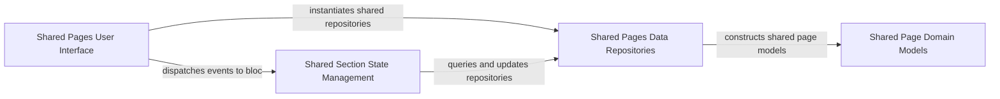

## Details

Displays and manages the list of shared pages accessible to the user across desktop and mobile layouts.

### Shared Pages User Interface
Renders mobile and desktop UI widgets for browsing shared pages, loading indicators, headers, and action menus.

**Related Classes/Methods**:

- `frontend.appflowy_flutter.lib.features.shared_section.presentation.shared_section.SharedSection`:26-159
- `frontend.appflowy_flutter.lib.features.shared_section.presentation.m_shared_section.MSharedSection`:17-92

**Source Files:**

- `frontend/appflowy_flutter/lib/features/shared_section/presentation/m_shared_section.dart`
  - `frontend.appflowy_flutter.lib.features.shared_section.presentation.m_shared_section.MSharedSection` (L17-L92) - Class
  - `frontend.appflowy_flutter.lib.features.shared_section.presentation.m_shared_section.MSharedSection.MSharedSection` (L18-L21) - Constructor
  - `frontend.appflowy_flutter.lib.features.shared_section.presentation.m_shared_section.MSharedSection.build` (L26-L91) - Method
- `frontend/appflowy_flutter/lib/features/shared_section/presentation/shared_section.dart`
  - `frontend.appflowy_flutter.lib.features.shared_section.presentation.shared_section.SharedSection` (L26-L159) - Class
  - `frontend.appflowy_flutter.lib.features.shared_section.presentation.shared_section.SharedSection.SharedSection` (L27-L30) - Constructor
  - `frontend.appflowy_flutter.lib.features.shared_section.presentation.shared_section.SharedSection.build` (L35-L158) - Method
- `frontend/appflowy_flutter/lib/features/shared_section/presentation/widgets/m_shared_page_list.dart`
  - `frontend.appflowy_flutter.lib.features.shared_section.presentation.widgets.m_shared_page_list.MSharedPageList` (L8-L38) - Class
  - `frontend.appflowy_flutter.lib.features.shared_section.presentation.widgets.m_shared_page_list.MSharedPageList.MSharedPageList` (L9-L13) - Constructor
  - `frontend.appflowy_flutter.lib.features.shared_section.presentation.widgets.m_shared_page_list.MSharedPageList.build` (L19-L37) - Method
- `frontend/appflowy_flutter/lib/features/shared_section/presentation/widgets/m_shared_section_header.dart`
  - `frontend.appflowy_flutter.lib.features.shared_section.presentation.widgets.m_shared_section_header.MSharedSectionHeader` (L10-L38) - Class
  - `frontend.appflowy_flutter.lib.features.shared_section.presentation.widgets.m_shared_section_header.MSharedSectionHeader.MSharedSectionHeader` (L11-L13) - Constructor
  - `frontend.appflowy_flutter.lib.features.shared_section.presentation.widgets.m_shared_section_header.MSharedSectionHeader.build` (L16-L37) - Method
- `frontend/appflowy_flutter/lib/features/shared_section/presentation/widgets/refresh_button.dart`
  - `frontend.appflowy_flutter.lib.features.shared_section.presentation.widgets.refresh_button.RefreshSharedSectionButton` (L4-L25) - Class
  - `frontend.appflowy_flutter.lib.features.shared_section.presentation.widgets.refresh_button.RefreshSharedSectionButton.RefreshSharedSectionButton` (L5-L8) - Constructor
  - `frontend.appflowy_flutter.lib.features.shared_section.presentation.widgets.refresh_button.RefreshSharedSectionButton.build` (L13-L24) - Method
- `frontend/appflowy_flutter/lib/features/shared_section/presentation/widgets/shared_page_actions_button.dart`
  - `frontend.appflowy_flutter.lib.features.shared_section.presentation.widgets.shared_page_actions_button.SharedPageActionsButtonCallback` (L8-L12) - Class
  - `frontend.appflowy_flutter.lib.features.shared_section.presentation.widgets.shared_page_actions_button.SharedPageActionsButtonSetEditingCallback` (L14-L17) - Class
  - `frontend.appflowy_flutter.lib.features.shared_section.presentation.widgets.shared_page_actions_button.SharedPageActionsButton` (L19-L40) - Class
  - `frontend.appflowy_flutter.lib.features.shared_section.presentation.widgets.shared_page_actions_button.SharedPageActionsButton.SharedPageActionsButton` (L20-L28) - Constructor
  - `frontend.appflowy_flutter.lib.features.shared_section.presentation.widgets.shared_page_actions_button.SharedPageActionsButton.createState` (L38-L39) - Method
  - `frontend.appflowy_flutter.lib.features.shared_section.presentation.widgets.shared_page_actions_button._SharedPageActionsButtonState` (L42-L158) - Class
  - `frontend.appflowy_flutter.lib.features.shared_section.presentation.widgets.shared_page_actions_button._SharedPageActionsButtonState.initState` (L46-L54) - Method
  - `frontend.appflowy_flutter.lib.features.shared_section.presentation.widgets.shared_page_actions_button._SharedPageActionsButtonState.dispose` (L57-L61) - Method
  - `frontend.appflowy_flutter.lib.features.shared_section.presentation.widgets.shared_page_actions_button._SharedPageActionsButtonState.build` (L64-L80) - Method
  - `frontend.appflowy_flutter.lib.features.shared_section.presentation.widgets.shared_page_actions_button._SharedPageActionsButtonState._buildMenuItems` (L82-L116) - Method
  - `frontend.appflowy_flutter.lib.features.shared_section.presentation.widgets.shared_page_actions_button._SharedPageActionsButtonState._buildActionTypes` (L118-L157) - Method
- `frontend/appflowy_flutter/lib/features/shared_section/presentation/widgets/shared_page_list.dart`
  - `frontend.appflowy_flutter.lib.features.shared_section.presentation.widgets.shared_page_list.SharedPageList` (L13-L82) - Class
  - `frontend.appflowy_flutter.lib.features.shared_section.presentation.widgets.shared_page_list.SharedPageList.SharedPageList` (L14-L21) - Constructor
  - `frontend.appflowy_flutter.lib.features.shared_section.presentation.widgets.shared_page_list.SharedPageList.build` (L30-L60) - Method
  - `frontend.appflowy_flutter.lib.features.shared_section.presentation.widgets.shared_page_list.SharedPageList._buildSharedPageMoreActionButton` (L62-L81) - Method
- `frontend/appflowy_flutter/lib/features/shared_section/presentation/widgets/shared_section_empty.dart`
  - `frontend.appflowy_flutter.lib.features.shared_section.presentation.widgets.shared_section_empty.SharedSectionEmpty` (L6-L41) - Class
  - `frontend.appflowy_flutter.lib.features.shared_section.presentation.widgets.shared_section_empty.SharedSectionEmpty.SharedSectionEmpty` (L7-L7) - Constructor
  - `frontend.appflowy_flutter.lib.features.shared_section.presentation.widgets.shared_section_empty.SharedSectionEmpty.build` (L10-L40) - Method
- `frontend/appflowy_flutter/lib/features/shared_section/presentation/widgets/shared_section_error.dart`
  - `frontend.appflowy_flutter.lib.features.shared_section.presentation.widgets.shared_section_error.SharedSectionError` (L4-L25) - Class
  - `frontend.appflowy_flutter.lib.features.shared_section.presentation.widgets.shared_section_error.SharedSectionError.SharedSectionError` (L5-L8) - Constructor
  - `frontend.appflowy_flutter.lib.features.shared_section.presentation.widgets.shared_section_error.SharedSectionError.build` (L13-L24) - Method
- `frontend/appflowy_flutter/lib/features/shared_section/presentation/widgets/shared_section_header.dart`
  - `frontend.appflowy_flutter.lib.features.shared_section.presentation.widgets.shared_section_header.SharedSectionHeader` (L7-L35) - Class
  - `frontend.appflowy_flutter.lib.features.shared_section.presentation.widgets.shared_section_header.SharedSectionHeader.SharedSectionHeader` (L8-L11) - Constructor
  - `frontend.appflowy_flutter.lib.features.shared_section.presentation.widgets.shared_section_header.SharedSectionHeader.build` (L16-L34) - Method
- `frontend/appflowy_flutter/lib/features/shared_section/presentation/widgets/shared_section_loading.dart`
  - `frontend.appflowy_flutter.lib.features.shared_section.presentation.widgets.shared_section_loading.SharedSectionLoading` (L4-L16) - Class
  - `frontend.appflowy_flutter.lib.features.shared_section.presentation.widgets.shared_section_loading.SharedSectionLoading.SharedSectionLoading` (L5-L5) - Constructor
  - `frontend.appflowy_flutter.lib.features.shared_section.presentation.widgets.shared_section_loading.SharedSectionLoading.build` (L8-L15) - Method

### Shared Pages Data Repositories
Provides repository abstractions and implementations for fetching and managing shared pages from Rust and local sources.

**Related Classes/Methods**:

- `frontend.appflowy_flutter.lib.features.shared_section.data.repositories.shared_pages_repository.SharedPagesRepository`:9-15
- `frontend.appflowy_flutter.lib.features.shared_section.data.repositories.rust_shared_pages_repository_impl.RustSharePagesRepositoryImpl`:10-63
- `frontend.appflowy_flutter.lib.features.shared_section.data.repositories.local_shared_pages_repository_impl.LocalSharedPagesRepositoryImpl`:9-39

**Source Files:**

- `frontend/appflowy_flutter/lib/features/shared_section/data/repositories/local_shared_pages_repository_impl.dart`
  - `frontend.appflowy_flutter.lib.features.shared_section.data.repositories.local_shared_pages_repository_impl.LocalSharedPagesRepositoryImpl` (L9-L39) - Class
  - `frontend.appflowy_flutter.lib.features.shared_section.data.repositories.local_shared_pages_repository_impl.LocalSharedPagesRepositoryImpl.getSharedPages` (L11-L33) - Method
  - `frontend.appflowy_flutter.lib.features.shared_section.data.repositories.local_shared_pages_repository_impl.LocalSharedPagesRepositoryImpl.leaveSharedPage` (L36-L38) - Method
- `frontend/appflowy_flutter/lib/features/shared_section/data/repositories/rust_shared_pages_repository_impl.dart`
  - `frontend.appflowy_flutter.lib.features.shared_section.data.repositories.rust_shared_pages_repository_impl.RustSharePagesRepositoryImpl` (L10-L63) - Class
  - `frontend.appflowy_flutter.lib.features.shared_section.data.repositories.rust_shared_pages_repository_impl.RustSharePagesRepositoryImpl.getSharedPages` (L12-L28) - Method
  - `frontend.appflowy_flutter.lib.features.shared_section.data.repositories.rust_shared_pages_repository_impl.RustSharePagesRepositoryImpl.leaveSharedPage` (L31-L62) - Method
- `frontend/appflowy_flutter/lib/features/shared_section/data/repositories/shared_pages_repository.dart`
  - `frontend.appflowy_flutter.lib.features.shared_section.data.repositories.shared_pages_repository.SharedPagesRepository` (L9-L15) - Class
  - `frontend.appflowy_flutter.lib.features.shared_section.data.repositories.shared_pages_repository.SharedPagesRepository.getSharedPages` (L11-L11) - Method
  - `frontend.appflowy_flutter.lib.features.shared_section.data.repositories.shared_pages_repository.SharedPagesRepository.leaveSharedPage` (L14-L14) - Method

### Shared Section State Management
Manages shared section business logic, event handling, and state transitions using the BLoC pattern.

**Related Classes/Methods**:

- `frontend.appflowy_flutter.lib.features.shared_section.logic.shared_section_bloc.SharedSectionBloc`:16-195
- `frontend.appflowy_flutter.lib.features.shared_section.logic.shared_section_event.SharedSectionEvent`:4-27

**Source Files:**

- `frontend/appflowy_flutter/lib/features/shared_section/logic/shared_section_bloc.dart`
  - `frontend.appflowy_flutter.lib.features.shared_section.logic.shared_section_bloc.SharedSectionBloc` (L16-L195) - Class
  - `frontend.appflowy_flutter.lib.features.shared_section.logic.shared_section_bloc.SharedSectionBloc.SharedSectionBloc` (L17-L28) - Constructor
  - `frontend.appflowy_flutter.lib.features.shared_section.logic.shared_section_bloc.SharedSectionBloc.close` (L49-L53) - Method
  - `frontend.appflowy_flutter.lib.features.shared_section.logic.shared_section_bloc.SharedSectionBloc._onInit` (L55-L87) - Method
  - `frontend.appflowy_flutter.lib.features.shared_section.logic.shared_section_bloc.SharedSectionBloc._onRefresh` (L89-L111) - Method
  - `frontend.appflowy_flutter.lib.features.shared_section.logic.shared_section_bloc.SharedSectionBloc._onUpdateSharedPages` (L113-L122) - Method
  - `frontend.appflowy_flutter.lib.features.shared_section.logic.shared_section_bloc.SharedSectionBloc._onToggleExpanded` (L124-L133) - Method
  - `frontend.appflowy_flutter.lib.features.shared_section.logic.shared_section_bloc.SharedSectionBloc._initFolderNotificationListener` (L135-L158) - Method
  - `frontend.appflowy_flutter.lib.features.shared_section.logic.shared_section_bloc.SharedSectionBloc._onLeaveSharedPage` (L160-L180) - Method
  - `frontend.appflowy_flutter.lib.features.shared_section.logic.shared_section_bloc.SharedSectionBloc._startPollingIfNeeded` (L182-L194) - Method
- `frontend/appflowy_flutter/lib/features/shared_section/logic/shared_section_event.dart`
  - `frontend.appflowy_flutter.lib.features.shared_section.logic.shared_section_event.SharedSectionEvent` (L4-L27) - Class
  - `frontend.appflowy_flutter.lib.features.shared_section.logic.shared_section_event.SharedSectionEvent.SharedSectionEvent` (L5-L5) - Constructor
  - `frontend.appflowy_flutter.lib.features.shared_section.logic.shared_section_event.SharedSectionEvent.SharedSectionEvent.init` (L9-L9) - Constructor
  - `frontend.appflowy_flutter.lib.features.shared_section.logic.shared_section_event.SharedSectionEvent.SharedSectionEvent.refresh` (L12-L12) - Constructor
  - `frontend.appflowy_flutter.lib.features.shared_section.logic.shared_section_event.SharedSectionEvent.SharedSectionEvent.updateSharedPages` (L15-L17) - Constructor
  - `frontend.appflowy_flutter.lib.features.shared_section.logic.shared_section_event.SharedSectionEvent.SharedSectionEvent.toggleExpanded` (L20-L21) - Constructor
  - `frontend.appflowy_flutter.lib.features.shared_section.logic.shared_section_event.SharedSectionEvent.SharedSectionEvent.leaveSharedPage` (L24-L26) - Constructor
  - `frontend.appflowy_flutter.lib.features.shared_section.logic.shared_section_event.SharedSectionInitEvent` (L29-L31) - Class
  - `frontend.appflowy_flutter.lib.features.shared_section.logic.shared_section_event.SharedSectionInitEvent.SharedSectionInitEvent` (L30-L30) - Constructor
  - `frontend.appflowy_flutter.lib.features.shared_section.logic.shared_section_event.SharedSectionRefreshEvent` (L33-L35) - Class
  - `frontend.appflowy_flutter.lib.features.shared_section.logic.shared_section_event.SharedSectionRefreshEvent.SharedSectionRefreshEvent` (L34-L34) - Constructor
  - `frontend.appflowy_flutter.lib.features.shared_section.logic.shared_section_event.SharedSectionUpdateSharedPagesEvent` (L37-L43) - Class
  - `frontend.appflowy_flutter.lib.features.shared_section.logic.shared_section_event.SharedSectionUpdateSharedPagesEvent.SharedSectionUpdateSharedPagesEvent` (L38-L40) - Constructor
  - `frontend.appflowy_flutter.lib.features.shared_section.logic.shared_section_event.SharedSectionToggleExpandedEvent` (L45-L47) - Class
  - `frontend.appflowy_flutter.lib.features.shared_section.logic.shared_section_event.SharedSectionToggleExpandedEvent.SharedSectionToggleExpandedEvent` (L46-L46) - Constructor
  - `frontend.appflowy_flutter.lib.features.shared_section.logic.shared_section_event.SharedSectionLeaveSharedPageEvent` (L49-L55) - Class
  - `frontend.appflowy_flutter.lib.features.shared_section.logic.shared_section_event.SharedSectionLeaveSharedPageEvent.SharedSectionLeaveSharedPageEvent` (L50-L52) - Constructor
- `frontend/appflowy_flutter/lib/features/shared_section/logic/shared_section_state.dart`
  - `frontend.appflowy_flutter.lib.features.shared_section.logic.shared_section_state.SharedSectionState` (L3-L56) - Class
  - `frontend.appflowy_flutter.lib.features.shared_section.logic.shared_section_state.SharedSectionState.SharedSectionState.initial` (L4-L4) - Constructor
  - `frontend.appflowy_flutter.lib.features.shared_section.logic.shared_section_state.SharedSectionState.SharedSectionState` (L6-L11) - Constructor
  - `frontend.appflowy_flutter.lib.features.shared_section.logic.shared_section_state.SharedSectionState.copyWith` (L18-L30) - Method
  - `frontend.appflowy_flutter.lib.features.shared_section.logic.shared_section_state.SharedSectionState.==` (L33-L40) - Method
  - `frontend.appflowy_flutter.lib.features.shared_section.logic.shared_section_state.SharedSectionState.hashCode` (L43-L50) - Method
  - `frontend.appflowy_flutter.lib.features.shared_section.logic.shared_section_state.SharedSectionState.toString` (L53-L55) - Method

### Shared Page Domain Models
Defines data structures representing shared page entities.

**Related Classes/Methods**:

- `frontend.appflowy_flutter.lib.features.shared_section.models.shared_page.SharedPage`:6-14

**Source Files:**

- `frontend/appflowy_flutter/lib/features/shared_section/models/shared_page.dart`
  - `frontend.appflowy_flutter.lib.features.shared_section.models.shared_page.SharedPage` (L6-L14) - Class
  - `frontend.appflowy_flutter.lib.features.shared_section.models.shared_page.SharedPage.SharedPage` (L7-L10) - Constructor

### [FAQ](https://github.com/CodeBoarding/GeneratedOnBoardings/tree/main?tab=readme-ov-file#faq)