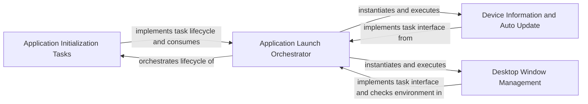

## Details

Orchestrates application launch sequencing, executes initialization tasks, and handles runtime lifecycle events.

### Application Initialization Tasks
Implements concrete launch tasks for backend SDK initialization, cloud connectivity, plugin loading, deep linking, error catching, and Flutter widget setup.

**Related Classes/Methods**:

- `frontend.appflowy_flutter.lib.startup.tasks.rust_sdk.InitRustSDKTask`:13-44
- `frontend.appflowy_flutter.lib.startup.tasks.appflowy_cloud_task.InitAppFlowyCloudTask`:228-261
- `frontend.appflowy_flutter.lib.startup.tasks.load_plugin.PluginLoadTask`:12-44
- `frontend.appflowy_flutter.lib.startup.tasks.app_widget.InitAppWidgetTask`:41-125
- `frontend.appflowy_flutter.lib.startup.tasks.app_widget.ApplicationWidget`:127-143

**Source Files:**

- `frontend/appflowy_flutter/lib/startup/tasks/af_navigator_observer.dart`
  - `frontend.appflowy_flutter.lib.startup.tasks.af_navigator_observer.AFNavigatorObserver` (L3-L34) - Class
  - `frontend.appflowy_flutter.lib.startup.tasks.af_navigator_observer.AFNavigatorObserver.addListener` (L6-L8) - Method
  - `frontend.appflowy_flutter.lib.startup.tasks.af_navigator_observer.AFNavigatorObserver.removeListener` (L10-L12) - Method
  - `frontend.appflowy_flutter.lib.startup.tasks.af_navigator_observer.AFNavigatorObserver.didPush` (L15-L19) - Method
  - `frontend.appflowy_flutter.lib.startup.tasks.af_navigator_observer.AFNavigatorObserver.didPop` (L22-L26) - Method
  - `frontend.appflowy_flutter.lib.startup.tasks.af_navigator_observer.AFNavigatorObserver.didReplace` (L29-L33) - Method
  - `frontend.appflowy_flutter.lib.startup.tasks.af_navigator_observer.RouteInfo` (L36-L41) - Class
  - `frontend.appflowy_flutter.lib.startup.tasks.af_navigator_observer.RouteInfo.RouteInfo` (L37-L37) - Constructor
  - `frontend.appflowy_flutter.lib.startup.tasks.af_navigator_observer.PushRouterInfo` (L43-L45) - Class
  - `frontend.appflowy_flutter.lib.startup.tasks.af_navigator_observer.PushRouterInfo.PushRouterInfo` (L44-L44) - Constructor
  - `frontend.appflowy_flutter.lib.startup.tasks.af_navigator_observer.PopRouterInfo` (L47-L49) - Class
  - `frontend.appflowy_flutter.lib.startup.tasks.af_navigator_observer.PopRouterInfo.PopRouterInfo` (L48-L48) - Constructor
  - `frontend.appflowy_flutter.lib.startup.tasks.af_navigator_observer.ReplaceRouterInfo` (L51-L53) - Class
  - `frontend.appflowy_flutter.lib.startup.tasks.af_navigator_observer.ReplaceRouterInfo.ReplaceRouterInfo` (L52-L52) - Constructor
- `frontend/appflowy_flutter/lib/startup/tasks/app_widget.dart`
  - `frontend.appflowy_flutter.lib.startup.tasks.app_widget.InitAppWidgetTask` (L41-L125) - Class
  - `frontend.appflowy_flutter.lib.startup.tasks.app_widget.InitAppWidgetTask.InitAppWidgetTask` (L42-L42) - Constructor
  - `frontend.appflowy_flutter.lib.startup.tasks.app_widget.InitAppWidgetTask.type` (L45-L45) - Method
  - `frontend.appflowy_flutter.lib.startup.tasks.app_widget.InitAppWidgetTask.initialize` (L48-L124) - Method
  - `frontend.appflowy_flutter.lib.startup.tasks.app_widget.ApplicationWidget` (L127-L143) - Class
  - `frontend.appflowy_flutter.lib.startup.tasks.app_widget.ApplicationWidget.ApplicationWidget` (L128-L134) - Constructor
  - `frontend.appflowy_flutter.lib.startup.tasks.app_widget.ApplicationWidget.createState` (L142-L142) - Method
  - `frontend.appflowy_flutter.lib.startup.tasks.app_widget._ApplicationWidgetState` (L145-L301) - Class
  - `frontend.appflowy_flutter.lib.startup.tasks.app_widget._ApplicationWidgetState.initState` (L153-L157) - Method
  - `frontend.appflowy_flutter.lib.startup.tasks.app_widget._ApplicationWidgetState.dispose` (L160-L163) - Method
  - `frontend.appflowy_flutter.lib.startup.tasks.app_widget._ApplicationWidgetState.build` (L166-L286) - Method
  - `frontend.appflowy_flutter.lib.startup.tasks.app_widget._ApplicationWidgetState._setSystemOverlayStyle` (L288-L300) - Method
  - `frontend.appflowy_flutter.lib.startup.tasks.app_widget.AppGlobals` (L303-L309) - Class
  - `frontend.appflowy_flutter.lib.startup.tasks.app_widget.AppGlobals.nav` (L306-L306) - Method
  - `frontend.appflowy_flutter.lib.startup.tasks.app_widget.AppGlobals.context` (L308-L308) - Method
  - `frontend.appflowy_flutter.lib.startup.tasks.app_widget.appTheme` (L311-L321) - Function
- `frontend/appflowy_flutter/lib/startup/tasks/appflowy_cloud_task.dart`
  - `frontend.appflowy_flutter.lib.startup.tasks.appflowy_cloud_task.AppFlowyCloudDeepLink` (L26-L226) - Class
  - `frontend.appflowy_flutter.lib.startup.tasks.appflowy_cloud_task.AppFlowyCloudDeepLink.AppFlowyCloudDeepLink` (L27-L49) - Constructor
  - `frontend.appflowy_flutter.lib.startup.tasks.appflowy_cloud_task.AppFlowyCloudDeepLink.completer=` (L55-L58) - Method
  - `frontend.appflowy_flutter.lib.startup.tasks.appflowy_cloud_task.AppFlowyCloudDeepLink.dispose` (L63-L70) - Method
  - `frontend.appflowy_flutter.lib.startup.tasks.appflowy_cloud_task.AppFlowyCloudDeepLink.registerCompleter` (L72-L76) - Method
  - `frontend.appflowy_flutter.lib.startup.tasks.appflowy_cloud_task.AppFlowyCloudDeepLink.subscribeDeepLinkLoadingState` (L78-L89) - Method
  - `frontend.appflowy_flutter.lib.startup.tasks.appflowy_cloud_task.AppFlowyCloudDeepLink.subscribeDeepLinkLoadingState.listenerFn` (L81-L85) - Function
  - `frontend.appflowy_flutter.lib.startup.tasks.appflowy_cloud_task.AppFlowyCloudDeepLink.unsubscribeDeepLinkLoadingState` (L91-L92) - Method
  - `frontend.appflowy_flutter.lib.startup.tasks.appflowy_cloud_task.AppFlowyCloudDeepLink.passGotrueTokenResponse` (L94-L99) - Method
  - `frontend.appflowy_flutter.lib.startup.tasks.appflowy_cloud_task.AppFlowyCloudDeepLink._handleUri` (L101-L174) - Method
  - `frontend.appflowy_flutter.lib.startup.tasks.appflowy_cloud_task.AppFlowyCloudDeepLink._buildDeepLinkUri` (L176-L225) - Method
  - `frontend.appflowy_flutter.lib.startup.tasks.appflowy_cloud_task.InitAppFlowyCloudTask` (L228-L261) - Class
  - `frontend.appflowy_flutter.lib.startup.tasks.appflowy_cloud_task.InitAppFlowyCloudTask.initialize` (L233-L252) - Method
  - `frontend.appflowy_flutter.lib.startup.tasks.appflowy_cloud_task.InitAppFlowyCloudTask.dispose` (L255-L260) - Method
  - `frontend.appflowy_flutter.lib.startup.tasks.appflowy_cloud_task._AppLinkWrapper` (L264-L293) - Class
  - `frontend.appflowy_flutter.lib.startup.tasks.appflowy_cloud_task._AppLinkWrapper._AppLinkWrapper._` (L265-L269) - Constructor
  - `frontend.appflowy_flutter.lib.startup.tasks.appflowy_cloud_task._AppLinkWrapper.listen` (L277-L287) - Method
  - `frontend.appflowy_flutter.lib.startup.tasks.appflowy_cloud_task._AppLinkWrapper.dispose` (L289-L292) - Method
- `frontend/appflowy_flutter/lib/startup/tasks/debug_task.dart`
  - `frontend.appflowy_flutter.lib.startup.tasks.debug_task.DebugTask` (L9-L47) - Class
  - `frontend.appflowy_flutter.lib.startup.tasks.debug_task.DebugTask.DebugTask` (L10-L10) - Constructor
  - `frontend.appflowy_flutter.lib.startup.tasks.debug_task.DebugTask.initialize` (L15-L46) - Method
- `frontend/appflowy_flutter/lib/startup/tasks/deeplink/deeplink_handler.dart`
  - `frontend.appflowy_flutter.lib.startup.tasks.deeplink.deeplink_handler.DeepLinkResultHandler` (L7-L10) - Class
  - `frontend.appflowy_flutter.lib.startup.tasks.deeplink.deeplink_handler.DeepLinkStateHandler` (L12-L15) - Class
  - `frontend.appflowy_flutter.lib.startup.tasks.deeplink.deeplink_handler.DeepLinkErrorHandler` (L17-L19) - Class
  - `frontend.appflowy_flutter.lib.startup.tasks.deeplink.deeplink_handler.DeepLinkHandler` (L21-L31) - Class
  - `frontend.appflowy_flutter.lib.startup.tasks.deeplink.deeplink_handler.DeepLinkHandler.canHandle` (L23-L23) - Method
  - `frontend.appflowy_flutter.lib.startup.tasks.deeplink.deeplink_handler.DeepLinkHandler.handle` (L27-L30) - Method
  - `frontend.appflowy_flutter.lib.startup.tasks.deeplink.deeplink_handler.DeepLinkHandlerRegistry` (L33-L78) - Class
  - `frontend.appflowy_flutter.lib.startup.tasks.deeplink.deeplink_handler.DeepLinkHandlerRegistry.DeepLinkHandlerRegistry._` (L34-L34) - Constructor
  - `frontend.appflowy_flutter.lib.startup.tasks.deeplink.deeplink_handler.DeepLinkHandlerRegistry.register` (L40-L42) - Method
  - `frontend.appflowy_flutter.lib.startup.tasks.deeplink.deeplink_handler.DeepLinkHandlerRegistry.processDeepLink` (L44-L77) - Method
  - `frontend.appflowy_flutter.lib.startup.tasks.deeplink.deeplink_handler.DeepLinkResult` (L80-L87) - Class
  - `frontend.appflowy_flutter.lib.startup.tasks.deeplink.deeplink_handler.DeepLinkResult.DeepLinkResult` (L81-L84) - Constructor
  - `frontend.appflowy_flutter.lib.startup.tasks.deeplink.deeplink_handler.DeepLinkState` (L89-L94) - Enum
  - `frontend.appflowy_flutter.lib.startup.tasks.deeplink.deeplink_handler.DeepLinkState.none` (L90-L90) - Enum
  - `frontend.appflowy_flutter.lib.startup.tasks.deeplink.deeplink_handler.DeepLinkState.loading` (L91-L91) - Enum
  - `frontend.appflowy_flutter.lib.startup.tasks.deeplink.deeplink_handler.DeepLinkState.finish` (L92-L92) - Enum
  - `frontend.appflowy_flutter.lib.startup.tasks.deeplink.deeplink_handler.DeepLinkState.error` (L93-L93) - Enum
- `frontend/appflowy_flutter/lib/startup/tasks/deeplink/expire_login_deeplink_handler.dart`
  - `frontend.appflowy_flutter.lib.startup.tasks.deeplink.expire_login_deeplink_handler.ExpireLoginDeepLinkHandler` (L9-L31) - Class
  - `frontend.appflowy_flutter.lib.startup.tasks.deeplink.expire_login_deeplink_handler.ExpireLoginDeepLinkHandler.canHandle` (L11-L18) - Method
  - `frontend.appflowy_flutter.lib.startup.tasks.deeplink.expire_login_deeplink_handler.ExpireLoginDeepLinkHandler.handle` (L21-L30) - Method
- `frontend/appflowy_flutter/lib/startup/tasks/deeplink/invitation_deeplink_handler.dart`
  - `frontend.appflowy_flutter.lib.startup.tasks.deeplink.invitation_deeplink_handler.InvitationDeepLinkHandler` (L10-L67) - Class
  - `frontend.appflowy_flutter.lib.startup.tasks.deeplink.invitation_deeplink_handler.InvitationDeepLinkHandler.canHandle` (L16-L35) - Method
  - `frontend.appflowy_flutter.lib.startup.tasks.deeplink.invitation_deeplink_handler.InvitationDeepLinkHandler.handle` (L38-L66) - Method
- `frontend/appflowy_flutter/lib/startup/tasks/deeplink/login_deeplink_handler.dart`
  - `frontend.appflowy_flutter.lib.startup.tasks.deeplink.login_deeplink_handler.LoginDeepLinkHandler` (L11-L44) - Class
  - `frontend.appflowy_flutter.lib.startup.tasks.deeplink.login_deeplink_handler.LoginDeepLinkHandler.canHandle` (L13-L20) - Method
  - `frontend.appflowy_flutter.lib.startup.tasks.deeplink.login_deeplink_handler.LoginDeepLinkHandler.handle` (L23-L43) - Method
- `frontend/appflowy_flutter/lib/startup/tasks/deeplink/open_app_deeplink_handler.dart`
  - `frontend.appflowy_flutter.lib.startup.tasks.deeplink.open_app_deeplink_handler.OpenAppDeepLinkHandler` (L7-L20) - Class
  - `frontend.appflowy_flutter.lib.startup.tasks.deeplink.open_app_deeplink_handler.OpenAppDeepLinkHandler.canHandle` (L9-L11) - Method
  - `frontend.appflowy_flutter.lib.startup.tasks.deeplink.open_app_deeplink_handler.OpenAppDeepLinkHandler.handle` (L14-L19) - Method
- `frontend/appflowy_flutter/lib/startup/tasks/deeplink/payment_deeplink_handler.dart`
  - `frontend.appflowy_flutter.lib.startup.tasks.deeplink.payment_deeplink_handler.PaymentDeepLinkHandler` (L8-L24) - Class
  - `frontend.appflowy_flutter.lib.startup.tasks.deeplink.payment_deeplink_handler.PaymentDeepLinkHandler.canHandle` (L10-L12) - Method
  - `frontend.appflowy_flutter.lib.startup.tasks.deeplink.payment_deeplink_handler.PaymentDeepLinkHandler.handle` (L15-L23) - Method
- `frontend/appflowy_flutter/lib/startup/tasks/feature_flag_task.dart`
  - `frontend.appflowy_flutter.lib.startup.tasks.feature_flag_task.FeatureFlagTask` (L6-L20) - Class
  - `frontend.appflowy_flutter.lib.startup.tasks.feature_flag_task.FeatureFlagTask.FeatureFlagTask` (L7-L7) - Constructor
  - `frontend.appflowy_flutter.lib.startup.tasks.feature_flag_task.FeatureFlagTask.initialize` (L10-L19) - Method
- `frontend/appflowy_flutter/lib/startup/tasks/file_storage_task.dart`
  - `frontend.appflowy_flutter.lib.startup.tasks.file_storage_task.FileStorageTask` (L17-L29) - Class
  - `frontend.appflowy_flutter.lib.startup.tasks.file_storage_task.FileStorageTask.FileStorageTask` (L18-L18) - Constructor
  - `frontend.appflowy_flutter.lib.startup.tasks.file_storage_task.FileStorageTask.initialize` (L21-L28) - Method
  - `frontend.appflowy_flutter.lib.startup.tasks.file_storage_task.FileStorageService` (L31-L92) - Class
  - `frontend.appflowy_flutter.lib.startup.tasks.file_storage_task.FileStorageService.FileStorageService` (L32-L54) - Constructor
  - `frontend.appflowy_flutter.lib.startup.tasks.file_storage_task.FileStorageService.onFileProgress` (L61-L75) - Method
  - `frontend.appflowy_flutter.lib.startup.tasks.file_storage_task.FileStorageService.getFileState` (L77-L80) - Method
  - `frontend.appflowy_flutter.lib.startup.tasks.file_storage_task.FileStorageService.dispose` (L82-L91) - Method
  - `frontend.appflowy_flutter.lib.startup.tasks.file_storage_task.FileProgress` (L94-L133) - Class
  - `frontend.appflowy_flutter.lib.startup.tasks.file_storage_task.FileProgress.FileProgress` (L95-L99) - Constructor
  - `frontend.appflowy_flutter.lib.startup.tasks.file_storage_task.FileProgress.fromJson` (L101-L118) - Method
  - `frontend.appflowy_flutter.lib.startup.tasks.file_storage_task.FileProgress.fromJsonString` (L121-L128) - Method
  - `frontend.appflowy_flutter.lib.startup.tasks.file_storage_task.AutoRemoveNotifier` (L135-L150) - Class
  - `frontend.appflowy_flutter.lib.startup.tasks.file_storage_task.AutoRemoveNotifier.AutoRemoveNotifier` (L136-L140) - Constructor
  - `frontend.appflowy_flutter.lib.startup.tasks.file_storage_task.AutoRemoveNotifier.dispose` (L146-L149) - Method
- `frontend/appflowy_flutter/lib/startup/tasks/generate_router.dart`
  - `frontend.appflowy_flutter.lib.startup.tasks.generate_router.generateRouter` (L46-L129) - Function
  - `frontend.appflowy_flutter.lib.startup.tasks.generate_router._mobileHomeScreenWithNavigationBarRoute` (L132-L216) - Function
  - `frontend.appflowy_flutter.lib.startup.tasks.generate_router._mobileHomeSettingPageRoute` (L218-L229) - Function
  - `frontend.appflowy_flutter.lib.startup.tasks.generate_router._mobileNotificationMultiSelectPageRoute` (L231-L242) - Function
  - `frontend.appflowy_flutter.lib.startup.tasks.generate_router._mobileInviteMembersPageRoute` (L244-L255) - Function
  - `frontend.appflowy_flutter.lib.startup.tasks.generate_router._mobileAddMembersPageRoute` (L257-L268) - Function
  - `frontend.appflowy_flutter.lib.startup.tasks.generate_router._mobileCloudSettingAppFlowyCloudPageRoute` (L270-L281) - Function
  - `frontend.appflowy_flutter.lib.startup.tasks.generate_router._mobileLaunchSettingsPageRoute` (L283-L294) - Function
  - `frontend.appflowy_flutter.lib.startup.tasks.generate_router._mobileFeatureFlagPageRoute` (L296-L307) - Function
  - `frontend.appflowy_flutter.lib.startup.tasks.generate_router._mobileHomeTrashPageRoute` (L309-L320) - Function
  - `frontend.appflowy_flutter.lib.startup.tasks.generate_router._mobileBlockSettingsPageRoute` (L322-L341) - Function
  - `frontend.appflowy_flutter.lib.startup.tasks.generate_router._mobileEmojiPickerPageRoute` (L343-L383) - Function
  - `frontend.appflowy_flutter.lib.startup.tasks.generate_router._mobileColorPickerPageRoute` (L385-L398) - Function
  - `frontend.appflowy_flutter.lib.startup.tasks.generate_router._mobileImagePickerPageRoute` (L400-L411) - Function
  - `frontend.appflowy_flutter.lib.startup.tasks.generate_router._mobileCodeLanguagePickerPageRoute` (L413-L424) - Function
  - `frontend.appflowy_flutter.lib.startup.tasks.generate_router._mobileLanguagePickerPageRoute` (L426-L437) - Function
  - `frontend.appflowy_flutter.lib.startup.tasks.generate_router._mobileFontPickerPageRoute` (L439-L450) - Function
  - `frontend.appflowy_flutter.lib.startup.tasks.generate_router._mobileNewPropertyPageRoute` (L452-L473) - Function
  - `frontend.appflowy_flutter.lib.startup.tasks.generate_router._mobileEditPropertyPageRoute` (L475-L491) - Function
  - `frontend.appflowy_flutter.lib.startup.tasks.generate_router._mobileCalendarEventsPageRoute` (L493-L512) - Function
  - `frontend.appflowy_flutter.lib.startup.tasks.generate_router._desktopHomeScreenRoute` (L514-L525) - Function
  - `frontend.appflowy_flutter.lib.startup.tasks.generate_router._workspaceErrorScreenRoute` (L527-L542) - Function
  - `frontend.appflowy_flutter.lib.startup.tasks.generate_router._skipLogInScreenRoute` (L544-L555) - Function
  - `frontend.appflowy_flutter.lib.startup.tasks.generate_router._signInScreenRoute` (L557-L568) - Function
  - `frontend.appflowy_flutter.lib.startup.tasks.generate_router._mobileEditorScreenRoute` (L570-L614) - Function
  - `frontend.appflowy_flutter.lib.startup.tasks.generate_router._mobileChatScreenRoute` (L616-L629) - Function
  - `frontend.appflowy_flutter.lib.startup.tasks.generate_router._mobileGridScreenRoute` (L631-L649) - Function
  - `frontend.appflowy_flutter.lib.startup.tasks.generate_router._mobileBoardScreenRoute` (L651-L666) - Function
  - `frontend.appflowy_flutter.lib.startup.tasks.generate_router._mobileCalendarScreenRoute` (L668-L683) - Function
  - `frontend.appflowy_flutter.lib.startup.tasks.generate_router._mobileCardDetailScreenRoute` (L685-L718) - Function
  - `frontend.appflowy_flutter.lib.startup.tasks.generate_router._mobileDateCellEditScreenRoute` (L720-L741) - Function
  - `frontend.appflowy_flutter.lib.startup.tasks.generate_router._rootRoute` (L743-L763) - Function
  - `frontend.appflowy_flutter.lib.startup.tasks.generate_router._buildFadeTransition` (L765-L771) - Function
- `frontend/appflowy_flutter/lib/startup/tasks/hot_key.dart`
  - `frontend.appflowy_flutter.lib.startup.tasks.hot_key.HotKeyTask` (L6-L19) - Class
  - `frontend.appflowy_flutter.lib.startup.tasks.hot_key.HotKeyTask.HotKeyTask` (L7-L7) - Constructor
  - `frontend.appflowy_flutter.lib.startup.tasks.hot_key.HotKeyTask.initialize` (L10-L18) - Method
- `frontend/appflowy_flutter/lib/startup/tasks/load_plugin.dart`
  - `frontend.appflowy_flutter.lib.startup.tasks.load_plugin.PluginLoadTask` (L12-L44) - Class
  - `frontend.appflowy_flutter.lib.startup.tasks.load_plugin.PluginLoadTask.PluginLoadTask` (L13-L13) - Constructor
  - `frontend.appflowy_flutter.lib.startup.tasks.load_plugin.PluginLoadTask.type` (L16-L16) - Method
  - `frontend.appflowy_flutter.lib.startup.tasks.load_plugin.PluginLoadTask.initialize` (L19-L43) - Method
- `frontend/appflowy_flutter/lib/startup/tasks/localization.dart`
  - `frontend.appflowy_flutter.lib.startup.tasks.localization.InitLocalizationTask` (L5-L15) - Class
  - `frontend.appflowy_flutter.lib.startup.tasks.localization.InitLocalizationTask.InitLocalizationTask` (L6-L6) - Constructor
  - `frontend.appflowy_flutter.lib.startup.tasks.localization.InitLocalizationTask.initialize` (L9-L14) - Method
- `frontend/appflowy_flutter/lib/startup/tasks/memory_leak_detector.dart`
  - `frontend.appflowy_flutter.lib.startup.tasks.memory_leak_detector.dumpMemoryLeak` (L11-L16) - Function
  - `frontend.appflowy_flutter.lib.startup.tasks.memory_leak_detector.MemoryLeakDetectorTask` (L18-L71) - Class
  - `frontend.appflowy_flutter.lib.startup.tasks.memory_leak_detector.MemoryLeakDetectorTask.MemoryLeakDetectorTask` (L19-L19) - Constructor
  - `frontend.appflowy_flutter.lib.startup.tasks.memory_leak_detector.MemoryLeakDetectorTask.initialize` (L24-L54) - Method
  - `frontend.appflowy_flutter.lib.startup.tasks.memory_leak_detector.MemoryLeakDetectorTask.dispose` (L57-L70) - Method
  - `frontend.appflowy_flutter.lib.startup.tasks.memory_leak_detector.<unnamed extension>.desc` (L74-L78) - Method
  - `frontend.appflowy_flutter.lib.startup.tasks.memory_leak_detector.<unnamed extension>.dumpDetails` (L87-L125) - Method
- `frontend/appflowy_flutter/lib/startup/tasks/platform_error_catcher.dart`
  - `frontend.appflowy_flutter.lib.startup.tasks.platform_error_catcher.PlatformErrorCatcherTask` (L8-L42) - Class
  - `frontend.appflowy_flutter.lib.startup.tasks.platform_error_catcher.PlatformErrorCatcherTask.PlatformErrorCatcherTask` (L9-L9) - Constructor
  - `frontend.appflowy_flutter.lib.startup.tasks.platform_error_catcher.PlatformErrorCatcherTask.initialize` (L12-L41) - Method
- `frontend/appflowy_flutter/lib/startup/tasks/platform_service.dart`
  - `frontend.appflowy_flutter.lib.startup.tasks.platform_service.InitPlatformServiceTask` (L4-L23) - Class
  - `frontend.appflowy_flutter.lib.startup.tasks.platform_service.InitPlatformServiceTask.InitPlatformServiceTask` (L5-L5) - Constructor
  - `frontend.appflowy_flutter.lib.startup.tasks.platform_service.InitPlatformServiceTask.type` (L8-L8) - Method
  - `frontend.appflowy_flutter.lib.startup.tasks.platform_service.InitPlatformServiceTask.initialize` (L11-L15) - Method
  - `frontend.appflowy_flutter.lib.startup.tasks.platform_service.InitPlatformServiceTask.dispose` (L18-L22) - Method
- `frontend/appflowy_flutter/lib/startup/tasks/recent_service_task.dart`
  - `frontend.appflowy_flutter.lib.startup.tasks.recent_service_task.RecentServiceTask` (L4-L13) - Class
  - `frontend.appflowy_flutter.lib.startup.tasks.recent_service_task.RecentServiceTask.RecentServiceTask` (L5-L5) - Constructor
  - `frontend.appflowy_flutter.lib.startup.tasks.recent_service_task.RecentServiceTask.initialize` (L8-L12) - Method
- `frontend/appflowy_flutter/lib/startup/tasks/rust_sdk.dart`
  - `frontend.appflowy_flutter.lib.startup.tasks.rust_sdk.InitRustSDKTask` (L13-L44) - Class
  - `frontend.appflowy_flutter.lib.startup.tasks.rust_sdk.InitRustSDKTask.InitRustSDKTask` (L14-L16) - Constructor
  - `frontend.appflowy_flutter.lib.startup.tasks.rust_sdk.InitRustSDKTask.type` (L22-L22) - Method
  - `frontend.appflowy_flutter.lib.startup.tasks.rust_sdk.InitRustSDKTask.initialize` (L25-L43) - Method
  - `frontend.appflowy_flutter.lib.startup.tasks.rust_sdk._makeAppFlowyConfiguration` (L46-L66) - Function
  - `frontend.appflowy_flutter.lib.startup.tasks.rust_sdk.appFlowyApplicationDataDirectory` (L70-L83) - Function

### Device Information and Auto Update
Inspects host platform architecture and device identifiers while checking and applying application updates.

**Related Classes/Methods**:

- `frontend.appflowy_flutter.lib.startup.tasks.auto_update_task.AutoUpdateTask`:17-102
- `frontend.appflowy_flutter.lib.startup.tasks.device_info_task.ApplicationInfo`:12-53
- `frontend.appflowy_flutter.lib.startup.tasks.device_info_task.ApplicationInfoTask`:55-124

**Source Files:**

- `frontend/appflowy_flutter/lib/startup/tasks/auto_update_task.dart`
  - `frontend.appflowy_flutter.lib.startup.tasks.auto_update_task.AutoUpdateTask` (L17-L102) - Class
  - `frontend.appflowy_flutter.lib.startup.tasks.auto_update_task.AutoUpdateTask.AutoUpdateTask` (L18-L18) - Constructor
  - `frontend.appflowy_flutter.lib.startup.tasks.auto_update_task.AutoUpdateTask.initialize` (L25-L39) - Method
  - `frontend.appflowy_flutter.lib.startup.tasks.auto_update_task.AutoUpdateTask.dispose` (L42-L50) - Method
  - `frontend.appflowy_flutter.lib.startup.tasks.auto_update_task.AutoUpdateTask._setupAutoUpdater` (L54-L78) - Method
  - `frontend.appflowy_flutter.lib.startup.tasks.auto_update_task.AutoUpdateTask._showCriticalUpdateDialog` (L80-L101) - Method
  - `frontend.appflowy_flutter.lib.startup.tasks.auto_update_task._AppFlowyAutoUpdaterListener` (L104-L188) - Class
  - `frontend.appflowy_flutter.lib.startup.tasks.auto_update_task._AppFlowyAutoUpdaterListener.onUpdaterBeforeQuitForUpdate` (L106-L106) - Method
  - `frontend.appflowy_flutter.lib.startup.tasks.auto_update_task._AppFlowyAutoUpdaterListener.onUpdaterCheckingForUpdate` (L109-L136) - Method
  - `frontend.appflowy_flutter.lib.startup.tasks.auto_update_task._AppFlowyAutoUpdaterListener.onUpdaterError` (L139-L141) - Method
  - `frontend.appflowy_flutter.lib.startup.tasks.auto_update_task._AppFlowyAutoUpdaterListener.onUpdaterUpdateNotAvailable` (L144-L146) - Method
  - `frontend.appflowy_flutter.lib.startup.tasks.auto_update_task._AppFlowyAutoUpdaterListener.onUpdaterUpdateAvailable` (L149-L153) - Method
  - `frontend.appflowy_flutter.lib.startup.tasks.auto_update_task._AppFlowyAutoUpdaterListener.onUpdaterUpdateDownloaded` (L156-L158) - Method
  - `frontend.appflowy_flutter.lib.startup.tasks.auto_update_task._AppFlowyAutoUpdaterListener.onUpdaterUpdateCancelled` (L161-L165) - Method
  - `frontend.appflowy_flutter.lib.startup.tasks.auto_update_task._AppFlowyAutoUpdaterListener.onUpdaterUpdateInstalled` (L168-L172) - Method
  - `frontend.appflowy_flutter.lib.startup.tasks.auto_update_task._AppFlowyAutoUpdaterListener.onUpdaterUpdateSkipped` (L175-L179) - Method
  - `frontend.appflowy_flutter.lib.startup.tasks.auto_update_task._AppFlowyAutoUpdaterListener._updateVersionNotifier` (L181-L187) - Method
  - `frontend.appflowy_flutter.lib.startup.tasks.auto_update_task.AppFlowyAutoUpdateVersion` (L190-L209) - Class
  - `frontend.appflowy_flutter.lib.startup.tasks.auto_update_task.AppFlowyAutoUpdateVersion.AppFlowyAutoUpdateVersion` (L191-L195) - Constructor
  - `frontend.appflowy_flutter.lib.startup.tasks.auto_update_task.AppFlowyAutoUpdateVersion.AppFlowyAutoUpdateVersion.initial` (L197-L201) - Constructor
  - `frontend.appflowy_flutter.lib.startup.tasks.auto_update_task.AppFlowyAutoUpdateVersion.isUpdateAvailable` (L208-L208) - Method
- `frontend/appflowy_flutter/lib/startup/tasks/device_info_task.dart`
  - `frontend.appflowy_flutter.lib.startup.tasks.device_info_task.ApplicationInfo` (L12-L53) - Class
  - `frontend.appflowy_flutter.lib.startup.tasks.device_info_task.ApplicationInfo.latestVersion` (L27-L27) - Method
  - `frontend.appflowy_flutter.lib.startup.tasks.device_info_task.ApplicationInfo.isUpdateAvailable` (L30-L39) - Method
  - `frontend.appflowy_flutter.lib.startup.tasks.device_info_task.ApplicationInfo.latestAppcastItem` (L43-L43) - Method
  - `frontend.appflowy_flutter.lib.startup.tasks.device_info_task.ApplicationInfo.latestAppcastItem=` (L44-L48) - Method
  - `frontend.appflowy_flutter.lib.startup.tasks.device_info_task.ApplicationInfo.isCriticalUpdate` (L52-L52) - Method
  - `frontend.appflowy_flutter.lib.startup.tasks.device_info_task.ApplicationInfoTask` (L55-L124) - Class
  - `frontend.appflowy_flutter.lib.startup.tasks.device_info_task.ApplicationInfoTask.ApplicationInfoTask` (L56-L56) - Constructor
  - `frontend.appflowy_flutter.lib.startup.tasks.device_info_task.ApplicationInfoTask.initialize` (L59-L123) - Method

### Desktop Window Management
Configures application window dimensions, screen scaling factors, window positioning, and desktop display events.

**Related Classes/Methods**:

- `frontend.appflowy_flutter.lib.startup.tasks.windows.InitAppWindowTask`:12-143
- `frontend.appflowy_flutter.lib.startup.tasks.app_window_size_manager.WindowSizeManager`:8-108

**Source Files:**

- `frontend/appflowy_flutter/lib/startup/tasks/app_window_size_manager.dart`
  - `frontend.appflowy_flutter.lib.startup.tasks.app_window_size_manager.WindowSizeManager` (L8-L108) - Class
  - `frontend.appflowy_flutter.lib.startup.tasks.app_window_size_manager.WindowSizeManager.setSize` (L28-L38) - Method
  - `frontend.appflowy_flutter.lib.startup.tasks.app_window_size_manager.WindowSizeManager.getSize` (L40-L57) - Method
  - `frontend.appflowy_flutter.lib.startup.tasks.app_window_size_manager.WindowSizeManager.setPosition` (L59-L67) - Method
  - `frontend.appflowy_flutter.lib.startup.tasks.app_window_size_manager.WindowSizeManager.getPosition` (L69-L76) - Method
  - `frontend.appflowy_flutter.lib.startup.tasks.app_window_size_manager.WindowSizeManager.getScaleFactor` (L78-L85) - Method
  - `frontend.appflowy_flutter.lib.startup.tasks.app_window_size_manager.WindowSizeManager.setScaleFactor` (L87-L92) - Method
  - `frontend.appflowy_flutter.lib.startup.tasks.app_window_size_manager.WindowSizeManager.setWindowMaximized` (L95-L98) - Method
  - `frontend.appflowy_flutter.lib.startup.tasks.app_window_size_manager.WindowSizeManager.getWindowMaximized` (L101-L107) - Method
- `frontend/appflowy_flutter/lib/startup/tasks/windows.dart`
  - `frontend.appflowy_flutter.lib.startup.tasks.windows.InitAppWindowTask` (L12-L143) - Class
  - `frontend.appflowy_flutter.lib.startup.tasks.windows.InitAppWindowTask.InitAppWindowTask` (L13-L13) - Constructor
  - `frontend.appflowy_flutter.lib.startup.tasks.windows.InitAppWindowTask.initialize` (L19-L87) - Method
  - `frontend.appflowy_flutter.lib.startup.tasks.windows.InitAppWindowTask.onWindowMaximize` (L90-L94) - Method
  - `frontend.appflowy_flutter.lib.startup.tasks.windows.InitAppWindowTask.onWindowUnmaximize` (L97-L103) - Method
  - `frontend.appflowy_flutter.lib.startup.tasks.windows.InitAppWindowTask.onWindowEnterFullScreen` (L106-L110) - Method
  - `frontend.appflowy_flutter.lib.startup.tasks.windows.InitAppWindowTask.onWindowLeaveFullScreen` (L113-L119) - Method
  - `frontend.appflowy_flutter.lib.startup.tasks.windows.InitAppWindowTask.onWindowResize` (L122-L127) - Method
  - `frontend.appflowy_flutter.lib.startup.tasks.windows.InitAppWindowTask.onWindowMoved` (L130-L135) - Method
  - `frontend.appflowy_flutter.lib.startup.tasks.windows.InitAppWindowTask.dispose` (L138-L142) - Method

### Application Launch Orchestrator
Defines the launch task lifecycle, dependency injection setup, and sequential execution pipeline for application bootstrapping.

**Related Classes/Methods**:

- `frontend.appflowy_flutter.lib.startup.startup.FlowyRunner`:59-163
- `frontend.appflowy_flutter.lib.startup.startup.AppLauncher`:234-289
- `frontend.appflowy_flutter.lib.startup.startup.LaunchTask`:218-232
- `frontend.appflowy_flutter.lib.startup.startup.LaunchContext`:203-209
- `frontend.appflowy_flutter.lib.startup.startup.EntryPoint`:27-29

**Source Files:**

- `frontend/appflowy_flutter/lib/startup/startup.dart`
  - `frontend.appflowy_flutter.lib.startup.startup.EntryPoint` (L27-L29) - Class
  - `frontend.appflowy_flutter.lib.startup.startup.EntryPoint.create` (L28-L28) - Method
  - `frontend.appflowy_flutter.lib.startup.startup.FlowyRunnerContext` (L31-L35) - Class
  - `frontend.appflowy_flutter.lib.startup.startup.FlowyRunnerContext.FlowyRunnerContext` (L32-L32) - Constructor
  - `frontend.appflowy_flutter.lib.startup.startup.runAppFlowy` (L37-L57) - Function
  - `frontend.appflowy_flutter.lib.startup.startup.FlowyRunner` (L59-L163) - Class
  - `frontend.appflowy_flutter.lib.startup.startup.FlowyRunner.run` (L65-L162) - Method
  - `frontend.appflowy_flutter.lib.startup.startup.initGetIt` (L165-L201) - Function
  - `frontend.appflowy_flutter.lib.startup.startup.LaunchContext` (L203-L209) - Class
  - `frontend.appflowy_flutter.lib.startup.startup.LaunchContext.LaunchContext` (L204-L204) - Constructor
  - `frontend.appflowy_flutter.lib.startup.startup.LaunchTaskType` (L211-L214) - Enum
  - `frontend.appflowy_flutter.lib.startup.startup.LaunchTaskType.dataProcessing` (L212-L212) - Enum
  - `frontend.appflowy_flutter.lib.startup.startup.LaunchTaskType.appLauncher` (L213-L213) - Enum
  - `frontend.appflowy_flutter.lib.startup.startup.LaunchTask` (L218-L232) - Class
  - `frontend.appflowy_flutter.lib.startup.startup.LaunchTask.LaunchTask` (L219-L219) - Constructor
  - `frontend.appflowy_flutter.lib.startup.startup.LaunchTask.type` (L221-L221) - Method
  - `frontend.appflowy_flutter.lib.startup.startup.LaunchTask.initialize` (L224-L226) - Method
  - `frontend.appflowy_flutter.lib.startup.startup.LaunchTask.dispose` (L229-L231) - Method
  - `frontend.appflowy_flutter.lib.startup.startup.AppLauncher` (L234-L289) - Class
  - `frontend.appflowy_flutter.lib.startup.startup.AppLauncher.AppLauncher` (L235-L237) - Constructor
  - `frontend.appflowy_flutter.lib.startup.startup.AppLauncher.addTask` (L243-L248) - Method
  - `frontend.appflowy_flutter.lib.startup.startup.AppLauncher.addTasks` (L250-L255) - Method
  - `frontend.appflowy_flutter.lib.startup.startup.AppLauncher.launch` (L257-L274) - Method
  - `frontend.appflowy_flutter.lib.startup.startup.AppLauncher.dispose` (L276-L288) - Method
  - `frontend.appflowy_flutter.lib.startup.startup.IntegrationMode` (L291-L309) - Enum
  - `frontend.appflowy_flutter.lib.startup.startup.IntegrationMode.develop` (L292-L292) - Enum
  - `frontend.appflowy_flutter.lib.startup.startup.IntegrationMode.release` (L293-L293) - Enum
  - `frontend.appflowy_flutter.lib.startup.startup.IntegrationMode.unitTest` (L294-L294) - Enum
  - `frontend.appflowy_flutter.lib.startup.startup.IntegrationMode.integrationTest` (L295-L295) - Enum
  - `frontend.appflowy_flutter.lib.startup.startup.IntegrationMode.isTest` (L298-L298) - Method
  - `frontend.appflowy_flutter.lib.startup.startup.IntegrationMode.isUnitTest` (L300-L300) - Method
  - `frontend.appflowy_flutter.lib.startup.startup.IntegrationMode.isIntegrationTest` (L302-L302) - Method
  - `frontend.appflowy_flutter.lib.startup.startup.IntegrationMode.isRelease` (L305-L305) - Method
  - `frontend.appflowy_flutter.lib.startup.startup.IntegrationMode.isDevelop` (L308-L308) - Method
  - `frontend.appflowy_flutter.lib.startup.startup.integrationMode` (L311-L321) - Function
  - `frontend.appflowy_flutter.lib.startup.startup.IntegrationTestHelper` (L324-L327) - Class

### [FAQ](https://github.com/CodeBoarding/GeneratedOnBoardings/tree/main?tab=readme-ov-file#faq)