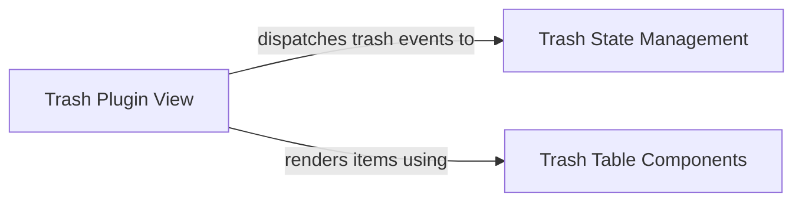

## Details

Handles discarded workspace items, trash views, and view restoration or permanent deletion.

### Trash State Management
Manages trash state transitions, backend communication, and live trash update listeners for restoring or permanently deleting views.

**Related Classes/Methods**:

- `frontend.appflowy_flutter.lib.plugins.trash.application.trash_bloc.TrashBloc`:12-94
- `frontend.appflowy_flutter.lib.plugins.trash.application.trash_bloc.TrashEvent`:97-104
- `frontend.appflowy_flutter.lib.plugins.trash.application.trash_bloc.TrashState`:107-117
- `frontend.appflowy_flutter.lib.plugins.trash.application.trash_service.TrashService`:8-35
- `frontend.appflowy_flutter.lib.plugins.trash.application.trash_listener.TrashListener`:16-57

**Source Files:**

- `frontend/appflowy_flutter/lib/plugins/trash/application/trash_bloc.dart`
  - `frontend.appflowy_flutter.lib.plugins.trash.application.trash_bloc.TrashBloc` (L12-L94) - Class
  - `frontend.appflowy_flutter.lib.plugins.trash.application.trash_bloc.TrashBloc.TrashBloc` (L13-L18) - Constructor
  - `frontend.appflowy_flutter.lib.plugins.trash.application.trash_bloc.TrashBloc._dispatch` (L23-L62) - Method
  - `frontend.appflowy_flutter.lib.plugins.trash.application.trash_bloc.TrashBloc._handleResult` (L64-L74) - Method
  - `frontend.appflowy_flutter.lib.plugins.trash.application.trash_bloc.TrashBloc._listenTrashUpdated` (L76-L87) - Method
  - `frontend.appflowy_flutter.lib.plugins.trash.application.trash_bloc.TrashBloc.close` (L90-L93) - Method
  - `frontend.appflowy_flutter.lib.plugins.trash.application.trash_bloc.TrashEvent` (L97-L104) - Class
  - `frontend.appflowy_flutter.lib.plugins.trash.application.trash_bloc.TrashEvent.TrashEvent.initial` (L98-L98) - Constructor
  - `frontend.appflowy_flutter.lib.plugins.trash.application.trash_bloc.TrashEvent.TrashEvent.didReceiveTrash` (L99-L99) - Constructor
  - `frontend.appflowy_flutter.lib.plugins.trash.application.trash_bloc.TrashEvent.TrashEvent.putback` (L100-L100) - Constructor
  - `frontend.appflowy_flutter.lib.plugins.trash.application.trash_bloc.TrashEvent.TrashEvent.delete` (L101-L101) - Constructor
  - `frontend.appflowy_flutter.lib.plugins.trash.application.trash_bloc.TrashEvent.TrashEvent.restoreAll` (L102-L102) - Constructor
  - `frontend.appflowy_flutter.lib.plugins.trash.application.trash_bloc.TrashEvent.TrashEvent.deleteAll` (L103-L103) - Constructor
  - `frontend.appflowy_flutter.lib.plugins.trash.application.trash_bloc.TrashState` (L107-L117) - Class
  - `frontend.appflowy_flutter.lib.plugins.trash.application.trash_bloc.TrashState.TrashState` (L108-L111) - Constructor
  - `frontend.appflowy_flutter.lib.plugins.trash.application.trash_bloc.TrashState.TrashState.init` (L113-L116) - Constructor
- `frontend/appflowy_flutter/lib/plugins/trash/application/trash_listener.dart`
  - `frontend.appflowy_flutter.lib.plugins.trash.application.trash_listener.TrashUpdatedCallback` (L12-L14) - Class
  - `frontend.appflowy_flutter.lib.plugins.trash.application.trash_listener.TrashListener` (L16-L57) - Class
  - `frontend.appflowy_flutter.lib.plugins.trash.application.trash_listener.TrashListener.start` (L21-L29) - Method
  - `frontend.appflowy_flutter.lib.plugins.trash.application.trash_listener.TrashListener._observableCallback` (L31-L50) - Method
  - `frontend.appflowy_flutter.lib.plugins.trash.application.trash_listener.TrashListener.close` (L52-L56) - Method
- `frontend/appflowy_flutter/lib/plugins/trash/application/trash_service.dart`
  - `frontend.appflowy_flutter.lib.plugins.trash.application.trash_service.TrashService` (L8-L35) - Class
  - `frontend.appflowy_flutter.lib.plugins.trash.application.trash_service.TrashService.readTrash` (L9-L11) - Method
  - `frontend.appflowy_flutter.lib.plugins.trash.application.trash_service.TrashService.putback` (L13-L17) - Method
  - `frontend.appflowy_flutter.lib.plugins.trash.application.trash_service.TrashService.deleteViews` (L19-L26) - Method
  - `frontend.appflowy_flutter.lib.plugins.trash.application.trash_service.TrashService.restoreAll` (L28-L30) - Method
  - `frontend.appflowy_flutter.lib.plugins.trash.application.trash_service.TrashService.deleteAll` (L32-L34) - Method

### Trash Table Components
Provides table row cells, persistent column headers, and layout dimensions for rendering deleted items.

**Related Classes/Methods**:

- `frontend.appflowy_flutter.lib.plugins.trash.src.trash_cell.TrashCell`:13-72
- `frontend.appflowy_flutter.lib.plugins.trash.src.trash_header.TrashHeaderDelegate`:8-30
- `frontend.appflowy_flutter.lib.plugins.trash.src.sizes.TrashSizes`:1-17

**Source Files:**

- `frontend/appflowy_flutter/lib/plugins/trash/src/sizes.dart`
  - `frontend.appflowy_flutter.lib.plugins.trash.src.sizes.TrashSizes` (L1-L17) - Class
  - `frontend.appflowy_flutter.lib.plugins.trash.src.sizes.TrashSizes.headerHeight` (L3-L3) - Method
  - `frontend.appflowy_flutter.lib.plugins.trash.src.sizes.TrashSizes.fileNameWidth` (L4-L4) - Method
  - `frontend.appflowy_flutter.lib.plugins.trash.src.sizes.TrashSizes.lashModifyWidth` (L5-L5) - Method
  - `frontend.appflowy_flutter.lib.plugins.trash.src.sizes.TrashSizes.createTimeWidth` (L6-L6) - Method
  - `frontend.appflowy_flutter.lib.plugins.trash.src.sizes.TrashSizes.padding` (L8-L8) - Method
  - `frontend.appflowy_flutter.lib.plugins.trash.src.sizes.TrashSizes.actionIconWidth` (L9-L9) - Method
  - `frontend.appflowy_flutter.lib.plugins.trash.src.sizes.TrashSizes.totalWidth` (L10-L16) - Method
- `frontend/appflowy_flutter/lib/plugins/trash/src/trash_cell.dart`
  - `frontend.appflowy_flutter.lib.plugins.trash.src.trash_cell.TrashCell` (L13-L72) - Class
  - `frontend.appflowy_flutter.lib.plugins.trash.src.trash_cell.TrashCell.TrashCell` (L14-L19) - Constructor
  - `frontend.appflowy_flutter.lib.plugins.trash.src.trash_cell.TrashCell.build` (L26-L63) - Method
  - `frontend.appflowy_flutter.lib.plugins.trash.src.trash_cell.TrashCell.dateFormatter` (L65-L71) - Method
- `frontend/appflowy_flutter/lib/plugins/trash/src/trash_header.dart`
  - `frontend.appflowy_flutter.lib.plugins.trash.src.trash_header.TrashHeaderDelegate` (L8-L30) - Class
  - `frontend.appflowy_flutter.lib.plugins.trash.src.trash_header.TrashHeaderDelegate.TrashHeaderDelegate` (L9-L9) - Constructor
  - `frontend.appflowy_flutter.lib.plugins.trash.src.trash_header.TrashHeaderDelegate.build` (L12-L18) - Method
  - `frontend.appflowy_flutter.lib.plugins.trash.src.trash_header.TrashHeaderDelegate.maxExtent` (L21-L21) - Method
  - `frontend.appflowy_flutter.lib.plugins.trash.src.trash_header.TrashHeaderDelegate.minExtent` (L24-L24) - Method
  - `frontend.appflowy_flutter.lib.plugins.trash.src.trash_header.TrashHeaderDelegate.shouldRebuild` (L27-L29) - Method
  - `frontend.appflowy_flutter.lib.plugins.trash.src.trash_header.TrashHeaderItem` (L32-L37) - Class
  - `frontend.appflowy_flutter.lib.plugins.trash.src.trash_header.TrashHeaderItem.TrashHeaderItem` (L33-L33) - Constructor
  - `frontend.appflowy_flutter.lib.plugins.trash.src.trash_header.TrashHeader` (L39-L82) - Class
  - `frontend.appflowy_flutter.lib.plugins.trash.src.trash_header.TrashHeader.TrashHeader` (L40-L40) - Constructor
  - `frontend.appflowy_flutter.lib.plugins.trash.src.trash_header.TrashHeader.build` (L58-L81) - Method

### Trash Plugin View
Registers the trash plugin in the workspace and renders the primary trash management page with action toolbars.

**Related Classes/Methods**:

- `frontend.appflowy_flutter.lib.plugins.trash.trash.TrashPlugin`:40-53
- `frontend.appflowy_flutter.lib.plugins.trash.trash.TrashPluginBuilder`:16-33
- `frontend.appflowy_flutter.lib.plugins.trash.trash_page.TrashPage`:22-27

**Source Files:**

- `frontend/appflowy_flutter/lib/plugins/trash/trash.dart`
  - `frontend.appflowy_flutter.lib.plugins.trash.trash.TrashPluginBuilder` (L16-L33) - Class
  - `frontend.appflowy_flutter.lib.plugins.trash.trash.TrashPluginBuilder.build` (L18-L20) - Method
  - `frontend.appflowy_flutter.lib.plugins.trash.trash.TrashPluginBuilder.menuName` (L23-L23) - Method
  - `frontend.appflowy_flutter.lib.plugins.trash.trash.TrashPluginBuilder.icon` (L26-L26) - Method
  - `frontend.appflowy_flutter.lib.plugins.trash.trash.TrashPluginBuilder.pluginType` (L29-L29) - Method
  - `frontend.appflowy_flutter.lib.plugins.trash.trash.TrashPluginBuilder.layoutType` (L32-L32) - Method
  - `frontend.appflowy_flutter.lib.plugins.trash.trash.TrashPluginConfig` (L35-L38) - Class
  - `frontend.appflowy_flutter.lib.plugins.trash.trash.TrashPluginConfig.creatable` (L37-L37) - Method
  - `frontend.appflowy_flutter.lib.plugins.trash.trash.TrashPlugin` (L40-L53) - Class
  - `frontend.appflowy_flutter.lib.plugins.trash.trash.TrashPlugin.TrashPlugin` (L41-L41) - Constructor
  - `frontend.appflowy_flutter.lib.plugins.trash.trash.TrashPlugin.widgetBuilder` (L46-L46) - Method
  - `frontend.appflowy_flutter.lib.plugins.trash.trash.TrashPlugin.id` (L49-L49) - Method
  - `frontend.appflowy_flutter.lib.plugins.trash.trash.TrashPlugin.pluginType` (L52-L52) - Method
  - `frontend.appflowy_flutter.lib.plugins.trash.trash.TrashPluginDisplay` (L55-L78) - Class
  - `frontend.appflowy_flutter.lib.plugins.trash.trash.TrashPluginDisplay.viewName` (L57-L57) - Method
  - `frontend.appflowy_flutter.lib.plugins.trash.trash.TrashPluginDisplay.leftBarItem` (L60-L60) - Method
  - `frontend.appflowy_flutter.lib.plugins.trash.trash.TrashPluginDisplay.tabBarItem` (L63-L63) - Method
  - `frontend.appflowy_flutter.lib.plugins.trash.trash.TrashPluginDisplay.rightBarItem` (L66-L66) - Method
  - `frontend.appflowy_flutter.lib.plugins.trash.trash.TrashPluginDisplay.buildWidget` (L69-L74) - Method
  - `frontend.appflowy_flutter.lib.plugins.trash.trash.TrashPluginDisplay.navigationItems` (L77-L77) - Method
- `frontend/appflowy_flutter/lib/plugins/trash/trash_page.dart`
  - `frontend.appflowy_flutter.lib.plugins.trash.trash_page.TrashPage` (L22-L27) - Class
  - `frontend.appflowy_flutter.lib.plugins.trash.trash_page.TrashPage.TrashPage` (L23-L23) - Constructor
  - `frontend.appflowy_flutter.lib.plugins.trash.trash_page.TrashPage.createState` (L26-L26) - Method
  - `frontend.appflowy_flutter.lib.plugins.trash.trash_page._TrashPageState` (L29-L187) - Class
  - `frontend.appflowy_flutter.lib.plugins.trash.trash_page._TrashPageState.dispose` (L33-L36) - Method
  - `frontend.appflowy_flutter.lib.plugins.trash.trash_page._TrashPageState.build` (L39-L57) - Method
  - `frontend.appflowy_flutter.lib.plugins.trash.trash_page._TrashPageState._renderTrashList` (L59-L88) - Method
  - `frontend.appflowy_flutter.lib.plugins.trash.trash_page._TrashPageState._renderTopBar` (L90-L140) - Method
  - `frontend.appflowy_flutter.lib.plugins.trash.trash_page._TrashPageState._renderListHeader` (L142-L148) - Method
  - `frontend.appflowy_flutter.lib.plugins.trash.trash_page._TrashPageState._renderListBody` (L150-L186) - Method

### [FAQ](https://github.com/CodeBoarding/GeneratedOnBoardings/tree/main?tab=readme-ov-file#faq)