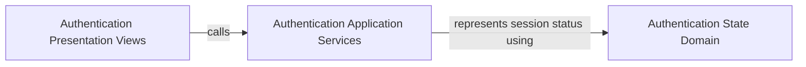

## Details

Handles user authentication, account sessions, login/signup flows, passwords, and user profile management.

### Authentication Presentation Views [[Expand]](./Authentication_Presentation_Views.md)
Renders authentication interfaces, sign-in forms, password management views, splash screens, and workspace entry screens.

**Related Classes/Methods**:

- `frontend.appflowy_flutter.lib.user.presentation.anon_user.AnonUserList.build`:16-59
- `frontend.appflowy_flutter.lib.user.presentation.screens.sign_in_screen.sign_in_screen.SignInScreen`:11-44
- `frontend.appflowy_flutter.lib.user.presentation.helpers.handle_open_workspace_error.handleOpenWorkspaceError`:10-36

**Source Files:**

- `frontend/appflowy_flutter/lib/user/presentation/anon_user.dart`
  - `frontend.appflowy_flutter.lib.user.presentation.anon_user.AnonUserList` (L10-L60) - Class
  - `frontend.appflowy_flutter.lib.user.presentation.anon_user.AnonUserList.AnonUserList` (L11-L11) - Constructor
  - `frontend.appflowy_flutter.lib.user.presentation.anon_user.AnonUserList.build` (L16-L59) - Method
  - `frontend.appflowy_flutter.lib.user.presentation.anon_user.AnonUserItem` (L62-L96) - Class
  - `frontend.appflowy_flutter.lib.user.presentation.anon_user.AnonUserItem.AnonUserItem` (L63-L68) - Constructor
  - `frontend.appflowy_flutter.lib.user.presentation.anon_user.AnonUserItem.build` (L75-L95) - Method
- `frontend/appflowy_flutter/lib/user/presentation/helpers/handle_open_workspace_error.dart`
  - `frontend.appflowy_flutter.lib.user.presentation.helpers.handle_open_workspace_error.handleOpenWorkspaceError` (L10-L36) - Function
- `frontend/appflowy_flutter/lib/user/presentation/router.dart`
  - `frontend.appflowy_flutter.lib.user.presentation.router.AuthRouter` (L14-L73) - Class
  - `frontend.appflowy_flutter.lib.user.presentation.router.AuthRouter.pushForgetPasswordScreen` (L15-L15) - Method
  - `frontend.appflowy_flutter.lib.user.presentation.router.AuthRouter.pushWorkspaceStartScreen` (L17-L22) - Method
  - `frontend.appflowy_flutter.lib.user.presentation.router.AuthRouter.goHomeScreen` (L37-L58) - Method
  - `frontend.appflowy_flutter.lib.user.presentation.router.AuthRouter.pushWorkspaceErrorScreen` (L60-L72) - Method
  - `frontend.appflowy_flutter.lib.user.presentation.router.SplashRouter` (L75-L123) - Class
  - `frontend.appflowy_flutter.lib.user.presentation.router.SplashRouter.pushWorkspaceStartScreen` (L78-L94) - Method
  - `frontend.appflowy_flutter.lib.user.presentation.router.SplashRouter.pushHomeScreen` (L96-L108) - Method
  - `frontend.appflowy_flutter.lib.user.presentation.router.SplashRouter.goHomeScreen` (L110-L122) - Method
- `frontend/appflowy_flutter/lib/user/presentation/screens/sign_in_screen/desktop_sign_in_screen.dart`
  - `frontend.appflowy_flutter.lib.user.presentation.screens.sign_in_screen.desktop_sign_in_screen.DesktopSignInScreen` (L19-L26) - Class
  - `frontend.appflowy_flutter.lib.user.presentation.screens.sign_in_screen.desktop_sign_in_screen.DesktopSignInScreen.DesktopSignInScreen` (L20-L22) - Constructor
  - `frontend.appflowy_flutter.lib.user.presentation.screens.sign_in_screen.desktop_sign_in_screen.DesktopSignInScreen.createState` (L25-L25) - Method
  - `frontend.appflowy_flutter.lib.user.presentation.screens.sign_in_screen.desktop_sign_in_screen._DesktopSignInScreenState` (L28-L104) - Class
  - `frontend.appflowy_flutter.lib.user.presentation.screens.sign_in_screen.desktop_sign_in_screen._DesktopSignInScreenState.build` (L31-L87) - Method
  - `frontend.appflowy_flutter.lib.user.presentation.screens.sign_in_screen.desktop_sign_in_screen._DesktopSignInScreenState._buildAppBar` (L89-L96) - Method
  - `frontend.appflowy_flutter.lib.user.presentation.screens.sign_in_screen.desktop_sign_in_screen._DesktopSignInScreenState.onWindowFocus` (L99-L103) - Method
  - `frontend.appflowy_flutter.lib.user.presentation.screens.sign_in_screen.desktop_sign_in_screen.DesktopSignInSettingsButton` (L106-L134) - Class
  - `frontend.appflowy_flutter.lib.user.presentation.screens.sign_in_screen.desktop_sign_in_screen.DesktopSignInSettingsButton.DesktopSignInSettingsButton` (L107-L109) - Constructor
  - `frontend.appflowy_flutter.lib.user.presentation.screens.sign_in_screen.desktop_sign_in_screen.DesktopSignInSettingsButton.build` (L112-L133) - Method
  - `frontend.appflowy_flutter.lib.user.presentation.screens.sign_in_screen.desktop_sign_in_screen._OrDivider` (L136-L162) - Class
  - `frontend.appflowy_flutter.lib.user.presentation.screens.sign_in_screen.desktop_sign_in_screen._OrDivider._OrDivider` (L137-L137) - Constructor
  - `frontend.appflowy_flutter.lib.user.presentation.screens.sign_in_screen.desktop_sign_in_screen._OrDivider.build` (L140-L161) - Method
- `frontend/appflowy_flutter/lib/user/presentation/screens/sign_in_screen/mobile_loading_screen.dart`
  - `frontend.appflowy_flutter.lib.user.presentation.screens.sign_in_screen.mobile_loading_screen.MobileLoadingScreen` (L9-L37) - Class
  - `frontend.appflowy_flutter.lib.user.presentation.screens.sign_in_screen.mobile_loading_screen.MobileLoadingScreen.MobileLoadingScreen` (L10-L12) - Constructor
  - `frontend.appflowy_flutter.lib.user.presentation.screens.sign_in_screen.mobile_loading_screen.MobileLoadingScreen.build` (L15-L36) - Method
- `frontend/appflowy_flutter/lib/user/presentation/screens/sign_in_screen/mobile_sign_in_screen.dart`
  - `frontend.appflowy_flutter.lib.user.presentation.screens.sign_in_screen.mobile_sign_in_screen.MobileSignInScreen` (L18-L119) - Class
  - `frontend.appflowy_flutter.lib.user.presentation.screens.sign_in_screen.mobile_sign_in_screen.MobileSignInScreen.MobileSignInScreen` (L19-L21) - Constructor
  - `frontend.appflowy_flutter.lib.user.presentation.screens.sign_in_screen.mobile_sign_in_screen.MobileSignInScreen.build` (L24-L54) - Method
  - `frontend.appflowy_flutter.lib.user.presentation.screens.sign_in_screen.mobile_sign_in_screen.MobileSignInScreen._buildThirdPartySignInButtons` (L56-L85) - Method
  - `frontend.appflowy_flutter.lib.user.presentation.screens.sign_in_screen.mobile_sign_in_screen.MobileSignInScreen._buildSettingsButton` (L87-L118) - Method
- `frontend/appflowy_flutter/lib/user/presentation/screens/sign_in_screen/sign_in_screen.dart`
  - `frontend.appflowy_flutter.lib.user.presentation.screens.sign_in_screen.sign_in_screen.SignInScreen` (L11-L44) - Class
  - `frontend.appflowy_flutter.lib.user.presentation.screens.sign_in_screen.sign_in_screen.SignInScreen.SignInScreen` (L12-L12) - Constructor
  - `frontend.appflowy_flutter.lib.user.presentation.screens.sign_in_screen.sign_in_screen.SignInScreen.build` (L17-L29) - Method
  - `frontend.appflowy_flutter.lib.user.presentation.screens.sign_in_screen.sign_in_screen.SignInScreen._showSignInError` (L31-L43) - Method
- `frontend/appflowy_flutter/lib/user/presentation/screens/sign_in_screen/widgets/anonymous_sign_in_button.dart`
  - `frontend.appflowy_flutter.lib.user.presentation.screens.sign_in_screen.widgets.anonymous_sign_in_button.SignInAnonymousButtonV3` (L10-L57) - Class
  - `frontend.appflowy_flutter.lib.user.presentation.screens.sign_in_screen.widgets.anonymous_sign_in_button.SignInAnonymousButtonV3.SignInAnonymousButtonV3` (L11-L13) - Constructor
  - `frontend.appflowy_flutter.lib.user.presentation.screens.sign_in_screen.widgets.anonymous_sign_in_button.SignInAnonymousButtonV3.build` (L16-L56) - Method
- `frontend/appflowy_flutter/lib/user/presentation/screens/sign_in_screen/widgets/anonymous_sign_in_button/anonymous_sign_in_button.dart`
  - `frontend.appflowy_flutter.lib.user.presentation.screens.sign_in_screen.widgets.anonymous_sign_in_button.anonymous_sign_in_button.AnonymousSignInButton` (L4-L16) - Class
  - `frontend.appflowy_flutter.lib.user.presentation.screens.sign_in_screen.widgets.anonymous_sign_in_button.anonymous_sign_in_button.AnonymousSignInButton.AnonymousSignInButton` (L5-L5) - Constructor
  - `frontend.appflowy_flutter.lib.user.presentation.screens.sign_in_screen.widgets.anonymous_sign_in_button.anonymous_sign_in_button.AnonymousSignInButton.build` (L8-L15) - Method
- `frontend/appflowy_flutter/lib/user/presentation/screens/sign_in_screen/widgets/continue_with/back_to_login_in_button.dart`
  - `frontend.appflowy_flutter.lib.user.presentation.screens.sign_in_screen.widgets.continue_with.back_to_login_in_button.BackToLoginButton` (L6-L30) - Class
  - `frontend.appflowy_flutter.lib.user.presentation.screens.sign_in_screen.widgets.continue_with.back_to_login_in_button.BackToLoginButton.BackToLoginButton` (L7-L10) - Constructor
  - `frontend.appflowy_flutter.lib.user.presentation.screens.sign_in_screen.widgets.continue_with.back_to_login_in_button.BackToLoginButton.build` (L15-L29) - Method
- `frontend/appflowy_flutter/lib/user/presentation/screens/sign_in_screen/widgets/continue_with/continue_with_button.dart`
  - `frontend.appflowy_flutter.lib.user.presentation.screens.sign_in_screen.widgets.continue_with.continue_with_button.ContinueWithButton` (L4-L27) - Class
  - `frontend.appflowy_flutter.lib.user.presentation.screens.sign_in_screen.widgets.continue_with.continue_with_button.ContinueWithButton.ContinueWithButton` (L5-L9) - Constructor
  - `frontend.appflowy_flutter.lib.user.presentation.screens.sign_in_screen.widgets.continue_with.continue_with_button.ContinueWithButton.build` (L15-L26) - Method
- `frontend/appflowy_flutter/lib/user/presentation/screens/sign_in_screen/widgets/continue_with/continue_with_email.dart`
  - `frontend.appflowy_flutter.lib.user.presentation.screens.sign_in_screen.widgets.continue_with.continue_with_email.ContinueWithEmail` (L6-L23) - Class
  - `frontend.appflowy_flutter.lib.user.presentation.screens.sign_in_screen.widgets.continue_with.continue_with_email.ContinueWithEmail.ContinueWithEmail` (L7-L10) - Constructor
  - `frontend.appflowy_flutter.lib.user.presentation.screens.sign_in_screen.widgets.continue_with.continue_with_email.ContinueWithEmail.build` (L15-L22) - Method
- `frontend/appflowy_flutter/lib/user/presentation/screens/sign_in_screen/widgets/continue_with/continue_with_email_and_password.dart`
  - `frontend.appflowy_flutter.lib.user.presentation.screens.sign_in_screen.widgets.continue_with.continue_with_email_and_password.ContinueWithEmailAndPassword` (L14-L20) - Class
  - `frontend.appflowy_flutter.lib.user.presentation.screens.sign_in_screen.widgets.continue_with.continue_with_email_and_password.ContinueWithEmailAndPassword.ContinueWithEmailAndPassword` (L15-L15) - Constructor
  - `frontend.appflowy_flutter.lib.user.presentation.screens.sign_in_screen.widgets.continue_with.continue_with_email_and_password.ContinueWithEmailAndPassword.createState` (L18-L19) - Method
  - `frontend.appflowy_flutter.lib.user.presentation.screens.sign_in_screen.widgets.continue_with.continue_with_email_and_password._ContinueWithEmailAndPasswordState` (L22-L188) - Class
  - `frontend.appflowy_flutter.lib.user.presentation.screens.sign_in_screen.widgets.continue_with.continue_with_email_and_password._ContinueWithEmailAndPasswordState.dispose` (L31-L36) - Method
  - `frontend.appflowy_flutter.lib.user.presentation.screens.sign_in_screen.widgets.continue_with.continue_with_email_and_password._ContinueWithEmailAndPasswordState.build` (L39-L96) - Method
  - `frontend.appflowy_flutter.lib.user.presentation.screens.sign_in_screen.widgets.continue_with.continue_with_email_and_password._ContinueWithEmailAndPasswordState._signInWithEmail` (L98-L114) - Method
  - `frontend.appflowy_flutter.lib.user.presentation.screens.sign_in_screen.widgets.continue_with.continue_with_email_and_password._ContinueWithEmailAndPasswordState._pushContinueWithMagicLinkOrPasscodePage` (L116-L155) - Method
  - `frontend.appflowy_flutter.lib.user.presentation.screens.sign_in_screen.widgets.continue_with.continue_with_email_and_password._ContinueWithEmailAndPasswordState._pushContinueWithPasswordPage` (L157-L187) - Method
- `frontend/appflowy_flutter/lib/user/presentation/screens/sign_in_screen/widgets/continue_with/continue_with_magic_link_or_passcode_page.dart`
  - `frontend.appflowy_flutter.lib.user.presentation.screens.sign_in_screen.widgets.continue_with.continue_with_magic_link_or_passcode_page.ContinueWithMagicLinkOrPasscodePage` (L14-L29) - Class
  - `frontend.appflowy_flutter.lib.user.presentation.screens.sign_in_screen.widgets.continue_with.continue_with_magic_link_or_passcode_page.ContinueWithMagicLinkOrPasscodePage.ContinueWithMagicLinkOrPasscodePage` (L15-L20) - Constructor
  - `frontend.appflowy_flutter.lib.user.presentation.screens.sign_in_screen.widgets.continue_with.continue_with_magic_link_or_passcode_page.ContinueWithMagicLinkOrPasscodePage.createState` (L27-L28) - Method
  - `frontend.appflowy_flutter.lib.user.presentation.screens.sign_in_screen.widgets.continue_with.continue_with_magic_link_or_passcode_page._ContinueWithMagicLinkOrPasscodePageState` (L31-L178) - Class
  - `frontend.appflowy_flutter.lib.user.presentation.screens.sign_in_screen.widgets.continue_with.continue_with_magic_link_or_passcode_page._ContinueWithMagicLinkOrPasscodePageState.dispose` (L44-L48) - Method
  - `frontend.appflowy_flutter.lib.user.presentation.screens.sign_in_screen.widgets.continue_with.continue_with_magic_link_or_passcode_page._ContinueWithMagicLinkOrPasscodePageState.build` (L51-L90) - Method
  - `frontend.appflowy_flutter.lib.user.presentation.screens.sign_in_screen.widgets.continue_with.continue_with_magic_link_or_passcode_page._ContinueWithMagicLinkOrPasscodePageState._buildEnterCodeManually` (L92-L148) - Method
  - `frontend.appflowy_flutter.lib.user.presentation.screens.sign_in_screen.widgets.continue_with.continue_with_magic_link_or_passcode_page._ContinueWithMagicLinkOrPasscodePageState._buildLogoTitleAndDescription` (L150-L177) - Method
- `frontend/appflowy_flutter/lib/user/presentation/screens/sign_in_screen/widgets/continue_with/continue_with_password.dart`
  - `frontend.appflowy_flutter.lib.user.presentation.screens.sign_in_screen.widgets.continue_with.continue_with_password.ContinueWithPassword` (L6-L23) - Class
  - `frontend.appflowy_flutter.lib.user.presentation.screens.sign_in_screen.widgets.continue_with.continue_with_password.ContinueWithPassword.ContinueWithPassword` (L7-L10) - Constructor
  - `frontend.appflowy_flutter.lib.user.presentation.screens.sign_in_screen.widgets.continue_with.continue_with_password.ContinueWithPassword.build` (L15-L22) - Method
- `frontend/appflowy_flutter/lib/user/presentation/screens/sign_in_screen/widgets/continue_with/continue_with_password_page.dart`
  - `frontend.appflowy_flutter.lib.user.presentation.screens.sign_in_screen.widgets.continue_with.continue_with_password_page.ContinueWithPasswordPage` (L17-L34) - Class
  - `frontend.appflowy_flutter.lib.user.presentation.screens.sign_in_screen.widgets.continue_with.continue_with_password_page.ContinueWithPasswordPage.ContinueWithPasswordPage` (L18-L24) - Constructor
  - `frontend.appflowy_flutter.lib.user.presentation.screens.sign_in_screen.widgets.continue_with.continue_with_password_page.ContinueWithPasswordPage.createState` (L32-L33) - Method
  - `frontend.appflowy_flutter.lib.user.presentation.screens.sign_in_screen.widgets.continue_with.continue_with_password_page._ContinueWithPasswordPageState` (L36-L206) - Class
  - `frontend.appflowy_flutter.lib.user.presentation.screens.sign_in_screen.widgets.continue_with.continue_with_password_page._ContinueWithPasswordPageState.dispose` (L43-L46) - Method
  - `frontend.appflowy_flutter.lib.user.presentation.screens.sign_in_screen.widgets.continue_with.continue_with_password_page._ContinueWithPasswordPageState.build` (L49-L96) - Method
  - `frontend.appflowy_flutter.lib.user.presentation.screens.sign_in_screen.widgets.continue_with.continue_with_password_page._ContinueWithPasswordPageState._buildLogoAndTitle` (L98-L122) - Method
  - `frontend.appflowy_flutter.lib.user.presentation.screens.sign_in_screen.widgets.continue_with.continue_with_password_page._ContinueWithPasswordPageState._buildPasswordSection` (L124-L183) - Method
  - `frontend.appflowy_flutter.lib.user.presentation.screens.sign_in_screen.widgets.continue_with.continue_with_password_page._ContinueWithPasswordPageState._pushForgotPasswordPage` (L185-L205) - Method
- `frontend/appflowy_flutter/lib/user/presentation/screens/sign_in_screen/widgets/continue_with/forgot_password_page.dart`
  - `frontend.appflowy_flutter.lib.user.presentation.screens.sign_in_screen.widgets.continue_with.forgot_password_page.ForgotPasswordPage` (L17-L31) - Class
  - `frontend.appflowy_flutter.lib.user.presentation.screens.sign_in_screen.widgets.continue_with.forgot_password_page.ForgotPasswordPage.ForgotPasswordPage` (L18-L23) - Constructor
  - `frontend.appflowy_flutter.lib.user.presentation.screens.sign_in_screen.widgets.continue_with.forgot_password_page.ForgotPasswordPage.createState` (L30-L30) - Method
  - `frontend.appflowy_flutter.lib.user.presentation.screens.sign_in_screen.widgets.continue_with.forgot_password_page._ForgotPasswordPageState` (L33-L192) - Class
  - `frontend.appflowy_flutter.lib.user.presentation.screens.sign_in_screen.widgets.continue_with.forgot_password_page._ForgotPasswordPageState.initState` (L46-L50) - Method
  - `frontend.appflowy_flutter.lib.user.presentation.screens.sign_in_screen.widgets.continue_with.forgot_password_page._ForgotPasswordPageState.dispose` (L53-L56) - Method
  - `frontend.appflowy_flutter.lib.user.presentation.screens.sign_in_screen.widgets.continue_with.forgot_password_page._ForgotPasswordPageState.build` (L59-L106) - Method
  - `frontend.appflowy_flutter.lib.user.presentation.screens.sign_in_screen.widgets.continue_with.forgot_password_page._ForgotPasswordPageState._buildLogoAndTitle` (L108-L113) - Method
  - `frontend.appflowy_flutter.lib.user.presentation.screens.sign_in_screen.widgets.continue_with.forgot_password_page._ForgotPasswordPageState._buildPasswordSection` (L115-L144) - Method
  - `frontend.appflowy_flutter.lib.user.presentation.screens.sign_in_screen.widgets.continue_with.forgot_password_page._ForgotPasswordPageState._onSubmit` (L146-L191) - Method
- `frontend/appflowy_flutter/lib/user/presentation/screens/sign_in_screen/widgets/continue_with/reset_password.dart`
  - `frontend.appflowy_flutter.lib.user.presentation.screens.sign_in_screen.widgets.continue_with.reset_password.ResetPasswordWidget` (L14-L30) - Class
  - `frontend.appflowy_flutter.lib.user.presentation.screens.sign_in_screen.widgets.continue_with.reset_password.ResetPasswordWidget.ResetPasswordWidget` (L15-L21) - Constructor
  - `frontend.appflowy_flutter.lib.user.presentation.screens.sign_in_screen.widgets.continue_with.reset_password.ResetPasswordWidget.createState` (L29-L29) - Method
  - `frontend.appflowy_flutter.lib.user.presentation.screens.sign_in_screen.widgets.continue_with.reset_password._ResetPasswordWidgetState` (L32-L175) - Class
  - `frontend.appflowy_flutter.lib.user.presentation.screens.sign_in_screen.widgets.continue_with.reset_password._ResetPasswordWidgetState.dispose` (L42-L46) - Method
  - `frontend.appflowy_flutter.lib.user.presentation.screens.sign_in_screen.widgets.continue_with.reset_password._ResetPasswordWidgetState.build` (L49-L96) - Method
  - `frontend.appflowy_flutter.lib.user.presentation.screens.sign_in_screen.widgets.continue_with.reset_password._ResetPasswordWidgetState._buildEnterCodeManually` (L98-L142) - Method
  - `frontend.appflowy_flutter.lib.user.presentation.screens.sign_in_screen.widgets.continue_with.reset_password._ResetPasswordWidgetState._buildLogoTitleAndDescription` (L144-L157) - Method
  - `frontend.appflowy_flutter.lib.user.presentation.screens.sign_in_screen.widgets.continue_with.reset_password._ResetPasswordWidgetState._onSubmit` (L159-L174) - Method
- `frontend/appflowy_flutter/lib/user/presentation/screens/sign_in_screen/widgets/continue_with/reset_password_page.dart`
  - `frontend.appflowy_flutter.lib.user.presentation.screens.sign_in_screen.widgets.continue_with.reset_password_page.ResetPasswordPageState` (L5-L8) - Enum
  - `frontend.appflowy_flutter.lib.user.presentation.screens.sign_in_screen.widgets.continue_with.reset_password_page.ResetPasswordPageState.enterPasscode` (L6-L6) - Enum
  - `frontend.appflowy_flutter.lib.user.presentation.screens.sign_in_screen.widgets.continue_with.reset_password_page.ResetPasswordPageState.setNewPassword` (L7-L7) - Enum
  - `frontend.appflowy_flutter.lib.user.presentation.screens.sign_in_screen.widgets.continue_with.reset_password_page.ResetPasswordPage` (L10-L24) - Class
  - `frontend.appflowy_flutter.lib.user.presentation.screens.sign_in_screen.widgets.continue_with.reset_password_page.ResetPasswordPage.ResetPasswordPage` (L11-L16) - Constructor
  - `frontend.appflowy_flutter.lib.user.presentation.screens.sign_in_screen.widgets.continue_with.reset_password_page.ResetPasswordPage.createState` (L23-L23) - Method
  - `frontend.appflowy_flutter.lib.user.presentation.screens.sign_in_screen.widgets.continue_with.reset_password_page._ResetPasswordPageState` (L26-L53) - Class
  - `frontend.appflowy_flutter.lib.user.presentation.screens.sign_in_screen.widgets.continue_with.reset_password_page._ResetPasswordPageState.dispose` (L30-L32) - Method
  - `frontend.appflowy_flutter.lib.user.presentation.screens.sign_in_screen.widgets.continue_with.reset_password_page._ResetPasswordPageState.build` (L35-L52) - Method
- `frontend/appflowy_flutter/lib/user/presentation/screens/sign_in_screen/widgets/continue_with/set_new_password.dart`
  - `frontend.appflowy_flutter.lib.user.presentation.screens.sign_in_screen.widgets.continue_with.set_new_password.SetNewPasswordWidget` (L15-L27) - Class
  - `frontend.appflowy_flutter.lib.user.presentation.screens.sign_in_screen.widgets.continue_with.set_new_password.SetNewPasswordWidget.SetNewPasswordWidget` (L16-L20) - Constructor
  - `frontend.appflowy_flutter.lib.user.presentation.screens.sign_in_screen.widgets.continue_with.set_new_password.SetNewPasswordWidget.createState` (L26-L26) - Method
  - `frontend.appflowy_flutter.lib.user.presentation.screens.sign_in_screen.widgets.continue_with.set_new_password._SetNewPasswordWidgetState` (L29-L214) - Class
  - `frontend.appflowy_flutter.lib.user.presentation.screens.sign_in_screen.widgets.continue_with.set_new_password._SetNewPasswordWidgetState.dispose` (L39-L43) - Method
  - `frontend.appflowy_flutter.lib.user.presentation.screens.sign_in_screen.widgets.continue_with.set_new_password._SetNewPasswordWidgetState.build` (L46-L104) - Method
  - `frontend.appflowy_flutter.lib.user.presentation.screens.sign_in_screen.widgets.continue_with.set_new_password._SetNewPasswordWidgetState._buildLogoAndTitle` (L106-L130) - Method
  - `frontend.appflowy_flutter.lib.user.presentation.screens.sign_in_screen.widgets.continue_with.set_new_password._SetNewPasswordWidgetState._buildPasswordFields` (L132-L170) - Method
  - `frontend.appflowy_flutter.lib.user.presentation.screens.sign_in_screen.widgets.continue_with.set_new_password._SetNewPasswordWidgetState._buildResetButton` (L172-L179) - Method
  - `frontend.appflowy_flutter.lib.user.presentation.screens.sign_in_screen.widgets.continue_with.set_new_password._SetNewPasswordWidgetState._validateAndSubmit` (L181-L213) - Method
- `frontend/appflowy_flutter/lib/user/presentation/screens/sign_in_screen/widgets/continue_with/title_logo.dart`
  - `frontend.appflowy_flutter.lib.user.presentation.screens.sign_in_screen.widgets.continue_with.title_logo.TitleLogo` (L6-L54) - Class
  - `frontend.appflowy_flutter.lib.user.presentation.screens.sign_in_screen.widgets.continue_with.title_logo.TitleLogo.TitleLogo` (L7-L12) - Constructor
  - `frontend.appflowy_flutter.lib.user.presentation.screens.sign_in_screen.widgets.continue_with.title_logo.TitleLogo.build` (L19-L53) - Method
- `frontend/appflowy_flutter/lib/user/presentation/screens/sign_in_screen/widgets/continue_with/verifying_button.dart`
  - `frontend.appflowy_flutter.lib.user.presentation.screens.sign_in_screen.widgets.continue_with.verifying_button.VerifyingButton` (L7-L42) - Class
  - `frontend.appflowy_flutter.lib.user.presentation.screens.sign_in_screen.widgets.continue_with.verifying_button.VerifyingButton.VerifyingButton` (L8-L8) - Constructor
  - `frontend.appflowy_flutter.lib.user.presentation.screens.sign_in_screen.widgets.continue_with.verifying_button.VerifyingButton.build` (L11-L41) - Method
- `frontend/appflowy_flutter/lib/user/presentation/screens/sign_in_screen/widgets/logo/logo.dart`
  - `frontend.appflowy_flutter.lib.user.presentation.screens.sign_in_screen.widgets.logo.logo.AFLogo` (L4-L20) - Class
  - `frontend.appflowy_flutter.lib.user.presentation.screens.sign_in_screen.widgets.logo.logo.AFLogo.AFLogo` (L5-L8) - Constructor
  - `frontend.appflowy_flutter.lib.user.presentation.screens.sign_in_screen.widgets.logo.logo.AFLogo.build` (L13-L19) - Method
- `frontend/appflowy_flutter/lib/user/presentation/screens/sign_in_screen/widgets/magic_link_sign_in_buttons.dart`
  - `frontend.appflowy_flutter.lib.user.presentation.screens.sign_in_screen.widgets.magic_link_sign_in_buttons.SignInWithMagicLinkButtons` (L12-L18) - Class
  - `frontend.appflowy_flutter.lib.user.presentation.screens.sign_in_screen.widgets.magic_link_sign_in_buttons.SignInWithMagicLinkButtons.SignInWithMagicLinkButtons` (L13-L13) - Constructor
  - `frontend.appflowy_flutter.lib.user.presentation.screens.sign_in_screen.widgets.magic_link_sign_in_buttons.SignInWithMagicLinkButtons.createState` (L16-L17) - Method
  - `frontend.appflowy_flutter.lib.user.presentation.screens.sign_in_screen.widgets.magic_link_sign_in_buttons._SignInWithMagicLinkButtonsState` (L20-L84) - Class
  - `frontend.appflowy_flutter.lib.user.presentation.screens.sign_in_screen.widgets.magic_link_sign_in_buttons._SignInWithMagicLinkButtonsState.dispose` (L26-L30) - Method
  - `frontend.appflowy_flutter.lib.user.presentation.screens.sign_in_screen.widgets.magic_link_sign_in_buttons._SignInWithMagicLinkButtonsState.build` (L33-L63) - Method
  - `frontend.appflowy_flutter.lib.user.presentation.screens.sign_in_screen.widgets.magic_link_sign_in_buttons._SignInWithMagicLinkButtonsState._sendMagicLink` (L65-L83) - Method
  - `frontend.appflowy_flutter.lib.user.presentation.screens.sign_in_screen.widgets.magic_link_sign_in_buttons._ConfirmButton` (L86-L133) - Class
  - `frontend.appflowy_flutter.lib.user.presentation.screens.sign_in_screen.widgets.magic_link_sign_in_buttons._ConfirmButton._ConfirmButton` (L87-L89) - Constructor
  - `frontend.appflowy_flutter.lib.user.presentation.screens.sign_in_screen.widgets.magic_link_sign_in_buttons._ConfirmButton.build` (L94-L132) - Method
- `frontend/appflowy_flutter/lib/user/presentation/screens/sign_in_screen/widgets/sign_in_agreement.dart`
  - `frontend.appflowy_flutter.lib.user.presentation.screens.sign_in_screen.widgets.sign_in_agreement.SignInAgreement` (L8-L52) - Class
  - `frontend.appflowy_flutter.lib.user.presentation.screens.sign_in_screen.widgets.sign_in_agreement.SignInAgreement.SignInAgreement` (L9-L11) - Constructor
  - `frontend.appflowy_flutter.lib.user.presentation.screens.sign_in_screen.widgets.sign_in_agreement.SignInAgreement.build` (L14-L51) - Method
- `frontend/appflowy_flutter/lib/user/presentation/screens/sign_in_screen/widgets/sign_in_anonymous_button.dart`
  - `frontend.appflowy_flutter.lib.user.presentation.screens.sign_in_screen.widgets.sign_in_anonymous_button.SignInAnonymousButtonV2` (L12-L71) - Class
  - `frontend.appflowy_flutter.lib.user.presentation.screens.sign_in_screen.widgets.sign_in_anonymous_button.SignInAnonymousButtonV2.SignInAnonymousButtonV2` (L13-L15) - Constructor
  - `frontend.appflowy_flutter.lib.user.presentation.screens.sign_in_screen.widgets.sign_in_anonymous_button.SignInAnonymousButtonV2.build` (L18-L70) - Method
  - `frontend.appflowy_flutter.lib.user.presentation.screens.sign_in_screen.widgets.sign_in_anonymous_button.ChangeCloudModeButton` (L73-L107) - Class
  - `frontend.appflowy_flutter.lib.user.presentation.screens.sign_in_screen.widgets.sign_in_anonymous_button.ChangeCloudModeButton.ChangeCloudModeButton` (L74-L76) - Constructor
  - `frontend.appflowy_flutter.lib.user.presentation.screens.sign_in_screen.widgets.sign_in_anonymous_button.ChangeCloudModeButton.build` (L79-L106) - Method
- `frontend/appflowy_flutter/lib/user/presentation/screens/sign_in_screen/widgets/sign_in_or_logout_button.dart`
  - `frontend.appflowy_flutter.lib.user.presentation.screens.sign_in_screen.widgets.sign_in_or_logout_button.MobileLogoutButton` (L4-L25) - Class
  - `frontend.appflowy_flutter.lib.user.presentation.screens.sign_in_screen.widgets.sign_in_or_logout_button.MobileLogoutButton.MobileLogoutButton` (L5-L10) - Constructor
  - `frontend.appflowy_flutter.lib.user.presentation.screens.sign_in_screen.widgets.sign_in_or_logout_button.MobileLogoutButton.build` (L17-L24) - Method
- `frontend/appflowy_flutter/lib/user/presentation/screens/sign_in_screen/widgets/switch_sign_in_sign_up_button.dart`
  - `frontend.appflowy_flutter.lib.user.presentation.screens.sign_in_screen.widgets.switch_sign_in_sign_up_button.SwitchSignInSignUpButton` (L8-L52) - Class
  - `frontend.appflowy_flutter.lib.user.presentation.screens.sign_in_screen.widgets.switch_sign_in_sign_up_button.SwitchSignInSignUpButton.SwitchSignInSignUpButton` (L9-L12) - Constructor
  - `frontend.appflowy_flutter.lib.user.presentation.screens.sign_in_screen.widgets.switch_sign_in_sign_up_button.SwitchSignInSignUpButton.build` (L17-L51) - Method
- `frontend/appflowy_flutter/lib/user/presentation/screens/sign_in_screen/widgets/third_party_sign_in_button/third_party_sign_in_button.dart`
  - `frontend.appflowy_flutter.lib.user.presentation.screens.sign_in_screen.widgets.third_party_sign_in_button.third_party_sign_in_button.ThirdPartySignInButtonType` (L7-L95) - Enum
  - `frontend.appflowy_flutter.lib.user.presentation.screens.sign_in_screen.widgets.third_party_sign_in_button.third_party_sign_in_button.ThirdPartySignInButtonType.apple` (L8-L8) - Enum
  - `frontend.appflowy_flutter.lib.user.presentation.screens.sign_in_screen.widgets.third_party_sign_in_button.third_party_sign_in_button.ThirdPartySignInButtonType.google` (L9-L9) - Enum
  - `frontend.appflowy_flutter.lib.user.presentation.screens.sign_in_screen.widgets.third_party_sign_in_button.third_party_sign_in_button.ThirdPartySignInButtonType.github` (L10-L10) - Enum
  - `frontend.appflowy_flutter.lib.user.presentation.screens.sign_in_screen.widgets.third_party_sign_in_button.third_party_sign_in_button.ThirdPartySignInButtonType.discord` (L11-L11) - Enum
  - `frontend.appflowy_flutter.lib.user.presentation.screens.sign_in_screen.widgets.third_party_sign_in_button.third_party_sign_in_button.ThirdPartySignInButtonType.anonymous` (L12-L12) - Enum
  - `frontend.appflowy_flutter.lib.user.presentation.screens.sign_in_screen.widgets.third_party_sign_in_button.third_party_sign_in_button.ThirdPartySignInButtonType.provider` (L14-L27) - Method
  - `frontend.appflowy_flutter.lib.user.presentation.screens.sign_in_screen.widgets.third_party_sign_in_button.third_party_sign_in_button.ThirdPartySignInButtonType.icon` (L29-L42) - Method
  - `frontend.appflowy_flutter.lib.user.presentation.screens.sign_in_screen.widgets.third_party_sign_in_button.third_party_sign_in_button.ThirdPartySignInButtonType.labelText` (L44-L57) - Method
  - `frontend.appflowy_flutter.lib.user.presentation.screens.sign_in_screen.widgets.third_party_sign_in_button.third_party_sign_in_button.ThirdPartySignInButtonType.backgroundColor` (L60-L71) - Method
  - `frontend.appflowy_flutter.lib.user.presentation.screens.sign_in_screen.widgets.third_party_sign_in_button.third_party_sign_in_button.ThirdPartySignInButtonType.textColor` (L73-L84) - Method
  - `frontend.appflowy_flutter.lib.user.presentation.screens.sign_in_screen.widgets.third_party_sign_in_button.third_party_sign_in_button.ThirdPartySignInButtonType.blendMode` (L86-L94) - Method
  - `frontend.appflowy_flutter.lib.user.presentation.screens.sign_in_screen.widgets.third_party_sign_in_button.third_party_sign_in_button.MobileThirdPartySignInButton` (L97-L126) - Class
  - `frontend.appflowy_flutter.lib.user.presentation.screens.sign_in_screen.widgets.third_party_sign_in_button.third_party_sign_in_button.MobileThirdPartySignInButton.MobileThirdPartySignInButton` (L98-L104) - Constructor
  - `frontend.appflowy_flutter.lib.user.presentation.screens.sign_in_screen.widgets.third_party_sign_in_button.third_party_sign_in_button.MobileThirdPartySignInButton.build` (L112-L125) - Method
  - `frontend.appflowy_flutter.lib.user.presentation.screens.sign_in_screen.widgets.third_party_sign_in_button.third_party_sign_in_button.DesktopThirdPartySignInButton` (L128-L153) - Class
  - `frontend.appflowy_flutter.lib.user.presentation.screens.sign_in_screen.widgets.third_party_sign_in_button.third_party_sign_in_button.DesktopThirdPartySignInButton.DesktopThirdPartySignInButton` (L129-L133) - Constructor
  - `frontend.appflowy_flutter.lib.user.presentation.screens.sign_in_screen.widgets.third_party_sign_in_button.third_party_sign_in_button.DesktopThirdPartySignInButton.build` (L139-L152) - Method
- `frontend/appflowy_flutter/lib/user/presentation/screens/sign_in_screen/widgets/third_party_sign_in_button/third_party_sign_in_buttons.dart`
  - `frontend.appflowy_flutter.lib.user.presentation.screens.sign_in_screen.widgets.third_party_sign_in_button.third_party_sign_in_buttons._SignInCallback` (L12-L12) - Class
  - `frontend.appflowy_flutter.lib.user.presentation.screens.sign_in_screen.widgets.third_party_sign_in_button.third_party_sign_in_buttons.ThirdPartySignInButtons` (L17-L45) - Class
  - `frontend.appflowy_flutter.lib.user.presentation.screens.sign_in_screen.widgets.third_party_sign_in_button.third_party_sign_in_buttons.ThirdPartySignInButtons.ThirdPartySignInButtons` (L19-L22) - Constructor
  - `frontend.appflowy_flutter.lib.user.presentation.screens.sign_in_screen.widgets.third_party_sign_in_button.third_party_sign_in_buttons.ThirdPartySignInButtons.build` (L27-L38) - Method
  - `frontend.appflowy_flutter.lib.user.presentation.screens.sign_in_screen.widgets.third_party_sign_in_button.third_party_sign_in_buttons.ThirdPartySignInButtons._signIn` (L40-L44) - Method
  - `frontend.appflowy_flutter.lib.user.presentation.screens.sign_in_screen.widgets.third_party_sign_in_button.third_party_sign_in_buttons._DesktopThirdPartySignIn` (L47-L57) - Class
  - `frontend.appflowy_flutter.lib.user.presentation.screens.sign_in_screen.widgets.third_party_sign_in_button.third_party_sign_in_buttons._DesktopThirdPartySignIn._DesktopThirdPartySignIn` (L48-L50) - Constructor
  - `frontend.appflowy_flutter.lib.user.presentation.screens.sign_in_screen.widgets.third_party_sign_in_button.third_party_sign_in_buttons._DesktopThirdPartySignIn.createState` (L55-L56) - Method
  - `frontend.appflowy_flutter.lib.user.presentation.screens.sign_in_screen.widgets.third_party_sign_in_button.third_party_sign_in_buttons._DesktopThirdPartySignInState` (L59-L119) - Class
  - `frontend.appflowy_flutter.lib.user.presentation.screens.sign_in_screen.widgets.third_party_sign_in_button.third_party_sign_in_buttons._DesktopThirdPartySignInState.build` (L63-L80) - Method
  - `frontend.appflowy_flutter.lib.user.presentation.screens.sign_in_screen.widgets.third_party_sign_in_button.third_party_sign_in_buttons._DesktopThirdPartySignInState._buildExpandedButtons` (L82-L96) - Method
  - `frontend.appflowy_flutter.lib.user.presentation.screens.sign_in_screen.widgets.third_party_sign_in_button.third_party_sign_in_buttons._DesktopThirdPartySignInState._buildCollapsedButtons` (L98-L118) - Method
  - `frontend.appflowy_flutter.lib.user.presentation.screens.sign_in_screen.widgets.third_party_sign_in_button.third_party_sign_in_buttons._MobileThirdPartySignIn` (L121-L133) - Class
  - `frontend.appflowy_flutter.lib.user.presentation.screens.sign_in_screen.widgets.third_party_sign_in_button.third_party_sign_in_buttons._MobileThirdPartySignIn._MobileThirdPartySignIn` (L122-L125) - Constructor
  - `frontend.appflowy_flutter.lib.user.presentation.screens.sign_in_screen.widgets.third_party_sign_in_button.third_party_sign_in_buttons._MobileThirdPartySignIn.createState` (L131-L132) - Method
  - `frontend.appflowy_flutter.lib.user.presentation.screens.sign_in_screen.widgets.third_party_sign_in_button.third_party_sign_in_buttons._MobileThirdPartySignInState` (L135-L204) - Class
  - `frontend.appflowy_flutter.lib.user.presentation.screens.sign_in_screen.widgets.third_party_sign_in_button.third_party_sign_in_buttons._MobileThirdPartySignInState.initState` (L141-L145) - Method
  - `frontend.appflowy_flutter.lib.user.presentation.screens.sign_in_screen.widgets.third_party_sign_in_button.third_party_sign_in_buttons._MobileThirdPartySignInState.build` (L148-L167) - Method
  - `frontend.appflowy_flutter.lib.user.presentation.screens.sign_in_screen.widgets.third_party_sign_in_button.third_party_sign_in_buttons._MobileThirdPartySignInState._buildExpandedButtons` (L169-L182) - Method
  - `frontend.appflowy_flutter.lib.user.presentation.screens.sign_in_screen.widgets.third_party_sign_in_button.third_party_sign_in_buttons._MobileThirdPartySignInState._buildCollapsedButtons` (L184-L203) - Method
- `frontend/appflowy_flutter/lib/user/presentation/screens/skip_log_in_screen.dart`
  - `frontend.appflowy_flutter.lib.user.presentation.screens.skip_log_in_screen.SkipLogInScreen` (L20-L27) - Class
  - `frontend.appflowy_flutter.lib.user.presentation.screens.skip_log_in_screen.SkipLogInScreen.SkipLogInScreen` (L21-L21) - Constructor
  - `frontend.appflowy_flutter.lib.user.presentation.screens.skip_log_in_screen.SkipLogInScreen.createState` (L26-L26) - Method
  - `frontend.appflowy_flutter.lib.user.presentation.screens.skip_log_in_screen._SkipLogInScreenState` (L29-L90) - Class
  - `frontend.appflowy_flutter.lib.user.presentation.screens.skip_log_in_screen._SkipLogInScreenState.build` (L33-L38) - Method
  - `frontend.appflowy_flutter.lib.user.presentation.screens.skip_log_in_screen._SkipLogInScreenState._renderBody` (L40-L79) - Method
  - `frontend.appflowy_flutter.lib.user.presentation.screens.skip_log_in_screen._SkipLogInScreenState._autoRegister` (L81-L87) - Method
  - `frontend.appflowy_flutter.lib.user.presentation.screens.skip_log_in_screen._SkipLogInScreenState._relaunchAppAndAutoRegister` (L89-L89) - Method
  - `frontend.appflowy_flutter.lib.user.presentation.screens.skip_log_in_screen.SkipLoginPageFooter` (L92-L120) - Class
  - `frontend.appflowy_flutter.lib.user.presentation.screens.skip_log_in_screen.SkipLoginPageFooter.SkipLoginPageFooter` (L93-L93) - Constructor
  - `frontend.appflowy_flutter.lib.user.presentation.screens.skip_log_in_screen.SkipLoginPageFooter.build` (L96-L119) - Method
  - `frontend.appflowy_flutter.lib.user.presentation.screens.skip_log_in_screen.SubscribeButtons` (L122-L170) - Class
  - `frontend.appflowy_flutter.lib.user.presentation.screens.skip_log_in_screen.SubscribeButtons.SubscribeButtons` (L123-L123) - Constructor
  - `frontend.appflowy_flutter.lib.user.presentation.screens.skip_log_in_screen.SubscribeButtons.build` (L126-L169) - Method
  - `frontend.appflowy_flutter.lib.user.presentation.screens.skip_log_in_screen.LanguageSelectorOnWelcomePage` (L172-L211) - Class
  - `frontend.appflowy_flutter.lib.user.presentation.screens.skip_log_in_screen.LanguageSelectorOnWelcomePage.LanguageSelectorOnWelcomePage` (L173-L173) - Constructor
  - `frontend.appflowy_flutter.lib.user.presentation.screens.skip_log_in_screen.LanguageSelectorOnWelcomePage.build` (L176-L210) - Method
  - `frontend.appflowy_flutter.lib.user.presentation.screens.skip_log_in_screen.LanguageItemsListView` (L213-L233) - Class
  - `frontend.appflowy_flutter.lib.user.presentation.screens.skip_log_in_screen.LanguageItemsListView.LanguageItemsListView` (L214-L214) - Constructor
  - `frontend.appflowy_flutter.lib.user.presentation.screens.skip_log_in_screen.LanguageItemsListView.build` (L219-L232) - Method
  - `frontend.appflowy_flutter.lib.user.presentation.screens.skip_log_in_screen.LanguageItem` (L235-L264) - Class
  - `frontend.appflowy_flutter.lib.user.presentation.screens.skip_log_in_screen.LanguageItem.LanguageItem` (L236-L240) - Constructor
  - `frontend.appflowy_flutter.lib.user.presentation.screens.skip_log_in_screen.LanguageItem.build` (L246-L263) - Method
  - `frontend.appflowy_flutter.lib.user.presentation.screens.skip_log_in_screen.GoButton` (L266-L324) - Class
  - `frontend.appflowy_flutter.lib.user.presentation.screens.skip_log_in_screen.GoButton.GoButton` (L267-L267) - Constructor
  - `frontend.appflowy_flutter.lib.user.presentation.screens.skip_log_in_screen.GoButton.build` (L272-L323) - Method
  - `frontend.appflowy_flutter.lib.user.presentation.screens.skip_log_in_screen._SkipLoginMoveWindow` (L326-L336) - Class
  - `frontend.appflowy_flutter.lib.user.presentation.screens.skip_log_in_screen._SkipLoginMoveWindow._SkipLoginMoveWindow` (L328-L328) - Constructor
  - `frontend.appflowy_flutter.lib.user.presentation.screens.skip_log_in_screen._SkipLoginMoveWindow.build` (L331-L332) - Method
  - `frontend.appflowy_flutter.lib.user.presentation.screens.skip_log_in_screen._SkipLoginMoveWindow.preferredSize` (L335-L335) - Method
- `frontend/appflowy_flutter/lib/user/presentation/screens/splash_screen.dart`
  - `frontend.appflowy_flutter.lib.user.presentation.screens.splash_screen.SplashScreen` (L16-L91) - Class
  - `frontend.appflowy_flutter.lib.user.presentation.screens.splash_screen.SplashScreen.SplashScreen` (L18-L18) - Constructor
  - `frontend.appflowy_flutter.lib.user.presentation.screens.splash_screen.SplashScreen.build` (L23-L37) - Method
  - `frontend.appflowy_flutter.lib.user.presentation.screens.splash_screen.SplashScreen._buildChild` (L39-L56) - Method
  - `frontend.appflowy_flutter.lib.user.presentation.screens.splash_screen.SplashScreen._handleAuthenticated` (L59-L73) - Method
  - `frontend.appflowy_flutter.lib.user.presentation.screens.splash_screen.SplashScreen._handleUnauthenticated` (L75-L83) - Method
  - `frontend.appflowy_flutter.lib.user.presentation.screens.splash_screen.SplashScreen._registerIfNeeded` (L85-L90) - Method
  - `frontend.appflowy_flutter.lib.user.presentation.screens.splash_screen.Body` (L93-L104) - Class
  - `frontend.appflowy_flutter.lib.user.presentation.screens.splash_screen.Body.Body` (L94-L94) - Constructor
  - `frontend.appflowy_flutter.lib.user.presentation.screens.splash_screen.Body.build` (L96-L103) - Method
  - `frontend.appflowy_flutter.lib.user.presentation.screens.splash_screen._DesktopSplashBody` (L106-L129) - Class
  - `frontend.appflowy_flutter.lib.user.presentation.screens.splash_screen._DesktopSplashBody._DesktopSplashBody` (L107-L107) - Constructor
  - `frontend.appflowy_flutter.lib.user.presentation.screens.splash_screen._DesktopSplashBody.build` (L110-L128) - Method
- `frontend/appflowy_flutter/lib/user/presentation/screens/workspace_error_screen.dart`
  - `frontend.appflowy_flutter.lib.user.presentation.screens.workspace_error_screen.WorkspaceErrorScreen` (L14-L106) - Class
  - `frontend.appflowy_flutter.lib.user.presentation.screens.workspace_error_screen.WorkspaceErrorScreen.WorkspaceErrorScreen` (L15-L19) - Constructor
  - `frontend.appflowy_flutter.lib.user.presentation.screens.workspace_error_screen.WorkspaceErrorScreen.build` (L30-L105) - Method
  - `frontend.appflowy_flutter.lib.user.presentation.screens.workspace_error_screen.WorkspaceErrorDescription` (L108-L134) - Class
  - `frontend.appflowy_flutter.lib.user.presentation.screens.workspace_error_screen.WorkspaceErrorDescription.WorkspaceErrorDescription` (L109-L109) - Constructor
  - `frontend.appflowy_flutter.lib.user.presentation.screens.workspace_error_screen.WorkspaceErrorDescription.build` (L114-L133) - Method
  - `frontend.appflowy_flutter.lib.user.presentation.screens.workspace_error_screen.LogoutButton` (L136-L157) - Class
  - `frontend.appflowy_flutter.lib.user.presentation.screens.workspace_error_screen.LogoutButton.LogoutButton` (L137-L137) - Constructor
  - `frontend.appflowy_flutter.lib.user.presentation.screens.workspace_error_screen.LogoutButton.build` (L140-L156) - Method
- `frontend/appflowy_flutter/lib/user/presentation/screens/workspace_start_screen/desktop_workspace_start_screen.dart`
  - `frontend.appflowy_flutter.lib.user.presentation.screens.workspace_start_screen.desktop_workspace_start_screen.DesktopWorkspaceStartScreen` (L12-L31) - Class
  - `frontend.appflowy_flutter.lib.user.presentation.screens.workspace_start_screen.desktop_workspace_start_screen.DesktopWorkspaceStartScreen.DesktopWorkspaceStartScreen` (L13-L13) - Constructor
  - `frontend.appflowy_flutter.lib.user.presentation.screens.workspace_start_screen.desktop_workspace_start_screen.DesktopWorkspaceStartScreen.build` (L18-L30) - Method
  - `frontend.appflowy_flutter.lib.user.presentation.screens.workspace_start_screen.desktop_workspace_start_screen._renderBody` (L33-L43) - Function
  - `frontend.appflowy_flutter.lib.user.presentation.screens.workspace_start_screen.desktop_workspace_start_screen._renderList` (L45-L58) - Function
  - `frontend.appflowy_flutter.lib.user.presentation.screens.workspace_start_screen.desktop_workspace_start_screen._WorkspaceItem` (L60-L81) - Class
  - `frontend.appflowy_flutter.lib.user.presentation.screens.workspace_start_screen.desktop_workspace_start_screen._WorkspaceItem._WorkspaceItem` (L61-L64) - Constructor
  - `frontend.appflowy_flutter.lib.user.presentation.screens.workspace_start_screen.desktop_workspace_start_screen._WorkspaceItem.build` (L70-L80) - Method
  - `frontend.appflowy_flutter.lib.user.presentation.screens.workspace_start_screen.desktop_workspace_start_screen._renderCreateButton` (L83-L102) - Function
  - `frontend.appflowy_flutter.lib.user.presentation.screens.workspace_start_screen.desktop_workspace_start_screen._popToWorkspace` (L105-L107) - Function
- `frontend/appflowy_flutter/lib/user/presentation/screens/workspace_start_screen/mobile_workspace_start_screen.dart`
  - `frontend.appflowy_flutter.lib.user.presentation.screens.workspace_start_screen.mobile_workspace_start_screen.MobileWorkspaceStartScreen` (L12-L22) - Class
  - `frontend.appflowy_flutter.lib.user.presentation.screens.workspace_start_screen.mobile_workspace_start_screen.MobileWorkspaceStartScreen.MobileWorkspaceStartScreen` (L13-L16) - Constructor
  - `frontend.appflowy_flutter.lib.user.presentation.screens.workspace_start_screen.mobile_workspace_start_screen.MobileWorkspaceStartScreen.createState` (L19-L20) - Method
  - `frontend.appflowy_flutter.lib.user.presentation.screens.workspace_start_screen.mobile_workspace_start_screen._MobileWorkspaceStartScreenState` (L24-L144) - Class
  - `frontend.appflowy_flutter.lib.user.presentation.screens.workspace_start_screen.mobile_workspace_start_screen._MobileWorkspaceStartScreenState.dispose` (L30-L33) - Method
  - `frontend.appflowy_flutter.lib.user.presentation.screens.workspace_start_screen.mobile_workspace_start_screen._MobileWorkspaceStartScreenState.build` (L36-L143) - Method
  - `frontend.appflowy_flutter.lib.user.presentation.screens.workspace_start_screen.mobile_workspace_start_screen._popToWorkspace` (L147-L149) - Function
- `frontend/appflowy_flutter/lib/user/presentation/screens/workspace_start_screen/workspace_start_screen.dart`
  - `frontend.appflowy_flutter.lib.user.presentation.screens.workspace_start_screen.workspace_start_screen.WorkspaceStartScreen` (L11-L39) - Class
  - `frontend.appflowy_flutter.lib.user.presentation.screens.workspace_start_screen.workspace_start_screen.WorkspaceStartScreen.WorkspaceStartScreen` (L13-L13) - Constructor
  - `frontend.appflowy_flutter.lib.user.presentation.screens.workspace_start_screen.workspace_start_screen.WorkspaceStartScreen.build` (L21-L38) - Method
- `frontend/appflowy_flutter/lib/user/presentation/widgets/auth_form_container.dart`
  - `frontend.appflowy_flutter.lib.user.presentation.widgets.auth_form_container.AuthFormContainer` (L3-L24) - Class
  - `frontend.appflowy_flutter.lib.user.presentation.widgets.auth_form_container.AuthFormContainer.AuthFormContainer` (L4-L7) - Constructor
  - `frontend.appflowy_flutter.lib.user.presentation.widgets.auth_form_container.AuthFormContainer.build` (L14-L23) - Method
- `frontend/appflowy_flutter/lib/user/presentation/widgets/flowy_logo_title.dart`
  - `frontend.appflowy_flutter.lib.user.presentation.widgets.flowy_logo_title.FlowyLogoTitle` (L6-L36) - Class
  - `frontend.appflowy_flutter.lib.user.presentation.widgets.flowy_logo_title.FlowyLogoTitle.FlowyLogoTitle` (L7-L11) - Constructor
  - `frontend.appflowy_flutter.lib.user.presentation.widgets.flowy_logo_title.FlowyLogoTitle.build` (L17-L35) - Method
- `frontend/appflowy_flutter/lib/user/presentation/widgets/folder_widget.dart`
  - `frontend.appflowy_flutter.lib.user.presentation.widgets.folder_widget._FolderPage` (L18-L22) - Enum
  - `frontend.appflowy_flutter.lib.user.presentation.widgets.folder_widget._FolderPage.options` (L19-L19) - Enum
  - `frontend.appflowy_flutter.lib.user.presentation.widgets.folder_widget._FolderPage.create` (L20-L20) - Enum
  - `frontend.appflowy_flutter.lib.user.presentation.widgets.folder_widget._FolderPage.open` (L21-L21) - Enum
  - `frontend.appflowy_flutter.lib.user.presentation.widgets.folder_widget.FolderWidget` (L24-L34) - Class
  - `frontend.appflowy_flutter.lib.user.presentation.widgets.folder_widget.FolderWidget.FolderWidget` (L25-L28) - Constructor
  - `frontend.appflowy_flutter.lib.user.presentation.widgets.folder_widget.FolderWidget.createState` (L33-L33) - Method
  - `frontend.appflowy_flutter.lib.user.presentation.widgets.folder_widget._FolderWidgetState` (L36-L72) - Class
  - `frontend.appflowy_flutter.lib.user.presentation.widgets.folder_widget._FolderWidgetState.build` (L40-L42) - Method
  - `frontend.appflowy_flutter.lib.user.presentation.widgets.folder_widget._FolderWidgetState._mapIndexToWidget` (L44-L62) - Method
  - `frontend.appflowy_flutter.lib.user.presentation.widgets.folder_widget._FolderWidgetState._openFolder` (L64-L71) - Method
  - `frontend.appflowy_flutter.lib.user.presentation.widgets.folder_widget.FolderOptionsWidget` (L74-L101) - Class
  - `frontend.appflowy_flutter.lib.user.presentation.widgets.folder_widget.FolderOptionsWidget.FolderOptionsWidget` (L75-L78) - Constructor
  - `frontend.appflowy_flutter.lib.user.presentation.widgets.folder_widget.FolderOptionsWidget.build` (L83-L100) - Method
  - `frontend.appflowy_flutter.lib.user.presentation.widgets.folder_widget.CreateFolderWidget` (L103-L115) - Class
  - `frontend.appflowy_flutter.lib.user.presentation.widgets.folder_widget.CreateFolderWidget.CreateFolderWidget` (L104-L108) - Constructor
  - `frontend.appflowy_flutter.lib.user.presentation.widgets.folder_widget.CreateFolderWidget.createState` (L114-L114) - Method
  - `frontend.appflowy_flutter.lib.user.presentation.widgets.folder_widget.CreateFolderWidgetState` (L118-L210) - Class
  - `frontend.appflowy_flutter.lib.user.presentation.widgets.folder_widget.CreateFolderWidgetState.initState` (L126-L129) - Method
  - `frontend.appflowy_flutter.lib.user.presentation.widgets.folder_widget.CreateFolderWidgetState.build` (L132-L191) - Method
  - `frontend.appflowy_flutter.lib.user.presentation.widgets.folder_widget.CreateFolderWidgetState._path` (L193-L202) - Method
  - `frontend.appflowy_flutter.lib.user.presentation.widgets.folder_widget.CreateFolderWidgetState._showToast` (L204-L209) - Method
  - `frontend.appflowy_flutter.lib.user.presentation.widgets.folder_widget._buildTextButton` (L212-L222) - Function
  - `frontend.appflowy_flutter.lib.user.presentation.widgets.folder_widget._FolderCard` (L224-L319) - Class
  - `frontend.appflowy_flutter.lib.user.presentation.widgets.folder_widget._FolderCard._FolderCard` (L225-L230) - Constructor
  - `frontend.appflowy_flutter.lib.user.presentation.widgets.folder_widget._FolderCard.build` (L238-L318) - Method

### Authentication Application Services [[Expand]](./Authentication_Application_Services.md)
Manages authentication workflows, session states, user reminders, and account service integrations via BLoCs and services.

**Related Classes/Methods**:

- `frontend.appflowy_flutter.lib.user.application.anon_user_bloc.AnonUserBloc`:10-41
- `frontend.appflowy_flutter.lib.user.application.auth.af_cloud_auth_service.AppFlowyCloudAuthService`:17-129
- `frontend.appflowy_flutter.lib.user.application.splash_bloc.SplashBloc`:9-24

**Source Files:**

- `frontend/appflowy_flutter/lib/user/application/anon_user_bloc.dart`
  - `frontend.appflowy_flutter.lib.user.application.anon_user_bloc.AnonUserBloc` (L10-L41) - Class
  - `frontend.appflowy_flutter.lib.user.application.anon_user_bloc.AnonUserBloc.AnonUserBloc` (L11-L26) - Constructor
  - `frontend.appflowy_flutter.lib.user.application.anon_user_bloc.AnonUserBloc._loadHistoricalUsers` (L28-L40) - Method
  - `frontend.appflowy_flutter.lib.user.application.anon_user_bloc.AnonUserEvent` (L44-L51) - Class
  - `frontend.appflowy_flutter.lib.user.application.anon_user_bloc.AnonUserEvent.AnonUserEvent.initial` (L45-L45) - Constructor
  - `frontend.appflowy_flutter.lib.user.application.anon_user_bloc.AnonUserEvent.AnonUserEvent.didLoadAnonUsers` (L46-L48) - Constructor
  - `frontend.appflowy_flutter.lib.user.application.anon_user_bloc.AnonUserEvent.AnonUserEvent.openAnonUser` (L49-L50) - Constructor
  - `frontend.appflowy_flutter.lib.user.application.anon_user_bloc.AnonUserState` (L54-L64) - Class
  - `frontend.appflowy_flutter.lib.user.application.anon_user_bloc.AnonUserState.AnonUserState` (L55-L58) - Constructor
  - `frontend.appflowy_flutter.lib.user.application.anon_user_bloc.AnonUserState.AnonUserState.initial` (L60-L63) - Constructor
- `frontend/appflowy_flutter/lib/user/application/auth/af_cloud_auth_service.dart`
  - `frontend.appflowy_flutter.lib.user.application.auth.af_cloud_auth_service.AppFlowyCloudAuthService` (L17-L129) - Class
  - `frontend.appflowy_flutter.lib.user.application.auth.af_cloud_auth_service.AppFlowyCloudAuthService.AppFlowyCloudAuthService` (L18-L18) - Constructor
  - `frontend.appflowy_flutter.lib.user.application.auth.af_cloud_auth_service.AppFlowyCloudAuthService.signUp` (L25-L32) - Method
  - `frontend.appflowy_flutter.lib.user.application.auth.af_cloud_auth_service.AppFlowyCloudAuthService.signInWithEmailPassword` (L36-L46) - Method
  - `frontend.appflowy_flutter.lib.user.application.auth.af_cloud_auth_service.AppFlowyCloudAuthService.signUpWithOAuth` (L49-L89) - Method
  - `frontend.appflowy_flutter.lib.user.application.auth.af_cloud_auth_service.AppFlowyCloudAuthService.signOut` (L92-L94) - Method
  - `frontend.appflowy_flutter.lib.user.application.auth.af_cloud_auth_service.AppFlowyCloudAuthService.signUpAsGuest` (L97-L101) - Method
  - `frontend.appflowy_flutter.lib.user.application.auth.af_cloud_auth_service.AppFlowyCloudAuthService.signInWithMagicLink` (L104-L112) - Method
  - `frontend.appflowy_flutter.lib.user.application.auth.af_cloud_auth_service.AppFlowyCloudAuthService.signInWithPasscode` (L115-L123) - Method
  - `frontend.appflowy_flutter.lib.user.application.auth.af_cloud_auth_service.AppFlowyCloudAuthService.getUser` (L126-L128) - Method
  - `frontend.appflowy_flutter.lib.user.application.auth.af_cloud_auth_service.ProviderTypePBExtension.fromPlatform` (L132-L145) - Method
- `frontend/appflowy_flutter/lib/user/application/auth/af_cloud_mock_auth_service.dart`
  - `frontend.appflowy_flutter.lib.user.application.auth.af_cloud_mock_auth_service.AppFlowyCloudMockAuthService` (L16-L118) - Class
  - `frontend.appflowy_flutter.lib.user.application.auth.af_cloud_mock_auth_service.AppFlowyCloudMockAuthService.AppFlowyCloudMockAuthService` (L17-L18) - Constructor
  - `frontend.appflowy_flutter.lib.user.application.auth.af_cloud_mock_auth_service.AppFlowyCloudMockAuthService.signUp` (L26-L33) - Method
  - `frontend.appflowy_flutter.lib.user.application.auth.af_cloud_mock_auth_service.AppFlowyCloudMockAuthService.signInWithEmailPassword` (L37-L43) - Method
  - `frontend.appflowy_flutter.lib.user.application.auth.af_cloud_mock_auth_service.AppFlowyCloudMockAuthService.signUpWithOAuth` (L46-L84) - Method
  - `frontend.appflowy_flutter.lib.user.application.auth.af_cloud_mock_auth_service.AppFlowyCloudMockAuthService.signOut` (L87-L89) - Method
  - `frontend.appflowy_flutter.lib.user.application.auth.af_cloud_mock_auth_service.AppFlowyCloudMockAuthService.signUpAsGuest` (L92-L96) - Method
  - `frontend.appflowy_flutter.lib.user.application.auth.af_cloud_mock_auth_service.AppFlowyCloudMockAuthService.signInWithMagicLink` (L99-L104) - Method
  - `frontend.appflowy_flutter.lib.user.application.auth.af_cloud_mock_auth_service.AppFlowyCloudMockAuthService.getUser` (L107-L109) - Method
  - `frontend.appflowy_flutter.lib.user.application.auth.af_cloud_mock_auth_service.AppFlowyCloudMockAuthService.signInWithPasscode` (L112-L117) - Method
- `frontend/appflowy_flutter/lib/user/application/auth/auth_error.dart`
  - `frontend.appflowy_flutter.lib.user.application.auth.auth_error.AuthError` (L4-L20) - Class
- `frontend/appflowy_flutter/lib/user/application/auth/auth_service.dart`
  - `frontend.appflowy_flutter.lib.user.application.auth.auth_service.AuthServiceMapKeys` (L5-L11) - Class
  - `frontend.appflowy_flutter.lib.user.application.auth.auth_service.AuthServiceMapKeys.AuthServiceMapKeys._` (L6-L6) - Constructor
  - `frontend.appflowy_flutter.lib.user.application.auth.auth_service.AuthService` (L17-L97) - Class
  - `frontend.appflowy_flutter.lib.user.application.auth.auth_service.AuthService.signInWithEmailPassword` (L27-L31) - Method
  - `frontend.appflowy_flutter.lib.user.application.auth.auth_service.AuthService.signUp` (L41-L46) - Method
  - `frontend.appflowy_flutter.lib.user.application.auth.auth_service.AuthService.signUpWithOAuth` (L54-L57) - Method
  - `frontend.appflowy_flutter.lib.user.application.auth.auth_service.AuthService.signUpAsGuest` (L64-L66) - Method
  - `frontend.appflowy_flutter.lib.user.application.auth.auth_service.AuthService.signInWithMagicLink` (L74-L77) - Method
  - `frontend.appflowy_flutter.lib.user.application.auth.auth_service.AuthService.signInWithPasscode` (L85-L88) - Method
  - `frontend.appflowy_flutter.lib.user.application.auth.auth_service.AuthService.signOut` (L91-L91) - Method
  - `frontend.appflowy_flutter.lib.user.application.auth.auth_service.AuthService.getUser` (L96-L96) - Method
- `frontend/appflowy_flutter/lib/user/application/auth/backend_auth_service.dart`
  - `frontend.appflowy_flutter.lib.user.application.auth.backend_auth_service.BackendAuthService` (L16-L117) - Class
  - `frontend.appflowy_flutter.lib.user.application.auth.backend_auth_service.BackendAuthService.BackendAuthService` (L17-L17) - Constructor
  - `frontend.appflowy_flutter.lib.user.application.auth.backend_auth_service.BackendAuthService.signInWithEmailPassword` (L23-L34) - Method
  - `frontend.appflowy_flutter.lib.user.application.auth.backend_auth_service.BackendAuthService.signUp` (L37-L53) - Method
  - `frontend.appflowy_flutter.lib.user.application.auth.backend_auth_service.BackendAuthService.signOut` (L56-L61) - Method
  - `frontend.appflowy_flutter.lib.user.application.auth.backend_auth_service.BackendAuthService.signUpAsGuest` (L64-L81) - Method
  - `frontend.appflowy_flutter.lib.user.application.auth.backend_auth_service.BackendAuthService.signUpWithOAuth` (L84-L94) - Method
  - `frontend.appflowy_flutter.lib.user.application.auth.backend_auth_service.BackendAuthService.getUser` (L97-L99) - Method
  - `frontend.appflowy_flutter.lib.user.application.auth.backend_auth_service.BackendAuthService.signInWithMagicLink` (L102-L108) - Method
  - `frontend.appflowy_flutter.lib.user.application.auth.backend_auth_service.BackendAuthService.signInWithPasscode` (L111-L116) - Method
- `frontend/appflowy_flutter/lib/user/application/auth/device_id.dart`
  - `frontend.appflowy_flutter.lib.user.application.auth.device_id.getDeviceId` (L10-L37) - Function
- `frontend/appflowy_flutter/lib/user/application/notification_filter/notification_filter_bloc.dart`
  - `frontend.appflowy_flutter.lib.user.application.notification_filter.notification_filter_bloc.NotificationFilterBloc` (L6-L18) - Class
  - `frontend.appflowy_flutter.lib.user.application.notification_filter.notification_filter_bloc.NotificationFilterBloc.NotificationFilterBloc` (L8-L17) - Constructor
  - `frontend.appflowy_flutter.lib.user.application.notification_filter.notification_filter_bloc.NotificationFilterEvent` (L21-L26) - Class
  - `frontend.appflowy_flutter.lib.user.application.notification_filter.notification_filter_bloc.NotificationFilterEvent.NotificationFilterEvent.toggleShowUnreadsOnly` (L22-L23) - Constructor
  - `frontend.appflowy_flutter.lib.user.application.notification_filter.notification_filter_bloc.NotificationFilterEvent.NotificationFilterEvent.reset` (L25-L25) - Constructor
  - `frontend.appflowy_flutter.lib.user.application.notification_filter.notification_filter_bloc.NotificationFilterState` (L29-L38) - Class
  - `frontend.appflowy_flutter.lib.user.application.notification_filter.notification_filter_bloc.NotificationFilterState.NotificationFilterState._` (L30-L30) - Constructor
  - `frontend.appflowy_flutter.lib.user.application.notification_filter.notification_filter_bloc.NotificationFilterState.NotificationFilterState` (L32-L34) - Constructor
  - `frontend.appflowy_flutter.lib.user.application.notification_filter.notification_filter_bloc.NotificationFilterState.hasFilters` (L37-L37) - Method
- `frontend/appflowy_flutter/lib/user/application/password/password_bloc.dart`
  - `frontend.appflowy_flutter.lib.user.application.password.password_bloc.PasswordBloc` (L15-L193) - Class
  - `frontend.appflowy_flutter.lib.user.application.password.password_bloc.PasswordBloc.PasswordBloc` (L16-L41) - Constructor
  - `frontend.appflowy_flutter.lib.user.application.password.password_bloc.PasswordBloc._init` (L48-L65) - Method
  - `frontend.appflowy_flutter.lib.user.application.password.password_bloc.PasswordBloc._onChangePassword` (L67-L95) - Method
  - `frontend.appflowy_flutter.lib.user.application.password.password_bloc.PasswordBloc._onSetupPassword` (L97-L127) - Method
  - `frontend.appflowy_flutter.lib.user.application.password.password_bloc.PasswordBloc._onForgotPassword` (L129-L153) - Method
  - `frontend.appflowy_flutter.lib.user.application.password.password_bloc.PasswordBloc._onCheckHasPassword` (L155-L180) - Method
  - `frontend.appflowy_flutter.lib.user.application.password.password_bloc.PasswordBloc._clearState` (L182-L192) - Method
  - `frontend.appflowy_flutter.lib.user.application.password.password_bloc.PasswordEvent` (L196-L220) - Class
  - `frontend.appflowy_flutter.lib.user.application.password.password_bloc.PasswordEvent.PasswordEvent.init` (L197-L197) - Constructor
  - `frontend.appflowy_flutter.lib.user.application.password.password_bloc.PasswordEvent.PasswordEvent.changePassword` (L200-L203) - Constructor
  - `frontend.appflowy_flutter.lib.user.application.password.password_bloc.PasswordEvent.PasswordEvent.setupPassword` (L206-L208) - Constructor
  - `frontend.appflowy_flutter.lib.user.application.password.password_bloc.PasswordEvent.PasswordEvent.forgotPassword` (L211-L213) - Constructor
  - `frontend.appflowy_flutter.lib.user.application.password.password_bloc.PasswordEvent.PasswordEvent.checkHasPassword` (L216-L216) - Constructor
  - `frontend.appflowy_flutter.lib.user.application.password.password_bloc.PasswordEvent.PasswordEvent.cancel` (L219-L219) - Constructor
  - `frontend.appflowy_flutter.lib.user.application.password.password_bloc.PasswordState` (L223-L241) - Class
  - `frontend.appflowy_flutter.lib.user.application.password.password_bloc.PasswordState.PasswordState` (L224-L231) - Constructor
  - `frontend.appflowy_flutter.lib.user.application.password.password_bloc.PasswordState.PasswordState.initial` (L233-L240) - Constructor
- `frontend/appflowy_flutter/lib/user/application/password/password_http_service.dart`
  - `frontend.appflowy_flutter.lib.user.application.password.password_http_service.PasswordEndpoint` (L9-L44) - Enum
  - `frontend.appflowy_flutter.lib.user.application.password.password_http_service.PasswordEndpoint.changePassword` (L10-L10) - Enum
  - `frontend.appflowy_flutter.lib.user.application.password.password_http_service.PasswordEndpoint.forgotPassword` (L11-L11) - Enum
  - `frontend.appflowy_flutter.lib.user.application.password.password_http_service.PasswordEndpoint.setupPassword` (L12-L12) - Enum
  - `frontend.appflowy_flutter.lib.user.application.password.password_http_service.PasswordEndpoint.checkHasPassword` (L13-L13) - Enum
  - `frontend.appflowy_flutter.lib.user.application.password.password_http_service.PasswordEndpoint.verifyResetPasswordToken` (L14-L14) - Enum
  - `frontend.appflowy_flutter.lib.user.application.password.password_http_service.PasswordEndpoint.path` (L16-L29) - Method
  - `frontend.appflowy_flutter.lib.user.application.password.password_http_service.PasswordEndpoint.method` (L31-L41) - Method
  - `frontend.appflowy_flutter.lib.user.application.password.password_http_service.PasswordEndpoint.uri` (L43-L43) - Method
  - `frontend.appflowy_flutter.lib.user.application.password.password_http_service.PasswordHttpService` (L46-L235) - Class
  - `frontend.appflowy_flutter.lib.user.application.password.password_http_service.PasswordHttpService.PasswordHttpService` (L47-L50) - Constructor
  - `frontend.appflowy_flutter.lib.user.application.password.password_http_service.PasswordHttpService.headers` (L58-L61) - Method
  - `frontend.appflowy_flutter.lib.user.application.password.password_http_service.PasswordHttpService.changePassword` (L67-L84) - Method
  - `frontend.appflowy_flutter.lib.user.application.password.password_http_service.PasswordHttpService.forgotPassword` (L89-L102) - Method
  - `frontend.appflowy_flutter.lib.user.application.password.password_http_service.PasswordHttpService.setupPassword` (L107-L120) - Method
  - `frontend.appflowy_flutter.lib.user.application.password.password_http_service.PasswordHttpService.checkHasPassword` (L123-L139) - Method
  - `frontend.appflowy_flutter.lib.user.application.password.password_http_service.PasswordHttpService.verifyResetPasswordToken` (L142-L169) - Method
  - `frontend.appflowy_flutter.lib.user.application.password.password_http_service.PasswordHttpService._makeRequest` (L172-L234) - Method
- `frontend/appflowy_flutter/lib/user/application/reminder/reminder_bloc.dart`
  - `frontend.appflowy_flutter.lib.user.application.reminder.reminder_bloc.ReminderBloc` (L31-L561) - Class
  - `frontend.appflowy_flutter.lib.user.application.reminder.reminder_bloc.ReminderBloc.ReminderBloc` (L32-L47) - Constructor
  - `frontend.appflowy_flutter.lib.user.application.reminder.reminder_bloc.ReminderBloc.hasReminder` (L55-L56) - Method
  - `frontend.appflowy_flutter.lib.user.application.reminder.reminder_bloc.ReminderBloc._dispatch` (L60-L357) - Method
  - `frontend.appflowy_flutter.lib.user.application.reminder.reminder_bloc.ReminderBloc.close` (L360-L365) - Method
  - `frontend.appflowy_flutter.lib.user.application.reminder.reminder_bloc.ReminderBloc._onMarkAsRead` (L371-L408) - Method
  - `frontend.appflowy_flutter.lib.user.application.reminder.reminder_bloc.ReminderBloc._onArchived` (L414-L455) - Method
  - `frontend.appflowy_flutter.lib.user.application.reminder.reminder_bloc.ReminderBloc._periodicCheck` (L457-L464) - Method
  - `frontend.appflowy_flutter.lib.user.application.reminder.reminder_bloc.ReminderBloc.checkReminderAvailable` (L466-L538) - Method
  - `frontend.appflowy_flutter.lib.user.application.reminder.reminder_bloc.ReminderBloc.checkReminderAvailable.searchById` (L503-L517) - Function
  - `frontend.appflowy_flutter.lib.user.application.reminder.reminder_bloc.ReminderBloc.filterAvailableReminders` (L540-L560) - Method
  - `frontend.appflowy_flutter.lib.user.application.reminder.reminder_bloc.ReminderEvent` (L564-L616) - Class
  - `frontend.appflowy_flutter.lib.user.application.reminder.reminder_bloc.ReminderEvent.ReminderEvent.started` (L566-L566) - Constructor
  - `frontend.appflowy_flutter.lib.user.application.reminder.reminder_bloc.ReminderEvent.ReminderEvent.removeReminder` (L569-L570) - Constructor
  - `frontend.appflowy_flutter.lib.user.application.reminder.reminder_bloc.ReminderEvent.ReminderEvent.removeReminders` (L573-L574) - Constructor
  - `frontend.appflowy_flutter.lib.user.application.reminder.reminder_bloc.ReminderEvent.ReminderEvent.add` (L577-L577) - Constructor
  - `frontend.appflowy_flutter.lib.user.application.reminder.reminder_bloc.ReminderEvent.ReminderEvent.addById` (L580-L585) - Constructor
  - `frontend.appflowy_flutter.lib.user.application.reminder.reminder_bloc.ReminderEvent.ReminderEvent.update` (L588-L588) - Constructor
  - `frontend.appflowy_flutter.lib.user.application.reminder.reminder_bloc.ReminderEvent.ReminderEvent.markAsRead` (L591-L592) - Constructor
  - `frontend.appflowy_flutter.lib.user.application.reminder.reminder_bloc.ReminderEvent.ReminderEvent.markAllRead` (L595-L595) - Constructor
  - `frontend.appflowy_flutter.lib.user.application.reminder.reminder_bloc.ReminderEvent.ReminderEvent.archive` (L598-L598) - Constructor
  - `frontend.appflowy_flutter.lib.user.application.reminder.reminder_bloc.ReminderEvent.ReminderEvent.archiveAll` (L601-L601) - Constructor
  - `frontend.appflowy_flutter.lib.user.application.reminder.reminder_bloc.ReminderEvent.ReminderEvent.unarchiveAll` (L604-L604) - Constructor
  - `frontend.appflowy_flutter.lib.user.application.reminder.reminder_bloc.ReminderEvent.ReminderEvent.pressReminder` (L607-L611) - Constructor
  - `frontend.appflowy_flutter.lib.user.application.reminder.reminder_bloc.ReminderEvent.ReminderEvent.refresh` (L614-L614) - Constructor
  - `frontend.appflowy_flutter.lib.user.application.reminder.reminder_bloc.ReminderEvent.ReminderEvent.resetTimer` (L615-L615) - Constructor
  - `frontend.appflowy_flutter.lib.user.application.reminder.reminder_bloc.ReminderUpdate` (L621-L671) - Class
  - `frontend.appflowy_flutter.lib.user.application.reminder.reminder_bloc.ReminderUpdate.ReminderUpdate` (L622-L630) - Constructor
  - `frontend.appflowy_flutter.lib.user.application.reminder.reminder_bloc.ReminderUpdate.merge` (L640-L670) - Method
  - `frontend.appflowy_flutter.lib.user.application.reminder.reminder_bloc.ReminderState` (L673-L721) - Class
  - `frontend.appflowy_flutter.lib.user.application.reminder.reminder_bloc.ReminderState.ReminderState` (L674-L702) - Constructor
  - `frontend.appflowy_flutter.lib.user.application.reminder.reminder_bloc.ReminderState.reminders` (L705-L705) - Method
  - `frontend.appflowy_flutter.lib.user.application.reminder.reminder_bloc.ReminderState.allReminders` (L706-L707) - Method
  - `frontend.appflowy_flutter.lib.user.application.reminder.reminder_bloc.ReminderState.copyWith` (L713-L720) - Method
- `frontend/appflowy_flutter/lib/user/application/reminder/reminder_extension.dart`
  - `frontend.appflowy_flutter.lib.user.application.reminder.reminder_extension.ReminderMetaKeys` (L3-L10) - Class
  - `frontend.appflowy_flutter.lib.user.application.reminder.reminder_extension.ReminderType` (L12-L16) - Enum
  - `frontend.appflowy_flutter.lib.user.application.reminder.reminder_extension.ReminderType.past` (L13-L13) - Enum
  - `frontend.appflowy_flutter.lib.user.application.reminder.reminder_extension.ReminderType.today` (L14-L14) - Enum
  - `frontend.appflowy_flutter.lib.user.application.reminder.reminder_extension.ReminderType.other` (L15-L15) - Enum
  - `frontend.appflowy_flutter.lib.user.application.reminder.reminder_extension.ReminderExtension.includeTime` (L19-L23) - Method
  - `frontend.appflowy_flutter.lib.user.application.reminder.reminder_extension.ReminderExtension.blockId` (L25-L25) - Method
  - `frontend.appflowy_flutter.lib.user.application.reminder.reminder_extension.ReminderExtension.rowId` (L27-L27) - Method
  - `frontend.appflowy_flutter.lib.user.application.reminder.reminder_extension.ReminderExtension.createdAt` (L29-L32) - Method
  - `frontend.appflowy_flutter.lib.user.application.reminder.reminder_extension.ReminderExtension.isArchived` (L34-L37) - Method
  - `frontend.appflowy_flutter.lib.user.application.reminder.reminder_extension.ReminderExtension.date` (L39-L42) - Method
  - `frontend.appflowy_flutter.lib.user.application.reminder.reminder_extension.ReminderExtension.type` (L44-L65) - Method
- `frontend/appflowy_flutter/lib/user/application/reminder/reminder_listener.dart`
  - `frontend.appflowy_flutter.lib.user.application.reminder.reminder_listener.UserAwarenessListener` (L12-L65) - Class
  - `frontend.appflowy_flutter.lib.user.application.reminder.reminder_listener.UserAwarenessListener.UserAwarenessListener` (L13-L15) - Constructor
  - `frontend.appflowy_flutter.lib.user.application.reminder.reminder_listener.UserAwarenessListener.start` (L27-L42) - Method
  - `frontend.appflowy_flutter.lib.user.application.reminder.reminder_listener.UserAwarenessListener.stop` (L44-L48) - Method
  - `frontend.appflowy_flutter.lib.user.application.reminder.reminder_listener.UserAwarenessListener._userNotificationCallback` (L50-L64) - Method
- `frontend/appflowy_flutter/lib/user/application/reminder/reminder_service.dart`
  - `frontend.appflowy_flutter.lib.user.application.reminder.reminder_service.IReminderService` (L9-L23) - Class
  - `frontend.appflowy_flutter.lib.user.application.reminder.reminder_service.IReminderService.fetchReminders` (L10-L10) - Method
  - `frontend.appflowy_flutter.lib.user.application.reminder.reminder_service.IReminderService.removeReminder` (L12-L14) - Method
  - `frontend.appflowy_flutter.lib.user.application.reminder.reminder_service.IReminderService.addReminder` (L16-L18) - Method
  - `frontend.appflowy_flutter.lib.user.application.reminder.reminder_service.IReminderService.updateReminder` (L20-L22) - Method
  - `frontend.appflowy_flutter.lib.user.application.reminder.reminder_service.ReminderService` (L25-L65) - Class
  - `frontend.appflowy_flutter.lib.user.application.reminder.reminder_service.ReminderService.ReminderService` (L26-L26) - Constructor
  - `frontend.appflowy_flutter.lib.user.application.reminder.reminder_service.ReminderService.addReminder` (L29-L35) - Method
  - `frontend.appflowy_flutter.lib.user.application.reminder.reminder_service.ReminderService.updateReminder` (L38-L44) - Method
  - `frontend.appflowy_flutter.lib.user.application.reminder.reminder_service.ReminderService.fetchReminders` (L47-L54) - Method
  - `frontend.appflowy_flutter.lib.user.application.reminder.reminder_service.ReminderService.removeReminder` (L57-L64) - Method
- `frontend/appflowy_flutter/lib/user/application/sign_in_bloc.dart`
  - `frontend.appflowy_flutter.lib.user.application.sign_in_bloc.SignInBloc` (L21-L493) - Class
  - `frontend.appflowy_flutter.lib.user.application.sign_in_bloc.SignInBloc.SignInBloc` (L22-L110) - Constructor
  - `frontend.appflowy_flutter.lib.user.application.sign_in_bloc.SignInBloc.close` (L117-L125) - Method
  - `frontend.appflowy_flutter.lib.user.application.sign_in_bloc.SignInBloc._onDeepLinkStateChange` (L127-L159) - Method
  - `frontend.appflowy_flutter.lib.user.application.sign_in_bloc.SignInBloc._onSignInWithEmailAndPassword` (L161-L191) - Method
  - `frontend.appflowy_flutter.lib.user.application.sign_in_bloc.SignInBloc._onSignInWithOAuth` (L193-L216) - Method
  - `frontend.appflowy_flutter.lib.user.application.sign_in_bloc.SignInBloc._onSignInWithMagicLink` (L218-L248) - Method
  - `frontend.appflowy_flutter.lib.user.application.sign_in_bloc.SignInBloc._onSignInWithPasscode` (L250-L289) - Method
  - `frontend.appflowy_flutter.lib.user.application.sign_in_bloc.SignInBloc._onSignInAsGuest` (L291-L313) - Method
  - `frontend.appflowy_flutter.lib.user.application.sign_in_bloc.SignInBloc._onForgotPassword` (L315-L353) - Method
  - `frontend.appflowy_flutter.lib.user.application.sign_in_bloc.SignInBloc._onValidateResetPasswordToken` (L355-L404) - Method
  - `frontend.appflowy_flutter.lib.user.application.sign_in_bloc.SignInBloc._onResetPassword` (L406-L449) - Method
  - `frontend.appflowy_flutter.lib.user.application.sign_in_bloc.SignInBloc._stateFromCode` (L451-L492) - Method
  - `frontend.appflowy_flutter.lib.user.application.sign_in_bloc.SignInEvent` (L496-L541) - Class
  - `frontend.appflowy_flutter.lib.user.application.sign_in_bloc.SignInEvent.SignInEvent.signInWithEmailAndPassword` (L498-L501) - Constructor
  - `frontend.appflowy_flutter.lib.user.application.sign_in_bloc.SignInEvent.SignInEvent.signInWithOAuth` (L502-L504) - Constructor
  - `frontend.appflowy_flutter.lib.user.application.sign_in_bloc.SignInEvent.SignInEvent.signInAsGuest` (L505-L505) - Constructor
  - `frontend.appflowy_flutter.lib.user.application.sign_in_bloc.SignInEvent.SignInEvent.signInWithMagicLink` (L506-L508) - Constructor
  - `frontend.appflowy_flutter.lib.user.application.sign_in_bloc.SignInEvent.SignInEvent.signInWithPasscode` (L509-L512) - Constructor
  - `frontend.appflowy_flutter.lib.user.application.sign_in_bloc.SignInEvent.SignInEvent.emailChanged` (L515-L517) - Constructor
  - `frontend.appflowy_flutter.lib.user.application.sign_in_bloc.SignInEvent.SignInEvent.passwordChanged` (L518-L520) - Constructor
  - `frontend.appflowy_flutter.lib.user.application.sign_in_bloc.SignInEvent.SignInEvent.deepLinkStateChange` (L521-L522) - Constructor
  - `frontend.appflowy_flutter.lib.user.application.sign_in_bloc.SignInEvent.SignInEvent.cancel` (L524-L524) - Constructor
  - `frontend.appflowy_flutter.lib.user.application.sign_in_bloc.SignInEvent.SignInEvent.switchLoginType` (L525-L525) - Constructor
  - `frontend.appflowy_flutter.lib.user.application.sign_in_bloc.SignInEvent.SignInEvent.forgotPassword` (L528-L530) - Constructor
  - `frontend.appflowy_flutter.lib.user.application.sign_in_bloc.SignInEvent.SignInEvent.validateResetPasswordToken` (L532-L535) - Constructor
  - `frontend.appflowy_flutter.lib.user.application.sign_in_bloc.SignInEvent.SignInEvent.resetPassword` (L537-L540) - Constructor
  - `frontend.appflowy_flutter.lib.user.application.sign_in_bloc.LoginType` (L545-L548) - Enum
  - `frontend.appflowy_flutter.lib.user.application.sign_in_bloc.LoginType.signIn` (L546-L546) - Enum
  - `frontend.appflowy_flutter.lib.user.application.sign_in_bloc.LoginType.signUp` (L547-L547) - Enum
  - `frontend.appflowy_flutter.lib.user.application.sign_in_bloc.SignInState` (L551-L575) - Class
  - `frontend.appflowy_flutter.lib.user.application.sign_in_bloc.SignInState.SignInState` (L552-L564) - Constructor
  - `frontend.appflowy_flutter.lib.user.application.sign_in_bloc.SignInState.SignInState.initial` (L566-L574) - Constructor
- `frontend/appflowy_flutter/lib/user/application/sign_up_bloc.dart`
  - `frontend.appflowy_flutter.lib.user.application.sign_up_bloc.SignUpBloc` (L14-L149) - Class
  - `frontend.appflowy_flutter.lib.user.application.sign_up_bloc.SignUpBloc.SignUpBloc` (L15-L17) - Constructor
  - `frontend.appflowy_flutter.lib.user.application.sign_up_bloc.SignUpBloc._dispatch` (L21-L58) - Method
  - `frontend.appflowy_flutter.lib.user.application.sign_up_bloc.SignUpBloc._performActionOnSignUp` (L60-L124) - Method
  - `frontend.appflowy_flutter.lib.user.application.sign_up_bloc.SignUpBloc.stateFromCode` (L126-L148) - Method
  - `frontend.appflowy_flutter.lib.user.application.sign_up_bloc.SignUpEvent` (L152-L159) - Class
  - `frontend.appflowy_flutter.lib.user.application.sign_up_bloc.SignUpEvent.SignUpEvent.signUpWithUserEmailAndPassword` (L153-L154) - Constructor
  - `frontend.appflowy_flutter.lib.user.application.sign_up_bloc.SignUpEvent.SignUpEvent.emailChanged` (L155-L155) - Constructor
  - `frontend.appflowy_flutter.lib.user.application.sign_up_bloc.SignUpEvent.SignUpEvent.passwordChanged` (L156-L156) - Constructor
  - `frontend.appflowy_flutter.lib.user.application.sign_up_bloc.SignUpEvent.SignUpEvent.repeatPasswordChanged` (L157-L158) - Constructor
  - `frontend.appflowy_flutter.lib.user.application.sign_up_bloc.SignUpState` (L162-L181) - Class
  - `frontend.appflowy_flutter.lib.user.application.sign_up_bloc.SignUpState.SignUpState` (L163-L172) - Constructor
  - `frontend.appflowy_flutter.lib.user.application.sign_up_bloc.SignUpState.SignUpState.initial` (L174-L180) - Constructor
- `frontend/appflowy_flutter/lib/user/application/splash_bloc.dart`
  - `frontend.appflowy_flutter.lib.user.application.splash_bloc.SplashBloc` (L9-L24) - Class
  - `frontend.appflowy_flutter.lib.user.application.splash_bloc.SplashBloc.SplashBloc` (L10-L23) - Constructor
  - `frontend.appflowy_flutter.lib.user.application.splash_bloc.SplashEvent` (L27-L29) - Class
  - `frontend.appflowy_flutter.lib.user.application.splash_bloc.SplashEvent.SplashEvent.getUser` (L28-L28) - Constructor
  - `frontend.appflowy_flutter.lib.user.application.splash_bloc.SplashState` (L32-L40) - Class
  - `frontend.appflowy_flutter.lib.user.application.splash_bloc.SplashState.SplashState` (L33-L35) - Constructor
  - `frontend.appflowy_flutter.lib.user.application.splash_bloc.SplashState.SplashState.initial` (L37-L39) - Constructor
- `frontend/appflowy_flutter/lib/user/application/user_auth_listener.dart`
  - `frontend.appflowy_flutter.lib.user.application.user_auth_listener.UserAuthStateListener` (L14-L69) - Class
  - `frontend.appflowy_flutter.lib.user.application.user_auth_listener.UserAuthStateListener.start` (L20-L34) - Method
  - `frontend.appflowy_flutter.lib.user.application.user_auth_listener.UserAuthStateListener.stop` (L36-L40) - Method
  - `frontend.appflowy_flutter.lib.user.application.user_auth_listener.UserAuthStateListener._userNotificationCallback` (L42-L68) - Method
- `frontend/appflowy_flutter/lib/user/application/user_listener.dart`
  - `frontend.appflowy_flutter.lib.user.application.user_listener.DidUpdateUserWorkspaceCallback` (L18-L20) - Class
  - `frontend.appflowy_flutter.lib.user.application.user_listener.DidUpdateUserWorkspacesCallback` (L21-L23) - Class
  - `frontend.appflowy_flutter.lib.user.application.user_listener.DidUpdateUserWorkspaceSetting` (L25-L27) - Class
  - `frontend.appflowy_flutter.lib.user.application.user_listener.UserListener` (L29-L119) - Class
  - `frontend.appflowy_flutter.lib.user.application.user_listener.UserListener.UserListener` (L30-L32) - Constructor
  - `frontend.appflowy_flutter.lib.user.application.user_listener.UserListener.start` (L49-L69) - Method
  - `frontend.appflowy_flutter.lib.user.application.user_listener.UserListener.stop` (L71-L76) - Method
  - `frontend.appflowy_flutter.lib.user.application.user_listener.UserListener._userNotificationCallback` (L78-L118) - Method
  - `frontend.appflowy_flutter.lib.user.application.user_listener.FolderListener` (L123-L169) - Class
  - `frontend.appflowy_flutter.lib.user.application.user_listener.FolderListener.FolderListener` (L124-L126) - Constructor
  - `frontend.appflowy_flutter.lib.user.application.user_listener.FolderListener.start` (L135-L146) - Method
  - `frontend.appflowy_flutter.lib.user.application.user_listener.FolderListener._handleObservableType` (L148-L163) - Method
  - `frontend.appflowy_flutter.lib.user.application.user_listener.FolderListener.stop` (L165-L168) - Method
- `frontend/appflowy_flutter/lib/user/application/user_service.dart`
  - `frontend.appflowy_flutter.lib.user.application.user_service.IUserBackendService` (L12-L22) - Class
  - `frontend.appflowy_flutter.lib.user.application.user_service.IUserBackendService.cancelSubscription` (L13-L17) - Method
  - `frontend.appflowy_flutter.lib.user.application.user_service.IUserBackendService.createSubscription` (L18-L21) - Method
  - `frontend.appflowy_flutter.lib.user.application.user_service.UserBackendService` (L27-L310) - Class
  - `frontend.appflowy_flutter.lib.user.application.user_service.UserBackendService.UserBackendService` (L28-L28) - Constructor
  - `frontend.appflowy_flutter.lib.user.application.user_service.UserBackendService.getCurrentUserProfile` (L33-L36) - Method
  - `frontend.appflowy_flutter.lib.user.application.user_service.UserBackendService.updateUserProfile` (L38-L63) - Method
  - `frontend.appflowy_flutter.lib.user.application.user_service.UserBackendService.deleteWorkspace` (L65-L69) - Method
  - `frontend.appflowy_flutter.lib.user.application.user_service.UserBackendService.signInWithMagicLink` (L71-L77) - Method
  - `frontend.appflowy_flutter.lib.user.application.user_service.UserBackendService.signInWithPasscode` (L80-L86) - Method
  - `frontend.appflowy_flutter.lib.user.application.user_service.UserBackendService.signInWithPassword` (L88-L97) - Method
  - `frontend.appflowy_flutter.lib.user.application.user_service.UserBackendService.signOut` (L99-L101) - Method
  - `frontend.appflowy_flutter.lib.user.application.user_service.UserBackendService.initUser` (L103-L105) - Method
  - `frontend.appflowy_flutter.lib.user.application.user_service.UserBackendService.getAnonUser` (L107-L109) - Method
  - `frontend.appflowy_flutter.lib.user.application.user_service.UserBackendService.openAnonUser` (L111-L113) - Method
  - `frontend.appflowy_flutter.lib.user.application.user_service.UserBackendService.getWorkspaces` (L115-L122) - Method
  - `frontend.appflowy_flutter.lib.user.application.user_service.UserBackendService.getWorkspaceById` (L124-L137) - Method
  - `frontend.appflowy_flutter.lib.user.application.user_service.UserBackendService.openWorkspace` (L139-L147) - Method
  - `frontend.appflowy_flutter.lib.user.application.user_service.UserBackendService.getCurrentWorkspace` (L149-L156) - Method
  - `frontend.appflowy_flutter.lib.user.application.user_service.UserBackendService.createUserWorkspace` (L158-L166) - Method
  - `frontend.appflowy_flutter.lib.user.application.user_service.UserBackendService.deleteWorkspaceById` (L168-L173) - Method
  - `frontend.appflowy_flutter.lib.user.application.user_service.UserBackendService.renameWorkspace` (L175-L183) - Method
  - `frontend.appflowy_flutter.lib.user.application.user_service.UserBackendService.updateWorkspaceIcon` (L185-L193) - Method
  - `frontend.appflowy_flutter.lib.user.application.user_service.UserBackendService.getWorkspaceMembers` (L196-L201) - Method
  - `frontend.appflowy_flutter.lib.user.application.user_service.UserBackendService.addWorkspaceMember` (L203-L211) - Method
  - `frontend.appflowy_flutter.lib.user.application.user_service.UserBackendService.inviteWorkspaceMember` (L213-L225) - Method
  - `frontend.appflowy_flutter.lib.user.application.user_service.UserBackendService.removeWorkspaceMember` (L227-L235) - Method
  - `frontend.appflowy_flutter.lib.user.application.user_service.UserBackendService.updateWorkspaceMember` (L237-L247) - Method
  - `frontend.appflowy_flutter.lib.user.application.user_service.UserBackendService.leaveWorkspace` (L249-L254) - Method
  - `frontend.appflowy_flutter.lib.user.application.user_service.UserBackendService.getWorkspaceSubscriptionInfo` (L257-L260) - Method
  - `frontend.appflowy_flutter.lib.user.application.user_service.UserBackendService.createSubscription` (L263-L274) - Method
  - `frontend.appflowy_flutter.lib.user.application.user_service.UserBackendService.cancelSubscription` (L277-L291) - Method
  - `frontend.appflowy_flutter.lib.user.application.user_service.UserBackendService.updateSubscriptionPeriod` (L293-L304) - Method
  - `frontend.appflowy_flutter.lib.user.application.user_service.UserBackendService.deleteCurrentAccount` (L307-L309) - Method
- `frontend/appflowy_flutter/lib/user/application/user_settings_service.dart`
  - `frontend.appflowy_flutter.lib.user.application.user_settings_service.UserSettingsBackendService` (L8-L62) - Class
  - `frontend.appflowy_flutter.lib.user.application.user_settings_service.UserSettingsBackendService.UserSettingsBackendService` (L9-L9) - Constructor
  - `frontend.appflowy_flutter.lib.user.application.user_settings_service.UserSettingsBackendService.getAppearanceSetting` (L11-L19) - Method
  - `frontend.appflowy_flutter.lib.user.application.user_settings_service.UserSettingsBackendService.getUserSetting` (L21-L23) - Method
  - `frontend.appflowy_flutter.lib.user.application.user_settings_service.UserSettingsBackendService.setAppearanceSetting` (L25-L29) - Method
  - `frontend.appflowy_flutter.lib.user.application.user_settings_service.UserSettingsBackendService.getDateTimeSettings` (L31-L39) - Method
  - `frontend.appflowy_flutter.lib.user.application.user_settings_service.UserSettingsBackendService.setDateTimeSettings` (L41-L45) - Method
  - `frontend.appflowy_flutter.lib.user.application.user_settings_service.UserSettingsBackendService.setNotificationSettings` (L47-L51) - Method
  - `frontend.appflowy_flutter.lib.user.application.user_settings_service.UserSettingsBackendService.getNotificationSettings` (L53-L61) - Method
- `frontend/appflowy_flutter/lib/user/application/workspace_error_bloc.dart`
  - `frontend.appflowy_flutter.lib.user.application.workspace_error_bloc.WorkspaceErrorBloc` (L11-L53) - Class
  - `frontend.appflowy_flutter.lib.user.application.workspace_error_bloc.WorkspaceErrorBloc.WorkspaceErrorBloc` (L13-L16) - Constructor
  - `frontend.appflowy_flutter.lib.user.application.workspace_error_bloc.WorkspaceErrorBloc._dispatch` (L20-L52) - Method
  - `frontend.appflowy_flutter.lib.user.application.workspace_error_bloc.WorkspaceErrorEvent` (L56-L62) - Class
  - `frontend.appflowy_flutter.lib.user.application.workspace_error_bloc.WorkspaceErrorEvent.WorkspaceErrorEvent.init` (L57-L57) - Constructor
  - `frontend.appflowy_flutter.lib.user.application.workspace_error_bloc.WorkspaceErrorEvent.WorkspaceErrorEvent.logout` (L58-L58) - Constructor
  - `frontend.appflowy_flutter.lib.user.application.workspace_error_bloc.WorkspaceErrorEvent.WorkspaceErrorEvent.didResetWorkspace` (L59-L61) - Constructor
  - `frontend.appflowy_flutter.lib.user.application.workspace_error_bloc.WorkspaceErrorState` (L65-L76) - Class
  - `frontend.appflowy_flutter.lib.user.application.workspace_error_bloc.WorkspaceErrorState.WorkspaceErrorState` (L66-L70) - Constructor
  - `frontend.appflowy_flutter.lib.user.application.workspace_error_bloc.WorkspaceErrorState.WorkspaceErrorState.initial` (L72-L75) - Constructor
  - `frontend.appflowy_flutter.lib.user.application.workspace_error_bloc.WorkspaceState` (L79-L85) - Class
  - `frontend.appflowy_flutter.lib.user.application.workspace_error_bloc.WorkspaceState.WorkspaceState.initial` (L80-L80) - Constructor
  - `frontend.appflowy_flutter.lib.user.application.workspace_error_bloc.WorkspaceState.WorkspaceState.logout` (L81-L81) - Constructor
  - `frontend.appflowy_flutter.lib.user.application.workspace_error_bloc.WorkspaceState.WorkspaceState.reset` (L82-L82) - Constructor
  - `frontend.appflowy_flutter.lib.user.application.workspace_error_bloc.WorkspaceState.WorkspaceState.createNewWorkspace` (L83-L83) - Constructor
  - `frontend.appflowy_flutter.lib.user.application.workspace_error_bloc.WorkspaceState.WorkspaceState.restoreFromSnapshot` (L84-L84) - Constructor

### Authentication State Domain
Defines the core domain representation of user authentication states.

**Related Classes/Methods**:

- `frontend.appflowy_flutter.lib.user.domain.auth_state.AuthState`:8-13

**Source Files:**

- `frontend/appflowy_flutter/lib/user/domain/auth_state.dart`
  - `frontend.appflowy_flutter.lib.user.domain.auth_state.AuthState` (L8-L13) - Class
  - `frontend.appflowy_flutter.lib.user.domain.auth_state.AuthState.AuthState.authenticated` (L9-L10) - Constructor
  - `frontend.appflowy_flutter.lib.user.domain.auth_state.AuthState.AuthState.unauthenticated` (L11-L11) - Constructor
  - `frontend.appflowy_flutter.lib.user.domain.auth_state.AuthState.AuthState.initial` (L12-L12) - Constructor

### [FAQ](https://github.com/CodeBoarding/GeneratedOnBoardings/tree/main?tab=readme-ov-file#faq)