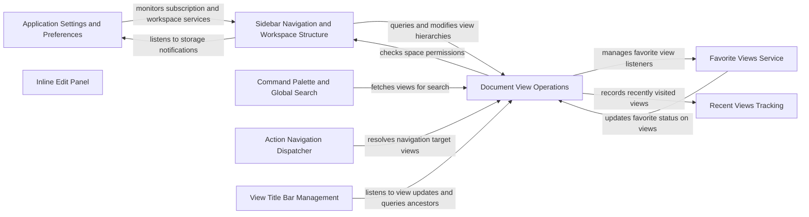

## Details

Coordinates business logic, state transitions, tab navigation, and service integrations for workspace features.

### Application Settings and Preferences
Manages application configuration, user preferences, AI integrations, appearance themes, billing, and cloud synchronization settings.

**Related Classes/Methods**:

- `frontend.appflowy_flutter.lib.workspace.application.settings.ai.local_ai_on_boarding_bloc.LocalAIOnBoardingBloc`:16-107
- `frontend.appflowy_flutter.lib.workspace.application.settings.billing.settings_billing_bloc.SettingsBillingBloc`:25-263
- `frontend.appflowy_flutter.lib.workspace.application.settings.file_storage.file_storage_listener.StoreageNotificationListener`:24-68

**Source Files:**

- `frontend/appflowy_flutter/lib/workspace/application/home/home_bloc.dart`
  - `frontend.appflowy_flutter.lib.workspace.application.home.home_bloc.HomeBloc` (L12-L75) - Class
  - `frontend.appflowy_flutter.lib.workspace.application.home.home_bloc.HomeBloc.HomeBloc` (L13-L19) - Constructor
  - `frontend.appflowy_flutter.lib.workspace.application.home.home_bloc.HomeBloc.close` (L24-L27) - Method
  - `frontend.appflowy_flutter.lib.workspace.application.home.home_bloc.HomeBloc._dispatch` (L29-L74) - Method
  - `frontend.appflowy_flutter.lib.workspace.application.home.home_bloc.HomeEvent` (L78-L84) - Class
  - `frontend.appflowy_flutter.lib.workspace.application.home.home_bloc.HomeEvent.HomeEvent.initial` (L79-L79) - Constructor
  - `frontend.appflowy_flutter.lib.workspace.application.home.home_bloc.HomeEvent.HomeEvent.showLoading` (L80-L80) - Constructor
  - `frontend.appflowy_flutter.lib.workspace.application.home.home_bloc.HomeEvent.HomeEvent.didReceiveWorkspaceSetting` (L81-L83) - Constructor
  - `frontend.appflowy_flutter.lib.workspace.application.home.home_bloc.HomeState` (L87-L98) - Class
  - `frontend.appflowy_flutter.lib.workspace.application.home.home_bloc.HomeState.HomeState` (L88-L92) - Constructor
  - `frontend.appflowy_flutter.lib.workspace.application.home.home_bloc.HomeState.HomeState.initial` (L94-L97) - Constructor
- `frontend/appflowy_flutter/lib/workspace/application/home/home_setting_bloc.dart`
  - `frontend.appflowy_flutter.lib.workspace.application.home.home_setting_bloc.HomeSettingBloc` (L13-L130) - Class
  - `frontend.appflowy_flutter.lib.workspace.application.home.home_setting_bloc.HomeSettingBloc.HomeSettingBloc` (L14-L28) - Constructor
  - `frontend.appflowy_flutter.lib.workspace.application.home.home_setting_bloc.HomeSettingBloc.close` (L34-L37) - Method
  - `frontend.appflowy_flutter.lib.workspace.application.home.home_setting_bloc.HomeSettingBloc._dispatch` (L39-L117) - Method
  - `frontend.appflowy_flutter.lib.workspace.application.home.home_setting_bloc.HomeSettingBloc.isMenuHidden` (L119-L119) - Method
  - `frontend.appflowy_flutter.lib.workspace.application.home.home_setting_bloc.HomeSettingBloc.isMenuExpanded` (L121-L121) - Method
  - `frontend.appflowy_flutter.lib.workspace.application.home.home_setting_bloc.HomeSettingBloc.collapseMenu` (L123-L129) - Method
  - `frontend.appflowy_flutter.lib.workspace.application.home.home_setting_bloc.MenuResizeType` (L132-L135) - Enum
  - `frontend.appflowy_flutter.lib.workspace.application.home.home_setting_bloc.MenuResizeType.slide` (L133-L133) - Enum
  - `frontend.appflowy_flutter.lib.workspace.application.home.home_setting_bloc.MenuResizeType.drag` (L134-L134) - Enum
  - `frontend.appflowy_flutter.lib.workspace.application.home.home_setting_bloc.MenuResizeTypeExtension.duration` (L138-L145) - Method
  - `frontend.appflowy_flutter.lib.workspace.application.home.home_setting_bloc.HomeSettingEvent` (L149-L176) - Class
  - `frontend.appflowy_flutter.lib.workspace.application.home.home_setting_bloc.HomeSettingEvent.HomeSettingEvent.initial` (L150-L150) - Constructor
  - `frontend.appflowy_flutter.lib.workspace.application.home.home_setting_bloc.HomeSettingEvent.HomeSettingEvent.setEditPanel` (L152-L153) - Constructor
  - `frontend.appflowy_flutter.lib.workspace.application.home.home_setting_bloc.HomeSettingEvent.HomeSettingEvent.dismissEditPanel` (L155-L155) - Constructor
  - `frontend.appflowy_flutter.lib.workspace.application.home.home_setting_bloc.HomeSettingEvent.HomeSettingEvent.didReceiveWorkspaceSetting` (L157-L159) - Constructor
  - `frontend.appflowy_flutter.lib.workspace.application.home.home_setting_bloc.HomeSettingEvent.HomeSettingEvent.changeMenuStatus` (L161-L162) - Constructor
  - `frontend.appflowy_flutter.lib.workspace.application.home.home_setting_bloc.HomeSettingEvent.HomeSettingEvent.collapseNotificationPanel` (L164-L165) - Constructor
  - `frontend.appflowy_flutter.lib.workspace.application.home.home_setting_bloc.HomeSettingEvent.HomeSettingEvent.checkScreenSize` (L167-L168) - Constructor
  - `frontend.appflowy_flutter.lib.workspace.application.home.home_setting_bloc.HomeSettingEvent.HomeSettingEvent.editPanelResized` (L170-L171) - Constructor
  - `frontend.appflowy_flutter.lib.workspace.application.home.home_setting_bloc.HomeSettingEvent.HomeSettingEvent.editPanelResizeStart` (L173-L173) - Constructor
  - `frontend.appflowy_flutter.lib.workspace.application.home.home_setting_bloc.HomeSettingEvent.HomeSettingEvent.editPanelResizeEnd` (L175-L175) - Constructor
  - `frontend.appflowy_flutter.lib.workspace.application.home.home_setting_bloc.HomeSettingState` (L179-L213) - Class
  - `frontend.appflowy_flutter.lib.workspace.application.home.home_setting_bloc.HomeSettingState.HomeSettingState` (L180-L191) - Constructor
  - `frontend.appflowy_flutter.lib.workspace.application.home.home_setting_bloc.HomeSettingState.HomeSettingState.initial` (L193-L212) - Constructor
  - `frontend.appflowy_flutter.lib.workspace.application.home.home_setting_bloc.MenuStatus` (L215-L215) - Enum
  - `frontend.appflowy_flutter.lib.workspace.application.home.home_setting_bloc.MenuStatus.expanded` (L215-L215) - Enum
  - `frontend.appflowy_flutter.lib.workspace.application.home.home_setting_bloc.MenuStatus.floating` (L215-L215) - Enum
  - `frontend.appflowy_flutter.lib.workspace.application.home.home_setting_bloc.MenuStatus.hidden` (L215-L215) - Enum
- `frontend/appflowy_flutter/lib/workspace/application/settings/ai/local_ai_bloc.dart`
  - `frontend.appflowy_flutter.lib.workspace.application.settings.ai.local_ai_bloc.LocalAiPluginBloc` (L14-L99) - Class
  - `frontend.appflowy_flutter.lib.workspace.application.settings.ai.local_ai_bloc.LocalAiPluginBloc.LocalAiPluginBloc` (L15-L19) - Constructor
  - `frontend.appflowy_flutter.lib.workspace.application.settings.ai.local_ai_bloc.LocalAiPluginBloc.close` (L24-L27) - Method
  - `frontend.appflowy_flutter.lib.workspace.application.settings.ai.local_ai_bloc.LocalAiPluginBloc._handleEvent` (L29-L72) - Method
  - `frontend.appflowy_flutter.lib.workspace.application.settings.ai.local_ai_bloc.LocalAiPluginBloc._startListening` (L74-L87) - Method
  - `frontend.appflowy_flutter.lib.workspace.application.settings.ai.local_ai_bloc.LocalAiPluginBloc._getLocalAiState` (L89-L98) - Method
  - `frontend.appflowy_flutter.lib.workspace.application.settings.ai.local_ai_bloc.LocalAiPluginEvent` (L102-L110) - Class
  - `frontend.appflowy_flutter.lib.workspace.application.settings.ai.local_ai_bloc.LocalAiPluginEvent.LocalAiPluginEvent.didReceiveAiState` (L103-L104) - Constructor
  - `frontend.appflowy_flutter.lib.workspace.application.settings.ai.local_ai_bloc.LocalAiPluginEvent.LocalAiPluginEvent.didReceiveLackOfResources` (L105-L107) - Constructor
  - `frontend.appflowy_flutter.lib.workspace.application.settings.ai.local_ai_bloc.LocalAiPluginEvent.LocalAiPluginEvent.toggle` (L108-L108) - Constructor
  - `frontend.appflowy_flutter.lib.workspace.application.settings.ai.local_ai_bloc.LocalAiPluginEvent.LocalAiPluginEvent.restart` (L109-L109) - Constructor
  - `frontend.appflowy_flutter.lib.workspace.application.settings.ai.local_ai_bloc.LocalAiPluginState` (L113-L138) - Class
  - `frontend.appflowy_flutter.lib.workspace.application.settings.ai.local_ai_bloc.LocalAiPluginState.LocalAiPluginState._` (L114-L114) - Constructor
  - `frontend.appflowy_flutter.lib.workspace.application.settings.ai.local_ai_bloc.LocalAiPluginState.LocalAiPluginState.ready` (L116-L120) - Constructor
  - `frontend.appflowy_flutter.lib.workspace.application.settings.ai.local_ai_bloc.LocalAiPluginState.LocalAiPluginState.loading` (L122-L122) - Constructor
  - `frontend.appflowy_flutter.lib.workspace.application.settings.ai.local_ai_bloc.LocalAiPluginState.isEnabled` (L124-L129) - Method
  - `frontend.appflowy_flutter.lib.workspace.application.settings.ai.local_ai_bloc.LocalAiPluginState.showIndicator` (L131-L137) - Method
- `frontend/appflowy_flutter/lib/workspace/application/settings/ai/local_ai_on_boarding_bloc.dart`
  - `frontend.appflowy_flutter.lib.workspace.application.settings.ai.local_ai_on_boarding_bloc.LocalAIOnBoardingBloc` (L16-L107) - Class
  - `frontend.appflowy_flutter.lib.workspace.application.settings.ai.local_ai_on_boarding_bloc.LocalAIOnBoardingBloc.LocalAIOnBoardingBloc` (L18-L27) - Constructor
  - `frontend.appflowy_flutter.lib.workspace.application.settings.ai.local_ai_on_boarding_bloc.LocalAIOnBoardingBloc._onPaymentSuccessful` (L29-L39) - Method
  - `frontend.appflowy_flutter.lib.workspace.application.settings.ai.local_ai_on_boarding_bloc.LocalAIOnBoardingBloc.close` (L48-L51) - Method
  - `frontend.appflowy_flutter.lib.workspace.application.settings.ai.local_ai_on_boarding_bloc.LocalAIOnBoardingBloc._dispatch` (L53-L97) - Method
  - `frontend.appflowy_flutter.lib.workspace.application.settings.ai.local_ai_on_boarding_bloc.LocalAIOnBoardingBloc._loadSubscriptionPlans` (L99-L106) - Method
  - `frontend.appflowy_flutter.lib.workspace.application.settings.ai.local_ai_on_boarding_bloc.LocalAIOnBoardingEvent` (L110-L121) - Class
  - `frontend.appflowy_flutter.lib.workspace.application.settings.ai.local_ai_on_boarding_bloc.LocalAIOnBoardingEvent.LocalAIOnBoardingEvent.started` (L111-L111) - Constructor
  - `frontend.appflowy_flutter.lib.workspace.application.settings.ai.local_ai_on_boarding_bloc.LocalAIOnBoardingEvent.LocalAIOnBoardingEvent.addSubscription` (L112-L114) - Constructor
  - `frontend.appflowy_flutter.lib.workspace.application.settings.ai.local_ai_on_boarding_bloc.LocalAIOnBoardingEvent.LocalAIOnBoardingEvent.paymentSuccessful` (L115-L117) - Constructor
  - `frontend.appflowy_flutter.lib.workspace.application.settings.ai.local_ai_on_boarding_bloc.LocalAIOnBoardingEvent.LocalAIOnBoardingEvent.didGetSubscriptionPlans` (L118-L120) - Constructor
  - `frontend.appflowy_flutter.lib.workspace.application.settings.ai.local_ai_on_boarding_bloc.LocalAIOnBoardingState` (L124-L129) - Class
  - `frontend.appflowy_flutter.lib.workspace.application.settings.ai.local_ai_on_boarding_bloc.LocalAIOnBoardingState.LocalAIOnBoardingState` (L125-L128) - Constructor
- `frontend/appflowy_flutter/lib/workspace/application/settings/ai/local_llm_listener.dart`
  - `frontend.appflowy_flutter.lib.workspace.application.settings.ai.local_llm_listener.PluginStateCallback` (L11-L11) - Class
  - `frontend.appflowy_flutter.lib.workspace.application.settings.ai.local_llm_listener.PluginResourceCallback` (L12-L12) - Class
  - `frontend.appflowy_flutter.lib.workspace.application.settings.ai.local_llm_listener.LocalAIStateListener` (L14-L59) - Class
  - `frontend.appflowy_flutter.lib.workspace.application.settings.ai.local_llm_listener.LocalAIStateListener.LocalAIStateListener` (L15-L21) - Constructor
  - `frontend.appflowy_flutter.lib.workspace.application.settings.ai.local_llm_listener.LocalAIStateListener.start` (L29-L35) - Method
  - `frontend.appflowy_flutter.lib.workspace.application.settings.ai.local_llm_listener.LocalAIStateListener._callback` (L37-L53) - Method
  - `frontend.appflowy_flutter.lib.workspace.application.settings.ai.local_llm_listener.LocalAIStateListener.stop` (L55-L58) - Method
- `frontend/appflowy_flutter/lib/workspace/application/settings/ai/ollama_setting_bloc.dart`
  - `frontend.appflowy_flutter.lib.workspace.application.settings.ai.ollama_setting_bloc.OllamaSettingBloc` (L18-L127) - Class
  - `frontend.appflowy_flutter.lib.workspace.application.settings.ai.ollama_setting_bloc.OllamaSettingBloc.OllamaSettingBloc` (L19-L27) - Constructor
  - `frontend.appflowy_flutter.lib.workspace.application.settings.ai.ollama_setting_bloc.OllamaSettingBloc._handleStarted` (L29-L49) - Method
  - `frontend.appflowy_flutter.lib.workspace.application.settings.ai.ollama_setting_bloc.OllamaSettingBloc._onLoadLocalModels` (L51-L56) - Method
  - `frontend.appflowy_flutter.lib.workspace.application.settings.ai.ollama_setting_bloc.OllamaSettingBloc._onLoadSetting` (L58-L75) - Method
  - `frontend.appflowy_flutter.lib.workspace.application.settings.ai.ollama_setting_bloc.OllamaSettingBloc._onEdit` (L77-L94) - Method
  - `frontend.appflowy_flutter.lib.workspace.application.settings.ai.ollama_setting_bloc.OllamaSettingBloc._onSubmit` (L96-L119) - Method
  - `frontend.appflowy_flutter.lib.workspace.application.settings.ai.ollama_setting_bloc.OllamaSettingBloc._onSetDefaultModel` (L121-L126) - Method
  - `frontend.appflowy_flutter.lib.workspace.application.settings.ai.ollama_setting_bloc.SettingType` (L130-L145) - Enum
  - `frontend.appflowy_flutter.lib.workspace.application.settings.ai.ollama_setting_bloc.SettingType.serverUrl` (L131-L131) - Enum
  - `frontend.appflowy_flutter.lib.workspace.application.settings.ai.ollama_setting_bloc.SettingType.chatModel` (L132-L132) - Enum
  - `frontend.appflowy_flutter.lib.workspace.application.settings.ai.ollama_setting_bloc.SettingType.embeddingModel` (L133-L133) - Enum
  - `frontend.appflowy_flutter.lib.workspace.application.settings.ai.ollama_setting_bloc.SettingType.title` (L135-L144) - Method
  - `frontend.appflowy_flutter.lib.workspace.application.settings.ai.ollama_setting_bloc.SettingItem` (L148-L163) - Class
  - `frontend.appflowy_flutter.lib.workspace.application.settings.ai.ollama_setting_bloc.SettingItem.SettingItem` (L149-L154) - Constructor
  - `frontend.appflowy_flutter.lib.workspace.application.settings.ai.ollama_setting_bloc.SettingItem.props` (L162-L162) - Method
  - `frontend.appflowy_flutter.lib.workspace.application.settings.ai.ollama_setting_bloc.SubmittedItem` (L166-L188) - Class
  - `frontend.appflowy_flutter.lib.workspace.application.settings.ai.ollama_setting_bloc.SubmittedItem.SubmittedItem` (L167-L170) - Constructor
  - `frontend.appflowy_flutter.lib.workspace.application.settings.ai.ollama_setting_bloc.SubmittedItem.copyWith` (L176-L184) - Method
  - `frontend.appflowy_flutter.lib.workspace.application.settings.ai.ollama_setting_bloc.SubmittedItem.props` (L187-L187) - Method
  - `frontend.appflowy_flutter.lib.workspace.application.settings.ai.ollama_setting_bloc.OllamaSettingEvent` (L191-L210) - Class
  - `frontend.appflowy_flutter.lib.workspace.application.settings.ai.ollama_setting_bloc.OllamaSettingEvent.OllamaSettingEvent.started` (L192-L192) - Constructor
  - `frontend.appflowy_flutter.lib.workspace.application.settings.ai.ollama_setting_bloc.OllamaSettingEvent.OllamaSettingEvent.didLoadLocalModels` (L193-L195) - Constructor
  - `frontend.appflowy_flutter.lib.workspace.application.settings.ai.ollama_setting_bloc.OllamaSettingEvent.OllamaSettingEvent.didLoadSetting` (L196-L198) - Constructor
  - `frontend.appflowy_flutter.lib.workspace.application.settings.ai.ollama_setting_bloc.OllamaSettingEvent.OllamaSettingEvent.updateSetting` (L199-L201) - Constructor
  - `frontend.appflowy_flutter.lib.workspace.application.settings.ai.ollama_setting_bloc.OllamaSettingEvent.OllamaSettingEvent.setDefaultModel` (L202-L204) - Constructor
  - `frontend.appflowy_flutter.lib.workspace.application.settings.ai.ollama_setting_bloc.OllamaSettingEvent.OllamaSettingEvent.onEdit` (L205-L208) - Constructor
  - `frontend.appflowy_flutter.lib.workspace.application.settings.ai.ollama_setting_bloc.OllamaSettingEvent.OllamaSettingEvent.submit` (L209-L209) - Constructor
  - `frontend.appflowy_flutter.lib.workspace.application.settings.ai.ollama_setting_bloc.OllamaSettingState` (L213-L224) - Class
  - `frontend.appflowy_flutter.lib.workspace.application.settings.ai.ollama_setting_bloc.OllamaSettingState.OllamaSettingState` (L214-L223) - Constructor
  - `frontend.appflowy_flutter.lib.workspace.application.settings.ai.ollama_setting_bloc.<unnamed extension>.toInputItems` (L227-L239) - Method
  - `frontend.appflowy_flutter.lib.workspace.application.settings.ai.ollama_setting_bloc.<unnamed extension>.toSubmittedItems` (L241-L254) - Method
- `frontend/appflowy_flutter/lib/workspace/application/settings/ai/settings_ai_bloc.dart`
  - `frontend.appflowy_flutter.lib.workspace.application.settings.ai.settings_ai_bloc.SettingsAIBloc` (L16-L158) - Class
  - `frontend.appflowy_flutter.lib.workspace.application.settings.ai.settings_ai_bloc.SettingsAIBloc.SettingsAIBloc` (L17-L36) - Constructor
  - `frontend.appflowy_flutter.lib.workspace.application.settings.ai.settings_ai_bloc.SettingsAIBloc.close` (L44-L48) - Method
  - `frontend.appflowy_flutter.lib.workspace.application.settings.ai.settings_ai_bloc.SettingsAIBloc._dispatch` (L50-L102) - Method
  - `frontend.appflowy_flutter.lib.workspace.application.settings.ai.settings_ai_bloc.SettingsAIBloc._updateUserWorkspaceSetting` (L104-L123) - Method
  - `frontend.appflowy_flutter.lib.workspace.application.settings.ai.settings_ai_bloc.SettingsAIBloc._onProfileUpdated` (L125-L131) - Method
  - `frontend.appflowy_flutter.lib.workspace.application.settings.ai.settings_ai_bloc.SettingsAIBloc._loadModelList` (L133-L144) - Method
  - `frontend.appflowy_flutter.lib.workspace.application.settings.ai.settings_ai_bloc.SettingsAIBloc._loadUserWorkspaceSetting` (L146-L157) - Method
  - `frontend.appflowy_flutter.lib.workspace.application.settings.ai.settings_ai_bloc.SettingsAIEvent` (L161-L178) - Class
  - `frontend.appflowy_flutter.lib.workspace.application.settings.ai.settings_ai_bloc.SettingsAIEvent.SettingsAIEvent.started` (L162-L162) - Constructor
  - `frontend.appflowy_flutter.lib.workspace.application.settings.ai.settings_ai_bloc.SettingsAIEvent.SettingsAIEvent.didLoadWorkspaceSetting` (L163-L165) - Constructor
  - `frontend.appflowy_flutter.lib.workspace.application.settings.ai.settings_ai_bloc.SettingsAIEvent.SettingsAIEvent.toggleAISearch` (L167-L167) - Constructor
  - `frontend.appflowy_flutter.lib.workspace.application.settings.ai.settings_ai_bloc.SettingsAIEvent.SettingsAIEvent.selectModel` (L169-L169) - Constructor
  - `frontend.appflowy_flutter.lib.workspace.application.settings.ai.settings_ai_bloc.SettingsAIEvent.SettingsAIEvent.didReceiveUserProfile` (L171-L173) - Constructor
  - `frontend.appflowy_flutter.lib.workspace.application.settings.ai.settings_ai_bloc.SettingsAIEvent.SettingsAIEvent.didLoadAvailableModels` (L175-L177) - Constructor
  - `frontend.appflowy_flutter.lib.workspace.application.settings.ai.settings_ai_bloc.SettingsAIState` (L181-L188) - Class
  - `frontend.appflowy_flutter.lib.workspace.application.settings.ai.settings_ai_bloc.SettingsAIState.SettingsAIState` (L182-L187) - Constructor
- `frontend/appflowy_flutter/lib/workspace/application/settings/appearance/appearance_cubit.dart`
  - `frontend.appflowy_flutter.lib.workspace.application.settings.appearance.appearance_cubit.AppearanceSettingsCubit` (L35-L306) - Class
  - `frontend.appflowy_flutter.lib.workspace.application.settings.appearance.appearance_cubit.AppearanceSettingsCubit.AppearanceSettingsCubit` (L36-L72) - Constructor
  - `frontend.appflowy_flutter.lib.workspace.application.settings.appearance.appearance_cubit.AppearanceSettingsCubit.setTextScaleFactor` (L77-L87) - Method
  - `frontend.appflowy_flutter.lib.workspace.application.settings.appearance.appearance_cubit.AppearanceSettingsCubit.readTextScaleFactor` (L89-L96) - Method
  - `frontend.appflowy_flutter.lib.workspace.application.settings.appearance.appearance_cubit.AppearanceSettingsCubit.setTheme` (L100-L116) - Method
  - `frontend.appflowy_flutter.lib.workspace.application.settings.appearance.appearance_cubit.AppearanceSettingsCubit.resetTheme` (L119-L120) - Method
  - `frontend.appflowy_flutter.lib.workspace.application.settings.appearance.appearance_cubit.AppearanceSettingsCubit.setThemeMode` (L123-L127) - Method
  - `frontend.appflowy_flutter.lib.workspace.application.settings.appearance.appearance_cubit.AppearanceSettingsCubit.resetThemeMode` (L130-L131) - Method
  - `frontend.appflowy_flutter.lib.workspace.application.settings.appearance.appearance_cubit.AppearanceSettingsCubit.toggleThemeMode` (L134-L139) - Method
  - `frontend.appflowy_flutter.lib.workspace.application.settings.appearance.appearance_cubit.AppearanceSettingsCubit.setLayoutDirection` (L141-L145) - Method
  - `frontend.appflowy_flutter.lib.workspace.application.settings.appearance.appearance_cubit.AppearanceSettingsCubit.setTextDirection` (L147-L151) - Method
  - `frontend.appflowy_flutter.lib.workspace.application.settings.appearance.appearance_cubit.AppearanceSettingsCubit.setEnableRTLToolbarItems` (L153-L157) - Method
  - `frontend.appflowy_flutter.lib.workspace.application.settings.appearance.appearance_cubit.AppearanceSettingsCubit.setFontFamily` (L161-L165) - Method
  - `frontend.appflowy_flutter.lib.workspace.application.settings.appearance.appearance_cubit.AppearanceSettingsCubit.resetFontFamily` (L168-L169) - Method
  - `frontend.appflowy_flutter.lib.workspace.application.settings.appearance.appearance_cubit.AppearanceSettingsCubit.setDocumentCursorColor` (L172-L176) - Method
  - `frontend.appflowy_flutter.lib.workspace.application.settings.appearance.appearance_cubit.AppearanceSettingsCubit.resetDocumentCursorColor` (L179-L183) - Method
  - `frontend.appflowy_flutter.lib.workspace.application.settings.appearance.appearance_cubit.AppearanceSettingsCubit.setDocumentSelectionColor` (L186-L190) - Method
  - `frontend.appflowy_flutter.lib.workspace.application.settings.appearance.appearance_cubit.AppearanceSettingsCubit.resetDocumentSelectionColor` (L193-L197) - Method
  - `frontend.appflowy_flutter.lib.workspace.application.settings.appearance.appearance_cubit.AppearanceSettingsCubit.setLocale` (L201-L220) - Method
  - `frontend.appflowy_flutter.lib.workspace.application.settings.appearance.appearance_cubit.AppearanceSettingsCubit.saveIsMenuCollapsed` (L223-L226) - Method
  - `frontend.appflowy_flutter.lib.workspace.application.settings.appearance.appearance_cubit.AppearanceSettingsCubit.saveMenuOffset` (L229-L232) - Method
  - `frontend.appflowy_flutter.lib.workspace.application.settings.appearance.appearance_cubit.AppearanceSettingsCubit.setKeyValue` (L236-L254) - Method
  - `frontend.appflowy_flutter.lib.workspace.application.settings.appearance.appearance_cubit.AppearanceSettingsCubit.getValue` (L256-L262) - Method
  - `frontend.appflowy_flutter.lib.workspace.application.settings.appearance.appearance_cubit.AppearanceSettingsCubit.readLocaleWhenAppLaunch` (L266-L275) - Method
  - `frontend.appflowy_flutter.lib.workspace.application.settings.appearance.appearance_cubit.AppearanceSettingsCubit.setDateFormat` (L277-L281) - Method
  - `frontend.appflowy_flutter.lib.workspace.application.settings.appearance.appearance_cubit.AppearanceSettingsCubit.setTimeFormat` (L283-L287) - Method
  - `frontend.appflowy_flutter.lib.workspace.application.settings.appearance.appearance_cubit.AppearanceSettingsCubit._saveDateTimeSettings` (L289-L296) - Method
  - `frontend.appflowy_flutter.lib.workspace.application.settings.appearance.appearance_cubit.AppearanceSettingsCubit._saveAppearanceSettings` (L298-L305) - Method
  - `frontend.appflowy_flutter.lib.workspace.application.settings.appearance.appearance_cubit._themeModeFromPB` (L308-L318) - Function
  - `frontend.appflowy_flutter.lib.workspace.application.settings.appearance.appearance_cubit._themeModeToPB` (L320-L329) - Function
  - `frontend.appflowy_flutter.lib.workspace.application.settings.appearance.appearance_cubit.LayoutDirection` (L331-L345) - Enum
  - `frontend.appflowy_flutter.lib.workspace.application.settings.appearance.appearance_cubit.LayoutDirection.ltrLayout` (L332-L332) - Enum
  - `frontend.appflowy_flutter.lib.workspace.application.settings.appearance.appearance_cubit.LayoutDirection.rtlLayout` (L333-L333) - Enum
  - `frontend.appflowy_flutter.lib.workspace.application.settings.appearance.appearance_cubit.LayoutDirection.fromLayoutDirectionPB` (L335-L340) - Method
  - `frontend.appflowy_flutter.lib.workspace.application.settings.appearance.appearance_cubit.LayoutDirection.toLayoutDirectionPB` (L342-L344) - Method
  - `frontend.appflowy_flutter.lib.workspace.application.settings.appearance.appearance_cubit.AppFlowyTextDirection` (L347-L377) - Enum
  - `frontend.appflowy_flutter.lib.workspace.application.settings.appearance.appearance_cubit.AppFlowyTextDirection.ltr` (L348-L348) - Enum
  - `frontend.appflowy_flutter.lib.workspace.application.settings.appearance.appearance_cubit.AppFlowyTextDirection.rtl` (L349-L349) - Enum
  - `frontend.appflowy_flutter.lib.workspace.application.settings.appearance.appearance_cubit.AppFlowyTextDirection.auto` (L350-L350) - Enum
  - `frontend.appflowy_flutter.lib.workspace.application.settings.appearance.appearance_cubit.AppFlowyTextDirection.fromTextDirectionPB` (L352-L365) - Method
  - `frontend.appflowy_flutter.lib.workspace.application.settings.appearance.appearance_cubit.AppFlowyTextDirection.toTextDirectionPB` (L367-L376) - Method
  - `frontend.appflowy_flutter.lib.workspace.application.settings.appearance.appearance_cubit.AppearanceSettingsState` (L380-L449) - Class
  - `frontend.appflowy_flutter.lib.workspace.application.settings.appearance.appearance_cubit.AppearanceSettingsState.AppearanceSettingsState._` (L381-L381) - Constructor
  - `frontend.appflowy_flutter.lib.workspace.application.settings.appearance.appearance_cubit.AppearanceSettingsState.AppearanceSettingsState` (L383-L399) - Constructor
  - `frontend.appflowy_flutter.lib.workspace.application.settings.appearance.appearance_cubit.AppearanceSettingsState.AppearanceSettingsState.initial` (L401-L435) - Constructor
  - `frontend.appflowy_flutter.lib.workspace.application.settings.appearance.appearance_cubit.AppearanceSettingsState.lightTheme` (L437-L437) - Method
  - `frontend.appflowy_flutter.lib.workspace.application.settings.appearance.appearance_cubit.AppearanceSettingsState.darkTheme` (L439-L439) - Method
  - `frontend.appflowy_flutter.lib.workspace.application.settings.appearance.appearance_cubit.AppearanceSettingsState._getThemeData` (L441-L448) - Method
- `frontend/appflowy_flutter/lib/workspace/application/settings/appearance/base_appearance.dart`
  - `frontend.appflowy_flutter.lib.workspace.application.settings.appearance.base_appearance.BaseAppearance` (L15-L125) - Class
  - `frontend.appflowy_flutter.lib.workspace.application.settings.appearance.base_appearance.BaseAppearance.getFontStyle` (L24-L61) - Method
  - `frontend.appflowy_flutter.lib.workspace.application.settings.appearance.base_appearance.BaseAppearance.getTextTheme` (L63-L117) - Method
  - `frontend.appflowy_flutter.lib.workspace.application.settings.appearance.base_appearance.BaseAppearance.getThemeData` (L119-L124) - Method
- `frontend/appflowy_flutter/lib/workspace/application/settings/appearance/desktop_appearance.dart`
  - `frontend.appflowy_flutter.lib.workspace.application.settings.appearance.desktop_appearance.DesktopAppearance` (L7-L159) - Class
  - `frontend.appflowy_flutter.lib.workspace.application.settings.appearance.desktop_appearance.DesktopAppearance.getThemeData` (L9-L158) - Method
- `frontend/appflowy_flutter/lib/workspace/application/settings/appearance/mobile_appearance.dart`
  - `frontend.appflowy_flutter.lib.workspace.application.settings.appearance.mobile_appearance.MobileAppearance` (L9-L284) - Class
  - `frontend.appflowy_flutter.lib.workspace.application.settings.appearance.mobile_appearance.MobileAppearance.getThemeData` (L17-L283) - Method
- `frontend/appflowy_flutter/lib/workspace/application/settings/appflowy_cloud_setting_bloc.dart`
  - `frontend.appflowy_flutter.lib.workspace.application.settings.appflowy_cloud_setting_bloc.AppFlowyCloudSettingBloc` (L15-L94) - Class
  - `frontend.appflowy_flutter.lib.workspace.application.settings.appflowy_cloud_setting_bloc.AppFlowyCloudSettingBloc.AppFlowyCloudSettingBloc` (L17-L22) - Constructor
  - `frontend.appflowy_flutter.lib.workspace.application.settings.appflowy_cloud_setting_bloc.AppFlowyCloudSettingBloc.close` (L27-L30) - Method
  - `frontend.appflowy_flutter.lib.workspace.application.settings.appflowy_cloud_setting_bloc.AppFlowyCloudSettingBloc._getWorkspaceType` (L32-L47) - Method
  - `frontend.appflowy_flutter.lib.workspace.application.settings.appflowy_cloud_setting_bloc.AppFlowyCloudSettingBloc._dispatch` (L49-L93) - Method
  - `frontend.appflowy_flutter.lib.workspace.application.settings.appflowy_cloud_setting_bloc.AppFlowyCloudSettingEvent` (L97-L109) - Class
  - `frontend.appflowy_flutter.lib.workspace.application.settings.appflowy_cloud_setting_bloc.AppFlowyCloudSettingEvent.AppFlowyCloudSettingEvent.initial` (L98-L98) - Constructor
  - `frontend.appflowy_flutter.lib.workspace.application.settings.appflowy_cloud_setting_bloc.AppFlowyCloudSettingEvent.AppFlowyCloudSettingEvent.enableSync` (L99-L100) - Constructor
  - `frontend.appflowy_flutter.lib.workspace.application.settings.appflowy_cloud_setting_bloc.AppFlowyCloudSettingEvent.AppFlowyCloudSettingEvent.enableSyncLog` (L101-L102) - Constructor
  - `frontend.appflowy_flutter.lib.workspace.application.settings.appflowy_cloud_setting_bloc.AppFlowyCloudSettingEvent.AppFlowyCloudSettingEvent.didReceiveSetting` (L103-L105) - Constructor
  - `frontend.appflowy_flutter.lib.workspace.application.settings.appflowy_cloud_setting_bloc.AppFlowyCloudSettingEvent.AppFlowyCloudSettingEvent.workspaceTypeChanged` (L106-L108) - Constructor
  - `frontend.appflowy_flutter.lib.workspace.application.settings.appflowy_cloud_setting_bloc.AppFlowyCloudSettingState` (L112-L130) - Class
  - `frontend.appflowy_flutter.lib.workspace.application.settings.appflowy_cloud_setting_bloc.AppFlowyCloudSettingState.AppFlowyCloudSettingState` (L113-L118) - Constructor
  - `frontend.appflowy_flutter.lib.workspace.application.settings.appflowy_cloud_setting_bloc.AppFlowyCloudSettingState.AppFlowyCloudSettingState.initial` (L120-L129) - Constructor
  - `frontend.appflowy_flutter.lib.workspace.application.settings.appflowy_cloud_setting_bloc.validateUrl` (L132-L146) - Function
- `frontend/appflowy_flutter/lib/workspace/application/settings/appflowy_cloud_urls_bloc.dart`
  - `frontend.appflowy_flutter.lib.workspace.application.settings.appflowy_cloud_urls_bloc.AppFlowyCloudURLsBloc` (L12-L81) - Class
  - `frontend.appflowy_flutter.lib.workspace.application.settings.appflowy_cloud_urls_bloc.AppFlowyCloudURLsBloc.AppFlowyCloudURLsBloc` (L14-L80) - Constructor
  - `frontend.appflowy_flutter.lib.workspace.application.settings.appflowy_cloud_urls_bloc.AppFlowyCloudURLsEvent` (L84-L92) - Class
  - `frontend.appflowy_flutter.lib.workspace.application.settings.appflowy_cloud_urls_bloc.AppFlowyCloudURLsEvent.AppFlowyCloudURLsEvent.initial` (L85-L85) - Constructor
  - `frontend.appflowy_flutter.lib.workspace.application.settings.appflowy_cloud_urls_bloc.AppFlowyCloudURLsEvent.AppFlowyCloudURLsEvent.updateServerUrl` (L86-L87) - Constructor
  - `frontend.appflowy_flutter.lib.workspace.application.settings.appflowy_cloud_urls_bloc.AppFlowyCloudURLsEvent.AppFlowyCloudURLsEvent.updateBaseWebDomain` (L88-L89) - Constructor
  - `frontend.appflowy_flutter.lib.workspace.application.settings.appflowy_cloud_urls_bloc.AppFlowyCloudURLsEvent.AppFlowyCloudURLsEvent.confirmUpdate` (L90-L90) - Constructor
  - `frontend.appflowy_flutter.lib.workspace.application.settings.appflowy_cloud_urls_bloc.AppFlowyCloudURLsEvent.AppFlowyCloudURLsEvent.didSaveConfig` (L91-L91) - Constructor
  - `frontend.appflowy_flutter.lib.workspace.application.settings.appflowy_cloud_urls_bloc.AppFlowyCloudURLsState` (L95-L118) - Class
  - `frontend.appflowy_flutter.lib.workspace.application.settings.appflowy_cloud_urls_bloc.AppFlowyCloudURLsState.AppFlowyCloudURLsState` (L96-L103) - Constructor
  - `frontend.appflowy_flutter.lib.workspace.application.settings.appflowy_cloud_urls_bloc.AppFlowyCloudURLsState.AppFlowyCloudURLsState.initial` (L105-L117) - Constructor
  - `frontend.appflowy_flutter.lib.workspace.application.settings.appflowy_cloud_urls_bloc.validateUrl` (L120-L134) - Function
  - `frontend.appflowy_flutter.lib.workspace.application.settings.appflowy_cloud_urls_bloc.removeTrailingSlash` (L136-L141) - Function
- `frontend/appflowy_flutter/lib/workspace/application/settings/application_data_storage.dart`
  - `frontend.appflowy_flutter.lib.workspace.application.settings.application_data_storage.ApplicationDataStorage` (L16-L88) - Class
  - `frontend.appflowy_flutter.lib.workspace.application.settings.application_data_storage.ApplicationDataStorage.ApplicationDataStorage` (L17-L17) - Constructor
  - `frontend.appflowy_flutter.lib.workspace.application.settings.application_data_storage.ApplicationDataStorage.setCustomPath` (L23-L50) - Method
  - `frontend.appflowy_flutter.lib.workspace.application.settings.application_data_storage.ApplicationDataStorage.setPath` (L52-L61) - Method
  - `frontend.appflowy_flutter.lib.workspace.application.settings.application_data_storage.ApplicationDataStorage.getPath` (L63-L87) - Method
  - `frontend.appflowy_flutter.lib.workspace.application.settings.application_data_storage.MockApplicationDataStorage` (L90-L108) - Class
  - `frontend.appflowy_flutter.lib.workspace.application.settings.application_data_storage.MockApplicationDataStorage.MockApplicationDataStorage` (L91-L91) - Constructor
  - `frontend.appflowy_flutter.lib.workspace.application.settings.application_data_storage.MockApplicationDataStorage.getPath` (L99-L107) - Method
- `frontend/appflowy_flutter/lib/workspace/application/settings/billing/settings_billing_bloc.dart`
  - `frontend.appflowy_flutter.lib.workspace.application.settings.billing.settings_billing_bloc.SettingsBillingBloc` (L25-L263) - Class
  - `frontend.appflowy_flutter.lib.workspace.application.settings.billing.settings_billing_bloc.SettingsBillingBloc.SettingsBillingBloc` (L27-L236) - Constructor
  - `frontend.appflowy_flutter.lib.workspace.application.settings.billing.settings_billing_bloc.SettingsBillingBloc.close` (L248-L251) - Method
  - `frontend.appflowy_flutter.lib.workspace.application.settings.billing.settings_billing_bloc.SettingsBillingBloc._fetchBillingPortal` (L253-L256) - Method
  - `frontend.appflowy_flutter.lib.workspace.application.settings.billing.settings_billing_bloc.SettingsBillingBloc._onPaymentSuccessful` (L258-L262) - Method
  - `frontend.appflowy_flutter.lib.workspace.application.settings.billing.settings_billing_bloc.SettingsBillingEvent` (L266-L291) - Class
  - `frontend.appflowy_flutter.lib.workspace.application.settings.billing.settings_billing_bloc.SettingsBillingEvent.SettingsBillingEvent.started` (L267-L267) - Constructor
  - `frontend.appflowy_flutter.lib.workspace.application.settings.billing.settings_billing_bloc.SettingsBillingEvent.SettingsBillingEvent.billingPortalFetched` (L269-L271) - Constructor
  - `frontend.appflowy_flutter.lib.workspace.application.settings.billing.settings_billing_bloc.SettingsBillingEvent.SettingsBillingEvent.openCustomerPortal` (L273-L273) - Constructor
  - `frontend.appflowy_flutter.lib.workspace.application.settings.billing.settings_billing_bloc.SettingsBillingEvent.SettingsBillingEvent.addSubscription` (L275-L276) - Constructor
  - `frontend.appflowy_flutter.lib.workspace.application.settings.billing.settings_billing_bloc.SettingsBillingEvent.SettingsBillingEvent.cancelSubscription` (L278-L281) - Constructor
  - `frontend.appflowy_flutter.lib.workspace.application.settings.billing.settings_billing_bloc.SettingsBillingEvent.SettingsBillingEvent.paymentSuccessful` (L283-L285) - Constructor
  - `frontend.appflowy_flutter.lib.workspace.application.settings.billing.settings_billing_bloc.SettingsBillingEvent.SettingsBillingEvent.updatePeriod` (L287-L290) - Constructor
  - `frontend.appflowy_flutter.lib.workspace.application.settings.billing.settings_billing_bloc.SettingsBillingState` (L294-L324) - Class
  - `frontend.appflowy_flutter.lib.workspace.application.settings.billing.settings_billing_bloc.SettingsBillingState.SettingsBillingState._` (L295-L295) - Constructor
  - `frontend.appflowy_flutter.lib.workspace.application.settings.billing.settings_billing_bloc.SettingsBillingState.SettingsBillingState.initial` (L297-L297) - Constructor
  - `frontend.appflowy_flutter.lib.workspace.application.settings.billing.settings_billing_bloc.SettingsBillingState.SettingsBillingState.loading` (L299-L299) - Constructor
  - `frontend.appflowy_flutter.lib.workspace.application.settings.billing.settings_billing_bloc.SettingsBillingState.SettingsBillingState.error` (L301-L303) - Constructor
  - `frontend.appflowy_flutter.lib.workspace.application.settings.billing.settings_billing_bloc.SettingsBillingState.SettingsBillingState.ready` (L305-L310) - Constructor
  - `frontend.appflowy_flutter.lib.workspace.application.settings.billing.settings_billing_bloc.SettingsBillingState.props` (L313-L323) - Method
- `frontend/appflowy_flutter/lib/workspace/application/settings/cloud_setting_bloc.dart`
  - `frontend.appflowy_flutter.lib.workspace.application.settings.cloud_setting_bloc.CloudSettingBloc` (L7-L19) - Class
  - `frontend.appflowy_flutter.lib.workspace.application.settings.cloud_setting_bloc.CloudSettingBloc.CloudSettingBloc` (L8-L18) - Constructor
  - `frontend.appflowy_flutter.lib.workspace.application.settings.cloud_setting_bloc.CloudSettingEvent` (L22-L27) - Class
  - `frontend.appflowy_flutter.lib.workspace.application.settings.cloud_setting_bloc.CloudSettingEvent.CloudSettingEvent.initial` (L23-L23) - Constructor
  - `frontend.appflowy_flutter.lib.workspace.application.settings.cloud_setting_bloc.CloudSettingEvent.CloudSettingEvent.updateCloudType` (L24-L26) - Constructor
  - `frontend.appflowy_flutter.lib.workspace.application.settings.cloud_setting_bloc.CloudSettingState` (L30-L39) - Class
  - `frontend.appflowy_flutter.lib.workspace.application.settings.cloud_setting_bloc.CloudSettingState.CloudSettingState` (L31-L33) - Constructor
  - `frontend.appflowy_flutter.lib.workspace.application.settings.cloud_setting_bloc.CloudSettingState.CloudSettingState.initial` (L35-L38) - Constructor
- `frontend/appflowy_flutter/lib/workspace/application/settings/cloud_setting_listener.dart`
  - `frontend.appflowy_flutter.lib.workspace.application.settings.cloud_setting_listener.UserCloudConfigListener` (L12-L54) - Class
  - `frontend.appflowy_flutter.lib.workspace.application.settings.cloud_setting_listener.UserCloudConfigListener.UserCloudConfigListener` (L13-L13) - Constructor
  - `frontend.appflowy_flutter.lib.workspace.application.settings.cloud_setting_listener.UserCloudConfigListener.start` (L19-L30) - Method
  - `frontend.appflowy_flutter.lib.workspace.application.settings.cloud_setting_listener.UserCloudConfigListener.stop` (L32-L36) - Method
  - `frontend.appflowy_flutter.lib.workspace.application.settings.cloud_setting_listener.UserCloudConfigListener._userNotificationCallback` (L38-L53) - Method
- `frontend/appflowy_flutter/lib/workspace/application/settings/create_file_settings_cubit.dart`
  - `frontend.appflowy_flutter.lib.workspace.application.settings.create_file_settings_cubit.CreateFileSettingsCubit` (L6-L26) - Class
  - `frontend.appflowy_flutter.lib.workspace.application.settings.create_file_settings_cubit.CreateFileSettingsCubit.CreateFileSettingsCubit` (L7-L9) - Constructor
  - `frontend.appflowy_flutter.lib.workspace.application.settings.create_file_settings_cubit.CreateFileSettingsCubit.toggle` (L11-L17) - Method
  - `frontend.appflowy_flutter.lib.workspace.application.settings.create_file_settings_cubit.CreateFileSettingsCubit.getInitialSettings` (L19-L25) - Method
- `frontend/appflowy_flutter/lib/workspace/application/settings/date_time/date_format_ext.dart`
  - `frontend.appflowy_flutter.lib.workspace.application.settings.date_time.date_format_ext.DateFormatter.toFormat` (L11-L18) - Method
  - `frontend.appflowy_flutter.lib.workspace.application.settings.date_time.date_format_ext.DateFormatter.formatDate` (L20-L39) - Method
- `frontend/appflowy_flutter/lib/workspace/application/settings/date_time/time_format_ext.dart`
  - `frontend.appflowy_flutter.lib.workspace.application.settings.date_time.time_format_ext.TimeFormatter.toFormat` (L5-L5) - Method
  - `frontend.appflowy_flutter.lib.workspace.application.settings.date_time.time_format_ext.TimeFormatter.formatTime` (L7-L7) - Method
- `frontend/appflowy_flutter/lib/workspace/application/settings/file_storage/file_storage_listener.dart`
  - `frontend.appflowy_flutter.lib.workspace.application.settings.file_storage.file_storage_listener.StoregeNotificationParser` (L12-L22) - Class
  - `frontend.appflowy_flutter.lib.workspace.application.settings.file_storage.file_storage_listener.StoregeNotificationParser.StoregeNotificationParser` (L14-L21) - Constructor
  - `frontend.appflowy_flutter.lib.workspace.application.settings.file_storage.file_storage_listener.StoreageNotificationListener` (L24-L68) - Class
  - `frontend.appflowy_flutter.lib.workspace.application.settings.file_storage.file_storage_listener.StoreageNotificationListener.StoreageNotificationListener` (L25-L58) - Constructor
  - `frontend.appflowy_flutter.lib.workspace.application.settings.file_storage.file_storage_listener.StoreageNotificationListener.stop` (L63-L67) - Method
- `frontend/appflowy_flutter/lib/workspace/application/settings/notifications/notification_settings_cubit.dart`
  - `frontend.appflowy_flutter.lib.workspace.application.settings.notifications.notification_settings_cubit.NotificationSettingsCubit` (L14-L79) - Class
  - `frontend.appflowy_flutter.lib.workspace.application.settings.notifications.notification_settings_cubit.NotificationSettingsCubit.NotificationSettingsCubit` (L15-L17) - Constructor
  - `frontend.appflowy_flutter.lib.workspace.application.settings.notifications.notification_settings_cubit.NotificationSettingsCubit._initialize` (L23-L38) - Method
  - `frontend.appflowy_flutter.lib.workspace.application.settings.notifications.notification_settings_cubit.NotificationSettingsCubit.toggleNotificationsEnabled` (L40-L52) - Method
  - `frontend.appflowy_flutter.lib.workspace.application.settings.notifications.notification_settings_cubit.NotificationSettingsCubit.toggleShowNotificationIconEnabled` (L54-L62) - Method
  - `frontend.appflowy_flutter.lib.workspace.application.settings.notifications.notification_settings_cubit.NotificationSettingsCubit._saveNotificationSettings` (L64-L78) - Method
  - `frontend.appflowy_flutter.lib.workspace.application.settings.notifications.notification_settings_cubit.NotificationSettingsState` (L82-L95) - Class
  - `frontend.appflowy_flutter.lib.workspace.application.settings.notifications.notification_settings_cubit.NotificationSettingsState.NotificationSettingsState._` (L83-L83) - Constructor
  - `frontend.appflowy_flutter.lib.workspace.application.settings.notifications.notification_settings_cubit.NotificationSettingsState.NotificationSettingsState` (L85-L88) - Constructor
  - `frontend.appflowy_flutter.lib.workspace.application.settings.notifications.notification_settings_cubit.NotificationSettingsState.NotificationSettingsState.initial` (L90-L94) - Constructor
- `frontend/appflowy_flutter/lib/workspace/application/settings/plan/settings_plan_bloc.dart`
  - `frontend.appflowy_flutter.lib.workspace.application.settings.plan.settings_plan_bloc.SettingsPlanBloc` (L21-L201) - Class
  - `frontend.appflowy_flutter.lib.workspace.application.settings.plan.settings_plan_bloc.SettingsPlanBloc.SettingsPlanBloc` (L22-L183) - Constructor
  - `frontend.appflowy_flutter.lib.workspace.application.settings.plan.settings_plan_bloc.SettingsPlanBloc._onPaymentSuccessful` (L190-L194) - Method
  - `frontend.appflowy_flutter.lib.workspace.application.settings.plan.settings_plan_bloc.SettingsPlanBloc.close` (L197-L200) - Method
  - `frontend.appflowy_flutter.lib.workspace.application.settings.plan.settings_plan_bloc.SettingsPlanEvent` (L204-L220) - Class
  - `frontend.appflowy_flutter.lib.workspace.application.settings.plan.settings_plan_bloc.SettingsPlanEvent.SettingsPlanEvent.started` (L205-L208) - Constructor
  - `frontend.appflowy_flutter.lib.workspace.application.settings.plan.settings_plan_bloc.SettingsPlanEvent.SettingsPlanEvent.addSubscription` (L210-L211) - Constructor
  - `frontend.appflowy_flutter.lib.workspace.application.settings.plan.settings_plan_bloc.SettingsPlanEvent.SettingsPlanEvent.cancelSubscription` (L213-L215) - Constructor
  - `frontend.appflowy_flutter.lib.workspace.application.settings.plan.settings_plan_bloc.SettingsPlanEvent.SettingsPlanEvent.paymentSuccessful` (L217-L219) - Constructor
  - `frontend.appflowy_flutter.lib.workspace.application.settings.plan.settings_plan_bloc.SettingsPlanState` (L223-L238) - Class
  - `frontend.appflowy_flutter.lib.workspace.application.settings.plan.settings_plan_bloc.SettingsPlanState.SettingsPlanState.initial` (L224-L224) - Constructor
  - `frontend.appflowy_flutter.lib.workspace.application.settings.plan.settings_plan_bloc.SettingsPlanState.SettingsPlanState.loading` (L226-L226) - Constructor
  - `frontend.appflowy_flutter.lib.workspace.application.settings.plan.settings_plan_bloc.SettingsPlanState.SettingsPlanState.error` (L228-L230) - Constructor
  - `frontend.appflowy_flutter.lib.workspace.application.settings.plan.settings_plan_bloc.SettingsPlanState.SettingsPlanState.ready` (L232-L237) - Constructor
- `frontend/appflowy_flutter/lib/workspace/application/settings/plan/workspace_subscription_ext.dart`
  - `frontend.appflowy_flutter.lib.workspace.application.settings.plan.workspace_subscription_ext.SubscriptionInfoHelpers.label` (L8-L16) - Method
  - `frontend.appflowy_flutter.lib.workspace.application.settings.plan.workspace_subscription_ext.SubscriptionInfoHelpers.info` (L18-L26) - Method
  - `frontend.appflowy_flutter.lib.workspace.application.settings.plan.workspace_subscription_ext.SubscriptionInfoHelpers.isBillingPortalEnabled` (L28-L34) - Method
  - `frontend.appflowy_flutter.lib.workspace.application.settings.plan.workspace_subscription_ext.AllSubscriptionLabels.label` (L38-L50) - Method
  - `frontend.appflowy_flutter.lib.workspace.application.settings.plan.workspace_subscription_ext.WorkspaceSubscriptionStatusExt.isCanceled` (L54-L55) - Method
  - `frontend.appflowy_flutter.lib.workspace.application.settings.plan.workspace_subscription_ext.WorkspaceAddonsExt.hasAIMax` (L59-L60) - Method
  - `frontend.appflowy_flutter.lib.workspace.application.settings.plan.workspace_subscription_ext.WorkspaceAddonsExt.hasAIOnDevice` (L62-L63) - Method
  - `frontend.appflowy_flutter.lib.workspace.application.settings.plan.workspace_subscription_ext.ToRecognizable.toRecognizable` (L68-L75) - Method
  - `frontend.appflowy_flutter.lib.workspace.application.settings.plan.workspace_subscription_ext.PlanHelper.isAddOn` (L82-L86) - Method
  - `frontend.appflowy_flutter.lib.workspace.application.settings.plan.workspace_subscription_ext.PlanHelper.priceMonthBilling` (L88-L95) - Method
  - `frontend.appflowy_flutter.lib.workspace.application.settings.plan.workspace_subscription_ext.PlanHelper.priceAnnualBilling` (L97-L104) - Method
  - `frontend.appflowy_flutter.lib.workspace.application.settings.plan.workspace_subscription_ext.IntervalLabel.label` (L108-L114) - Method
  - `frontend.appflowy_flutter.lib.workspace.application.settings.plan.workspace_subscription_ext.IntervalLabel.priceInfo` (L116-L122) - Method
- `frontend/appflowy_flutter/lib/workspace/application/settings/plan/workspace_usage_ext.dart`
  - `frontend.appflowy_flutter.lib.workspace.application.settings.plan.workspace_usage_ext.PresentableUsage.totalBlobInGb` (L9-L15) - Method
  - `frontend.appflowy_flutter.lib.workspace.application.settings.plan.workspace_usage_ext.PresentableUsage.currentBlobInGb` (L23-L24) - Method
- `frontend/appflowy_flutter/lib/workspace/application/settings/setting_file_importer_bloc.dart`
  - `frontend.appflowy_flutter.lib.workspace.application.settings.setting_file_importer_bloc.SettingFileImportBloc` (L16-L71) - Class
  - `frontend.appflowy_flutter.lib.workspace.application.settings.setting_file_importer_bloc.SettingFileImportBloc.SettingFileImportBloc` (L18-L70) - Constructor
  - `frontend.appflowy_flutter.lib.workspace.application.settings.setting_file_importer_bloc.SettingFileImportEvent` (L74-L80) - Class
  - `frontend.appflowy_flutter.lib.workspace.application.settings.setting_file_importer_bloc.SettingFileImportEvent.SettingFileImportEvent.importAppFlowyDataFolder` (L75-L76) - Constructor
  - `frontend.appflowy_flutter.lib.workspace.application.settings.setting_file_importer_bloc.SettingFileImportEvent.SettingFileImportEvent.finishImport` (L77-L79) - Constructor
  - `frontend.appflowy_flutter.lib.workspace.application.settings.setting_file_importer_bloc.SettingFileImportState` (L83-L93) - Class
  - `frontend.appflowy_flutter.lib.workspace.application.settings.setting_file_importer_bloc.SettingFileImportState.SettingFileImportState` (L84-L87) - Constructor
  - `frontend.appflowy_flutter.lib.workspace.application.settings.setting_file_importer_bloc.SettingFileImportState.SettingFileImportState.initial` (L89-L92) - Constructor
- `frontend/appflowy_flutter/lib/workspace/application/settings/settings_dialog_bloc.dart`
  - `frontend.appflowy_flutter.lib.workspace.application.settings.settings_dialog_bloc.SettingsPage` (L14-L29) - Enum
  - `frontend.appflowy_flutter.lib.workspace.application.settings.settings_dialog_bloc.SettingsPage.account` (L16-L16) - Enum
  - `frontend.appflowy_flutter.lib.workspace.application.settings.settings_dialog_bloc.SettingsPage.workspace` (L17-L17) - Enum
  - `frontend.appflowy_flutter.lib.workspace.application.settings.settings_dialog_bloc.SettingsPage.manageData` (L18-L18) - Enum
  - `frontend.appflowy_flutter.lib.workspace.application.settings.settings_dialog_bloc.SettingsPage.shortcuts` (L19-L19) - Enum
  - `frontend.appflowy_flutter.lib.workspace.application.settings.settings_dialog_bloc.SettingsPage.ai` (L20-L20) - Enum
  - `frontend.appflowy_flutter.lib.workspace.application.settings.settings_dialog_bloc.SettingsPage.plan` (L21-L21) - Enum
  - `frontend.appflowy_flutter.lib.workspace.application.settings.settings_dialog_bloc.SettingsPage.billing` (L22-L22) - Enum
  - `frontend.appflowy_flutter.lib.workspace.application.settings.settings_dialog_bloc.SettingsPage.sites` (L23-L23) - Enum
  - `frontend.appflowy_flutter.lib.workspace.application.settings.settings_dialog_bloc.SettingsPage.notifications` (L25-L25) - Enum
  - `frontend.appflowy_flutter.lib.workspace.application.settings.settings_dialog_bloc.SettingsPage.cloud` (L26-L26) - Enum
  - `frontend.appflowy_flutter.lib.workspace.application.settings.settings_dialog_bloc.SettingsPage.member` (L27-L27) - Enum
  - `frontend.appflowy_flutter.lib.workspace.application.settings.settings_dialog_bloc.SettingsPage.featureFlags` (L28-L28) - Enum
  - `frontend.appflowy_flutter.lib.workspace.application.settings.settings_dialog_bloc.SettingsDialogBloc` (L31-L125) - Class
  - `frontend.appflowy_flutter.lib.workspace.application.settings.settings_dialog_bloc.SettingsDialogBloc.SettingsDialogBloc` (L33-L40) - Constructor
  - `frontend.appflowy_flutter.lib.workspace.application.settings.settings_dialog_bloc.SettingsDialogBloc.close` (L46-L49) - Method
  - `frontend.appflowy_flutter.lib.workspace.application.settings.settings_dialog_bloc.SettingsDialogBloc._dispatch` (L51-L75) - Method
  - `frontend.appflowy_flutter.lib.workspace.application.settings.settings_dialog_bloc.SettingsDialogBloc._profileUpdated` (L77-L88) - Method
  - `frontend.appflowy_flutter.lib.workspace.application.settings.settings_dialog_bloc.SettingsDialogBloc._isBillingEnabled` (L90-L124) - Method
  - `frontend.appflowy_flutter.lib.workspace.application.settings.settings_dialog_bloc.SettingsDialogEvent` (L128-L135) - Class
  - `frontend.appflowy_flutter.lib.workspace.application.settings.settings_dialog_bloc.SettingsDialogEvent.SettingsDialogEvent.initial` (L129-L129) - Constructor
  - `frontend.appflowy_flutter.lib.workspace.application.settings.settings_dialog_bloc.SettingsDialogEvent.SettingsDialogEvent.didReceiveUserProfile` (L130-L132) - Constructor
  - `frontend.appflowy_flutter.lib.workspace.application.settings.settings_dialog_bloc.SettingsDialogEvent.SettingsDialogEvent.setSelectedPage` (L133-L134) - Constructor
  - `frontend.appflowy_flutter.lib.workspace.application.settings.settings_dialog_bloc.SettingsDialogState` (L138-L154) - Class
  - `frontend.appflowy_flutter.lib.workspace.application.settings.settings_dialog_bloc.SettingsDialogState.SettingsDialogState` (L139-L143) - Constructor
  - `frontend.appflowy_flutter.lib.workspace.application.settings.settings_dialog_bloc.SettingsDialogState.SettingsDialogState.initial` (L145-L153) - Constructor
- `frontend/appflowy_flutter/lib/workspace/application/settings/settings_file_exporter_cubit.dart`
  - `frontend.appflowy_flutter.lib.workspace.application.settings.settings_file_exporter_cubit.SettingsFileExportState` (L4-L51) - Class
  - `frontend.appflowy_flutter.lib.workspace.application.settings.settings_file_exporter_cubit.SettingsFileExportState.SettingsFileExportState` (L5-L9) - Constructor
  - `frontend.appflowy_flutter.lib.workspace.application.settings.settings_file_exporter_cubit.SettingsFileExportState.selectedViews` (L11-L23) - Method
  - `frontend.appflowy_flutter.lib.workspace.application.settings.settings_file_exporter_cubit.SettingsFileExportState.copyWith` (L30-L43) - Method
  - `frontend.appflowy_flutter.lib.workspace.application.settings.settings_file_exporter_cubit.SettingsFileExportState.initialize` (L45-L50) - Method
  - `frontend.appflowy_flutter.lib.workspace.application.settings.settings_file_exporter_cubit.SettingsFileExporterCubit` (L53-L101) - Class
  - `frontend.appflowy_flutter.lib.workspace.application.settings.settings_file_exporter_cubit.SettingsFileExporterCubit.SettingsFileExporterCubit` (L54-L56) - Constructor
  - `frontend.appflowy_flutter.lib.workspace.application.settings.settings_file_exporter_cubit.SettingsFileExporterCubit.selectOrDeselectAllItems` (L58-L68) - Method
  - `frontend.appflowy_flutter.lib.workspace.application.settings.settings_file_exporter_cubit.SettingsFileExporterCubit.selectOrDeselectItem` (L70-L75) - Method
  - `frontend.appflowy_flutter.lib.workspace.application.settings.settings_file_exporter_cubit.SettingsFileExporterCubit.expandOrUnexpandApp` (L77-L81) - Method
  - `frontend.appflowy_flutter.lib.workspace.application.settings.settings_file_exporter_cubit.SettingsFileExporterCubit.fetchSelectedPages` (L83-L100) - Method
- `frontend/appflowy_flutter/lib/workspace/application/settings/share/export_service.dart`
  - `frontend.appflowy_flutter.lib.workspace.application.settings.share.export_service.BackendExportService` (L7-L23) - Class
  - `frontend.appflowy_flutter.lib.workspace.application.settings.share.export_service.BackendExportService.exportDatabaseAsCSV` (L9-L14) - Method
  - `frontend.appflowy_flutter.lib.workspace.application.settings.share.export_service.BackendExportService.exportDatabaseAsRawData` (L17-L22) - Method
- `frontend/appflowy_flutter/lib/workspace/application/settings/share/import_service.dart`
  - `frontend.appflowy_flutter.lib.workspace.application.settings.share.import_service.ImportPayload` (L6-L16) - Class
  - `frontend.appflowy_flutter.lib.workspace.application.settings.share.import_service.ImportPayload.ImportPayload` (L7-L11) - Constructor
  - `frontend.appflowy_flutter.lib.workspace.application.settings.share.import_service.ImportBackendService` (L18-L42) - Class
  - `frontend.appflowy_flutter.lib.workspace.application.settings.share.import_service.ImportBackendService.importPages` (L19-L29) - Method
  - `frontend.appflowy_flutter.lib.workspace.application.settings.share.import_service.ImportBackendService.importZipFiles` (L31-L41) - Method
- `frontend/appflowy_flutter/lib/workspace/application/settings/shortcuts/settings_shortcuts_cubit.dart`
  - `frontend.appflowy_flutter.lib.workspace.application.settings.shortcuts.settings_shortcuts_cubit.ShortcutsState` (L12-L19) - Class
  - `frontend.appflowy_flutter.lib.workspace.application.settings.shortcuts.settings_shortcuts_cubit.ShortcutsState.ShortcutsState` (L13-L18) - Constructor
  - `frontend.appflowy_flutter.lib.workspace.application.settings.shortcuts.settings_shortcuts_cubit.ShortcutsStatus` (L21-L41) - Enum
  - `frontend.appflowy_flutter.lib.workspace.application.settings.shortcuts.settings_shortcuts_cubit.ShortcutsStatus.initial` (L22-L22) - Enum
  - `frontend.appflowy_flutter.lib.workspace.application.settings.shortcuts.settings_shortcuts_cubit.ShortcutsStatus.updating` (L23-L23) - Enum
  - `frontend.appflowy_flutter.lib.workspace.application.settings.shortcuts.settings_shortcuts_cubit.ShortcutsStatus.success` (L24-L24) - Enum
  - `frontend.appflowy_flutter.lib.workspace.application.settings.shortcuts.settings_shortcuts_cubit.ShortcutsStatus.failure` (L25-L25) - Enum
  - `frontend.appflowy_flutter.lib.workspace.application.settings.shortcuts.settings_shortcuts_cubit.ShortcutsStatus.isLoading` (L30-L30) - Method
  - `frontend.appflowy_flutter.lib.workspace.application.settings.shortcuts.settings_shortcuts_cubit.ShortcutsStatus.isFailure` (L35-L35) - Method
  - `frontend.appflowy_flutter.lib.workspace.application.settings.shortcuts.settings_shortcuts_cubit.ShortcutsStatus.isSuccess` (L40-L40) - Method
  - `frontend.appflowy_flutter.lib.workspace.application.settings.shortcuts.settings_shortcuts_cubit.ShortcutsCubit` (L43-L137) - Class
  - `frontend.appflowy_flutter.lib.workspace.application.settings.shortcuts.settings_shortcuts_cubit.ShortcutsCubit.ShortcutsCubit` (L44-L44) - Constructor
  - `frontend.appflowy_flutter.lib.workspace.application.settings.shortcuts.settings_shortcuts_cubit.ShortcutsCubit.fetchShortcuts` (L48-L83) - Method
  - `frontend.appflowy_flutter.lib.workspace.application.settings.shortcuts.settings_shortcuts_cubit.ShortcutsCubit.updateAllShortcuts` (L85-L99) - Method
  - `frontend.appflowy_flutter.lib.workspace.application.settings.shortcuts.settings_shortcuts_cubit.ShortcutsCubit.resetToDefault` (L101-L115) - Method
  - `frontend.appflowy_flutter.lib.workspace.application.settings.shortcuts.settings_shortcuts_cubit.ShortcutsCubit.getConflict` (L120-L136) - Method
  - `frontend.appflowy_flutter.lib.workspace.application.settings.shortcuts.settings_shortcuts_cubit.<unnamed extension>.isCodeBlockCommand` (L140-L140) - Method
- `frontend/appflowy_flutter/lib/workspace/application/settings/shortcuts/settings_shortcuts_service.dart`
  - `frontend.appflowy_flutter.lib.workspace.application.settings.shortcuts.settings_shortcuts_service.SettingsShortcutService` (L14-L93) - Class
  - `frontend.appflowy_flutter.lib.workspace.application.settings.shortcuts.settings_shortcuts_service.SettingsShortcutService.SettingsShortcutService` (L19-L23) - Constructor
  - `frontend.appflowy_flutter.lib.workspace.application.settings.shortcuts.settings_shortcuts_service.SettingsShortcutService.saveAllShortcuts` (L29-L40) - Method
  - `frontend.appflowy_flutter.lib.workspace.application.settings.shortcuts.settings_shortcuts_service.SettingsShortcutService.getCustomizeShortcuts` (L45-L54) - Method
  - `frontend.appflowy_flutter.lib.workspace.application.settings.shortcuts.settings_shortcuts_service.SettingsShortcutService.getShortcutsFromJson` (L58-L61) - Method
  - `frontend.appflowy_flutter.lib.workspace.application.settings.shortcuts.settings_shortcuts_service.SettingsShortcutService.updateCommandShortcuts` (L63-L73) - Method
  - `frontend.appflowy_flutter.lib.workspace.application.settings.shortcuts.settings_shortcuts_service.SettingsShortcutService.resetToDefaultShortcuts` (L75-L78) - Method
  - `frontend.appflowy_flutter.lib.workspace.application.settings.shortcuts.settings_shortcuts_service.SettingsShortcutService._initializeService` (L81-L84) - Method
  - `frontend.appflowy_flutter.lib.workspace.application.settings.shortcuts.settings_shortcuts_service.SettingsShortcutService._defaultShortcutFile` (L87-L92) - Method
  - `frontend.appflowy_flutter.lib.workspace.application.settings.shortcuts.settings_shortcuts_service.<unnamed extension>.toCommandShortcutModelList` (L99-L100) - Method
- `frontend/appflowy_flutter/lib/workspace/application/settings/shortcuts/shortcuts_model.dart`
  - `frontend.appflowy_flutter.lib.workspace.application.settings.shortcuts.shortcuts_model.EditorShortcuts` (L3-L19) - Class
  - `frontend.appflowy_flutter.lib.workspace.application.settings.shortcuts.shortcuts_model.EditorShortcuts.EditorShortcuts.fromJson` (L4-L9) - Constructor
  - `frontend.appflowy_flutter.lib.workspace.application.settings.shortcuts.shortcuts_model.EditorShortcuts.EditorShortcuts` (L11-L11) - Constructor
  - `frontend.appflowy_flutter.lib.workspace.application.settings.shortcuts.shortcuts_model.EditorShortcuts.toJson` (L15-L18) - Method
  - `frontend.appflowy_flutter.lib.workspace.application.settings.shortcuts.shortcuts_model.CommandShortcutModel` (L21-L52) - Class
  - `frontend.appflowy_flutter.lib.workspace.application.settings.shortcuts.shortcuts_model.CommandShortcutModel.CommandShortcutModel.fromCommandEvent` (L22-L28) - Constructor
  - `frontend.appflowy_flutter.lib.workspace.application.settings.shortcuts.shortcuts_model.CommandShortcutModel.CommandShortcutModel.fromJson` (L30-L34) - Constructor
  - `frontend.appflowy_flutter.lib.workspace.application.settings.shortcuts.shortcuts_model.CommandShortcutModel.CommandShortcutModel` (L36-L36) - Constructor
  - `frontend.appflowy_flutter.lib.workspace.application.settings.shortcuts.shortcuts_model.CommandShortcutModel.toJson` (L41-L41) - Method
  - `frontend.appflowy_flutter.lib.workspace.application.settings.shortcuts.shortcuts_model.CommandShortcutModel.==` (L44-L48) - Method
  - `frontend.appflowy_flutter.lib.workspace.application.settings.shortcuts.shortcuts_model.CommandShortcutModel.hashCode` (L51-L51) - Method
- `frontend/appflowy_flutter/lib/workspace/application/settings/workspace/workspace_settings_bloc.dart`
  - `frontend.appflowy_flutter.lib.workspace.application.settings.workspace.workspace_settings_bloc.WorkspaceSettingsBloc` (L14-L124) - Class
  - `frontend.appflowy_flutter.lib.workspace.application.settings.workspace.workspace_settings_bloc.WorkspaceSettingsBloc.WorkspaceSettingsBloc` (L16-L107) - Constructor
  - `frontend.appflowy_flutter.lib.workspace.application.settings.workspace.workspace_settings_bloc.WorkspaceSettingsBloc._getWorkspaceMembers` (L111-L123) - Method
  - `frontend.appflowy_flutter.lib.workspace.application.settings.workspace.workspace_settings_bloc.WorkspaceSettingsEvent` (L127-L140) - Class
  - `frontend.appflowy_flutter.lib.workspace.application.settings.workspace.workspace_settings_bloc.WorkspaceSettingsEvent.WorkspaceSettingsEvent.initial` (L128-L131) - Constructor
  - `frontend.appflowy_flutter.lib.workspace.application.settings.workspace.workspace_settings_bloc.WorkspaceSettingsEvent.WorkspaceSettingsEvent.updateWorkspaceName` (L134-L135) - Constructor
  - `frontend.appflowy_flutter.lib.workspace.application.settings.workspace.workspace_settings_bloc.WorkspaceSettingsEvent.WorkspaceSettingsEvent.updateWorkspaceIcon` (L136-L137) - Constructor
  - `frontend.appflowy_flutter.lib.workspace.application.settings.workspace.workspace_settings_bloc.WorkspaceSettingsEvent.WorkspaceSettingsEvent.deleteWorkspace` (L138-L138) - Constructor
  - `frontend.appflowy_flutter.lib.workspace.application.settings.workspace.workspace_settings_bloc.WorkspaceSettingsEvent.WorkspaceSettingsEvent.leaveWorkspace` (L139-L139) - Constructor
  - `frontend.appflowy_flutter.lib.workspace.application.settings.workspace.workspace_settings_bloc.WorkspaceSettingsState` (L143-L152) - Class
  - `frontend.appflowy_flutter.lib.workspace.application.settings.workspace.workspace_settings_bloc.WorkspaceSettingsState.WorkspaceSettingsState` (L144-L149) - Constructor
  - `frontend.appflowy_flutter.lib.workspace.application.settings.workspace.workspace_settings_bloc.WorkspaceSettingsState.WorkspaceSettingsState.initial` (L151-L151) - Constructor

### Sidebar Navigation and Workspace Structure
Coordinates workspace tree structures, sidebar sections, user spaces, tabs, and workspace-level lifecycle services.

**Related Classes/Methods**:

- `frontend.appflowy_flutter.lib.workspace.application.sidebar.space.space_bloc.SpaceBloc`:65-733
- `frontend.appflowy_flutter.lib.workspace.application.sidebar.billing.sidebar_plan_bloc.SidebarPlanBloc`:19-215
- `frontend.appflowy_flutter.lib.workspace.application.menu.sidebar_sections_bloc.SidebarSectionsBloc`:47-273
- `frontend.appflowy_flutter.lib.workspace.application.workspace.workspace_service.WorkspaceService`:10-95
- `frontend.appflowy_flutter.lib.workspace.application.subscription_success_listenable.subscription_success_listenable.SubscriptionSuccessListenable`:6-25

**Source Files:**

- `frontend/appflowy_flutter/lib/workspace/application/appearance_defaults.dart`
  - `frontend.appflowy_flutter.lib.workspace.application.appearance_defaults.DefaultAppearanceSettings` (L6-L19) - Class
  - `frontend.appflowy_flutter.lib.workspace.application.appearance_defaults.DefaultAppearanceSettings.getDefaultCursorColor` (L12-L14) - Method
  - `frontend.appflowy_flutter.lib.workspace.application.appearance_defaults.DefaultAppearanceSettings.getDefaultSelectionColor` (L16-L18) - Method
- `frontend/appflowy_flutter/lib/workspace/application/export/document_exporter.dart`
  - `frontend.appflowy_flutter.lib.workspace.application.export.document_exporter.DocumentExportType` (L13-L18) - Enum
  - `frontend.appflowy_flutter.lib.workspace.application.export.document_exporter.DocumentExportType.json` (L14-L14) - Enum
  - `frontend.appflowy_flutter.lib.workspace.application.export.document_exporter.DocumentExportType.markdown` (L15-L15) - Enum
  - `frontend.appflowy_flutter.lib.workspace.application.export.document_exporter.DocumentExportType.text` (L16-L16) - Enum
  - `frontend.appflowy_flutter.lib.workspace.application.export.document_exporter.DocumentExportType.html` (L17-L17) - Enum
  - `frontend.appflowy_flutter.lib.workspace.application.export.document_exporter.DocumentExporter` (L20-L67) - Class
  - `frontend.appflowy_flutter.lib.workspace.application.export.document_exporter.DocumentExporter.DocumentExporter` (L21-L23) - Constructor
  - `frontend.appflowy_flutter.lib.workspace.application.export.document_exporter.DocumentExporter.export` (L27-L66) - Method
- `frontend/appflowy_flutter/lib/workspace/application/menu/menu_user_bloc.dart`
  - `frontend.appflowy_flutter.lib.workspace.application.menu.menu_user_bloc.MenuUserBloc` (L13-L77) - Class
  - `frontend.appflowy_flutter.lib.workspace.application.menu.menu_user_bloc.MenuUserBloc.MenuUserBloc` (L14-L22) - Constructor
  - `frontend.appflowy_flutter.lib.workspace.application.menu.menu_user_bloc.MenuUserBloc.close` (L31-L35) - Method
  - `frontend.appflowy_flutter.lib.workspace.application.menu.menu_user_bloc.MenuUserBloc._dispatch` (L37-L59) - Method
  - `frontend.appflowy_flutter.lib.workspace.application.menu.menu_user_bloc.MenuUserBloc._initUser` (L61-L64) - Method
  - `frontend.appflowy_flutter.lib.workspace.application.menu.menu_user_bloc.MenuUserBloc._profileUpdated` (L66-L76) - Method
  - `frontend.appflowy_flutter.lib.workspace.application.menu.menu_user_bloc.MenuUserEvent` (L80-L86) - Class
  - `frontend.appflowy_flutter.lib.workspace.application.menu.menu_user_bloc.MenuUserEvent.MenuUserEvent.initial` (L81-L81) - Constructor
  - `frontend.appflowy_flutter.lib.workspace.application.menu.menu_user_bloc.MenuUserEvent.MenuUserEvent.updateUserName` (L82-L82) - Constructor
  - `frontend.appflowy_flutter.lib.workspace.application.menu.menu_user_bloc.MenuUserEvent.MenuUserEvent.didReceiveUserProfile` (L83-L85) - Constructor
  - `frontend.appflowy_flutter.lib.workspace.application.menu.menu_user_bloc.MenuUserState` (L89-L101) - Class
  - `frontend.appflowy_flutter.lib.workspace.application.menu.menu_user_bloc.MenuUserState.MenuUserState` (L90-L94) - Constructor
  - `frontend.appflowy_flutter.lib.workspace.application.menu.menu_user_bloc.MenuUserState.MenuUserState.initial` (L96-L100) - Constructor
- `frontend/appflowy_flutter/lib/workspace/application/menu/sidebar_sections_bloc.dart`
  - `frontend.appflowy_flutter.lib.workspace.application.menu.sidebar_sections_bloc.SidebarSection` (L19-L43) - Class
  - `frontend.appflowy_flutter.lib.workspace.application.menu.sidebar_sections_bloc.SidebarSection.SidebarSection` (L20-L23) - Constructor
  - `frontend.appflowy_flutter.lib.workspace.application.menu.sidebar_sections_bloc.SidebarSection.SidebarSection.empty` (L25-L27) - Constructor
  - `frontend.appflowy_flutter.lib.workspace.application.menu.sidebar_sections_bloc.SidebarSection.views` (L32-L32) - Method
  - `frontend.appflowy_flutter.lib.workspace.application.menu.sidebar_sections_bloc.SidebarSection.copyWith` (L34-L42) - Method
  - `frontend.appflowy_flutter.lib.workspace.application.menu.sidebar_sections_bloc.SidebarSectionsBloc` (L47-L273) - Class
  - `frontend.appflowy_flutter.lib.workspace.application.menu.sidebar_sections_bloc.SidebarSectionsBloc.SidebarSectionsBloc` (L49-L202) - Constructor
  - `frontend.appflowy_flutter.lib.workspace.application.menu.sidebar_sections_bloc.SidebarSectionsBloc.close` (L208-L212) - Method
  - `frontend.appflowy_flutter.lib.workspace.application.menu.sidebar_sections_bloc.SidebarSectionsBloc.getViewSection` (L214-L224) - Method
  - `frontend.appflowy_flutter.lib.workspace.application.menu.sidebar_sections_bloc.SidebarSectionsBloc._getSectionViews` (L226-L239) - Method
  - `frontend.appflowy_flutter.lib.workspace.application.menu.sidebar_sections_bloc.SidebarSectionsBloc._containsSpace` (L241-L244) - Method
  - `frontend.appflowy_flutter.lib.workspace.application.menu.sidebar_sections_bloc.SidebarSectionsBloc._initial` (L246-L265) - Method
  - `frontend.appflowy_flutter.lib.workspace.application.menu.sidebar_sections_bloc.SidebarSectionsBloc._reset` (L267-L272) - Method
  - `frontend.appflowy_flutter.lib.workspace.application.menu.sidebar_sections_bloc.SidebarSectionsEvent` (L276-L303) - Class
  - `frontend.appflowy_flutter.lib.workspace.application.menu.sidebar_sections_bloc.SidebarSectionsEvent.SidebarSectionsEvent.initial` (L277-L280) - Constructor
  - `frontend.appflowy_flutter.lib.workspace.application.menu.sidebar_sections_bloc.SidebarSectionsEvent.SidebarSectionsEvent.reset` (L281-L284) - Constructor
  - `frontend.appflowy_flutter.lib.workspace.application.menu.sidebar_sections_bloc.SidebarSectionsEvent.SidebarSectionsEvent.createRootViewInSection` (L285-L289) - Constructor
  - `frontend.appflowy_flutter.lib.workspace.application.menu.sidebar_sections_bloc.SidebarSectionsEvent.SidebarSectionsEvent.moveRootView` (L290-L295) - Constructor
  - `frontend.appflowy_flutter.lib.workspace.application.menu.sidebar_sections_bloc.SidebarSectionsEvent.SidebarSectionsEvent.receiveSectionViewsUpdate` (L296-L298) - Constructor
  - `frontend.appflowy_flutter.lib.workspace.application.menu.sidebar_sections_bloc.SidebarSectionsEvent.SidebarSectionsEvent.reload` (L299-L302) - Constructor
  - `frontend.appflowy_flutter.lib.workspace.application.menu.sidebar_sections_bloc.SidebarSectionsState` (L306-L317) - Class
  - `frontend.appflowy_flutter.lib.workspace.application.menu.sidebar_sections_bloc.SidebarSectionsState.SidebarSectionsState` (L307-L312) - Constructor
  - `frontend.appflowy_flutter.lib.workspace.application.menu.sidebar_sections_bloc.SidebarSectionsState.SidebarSectionsState.initial` (L314-L316) - Constructor
- `frontend/appflowy_flutter/lib/workspace/application/notification/notification_service.dart`
  - `frontend.appflowy_flutter.lib.workspace.application.notification.notification_service.NotificationService` (L17-L25) - Class
  - `frontend.appflowy_flutter.lib.workspace.application.notification.notification_service.NotificationService.initialize` (L18-L24) - Method
  - `frontend.appflowy_flutter.lib.workspace.application.notification.notification_service.NotificationMessage` (L29-L48) - Class
  - `frontend.appflowy_flutter.lib.workspace.application.notification.notification_service.NotificationMessage.NotificationMessage` (L30-L43) - Constructor
  - `frontend.appflowy_flutter.lib.workspace.application.notification.notification_service.NotificationMessage._show` (L47-L47) - Method
- `frontend/appflowy_flutter/lib/workspace/application/sidebar/billing/sidebar_plan_bloc.dart`
  - `frontend.appflowy_flutter.lib.workspace.application.sidebar.billing.sidebar_plan_bloc.SidebarPlanBloc` (L19-L215) - Class
  - `frontend.appflowy_flutter.lib.workspace.application.sidebar.billing.sidebar_plan_bloc.SidebarPlanBloc.SidebarPlanBloc` (L20-L51) - Constructor
  - `frontend.appflowy_flutter.lib.workspace.application.sidebar.billing.sidebar_plan_bloc.SidebarPlanBloc._onPaymentSuccessful` (L53-L82) - Method
  - `frontend.appflowy_flutter.lib.workspace.application.sidebar.billing.sidebar_plan_bloc.SidebarPlanBloc.dispose` (L84-L91) - Method
  - `frontend.appflowy_flutter.lib.workspace.application.sidebar.billing.sidebar_plan_bloc.SidebarPlanBloc._handleEvent` (L97-L184) - Method
  - `frontend.appflowy_flutter.lib.workspace.application.sidebar.billing.sidebar_plan_bloc.SidebarPlanBloc._checkWorkspaceUsage` (L186-L214) - Method
  - `frontend.appflowy_flutter.lib.workspace.application.sidebar.billing.sidebar_plan_bloc.SidebarPlanEvent` (L218-L234) - Class
  - `frontend.appflowy_flutter.lib.workspace.application.sidebar.billing.sidebar_plan_bloc.SidebarPlanEvent.SidebarPlanEvent.init` (L219-L222) - Constructor
  - `frontend.appflowy_flutter.lib.workspace.application.sidebar.billing.sidebar_plan_bloc.SidebarPlanEvent.SidebarPlanEvent.updateWorkspaceUsage` (L223-L225) - Constructor
  - `frontend.appflowy_flutter.lib.workspace.application.sidebar.billing.sidebar_plan_bloc.SidebarPlanEvent.SidebarPlanEvent.updateTierIndicator` (L226-L228) - Constructor
  - `frontend.appflowy_flutter.lib.workspace.application.sidebar.billing.sidebar_plan_bloc.SidebarPlanEvent.SidebarPlanEvent.receiveError` (L229-L229) - Constructor
  - `frontend.appflowy_flutter.lib.workspace.application.sidebar.billing.sidebar_plan_bloc.SidebarPlanEvent.SidebarPlanEvent.changedWorkspace` (L231-L233) - Constructor
  - `frontend.appflowy_flutter.lib.workspace.application.sidebar.billing.sidebar_plan_bloc.SidebarPlanState` (L237-L246) - Class
  - `frontend.appflowy_flutter.lib.workspace.application.sidebar.billing.sidebar_plan_bloc.SidebarPlanState.SidebarPlanState` (L238-L245) - Constructor
  - `frontend.appflowy_flutter.lib.workspace.application.sidebar.billing.sidebar_plan_bloc.SidebarToastTierIndicator` (L249-L255) - Class
  - `frontend.appflowy_flutter.lib.workspace.application.sidebar.billing.sidebar_plan_bloc.SidebarToastTierIndicator.SidebarToastTierIndicator.storageLimitHit` (L250-L250) - Constructor
  - `frontend.appflowy_flutter.lib.workspace.application.sidebar.billing.sidebar_plan_bloc.SidebarToastTierIndicator.SidebarToastTierIndicator.singleFileLimitHit` (L251-L252) - Constructor
  - `frontend.appflowy_flutter.lib.workspace.application.sidebar.billing.sidebar_plan_bloc.SidebarToastTierIndicator.SidebarToastTierIndicator.aiMaxiLimitHit` (L253-L253) - Constructor
  - `frontend.appflowy_flutter.lib.workspace.application.sidebar.billing.sidebar_plan_bloc.SidebarToastTierIndicator.SidebarToastTierIndicator.loading` (L254-L254) - Constructor
- `frontend/appflowy_flutter/lib/workspace/application/sidebar/folder/folder_bloc.dart`
  - `frontend.appflowy_flutter.lib.workspace.application.sidebar.folder.folder_bloc.FolderSpaceType` (L12-L29) - Enum
  - `frontend.appflowy_flutter.lib.workspace.application.sidebar.folder.folder_bloc.FolderSpaceType.favorite` (L13-L13) - Enum
  - `frontend.appflowy_flutter.lib.workspace.application.sidebar.folder.folder_bloc.FolderSpaceType.private` (L14-L14) - Enum
  - `frontend.appflowy_flutter.lib.workspace.application.sidebar.folder.folder_bloc.FolderSpaceType.public` (L15-L15) - Enum
  - `frontend.appflowy_flutter.lib.workspace.application.sidebar.folder.folder_bloc.FolderSpaceType.unknown` (L16-L16) - Enum
  - `frontend.appflowy_flutter.lib.workspace.application.sidebar.folder.folder_bloc.FolderSpaceType.toViewSectionPB` (L18-L28) - Method
  - `frontend.appflowy_flutter.lib.workspace.application.sidebar.folder.folder_bloc.FolderBloc` (L31-L76) - Class
  - `frontend.appflowy_flutter.lib.workspace.application.sidebar.folder.folder_bloc.FolderBloc.FolderBloc` (L32-L49) - Constructor
  - `frontend.appflowy_flutter.lib.workspace.application.sidebar.folder.folder_bloc.FolderBloc._setFolderExpandStatus` (L51-L65) - Method
  - `frontend.appflowy_flutter.lib.workspace.application.sidebar.folder.folder_bloc.FolderBloc._getFolderExpandStatus` (L67-L75) - Method
  - `frontend.appflowy_flutter.lib.workspace.application.sidebar.folder.folder_bloc.FolderEvent` (L79-L84) - Class
  - `frontend.appflowy_flutter.lib.workspace.application.sidebar.folder.folder_bloc.FolderEvent.FolderEvent.initial` (L80-L80) - Constructor
  - `frontend.appflowy_flutter.lib.workspace.application.sidebar.folder.folder_bloc.FolderEvent.FolderEvent.expandOrUnExpand` (L81-L83) - Constructor
  - `frontend.appflowy_flutter.lib.workspace.application.sidebar.folder.folder_bloc.FolderState` (L87-L100) - Class
  - `frontend.appflowy_flutter.lib.workspace.application.sidebar.folder.folder_bloc.FolderState.FolderState` (L88-L91) - Constructor
  - `frontend.appflowy_flutter.lib.workspace.application.sidebar.folder.folder_bloc.FolderState.FolderState.initial` (L93-L99) - Constructor
- `frontend/appflowy_flutter/lib/workspace/application/sidebar/rename_view/rename_view_bloc.dart`
  - `frontend.appflowy_flutter.lib.workspace.application.sidebar.rename_view.rename_view_bloc.RenameViewBloc` (L7-L25) - Class
  - `frontend.appflowy_flutter.lib.workspace.application.sidebar.rename_view.rename_view_bloc.RenameViewBloc.RenameViewBloc` (L8-L16) - Constructor
  - `frontend.appflowy_flutter.lib.workspace.application.sidebar.rename_view.rename_view_bloc.RenameViewBloc.close` (L21-L24) - Method
  - `frontend.appflowy_flutter.lib.workspace.application.sidebar.rename_view.rename_view_bloc.RenameViewEvent` (L28-L30) - Class
  - `frontend.appflowy_flutter.lib.workspace.application.sidebar.rename_view.rename_view_bloc.RenameViewEvent.RenameViewEvent.open` (L29-L29) - Constructor
  - `frontend.appflowy_flutter.lib.workspace.application.sidebar.rename_view.rename_view_bloc.RenameViewState` (L33-L37) - Class
  - `frontend.appflowy_flutter.lib.workspace.application.sidebar.rename_view.rename_view_bloc.RenameViewState.RenameViewState` (L34-L36) - Constructor
- `frontend/appflowy_flutter/lib/workspace/application/sidebar/space/space_bloc.dart`
  - `frontend.appflowy_flutter.lib.workspace.application.sidebar.space.space_bloc.SpacePermission` (L32-L35) - Enum
  - `frontend.appflowy_flutter.lib.workspace.application.sidebar.space.space_bloc.SpacePermission.publicToAll` (L33-L33) - Enum
  - `frontend.appflowy_flutter.lib.workspace.application.sidebar.space.space_bloc.SpacePermission.private` (L34-L34) - Enum
  - `frontend.appflowy_flutter.lib.workspace.application.sidebar.space.space_bloc.SidebarSection` (L37-L61) - Class
  - `frontend.appflowy_flutter.lib.workspace.application.sidebar.space.space_bloc.SidebarSection.SidebarSection` (L38-L41) - Constructor
  - `frontend.appflowy_flutter.lib.workspace.application.sidebar.space.space_bloc.SidebarSection.SidebarSection.empty` (L43-L45) - Constructor
  - `frontend.appflowy_flutter.lib.workspace.application.sidebar.space.space_bloc.SidebarSection.views` (L50-L50) - Method
  - `frontend.appflowy_flutter.lib.workspace.application.sidebar.space.space_bloc.SidebarSection.copyWith` (L52-L60) - Method
  - `frontend.appflowy_flutter.lib.workspace.application.sidebar.space.space_bloc.SpaceBloc` (L65-L733) - Class
  - `frontend.appflowy_flutter.lib.workspace.application.sidebar.space.space_bloc.SpaceBloc.SpaceBloc` (L66-L386) - Constructor
  - `frontend.appflowy_flutter.lib.workspace.application.sidebar.space.space_bloc.SpaceBloc.close` (L395-L399) - Method
  - `frontend.appflowy_flutter.lib.workspace.application.sidebar.space.space_bloc.SpaceBloc._getSpaces` (L401-L414) - Method
  - `frontend.appflowy_flutter.lib.workspace.application.sidebar.space.space_bloc.SpaceBloc._createSpace` (L416-L449) - Method
  - `frontend.appflowy_flutter.lib.workspace.application.sidebar.space.space_bloc.SpaceBloc._rename` (L451-L461) - Method
  - `frontend.appflowy_flutter.lib.workspace.application.sidebar.space.space_bloc.SpaceBloc._getSectionViews` (L463-L476) - Method
  - `frontend.appflowy_flutter.lib.workspace.application.sidebar.space.space_bloc.SpaceBloc._initial` (L478-L498) - Method
  - `frontend.appflowy_flutter.lib.workspace.application.sidebar.space.space_bloc.SpaceBloc._reset` (L500-L506) - Method
  - `frontend.appflowy_flutter.lib.workspace.application.sidebar.space.space_bloc.SpaceBloc._getLastOpenedSpace` (L508-L522) - Method
  - `frontend.appflowy_flutter.lib.workspace.application.sidebar.space.space_bloc.SpaceBloc._openSpace` (L524-L526) - Method
  - `frontend.appflowy_flutter.lib.workspace.application.sidebar.space.space_bloc.SpaceBloc._setSpaceExpandStatus` (L528-L546) - Method
  - `frontend.appflowy_flutter.lib.workspace.application.sidebar.space.space_bloc.SpaceBloc._getSpaceExpandStatus` (L548-L560) - Method
  - `frontend.appflowy_flutter.lib.workspace.application.sidebar.space.space_bloc.SpaceBloc.migrate` (L562-L679) - Method
  - `frontend.appflowy_flutter.lib.workspace.application.sidebar.space.space_bloc.SpaceBloc.shouldShowUpgradeDialog` (L681-L701) - Method
  - `frontend.appflowy_flutter.lib.workspace.application.sidebar.space.space_bloc.SpaceBloc._duplicateSpace` (L703-L732) - Method
  - `frontend.appflowy_flutter.lib.workspace.application.sidebar.space.space_bloc.SpaceEvent` (L736-L787) - Class
  - `frontend.appflowy_flutter.lib.workspace.application.sidebar.space.space_bloc.SpaceEvent.SpaceEvent.initial` (L737-L739) - Constructor
  - `frontend.appflowy_flutter.lib.workspace.application.sidebar.space.space_bloc.SpaceEvent.SpaceEvent.create` (L740-L747) - Constructor
  - `frontend.appflowy_flutter.lib.workspace.application.sidebar.space.space_bloc.SpaceEvent.SpaceEvent.rename` (L748-L751) - Constructor
  - `frontend.appflowy_flutter.lib.workspace.application.sidebar.space.space_bloc.SpaceEvent.SpaceEvent.changeIcon` (L752-L756) - Constructor
  - `frontend.appflowy_flutter.lib.workspace.application.sidebar.space.space_bloc.SpaceEvent.SpaceEvent.duplicate` (L757-L759) - Constructor
  - `frontend.appflowy_flutter.lib.workspace.application.sidebar.space.space_bloc.SpaceEvent.SpaceEvent.update` (L760-L766) - Constructor
  - `frontend.appflowy_flutter.lib.workspace.application.sidebar.space.space_bloc.SpaceEvent.SpaceEvent.open` (L767-L770) - Constructor
  - `frontend.appflowy_flutter.lib.workspace.application.sidebar.space.space_bloc.SpaceEvent.SpaceEvent.expand` (L771-L771) - Constructor
  - `frontend.appflowy_flutter.lib.workspace.application.sidebar.space.space_bloc.SpaceEvent.SpaceEvent.createPage` (L772-L777) - Constructor
  - `frontend.appflowy_flutter.lib.workspace.application.sidebar.space.space_bloc.SpaceEvent.SpaceEvent.delete` (L778-L778) - Constructor
  - `frontend.appflowy_flutter.lib.workspace.application.sidebar.space.space_bloc.SpaceEvent.SpaceEvent.didReceiveSpaceUpdate` (L779-L779) - Constructor
  - `frontend.appflowy_flutter.lib.workspace.application.sidebar.space.space_bloc.SpaceEvent.SpaceEvent.reset` (L780-L784) - Constructor
  - `frontend.appflowy_flutter.lib.workspace.application.sidebar.space.space_bloc.SpaceEvent.SpaceEvent.migrate` (L785-L785) - Constructor
  - `frontend.appflowy_flutter.lib.workspace.application.sidebar.space.space_bloc.SpaceEvent.SpaceEvent.switchToNextSpace` (L786-L786) - Constructor
  - `frontend.appflowy_flutter.lib.workspace.application.sidebar.space.space_bloc.SpaceState` (L790-L804) - Class
  - `frontend.appflowy_flutter.lib.workspace.application.sidebar.space.space_bloc.SpaceState.SpaceState` (L791-L801) - Constructor
  - `frontend.appflowy_flutter.lib.workspace.application.sidebar.space.space_bloc.SpaceState.SpaceState.initial` (L803-L803) - Constructor
- `frontend/appflowy_flutter/lib/workspace/application/sidebar/space/space_search_bloc.dart`
  - `frontend.appflowy_flutter.lib.workspace.application.sidebar.space.space_search_bloc.SpaceSearchBloc` (L9-L44) - Class
  - `frontend.appflowy_flutter.lib.workspace.application.sidebar.space.space_search_bloc.SpaceSearchBloc.SpaceSearchBloc` (L10-L41) - Constructor
  - `frontend.appflowy_flutter.lib.workspace.application.sidebar.space.space_search_bloc.SpaceSearchEvent` (L47-L50) - Class
  - `frontend.appflowy_flutter.lib.workspace.application.sidebar.space.space_search_bloc.SpaceSearchEvent.SpaceSearchEvent.initial` (L48-L48) - Constructor
  - `frontend.appflowy_flutter.lib.workspace.application.sidebar.space.space_search_bloc.SpaceSearchEvent.SpaceSearchEvent.search` (L49-L49) - Constructor
  - `frontend.appflowy_flutter.lib.workspace.application.sidebar.space.space_search_bloc.SpaceSearchState` (L53-L59) - Class
  - `frontend.appflowy_flutter.lib.workspace.application.sidebar.space.space_search_bloc.SpaceSearchState.SpaceSearchState` (L54-L56) - Constructor
  - `frontend.appflowy_flutter.lib.workspace.application.sidebar.space.space_search_bloc.SpaceSearchState.SpaceSearchState.initial` (L58-L58) - Constructor
- `frontend/appflowy_flutter/lib/workspace/application/subscription_success_listenable/subscription_success_listenable.dart`
  - `frontend.appflowy_flutter.lib.workspace.application.subscription_success_listenable.subscription_success_listenable.SubscriptionSuccessListenable` (L6-L25) - Class
  - `frontend.appflowy_flutter.lib.workspace.application.subscription_success_listenable.subscription_success_listenable.SubscriptionSuccessListenable.SubscriptionSuccessListenable` (L7-L7) - Constructor
  - `frontend.appflowy_flutter.lib.workspace.application.subscription_success_listenable.subscription_success_listenable.SubscriptionSuccessListenable.subscribedPlan` (L11-L18) - Method
  - `frontend.appflowy_flutter.lib.workspace.application.subscription_success_listenable.subscription_success_listenable.SubscriptionSuccessListenable.onPaymentSuccess` (L20-L24) - Method
- `frontend/appflowy_flutter/lib/workspace/application/tabs/tabs_bloc.dart`
  - `frontend.appflowy_flutter.lib.workspace.application.tabs.tabs_bloc.TabsBloc` (L23-L304) - Class
  - `frontend.appflowy_flutter.lib.workspace.application.tabs.tabs_bloc.TabsBloc.TabsBloc` (L24-L27) - Constructor
  - `frontend.appflowy_flutter.lib.workspace.application.tabs.tabs_bloc.TabsBloc.close` (L37-L40) - Method
  - `frontend.appflowy_flutter.lib.workspace.application.tabs.tabs_bloc.TabsBloc._dispatch` (L42-L231) - Method
  - `frontend.appflowy_flutter.lib.workspace.application.tabs.tabs_bloc.TabsBloc._setLatestOpenView` (L233-L244) - Method
  - `frontend.appflowy_flutter.lib.workspace.application.tabs.tabs_bloc.TabsBloc._expandAncestors` (L246-L270) - Method
  - `frontend.appflowy_flutter.lib.workspace.application.tabs.tabs_bloc.TabsBloc._adjustCurrentIndex` (L272-L286) - Method
  - `frontend.appflowy_flutter.lib.workspace.application.tabs.tabs_bloc.TabsBloc.openTab` (L289-L290) - Method
  - `frontend.appflowy_flutter.lib.workspace.application.tabs.tabs_bloc.TabsBloc.openPlugin` (L293-L303) - Method
  - `frontend.appflowy_flutter.lib.workspace.application.tabs.tabs_bloc.TabsEvent` (L307-L342) - Class
  - `frontend.appflowy_flutter.lib.workspace.application.tabs.tabs_bloc.TabsEvent.TabsEvent.moveTab` (L308-L308) - Constructor
  - `frontend.appflowy_flutter.lib.workspace.application.tabs.tabs_bloc.TabsEvent.TabsEvent.closeTab` (L310-L310) - Constructor
  - `frontend.appflowy_flutter.lib.workspace.application.tabs.tabs_bloc.TabsEvent.TabsEvent.closeOtherTabs` (L312-L312) - Constructor
  - `frontend.appflowy_flutter.lib.workspace.application.tabs.tabs_bloc.TabsEvent.TabsEvent.closeCurrentTab` (L314-L314) - Constructor
  - `frontend.appflowy_flutter.lib.workspace.application.tabs.tabs_bloc.TabsEvent.TabsEvent.selectTab` (L316-L316) - Constructor
  - `frontend.appflowy_flutter.lib.workspace.application.tabs.tabs_bloc.TabsEvent.TabsEvent.togglePin` (L318-L318) - Constructor
  - `frontend.appflowy_flutter.lib.workspace.application.tabs.tabs_bloc.TabsEvent.TabsEvent.openTab` (L320-L323) - Constructor
  - `frontend.appflowy_flutter.lib.workspace.application.tabs.tabs_bloc.TabsEvent.TabsEvent.openPlugin` (L325-L329) - Constructor
  - `frontend.appflowy_flutter.lib.workspace.application.tabs.tabs_bloc.TabsEvent.TabsEvent.openSecondaryPlugin` (L331-L334) - Constructor
  - `frontend.appflowy_flutter.lib.workspace.application.tabs.tabs_bloc.TabsEvent.TabsEvent.closeSecondaryPlugin` (L336-L336) - Constructor
  - `frontend.appflowy_flutter.lib.workspace.application.tabs.tabs_bloc.TabsEvent.TabsEvent.expandSecondaryPlugin` (L338-L338) - Constructor
  - `frontend.appflowy_flutter.lib.workspace.application.tabs.tabs_bloc.TabsEvent.TabsEvent.switchWorkspace` (L340-L341) - Constructor
  - `frontend.appflowy_flutter.lib.workspace.application.tabs.tabs_bloc.TabsState` (L344-L456) - Class
  - `frontend.appflowy_flutter.lib.workspace.application.tabs.tabs_bloc.TabsState.TabsState` (L345-L348) - Constructor
  - `frontend.appflowy_flutter.lib.workspace.application.tabs.tabs_bloc.TabsState.pages` (L353-L353) - Method
  - `frontend.appflowy_flutter.lib.workspace.application.tabs.tabs_bloc.TabsState.currentPageManager` (L355-L355) - Method
  - `frontend.appflowy_flutter.lib.workspace.application.tabs.tabs_bloc.TabsState.pageManagers` (L357-L357) - Method
  - `frontend.appflowy_flutter.lib.workspace.application.tabs.tabs_bloc.TabsState.isAllPinned` (L359-L359) - Method
  - `frontend.appflowy_flutter.lib.workspace.application.tabs.tabs_bloc.TabsState.openView` (L366-L379) - Method
  - `frontend.appflowy_flutter.lib.workspace.application.tabs.tabs_bloc.TabsState.closeView` (L381-L401) - Method
  - `frontend.appflowy_flutter.lib.workspace.application.tabs.tabs_bloc.TabsState.openPlugin` (L410-L421) - Method
  - `frontend.appflowy_flutter.lib.workspace.application.tabs.tabs_bloc.TabsState._selectPluginIfOpen` (L428-L440) - Method
  - `frontend.appflowy_flutter.lib.workspace.application.tabs.tabs_bloc.TabsState.copyWith` (L442-L449) - Method
  - `frontend.appflowy_flutter.lib.workspace.application.tabs.tabs_bloc.TabsState.dispose` (L451-L455) - Method
- `frontend/appflowy_flutter/lib/workspace/application/user/settings_user_bloc.dart`
  - `frontend.appflowy_flutter.lib.workspace.application.user.settings_user_bloc.SettingsUserViewBloc` (L12-L112) - Class
  - `frontend.appflowy_flutter.lib.workspace.application.user.settings_user_bloc.SettingsUserViewBloc.SettingsUserViewBloc` (L13-L18) - Constructor
  - `frontend.appflowy_flutter.lib.workspace.application.user.settings_user_bloc.SettingsUserViewBloc.close` (L25-L28) - Method
  - `frontend.appflowy_flutter.lib.workspace.application.user.settings_user_bloc.SettingsUserViewBloc._dispatch` (L30-L87) - Method
  - `frontend.appflowy_flutter.lib.workspace.application.user.settings_user_bloc.SettingsUserViewBloc._loadUserProfile` (L89-L102) - Method
  - `frontend.appflowy_flutter.lib.workspace.application.user.settings_user_bloc.SettingsUserViewBloc._profileUpdated` (L104-L111) - Method
  - `frontend.appflowy_flutter.lib.workspace.application.user.settings_user_bloc.SettingsUserEvent` (L115-L134) - Class
  - `frontend.appflowy_flutter.lib.workspace.application.user.settings_user_bloc.SettingsUserEvent.SettingsUserEvent.initial` (L116-L116) - Constructor
  - `frontend.appflowy_flutter.lib.workspace.application.user.settings_user_bloc.SettingsUserEvent.SettingsUserEvent.updateUserName` (L117-L119) - Constructor
  - `frontend.appflowy_flutter.lib.workspace.application.user.settings_user_bloc.SettingsUserEvent.SettingsUserEvent.updateUserEmail` (L120-L122) - Constructor
  - `frontend.appflowy_flutter.lib.workspace.application.user.settings_user_bloc.SettingsUserEvent.SettingsUserEvent.updateUserIcon` (L123-L125) - Constructor
  - `frontend.appflowy_flutter.lib.workspace.application.user.settings_user_bloc.SettingsUserEvent.SettingsUserEvent.updateUserPassword` (L126-L129) - Constructor
  - `frontend.appflowy_flutter.lib.workspace.application.user.settings_user_bloc.SettingsUserEvent.SettingsUserEvent.removeUserIcon` (L130-L130) - Constructor
  - `frontend.appflowy_flutter.lib.workspace.application.user.settings_user_bloc.SettingsUserEvent.SettingsUserEvent.didReceiveUserProfile` (L131-L133) - Constructor
  - `frontend.appflowy_flutter.lib.workspace.application.user.settings_user_bloc.SettingsUserState` (L137-L148) - Class
  - `frontend.appflowy_flutter.lib.workspace.application.user.settings_user_bloc.SettingsUserState.SettingsUserState` (L138-L141) - Constructor
  - `frontend.appflowy_flutter.lib.workspace.application.user.settings_user_bloc.SettingsUserState.SettingsUserState.initial` (L143-L147) - Constructor
- `frontend/appflowy_flutter/lib/workspace/application/view_info/view_info_bloc.dart`
  - `frontend.appflowy_flutter.lib.workspace.application.view_info.view_info_bloc.ViewInfoBloc` (L13-L93) - Class
  - `frontend.appflowy_flutter.lib.workspace.application.view_info.view_info_bloc.ViewInfoBloc.ViewInfoBloc` (L14-L73) - Constructor
  - `frontend.appflowy_flutter.lib.workspace.application.view_info.view_info_bloc.ViewInfoBloc.close` (L80-L83) - Method
  - `frontend.appflowy_flutter.lib.workspace.application.view_info.view_info_bloc.ViewInfoBloc._onWordCountChanged` (L85-L85) - Method
  - `frontend.appflowy_flutter.lib.workspace.application.view_info.view_info_bloc.ViewInfoBloc._clearWordCountService` (L87-L92) - Method
  - `frontend.appflowy_flutter.lib.workspace.application.view_info.view_info_bloc.ViewInfoEvent` (L96-L112) - Class
  - `frontend.appflowy_flutter.lib.workspace.application.view_info.view_info_bloc.ViewInfoEvent.ViewInfoEvent.started` (L97-L97) - Constructor
  - `frontend.appflowy_flutter.lib.workspace.application.view_info.view_info_bloc.ViewInfoEvent.ViewInfoEvent.unregisterEditorState` (L99-L99) - Constructor
  - `frontend.appflowy_flutter.lib.workspace.application.view_info.view_info_bloc.ViewInfoEvent.ViewInfoEvent.registerEditorState` (L101-L103) - Constructor
  - `frontend.appflowy_flutter.lib.workspace.application.view_info.view_info_bloc.ViewInfoEvent.ViewInfoEvent.wordCountChanged` (L105-L105) - Constructor
  - `frontend.appflowy_flutter.lib.workspace.application.view_info.view_info_bloc.ViewInfoEvent.ViewInfoEvent.titleChanged` (L107-L107) - Constructor
  - `frontend.appflowy_flutter.lib.workspace.application.view_info.view_info_bloc.ViewInfoEvent.ViewInfoEvent.workspaceTypeChanged` (L109-L111) - Constructor
  - `frontend.appflowy_flutter.lib.workspace.application.view_info.view_info_bloc.ViewInfoState` (L115-L129) - Class
  - `frontend.appflowy_flutter.lib.workspace.application.view_info.view_info_bloc.ViewInfoState.ViewInfoState` (L116-L121) - Constructor
  - `frontend.appflowy_flutter.lib.workspace.application.view_info.view_info_bloc.ViewInfoState.ViewInfoState.initial` (L123-L128) - Constructor
- `frontend/appflowy_flutter/lib/workspace/application/workspace/workspace_bloc.dart`
  - `frontend.appflowy_flutter.lib.workspace.application.workspace.workspace_bloc.WorkspaceBloc` (L12-L82) - Class
  - `frontend.appflowy_flutter.lib.workspace.application.workspace.workspace_bloc.WorkspaceBloc.WorkspaceBloc` (L13-L15) - Constructor
  - `frontend.appflowy_flutter.lib.workspace.application.workspace.workspace_bloc.WorkspaceBloc._dispatch` (L19-L45) - Method
  - `frontend.appflowy_flutter.lib.workspace.application.workspace.workspace_bloc.WorkspaceBloc._fetchWorkspaces` (L47-L61) - Method
  - `frontend.appflowy_flutter.lib.workspace.application.workspace.workspace_bloc.WorkspaceBloc._createWorkspace` (L63-L81) - Method
  - `frontend.appflowy_flutter.lib.workspace.application.workspace.workspace_bloc.WorkspaceEvent` (L85-L92) - Class
  - `frontend.appflowy_flutter.lib.workspace.application.workspace.workspace_bloc.WorkspaceEvent.WorkspaceEvent.initial` (L86-L86) - Constructor
  - `frontend.appflowy_flutter.lib.workspace.application.workspace.workspace_bloc.WorkspaceEvent.WorkspaceEvent.createWorkspace` (L87-L88) - Constructor
  - `frontend.appflowy_flutter.lib.workspace.application.workspace.workspace_bloc.WorkspaceEvent.WorkspaceEvent.workspacesReceived` (L89-L91) - Constructor
  - `frontend.appflowy_flutter.lib.workspace.application.workspace.workspace_bloc.WorkspaceState` (L95-L107) - Class
  - `frontend.appflowy_flutter.lib.workspace.application.workspace.workspace_bloc.WorkspaceState.WorkspaceState` (L96-L100) - Constructor
  - `frontend.appflowy_flutter.lib.workspace.application.workspace.workspace_bloc.WorkspaceState.WorkspaceState.initial` (L102-L106) - Constructor
- `frontend/appflowy_flutter/lib/workspace/application/workspace/workspace_listener.dart`
  - `frontend.appflowy_flutter.lib.workspace.application.workspace.workspace_listener.WorkspaceListener` (L21-L85) - Class
  - `frontend.appflowy_flutter.lib.workspace.application.workspace.workspace_listener.WorkspaceListener.WorkspaceListener` (L22-L22) - Constructor
  - `frontend.appflowy_flutter.lib.workspace.application.workspace.workspace_listener.WorkspaceListener.start` (L34-L50) - Method
  - `frontend.appflowy_flutter.lib.workspace.application.workspace.workspace_listener.WorkspaceListener._handleObservableType` (L52-L75) - Method
  - `frontend.appflowy_flutter.lib.workspace.application.workspace.workspace_listener.WorkspaceListener.stop` (L77-L84) - Method
- `frontend/appflowy_flutter/lib/workspace/application/workspace/workspace_sections_listener.dart`
  - `frontend.appflowy_flutter.lib.workspace.application.workspace.workspace_sections_listener.WorkspaceSectionsListener` (L19-L68) - Class
  - `frontend.appflowy_flutter.lib.workspace.application.workspace.workspace_sections_listener.WorkspaceSectionsListener.WorkspaceSectionsListener` (L20-L23) - Constructor
  - `frontend.appflowy_flutter.lib.workspace.application.workspace.workspace_sections_listener.WorkspaceSectionsListener.start` (L31-L42) - Method
  - `frontend.appflowy_flutter.lib.workspace.application.workspace.workspace_sections_listener.WorkspaceSectionsListener._handleObservableType` (L44-L61) - Method
  - `frontend.appflowy_flutter.lib.workspace.application.workspace.workspace_sections_listener.WorkspaceSectionsListener.stop` (L63-L67) - Method
- `frontend/appflowy_flutter/lib/workspace/application/workspace/workspace_service.dart`
  - `frontend.appflowy_flutter.lib.workspace.application.workspace.workspace_service.WorkspaceService` (L10-L95) - Class
  - `frontend.appflowy_flutter.lib.workspace.application.workspace.workspace_service.WorkspaceService.WorkspaceService` (L11-L11) - Constructor
  - `frontend.appflowy_flutter.lib.workspace.application.workspace.workspace_service.WorkspaceService.createView` (L16-L48) - Method
  - `frontend.appflowy_flutter.lib.workspace.application.workspace.workspace_service.WorkspaceService.getWorkspace` (L50-L52) - Method
  - `frontend.appflowy_flutter.lib.workspace.application.workspace.workspace_service.WorkspaceService.getPublicViews` (L54-L62) - Method
  - `frontend.appflowy_flutter.lib.workspace.application.workspace.workspace_service.WorkspaceService.getPrivateViews` (L64-L72) - Method
  - `frontend.appflowy_flutter.lib.workspace.application.workspace.workspace_service.WorkspaceService.moveView` (L74-L85) - Method
  - `frontend.appflowy_flutter.lib.workspace.application.workspace.workspace_service.WorkspaceService.getWorkspaceUsage` (L87-L90) - Method
  - `frontend.appflowy_flutter.lib.workspace.application.workspace.workspace_service.WorkspaceService.getBillingPortal` (L92-L94) - Method

### Command Palette and Global Search
Executes workspace-wide searches and provides quick navigation and action dispatching via the command palette.

**Related Classes/Methods**:

- `frontend.appflowy_flutter.lib.workspace.application.command_palette.command_palette_bloc.CommandPaletteBloc`:31-334

**Source Files:**

- `frontend/appflowy_flutter/lib/workspace/application/command_palette/command_palette_bloc.dart`
  - `frontend.appflowy_flutter.lib.workspace.application.command_palette.command_palette_bloc.Debouncer` (L15-L29) - Class
  - `frontend.appflowy_flutter.lib.workspace.application.command_palette.command_palette_bloc.Debouncer.Debouncer` (L16-L16) - Constructor
  - `frontend.appflowy_flutter.lib.workspace.application.command_palette.command_palette_bloc.Debouncer.run` (L21-L24) - Method
  - `frontend.appflowy_flutter.lib.workspace.application.command_palette.command_palette_bloc.Debouncer.dispose` (L26-L28) - Method
  - `frontend.appflowy_flutter.lib.workspace.application.command_palette.command_palette_bloc.CommandPaletteBloc` (L31-L334) - Class
  - `frontend.appflowy_flutter.lib.workspace.application.command_palette.command_palette_bloc.CommandPaletteBloc.CommandPaletteBloc` (L33-L48) - Constructor
  - `frontend.appflowy_flutter.lib.workspace.application.command_palette.command_palette_bloc.CommandPaletteBloc.close` (L58-L63) - Method
  - `frontend.appflowy_flutter.lib.workspace.application.command_palette.command_palette_bloc.CommandPaletteBloc._initTrash` (L65-L83) - Method
  - `frontend.appflowy_flutter.lib.workspace.application.command_palette.command_palette_bloc.CommandPaletteBloc._refreshCachedViews` (L85-L93) - Method
  - `frontend.appflowy_flutter.lib.workspace.application.command_palette.command_palette_bloc.CommandPaletteBloc._onRefreshCachedViews` (L95-L100) - Method
  - `frontend.appflowy_flutter.lib.workspace.application.command_palette.command_palette_bloc.CommandPaletteBloc._onUpdateCachedViews` (L102-L111) - Method
  - `frontend.appflowy_flutter.lib.workspace.application.command_palette.command_palette_bloc.CommandPaletteBloc._onSearchChanged` (L113-L124) - Method
  - `frontend.appflowy_flutter.lib.workspace.application.command_palette.command_palette_bloc.CommandPaletteBloc._onPerformSearch` (L126-L172) - Method
  - `frontend.appflowy_flutter.lib.workspace.application.command_palette.command_palette_bloc.CommandPaletteBloc._onNewSearchStream` (L174-L211) - Method
  - `frontend.appflowy_flutter.lib.workspace.application.command_palette.command_palette_bloc.CommandPaletteBloc._handleResultsUpdate` (L213-L233) - Method
  - `frontend.appflowy_flutter.lib.workspace.application.command_palette.command_palette_bloc.CommandPaletteBloc._onResultsChanged` (L235-L275) - Method
  - `frontend.appflowy_flutter.lib.workspace.application.command_palette.command_palette_bloc.CommandPaletteBloc._onTrashChanged` (L277-L291) - Method
  - `frontend.appflowy_flutter.lib.workspace.application.command_palette.command_palette_bloc.CommandPaletteBloc._onWorkspaceChanged` (L293-L309) - Method
  - `frontend.appflowy_flutter.lib.workspace.application.command_palette.command_palette_bloc.CommandPaletteBloc._onClearSearch` (L311-L316) - Method
  - `frontend.appflowy_flutter.lib.workspace.application.command_palette.command_palette_bloc.CommandPaletteBloc._onGoingToAskAI` (L318-L323) - Method
  - `frontend.appflowy_flutter.lib.workspace.application.command_palette.command_palette_bloc.CommandPaletteBloc._onAskedAI` (L325-L330) - Method
  - `frontend.appflowy_flutter.lib.workspace.application.command_palette.command_palette_bloc.CommandPaletteBloc._isActiveSearch` (L332-L333) - Method
  - `frontend.appflowy_flutter.lib.workspace.application.command_palette.command_palette_bloc.CommandPaletteEvent` (L337-L369) - Class
  - `frontend.appflowy_flutter.lib.workspace.application.command_palette.command_palette_bloc.CommandPaletteEvent.CommandPaletteEvent.searchChanged` (L338-L339) - Constructor
  - `frontend.appflowy_flutter.lib.workspace.application.command_palette.command_palette_bloc.CommandPaletteEvent.CommandPaletteEvent.performSearch` (L340-L341) - Constructor
  - `frontend.appflowy_flutter.lib.workspace.application.command_palette.command_palette_bloc.CommandPaletteEvent.CommandPaletteEvent.newSearchStream` (L342-L344) - Constructor
  - `frontend.appflowy_flutter.lib.workspace.application.command_palette.command_palette_bloc.CommandPaletteEvent.CommandPaletteEvent.resultsChanged` (L345-L352) - Constructor
  - `frontend.appflowy_flutter.lib.workspace.application.command_palette.command_palette_bloc.CommandPaletteEvent.CommandPaletteEvent.trashChanged` (L354-L356) - Constructor
  - `frontend.appflowy_flutter.lib.workspace.application.command_palette.command_palette_bloc.CommandPaletteEvent.CommandPaletteEvent.workspaceChanged` (L357-L359) - Constructor
  - `frontend.appflowy_flutter.lib.workspace.application.command_palette.command_palette_bloc.CommandPaletteEvent.CommandPaletteEvent.clearSearch` (L360-L360) - Constructor
  - `frontend.appflowy_flutter.lib.workspace.application.command_palette.command_palette_bloc.CommandPaletteEvent.CommandPaletteEvent.goingToAskAI` (L361-L363) - Constructor
  - `frontend.appflowy_flutter.lib.workspace.application.command_palette.command_palette_bloc.CommandPaletteEvent.CommandPaletteEvent.askedAI` (L364-L364) - Constructor
  - `frontend.appflowy_flutter.lib.workspace.application.command_palette.command_palette_bloc.CommandPaletteEvent.CommandPaletteEvent.refreshCachedViews` (L365-L365) - Constructor
  - `frontend.appflowy_flutter.lib.workspace.application.command_palette.command_palette_bloc.CommandPaletteEvent.CommandPaletteEvent.updateCachedViews` (L366-L368) - Constructor
  - `frontend.appflowy_flutter.lib.workspace.application.command_palette.command_palette_bloc.SearchResultItem` (L371-L385) - Class
  - `frontend.appflowy_flutter.lib.workspace.application.command_palette.command_palette_bloc.SearchResultItem.SearchResultItem` (L372-L378) - Constructor
  - `frontend.appflowy_flutter.lib.workspace.application.command_palette.command_palette_bloc.CommandPaletteState` (L388-L410) - Class
  - `frontend.appflowy_flutter.lib.workspace.application.command_palette.command_palette_bloc.CommandPaletteState.CommandPaletteState._` (L389-L389) - Constructor
  - `frontend.appflowy_flutter.lib.workspace.application.command_palette.command_palette_bloc.CommandPaletteState.CommandPaletteState` (L390-L404) - Constructor
  - `frontend.appflowy_flutter.lib.workspace.application.command_palette.command_palette_bloc.CommandPaletteState.CommandPaletteState.initial` (L406-L409) - Constructor
- `frontend/appflowy_flutter/lib/workspace/application/command_palette/search_result_ext.dart`
  - `frontend.appflowy_flutter.lib.workspace.application.command_palette.search_result_ext.GetIcon.getIcon` (L9-L51) - Method
  - `frontend.appflowy_flutter.lib.workspace.application.command_palette.search_result_ext.ResultIconTypePBToFlowyIconType.toFlowyIconType` (L55-L66) - Method
  - `frontend.appflowy_flutter.lib.workspace.application.command_palette.search_result_ext._ToViewIcon.getViewSvg` (L70-L77) - Method
- `frontend/appflowy_flutter/lib/workspace/application/command_palette/search_result_list_bloc.dart`
  - `frontend.appflowy_flutter.lib.workspace.application.command_palette.search_result_list_bloc.SearchResultListBloc` (L11-L54) - Class
  - `frontend.appflowy_flutter.lib.workspace.application.command_palette.search_result_list_bloc.SearchResultListBloc.SearchResultListBloc` (L13-L18) - Constructor
  - `frontend.appflowy_flutter.lib.workspace.application.command_palette.search_result_list_bloc.SearchResultListBloc._onHoverSummary` (L20-L32) - Method
  - `frontend.appflowy_flutter.lib.workspace.application.command_palette.search_result_list_bloc.SearchResultListBloc._onHoverResult` (L34-L46) - Method
  - `frontend.appflowy_flutter.lib.workspace.application.command_palette.search_result_list_bloc.SearchResultListBloc._onOpenPage` (L48-L53) - Method
  - `frontend.appflowy_flutter.lib.workspace.application.command_palette.search_result_list_bloc.SearchResultListEvent` (L57-L70) - Class
  - `frontend.appflowy_flutter.lib.workspace.application.command_palette.search_result_list_bloc.SearchResultListEvent.SearchResultListEvent.onHoverSummary` (L58-L61) - Constructor
  - `frontend.appflowy_flutter.lib.workspace.application.command_palette.search_result_list_bloc.SearchResultListEvent.SearchResultListEvent.onHoverResult` (L62-L65) - Constructor
  - `frontend.appflowy_flutter.lib.workspace.application.command_palette.search_result_list_bloc.SearchResultListEvent.SearchResultListEvent.openPage` (L67-L69) - Constructor
  - `frontend.appflowy_flutter.lib.workspace.application.command_palette.search_result_list_bloc.SearchResultListState` (L73-L83) - Class
  - `frontend.appflowy_flutter.lib.workspace.application.command_palette.search_result_list_bloc.SearchResultListState.SearchResultListState._` (L74-L74) - Constructor
  - `frontend.appflowy_flutter.lib.workspace.application.command_palette.search_result_list_bloc.SearchResultListState.SearchResultListState` (L75-L80) - Constructor
  - `frontend.appflowy_flutter.lib.workspace.application.command_palette.search_result_list_bloc.SearchResultListState.SearchResultListState.initial` (L82-L82) - Constructor
- `frontend/appflowy_flutter/lib/workspace/application/command_palette/search_service.dart`
  - `frontend.appflowy_flutter.lib.workspace.application.command_palette.search_service.SearchBackendService` (L14-L30) - Class
  - `frontend.appflowy_flutter.lib.workspace.application.command_palette.search_service.SearchBackendService.performSearch` (L15-L29) - Method
  - `frontend.appflowy_flutter.lib.workspace.application.command_palette.search_service.SearchResponseStream` (L32-L126) - Class
  - `frontend.appflowy_flutter.lib.workspace.application.command_palette.search_service.SearchResponseStream.SearchResponseStream` (L33-L38) - Constructor
  - `frontend.appflowy_flutter.lib.workspace.application.command_palette.search_service.SearchResponseStream.nativePort` (L63-L63) - Method
  - `frontend.appflowy_flutter.lib.workspace.application.command_palette.search_service.SearchResponseStream.dispose` (L65-L68) - Method
  - `frontend.appflowy_flutter.lib.workspace.application.command_palette.search_service.SearchResponseStream._onResultsChanged` (L70-L100) - Method
  - `frontend.appflowy_flutter.lib.workspace.application.command_palette.search_service.SearchResponseStream.listen` (L102-L125) - Method

### Document View Operations
Manages document and page view lifecycle events, view hierarchies, metadata mutations, and view backend services.

**Related Classes/Methods**:

- `frontend.appflowy_flutter.lib.workspace.application.view.view_bloc.ViewBloc`:27-455
- `frontend.appflowy_flutter.lib.workspace.application.view.view_service.ViewBackendService`:14-427
- `frontend.appflowy_flutter.lib.workspace.application.view.view_listener.ViewListener`:22-122

**Source Files:**

- `frontend/appflowy_flutter/lib/workspace/application/view/view_bloc.dart`
  - `frontend.appflowy_flutter.lib.workspace.application.view.view_bloc.ViewBloc` (L27-L455) - Class
  - `frontend.appflowy_flutter.lib.workspace.application.view.view_bloc.ViewBloc.ViewBloc` (L28-L44) - Constructor
  - `frontend.appflowy_flutter.lib.workspace.application.view.view_bloc.ViewBloc.close` (L55-L62) - Method
  - `frontend.appflowy_flutter.lib.workspace.application.view.view_bloc.ViewBloc._dispatch` (L64-L285) - Method
  - `frontend.appflowy_flutter.lib.workspace.application.view.view_bloc.ViewBloc._loadViewsWhenExpanded` (L287-L328) - Method
  - `frontend.appflowy_flutter.lib.workspace.application.view.view_bloc.ViewBloc._loadChildViews` (L330-L355) - Method
  - `frontend.appflowy_flutter.lib.workspace.application.view.view_bloc.ViewBloc._setViewIsExpanded` (L357-L371) - Method
  - `frontend.appflowy_flutter.lib.workspace.application.view.view_bloc.ViewBloc._getViewIsExpanded` (L373-L381) - Method
  - `frontend.appflowy_flutter.lib.workspace.application.view.view_bloc.ViewBloc._updateChildViews` (L383-L427) - Method
  - `frontend.appflowy_flutter.lib.workspace.application.view.view_bloc.ViewBloc._unpublishPage` (L430-L441) - Method
  - `frontend.appflowy_flutter.lib.workspace.application.view.view_bloc.ViewBloc._isSameViewIgnoreChildren` (L443-L445) - Method
  - `frontend.appflowy_flutter.lib.workspace.application.view.view_bloc.ViewBloc._hash` (L447-L454) - Method
  - `frontend.appflowy_flutter.lib.workspace.application.view.view_bloc.ViewEvent` (L458-L505) - Class
  - `frontend.appflowy_flutter.lib.workspace.application.view.view_bloc.ViewEvent.ViewEvent.initial` (L459-L459) - Constructor
  - `frontend.appflowy_flutter.lib.workspace.application.view.view_bloc.ViewEvent.ViewEvent.setIsEditing` (L461-L461) - Constructor
  - `frontend.appflowy_flutter.lib.workspace.application.view.view_bloc.ViewEvent.ViewEvent.setIsExpanded` (L463-L463) - Constructor
  - `frontend.appflowy_flutter.lib.workspace.application.view.view_bloc.ViewEvent.ViewEvent.rename` (L465-L465) - Constructor
  - `frontend.appflowy_flutter.lib.workspace.application.view.view_bloc.ViewEvent.ViewEvent.delete` (L467-L467) - Constructor
  - `frontend.appflowy_flutter.lib.workspace.application.view.view_bloc.ViewEvent.ViewEvent.duplicate` (L469-L469) - Constructor
  - `frontend.appflowy_flutter.lib.workspace.application.view.view_bloc.ViewEvent.ViewEvent.move` (L471-L477) - Constructor
  - `frontend.appflowy_flutter.lib.workspace.application.view.view_bloc.ViewEvent.ViewEvent.createView` (L479-L485) - Constructor
  - `frontend.appflowy_flutter.lib.workspace.application.view.view_bloc.ViewEvent.ViewEvent.viewDidUpdate` (L487-L489) - Constructor
  - `frontend.appflowy_flutter.lib.workspace.application.view.view_bloc.ViewEvent.ViewEvent.viewUpdateChildView` (L491-L492) - Constructor
  - `frontend.appflowy_flutter.lib.workspace.application.view.view_bloc.ViewEvent.ViewEvent.updateViewVisibility` (L494-L497) - Constructor
  - `frontend.appflowy_flutter.lib.workspace.application.view.view_bloc.ViewEvent.ViewEvent.updateIcon` (L499-L499) - Constructor
  - `frontend.appflowy_flutter.lib.workspace.application.view.view_bloc.ViewEvent.ViewEvent.collapseAllPages` (L501-L501) - Constructor
  - `frontend.appflowy_flutter.lib.workspace.application.view.view_bloc.ViewEvent.ViewEvent.unpublish` (L504-L504) - Constructor
  - `frontend.appflowy_flutter.lib.workspace.application.view.view_bloc.ViewState` (L508-L525) - Class
  - `frontend.appflowy_flutter.lib.workspace.application.view.view_bloc.ViewState.ViewState` (L509-L517) - Constructor
  - `frontend.appflowy_flutter.lib.workspace.application.view.view_bloc.ViewState.ViewState.init` (L519-L524) - Constructor
- `frontend/appflowy_flutter/lib/workspace/application/view/view_ext.dart`
  - `frontend.appflowy_flutter.lib.workspace.application.view.view_ext.PluginArgumentKeys` (L22-L26) - Class
  - `frontend.appflowy_flutter.lib.workspace.application.view.view_ext.ViewExtKeys` (L28-L53) - Class
  - `frontend.appflowy_flutter.lib.workspace.application.view.view_ext.MinimalViewExtension.defaultIcon` (L56-L66) - Method
  - `frontend.appflowy_flutter.lib.workspace.application.view.view_ext.ViewExtension.nameOrDefault` (L70-L71) - Method
  - `frontend.appflowy_flutter.lib.workspace.application.view.view_ext.ViewExtension.isDocument` (L73-L73) - Method
  - `frontend.appflowy_flutter.lib.workspace.application.view.view_ext.ViewExtension.isDatabase` (L74-L78) - Method
  - `frontend.appflowy_flutter.lib.workspace.application.view.view_ext.ViewExtension.defaultIcon` (L80-L90) - Method
  - `frontend.appflowy_flutter.lib.workspace.application.view.view_ext.ViewExtension.pluginType` (L92-L99) - Method
  - `frontend.appflowy_flutter.lib.workspace.application.view.view_ext.ViewExtension.plugin` (L101-L132) - Method
  - `frontend.appflowy_flutter.lib.workspace.application.view.view_ext.ViewExtension.tabBarItem` (L134-L139) - Method
  - `frontend.appflowy_flutter.lib.workspace.application.view.view_ext.ViewExtension.mobileTabBarItem` (L141-L146) - Method
  - `frontend.appflowy_flutter.lib.workspace.application.view.view_ext.ViewExtension.iconData` (L148-L148) - Method
  - `frontend.appflowy_flutter.lib.workspace.application.view.view_ext.ViewExtension.isSpace` (L150-L162) - Method
  - `frontend.appflowy_flutter.lib.workspace.application.view.view_ext.ViewExtension.spacePermission` (L164-L172) - Method
  - `frontend.appflowy_flutter.lib.workspace.application.view.view_ext.ViewExtension.buildSpaceIconSvg` (L174-L220) - Method
  - `frontend.appflowy_flutter.lib.workspace.application.view.view_ext.ViewExtension.spaceIcon` (L222-L230) - Method
  - `frontend.appflowy_flutter.lib.workspace.application.view.view_ext.ViewExtension.spaceIconColor` (L232-L240) - Method
  - `frontend.appflowy_flutter.lib.workspace.application.view.view_ext.ViewExtension.isPinned` (L242-L250) - Method
  - `frontend.appflowy_flutter.lib.workspace.application.view.view_ext.ViewExtension.cover` (L252-L274) - Method
  - `frontend.appflowy_flutter.lib.workspace.application.view.view_ext.ViewExtension.lineHeightLayout` (L276-L287) - Method
  - `frontend.appflowy_flutter.lib.workspace.application.view.view_ext.ViewExtension.fontLayout` (L289-L300) - Method
  - `frontend.appflowy_flutter.lib.workspace.application.view.view_ext.ViewExtension.isSpace=` (L303-L315) - Method
  - `frontend.appflowy_flutter.lib.workspace.application.view.view_ext.ViewLayoutExtension.icon` (L319-L326) - Method
  - `frontend.appflowy_flutter.lib.workspace.application.view.view_ext.ViewLayoutExtension.isDocumentView` (L328-L336) - Method
  - `frontend.appflowy_flutter.lib.workspace.application.view.view_ext.ViewLayoutExtension.isDatabaseView` (L338-L345) - Method
  - `frontend.appflowy_flutter.lib.workspace.application.view.view_ext.ViewLayoutExtension.defaultName` (L347-L350) - Method
  - `frontend.appflowy_flutter.lib.workspace.application.view.view_ext.ViewLayoutExtension.shrinkWrappable` (L352-L356) - Method
  - `frontend.appflowy_flutter.lib.workspace.application.view.view_ext.ViewLayoutExtension.pluginHeight` (L358-L363) - Method
  - `frontend.appflowy_flutter.lib.workspace.application.view.view_ext.ViewFinder.findView` (L367-L382) - Method
- `frontend/appflowy_flutter/lib/workspace/application/view/view_listener.dart`
  - `frontend.appflowy_flutter.lib.workspace.application.view.view_listener.ViewListener` (L22-L122) - Class
  - `frontend.appflowy_flutter.lib.workspace.application.view.view_listener.ViewListener.ViewListener` (L23-L23) - Constructor
  - `frontend.appflowy_flutter.lib.workspace.application.view.view_listener.ViewListener.start` (L36-L63) - Method
  - `frontend.appflowy_flutter.lib.workspace.application.view.view_listener.ViewListener._handleObservableType` (L65-L112) - Method
  - `frontend.appflowy_flutter.lib.workspace.application.view.view_listener.ViewListener.stop` (L114-L121) - Method
- `frontend/appflowy_flutter/lib/workspace/application/view/view_service.dart`
  - `frontend.appflowy_flutter.lib.workspace.application.view.view_service.ViewBackendService` (L14-L427) - Class
  - `frontend.appflowy_flutter.lib.workspace.application.view.view_service.ViewBackendService.createView` (L15-L72) - Method
  - `frontend.appflowy_flutter.lib.workspace.application.view.view_service.ViewBackendService.createOrphanView` (L77-L94) - Method
  - `frontend.appflowy_flutter.lib.workspace.application.view.view_service.ViewBackendService.createDatabaseLinkedView` (L96-L108) - Method
  - `frontend.appflowy_flutter.lib.workspace.application.view.view_service.ViewBackendService.getChildViews` (L111-L128) - Method
  - `frontend.appflowy_flutter.lib.workspace.application.view.view_service.ViewBackendService.deleteView` (L130-L135) - Method
  - `frontend.appflowy_flutter.lib.workspace.application.view.view_service.ViewBackendService.deleteViews` (L137-L142) - Method
  - `frontend.appflowy_flutter.lib.workspace.application.view.view_service.ViewBackendService.duplicate` (L144-L168) - Method
  - `frontend.appflowy_flutter.lib.workspace.application.view.view_service.ViewBackendService.favorite` (L170-L175) - Method
  - `frontend.appflowy_flutter.lib.workspace.application.view.view_service.ViewBackendService.updateView` (L177-L198) - Method
  - `frontend.appflowy_flutter.lib.workspace.application.view.view_service.ViewBackendService.updateViewIcon` (L200-L221) - Method
  - `frontend.appflowy_flutter.lib.workspace.application.view.view_service.ViewBackendService.moveView` (L224-L235) - Method
  - `frontend.appflowy_flutter.lib.workspace.application.view.view_service.ViewBackendService.moveViewV2` (L241-L257) - Method
  - `frontend.appflowy_flutter.lib.workspace.application.view.view_service.ViewBackendService.getAllViews` (L264-L266) - Method
  - `frontend.appflowy_flutter.lib.workspace.application.view.view_service.ViewBackendService.getView` (L268-L276) - Method
  - `frontend.appflowy_flutter.lib.workspace.application.view.view_service.ViewBackendService.getMentionPageStatus` (L278-L303) - Method
  - `frontend.appflowy_flutter.lib.workspace.application.view.view_service.ViewBackendService.getViewAncestors` (L305-L310) - Method
  - `frontend.appflowy_flutter.lib.workspace.application.view.view_service.ViewBackendService.getChildView` (L312-L325) - Method
  - `frontend.appflowy_flutter.lib.workspace.application.view.view_service.ViewBackendService.updateViewsVisibility` (L327-L336) - Method
  - `frontend.appflowy_flutter.lib.workspace.application.view.view_service.ViewBackendService.getPublishInfo` (L338-L343) - Method
  - `frontend.appflowy_flutter.lib.workspace.application.view.view_service.ViewBackendService.publish` (L345-L361) - Method
  - `frontend.appflowy_flutter.lib.workspace.application.view.view_service.ViewBackendService.unpublish` (L363-L368) - Method
  - `frontend.appflowy_flutter.lib.workspace.application.view.view_service.ViewBackendService.setPublishNameSpace` (L370-L375) - Method
  - `frontend.appflowy_flutter.lib.workspace.application.view.view_service.ViewBackendService.getPublishNameSpace` (L378-L380) - Method
  - `frontend.appflowy_flutter.lib.workspace.application.view.view_service.ViewBackendService.getAllChildViews` (L382-L401) - Method
  - `frontend.appflowy_flutter.lib.workspace.application.view.view_service.ViewBackendService.containPublishedPage` (L403-L416) - Method
  - `frontend.appflowy_flutter.lib.workspace.application.view.view_service.ViewBackendService.lockView` (L418-L421) - Method
  - `frontend.appflowy_flutter.lib.workspace.application.view.view_service.ViewBackendService.unlockView` (L423-L426) - Method

### Favorite Views Service
Tracks, pins, unpins, and synchronizes user favorite views and pages across the workspace.

**Related Classes/Methods**:

- `frontend.appflowy_flutter.lib.workspace.application.favorite.favorite_bloc.FavoriteBloc`:14-115
- `frontend.appflowy_flutter.lib.workspace.application.favorite.favorite_listener.FavoriteListener`:17-67
- `frontend.appflowy_flutter.lib.workspace.application.favorite.favorite_service.FavoriteService`:11-62

**Source Files:**

- `frontend/appflowy_flutter/lib/workspace/application/favorite/favorite_bloc.dart`
  - `frontend.appflowy_flutter.lib.workspace.application.favorite.favorite_bloc.FavoriteBloc` (L14-L115) - Class
  - `frontend.appflowy_flutter.lib.workspace.application.favorite.favorite_bloc.FavoriteBloc.FavoriteBloc` (L15-L17) - Constructor
  - `frontend.appflowy_flutter.lib.workspace.application.favorite.favorite_bloc.FavoriteBloc.close` (L24-L27) - Method
  - `frontend.appflowy_flutter.lib.workspace.application.favorite.favorite_bloc.FavoriteBloc._dispatch` (L29-L102) - Method
  - `frontend.appflowy_flutter.lib.workspace.application.favorite.favorite_bloc.FavoriteBloc._onFavoritesUpdated` (L104-L114) - Method
  - `frontend.appflowy_flutter.lib.workspace.application.favorite.favorite_bloc.FavoriteEvent` (L118-L131) - Class
  - `frontend.appflowy_flutter.lib.workspace.application.favorite.favorite_bloc.FavoriteEvent.FavoriteEvent.initial` (L119-L119) - Constructor
  - `frontend.appflowy_flutter.lib.workspace.application.favorite.favorite_bloc.FavoriteEvent.FavoriteEvent.toggle` (L121-L121) - Constructor
  - `frontend.appflowy_flutter.lib.workspace.application.favorite.favorite_bloc.FavoriteEvent.FavoriteEvent.fetchFavorites` (L123-L123) - Constructor
  - `frontend.appflowy_flutter.lib.workspace.application.favorite.favorite_bloc.FavoriteEvent.FavoriteEvent.pin` (L125-L125) - Constructor
  - `frontend.appflowy_flutter.lib.workspace.application.favorite.favorite_bloc.FavoriteEvent.FavoriteEvent.unpin` (L127-L127) - Constructor
  - `frontend.appflowy_flutter.lib.workspace.application.favorite.favorite_bloc.FavoriteEvent.FavoriteEvent.reorder` (L129-L130) - Constructor
  - `frontend.appflowy_flutter.lib.workspace.application.favorite.favorite_bloc.FavoriteState` (L134-L143) - Class
  - `frontend.appflowy_flutter.lib.workspace.application.favorite.favorite_bloc.FavoriteState.FavoriteState` (L135-L140) - Constructor
  - `frontend.appflowy_flutter.lib.workspace.application.favorite.favorite_bloc.FavoriteState.FavoriteState.initial` (L142-L142) - Constructor
- `frontend/appflowy_flutter/lib/workspace/application/favorite/favorite_listener.dart`
  - `frontend.appflowy_flutter.lib.workspace.application.favorite.favorite_listener.FavoriteUpdated` (L12-L15) - Class
  - `frontend.appflowy_flutter.lib.workspace.application.favorite.favorite_listener.FavoriteListener` (L17-L67) - Class
  - `frontend.appflowy_flutter.lib.workspace.application.favorite.favorite_listener.FavoriteListener.start` (L23-L34) - Method
  - `frontend.appflowy_flutter.lib.workspace.application.favorite.favorite_listener.FavoriteListener._observableCallback` (L36-L59) - Method
  - `frontend.appflowy_flutter.lib.workspace.application.favorite.favorite_listener.FavoriteListener.stop` (L61-L66) - Method
- `frontend/appflowy_flutter/lib/workspace/application/favorite/favorite_service.dart`
  - `frontend.appflowy_flutter.lib.workspace.application.favorite.favorite_service.FavoriteService` (L11-L62) - Class
  - `frontend.appflowy_flutter.lib.workspace.application.favorite.favorite_service.FavoriteService.readFavorites` (L12-L26) - Method
  - `frontend.appflowy_flutter.lib.workspace.application.favorite.favorite_service.FavoriteService.toggleFavorite` (L28-L31) - Method
  - `frontend.appflowy_flutter.lib.workspace.application.favorite.favorite_service.FavoriteService.pinFavorite` (L33-L35) - Method
  - `frontend.appflowy_flutter.lib.workspace.application.favorite.favorite_service.FavoriteService.unpinFavorite` (L37-L39) - Method
  - `frontend.appflowy_flutter.lib.workspace.application.favorite.favorite_service.FavoriteService.pinOrUnpinFavorite` (L41-L61) - Method

### Recent Views Tracking
Records and provides access to recently opened views and document browsing history.

**Related Classes/Methods**:

- `frontend.appflowy_flutter.lib.workspace.application.recent.cached_recent_service.CachedRecentService`:23-127
- `frontend.appflowy_flutter.lib.workspace.application.recent.recent_views_bloc.RecentViewsBloc`:9-61

**Source Files:**

- `frontend/appflowy_flutter/lib/workspace/application/recent/cached_recent_service.dart`
  - `frontend.appflowy_flutter.lib.workspace.application.recent.cached_recent_service.CachedRecentService` (L23-L127) - Class
  - `frontend.appflowy_flutter.lib.workspace.application.recent.cached_recent_service.CachedRecentService.CachedRecentService` (L24-L24) - Constructor
  - `frontend.appflowy_flutter.lib.workspace.application.recent.cached_recent_service.CachedRecentService._recentViews` (L30-L30) - Method
  - `frontend.appflowy_flutter.lib.workspace.application.recent.cached_recent_service.CachedRecentService._recentViews=` (L31-L31) - Method
  - `frontend.appflowy_flutter.lib.workspace.application.recent.cached_recent_service.CachedRecentService.recentViews` (L37-L50) - Method
  - `frontend.appflowy_flutter.lib.workspace.application.recent.cached_recent_service.CachedRecentService.updateRecentViews` (L53-L71) - Method
  - `frontend.appflowy_flutter.lib.workspace.application.recent.cached_recent_service.CachedRecentService._readRecentViews` (L74-L90) - Method
  - `frontend.appflowy_flutter.lib.workspace.application.recent.cached_recent_service.CachedRecentService.reset` (L94-L99) - Method
  - `frontend.appflowy_flutter.lib.workspace.application.recent.cached_recent_service.CachedRecentService.dispose` (L101-L107) - Method
  - `frontend.appflowy_flutter.lib.workspace.application.recent.cached_recent_service.CachedRecentService._recentViewsUpdated` (L109-L119) - Method
  - `frontend.appflowy_flutter.lib.workspace.application.recent.cached_recent_service.CachedRecentService._resetCompleter` (L121-L126) - Method
- `frontend/appflowy_flutter/lib/workspace/application/recent/recent_listener.dart`
  - `frontend.appflowy_flutter.lib.workspace.application.recent.recent_listener.RecentViewsUpdated` (L12-L14) - Class
  - `frontend.appflowy_flutter.lib.workspace.application.recent.recent_listener.RecentViewsListener` (L16-L61) - Class
  - `frontend.appflowy_flutter.lib.workspace.application.recent.recent_listener.RecentViewsListener.start` (L22-L33) - Method
  - `frontend.appflowy_flutter.lib.workspace.application.recent.recent_listener.RecentViewsListener._observableCallback` (L35-L54) - Method
  - `frontend.appflowy_flutter.lib.workspace.application.recent.recent_listener.RecentViewsListener.stop` (L56-L60) - Method
- `frontend/appflowy_flutter/lib/workspace/application/recent/recent_views_bloc.dart`
  - `frontend.appflowy_flutter.lib.workspace.application.recent.recent_views_bloc.RecentViewsBloc` (L9-L61) - Class
  - `frontend.appflowy_flutter.lib.workspace.application.recent.recent_views_bloc.RecentViewsBloc.RecentViewsBloc` (L10-L13) - Constructor
  - `frontend.appflowy_flutter.lib.workspace.application.recent.recent_views_bloc.RecentViewsBloc.close` (L18-L21) - Method
  - `frontend.appflowy_flutter.lib.workspace.application.recent.recent_views_bloc.RecentViewsBloc._dispatch` (L23-L57) - Method
  - `frontend.appflowy_flutter.lib.workspace.application.recent.recent_views_bloc.RecentViewsBloc._onRecentViewsUpdated` (L59-L60) - Method
  - `frontend.appflowy_flutter.lib.workspace.application.recent.recent_views_bloc.RecentViewsEvent` (L64-L73) - Class
  - `frontend.appflowy_flutter.lib.workspace.application.recent.recent_views_bloc.RecentViewsEvent.RecentViewsEvent.initial` (L65-L65) - Constructor
  - `frontend.appflowy_flutter.lib.workspace.application.recent.recent_views_bloc.RecentViewsEvent.RecentViewsEvent.addRecentViews` (L66-L67) - Constructor
  - `frontend.appflowy_flutter.lib.workspace.application.recent.recent_views_bloc.RecentViewsEvent.RecentViewsEvent.removeRecentViews` (L68-L69) - Constructor
  - `frontend.appflowy_flutter.lib.workspace.application.recent.recent_views_bloc.RecentViewsEvent.RecentViewsEvent.fetchRecentViews` (L70-L70) - Constructor
  - `frontend.appflowy_flutter.lib.workspace.application.recent.recent_views_bloc.RecentViewsEvent.RecentViewsEvent.resetRecentViews` (L71-L71) - Constructor
  - `frontend.appflowy_flutter.lib.workspace.application.recent.recent_views_bloc.RecentViewsEvent.RecentViewsEvent.hoverView` (L72-L72) - Constructor
  - `frontend.appflowy_flutter.lib.workspace.application.recent.recent_views_bloc.RecentViewsState` (L76-L84) - Class
  - `frontend.appflowy_flutter.lib.workspace.application.recent.recent_views_bloc.RecentViewsState.RecentViewsState` (L77-L81) - Constructor
  - `frontend.appflowy_flutter.lib.workspace.application.recent.recent_views_bloc.RecentViewsState.RecentViewsState.initial` (L83-L83) - Constructor

### Inline Edit Panel
Manages editing context and active state transitions for document edit panels.

**Related Classes/Methods**:

- `frontend.appflowy_flutter.lib.workspace.application.edit_panel.edit_panel_bloc.EditPanelBloc`:7-20
- `frontend.appflowy_flutter.lib.workspace.application.edit_panel.edit_context.EditPanelContext`:4-17

**Source Files:**

- `frontend/appflowy_flutter/lib/workspace/application/edit_panel/edit_context.dart`
  - `frontend.appflowy_flutter.lib.workspace.application.edit_panel.edit_context.EditPanelContext` (L4-L17) - Class
  - `frontend.appflowy_flutter.lib.workspace.application.edit_panel.edit_context.EditPanelContext.EditPanelContext` (L5-L9) - Constructor
  - `frontend.appflowy_flutter.lib.workspace.application.edit_panel.edit_context.EditPanelContext.props` (L16-L16) - Method
- `frontend/appflowy_flutter/lib/workspace/application/edit_panel/edit_panel_bloc.dart`
  - `frontend.appflowy_flutter.lib.workspace.application.edit_panel.edit_panel_bloc.EditPanelBloc` (L7-L20) - Class
  - `frontend.appflowy_flutter.lib.workspace.application.edit_panel.edit_panel_bloc.EditPanelBloc.EditPanelBloc` (L8-L19) - Constructor
  - `frontend.appflowy_flutter.lib.workspace.application.edit_panel.edit_panel_bloc.EditPanelEvent` (L23-L27) - Class
  - `frontend.appflowy_flutter.lib.workspace.application.edit_panel.edit_panel_bloc.EditPanelEvent.EditPanelEvent.startEdit` (L24-L24) - Constructor
  - `frontend.appflowy_flutter.lib.workspace.application.edit_panel.edit_panel_bloc.EditPanelEvent.EditPanelEvent.endEdit` (L26-L26) - Constructor
  - `frontend.appflowy_flutter.lib.workspace.application.edit_panel.edit_panel_bloc.EditPanelState` (L30-L40) - Class
  - `frontend.appflowy_flutter.lib.workspace.application.edit_panel.edit_panel_bloc.EditPanelState.EditPanelState` (L31-L34) - Constructor
  - `frontend.appflowy_flutter.lib.workspace.application.edit_panel.edit_panel_bloc.EditPanelState.EditPanelState.initial` (L36-L39) - Constructor

### Action Navigation Dispatcher
Handles action-driven navigation requests and resolves target views across workspace workflows.

**Related Classes/Methods**:

- `frontend.appflowy_flutter.lib.workspace.application.action_navigation.action_navigation_bloc.ActionNavigationBloc`:12-58
- `frontend.appflowy_flutter.lib.workspace.application.action_navigation.navigation_action.NavigationAction`:19-41

**Source Files:**

- `frontend/appflowy_flutter/lib/workspace/application/action_navigation/action_navigation_bloc.dart`
  - `frontend.appflowy_flutter.lib.workspace.application.action_navigation.action_navigation_bloc.ActionNavigationBloc` (L12-L58) - Class
  - `frontend.appflowy_flutter.lib.workspace.application.action_navigation.action_navigation_bloc.ActionNavigationBloc.ActionNavigationBloc` (L14-L57) - Constructor
  - `frontend.appflowy_flutter.lib.workspace.application.action_navigation.action_navigation_bloc.ActionNavigationEvent` (L61-L67) - Class
  - `frontend.appflowy_flutter.lib.workspace.application.action_navigation.action_navigation_bloc.ActionNavigationEvent.ActionNavigationEvent.performAction` (L62-L66) - Constructor
  - `frontend.appflowy_flutter.lib.workspace.application.action_navigation.action_navigation_bloc.ActionNavigationState` (L69-L93) - Class
  - `frontend.appflowy_flutter.lib.workspace.application.action_navigation.action_navigation_bloc.ActionNavigationState.ActionNavigationState.initial` (L70-L72) - Constructor
  - `frontend.appflowy_flutter.lib.workspace.application.action_navigation.action_navigation_bloc.ActionNavigationState.ActionNavigationState` (L74-L77) - Constructor
  - `frontend.appflowy_flutter.lib.workspace.application.action_navigation.action_navigation_bloc.ActionNavigationState.copyWith` (L82-L89) - Method
  - `frontend.appflowy_flutter.lib.workspace.application.action_navigation.action_navigation_bloc.ActionNavigationState.setNoAction` (L91-L92) - Method
- `frontend/appflowy_flutter/lib/workspace/application/action_navigation/navigation_action.dart`
  - `frontend.appflowy_flutter.lib.workspace.application.action_navigation.navigation_action.ActionType` (L1-L5) - Enum
  - `frontend.appflowy_flutter.lib.workspace.application.action_navigation.navigation_action.ActionType.openView` (L2-L2) - Enum
  - `frontend.appflowy_flutter.lib.workspace.application.action_navigation.navigation_action.ActionType.jumpToBlock` (L3-L3) - Enum
  - `frontend.appflowy_flutter.lib.workspace.application.action_navigation.navigation_action.ActionType.openRow` (L4-L4) - Enum
  - `frontend.appflowy_flutter.lib.workspace.application.action_navigation.navigation_action.ActionArgumentKeys` (L7-L12) - Class
  - `frontend.appflowy_flutter.lib.workspace.application.action_navigation.navigation_action.NavigationAction` (L19-L41) - Class
  - `frontend.appflowy_flutter.lib.workspace.application.action_navigation.navigation_action.NavigationAction.NavigationAction` (L20-L24) - Constructor
  - `frontend.appflowy_flutter.lib.workspace.application.action_navigation.navigation_action.NavigationAction.copyWith` (L31-L40) - Method

### View Title Bar Management
Controls view header titles, breadcrumb paths, and title bar interaction state.

**Related Classes/Methods**:

- `frontend.appflowy_flutter.lib.workspace.application.view_title.view_title_bar_bloc.ViewTitleBarBloc`:11-74
- `frontend.appflowy_flutter.lib.workspace.application.view_title.view_title_bloc.ViewTitleBloc`:10-61

**Source Files:**

- `frontend/appflowy_flutter/lib/workspace/application/view_title/view_title_bar_bloc.dart`
  - `frontend.appflowy_flutter.lib.workspace.application.view_title.view_title_bar_bloc.ViewTitleBarBloc` (L11-L74) - Class
  - `frontend.appflowy_flutter.lib.workspace.application.view_title.view_title_bar_bloc.ViewTitleBarBloc.ViewTitleBarBloc` (L12-L61) - Constructor
  - `frontend.appflowy_flutter.lib.workspace.application.view_title.view_title_bar_bloc.ViewTitleBarBloc.close` (L69-L73) - Method
  - `frontend.appflowy_flutter.lib.workspace.application.view_title.view_title_bar_bloc.ViewTitleBarEvent` (L77-L82) - Class
  - `frontend.appflowy_flutter.lib.workspace.application.view_title.view_title_bar_bloc.ViewTitleBarEvent.ViewTitleBarEvent.reload` (L78-L78) - Constructor
  - `frontend.appflowy_flutter.lib.workspace.application.view_title.view_title_bar_bloc.ViewTitleBarEvent.ViewTitleBarEvent.trashUpdated` (L79-L81) - Constructor
  - `frontend.appflowy_flutter.lib.workspace.application.view_title.view_title_bar_bloc.ViewTitleBarState` (L85-L92) - Class
  - `frontend.appflowy_flutter.lib.workspace.application.view_title.view_title_bar_bloc.ViewTitleBarState.ViewTitleBarState` (L86-L89) - Constructor
  - `frontend.appflowy_flutter.lib.workspace.application.view_title.view_title_bar_bloc.ViewTitleBarState.ViewTitleBarState.initial` (L91-L91) - Constructor
- `frontend/appflowy_flutter/lib/workspace/application/view_title/view_title_bloc.dart`
  - `frontend.appflowy_flutter.lib.workspace.application.view_title.view_title_bloc.ViewTitleBloc` (L10-L61) - Class
  - `frontend.appflowy_flutter.lib.workspace.application.view_title.view_title_bloc.ViewTitleBloc.ViewTitleBloc` (L11-L51) - Constructor
  - `frontend.appflowy_flutter.lib.workspace.application.view_title.view_title_bloc.ViewTitleBloc.close` (L57-L60) - Method
  - `frontend.appflowy_flutter.lib.workspace.application.view_title.view_title_bloc.ViewTitleEvent` (L64-L72) - Class
  - `frontend.appflowy_flutter.lib.workspace.application.view_title.view_title_bloc.ViewTitleEvent.ViewTitleEvent.initial` (L65-L65) - Constructor
  - `frontend.appflowy_flutter.lib.workspace.application.view_title.view_title_bloc.ViewTitleEvent.ViewTitleEvent.updateNameOrIcon` (L67-L71) - Constructor
  - `frontend.appflowy_flutter.lib.workspace.application.view_title.view_title_bloc.ViewTitleState` (L75-L86) - Class
  - `frontend.appflowy_flutter.lib.workspace.application.view_title.view_title_bloc.ViewTitleState.ViewTitleState` (L76-L80) - Constructor
  - `frontend.appflowy_flutter.lib.workspace.application.view_title.view_title_bloc.ViewTitleState.ViewTitleState.initial` (L82-L85) - Constructor

### [FAQ](https://github.com/CodeBoarding/GeneratedOnBoardings/tree/main?tab=readme-ov-file#faq)