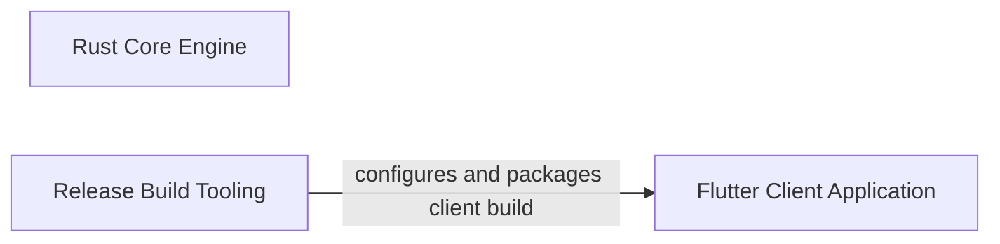

## Details

Root workspace of AppFlowy containing the Flutter desktop and mobile client application, the underlying native Rust core engine and FFI layer, and release build automation scripts.

### Flutter Client Application [[Expand]](./Flutter_Client_Application.md)
Provides cross-platform user interface screens, desktop and mobile layouts, plugin widgets, and FFI communication bindings.

**Related Classes/Methods**:

- `frontend.appflowy_flutter.packages.appflowy_backend.lib.ffi.async_event`:39-45
- `frontend.appflowy_flutter.packages.appflowy_backend.lib.ffi.init_sdk`:80-85

**Source Files:**

- `frontend/appflowy_flutter/android/app/src/main/Classes/binding.h`
  - `init_sdk[c:@F@init_sdk#L#*C#]` (L6-L6) - Function
  - `async_event[c:@F@async_event#L#*1c#l#]` (L8-L8) - Function
  - `sync_event[c:@F@sync_event#*1c#l#]` (L10-L10) - Function
  - `set_stream_port[c:@F@set_stream_port#L#]` (L12-L12) - Function
  - `set_log_stream_port[c:@F@set_log_stream_port#L#]` (L14-L14) - Function
  - `link_me_please[c:@F@link_me_please#]` (L16-L16) - Function
  - `rust_log[c:@F@rust_log#L#*1C#]` (L18-L18) - Function
  - `set_env[c:@F@set_env#*1C#]` (L20-L20) - Function
- `frontend/appflowy_flutter/android/app/src/main/kotlin/com/example/app_flowy/MainActivity.kt`
  - `frontend.appflowy_flutter.android.app.src.main.kotlin.com.example.app_flowy.MainActivity` (L5-L6) - Class
- `frontend/appflowy_flutter/lib/ai/service/ai_entities.dart`
  - `frontend.appflowy_flutter.lib.ai.service.ai_entities.AIStreamEventPrefix` (L15-L28) - Class
  - `frontend.appflowy_flutter.lib.ai.service.ai_entities.AiType` (L30-L36) - Enum
  - `frontend.appflowy_flutter.lib.ai.service.ai_entities.AiType.cloud` (L31-L31) - Enum
  - `frontend.appflowy_flutter.lib.ai.service.ai_entities.AiType.local` (L32-L32) - Enum
  - `frontend.appflowy_flutter.lib.ai.service.ai_entities.AiType.isCloud` (L34-L34) - Method
  - `frontend.appflowy_flutter.lib.ai.service.ai_entities.AiType.isLocal` (L35-L35) - Method
  - `frontend.appflowy_flutter.lib.ai.service.ai_entities.PredefinedFormat` (L38-L66) - Class
  - `frontend.appflowy_flutter.lib.ai.service.ai_entities.PredefinedFormat.PredefinedFormat` (L39-L42) - Constructor
  - `frontend.appflowy_flutter.lib.ai.service.ai_entities.PredefinedFormat.toPB` (L47-L62) - Method
  - `frontend.appflowy_flutter.lib.ai.service.ai_entities.PredefinedFormat.props` (L65-L65) - Method
  - `frontend.appflowy_flutter.lib.ai.service.ai_entities.ImageFormat` (L68-L91) - Enum
  - `frontend.appflowy_flutter.lib.ai.service.ai_entities.ImageFormat.text` (L69-L69) - Enum
  - `frontend.appflowy_flutter.lib.ai.service.ai_entities.ImageFormat.image` (L70-L70) - Enum
  - `frontend.appflowy_flutter.lib.ai.service.ai_entities.ImageFormat.textAndImage` (L71-L71) - Enum
  - `frontend.appflowy_flutter.lib.ai.service.ai_entities.ImageFormat.hasText` (L73-L73) - Method
  - `frontend.appflowy_flutter.lib.ai.service.ai_entities.ImageFormat.icon` (L75-L81) - Method
  - `frontend.appflowy_flutter.lib.ai.service.ai_entities.ImageFormat.i18n` (L83-L90) - Method
  - `frontend.appflowy_flutter.lib.ai.service.ai_entities.TextFormat` (L93-L116) - Enum
  - `frontend.appflowy_flutter.lib.ai.service.ai_entities.TextFormat.paragraph` (L94-L94) - Enum
  - `frontend.appflowy_flutter.lib.ai.service.ai_entities.TextFormat.bulletList` (L95-L95) - Enum
  - `frontend.appflowy_flutter.lib.ai.service.ai_entities.TextFormat.numberedList` (L96-L96) - Enum
  - `frontend.appflowy_flutter.lib.ai.service.ai_entities.TextFormat.table` (L97-L97) - Enum
  - `frontend.appflowy_flutter.lib.ai.service.ai_entities.TextFormat.icon` (L99-L106) - Method
  - `frontend.appflowy_flutter.lib.ai.service.ai_entities.TextFormat.i18n` (L108-L115) - Method
  - `frontend.appflowy_flutter.lib.ai.service.ai_entities.AiPromptCategory` (L118-L170) - Enum
  - `frontend.appflowy_flutter.lib.ai.service.ai_entities.AiPromptCategory.other` (L119-L119) - Enum
  - `frontend.appflowy_flutter.lib.ai.service.ai_entities.AiPromptCategory.development` (L120-L120) - Enum
  - `frontend.appflowy_flutter.lib.ai.service.ai_entities.AiPromptCategory.writing` (L121-L121) - Enum
  - `frontend.appflowy_flutter.lib.ai.service.ai_entities.AiPromptCategory.healthAndFitness` (L122-L122) - Enum
  - `frontend.appflowy_flutter.lib.ai.service.ai_entities.AiPromptCategory.business` (L123-L123) - Enum
  - `frontend.appflowy_flutter.lib.ai.service.ai_entities.AiPromptCategory.marketing` (L124-L124) - Enum
  - `frontend.appflowy_flutter.lib.ai.service.ai_entities.AiPromptCategory.travel` (L125-L125) - Enum
  - `frontend.appflowy_flutter.lib.ai.service.ai_entities.AiPromptCategory.contentSeo` (L126-L126) - Enum
  - `frontend.appflowy_flutter.lib.ai.service.ai_entities.AiPromptCategory.emailMarketing` (L127-L127) - Enum
  - `frontend.appflowy_flutter.lib.ai.service.ai_entities.AiPromptCategory.paidAds` (L128-L128) - Enum
  - `frontend.appflowy_flutter.lib.ai.service.ai_entities.AiPromptCategory.prCommunication` (L129-L129) - Enum
  - `frontend.appflowy_flutter.lib.ai.service.ai_entities.AiPromptCategory.recruiting` (L130-L130) - Enum
  - `frontend.appflowy_flutter.lib.ai.service.ai_entities.AiPromptCategory.sales` (L131-L131) - Enum
  - `frontend.appflowy_flutter.lib.ai.service.ai_entities.AiPromptCategory.socialMedia` (L132-L132) - Enum
  - `frontend.appflowy_flutter.lib.ai.service.ai_entities.AiPromptCategory.strategy` (L133-L133) - Enum
  - `frontend.appflowy_flutter.lib.ai.service.ai_entities.AiPromptCategory.caseStudies` (L134-L134) - Enum
  - `frontend.appflowy_flutter.lib.ai.service.ai_entities.AiPromptCategory.salesCopy` (L135-L135) - Enum
  - `frontend.appflowy_flutter.lib.ai.service.ai_entities.AiPromptCategory.education` (L136-L136) - Enum
  - `frontend.appflowy_flutter.lib.ai.service.ai_entities.AiPromptCategory.work` (L137-L137) - Enum
  - `frontend.appflowy_flutter.lib.ai.service.ai_entities.AiPromptCategory.podcastProduction` (L138-L138) - Enum
  - `frontend.appflowy_flutter.lib.ai.service.ai_entities.AiPromptCategory.copyWriting` (L139-L139) - Enum
  - `frontend.appflowy_flutter.lib.ai.service.ai_entities.AiPromptCategory.customerSuccess` (L140-L140) - Enum
  - `frontend.appflowy_flutter.lib.ai.service.ai_entities.AiPromptCategory.i18n` (L142-L142) - Method
  - `frontend.appflowy_flutter.lib.ai.service.ai_entities.AiPromptCategory.token` (L144-L169) - Method
  - `frontend.appflowy_flutter.lib.ai.service.ai_entities.AiPrompt` (L173-L263) - Class
  - `frontend.appflowy_flutter.lib.ai.service.ai_entities.AiPrompt.AiPrompt` (L174-L182) - Constructor
  - `frontend.appflowy_flutter.lib.ai.service.ai_entities.AiPrompt.AiPrompt.fromPB` (L184-L211) - Constructor
  - `frontend.appflowy_flutter.lib.ai.service.ai_entities.AiPrompt.AiPrompt.fromJson` (L213-L214) - Constructor
  - `frontend.appflowy_flutter.lib.ai.service.ai_entities.AiPrompt.toJson` (L216-L216) - Method
  - `frontend.appflowy_flutter.lib.ai.service.ai_entities.AiPrompt.props` (L231-L232) - Method
  - `frontend.appflowy_flutter.lib.ai.service.ai_entities.AiPrompt._buildCategoryNameMap` (L234-L243) - Method
  - `frontend.appflowy_flutter.lib.ai.service.ai_entities.AiPrompt._categoryFromJson` (L245-L262) - Method
  - `frontend.appflowy_flutter.lib.ai.service.ai_entities.CustomPromptDatabaseConfig` (L290-L386) - Class
  - `frontend.appflowy_flutter.lib.ai.service.ai_entities.CustomPromptDatabaseConfig.CustomPromptDatabaseConfig` (L291-L297) - Constructor
  - `frontend.appflowy_flutter.lib.ai.service.ai_entities.CustomPromptDatabaseConfig.CustomPromptDatabaseConfig.fromAiPB` (L299-L312) - Constructor
  - `frontend.appflowy_flutter.lib.ai.service.ai_entities.CustomPromptDatabaseConfig.CustomPromptDatabaseConfig.fromDbPB` (L314-L327) - Constructor
  - `frontend.appflowy_flutter.lib.ai.service.ai_entities.CustomPromptDatabaseConfig.props` (L336-L337) - Method
  - `frontend.appflowy_flutter.lib.ai.service.ai_entities.CustomPromptDatabaseConfig.copyWith` (L339-L353) - Method
  - `frontend.appflowy_flutter.lib.ai.service.ai_entities.CustomPromptDatabaseConfig.toAiPB` (L355-L369) - Method
  - `frontend.appflowy_flutter.lib.ai.service.ai_entities.CustomPromptDatabaseConfig.toDbPB` (L371-L385) - Method
- `frontend/appflowy_flutter/lib/ai/service/ai_model_state_notifier.dart`
  - `frontend.appflowy_flutter.lib.ai.service.ai_model_state_notifier.OnModelStateChangedCallback` (L12-L12) - Class
  - `frontend.appflowy_flutter.lib.ai.service.ai_model_state_notifier.OnAvailableModelsChangedCallback` (L13-L16) - Class
  - `frontend.appflowy_flutter.lib.ai.service.ai_model_state_notifier.AIModelState` (L19-L40) - Class
  - `frontend.appflowy_flutter.lib.ai.service.ai_model_state_notifier.AIModelState.AIModelState` (L20-L26) - Constructor
  - `frontend.appflowy_flutter.lib.ai.service.ai_model_state_notifier.AIModelStateNotifier` (L42-L208) - Class
  - `frontend.appflowy_flutter.lib.ai.service.ai_model_state_notifier.AIModelStateNotifier.AIModelStateNotifier` (L43-L49) - Constructor
  - `frontend.appflowy_flutter.lib.ai.service.ai_model_state_notifier.AIModelStateNotifier._startListening` (L67-L87) - Method
  - `frontend.appflowy_flutter.lib.ai.service.ai_model_state_notifier.AIModelStateNotifier._init` (L89-L95) - Method
  - `frontend.appflowy_flutter.lib.ai.service.ai_model_state_notifier.AIModelStateNotifier.addListener` (L98-L108) - Method
  - `frontend.appflowy_flutter.lib.ai.service.ai_model_state_notifier.AIModelStateNotifier.removeListener` (L111-L121) - Method
  - `frontend.appflowy_flutter.lib.ai.service.ai_model_state_notifier.AIModelStateNotifier.dispose` (L123-L128) - Method
  - `frontend.appflowy_flutter.lib.ai.service.ai_model_state_notifier.AIModelStateNotifier.getState` (L131-L131) - Method
  - `frontend.appflowy_flutter.lib.ai.service.ai_model_state_notifier.AIModelStateNotifier.getModelSelection` (L134-L135) - Method
  - `frontend.appflowy_flutter.lib.ai.service.ai_model_state_notifier.AIModelStateNotifier._updateAll` (L137-L145) - Method
  - `frontend.appflowy_flutter.lib.ai.service.ai_model_state_notifier.AIModelStateNotifier._loadModelSelection` (L147-L158) - Method
  - `frontend.appflowy_flutter.lib.ai.service.ai_model_state_notifier.AIModelStateNotifier._loadLocalState` (L160-L165) - Method
  - `frontend.appflowy_flutter.lib.ai.service.ai_model_state_notifier.AIModelStateNotifier._defaultState` (L167-L173) - Method
  - `frontend.appflowy_flutter.lib.ai.service.ai_model_state_notifier.AIModelStateNotifier._computeState` (L176-L207) - Method
  - `frontend.appflowy_flutter.lib.ai.service.ai_model_state_notifier.AIModelPBExtension.isDefault` (L211-L211) - Method
  - `frontend.appflowy_flutter.lib.ai.service.ai_model_state_notifier.AIModelPBExtension.i18n` (L212-L213) - Method
- `frontend/appflowy_flutter/lib/ai/service/ai_prompt_database_selector_cubit.dart`
  - `frontend.appflowy_flutter.lib.ai.service.ai_prompt_database_selector_cubit.AiPromptDatabaseSelectorCubit` (L11-L146) - Class
  - `frontend.appflowy_flutter.lib.ai.service.ai_prompt_database_selector_cubit.AiPromptDatabaseSelectorCubit.AiPromptDatabaseSelectorCubit` (L13-L17) - Constructor
  - `frontend.appflowy_flutter.lib.ai.service.ai_prompt_database_selector_cubit.AiPromptDatabaseSelectorCubit._init` (L19-L38) - Method
  - `frontend.appflowy_flutter.lib.ai.service.ai_prompt_database_selector_cubit.AiPromptDatabaseSelectorCubit.selectDatabaseView` (L40-L71) - Method
  - `frontend.appflowy_flutter.lib.ai.service.ai_prompt_database_selector_cubit.AiPromptDatabaseSelectorCubit.selectContentField` (L73-L89) - Method
  - `frontend.appflowy_flutter.lib.ai.service.ai_prompt_database_selector_cubit.AiPromptDatabaseSelectorCubit.selectExampleField` (L91-L111) - Method
  - `frontend.appflowy_flutter.lib.ai.service.ai_prompt_database_selector_cubit.AiPromptDatabaseSelectorCubit.selectCategoryField` (L113-L133) - Method
  - `frontend.appflowy_flutter.lib.ai.service.ai_prompt_database_selector_cubit.AiPromptDatabaseSelectorCubit._getFields` (L135-L137) - Method
  - `frontend.appflowy_flutter.lib.ai.service.ai_prompt_database_selector_cubit.AiPromptDatabaseSelectorCubit._testDatabase` (L139-L145) - Method
  - `frontend.appflowy_flutter.lib.ai.service.ai_prompt_database_selector_cubit.AiPromptDatabaseSelectorState` (L149-L161) - Class
  - `frontend.appflowy_flutter.lib.ai.service.ai_prompt_database_selector_cubit.AiPromptDatabaseSelectorState.AiPromptDatabaseSelectorState.loading` (L150-L150) - Constructor
  - `frontend.appflowy_flutter.lib.ai.service.ai_prompt_database_selector_cubit.AiPromptDatabaseSelectorState.AiPromptDatabaseSelectorState.empty` (L152-L152) - Constructor
  - `frontend.appflowy_flutter.lib.ai.service.ai_prompt_database_selector_cubit.AiPromptDatabaseSelectorState.AiPromptDatabaseSelectorState.selected` (L154-L157) - Constructor
  - `frontend.appflowy_flutter.lib.ai.service.ai_prompt_database_selector_cubit.AiPromptDatabaseSelectorState.AiPromptDatabaseSelectorState.invalidDatabase` (L159-L160) - Constructor
- `frontend/appflowy_flutter/lib/ai/service/ai_prompt_input_bloc.dart`
  - `frontend.appflowy_flutter.lib.ai.service.ai_prompt_input_bloc.AIPromptInputBloc` (L13-L139) - Class
  - `frontend.appflowy_flutter.lib.ai.service.ai_prompt_input_bloc.AIPromptInputBloc.AIPromptInputBloc` (L14-L22) - Constructor
  - `frontend.appflowy_flutter.lib.ai.service.ai_prompt_input_bloc.AIPromptInputBloc.close` (L29-L32) - Method
  - `frontend.appflowy_flutter.lib.ai.service.ai_prompt_input_bloc.AIPromptInputBloc._dispatch` (L34-L108) - Method
  - `frontend.appflowy_flutter.lib.ai.service.ai_prompt_input_bloc.AIPromptInputBloc._startListening` (L110-L118) - Method
  - `frontend.appflowy_flutter.lib.ai.service.ai_prompt_input_bloc.AIPromptInputBloc._init` (L120-L125) - Method
  - `frontend.appflowy_flutter.lib.ai.service.ai_prompt_input_bloc.AIPromptInputBloc.consumeMetadata` (L127-L138) - Method
  - `frontend.appflowy_flutter.lib.ai.service.ai_prompt_input_bloc.AIPromptInputEvent` (L142-L162) - Class
  - `frontend.appflowy_flutter.lib.ai.service.ai_prompt_input_bloc.AIPromptInputEvent.AIPromptInputEvent.updateAIState` (L143-L145) - Constructor
  - `frontend.appflowy_flutter.lib.ai.service.ai_prompt_input_bloc.AIPromptInputEvent.AIPromptInputEvent.toggleShowPredefinedFormat` (L147-L148) - Constructor
  - `frontend.appflowy_flutter.lib.ai.service.ai_prompt_input_bloc.AIPromptInputEvent.AIPromptInputEvent.updatePredefinedFormat` (L149-L151) - Constructor
  - `frontend.appflowy_flutter.lib.ai.service.ai_prompt_input_bloc.AIPromptInputEvent.AIPromptInputEvent.attachFile` (L152-L155) - Constructor
  - `frontend.appflowy_flutter.lib.ai.service.ai_prompt_input_bloc.AIPromptInputEvent.AIPromptInputEvent.removeFile` (L156-L156) - Constructor
  - `frontend.appflowy_flutter.lib.ai.service.ai_prompt_input_bloc.AIPromptInputEvent.AIPromptInputEvent.updateMentionedViews` (L157-L158) - Constructor
  - `frontend.appflowy_flutter.lib.ai.service.ai_prompt_input_bloc.AIPromptInputEvent.AIPromptInputEvent.clearMetadata` (L159-L159) - Constructor
  - `frontend.appflowy_flutter.lib.ai.service.ai_prompt_input_bloc.AIPromptInputEvent.AIPromptInputEvent.updatePromptId` (L160-L161) - Constructor
  - `frontend.appflowy_flutter.lib.ai.service.ai_prompt_input_bloc.AIPromptInputState` (L165-L190) - Class
  - `frontend.appflowy_flutter.lib.ai.service.ai_prompt_input_bloc.AIPromptInputState.AIPromptInputState` (L166-L173) - Constructor
  - `frontend.appflowy_flutter.lib.ai.service.ai_prompt_input_bloc.AIPromptInputState.AIPromptInputState.initial` (L175-L189) - Constructor
- `frontend/appflowy_flutter/lib/ai/service/ai_prompt_selector_cubit.dart`
  - `frontend.appflowy_flutter.lib.ai.service.ai_prompt_selector_cubit.AiPromptSelectorCubit` (L19-L385) - Class
  - `frontend.appflowy_flutter.lib.ai.service.ai_prompt_selector_cubit.AiPromptSelectorCubit.AiPromptSelectorCubit` (L20-L26) - Constructor
  - `frontend.appflowy_flutter.lib.ai.service.ai_prompt_selector_cubit.AiPromptSelectorCubit.close` (L33-L36) - Method
  - `frontend.appflowy_flutter.lib.ai.service.ai_prompt_selector_cubit.AiPromptSelectorCubit._init` (L38-L59) - Method
  - `frontend.appflowy_flutter.lib.ai.service.ai_prompt_selector_cubit.AiPromptSelectorCubit.loadCustomPrompts` (L61-L143) - Method
  - `frontend.appflowy_flutter.lib.ai.service.ai_prompt_selector_cubit.AiPromptSelectorCubit.selectCustomSection` (L145-L163) - Method
  - `frontend.appflowy_flutter.lib.ai.service.ai_prompt_selector_cubit.AiPromptSelectorCubit.selectFeaturedSection` (L165-L183) - Method
  - `frontend.appflowy_flutter.lib.ai.service.ai_prompt_selector_cubit.AiPromptSelectorCubit.selectCategory` (L185-L211) - Method
  - `frontend.appflowy_flutter.lib.ai.service.ai_prompt_selector_cubit.AiPromptSelectorCubit.selectPrompt` (L213-L226) - Method
  - `frontend.appflowy_flutter.lib.ai.service.ai_prompt_selector_cubit.AiPromptSelectorCubit.toggleFavorite` (L228-L243) - Method
  - `frontend.appflowy_flutter.lib.ai.service.ai_prompt_selector_cubit.AiPromptSelectorCubit.reset` (L245-L261) - Method
  - `frontend.appflowy_flutter.lib.ai.service.ai_prompt_selector_cubit.AiPromptSelectorCubit.updateCustomPromptDatabaseConfiguration` (L263-L306) - Method
  - `frontend.appflowy_flutter.lib.ai.service.ai_prompt_selector_cubit.AiPromptSelectorCubit._filterTextChanged` (L308-L328) - Method
  - `frontend.appflowy_flutter.lib.ai.service.ai_prompt_selector_cubit.AiPromptSelectorCubit._getFilteredPrompts` (L330-L337) - Method
  - `frontend.appflowy_flutter.lib.ai.service.ai_prompt_selector_cubit.AiPromptSelectorCubit._getPromptsByCategory` (L339-L352) - Method
  - `frontend.appflowy_flutter.lib.ai.service.ai_prompt_selector_cubit.AiPromptSelectorCubit._getVisibleSelectedPrompt` (L354-L364) - Method
  - `frontend.appflowy_flutter.lib.ai.service.ai_prompt_selector_cubit.AiPromptSelectorCubit.getDatabaseView` (L366-L384) - Method
  - `frontend.appflowy_flutter.lib.ai.service.ai_prompt_selector_cubit.AiPromptSelectorState` (L388-L415) - Class
  - `frontend.appflowy_flutter.lib.ai.service.ai_prompt_selector_cubit.AiPromptSelectorState.AiPromptSelectorState._` (L389-L389) - Constructor
  - `frontend.appflowy_flutter.lib.ai.service.ai_prompt_selector_cubit.AiPromptSelectorState.AiPromptSelectorState.loading` (L391-L391) - Constructor
  - `frontend.appflowy_flutter.lib.ai.service.ai_prompt_selector_cubit.AiPromptSelectorState.AiPromptSelectorState.invalidDatabase` (L393-L394) - Constructor
  - `frontend.appflowy_flutter.lib.ai.service.ai_prompt_selector_cubit.AiPromptSelectorState.AiPromptSelectorState.ready` (L396-L405) - Constructor
  - `frontend.appflowy_flutter.lib.ai.service.ai_prompt_selector_cubit.AiPromptSelectorState.isLoading` (L407-L407) - Method
  - `frontend.appflowy_flutter.lib.ai.service.ai_prompt_selector_cubit.AiPromptSelectorState.isReady` (L408-L408) - Method
  - `frontend.appflowy_flutter.lib.ai.service.ai_prompt_selector_cubit.AiPromptSelectorState.selectedPrompt` (L410-L414) - Method
- `frontend/appflowy_flutter/lib/ai/service/appflowy_ai_service.dart`
  - `frontend.appflowy_flutter.lib.ai.service.appflowy_ai_service.LocalAIStreamingState` (L22-L25) - Enum
  - `frontend.appflowy_flutter.lib.ai.service.appflowy_ai_service.LocalAIStreamingState.notReady` (L23-L23) - Enum
  - `frontend.appflowy_flutter.lib.ai.service.appflowy_ai_service.LocalAIStreamingState.disabled` (L24-L24) - Enum
  - `frontend.appflowy_flutter.lib.ai.service.appflowy_ai_service.AIRepository` (L27-L52) - Class
  - `frontend.appflowy_flutter.lib.ai.service.appflowy_ai_service.AIRepository.streamCompletion` (L28-L43) - Method
  - `frontend.appflowy_flutter.lib.ai.service.appflowy_ai_service.AIRepository.getBuiltInPrompts` (L45-L45) - Method
  - `frontend.appflowy_flutter.lib.ai.service.appflowy_ai_service.AIRepository.getDatabasePrompts` (L47-L49) - Method
  - `frontend.appflowy_flutter.lib.ai.service.appflowy_ai_service.AIRepository.updateFavoritePrompts` (L51-L51) - Method
  - `frontend.appflowy_flutter.lib.ai.service.appflowy_ai_service.AppFlowyAIService` (L54-L145) - Class
  - `frontend.appflowy_flutter.lib.ai.service.appflowy_ai_service.AppFlowyAIService.streamCompletion` (L56-L104) - Method
  - `frontend.appflowy_flutter.lib.ai.service.appflowy_ai_service.AppFlowyAIService.getBuiltInPrompts` (L107-L127) - Method
  - `frontend.appflowy_flutter.lib.ai.service.appflowy_ai_service.AppFlowyAIService.getDatabasePrompts` (L130-L141) - Method
  - `frontend.appflowy_flutter.lib.ai.service.appflowy_ai_service.AppFlowyAIService.updateFavoritePrompts` (L144-L144) - Method
  - `frontend.appflowy_flutter.lib.ai.service.appflowy_ai_service.CompletionStream` (L147-L164) - Class
  - `frontend.appflowy_flutter.lib.ai.service.appflowy_ai_service.CompletionStream.CompletionStream` (L148-L155) - Constructor
  - `frontend.appflowy_flutter.lib.ai.service.appflowy_ai_service.AppFlowyCompletionStream` (L166-L259) - Class
  - `frontend.appflowy_flutter.lib.ai.service.appflowy_ai_service.AppFlowyCompletionStream.AppFlowyCompletionStream` (L167-L176) - Constructor
  - `frontend.appflowy_flutter.lib.ai.service.appflowy_ai_service.AppFlowyCompletionStream.nativePort` (L181-L181) - Method
  - `frontend.appflowy_flutter.lib.ai.service.appflowy_ai_service.AppFlowyCompletionStream._startListening` (L183-L190) - Method
  - `frontend.appflowy_flutter.lib.ai.service.appflowy_ai_service.AppFlowyCompletionStream.dispose` (L192-L196) - Method
  - `frontend.appflowy_flutter.lib.ai.service.appflowy_ai_service.AppFlowyCompletionStream._handleEvent` (L198-L258) - Method
- `frontend/appflowy_flutter/lib/ai/service/error.dart`
  - `frontend.appflowy_flutter.lib.ai.service.error.AIError` (L7-L15) - Class
  - `frontend.appflowy_flutter.lib.ai.service.error.AIError.AIError` (L8-L11) - Constructor
  - `frontend.appflowy_flutter.lib.ai.service.error.AIError.AIError.fromJson` (L13-L14) - Constructor
  - `frontend.appflowy_flutter.lib.ai.service.error.AIErrorCode` (L17-L24) - Enum
  - `frontend.appflowy_flutter.lib.ai.service.error.AIErrorCode.aiResponseLimitExceeded` (L19-L19) - Enum
  - `frontend.appflowy_flutter.lib.ai.service.error.AIErrorCode.aiImageResponseLimitExceeded` (L21-L21) - Enum
  - `frontend.appflowy_flutter.lib.ai.service.error.AIErrorCode.other` (L23-L23) - Enum
  - `frontend.appflowy_flutter.lib.ai.service.error.AIErrorExtension.isLimitExceeded` (L27-L27) - Method
- `frontend/appflowy_flutter/lib/ai/service/select_model_bloc.dart`
  - `frontend.appflowy_flutter.lib.ai.service.select_model_bloc.SelectModelBloc` (L11-L64) - Class
  - `frontend.appflowy_flutter.lib.ai.service.select_model_bloc.SelectModelBloc.SelectModelBloc` (L12-L44) - Constructor
  - `frontend.appflowy_flutter.lib.ai.service.select_model_bloc.SelectModelBloc.close` (L49-L54) - Method
  - `frontend.appflowy_flutter.lib.ai.service.select_model_bloc.SelectModelBloc._onAvailableModelsChanged` (L56-L63) - Method
  - `frontend.appflowy_flutter.lib.ai.service.select_model_bloc.SelectModelEvent` (L67-L76) - Class
  - `frontend.appflowy_flutter.lib.ai.service.select_model_bloc.SelectModelEvent.SelectModelEvent.selectModel` (L68-L70) - Constructor
  - `frontend.appflowy_flutter.lib.ai.service.select_model_bloc.SelectModelEvent.SelectModelEvent.didLoadModels` (L72-L75) - Constructor
  - `frontend.appflowy_flutter.lib.ai.service.select_model_bloc.SelectModelState` (L79-L92) - Class
  - `frontend.appflowy_flutter.lib.ai.service.select_model_bloc.SelectModelState.SelectModelState` (L80-L83) - Constructor
  - `frontend.appflowy_flutter.lib.ai.service.select_model_bloc.SelectModelState.SelectModelState.initial` (L85-L91) - Constructor
- `frontend/appflowy_flutter/lib/ai/service/view_selector_cubit.dart`
  - `frontend.appflowy_flutter.lib.ai.service.view_selector_cubit.ViewSelectedStatus` (L15-L23) - Enum
  - `frontend.appflowy_flutter.lib.ai.service.view_selector_cubit.ViewSelectedStatus.unselected` (L16-L16) - Enum
  - `frontend.appflowy_flutter.lib.ai.service.view_selector_cubit.ViewSelectedStatus.selected` (L17-L17) - Enum
  - `frontend.appflowy_flutter.lib.ai.service.view_selector_cubit.ViewSelectedStatus.partiallySelected` (L18-L18) - Enum
  - `frontend.appflowy_flutter.lib.ai.service.view_selector_cubit.ViewSelectedStatus.isUnselected` (L20-L20) - Method
  - `frontend.appflowy_flutter.lib.ai.service.view_selector_cubit.ViewSelectedStatus.isSelected` (L21-L21) - Method
  - `frontend.appflowy_flutter.lib.ai.service.view_selector_cubit.ViewSelectedStatus.isPartiallySelected` (L22-L22) - Method
  - `frontend.appflowy_flutter.lib.ai.service.view_selector_cubit.ViewSelectorItem` (L25-L101) - Class
  - `frontend.appflowy_flutter.lib.ai.service.view_selector_cubit.ViewSelectorItem.ViewSelectorItem` (L26-L35) - Constructor
  - `frontend.appflowy_flutter.lib.ai.service.view_selector_cubit.ViewSelectorItem.isExpanded` (L44-L44) - Method
  - `frontend.appflowy_flutter.lib.ai.service.view_selector_cubit.ViewSelectorItem.selectedStatus` (L45-L45) - Method
  - `frontend.appflowy_flutter.lib.ai.service.view_selector_cubit.ViewSelectorItem.isDisabled` (L46-L46) - Method
  - `frontend.appflowy_flutter.lib.ai.service.view_selector_cubit.ViewSelectorItem.toggleIsExpanded` (L48-L50) - Method
  - `frontend.appflowy_flutter.lib.ai.service.view_selector_cubit.ViewSelectorItem.copy` (L52-L62) - Method
  - `frontend.appflowy_flutter.lib.ai.service.view_selector_cubit.ViewSelectorItem.findChildBySourceId` (L64-L75) - Method
  - `frontend.appflowy_flutter.lib.ai.service.view_selector_cubit.ViewSelectorItem.setIsDisabledRecursive` (L77-L83) - Method
  - `frontend.appflowy_flutter.lib.ai.service.view_selector_cubit.ViewSelectorItem.setIsSelectedStatusRecursive` (L85-L91) - Method
  - `frontend.appflowy_flutter.lib.ai.service.view_selector_cubit.ViewSelectorItem.dispose` (L93-L100) - Method
  - `frontend.appflowy_flutter.lib.ai.service.view_selector_cubit.ViewSelectorCubit` (L103-L445) - Class
  - `frontend.appflowy_flutter.lib.ai.service.view_selector_cubit.ViewSelectorCubit.ViewSelectorCubit` (L104-L109) - Constructor
  - `frontend.appflowy_flutter.lib.ai.service.view_selector_cubit.ViewSelectorCubit.updateSelectedSources` (L119-L122) - Method
  - `frontend.appflowy_flutter.lib.ai.service.view_selector_cubit.ViewSelectorCubit.refreshSources` (L124-L165) - Method
  - `frontend.appflowy_flutter.lib.ai.service.view_selector_cubit.ViewSelectorCubit._recursiveBuild` (L167-L216) - Method
  - `frontend.appflowy_flutter.lib.ai.service.view_selector_cubit.ViewSelectorCubit._setIsDisabledAndHideIfNecessary` (L218-L231) - Method
  - `frontend.appflowy_flutter.lib.ai.service.view_selector_cubit.ViewSelectorCubit._restrictSelectionIfNecessary` (L233-L250) - Method
  - `frontend.appflowy_flutter.lib.ai.service.view_selector_cubit.ViewSelectorCubit.onFilterChanged` (L252-L270) - Method
  - `frontend.appflowy_flutter.lib.ai.service.view_selector_cubit.ViewSelectorCubit._buildSearchResults` (L273-L296) - Method
  - `frontend.appflowy_flutter.lib.ai.service.view_selector_cubit.ViewSelectorCubit._buildSelectedSources` (L299-L320) - Method
  - `frontend.appflowy_flutter.lib.ai.service.view_selector_cubit.ViewSelectorCubit.toggleSelectedStatus` (L322-L354) - Method
  - `frontend.appflowy_flutter.lib.ai.service.view_selector_cubit.ViewSelectorCubit._recursiveGetSourceIds` (L356-L362) - Method
  - `frontend.appflowy_flutter.lib.ai.service.view_selector_cubit.ViewSelectorCubit.updateSelectedStatus` (L364-L382) - Method
  - `frontend.appflowy_flutter.lib.ai.service.view_selector_cubit.ViewSelectorCubit._recursiveUpdateSelectedStatus` (L384-L409) - Method
  - `frontend.appflowy_flutter.lib.ai.service.view_selector_cubit.ViewSelectorCubit.toggleIsExpanded` (L411-L426) - Method
  - `frontend.appflowy_flutter.lib.ai.service.view_selector_cubit.ViewSelectorCubit.close` (L429-L444) - Method
  - `frontend.appflowy_flutter.lib.ai.service.view_selector_cubit.ViewSelectorState` (L448-L458) - Class
  - `frontend.appflowy_flutter.lib.ai.service.view_selector_cubit.ViewSelectorState.ViewSelectorState` (L449-L452) - Constructor
  - `frontend.appflowy_flutter.lib.ai.service.view_selector_cubit.ViewSelectorState.ViewSelectorState.initial` (L454-L457) - Constructor
- `frontend/appflowy_flutter/lib/ai/widgets/ai_prompt_modal/ai_prompt_category_list.dart`
  - `frontend.appflowy_flutter.lib.ai.widgets.ai_prompt_modal.ai_prompt_category_list.AiPromptCategoryList` (L8-L15) - Class
  - `frontend.appflowy_flutter.lib.ai.widgets.ai_prompt_modal.ai_prompt_category_list.AiPromptCategoryList.AiPromptCategoryList` (L9-L11) - Constructor
  - `frontend.appflowy_flutter.lib.ai.widgets.ai_prompt_modal.ai_prompt_category_list.AiPromptCategoryList.createState` (L14-L14) - Method
  - `frontend.appflowy_flutter.lib.ai.widgets.ai_prompt_modal.ai_prompt_category_list._AiPromptCategoryListState` (L17-L90) - Class
  - `frontend.appflowy_flutter.lib.ai.widgets.ai_prompt_modal.ai_prompt_category_list._AiPromptCategoryListState.build` (L20-L67) - Method
  - `frontend.appflowy_flutter.lib.ai.widgets.ai_prompt_modal.ai_prompt_category_list._AiPromptCategoryListState.sortedCategories` (L69-L77) - Method
  - `frontend.appflowy_flutter.lib.ai.widgets.ai_prompt_modal.ai_prompt_category_list._AiPromptCategoryListState._buildCategoryItem` (L79-L89) - Method
  - `frontend.appflowy_flutter.lib.ai.widgets.ai_prompt_modal.ai_prompt_category_list.AiPromptFeaturedSection` (L92-L138) - Class
  - `frontend.appflowy_flutter.lib.ai.widgets.ai_prompt_modal.ai_prompt_category_list.AiPromptFeaturedSection.AiPromptFeaturedSection` (L93-L95) - Constructor
  - `frontend.appflowy_flutter.lib.ai.widgets.ai_prompt_modal.ai_prompt_category_list.AiPromptFeaturedSection.build` (L98-L137) - Method
  - `frontend.appflowy_flutter.lib.ai.widgets.ai_prompt_modal.ai_prompt_category_list.AiPromptCustomPromptSection` (L140-L193) - Class
  - `frontend.appflowy_flutter.lib.ai.widgets.ai_prompt_modal.ai_prompt_category_list.AiPromptCustomPromptSection.AiPromptCustomPromptSection` (L141-L143) - Constructor
  - `frontend.appflowy_flutter.lib.ai.widgets.ai_prompt_modal.ai_prompt_category_list.AiPromptCustomPromptSection.build` (L146-L192) - Method
  - `frontend.appflowy_flutter.lib.ai.widgets.ai_prompt_modal.ai_prompt_category_list.AiPromptCategoryItem` (L195-L250) - Class
  - `frontend.appflowy_flutter.lib.ai.widgets.ai_prompt_modal.ai_prompt_category_list.AiPromptCategoryItem.AiPromptCategoryItem` (L196-L200) - Constructor
  - `frontend.appflowy_flutter.lib.ai.widgets.ai_prompt_modal.ai_prompt_category_list.AiPromptCategoryItem.build` (L206-L249) - Method
- `frontend/appflowy_flutter/lib/ai/widgets/ai_prompt_modal/ai_prompt_database_modal.dart`
  - `frontend.appflowy_flutter.lib.ai.widgets.ai_prompt_modal.ai_prompt_database_modal.changeCustomPromptDatabaseConfig` (L21-L43) - Function
  - `frontend.appflowy_flutter.lib.ai.widgets.ai_prompt_modal.ai_prompt_database_modal.AiPromptDatabaseModal` (L45-L52) - Class
  - `frontend.appflowy_flutter.lib.ai.widgets.ai_prompt_modal.ai_prompt_database_modal.AiPromptDatabaseModal.AiPromptDatabaseModal` (L46-L48) - Constructor
  - `frontend.appflowy_flutter.lib.ai.widgets.ai_prompt_modal.ai_prompt_database_modal.AiPromptDatabaseModal.createState` (L51-L51) - Method
  - `frontend.appflowy_flutter.lib.ai.widgets.ai_prompt_modal.ai_prompt_database_modal._AiPromptDatabaseModalState` (L54-L173) - Class
  - `frontend.appflowy_flutter.lib.ai.widgets.ai_prompt_modal.ai_prompt_database_modal._AiPromptDatabaseModalState.dispose` (L58-L61) - Method
  - `frontend.appflowy_flutter.lib.ai.widgets.ai_prompt_modal.ai_prompt_database_modal._AiPromptDatabaseModalState.build` (L64-L172) - Method
  - `frontend.appflowy_flutter.lib.ai.widgets.ai_prompt_modal.ai_prompt_database_modal._Header` (L175-L180) - Class
  - `frontend.appflowy_flutter.lib.ai.widgets.ai_prompt_modal.ai_prompt_database_modal._Header._Header` (L176-L176) - Constructor
  - `frontend.appflowy_flutter.lib.ai.widgets.ai_prompt_modal.ai_prompt_database_modal._Header.createState` (L179-L179) - Method
  - `frontend.appflowy_flutter.lib.ai.widgets.ai_prompt_modal.ai_prompt_database_modal._HeaderState` (L182-L351) - Class
  - `frontend.appflowy_flutter.lib.ai.widgets.ai_prompt_modal.ai_prompt_database_modal._HeaderState.dispose` (L186-L189) - Method
  - `frontend.appflowy_flutter.lib.ai.widgets.ai_prompt_modal.ai_prompt_database_modal._HeaderState.build` (L192-L319) - Method
  - `frontend.appflowy_flutter.lib.ai.widgets.ai_prompt_modal.ai_prompt_database_modal._HeaderState.getIgnoreViewType` (L321-L333) - Method
  - `frontend.appflowy_flutter.lib.ai.widgets.ai_prompt_modal.ai_prompt_database_modal._HeaderState.hasDatabaseDescendent` (L335-L350) - Method
  - `frontend.appflowy_flutter.lib.ai.widgets.ai_prompt_modal.ai_prompt_database_modal._Expanded` (L353-L433) - Class
  - `frontend.appflowy_flutter.lib.ai.widgets.ai_prompt_modal.ai_prompt_database_modal._Expanded._Expanded` (L354-L354) - Constructor
  - `frontend.appflowy_flutter.lib.ai.widgets.ai_prompt_modal.ai_prompt_database_modal._Expanded.build` (L357-L432) - Method
  - `frontend.appflowy_flutter.lib.ai.widgets.ai_prompt_modal.ai_prompt_database_modal._PopoverContent` (L435-L444) - Class
  - `frontend.appflowy_flutter.lib.ai.widgets.ai_prompt_modal.ai_prompt_database_modal._PopoverContent._PopoverContent` (L436-L438) - Constructor
  - `frontend.appflowy_flutter.lib.ai.widgets.ai_prompt_modal.ai_prompt_database_modal._PopoverContent.createState` (L443-L443) - Method
  - `frontend.appflowy_flutter.lib.ai.widgets.ai_prompt_modal.ai_prompt_database_modal._PopoverContentState` (L446-L535) - Class
  - `frontend.appflowy_flutter.lib.ai.widgets.ai_prompt_modal.ai_prompt_database_modal._PopoverContentState.initState` (L450-L455) - Method
  - `frontend.appflowy_flutter.lib.ai.widgets.ai_prompt_modal.ai_prompt_database_modal._PopoverContentState.dispose` (L458-L461) - Method
  - `frontend.appflowy_flutter.lib.ai.widgets.ai_prompt_modal.ai_prompt_database_modal._PopoverContentState.build` (L464-L508) - Method
  - `frontend.appflowy_flutter.lib.ai.widgets.ai_prompt_modal.ai_prompt_database_modal._PopoverContentState._buildVisibleSources` (L510-L534) - Method
  - `frontend.appflowy_flutter.lib.ai.widgets.ai_prompt_modal.ai_prompt_database_modal._FieldPBWrapper` (L537-L547) - Class
  - `frontend.appflowy_flutter.lib.ai.widgets.ai_prompt_modal.ai_prompt_database_modal._FieldPBWrapper._FieldPBWrapper` (L538-L538) - Constructor
  - `frontend.appflowy_flutter.lib.ai.widgets.ai_prompt_modal.ai_prompt_database_modal._FieldPBWrapper.label` (L543-L543) - Method
  - `frontend.appflowy_flutter.lib.ai.widgets.ai_prompt_modal.ai_prompt_database_modal._FieldPBWrapper.props` (L546-L546) - Method
  - `frontend.appflowy_flutter.lib.ai.widgets.ai_prompt_modal.ai_prompt_database_modal.FieldSelector` (L549-L626) - Class
  - `frontend.appflowy_flutter.lib.ai.widgets.ai_prompt_modal.ai_prompt_database_modal.FieldSelector.FieldSelector` (L550-L558) - Constructor
  - `frontend.appflowy_flutter.lib.ai.widgets.ai_prompt_modal.ai_prompt_database_modal.FieldSelector.build` (L568-L625) - Method
- `frontend/appflowy_flutter/lib/ai/widgets/ai_prompt_modal/ai_prompt_modal.dart`
  - `frontend.appflowy_flutter.lib.ai.widgets.ai_prompt_modal.ai_prompt_modal.showAiPromptModal` (L18-L40) - Function
  - `frontend.appflowy_flutter.lib.ai.widgets.ai_prompt_modal.ai_prompt_modal.AiPromptModal` (L42-L159) - Class
  - `frontend.appflowy_flutter.lib.ai.widgets.ai_prompt_modal.ai_prompt_modal.AiPromptModal.AiPromptModal` (L43-L43) - Constructor
  - `frontend.appflowy_flutter.lib.ai.widgets.ai_prompt_modal.ai_prompt_modal.AiPromptModal.build` (L46-L158) - Method
  - `frontend.appflowy_flutter.lib.ai.widgets.ai_prompt_modal.ai_prompt_modal.showLoadPromptFailedDialog` (L161-L173) - Function
- `frontend/appflowy_flutter/lib/ai/widgets/ai_prompt_modal/ai_prompt_onboarding.dart`
  - `frontend.appflowy_flutter.lib.ai.widgets.ai_prompt_modal.ai_prompt_onboarding.AiPromptOnboarding` (L11-L61) - Class
  - `frontend.appflowy_flutter.lib.ai.widgets.ai_prompt_modal.ai_prompt_onboarding.AiPromptOnboarding.AiPromptOnboarding` (L12-L12) - Constructor
  - `frontend.appflowy_flutter.lib.ai.widgets.ai_prompt_modal.ai_prompt_onboarding.AiPromptOnboarding.build` (L15-L60) - Method
- `frontend/appflowy_flutter/lib/ai/widgets/ai_prompt_modal/ai_prompt_preview.dart`
  - `frontend.appflowy_flutter.lib.ai.widgets.ai_prompt_modal.ai_prompt_preview.AiPromptPreview` (L9-L92) - Class
  - `frontend.appflowy_flutter.lib.ai.widgets.ai_prompt_modal.ai_prompt_preview.AiPromptPreview.AiPromptPreview` (L10-L13) - Constructor
  - `frontend.appflowy_flutter.lib.ai.widgets.ai_prompt_modal.ai_prompt_preview.AiPromptPreview.build` (L18-L91) - Method
  - `frontend.appflowy_flutter.lib.ai.widgets.ai_prompt_modal.ai_prompt_preview._PromptContent` (L94-L163) - Class
  - `frontend.appflowy_flutter.lib.ai.widgets.ai_prompt_modal.ai_prompt_preview._PromptContent._PromptContent` (L95-L97) - Constructor
  - `frontend.appflowy_flutter.lib.ai.widgets.ai_prompt_modal.ai_prompt_preview._PromptContent.build` (L102-L121) - Method
  - `frontend.appflowy_flutter.lib.ai.widgets.ai_prompt_modal.ai_prompt_preview._PromptContent._buildTextSpans` (L123-L142) - Method
  - `frontend.appflowy_flutter.lib.ai.widgets.ai_prompt_modal.ai_prompt_preview._PromptContent._splitPromptText` (L144-L162) - Method
  - `frontend.appflowy_flutter.lib.ai.widgets.ai_prompt_modal.ai_prompt_preview._PromptExample` (L165-L187) - Class
  - `frontend.appflowy_flutter.lib.ai.widgets.ai_prompt_modal.ai_prompt_preview._PromptExample._PromptExample` (L166-L168) - Constructor
  - `frontend.appflowy_flutter.lib.ai.widgets.ai_prompt_modal.ai_prompt_preview._PromptExample.build` (L173-L186) - Method
- `frontend/appflowy_flutter/lib/ai/widgets/ai_prompt_modal/ai_prompt_visible_list.dart`
  - `frontend.appflowy_flutter.lib.ai.widgets.ai_prompt_modal.ai_prompt_visible_list.AiPromptVisibleList` (L19-L26) - Class
  - `frontend.appflowy_flutter.lib.ai.widgets.ai_prompt_modal.ai_prompt_visible_list.AiPromptVisibleList.AiPromptVisibleList` (L20-L22) - Constructor
  - `frontend.appflowy_flutter.lib.ai.widgets.ai_prompt_modal.ai_prompt_visible_list.AiPromptVisibleList.createState` (L25-L25) - Method
  - `frontend.appflowy_flutter.lib.ai.widgets.ai_prompt_modal.ai_prompt_visible_list._AiPromptVisibleListState` (L28-L363) - Class
  - `frontend.appflowy_flutter.lib.ai.widgets.ai_prompt_modal.ai_prompt_visible_list._AiPromptVisibleListState.initState` (L37-L48) - Method
  - `frontend.appflowy_flutter.lib.ai.widgets.ai_prompt_modal.ai_prompt_visible_list._AiPromptVisibleListState.dispose` (L51-L55) - Method
  - `frontend.appflowy_flutter.lib.ai.widgets.ai_prompt_modal.ai_prompt_visible_list._AiPromptVisibleListState.build` (L58-L203) - Method
  - `frontend.appflowy_flutter.lib.ai.widgets.ai_prompt_modal.ai_prompt_visible_list._AiPromptVisibleListState.buildSearchField` (L205-L241) - Method
  - `frontend.appflowy_flutter.lib.ai.widgets.ai_prompt_modal.ai_prompt_visible_list._AiPromptVisibleListState.buildEmptyPrompts` (L243-L266) - Method
  - `frontend.appflowy_flutter.lib.ai.widgets.ai_prompt_modal.ai_prompt_visible_list._AiPromptVisibleListState.buildPromptList` (L268-L303) - Method
  - `frontend.appflowy_flutter.lib.ai.widgets.ai_prompt_modal.ai_prompt_visible_list._AiPromptVisibleListState.buildLoadingIndicator` (L305-L316) - Method
  - `frontend.appflowy_flutter.lib.ai.widgets.ai_prompt_modal.ai_prompt_visible_list._AiPromptVisibleListState.handleVisiblePromptListChanged` (L318-L356) - Method
  - `frontend.appflowy_flutter.lib.ai.widgets.ai_prompt_modal.ai_prompt_visible_list._AiPromptVisibleListState.handleFilterTextChanged` (L358-L362) - Method
  - `frontend.appflowy_flutter.lib.ai.widgets.ai_prompt_modal.ai_prompt_visible_list._AiPromptListItem` (L365-L378) - Class
  - `frontend.appflowy_flutter.lib.ai.widgets.ai_prompt_modal.ai_prompt_visible_list._AiPromptListItem._AiPromptListItem` (L366-L370) - Constructor
  - `frontend.appflowy_flutter.lib.ai.widgets.ai_prompt_modal.ai_prompt_visible_list._AiPromptListItem.createState` (L377-L377) - Method
  - `frontend.appflowy_flutter.lib.ai.widgets.ai_prompt_modal.ai_prompt_visible_list._AiPromptListItemState` (L380-L515) - Class
  - `frontend.appflowy_flutter.lib.ai.widgets.ai_prompt_modal.ai_prompt_visible_list._AiPromptListItemState.dispose` (L385-L389) - Method
  - `frontend.appflowy_flutter.lib.ai.widgets.ai_prompt_modal.ai_prompt_visible_list._AiPromptListItemState.build` (L392-L514) - Method
- `frontend/appflowy_flutter/lib/ai/widgets/loading_indicator.dart`
  - `frontend.appflowy_flutter.lib.ai.widgets.loading_indicator.AILoadingIndicator` (L6-L78) - Class
  - `frontend.appflowy_flutter.lib.ai.widgets.loading_indicator.AILoadingIndicator.AILoadingIndicator` (L7-L11) - Constructor
  - `frontend.appflowy_flutter.lib.ai.widgets.loading_indicator.AILoadingIndicator.build` (L17-L65) - Method
  - `frontend.appflowy_flutter.lib.ai.widgets.loading_indicator.AILoadingIndicator.buildDot` (L67-L77) - Method
- `frontend/appflowy_flutter/lib/ai/widgets/prompt_input/action_buttons.dart`
  - `frontend.appflowy_flutter.lib.ai.widgets.prompt_input.action_buttons.PromptInputAttachmentButton` (L11-L35) - Class
  - `frontend.appflowy_flutter.lib.ai.widgets.prompt_input.action_buttons.PromptInputAttachmentButton.PromptInputAttachmentButton` (L12-L12) - Constructor
  - `frontend.appflowy_flutter.lib.ai.widgets.prompt_input.action_buttons.PromptInputAttachmentButton.build` (L17-L34) - Method
  - `frontend.appflowy_flutter.lib.ai.widgets.prompt_input.action_buttons.PromptInputMentionButton` (L37-L67) - Class
  - `frontend.appflowy_flutter.lib.ai.widgets.prompt_input.action_buttons.PromptInputMentionButton.PromptInputMentionButton` (L38-L43) - Constructor
  - `frontend.appflowy_flutter.lib.ai.widgets.prompt_input.action_buttons.PromptInputMentionButton.build` (L50-L66) - Method
- `frontend/appflowy_flutter/lib/ai/widgets/prompt_input/browse_prompts_button.dart`
  - `frontend.appflowy_flutter.lib.ai.widgets.prompt_input.browse_prompts_button.BrowsePromptsButton` (L11-L67) - Class
  - `frontend.appflowy_flutter.lib.ai.widgets.prompt_input.browse_prompts_button.BrowsePromptsButton.BrowsePromptsButton` (L12-L15) - Constructor
  - `frontend.appflowy_flutter.lib.ai.widgets.prompt_input.browse_prompts_button.BrowsePromptsButton.build` (L20-L66) - Method
- `frontend/appflowy_flutter/lib/ai/widgets/prompt_input/desktop_prompt_input.dart`
  - `frontend.appflowy_flutter.lib.ai.widgets.prompt_input.desktop_prompt_input.OnPromptInputSubmitted` (L18-L23) - Class
  - `frontend.appflowy_flutter.lib.ai.widgets.prompt_input.desktop_prompt_input.DesktopPromptInput` (L25-L51) - Class
  - `frontend.appflowy_flutter.lib.ai.widgets.prompt_input.desktop_prompt_input.DesktopPromptInput.DesktopPromptInput` (L26-L37) - Constructor
  - `frontend.appflowy_flutter.lib.ai.widgets.prompt_input.desktop_prompt_input.DesktopPromptInput.createState` (L50-L50) - Method
  - `frontend.appflowy_flutter.lib.ai.widgets.prompt_input.desktop_prompt_input._DesktopPromptInputState` (L53-L557) - Class
  - `frontend.appflowy_flutter.lib.ai.widgets.prompt_input.desktop_prompt_input._DesktopPromptInputState.initState` (L65-L88) - Method
  - `frontend.appflowy_flutter.lib.ai.widgets.prompt_input.desktop_prompt_input._DesktopPromptInputState.didUpdateWidget` (L91-L94) - Method
  - `frontend.appflowy_flutter.lib.ai.widgets.prompt_input.desktop_prompt_input._DesktopPromptInputState.dispose` (L97-L103) - Method
  - `frontend.appflowy_flutter.lib.ai.widgets.prompt_input.desktop_prompt_input._DesktopPromptInputState.build` (L106-L220) - Method
  - `frontend.appflowy_flutter.lib.ai.widgets.prompt_input.desktop_prompt_input._DesktopPromptInputState.decoration` (L222-L236) - Method
  - `frontend.appflowy_flutter.lib.ai.widgets.prompt_input.desktop_prompt_input._DesktopPromptInputState.checkForAskingAI` (L238-L258) - Method
  - `frontend.appflowy_flutter.lib.ai.widgets.prompt_input.desktop_prompt_input._DesktopPromptInputState.startMentionPageFromButton` (L260-L276) - Method
  - `frontend.appflowy_flutter.lib.ai.widgets.prompt_input.desktop_prompt_input._DesktopPromptInputState.cancelMentionPage` (L278-L283) - Method
  - `frontend.appflowy_flutter.lib.ai.widgets.prompt_input.desktop_prompt_input._DesktopPromptInputState.updateSendButtonState` (L285-L293) - Method
  - `frontend.appflowy_flutter.lib.ai.widgets.prompt_input.desktop_prompt_input._DesktopPromptInputState.handleSend` (L295-L321) - Method
  - `frontend.appflowy_flutter.lib.ai.widgets.prompt_input.desktop_prompt_input._DesktopPromptInputState.handleTextControllerChanged` (L323-L389) - Method
  - `frontend.appflowy_flutter.lib.ai.widgets.prompt_input.desktop_prompt_input._DesktopPromptInputState.handleKeyEvent` (L391-L404) - Method
  - `frontend.appflowy_flutter.lib.ai.widgets.prompt_input.desktop_prompt_input._DesktopPromptInputState.handlePageSelected` (L406-L422) - Method
  - `frontend.appflowy_flutter.lib.ai.widgets.prompt_input.desktop_prompt_input._DesktopPromptInputState.inputTextField` (L424-L457) - Method
  - `frontend.appflowy_flutter.lib.ai.widgets.prompt_input.desktop_prompt_input._DesktopPromptInputState.getTextFieldConstraints` (L459-L469) - Method
  - `frontend.appflowy_flutter.lib.ai.widgets.prompt_input.desktop_prompt_input._DesktopPromptInputState.calculateContentPadding` (L471-L480) - Method
  - `frontend.appflowy_flutter.lib.ai.widgets.prompt_input.desktop_prompt_input._DesktopPromptInputState.buildShortcuts` (L482-L493) - Method
  - `frontend.appflowy_flutter.lib.ai.widgets.prompt_input.desktop_prompt_input._DesktopPromptInputState.buildActions` (L495-L534) - Method
  - `frontend.appflowy_flutter.lib.ai.widgets.prompt_input.desktop_prompt_input._DesktopPromptInputState.handleOnSelectPrompt` (L536-L556) - Method
  - `frontend.appflowy_flutter.lib.ai.widgets.prompt_input.desktop_prompt_input._SubmitOrMentionPageIntent` (L559-L561) - Class
  - `frontend.appflowy_flutter.lib.ai.widgets.prompt_input.desktop_prompt_input._SubmitOrMentionPageIntent._SubmitOrMentionPageIntent` (L560-L560) - Constructor
  - `frontend.appflowy_flutter.lib.ai.widgets.prompt_input.desktop_prompt_input._CancelMentionPageIntent` (L563-L565) - Class
  - `frontend.appflowy_flutter.lib.ai.widgets.prompt_input.desktop_prompt_input._CancelMentionPageIntent._CancelMentionPageIntent` (L564-L564) - Constructor
  - `frontend.appflowy_flutter.lib.ai.widgets.prompt_input.desktop_prompt_input._FocusPreviousItemIntent` (L567-L569) - Class
  - `frontend.appflowy_flutter.lib.ai.widgets.prompt_input.desktop_prompt_input._FocusPreviousItemIntent._FocusPreviousItemIntent` (L568-L568) - Constructor
  - `frontend.appflowy_flutter.lib.ai.widgets.prompt_input.desktop_prompt_input._FocusNextItemIntent` (L571-L573) - Class
  - `frontend.appflowy_flutter.lib.ai.widgets.prompt_input.desktop_prompt_input._FocusNextItemIntent._FocusNextItemIntent` (L572-L572) - Constructor
  - `frontend.appflowy_flutter.lib.ai.widgets.prompt_input.desktop_prompt_input.PromptInputTextField` (L575-L629) - Class
  - `frontend.appflowy_flutter.lib.ai.widgets.prompt_input.desktop_prompt_input.PromptInputTextField.PromptInputTextField` (L576-L584) - Constructor
  - `frontend.appflowy_flutter.lib.ai.widgets.prompt_input.desktop_prompt_input.PromptInputTextField.build` (L594-L620) - Method
  - `frontend.appflowy_flutter.lib.ai.widgets.prompt_input.desktop_prompt_input.PromptInputTextField.inputHintTextStyle` (L622-L628) - Method
  - `frontend.appflowy_flutter.lib.ai.widgets.prompt_input.desktop_prompt_input._PromptBottomActions` (L631-L754) - Class
  - `frontend.appflowy_flutter.lib.ai.widgets.prompt_input.desktop_prompt_input._PromptBottomActions._PromptBottomActions` (L632-L644) - Constructor
  - `frontend.appflowy_flutter.lib.ai.widgets.prompt_input.desktop_prompt_input._PromptBottomActions.build` (L659-L686) - Method
  - `frontend.appflowy_flutter.lib.ai.widgets.prompt_input.desktop_prompt_input._PromptBottomActions._predefinedFormatButton` (L688-L693) - Method
  - `frontend.appflowy_flutter.lib.ai.widgets.prompt_input.desktop_prompt_input._PromptBottomActions._selectSourcesButton` (L695-L700) - Method
  - `frontend.appflowy_flutter.lib.ai.widgets.prompt_input.desktop_prompt_input._PromptBottomActions._selectModelButton` (L702-L707) - Method
  - `frontend.appflowy_flutter.lib.ai.widgets.prompt_input.desktop_prompt_input._PromptBottomActions._buildBrowsePromptsButton` (L709-L713) - Method
  - `frontend.appflowy_flutter.lib.ai.widgets.prompt_input.desktop_prompt_input._PromptBottomActions._attachmentButton` (L723-L745) - Method
  - `frontend.appflowy_flutter.lib.ai.widgets.prompt_input.desktop_prompt_input._PromptBottomActions._sendButton` (L747-L753) - Method
- `frontend/appflowy_flutter/lib/ai/widgets/prompt_input/file_attachment_list.dart`
  - `frontend.appflowy_flutter.lib.ai.widgets.prompt_input.file_attachment_list.PromptInputFile` (L13-L45) - Class
  - `frontend.appflowy_flutter.lib.ai.widgets.prompt_input.file_attachment_list.PromptInputFile.PromptInputFile` (L14-L17) - Constructor
  - `frontend.appflowy_flutter.lib.ai.widgets.prompt_input.file_attachment_list.PromptInputFile.build` (L22-L44) - Method
  - `frontend.appflowy_flutter.lib.ai.widgets.prompt_input.file_attachment_list.ChatFilePreview` (L47-L59) - Class
  - `frontend.appflowy_flutter.lib.ai.widgets.prompt_input.file_attachment_list.ChatFilePreview.ChatFilePreview` (L48-L52) - Constructor
  - `frontend.appflowy_flutter.lib.ai.widgets.prompt_input.file_attachment_list.ChatFilePreview.createState` (L58-L58) - Method
  - `frontend.appflowy_flutter.lib.ai.widgets.prompt_input.file_attachment_list._ChatFilePreviewState` (L61-L141) - Class
  - `frontend.appflowy_flutter.lib.ai.widgets.prompt_input.file_attachment_list._ChatFilePreviewState.build` (L65-L134) - Method
  - `frontend.appflowy_flutter.lib.ai.widgets.prompt_input.file_attachment_list._ChatFilePreviewState.setHover` (L136-L140) - Method
  - `frontend.appflowy_flutter.lib.ai.widgets.prompt_input.file_attachment_list._CloseButton` (L143-L162) - Class
  - `frontend.appflowy_flutter.lib.ai.widgets.prompt_input.file_attachment_list._CloseButton._CloseButton` (L144-L144) - Constructor
  - `frontend.appflowy_flutter.lib.ai.widgets.prompt_input.file_attachment_list._CloseButton.build` (L149-L161) - Method
- `frontend/appflowy_flutter/lib/ai/widgets/prompt_input/layout_define.dart`
  - `frontend.appflowy_flutter.lib.ai.widgets.prompt_input.layout_define.DesktopAIPromptSizes` (L3-L22) - Class
  - `frontend.appflowy_flutter.lib.ai.widgets.prompt_input.layout_define.DesktopAIPromptSizes.DesktopAIPromptSizes._` (L4-L4) - Constructor
  - `frontend.appflowy_flutter.lib.ai.widgets.prompt_input.layout_define.MobileAIPromptSizes` (L24-L42) - Class
  - `frontend.appflowy_flutter.lib.ai.widgets.prompt_input.layout_define.MobileAIPromptSizes.MobileAIPromptSizes._` (L25-L25) - Constructor
- `frontend/appflowy_flutter/lib/ai/widgets/prompt_input/mention_page_bottom_sheet.dart`
  - `frontend.appflowy_flutter.lib.ai.widgets.prompt_input.mention_page_bottom_sheet.showPageSelectorSheet` (L13-L32) - Function
  - `frontend.appflowy_flutter.lib.ai.widgets.prompt_input.mention_page_bottom_sheet._MobilePageSelectorBody` (L34-L46) - Class
  - `frontend.appflowy_flutter.lib.ai.widgets.prompt_input.mention_page_bottom_sheet._MobilePageSelectorBody._MobilePageSelectorBody` (L35-L38) - Constructor
  - `frontend.appflowy_flutter.lib.ai.widgets.prompt_input.mention_page_bottom_sheet._MobilePageSelectorBody.createState` (L44-L45) - Method
  - `frontend.appflowy_flutter.lib.ai.widgets.prompt_input.mention_page_bottom_sheet._MobilePageSelectorBodyState` (L48-L176) - Class
  - `frontend.appflowy_flutter.lib.ai.widgets.prompt_input.mention_page_bottom_sheet._MobilePageSelectorBodyState.dispose` (L53-L56) - Method
  - `frontend.appflowy_flutter.lib.ai.widgets.prompt_input.mention_page_bottom_sheet._MobilePageSelectorBodyState.build` (L59-L172) - Method
  - `frontend.appflowy_flutter.lib.ai.widgets.prompt_input.mention_page_bottom_sheet._MobilePageSelectorBodyState._fetchViews` (L174-L175) - Method
  - `frontend.appflowy_flutter.lib.ai.widgets.prompt_input.mention_page_bottom_sheet._Header` (L178-L204) - Class
  - `frontend.appflowy_flutter.lib.ai.widgets.prompt_input.mention_page_bottom_sheet._Header._Header` (L179-L181) - Constructor
  - `frontend.appflowy_flutter.lib.ai.widgets.prompt_input.mention_page_bottom_sheet._Header.build` (L186-L192) - Method
  - `frontend.appflowy_flutter.lib.ai.widgets.prompt_input.mention_page_bottom_sheet._Header.maxExtent` (L195-L195) - Method
  - `frontend.appflowy_flutter.lib.ai.widgets.prompt_input.mention_page_bottom_sheet._Header.minExtent` (L198-L198) - Method
  - `frontend.appflowy_flutter.lib.ai.widgets.prompt_input.mention_page_bottom_sheet._Header.shouldRebuild` (L201-L203) - Method
- `frontend/appflowy_flutter/lib/ai/widgets/prompt_input/mention_page_menu.dart`
  - `frontend.appflowy_flutter.lib.ai.widgets.prompt_input.mention_page_menu.PromptInputAnchor` (L22-L27) - Class
  - `frontend.appflowy_flutter.lib.ai.widgets.prompt_input.mention_page_menu.PromptInputAnchor.PromptInputAnchor` (L23-L23) - Constructor
  - `frontend.appflowy_flutter.lib.ai.widgets.prompt_input.mention_page_menu.PromptInputMentionPageMenu` (L29-L44) - Class
  - `frontend.appflowy_flutter.lib.ai.widgets.prompt_input.mention_page_menu.PromptInputMentionPageMenu.PromptInputMentionPageMenu` (L30-L35) - Constructor
  - `frontend.appflowy_flutter.lib.ai.widgets.prompt_input.mention_page_menu.PromptInputMentionPageMenu.createState` (L42-L43) - Method
  - `frontend.appflowy_flutter.lib.ai.widgets.prompt_input.mention_page_menu._PromptInputMentionPageMenuState` (L46-L148) - Class
  - `frontend.appflowy_flutter.lib.ai.widgets.prompt_input.mention_page_menu._PromptInputMentionPageMenuState.initState` (L49-L56) - Method
  - `frontend.appflowy_flutter.lib.ai.widgets.prompt_input.mention_page_menu._PromptInputMentionPageMenuState.build` (L59-L109) - Method
  - `frontend.appflowy_flutter.lib.ai.widgets.prompt_input.mention_page_menu._PromptInputMentionPageMenuState.getPopupOffsetX` (L111-L147) - Method
  - `frontend.appflowy_flutter.lib.ai.widgets.prompt_input.mention_page_menu.PromptInputMentionPageList` (L150-L161) - Class
  - `frontend.appflowy_flutter.lib.ai.widgets.prompt_input.mention_page_menu.PromptInputMentionPageList.PromptInputMentionPageList` (L151-L154) - Constructor
  - `frontend.appflowy_flutter.lib.ai.widgets.prompt_input.mention_page_menu.PromptInputMentionPageList.createState` (L159-L160) - Method
  - `frontend.appflowy_flutter.lib.ai.widgets.prompt_input.mention_page_menu._PromptInputMentionPageListState` (L163-L262) - Class
  - `frontend.appflowy_flutter.lib.ai.widgets.prompt_input.mention_page_menu._PromptInputMentionPageListState.dispose` (L172-L175) - Method
  - `frontend.appflowy_flutter.lib.ai.widgets.prompt_input.mention_page_menu._PromptInputMentionPageListState.build` (L178-L261) - Method
  - `frontend.appflowy_flutter.lib.ai.widgets.prompt_input.mention_page_menu._ChatMentionPageItem` (L264-L302) - Class
  - `frontend.appflowy_flutter.lib.ai.widgets.prompt_input.mention_page_menu._ChatMentionPageItem._ChatMentionPageItem` (L265-L269) - Constructor
  - `frontend.appflowy_flutter.lib.ai.widgets.prompt_input.mention_page_menu._ChatMentionPageItem.build` (L276-L301) - Method
  - `frontend.appflowy_flutter.lib.ai.widgets.prompt_input.mention_page_menu.MentionViewIcon` (L304-L341) - Class
  - `frontend.appflowy_flutter.lib.ai.widgets.prompt_input.mention_page_menu.MentionViewIcon.MentionViewIcon` (L305-L308) - Constructor
  - `frontend.appflowy_flutter.lib.ai.widgets.prompt_input.mention_page_menu.MentionViewIcon.build` (L313-L340) - Method
  - `frontend.appflowy_flutter.lib.ai.widgets.prompt_input.mention_page_menu.MentionViewTitleAndAncestors` (L343-L435) - Class
  - `frontend.appflowy_flutter.lib.ai.widgets.prompt_input.mention_page_menu.MentionViewTitleAndAncestors.MentionViewTitleAndAncestors` (L344-L347) - Constructor
  - `frontend.appflowy_flutter.lib.ai.widgets.prompt_input.mention_page_menu.MentionViewTitleAndAncestors.build` (L352-L392) - Method
  - `frontend.appflowy_flutter.lib.ai.widgets.prompt_input.mention_page_menu.MentionViewTitleAndAncestors._getViewAncestorList` (L397-L434) - Method
- `frontend/appflowy_flutter/lib/ai/widgets/prompt_input/mentioned_page_text_span.dart`
  - `frontend.appflowy_flutter.lib.ai.widgets.prompt_input.mentioned_page_text_span.PromptInputTextSpanBuilder` (L8-L40) - Class
  - `frontend.appflowy_flutter.lib.ai.widgets.prompt_input.mentioned_page_text_span.PromptInputTextSpanBuilder.PromptInputTextSpanBuilder` (L9-L12) - Constructor
  - `frontend.appflowy_flutter.lib.ai.widgets.prompt_input.mentioned_page_text_span.PromptInputTextSpanBuilder.createSpecialText` (L18-L39) - Method
  - `frontend.appflowy_flutter.lib.ai.widgets.prompt_input.mentioned_page_text_span.MentionedPageText` (L42-L77) - Class
  - `frontend.appflowy_flutter.lib.ai.widgets.prompt_input.mentioned_page_text_span.MentionedPageText.MentionedPageText` (L43-L48) - Constructor
  - `frontend.appflowy_flutter.lib.ai.widgets.prompt_input.mentioned_page_text_span.MentionedPageText.isEnd` (L56-L56) - Method
  - `frontend.appflowy_flutter.lib.ai.widgets.prompt_input.mentioned_page_text_span.MentionedPageText.finishText` (L59-L76) - Method
- `frontend/appflowy_flutter/lib/ai/widgets/prompt_input/predefined_format_buttons.dart`
  - `frontend.appflowy_flutter.lib.ai.widgets.prompt_input.predefined_format_buttons.PromptInputDesktopToggleFormatButton` (L12-L43) - Class
  - `frontend.appflowy_flutter.lib.ai.widgets.prompt_input.predefined_format_buttons.PromptInputDesktopToggleFormatButton.PromptInputDesktopToggleFormatButton` (L13-L17) - Constructor
  - `frontend.appflowy_flutter.lib.ai.widgets.prompt_input.predefined_format_buttons.PromptInputDesktopToggleFormatButton.build` (L23-L42) - Method
  - `frontend.appflowy_flutter.lib.ai.widgets.prompt_input.predefined_format_buttons.ChangeFormatBar` (L45-L182) - Class
  - `frontend.appflowy_flutter.lib.ai.widgets.prompt_input.predefined_format_buttons.ChangeFormatBar.ChangeFormatBar` (L46-L52) - Constructor
  - `frontend.appflowy_flutter.lib.ai.widgets.prompt_input.predefined_format_buttons.ChangeFormatBar.build` (L60-L83) - Method
  - `frontend.appflowy_flutter.lib.ai.widgets.prompt_input.predefined_format_buttons.ChangeFormatBar._buildFormatButton` (L85-L124) - Method
  - `frontend.appflowy_flutter.lib.ai.widgets.prompt_input.predefined_format_buttons.ChangeFormatBar._buildDivider` (L126-L132) - Method
  - `frontend.appflowy_flutter.lib.ai.widgets.prompt_input.predefined_format_buttons.ChangeFormatBar._buildTextFormatButton` (L134-L169) - Method
  - `frontend.appflowy_flutter.lib.ai.widgets.prompt_input.predefined_format_buttons.ChangeFormatBar._buttonSize` (L171-L175) - Method
  - `frontend.appflowy_flutter.lib.ai.widgets.prompt_input.predefined_format_buttons.ChangeFormatBar._iconSize` (L177-L181) - Method
  - `frontend.appflowy_flutter.lib.ai.widgets.prompt_input.predefined_format_buttons.PromptInputMobileToggleFormatButton` (L184-L215) - Class
  - `frontend.appflowy_flutter.lib.ai.widgets.prompt_input.predefined_format_buttons.PromptInputMobileToggleFormatButton.PromptInputMobileToggleFormatButton` (L185-L189) - Constructor
  - `frontend.appflowy_flutter.lib.ai.widgets.prompt_input.predefined_format_buttons.PromptInputMobileToggleFormatButton.build` (L195-L214) - Method
- `frontend/appflowy_flutter/lib/ai/widgets/prompt_input/prompt_input_text_controller.dart`
  - `frontend.appflowy_flutter.lib.ai.widgets.prompt_input.prompt_input_text_controller.AiPromptInputTextEditingController` (L7-L79) - Class
  - `frontend.appflowy_flutter.lib.ai.widgets.prompt_input.prompt_input_text_controller.AiPromptInputTextEditingController.AiPromptInputTextEditingController` (L8-L8) - Constructor
  - `frontend.appflowy_flutter.lib.ai.widgets.prompt_input.prompt_input_text_controller.AiPromptInputTextEditingController.replace` (L10-L14) - Method
  - `frontend.appflowy_flutter.lib.ai.widgets.prompt_input.prompt_input_text_controller.AiPromptInputTextEditingController.restore` (L16-L20) - Method
  - `frontend.appflowy_flutter.lib.ai.widgets.prompt_input.prompt_input_text_controller.AiPromptInputTextEditingController.usePrompt` (L22-L29) - Method
  - `frontend.appflowy_flutter.lib.ai.widgets.prompt_input.prompt_input_text_controller.AiPromptInputTextEditingController.buildTextSpan` (L32-L41) - Method
  - `frontend.appflowy_flutter.lib.ai.widgets.prompt_input.prompt_input_text_controller.AiPromptInputTextEditingController.getTextSpans` (L43-L78) - Method
- `frontend/appflowy_flutter/lib/ai/widgets/prompt_input/select_model_menu.dart`
  - `frontend.appflowy_flutter.lib.ai.widgets.prompt_input.select_model_menu.SelectModelMenu` (L11-L21) - Class
  - `frontend.appflowy_flutter.lib.ai.widgets.prompt_input.select_model_menu.SelectModelMenu.SelectModelMenu` (L12-L15) - Constructor
  - `frontend.appflowy_flutter.lib.ai.widgets.prompt_input.select_model_menu.SelectModelMenu.createState` (L20-L20) - Method
  - `frontend.appflowy_flutter.lib.ai.widgets.prompt_input.select_model_menu._SelectModelMenuState` (L23-L67) - Class
  - `frontend.appflowy_flutter.lib.ai.widgets.prompt_input.select_model_menu._SelectModelMenuState.build` (L27-L66) - Method
  - `frontend.appflowy_flutter.lib.ai.widgets.prompt_input.select_model_menu.SelectModelPopoverContent` (L69-L130) - Class
  - `frontend.appflowy_flutter.lib.ai.widgets.prompt_input.select_model_menu.SelectModelPopoverContent.SelectModelPopoverContent` (L70-L75) - Constructor
  - `frontend.appflowy_flutter.lib.ai.widgets.prompt_input.select_model_menu.SelectModelPopoverContent.build` (L82-L129) - Method
  - `frontend.appflowy_flutter.lib.ai.widgets.prompt_input.select_model_menu._ModelSectionHeader` (L132-L152) - Class
  - `frontend.appflowy_flutter.lib.ai.widgets.prompt_input.select_model_menu._ModelSectionHeader._ModelSectionHeader` (L133-L135) - Constructor
  - `frontend.appflowy_flutter.lib.ai.widgets.prompt_input.select_model_menu._ModelSectionHeader.build` (L140-L151) - Method
  - `frontend.appflowy_flutter.lib.ai.widgets.prompt_input.select_model_menu._ModelItem` (L154-L200) - Class
  - `frontend.appflowy_flutter.lib.ai.widgets.prompt_input.select_model_menu._ModelItem._ModelItem` (L155-L159) - Constructor
  - `frontend.appflowy_flutter.lib.ai.widgets.prompt_input.select_model_menu._ModelItem.build` (L166-L199) - Method
  - `frontend.appflowy_flutter.lib.ai.widgets.prompt_input.select_model_menu._CurrentModelButton` (L202-L262) - Class
  - `frontend.appflowy_flutter.lib.ai.widgets.prompt_input.select_model_menu._CurrentModelButton._CurrentModelButton` (L203-L206) - Constructor
  - `frontend.appflowy_flutter.lib.ai.widgets.prompt_input.select_model_menu._CurrentModelButton.build` (L212-L261) - Method
- `frontend/appflowy_flutter/lib/ai/widgets/prompt_input/select_sources_bottom_sheet.dart`
  - `frontend.appflowy_flutter.lib.ai.widgets.prompt_input.select_sources_bottom_sheet.PromptInputMobileSelectSourcesButton` (L23-L36) - Class
  - `frontend.appflowy_flutter.lib.ai.widgets.prompt_input.select_sources_bottom_sheet.PromptInputMobileSelectSourcesButton.PromptInputMobileSelectSourcesButton` (L24-L28) - Constructor
  - `frontend.appflowy_flutter.lib.ai.widgets.prompt_input.select_sources_bottom_sheet.PromptInputMobileSelectSourcesButton.createState` (L34-L35) - Method
  - `frontend.appflowy_flutter.lib.ai.widgets.prompt_input.select_sources_bottom_sheet._PromptInputMobileSelectSourcesButtonState` (L38-L171) - Class
  - `frontend.appflowy_flutter.lib.ai.widgets.prompt_input.select_sources_bottom_sheet._PromptInputMobileSelectSourcesButtonState.initState` (L54-L60) - Method
  - `frontend.appflowy_flutter.lib.ai.widgets.prompt_input.select_sources_bottom_sheet._PromptInputMobileSelectSourcesButtonState.dispose` (L63-L67) - Method
  - `frontend.appflowy_flutter.lib.ai.widgets.prompt_input.select_sources_bottom_sheet._PromptInputMobileSelectSourcesButtonState.build` (L70-L164) - Method
  - `frontend.appflowy_flutter.lib.ai.widgets.prompt_input.select_sources_bottom_sheet._PromptInputMobileSelectSourcesButtonState.onSelectedSourcesChanged` (L166-L170) - Method
  - `frontend.appflowy_flutter.lib.ai.widgets.prompt_input.select_sources_bottom_sheet._MobileSelectSourcesSheetBody` (L173-L296) - Class
  - `frontend.appflowy_flutter.lib.ai.widgets.prompt_input.select_sources_bottom_sheet._MobileSelectSourcesSheetBody._MobileSelectSourcesSheetBody` (L174-L176) - Constructor
  - `frontend.appflowy_flutter.lib.ai.widgets.prompt_input.select_sources_bottom_sheet._MobileSelectSourcesSheetBody.build` (L181-L295) - Method
  - `frontend.appflowy_flutter.lib.ai.widgets.prompt_input.select_sources_bottom_sheet._Header` (L298-L324) - Class
  - `frontend.appflowy_flutter.lib.ai.widgets.prompt_input.select_sources_bottom_sheet._Header._Header` (L299-L301) - Constructor
  - `frontend.appflowy_flutter.lib.ai.widgets.prompt_input.select_sources_bottom_sheet._Header.build` (L306-L312) - Method
  - `frontend.appflowy_flutter.lib.ai.widgets.prompt_input.select_sources_bottom_sheet._Header.maxExtent` (L315-L315) - Method
  - `frontend.appflowy_flutter.lib.ai.widgets.prompt_input.select_sources_bottom_sheet._Header.minExtent` (L318-L318) - Method
  - `frontend.appflowy_flutter.lib.ai.widgets.prompt_input.select_sources_bottom_sheet._Header.shouldRebuild` (L321-L323) - Method
- `frontend/appflowy_flutter/lib/ai/widgets/prompt_input/select_sources_menu.dart`
  - `frontend.appflowy_flutter.lib.ai.widgets.prompt_input.select_sources_menu.PromptInputDesktopSelectSourcesButton` (L24-L37) - Class
  - `frontend.appflowy_flutter.lib.ai.widgets.prompt_input.select_sources_menu.PromptInputDesktopSelectSourcesButton.PromptInputDesktopSelectSourcesButton` (L25-L29) - Constructor
  - `frontend.appflowy_flutter.lib.ai.widgets.prompt_input.select_sources_menu.PromptInputDesktopSelectSourcesButton.createState` (L35-L36) - Method
  - `frontend.appflowy_flutter.lib.ai.widgets.prompt_input.select_sources_menu._PromptInputDesktopSelectSourcesButtonState` (L39-L123) - Class
  - `frontend.appflowy_flutter.lib.ai.widgets.prompt_input.select_sources_menu._PromptInputDesktopSelectSourcesButtonState.initState` (L62-L68) - Method
  - `frontend.appflowy_flutter.lib.ai.widgets.prompt_input.select_sources_menu._PromptInputDesktopSelectSourcesButtonState.dispose` (L71-L75) - Method
  - `frontend.appflowy_flutter.lib.ai.widgets.prompt_input.select_sources_menu._PromptInputDesktopSelectSourcesButtonState.build` (L78-L116) - Method
  - `frontend.appflowy_flutter.lib.ai.widgets.prompt_input.select_sources_menu._PromptInputDesktopSelectSourcesButtonState.onSelectedSourcesChanged` (L118-L122) - Method
  - `frontend.appflowy_flutter.lib.ai.widgets.prompt_input.select_sources_menu._IndicatorButton` (L125-L186) - Class
  - `frontend.appflowy_flutter.lib.ai.widgets.prompt_input.select_sources_menu._IndicatorButton._IndicatorButton` (L126-L129) - Constructor
  - `frontend.appflowy_flutter.lib.ai.widgets.prompt_input.select_sources_menu._IndicatorButton.build` (L135-L185) - Method
  - `frontend.appflowy_flutter.lib.ai.widgets.prompt_input.select_sources_menu._PopoverContent` (L188-L277) - Class
  - `frontend.appflowy_flutter.lib.ai.widgets.prompt_input.select_sources_menu._PopoverContent._PopoverContent` (L189-L189) - Constructor
  - `frontend.appflowy_flutter.lib.ai.widgets.prompt_input.select_sources_menu._PopoverContent.build` (L192-L234) - Method
  - `frontend.appflowy_flutter.lib.ai.widgets.prompt_input.select_sources_menu._PopoverContent._buildSelectedSources` (L236-L255) - Method
  - `frontend.appflowy_flutter.lib.ai.widgets.prompt_input.select_sources_menu._PopoverContent._buildVisibleSources` (L257-L276) - Method
  - `frontend.appflowy_flutter.lib.ai.widgets.prompt_input.select_sources_menu.ViewSelectorTreeItem` (L279-L314) - Class
  - `frontend.appflowy_flutter.lib.ai.widgets.prompt_input.select_sources_menu.ViewSelectorTreeItem.ViewSelectorTreeItem` (L280-L291) - Constructor
  - `frontend.appflowy_flutter.lib.ai.widgets.prompt_input.select_sources_menu.ViewSelectorTreeItem.createState` (L313-L313) - Method
  - `frontend.appflowy_flutter.lib.ai.widgets.prompt_input.select_sources_menu._ViewSelectorTreeItemState` (L316-L387) - Class
  - `frontend.appflowy_flutter.lib.ai.widgets.prompt_input.select_sources_menu._ViewSelectorTreeItemState.build` (L318-L386) - Method
  - `frontend.appflowy_flutter.lib.ai.widgets.prompt_input.select_sources_menu.ViewSelectorTreeItemInner` (L389-L492) - Class
  - `frontend.appflowy_flutter.lib.ai.widgets.prompt_input.select_sources_menu.ViewSelectorTreeItemInner.ViewSelectorTreeItemInner` (L390-L400) - Constructor
  - `frontend.appflowy_flutter.lib.ai.widgets.prompt_input.select_sources_menu.ViewSelectorTreeItemInner.build` (L412-L491) - Method
  - `frontend.appflowy_flutter.lib.ai.widgets.prompt_input.select_sources_menu.ToggleIsExpandedButton` (L494-L534) - Class
  - `frontend.appflowy_flutter.lib.ai.widgets.prompt_input.select_sources_menu.ToggleIsExpandedButton.ToggleIsExpandedButton` (L495-L499) - Constructor
  - `frontend.appflowy_flutter.lib.ai.widgets.prompt_input.select_sources_menu.ToggleIsExpandedButton.build` (L505-L533) - Method
  - `frontend.appflowy_flutter.lib.ai.widgets.prompt_input.select_sources_menu._DotIconWidget` (L536-L553) - Class
  - `frontend.appflowy_flutter.lib.ai.widgets.prompt_input.select_sources_menu._DotIconWidget._DotIconWidget` (L537-L537) - Constructor
  - `frontend.appflowy_flutter.lib.ai.widgets.prompt_input.select_sources_menu._DotIconWidget.build` (L540-L552) - Method
  - `frontend.appflowy_flutter.lib.ai.widgets.prompt_input.select_sources_menu.SourceSelectedStatusCheckbox` (L555-L578) - Class
  - `frontend.appflowy_flutter.lib.ai.widgets.prompt_input.select_sources_menu.SourceSelectedStatusCheckbox.SourceSelectedStatusCheckbox` (L556-L559) - Constructor
  - `frontend.appflowy_flutter.lib.ai.widgets.prompt_input.select_sources_menu.SourceSelectedStatusCheckbox.build` (L564-L577) - Method
- `frontend/appflowy_flutter/lib/ai/widgets/prompt_input/send_button.dart`
  - `frontend.appflowy_flutter.lib.ai.widgets.prompt_input.send_button.SendButtonState` (L10-L10) - Enum
  - `frontend.appflowy_flutter.lib.ai.widgets.prompt_input.send_button.SendButtonState.disabled` (L10-L10) - Enum
  - `frontend.appflowy_flutter.lib.ai.widgets.prompt_input.send_button.SendButtonState.enabled` (L10-L10) - Enum
  - `frontend.appflowy_flutter.lib.ai.widgets.prompt_input.send_button.SendButtonState.streaming` (L10-L10) - Enum
  - `frontend.appflowy_flutter.lib.ai.widgets.prompt_input.send_button.PromptInputSendButton` (L12-L89) - Class
  - `frontend.appflowy_flutter.lib.ai.widgets.prompt_input.send_button.PromptInputSendButton.PromptInputSendButton` (L13-L18) - Constructor
  - `frontend.appflowy_flutter.lib.ai.widgets.prompt_input.send_button.PromptInputSendButton.build` (L25-L76) - Method
  - `frontend.appflowy_flutter.lib.ai.widgets.prompt_input.send_button.PromptInputSendButton._buttonSize` (L78-L82) - Method
  - `frontend.appflowy_flutter.lib.ai.widgets.prompt_input.send_button.PromptInputSendButton._iconSize` (L84-L88) - Method
- `frontend/appflowy_flutter/lib/ai/widgets/view_selector.dart`
  - `frontend.appflowy_flutter.lib.ai.widgets.view_selector.ViewSelector` (L8-L40) - Class
  - `frontend.appflowy_flutter.lib.ai.widgets.view_selector.ViewSelector.ViewSelector` (L9-L13) - Constructor
  - `frontend.appflowy_flutter.lib.ai.widgets.view_selector.ViewSelector.build` (L19-L39) - Method
- `frontend/appflowy_flutter/lib/core/config/kv.dart`
  - `frontend.appflowy_flutter.lib.core.config.kv.KeyValueStorage` (L3-L12) - Class
  - `frontend.appflowy_flutter.lib.core.config.kv.KeyValueStorage.set` (L4-L4) - Method
  - `frontend.appflowy_flutter.lib.core.config.kv.KeyValueStorage.get` (L5-L5) - Method
  - `frontend.appflowy_flutter.lib.core.config.kv.KeyValueStorage.getWithFormat` (L6-L9) - Method
  - `frontend.appflowy_flutter.lib.core.config.kv.KeyValueStorage.remove` (L10-L10) - Method
  - `frontend.appflowy_flutter.lib.core.config.kv.KeyValueStorage.clear` (L11-L11) - Method
  - `frontend.appflowy_flutter.lib.core.config.kv.DartKeyValue` (L14-L65) - Class
  - `frontend.appflowy_flutter.lib.core.config.kv.DartKeyValue.sharedPreferences` (L16-L16) - Method
  - `frontend.appflowy_flutter.lib.core.config.kv.DartKeyValue.get` (L19-L27) - Method
  - `frontend.appflowy_flutter.lib.core.config.kv.DartKeyValue.getWithFormat` (L30-L39) - Method
  - `frontend.appflowy_flutter.lib.core.config.kv.DartKeyValue.remove` (L42-L46) - Method
  - `frontend.appflowy_flutter.lib.core.config.kv.DartKeyValue.set` (L49-L53) - Method
  - `frontend.appflowy_flutter.lib.core.config.kv.DartKeyValue.clear` (L56-L60) - Method
  - `frontend.appflowy_flutter.lib.core.config.kv.DartKeyValue._initSharedPreferencesIfNeeded` (L62-L64) - Method
- `frontend/appflowy_flutter/lib/core/config/kv_keys.dart`
  - `frontend.appflowy_flutter.lib.core.config.kv_keys.KVKeys` (L1-L128) - Class
  - `frontend.appflowy_flutter.lib.core.config.kv_keys.KVKeys.KVKeys._` (L2-L2) - Constructor
- `frontend/appflowy_flutter/lib/core/frameless_window.dart`
  - `frontend.appflowy_flutter.lib.core.frameless_window.CocoaWindowChannel` (L6-L27) - Class
  - `frontend.appflowy_flutter.lib.core.frameless_window.CocoaWindowChannel.CocoaWindowChannel._` (L7-L7) - Constructor
  - `frontend.appflowy_flutter.lib.core.frameless_window.CocoaWindowChannel.setWindowPosition` (L13-L15) - Method
  - `frontend.appflowy_flutter.lib.core.frameless_window.CocoaWindowChannel.getWindowPosition` (L17-L22) - Method
  - `frontend.appflowy_flutter.lib.core.frameless_window.CocoaWindowChannel.zoom` (L24-L26) - Method
  - `frontend.appflowy_flutter.lib.core.frameless_window.MoveWindowDetector` (L29-L39) - Class
  - `frontend.appflowy_flutter.lib.core.frameless_window.MoveWindowDetector.MoveWindowDetector` (L30-L33) - Constructor
  - `frontend.appflowy_flutter.lib.core.frameless_window.MoveWindowDetector.createState` (L38-L38) - Method
  - `frontend.appflowy_flutter.lib.core.frameless_window.MoveWindowDetectorState` (L41-L78) - Class
  - `frontend.appflowy_flutter.lib.core.frameless_window.MoveWindowDetectorState.build` (L46-L77) - Method
- `frontend/appflowy_flutter/lib/core/helpers/target_platform.dart`
  - `frontend.appflowy_flutter.lib.core.helpers.target_platform.TargetPlatformHelper.isDesktop` (L7-L11) - Method
- `frontend/appflowy_flutter/lib/core/helpers/url_launcher.dart`
  - `frontend.appflowy_flutter.lib.core.helpers.url_launcher.OnFailureCallback` (L16-L16) - Class
  - `frontend.appflowy_flutter.lib.core.helpers.url_launcher.afLaunchUri` (L22-L94) - Function
  - `frontend.appflowy_flutter.lib.core.helpers.url_launcher.afLaunchUrlString` (L99-L120) - Function
  - `frontend.appflowy_flutter.lib.core.helpers.url_launcher._afLaunchLocalUri` (L125-L161) - Function
  - `frontend.appflowy_flutter.lib.core.helpers.url_launcher._errorHandler` (L163-L179) - Function
- `frontend/appflowy_flutter/lib/core/network_monitor.dart`
  - `frontend.appflowy_flutter.lib.core.network_monitor.NetworkListener` (L9-L57) - Class
  - `frontend.appflowy_flutter.lib.core.network_monitor.NetworkListener.NetworkListener` (L10-L13) - Constructor
  - `frontend.appflowy_flutter.lib.core.network_monitor.NetworkListener.start` (L18-L28) - Method
  - `frontend.appflowy_flutter.lib.core.network_monitor.NetworkListener.stop` (L30-L32) - Method
  - `frontend.appflowy_flutter.lib.core.network_monitor.NetworkListener._updateConnectionStatus` (L34-L56) - Method
- `frontend/appflowy_flutter/lib/core/notification/document_notification.dart`
  - `frontend.appflowy_flutter.lib.core.notification.document_notification.DocumentNotificationParser` (L8-L18) - Class
  - `frontend.appflowy_flutter.lib.core.notification.document_notification.DocumentNotificationParser.DocumentNotificationParser` (L10-L17) - Constructor
- `frontend/appflowy_flutter/lib/core/notification/folder_notification.dart`
  - `frontend.appflowy_flutter.lib.core.notification.folder_notification.FolderNotificationParser` (L15-L25) - Class
  - `frontend.appflowy_flutter.lib.core.notification.folder_notification.FolderNotificationParser.FolderNotificationParser` (L17-L24) - Constructor
  - `frontend.appflowy_flutter.lib.core.notification.folder_notification.FolderNotificationHandler` (L27-L30) - Class
  - `frontend.appflowy_flutter.lib.core.notification.folder_notification.FolderNotificationListener` (L32-L51) - Class
  - `frontend.appflowy_flutter.lib.core.notification.folder_notification.FolderNotificationListener.FolderNotificationListener` (L33-L42) - Constructor
  - `frontend.appflowy_flutter.lib.core.notification.folder_notification.FolderNotificationListener.stop` (L47-L50) - Method
- `frontend/appflowy_flutter/lib/core/notification/grid_notification.dart`
  - `frontend.appflowy_flutter.lib.core.notification.grid_notification.DatabaseNotificationParser` (L15-L25) - Class
  - `frontend.appflowy_flutter.lib.core.notification.grid_notification.DatabaseNotificationParser.DatabaseNotificationParser` (L17-L24) - Constructor
  - `frontend.appflowy_flutter.lib.core.notification.grid_notification.DatabaseNotificationHandler` (L27-L30) - Class
  - `frontend.appflowy_flutter.lib.core.notification.grid_notification.DatabaseNotificationListener` (L32-L49) - Class
  - `frontend.appflowy_flutter.lib.core.notification.grid_notification.DatabaseNotificationListener.DatabaseNotificationListener` (L33-L39) - Constructor
  - `frontend.appflowy_flutter.lib.core.notification.grid_notification.DatabaseNotificationListener.stop` (L44-L48) - Method
- `frontend/appflowy_flutter/lib/core/notification/notification_helper.dart`
  - `frontend.appflowy_flutter.lib.core.notification.notification_helper.NotificationParser` (L6-L40) - Class
  - `frontend.appflowy_flutter.lib.core.notification.notification_helper.NotificationParser.NotificationParser` (L7-L12) - Constructor
  - `frontend.appflowy_flutter.lib.core.notification.notification_helper.NotificationParser.parse` (L19-L39) - Method
- `frontend/appflowy_flutter/lib/core/notification/search_notification.dart`
  - `frontend.appflowy_flutter.lib.core.notification.search_notification.SearchNotificationParser` (L16-L28) - Class
  - `frontend.appflowy_flutter.lib.core.notification.search_notification.SearchNotificationParser.SearchNotificationParser` (L18-L27) - Constructor
  - `frontend.appflowy_flutter.lib.core.notification.search_notification.SearchNotificationHandler` (L30-L33) - Class
  - `frontend.appflowy_flutter.lib.core.notification.search_notification.SearchNotificationListener` (L35-L57) - Class
  - `frontend.appflowy_flutter.lib.core.notification.search_notification.SearchNotificationListener.SearchNotificationListener` (L36-L47) - Constructor
  - `frontend.appflowy_flutter.lib.core.notification.search_notification.SearchNotificationListener.stop` (L52-L56) - Method
- `frontend/appflowy_flutter/lib/core/notification/user_notification.dart`
  - `frontend.appflowy_flutter.lib.core.notification.user_notification.UserNotificationParser` (L9-L19) - Class
  - `frontend.appflowy_flutter.lib.core.notification.user_notification.UserNotificationParser.UserNotificationParser` (L11-L18) - Constructor
- `frontend/appflowy_flutter/lib/date/date_service.dart`
  - `frontend.appflowy_flutter.lib.date.date_service.DateService` (L6-L25) - Class
  - `frontend.appflowy_flutter.lib.date.date_service.DateService.queryDate` (L7-L24) - Method
- `frontend/appflowy_flutter/lib/features/page_access_level/data/repositories/page_access_level_repository.dart`
  - `frontend.appflowy_flutter.lib.features.page_access_level.data.repositories.page_access_level_repository.PageAccessLevelRepository` (L11-L33) - Class
  - `frontend.appflowy_flutter.lib.features.page_access_level.data.repositories.page_access_level_repository.PageAccessLevelRepository.getView` (L13-L13) - Method
  - `frontend.appflowy_flutter.lib.features.page_access_level.data.repositories.page_access_level_repository.PageAccessLevelRepository.lockView` (L16-L16) - Method
  - `frontend.appflowy_flutter.lib.features.page_access_level.data.repositories.page_access_level_repository.PageAccessLevelRepository.unlockView` (L19-L19) - Method
  - `frontend.appflowy_flutter.lib.features.page_access_level.data.repositories.page_access_level_repository.PageAccessLevelRepository.getAccessLevel` (L22-L24) - Method
  - `frontend.appflowy_flutter.lib.features.page_access_level.data.repositories.page_access_level_repository.PageAccessLevelRepository.getSectionType` (L27-L29) - Method
  - `frontend.appflowy_flutter.lib.features.page_access_level.data.repositories.page_access_level_repository.PageAccessLevelRepository.getCurrentWorkspace` (L32-L32) - Method
- `frontend/appflowy_flutter/lib/features/page_access_level/data/repositories/rust_page_access_level_repository_impl.dart`
  - `frontend.appflowy_flutter.lib.features.page_access_level.data.repositories.rust_page_access_level_repository_impl.RustPageAccessLevelRepositoryImpl` (L16-L206) - Class
  - `frontend.appflowy_flutter.lib.features.page_access_level.data.repositories.rust_page_access_level_repository_impl.RustPageAccessLevelRepositoryImpl.getView` (L18-L30) - Method
  - `frontend.appflowy_flutter.lib.features.page_access_level.data.repositories.rust_page_access_level_repository_impl.RustPageAccessLevelRepositoryImpl.lockView` (L33-L45) - Method
  - `frontend.appflowy_flutter.lib.features.page_access_level.data.repositories.rust_page_access_level_repository_impl.RustPageAccessLevelRepositoryImpl.unlockView` (L48-L60) - Method
  - `frontend.appflowy_flutter.lib.features.page_access_level.data.repositories.rust_page_access_level_repository_impl.RustPageAccessLevelRepositoryImpl.getAccessLevel` (L68-L160) - Method
  - `frontend.appflowy_flutter.lib.features.page_access_level.data.repositories.rust_page_access_level_repository_impl.RustPageAccessLevelRepositoryImpl.getSectionType` (L163-L182) - Method
  - `frontend.appflowy_flutter.lib.features.page_access_level.data.repositories.rust_page_access_level_repository_impl.RustPageAccessLevelRepositoryImpl.getCurrentWorkspace` (L185-L205) - Method
- `frontend/appflowy_flutter/lib/features/page_access_level/logic/page_access_level_bloc.dart`
  - `frontend.appflowy_flutter.lib.features.page_access_level.logic.page_access_level_bloc.PageAccessLevelBloc` (L17-L163) - Class
  - `frontend.appflowy_flutter.lib.features.page_access_level.logic.page_access_level_bloc.PageAccessLevelBloc.PageAccessLevelBloc` (L19-L31) - Constructor
  - `frontend.appflowy_flutter.lib.features.page_access_level.logic.page_access_level_bloc.PageAccessLevelBloc.close` (L47-L50) - Method
  - `frontend.appflowy_flutter.lib.features.page_access_level.logic.page_access_level_bloc.PageAccessLevelBloc._onInitial` (L52-L101) - Method
  - `frontend.appflowy_flutter.lib.features.page_access_level.logic.page_access_level_bloc.PageAccessLevelBloc._onLock` (L103-L117) - Method
  - `frontend.appflowy_flutter.lib.features.page_access_level.logic.page_access_level_bloc.PageAccessLevelBloc._onUnlock` (L119-L134) - Method
  - `frontend.appflowy_flutter.lib.features.page_access_level.logic.page_access_level_bloc.PageAccessLevelBloc._onUpdateLockStatus` (L136-L151) - Method
  - `frontend.appflowy_flutter.lib.features.page_access_level.logic.page_access_level_bloc.PageAccessLevelBloc._onUpdateSectionType` (L153-L162) - Method
- `frontend/appflowy_flutter/lib/features/page_access_level/logic/page_access_level_event.dart`
  - `frontend.appflowy_flutter.lib.features.page_access_level.logic.page_access_level_event.PageAccessLevelEvent` (L4-L27) - Class
  - `frontend.appflowy_flutter.lib.features.page_access_level.logic.page_access_level_event.PageAccessLevelEvent.PageAccessLevelEvent` (L5-L5) - Constructor
  - `frontend.appflowy_flutter.lib.features.page_access_level.logic.page_access_level_event.PageAccessLevelEvent.PageAccessLevelEvent.initial` (L9-L9) - Constructor
  - `frontend.appflowy_flutter.lib.features.page_access_level.logic.page_access_level_event.PageAccessLevelEvent.PageAccessLevelEvent.lock` (L12-L12) - Constructor
  - `frontend.appflowy_flutter.lib.features.page_access_level.logic.page_access_level_event.PageAccessLevelEvent.PageAccessLevelEvent.unlock` (L15-L15) - Constructor
  - `frontend.appflowy_flutter.lib.features.page_access_level.logic.page_access_level_event.PageAccessLevelEvent.PageAccessLevelEvent.updateLockStatus` (L18-L21) - Constructor
  - `frontend.appflowy_flutter.lib.features.page_access_level.logic.page_access_level_event.PageAccessLevelEvent.PageAccessLevelEvent.updateSectionType` (L24-L26) - Constructor
  - `frontend.appflowy_flutter.lib.features.page_access_level.logic.page_access_level_event.PageAccessLevelInitialEvent` (L29-L31) - Class
  - `frontend.appflowy_flutter.lib.features.page_access_level.logic.page_access_level_event.PageAccessLevelInitialEvent.PageAccessLevelInitialEvent` (L30-L30) - Constructor
  - `frontend.appflowy_flutter.lib.features.page_access_level.logic.page_access_level_event.PageAccessLevelLockEvent` (L33-L35) - Class
  - `frontend.appflowy_flutter.lib.features.page_access_level.logic.page_access_level_event.PageAccessLevelLockEvent.PageAccessLevelLockEvent` (L34-L34) - Constructor
  - `frontend.appflowy_flutter.lib.features.page_access_level.logic.page_access_level_event.PageAccessLevelUnlockEvent` (L37-L39) - Class
  - `frontend.appflowy_flutter.lib.features.page_access_level.logic.page_access_level_event.PageAccessLevelUnlockEvent.PageAccessLevelUnlockEvent` (L38-L38) - Constructor
  - `frontend.appflowy_flutter.lib.features.page_access_level.logic.page_access_level_event.PageAccessLevelUpdateLockStatusEvent` (L41-L49) - Class
  - `frontend.appflowy_flutter.lib.features.page_access_level.logic.page_access_level_event.PageAccessLevelUpdateLockStatusEvent.PageAccessLevelUpdateLockStatusEvent` (L42-L45) - Constructor
  - `frontend.appflowy_flutter.lib.features.page_access_level.logic.page_access_level_event.PageAccessLevelUpdateSectionTypeEvent` (L51-L55) - Class
  - `frontend.appflowy_flutter.lib.features.page_access_level.logic.page_access_level_event.PageAccessLevelUpdateSectionTypeEvent.PageAccessLevelUpdateSectionTypeEvent` (L52-L52) - Constructor
- `frontend/appflowy_flutter/lib/features/page_access_level/logic/page_access_level_state.dart`
  - `frontend.appflowy_flutter.lib.features.page_access_level.logic.page_access_level_state.PageAccessLevelState` (L5-L97) - Class
  - `frontend.appflowy_flutter.lib.features.page_access_level.logic.page_access_level_state.PageAccessLevelState.PageAccessLevelState.initial` (L6-L12) - Constructor
  - `frontend.appflowy_flutter.lib.features.page_access_level.logic.page_access_level_state.PageAccessLevelState.PageAccessLevelState` (L14-L22) - Constructor
  - `frontend.appflowy_flutter.lib.features.page_access_level.logic.page_access_level_state.PageAccessLevelState.isPublic` (L32-L32) - Method
  - `frontend.appflowy_flutter.lib.features.page_access_level.logic.page_access_level_state.PageAccessLevelState.isPrivate` (L33-L33) - Method
  - `frontend.appflowy_flutter.lib.features.page_access_level.logic.page_access_level_state.PageAccessLevelState.isShared` (L34-L34) - Method
  - `frontend.appflowy_flutter.lib.features.page_access_level.logic.page_access_level_state.PageAccessLevelState.shouldHideSpace` (L35-L35) - Method
  - `frontend.appflowy_flutter.lib.features.page_access_level.logic.page_access_level_state.PageAccessLevelState.isEditable` (L37-L43) - Method
  - `frontend.appflowy_flutter.lib.features.page_access_level.logic.page_access_level_state.PageAccessLevelState.isReadOnly` (L45-L45) - Method
  - `frontend.appflowy_flutter.lib.features.page_access_level.logic.page_access_level_state.PageAccessLevelState.copyWith` (L47-L65) - Method
  - `frontend.appflowy_flutter.lib.features.page_access_level.logic.page_access_level_state.PageAccessLevelState.==` (L68-L78) - Method
  - `frontend.appflowy_flutter.lib.features.page_access_level.logic.page_access_level_state.PageAccessLevelState.hashCode` (L81-L91) - Method
  - `frontend.appflowy_flutter.lib.features.page_access_level.logic.page_access_level_state.PageAccessLevelState.toString` (L94-L96) - Method
- `frontend/appflowy_flutter/lib/features/settings/data/models/user_data_location.dart`
  - `frontend.appflowy_flutter.lib.features.settings.data.models.user_data_location.UserDataLocation` (L3-L14) - Class
  - `frontend.appflowy_flutter.lib.features.settings.data.models.user_data_location.UserDataLocation.UserDataLocation` (L4-L7) - Constructor
  - `frontend.appflowy_flutter.lib.features.settings.data.models.user_data_location.UserDataLocation.props` (L13-L13) - Method
- `frontend/appflowy_flutter/lib/features/settings/data/repositories/rust_settings_repository_impl.dart`
  - `frontend.appflowy_flutter.lib.features.settings.data.repositories.rust_settings_repository_impl.RustSettingsRepositoryImpl` (L11-L61) - Class
  - `frontend.appflowy_flutter.lib.features.settings.data.repositories.rust_settings_repository_impl.RustSettingsRepositoryImpl.RustSettingsRepositoryImpl` (L12-L12) - Constructor
  - `frontend.appflowy_flutter.lib.features.settings.data.repositories.rust_settings_repository_impl.RustSettingsRepositoryImpl.getUserDataLocation` (L18-L31) - Method
  - `frontend.appflowy_flutter.lib.features.settings.data.repositories.rust_settings_repository_impl.RustSettingsRepositoryImpl.resetUserDataLocation` (L35-L45) - Method
  - `frontend.appflowy_flutter.lib.features.settings.data.repositories.rust_settings_repository_impl.RustSettingsRepositoryImpl.setCustomLocation` (L48-L60) - Method
- `frontend/appflowy_flutter/lib/features/settings/data/repositories/settings_repository.dart`
  - `frontend.appflowy_flutter.lib.features.settings.data.repositories.settings_repository.SettingsRepository` (L6-L14) - Class
  - `frontend.appflowy_flutter.lib.features.settings.data.repositories.settings_repository.SettingsRepository.getUserDataLocation` (L7-L7) - Method
  - `frontend.appflowy_flutter.lib.features.settings.data.repositories.settings_repository.SettingsRepository.resetUserDataLocation` (L9-L9) - Method
  - `frontend.appflowy_flutter.lib.features.settings.data.repositories.settings_repository.SettingsRepository.setCustomLocation` (L11-L13) - Method
- `frontend/appflowy_flutter/lib/features/settings/logic/data_location_bloc.dart`
  - `frontend.appflowy_flutter.lib.features.settings.logic.data_location_bloc.DataLocationBloc` (L8-L76) - Class
  - `frontend.appflowy_flutter.lib.features.settings.logic.data_location_bloc.DataLocationBloc.DataLocationBloc` (L9-L17) - Constructor
  - `frontend.appflowy_flutter.lib.features.settings.logic.data_location_bloc.DataLocationBloc._onStarted` (L21-L34) - Method
  - `frontend.appflowy_flutter.lib.features.settings.logic.data_location_bloc.DataLocationBloc._onResetToDefault` (L36-L49) - Method
  - `frontend.appflowy_flutter.lib.features.settings.logic.data_location_bloc.DataLocationBloc._onClearState` (L51-L60) - Method
  - `frontend.appflowy_flutter.lib.features.settings.logic.data_location_bloc.DataLocationBloc._onSetCustomPath` (L62-L75) - Method
- `frontend/appflowy_flutter/lib/features/settings/logic/data_location_event.dart`
  - `frontend.appflowy_flutter.lib.features.settings.logic.data_location_event.DataLocationEvent` (L1-L12) - Class
  - `frontend.appflowy_flutter.lib.features.settings.logic.data_location_event.DataLocationEvent.DataLocationEvent` (L2-L2) - Constructor
  - `frontend.appflowy_flutter.lib.features.settings.logic.data_location_event.DataLocationEvent.DataLocationEvent.initial` (L4-L4) - Constructor
  - `frontend.appflowy_flutter.lib.features.settings.logic.data_location_event.DataLocationEvent.DataLocationEvent.resetToDefault` (L6-L6) - Constructor
  - `frontend.appflowy_flutter.lib.features.settings.logic.data_location_event.DataLocationEvent.DataLocationEvent.setCustomPath` (L8-L9) - Constructor
  - `frontend.appflowy_flutter.lib.features.settings.logic.data_location_event.DataLocationEvent.DataLocationEvent.clearState` (L11-L11) - Constructor
  - `frontend.appflowy_flutter.lib.features.settings.logic.data_location_event.DataLocationInitial` (L14-L14) - Class
  - `frontend.appflowy_flutter.lib.features.settings.logic.data_location_event.DataLocationResetToDefault` (L16-L16) - Class
  - `frontend.appflowy_flutter.lib.features.settings.logic.data_location_event.DataLocationSetCustomPath` (L18-L22) - Class
  - `frontend.appflowy_flutter.lib.features.settings.logic.data_location_event.DataLocationSetCustomPath.DataLocationSetCustomPath` (L19-L19) - Constructor
  - `frontend.appflowy_flutter.lib.features.settings.logic.data_location_event.DataLocationClearState` (L24-L24) - Class
- `frontend/appflowy_flutter/lib/features/settings/logic/data_location_state.dart`
  - `frontend.appflowy_flutter.lib.features.settings.logic.data_location_state.DataLocationState` (L5-L29) - Class
  - `frontend.appflowy_flutter.lib.features.settings.logic.data_location_state.DataLocationState.DataLocationState` (L6-L9) - Constructor
  - `frontend.appflowy_flutter.lib.features.settings.logic.data_location_state.DataLocationState.DataLocationState.initial` (L11-L12) - Constructor
  - `frontend.appflowy_flutter.lib.features.settings.logic.data_location_state.DataLocationState.props` (L18-L18) - Method
  - `frontend.appflowy_flutter.lib.features.settings.logic.data_location_state.DataLocationState.copyWith` (L20-L28) - Method
- `frontend/appflowy_flutter/lib/features/share_tab/data/models/share_access_level.dart`
  - `frontend.appflowy_flutter.lib.features.share_tab.data.models.share_access_level.ShareAccessLevel` (L6-L57) - Enum
  - `frontend.appflowy_flutter.lib.features.share_tab.data.models.share_access_level.ShareAccessLevel.readOnly` (L8-L8) - Enum
  - `frontend.appflowy_flutter.lib.features.share_tab.data.models.share_access_level.ShareAccessLevel.readAndComment` (L11-L11) - Enum
  - `frontend.appflowy_flutter.lib.features.share_tab.data.models.share_access_level.ShareAccessLevel.readAndWrite` (L14-L14) - Enum
  - `frontend.appflowy_flutter.lib.features.share_tab.data.models.share_access_level.ShareAccessLevel.fullAccess` (L17-L17) - Enum
  - `frontend.appflowy_flutter.lib.features.share_tab.data.models.share_access_level.ShareAccessLevel.title` (L19-L30) - Method
  - `frontend.appflowy_flutter.lib.features.share_tab.data.models.share_access_level.ShareAccessLevel.subtitle` (L32-L43) - Method
  - `frontend.appflowy_flutter.lib.features.share_tab.data.models.share_access_level.ShareAccessLevel.icon` (L45-L56) - Method
- `frontend/appflowy_flutter/lib/features/share_tab/data/models/share_popover_group_id.dart`
  - `frontend.appflowy_flutter.lib.features.share_tab.data.models.share_popover_group_id.SharePopoverGroupId` (L1-L1) - Class
- `frontend/appflowy_flutter/lib/features/share_tab/data/models/share_role.dart`
  - `frontend.appflowy_flutter.lib.features.share_tab.data.models.share_role.ShareRole` (L1-L10) - Enum
  - `frontend.appflowy_flutter.lib.features.share_tab.data.models.share_role.ShareRole.owner` (L3-L3) - Enum
  - `frontend.appflowy_flutter.lib.features.share_tab.data.models.share_role.ShareRole.guest` (L6-L6) - Enum
  - `frontend.appflowy_flutter.lib.features.share_tab.data.models.share_role.ShareRole.member` (L9-L9) - Enum
- `frontend/appflowy_flutter/lib/features/share_tab/data/models/share_section_type.dart`
  - `frontend.appflowy_flutter.lib.features.share_tab.data.models.share_section_type.SharedSectionType` (L6-L11) - Enum
  - `frontend.appflowy_flutter.lib.features.share_tab.data.models.share_section_type.SharedSectionType.unknown` (L7-L7) - Enum
  - `frontend.appflowy_flutter.lib.features.share_tab.data.models.share_section_type.SharedSectionType.public` (L8-L8) - Enum
  - `frontend.appflowy_flutter.lib.features.share_tab.data.models.share_section_type.SharedSectionType.shared` (L9-L9) - Enum
  - `frontend.appflowy_flutter.lib.features.share_tab.data.models.share_section_type.SharedSectionType.private` (L10-L10) - Enum
- `frontend/appflowy_flutter/lib/features/share_tab/data/models/shared_group.dart`
  - `frontend.appflowy_flutter.lib.features.share_tab.data.models.shared_group.SharedGroup` (L1-L25) - Class
  - `frontend.appflowy_flutter.lib.features.share_tab.data.models.shared_group.SharedGroup.SharedGroup` (L2-L6) - Constructor
  - `frontend.appflowy_flutter.lib.features.share_tab.data.models.shared_group.SharedGroup.copyWith` (L14-L24) - Method
- `frontend/appflowy_flutter/lib/features/share_tab/data/models/shared_user.dart`
  - `frontend.appflowy_flutter.lib.features.share_tab.data.models.shared_user.SharedUser` (L7-L47) - Class
  - `frontend.appflowy_flutter.lib.features.share_tab.data.models.shared_user.SharedUser.SharedUser` (L8-L14) - Constructor
  - `frontend.appflowy_flutter.lib.features.share_tab.data.models.shared_user.SharedUser.copyWith` (L32-L46) - Method
- `frontend/appflowy_flutter/lib/features/share_tab/data/repositories/local_share_with_user_repository_impl.dart`
  - `frontend.appflowy_flutter.lib.features.share_tab.data.repositories.local_share_with_user_repository_impl.LocalShareWithUserRepositoryImpl` (L11-L198) - Class
  - `frontend.appflowy_flutter.lib.features.share_tab.data.repositories.local_share_with_user_repository_impl.LocalShareWithUserRepositoryImpl.LocalShareWithUserRepositoryImpl` (L12-L12) - Constructor
  - `frontend.appflowy_flutter.lib.features.share_tab.data.repositories.local_share_with_user_repository_impl.LocalShareWithUserRepositoryImpl.getSharedUsersInPage` (L90-L94) - Method
  - `frontend.appflowy_flutter.lib.features.share_tab.data.repositories.local_share_with_user_repository_impl.LocalShareWithUserRepositoryImpl.removeSharedUserFromPage` (L97-L106) - Method
  - `frontend.appflowy_flutter.lib.features.share_tab.data.repositories.local_share_with_user_repository_impl.LocalShareWithUserRepositoryImpl.sharePageWithUser` (L109-L142) - Method
  - `frontend.appflowy_flutter.lib.features.share_tab.data.repositories.local_share_with_user_repository_impl.LocalShareWithUserRepositoryImpl.getAvailableSharedUsers` (L145-L152) - Method
  - `frontend.appflowy_flutter.lib.features.share_tab.data.repositories.local_share_with_user_repository_impl.LocalShareWithUserRepositoryImpl.changeRole` (L155-L166) - Method
  - `frontend.appflowy_flutter.lib.features.share_tab.data.repositories.local_share_with_user_repository_impl.LocalShareWithUserRepositoryImpl.getCurrentUserProfile` (L169-L176) - Method
  - `frontend.appflowy_flutter.lib.features.share_tab.data.repositories.local_share_with_user_repository_impl.LocalShareWithUserRepositoryImpl.getCurrentPageSectionType` (L179-L183) - Method
  - `frontend.appflowy_flutter.lib.features.share_tab.data.repositories.local_share_with_user_repository_impl.LocalShareWithUserRepositoryImpl.getUpgradeToProButtonClicked` (L186-L190) - Method
  - `frontend.appflowy_flutter.lib.features.share_tab.data.repositories.local_share_with_user_repository_impl.LocalShareWithUserRepositoryImpl.setUpgradeToProButtonClicked` (L193-L197) - Method
- `frontend/appflowy_flutter/lib/features/share_tab/data/repositories/rust_share_with_user_repository_impl.dart`
  - `frontend.appflowy_flutter.lib.features.share_tab.data.repositories.rust_share_with_user_repository_impl.RustShareWithUserRepositoryImpl` (L19-L191) - Class
  - `frontend.appflowy_flutter.lib.features.share_tab.data.repositories.rust_share_with_user_repository_impl.RustShareWithUserRepositoryImpl.RustShareWithUserRepositoryImpl` (L20-L20) - Constructor
  - `frontend.appflowy_flutter.lib.features.share_tab.data.repositories.rust_share_with_user_repository_impl.RustShareWithUserRepositoryImpl.getSharedUsersInPage` (L23-L43) - Method
  - `frontend.appflowy_flutter.lib.features.share_tab.data.repositories.rust_share_with_user_repository_impl.RustShareWithUserRepositoryImpl.removeSharedUserFromPage` (L46-L68) - Method
  - `frontend.appflowy_flutter.lib.features.share_tab.data.repositories.rust_share_with_user_repository_impl.RustShareWithUserRepositoryImpl.sharePageWithUser` (L71-L100) - Method
  - `frontend.appflowy_flutter.lib.features.share_tab.data.repositories.rust_share_with_user_repository_impl.RustShareWithUserRepositoryImpl.getAvailableSharedUsers` (L103-L107) - Method
  - `frontend.appflowy_flutter.lib.features.share_tab.data.repositories.rust_share_with_user_repository_impl.RustShareWithUserRepositoryImpl.changeRole` (L110-L136) - Method
  - `frontend.appflowy_flutter.lib.features.share_tab.data.repositories.rust_share_with_user_repository_impl.RustShareWithUserRepositoryImpl.getCurrentUserProfile` (L139-L142) - Method
  - `frontend.appflowy_flutter.lib.features.share_tab.data.repositories.rust_share_with_user_repository_impl.RustShareWithUserRepositoryImpl.getCurrentPageSectionType` (L145-L166) - Method
  - `frontend.appflowy_flutter.lib.features.share_tab.data.repositories.rust_share_with_user_repository_impl.RustShareWithUserRepositoryImpl.getUpgradeToProButtonClicked` (L169-L180) - Method
  - `frontend.appflowy_flutter.lib.features.share_tab.data.repositories.rust_share_with_user_repository_impl.RustShareWithUserRepositoryImpl.setUpgradeToProButtonClicked` (L183-L190) - Method
- `frontend/appflowy_flutter/lib/features/share_tab/data/repositories/share_with_user_repository.dart`
  - `frontend.appflowy_flutter.lib.features.share_tab.data.repositories.share_with_user_repository.ShareWithUserRepository` (L10-L60) - Class
  - `frontend.appflowy_flutter.lib.features.share_tab.data.repositories.share_with_user_repository.ShareWithUserRepository.getSharedUsersInPage` (L12-L14) - Method
  - `frontend.appflowy_flutter.lib.features.share_tab.data.repositories.share_with_user_repository.ShareWithUserRepository.getAvailableSharedUsers` (L17-L19) - Method
  - `frontend.appflowy_flutter.lib.features.share_tab.data.repositories.share_with_user_repository.ShareWithUserRepository.removeSharedUserFromPage` (L22-L25) - Method
  - `frontend.appflowy_flutter.lib.features.share_tab.data.repositories.share_with_user_repository.ShareWithUserRepository.sharePageWithUser` (L30-L34) - Method
  - `frontend.appflowy_flutter.lib.features.share_tab.data.repositories.share_with_user_repository.ShareWithUserRepository.changeRole` (L37-L41) - Method
  - `frontend.appflowy_flutter.lib.features.share_tab.data.repositories.share_with_user_repository.ShareWithUserRepository.getCurrentUserProfile` (L44-L44) - Method
  - `frontend.appflowy_flutter.lib.features.share_tab.data.repositories.share_with_user_repository.ShareWithUserRepository.getCurrentPageSectionType` (L47-L49) - Method
  - `frontend.appflowy_flutter.lib.features.share_tab.data.repositories.share_with_user_repository.ShareWithUserRepository.getUpgradeToProButtonClicked` (L52-L54) - Method
  - `frontend.appflowy_flutter.lib.features.share_tab.data.repositories.share_with_user_repository.ShareWithUserRepository.setUpgradeToProButtonClicked` (L57-L59) - Method
- `frontend/appflowy_flutter/lib/features/share_tab/logic/share_tab_bloc.dart`
  - `frontend.appflowy_flutter.lib.features.share_tab.logic.share_tab_bloc.ShareTabBloc` (L19-L420) - Class
  - `frontend.appflowy_flutter.lib.features.share_tab.logic.share_tab_bloc.ShareTabBloc.ShareTabBloc` (L20-L37) - Constructor
  - `frontend.appflowy_flutter.lib.features.share_tab.logic.share_tab_bloc.ShareTabBloc.close` (L47-L50) - Method
  - `frontend.appflowy_flutter.lib.features.share_tab.logic.share_tab_bloc.ShareTabBloc._onInitial` (L52-L104) - Method
  - `frontend.appflowy_flutter.lib.features.share_tab.logic.share_tab_bloc.ShareTabBloc._onGetSharedUsers` (L106-L138) - Method
  - `frontend.appflowy_flutter.lib.features.share_tab.logic.share_tab_bloc.ShareTabBloc._onShare` (L140-L176) - Method
  - `frontend.appflowy_flutter.lib.features.share_tab.logic.share_tab_bloc.ShareTabBloc._onRemove` (L178-L212) - Method
  - `frontend.appflowy_flutter.lib.features.share_tab.logic.share_tab_bloc.ShareTabBloc._onUpdateAccessLevel` (L214-L247) - Method
  - `frontend.appflowy_flutter.lib.features.share_tab.logic.share_tab_bloc.ShareTabBloc._onUpdateGeneralAccess` (L249-L258) - Method
  - `frontend.appflowy_flutter.lib.features.share_tab.logic.share_tab_bloc.ShareTabBloc._onCopyLink` (L260-L275) - Method
  - `frontend.appflowy_flutter.lib.features.share_tab.logic.share_tab_bloc.ShareTabBloc._onSearchAvailableUsers` (L277-L310) - Method
  - `frontend.appflowy_flutter.lib.features.share_tab.logic.share_tab_bloc.ShareTabBloc._onTurnIntoMember` (L312-L347) - Method
  - `frontend.appflowy_flutter.lib.features.share_tab.logic.share_tab_bloc.ShareTabBloc._getSharedUsers` (L349-L357) - Method
  - `frontend.appflowy_flutter.lib.features.share_tab.logic.share_tab_bloc.ShareTabBloc._onClearState` (L359-L368) - Method
  - `frontend.appflowy_flutter.lib.features.share_tab.logic.share_tab_bloc.ShareTabBloc._onUpdateSharedUsers` (L370-L379) - Method
  - `frontend.appflowy_flutter.lib.features.share_tab.logic.share_tab_bloc.ShareTabBloc._onUpgradeToProClicked` (L381-L393) - Method
  - `frontend.appflowy_flutter.lib.features.share_tab.logic.share_tab_bloc.ShareTabBloc._initFolderNotificationListener` (L395-L419) - Method
- `frontend/appflowy_flutter/lib/features/share_tab/logic/share_tab_event.dart`
  - `frontend.appflowy_flutter.lib.features.share_tab.logic.share_tab_event.ShareTabEvent` (L3-L61) - Class
  - `frontend.appflowy_flutter.lib.features.share_tab.logic.share_tab_event.ShareTabEvent.ShareTabEvent` (L4-L4) - Constructor
  - `frontend.appflowy_flutter.lib.features.share_tab.logic.share_tab_event.ShareTabEvent.ShareTabEvent.initialize` (L7-L7) - Constructor
  - `frontend.appflowy_flutter.lib.features.share_tab.logic.share_tab_event.ShareTabEvent.ShareTabEvent.loadSharedUsers` (L9-L10) - Constructor
  - `frontend.appflowy_flutter.lib.features.share_tab.logic.share_tab_event.ShareTabEvent.ShareTabEvent.inviteUsers` (L12-L16) - Constructor
  - `frontend.appflowy_flutter.lib.features.share_tab.logic.share_tab_event.ShareTabEvent.ShareTabEvent.removeUsers` (L18-L21) - Constructor
  - `frontend.appflowy_flutter.lib.features.share_tab.logic.share_tab_event.ShareTabEvent.ShareTabEvent.updateUserAccessLevel` (L23-L30) - Constructor
  - `frontend.appflowy_flutter.lib.features.share_tab.logic.share_tab_event.ShareTabEvent.ShareTabEvent.updateGeneralAccessLevel` (L32-L35) - Constructor
  - `frontend.appflowy_flutter.lib.features.share_tab.logic.share_tab_event.ShareTabEvent.ShareTabEvent.copyShareLink` (L37-L40) - Constructor
  - `frontend.appflowy_flutter.lib.features.share_tab.logic.share_tab_event.ShareTabEvent.ShareTabEvent.searchAvailableUsers` (L42-L45) - Constructor
  - `frontend.appflowy_flutter.lib.features.share_tab.logic.share_tab_event.ShareTabEvent.ShareTabEvent.convertToMember` (L47-L50) - Constructor
  - `frontend.appflowy_flutter.lib.features.share_tab.logic.share_tab_event.ShareTabEvent.ShareTabEvent.clearState` (L52-L52) - Constructor
  - `frontend.appflowy_flutter.lib.features.share_tab.logic.share_tab_event.ShareTabEvent.ShareTabEvent.updateSharedUsers` (L54-L57) - Constructor
  - `frontend.appflowy_flutter.lib.features.share_tab.logic.share_tab_event.ShareTabEvent.ShareTabEvent.upgradeToProClicked` (L59-L60) - Constructor
  - `frontend.appflowy_flutter.lib.features.share_tab.logic.share_tab_event.ShareTabEventInitialize` (L64-L66) - Class
  - `frontend.appflowy_flutter.lib.features.share_tab.logic.share_tab_event.ShareTabEventInitialize.ShareTabEventInitialize` (L65-L65) - Constructor
  - `frontend.appflowy_flutter.lib.features.share_tab.logic.share_tab_event.ShareTabEventLoadSharedUsers` (L69-L71) - Class
  - `frontend.appflowy_flutter.lib.features.share_tab.logic.share_tab_event.ShareTabEventLoadSharedUsers.ShareTabEventLoadSharedUsers` (L70-L70) - Constructor
  - `frontend.appflowy_flutter.lib.features.share_tab.logic.share_tab_event.ShareTabEventInviteUsers` (L74-L82) - Class
  - `frontend.appflowy_flutter.lib.features.share_tab.logic.share_tab_event.ShareTabEventInviteUsers.ShareTabEventInviteUsers` (L75-L78) - Constructor
  - `frontend.appflowy_flutter.lib.features.share_tab.logic.share_tab_event.ShareTabEventRemoveUsers` (L85-L91) - Class
  - `frontend.appflowy_flutter.lib.features.share_tab.logic.share_tab_event.ShareTabEventRemoveUsers.ShareTabEventRemoveUsers` (L86-L88) - Constructor
  - `frontend.appflowy_flutter.lib.features.share_tab.logic.share_tab_event.ShareTabEventUpdateUserAccessLevel` (L94-L102) - Class
  - `frontend.appflowy_flutter.lib.features.share_tab.logic.share_tab_event.ShareTabEventUpdateUserAccessLevel.ShareTabEventUpdateUserAccessLevel` (L95-L98) - Constructor
  - `frontend.appflowy_flutter.lib.features.share_tab.logic.share_tab_event.ShareTabEventUpdateGeneralAccessLevel` (L105-L111) - Class
  - `frontend.appflowy_flutter.lib.features.share_tab.logic.share_tab_event.ShareTabEventUpdateGeneralAccessLevel.ShareTabEventUpdateGeneralAccessLevel` (L106-L108) - Constructor
  - `frontend.appflowy_flutter.lib.features.share_tab.logic.share_tab_event.ShareTabEventCopyShareLink` (L114-L120) - Class
  - `frontend.appflowy_flutter.lib.features.share_tab.logic.share_tab_event.ShareTabEventCopyShareLink.ShareTabEventCopyShareLink` (L115-L117) - Constructor
  - `frontend.appflowy_flutter.lib.features.share_tab.logic.share_tab_event.ShareTabEventSearchAvailableUsers` (L123-L129) - Class
  - `frontend.appflowy_flutter.lib.features.share_tab.logic.share_tab_event.ShareTabEventSearchAvailableUsers.ShareTabEventSearchAvailableUsers` (L124-L126) - Constructor
  - `frontend.appflowy_flutter.lib.features.share_tab.logic.share_tab_event.ShareTabEventConvertToMember` (L132-L138) - Class
  - `frontend.appflowy_flutter.lib.features.share_tab.logic.share_tab_event.ShareTabEventConvertToMember.ShareTabEventConvertToMember` (L133-L135) - Constructor
  - `frontend.appflowy_flutter.lib.features.share_tab.logic.share_tab_event.ShareTabEventClearState` (L140-L142) - Class
  - `frontend.appflowy_flutter.lib.features.share_tab.logic.share_tab_event.ShareTabEventClearState.ShareTabEventClearState` (L141-L141) - Constructor
  - `frontend.appflowy_flutter.lib.features.share_tab.logic.share_tab_event.ShareTabEventUpdateSharedUsers` (L144-L150) - Class
  - `frontend.appflowy_flutter.lib.features.share_tab.logic.share_tab_event.ShareTabEventUpdateSharedUsers.ShareTabEventUpdateSharedUsers` (L145-L147) - Constructor
  - `frontend.appflowy_flutter.lib.features.share_tab.logic.share_tab_event.ShareTabEventUpgradeToProClicked` (L152-L154) - Class
  - `frontend.appflowy_flutter.lib.features.share_tab.logic.share_tab_event.ShareTabEventUpgradeToProClicked.ShareTabEventUpgradeToProClicked` (L153-L153) - Constructor
- `frontend/appflowy_flutter/lib/features/share_tab/logic/share_tab_state.dart`
  - `frontend.appflowy_flutter.lib.features.share_tab.logic.share_tab_state.ShareTabState` (L6-L126) - Class
  - `frontend.appflowy_flutter.lib.features.share_tab.logic.share_tab_state.ShareTabState.ShareTabState.initial` (L7-L7) - Constructor
  - `frontend.appflowy_flutter.lib.features.share_tab.logic.share_tab_state.ShareTabState.ShareTabState` (L9-L25) - Constructor
  - `frontend.appflowy_flutter.lib.features.share_tab.logic.share_tab_state.ShareTabState.copyWith` (L43-L78) - Method
  - `frontend.appflowy_flutter.lib.features.share_tab.logic.share_tab_state.ShareTabState.==` (L81-L99) - Method
  - `frontend.appflowy_flutter.lib.features.share_tab.logic.share_tab_state.ShareTabState.hashCode` (L102-L120) - Method
  - `frontend.appflowy_flutter.lib.features.share_tab.logic.share_tab_state.ShareTabState.toString` (L123-L125) - Method
- `frontend/appflowy_flutter/lib/features/share_tab/presentation/share_tab.dart`
  - `frontend.appflowy_flutter.lib.features.share_tab.presentation.share_tab.ShareTab` (L20-L43) - Class
  - `frontend.appflowy_flutter.lib.features.share_tab.presentation.share_tab.ShareTab.ShareTab` (L21-L29) - Constructor
  - `frontend.appflowy_flutter.lib.features.share_tab.presentation.share_tab.ShareTab.createState` (L42-L42) - Method
  - `frontend.appflowy_flutter.lib.features.share_tab.presentation.share_tab._ShareTabState` (L45-L282) - Class
  - `frontend.appflowy_flutter.lib.features.share_tab.presentation.share_tab._ShareTabState.initState` (L50-L54) - Method
  - `frontend.appflowy_flutter.lib.features.share_tab.presentation.share_tab._ShareTabState.dispose` (L57-L62) - Method
  - `frontend.appflowy_flutter.lib.features.share_tab.presentation.share_tab._ShareTabState.build` (L65-L145) - Method
  - `frontend.appflowy_flutter.lib.features.share_tab.presentation.share_tab._ShareTabState._onSharePageWithUser` (L147-L155) - Method
  - `frontend.appflowy_flutter.lib.features.share_tab.presentation.share_tab._ShareTabState._buildPeopleWithAccessSectionCallbacks` (L157-L203) - Method
  - `frontend.appflowy_flutter.lib.features.share_tab.presentation.share_tab._ShareTabState._onListenShareWithUserState` (L205-L281) - Method
- `frontend/appflowy_flutter/lib/features/share_tab/presentation/widgets/access_level_list_widget.dart`
  - `frontend.appflowy_flutter.lib.features.share_tab.presentation.widgets.access_level_list_widget.AccessLevelListCallbacks` (L8-L44) - Class
  - `frontend.appflowy_flutter.lib.features.share_tab.presentation.widgets.access_level_list_widget.AccessLevelListCallbacks.AccessLevelListCallbacks` (L9-L13) - Constructor
  - `frontend.appflowy_flutter.lib.features.share_tab.presentation.widgets.access_level_list_widget.AccessLevelListCallbacks.AccessLevelListCallbacks.none` (L15-L21) - Constructor
  - `frontend.appflowy_flutter.lib.features.share_tab.presentation.widgets.access_level_list_widget.AccessLevelListCallbacks.copyWith` (L33-L43) - Method
  - `frontend.appflowy_flutter.lib.features.share_tab.presentation.widgets.access_level_list_widget.AdditionalUserManagementOptions` (L46-L49) - Enum
  - `frontend.appflowy_flutter.lib.features.share_tab.presentation.widgets.access_level_list_widget.AdditionalUserManagementOptions.turnIntoMember` (L47-L47) - Enum
  - `frontend.appflowy_flutter.lib.features.share_tab.presentation.widgets.access_level_list_widget.AdditionalUserManagementOptions.removeAccess` (L48-L48) - Enum
  - `frontend.appflowy_flutter.lib.features.share_tab.presentation.widgets.access_level_list_widget.AccessLevelListWidget` (L55-L136) - Class
  - `frontend.appflowy_flutter.lib.features.share_tab.presentation.widgets.access_level_list_widget.AccessLevelListWidget.AccessLevelListWidget` (L56-L62) - Constructor
  - `frontend.appflowy_flutter.lib.features.share_tab.presentation.widgets.access_level_list_widget.AccessLevelListWidget.build` (L77-L110) - Method
  - `frontend.appflowy_flutter.lib.features.share_tab.presentation.widgets.access_level_list_widget.AccessLevelListWidget._buildAccessLevelItem` (L112-L135) - Method
- `frontend/appflowy_flutter/lib/features/share_tab/presentation/widgets/copy_link_widget.dart`
  - `frontend.appflowy_flutter.lib.features.share_tab.presentation.widgets.copy_link_widget.CopyLinkWidget` (L12-L85) - Class
  - `frontend.appflowy_flutter.lib.features.share_tab.presentation.widgets.copy_link_widget.CopyLinkWidget.CopyLinkWidget` (L13-L16) - Constructor
  - `frontend.appflowy_flutter.lib.features.share_tab.presentation.widgets.copy_link_widget.CopyLinkWidget.build` (L21-L84) - Method
- `frontend/appflowy_flutter/lib/features/share_tab/presentation/widgets/edit_access_level_widget.dart`
  - `frontend.appflowy_flutter.lib.features.share_tab.presentation.widgets.edit_access_level_widget.EditAccessLevelWidget` (L8-L35) - Class
  - `frontend.appflowy_flutter.lib.features.share_tab.presentation.widgets.edit_access_level_widget.EditAccessLevelWidget.EditAccessLevelWidget` (L9-L16) - Constructor
  - `frontend.appflowy_flutter.lib.features.share_tab.presentation.widgets.edit_access_level_widget.EditAccessLevelWidget.createState` (L34-L34) - Method
  - `frontend.appflowy_flutter.lib.features.share_tab.presentation.widgets.edit_access_level_widget._EditAccessLevelWidgetState` (L37-L106) - Class
  - `frontend.appflowy_flutter.lib.features.share_tab.presentation.widgets.edit_access_level_widget._EditAccessLevelWidgetState.dispose` (L41-L45) - Method
  - `frontend.appflowy_flutter.lib.features.share_tab.presentation.widgets.edit_access_level_widget._EditAccessLevelWidgetState.build` (L48-L105) - Method
- `frontend/appflowy_flutter/lib/features/share_tab/presentation/widgets/general_access_section.dart`
  - `frontend.appflowy_flutter.lib.features.share_tab.presentation.widgets.general_access_section.GeneralAccessSection` (L8-L32) - Class
  - `frontend.appflowy_flutter.lib.features.share_tab.presentation.widgets.general_access_section.GeneralAccessSection.GeneralAccessSection` (L9-L12) - Constructor
  - `frontend.appflowy_flutter.lib.features.share_tab.presentation.widgets.general_access_section.GeneralAccessSection.build` (L17-L31) - Method
- `frontend/appflowy_flutter/lib/features/share_tab/presentation/widgets/guest_tag.dart`
  - `frontend.appflowy_flutter.lib.features.share_tab.presentation.widgets.guest_tag.GuestTag` (L6-L34) - Class
  - `frontend.appflowy_flutter.lib.features.share_tab.presentation.widgets.guest_tag.GuestTag.GuestTag` (L7-L7) - Constructor
  - `frontend.appflowy_flutter.lib.features.share_tab.presentation.widgets.guest_tag.GuestTag.build` (L10-L33) - Method
- `frontend/appflowy_flutter/lib/features/share_tab/presentation/widgets/people_with_access_section.dart`
  - `frontend.appflowy_flutter.lib.features.share_tab.presentation.widgets.people_with_access_section.PeopleWithAccessSectionCallbacks` (L8-L32) - Class
  - `frontend.appflowy_flutter.lib.features.share_tab.presentation.widgets.people_with_access_section.PeopleWithAccessSectionCallbacks.PeopleWithAccessSectionCallbacks` (L9-L13) - Constructor
  - `frontend.appflowy_flutter.lib.features.share_tab.presentation.widgets.people_with_access_section.PeopleWithAccessSectionCallbacks.PeopleWithAccessSectionCallbacks.none` (L15-L21) - Constructor
  - `frontend.appflowy_flutter.lib.features.share_tab.presentation.widgets.people_with_access_section.PeopleWithAccessSection` (L34-L83) - Class
  - `frontend.appflowy_flutter.lib.features.share_tab.presentation.widgets.people_with_access_section.PeopleWithAccessSection.PeopleWithAccessSection` (L35-L41) - Constructor
  - `frontend.appflowy_flutter.lib.features.share_tab.presentation.widgets.people_with_access_section.PeopleWithAccessSection.build` (L49-L82) - Method
- `frontend/appflowy_flutter/lib/features/share_tab/presentation/widgets/share_with_user_widget.dart`
  - `frontend.appflowy_flutter.lib.features.share_tab.presentation.widgets.share_with_user_widget.ShareWithUserWidget` (L9-L25) - Class
  - `frontend.appflowy_flutter.lib.features.share_tab.presentation.widgets.share_with_user_widget.ShareWithUserWidget.ShareWithUserWidget` (L10-L16) - Constructor
  - `frontend.appflowy_flutter.lib.features.share_tab.presentation.widgets.share_with_user_widget.ShareWithUserWidget.createState` (L24-L24) - Method
  - `frontend.appflowy_flutter.lib.features.share_tab.presentation.widgets.share_with_user_widget._ShareWithUserWidgetState` (L27-L91) - Class
  - `frontend.appflowy_flutter.lib.features.share_tab.presentation.widgets.share_with_user_widget._ShareWithUserWidgetState.initState` (L32-L37) - Method
  - `frontend.appflowy_flutter.lib.features.share_tab.presentation.widgets.share_with_user_widget._ShareWithUserWidgetState.dispose` (L40-L46) - Method
  - `frontend.appflowy_flutter.lib.features.share_tab.presentation.widgets.share_with_user_widget._ShareWithUserWidgetState.build` (L49-L83) - Method
  - `frontend.appflowy_flutter.lib.features.share_tab.presentation.widgets.share_with_user_widget._ShareWithUserWidgetState._onTextChanged` (L85-L90) - Method
- `frontend/appflowy_flutter/lib/features/share_tab/presentation/widgets/shared_group_widget.dart`
  - `frontend.appflowy_flutter.lib.features.share_tab.presentation.widgets.shared_group_widget.SharedGroupWidget` (L11-L97) - Class
  - `frontend.appflowy_flutter.lib.features.share_tab.presentation.widgets.shared_group_widget.SharedGroupWidget.SharedGroupWidget` (L12-L15) - Constructor
  - `frontend.appflowy_flutter.lib.features.share_tab.presentation.widgets.shared_group_widget.SharedGroupWidget.build` (L20-L34) - Method
  - `frontend.appflowy_flutter.lib.features.share_tab.presentation.widgets.shared_group_widget.SharedGroupWidget._buildLeading` (L36-L49) - Method
  - `frontend.appflowy_flutter.lib.features.share_tab.presentation.widgets.shared_group_widget.SharedGroupWidget._buildTitle` (L51-L75) - Method
  - `frontend.appflowy_flutter.lib.features.share_tab.presentation.widgets.shared_group_widget.SharedGroupWidget._buildSubtitle` (L77-L86) - Method
  - `frontend.appflowy_flutter.lib.features.share_tab.presentation.widgets.shared_group_widget.SharedGroupWidget._buildTrailing` (L88-L96) - Method
- `frontend/appflowy_flutter/lib/features/share_tab/presentation/widgets/shared_user_widget.dart`
  - `frontend.appflowy_flutter.lib.features.share_tab.presentation.widgets.shared_user_widget.SharedUserWidget` (L13-L171) - Class
  - `frontend.appflowy_flutter.lib.features.share_tab.presentation.widgets.shared_user_widget.SharedUserWidget.SharedUserWidget` (L14-L20) - Constructor
  - `frontend.appflowy_flutter.lib.features.share_tab.presentation.widgets.shared_user_widget.SharedUserWidget.build` (L28-L47) - Method
  - `frontend.appflowy_flutter.lib.features.share_tab.presentation.widgets.shared_user_widget.SharedUserWidget._buildTitle` (L49-L87) - Method
  - `frontend.appflowy_flutter.lib.features.share_tab.presentation.widgets.shared_user_widget.SharedUserWidget._buildSubtitle` (L89-L99) - Method
  - `frontend.appflowy_flutter.lib.features.share_tab.presentation.widgets.shared_user_widget.SharedUserWidget._buildTrailing` (L101-L170) - Method
  - `frontend.appflowy_flutter.lib.features.share_tab.presentation.widgets.shared_user_widget.SharedUserWidget._buildTrailing.disabledAccessButton` (L106-L111) - Function
  - `frontend.appflowy_flutter.lib.features.share_tab.presentation.widgets.shared_user_widget.SharedUserWidget._buildTrailing.editAccessWidget` (L113-L121) - Function
- `frontend/appflowy_flutter/lib/features/share_tab/presentation/widgets/turn_into_member_widget.dart`
  - `frontend.appflowy_flutter.lib.features.share_tab.presentation.widgets.turn_into_member_widget.TurnIntoMemberWidget` (L8-L30) - Class
  - `frontend.appflowy_flutter.lib.features.share_tab.presentation.widgets.turn_into_member_widget.TurnIntoMemberWidget.TurnIntoMemberWidget` (L9-L12) - Constructor
  - `frontend.appflowy_flutter.lib.features.share_tab.presentation.widgets.turn_into_member_widget.TurnIntoMemberWidget.build` (L17-L29) - Method
- `frontend/appflowy_flutter/lib/features/share_tab/presentation/widgets/upgrade_to_pro_widget.dart`
  - `frontend.appflowy_flutter.lib.features.share_tab.presentation.widgets.upgrade_to_pro_widget.UpgradeToProWidget` (L11-L88) - Class
  - `frontend.appflowy_flutter.lib.features.share_tab.presentation.widgets.upgrade_to_pro_widget.UpgradeToProWidget.UpgradeToProWidget` (L12-L16) - Constructor
  - `frontend.appflowy_flutter.lib.features.share_tab.presentation.widgets.upgrade_to_pro_widget.UpgradeToProWidget.build` (L22-L87) - Method
- `frontend/appflowy_flutter/lib/features/shared_section/data/repositories/local_shared_pages_repository_impl.dart`
  - `frontend.appflowy_flutter.lib.features.shared_section.data.repositories.local_shared_pages_repository_impl.LocalSharedPagesRepositoryImpl` (L9-L39) - Class
  - `frontend.appflowy_flutter.lib.features.shared_section.data.repositories.local_shared_pages_repository_impl.LocalSharedPagesRepositoryImpl.getSharedPages` (L11-L33) - Method
  - `frontend.appflowy_flutter.lib.features.shared_section.data.repositories.local_shared_pages_repository_impl.LocalSharedPagesRepositoryImpl.leaveSharedPage` (L36-L38) - Method
- `frontend/appflowy_flutter/lib/features/shared_section/data/repositories/rust_shared_pages_repository_impl.dart`
  - `frontend.appflowy_flutter.lib.features.shared_section.data.repositories.rust_shared_pages_repository_impl.RustSharePagesRepositoryImpl` (L10-L63) - Class
  - `frontend.appflowy_flutter.lib.features.shared_section.data.repositories.rust_shared_pages_repository_impl.RustSharePagesRepositoryImpl.getSharedPages` (L12-L28) - Method
  - `frontend.appflowy_flutter.lib.features.shared_section.data.repositories.rust_shared_pages_repository_impl.RustSharePagesRepositoryImpl.leaveSharedPage` (L31-L62) - Method
- `frontend/appflowy_flutter/lib/features/shared_section/data/repositories/shared_pages_repository.dart`
  - `frontend.appflowy_flutter.lib.features.shared_section.data.repositories.shared_pages_repository.SharedPagesRepository` (L9-L15) - Class
  - `frontend.appflowy_flutter.lib.features.shared_section.data.repositories.shared_pages_repository.SharedPagesRepository.getSharedPages` (L11-L11) - Method
  - `frontend.appflowy_flutter.lib.features.shared_section.data.repositories.shared_pages_repository.SharedPagesRepository.leaveSharedPage` (L14-L14) - Method
- `frontend/appflowy_flutter/lib/features/shared_section/logic/shared_section_bloc.dart`
  - `frontend.appflowy_flutter.lib.features.shared_section.logic.shared_section_bloc.SharedSectionBloc` (L16-L195) - Class
  - `frontend.appflowy_flutter.lib.features.shared_section.logic.shared_section_bloc.SharedSectionBloc.SharedSectionBloc` (L17-L28) - Constructor
  - `frontend.appflowy_flutter.lib.features.shared_section.logic.shared_section_bloc.SharedSectionBloc.close` (L49-L53) - Method
  - `frontend.appflowy_flutter.lib.features.shared_section.logic.shared_section_bloc.SharedSectionBloc._onInit` (L55-L87) - Method
  - `frontend.appflowy_flutter.lib.features.shared_section.logic.shared_section_bloc.SharedSectionBloc._onRefresh` (L89-L111) - Method
  - `frontend.appflowy_flutter.lib.features.shared_section.logic.shared_section_bloc.SharedSectionBloc._onUpdateSharedPages` (L113-L122) - Method
  - `frontend.appflowy_flutter.lib.features.shared_section.logic.shared_section_bloc.SharedSectionBloc._onToggleExpanded` (L124-L133) - Method
  - `frontend.appflowy_flutter.lib.features.shared_section.logic.shared_section_bloc.SharedSectionBloc._initFolderNotificationListener` (L135-L158) - Method
  - `frontend.appflowy_flutter.lib.features.shared_section.logic.shared_section_bloc.SharedSectionBloc._onLeaveSharedPage` (L160-L180) - Method
  - `frontend.appflowy_flutter.lib.features.shared_section.logic.shared_section_bloc.SharedSectionBloc._startPollingIfNeeded` (L182-L194) - Method
- `frontend/appflowy_flutter/lib/features/shared_section/logic/shared_section_event.dart`
  - `frontend.appflowy_flutter.lib.features.shared_section.logic.shared_section_event.SharedSectionEvent` (L4-L27) - Class
  - `frontend.appflowy_flutter.lib.features.shared_section.logic.shared_section_event.SharedSectionEvent.SharedSectionEvent` (L5-L5) - Constructor
  - `frontend.appflowy_flutter.lib.features.shared_section.logic.shared_section_event.SharedSectionEvent.SharedSectionEvent.init` (L9-L9) - Constructor
  - `frontend.appflowy_flutter.lib.features.shared_section.logic.shared_section_event.SharedSectionEvent.SharedSectionEvent.refresh` (L12-L12) - Constructor
  - `frontend.appflowy_flutter.lib.features.shared_section.logic.shared_section_event.SharedSectionEvent.SharedSectionEvent.updateSharedPages` (L15-L17) - Constructor
  - `frontend.appflowy_flutter.lib.features.shared_section.logic.shared_section_event.SharedSectionEvent.SharedSectionEvent.toggleExpanded` (L20-L21) - Constructor
  - `frontend.appflowy_flutter.lib.features.shared_section.logic.shared_section_event.SharedSectionEvent.SharedSectionEvent.leaveSharedPage` (L24-L26) - Constructor
  - `frontend.appflowy_flutter.lib.features.shared_section.logic.shared_section_event.SharedSectionInitEvent` (L29-L31) - Class
  - `frontend.appflowy_flutter.lib.features.shared_section.logic.shared_section_event.SharedSectionInitEvent.SharedSectionInitEvent` (L30-L30) - Constructor
  - `frontend.appflowy_flutter.lib.features.shared_section.logic.shared_section_event.SharedSectionRefreshEvent` (L33-L35) - Class
  - `frontend.appflowy_flutter.lib.features.shared_section.logic.shared_section_event.SharedSectionRefreshEvent.SharedSectionRefreshEvent` (L34-L34) - Constructor
  - `frontend.appflowy_flutter.lib.features.shared_section.logic.shared_section_event.SharedSectionUpdateSharedPagesEvent` (L37-L43) - Class
  - `frontend.appflowy_flutter.lib.features.shared_section.logic.shared_section_event.SharedSectionUpdateSharedPagesEvent.SharedSectionUpdateSharedPagesEvent` (L38-L40) - Constructor
  - `frontend.appflowy_flutter.lib.features.shared_section.logic.shared_section_event.SharedSectionToggleExpandedEvent` (L45-L47) - Class
  - `frontend.appflowy_flutter.lib.features.shared_section.logic.shared_section_event.SharedSectionToggleExpandedEvent.SharedSectionToggleExpandedEvent` (L46-L46) - Constructor
  - `frontend.appflowy_flutter.lib.features.shared_section.logic.shared_section_event.SharedSectionLeaveSharedPageEvent` (L49-L55) - Class
  - `frontend.appflowy_flutter.lib.features.shared_section.logic.shared_section_event.SharedSectionLeaveSharedPageEvent.SharedSectionLeaveSharedPageEvent` (L50-L52) - Constructor
- `frontend/appflowy_flutter/lib/features/shared_section/logic/shared_section_state.dart`
  - `frontend.appflowy_flutter.lib.features.shared_section.logic.shared_section_state.SharedSectionState` (L3-L56) - Class
  - `frontend.appflowy_flutter.lib.features.shared_section.logic.shared_section_state.SharedSectionState.SharedSectionState.initial` (L4-L4) - Constructor
  - `frontend.appflowy_flutter.lib.features.shared_section.logic.shared_section_state.SharedSectionState.SharedSectionState` (L6-L11) - Constructor
  - `frontend.appflowy_flutter.lib.features.shared_section.logic.shared_section_state.SharedSectionState.copyWith` (L18-L30) - Method
  - `frontend.appflowy_flutter.lib.features.shared_section.logic.shared_section_state.SharedSectionState.==` (L33-L40) - Method
  - `frontend.appflowy_flutter.lib.features.shared_section.logic.shared_section_state.SharedSectionState.hashCode` (L43-L50) - Method
  - `frontend.appflowy_flutter.lib.features.shared_section.logic.shared_section_state.SharedSectionState.toString` (L53-L55) - Method
- `frontend/appflowy_flutter/lib/features/shared_section/models/shared_page.dart`
  - `frontend.appflowy_flutter.lib.features.shared_section.models.shared_page.SharedPage` (L6-L14) - Class
  - `frontend.appflowy_flutter.lib.features.shared_section.models.shared_page.SharedPage.SharedPage` (L7-L10) - Constructor
- `frontend/appflowy_flutter/lib/features/shared_section/presentation/m_shared_section.dart`
  - `frontend.appflowy_flutter.lib.features.shared_section.presentation.m_shared_section.MSharedSection` (L17-L92) - Class
  - `frontend.appflowy_flutter.lib.features.shared_section.presentation.m_shared_section.MSharedSection.MSharedSection` (L18-L21) - Constructor
  - `frontend.appflowy_flutter.lib.features.shared_section.presentation.m_shared_section.MSharedSection.build` (L26-L91) - Method
- `frontend/appflowy_flutter/lib/features/shared_section/presentation/shared_section.dart`
  - `frontend.appflowy_flutter.lib.features.shared_section.presentation.shared_section.SharedSection` (L26-L159) - Class
  - `frontend.appflowy_flutter.lib.features.shared_section.presentation.shared_section.SharedSection.SharedSection` (L27-L30) - Constructor
  - `frontend.appflowy_flutter.lib.features.shared_section.presentation.shared_section.SharedSection.build` (L35-L158) - Method
- `frontend/appflowy_flutter/lib/features/shared_section/presentation/widgets/m_shared_page_list.dart`
  - `frontend.appflowy_flutter.lib.features.shared_section.presentation.widgets.m_shared_page_list.MSharedPageList` (L8-L38) - Class
  - `frontend.appflowy_flutter.lib.features.shared_section.presentation.widgets.m_shared_page_list.MSharedPageList.MSharedPageList` (L9-L13) - Constructor
  - `frontend.appflowy_flutter.lib.features.shared_section.presentation.widgets.m_shared_page_list.MSharedPageList.build` (L19-L37) - Method
- `frontend/appflowy_flutter/lib/features/shared_section/presentation/widgets/m_shared_section_header.dart`
  - `frontend.appflowy_flutter.lib.features.shared_section.presentation.widgets.m_shared_section_header.MSharedSectionHeader` (L10-L38) - Class
  - `frontend.appflowy_flutter.lib.features.shared_section.presentation.widgets.m_shared_section_header.MSharedSectionHeader.MSharedSectionHeader` (L11-L13) - Constructor
  - `frontend.appflowy_flutter.lib.features.shared_section.presentation.widgets.m_shared_section_header.MSharedSectionHeader.build` (L16-L37) - Method
- `frontend/appflowy_flutter/lib/features/shared_section/presentation/widgets/refresh_button.dart`
  - `frontend.appflowy_flutter.lib.features.shared_section.presentation.widgets.refresh_button.RefreshSharedSectionButton` (L4-L25) - Class
  - `frontend.appflowy_flutter.lib.features.shared_section.presentation.widgets.refresh_button.RefreshSharedSectionButton.RefreshSharedSectionButton` (L5-L8) - Constructor
  - `frontend.appflowy_flutter.lib.features.shared_section.presentation.widgets.refresh_button.RefreshSharedSectionButton.build` (L13-L24) - Method
- `frontend/appflowy_flutter/lib/features/shared_section/presentation/widgets/shared_page_actions_button.dart`
  - `frontend.appflowy_flutter.lib.features.shared_section.presentation.widgets.shared_page_actions_button.SharedPageActionsButtonCallback` (L8-L12) - Class
  - `frontend.appflowy_flutter.lib.features.shared_section.presentation.widgets.shared_page_actions_button.SharedPageActionsButtonSetEditingCallback` (L14-L17) - Class
  - `frontend.appflowy_flutter.lib.features.shared_section.presentation.widgets.shared_page_actions_button.SharedPageActionsButton` (L19-L40) - Class
  - `frontend.appflowy_flutter.lib.features.shared_section.presentation.widgets.shared_page_actions_button.SharedPageActionsButton.SharedPageActionsButton` (L20-L28) - Constructor
  - `frontend.appflowy_flutter.lib.features.shared_section.presentation.widgets.shared_page_actions_button.SharedPageActionsButton.createState` (L38-L39) - Method
  - `frontend.appflowy_flutter.lib.features.shared_section.presentation.widgets.shared_page_actions_button._SharedPageActionsButtonState` (L42-L158) - Class
  - `frontend.appflowy_flutter.lib.features.shared_section.presentation.widgets.shared_page_actions_button._SharedPageActionsButtonState.initState` (L46-L54) - Method
  - `frontend.appflowy_flutter.lib.features.shared_section.presentation.widgets.shared_page_actions_button._SharedPageActionsButtonState.dispose` (L57-L61) - Method
  - `frontend.appflowy_flutter.lib.features.shared_section.presentation.widgets.shared_page_actions_button._SharedPageActionsButtonState.build` (L64-L80) - Method
  - `frontend.appflowy_flutter.lib.features.shared_section.presentation.widgets.shared_page_actions_button._SharedPageActionsButtonState._buildMenuItems` (L82-L116) - Method
  - `frontend.appflowy_flutter.lib.features.shared_section.presentation.widgets.shared_page_actions_button._SharedPageActionsButtonState._buildActionTypes` (L118-L157) - Method
- `frontend/appflowy_flutter/lib/features/shared_section/presentation/widgets/shared_page_list.dart`
  - `frontend.appflowy_flutter.lib.features.shared_section.presentation.widgets.shared_page_list.SharedPageList` (L13-L82) - Class
  - `frontend.appflowy_flutter.lib.features.shared_section.presentation.widgets.shared_page_list.SharedPageList.SharedPageList` (L14-L21) - Constructor
  - `frontend.appflowy_flutter.lib.features.shared_section.presentation.widgets.shared_page_list.SharedPageList.build` (L30-L60) - Method
  - `frontend.appflowy_flutter.lib.features.shared_section.presentation.widgets.shared_page_list.SharedPageList._buildSharedPageMoreActionButton` (L62-L81) - Method
- `frontend/appflowy_flutter/lib/features/shared_section/presentation/widgets/shared_section_empty.dart`
  - `frontend.appflowy_flutter.lib.features.shared_section.presentation.widgets.shared_section_empty.SharedSectionEmpty` (L6-L41) - Class
  - `frontend.appflowy_flutter.lib.features.shared_section.presentation.widgets.shared_section_empty.SharedSectionEmpty.SharedSectionEmpty` (L7-L7) - Constructor
  - `frontend.appflowy_flutter.lib.features.shared_section.presentation.widgets.shared_section_empty.SharedSectionEmpty.build` (L10-L40) - Method
- `frontend/appflowy_flutter/lib/features/shared_section/presentation/widgets/shared_section_error.dart`
  - `frontend.appflowy_flutter.lib.features.shared_section.presentation.widgets.shared_section_error.SharedSectionError` (L4-L25) - Class
  - `frontend.appflowy_flutter.lib.features.shared_section.presentation.widgets.shared_section_error.SharedSectionError.SharedSectionError` (L5-L8) - Constructor
  - `frontend.appflowy_flutter.lib.features.shared_section.presentation.widgets.shared_section_error.SharedSectionError.build` (L13-L24) - Method
- `frontend/appflowy_flutter/lib/features/shared_section/presentation/widgets/shared_section_header.dart`
  - `frontend.appflowy_flutter.lib.features.shared_section.presentation.widgets.shared_section_header.SharedSectionHeader` (L7-L35) - Class
  - `frontend.appflowy_flutter.lib.features.shared_section.presentation.widgets.shared_section_header.SharedSectionHeader.SharedSectionHeader` (L8-L11) - Constructor
  - `frontend.appflowy_flutter.lib.features.shared_section.presentation.widgets.shared_section_header.SharedSectionHeader.build` (L16-L34) - Method
- `frontend/appflowy_flutter/lib/features/shared_section/presentation/widgets/shared_section_loading.dart`
  - `frontend.appflowy_flutter.lib.features.shared_section.presentation.widgets.shared_section_loading.SharedSectionLoading` (L4-L16) - Class
  - `frontend.appflowy_flutter.lib.features.shared_section.presentation.widgets.shared_section_loading.SharedSectionLoading.SharedSectionLoading` (L5-L5) - Constructor
  - `frontend.appflowy_flutter.lib.features.shared_section.presentation.widgets.shared_section_loading.SharedSectionLoading.build` (L8-L15) - Method
- `frontend/appflowy_flutter/lib/features/util/extensions.dart`
  - `frontend.appflowy_flutter.lib.features.util.extensions.RepeatedSharedViewResponsePBExtension.sharedPages` (L10-L12) - Method
  - `frontend.appflowy_flutter.lib.features.util.extensions.SharedViewPBExtension.sharedPage` (L16-L21) - Method
  - `frontend.appflowy_flutter.lib.features.util.extensions.RepeatedSharedUserPBExtension.sharedUsers` (L25-L27) - Method
  - `frontend.appflowy_flutter.lib.features.util.extensions.SharedUserPBExtension.sharedUser` (L31-L39) - Method
  - `frontend.appflowy_flutter.lib.features.util.extensions.AFAccessLevelPBExtension.shareAccessLevel` (L43-L56) - Method
  - `frontend.appflowy_flutter.lib.features.util.extensions.ShareAccessLevelExtension.accessLevel` (L60-L71) - Method
  - `frontend.appflowy_flutter.lib.features.util.extensions.AFRolePBExtension.shareRole` (L75-L86) - Method
  - `frontend.appflowy_flutter.lib.features.util.extensions.ShareRoleExtension.userRole` (L90-L99) - Method
  - `frontend.appflowy_flutter.lib.features.util.extensions.ShareRoleExtension.folderRole` (L101-L110) - Method
  - `frontend.appflowy_flutter.lib.features.util.extensions.SharedSectionTypeExtension.sharedSectionType` (L114-L125) - Method
- `frontend/appflowy_flutter/lib/features/workspace/data/repositories/rust_workspace_repository_impl.dart`
  - `frontend.appflowy_flutter.lib.features.workspace.data.repositories.rust_workspace_repository_impl.RustWorkspaceRepositoryImpl` (L12-L87) - Class
  - `frontend.appflowy_flutter.lib.features.workspace.data.repositories.rust_workspace_repository_impl.RustWorkspaceRepositoryImpl.RustWorkspaceRepositoryImpl` (L13-L15) - Constructor
  - `frontend.appflowy_flutter.lib.features.workspace.data.repositories.rust_workspace_repository_impl.RustWorkspaceRepositoryImpl.getCurrentWorkspace` (L20-L22) - Method
  - `frontend.appflowy_flutter.lib.features.workspace.data.repositories.rust_workspace_repository_impl.RustWorkspaceRepositoryImpl.getWorkspaces` (L25-L27) - Method
  - `frontend.appflowy_flutter.lib.features.workspace.data.repositories.rust_workspace_repository_impl.RustWorkspaceRepositoryImpl.createWorkspace` (L30-L35) - Method
  - `frontend.appflowy_flutter.lib.features.workspace.data.repositories.rust_workspace_repository_impl.RustWorkspaceRepositoryImpl.deleteWorkspace` (L38-L42) - Method
  - `frontend.appflowy_flutter.lib.features.workspace.data.repositories.rust_workspace_repository_impl.RustWorkspaceRepositoryImpl.openWorkspace` (L45-L50) - Method
  - `frontend.appflowy_flutter.lib.features.workspace.data.repositories.rust_workspace_repository_impl.RustWorkspaceRepositoryImpl.renameWorkspace` (L53-L58) - Method
  - `frontend.appflowy_flutter.lib.features.workspace.data.repositories.rust_workspace_repository_impl.RustWorkspaceRepositoryImpl.updateWorkspaceIcon` (L61-L66) - Method
  - `frontend.appflowy_flutter.lib.features.workspace.data.repositories.rust_workspace_repository_impl.RustWorkspaceRepositoryImpl.leaveWorkspace` (L69-L73) - Method
  - `frontend.appflowy_flutter.lib.features.workspace.data.repositories.rust_workspace_repository_impl.RustWorkspaceRepositoryImpl.getWorkspaceSubscriptionInfo` (L77-L81) - Method
  - `frontend.appflowy_flutter.lib.features.workspace.data.repositories.rust_workspace_repository_impl.RustWorkspaceRepositoryImpl.isBillingEnabled` (L84-L86) - Method
- `frontend/appflowy_flutter/lib/features/workspace/data/repositories/workspace_repository.dart`
  - `frontend.appflowy_flutter.lib.features.workspace.data.repositories.workspace_repository.WorkspaceRepository` (L10-L59) - Class
  - `frontend.appflowy_flutter.lib.features.workspace.data.repositories.workspace_repository.WorkspaceRepository.getCurrentWorkspace` (L12-L12) - Method
  - `frontend.appflowy_flutter.lib.features.workspace.data.repositories.workspace_repository.WorkspaceRepository.getWorkspaces` (L15-L15) - Method
  - `frontend.appflowy_flutter.lib.features.workspace.data.repositories.workspace_repository.WorkspaceRepository.createWorkspace` (L18-L21) - Method
  - `frontend.appflowy_flutter.lib.features.workspace.data.repositories.workspace_repository.WorkspaceRepository.deleteWorkspace` (L24-L26) - Method
  - `frontend.appflowy_flutter.lib.features.workspace.data.repositories.workspace_repository.WorkspaceRepository.openWorkspace` (L29-L32) - Method
  - `frontend.appflowy_flutter.lib.features.workspace.data.repositories.workspace_repository.WorkspaceRepository.renameWorkspace` (L35-L38) - Method
  - `frontend.appflowy_flutter.lib.features.workspace.data.repositories.workspace_repository.WorkspaceRepository.updateWorkspaceIcon` (L41-L44) - Method
  - `frontend.appflowy_flutter.lib.features.workspace.data.repositories.workspace_repository.WorkspaceRepository.leaveWorkspace` (L47-L49) - Method
  - `frontend.appflowy_flutter.lib.features.workspace.data.repositories.workspace_repository.WorkspaceRepository.getWorkspaceSubscriptionInfo` (L53-L55) - Method
  - `frontend.appflowy_flutter.lib.features.workspace.data.repositories.workspace_repository.WorkspaceRepository.isBillingEnabled` (L58-L58) - Method
- `frontend/appflowy_flutter/lib/features/workspace/logic/workspace_bloc.dart`
  - `frontend.appflowy_flutter.lib.features.workspace.logic.workspace_bloc._WorkspaceFetchResult` (L25-L35) - Class
  - `frontend.appflowy_flutter.lib.features.workspace.logic.workspace_bloc._WorkspaceFetchResult._WorkspaceFetchResult` (L26-L30) - Constructor
  - `frontend.appflowy_flutter.lib.features.workspace.logic.workspace_bloc.UserWorkspaceBloc` (L37-L692) - Class
  - `frontend.appflowy_flutter.lib.features.workspace.logic.workspace_bloc.UserWorkspaceBloc.UserWorkspaceBloc` (L38-L61) - Constructor
  - `frontend.appflowy_flutter.lib.features.workspace.logic.workspace_bloc.UserWorkspaceBloc.close` (L69-L72) - Method
  - `frontend.appflowy_flutter.lib.features.workspace.logic.workspace_bloc.UserWorkspaceBloc._onInitialize` (L74-L80) - Method
  - `frontend.appflowy_flutter.lib.features.workspace.logic.workspace_bloc.UserWorkspaceBloc._onFetchWorkspaces` (L82-L114) - Method
  - `frontend.appflowy_flutter.lib.features.workspace.logic.workspace_bloc.UserWorkspaceBloc._onCreateWorkspace` (L116-L164) - Method
  - `frontend.appflowy_flutter.lib.features.workspace.logic.workspace_bloc.UserWorkspaceBloc._onDeleteWorkspace` (L166-L254) - Method
  - `frontend.appflowy_flutter.lib.features.workspace.logic.workspace_bloc.UserWorkspaceBloc._onOpenWorkspace` (L256-L310) - Method
  - `frontend.appflowy_flutter.lib.features.workspace.logic.workspace_bloc.UserWorkspaceBloc._onRenameWorkspace` (L312-L353) - Method
  - `frontend.appflowy_flutter.lib.features.workspace.logic.workspace_bloc.UserWorkspaceBloc._onUpdateWorkspaceIcon` (L355-L409) - Method
  - `frontend.appflowy_flutter.lib.features.workspace.logic.workspace_bloc.UserWorkspaceBloc._onLeaveWorkspace` (L411-L453) - Method
  - `frontend.appflowy_flutter.lib.features.workspace.logic.workspace_bloc.UserWorkspaceBloc._onFetchWorkspaceSubscriptionInfo` (L455-L494) - Method
  - `frontend.appflowy_flutter.lib.features.workspace.logic.workspace_bloc.UserWorkspaceBloc._onUpdateWorkspaceSubscriptionInfo` (L496-L503) - Method
  - `frontend.appflowy_flutter.lib.features.workspace.logic.workspace_bloc.UserWorkspaceBloc._onEmitWorkspaces` (L505-L514) - Method
  - `frontend.appflowy_flutter.lib.features.workspace.logic.workspace_bloc.UserWorkspaceBloc._onEmitUserProfile` (L516-L523) - Method
  - `frontend.appflowy_flutter.lib.features.workspace.logic.workspace_bloc.UserWorkspaceBloc._onEmitCurrentWorkspace` (L525-L532) - Method
  - `frontend.appflowy_flutter.lib.features.workspace.logic.workspace_bloc.UserWorkspaceBloc._setupListeners` (L534-L563) - Method
  - `frontend.appflowy_flutter.lib.features.workspace.logic.workspace_bloc.UserWorkspaceBloc._initializeWorkspaces` (L565-L608) - Method
  - `frontend.appflowy_flutter.lib.features.workspace.logic.workspace_bloc.UserWorkspaceBloc._sortWorkspaces` (L611-L617) - Method
  - `frontend.appflowy_flutter.lib.features.workspace.logic.workspace_bloc.UserWorkspaceBloc._findWorkspaceById` (L619-L625) - Method
  - `frontend.appflowy_flutter.lib.features.workspace.logic.workspace_bloc.UserWorkspaceBloc._updateWorkspaceInList` (L627-L637) - Method
  - `frontend.appflowy_flutter.lib.features.workspace.logic.workspace_bloc.UserWorkspaceBloc._fetchWorkspaces` (L639-L684) - Method
  - `frontend.appflowy_flutter.lib.features.workspace.logic.workspace_bloc.UserWorkspaceBloc._convertWorkspacePBToUserWorkspace` (L686-L691) - Method
- `frontend/appflowy_flutter/lib/features/workspace/logic/workspace_event.dart`
  - `frontend.appflowy_flutter.lib.features.workspace.logic.workspace_event.UserWorkspaceEvent` (L3-L82) - Class
  - `frontend.appflowy_flutter.lib.features.workspace.logic.workspace_event.UserWorkspaceEvent.UserWorkspaceEvent` (L4-L4) - Constructor
  - `frontend.appflowy_flutter.lib.features.workspace.logic.workspace_event.UserWorkspaceEvent.UserWorkspaceEvent.initialize` (L7-L7) - Constructor
  - `frontend.appflowy_flutter.lib.features.workspace.logic.workspace_event.UserWorkspaceEvent.UserWorkspaceEvent.fetchWorkspaces` (L9-L12) - Constructor
  - `frontend.appflowy_flutter.lib.features.workspace.logic.workspace_event.UserWorkspaceEvent.UserWorkspaceEvent.createWorkspace` (L14-L18) - Constructor
  - `frontend.appflowy_flutter.lib.features.workspace.logic.workspace_event.UserWorkspaceEvent.UserWorkspaceEvent.deleteWorkspace` (L20-L23) - Constructor
  - `frontend.appflowy_flutter.lib.features.workspace.logic.workspace_event.UserWorkspaceEvent.UserWorkspaceEvent.openWorkspace` (L25-L32) - Constructor
  - `frontend.appflowy_flutter.lib.features.workspace.logic.workspace_event.UserWorkspaceEvent.UserWorkspaceEvent.renameWorkspace` (L34-L38) - Constructor
  - `frontend.appflowy_flutter.lib.features.workspace.logic.workspace_event.UserWorkspaceEvent.UserWorkspaceEvent.updateWorkspaceIcon` (L40-L47) - Constructor
  - `frontend.appflowy_flutter.lib.features.workspace.logic.workspace_event.UserWorkspaceEvent.UserWorkspaceEvent.leaveWorkspace` (L49-L52) - Constructor
  - `frontend.appflowy_flutter.lib.features.workspace.logic.workspace_event.UserWorkspaceEvent.UserWorkspaceEvent.fetchWorkspaceSubscriptionInfo` (L54-L57) - Constructor
  - `frontend.appflowy_flutter.lib.features.workspace.logic.workspace_event.UserWorkspaceEvent.UserWorkspaceEvent.updateWorkspaceSubscriptionInfo` (L59-L66) - Constructor
  - `frontend.appflowy_flutter.lib.features.workspace.logic.workspace_event.UserWorkspaceEvent.UserWorkspaceEvent.emitWorkspaces` (L68-L71) - Constructor
  - `frontend.appflowy_flutter.lib.features.workspace.logic.workspace_event.UserWorkspaceEvent.UserWorkspaceEvent.emitUserProfile` (L73-L76) - Constructor
  - `frontend.appflowy_flutter.lib.features.workspace.logic.workspace_event.UserWorkspaceEvent.UserWorkspaceEvent.emitCurrentWorkspace` (L78-L81) - Constructor
  - `frontend.appflowy_flutter.lib.features.workspace.logic.workspace_event.WorkspaceEventInitialize` (L85-L87) - Class
  - `frontend.appflowy_flutter.lib.features.workspace.logic.workspace_event.WorkspaceEventInitialize.WorkspaceEventInitialize` (L86-L86) - Constructor
  - `frontend.appflowy_flutter.lib.features.workspace.logic.workspace_event.WorkspaceEventFetchWorkspaces` (L90-L96) - Class
  - `frontend.appflowy_flutter.lib.features.workspace.logic.workspace_event.WorkspaceEventFetchWorkspaces.WorkspaceEventFetchWorkspaces` (L91-L93) - Constructor
  - `frontend.appflowy_flutter.lib.features.workspace.logic.workspace_event.WorkspaceEventCreateWorkspace` (L99-L107) - Class
  - `frontend.appflowy_flutter.lib.features.workspace.logic.workspace_event.WorkspaceEventCreateWorkspace.WorkspaceEventCreateWorkspace` (L100-L103) - Constructor
  - `frontend.appflowy_flutter.lib.features.workspace.logic.workspace_event.WorkspaceEventDeleteWorkspace` (L110-L116) - Class
  - `frontend.appflowy_flutter.lib.features.workspace.logic.workspace_event.WorkspaceEventDeleteWorkspace.WorkspaceEventDeleteWorkspace` (L111-L113) - Constructor
  - `frontend.appflowy_flutter.lib.features.workspace.logic.workspace_event.WorkspaceEventOpenWorkspace` (L119-L127) - Class
  - `frontend.appflowy_flutter.lib.features.workspace.logic.workspace_event.WorkspaceEventOpenWorkspace.WorkspaceEventOpenWorkspace` (L120-L123) - Constructor
  - `frontend.appflowy_flutter.lib.features.workspace.logic.workspace_event.WorkspaceEventRenameWorkspace` (L130-L138) - Class
  - `frontend.appflowy_flutter.lib.features.workspace.logic.workspace_event.WorkspaceEventRenameWorkspace.WorkspaceEventRenameWorkspace` (L131-L134) - Constructor
  - `frontend.appflowy_flutter.lib.features.workspace.logic.workspace_event.WorkspaceEventUpdateWorkspaceIcon` (L141-L149) - Class
  - `frontend.appflowy_flutter.lib.features.workspace.logic.workspace_event.WorkspaceEventUpdateWorkspaceIcon.WorkspaceEventUpdateWorkspaceIcon` (L142-L145) - Constructor
  - `frontend.appflowy_flutter.lib.features.workspace.logic.workspace_event.WorkspaceEventLeaveWorkspace` (L152-L158) - Class
  - `frontend.appflowy_flutter.lib.features.workspace.logic.workspace_event.WorkspaceEventLeaveWorkspace.WorkspaceEventLeaveWorkspace` (L153-L155) - Constructor
  - `frontend.appflowy_flutter.lib.features.workspace.logic.workspace_event.WorkspaceEventFetchWorkspaceSubscriptionInfo` (L161-L167) - Class
  - `frontend.appflowy_flutter.lib.features.workspace.logic.workspace_event.WorkspaceEventFetchWorkspaceSubscriptionInfo.WorkspaceEventFetchWorkspaceSubscriptionInfo` (L162-L164) - Constructor
  - `frontend.appflowy_flutter.lib.features.workspace.logic.workspace_event.WorkspaceEventUpdateWorkspaceSubscriptionInfo` (L170-L178) - Class
  - `frontend.appflowy_flutter.lib.features.workspace.logic.workspace_event.WorkspaceEventUpdateWorkspaceSubscriptionInfo.WorkspaceEventUpdateWorkspaceSubscriptionInfo` (L171-L174) - Constructor
  - `frontend.appflowy_flutter.lib.features.workspace.logic.workspace_event.WorkspaceEventEmitWorkspaces` (L180-L186) - Class
  - `frontend.appflowy_flutter.lib.features.workspace.logic.workspace_event.WorkspaceEventEmitWorkspaces.WorkspaceEventEmitWorkspaces` (L181-L183) - Constructor
  - `frontend.appflowy_flutter.lib.features.workspace.logic.workspace_event.WorkspaceEventEmitUserProfile` (L188-L194) - Class
  - `frontend.appflowy_flutter.lib.features.workspace.logic.workspace_event.WorkspaceEventEmitUserProfile.WorkspaceEventEmitUserProfile` (L189-L191) - Constructor
  - `frontend.appflowy_flutter.lib.features.workspace.logic.workspace_event.WorkspaceEventEmitCurrentWorkspace` (L196-L202) - Class
  - `frontend.appflowy_flutter.lib.features.workspace.logic.workspace_event.WorkspaceEventEmitCurrentWorkspace.WorkspaceEventEmitCurrentWorkspace` (L197-L199) - Constructor
- `frontend/appflowy_flutter/lib/features/workspace/logic/workspace_state.dart`
  - `frontend.appflowy_flutter.lib.features.workspace.logic.workspace_state.WorkspaceActionType` (L5-L15) - Enum
  - `frontend.appflowy_flutter.lib.features.workspace.logic.workspace_state.WorkspaceActionType.none` (L6-L6) - Enum
  - `frontend.appflowy_flutter.lib.features.workspace.logic.workspace_state.WorkspaceActionType.create` (L7-L7) - Enum
  - `frontend.appflowy_flutter.lib.features.workspace.logic.workspace_state.WorkspaceActionType.delete` (L8-L8) - Enum
  - `frontend.appflowy_flutter.lib.features.workspace.logic.workspace_state.WorkspaceActionType.open` (L9-L9) - Enum
  - `frontend.appflowy_flutter.lib.features.workspace.logic.workspace_state.WorkspaceActionType.rename` (L10-L10) - Enum
  - `frontend.appflowy_flutter.lib.features.workspace.logic.workspace_state.WorkspaceActionType.updateIcon` (L11-L11) - Enum
  - `frontend.appflowy_flutter.lib.features.workspace.logic.workspace_state.WorkspaceActionType.fetchWorkspaces` (L12-L12) - Enum
  - `frontend.appflowy_flutter.lib.features.workspace.logic.workspace_state.WorkspaceActionType.leave` (L13-L13) - Enum
  - `frontend.appflowy_flutter.lib.features.workspace.logic.workspace_state.WorkspaceActionType.fetchSubscriptionInfo` (L14-L14) - Enum
  - `frontend.appflowy_flutter.lib.features.workspace.logic.workspace_state.WorkspaceActionResult` (L17-L32) - Class
  - `frontend.appflowy_flutter.lib.features.workspace.logic.workspace_state.WorkspaceActionResult.WorkspaceActionResult` (L18-L22) - Constructor
  - `frontend.appflowy_flutter.lib.features.workspace.logic.workspace_state.WorkspaceActionResult.toString` (L29-L31) - Method
  - `frontend.appflowy_flutter.lib.features.workspace.logic.workspace_state.UserWorkspaceState` (L34-L103) - Class
  - `frontend.appflowy_flutter.lib.features.workspace.logic.workspace_state.UserWorkspaceState.UserWorkspaceState.initial` (L35-L38) - Constructor
  - `frontend.appflowy_flutter.lib.features.workspace.logic.workspace_state.UserWorkspaceState.UserWorkspaceState` (L40-L47) - Constructor
  - `frontend.appflowy_flutter.lib.features.workspace.logic.workspace_state.UserWorkspaceState.copyWith` (L56-L73) - Method
  - `frontend.appflowy_flutter.lib.features.workspace.logic.workspace_state.UserWorkspaceState.==` (L76-L85) - Method
  - `frontend.appflowy_flutter.lib.features.workspace.logic.workspace_state.UserWorkspaceState.hashCode` (L88-L97) - Method
  - `frontend.appflowy_flutter.lib.features.workspace.logic.workspace_state.UserWorkspaceState.toString` (L100-L102) - Method
- `frontend/appflowy_flutter/lib/flutter/af_dropdown_menu.dart`
  - `frontend.appflowy_flutter.lib.flutter.af_dropdown_menu.CompareFunction` (L19-L19) - Class
  - `frontend.appflowy_flutter.lib.flutter.af_dropdown_menu.AFDropdownMenu` (L58-L280) - Class
  - `frontend.appflowy_flutter.lib.flutter.af_dropdown_menu.AFDropdownMenu.AFDropdownMenu` (L68-L93) - Constructor
  - `frontend.appflowy_flutter.lib.flutter.af_dropdown_menu.AFDropdownMenu.createState` (L279-L279) - Method
  - `frontend.appflowy_flutter.lib.flutter.af_dropdown_menu._AFDropdownMenuState` (L282-L800) - Class
  - `frontend.appflowy_flutter.lib.flutter.af_dropdown_menu._AFDropdownMenuState._textEditingController` (L294-L297) - Method
  - `frontend.appflowy_flutter.lib.flutter.af_dropdown_menu._AFDropdownMenuState.initState` (L300-L332) - Method
  - `frontend.appflowy_flutter.lib.flutter.af_dropdown_menu._AFDropdownMenuState.dispose` (L335-L339) - Method
  - `frontend.appflowy_flutter.lib.flutter.af_dropdown_menu._AFDropdownMenuState.didUpdateWidget` (L342-L381) - Method
  - `frontend.appflowy_flutter.lib.flutter.af_dropdown_menu._AFDropdownMenuState.canRequestFocus` (L383-L398) - Method
  - `frontend.appflowy_flutter.lib.flutter.af_dropdown_menu._AFDropdownMenuState.refreshLeadingPadding` (L400-L409) - Method
  - `frontend.appflowy_flutter.lib.flutter.af_dropdown_menu._AFDropdownMenuState.scrollToHighlight` (L413-L428) - Method
  - `frontend.appflowy_flutter.lib.flutter.af_dropdown_menu._AFDropdownMenuState.getWidth` (L430-L437) - Method
  - `frontend.appflowy_flutter.lib.flutter.af_dropdown_menu._AFDropdownMenuState.filter` (L439-L450) - Method
  - `frontend.appflowy_flutter.lib.flutter.af_dropdown_menu._AFDropdownMenuState.search` (L452-L466) - Method
  - `frontend.appflowy_flutter.lib.flutter.af_dropdown_menu._AFDropdownMenuState._buildButtons` (L468-L557) - Method
  - `frontend.appflowy_flutter.lib.flutter.af_dropdown_menu._AFDropdownMenuState.handleUpKeyInvoke` (L559-L576) - Method
  - `frontend.appflowy_flutter.lib.flutter.af_dropdown_menu._AFDropdownMenuState.handleDownKeyInvoke` (L578-L595) - Method
  - `frontend.appflowy_flutter.lib.flutter.af_dropdown_menu._AFDropdownMenuState.handlePressed` (L597-L609) - Method
  - `frontend.appflowy_flutter.lib.flutter.af_dropdown_menu._AFDropdownMenuState.build` (L612-L799) - Method
  - `frontend.appflowy_flutter.lib.flutter.af_dropdown_menu._ArrowUpIntent` (L802-L804) - Class
  - `frontend.appflowy_flutter.lib.flutter.af_dropdown_menu._ArrowUpIntent._ArrowUpIntent` (L803-L803) - Constructor
  - `frontend.appflowy_flutter.lib.flutter.af_dropdown_menu._ArrowDownIntent` (L806-L808) - Class
  - `frontend.appflowy_flutter.lib.flutter.af_dropdown_menu._ArrowDownIntent._ArrowDownIntent` (L807-L807) - Constructor
  - `frontend.appflowy_flutter.lib.flutter.af_dropdown_menu._DropdownMenuBody` (L810-L832) - Class
  - `frontend.appflowy_flutter.lib.flutter.af_dropdown_menu._DropdownMenuBody._DropdownMenuBody` (L811-L814) - Constructor
  - `frontend.appflowy_flutter.lib.flutter.af_dropdown_menu._DropdownMenuBody.createRenderObject` (L819-L823) - Method
  - `frontend.appflowy_flutter.lib.flutter.af_dropdown_menu._DropdownMenuBody.updateRenderObject` (L826-L831) - Method
  - `frontend.appflowy_flutter.lib.flutter.af_dropdown_menu._DropdownMenuBodyParentData` (L834-L834) - Class
  - `frontend.appflowy_flutter.lib.flutter.af_dropdown_menu._RenderDropdownMenuBody` (L836-L1040) - Class
  - `frontend.appflowy_flutter.lib.flutter.af_dropdown_menu._RenderDropdownMenuBody._RenderDropdownMenuBody` (L841-L843) - Constructor
  - `frontend.appflowy_flutter.lib.flutter.af_dropdown_menu._RenderDropdownMenuBody.width` (L845-L845) - Method
  - `frontend.appflowy_flutter.lib.flutter.af_dropdown_menu._RenderDropdownMenuBody.width=` (L847-L853) - Method
  - `frontend.appflowy_flutter.lib.flutter.af_dropdown_menu._RenderDropdownMenuBody.setupParentData` (L856-L860) - Method
  - `frontend.appflowy_flutter.lib.flutter.af_dropdown_menu._RenderDropdownMenuBody.performLayout` (L863-L896) - Method
  - `frontend.appflowy_flutter.lib.flutter.af_dropdown_menu._RenderDropdownMenuBody.paint` (L899-L906) - Method
  - `frontend.appflowy_flutter.lib.flutter.af_dropdown_menu._RenderDropdownMenuBody.computeDryLayout` (L909-L942) - Method
  - `frontend.appflowy_flutter.lib.flutter.af_dropdown_menu._RenderDropdownMenuBody.computeMinIntrinsicWidth` (L945-L969) - Method
  - `frontend.appflowy_flutter.lib.flutter.af_dropdown_menu._RenderDropdownMenuBody.computeMaxIntrinsicWidth` (L972-L998) - Method
  - `frontend.appflowy_flutter.lib.flutter.af_dropdown_menu._RenderDropdownMenuBody.computeMinIntrinsicHeight` (L1001-L1008) - Method
  - `frontend.appflowy_flutter.lib.flutter.af_dropdown_menu._RenderDropdownMenuBody.computeMaxIntrinsicHeight` (L1011-L1018) - Method
  - `frontend.appflowy_flutter.lib.flutter.af_dropdown_menu._RenderDropdownMenuBody.hitTestChildren` (L1021-L1039) - Method
  - `frontend.appflowy_flutter.lib.flutter.af_dropdown_menu._DropdownMenuDefaultsM3` (L1043-L1065) - Class
  - `frontend.appflowy_flutter.lib.flutter.af_dropdown_menu._DropdownMenuDefaultsM3._DropdownMenuDefaultsM3` (L1044-L1044) - Constructor
  - `frontend.appflowy_flutter.lib.flutter.af_dropdown_menu._DropdownMenuDefaultsM3.textStyle` (L1050-L1050) - Method
  - `frontend.appflowy_flutter.lib.flutter.af_dropdown_menu._DropdownMenuDefaultsM3.menuStyle` (L1053-L1059) - Method
  - `frontend.appflowy_flutter.lib.flutter.af_dropdown_menu._DropdownMenuDefaultsM3.inputDecorationTheme` (L1062-L1064) - Method
- `frontend/appflowy_flutter/lib/main.dart`
  - `frontend.appflowy_flutter.lib.main.main` (L5-L11) - Function
- `frontend/appflowy_flutter/lib/mobile/application/base/mobile_view_page_bloc.dart`
  - `frontend.appflowy_flutter.lib.mobile.application.base.mobile_view_page_bloc.MobileViewPageBloc` (L14-L87) - Class
  - `frontend.appflowy_flutter.lib.mobile.application.base.mobile_view_page_bloc.MobileViewPageBloc.MobileViewPageBloc` (L16-L51) - Constructor
  - `frontend.appflowy_flutter.lib.mobile.application.base.mobile_view_page_bloc.MobileViewPageBloc.close` (L57-L60) - Method
  - `frontend.appflowy_flutter.lib.mobile.application.base.mobile_view_page_bloc.MobileViewPageBloc._registerListeners` (L62-L69) - Method
  - `frontend.appflowy_flutter.lib.mobile.application.base.mobile_view_page_bloc.MobileViewPageBloc._isImmersiveMode` (L72-L86) - Method
  - `frontend.appflowy_flutter.lib.mobile.application.base.mobile_view_page_bloc.MobileViewPageEvent` (L90-L94) - Class
  - `frontend.appflowy_flutter.lib.mobile.application.base.mobile_view_page_bloc.MobileViewPageEvent.MobileViewPageEvent.initial` (L91-L91) - Constructor
  - `frontend.appflowy_flutter.lib.mobile.application.base.mobile_view_page_bloc.MobileViewPageEvent.MobileViewPageEvent.updateImmersionMode` (L92-L93) - Constructor
  - `frontend.appflowy_flutter.lib.mobile.application.base.mobile_view_page_bloc.MobileViewPageState` (L97-L106) - Class
  - `frontend.appflowy_flutter.lib.mobile.application.base.mobile_view_page_bloc.MobileViewPageState.MobileViewPageState` (L98-L103) - Constructor
  - `frontend.appflowy_flutter.lib.mobile.application.base.mobile_view_page_bloc.MobileViewPageState.MobileViewPageState.initial` (L105-L105) - Constructor
- `frontend/appflowy_flutter/lib/mobile/application/mobile_router.dart`
  - `frontend.appflowy_flutter.lib.mobile.application.mobile_router.MobileRouter.pushView` (L17-L50) - Method
  - `frontend.appflowy_flutter.lib.mobile.application.mobile_router.<unnamed extension>.routeName` (L54-L70) - Method
  - `frontend.appflowy_flutter.lib.mobile.application.mobile_router.<unnamed extension>.queryParameters` (L72-L105) - Method
- `frontend/appflowy_flutter/lib/mobile/application/notification/notification_reminder_bloc.dart`
  - `frontend.appflowy_flutter.lib.mobile.application.notification.notification_reminder_bloc.NotificationReminderBloc` (L20-L178) - Class
  - `frontend.appflowy_flutter.lib.mobile.application.notification.notification_reminder_bloc.NotificationReminderBloc.NotificationReminderBloc` (L22-L86) - Constructor
  - `frontend.appflowy_flutter.lib.mobile.application.notification.notification_reminder_bloc.NotificationReminderBloc._getScheduledAt` (L92-L102) - Method
  - `frontend.appflowy_flutter.lib.mobile.application.notification.notification_reminder_bloc.NotificationReminderBloc._getView` (L104-L107) - Method
  - `frontend.appflowy_flutter.lib.mobile.application.notification.notification_reminder_bloc.NotificationReminderBloc._getContent` (L109-L133) - Method
  - `frontend.appflowy_flutter.lib.mobile.application.notification.notification_reminder_bloc.NotificationReminderBloc._searchById` (L135-L151) - Method
  - `frontend.appflowy_flutter.lib.mobile.application.notification.notification_reminder_bloc.NotificationReminderBloc._formatTimestamp` (L153-L177) - Method
  - `frontend.appflowy_flutter.lib.mobile.application.notification.notification_reminder_bloc.NotificationReminderEvent` (L181-L189) - Class
  - `frontend.appflowy_flutter.lib.mobile.application.notification.notification_reminder_bloc.NotificationReminderEvent.NotificationReminderEvent.initial` (L182-L186) - Constructor
  - `frontend.appflowy_flutter.lib.mobile.application.notification.notification_reminder_bloc.NotificationReminderEvent.NotificationReminderEvent.reset` (L188-L188) - Constructor
  - `frontend.appflowy_flutter.lib.mobile.application.notification.notification_reminder_bloc.NotificationReminderStatus` (L191-L196) - Enum
  - `frontend.appflowy_flutter.lib.mobile.application.notification.notification_reminder_bloc.NotificationReminderStatus.initial` (L192-L192) - Enum
  - `frontend.appflowy_flutter.lib.mobile.application.notification.notification_reminder_bloc.NotificationReminderStatus.loading` (L193-L193) - Enum
  - `frontend.appflowy_flutter.lib.mobile.application.notification.notification_reminder_bloc.NotificationReminderStatus.loaded` (L194-L194) - Enum
  - `frontend.appflowy_flutter.lib.mobile.application.notification.notification_reminder_bloc.NotificationReminderStatus.error` (L195-L195) - Enum
  - `frontend.appflowy_flutter.lib.mobile.application.notification.notification_reminder_bloc.NotificationReminderState` (L199-L221) - Class
  - `frontend.appflowy_flutter.lib.mobile.application.notification.notification_reminder_bloc.NotificationReminderState.NotificationReminderState._` (L200-L200) - Constructor
  - `frontend.appflowy_flutter.lib.mobile.application.notification.notification_reminder_bloc.NotificationReminderState.NotificationReminderState` (L202-L212) - Constructor
  - `frontend.appflowy_flutter.lib.mobile.application.notification.notification_reminder_bloc.NotificationReminderState.NotificationReminderState.initial` (L214-L220) - Constructor
- `frontend/appflowy_flutter/lib/mobile/application/page_style/document_page_style_bloc.dart`
  - `frontend.appflowy_flutter.lib.mobile.application.page_style.document_page_style_bloc.DocumentPageStyleBloc` (L15-L213) - Class
  - `frontend.appflowy_flutter.lib.mobile.application.page_style.document_page_style_bloc.DocumentPageStyleBloc.DocumentPageStyleBloc` (L17-L109) - Constructor
  - `frontend.appflowy_flutter.lib.mobile.application.page_style.document_page_style_bloc.DocumentPageStyleBloc.updateLayoutObject` (L114-L122) - Method
  - `frontend.appflowy_flutter.lib.mobile.application.page_style.document_page_style_bloc.DocumentPageStyleBloc.decodeLayoutObject` (L124-L143) - Method
  - `frontend.appflowy_flutter.lib.mobile.application.page_style.document_page_style_bloc.DocumentPageStyleBloc.calculateIconPadding` (L147-L167) - Method
  - `frontend.appflowy_flutter.lib.mobile.application.page_style.document_page_style_bloc.DocumentPageStyleBloc.calculateIconScale` (L169-L177) - Method
  - `frontend.appflowy_flutter.lib.mobile.application.page_style.document_page_style_bloc.DocumentPageStyleBloc._getSelectedFontLayout` (L179-L185) - Method
  - `frontend.appflowy_flutter.lib.mobile.application.page_style.document_page_style_bloc.DocumentPageStyleBloc._getSelectedLineHeightLayout` (L187-L193) - Method
  - `frontend.appflowy_flutter.lib.mobile.application.page_style.document_page_style_bloc.DocumentPageStyleBloc._getSelectedFontFamily` (L195-L197) - Method
  - `frontend.appflowy_flutter.lib.mobile.application.page_style.document_page_style_bloc.DocumentPageStyleBloc._getSelectedCover` (L199-L212) - Method
  - `frontend.appflowy_flutter.lib.mobile.application.page_style.document_page_style_bloc.DocumentPageStyleEvent` (L216-L230) - Class
  - `frontend.appflowy_flutter.lib.mobile.application.page_style.document_page_style_bloc.DocumentPageStyleEvent.DocumentPageStyleEvent.initial` (L217-L217) - Constructor
  - `frontend.appflowy_flutter.lib.mobile.application.page_style.document_page_style_bloc.DocumentPageStyleEvent.DocumentPageStyleEvent.updateFont` (L218-L220) - Constructor
  - `frontend.appflowy_flutter.lib.mobile.application.page_style.document_page_style_bloc.DocumentPageStyleEvent.DocumentPageStyleEvent.updateLineHeight` (L221-L223) - Constructor
  - `frontend.appflowy_flutter.lib.mobile.application.page_style.document_page_style_bloc.DocumentPageStyleEvent.DocumentPageStyleEvent.updateFontFamily` (L224-L226) - Constructor
  - `frontend.appflowy_flutter.lib.mobile.application.page_style.document_page_style_bloc.DocumentPageStyleEvent.DocumentPageStyleEvent.updateCoverImage` (L227-L229) - Constructor
  - `frontend.appflowy_flutter.lib.mobile.application.page_style.document_page_style_bloc.DocumentPageStyleState` (L233-L247) - Class
  - `frontend.appflowy_flutter.lib.mobile.application.page_style.document_page_style_bloc.DocumentPageStyleState.DocumentPageStyleState` (L234-L242) - Constructor
  - `frontend.appflowy_flutter.lib.mobile.application.page_style.document_page_style_bloc.DocumentPageStyleState.DocumentPageStyleState.initial` (L244-L246) - Constructor
  - `frontend.appflowy_flutter.lib.mobile.application.page_style.document_page_style_bloc.PageStyleFontLayout` (L249-L307) - Enum
  - `frontend.appflowy_flutter.lib.mobile.application.page_style.document_page_style_bloc.PageStyleFontLayout.small` (L250-L250) - Enum
  - `frontend.appflowy_flutter.lib.mobile.application.page_style.document_page_style_bloc.PageStyleFontLayout.normal` (L251-L251) - Enum
  - `frontend.appflowy_flutter.lib.mobile.application.page_style.document_page_style_bloc.PageStyleFontLayout.large` (L252-L252) - Enum
  - `frontend.appflowy_flutter.lib.mobile.application.page_style.document_page_style_bloc.PageStyleFontLayout.toString` (L255-L264) - Method
  - `frontend.appflowy_flutter.lib.mobile.application.page_style.document_page_style_bloc.PageStyleFontLayout.fromString` (L266-L271) - Method
  - `frontend.appflowy_flutter.lib.mobile.application.page_style.document_page_style_bloc.PageStyleFontLayout.fontSize` (L273-L282) - Method
  - `frontend.appflowy_flutter.lib.mobile.application.page_style.document_page_style_bloc.PageStyleFontLayout.headingFontSizes` (L284-L293) - Method
  - `frontend.appflowy_flutter.lib.mobile.application.page_style.document_page_style_bloc.PageStyleFontLayout.factor` (L295-L306) - Method
  - `frontend.appflowy_flutter.lib.mobile.application.page_style.document_page_style_bloc.PageStyleLineHeightLayout` (L309-L365) - Enum
  - `frontend.appflowy_flutter.lib.mobile.application.page_style.document_page_style_bloc.PageStyleLineHeightLayout.small` (L310-L310) - Enum
  - `frontend.appflowy_flutter.lib.mobile.application.page_style.document_page_style_bloc.PageStyleLineHeightLayout.normal` (L311-L311) - Enum
  - `frontend.appflowy_flutter.lib.mobile.application.page_style.document_page_style_bloc.PageStyleLineHeightLayout.large` (L312-L312) - Enum
  - `frontend.appflowy_flutter.lib.mobile.application.page_style.document_page_style_bloc.PageStyleLineHeightLayout.toString` (L315-L324) - Method
  - `frontend.appflowy_flutter.lib.mobile.application.page_style.document_page_style_bloc.PageStyleLineHeightLayout.fromString` (L326-L331) - Method
  - `frontend.appflowy_flutter.lib.mobile.application.page_style.document_page_style_bloc.PageStyleLineHeightLayout.lineHeight` (L333-L342) - Method
  - `frontend.appflowy_flutter.lib.mobile.application.page_style.document_page_style_bloc.PageStyleLineHeightLayout.padding` (L344-L353) - Method
  - `frontend.appflowy_flutter.lib.mobile.application.page_style.document_page_style_bloc.PageStyleLineHeightLayout.headingPaddings` (L355-L364) - Method
  - `frontend.appflowy_flutter.lib.mobile.application.page_style.document_page_style_bloc.PageStyleCoverImageType` (L368-L413) - Enum
  - `frontend.appflowy_flutter.lib.mobile.application.page_style.document_page_style_bloc.PageStyleCoverImageType.none` (L369-L369) - Enum
  - `frontend.appflowy_flutter.lib.mobile.application.page_style.document_page_style_bloc.PageStyleCoverImageType.pureColor` (L371-L371) - Enum
  - `frontend.appflowy_flutter.lib.mobile.application.page_style.document_page_style_bloc.PageStyleCoverImageType.gradientColor` (L373-L373) - Enum
  - `frontend.appflowy_flutter.lib.mobile.application.page_style.document_page_style_bloc.PageStyleCoverImageType.builtInImage` (L375-L375) - Enum
  - `frontend.appflowy_flutter.lib.mobile.application.page_style.document_page_style_bloc.PageStyleCoverImageType.customImage` (L377-L377) - Enum
  - `frontend.appflowy_flutter.lib.mobile.application.page_style.document_page_style_bloc.PageStyleCoverImageType.localImage` (L379-L379) - Enum
  - `frontend.appflowy_flutter.lib.mobile.application.page_style.document_page_style_bloc.PageStyleCoverImageType.unsplashImage` (L381-L381) - Enum
  - `frontend.appflowy_flutter.lib.mobile.application.page_style.document_page_style_bloc.PageStyleCoverImageType.toString` (L384-L401) - Method
  - `frontend.appflowy_flutter.lib.mobile.application.page_style.document_page_style_bloc.PageStyleCoverImageType.fromString` (L403-L408) - Method
  - `frontend.appflowy_flutter.lib.mobile.application.page_style.document_page_style_bloc.PageStyleCoverImageType.builtInImagePath` (L410-L412) - Method
  - `frontend.appflowy_flutter.lib.mobile.application.page_style.document_page_style_bloc.PageStyleCover` (L415-L456) - Class
  - `frontend.appflowy_flutter.lib.mobile.application.page_style.document_page_style_bloc.PageStyleCover.PageStyleCover` (L416-L419) - Constructor
  - `frontend.appflowy_flutter.lib.mobile.application.page_style.document_page_style_bloc.PageStyleCover.PageStyleCover.none` (L421-L424) - Constructor
  - `frontend.appflowy_flutter.lib.mobile.application.page_style.document_page_style_bloc.PageStyleCover.isPresets` (L435-L435) - Method
  - `frontend.appflowy_flutter.lib.mobile.application.page_style.document_page_style_bloc.PageStyleCover.isPhoto` (L436-L436) - Method
  - `frontend.appflowy_flutter.lib.mobile.application.page_style.document_page_style_bloc.PageStyleCover.isNone` (L438-L438) - Method
  - `frontend.appflowy_flutter.lib.mobile.application.page_style.document_page_style_bloc.PageStyleCover.isPureColor` (L439-L439) - Method
  - `frontend.appflowy_flutter.lib.mobile.application.page_style.document_page_style_bloc.PageStyleCover.isGradient` (L440-L440) - Method
  - `frontend.appflowy_flutter.lib.mobile.application.page_style.document_page_style_bloc.PageStyleCover.isBuiltInImage` (L441-L441) - Method
  - `frontend.appflowy_flutter.lib.mobile.application.page_style.document_page_style_bloc.PageStyleCover.isCustomImage` (L442-L442) - Method
  - `frontend.appflowy_flutter.lib.mobile.application.page_style.document_page_style_bloc.PageStyleCover.isUnsplashImage` (L443-L443) - Method
  - `frontend.appflowy_flutter.lib.mobile.application.page_style.document_page_style_bloc.PageStyleCover.isLocalImage` (L444-L444) - Method
  - `frontend.appflowy_flutter.lib.mobile.application.page_style.document_page_style_bloc.PageStyleCover.==` (L447-L452) - Method
  - `frontend.appflowy_flutter.lib.mobile.application.page_style.document_page_style_bloc.PageStyleCover.hashCode` (L455-L455) - Method
- `frontend/appflowy_flutter/lib/mobile/application/recent/recent_view_bloc.dart`
  - `frontend.appflowy_flutter.lib.mobile.application.recent.recent_view_bloc.RecentViewBloc` (L14-L135) - Class
  - `frontend.appflowy_flutter.lib.mobile.application.recent.recent_view_bloc.RecentViewBloc.RecentViewBloc` (L15-L114) - Constructor
  - `frontend.appflowy_flutter.lib.mobile.application.recent.recent_view_bloc.RecentViewBloc.getCoverV2` (L120-L122) - Method
  - `frontend.appflowy_flutter.lib.mobile.application.recent.recent_view_bloc.RecentViewBloc.getCoverV1` (L125-L127) - Method
  - `frontend.appflowy_flutter.lib.mobile.application.recent.recent_view_bloc.RecentViewBloc.close` (L130-L134) - Method
  - `frontend.appflowy_flutter.lib.mobile.application.recent.recent_view_bloc.RecentViewEvent` (L138-L152) - Class
  - `frontend.appflowy_flutter.lib.mobile.application.recent.recent_view_bloc.RecentViewEvent.RecentViewEvent.initial` (L139-L139) - Constructor
  - `frontend.appflowy_flutter.lib.mobile.application.recent.recent_view_bloc.RecentViewEvent.RecentViewEvent.updateCover` (L141-L146) - Constructor
  - `frontend.appflowy_flutter.lib.mobile.application.recent.recent_view_bloc.RecentViewEvent.RecentViewEvent.updateNameOrIcon` (L148-L151) - Constructor
  - `frontend.appflowy_flutter.lib.mobile.application.recent.recent_view_bloc.RecentViewState` (L155-L166) - Class
  - `frontend.appflowy_flutter.lib.mobile.application.recent.recent_view_bloc.RecentViewState.RecentViewState` (L156-L162) - Constructor
  - `frontend.appflowy_flutter.lib.mobile.application.recent.recent_view_bloc.RecentViewState.RecentViewState.initial` (L164-L165) - Constructor
- `frontend/appflowy_flutter/lib/mobile/application/user_profile/user_profile_bloc.dart`
  - `frontend.appflowy_flutter.lib.mobile.application.user_profile.user_profile_bloc.UserProfileBloc` (L11-L48) - Class
  - `frontend.appflowy_flutter.lib.mobile.application.user_profile.user_profile_bloc.UserProfileBloc.UserProfileBloc` (L12-L18) - Constructor
  - `frontend.appflowy_flutter.lib.mobile.application.user_profile.user_profile_bloc.UserProfileBloc._initialize` (L20-L47) - Method
  - `frontend.appflowy_flutter.lib.mobile.application.user_profile.user_profile_bloc.UserProfileEvent` (L51-L53) - Class
  - `frontend.appflowy_flutter.lib.mobile.application.user_profile.user_profile_bloc.UserProfileEvent.UserProfileEvent.started` (L52-L52) - Constructor
  - `frontend.appflowy_flutter.lib.mobile.application.user_profile.user_profile_bloc.UserProfileState` (L56-L64) - Class
  - `frontend.appflowy_flutter.lib.mobile.application.user_profile.user_profile_bloc.UserProfileState.UserProfileState.initial` (L57-L57) - Constructor
  - `frontend.appflowy_flutter.lib.mobile.application.user_profile.user_profile_bloc.UserProfileState.UserProfileState.loading` (L58-L58) - Constructor
  - `frontend.appflowy_flutter.lib.mobile.application.user_profile.user_profile_bloc.UserProfileState.UserProfileState.workspaceFailure` (L59-L59) - Constructor
  - `frontend.appflowy_flutter.lib.mobile.application.user_profile.user_profile_bloc.UserProfileState.UserProfileState.success` (L60-L63) - Constructor
- `frontend/appflowy_flutter/lib/mobile/presentation/base/animated_gesture.dart`
  - `frontend.appflowy_flutter.lib.mobile.presentation.base.animated_gesture.AnimatedGestureDetector` (L4-L27) - Class
  - `frontend.appflowy_flutter.lib.mobile.presentation.base.animated_gesture.AnimatedGestureDetector.AnimatedGestureDetector` (L5-L14) - Constructor
  - `frontend.appflowy_flutter.lib.mobile.presentation.base.animated_gesture.AnimatedGestureDetector.createState` (L25-L26) - Method
  - `frontend.appflowy_flutter.lib.mobile.presentation.base.animated_gesture._AnimatedGestureDetectorState` (L29-L54) - Class
  - `frontend.appflowy_flutter.lib.mobile.presentation.base.animated_gesture._AnimatedGestureDetectorState.build` (L33-L53) - Method
- `frontend/appflowy_flutter/lib/mobile/presentation/base/app_bar/app_bar.dart`
  - `frontend.appflowy_flutter.lib.mobile.presentation.base.app_bar.app_bar.FlowyAppBarLeadingType` (L5-L31) - Enum
  - `frontend.appflowy_flutter.lib.mobile.presentation.base.app_bar.app_bar.FlowyAppBarLeadingType.back` (L6-L6) - Enum
  - `frontend.appflowy_flutter.lib.mobile.presentation.base.app_bar.app_bar.FlowyAppBarLeadingType.close` (L7-L7) - Enum
  - `frontend.appflowy_flutter.lib.mobile.presentation.base.app_bar.app_bar.FlowyAppBarLeadingType.cancel` (L8-L8) - Enum
  - `frontend.appflowy_flutter.lib.mobile.presentation.base.app_bar.app_bar.FlowyAppBarLeadingType.getWidget` (L10-L19) - Method
  - `frontend.appflowy_flutter.lib.mobile.presentation.base.app_bar.app_bar.FlowyAppBarLeadingType.width` (L21-L30) - Method
  - `frontend.appflowy_flutter.lib.mobile.presentation.base.app_bar.app_bar.FlowyAppBar` (L33-L67) - Class
  - `frontend.appflowy_flutter.lib.mobile.presentation.base.app_bar.app_bar.FlowyAppBar.FlowyAppBar` (L34-L66) - Constructor
- `frontend/appflowy_flutter/lib/mobile/presentation/base/app_bar/app_bar_actions.dart`
  - `frontend.appflowy_flutter.lib.mobile.presentation.base.app_bar.app_bar_actions.AppBarBackButton` (L7-L27) - Class
  - `frontend.appflowy_flutter.lib.mobile.presentation.base.app_bar.app_bar_actions.AppBarBackButton.AppBarBackButton` (L8-L12) - Constructor
  - `frontend.appflowy_flutter.lib.mobile.presentation.base.app_bar.app_bar_actions.AppBarBackButton.build` (L18-L26) - Method
  - `frontend.appflowy_flutter.lib.mobile.presentation.base.app_bar.app_bar_actions.AppBarImmersiveBackButton` (L29-L52) - Class
  - `frontend.appflowy_flutter.lib.mobile.presentation.base.app_bar.app_bar_actions.AppBarImmersiveBackButton.AppBarImmersiveBackButton` (L30-L33) - Constructor
  - `frontend.appflowy_flutter.lib.mobile.presentation.base.app_bar.app_bar_actions.AppBarImmersiveBackButton.build` (L38-L51) - Method
  - `frontend.appflowy_flutter.lib.mobile.presentation.base.app_bar.app_bar_actions.AppBarCloseButton` (L54-L71) - Class
  - `frontend.appflowy_flutter.lib.mobile.presentation.base.app_bar.app_bar_actions.AppBarCloseButton.AppBarCloseButton` (L55-L58) - Constructor
  - `frontend.appflowy_flutter.lib.mobile.presentation.base.app_bar.app_bar_actions.AppBarCloseButton.build` (L63-L70) - Method
  - `frontend.appflowy_flutter.lib.mobile.presentation.base.app_bar.app_bar_actions.AppBarCancelButton` (L73-L91) - Class
  - `frontend.appflowy_flutter.lib.mobile.presentation.base.app_bar.app_bar_actions.AppBarCancelButton.AppBarCancelButton` (L74-L77) - Constructor
  - `frontend.appflowy_flutter.lib.mobile.presentation.base.app_bar.app_bar_actions.AppBarCancelButton.build` (L82-L90) - Method
  - `frontend.appflowy_flutter.lib.mobile.presentation.base.app_bar.app_bar_actions.AppBarDoneButton` (L93-L114) - Class
  - `frontend.appflowy_flutter.lib.mobile.presentation.base.app_bar.app_bar_actions.AppBarDoneButton.AppBarDoneButton` (L94-L97) - Constructor
  - `frontend.appflowy_flutter.lib.mobile.presentation.base.app_bar.app_bar_actions.AppBarDoneButton.build` (L102-L113) - Method
  - `frontend.appflowy_flutter.lib.mobile.presentation.base.app_bar.app_bar_actions.AppBarSaveButton` (L116-L147) - Class
  - `frontend.appflowy_flutter.lib.mobile.presentation.base.app_bar.app_bar_actions.AppBarSaveButton.AppBarSaveButton` (L117-L122) - Constructor
  - `frontend.appflowy_flutter.lib.mobile.presentation.base.app_bar.app_bar_actions.AppBarSaveButton.build` (L129-L146) - Method
  - `frontend.appflowy_flutter.lib.mobile.presentation.base.app_bar.app_bar_actions.AppBarFilledDoneButton` (L149-L180) - Class
  - `frontend.appflowy_flutter.lib.mobile.presentation.base.app_bar.app_bar_actions.AppBarFilledDoneButton.AppBarFilledDoneButton` (L150-L150) - Constructor
  - `frontend.appflowy_flutter.lib.mobile.presentation.base.app_bar.app_bar_actions.AppBarFilledDoneButton.build` (L155-L179) - Method
  - `frontend.appflowy_flutter.lib.mobile.presentation.base.app_bar.app_bar_actions.AppBarMoreButton` (L182-L198) - Class
  - `frontend.appflowy_flutter.lib.mobile.presentation.base.app_bar.app_bar_actions.AppBarMoreButton.AppBarMoreButton` (L183-L186) - Constructor
  - `frontend.appflowy_flutter.lib.mobile.presentation.base.app_bar.app_bar_actions.AppBarMoreButton.build` (L191-L197) - Method
  - `frontend.appflowy_flutter.lib.mobile.presentation.base.app_bar.app_bar_actions.AppBarButton` (L200-L223) - Class
  - `frontend.appflowy_flutter.lib.mobile.presentation.base.app_bar.app_bar_actions.AppBarButton.AppBarButton` (L201-L206) - Constructor
  - `frontend.appflowy_flutter.lib.mobile.presentation.base.app_bar.app_bar_actions.AppBarButton.build` (L213-L222) - Method
- `frontend/appflowy_flutter/lib/mobile/presentation/base/flowy_search_text_field.dart`
  - `frontend.appflowy_flutter.lib.mobile.presentation.base.flowy_search_text_field.FlowySearchTextField` (L5-L40) - Class
  - `frontend.appflowy_flutter.lib.mobile.presentation.base.flowy_search_text_field.FlowySearchTextField.FlowySearchTextField` (L6-L12) - Constructor
  - `frontend.appflowy_flutter.lib.mobile.presentation.base.flowy_search_text_field.FlowySearchTextField.build` (L20-L39) - Method
- `frontend/appflowy_flutter/lib/mobile/presentation/base/mobile_view_page.dart`
  - `frontend.appflowy_flutter.lib.mobile.presentation.base.mobile_view_page.MobileViewPage` (L35-L64) - Class
  - `frontend.appflowy_flutter.lib.mobile.presentation.base.mobile_view_page.MobileViewPage.MobileViewPage` (L36-L47) - Constructor
  - `frontend.appflowy_flutter.lib.mobile.presentation.base.mobile_view_page.MobileViewPage.createState` (L63-L63) - Method
  - `frontend.appflowy_flutter.lib.mobile.presentation.base.mobile_view_page._MobileViewPageState` (L66-L461) - Class
  - `frontend.appflowy_flutter.lib.mobile.presentation.base.mobile_view_page._MobileViewPageState.initState` (L74-L78) - Method
  - `frontend.appflowy_flutter.lib.mobile.presentation.base.mobile_view_page._MobileViewPageState.dispose` (L81-L90) - Method
  - `frontend.appflowy_flutter.lib.mobile.presentation.base.mobile_view_page._MobileViewPageState.build` (L93-L153) - Method
  - `frontend.appflowy_flutter.lib.mobile.presentation.base.mobile_view_page._MobileViewPageState._buildApp` (L155-L191) - Method
  - `frontend.appflowy_flutter.lib.mobile.presentation.base.mobile_view_page._MobileViewPageState._buildBody` (L193-L233) - Method
  - `frontend.appflowy_flutter.lib.mobile.presentation.base.mobile_view_page._MobileViewPageState._buildAppBarActions` (L239-L293) - Method
  - `frontend.appflowy_flutter.lib.mobile.presentation.base.mobile_view_page._MobileViewPageState._buildTitle` (L295-L336) - Method
  - `frontend.appflowy_flutter.lib.mobile.presentation.base.mobile_view_page._MobileViewPageState._buildLockStatus` (L338-L365) - Method
  - `frontend.appflowy_flutter.lib.mobile.presentation.base.mobile_view_page._MobileViewPageState._buildLockStatusIcon` (L367-L429) - Method
  - `frontend.appflowy_flutter.lib.mobile.presentation.base.mobile_view_page._MobileViewPageState._rebuildScrollNotificationObserver` (L431-L435) - Method
  - `frontend.appflowy_flutter.lib.mobile.presentation.base.mobile_view_page._MobileViewPageState._onScrollNotification` (L439-L460) - Method
- `frontend/appflowy_flutter/lib/mobile/presentation/base/option_color_list.dart`
  - `frontend.appflowy_flutter.lib.mobile.presentation.base.option_color_list.OptionColorList` (L7-L58) - Class
  - `frontend.appflowy_flutter.lib.mobile.presentation.base.option_color_list.OptionColorList.OptionColorList` (L8-L12) - Constructor
  - `frontend.appflowy_flutter.lib.mobile.presentation.base.option_color_list.OptionColorList.build` (L18-L57) - Method
- `frontend/appflowy_flutter/lib/mobile/presentation/base/type_option_menu_item.dart`
  - `frontend.appflowy_flutter.lib.mobile.presentation.base.type_option_menu_item.TypeOptionMenuItemValue` (L5-L21) - Class
  - `frontend.appflowy_flutter.lib.mobile.presentation.base.type_option_menu_item.TypeOptionMenuItemValue.TypeOptionMenuItemValue` (L6-L13) - Constructor
  - `frontend.appflowy_flutter.lib.mobile.presentation.base.type_option_menu_item.TypeOptionMenu` (L23-L61) - Class
  - `frontend.appflowy_flutter.lib.mobile.presentation.base.type_option_menu_item.TypeOptionMenu.TypeOptionMenu` (L24-L32) - Constructor
  - `frontend.appflowy_flutter.lib.mobile.presentation.base.type_option_menu_item.TypeOptionMenu.build` (L43-L60) - Method
  - `frontend.appflowy_flutter.lib.mobile.presentation.base.type_option_menu_item.TypeOptionMenuItem` (L63-L121) - Class
  - `frontend.appflowy_flutter.lib.mobile.presentation.base.type_option_menu_item.TypeOptionMenuItem.TypeOptionMenuItem` (L64-L71) - Constructor
  - `frontend.appflowy_flutter.lib.mobile.presentation.base.type_option_menu_item.TypeOptionMenuItem.scaledIconWidth` (L79-L79) - Method
  - `frontend.appflowy_flutter.lib.mobile.presentation.base.type_option_menu_item.TypeOptionMenuItem.scaledWidth` (L80-L80) - Method
  - `frontend.appflowy_flutter.lib.mobile.presentation.base.type_option_menu_item.TypeOptionMenuItem.build` (L83-L120) - Method
  - `frontend.appflowy_flutter.lib.mobile.presentation.base.type_option_menu_item.TypeOptionGridView` (L123-L162) - Class
  - `frontend.appflowy_flutter.lib.mobile.presentation.base.type_option_menu_item.TypeOptionGridView.TypeOptionGridView` (L124-L130) - Constructor
  - `frontend.appflowy_flutter.lib.mobile.presentation.base.type_option_menu_item.TypeOptionGridView.build` (L138-L161) - Method
- `frontend/appflowy_flutter/lib/mobile/presentation/base/view_page/app_bar_buttons.dart`
  - `frontend.appflowy_flutter.lib.mobile.presentation.base.view_page.app_bar_buttons.MobileViewPageImmersiveAppBar` (L24-L82) - Class
  - `frontend.appflowy_flutter.lib.mobile.presentation.base.view_page.app_bar_buttons.MobileViewPageImmersiveAppBar.MobileViewPageImmersiveAppBar` (L26-L33) - Constructor
  - `frontend.appflowy_flutter.lib.mobile.presentation.base.view_page.app_bar_buttons.MobileViewPageImmersiveAppBar.build` (L43-L59) - Method
  - `frontend.appflowy_flutter.lib.mobile.presentation.base.view_page.app_bar_buttons.MobileViewPageImmersiveAppBar._buildTitle` (L61-L66) - Method
  - `frontend.appflowy_flutter.lib.mobile.presentation.base.view_page.app_bar_buttons.MobileViewPageImmersiveAppBar._buildAppBarBackButton` (L68-L81) - Method
  - `frontend.appflowy_flutter.lib.mobile.presentation.base.view_page.app_bar_buttons.MobileViewPageMoreButton` (L84-L129) - Class
  - `frontend.appflowy_flutter.lib.mobile.presentation.base.view_page.app_bar_buttons.MobileViewPageMoreButton.MobileViewPageMoreButton` (L85-L90) - Constructor
  - `frontend.appflowy_flutter.lib.mobile.presentation.base.view_page.app_bar_buttons.MobileViewPageMoreButton.build` (L97-L128) - Method
  - `frontend.appflowy_flutter.lib.mobile.presentation.base.view_page.app_bar_buttons.MobileViewPageLayoutButton` (L131-L186) - Class
  - `frontend.appflowy_flutter.lib.mobile.presentation.base.view_page.app_bar_buttons.MobileViewPageLayoutButton.MobileViewPageLayoutButton` (L132-L138) - Constructor
  - `frontend.appflowy_flutter.lib.mobile.presentation.base.view_page.app_bar_buttons.MobileViewPageLayoutButton.build` (L146-L185) - Method
  - `frontend.appflowy_flutter.lib.mobile.presentation.base.view_page.app_bar_buttons._ImmersiveAppBarButton` (L188-L249) - Class
  - `frontend.appflowy_flutter.lib.mobile.presentation.base.view_page.app_bar_buttons._ImmersiveAppBarButton._ImmersiveAppBarButton` (L189-L195) - Constructor
  - `frontend.appflowy_flutter.lib.mobile.presentation.base.view_page.app_bar_buttons._ImmersiveAppBarButton.build` (L204-L248) - Method
- `frontend/appflowy_flutter/lib/mobile/presentation/base/view_page/more_bottom_sheet.dart`
  - `frontend.appflowy_flutter.lib.mobile.presentation.base.view_page.more_bottom_sheet.MobileViewPageMoreBottomSheet` (L30-L359) - Class
  - `frontend.appflowy_flutter.lib.mobile.presentation.base.view_page.more_bottom_sheet.MobileViewPageMoreBottomSheet.MobileViewPageMoreBottomSheet` (L31-L31) - Constructor
  - `frontend.appflowy_flutter.lib.mobile.presentation.base.view_page.more_bottom_sheet.MobileViewPageMoreBottomSheet.build` (L36-L62) - Method
  - `frontend.appflowy_flutter.lib.mobile.presentation.base.view_page.more_bottom_sheet.MobileViewPageMoreBottomSheet._onAction` (L64-L130) - Method
  - `frontend.appflowy_flutter.lib.mobile.presentation.base.view_page.more_bottom_sheet.MobileViewPageMoreBottomSheet._lockPage` (L132-L145) - Method
  - `frontend.appflowy_flutter.lib.mobile.presentation.base.view_page.more_bottom_sheet.MobileViewPageMoreBottomSheet._publish` (L147-L165) - Method
  - `frontend.appflowy_flutter.lib.mobile.presentation.base.view_page.more_bottom_sheet.MobileViewPageMoreBottomSheet._duplicate` (L167-L174) - Method
  - `frontend.appflowy_flutter.lib.mobile.presentation.base.view_page.more_bottom_sheet.MobileViewPageMoreBottomSheet._addFavorite` (L176-L182) - Method
  - `frontend.appflowy_flutter.lib.mobile.presentation.base.view_page.more_bottom_sheet.MobileViewPageMoreBottomSheet._removeFavorite` (L184-L190) - Method
  - `frontend.appflowy_flutter.lib.mobile.presentation.base.view_page.more_bottom_sheet.MobileViewPageMoreBottomSheet._toggleFavorite` (L192-L195) - Method
  - `frontend.appflowy_flutter.lib.mobile.presentation.base.view_page.more_bottom_sheet.MobileViewPageMoreBottomSheet._unpublish` (L197-L199) - Method
  - `frontend.appflowy_flutter.lib.mobile.presentation.base.view_page.more_bottom_sheet.MobileViewPageMoreBottomSheet._copyPublishLink` (L201-L213) - Method
  - `frontend.appflowy_flutter.lib.mobile.presentation.base.view_page.more_bottom_sheet.MobileViewPageMoreBottomSheet._visitPublishedSite` (L215-L225) - Method
  - `frontend.appflowy_flutter.lib.mobile.presentation.base.view_page.more_bottom_sheet.MobileViewPageMoreBottomSheet._copyShareLink` (L227-L249) - Method
  - `frontend.appflowy_flutter.lib.mobile.presentation.base.view_page.more_bottom_sheet.MobileViewPageMoreBottomSheet._onRename` (L251-L255) - Method
  - `frontend.appflowy_flutter.lib.mobile.presentation.base.view_page.more_bottom_sheet.MobileViewPageMoreBottomSheet._updatePathName` (L257-L322) - Method
  - `frontend.appflowy_flutter.lib.mobile.presentation.base.view_page.more_bottom_sheet.MobileViewPageMoreBottomSheet._showToast` (L324-L358) - Method
- `frontend/appflowy_flutter/lib/mobile/presentation/bottom_sheet/bottom_sheet_action_widget.dart`
  - `frontend.appflowy_flutter.lib.mobile.presentation.bottom_sheet.bottom_sheet_action_widget.BottomSheetActionWidget` (L6-L56) - Class
  - `frontend.appflowy_flutter.lib.mobile.presentation.bottom_sheet.bottom_sheet_action_widget.BottomSheetActionWidget.BottomSheetActionWidget` (L7-L13) - Constructor
  - `frontend.appflowy_flutter.lib.mobile.presentation.bottom_sheet.bottom_sheet_action_widget.BottomSheetActionWidget.build` (L21-L55) - Method
- `frontend/appflowy_flutter/lib/mobile/presentation/bottom_sheet/bottom_sheet_add_new_page.dart`
  - `frontend.appflowy_flutter.lib.mobile.presentation.bottom_sheet.bottom_sheet_add_new_page.AddNewPageWidgetBottomSheet` (L8-L80) - Class
  - `frontend.appflowy_flutter.lib.mobile.presentation.bottom_sheet.bottom_sheet_add_new_page.AddNewPageWidgetBottomSheet.AddNewPageWidgetBottomSheet` (L9-L13) - Constructor
  - `frontend.appflowy_flutter.lib.mobile.presentation.bottom_sheet.bottom_sheet_add_new_page.AddNewPageWidgetBottomSheet.build` (L19-L79) - Method
- `frontend/appflowy_flutter/lib/mobile/presentation/bottom_sheet/bottom_sheet_block_action_widget.dart`
  - `frontend.appflowy_flutter.lib.mobile.presentation.bottom_sheet.bottom_sheet_block_action_widget.BlockActionBottomSheetType` (L7-L12) - Enum
  - `frontend.appflowy_flutter.lib.mobile.presentation.bottom_sheet.bottom_sheet_block_action_widget.BlockActionBottomSheetType.delete` (L8-L8) - Enum
  - `frontend.appflowy_flutter.lib.mobile.presentation.bottom_sheet.bottom_sheet_block_action_widget.BlockActionBottomSheetType.duplicate` (L9-L9) - Enum
  - `frontend.appflowy_flutter.lib.mobile.presentation.bottom_sheet.bottom_sheet_block_action_widget.BlockActionBottomSheetType.insertAbove` (L10-L10) - Enum
  - `frontend.appflowy_flutter.lib.mobile.presentation.bottom_sheet.bottom_sheet_block_action_widget.BlockActionBottomSheetType.insertBelow` (L11-L11) - Enum
  - `frontend.appflowy_flutter.lib.mobile.presentation.bottom_sheet.bottom_sheet_block_action_widget.BlockActionBottomSheet` (L15-L78) - Class
  - `frontend.appflowy_flutter.lib.mobile.presentation.bottom_sheet.bottom_sheet_block_action_widget.BlockActionBottomSheet.BlockActionBottomSheet` (L16-L20) - Constructor
  - `frontend.appflowy_flutter.lib.mobile.presentation.bottom_sheet.bottom_sheet_block_action_widget.BlockActionBottomSheet.build` (L26-L77) - Method
- `frontend/appflowy_flutter/lib/mobile/presentation/bottom_sheet/bottom_sheet_buttons.dart`
  - `frontend.appflowy_flutter.lib.mobile.presentation.bottom_sheet.bottom_sheet_buttons.BottomSheetCloseButton` (L7-L31) - Class
  - `frontend.appflowy_flutter.lib.mobile.presentation.bottom_sheet.bottom_sheet_buttons.BottomSheetCloseButton.BottomSheetCloseButton` (L8-L11) - Constructor
  - `frontend.appflowy_flutter.lib.mobile.presentation.bottom_sheet.bottom_sheet_buttons.BottomSheetCloseButton.build` (L16-L30) - Method
  - `frontend.appflowy_flutter.lib.mobile.presentation.bottom_sheet.bottom_sheet_buttons.BottomSheetDoneButton` (L33-L56) - Class
  - `frontend.appflowy_flutter.lib.mobile.presentation.bottom_sheet.bottom_sheet_buttons.BottomSheetDoneButton.BottomSheetDoneButton` (L34-L37) - Constructor
  - `frontend.appflowy_flutter.lib.mobile.presentation.bottom_sheet.bottom_sheet_buttons.BottomSheetDoneButton.build` (L42-L55) - Method
  - `frontend.appflowy_flutter.lib.mobile.presentation.bottom_sheet.bottom_sheet_buttons.BottomSheetRemoveButton` (L58-L81) - Class
  - `frontend.appflowy_flutter.lib.mobile.presentation.bottom_sheet.bottom_sheet_buttons.BottomSheetRemoveButton.BottomSheetRemoveButton` (L59-L62) - Constructor
  - `frontend.appflowy_flutter.lib.mobile.presentation.bottom_sheet.bottom_sheet_buttons.BottomSheetRemoveButton.build` (L67-L80) - Method
  - `frontend.appflowy_flutter.lib.mobile.presentation.bottom_sheet.bottom_sheet_buttons.BottomSheetBackButton` (L83-L107) - Class
  - `frontend.appflowy_flutter.lib.mobile.presentation.bottom_sheet.bottom_sheet_buttons.BottomSheetBackButton.BottomSheetBackButton` (L84-L87) - Constructor
  - `frontend.appflowy_flutter.lib.mobile.presentation.bottom_sheet.bottom_sheet_buttons.BottomSheetBackButton.build` (L92-L106) - Method
- `frontend/appflowy_flutter/lib/mobile/presentation/bottom_sheet/bottom_sheet_drag_handler.dart`
  - `frontend.appflowy_flutter.lib.mobile.presentation.bottom_sheet.bottom_sheet_drag_handler.MobileBottomSheetDragHandler` (L3-L20) - Class
  - `frontend.appflowy_flutter.lib.mobile.presentation.bottom_sheet.bottom_sheet_drag_handler.MobileBottomSheetDragHandler.MobileBottomSheetDragHandler` (L4-L4) - Constructor
  - `frontend.appflowy_flutter.lib.mobile.presentation.bottom_sheet.bottom_sheet_drag_handler.MobileBottomSheetDragHandler.build` (L7-L19) - Method
- `frontend/appflowy_flutter/lib/mobile/presentation/bottom_sheet/bottom_sheet_edit_link_widget.dart`
  - `frontend.appflowy_flutter.lib.mobile.presentation.bottom_sheet.bottom_sheet_edit_link_widget.MobileBottomSheetEditLinkWidget` (L20-L39) - Class
  - `frontend.appflowy_flutter.lib.mobile.presentation.bottom_sheet.bottom_sheet_edit_link_widget.MobileBottomSheetEditLinkWidget.MobileBottomSheetEditLinkWidget` (L21-L28) - Constructor
  - `frontend.appflowy_flutter.lib.mobile.presentation.bottom_sheet.bottom_sheet_edit_link_widget.MobileBottomSheetEditLinkWidget.createState` (L37-L38) - Method
  - `frontend.appflowy_flutter.lib.mobile.presentation.bottom_sheet.bottom_sheet_edit_link_widget._MobileBottomSheetEditLinkWidgetState` (L41-L416) - Class
  - `frontend.appflowy_flutter.lib.mobile.presentation.bottom_sheet.bottom_sheet_edit_link_widget._MobileBottomSheetEditLinkWidgetState.onApply` (L43-L43) - Method
  - `frontend.appflowy_flutter.lib.mobile.presentation.bottom_sheet.bottom_sheet_edit_link_widget._MobileBottomSheetEditLinkWidgetState.onRemoveLink` (L45-L45) - Method
  - `frontend.appflowy_flutter.lib.mobile.presentation.bottom_sheet.bottom_sheet_edit_link_widget._MobileBottomSheetEditLinkWidgetState.theme` (L58-L58) - Method
  - `frontend.appflowy_flutter.lib.mobile.presentation.bottom_sheet.bottom_sheet_edit_link_widget._MobileBottomSheetEditLinkWidgetState.initState` (L61-L90) - Method
  - `frontend.appflowy_flutter.lib.mobile.presentation.bottom_sheet.bottom_sheet_edit_link_widget._MobileBottomSheetEditLinkWidgetState.dispose` (L93-L99) - Method
  - `frontend.appflowy_flutter.lib.mobile.presentation.bottom_sheet.bottom_sheet_edit_link_widget._MobileBottomSheetEditLinkWidgetState.build` (L102-L144) - Method
  - `frontend.appflowy_flutter.lib.mobile.presentation.bottom_sheet.bottom_sheet_edit_link_widget._MobileBottomSheetEditLinkWidgetState.buildNameTextField` (L146-L173) - Method
  - `frontend.appflowy_flutter.lib.mobile.presentation.bottom_sheet.bottom_sheet_edit_link_widget._MobileBottomSheetEditLinkWidgetState.buildLinkField` (L175-L225) - Method
  - `frontend.appflowy_flutter.lib.mobile.presentation.bottom_sheet.bottom_sheet_edit_link_widget._MobileBottomSheetEditLinkWidgetState.buildPageView` (L227-L271) - Method
  - `frontend.appflowy_flutter.lib.mobile.presentation.bottom_sheet.bottom_sheet_edit_link_widget._MobileBottomSheetEditLinkWidgetState.buildLinkView` (L273-L298) - Method
  - `frontend.appflowy_flutter.lib.mobile.presentation.bottom_sheet.bottom_sheet_edit_link_widget._MobileBottomSheetEditLinkWidgetState.buildRemoveLink` (L300-L330) - Method
  - `frontend.appflowy_flutter.lib.mobile.presentation.bottom_sheet.bottom_sheet_edit_link_widget._MobileBottomSheetEditLinkWidgetState.onConfirm` (L332-L341) - Method
  - `frontend.appflowy_flutter.lib.mobile.presentation.bottom_sheet.bottom_sheet_edit_link_widget._MobileBottomSheetEditLinkWidgetState.onPageSelected` (L343-L364) - Method
  - `frontend.appflowy_flutter.lib.mobile.presentation.bottom_sheet.bottom_sheet_edit_link_widget._MobileBottomSheetEditLinkWidgetState.onLinkSelected` (L366-L374) - Method
  - `frontend.appflowy_flutter.lib.mobile.presentation.bottom_sheet.bottom_sheet_edit_link_widget._MobileBottomSheetEditLinkWidgetState.hideSearchResult` (L376-L382) - Method
  - `frontend.appflowy_flutter.lib.mobile.presentation.bottom_sheet.bottom_sheet_edit_link_widget._MobileBottomSheetEditLinkWidgetState.showSearchResult` (L384-L390) - Method
  - `frontend.appflowy_flutter.lib.mobile.presentation.bottom_sheet.bottom_sheet_edit_link_widget._MobileBottomSheetEditLinkWidgetState.getPageView` (L392-L401) - Method
  - `frontend.appflowy_flutter.lib.mobile.presentation.bottom_sheet.bottom_sheet_edit_link_widget._MobileBottomSheetEditLinkWidgetState.buildCardDecoration` (L403-L408) - Method
  - `frontend.appflowy_flutter.lib.mobile.presentation.bottom_sheet.bottom_sheet_edit_link_widget._MobileBottomSheetEditLinkWidgetState.buildBorderDecoration` (L410-L415) - Method
- `frontend/appflowy_flutter/lib/mobile/presentation/bottom_sheet/bottom_sheet_header.dart`
  - `frontend.appflowy_flutter.lib.mobile.presentation.bottom_sheet.bottom_sheet_header.BottomSheetHeader` (L5-L49) - Class
  - `frontend.appflowy_flutter.lib.mobile.presentation.bottom_sheet.bottom_sheet_header.BottomSheetHeader.BottomSheetHeader` (L6-L12) - Constructor
  - `frontend.appflowy_flutter.lib.mobile.presentation.bottom_sheet.bottom_sheet_header.BottomSheetHeader.build` (L20-L48) - Method
- `frontend/appflowy_flutter/lib/mobile/presentation/bottom_sheet/bottom_sheet_media_upload.dart`
  - `frontend.appflowy_flutter.lib.mobile.presentation.bottom_sheet.bottom_sheet_media_upload.MobileMediaUploadSheetContent` (L12-L96) - Class
  - `frontend.appflowy_flutter.lib.mobile.presentation.bottom_sheet.bottom_sheet_media_upload.MobileMediaUploadSheetContent.MobileMediaUploadSheetContent` (L13-L13) - Constructor
  - `frontend.appflowy_flutter.lib.mobile.presentation.bottom_sheet.bottom_sheet_media_upload.MobileMediaUploadSheetContent.build` (L18-L60) - Method
  - `frontend.appflowy_flutter.lib.mobile.presentation.bottom_sheet.bottom_sheet_media_upload.MobileMediaUploadSheetContent._onInsertNetworkFile` (L62-L95) - Method
- `frontend/appflowy_flutter/lib/mobile/presentation/bottom_sheet/bottom_sheet_rename_widget.dart`
  - `frontend.appflowy_flutter.lib.mobile.presentation.bottom_sheet.bottom_sheet_rename_widget.MobileBottomSheetRenameWidget` (L6-L21) - Class
  - `frontend.appflowy_flutter.lib.mobile.presentation.bottom_sheet.bottom_sheet_rename_widget.MobileBottomSheetRenameWidget.MobileBottomSheetRenameWidget` (L7-L12) - Constructor
  - `frontend.appflowy_flutter.lib.mobile.presentation.bottom_sheet.bottom_sheet_rename_widget.MobileBottomSheetRenameWidget.createState` (L19-L20) - Method
  - `frontend.appflowy_flutter.lib.mobile.presentation.bottom_sheet.bottom_sheet_rename_widget._MobileBottomSheetRenameWidgetState` (L23-L78) - Class
  - `frontend.appflowy_flutter.lib.mobile.presentation.bottom_sheet.bottom_sheet_rename_widget._MobileBottomSheetRenameWidgetState.initState` (L28-L35) - Method
  - `frontend.appflowy_flutter.lib.mobile.presentation.bottom_sheet.bottom_sheet_rename_widget._MobileBottomSheetRenameWidgetState.dispose` (L38-L41) - Method
  - `frontend.appflowy_flutter.lib.mobile.presentation.bottom_sheet.bottom_sheet_rename_widget._MobileBottomSheetRenameWidgetState.build` (L44-L77) - Method
- `frontend/appflowy_flutter/lib/mobile/presentation/bottom_sheet/bottom_sheet_view_item.dart`
  - `frontend.appflowy_flutter.lib.mobile.presentation.bottom_sheet.bottom_sheet_view_item.MobileBottomSheetType` (L16-L19) - Enum
  - `frontend.appflowy_flutter.lib.mobile.presentation.bottom_sheet.bottom_sheet_view_item.MobileBottomSheetType.view` (L17-L17) - Enum
  - `frontend.appflowy_flutter.lib.mobile.presentation.bottom_sheet.bottom_sheet_view_item.MobileBottomSheetType.rename` (L18-L18) - Enum
  - `frontend.appflowy_flutter.lib.mobile.presentation.bottom_sheet.bottom_sheet_view_item.MobileViewItemBottomSheet` (L21-L36) - Class
  - `frontend.appflowy_flutter.lib.mobile.presentation.bottom_sheet.bottom_sheet_view_item.MobileViewItemBottomSheet.MobileViewItemBottomSheet` (L22-L27) - Constructor
  - `frontend.appflowy_flutter.lib.mobile.presentation.bottom_sheet.bottom_sheet_view_item.MobileViewItemBottomSheet.createState` (L34-L35) - Method
  - `frontend.appflowy_flutter.lib.mobile.presentation.bottom_sheet.bottom_sheet_view_item._MobileViewItemBottomSheetState` (L38-L152) - Class
  - `frontend.appflowy_flutter.lib.mobile.presentation.bottom_sheet.bottom_sheet_view_item._MobileViewItemBottomSheetState.initState` (L43-L48) - Method
  - `frontend.appflowy_flutter.lib.mobile.presentation.bottom_sheet.bottom_sheet_view_item._MobileViewItemBottomSheetState.build` (L51-L110) - Method
  - `frontend.appflowy_flutter.lib.mobile.presentation.bottom_sheet.bottom_sheet_view_item._MobileViewItemBottomSheetState._removeFromRecent` (L112-L122) - Method
  - `frontend.appflowy_flutter.lib.mobile.presentation.bottom_sheet.bottom_sheet_view_item._MobileViewItemBottomSheetState._showConfirmDialog` (L124-L151) - Method
- `frontend/appflowy_flutter/lib/mobile/presentation/bottom_sheet/bottom_sheet_view_item_body.dart`
  - `frontend.appflowy_flutter.lib.mobile.presentation.bottom_sheet.bottom_sheet_view_item_body.MobileViewItemBottomSheetBodyAction` (L9-L18) - Enum
  - `frontend.appflowy_flutter.lib.mobile.presentation.bottom_sheet.bottom_sheet_view_item_body.MobileViewItemBottomSheetBodyAction.rename` (L10-L10) - Enum
  - `frontend.appflowy_flutter.lib.mobile.presentation.bottom_sheet.bottom_sheet_view_item_body.MobileViewItemBottomSheetBodyAction.duplicate` (L11-L11) - Enum
  - `frontend.appflowy_flutter.lib.mobile.presentation.bottom_sheet.bottom_sheet_view_item_body.MobileViewItemBottomSheetBodyAction.share` (L12-L12) - Enum
  - `frontend.appflowy_flutter.lib.mobile.presentation.bottom_sheet.bottom_sheet_view_item_body.MobileViewItemBottomSheetBodyAction.delete` (L13-L13) - Enum
  - `frontend.appflowy_flutter.lib.mobile.presentation.bottom_sheet.bottom_sheet_view_item_body.MobileViewItemBottomSheetBodyAction.addToFavorites` (L14-L14) - Enum
  - `frontend.appflowy_flutter.lib.mobile.presentation.bottom_sheet.bottom_sheet_view_item_body.MobileViewItemBottomSheetBodyAction.removeFromFavorites` (L15-L15) - Enum
  - `frontend.appflowy_flutter.lib.mobile.presentation.bottom_sheet.bottom_sheet_view_item_body.MobileViewItemBottomSheetBodyAction.divider` (L16-L16) - Enum
  - `frontend.appflowy_flutter.lib.mobile.presentation.bottom_sheet.bottom_sheet_view_item_body.MobileViewItemBottomSheetBodyAction.removeFromRecent` (L17-L17) - Enum
  - `frontend.appflowy_flutter.lib.mobile.presentation.bottom_sheet.bottom_sheet_view_item_body.MobileViewItemBottomSheetBody` (L20-L159) - Class
  - `frontend.appflowy_flutter.lib.mobile.presentation.bottom_sheet.bottom_sheet_view_item_body.MobileViewItemBottomSheetBody.MobileViewItemBottomSheetBody` (L21-L26) - Constructor
  - `frontend.appflowy_flutter.lib.mobile.presentation.bottom_sheet.bottom_sheet_view_item_body.MobileViewItemBottomSheetBody.build` (L33-L39) - Method
  - `frontend.appflowy_flutter.lib.mobile.presentation.bottom_sheet.bottom_sheet_view_item_body.MobileViewItemBottomSheetBody._buildActionButton` (L41-L158) - Method
- `frontend/appflowy_flutter/lib/mobile/presentation/bottom_sheet/bottom_sheet_view_page.dart`
  - `frontend.appflowy_flutter.lib.mobile.presentation.bottom_sheet.bottom_sheet_view_page.MobileViewBottomSheetBodyAction` (L16-L39) - Enum
  - `frontend.appflowy_flutter.lib.mobile.presentation.bottom_sheet.bottom_sheet_view_page.MobileViewBottomSheetBodyAction.undo` (L17-L17) - Enum
  - `frontend.appflowy_flutter.lib.mobile.presentation.bottom_sheet.bottom_sheet_view_page.MobileViewBottomSheetBodyAction.redo` (L18-L18) - Enum
  - `frontend.appflowy_flutter.lib.mobile.presentation.bottom_sheet.bottom_sheet_view_page.MobileViewBottomSheetBodyAction.rename` (L19-L19) - Enum
  - `frontend.appflowy_flutter.lib.mobile.presentation.bottom_sheet.bottom_sheet_view_page.MobileViewBottomSheetBodyAction.duplicate` (L20-L20) - Enum
  - `frontend.appflowy_flutter.lib.mobile.presentation.bottom_sheet.bottom_sheet_view_page.MobileViewBottomSheetBodyAction.delete` (L21-L21) - Enum
  - `frontend.appflowy_flutter.lib.mobile.presentation.bottom_sheet.bottom_sheet_view_page.MobileViewBottomSheetBodyAction.addToFavorites` (L22-L22) - Enum
  - `frontend.appflowy_flutter.lib.mobile.presentation.bottom_sheet.bottom_sheet_view_page.MobileViewBottomSheetBodyAction.removeFromFavorites` (L23-L23) - Enum
  - `frontend.appflowy_flutter.lib.mobile.presentation.bottom_sheet.bottom_sheet_view_page.MobileViewBottomSheetBodyAction.helpCenter` (L24-L24) - Enum
  - `frontend.appflowy_flutter.lib.mobile.presentation.bottom_sheet.bottom_sheet_view_page.MobileViewBottomSheetBodyAction.publish` (L25-L25) - Enum
  - `frontend.appflowy_flutter.lib.mobile.presentation.bottom_sheet.bottom_sheet_view_page.MobileViewBottomSheetBodyAction.unpublish` (L26-L26) - Enum
  - `frontend.appflowy_flutter.lib.mobile.presentation.bottom_sheet.bottom_sheet_view_page.MobileViewBottomSheetBodyAction.copyPublishLink` (L27-L27) - Enum
  - `frontend.appflowy_flutter.lib.mobile.presentation.bottom_sheet.bottom_sheet_view_page.MobileViewBottomSheetBodyAction.visitSite` (L28-L28) - Enum
  - `frontend.appflowy_flutter.lib.mobile.presentation.bottom_sheet.bottom_sheet_view_page.MobileViewBottomSheetBodyAction.copyShareLink` (L29-L29) - Enum
  - `frontend.appflowy_flutter.lib.mobile.presentation.bottom_sheet.bottom_sheet_view_page.MobileViewBottomSheetBodyAction.updatePathName` (L30-L30) - Enum
  - `frontend.appflowy_flutter.lib.mobile.presentation.bottom_sheet.bottom_sheet_view_page.MobileViewBottomSheetBodyAction.lockPage` (L31-L31) - Enum
  - `frontend.appflowy_flutter.lib.mobile.presentation.bottom_sheet.bottom_sheet_view_page.MobileViewBottomSheetBodyActionArguments` (L41-L43) - Class
  - `frontend.appflowy_flutter.lib.mobile.presentation.bottom_sheet.bottom_sheet_view_page.MobileViewBottomSheetBodyActionCallback` (L45-L51) - Class
  - `frontend.appflowy_flutter.lib.mobile.presentation.bottom_sheet.bottom_sheet_view_page.ViewPageBottomSheet` (L53-L67) - Class
  - `frontend.appflowy_flutter.lib.mobile.presentation.bottom_sheet.bottom_sheet_view_page.ViewPageBottomSheet.ViewPageBottomSheet` (L54-L59) - Constructor
  - `frontend.appflowy_flutter.lib.mobile.presentation.bottom_sheet.bottom_sheet_view_page.ViewPageBottomSheet.createState` (L66-L66) - Method
  - `frontend.appflowy_flutter.lib.mobile.presentation.bottom_sheet.bottom_sheet_view_page._ViewPageBottomSheetState` (L69-L100) - Class
  - `frontend.appflowy_flutter.lib.mobile.presentation.bottom_sheet.bottom_sheet_view_page._ViewPageBottomSheetState.build` (L73-L99) - Method
  - `frontend.appflowy_flutter.lib.mobile.presentation.bottom_sheet.bottom_sheet_view_page.MobileViewBottomSheetBody` (L102-L256) - Class
  - `frontend.appflowy_flutter.lib.mobile.presentation.bottom_sheet.bottom_sheet_view_page.MobileViewBottomSheetBody.MobileViewBottomSheetBody` (L103-L107) - Constructor
  - `frontend.appflowy_flutter.lib.mobile.presentation.bottom_sheet.bottom_sheet_view_page.MobileViewBottomSheetBody.build` (L113-L200) - Method
  - `frontend.appflowy_flutter.lib.mobile.presentation.bottom_sheet.bottom_sheet_view_page.MobileViewBottomSheetBody._buildPublishActions` (L202-L253) - Method
  - `frontend.appflowy_flutter.lib.mobile.presentation.bottom_sheet.bottom_sheet_view_page.MobileViewBottomSheetBody._divider` (L255-L255) - Method
  - `frontend.appflowy_flutter.lib.mobile.presentation.bottom_sheet.bottom_sheet_view_page._LockPageRightIconBuilder` (L258-L289) - Class
  - `frontend.appflowy_flutter.lib.mobile.presentation.bottom_sheet.bottom_sheet_view_page._LockPageRightIconBuilder._LockPageRightIconBuilder` (L259-L261) - Constructor
  - `frontend.appflowy_flutter.lib.mobile.presentation.bottom_sheet.bottom_sheet_view_page._LockPageRightIconBuilder.build` (L266-L288) - Method
- `frontend/appflowy_flutter/lib/mobile/presentation/bottom_sheet/default_mobile_action_pane.dart`
  - `frontend.appflowy_flutter.lib.mobile.presentation.bottom_sheet.default_mobile_action_pane.MobilePaneActionType` (L20-L194) - Enum
  - `frontend.appflowy_flutter.lib.mobile.presentation.bottom_sheet.default_mobile_action_pane.MobilePaneActionType.delete` (L21-L21) - Enum
  - `frontend.appflowy_flutter.lib.mobile.presentation.bottom_sheet.default_mobile_action_pane.MobilePaneActionType.addToFavorites` (L22-L22) - Enum
  - `frontend.appflowy_flutter.lib.mobile.presentation.bottom_sheet.default_mobile_action_pane.MobilePaneActionType.removeFromFavorites` (L23-L23) - Enum
  - `frontend.appflowy_flutter.lib.mobile.presentation.bottom_sheet.default_mobile_action_pane.MobilePaneActionType.more` (L24-L24) - Enum
  - `frontend.appflowy_flutter.lib.mobile.presentation.bottom_sheet.default_mobile_action_pane.MobilePaneActionType.add` (L25-L25) - Enum
  - `frontend.appflowy_flutter.lib.mobile.presentation.bottom_sheet.default_mobile_action_pane.MobilePaneActionType.actionButton` (L27-L153) - Method
  - `frontend.appflowy_flutter.lib.mobile.presentation.bottom_sheet.default_mobile_action_pane.MobilePaneActionType._buildActions` (L155-L193) - Method
  - `frontend.appflowy_flutter.lib.mobile.presentation.bottom_sheet.default_mobile_action_pane.buildEndActionPane` (L196-L218) - Function
- `frontend/appflowy_flutter/lib/mobile/presentation/bottom_sheet/show_mobile_bottom_sheet.dart`
  - `frontend.appflowy_flutter.lib.mobile.presentation.bottom_sheet.show_mobile_bottom_sheet.BottomSheetPaddingExtension.bottomSheetPadding` (L10-L23) - Method
  - `frontend.appflowy_flutter.lib.mobile.presentation.bottom_sheet.show_mobile_bottom_sheet.showMobileBottomSheet` (L26-L209) - Function
  - `frontend.appflowy_flutter.lib.mobile.presentation.bottom_sheet.show_mobile_bottom_sheet.BottomSheetHeader` (L211-L297) - Class
  - `frontend.appflowy_flutter.lib.mobile.presentation.bottom_sheet.show_mobile_bottom_sheet.BottomSheetHeader.BottomSheetHeader` (L212-L223) - Constructor
  - `frontend.appflowy_flutter.lib.mobile.presentation.bottom_sheet.show_mobile_bottom_sheet.BottomSheetHeader.build` (L239-L296) - Method
- `frontend/appflowy_flutter/lib/mobile/presentation/bottom_sheet/show_transition_bottom_sheet.dart`
  - `frontend.appflowy_flutter.lib.mobile.presentation.bottom_sheet.show_transition_bottom_sheet.showTransitionMobileBottomSheet` (L11-L89) - Function
  - `frontend.appflowy_flutter.lib.mobile.presentation.bottom_sheet.show_transition_bottom_sheet._CupertinoSheetDecorationBuilder` (L107-L142) - Class
  - `frontend.appflowy_flutter.lib.mobile.presentation.bottom_sheet.show_transition_bottom_sheet._CupertinoSheetDecorationBuilder._CupertinoSheetDecorationBuilder` (L108-L112) - Constructor
  - `frontend.appflowy_flutter.lib.mobile.presentation.bottom_sheet.show_transition_bottom_sheet._CupertinoSheetDecorationBuilder.build` (L124-L141) - Method
  - `frontend.appflowy_flutter.lib.mobile.presentation.bottom_sheet.show_transition_bottom_sheet.TransitionSheetRoute` (L151-L276) - Class
  - `frontend.appflowy_flutter.lib.mobile.presentation.bottom_sheet.show_transition_bottom_sheet.TransitionSheetRoute.TransitionSheetRoute` (L152-L170) - Constructor
  - `frontend.appflowy_flutter.lib.mobile.presentation.bottom_sheet.show_transition_bottom_sheet.TransitionSheetRoute.draggable` (L173-L173) - Method
  - `frontend.appflowy_flutter.lib.mobile.presentation.bottom_sheet.show_transition_bottom_sheet.TransitionSheetRoute.createSheetController` (L178-L178) - Method
  - `frontend.appflowy_flutter.lib.mobile.presentation.bottom_sheet.show_transition_bottom_sheet.TransitionSheetRoute.barrierColor` (L181-L181) - Method
  - `frontend.appflowy_flutter.lib.mobile.presentation.bottom_sheet.show_transition_bottom_sheet.TransitionSheetRoute.barrierDismissible` (L184-L184) - Method
  - `frontend.appflowy_flutter.lib.mobile.presentation.bottom_sheet.show_transition_bottom_sheet.TransitionSheetRoute.buildSheet` (L187-L209) - Method
  - `frontend.appflowy_flutter.lib.mobile.presentation.bottom_sheet.show_transition_bottom_sheet.TransitionSheetRoute.buildTransitions` (L212-L240) - Method
  - `frontend.appflowy_flutter.lib.mobile.presentation.bottom_sheet.show_transition_bottom_sheet.TransitionSheetRoute.canDriveSecondaryTransitionForPreviousRoute` (L243-L246) - Method
  - `frontend.appflowy_flutter.lib.mobile.presentation.bottom_sheet.show_transition_bottom_sheet.TransitionSheetRoute.buildSecondaryTransitionForPreviousRoute` (L249-L275) - Method
  - `frontend.appflowy_flutter.lib.mobile.presentation.bottom_sheet.show_transition_bottom_sheet.CupertinoSheetBottomRouteTransition` (L280-L346) - Class
  - `frontend.appflowy_flutter.lib.mobile.presentation.bottom_sheet.show_transition_bottom_sheet.CupertinoSheetBottomRouteTransition.CupertinoSheetBottomRouteTransition` (L281-L286) - Constructor
  - `frontend.appflowy_flutter.lib.mobile.presentation.bottom_sheet.show_transition_bottom_sheet.CupertinoSheetBottomRouteTransition.build` (L294-L345) - Method
- `frontend/appflowy_flutter/lib/mobile/presentation/chat/mobile_chat_screen.dart`
  - `frontend.appflowy_flutter.lib.mobile.presentation.chat.mobile_chat_screen.MobileChatScreen` (L5-L28) - Class
  - `frontend.appflowy_flutter.lib.mobile.presentation.chat.mobile_chat_screen.MobileChatScreen.MobileChatScreen` (L6-L10) - Constructor
  - `frontend.appflowy_flutter.lib.mobile.presentation.chat.mobile_chat_screen.MobileChatScreen.build` (L21-L27) - Method
- `frontend/appflowy_flutter/lib/mobile/presentation/database/board/mobile_board_page.dart`
  - `frontend.appflowy_flutter.lib.mobile.presentation.database.board.mobile_board_page.MobileBoardPage` (L25-L42) - Class
  - `frontend.appflowy_flutter.lib.mobile.presentation.database.board.mobile_board_page.MobileBoardPage.MobileBoardPage` (L26-L31) - Constructor
  - `frontend.appflowy_flutter.lib.mobile.presentation.database.board.mobile_board_page.MobileBoardPage.createState` (L41-L41) - Method
  - `frontend.appflowy_flutter.lib.mobile.presentation.database.board.mobile_board_page._MobileBoardPageState` (L44-L104) - Class
  - `frontend.appflowy_flutter.lib.mobile.presentation.database.board.mobile_board_page._MobileBoardPageState.initState` (L48-L51) - Method
  - `frontend.appflowy_flutter.lib.mobile.presentation.database.board.mobile_board_page._MobileBoardPageState.dispose` (L54-L59) - Method
  - `frontend.appflowy_flutter.lib.mobile.presentation.database.board.mobile_board_page._MobileBoardPageState.build` (L62-L83) - Method
  - `frontend.appflowy_flutter.lib.mobile.presentation.database.board.mobile_board_page._MobileBoardPageState._handleDidCreateRow` (L85-L103) - Method
  - `frontend.appflowy_flutter.lib.mobile.presentation.database.board.mobile_board_page._BoardContent` (L106-L111) - Class
  - `frontend.appflowy_flutter.lib.mobile.presentation.database.board.mobile_board_page._BoardContent._BoardContent` (L107-L107) - Constructor
  - `frontend.appflowy_flutter.lib.mobile.presentation.database.board.mobile_board_page._BoardContent.createState` (L110-L110) - Method
  - `frontend.appflowy_flutter.lib.mobile.presentation.database.board.mobile_board_page._BoardContentState` (L113-L315) - Class
  - `frontend.appflowy_flutter.lib.mobile.presentation.database.board.mobile_board_page._BoardContentState.initState` (L117-L120) - Method
  - `frontend.appflowy_flutter.lib.mobile.presentation.database.board.mobile_board_page._BoardContentState.dispose` (L123-L126) - Method
  - `frontend.appflowy_flutter.lib.mobile.presentation.database.board.mobile_board_page._BoardContentState.build` (L129-L189) - Method
  - `frontend.appflowy_flutter.lib.mobile.presentation.database.board.mobile_board_page._BoardContentState._buildFooter` (L191-L227) - Method
  - `frontend.appflowy_flutter.lib.mobile.presentation.database.board.mobile_board_page._BoardContentState._buildCard` (L229-L284) - Method
  - `frontend.appflowy_flutter.lib.mobile.presentation.database.board.mobile_board_page._BoardContentState._makeBoxDecoration` (L286-L314) - Method
- `frontend/appflowy_flutter/lib/mobile/presentation/database/board/mobile_board_screen.dart`
  - `frontend.appflowy_flutter.lib.mobile.presentation.database.board.mobile_board_screen.MobileBoardScreen` (L5-L28) - Class
  - `frontend.appflowy_flutter.lib.mobile.presentation.database.board.mobile_board_screen.MobileBoardScreen.MobileBoardScreen` (L6-L10) - Constructor
  - `frontend.appflowy_flutter.lib.mobile.presentation.database.board.mobile_board_screen.MobileBoardScreen.build` (L21-L27) - Method
- `frontend/appflowy_flutter/lib/mobile/presentation/database/board/widgets/group_card_header.dart`
  - `frontend.appflowy_flutter.lib.mobile.presentation.database.board.widgets.group_card_header.GroupCardHeader` (L15-L25) - Class
  - `frontend.appflowy_flutter.lib.mobile.presentation.database.board.widgets.group_card_header.GroupCardHeader.GroupCardHeader` (L16-L19) - Constructor
  - `frontend.appflowy_flutter.lib.mobile.presentation.database.board.widgets.group_card_header.GroupCardHeader.createState` (L24-L24) - Method
  - `frontend.appflowy_flutter.lib.mobile.presentation.database.board.widgets.group_card_header._GroupCardHeaderState` (L27-L184) - Class
  - `frontend.appflowy_flutter.lib.mobile.presentation.database.board.widgets.group_card_header._GroupCardHeaderState.dispose` (L39-L42) - Method
  - `frontend.appflowy_flutter.lib.mobile.presentation.database.board.widgets.group_card_header._GroupCardHeaderState.build` (L45-L172) - Method
  - `frontend.appflowy_flutter.lib.mobile.presentation.database.board.widgets.group_card_header._GroupCardHeaderState._buildHeaderIcon` (L174-L183) - Method
- `frontend/appflowy_flutter/lib/mobile/presentation/database/board/widgets/mobile_board_trailing.dart`
  - `frontend.appflowy_flutter.lib.mobile.presentation.database.board.widgets.mobile_board_trailing.MobileBoardTrailing` (L9-L14) - Class
  - `frontend.appflowy_flutter.lib.mobile.presentation.database.board.widgets.mobile_board_trailing.MobileBoardTrailing.MobileBoardTrailing` (L10-L10) - Constructor
  - `frontend.appflowy_flutter.lib.mobile.presentation.database.board.widgets.mobile_board_trailing.MobileBoardTrailing.createState` (L13-L13) - Method
  - `frontend.appflowy_flutter.lib.mobile.presentation.database.board.widgets.mobile_board_trailing._MobileBoardTrailingState` (L16-L141) - Class
  - `frontend.appflowy_flutter.lib.mobile.presentation.database.board.widgets.mobile_board_trailing._MobileBoardTrailingState.dispose` (L22-L25) - Method
  - `frontend.appflowy_flutter.lib.mobile.presentation.database.board.widgets.mobile_board_trailing._MobileBoardTrailingState.build` (L28-L140) - Method
- `frontend/appflowy_flutter/lib/mobile/presentation/database/board/widgets/mobile_hidden_groups_column.dart`
  - `frontend.appflowy_flutter.lib.mobile.presentation.database.board.widgets.mobile_hidden_groups_column.MobileHiddenGroupsColumn` (L20-L101) - Class
  - `frontend.appflowy_flutter.lib.mobile.presentation.database.board.widgets.mobile_hidden_groups_column.MobileHiddenGroupsColumn.MobileHiddenGroupsColumn` (L21-L21) - Constructor
  - `frontend.appflowy_flutter.lib.mobile.presentation.database.board.widgets.mobile_hidden_groups_column.MobileHiddenGroupsColumn.build` (L26-L82) - Method
  - `frontend.appflowy_flutter.lib.mobile.presentation.database.board.widgets.mobile_hidden_groups_column.MobileHiddenGroupsColumn._collapseExpandIcon` (L84-L100) - Method
  - `frontend.appflowy_flutter.lib.mobile.presentation.database.board.widgets.mobile_hidden_groups_column.MobileHiddenGroupList` (L103-L146) - Class
  - `frontend.appflowy_flutter.lib.mobile.presentation.database.board.widgets.mobile_hidden_groups_column.MobileHiddenGroupList.MobileHiddenGroupList` (L104-L107) - Constructor
  - `frontend.appflowy_flutter.lib.mobile.presentation.database.board.widgets.mobile_hidden_groups_column.MobileHiddenGroupList.build` (L112-L145) - Method
  - `frontend.appflowy_flutter.lib.mobile.presentation.database.board.widgets.mobile_hidden_groups_column.MobileHiddenGroup` (L148-L249) - Class
  - `frontend.appflowy_flutter.lib.mobile.presentation.database.board.widgets.mobile_hidden_groups_column.MobileHiddenGroup.MobileHiddenGroup` (L149-L153) - Constructor
  - `frontend.appflowy_flutter.lib.mobile.presentation.database.board.widgets.mobile_hidden_groups_column.MobileHiddenGroup.build` (L159-L236) - Method
  - `frontend.appflowy_flutter.lib.mobile.presentation.database.board.widgets.mobile_hidden_groups_column.MobileHiddenGroup._titleCellStyle` (L238-L248) - Method
- `frontend/appflowy_flutter/lib/mobile/presentation/database/card/card_detail/mobile_card_detail_screen.dart`
  - `frontend.appflowy_flutter.lib.mobile.presentation.database.card.card_detail.mobile_card_detail_screen.MobileRowDetailPage` (L38-L54) - Class
  - `frontend.appflowy_flutter.lib.mobile.presentation.database.card.card_detail.mobile_card_detail_screen.MobileRowDetailPage.MobileRowDetailPage` (L39-L43) - Constructor
  - `frontend.appflowy_flutter.lib.mobile.presentation.database.card.card_detail.mobile_card_detail_screen.MobileRowDetailPage.createState` (L53-L53) - Method
  - `frontend.appflowy_flutter.lib.mobile.presentation.database.card.card_detail.mobile_card_detail_screen._MobileRowDetailPageState` (L56-L269) - Class
  - `frontend.appflowy_flutter.lib.mobile.presentation.database.card.card_detail.mobile_card_detail_screen._MobileRowDetailPageState.viewId` (L60-L60) - Method
  - `frontend.appflowy_flutter.lib.mobile.presentation.database.card.card_detail.mobile_card_detail_screen._MobileRowDetailPageState.rowCache` (L62-L62) - Method
  - `frontend.appflowy_flutter.lib.mobile.presentation.database.card.card_detail.mobile_card_detail_screen._MobileRowDetailPageState.fieldController` (L64-L65) - Method
  - `frontend.appflowy_flutter.lib.mobile.presentation.database.card.card_detail.mobile_card_detail_screen._MobileRowDetailPageState.initState` (L68-L77) - Method
  - `frontend.appflowy_flutter.lib.mobile.presentation.database.card.card_detail.mobile_card_detail_screen._MobileRowDetailPageState.dispose` (L80-L83) - Method
  - `frontend.appflowy_flutter.lib.mobile.presentation.database.card.card_detail.mobile_card_detail_screen._MobileRowDetailPageState.build` (L86-L137) - Method
  - `frontend.appflowy_flutter.lib.mobile.presentation.database.card.card_detail.mobile_card_detail_screen._MobileRowDetailPageState._showCardActions` (L139-L216) - Method
  - `frontend.appflowy_flutter.lib.mobile.presentation.database.card.card_detail.mobile_card_detail_screen._MobileRowDetailPageState._performAction` (L218-L236) - Method
  - `frontend.appflowy_flutter.lib.mobile.presentation.database.card.card_detail.mobile_card_detail_screen._MobileRowDetailPageState._onInsertNetworkFile` (L238-L268) - Method
  - `frontend.appflowy_flutter.lib.mobile.presentation.database.card.card_detail.mobile_card_detail_screen.RowDetailFab` (L271-L361) - Class
  - `frontend.appflowy_flutter.lib.mobile.presentation.database.card.card_detail.mobile_card_detail_screen.RowDetailFab.RowDetailFab` (L272-L276) - Constructor
  - `frontend.appflowy_flutter.lib.mobile.presentation.database.card.card_detail.mobile_card_detail_screen.RowDetailFab.build` (L282-L360) - Method
  - `frontend.appflowy_flutter.lib.mobile.presentation.database.card.card_detail.mobile_card_detail_screen.MobileRowDetailPageContent` (L363-L376) - Class
  - `frontend.appflowy_flutter.lib.mobile.presentation.database.card.card_detail.mobile_card_detail_screen.MobileRowDetailPageContent.MobileRowDetailPageContent` (L364-L368) - Constructor
  - `frontend.appflowy_flutter.lib.mobile.presentation.database.card.card_detail.mobile_card_detail_screen.MobileRowDetailPageContent.createState` (L374-L375) - Method
  - `frontend.appflowy_flutter.lib.mobile.presentation.database.card.card_detail.mobile_card_detail_screen.MobileRowDetailPageContentState` (L378-L541) - Class
  - `frontend.appflowy_flutter.lib.mobile.presentation.database.card.card_detail.mobile_card_detail_screen.MobileRowDetailPageContentState.viewId` (L383-L383) - Method
  - `frontend.appflowy_flutter.lib.mobile.presentation.database.card.card_detail.mobile_card_detail_screen.MobileRowDetailPageContentState.rowCache` (L385-L385) - Method
  - `frontend.appflowy_flutter.lib.mobile.presentation.database.card.card_detail.mobile_card_detail_screen.MobileRowDetailPageContentState.fieldController` (L387-L388) - Method
  - `frontend.appflowy_flutter.lib.mobile.presentation.database.card.card_detail.mobile_card_detail_screen.MobileRowDetailPageContentState.initState` (L392-L405) - Method
  - `frontend.appflowy_flutter.lib.mobile.presentation.database.card.card_detail.mobile_card_detail_screen.MobileRowDetailPageContentState.build` (L408-L540) - Method
  - `frontend.appflowy_flutter.lib.mobile.presentation.database.card.card_detail.mobile_card_detail_screen._TitleSkin` (L543-L578) - Class
  - `frontend.appflowy_flutter.lib.mobile.presentation.database.card.card_detail.mobile_card_detail_screen._TitleSkin.build` (L545-L577) - Method
- `frontend/appflowy_flutter/lib/mobile/presentation/database/card/card_detail/widgets/mobile_create_field_button.dart`
  - `frontend.appflowy_flutter.lib.mobile.presentation.database.card.card_detail.widgets.mobile_create_field_button.MobileRowDetailCreateFieldButton` (L10-L52) - Class
  - `frontend.appflowy_flutter.lib.mobile.presentation.database.card.card_detail.widgets.mobile_create_field_button.MobileRowDetailCreateFieldButton.MobileRowDetailCreateFieldButton` (L11-L15) - Constructor
  - `frontend.appflowy_flutter.lib.mobile.presentation.database.card.card_detail.widgets.mobile_create_field_button.MobileRowDetailCreateFieldButton.build` (L21-L51) - Method
- `frontend/appflowy_flutter/lib/mobile/presentation/database/card/card_detail/widgets/mobile_row_property_list.dart`
  - `frontend.appflowy_flutter.lib.mobile.presentation.database.card.card_detail.widgets.mobile_row_property_list.MobileRowPropertyList` (L11-L47) - Class
  - `frontend.appflowy_flutter.lib.mobile.presentation.database.card.card_detail.widgets.mobile_row_property_list.MobileRowPropertyList.MobileRowPropertyList` (L12-L16) - Constructor
  - `frontend.appflowy_flutter.lib.mobile.presentation.database.card.card_detail.widgets.mobile_row_property_list.MobileRowPropertyList.build` (L22-L43) - Method
  - `frontend.appflowy_flutter.lib.mobile.presentation.database.card.card_detail.widgets.mobile_row_property_list.MobileRowPropertyList._isCellPrimary` (L45-L46) - Method
  - `frontend.appflowy_flutter.lib.mobile.presentation.database.card.card_detail.widgets.mobile_row_property_list._PropertyCell` (L49-L63) - Class
  - `frontend.appflowy_flutter.lib.mobile.presentation.database.card.card_detail.widgets.mobile_row_property_list._PropertyCell._PropertyCell` (L50-L55) - Constructor
  - `frontend.appflowy_flutter.lib.mobile.presentation.database.card.card_detail.widgets.mobile_row_property_list._PropertyCell.createState` (L62-L62) - Method
  - `frontend.appflowy_flutter.lib.mobile.presentation.database.card.card_detail.widgets.mobile_row_property_list._PropertyCellState` (L65-L98) - Class
  - `frontend.appflowy_flutter.lib.mobile.presentation.database.card.card_detail.widgets.mobile_row_property_list._PropertyCellState.build` (L67-L97) - Method
- `frontend/appflowy_flutter/lib/mobile/presentation/database/card/card_detail/widgets/option_text_field.dart`
  - `frontend.appflowy_flutter.lib.mobile.presentation.database.card.card_detail.widgets.option_text_field.OptionTextField` (L10-L67) - Class
  - `frontend.appflowy_flutter.lib.mobile.presentation.database.card.card_detail.widgets.option_text_field.OptionTextField.OptionTextField` (L11-L19) - Constructor
  - `frontend.appflowy_flutter.lib.mobile.presentation.database.card.card_detail.widgets.option_text_field.OptionTextField.build` (L29-L66) - Method
- `frontend/appflowy_flutter/lib/mobile/presentation/database/card/card_detail/widgets/row_page_button.dart`
  - `frontend.appflowy_flutter.lib.mobile.presentation.database.card.card_detail.widgets.row_page_button.OpenRowPageButton` (L21-L36) - Class
  - `frontend.appflowy_flutter.lib.mobile.presentation.database.card.card_detail.widgets.row_page_button.OpenRowPageButton.OpenRowPageButton` (L22-L27) - Constructor
  - `frontend.appflowy_flutter.lib.mobile.presentation.database.card.card_detail.widgets.row_page_button.OpenRowPageButton.createState` (L35-L35) - Method
  - `frontend.appflowy_flutter.lib.mobile.presentation.database.card.card_detail.widgets.row_page_button._OpenRowPageButtonState` (L38-L145) - Class
  - `frontend.appflowy_flutter.lib.mobile.presentation.database.card.card_detail.widgets.row_page_button._OpenRowPageButtonState.initState` (L49-L53) - Method
  - `frontend.appflowy_flutter.lib.mobile.presentation.database.card.card_detail.widgets.row_page_button._OpenRowPageButtonState.build` (L56-L100) - Method
  - `frontend.appflowy_flutter.lib.mobile.presentation.database.card.card_detail.widgets.row_page_button._OpenRowPageButtonState._openRowPage` (L102-L123) - Method
  - `frontend.appflowy_flutter.lib.mobile.presentation.database.card.card_detail.widgets.row_page_button._OpenRowPageButtonState._preloadView` (L126-L144) - Method
- `frontend/appflowy_flutter/lib/mobile/presentation/database/card/mobile_card_content.dart`
  - `frontend.appflowy_flutter.lib.mobile.presentation.database.card.mobile_card_content.MobileCardContent` (L10-L51) - Class
  - `frontend.appflowy_flutter.lib.mobile.presentation.database.card.mobile_card_content.MobileCardContent.MobileCardContent` (L11-L18) - Constructor
  - `frontend.appflowy_flutter.lib.mobile.presentation.database.card.mobile_card_content.MobileCardContent.build` (L27-L50) - Method
- `frontend/appflowy_flutter/lib/mobile/presentation/database/date_picker/mobile_date_picker_screen.dart`
  - `frontend.appflowy_flutter.lib.mobile.presentation.database.date_picker.mobile_date_picker_screen.MobileDateCellEditScreen` (L14-L35) - Class
  - `frontend.appflowy_flutter.lib.mobile.presentation.database.date_picker.mobile_date_picker_screen.MobileDateCellEditScreen.MobileDateCellEditScreen` (L15-L19) - Constructor
  - `frontend.appflowy_flutter.lib.mobile.presentation.database.date_picker.mobile_date_picker_screen.MobileDateCellEditScreen.createState` (L33-L34) - Method
  - `frontend.appflowy_flutter.lib.mobile.presentation.database.date_picker.mobile_date_picker_screen._MobileDateCellEditScreenState` (L37-L121) - Class
  - `frontend.appflowy_flutter.lib.mobile.presentation.database.date_picker.mobile_date_picker_screen._MobileDateCellEditScreenState.build` (L39-L40) - Method
  - `frontend.appflowy_flutter.lib.mobile.presentation.database.date_picker.mobile_date_picker_screen._MobileDateCellEditScreenState._buildFullScreen` (L42-L47) - Method
  - `frontend.appflowy_flutter.lib.mobile.presentation.database.date_picker.mobile_date_picker_screen._MobileDateCellEditScreenState._buildNotFullScreen` (L49-L71) - Method
  - `frontend.appflowy_flutter.lib.mobile.presentation.database.date_picker.mobile_date_picker_screen._MobileDateCellEditScreenState._buildDatePicker` (L73-L120) - Method
- `frontend/appflowy_flutter/lib/mobile/presentation/database/field/mobile_create_field_screen.dart`
  - `frontend.appflowy_flutter.lib.mobile.presentation.database.field.mobile_create_field_screen.MobileNewPropertyScreen` (L11-L28) - Class
  - `frontend.appflowy_flutter.lib.mobile.presentation.database.field.mobile_create_field_screen.MobileNewPropertyScreen.MobileNewPropertyScreen` (L12-L16) - Constructor
  - `frontend.appflowy_flutter.lib.mobile.presentation.database.field.mobile_create_field_screen.MobileNewPropertyScreen.createState` (L26-L27) - Method
  - `frontend.appflowy_flutter.lib.mobile.presentation.database.field.mobile_create_field_screen._MobileNewPropertyScreenState` (L30-L69) - Class
  - `frontend.appflowy_flutter.lib.mobile.presentation.database.field.mobile_create_field_screen._MobileNewPropertyScreenState.initState` (L34-L43) - Method
  - `frontend.appflowy_flutter.lib.mobile.presentation.database.field.mobile_create_field_screen._MobileNewPropertyScreenState.build` (L46-L68) - Method
  - `frontend.appflowy_flutter.lib.mobile.presentation.database.field.mobile_create_field_screen._SaveButton` (L71-L93) - Class
  - `frontend.appflowy_flutter.lib.mobile.presentation.database.field.mobile_create_field_screen._SaveButton._SaveButton` (L72-L74) - Constructor
  - `frontend.appflowy_flutter.lib.mobile.presentation.database.field.mobile_create_field_screen._SaveButton.build` (L79-L92) - Method
- `frontend/appflowy_flutter/lib/mobile/presentation/database/field/mobile_edit_field_screen.dart`
  - `frontend.appflowy_flutter.lib.mobile.presentation.database.field.mobile_edit_field_screen.MobileEditPropertyScreen` (L12-L29) - Class
  - `frontend.appflowy_flutter.lib.mobile.presentation.database.field.mobile_edit_field_screen.MobileEditPropertyScreen.MobileEditPropertyScreen` (L13-L17) - Constructor
  - `frontend.appflowy_flutter.lib.mobile.presentation.database.field.mobile_edit_field_screen.MobileEditPropertyScreen.createState` (L27-L28) - Method
  - `frontend.appflowy_flutter.lib.mobile.presentation.database.field.mobile_edit_field_screen._MobileEditPropertyScreenState` (L31-L119) - Class
  - `frontend.appflowy_flutter.lib.mobile.presentation.database.field.mobile_edit_field_screen._MobileEditPropertyScreenState.initState` (L36-L43) - Method
  - `frontend.appflowy_flutter.lib.mobile.presentation.database.field.mobile_edit_field_screen._MobileEditPropertyScreenState.build` (L46-L118) - Method
- `frontend/appflowy_flutter/lib/mobile/presentation/database/field/mobile_field_bottom_sheets.dart`
  - `frontend.appflowy_flutter.lib.mobile.presentation.database.field.mobile_field_bottom_sheets.showFieldTypeGridBottomSheet` (L36-L73) - Function
  - `frontend.appflowy_flutter.lib.mobile.presentation.database.field.mobile_field_bottom_sheets.mobileCreateFieldWorkflow` (L77-L101) - Function
  - `frontend.appflowy_flutter.lib.mobile.presentation.database.field.mobile_field_bottom_sheets.showEditFieldScreen` (L104-L116) - Function
  - `frontend.appflowy_flutter.lib.mobile.presentation.database.field.mobile_field_bottom_sheets.showQuickEditField` (L119-L138) - Function
  - `frontend.appflowy_flutter.lib.mobile.presentation.database.field.mobile_field_bottom_sheets.showFieldPicker` (L141-L160) - Function
- `frontend/appflowy_flutter/lib/mobile/presentation/database/field/mobile_field_picker_list.dart`
  - `frontend.appflowy_flutter.lib.mobile.presentation.database.field.mobile_field_picker_list.MobileFieldPickerList` (L11-L26) - Class
  - `frontend.appflowy_flutter.lib.mobile.presentation.database.field.mobile_field_picker_list.MobileFieldPickerList.MobileFieldPickerList` (L12-L18) - Constructor
  - `frontend.appflowy_flutter.lib.mobile.presentation.database.field.mobile_field_picker_list.MobileFieldPickerList.createState` (L25-L25) - Method
  - `frontend.appflowy_flutter.lib.mobile.presentation.database.field.mobile_field_picker_list._MobileFieldPickerListState` (L28-L72) - Class
  - `frontend.appflowy_flutter.lib.mobile.presentation.database.field.mobile_field_picker_list._MobileFieldPickerListState.initState` (L32-L35) - Method
  - `frontend.appflowy_flutter.lib.mobile.presentation.database.field.mobile_field_picker_list._MobileFieldPickerListState.build` (L38-L71) - Method
  - `frontend.appflowy_flutter.lib.mobile.presentation.database.field.mobile_field_picker_list._Header` (L76-L114) - Class
  - `frontend.appflowy_flutter.lib.mobile.presentation.database.field.mobile_field_picker_list._Header._Header` (L77-L80) - Constructor
  - `frontend.appflowy_flutter.lib.mobile.presentation.database.field.mobile_field_picker_list._Header.build` (L86-L113) - Method
  - `frontend.appflowy_flutter.lib.mobile.presentation.database.field.mobile_field_picker_list._FieldButton` (L116-L142) - Class
  - `frontend.appflowy_flutter.lib.mobile.presentation.database.field.mobile_field_picker_list._FieldButton._FieldButton` (L117-L122) - Constructor
  - `frontend.appflowy_flutter.lib.mobile.presentation.database.field.mobile_field_picker_list._FieldButton.build` (L130-L141) - Method
- `frontend/appflowy_flutter/lib/mobile/presentation/database/field/mobile_full_field_editor.dart`
  - `frontend.appflowy_flutter.lib.mobile.presentation.database.field.mobile_full_field_editor.FieldOptionMode` (L29-L32) - Enum
  - `frontend.appflowy_flutter.lib.mobile.presentation.database.field.mobile_full_field_editor.FieldOptionMode.add` (L30-L30) - Enum
  - `frontend.appflowy_flutter.lib.mobile.presentation.database.field.mobile_full_field_editor.FieldOptionMode.edit` (L31-L31) - Enum
  - `frontend.appflowy_flutter.lib.mobile.presentation.database.field.mobile_full_field_editor.FieldOptionValues` (L34-L159) - Class
  - `frontend.appflowy_flutter.lib.mobile.presentation.database.field.mobile_full_field_editor.FieldOptionValues.FieldOptionValues` (L35-L44) - Constructor
  - `frontend.appflowy_flutter.lib.mobile.presentation.database.field.mobile_full_field_editor.FieldOptionValues.FieldOptionValues.fromField` (L46-L84) - Constructor
  - `frontend.appflowy_flutter.lib.mobile.presentation.database.field.mobile_full_field_editor.FieldOptionValues.create` (L107-L118) - Method
  - `frontend.appflowy_flutter.lib.mobile.presentation.database.field.mobile_full_field_editor.FieldOptionValues.getTypeOptionData` (L120-L158) - Method
  - `frontend.appflowy_flutter.lib.mobile.presentation.database.field.mobile_full_field_editor.FieldOptionAction` (L161-L166) - Enum
  - `frontend.appflowy_flutter.lib.mobile.presentation.database.field.mobile_full_field_editor.FieldOptionAction.hide` (L162-L162) - Enum
  - `frontend.appflowy_flutter.lib.mobile.presentation.database.field.mobile_full_field_editor.FieldOptionAction.show` (L163-L163) - Enum
  - `frontend.appflowy_flutter.lib.mobile.presentation.database.field.mobile_full_field_editor.FieldOptionAction.duplicate` (L164-L164) - Enum
  - `frontend.appflowy_flutter.lib.mobile.presentation.database.field.mobile_full_field_editor.FieldOptionAction.delete` (L165-L165) - Enum
  - `frontend.appflowy_flutter.lib.mobile.presentation.database.field.mobile_full_field_editor.MobileFieldEditor` (L168-L192) - Class
  - `frontend.appflowy_flutter.lib.mobile.presentation.database.field.mobile_full_field_editor.MobileFieldEditor.MobileFieldEditor` (L169-L177) - Constructor
  - `frontend.appflowy_flutter.lib.mobile.presentation.database.field.mobile_full_field_editor.MobileFieldEditor.createState` (L191-L191) - Method
  - `frontend.appflowy_flutter.lib.mobile.presentation.database.field.mobile_full_field_editor._MobileFieldEditorState` (L194-L433) - Class
  - `frontend.appflowy_flutter.lib.mobile.presentation.database.field.mobile_full_field_editor._MobileFieldEditorState.initState` (L201-L205) - Method
  - `frontend.appflowy_flutter.lib.mobile.presentation.database.field.mobile_full_field_editor._MobileFieldEditorState.dispose` (L208-L211) - Method
  - `frontend.appflowy_flutter.lib.mobile.presentation.database.field.mobile_full_field_editor._MobileFieldEditorState.build` (L214-L277) - Method
  - `frontend.appflowy_flutter.lib.mobile.presentation.database.field.mobile_full_field_editor._MobileFieldEditorState._buildOption` (L279-L357) - Method
  - `frontend.appflowy_flutter.lib.mobile.presentation.database.field.mobile_full_field_editor._MobileFieldEditorState._buildOptionActions` (L359-L398) - Method
  - `frontend.appflowy_flutter.lib.mobile.presentation.database.field.mobile_full_field_editor._MobileFieldEditorState._updateOptionValues` (L400-L432) - Method
  - `frontend.appflowy_flutter.lib.mobile.presentation.database.field.mobile_full_field_editor._PropertyType` (L435-L479) - Class
  - `frontend.appflowy_flutter.lib.mobile.presentation.database.field.mobile_full_field_editor._PropertyType._PropertyType` (L436-L439) - Constructor
  - `frontend.appflowy_flutter.lib.mobile.presentation.database.field.mobile_full_field_editor._PropertyType.build` (L445-L478) - Method
  - `frontend.appflowy_flutter.lib.mobile.presentation.database.field.mobile_full_field_editor._Divider` (L481-L490) - Class
  - `frontend.appflowy_flutter.lib.mobile.presentation.database.field.mobile_full_field_editor._Divider._Divider` (L482-L482) - Constructor
  - `frontend.appflowy_flutter.lib.mobile.presentation.database.field.mobile_full_field_editor._Divider.build` (L485-L489) - Method
  - `frontend.appflowy_flutter.lib.mobile.presentation.database.field.mobile_full_field_editor._DateOption` (L492-L503) - Class
  - `frontend.appflowy_flutter.lib.mobile.presentation.database.field.mobile_full_field_editor._DateOption._DateOption` (L493-L496) - Constructor
  - `frontend.appflowy_flutter.lib.mobile.presentation.database.field.mobile_full_field_editor._DateOption.createState` (L502-L502) - Method
  - `frontend.appflowy_flutter.lib.mobile.presentation.database.field.mobile_full_field_editor._DateOptionState` (L505-L544) - Class
  - `frontend.appflowy_flutter.lib.mobile.presentation.database.field.mobile_full_field_editor._DateOptionState.initState` (L509-L513) - Method
  - `frontend.appflowy_flutter.lib.mobile.presentation.database.field.mobile_full_field_editor._DateOptionState.build` (L516-L543) - Method
  - `frontend.appflowy_flutter.lib.mobile.presentation.database.field.mobile_full_field_editor._TimeOption` (L546-L557) - Class
  - `frontend.appflowy_flutter.lib.mobile.presentation.database.field.mobile_full_field_editor._TimeOption._TimeOption` (L547-L550) - Constructor
  - `frontend.appflowy_flutter.lib.mobile.presentation.database.field.mobile_full_field_editor._TimeOption.createState` (L556-L556) - Method
  - `frontend.appflowy_flutter.lib.mobile.presentation.database.field.mobile_full_field_editor._TimeOptionState` (L559-L598) - Class
  - `frontend.appflowy_flutter.lib.mobile.presentation.database.field.mobile_full_field_editor._TimeOptionState.initState` (L563-L567) - Method
  - `frontend.appflowy_flutter.lib.mobile.presentation.database.field.mobile_full_field_editor._TimeOptionState.build` (L570-L597) - Method
  - `frontend.appflowy_flutter.lib.mobile.presentation.database.field.mobile_full_field_editor._IncludeTimeOption` (L600-L611) - Class
  - `frontend.appflowy_flutter.lib.mobile.presentation.database.field.mobile_full_field_editor._IncludeTimeOption._IncludeTimeOption` (L601-L604) - Constructor
  - `frontend.appflowy_flutter.lib.mobile.presentation.database.field.mobile_full_field_editor._IncludeTimeOption.createState` (L610-L610) - Method
  - `frontend.appflowy_flutter.lib.mobile.presentation.database.field.mobile_full_field_editor._IncludeTimeOptionState` (L613-L629) - Class
  - `frontend.appflowy_flutter.lib.mobile.presentation.database.field.mobile_full_field_editor._IncludeTimeOptionState.build` (L617-L628) - Method
  - `frontend.appflowy_flutter.lib.mobile.presentation.database.field.mobile_full_field_editor._NumberOption` (L631-L681) - Class
  - `frontend.appflowy_flutter.lib.mobile.presentation.database.field.mobile_full_field_editor._NumberOption._NumberOption` (L632-L635) - Constructor
  - `frontend.appflowy_flutter.lib.mobile.presentation.database.field.mobile_full_field_editor._NumberOption.build` (L641-L680) - Method
  - `frontend.appflowy_flutter.lib.mobile.presentation.database.field.mobile_full_field_editor._NumberFormatList` (L683-L696) - Class
  - `frontend.appflowy_flutter.lib.mobile.presentation.database.field.mobile_full_field_editor._NumberFormatList._NumberFormatList` (L684-L688) - Constructor
  - `frontend.appflowy_flutter.lib.mobile.presentation.database.field.mobile_full_field_editor._NumberFormatList.createState` (L695-L695) - Method
  - `frontend.appflowy_flutter.lib.mobile.presentation.database.field.mobile_full_field_editor._NumberFormatListState` (L698-L764) - Class
  - `frontend.appflowy_flutter.lib.mobile.presentation.database.field.mobile_full_field_editor._NumberFormatListState.build` (L702-L763) - Method
  - `frontend.appflowy_flutter.lib.mobile.presentation.database.field.mobile_full_field_editor._SelectOption` (L767-L821) - Class
  - `frontend.appflowy_flutter.lib.mobile.presentation.database.field.mobile_full_field_editor._SelectOption._SelectOption` (L768-L773) - Constructor
  - `frontend.appflowy_flutter.lib.mobile.presentation.database.field.mobile_full_field_editor._SelectOption.build` (L783-L820) - Method
  - `frontend.appflowy_flutter.lib.mobile.presentation.database.field.mobile_full_field_editor._SelectOptionList` (L823-L834) - Class
  - `frontend.appflowy_flutter.lib.mobile.presentation.database.field.mobile_full_field_editor._SelectOptionList._SelectOptionList` (L824-L827) - Constructor
  - `frontend.appflowy_flutter.lib.mobile.presentation.database.field.mobile_full_field_editor._SelectOptionList.createState` (L833-L833) - Method
  - `frontend.appflowy_flutter.lib.mobile.presentation.database.field.mobile_full_field_editor._SelectOptionListState` (L836-L889) - Class
  - `frontend.appflowy_flutter.lib.mobile.presentation.database.field.mobile_full_field_editor._SelectOptionListState.initState` (L840-L844) - Method
  - `frontend.appflowy_flutter.lib.mobile.presentation.database.field.mobile_full_field_editor._SelectOptionListState.didUpdateWidget` (L847-L851) - Method
  - `frontend.appflowy_flutter.lib.mobile.presentation.database.field.mobile_full_field_editor._SelectOptionListState.dispose` (L854-L856) - Method
  - `frontend.appflowy_flutter.lib.mobile.presentation.database.field.mobile_full_field_editor._SelectOptionListState.build` (L859-L881) - Method
  - `frontend.appflowy_flutter.lib.mobile.presentation.database.field.mobile_full_field_editor._SelectOptionListState._updateOption` (L883-L888) - Method
  - `frontend.appflowy_flutter.lib.mobile.presentation.database.field.mobile_full_field_editor._SelectOptionTile` (L891-L906) - Class
  - `frontend.appflowy_flutter.lib.mobile.presentation.database.field.mobile_full_field_editor._SelectOptionTile._SelectOptionTile` (L892-L897) - Constructor
  - `frontend.appflowy_flutter.lib.mobile.presentation.database.field.mobile_full_field_editor._SelectOptionTile.createState` (L905-L905) - Method
  - `frontend.appflowy_flutter.lib.mobile.presentation.database.field.mobile_full_field_editor._SelectOptionTileState` (L908-L953) - Class
  - `frontend.appflowy_flutter.lib.mobile.presentation.database.field.mobile_full_field_editor._SelectOptionTileState.initState` (L913-L918) - Method
  - `frontend.appflowy_flutter.lib.mobile.presentation.database.field.mobile_full_field_editor._SelectOptionTileState.dispose` (L921-L924) - Method
  - `frontend.appflowy_flutter.lib.mobile.presentation.database.field.mobile_full_field_editor._SelectOptionTileState.build` (L927-L952) - Method
  - `frontend.appflowy_flutter.lib.mobile.presentation.database.field.mobile_full_field_editor._SelectOptionColor` (L955-L997) - Class
  - `frontend.appflowy_flutter.lib.mobile.presentation.database.field.mobile_full_field_editor._SelectOptionColor._SelectOptionColor` (L956-L959) - Constructor
  - `frontend.appflowy_flutter.lib.mobile.presentation.database.field.mobile_full_field_editor._SelectOptionColor.build` (L965-L996) - Method
- `frontend/appflowy_flutter/lib/mobile/presentation/database/field/mobile_quick_field_editor.dart`
  - `frontend.appflowy_flutter.lib.mobile.presentation.database.field.mobile_quick_field_editor.QuickEditField` (L19-L33) - Class
  - `frontend.appflowy_flutter.lib.mobile.presentation.database.field.mobile_quick_field_editor.QuickEditField.QuickEditField` (L20-L25) - Constructor
  - `frontend.appflowy_flutter.lib.mobile.presentation.database.field.mobile_quick_field_editor.QuickEditField.createState` (L32-L32) - Method
  - `frontend.appflowy_flutter.lib.mobile.presentation.database.field.mobile_quick_field_editor._QuickEditFieldState` (L35-L184) - Class
  - `frontend.appflowy_flutter.lib.mobile.presentation.database.field.mobile_quick_field_editor._QuickEditFieldState.initState` (L46-L51) - Method
  - `frontend.appflowy_flutter.lib.mobile.presentation.database.field.mobile_quick_field_editor._QuickEditFieldState.dispose` (L54-L57) - Method
  - `frontend.appflowy_flutter.lib.mobile.presentation.database.field.mobile_quick_field_editor._QuickEditFieldState.build` (L60-L183) - Method
  - `frontend.appflowy_flutter.lib.mobile.presentation.database.field.mobile_quick_field_editor._Divider` (L186-L193) - Class
  - `frontend.appflowy_flutter.lib.mobile.presentation.database.field.mobile_quick_field_editor._Divider._Divider` (L187-L187) - Constructor
  - `frontend.appflowy_flutter.lib.mobile.presentation.database.field.mobile_quick_field_editor._Divider.build` (L190-L192) - Method
- `frontend/appflowy_flutter/lib/mobile/presentation/database/mobile_calendar_events_empty.dart`
  - `frontend.appflowy_flutter.lib.mobile.presentation.database.mobile_calendar_events_empty.MobileCalendarEventsEmpty` (L8-L35) - Class
  - `frontend.appflowy_flutter.lib.mobile.presentation.database.mobile_calendar_events_empty.MobileCalendarEventsEmpty.MobileCalendarEventsEmpty` (L9-L9) - Constructor
  - `frontend.appflowy_flutter.lib.mobile.presentation.database.mobile_calendar_events_empty.MobileCalendarEventsEmpty.build` (L12-L34) - Method
- `frontend/appflowy_flutter/lib/mobile/presentation/database/mobile_calendar_events_screen.dart`
  - `frontend.appflowy_flutter.lib.mobile.presentation.database.mobile_calendar_events_screen.MobileCalendarEventsScreen` (L13-L41) - Class
  - `frontend.appflowy_flutter.lib.mobile.presentation.database.mobile_calendar_events_screen.MobileCalendarEventsScreen.MobileCalendarEventsScreen` (L14-L21) - Constructor
  - `frontend.appflowy_flutter.lib.mobile.presentation.database.mobile_calendar_events_screen.MobileCalendarEventsScreen.createState` (L39-L40) - Method
  - `frontend.appflowy_flutter.lib.mobile.presentation.database.mobile_calendar_events_screen._MobileCalendarEventsScreenState` (L43-L108) - Class
  - `frontend.appflowy_flutter.lib.mobile.presentation.database.mobile_calendar_events_screen._MobileCalendarEventsScreenState.build` (L48-L107) - Method
- `frontend/appflowy_flutter/lib/mobile/presentation/database/mobile_calendar_screen.dart`
  - `frontend.appflowy_flutter.lib.mobile.presentation.database.mobile_calendar_screen.MobileCalendarScreen` (L5-L28) - Class
  - `frontend.appflowy_flutter.lib.mobile.presentation.database.mobile_calendar_screen.MobileCalendarScreen.MobileCalendarScreen` (L6-L10) - Constructor
  - `frontend.appflowy_flutter.lib.mobile.presentation.database.mobile_calendar_screen.MobileCalendarScreen.build` (L21-L27) - Method
- `frontend/appflowy_flutter/lib/mobile/presentation/database/mobile_grid_screen.dart`
  - `frontend.appflowy_flutter.lib.mobile.presentation.database.mobile_grid_screen.MobileGridScreen` (L6-L33) - Class
  - `frontend.appflowy_flutter.lib.mobile.presentation.database.mobile_grid_screen.MobileGridScreen.MobileGridScreen` (L7-L12) - Constructor
  - `frontend.appflowy_flutter.lib.mobile.presentation.database.mobile_grid_screen.MobileGridScreen.build` (L25-L32) - Method
- `frontend/appflowy_flutter/lib/mobile/presentation/database/view/database_field_list.dart`
  - `frontend.appflowy_flutter.lib.mobile.presentation.database.view.database_field_list.MobileDatabaseFieldList` (L21-L39) - Class
  - `frontend.appflowy_flutter.lib.mobile.presentation.database.view.database_field_list.MobileDatabaseFieldList.MobileDatabaseFieldList` (L22-L26) - Constructor
  - `frontend.appflowy_flutter.lib.mobile.presentation.database.view.database_field_list.MobileDatabaseFieldList.build` (L32-L38) - Method
  - `frontend.appflowy_flutter.lib.mobile.presentation.database.view.database_field_list._MobileDatabaseFieldListBody` (L41-L135) - Class
  - `frontend.appflowy_flutter.lib.mobile.presentation.database.view.database_field_list._MobileDatabaseFieldListBody._MobileDatabaseFieldListBody` (L42-L46) - Constructor
  - `frontend.appflowy_flutter.lib.mobile.presentation.database.view.database_field_list._MobileDatabaseFieldListBody.build` (L53-L134) - Method
  - `frontend.appflowy_flutter.lib.mobile.presentation.database.view.database_field_list.DatabaseFieldListTile` (L137-L185) - Class
  - `frontend.appflowy_flutter.lib.mobile.presentation.database.view.database_field_list.DatabaseFieldListTile.DatabaseFieldListTile` (L138-L144) - Constructor
  - `frontend.appflowy_flutter.lib.mobile.presentation.database.view.database_field_list.DatabaseFieldListTile.build` (L152-L184) - Method
  - `frontend.appflowy_flutter.lib.mobile.presentation.database.view.database_field_list._NewDatabaseFieldTile` (L187-L205) - Class
  - `frontend.appflowy_flutter.lib.mobile.presentation.database.view.database_field_list._NewDatabaseFieldTile._NewDatabaseFieldTile` (L188-L188) - Constructor
  - `frontend.appflowy_flutter.lib.mobile.presentation.database.view.database_field_list._NewDatabaseFieldTile.build` (L193-L204) - Method
- `frontend/appflowy_flutter/lib/mobile/presentation/database/view/database_filter_bottom_sheet.dart`
  - `frontend.appflowy_flutter.lib.mobile.presentation.database.view.database_filter_bottom_sheet.MobileFilterEditor` (L30-L35) - Class
  - `frontend.appflowy_flutter.lib.mobile.presentation.database.view.database_filter_bottom_sheet.MobileFilterEditor.MobileFilterEditor` (L31-L31) - Constructor
  - `frontend.appflowy_flutter.lib.mobile.presentation.database.view.database_filter_bottom_sheet.MobileFilterEditor.createState` (L34-L34) - Method
  - `frontend.appflowy_flutter.lib.mobile.presentation.database.view.database_filter_bottom_sheet._MobileFilterEditorState` (L37-L76) - Class
  - `frontend.appflowy_flutter.lib.mobile.presentation.database.view.database_filter_bottom_sheet._MobileFilterEditorState.dispose` (L42-L46) - Method
  - `frontend.appflowy_flutter.lib.mobile.presentation.database.view.database_filter_bottom_sheet._MobileFilterEditorState.build` (L49-L75) - Method
  - `frontend.appflowy_flutter.lib.mobile.presentation.database.view.database_filter_bottom_sheet._Header` (L78-L166) - Class
  - `frontend.appflowy_flutter.lib.mobile.presentation.database.view.database_filter_bottom_sheet._Header._Header` (L79-L79) - Constructor
  - `frontend.appflowy_flutter.lib.mobile.presentation.database.view.database_filter_bottom_sheet._Header.build` (L82-L125) - Method
  - `frontend.appflowy_flutter.lib.mobile.presentation.database.view.database_filter_bottom_sheet._Header._isBackButtonShown` (L127-L132) - Method
  - `frontend.appflowy_flutter.lib.mobile.presentation.database.view.database_filter_bottom_sheet._Header._isSaveButtonShown` (L134-L140) - Method
  - `frontend.appflowy_flutter.lib.mobile.presentation.database.view.database_filter_bottom_sheet._Header._isSaveButtonEnabled` (L142-L148) - Method
  - `frontend.appflowy_flutter.lib.mobile.presentation.database.view.database_filter_bottom_sheet._Header._saveOnTapHandler` (L150-L165) - Method
  - `frontend.appflowy_flutter.lib.mobile.presentation.database.view.database_filter_bottom_sheet._ActiveFilters` (L168-L252) - Class
  - `frontend.appflowy_flutter.lib.mobile.presentation.database.view.database_filter_bottom_sheet._ActiveFilters._ActiveFilters` (L169-L171) - Constructor
  - `frontend.appflowy_flutter.lib.mobile.presentation.database.view.database_filter_bottom_sheet._ActiveFilters.build` (L176-L197) - Method
  - `frontend.appflowy_flutter.lib.mobile.presentation.database.view.database_filter_bottom_sheet._ActiveFilters._emptyBackground` (L199-L216) - Method
  - `frontend.appflowy_flutter.lib.mobile.presentation.database.view.database_filter_bottom_sheet._ActiveFilters._filterList` (L218-L251) - Method
  - `frontend.appflowy_flutter.lib.mobile.presentation.database.view.database_filter_bottom_sheet._CreateFilterButton` (L254-L303) - Class
  - `frontend.appflowy_flutter.lib.mobile.presentation.database.view.database_filter_bottom_sheet._CreateFilterButton._CreateFilterButton` (L255-L255) - Constructor
  - `frontend.appflowy_flutter.lib.mobile.presentation.database.view.database_filter_bottom_sheet._CreateFilterButton.build` (L258-L302) - Method
  - `frontend.appflowy_flutter.lib.mobile.presentation.database.view.database_filter_bottom_sheet._FilterItem` (L305-L417) - Class
  - `frontend.appflowy_flutter.lib.mobile.presentation.database.view.database_filter_bottom_sheet._FilterItem._FilterItem` (L306-L309) - Constructor
  - `frontend.appflowy_flutter.lib.mobile.presentation.database.view.database_filter_bottom_sheet._FilterItem.build` (L315-L395) - Method
  - `frontend.appflowy_flutter.lib.mobile.presentation.database.view.database_filter_bottom_sheet._FilterItem._deleteButton` (L397-L416) - Method
  - `frontend.appflowy_flutter.lib.mobile.presentation.database.view.database_filter_bottom_sheet.FilterItemInnerButton` (L419-L470) - Class
  - `frontend.appflowy_flutter.lib.mobile.presentation.database.view.database_filter_bottom_sheet.FilterItemInnerButton.FilterItemInnerButton` (L420-L425) - Constructor
  - `frontend.appflowy_flutter.lib.mobile.presentation.database.view.database_filter_bottom_sheet.FilterItemInnerButton.build` (L432-L469) - Method
  - `frontend.appflowy_flutter.lib.mobile.presentation.database.view.database_filter_bottom_sheet.FilterItemInnerTextField` (L472-L487) - Class
  - `frontend.appflowy_flutter.lib.mobile.presentation.database.view.database_filter_bottom_sheet.FilterItemInnerTextField.FilterItemInnerTextField` (L473-L478) - Constructor
  - `frontend.appflowy_flutter.lib.mobile.presentation.database.view.database_filter_bottom_sheet.FilterItemInnerTextField.createState` (L485-L486) - Method
  - `frontend.appflowy_flutter.lib.mobile.presentation.database.view.database_filter_bottom_sheet._FilterItemInnerTextFieldState` (L489-L536) - Class
  - `frontend.appflowy_flutter.lib.mobile.presentation.database.view.database_filter_bottom_sheet._FilterItemInnerTextFieldState.dispose` (L496-L500) - Method
  - `frontend.appflowy_flutter.lib.mobile.presentation.database.view.database_filter_bottom_sheet._FilterItemInnerTextFieldState.build` (L503-L525) - Method
  - `frontend.appflowy_flutter.lib.mobile.presentation.database.view.database_filter_bottom_sheet._FilterItemInnerTextFieldState._getBorder` (L527-L535) - Method
  - `frontend.appflowy_flutter.lib.mobile.presentation.database.view.database_filter_bottom_sheet._FilterDetail` (L538-L599) - Class
  - `frontend.appflowy_flutter.lib.mobile.presentation.database.view.database_filter_bottom_sheet._FilterDetail._FilterDetail` (L539-L539) - Constructor
  - `frontend.appflowy_flutter.lib.mobile.presentation.database.view.database_filter_bottom_sheet._FilterDetail.build` (L542-L598) - Method
  - `frontend.appflowy_flutter.lib.mobile.presentation.database.view.database_filter_bottom_sheet._FilterableFieldList` (L601-L649) - Class
  - `frontend.appflowy_flutter.lib.mobile.presentation.database.view.database_filter_bottom_sheet._FilterableFieldList._FilterableFieldList` (L602-L604) - Constructor
  - `frontend.appflowy_flutter.lib.mobile.presentation.database.view.database_filter_bottom_sheet._FilterableFieldList.build` (L609-L648) - Method
  - `frontend.appflowy_flutter.lib.mobile.presentation.database.view.database_filter_bottom_sheet._FilterConditionList` (L651-L761) - Class
  - `frontend.appflowy_flutter.lib.mobile.presentation.database.view.database_filter_bottom_sheet._FilterConditionList._FilterConditionList` (L652-L655) - Constructor
  - `frontend.appflowy_flutter.lib.mobile.presentation.database.view.database_filter_bottom_sheet._FilterConditionList.build` (L661-L724) - Method
  - `frontend.appflowy_flutter.lib.mobile.presentation.database.view.database_filter_bottom_sheet._FilterConditionList._isSelected` (L726-L739) - Method
  - `frontend.appflowy_flutter.lib.mobile.presentation.database.view.database_filter_bottom_sheet._FilterConditionList._updateCondition` (L741-L760) - Method
  - `frontend.appflowy_flutter.lib.mobile.presentation.database.view.database_filter_bottom_sheet._DateTimeFilterConditionList` (L763-L837) - Class
  - `frontend.appflowy_flutter.lib.mobile.presentation.database.view.database_filter_bottom_sheet._DateTimeFilterConditionList._DateTimeFilterConditionList` (L764-L766) - Constructor
  - `frontend.appflowy_flutter.lib.mobile.presentation.database.view.database_filter_bottom_sheet._DateTimeFilterConditionList.build` (L771-L836) - Method
  - `frontend.appflowy_flutter.lib.mobile.presentation.database.view.database_filter_bottom_sheet._DateTimeFilterIsStartSelector` (L839-L896) - Class
  - `frontend.appflowy_flutter.lib.mobile.presentation.database.view.database_filter_bottom_sheet._DateTimeFilterIsStartSelector._DateTimeFilterIsStartSelector` (L840-L843) - Constructor
  - `frontend.appflowy_flutter.lib.mobile.presentation.database.view.database_filter_bottom_sheet._DateTimeFilterIsStartSelector.build` (L849-L883) - Method
  - `frontend.appflowy_flutter.lib.mobile.presentation.database.view.database_filter_bottom_sheet._DateTimeFilterIsStartSelector._tab` (L885-L895) - Method
  - `frontend.appflowy_flutter.lib.mobile.presentation.database.view.database_filter_bottom_sheet._FilterContentEditor` (L898-L930) - Class
  - `frontend.appflowy_flutter.lib.mobile.presentation.database.view.database_filter_bottom_sheet._FilterContentEditor._FilterContentEditor` (L899-L902) - Constructor
  - `frontend.appflowy_flutter.lib.mobile.presentation.database.view.database_filter_bottom_sheet._FilterContentEditor.build` (L908-L929) - Method
  - `frontend.appflowy_flutter.lib.mobile.presentation.database.view.database_filter_bottom_sheet._SelectOptionFilterContentEditor` (L932-L945) - Class
  - `frontend.appflowy_flutter.lib.mobile.presentation.database.view.database_filter_bottom_sheet._SelectOptionFilterContentEditor._SelectOptionFilterContentEditor` (L933-L936) - Constructor
  - `frontend.appflowy_flutter.lib.mobile.presentation.database.view.database_filter_bottom_sheet._SelectOptionFilterContentEditor.createState` (L943-L944) - Method
  - `frontend.appflowy_flutter.lib.mobile.presentation.database.view.database_filter_bottom_sheet._SelectOptionFilterContentEditorState` (L947-L1055) - Class
  - `frontend.appflowy_flutter.lib.mobile.presentation.database.view.database_filter_bottom_sheet._SelectOptionFilterContentEditorState.initState` (L954-L957) - Method
  - `frontend.appflowy_flutter.lib.mobile.presentation.database.view.database_filter_bottom_sheet._SelectOptionFilterContentEditorState.dispose` (L960-L963) - Method
  - `frontend.appflowy_flutter.lib.mobile.presentation.database.view.database_filter_bottom_sheet._SelectOptionFilterContentEditorState.build` (L966-L1014) - Method
  - `frontend.appflowy_flutter.lib.mobile.presentation.database.view.database_filter_bottom_sheet._SelectOptionFilterContentEditorState.filterOptions` (L1016-L1028) - Method
  - `frontend.appflowy_flutter.lib.mobile.presentation.database.view.database_filter_bottom_sheet._SelectOptionFilterContentEditorState._onTapHandler` (L1030-L1043) - Method
  - `frontend.appflowy_flutter.lib.mobile.presentation.database.view.database_filter_bottom_sheet._SelectOptionFilterContentEditorState._updateSelectOptions` (L1045-L1054) - Method
  - `frontend.appflowy_flutter.lib.mobile.presentation.database.view.database_filter_bottom_sheet._DateTimeFilterContentEditor` (L1057-L1067) - Class
  - `frontend.appflowy_flutter.lib.mobile.presentation.database.view.database_filter_bottom_sheet._DateTimeFilterContentEditor._DateTimeFilterContentEditor` (L1058-L1060) - Constructor
  - `frontend.appflowy_flutter.lib.mobile.presentation.database.view.database_filter_bottom_sheet._DateTimeFilterContentEditor.createState` (L1065-L1066) - Method
  - `frontend.appflowy_flutter.lib.mobile.presentation.database.view.database_filter_bottom_sheet._DateTimeFilterContentEditorState` (L1069-L1108) - Class
  - `frontend.appflowy_flutter.lib.mobile.presentation.database.view.database_filter_bottom_sheet._DateTimeFilterContentEditorState.isRange` (L1073-L1073) - Method
  - `frontend.appflowy_flutter.lib.mobile.presentation.database.view.database_filter_bottom_sheet._DateTimeFilterContentEditorState.initState` (L1076-L1080) - Method
  - `frontend.appflowy_flutter.lib.mobile.presentation.database.view.database_filter_bottom_sheet._DateTimeFilterContentEditorState.build` (L1083-L1107) - Method
- `frontend/appflowy_flutter/lib/mobile/presentation/database/view/database_filter_bottom_sheet_cubit.dart`
  - `frontend.appflowy_flutter.lib.mobile.presentation.database.view.database_filter_bottom_sheet_cubit.MobileFilterEditorCubit` (L8-L80) - Class
  - `frontend.appflowy_flutter.lib.mobile.presentation.database.view.database_filter_bottom_sheet_cubit.MobileFilterEditorCubit.MobileFilterEditorCubit` (L9-L11) - Constructor
  - `frontend.appflowy_flutter.lib.mobile.presentation.database.view.database_filter_bottom_sheet_cubit.MobileFilterEditorCubit.returnToOverview` (L15-L18) - Method
  - `frontend.appflowy_flutter.lib.mobile.presentation.database.view.database_filter_bottom_sheet_cubit.MobileFilterEditorCubit.startCreatingFilter` (L20-L23) - Method
  - `frontend.appflowy_flutter.lib.mobile.presentation.database.view.database_filter_bottom_sheet_cubit.MobileFilterEditorCubit.startEditingFilterField` (L25-L28) - Method
  - `frontend.appflowy_flutter.lib.mobile.presentation.database.view.database_filter_bottom_sheet_cubit.MobileFilterEditorCubit.updateFilter` (L30-L46) - Method
  - `frontend.appflowy_flutter.lib.mobile.presentation.database.view.database_filter_bottom_sheet_cubit.MobileFilterEditorCubit.startEditingFilterCondition` (L48-L61) - Method
  - `frontend.appflowy_flutter.lib.mobile.presentation.database.view.database_filter_bottom_sheet_cubit.MobileFilterEditorCubit.startEditingFilterContent` (L63-L71) - Method
  - `frontend.appflowy_flutter.lib.mobile.presentation.database.view.database_filter_bottom_sheet_cubit.MobileFilterEditorCubit._animateToPage` (L73-L79) - Method
  - `frontend.appflowy_flutter.lib.mobile.presentation.database.view.database_filter_bottom_sheet_cubit.MobileFilterEditorState` (L83-L104) - Class
  - `frontend.appflowy_flutter.lib.mobile.presentation.database.view.database_filter_bottom_sheet_cubit.MobileFilterEditorState.MobileFilterEditorState.overview` (L84-L86) - Constructor
  - `frontend.appflowy_flutter.lib.mobile.presentation.database.view.database_filter_bottom_sheet_cubit.MobileFilterEditorState.MobileFilterEditorState.create` (L88-L88) - Constructor
  - `frontend.appflowy_flutter.lib.mobile.presentation.database.view.database_filter_bottom_sheet_cubit.MobileFilterEditorState.MobileFilterEditorState.editField` (L90-L92) - Constructor
  - `frontend.appflowy_flutter.lib.mobile.presentation.database.view.database_filter_bottom_sheet_cubit.MobileFilterEditorState.MobileFilterEditorState.editCondition` (L94-L98) - Constructor
  - `frontend.appflowy_flutter.lib.mobile.presentation.database.view.database_filter_bottom_sheet_cubit.MobileFilterEditorState.MobileFilterEditorState.editContent` (L100-L103) - Constructor
- `frontend/appflowy_flutter/lib/mobile/presentation/database/view/database_filter_condition_list.dart`
  - `frontend.appflowy_flutter.lib.mobile.presentation.database.view.database_filter_condition_list.FilterCondition` (L8-L22) - Class
  - `frontend.appflowy_flutter.lib.mobile.presentation.database.view.database_filter_condition_list.FilterCondition.fromFieldType` (L9-L19) - Method
  - `frontend.appflowy_flutter.lib.mobile.presentation.database.view.database_filter_condition_list.FilterCondition.conditions` (L21-L21) - Method
  - `frontend.appflowy_flutter.lib.mobile.presentation.database.view.database_filter_condition_list._GenericCastHelper` (L24-L26) - Class
  - `frontend.appflowy_flutter.lib.mobile.presentation.database.view.database_filter_condition_list._GenericCastHelper.as` (L25-L25) - Method
  - `frontend.appflowy_flutter.lib.mobile.presentation.database.view.database_filter_condition_list.TextFilterCondition` (L28-L44) - Class
  - `frontend.appflowy_flutter.lib.mobile.presentation.database.view.database_filter_condition_list.TextFilterCondition.conditions` (L32-L43) - Method
  - `frontend.appflowy_flutter.lib.mobile.presentation.database.view.database_filter_condition_list.NumberFilterCondition` (L46-L62) - Class
  - `frontend.appflowy_flutter.lib.mobile.presentation.database.view.database_filter_condition_list.NumberFilterCondition.conditions` (L50-L61) - Method
  - `frontend.appflowy_flutter.lib.mobile.presentation.database.view.database_filter_condition_list.CheckboxFilterCondition` (L64-L74) - Class
  - `frontend.appflowy_flutter.lib.mobile.presentation.database.view.database_filter_condition_list.CheckboxFilterCondition.conditions` (L68-L73) - Method
  - `frontend.appflowy_flutter.lib.mobile.presentation.database.view.database_filter_condition_list.ChecklistFilterCondition` (L76-L86) - Class
  - `frontend.appflowy_flutter.lib.mobile.presentation.database.view.database_filter_condition_list.ChecklistFilterCondition.conditions` (L80-L85) - Method
  - `frontend.appflowy_flutter.lib.mobile.presentation.database.view.database_filter_condition_list.SingleSelectOptionFilterCondition` (L88-L100) - Class
  - `frontend.appflowy_flutter.lib.mobile.presentation.database.view.database_filter_condition_list.SingleSelectOptionFilterCondition.conditions` (L92-L99) - Method
  - `frontend.appflowy_flutter.lib.mobile.presentation.database.view.database_filter_condition_list.MultiSelectOptionFilterCondition` (L102-L114) - Class
  - `frontend.appflowy_flutter.lib.mobile.presentation.database.view.database_filter_condition_list.MultiSelectOptionFilterCondition.conditions` (L106-L113) - Method
- `frontend/appflowy_flutter/lib/mobile/presentation/database/view/database_sort_bottom_sheet.dart`
  - `frontend.appflowy_flutter.lib.mobile.presentation.database.view.database_sort_bottom_sheet.MobileSortEditor` (L21-L28) - Class
  - `frontend.appflowy_flutter.lib.mobile.presentation.database.view.database_sort_bottom_sheet.MobileSortEditor.MobileSortEditor` (L22-L24) - Constructor
  - `frontend.appflowy_flutter.lib.mobile.presentation.database.view.database_sort_bottom_sheet.MobileSortEditor.createState` (L27-L27) - Method
  - `frontend.appflowy_flutter.lib.mobile.presentation.database.view.database_sort_bottom_sheet._MobileSortEditorState` (L30-L70) - Class
  - `frontend.appflowy_flutter.lib.mobile.presentation.database.view.database_sort_bottom_sheet._MobileSortEditorState.dispose` (L34-L37) - Method
  - `frontend.appflowy_flutter.lib.mobile.presentation.database.view.database_sort_bottom_sheet._MobileSortEditorState.build` (L40-L69) - Method
  - `frontend.appflowy_flutter.lib.mobile.presentation.database.view.database_sort_bottom_sheet._Header` (L72-L134) - Class
  - `frontend.appflowy_flutter.lib.mobile.presentation.database.view.database_sort_bottom_sheet._Header._Header` (L73-L73) - Constructor
  - `frontend.appflowy_flutter.lib.mobile.presentation.database.view.database_sort_bottom_sheet._Header.build` (L76-L122) - Method
  - `frontend.appflowy_flutter.lib.mobile.presentation.database.view.database_sort_bottom_sheet._Header._tryCreateSort` (L124-L133) - Method
  - `frontend.appflowy_flutter.lib.mobile.presentation.database.view.database_sort_bottom_sheet._Overview` (L136-L234) - Class
  - `frontend.appflowy_flutter.lib.mobile.presentation.database.view.database_sort_bottom_sheet._Overview._Overview` (L137-L137) - Constructor
  - `frontend.appflowy_flutter.lib.mobile.presentation.database.view.database_sort_bottom_sheet._Overview.build` (L140-L233) - Method
  - `frontend.appflowy_flutter.lib.mobile.presentation.database.view.database_sort_bottom_sheet._SortItem` (L236-L389) - Class
  - `frontend.appflowy_flutter.lib.mobile.presentation.database.view.database_sort_bottom_sheet._SortItem._SortItem` (L237-L237) - Constructor
  - `frontend.appflowy_flutter.lib.mobile.presentation.database.view.database_sort_bottom_sheet._SortItem.build` (L242-L388) - Method
  - `frontend.appflowy_flutter.lib.mobile.presentation.database.view.database_sort_bottom_sheet._SortDetail` (L391-L412) - Class
  - `frontend.appflowy_flutter.lib.mobile.presentation.database.view.database_sort_bottom_sheet._SortDetail._SortDetail` (L392-L392) - Constructor
  - `frontend.appflowy_flutter.lib.mobile.presentation.database.view.database_sort_bottom_sheet._SortDetail.build` (L395-L411) - Method
  - `frontend.appflowy_flutter.lib.mobile.presentation.database.view.database_sort_bottom_sheet._SortDetailContent` (L414-L581) - Class
  - `frontend.appflowy_flutter.lib.mobile.presentation.database.view.database_sort_bottom_sheet._SortDetailContent._SortDetailContent` (L415-L417) - Constructor
  - `frontend.appflowy_flutter.lib.mobile.presentation.database.view.database_sort_bottom_sheet._SortDetailContent.isCreatingNewSort` (L421-L421) - Method
  - `frontend.appflowy_flutter.lib.mobile.presentation.database.view.database_sort_bottom_sheet._SortDetailContent.build` (L424-L554) - Method
  - `frontend.appflowy_flutter.lib.mobile.presentation.database.view.database_sort_bottom_sheet._SortDetailContent._changeCondition` (L556-L567) - Method
  - `frontend.appflowy_flutter.lib.mobile.presentation.database.view.database_sort_bottom_sheet._SortDetailContent._changeFieldId` (L569-L580) - Method
- `frontend/appflowy_flutter/lib/mobile/presentation/database/view/database_sort_bottom_sheet_cubit.dart`
  - `frontend.appflowy_flutter.lib.mobile.presentation.database.view.database_sort_bottom_sheet_cubit.MobileSortEditorCubit` (L8-L58) - Class
  - `frontend.appflowy_flutter.lib.mobile.presentation.database.view.database_sort_bottom_sheet_cubit.MobileSortEditorCubit.MobileSortEditorCubit` (L9-L11) - Constructor
  - `frontend.appflowy_flutter.lib.mobile.presentation.database.view.database_sort_bottom_sheet_cubit.MobileSortEditorCubit.returnToOverview` (L15-L18) - Method
  - `frontend.appflowy_flutter.lib.mobile.presentation.database.view.database_sort_bottom_sheet_cubit.MobileSortEditorCubit.startCreatingSort` (L20-L29) - Method
  - `frontend.appflowy_flutter.lib.mobile.presentation.database.view.database_sort_bottom_sheet_cubit.MobileSortEditorCubit.startEditingSort` (L31-L39) - Method
  - `frontend.appflowy_flutter.lib.mobile.presentation.database.view.database_sort_bottom_sheet_cubit.MobileSortEditorCubit.changeFieldId` (L42-L44) - Method
  - `frontend.appflowy_flutter.lib.mobile.presentation.database.view.database_sort_bottom_sheet_cubit.MobileSortEditorCubit.changeSortCondition` (L47-L49) - Method
  - `frontend.appflowy_flutter.lib.mobile.presentation.database.view.database_sort_bottom_sheet_cubit.MobileSortEditorCubit._animateToPage` (L51-L57) - Method
  - `frontend.appflowy_flutter.lib.mobile.presentation.database.view.database_sort_bottom_sheet_cubit.MobileSortEditorState` (L61-L77) - Class
  - `frontend.appflowy_flutter.lib.mobile.presentation.database.view.database_sort_bottom_sheet_cubit.MobileSortEditorState.MobileSortEditorState` (L62-L68) - Constructor
  - `frontend.appflowy_flutter.lib.mobile.presentation.database.view.database_sort_bottom_sheet_cubit.MobileSortEditorState.MobileSortEditorState.initial` (L70-L76) - Constructor
- `frontend/appflowy_flutter/lib/mobile/presentation/database/view/database_view_layout.dart`
  - `frontend.appflowy_flutter.lib.mobile.presentation.database.view.database_view_layout.DatabaseViewLayoutPicker` (L18-L52) - Class
  - `frontend.appflowy_flutter.lib.mobile.presentation.database.view.database_view_layout.DatabaseViewLayoutPicker.DatabaseViewLayoutPicker` (L19-L23) - Constructor
  - `frontend.appflowy_flutter.lib.mobile.presentation.database.view.database_view_layout.DatabaseViewLayoutPicker.build` (L29-L39) - Method
  - `frontend.appflowy_flutter.lib.mobile.presentation.database.view.database_view_layout.DatabaseViewLayoutPicker._buildButton` (L41-L51) - Method
  - `frontend.appflowy_flutter.lib.mobile.presentation.database.view.database_view_layout.MobileCalendarViewLayoutSettings` (L57-L134) - Class
  - `frontend.appflowy_flutter.lib.mobile.presentation.database.view.database_view_layout.MobileCalendarViewLayoutSettings.MobileCalendarViewLayoutSettings` (L58-L61) - Constructor
  - `frontend.appflowy_flutter.lib.mobile.presentation.database.view.database_view_layout.MobileCalendarViewLayoutSettings.build` (L66-L94) - Method
  - `frontend.appflowy_flutter.lib.mobile.presentation.database.view.database_view_layout.MobileCalendarViewLayoutSettings._startWeek` (L96-L131) - Method
  - `frontend.appflowy_flutter.lib.mobile.presentation.database.view.database_view_layout.MobileCalendarViewLayoutSettings._divider` (L133-L133) - Method
  - `frontend.appflowy_flutter.lib.mobile.presentation.database.view.database_view_layout._CalendarLayoutField` (L136-L188) - Class
  - `frontend.appflowy_flutter.lib.mobile.presentation.database.view.database_view_layout._CalendarLayoutField._CalendarLayoutField` (L137-L141) - Constructor
  - `frontend.appflowy_flutter.lib.mobile.presentation.database.view.database_view_layout._CalendarLayoutField.build` (L148-L187) - Method
  - `frontend.appflowy_flutter.lib.mobile.presentation.database.view.database_view_layout.MobileBoardViewLayoutSettings` (L190-L202) - Class
  - `frontend.appflowy_flutter.lib.mobile.presentation.database.view.database_view_layout.MobileBoardViewLayoutSettings.MobileBoardViewLayoutSettings` (L191-L194) - Constructor
  - `frontend.appflowy_flutter.lib.mobile.presentation.database.view.database_view_layout.MobileBoardViewLayoutSettings.build` (L199-L201) - Method
- `frontend/appflowy_flutter/lib/mobile/presentation/database/view/database_view_list.dart`
  - `frontend.appflowy_flutter.lib.mobile.presentation.database.view.database_view_list.MobileDatabaseViewList` (L27-L74) - Class
  - `frontend.appflowy_flutter.lib.mobile.presentation.database.view.database_view_list.MobileDatabaseViewList.MobileDatabaseViewList` (L28-L28) - Constructor
  - `frontend.appflowy_flutter.lib.mobile.presentation.database.view.database_view_list.MobileDatabaseViewList.build` (L31-L73) - Method
  - `frontend.appflowy_flutter.lib.mobile.presentation.database.view.database_view_list._Header` (L78-L128) - Class
  - `frontend.appflowy_flutter.lib.mobile.presentation.database.view.database_view_list._Header._Header` (L79-L84) - Constructor
  - `frontend.appflowy_flutter.lib.mobile.presentation.database.view.database_view_list._Header.build` (L92-L127) - Method
  - `frontend.appflowy_flutter.lib.mobile.presentation.database.view.database_view_list.MobileDatabaseViewListButton` (L131-L231) - Class
  - `frontend.appflowy_flutter.lib.mobile.presentation.database.view.database_view_list.MobileDatabaseViewListButton.MobileDatabaseViewListButton` (L132-L136) - Constructor
  - `frontend.appflowy_flutter.lib.mobile.presentation.database.view.database_view_list.MobileDatabaseViewListButton.build` (L142-L165) - Method
  - `frontend.appflowy_flutter.lib.mobile.presentation.database.view.database_view_list.MobileDatabaseViewListButton._buildViewIconButton` (L167-L183) - Method
  - `frontend.appflowy_flutter.lib.mobile.presentation.database.view.database_view_list.MobileDatabaseViewListButton._trailing` (L185-L230) - Method
  - `frontend.appflowy_flutter.lib.mobile.presentation.database.view.database_view_list.MobileNewDatabaseViewButton` (L233-L262) - Class
  - `frontend.appflowy_flutter.lib.mobile.presentation.database.view.database_view_list.MobileNewDatabaseViewButton.MobileNewDatabaseViewButton` (L234-L234) - Constructor
  - `frontend.appflowy_flutter.lib.mobile.presentation.database.view.database_view_list.MobileNewDatabaseViewButton.build` (L237-L261) - Method
  - `frontend.appflowy_flutter.lib.mobile.presentation.database.view.database_view_list.MobileCreateDatabaseView` (L264-L270) - Class
  - `frontend.appflowy_flutter.lib.mobile.presentation.database.view.database_view_list.MobileCreateDatabaseView.MobileCreateDatabaseView` (L265-L265) - Constructor
  - `frontend.appflowy_flutter.lib.mobile.presentation.database.view.database_view_list.MobileCreateDatabaseView.createState` (L268-L269) - Method
  - `frontend.appflowy_flutter.lib.mobile.presentation.database.view.database_view_list._MobileCreateDatabaseViewState` (L272-L315) - Class
  - `frontend.appflowy_flutter.lib.mobile.presentation.database.view.database_view_list._MobileCreateDatabaseViewState.initState` (L277-L282) - Method
  - `frontend.appflowy_flutter.lib.mobile.presentation.database.view.database_view_list._MobileCreateDatabaseViewState.dispose` (L285-L288) - Method
  - `frontend.appflowy_flutter.lib.mobile.presentation.database.view.database_view_list._MobileCreateDatabaseViewState.build` (L291-L314) - Method
- `frontend/appflowy_flutter/lib/mobile/presentation/database/view/database_view_quick_actions.dart`
  - `frontend.appflowy_flutter.lib.mobile.presentation.database.view.database_view_quick_actions.MobileDatabaseViewQuickActions` (L22-L134) - Class
  - `frontend.appflowy_flutter.lib.mobile.presentation.database.view.database_view_quick_actions.MobileDatabaseViewQuickActions.MobileDatabaseViewQuickActions` (L23-L27) - Constructor
  - `frontend.appflowy_flutter.lib.mobile.presentation.database.view.database_view_quick_actions.MobileDatabaseViewQuickActions.build` (L33-L117) - Method
  - `frontend.appflowy_flutter.lib.mobile.presentation.database.view.database_view_quick_actions.MobileDatabaseViewQuickActions._actionButton` (L119-L133) - Method
  - `frontend.appflowy_flutter.lib.mobile.presentation.database.view.database_view_quick_actions._Action` (L136-L166) - Enum
  - `frontend.appflowy_flutter.lib.mobile.presentation.database.view.database_view_quick_actions._Action.edit` (L137-L137) - Enum
  - `frontend.appflowy_flutter.lib.mobile.presentation.database.view.database_view_quick_actions._Action.changeIcon` (L138-L138) - Enum
  - `frontend.appflowy_flutter.lib.mobile.presentation.database.view.database_view_quick_actions._Action.delete` (L139-L139) - Enum
  - `frontend.appflowy_flutter.lib.mobile.presentation.database.view.database_view_quick_actions._Action.duplicate` (L140-L140) - Enum
  - `frontend.appflowy_flutter.lib.mobile.presentation.database.view.database_view_quick_actions._Action.label` (L142-L149) - Method
  - `frontend.appflowy_flutter.lib.mobile.presentation.database.view.database_view_quick_actions._Action.icon` (L151-L158) - Method
  - `frontend.appflowy_flutter.lib.mobile.presentation.database.view.database_view_quick_actions._Action.color` (L160-L165) - Method
- `frontend/appflowy_flutter/lib/mobile/presentation/database/view/edit_database_view_screen.dart`
  - `frontend.appflowy_flutter.lib.mobile.presentation.database.view.edit_database_view_screen.MobileEditDatabaseViewScreen` (L24-L65) - Class
  - `frontend.appflowy_flutter.lib.mobile.presentation.database.view.edit_database_view_screen.MobileEditDatabaseViewScreen.MobileEditDatabaseViewScreen` (L25-L28) - Constructor
  - `frontend.appflowy_flutter.lib.mobile.presentation.database.view.edit_database_view_screen.MobileEditDatabaseViewScreen.build` (L33-L62) - Method
  - `frontend.appflowy_flutter.lib.mobile.presentation.database.view.edit_database_view_screen.MobileEditDatabaseViewScreen._divider` (L64-L64) - Method
  - `frontend.appflowy_flutter.lib.mobile.presentation.database.view.edit_database_view_screen._NameAndIcon` (L67-L74) - Class
  - `frontend.appflowy_flutter.lib.mobile.presentation.database.view.edit_database_view_screen._NameAndIcon._NameAndIcon` (L68-L68) - Constructor
  - `frontend.appflowy_flutter.lib.mobile.presentation.database.view.edit_database_view_screen._NameAndIcon.createState` (L73-L73) - Method
  - `frontend.appflowy_flutter.lib.mobile.presentation.database.view.edit_database_view_screen._NameAndIconState` (L76-L104) - Class
  - `frontend.appflowy_flutter.lib.mobile.presentation.database.view.edit_database_view_screen._NameAndIconState.initState` (L80-L83) - Method
  - `frontend.appflowy_flutter.lib.mobile.presentation.database.view.edit_database_view_screen._NameAndIconState.dispose` (L86-L89) - Method
  - `frontend.appflowy_flutter.lib.mobile.presentation.database.view.edit_database_view_screen._NameAndIconState.build` (L92-L103) - Method
  - `frontend.appflowy_flutter.lib.mobile.presentation.database.view.edit_database_view_screen.DatabaseViewSettings` (L106-L141) - Enum
  - `frontend.appflowy_flutter.lib.mobile.presentation.database.view.edit_database_view_screen.DatabaseViewSettings.layout` (L107-L107) - Enum
  - `frontend.appflowy_flutter.lib.mobile.presentation.database.view.edit_database_view_screen.DatabaseViewSettings.fields` (L108-L108) - Enum
  - `frontend.appflowy_flutter.lib.mobile.presentation.database.view.edit_database_view_screen.DatabaseViewSettings.filter` (L109-L109) - Enum
  - `frontend.appflowy_flutter.lib.mobile.presentation.database.view.edit_database_view_screen.DatabaseViewSettings.sort` (L110-L110) - Enum
  - `frontend.appflowy_flutter.lib.mobile.presentation.database.view.edit_database_view_screen.DatabaseViewSettings.board` (L111-L111) - Enum
  - `frontend.appflowy_flutter.lib.mobile.presentation.database.view.edit_database_view_screen.DatabaseViewSettings.calendar` (L112-L112) - Enum
  - `frontend.appflowy_flutter.lib.mobile.presentation.database.view.edit_database_view_screen.DatabaseViewSettings.duplicate` (L113-L113) - Enum
  - `frontend.appflowy_flutter.lib.mobile.presentation.database.view.edit_database_view_screen.DatabaseViewSettings.delete` (L114-L114) - Enum
  - `frontend.appflowy_flutter.lib.mobile.presentation.database.view.edit_database_view_screen.DatabaseViewSettings.label` (L116-L127) - Method
  - `frontend.appflowy_flutter.lib.mobile.presentation.database.view.edit_database_view_screen.DatabaseViewSettings.icon` (L129-L140) - Method
  - `frontend.appflowy_flutter.lib.mobile.presentation.database.view.edit_database_view_screen.DatabaseViewSettingTile` (L143-L288) - Class
  - `frontend.appflowy_flutter.lib.mobile.presentation.database.view.edit_database_view_screen.DatabaseViewSettingTile.DatabaseViewSettingTile` (L144-L150) - Constructor
  - `frontend.appflowy_flutter.lib.mobile.presentation.database.view.edit_database_view_screen.DatabaseViewSettingTile.build` (L158-L166) - Method
  - `frontend.appflowy_flutter.lib.mobile.presentation.database.view.edit_database_view_screen.DatabaseViewSettingTile._trailing` (L168-L205) - Method
  - `frontend.appflowy_flutter.lib.mobile.presentation.database.view.edit_database_view_screen.DatabaseViewSettingTile._onTap` (L207-L287) - Method
- `frontend/appflowy_flutter/lib/mobile/presentation/editor/mobile_editor_screen.dart`
  - `frontend.appflowy_flutter.lib.mobile.presentation.editor.mobile_editor_screen.MobileDocumentScreen` (L6-L45) - Class
  - `frontend.appflowy_flutter.lib.mobile.presentation.editor.mobile_editor_screen.MobileDocumentScreen.MobileDocumentScreen` (L7-L15) - Constructor
  - `frontend.appflowy_flutter.lib.mobile.presentation.editor.mobile_editor_screen.MobileDocumentScreen.build` (L34-L44) - Method
- `frontend/appflowy_flutter/lib/mobile/presentation/favorite/mobile_favorite_folder.dart`
  - `frontend.appflowy_flutter.lib.mobile.presentation.favorite.mobile_favorite_folder.MobileFavoritePageFolder` (L15-L86) - Class
  - `frontend.appflowy_flutter.lib.mobile.presentation.favorite.mobile_favorite_folder.MobileFavoritePageFolder.MobileFavoritePageFolder` (L16-L19) - Constructor
  - `frontend.appflowy_flutter.lib.mobile.presentation.favorite.mobile_favorite_folder.MobileFavoritePageFolder.build` (L24-L85) - Method
- `frontend/appflowy_flutter/lib/mobile/presentation/favorite/mobile_favorite_page.dart`
  - `frontend.appflowy_flutter.lib.mobile.presentation.favorite.mobile_favorite_page.MobileFavoriteScreen` (L16-L81) - Class
  - `frontend.appflowy_flutter.lib.mobile.presentation.favorite.mobile_favorite_page.MobileFavoriteScreen.MobileFavoriteScreen` (L17-L19) - Constructor
  - `frontend.appflowy_flutter.lib.mobile.presentation.favorite.mobile_favorite_page.MobileFavoriteScreen.build` (L24-L80) - Method
  - `frontend.appflowy_flutter.lib.mobile.presentation.favorite.mobile_favorite_page.MobileFavoritePage` (L83-L117) - Class
  - `frontend.appflowy_flutter.lib.mobile.presentation.favorite.mobile_favorite_page.MobileFavoritePage.MobileFavoritePage` (L84-L87) - Constructor
  - `frontend.appflowy_flutter.lib.mobile.presentation.favorite.mobile_favorite_page.MobileFavoritePage.build` (L92-L116) - Method
- `frontend/appflowy_flutter/lib/mobile/presentation/home/favorite_folder/favorite_space.dart`
  - `frontend.appflowy_flutter.lib.mobile.presentation.home.favorite_folder.favorite_space.MobileFavoriteSpace` (L15-L25) - Class
  - `frontend.appflowy_flutter.lib.mobile.presentation.home.favorite_folder.favorite_space.MobileFavoriteSpace.MobileFavoriteSpace` (L16-L19) - Constructor
  - `frontend.appflowy_flutter.lib.mobile.presentation.home.favorite_folder.favorite_space.MobileFavoriteSpace.createState` (L24-L24) - Method
  - `frontend.appflowy_flutter.lib.mobile.presentation.home.favorite_folder.favorite_space._MobileFavoriteSpaceState` (L27-L85) - Class
  - `frontend.appflowy_flutter.lib.mobile.presentation.home.favorite_folder.favorite_space._MobileFavoriteSpaceState.wantKeepAlive` (L30-L30) - Method
  - `frontend.appflowy_flutter.lib.mobile.presentation.home.favorite_folder.favorite_space._MobileFavoriteSpaceState.build` (L33-L84) - Method
  - `frontend.appflowy_flutter.lib.mobile.presentation.home.favorite_folder.favorite_space._FavoriteViews` (L87-L129) - Class
  - `frontend.appflowy_flutter.lib.mobile.presentation.home.favorite_folder.favorite_space._FavoriteViews._FavoriteViews` (L88-L90) - Constructor
  - `frontend.appflowy_flutter.lib.mobile.presentation.home.favorite_folder.favorite_space._FavoriteViews.build` (L95-L128) - Method
- `frontend/appflowy_flutter/lib/mobile/presentation/home/favorite_folder/mobile_home_favorite_folder.dart`
  - `frontend.appflowy_flutter.lib.mobile.presentation.home.favorite_folder.mobile_home_favorite_folder.MobileFavoriteFolder` (L11-L85) - Class
  - `frontend.appflowy_flutter.lib.mobile.presentation.home.favorite_folder.mobile_home_favorite_folder.MobileFavoriteFolder.MobileFavoriteFolder` (L12-L17) - Constructor
  - `frontend.appflowy_flutter.lib.mobile.presentation.home.favorite_folder.mobile_home_favorite_folder.MobileFavoriteFolder.build` (L24-L84) - Method
- `frontend/appflowy_flutter/lib/mobile/presentation/home/favorite_folder/mobile_home_favorite_folder_header.dart`
  - `frontend.appflowy_flutter.lib.mobile.presentation.home.favorite_folder.mobile_home_favorite_folder_header.MobileFavoriteFolderHeader` (L6-L21) - Class
  - `frontend.appflowy_flutter.lib.mobile.presentation.home.favorite_folder.mobile_home_favorite_folder_header.MobileFavoriteFolderHeader.MobileFavoriteFolderHeader` (L7-L12) - Constructor
  - `frontend.appflowy_flutter.lib.mobile.presentation.home.favorite_folder.mobile_home_favorite_folder_header.MobileFavoriteFolderHeader.createState` (L19-L20) - Method
  - `frontend.appflowy_flutter.lib.mobile.presentation.home.favorite_folder.mobile_home_favorite_folder_header._MobileFavoriteFolderHeaderState` (L23-L59) - Class
  - `frontend.appflowy_flutter.lib.mobile.presentation.home.favorite_folder.mobile_home_favorite_folder_header._MobileFavoriteFolderHeaderState.build` (L28-L58) - Method
- `frontend/appflowy_flutter/lib/mobile/presentation/home/home_space/home_space.dart`
  - `frontend.appflowy_flutter.lib.mobile.presentation.home.home_space.home_space.MobileHomeSpace` (L8-L15) - Class
  - `frontend.appflowy_flutter.lib.mobile.presentation.home.home_space.home_space.MobileHomeSpace.MobileHomeSpace` (L9-L9) - Constructor
  - `frontend.appflowy_flutter.lib.mobile.presentation.home.home_space.home_space.MobileHomeSpace.createState` (L14-L14) - Method
  - `frontend.appflowy_flutter.lib.mobile.presentation.home.home_space.home_space._MobileHomeSpaceState` (L17-L43) - Class
  - `frontend.appflowy_flutter.lib.mobile.presentation.home.home_space.home_space._MobileHomeSpaceState.wantKeepAlive` (L20-L20) - Method
  - `frontend.appflowy_flutter.lib.mobile.presentation.home.home_space.home_space._MobileHomeSpaceState.build` (L23-L42) - Method
- `frontend/appflowy_flutter/lib/mobile/presentation/home/mobile_folders.dart`
  - `frontend.appflowy_flutter.lib.mobile.presentation.home.mobile_folders.MobileFolders` (L16-L55) - Class
  - `frontend.appflowy_flutter.lib.mobile.presentation.home.mobile_folders.MobileFolders.MobileFolders` (L17-L22) - Constructor
  - `frontend.appflowy_flutter.lib.mobile.presentation.home.mobile_folders.MobileFolders.build` (L29-L54) - Method
  - `frontend.appflowy_flutter.lib.mobile.presentation.home.mobile_folders._MobileFolder` (L57-L62) - Class
  - `frontend.appflowy_flutter.lib.mobile.presentation.home.mobile_folders._MobileFolder._MobileFolder` (L58-L58) - Constructor
  - `frontend.appflowy_flutter.lib.mobile.presentation.home.mobile_folders._MobileFolder.createState` (L61-L61) - Method
  - `frontend.appflowy_flutter.lib.mobile.presentation.home.mobile_folders._MobileFolderState` (L64-L115) - Class
  - `frontend.appflowy_flutter.lib.mobile.presentation.home.mobile_folders._MobileFolderState.build` (L66-L79) - Method
  - `frontend.appflowy_flutter.lib.mobile.presentation.home.mobile_folders._MobileFolderState._buildSpaceOrSection` (L81-L114) - Method
- `frontend/appflowy_flutter/lib/mobile/presentation/home/mobile_home_page.dart`
  - `frontend.appflowy_flutter.lib.mobile.presentation.home.mobile_home_page.MobileHomeScreen` (L32-L83) - Class
  - `frontend.appflowy_flutter.lib.mobile.presentation.home.mobile_home_page.MobileHomeScreen.MobileHomeScreen` (L33-L33) - Constructor
  - `frontend.appflowy_flutter.lib.mobile.presentation.home.mobile_home_page.MobileHomeScreen.build` (L38-L82) - Method
  - `frontend.appflowy_flutter.lib.mobile.presentation.home.mobile_home_page.MobileHomePage` (L88-L100) - Class
  - `frontend.appflowy_flutter.lib.mobile.presentation.home.mobile_home_page.MobileHomePage.MobileHomePage` (L89-L93) - Constructor
  - `frontend.appflowy_flutter.lib.mobile.presentation.home.mobile_home_page.MobileHomePage.createState` (L99-L99) - Method
  - `frontend.appflowy_flutter.lib.mobile.presentation.home.mobile_home_page._MobileHomePageState` (L102-L151) - Class
  - `frontend.appflowy_flutter.lib.mobile.presentation.home.mobile_home_page._MobileHomePageState.initState` (L106-L111) - Method
  - `frontend.appflowy_flutter.lib.mobile.presentation.home.mobile_home_page._MobileHomePageState.dispose` (L114-L118) - Method
  - `frontend.appflowy_flutter.lib.mobile.presentation.home.mobile_home_page._MobileHomePageState.build` (L121-L142) - Method
  - `frontend.appflowy_flutter.lib.mobile.presentation.home.mobile_home_page._MobileHomePageState._onLatestViewChange` (L144-L150) - Method
  - `frontend.appflowy_flutter.lib.mobile.presentation.home.mobile_home_page._HomePage` (L153-L160) - Class
  - `frontend.appflowy_flutter.lib.mobile.presentation.home.mobile_home_page._HomePage._HomePage` (L154-L154) - Constructor
  - `frontend.appflowy_flutter.lib.mobile.presentation.home.mobile_home_page._HomePage.createState` (L159-L159) - Method
  - `frontend.appflowy_flutter.lib.mobile.presentation.home.mobile_home_page._HomePageState` (L162-L340) - Class
  - `frontend.appflowy_flutter.lib.mobile.presentation.home.mobile_home_page._HomePageState.build` (L166-L251) - Method
  - `frontend.appflowy_flutter.lib.mobile.presentation.home.mobile_home_page._HomePageState._showResultDialog` (L253-L339) - Method
- `frontend/appflowy_flutter/lib/mobile/presentation/home/mobile_home_page_header.dart`
  - `frontend.appflowy_flutter.lib.mobile.presentation.home.mobile_home_page_header.MobileHomePageHeader` (L23-L61) - Class
  - `frontend.appflowy_flutter.lib.mobile.presentation.home.mobile_home_page_header.MobileHomePageHeader.MobileHomePageHeader` (L24-L27) - Constructor
  - `frontend.appflowy_flutter.lib.mobile.presentation.home.mobile_home_page_header.MobileHomePageHeader.build` (L32-L60) - Method
  - `frontend.appflowy_flutter.lib.mobile.presentation.home.mobile_home_page_header._MobileUser` (L63-L97) - Class
  - `frontend.appflowy_flutter.lib.mobile.presentation.home.mobile_home_page_header._MobileUser._MobileUser` (L64-L66) - Constructor
  - `frontend.appflowy_flutter.lib.mobile.presentation.home.mobile_home_page_header._MobileUser.build` (L71-L96) - Method
  - `frontend.appflowy_flutter.lib.mobile.presentation.home.mobile_home_page_header._MobileWorkspace` (L99-L207) - Class
  - `frontend.appflowy_flutter.lib.mobile.presentation.home.mobile_home_page_header._MobileWorkspace._MobileWorkspace` (L100-L102) - Constructor
  - `frontend.appflowy_flutter.lib.mobile.presentation.home.mobile_home_page_header._MobileWorkspace.build` (L107-L156) - Method
  - `frontend.appflowy_flutter.lib.mobile.presentation.home.mobile_home_page_header._MobileWorkspace._showSwitchWorkspacesBottomSheet` (L158-L206) - Method
  - `frontend.appflowy_flutter.lib.mobile.presentation.home.mobile_home_page_header._UserIcon` (L209-L254) - Class
  - `frontend.appflowy_flutter.lib.mobile.presentation.home.mobile_home_page_header._UserIcon._UserIcon` (L210-L212) - Constructor
  - `frontend.appflowy_flutter.lib.mobile.presentation.home.mobile_home_page_header._UserIcon.build` (L217-L253) - Method
- `frontend/appflowy_flutter/lib/mobile/presentation/home/mobile_home_setting_page.dart`
  - `frontend.appflowy_flutter.lib.mobile.presentation.home.mobile_home_setting_page.MobileHomeSettingPage` (L23-L32) - Class
  - `frontend.appflowy_flutter.lib.mobile.presentation.home.mobile_home_setting_page.MobileHomeSettingPage.MobileHomeSettingPage` (L24-L26) - Constructor
  - `frontend.appflowy_flutter.lib.mobile.presentation.home.mobile_home_setting_page.MobileHomeSettingPage.createState` (L31-L31) - Method
  - `frontend.appflowy_flutter.lib.mobile.presentation.home.mobile_home_setting_page._MobileHomeSettingPageState` (L34-L121) - Class
  - `frontend.appflowy_flutter.lib.mobile.presentation.home.mobile_home_setting_page._MobileHomeSettingPageState.build` (L36-L65) - Method
  - `frontend.appflowy_flutter.lib.mobile.presentation.home.mobile_home_setting_page._MobileHomeSettingPageState._buildErrorWidget` (L67-L74) - Method
  - `frontend.appflowy_flutter.lib.mobile.presentation.home.mobile_home_setting_page._MobileHomeSettingPageState._buildSettingsWidget` (L76-L120) - Method
- `frontend/appflowy_flutter/lib/mobile/presentation/home/mobile_home_trash_page.dart`
  - `frontend.appflowy_flutter.lib.mobile.presentation.home.mobile_home_trash_page.MobileHomeTrashPage` (L14-L74) - Class
  - `frontend.appflowy_flutter.lib.mobile.presentation.home.mobile_home_trash_page.MobileHomeTrashPage.MobileHomeTrashPage` (L15-L15) - Constructor
  - `frontend.appflowy_flutter.lib.mobile.presentation.home.mobile_home_trash_page.MobileHomeTrashPage.build` (L20-L73) - Method
  - `frontend.appflowy_flutter.lib.mobile.presentation.home.mobile_home_trash_page._TrashActionType` (L76-L79) - Enum
  - `frontend.appflowy_flutter.lib.mobile.presentation.home.mobile_home_trash_page._TrashActionType.restoreAll` (L77-L77) - Enum
  - `frontend.appflowy_flutter.lib.mobile.presentation.home.mobile_home_trash_page._TrashActionType.deleteAll` (L78-L78) - Enum
  - `frontend.appflowy_flutter.lib.mobile.presentation.home.mobile_home_trash_page._EmptyTrashBin` (L81-L114) - Class
  - `frontend.appflowy_flutter.lib.mobile.presentation.home.mobile_home_trash_page._EmptyTrashBin._EmptyTrashBin` (L82-L82) - Constructor
  - `frontend.appflowy_flutter.lib.mobile.presentation.home.mobile_home_trash_page._EmptyTrashBin.build` (L85-L113) - Method
  - `frontend.appflowy_flutter.lib.mobile.presentation.home.mobile_home_trash_page._TrashActionAllButton` (L116-L183) - Class
  - `frontend.appflowy_flutter.lib.mobile.presentation.home.mobile_home_trash_page._TrashActionAllButton._TrashActionAllButton` (L118-L121) - Constructor
  - `frontend.appflowy_flutter.lib.mobile.presentation.home.mobile_home_trash_page._TrashActionAllButton.build` (L126-L182) - Method
  - `frontend.appflowy_flutter.lib.mobile.presentation.home.mobile_home_trash_page._DeletedFilesListView` (L185-L267) - Class
  - `frontend.appflowy_flutter.lib.mobile.presentation.home.mobile_home_trash_page._DeletedFilesListView._DeletedFilesListView` (L186-L188) - Constructor
  - `frontend.appflowy_flutter.lib.mobile.presentation.home.mobile_home_trash_page._DeletedFilesListView.build` (L192-L266) - Method
- `frontend/appflowy_flutter/lib/mobile/presentation/home/recent_folder/mobile_home_recent_views.dart`
  - `frontend.appflowy_flutter.lib.mobile.presentation.home.recent_folder.mobile_home_recent_views.MobileRecentFolder` (L16-L21) - Class
  - `frontend.appflowy_flutter.lib.mobile.presentation.home.recent_folder.mobile_home_recent_views.MobileRecentFolder.MobileRecentFolder` (L17-L17) - Constructor
  - `frontend.appflowy_flutter.lib.mobile.presentation.home.recent_folder.mobile_home_recent_views.MobileRecentFolder.createState` (L20-L20) - Method
  - `frontend.appflowy_flutter.lib.mobile.presentation.home.recent_folder.mobile_home_recent_views._MobileRecentFolderState` (L23-L66) - Class
  - `frontend.appflowy_flutter.lib.mobile.presentation.home.recent_folder.mobile_home_recent_views._MobileRecentFolderState.build` (L25-L65) - Method
  - `frontend.appflowy_flutter.lib.mobile.presentation.home.recent_folder.mobile_home_recent_views._RecentViews` (L68-L141) - Class
  - `frontend.appflowy_flutter.lib.mobile.presentation.home.recent_folder.mobile_home_recent_views._RecentViews._RecentViews` (L69-L72) - Constructor
  - `frontend.appflowy_flutter.lib.mobile.presentation.home.recent_folder.mobile_home_recent_views._RecentViews.build` (L77-L140) - Method
- `frontend/appflowy_flutter/lib/mobile/presentation/home/recent_folder/mobile_recent_view.dart`
  - `frontend.appflowy_flutter.lib.mobile.presentation.home.recent_folder.mobile_recent_view.MobileRecentView` (L21-L120) - Class
  - `frontend.appflowy_flutter.lib.mobile.presentation.home.recent_folder.mobile_recent_view.MobileRecentView.MobileRecentView` (L22-L25) - Constructor
  - `frontend.appflowy_flutter.lib.mobile.presentation.home.recent_folder.mobile_recent_view.MobileRecentView.build` (L30-L68) - Method
  - `frontend.appflowy_flutter.lib.mobile.presentation.home.recent_folder.mobile_recent_view.MobileRecentView._buildCover` (L70-L85) - Method
  - `frontend.appflowy_flutter.lib.mobile.presentation.home.recent_folder.mobile_recent_view.MobileRecentView._buildTitle` (L87-L107) - Method
  - `frontend.appflowy_flutter.lib.mobile.presentation.home.recent_folder.mobile_recent_view.MobileRecentView._buildIcon` (L109-L119) - Method
  - `frontend.appflowy_flutter.lib.mobile.presentation.home.recent_folder.mobile_recent_view._RecentCover` (L122-L229) - Class
  - `frontend.appflowy_flutter.lib.mobile.presentation.home.recent_folder.mobile_recent_view._RecentCover._RecentCover` (L123-L127) - Constructor
  - `frontend.appflowy_flutter.lib.mobile.presentation.home.recent_folder.mobile_recent_view._RecentCover.build` (L134-L148) - Method
  - `frontend.appflowy_flutter.lib.mobile.presentation.home.recent_folder.mobile_recent_view._RecentCover._buildCoverV2` (L150-L196) - Method
  - `frontend.appflowy_flutter.lib.mobile.presentation.home.recent_folder.mobile_recent_view._RecentCover._buildCoverV1` (L198-L228) - Method
- `frontend/appflowy_flutter/lib/mobile/presentation/home/recent_folder/recent_space.dart`
  - `frontend.appflowy_flutter.lib.mobile.presentation.home.recent_folder.recent_space.MobileRecentSpace` (L12-L17) - Class
  - `frontend.appflowy_flutter.lib.mobile.presentation.home.recent_folder.recent_space.MobileRecentSpace.MobileRecentSpace` (L13-L13) - Constructor
  - `frontend.appflowy_flutter.lib.mobile.presentation.home.recent_folder.recent_space.MobileRecentSpace.createState` (L16-L16) - Method
  - `frontend.appflowy_flutter.lib.mobile.presentation.home.recent_folder.recent_space._MobileRecentSpaceState` (L19-L56) - Class
  - `frontend.appflowy_flutter.lib.mobile.presentation.home.recent_folder.recent_space._MobileRecentSpaceState.wantKeepAlive` (L22-L22) - Method
  - `frontend.appflowy_flutter.lib.mobile.presentation.home.recent_folder.recent_space._MobileRecentSpaceState.build` (L25-L48) - Method
  - `frontend.appflowy_flutter.lib.mobile.presentation.home.recent_folder.recent_space._MobileRecentSpaceState._filterRecentViews` (L50-L55) - Method
  - `frontend.appflowy_flutter.lib.mobile.presentation.home.recent_folder.recent_space._RecentViews` (L58-L102) - Class
  - `frontend.appflowy_flutter.lib.mobile.presentation.home.recent_folder.recent_space._RecentViews._RecentViews` (L59-L61) - Constructor
  - `frontend.appflowy_flutter.lib.mobile.presentation.home.recent_folder.recent_space._RecentViews.build` (L66-L101) - Method
- `frontend/appflowy_flutter/lib/mobile/presentation/home/section_folder/mobile_home_section_folder.dart`
  - `frontend.appflowy_flutter.lib.mobile.presentation.home.section_folder.mobile_home_section_folder.MobileSectionFolder` (L16-L79) - Class
  - `frontend.appflowy_flutter.lib.mobile.presentation.home.section_folder.mobile_home_section_folder.MobileSectionFolder.MobileSectionFolder` (L17-L22) - Constructor
  - `frontend.appflowy_flutter.lib.mobile.presentation.home.section_folder.mobile_home_section_folder.MobileSectionFolder.build` (L29-L65) - Method
  - `frontend.appflowy_flutter.lib.mobile.presentation.home.section_folder.mobile_home_section_folder.MobileSectionFolder._createNewPage` (L67-L78) - Method
  - `frontend.appflowy_flutter.lib.mobile.presentation.home.section_folder.mobile_home_section_folder._Pages` (L81-L132) - Class
  - `frontend.appflowy_flutter.lib.mobile.presentation.home.section_folder.mobile_home_section_folder._Pages._Pages` (L82-L85) - Constructor
  - `frontend.appflowy_flutter.lib.mobile.presentation.home.section_folder.mobile_home_section_folder._Pages.build` (L91-L131) - Method
- `frontend/appflowy_flutter/lib/mobile/presentation/home/section_folder/mobile_home_section_folder_header.dart`
  - `frontend.appflowy_flutter.lib.mobile.presentation.home.section_folder.mobile_home_section_folder_header.MobileSectionFolderHeader` (L9-L26) - Class
  - `frontend.appflowy_flutter.lib.mobile.presentation.home.section_folder.mobile_home_section_folder_header.MobileSectionFolderHeader.MobileSectionFolderHeader` (L10-L16) - Constructor
  - `frontend.appflowy_flutter.lib.mobile.presentation.home.section_folder.mobile_home_section_folder_header.MobileSectionFolderHeader.createState` (L24-L25) - Method
  - `frontend.appflowy_flutter.lib.mobile.presentation.home.section_folder.mobile_home_section_folder_header._MobileSectionFolderHeaderState` (L28-L78) - Class
  - `frontend.appflowy_flutter.lib.mobile.presentation.home.section_folder.mobile_home_section_folder_header._MobileSectionFolderHeaderState.build` (L32-L77) - Method
- `frontend/appflowy_flutter/lib/mobile/presentation/home/setting/settings_popup_menu.dart`
  - `frontend.appflowy_flutter.lib.mobile.presentation.home.setting.settings_popup_menu._MobileSettingsPopupMenuItem` (L14-L20) - Enum
  - `frontend.appflowy_flutter.lib.mobile.presentation.home.setting.settings_popup_menu._MobileSettingsPopupMenuItem.settings` (L15-L15) - Enum
  - `frontend.appflowy_flutter.lib.mobile.presentation.home.setting.settings_popup_menu._MobileSettingsPopupMenuItem.members` (L16-L16) - Enum
  - `frontend.appflowy_flutter.lib.mobile.presentation.home.setting.settings_popup_menu._MobileSettingsPopupMenuItem.trash` (L17-L17) - Enum
  - `frontend.appflowy_flutter.lib.mobile.presentation.home.setting.settings_popup_menu._MobileSettingsPopupMenuItem.help` (L18-L18) - Enum
  - `frontend.appflowy_flutter.lib.mobile.presentation.home.setting.settings_popup_menu._MobileSettingsPopupMenuItem.helpAndDocumentation` (L19-L19) - Enum
  - `frontend.appflowy_flutter.lib.mobile.presentation.home.setting.settings_popup_menu.HomePageSettingsPopupMenu` (L22-L140) - Class
  - `frontend.appflowy_flutter.lib.mobile.presentation.home.setting.settings_popup_menu.HomePageSettingsPopupMenu.HomePageSettingsPopupMenu` (L23-L26) - Constructor
  - `frontend.appflowy_flutter.lib.mobile.presentation.home.setting.settings_popup_menu.HomePageSettingsPopupMenu.build` (L31-L104) - Method
  - `frontend.appflowy_flutter.lib.mobile.presentation.home.setting.settings_popup_menu.HomePageSettingsPopupMenu._buildItem` (L106-L119) - Method
  - `frontend.appflowy_flutter.lib.mobile.presentation.home.setting.settings_popup_menu.HomePageSettingsPopupMenu._openMembersPage` (L121-L123) - Method
  - `frontend.appflowy_flutter.lib.mobile.presentation.home.setting.settings_popup_menu.HomePageSettingsPopupMenu._openTrashPage` (L125-L127) - Method
  - `frontend.appflowy_flutter.lib.mobile.presentation.home.setting.settings_popup_menu.HomePageSettingsPopupMenu._openHelpPage` (L129-L131) - Method
  - `frontend.appflowy_flutter.lib.mobile.presentation.home.setting.settings_popup_menu.HomePageSettingsPopupMenu._openSettingsPage` (L133-L135) - Method
  - `frontend.appflowy_flutter.lib.mobile.presentation.home.setting.settings_popup_menu.HomePageSettingsPopupMenu._openHelpAndDocumentationPage` (L137-L139) - Method
  - `frontend.appflowy_flutter.lib.mobile.presentation.home.setting.settings_popup_menu._PopupButton` (L142-L168) - Class
  - `frontend.appflowy_flutter.lib.mobile.presentation.home.setting.settings_popup_menu._PopupButton._PopupButton` (L143-L146) - Constructor
  - `frontend.appflowy_flutter.lib.mobile.presentation.home.setting.settings_popup_menu._PopupButton.build` (L152-L167) - Method
- `frontend/appflowy_flutter/lib/mobile/presentation/home/shared/empty_placeholder.dart`
  - `frontend.appflowy_flutter.lib.mobile.presentation.home.shared.empty_placeholder.EmptySpacePlaceholder` (L8-L59) - Class
  - `frontend.appflowy_flutter.lib.mobile.presentation.home.shared.empty_placeholder.EmptySpacePlaceholder.EmptySpacePlaceholder` (L9-L12) - Constructor
  - `frontend.appflowy_flutter.lib.mobile.presentation.home.shared.empty_placeholder.EmptySpacePlaceholder.build` (L17-L46) - Method
  - `frontend.appflowy_flutter.lib.mobile.presentation.home.shared.empty_placeholder.EmptySpacePlaceholder._emptyPageText` (L48-L51) - Method
  - `frontend.appflowy_flutter.lib.mobile.presentation.home.shared.empty_placeholder.EmptySpacePlaceholder._emptyPageSubText` (L53-L58) - Method
- `frontend/appflowy_flutter/lib/mobile/presentation/home/shared/mobile_page_card.dart`
  - `frontend.appflowy_flutter.lib.mobile.presentation.home.shared.mobile_page_card.MobilePageCardType` (L35-L43) - Enum
  - `frontend.appflowy_flutter.lib.mobile.presentation.home.shared.mobile_page_card.MobilePageCardType.recent` (L36-L36) - Enum
  - `frontend.appflowy_flutter.lib.mobile.presentation.home.shared.mobile_page_card.MobilePageCardType.favorite` (L37-L37) - Enum
  - `frontend.appflowy_flutter.lib.mobile.presentation.home.shared.mobile_page_card.MobilePageCardType.lastOperationHintText` (L39-L42) - Method
  - `frontend.appflowy_flutter.lib.mobile.presentation.home.shared.mobile_page_card.MobileViewPage` (L45-L275) - Class
  - `frontend.appflowy_flutter.lib.mobile.presentation.home.shared.mobile_page_card.MobileViewPage.MobileViewPage` (L46-L51) - Constructor
  - `frontend.appflowy_flutter.lib.mobile.presentation.home.shared.mobile_page_card.MobileViewPage.build` (L58-L112) - Method
  - `frontend.appflowy_flutter.lib.mobile.presentation.home.shared.mobile_page_card.MobileViewPage._buildDescription` (L114-L126) - Method
  - `frontend.appflowy_flutter.lib.mobile.presentation.home.shared.mobile_page_card.MobileViewPage._buildNameAndLastViewed` (L128-L144) - Method
  - `frontend.appflowy_flutter.lib.mobile.presentation.home.shared.mobile_page_card.MobileViewPage._buildAvatar` (L146-L168) - Method
  - `frontend.appflowy_flutter.lib.mobile.presentation.home.shared.mobile_page_card.MobileViewPage._buildCover` (L170-L180) - Method
  - `frontend.appflowy_flutter.lib.mobile.presentation.home.shared.mobile_page_card.MobileViewPage._buildTitle` (L182-L215) - Method
  - `frontend.appflowy_flutter.lib.mobile.presentation.home.shared.mobile_page_card.MobileViewPage._buildAuthor` (L217-L225) - Method
  - `frontend.appflowy_flutter.lib.mobile.presentation.home.shared.mobile_page_card.MobileViewPage._buildLastViewed` (L227-L243) - Method
  - `frontend.appflowy_flutter.lib.mobile.presentation.home.shared.mobile_page_card.MobileViewPage._formatTimestamp` (L245-L274) - Method
  - `frontend.appflowy_flutter.lib.mobile.presentation.home.shared.mobile_page_card._ViewCover` (L277-L421) - Class
  - `frontend.appflowy_flutter.lib.mobile.presentation.home.shared.mobile_page_card._ViewCover._ViewCover` (L278-L283) - Constructor
  - `frontend.appflowy_flutter.lib.mobile.presentation.home.shared.mobile_page_card._ViewCover.build` (L291-L301) - Method
  - `frontend.appflowy_flutter.lib.mobile.presentation.home.shared.mobile_page_card._ViewCover._buildPlaceholder` (L303-L340) - Method
  - `frontend.appflowy_flutter.lib.mobile.presentation.home.shared.mobile_page_card._ViewCover._buildCoverV2` (L342-L388) - Method
  - `frontend.appflowy_flutter.lib.mobile.presentation.home.shared.mobile_page_card._ViewCover._buildCoverV1` (L390-L420) - Method
- `frontend/appflowy_flutter/lib/mobile/presentation/home/space/constants.dart`
  - `frontend.appflowy_flutter.lib.mobile.presentation.home.space.constants.SpaceUIConstants` (L1-L3) - Class
- `frontend/appflowy_flutter/lib/mobile/presentation/home/space/manage_space_widget.dart`
  - `frontend.appflowy_flutter.lib.mobile.presentation.home.space.manage_space_widget.ManageSpaceType` (L8-L11) - Enum
  - `frontend.appflowy_flutter.lib.mobile.presentation.home.space.manage_space_widget.ManageSpaceType.create` (L9-L9) - Enum
  - `frontend.appflowy_flutter.lib.mobile.presentation.home.space.manage_space_widget.ManageSpaceType.edit` (L10-L10) - Enum
  - `frontend.appflowy_flutter.lib.mobile.presentation.home.space.manage_space_widget.ManageSpaceWidget` (L13-L53) - Class
  - `frontend.appflowy_flutter.lib.mobile.presentation.home.space.manage_space_widget.ManageSpaceWidget.ManageSpaceWidget` (L14-L21) - Constructor
  - `frontend.appflowy_flutter.lib.mobile.presentation.home.space.manage_space_widget.ManageSpaceWidget.build` (L30-L52) - Method
- `frontend/appflowy_flutter/lib/mobile/presentation/home/space/mobile_space.dart`
  - `frontend.appflowy_flutter.lib.mobile.presentation.home.space.mobile_space.MobileSpace` (L20-L115) - Class
  - `frontend.appflowy_flutter.lib.mobile.presentation.home.space.mobile_space.MobileSpace.MobileSpace` (L21-L23) - Constructor
  - `frontend.appflowy_flutter.lib.mobile.presentation.home.space.mobile_space.MobileSpace.build` (L26-L56) - Method
  - `frontend.appflowy_flutter.lib.mobile.presentation.home.space.mobile_space.MobileSpace._showSpaceMenu` (L58-L81) - Method
  - `frontend.appflowy_flutter.lib.mobile.presentation.home.space.mobile_space.MobileSpace._showCreatePageMenu` (L83-L114) - Method
  - `frontend.appflowy_flutter.lib.mobile.presentation.home.space.mobile_space._Pages` (L117-L185) - Class
  - `frontend.appflowy_flutter.lib.mobile.presentation.home.space.mobile_space._Pages._Pages` (L118-L121) - Constructor
  - `frontend.appflowy_flutter.lib.mobile.presentation.home.space.mobile_space._Pages.build` (L126-L184) - Method
- `frontend/appflowy_flutter/lib/mobile/presentation/home/space/mobile_space_header.dart`
  - `frontend.appflowy_flutter.lib.mobile.presentation.home.space.mobile_space_header.MobileSpaceHeader` (L11-L143) - Class
  - `frontend.appflowy_flutter.lib.mobile.presentation.home.space.mobile_space_header.MobileSpaceHeader.MobileSpaceHeader` (L12-L18) - Constructor
  - `frontend.appflowy_flutter.lib.mobile.presentation.home.space.mobile_space_header.MobileSpaceHeader.build` (L26-L71) - Method
- `frontend/appflowy_flutter/lib/mobile/presentation/home/space/mobile_space_menu.dart`
  - `frontend.appflowy_flutter.lib.mobile.presentation.home.space.mobile_space_menu.MobileSpaceMenu` (L29-L67) - Class
  - `frontend.appflowy_flutter.lib.mobile.presentation.home.space.mobile_space_menu.MobileSpaceMenu.MobileSpaceMenu` (L30-L32) - Constructor
  - `frontend.appflowy_flutter.lib.mobile.presentation.home.space.mobile_space_menu.MobileSpaceMenu.build` (L35-L66) - Method
  - `frontend.appflowy_flutter.lib.mobile.presentation.home.space.mobile_space_menu.MobileSpaceMenuItem` (L69-L117) - Class
  - `frontend.appflowy_flutter.lib.mobile.presentation.home.space.mobile_space_menu.MobileSpaceMenuItem.MobileSpaceMenuItem` (L70-L74) - Constructor
  - `frontend.appflowy_flutter.lib.mobile.presentation.home.space.mobile_space_menu.MobileSpaceMenuItem.build` (L80-L116) - Method
  - `frontend.appflowy_flutter.lib.mobile.presentation.home.space.mobile_space_menu._CreateSpaceButton` (L119-L124) - Class
  - `frontend.appflowy_flutter.lib.mobile.presentation.home.space.mobile_space_menu._CreateSpaceButton._CreateSpaceButton` (L120-L120) - Constructor
  - `frontend.appflowy_flutter.lib.mobile.presentation.home.space.mobile_space_menu._CreateSpaceButton.createState` (L123-L123) - Method
  - `frontend.appflowy_flutter.lib.mobile.presentation.home.space.mobile_space_menu._CreateSpaceButtonState` (L126-L216) - Class
  - `frontend.appflowy_flutter.lib.mobile.presentation.home.space.mobile_space_menu._CreateSpaceButtonState.dispose` (L139-L146) - Method
  - `frontend.appflowy_flutter.lib.mobile.presentation.home.space.mobile_space_menu._CreateSpaceButtonState.build` (L149-L163) - Method
  - `frontend.appflowy_flutter.lib.mobile.presentation.home.space.mobile_space_menu._CreateSpaceButtonState._showCreateSpaceDialog` (L165-L208) - Method
  - `frontend.appflowy_flutter.lib.mobile.presentation.home.space.mobile_space_menu._CreateSpaceButtonState._resetState` (L210-L215) - Method
  - `frontend.appflowy_flutter.lib.mobile.presentation.home.space.mobile_space_menu.SpaceMenuItemTrailing` (L218-L230) - Class
  - `frontend.appflowy_flutter.lib.mobile.presentation.home.space.mobile_space_menu.SpaceMenuItemTrailing.SpaceMenuItemTrailing` (L219-L223) - Constructor
  - `frontend.appflowy_flutter.lib.mobile.presentation.home.space.mobile_space_menu.SpaceMenuItemTrailing.createState` (L229-L229) - Method
  - `frontend.appflowy_flutter.lib.mobile.presentation.home.space.mobile_space_menu._SpaceMenuItemTrailingState` (L232-L496) - Class
  - `frontend.appflowy_flutter.lib.mobile.presentation.home.space.mobile_space_menu._SpaceMenuItemTrailingState.dispose` (L245-L252) - Method
  - `frontend.appflowy_flutter.lib.mobile.presentation.home.space.mobile_space_menu._SpaceMenuItemTrailingState.build` (L255-L281) - Method
  - `frontend.appflowy_flutter.lib.mobile.presentation.home.space.mobile_space_menu._SpaceMenuItemTrailingState._showMoreOptions` (L283-L308) - Method
  - `frontend.appflowy_flutter.lib.mobile.presentation.home.space.mobile_space_menu._SpaceMenuItemTrailingState._onActions` (L310-L334) - Method
  - `frontend.appflowy_flutter.lib.mobile.presentation.home.space.mobile_space_menu._SpaceMenuItemTrailingState._duplicateSpace` (L336-L347) - Method
  - `frontend.appflowy_flutter.lib.mobile.presentation.home.space.mobile_space_menu._SpaceMenuItemTrailingState._showRenameSpaceBottomSheet` (L349-L382) - Method
  - `frontend.appflowy_flutter.lib.mobile.presentation.home.space.mobile_space_menu._SpaceMenuItemTrailingState._showManageSpaceBottomSheet` (L384-L440) - Method
  - `frontend.appflowy_flutter.lib.mobile.presentation.home.space.mobile_space_menu._SpaceMenuItemTrailingState._deleteSpace` (L442-L463) - Method
  - `frontend.appflowy_flutter.lib.mobile.presentation.home.space.mobile_space_menu._SpaceMenuItemTrailingState._showConfirmDialog` (L465-L495) - Method
- `frontend/appflowy_flutter/lib/mobile/presentation/home/space/space_menu_bottom_sheet.dart`
  - `frontend.appflowy_flutter.lib.mobile.presentation.home.space.space_menu_bottom_sheet.SpaceMenuMoreOptions` (L10-L99) - Class
  - `frontend.appflowy_flutter.lib.mobile.presentation.home.space.space_menu_bottom_sheet.SpaceMenuMoreOptions.SpaceMenuMoreOptions` (L11-L15) - Constructor
  - `frontend.appflowy_flutter.lib.mobile.presentation.home.space.space_menu_bottom_sheet.SpaceMenuMoreOptions.build` (L21-L30) - Method
  - `frontend.appflowy_flutter.lib.mobile.presentation.home.space.space_menu_bottom_sheet.SpaceMenuMoreOptions._buildActionButton` (L32-L98) - Method
- `frontend/appflowy_flutter/lib/mobile/presentation/home/space/space_permission_bottom_sheet.dart`
  - `frontend.appflowy_flutter.lib.mobile.presentation.home.space.space_permission_bottom_sheet.SpacePermissionBottomSheet` (L8-L53) - Class
  - `frontend.appflowy_flutter.lib.mobile.presentation.home.space.space_permission_bottom_sheet.SpacePermissionBottomSheet.SpacePermissionBottomSheet` (L9-L13) - Constructor
  - `frontend.appflowy_flutter.lib.mobile.presentation.home.space.space_permission_bottom_sheet.SpacePermissionBottomSheet.build` (L19-L52) - Method
- `frontend/appflowy_flutter/lib/mobile/presentation/home/space/widgets.dart`
  - `frontend.appflowy_flutter.lib.mobile.presentation.home.space.widgets.ManageSpaceNameOption` (L20-L54) - Class
  - `frontend.appflowy_flutter.lib.mobile.presentation.home.space.widgets.ManageSpaceNameOption.ManageSpaceNameOption` (L21-L25) - Constructor
  - `frontend.appflowy_flutter.lib.mobile.presentation.home.space.widgets.ManageSpaceNameOption.build` (L31-L53) - Method
  - `frontend.appflowy_flutter.lib.mobile.presentation.home.space.widgets.ManageSpacePermissionOption` (L56-L111) - Class
  - `frontend.appflowy_flutter.lib.mobile.presentation.home.space.widgets.ManageSpacePermissionOption.ManageSpacePermissionOption` (L57-L60) - Constructor
  - `frontend.appflowy_flutter.lib.mobile.presentation.home.space.widgets.ManageSpacePermissionOption.build` (L65-L110) - Method
  - `frontend.appflowy_flutter.lib.mobile.presentation.home.space.widgets.ManageSpaceIconOption` (L113-L125) - Class
  - `frontend.appflowy_flutter.lib.mobile.presentation.home.space.widgets.ManageSpaceIconOption.ManageSpaceIconOption` (L114-L118) - Constructor
  - `frontend.appflowy_flutter.lib.mobile.presentation.home.space.widgets.ManageSpaceIconOption.createState` (L124-L124) - Method
  - `frontend.appflowy_flutter.lib.mobile.presentation.home.space.widgets._ManageSpaceIconOptionState` (L127-L268) - Class
  - `frontend.appflowy_flutter.lib.mobile.presentation.home.space.widgets._ManageSpaceIconOptionState.build` (L129-L137) - Method
  - `frontend.appflowy_flutter.lib.mobile.presentation.home.space.widgets._ManageSpaceIconOptionState._buildColorOption` (L139-L175) - Method
  - `frontend.appflowy_flutter.lib.mobile.presentation.home.space.widgets._ManageSpaceIconOptionState._buildSpaceIconOption` (L177-L218) - Method
  - `frontend.appflowy_flutter.lib.mobile.presentation.home.space.widgets._ManageSpaceIconOptionState._buildIconGroups` (L220-L267) - Method
  - `frontend.appflowy_flutter.lib.mobile.presentation.home.space.widgets.SpaceIconItem` (L270-L319) - Class
  - `frontend.appflowy_flutter.lib.mobile.presentation.home.space.widgets.SpaceIconItem.SpaceIconItem` (L271-L277) - Constructor
  - `frontend.appflowy_flutter.lib.mobile.presentation.home.space.widgets.SpaceIconItem.build` (L285-L318) - Method
  - `frontend.appflowy_flutter.lib.mobile.presentation.home.space.widgets.SpaceColorItem` (L321-L369) - Class
  - `frontend.appflowy_flutter.lib.mobile.presentation.home.space.widgets.SpaceColorItem.SpaceColorItem` (L322-L327) - Constructor
  - `frontend.appflowy_flutter.lib.mobile.presentation.home.space.widgets.SpaceColorItem.build` (L334-L368) - Method
  - `frontend.appflowy_flutter.lib.mobile.presentation.home.space.widgets.<unnamed extension>.i18n` (L372-L379) - Method
  - `frontend.appflowy_flutter.lib.mobile.presentation.home.space.widgets.<unnamed extension>.icon` (L381-L388) - Method
- `frontend/appflowy_flutter/lib/mobile/presentation/home/tab/_round_underline_tab_indicator.dart`
  - `frontend.appflowy_flutter.lib.mobile.presentation.home.tab._round_underline_tab_indicator.RoundUnderlineTabIndicator` (L3-L64) - Class
  - `frontend.appflowy_flutter.lib.mobile.presentation.home.tab._round_underline_tab_indicator.RoundUnderlineTabIndicator.RoundUnderlineTabIndicator` (L4-L9) - Constructor
  - `frontend.appflowy_flutter.lib.mobile.presentation.home.tab._round_underline_tab_indicator.RoundUnderlineTabIndicator.lerpFrom` (L17-L25) - Method
  - `frontend.appflowy_flutter.lib.mobile.presentation.home.tab._round_underline_tab_indicator.RoundUnderlineTabIndicator.lerpTo` (L28-L36) - Method
  - `frontend.appflowy_flutter.lib.mobile.presentation.home.tab._round_underline_tab_indicator.RoundUnderlineTabIndicator.createBoxPainter` (L39-L41) - Method
  - `frontend.appflowy_flutter.lib.mobile.presentation.home.tab._round_underline_tab_indicator.RoundUnderlineTabIndicator._indicatorRectFor` (L43-L52) - Method
  - `frontend.appflowy_flutter.lib.mobile.presentation.home.tab._round_underline_tab_indicator.RoundUnderlineTabIndicator.getClipPath` (L55-L63) - Method
  - `frontend.appflowy_flutter.lib.mobile.presentation.home.tab._round_underline_tab_indicator._UnderlinePainter` (L66-L101) - Class
  - `frontend.appflowy_flutter.lib.mobile.presentation.home.tab._round_underline_tab_indicator._UnderlinePainter._UnderlinePainter` (L67-L71) - Constructor
  - `frontend.appflowy_flutter.lib.mobile.presentation.home.tab._round_underline_tab_indicator._UnderlinePainter.paint` (L77-L100) - Method
- `frontend/appflowy_flutter/lib/mobile/presentation/home/tab/_tab_bar.dart`
  - `frontend.appflowy_flutter.lib.mobile.presentation.home.tab._tab_bar.MobileSpaceTabBar` (L6-L59) - Class
  - `frontend.appflowy_flutter.lib.mobile.presentation.home.tab._tab_bar.MobileSpaceTabBar.MobileSpaceTabBar` (L7-L13) - Constructor
  - `frontend.appflowy_flutter.lib.mobile.presentation.home.tab._tab_bar.MobileSpaceTabBar.build` (L21-L58) - Method
- `frontend/appflowy_flutter/lib/mobile/presentation/home/tab/ai_bubble_button.dart`
  - `frontend.appflowy_flutter.lib.mobile.presentation.home.tab.ai_bubble_button.FloatingAIEntry` (L11-L85) - Class
  - `frontend.appflowy_flutter.lib.mobile.presentation.home.tab.ai_bubble_button.FloatingAIEntry.FloatingAIEntry` (L12-L12) - Constructor
  - `frontend.appflowy_flutter.lib.mobile.presentation.home.tab.ai_bubble_button.FloatingAIEntry.build` (L15-L36) - Method
  - `frontend.appflowy_flutter.lib.mobile.presentation.home.tab.ai_bubble_button.FloatingAIEntry._buildShadowDecoration` (L38-L50) - Method
  - `frontend.appflowy_flutter.lib.mobile.presentation.home.tab.ai_bubble_button.FloatingAIEntry._buildWrapperDecoration` (L52-L66) - Method
  - `frontend.appflowy_flutter.lib.mobile.presentation.home.tab.ai_bubble_button.FloatingAIEntry._buildHintText` (L68-L84) - Method
  - `frontend.appflowy_flutter.lib.mobile.presentation.home.tab.ai_bubble_button.FloatingAIEntryV2` (L87-L117) - Class
  - `frontend.appflowy_flutter.lib.mobile.presentation.home.tab.ai_bubble_button.FloatingAIEntryV2.FloatingAIEntryV2` (L88-L88) - Constructor
  - `frontend.appflowy_flutter.lib.mobile.presentation.home.tab.ai_bubble_button.FloatingAIEntryV2.build` (L91-L116) - Method
- `frontend/appflowy_flutter/lib/mobile/presentation/home/tab/mobile_space_tab.dart`
  - `frontend.appflowy_flutter.lib.mobile.presentation.home.tab.mobile_space_tab.MobileHomePageTab` (L27-L37) - Class
  - `frontend.appflowy_flutter.lib.mobile.presentation.home.tab.mobile_space_tab.MobileHomePageTab.MobileHomePageTab` (L28-L31) - Constructor
  - `frontend.appflowy_flutter.lib.mobile.presentation.home.tab.mobile_space_tab.MobileHomePageTab.createState` (L36-L36) - Method
  - `frontend.appflowy_flutter.lib.mobile.presentation.home.tab.mobile_space_tab._MobileHomePageTabState` (L39-L234) - Class
  - `frontend.appflowy_flutter.lib.mobile.presentation.home.tab.mobile_space_tab._MobileHomePageTabState.initState` (L44-L50) - Method
  - `frontend.appflowy_flutter.lib.mobile.presentation.home.tab.mobile_space_tab._MobileHomePageTabState.dispose` (L53-L62) - Method
  - `frontend.appflowy_flutter.lib.mobile.presentation.home.tab.mobile_space_tab._MobileHomePageTabState.build` (L65-L138) - Method
  - `frontend.appflowy_flutter.lib.mobile.presentation.home.tab.mobile_space_tab._MobileHomePageTabState._initTabController` (L140-L150) - Method
  - `frontend.appflowy_flutter.lib.mobile.presentation.home.tab.mobile_space_tab._MobileHomePageTabState._onTabChange` (L152-L159) - Method
  - `frontend.appflowy_flutter.lib.mobile.presentation.home.tab.mobile_space_tab._MobileHomePageTabState._buildTabs` (L161-L196) - Method
  - `frontend.appflowy_flutter.lib.mobile.presentation.home.tab.mobile_space_tab._MobileHomePageTabState._createNewDocument` (L199-L199) - Method
  - `frontend.appflowy_flutter.lib.mobile.presentation.home.tab.mobile_space_tab._MobileHomePageTabState._createNewAIChat` (L201-L201) - Method
  - `frontend.appflowy_flutter.lib.mobile.presentation.home.tab.mobile_space_tab._MobileHomePageTabState._createNewPage` (L203-L222) - Method
  - `frontend.appflowy_flutter.lib.mobile.presentation.home.tab.mobile_space_tab._MobileHomePageTabState._leaveWorkspace` (L224-L233) - Method
- `frontend/appflowy_flutter/lib/mobile/presentation/home/tab/space_order_bloc.dart`
  - `frontend.appflowy_flutter.lib.mobile.presentation.home.tab.space_order_bloc.MobileSpaceTabType` (L14-L33) - Enum
  - `frontend.appflowy_flutter.lib.mobile.presentation.home.tab.space_order_bloc.MobileSpaceTabType.spaces` (L16-L16) - Enum
  - `frontend.appflowy_flutter.lib.mobile.presentation.home.tab.space_order_bloc.MobileSpaceTabType.recent` (L17-L17) - Enum
  - `frontend.appflowy_flutter.lib.mobile.presentation.home.tab.space_order_bloc.MobileSpaceTabType.favorites` (L18-L18) - Enum
  - `frontend.appflowy_flutter.lib.mobile.presentation.home.tab.space_order_bloc.MobileSpaceTabType.shared` (L19-L19) - Enum
  - `frontend.appflowy_flutter.lib.mobile.presentation.home.tab.space_order_bloc.MobileSpaceTabType.tr` (L21-L32) - Method
  - `frontend.appflowy_flutter.lib.mobile.presentation.home.tab.space_order_bloc.SpaceOrderBloc` (L35-L115) - Class
  - `frontend.appflowy_flutter.lib.mobile.presentation.home.tab.space_order_bloc.SpaceOrderBloc.SpaceOrderBloc` (L36-L64) - Constructor
  - `frontend.appflowy_flutter.lib.mobile.presentation.home.tab.space_order_bloc.SpaceOrderBloc._getDefaultTab` (L68-L78) - Method
  - `frontend.appflowy_flutter.lib.mobile.presentation.home.tab.space_order_bloc.SpaceOrderBloc._setDefaultTab` (L80-L85) - Method
  - `frontend.appflowy_flutter.lib.mobile.presentation.home.tab.space_order_bloc.SpaceOrderBloc._getTabsOrder` (L87-L107) - Method
  - `frontend.appflowy_flutter.lib.mobile.presentation.home.tab.space_order_bloc.SpaceOrderBloc._setTabsOrder` (L109-L114) - Method
  - `frontend.appflowy_flutter.lib.mobile.presentation.home.tab.space_order_bloc.SpaceOrderEvent` (L118-L122) - Class
  - `frontend.appflowy_flutter.lib.mobile.presentation.home.tab.space_order_bloc.SpaceOrderEvent.SpaceOrderEvent.initial` (L119-L119) - Constructor
  - `frontend.appflowy_flutter.lib.mobile.presentation.home.tab.space_order_bloc.SpaceOrderEvent.SpaceOrderEvent.open` (L120-L120) - Constructor
  - `frontend.appflowy_flutter.lib.mobile.presentation.home.tab.space_order_bloc.SpaceOrderEvent.SpaceOrderEvent.reorder` (L121-L121) - Constructor
  - `frontend.appflowy_flutter.lib.mobile.presentation.home.tab.space_order_bloc.SpaceOrderState` (L125-L133) - Class
  - `frontend.appflowy_flutter.lib.mobile.presentation.home.tab.space_order_bloc.SpaceOrderState.SpaceOrderState` (L126-L130) - Constructor
  - `frontend.appflowy_flutter.lib.mobile.presentation.home.tab.space_order_bloc.SpaceOrderState.SpaceOrderState.initial` (L132-L132) - Constructor
- `frontend/appflowy_flutter/lib/mobile/presentation/home/workspaces/create_workspace_menu.dart`
  - `frontend.appflowy_flutter.lib.mobile.presentation.home.workspaces.create_workspace_menu.EditWorkspaceNameType` (L6-L27) - Enum
  - `frontend.appflowy_flutter.lib.mobile.presentation.home.workspaces.create_workspace_menu.EditWorkspaceNameType.create` (L7-L7) - Enum
  - `frontend.appflowy_flutter.lib.mobile.presentation.home.workspaces.create_workspace_menu.EditWorkspaceNameType.edit` (L8-L8) - Enum
  - `frontend.appflowy_flutter.lib.mobile.presentation.home.workspaces.create_workspace_menu.EditWorkspaceNameType.title` (L10-L17) - Method
  - `frontend.appflowy_flutter.lib.mobile.presentation.home.workspaces.create_workspace_menu.EditWorkspaceNameType.actionTitle` (L19-L26) - Method
  - `frontend.appflowy_flutter.lib.mobile.presentation.home.workspaces.create_workspace_menu.EditWorkspaceNameBottomSheet` (L29-L55) - Class
  - `frontend.appflowy_flutter.lib.mobile.presentation.home.workspaces.create_workspace_menu.EditWorkspaceNameBottomSheet.EditWorkspaceNameBottomSheet` (L30-L38) - Constructor
  - `frontend.appflowy_flutter.lib.mobile.presentation.home.workspaces.create_workspace_menu.EditWorkspaceNameBottomSheet.createState` (L53-L54) - Method
  - `frontend.appflowy_flutter.lib.mobile.presentation.home.workspaces.create_workspace_menu._EditWorkspaceNameBottomSheetState` (L57-L130) - Class
  - `frontend.appflowy_flutter.lib.mobile.presentation.home.workspaces.create_workspace_menu._EditWorkspaceNameBottomSheetState.initState` (L64-L69) - Method
  - `frontend.appflowy_flutter.lib.mobile.presentation.home.workspaces.create_workspace_menu._EditWorkspaceNameBottomSheetState.dispose` (L72-L75) - Method
  - `frontend.appflowy_flutter.lib.mobile.presentation.home.workspaces.create_workspace_menu._EditWorkspaceNameBottomSheetState.build` (L78-L122) - Method
  - `frontend.appflowy_flutter.lib.mobile.presentation.home.workspaces.create_workspace_menu._EditWorkspaceNameBottomSheetState._onSubmit` (L124-L129) - Method
- `frontend/appflowy_flutter/lib/mobile/presentation/home/workspaces/workspace_menu_bottom_sheet.dart`
  - `frontend.appflowy_flutter.lib.mobile.presentation.home.workspaces.workspace_menu_bottom_sheet.MobileWorkspaceMenu` (L22-L77) - Class
  - `frontend.appflowy_flutter.lib.mobile.presentation.home.workspaces.workspace_menu_bottom_sheet.MobileWorkspaceMenu.MobileWorkspaceMenu` (L23-L29) - Constructor
  - `frontend.appflowy_flutter.lib.mobile.presentation.home.workspaces.workspace_menu_bottom_sheet.MobileWorkspaceMenu.build` (L37-L69) - Method
  - `frontend.appflowy_flutter.lib.mobile.presentation.home.workspaces.workspace_menu_bottom_sheet.MobileWorkspaceMenu._buildDivider` (L71-L76) - Method
  - `frontend.appflowy_flutter.lib.mobile.presentation.home.workspaces.workspace_menu_bottom_sheet._CreateWorkspaceButton` (L79-L150) - Class
  - `frontend.appflowy_flutter.lib.mobile.presentation.home.workspaces.workspace_menu_bottom_sheet._CreateWorkspaceButton._CreateWorkspaceButton` (L80-L80) - Constructor
  - `frontend.appflowy_flutter.lib.mobile.presentation.home.workspaces.workspace_menu_bottom_sheet._CreateWorkspaceButton.build` (L83-L103) - Method
  - `frontend.appflowy_flutter.lib.mobile.presentation.home.workspaces.workspace_menu_bottom_sheet._CreateWorkspaceButton._showCreateWorkspaceBottomSheet` (L105-L133) - Method
  - `frontend.appflowy_flutter.lib.mobile.presentation.home.workspaces.workspace_menu_bottom_sheet._CreateWorkspaceButton._buildLeftIcon` (L135-L149) - Method
  - `frontend.appflowy_flutter.lib.mobile.presentation.home.workspaces.workspace_menu_bottom_sheet._WorkspaceUserItem` (L152-L178) - Class
  - `frontend.appflowy_flutter.lib.mobile.presentation.home.workspaces.workspace_menu_bottom_sheet._WorkspaceUserItem._WorkspaceUserItem` (L153-L153) - Constructor
  - `frontend.appflowy_flutter.lib.mobile.presentation.home.workspaces.workspace_menu_bottom_sheet._WorkspaceUserItem.build` (L158-L177) - Method
  - `frontend.appflowy_flutter.lib.mobile.presentation.home.workspaces.workspace_menu_bottom_sheet._WorkspaceMenuItem` (L180-L225) - Class
  - `frontend.appflowy_flutter.lib.mobile.presentation.home.workspaces.workspace_menu_bottom_sheet._WorkspaceMenuItem._WorkspaceMenuItem` (L181-L188) - Constructor
  - `frontend.appflowy_flutter.lib.mobile.presentation.home.workspaces.workspace_menu_bottom_sheet._WorkspaceMenuItem.build` (L197-L224) - Method
  - `frontend.appflowy_flutter.lib.mobile.presentation.home.workspaces.workspace_menu_bottom_sheet._WorkspaceMenuItemContent` (L229-L264) - Class
  - `frontend.appflowy_flutter.lib.mobile.presentation.home.workspaces.workspace_menu_bottom_sheet._WorkspaceMenuItemContent._WorkspaceMenuItemContent` (L230-L232) - Constructor
  - `frontend.appflowy_flutter.lib.mobile.presentation.home.workspaces.workspace_menu_bottom_sheet._WorkspaceMenuItemContent.build` (L237-L263) - Method
  - `frontend.appflowy_flutter.lib.mobile.presentation.home.workspaces.workspace_menu_bottom_sheet._WorkspaceMenuItemIcon` (L266-L295) - Class
  - `frontend.appflowy_flutter.lib.mobile.presentation.home.workspaces.workspace_menu_bottom_sheet._WorkspaceMenuItemIcon._WorkspaceMenuItemIcon` (L267-L269) - Constructor
  - `frontend.appflowy_flutter.lib.mobile.presentation.home.workspaces.workspace_menu_bottom_sheet._WorkspaceMenuItemIcon.build` (L274-L294) - Method
  - `frontend.appflowy_flutter.lib.mobile.presentation.home.workspaces.workspace_menu_bottom_sheet._WorkspaceMenuItemTrailing` (L297-L490) - Class
  - `frontend.appflowy_flutter.lib.mobile.presentation.home.workspaces.workspace_menu_bottom_sheet._WorkspaceMenuItemTrailing._WorkspaceMenuItemTrailing` (L298-L301) - Constructor
  - `frontend.appflowy_flutter.lib.mobile.presentation.home.workspaces.workspace_menu_bottom_sheet._WorkspaceMenuItemTrailing.build` (L307-L333) - Method
  - `frontend.appflowy_flutter.lib.mobile.presentation.home.workspaces.workspace_menu_bottom_sheet._WorkspaceMenuItemTrailing._showMoreOptions` (L335-L360) - Method
  - `frontend.appflowy_flutter.lib.mobile.presentation.home.workspaces.workspace_menu_bottom_sheet._WorkspaceMenuItemTrailing._onActions` (L362-L383) - Method
  - `frontend.appflowy_flutter.lib.mobile.presentation.home.workspaces.workspace_menu_bottom_sheet._WorkspaceMenuItemTrailing._pushToInviteMembersPage` (L385-L388) - Method
  - `frontend.appflowy_flutter.lib.mobile.presentation.home.workspaces.workspace_menu_bottom_sheet._WorkspaceMenuItemTrailing._showRenameWorkspaceBottomSheet` (L390-L418) - Method
  - `frontend.appflowy_flutter.lib.mobile.presentation.home.workspaces.workspace_menu_bottom_sheet._WorkspaceMenuItemTrailing._deleteWorkspace` (L420-L437) - Method
  - `frontend.appflowy_flutter.lib.mobile.presentation.home.workspaces.workspace_menu_bottom_sheet._WorkspaceMenuItemTrailing._leaveWorkspace` (L439-L456) - Method
  - `frontend.appflowy_flutter.lib.mobile.presentation.home.workspaces.workspace_menu_bottom_sheet._WorkspaceMenuItemTrailing._showConfirmDialog` (L458-L489) - Method
- `frontend/appflowy_flutter/lib/mobile/presentation/home/workspaces/workspace_more_options.dart`
  - `frontend.appflowy_flutter.lib.mobile.presentation.home.workspaces.workspace_more_options.WorkspaceMenuMoreOption` (L7-L12) - Enum
  - `frontend.appflowy_flutter.lib.mobile.presentation.home.workspaces.workspace_more_options.WorkspaceMenuMoreOption.rename` (L8-L8) - Enum
  - `frontend.appflowy_flutter.lib.mobile.presentation.home.workspaces.workspace_more_options.WorkspaceMenuMoreOption.invite` (L9-L9) - Enum
  - `frontend.appflowy_flutter.lib.mobile.presentation.home.workspaces.workspace_more_options.WorkspaceMenuMoreOption.delete` (L10-L10) - Enum
  - `frontend.appflowy_flutter.lib.mobile.presentation.home.workspaces.workspace_more_options.WorkspaceMenuMoreOption.leave` (L11-L11) - Enum
  - `frontend.appflowy_flutter.lib.mobile.presentation.home.workspaces.workspace_more_options.WorkspaceMenuMoreOptions` (L14-L106) - Class
  - `frontend.appflowy_flutter.lib.mobile.presentation.home.workspaces.workspace_more_options.WorkspaceMenuMoreOptions.WorkspaceMenuMoreOptions` (L15-L20) - Constructor
  - `frontend.appflowy_flutter.lib.mobile.presentation.home.workspaces.workspace_more_options.WorkspaceMenuMoreOptions.build` (L27-L36) - Method
  - `frontend.appflowy_flutter.lib.mobile.presentation.home.workspaces.workspace_more_options.WorkspaceMenuMoreOptions._buildActionButton` (L38-L105) - Method
- `frontend/appflowy_flutter/lib/mobile/presentation/inline_actions/mobile_inline_actions_handler.dart`
  - `frontend.appflowy_flutter.lib.mobile.presentation.inline_actions.mobile_inline_actions_handler._StartWithsSort.sortByStartsWithKeyword` (L16-L40) - Method
  - `frontend.appflowy_flutter.lib.mobile.presentation.inline_actions.mobile_inline_actions_handler.MobileInlineActionsHandler` (L45-L72) - Class
  - `frontend.appflowy_flutter.lib.mobile.presentation.inline_actions.mobile_inline_actions_handler.MobileInlineActionsHandler.MobileInlineActionsHandler` (L46-L57) - Constructor
  - `frontend.appflowy_flutter.lib.mobile.presentation.inline_actions.mobile_inline_actions_handler.MobileInlineActionsHandler.createState` (L70-L71) - Method
  - `frontend.appflowy_flutter.lib.mobile.presentation.inline_actions.mobile_inline_actions_handler._MobileInlineActionsHandlerState` (L74-L253) - Class
  - `frontend.appflowy_flutter.lib.mobile.presentation.inline_actions.mobile_inline_actions_handler._MobileInlineActionsHandlerState.search=` (L85-L88) - Method
  - `frontend.appflowy_flutter.lib.mobile.presentation.inline_actions.mobile_inline_actions_handler._MobileInlineActionsHandlerState._doSearch` (L90-L117) - Method
  - `frontend.appflowy_flutter.lib.mobile.presentation.inline_actions.mobile_inline_actions_handler._MobileInlineActionsHandlerState._resetSelection` (L119-L122) - Method
  - `frontend.appflowy_flutter.lib.mobile.presentation.inline_actions.mobile_inline_actions_handler._MobileInlineActionsHandlerState.initState` (L128-L137) - Method
  - `frontend.appflowy_flutter.lib.mobile.presentation.inline_actions.mobile_inline_actions_handler._MobileInlineActionsHandlerState.dispose` (L140-L145) - Method
  - `frontend.appflowy_flutter.lib.mobile.presentation.inline_actions.mobile_inline_actions_handler._MobileInlineActionsHandlerState.build` (L148-L215) - Method
  - `frontend.appflowy_flutter.lib.mobile.presentation.inline_actions.mobile_inline_actions_handler._MobileInlineActionsHandlerState.noResults` (L217-L218) - Method
  - `frontend.appflowy_flutter.lib.mobile.presentation.inline_actions.mobile_inline_actions_handler._MobileInlineActionsHandlerState.groupLength` (L220-L220) - Method
  - `frontend.appflowy_flutter.lib.mobile.presentation.inline_actions.mobile_inline_actions_handler._MobileInlineActionsHandlerState.lengthOfGroup` (L222-L223) - Method
  - `frontend.appflowy_flutter.lib.mobile.presentation.inline_actions.mobile_inline_actions_handler._MobileInlineActionsHandlerState.handlerOf` (L225-L226) - Method
  - `frontend.appflowy_flutter.lib.mobile.presentation.inline_actions.mobile_inline_actions_handler._MobileInlineActionsHandlerState.editorState` (L228-L228) - Method
  - `frontend.appflowy_flutter.lib.mobile.presentation.inline_actions.mobile_inline_actions_handler._MobileInlineActionsHandlerState.menuService` (L230-L230) - Method
  - `frontend.appflowy_flutter.lib.mobile.presentation.inline_actions.mobile_inline_actions_handler._MobileInlineActionsHandlerState.onSelectionChanged` (L232-L252) - Method
- `frontend/appflowy_flutter/lib/mobile/presentation/inline_actions/mobile_inline_actions_menu.dart`
  - `frontend.appflowy_flutter.lib.mobile.presentation.inline_actions.mobile_inline_actions_menu.MobileInlineActionsMenu` (L11-L151) - Class
  - `frontend.appflowy_flutter.lib.mobile.presentation.inline_actions.mobile_inline_actions_menu.MobileInlineActionsMenu.MobileInlineActionsMenu` (L12-L20) - Constructor
  - `frontend.appflowy_flutter.lib.mobile.presentation.inline_actions.mobile_inline_actions_menu.MobileInlineActionsMenu.dismiss` (L36-L44) - Method
  - `frontend.appflowy_flutter.lib.mobile.presentation.inline_actions.mobile_inline_actions_menu.MobileInlineActionsMenu.show` (L47-L54) - Method
  - `frontend.appflowy_flutter.lib.mobile.presentation.inline_actions.mobile_inline_actions_menu.MobileInlineActionsMenu._show` (L56-L123) - Method
  - `frontend.appflowy_flutter.lib.mobile.presentation.inline_actions.mobile_inline_actions_menu.MobileInlineActionsMenu._getPosition` (L125-L150) - Method
- `frontend/appflowy_flutter/lib/mobile/presentation/inline_actions/mobile_inline_actions_menu_group.dart`
  - `frontend.appflowy_flutter.lib.mobile.presentation.inline_actions.mobile_inline_actions_menu_group.MobileInlineActionsGroup` (L9-L79) - Class
  - `frontend.appflowy_flutter.lib.mobile.presentation.inline_actions.mobile_inline_actions_menu_group.MobileInlineActionsGroup.MobileInlineActionsGroup` (L10-L23) - Constructor
  - `frontend.appflowy_flutter.lib.mobile.presentation.inline_actions.mobile_inline_actions_menu_group.MobileInlineActionsGroup.build` (L39-L78) - Method
  - `frontend.appflowy_flutter.lib.mobile.presentation.inline_actions.mobile_inline_actions_menu_group.MobileInlineActionsWidget` (L81-L152) - Class
  - `frontend.appflowy_flutter.lib.mobile.presentation.inline_actions.mobile_inline_actions_menu_group.MobileInlineActionsWidget.MobileInlineActionsWidget` (L82-L92) - Constructor
  - `frontend.appflowy_flutter.lib.mobile.presentation.inline_actions.mobile_inline_actions_menu_group.MobileInlineActionsWidget.build` (L104-L141) - Method
  - `frontend.appflowy_flutter.lib.mobile.presentation.inline_actions.mobile_inline_actions_menu_group.MobileInlineActionsWidget._onPressed` (L143-L151) - Method
- `frontend/appflowy_flutter/lib/mobile/presentation/mobile_bottom_navigation_bar.dart`
  - `frontend.appflowy_flutter.lib.mobile.presentation.mobile_bottom_navigation_bar.BottomNavigationBarActionType` (L25-L28) - Enum
  - `frontend.appflowy_flutter.lib.mobile.presentation.mobile_bottom_navigation_bar.BottomNavigationBarActionType.home` (L26-L26) - Enum
  - `frontend.appflowy_flutter.lib.mobile.presentation.mobile_bottom_navigation_bar.BottomNavigationBarActionType.notificationMultiSelect` (L27-L27) - Enum
  - `frontend.appflowy_flutter.lib.mobile.presentation.mobile_bottom_navigation_bar.BottomNavigationBarItemType` (L37-L84) - Enum
  - `frontend.appflowy_flutter.lib.mobile.presentation.mobile_bottom_navigation_bar.BottomNavigationBarItemType.home` (L38-L38) - Enum
  - `frontend.appflowy_flutter.lib.mobile.presentation.mobile_bottom_navigation_bar.BottomNavigationBarItemType.search` (L39-L39) - Enum
  - `frontend.appflowy_flutter.lib.mobile.presentation.mobile_bottom_navigation_bar.BottomNavigationBarItemType.add` (L40-L40) - Enum
  - `frontend.appflowy_flutter.lib.mobile.presentation.mobile_bottom_navigation_bar.BottomNavigationBarItemType.notification` (L41-L41) - Enum
  - `frontend.appflowy_flutter.lib.mobile.presentation.mobile_bottom_navigation_bar.BottomNavigationBarItemType.label` (L43-L43) - Method
  - `frontend.appflowy_flutter.lib.mobile.presentation.mobile_bottom_navigation_bar.BottomNavigationBarItemType.routeName` (L44-L51) - Method
  - `frontend.appflowy_flutter.lib.mobile.presentation.mobile_bottom_navigation_bar.BottomNavigationBarItemType.valueKey` (L53-L55) - Method
  - `frontend.appflowy_flutter.lib.mobile.presentation.mobile_bottom_navigation_bar.BottomNavigationBarItemType.iconWidget` (L57-L64) - Method
  - `frontend.appflowy_flutter.lib.mobile.presentation.mobile_bottom_navigation_bar.BottomNavigationBarItemType.activeIcon` (L66-L74) - Method
  - `frontend.appflowy_flutter.lib.mobile.presentation.mobile_bottom_navigation_bar.BottomNavigationBarItemType.navigationItem` (L76-L83) - Method
  - `frontend.appflowy_flutter.lib.mobile.presentation.mobile_bottom_navigation_bar.MobileBottomNavigationBar` (L91-L104) - Class
  - `frontend.appflowy_flutter.lib.mobile.presentation.mobile_bottom_navigation_bar.MobileBottomNavigationBar.MobileBottomNavigationBar` (L93-L96) - Constructor
  - `frontend.appflowy_flutter.lib.mobile.presentation.mobile_bottom_navigation_bar.MobileBottomNavigationBar.createState` (L102-L103) - Method
  - `frontend.appflowy_flutter.lib.mobile.presentation.mobile_bottom_navigation_bar._MobileBottomNavigationBarState` (L106-L171) - Class
  - `frontend.appflowy_flutter.lib.mobile.presentation.mobile_bottom_navigation_bar._MobileBottomNavigationBarState.initState` (L110-L114) - Method
  - `frontend.appflowy_flutter.lib.mobile.presentation.mobile_bottom_navigation_bar._MobileBottomNavigationBarState.dispose` (L117-L120) - Method
  - `frontend.appflowy_flutter.lib.mobile.presentation.mobile_bottom_navigation_bar._MobileBottomNavigationBarState.build` (L123-L142) - Method
  - `frontend.appflowy_flutter.lib.mobile.presentation.mobile_bottom_navigation_bar._MobileBottomNavigationBarState._buildHomePageNavigationBar` (L144-L148) - Method
  - `frontend.appflowy_flutter.lib.mobile.presentation.mobile_bottom_navigation_bar._MobileBottomNavigationBarState._buildNotificationNavigationBar` (L150-L152) - Method
  - `frontend.appflowy_flutter.lib.mobile.presentation.mobile_bottom_navigation_bar._MobileBottomNavigationBarState._transitionBuilder` (L155-L166) - Method
  - `frontend.appflowy_flutter.lib.mobile.presentation.mobile_bottom_navigation_bar._MobileBottomNavigationBarState._animate` (L168-L170) - Method
  - `frontend.appflowy_flutter.lib.mobile.presentation.mobile_bottom_navigation_bar._NotificationNavigationBarItemIcon` (L173-L216) - Class
  - `frontend.appflowy_flutter.lib.mobile.presentation.mobile_bottom_navigation_bar._NotificationNavigationBarItemIcon._NotificationNavigationBarItemIcon` (L174-L176) - Constructor
  - `frontend.appflowy_flutter.lib.mobile.presentation.mobile_bottom_navigation_bar._NotificationNavigationBarItemIcon.build` (L181-L215) - Method
  - `frontend.appflowy_flutter.lib.mobile.presentation.mobile_bottom_navigation_bar._HomePageNavigationBar` (L218-L297) - Class
  - `frontend.appflowy_flutter.lib.mobile.presentation.mobile_bottom_navigation_bar._HomePageNavigationBar._HomePageNavigationBar` (L219-L221) - Constructor
  - `frontend.appflowy_flutter.lib.mobile.presentation.mobile_bottom_navigation_bar._HomePageNavigationBar.build` (L226-L255) - Method
  - `frontend.appflowy_flutter.lib.mobile.presentation.mobile_bottom_navigation_bar._HomePageNavigationBar._getThemeData` (L257-L268) - Method
  - `frontend.appflowy_flutter.lib.mobile.presentation.mobile_bottom_navigation_bar._HomePageNavigationBar._onTap` (L272-L296) - Method
  - `frontend.appflowy_flutter.lib.mobile.presentation.mobile_bottom_navigation_bar._NotificationNavigationBar` (L299-L384) - Class
  - `frontend.appflowy_flutter.lib.mobile.presentation.mobile_bottom_navigation_bar._NotificationNavigationBar._NotificationNavigationBar` (L300-L300) - Constructor
  - `frontend.appflowy_flutter.lib.mobile.presentation.mobile_bottom_navigation_bar._NotificationNavigationBar.build` (L303-L350) - Method
  - `frontend.appflowy_flutter.lib.mobile.presentation.mobile_bottom_navigation_bar._NotificationNavigationBar._onMarkAsRead` (L352-L367) - Method
  - `frontend.appflowy_flutter.lib.mobile.presentation.mobile_bottom_navigation_bar._NotificationNavigationBar._onArchive` (L369-L383) - Method
  - `frontend.appflowy_flutter.lib.mobile.presentation.mobile_bottom_navigation_bar.<unnamed extension>.backgroundColor` (L387-L391) - Method
  - `frontend.appflowy_flutter.lib.mobile.presentation.mobile_bottom_navigation_bar.<unnamed extension>.borderColor` (L393-L397) - Method
  - `frontend.appflowy_flutter.lib.mobile.presentation.mobile_bottom_navigation_bar.<unnamed extension>.border` (L399-L403) - Method
- `frontend/appflowy_flutter/lib/mobile/presentation/notifications/mobile_notifications_multiple_select_page.dart`
  - `frontend.appflowy_flutter.lib.mobile.presentation.notifications.mobile_notifications_multiple_select_page.MobileNotificationsMultiSelectScreen` (L9-L21) - Class
  - `frontend.appflowy_flutter.lib.mobile.presentation.notifications.mobile_notifications_multiple_select_page.MobileNotificationsMultiSelectScreen.MobileNotificationsMultiSelectScreen` (L10-L10) - Constructor
  - `frontend.appflowy_flutter.lib.mobile.presentation.notifications.mobile_notifications_multiple_select_page.MobileNotificationsMultiSelectScreen.build` (L15-L20) - Method
  - `frontend.appflowy_flutter.lib.mobile.presentation.notifications.mobile_notifications_multiple_select_page.MobileNotificationMultiSelect` (L23-L31) - Class
  - `frontend.appflowy_flutter.lib.mobile.presentation.notifications.mobile_notifications_multiple_select_page.MobileNotificationMultiSelect.MobileNotificationMultiSelect` (L24-L26) - Constructor
  - `frontend.appflowy_flutter.lib.mobile.presentation.notifications.mobile_notifications_multiple_select_page.MobileNotificationMultiSelect.createState` (L29-L30) - Method
  - `frontend.appflowy_flutter.lib.mobile.presentation.notifications.mobile_notifications_multiple_select_page._MobileNotificationMultiSelectState` (L33-L59) - Class
  - `frontend.appflowy_flutter.lib.mobile.presentation.notifications.mobile_notifications_multiple_select_page._MobileNotificationMultiSelectState.dispose` (L36-L40) - Method
  - `frontend.appflowy_flutter.lib.mobile.presentation.notifications.mobile_notifications_multiple_select_page._MobileNotificationMultiSelectState.build` (L43-L58) - Method
- `frontend/appflowy_flutter/lib/mobile/presentation/notifications/mobile_notifications_page.dart`
  - `frontend.appflowy_flutter.lib.mobile.presentation.notifications.mobile_notifications_page.MobileNotificationsScreen` (L19-L27) - Class
  - `frontend.appflowy_flutter.lib.mobile.presentation.notifications.mobile_notifications_page.MobileNotificationsScreen.MobileNotificationsScreen` (L20-L20) - Constructor
  - `frontend.appflowy_flutter.lib.mobile.presentation.notifications.mobile_notifications_page.MobileNotificationsScreen.createState` (L25-L26) - Method
  - `frontend.appflowy_flutter.lib.mobile.presentation.notifications.mobile_notifications_page._MobileNotificationsScreenState` (L29-L65) - Class
  - `frontend.appflowy_flutter.lib.mobile.presentation.notifications.mobile_notifications_page._MobileNotificationsScreenState.build` (L35-L64) - Method
  - `frontend.appflowy_flutter.lib.mobile.presentation.notifications.mobile_notifications_page._NotificationScreenContent` (L67-L165) - Class
  - `frontend.appflowy_flutter.lib.mobile.presentation.notifications.mobile_notifications_page._NotificationScreenContent._NotificationScreenContent` (L68-L73) - Constructor
  - `frontend.appflowy_flutter.lib.mobile.presentation.notifications.mobile_notifications_page._NotificationScreenContent.build` (L81-L151) - Method
  - `frontend.appflowy_flutter.lib.mobile.presentation.notifications.mobile_notifications_page._NotificationScreenContent._onAction` (L153-L160) - Method
  - `frontend.appflowy_flutter.lib.mobile.presentation.notifications.mobile_notifications_page._NotificationScreenContent._onReadChanged` (L162-L164) - Method
- `frontend/appflowy_flutter/lib/mobile/presentation/notifications/mobile_notifications_screen.dart`
  - `frontend.appflowy_flutter.lib.mobile.presentation.notifications.mobile_notifications_screen.MobileNotificationsScreenV2` (L17-L25) - Class
  - `frontend.appflowy_flutter.lib.mobile.presentation.notifications.mobile_notifications_screen.MobileNotificationsScreenV2.MobileNotificationsScreenV2` (L18-L18) - Constructor
  - `frontend.appflowy_flutter.lib.mobile.presentation.notifications.mobile_notifications_screen.MobileNotificationsScreenV2.createState` (L23-L24) - Method
  - `frontend.appflowy_flutter.lib.mobile.presentation.notifications.mobile_notifications_screen._MobileNotificationsScreenV2State` (L27-L68) - Class
  - `frontend.appflowy_flutter.lib.mobile.presentation.notifications.mobile_notifications_screen._MobileNotificationsScreenV2State.wantKeepAlive` (L31-L31) - Method
  - `frontend.appflowy_flutter.lib.mobile.presentation.notifications.mobile_notifications_screen._MobileNotificationsScreenV2State.initState` (L34-L38) - Method
  - `frontend.appflowy_flutter.lib.mobile.presentation.notifications.mobile_notifications_screen._MobileNotificationsScreenV2State.dispose` (L41-L45) - Method
  - `frontend.appflowy_flutter.lib.mobile.presentation.notifications.mobile_notifications_screen._MobileNotificationsScreenV2State.build` (L48-L65) - Method
  - `frontend.appflowy_flutter.lib.mobile.presentation.notifications.mobile_notifications_screen._MobileNotificationsScreenV2State._onRefresh` (L67-L67) - Method
  - `frontend.appflowy_flutter.lib.mobile.presentation.notifications.mobile_notifications_screen.MobileNotificationsTab` (L70-L75) - Class
  - `frontend.appflowy_flutter.lib.mobile.presentation.notifications.mobile_notifications_screen.MobileNotificationsTab.MobileNotificationsTab` (L71-L71) - Constructor
  - `frontend.appflowy_flutter.lib.mobile.presentation.notifications.mobile_notifications_screen.MobileNotificationsTab.createState` (L74-L74) - Method
  - `frontend.appflowy_flutter.lib.mobile.presentation.notifications.mobile_notifications_screen._MobileNotificationsTabState` (L77-L123) - Class
  - `frontend.appflowy_flutter.lib.mobile.presentation.notifications.mobile_notifications_screen._MobileNotificationsTabState.initState` (L88-L91) - Method
  - `frontend.appflowy_flutter.lib.mobile.presentation.notifications.mobile_notifications_screen._MobileNotificationsTabState.dispose` (L94-L97) - Method
  - `frontend.appflowy_flutter.lib.mobile.presentation.notifications.mobile_notifications_screen._MobileNotificationsTabState.build` (L100-L122) - Method
- `frontend/appflowy_flutter/lib/mobile/presentation/notifications/widgets/color.dart`
  - `frontend.appflowy_flutter.lib.mobile.presentation.notifications.widgets.color.NotificationItemColors.notificationItemTextColor` (L5-L10) - Method
- `frontend/appflowy_flutter/lib/mobile/presentation/notifications/widgets/empty.dart`
  - `frontend.appflowy_flutter.lib.mobile.presentation.notifications.widgets.empty.EmptyNotification` (L8-L58) - Class
  - `frontend.appflowy_flutter.lib.mobile.presentation.notifications.widgets.empty.EmptyNotification.EmptyNotification` (L9-L12) - Constructor
  - `frontend.appflowy_flutter.lib.mobile.presentation.notifications.widgets.empty.EmptyNotification.build` (L17-L57) - Method
- `frontend/appflowy_flutter/lib/mobile/presentation/notifications/widgets/header.dart`
  - `frontend.appflowy_flutter.lib.mobile.presentation.notifications.widgets.header.MobileNotificationPageHeader` (L9-L34) - Class
  - `frontend.appflowy_flutter.lib.mobile.presentation.notifications.widgets.header.MobileNotificationPageHeader.MobileNotificationPageHeader` (L10-L12) - Constructor
  - `frontend.appflowy_flutter.lib.mobile.presentation.notifications.widgets.header.MobileNotificationPageHeader.build` (L15-L33) - Method
  - `frontend.appflowy_flutter.lib.mobile.presentation.notifications.widgets.header.MobileNotificationMultiSelectPageHeader` (L36-L96) - Class
  - `frontend.appflowy_flutter.lib.mobile.presentation.notifications.widgets.header.MobileNotificationMultiSelectPageHeader.MobileNotificationMultiSelectPageHeader` (L37-L39) - Constructor
  - `frontend.appflowy_flutter.lib.mobile.presentation.notifications.widgets.header.MobileNotificationMultiSelectPageHeader.build` (L42-L74) - Method
  - `frontend.appflowy_flutter.lib.mobile.presentation.notifications.widgets.header.MobileNotificationMultiSelectPageHeader._buildCancelButton` (L77-L95) - Method
- `frontend/appflowy_flutter/lib/mobile/presentation/notifications/widgets/mobile_notification_tab_bar.dart`
  - `frontend.appflowy_flutter.lib.mobile.presentation.notifications.widgets.mobile_notification_tab_bar.MobileNotificationTabBar` (L7-L15) - Class
  - `frontend.appflowy_flutter.lib.mobile.presentation.notifications.widgets.mobile_notification_tab_bar.MobileNotificationTabBar.MobileNotificationTabBar` (L8-L8) - Constructor
  - `frontend.appflowy_flutter.lib.mobile.presentation.notifications.widgets.mobile_notification_tab_bar.MobileNotificationTabBar.createState` (L13-L14) - Method
  - `frontend.appflowy_flutter.lib.mobile.presentation.notifications.widgets.mobile_notification_tab_bar._MobileNotificationTabBarState` (L17-L75) - Class
  - `frontend.appflowy_flutter.lib.mobile.presentation.notifications.widgets.mobile_notification_tab_bar._MobileNotificationTabBarState.initState` (L19-L22) - Method
  - `frontend.appflowy_flutter.lib.mobile.presentation.notifications.widgets.mobile_notification_tab_bar._MobileNotificationTabBarState.dispose` (L25-L28) - Method
  - `frontend.appflowy_flutter.lib.mobile.presentation.notifications.widgets.mobile_notification_tab_bar._MobileNotificationTabBarState._updateState` (L30-L30) - Method
  - `frontend.appflowy_flutter.lib.mobile.presentation.notifications.widgets.mobile_notification_tab_bar._MobileNotificationTabBarState.build` (L33-L74) - Method
- `frontend/appflowy_flutter/lib/mobile/presentation/notifications/widgets/multi_select_notification_item.dart`
  - `frontend.appflowy_flutter.lib.mobile.presentation.notifications.widgets.multi_select_notification_item.MultiSelectNotificationItem` (L11-L86) - Class
  - `frontend.appflowy_flutter.lib.mobile.presentation.notifications.widgets.multi_select_notification_item.MultiSelectNotificationItem.MultiSelectNotificationItem` (L12-L15) - Constructor
  - `frontend.appflowy_flutter.lib.mobile.presentation.notifications.widgets.multi_select_notification_item.MultiSelectNotificationItem.build` (L20-L85) - Method
  - `frontend.appflowy_flutter.lib.mobile.presentation.notifications.widgets.multi_select_notification_item._InnerNotificationItem` (L88-L113) - Class
  - `frontend.appflowy_flutter.lib.mobile.presentation.notifications.widgets.multi_select_notification_item._InnerNotificationItem._InnerNotificationItem` (L89-L91) - Constructor
  - `frontend.appflowy_flutter.lib.mobile.presentation.notifications.widgets.multi_select_notification_item._InnerNotificationItem.build` (L96-L112) - Method
- `frontend/appflowy_flutter/lib/mobile/presentation/notifications/widgets/notification_item.dart`
  - `frontend.appflowy_flutter.lib.mobile.presentation.notifications.widgets.notification_item.NotificationItem` (L15-L94) - Class
  - `frontend.appflowy_flutter.lib.mobile.presentation.notifications.widgets.notification_item.NotificationItem.NotificationItem` (L16-L20) - Constructor
  - `frontend.appflowy_flutter.lib.mobile.presentation.notifications.widgets.notification_item.NotificationItem.build` (L26-L93) - Method
  - `frontend.appflowy_flutter.lib.mobile.presentation.notifications.widgets.notification_item._InnerNotificationItem` (L96-L118) - Class
  - `frontend.appflowy_flutter.lib.mobile.presentation.notifications.widgets.notification_item._InnerNotificationItem._InnerNotificationItem` (L97-L100) - Constructor
  - `frontend.appflowy_flutter.lib.mobile.presentation.notifications.widgets.notification_item._InnerNotificationItem.build` (L106-L117) - Method
  - `frontend.appflowy_flutter.lib.mobile.presentation.notifications.widgets.notification_item._SlidableNotificationItem` (L120-L171) - Class
  - `frontend.appflowy_flutter.lib.mobile.presentation.notifications.widgets.notification_item._SlidableNotificationItem._SlidableNotificationItem` (L121-L125) - Constructor
  - `frontend.appflowy_flutter.lib.mobile.presentation.notifications.widgets.notification_item._SlidableNotificationItem.build` (L132-L170) - Method
- `frontend/appflowy_flutter/lib/mobile/presentation/notifications/widgets/settings_popup_menu.dart`
  - `frontend.appflowy_flutter.lib.mobile.presentation.notifications.widgets.settings_popup_menu._NotificationSettingsPopupMenuItem` (L15-L21) - Enum
  - `frontend.appflowy_flutter.lib.mobile.presentation.notifications.widgets.settings_popup_menu._NotificationSettingsPopupMenuItem.settings` (L16-L16) - Enum
  - `frontend.appflowy_flutter.lib.mobile.presentation.notifications.widgets.settings_popup_menu._NotificationSettingsPopupMenuItem.markAllAsRead` (L17-L17) - Enum
  - `frontend.appflowy_flutter.lib.mobile.presentation.notifications.widgets.settings_popup_menu._NotificationSettingsPopupMenuItem.archiveAll` (L18-L18) - Enum
  - `frontend.appflowy_flutter.lib.mobile.presentation.notifications.widgets.settings_popup_menu._NotificationSettingsPopupMenuItem.unarchiveAll` (L20-L20) - Enum
  - `frontend.appflowy_flutter.lib.mobile.presentation.notifications.widgets.settings_popup_menu.NotificationSettingsPopupMenu` (L23-L139) - Class
  - `frontend.appflowy_flutter.lib.mobile.presentation.notifications.widgets.settings_popup_menu.NotificationSettingsPopupMenu.NotificationSettingsPopupMenu` (L24-L24) - Constructor
  - `frontend.appflowy_flutter.lib.mobile.presentation.notifications.widgets.settings_popup_menu.NotificationSettingsPopupMenu.build` (L27-L92) - Method
  - `frontend.appflowy_flutter.lib.mobile.presentation.notifications.widgets.settings_popup_menu.NotificationSettingsPopupMenu._buildItem` (L94-L107) - Method
  - `frontend.appflowy_flutter.lib.mobile.presentation.notifications.widgets.settings_popup_menu.NotificationSettingsPopupMenu._onMarkAllAsRead` (L109-L117) - Method
  - `frontend.appflowy_flutter.lib.mobile.presentation.notifications.widgets.settings_popup_menu.NotificationSettingsPopupMenu._onArchiveAll` (L119-L126) - Method
  - `frontend.appflowy_flutter.lib.mobile.presentation.notifications.widgets.settings_popup_menu.NotificationSettingsPopupMenu._onUnarchiveAll` (L128-L138) - Method
  - `frontend.appflowy_flutter.lib.mobile.presentation.notifications.widgets.settings_popup_menu._PopupButton` (L141-L167) - Class
  - `frontend.appflowy_flutter.lib.mobile.presentation.notifications.widgets.settings_popup_menu._PopupButton._PopupButton` (L142-L145) - Constructor
  - `frontend.appflowy_flutter.lib.mobile.presentation.notifications.widgets.settings_popup_menu._PopupButton.build` (L151-L166) - Method
- `frontend/appflowy_flutter/lib/mobile/presentation/notifications/widgets/shared.dart`
  - `frontend.appflowy_flutter.lib.mobile.presentation.notifications.widgets.shared.NotificationIcon` (L24-L69) - Class
  - `frontend.appflowy_flutter.lib.mobile.presentation.notifications.widgets.shared.NotificationIcon.NotificationIcon` (L25-L29) - Constructor
  - `frontend.appflowy_flutter.lib.mobile.presentation.notifications.widgets.shared.NotificationIcon.build` (L35-L68) - Method
  - `frontend.appflowy_flutter.lib.mobile.presentation.notifications.widgets.shared.NotificationCheckIcon` (L71-L90) - Class
  - `frontend.appflowy_flutter.lib.mobile.presentation.notifications.widgets.shared.NotificationCheckIcon.NotificationCheckIcon` (L72-L72) - Constructor
  - `frontend.appflowy_flutter.lib.mobile.presentation.notifications.widgets.shared.NotificationCheckIcon.build` (L77-L89) - Method
  - `frontend.appflowy_flutter.lib.mobile.presentation.notifications.widgets.shared.UnreadRedDot` (L92-L113) - Class
  - `frontend.appflowy_flutter.lib.mobile.presentation.notifications.widgets.shared.UnreadRedDot.UnreadRedDot` (L93-L93) - Constructor
  - `frontend.appflowy_flutter.lib.mobile.presentation.notifications.widgets.shared.UnreadRedDot.build` (L96-L112) - Method
  - `frontend.appflowy_flutter.lib.mobile.presentation.notifications.widgets.shared.NotificationContent` (L115-L125) - Class
  - `frontend.appflowy_flutter.lib.mobile.presentation.notifications.widgets.shared.NotificationContent.NotificationContent` (L116-L119) - Constructor
  - `frontend.appflowy_flutter.lib.mobile.presentation.notifications.widgets.shared.NotificationContent.createState` (L124-L124) - Method
  - `frontend.appflowy_flutter.lib.mobile.presentation.notifications.widgets.shared._NotificationContentState` (L127-L262) - Class
  - `frontend.appflowy_flutter.lib.mobile.presentation.notifications.widgets.shared._NotificationContentState.theme` (L128-L128) - Method
  - `frontend.appflowy_flutter.lib.mobile.presentation.notifications.widgets.shared._NotificationContentState.didUpdateWidget` (L131-L137) - Method
  - `frontend.appflowy_flutter.lib.mobile.presentation.notifications.widgets.shared._NotificationContentState.build` (L140-L162) - Method
  - `frontend.appflowy_flutter.lib.mobile.presentation.notifications.widgets.shared._NotificationContentState._buildContent` (L164-L191) - Method
  - `frontend.appflowy_flutter.lib.mobile.presentation.notifications.widgets.shared._NotificationContentState._buildHeader` (L193-L219) - Method
  - `frontend.appflowy_flutter.lib.mobile.presentation.notifications.widgets.shared._NotificationContentState._buildPageName` (L221-L261) - Method
  - `frontend.appflowy_flutter.lib.mobile.presentation.notifications.widgets.shared.NotificationEllipse` (L264-L279) - Class
  - `frontend.appflowy_flutter.lib.mobile.presentation.notifications.widgets.shared.NotificationEllipse.NotificationEllipse` (L265-L265) - Constructor
  - `frontend.appflowy_flutter.lib.mobile.presentation.notifications.widgets.shared.NotificationEllipse.build` (L268-L278) - Method
  - `frontend.appflowy_flutter.lib.mobile.presentation.notifications.widgets.shared.NotificationDocumentContent` (L281-L366) - Class
  - `frontend.appflowy_flutter.lib.mobile.presentation.notifications.widgets.shared.NotificationDocumentContent.NotificationDocumentContent` (L282-L286) - Constructor
  - `frontend.appflowy_flutter.lib.mobile.presentation.notifications.widgets.shared.NotificationDocumentContent.build` (L292-L365) - Method
- `frontend/appflowy_flutter/lib/mobile/presentation/notifications/widgets/slide_actions.dart`
  - `frontend.appflowy_flutter.lib.mobile.presentation.notifications.widgets.slide_actions.NotificationPaneActionType` (L16-L83) - Enum
  - `frontend.appflowy_flutter.lib.mobile.presentation.notifications.widgets.slide_actions.NotificationPaneActionType.more` (L17-L17) - Enum
  - `frontend.appflowy_flutter.lib.mobile.presentation.notifications.widgets.slide_actions.NotificationPaneActionType.markAsRead` (L18-L18) - Enum
  - `frontend.appflowy_flutter.lib.mobile.presentation.notifications.widgets.slide_actions.NotificationPaneActionType.unArchive` (L20-L20) - Enum
  - `frontend.appflowy_flutter.lib.mobile.presentation.notifications.widgets.slide_actions.NotificationPaneActionType.actionButton` (L22-L82) - Method
  - `frontend.appflowy_flutter.lib.mobile.presentation.notifications.widgets.slide_actions.NotificationPaneActionExtension.onMoreAction` (L86-L113) - Method
  - `frontend.appflowy_flutter.lib.mobile.presentation.notifications.widgets.slide_actions._NotificationMoreActions` (L116-L210) - Class
  - `frontend.appflowy_flutter.lib.mobile.presentation.notifications.widgets.slide_actions._NotificationMoreActions._NotificationMoreActions` (L117-L119) - Constructor
  - `frontend.appflowy_flutter.lib.mobile.presentation.notifications.widgets.slide_actions._NotificationMoreActions.build` (L124-L165) - Method
  - `frontend.appflowy_flutter.lib.mobile.presentation.notifications.widgets.slide_actions._NotificationMoreActions._onMarkAsRead` (L167-L183) - Method
  - `frontend.appflowy_flutter.lib.mobile.presentation.notifications.widgets.slide_actions._NotificationMoreActions._onMultipleChoice` (L185-L189) - Method
  - `frontend.appflowy_flutter.lib.mobile.presentation.notifications.widgets.slide_actions._NotificationMoreActions._onArchive` (L191-L209) - Method
- `frontend/appflowy_flutter/lib/mobile/presentation/notifications/widgets/tab.dart`
  - `frontend.appflowy_flutter.lib.mobile.presentation.notifications.widgets.tab.NotificationTab` (L15-L25) - Class
  - `frontend.appflowy_flutter.lib.mobile.presentation.notifications.widgets.tab.NotificationTab.NotificationTab` (L16-L19) - Constructor
  - `frontend.appflowy_flutter.lib.mobile.presentation.notifications.widgets.tab.NotificationTab.createState` (L24-L24) - Method
  - `frontend.appflowy_flutter.lib.mobile.presentation.notifications.widgets.tab._NotificationTabState` (L27-L102) - Class
  - `frontend.appflowy_flutter.lib.mobile.presentation.notifications.widgets.tab._NotificationTabState.wantKeepAlive` (L30-L30) - Method
  - `frontend.appflowy_flutter.lib.mobile.presentation.notifications.widgets.tab._NotificationTabState.build` (L33-L66) - Method
  - `frontend.appflowy_flutter.lib.mobile.presentation.notifications.widgets.tab._NotificationTabState._onRefresh` (L68-L81) - Method
  - `frontend.appflowy_flutter.lib.mobile.presentation.notifications.widgets.tab._NotificationTabState._filterReminders` (L83-L101) - Method
  - `frontend.appflowy_flutter.lib.mobile.presentation.notifications.widgets.tab.MultiSelectNotificationTab` (L104-L137) - Class
  - `frontend.appflowy_flutter.lib.mobile.presentation.notifications.widgets.tab.MultiSelectNotificationTab.MultiSelectNotificationTab` (L105-L107) - Constructor
  - `frontend.appflowy_flutter.lib.mobile.presentation.notifications.widgets.tab.MultiSelectNotificationTab.build` (L110-L136) - Method
- `frontend/appflowy_flutter/lib/mobile/presentation/notifications/widgets/tab_bar.dart`
  - `frontend.appflowy_flutter.lib.mobile.presentation.notifications.widgets.tab_bar.MobileNotificationTabBar` (L6-L55) - Class
  - `frontend.appflowy_flutter.lib.mobile.presentation.notifications.widgets.tab_bar.MobileNotificationTabBar.MobileNotificationTabBar` (L7-L12) - Constructor
  - `frontend.appflowy_flutter.lib.mobile.presentation.notifications.widgets.tab_bar.MobileNotificationTabBar.build` (L19-L54) - Method
- `frontend/appflowy_flutter/lib/mobile/presentation/page_item/mobile_slide_action_button.dart`
  - `frontend.appflowy_flutter.lib.mobile.presentation.page_item.mobile_slide_action_button.MobileSlideActionButton` (L6-L39) - Class
  - `frontend.appflowy_flutter.lib.mobile.presentation.page_item.mobile_slide_action_button.MobileSlideActionButton.MobileSlideActionButton` (L7-L14) - Constructor
  - `frontend.appflowy_flutter.lib.mobile.presentation.page_item.mobile_slide_action_button.MobileSlideActionButton.build` (L23-L38) - Method
- `frontend/appflowy_flutter/lib/mobile/presentation/page_item/mobile_view_item.dart`
  - `frontend.appflowy_flutter.lib.mobile.presentation.page_item.mobile_view_item.ViewItemOnSelected` (L18-L18) - Class
  - `frontend.appflowy_flutter.lib.mobile.presentation.page_item.mobile_view_item.ActionPaneBuilder` (L19-L19) - Class
  - `frontend.appflowy_flutter.lib.mobile.presentation.page_item.mobile_view_item.MobileViewItem` (L21-L97) - Class
  - `frontend.appflowy_flutter.lib.mobile.presentation.page_item.mobile_view_item.MobileViewItem.MobileViewItem` (L22-L35) - Constructor
  - `frontend.appflowy_flutter.lib.mobile.presentation.page_item.mobile_view_item.MobileViewItem.build` (L68-L96) - Method
  - `frontend.appflowy_flutter.lib.mobile.presentation.page_item.mobile_view_item.InnerMobileViewItem` (L99-L214) - Class
  - `frontend.appflowy_flutter.lib.mobile.presentation.page_item.mobile_view_item.InnerMobileViewItem.InnerMobileViewItem` (L100-L116) - Constructor
  - `frontend.appflowy_flutter.lib.mobile.presentation.page_item.mobile_view_item.InnerMobileViewItem.build` (L140-L213) - Method
  - `frontend.appflowy_flutter.lib.mobile.presentation.page_item.mobile_view_item.SingleMobileInnerViewItem` (L216-L253) - Class
  - `frontend.appflowy_flutter.lib.mobile.presentation.page_item.mobile_view_item.SingleMobileInnerViewItem.SingleMobileInnerViewItem` (L217-L231) - Constructor
  - `frontend.appflowy_flutter.lib.mobile.presentation.page_item.mobile_view_item.SingleMobileInnerViewItem.createState` (L251-L252) - Method
  - `frontend.appflowy_flutter.lib.mobile.presentation.page_item.mobile_view_item._SingleMobileInnerViewItemState` (L255-L345) - Class
  - `frontend.appflowy_flutter.lib.mobile.presentation.page_item.mobile_view_item._SingleMobileInnerViewItemState.build` (L257-L300) - Method
  - `frontend.appflowy_flutter.lib.mobile.presentation.page_item.mobile_view_item._SingleMobileInnerViewItemState._buildViewIcon` (L302-L317) - Method
  - `frontend.appflowy_flutter.lib.mobile.presentation.page_item.mobile_view_item._SingleMobileInnerViewItemState._buildLeftIcon` (L322-L344) - Method
  - `frontend.appflowy_flutter.lib.mobile.presentation.page_item.mobile_view_item.isReferencedDatabaseView` (L348-L353) - Function
- `frontend/appflowy_flutter/lib/mobile/presentation/page_item/mobile_view_item_add_button.dart`
  - `frontend.appflowy_flutter.lib.mobile.presentation.page_item.mobile_view_item_add_button.MobileViewAddButton` (L6-L25) - Class
  - `frontend.appflowy_flutter.lib.mobile.presentation.page_item.mobile_view_item_add_button.MobileViewAddButton.MobileViewAddButton` (L7-L10) - Constructor
  - `frontend.appflowy_flutter.lib.mobile.presentation.page_item.mobile_view_item_add_button.MobileViewAddButton.build` (L15-L24) - Method
  - `frontend.appflowy_flutter.lib.mobile.presentation.page_item.mobile_view_item_add_button.MobileViewMoreButton` (L27-L46) - Class
  - `frontend.appflowy_flutter.lib.mobile.presentation.page_item.mobile_view_item_add_button.MobileViewMoreButton.MobileViewMoreButton` (L28-L31) - Constructor
  - `frontend.appflowy_flutter.lib.mobile.presentation.page_item.mobile_view_item_add_button.MobileViewMoreButton.build` (L36-L45) - Method
- `frontend/appflowy_flutter/lib/mobile/presentation/root_placeholder_page.dart`
  - `frontend.appflowy_flutter.lib.mobile.presentation.root_placeholder_page.RootPlaceholderScreen` (L5-L33) - Class
  - `frontend.appflowy_flutter.lib.mobile.presentation.root_placeholder_page.RootPlaceholderScreen.RootPlaceholderScreen` (L7-L12) - Constructor
  - `frontend.appflowy_flutter.lib.mobile.presentation.root_placeholder_page.RootPlaceholderScreen.build` (L24-L32) - Method
- `frontend/appflowy_flutter/lib/mobile/presentation/search/mobile_search_ask_ai_entrance.dart`
  - `frontend.appflowy_flutter.lib.mobile.presentation.search.mobile_search_ask_ai_entrance.MobileSearchAskAiEntrance` (L14-L31) - Class
  - `frontend.appflowy_flutter.lib.mobile.presentation.search.mobile_search_ask_ai_entrance.MobileSearchAskAiEntrance.MobileSearchAskAiEntrance` (L15-L15) - Constructor
  - `frontend.appflowy_flutter.lib.mobile.presentation.search.mobile_search_ask_ai_entrance.MobileSearchAskAiEntrance.build` (L18-L30) - Method
  - `frontend.appflowy_flutter.lib.mobile.presentation.search.mobile_search_ask_ai_entrance._AskAIFor` (L33-L105) - Class
  - `frontend.appflowy_flutter.lib.mobile.presentation.search.mobile_search_ask_ai_entrance._AskAIFor._AskAIFor` (L34-L34) - Constructor
  - `frontend.appflowy_flutter.lib.mobile.presentation.search.mobile_search_ask_ai_entrance._AskAIFor.build` (L37-L71) - Method
  - `frontend.appflowy_flutter.lib.mobile.presentation.search.mobile_search_ask_ai_entrance._AskAIFor.buildText` (L73-L104) - Method
  - `frontend.appflowy_flutter.lib.mobile.presentation.search.mobile_search_ask_ai_entrance._AISearching` (L107-L143) - Class
  - `frontend.appflowy_flutter.lib.mobile.presentation.search.mobile_search_ask_ai_entrance._AISearching._AISearching` (L108-L108) - Constructor
  - `frontend.appflowy_flutter.lib.mobile.presentation.search.mobile_search_ask_ai_entrance._AISearching.build` (L111-L142) - Method
  - `frontend.appflowy_flutter.lib.mobile.presentation.search.mobile_search_ask_ai_entrance._AIOverview` (L145-L203) - Class
  - `frontend.appflowy_flutter.lib.mobile.presentation.search.mobile_search_ask_ai_entrance._AIOverview._AIOverview` (L146-L146) - Constructor
  - `frontend.appflowy_flutter.lib.mobile.presentation.search.mobile_search_ask_ai_entrance._AIOverview.build` (L149-L183) - Method
  - `frontend.appflowy_flutter.lib.mobile.presentation.search.mobile_search_ask_ai_entrance._AIOverview.buildHeader` (L185-L202) - Method
- `frontend/appflowy_flutter/lib/mobile/presentation/search/mobile_search_cell.dart`
  - `frontend.appflowy_flutter.lib.mobile.presentation.search.mobile_search_cell.MobileSearchResultCell` (L15-L140) - Class
  - `frontend.appflowy_flutter.lib.mobile.presentation.search.mobile_search_cell.MobileSearchResultCell.MobileSearchResultCell` (L16-L21) - Constructor
  - `frontend.appflowy_flutter.lib.mobile.presentation.search.mobile_search_cell.MobileSearchResultCell.build` (L27-L72) - Method
  - `frontend.appflowy_flutter.lib.mobile.presentation.search.mobile_search_cell.MobileSearchResultCell.buildPath` (L74-L96) - Method
  - `frontend.appflowy_flutter.lib.mobile.presentation.search.mobile_search_cell.MobileSearchResultCell.buildSummary` (L98-L117) - Method
  - `frontend.appflowy_flutter.lib.mobile.presentation.search.mobile_search_cell.MobileSearchResultCell.buildHighLightSpan` (L119-L139) - Method
  - `frontend.appflowy_flutter.lib.mobile.presentation.search.mobile_search_cell.ViewPBToSearchResultItem.toSearchResultItem` (L143-L156) - Method
  - `frontend.appflowy_flutter.lib.mobile.presentation.search.mobile_search_cell.StringSplitExtension.splitIncludeSeparator` (L160-L175) - Method
- `frontend/appflowy_flutter/lib/mobile/presentation/search/mobile_search_icon.dart`
  - `frontend.appflowy_flutter.lib.mobile.presentation.search.mobile_search_icon.MobileSearchIconItemExtension.buildIcon` (L7-L22) - Method
- `frontend/appflowy_flutter/lib/mobile/presentation/search/mobile_search_page.dart`
  - `frontend.appflowy_flutter.lib.mobile.presentation.search.mobile_search_page.MobileSearchScreen` (L18-L66) - Class
  - `frontend.appflowy_flutter.lib.mobile.presentation.search.mobile_search_page.MobileSearchScreen.MobileSearchScreen` (L19-L21) - Constructor
  - `frontend.appflowy_flutter.lib.mobile.presentation.search.mobile_search_page.MobileSearchScreen.build` (L26-L65) - Method
  - `frontend.appflowy_flutter.lib.mobile.presentation.search.mobile_search_page.MobileSearchPage` (L68-L80) - Class
  - `frontend.appflowy_flutter.lib.mobile.presentation.search.mobile_search_page.MobileSearchPage.MobileSearchPage` (L69-L73) - Constructor
  - `frontend.appflowy_flutter.lib.mobile.presentation.search.mobile_search_page.MobileSearchPage.createState` (L79-L79) - Method
  - `frontend.appflowy_flutter.lib.mobile.presentation.search.mobile_search_page._MobileSearchPageState` (L82-L143) - Class
  - `frontend.appflowy_flutter.lib.mobile.presentation.search.mobile_search_page._MobileSearchPageState.enableShowAISearch` (L83-L84) - Method
  - `frontend.appflowy_flutter.lib.mobile.presentation.search.mobile_search_page._MobileSearchPageState.dispose` (L89-L92) - Method
  - `frontend.appflowy_flutter.lib.mobile.presentation.search.mobile_search_page._MobileSearchPageState.build` (L95-L142) - Method
- `frontend/appflowy_flutter/lib/mobile/presentation/search/mobile_search_reference_bottom_sheet.dart`
  - `frontend.appflowy_flutter.lib.mobile.presentation.search.mobile_search_reference_bottom_sheet.SearchSourceReferenceBottomSheet` (L16-L59) - Class
  - `frontend.appflowy_flutter.lib.mobile.presentation.search.mobile_search_reference_bottom_sheet.SearchSourceReferenceBottomSheet.SearchSourceReferenceBottomSheet` (L17-L17) - Constructor
  - `frontend.appflowy_flutter.lib.mobile.presentation.search.mobile_search_reference_bottom_sheet.SearchSourceReferenceBottomSheet.build` (L21-L58) - Method
  - `frontend.appflowy_flutter.lib.mobile.presentation.search.mobile_search_reference_bottom_sheet.PageReferenceList` (L61-L155) - Class
  - `frontend.appflowy_flutter.lib.mobile.presentation.search.mobile_search_reference_bottom_sheet.PageReferenceList.PageReferenceList` (L62-L66) - Constructor
  - `frontend.appflowy_flutter.lib.mobile.presentation.search.mobile_search_reference_bottom_sheet.PageReferenceList.build` (L72-L145) - Method
  - `frontend.appflowy_flutter.lib.mobile.presentation.search.mobile_search_reference_bottom_sheet.PageReferenceList.buildIcon` (L147-L154) - Method
  - `frontend.appflowy_flutter.lib.mobile.presentation.search.mobile_search_reference_bottom_sheet._DragHandler` (L157-L172) - Class
  - `frontend.appflowy_flutter.lib.mobile.presentation.search.mobile_search_reference_bottom_sheet._DragHandler._DragHandler` (L158-L158) - Constructor
  - `frontend.appflowy_flutter.lib.mobile.presentation.search.mobile_search_reference_bottom_sheet._DragHandler.build` (L161-L171) - Method
- `frontend/appflowy_flutter/lib/mobile/presentation/search/mobile_search_result.dart`
  - `frontend.appflowy_flutter.lib.mobile.presentation.search.mobile_search_result.MobileSearchResult` (L18-L30) - Class
  - `frontend.appflowy_flutter.lib.mobile.presentation.search.mobile_search_result.MobileSearchResult.MobileSearchResult` (L19-L19) - Constructor
  - `frontend.appflowy_flutter.lib.mobile.presentation.search.mobile_search_result.MobileSearchResult.build` (L22-L29) - Method
  - `frontend.appflowy_flutter.lib.mobile.presentation.search.mobile_search_result.MobileSearchRecentList` (L32-L83) - Class
  - `frontend.appflowy_flutter.lib.mobile.presentation.search.mobile_search_result.MobileSearchRecentList.MobileSearchRecentList` (L33-L33) - Constructor
  - `frontend.appflowy_flutter.lib.mobile.presentation.search.mobile_search_result.MobileSearchRecentList.build` (L36-L82) - Method
  - `frontend.appflowy_flutter.lib.mobile.presentation.search.mobile_search_result.MobileSearchResultList` (L85-L159) - Class
  - `frontend.appflowy_flutter.lib.mobile.presentation.search.mobile_search_result.MobileSearchResultList.MobileSearchResultList` (L86-L86) - Constructor
  - `frontend.appflowy_flutter.lib.mobile.presentation.search.mobile_search_result.MobileSearchResultList.build` (L89-L158) - Method
  - `frontend.appflowy_flutter.lib.mobile.presentation.search.mobile_search_result._NoResult` (L161-L194) - Class
  - `frontend.appflowy_flutter.lib.mobile.presentation.search.mobile_search_result._NoResult._NoResult` (L162-L162) - Constructor
  - `frontend.appflowy_flutter.lib.mobile.presentation.search.mobile_search_result._NoResult.build` (L165-L193) - Method
  - `frontend.appflowy_flutter.lib.mobile.presentation.search.mobile_search_result._goToView` (L196-L205) - Function
- `frontend/appflowy_flutter/lib/mobile/presentation/search/mobile_search_summary_cell.dart`
  - `frontend.appflowy_flutter.lib.mobile.presentation.search.mobile_search_summary_cell.MobileSearchSummaryCell` (L17-L34) - Class
  - `frontend.appflowy_flutter.lib.mobile.presentation.search.mobile_search_summary_cell.MobileSearchSummaryCell.MobileSearchSummaryCell` (L18-L24) - Constructor
  - `frontend.appflowy_flutter.lib.mobile.presentation.search.mobile_search_summary_cell.MobileSearchSummaryCell.createState` (L32-L33) - Method
  - `frontend.appflowy_flutter.lib.mobile.presentation.search.mobile_search_summary_cell._MobileSearchSummaryCellState` (L36-L173) - Class
  - `frontend.appflowy_flutter.lib.mobile.presentation.search.mobile_search_summary_cell._MobileSearchSummaryCellState.summary` (L42-L42) - Method
  - `frontend.appflowy_flutter.lib.mobile.presentation.search.mobile_search_summary_cell._MobileSearchSummaryCellState.maxWidth` (L43-L43) - Method
  - `frontend.appflowy_flutter.lib.mobile.presentation.search.mobile_search_summary_cell._MobileSearchSummaryCellState.theme` (L44-L44) - Method
  - `frontend.appflowy_flutter.lib.mobile.presentation.search.mobile_search_summary_cell._MobileSearchSummaryCellState.textStyle` (L46-L46) - Method
  - `frontend.appflowy_flutter.lib.mobile.presentation.search.mobile_search_summary_cell._MobileSearchSummaryCellState.showMoreStyle` (L48-L49) - Method
  - `frontend.appflowy_flutter.lib.mobile.presentation.search.mobile_search_summary_cell._MobileSearchSummaryCellState.initState` (L52-L55) - Method
  - `frontend.appflowy_flutter.lib.mobile.presentation.search.mobile_search_summary_cell._MobileSearchSummaryCellState.didUpdateWidget` (L58-L63) - Method
  - `frontend.appflowy_flutter.lib.mobile.presentation.search.mobile_search_summary_cell._MobileSearchSummaryCellState.dispose` (L66-L69) - Method
  - `frontend.appflowy_flutter.lib.mobile.presentation.search.mobile_search_summary_cell._MobileSearchSummaryCellState.build` (L72-L116) - Method
  - `frontend.appflowy_flutter.lib.mobile.presentation.search.mobile_search_summary_cell._MobileSearchSummaryCellState.buildFadeCover` (L118-L135) - Method
  - `frontend.appflowy_flutter.lib.mobile.presentation.search.mobile_search_summary_cell._MobileSearchSummaryCellState.refreshTextPainter` (L137-L160) - Method
  - `frontend.appflowy_flutter.lib.mobile.presentation.search.mobile_search_summary_cell._MobileSearchSummaryCellState.showPageReferences` (L162-L172) - Method
  - `frontend.appflowy_flutter.lib.mobile.presentation.search.mobile_search_summary_cell._TextInfo` (L175-L340) - Class
  - `frontend.appflowy_flutter.lib.mobile.presentation.search.mobile_search_summary_cell._TextInfo._TextInfo` (L176-L176) - Constructor
  - `frontend.appflowy_flutter.lib.mobile.presentation.search.mobile_search_summary_cell._TextInfo._TextInfo.normal` (L178-L178) - Constructor
  - `frontend.appflowy_flutter.lib.mobile.presentation.search.mobile_search_summary_cell._TextInfo._TextInfo.overflow` (L180-L180) - Constructor
  - `frontend.appflowy_flutter.lib.mobile.presentation.search.mobile_search_summary_cell._TextInfo.build` (L185-L316) - Method
  - `frontend.appflowy_flutter.lib.mobile.presentation.search.mobile_search_summary_cell._TextInfo._buildHighLightSpan` (L318-L339) - Method
- `frontend/appflowy_flutter/lib/mobile/presentation/search/mobile_search_textfield.dart`
  - `frontend.appflowy_flutter.lib.mobile.presentation.search.mobile_search_textfield.MobileSearchTextfield` (L14-L30) - Class
  - `frontend.appflowy_flutter.lib.mobile.presentation.search.mobile_search_textfield.MobileSearchTextfield.MobileSearchTextfield` (L15-L21) - Constructor
  - `frontend.appflowy_flutter.lib.mobile.presentation.search.mobile_search_textfield.MobileSearchTextfield.createState` (L29-L29) - Method
  - `frontend.appflowy_flutter.lib.mobile.presentation.search.mobile_search_textfield._MobileSearchTextfieldState` (L32-L206) - Class
  - `frontend.appflowy_flutter.lib.mobile.presentation.search.mobile_search_textfield._MobileSearchTextfieldState.focusNode` (L36-L36) - Method
  - `frontend.appflowy_flutter.lib.mobile.presentation.search.mobile_search_textfield._MobileSearchTextfieldState.initState` (L41-L54) - Method
  - `frontend.appflowy_flutter.lib.mobile.presentation.search.mobile_search_textfield._MobileSearchTextfieldState.dispose` (L57-L63) - Method
  - `frontend.appflowy_flutter.lib.mobile.presentation.search.mobile_search_textfield._MobileSearchTextfieldState.build` (L66-L128) - Method
  - `frontend.appflowy_flutter.lib.mobile.presentation.search.mobile_search_textfield._MobileSearchTextfieldState.buildInputDecoration` (L130-L178) - Method
  - `frontend.appflowy_flutter.lib.mobile.presentation.search.mobile_search_textfield._MobileSearchTextfieldState.makeSureHasFocus` (L180-L186) - Method
  - `frontend.appflowy_flutter.lib.mobile.presentation.search.mobile_search_textfield._MobileSearchTextfieldState.onBackOrLeave` (L188-L197) - Method
  - `frontend.appflowy_flutter.lib.mobile.presentation.search.mobile_search_textfield._MobileSearchTextfieldState.onRoute` (L199-L205) - Method
- `frontend/appflowy_flutter/lib/mobile/presentation/search/mobile_view_ancestors.dart`
  - `frontend.appflowy_flutter.lib.mobile.presentation.search.mobile_view_ancestors.ViewAncestorBloc` (L11-L43) - Class
  - `frontend.appflowy_flutter.lib.mobile.presentation.search.mobile_view_ancestors.ViewAncestorBloc.ViewAncestorBloc` (L12-L15) - Constructor
  - `frontend.appflowy_flutter.lib.mobile.presentation.search.mobile_view_ancestors.ViewAncestorBloc._dispatch` (L19-L42) - Method
  - `frontend.appflowy_flutter.lib.mobile.presentation.search.mobile_view_ancestors.ViewAncestorEvent` (L46-L48) - Class
  - `frontend.appflowy_flutter.lib.mobile.presentation.search.mobile_view_ancestors.ViewAncestorEvent.ViewAncestorEvent.initial` (L47-L47) - Constructor
  - `frontend.appflowy_flutter.lib.mobile.presentation.search.mobile_view_ancestors.ViewAncestorState` (L51-L62) - Class
  - `frontend.appflowy_flutter.lib.mobile.presentation.search.mobile_view_ancestors.ViewAncestorState.ViewAncestorState` (L52-L56) - Constructor
  - `frontend.appflowy_flutter.lib.mobile.presentation.search.mobile_view_ancestors.ViewAncestorState.ViewAncestorState.initial` (L58-L61) - Constructor
  - `frontend.appflowy_flutter.lib.mobile.presentation.search.mobile_view_ancestors.ViewAncestorTextExtension.buildPath` (L65-L98) - Method
  - `frontend.appflowy_flutter.lib.mobile.presentation.search.mobile_view_ancestors.ViewAncestorTextExtension._buildTextPainter` (L100-L104) - Method
  - `frontend.appflowy_flutter.lib.mobile.presentation.search.mobile_view_ancestors.ViewAncestorTextExtension.buildOnelinePath` (L106-L137) - Method
- `frontend/appflowy_flutter/lib/mobile/presentation/search/view_ancestor_cache.dart`
  - `frontend.appflowy_flutter.lib.mobile.presentation.search.view_ancestor_cache.ViewAncestorCache` (L9-L47) - Class
  - `frontend.appflowy_flutter.lib.mobile.presentation.search.view_ancestor_cache.ViewAncestorCache.ViewAncestorCache` (L10-L10) - Constructor
  - `frontend.appflowy_flutter.lib.mobile.presentation.search.view_ancestor_cache.ViewAncestorCache.getAncestor` (L14-L24) - Method
  - `frontend.appflowy_flutter.lib.mobile.presentation.search.view_ancestor_cache.ViewAncestorCache._getAncestor` (L26-L46) - Method
  - `frontend.appflowy_flutter.lib.mobile.presentation.search.view_ancestor_cache.ViewAncestor` (L49-L55) - Class
  - `frontend.appflowy_flutter.lib.mobile.presentation.search.view_ancestor_cache.ViewAncestor.ViewAncestor` (L50-L50) - Constructor
  - `frontend.appflowy_flutter.lib.mobile.presentation.search.view_ancestor_cache.ViewAncestor.ViewAncestor.empty` (L52-L52) - Constructor
  - `frontend.appflowy_flutter.lib.mobile.presentation.search.view_ancestor_cache.ViewParent` (L57-L65) - Class
  - `frontend.appflowy_flutter.lib.mobile.presentation.search.view_ancestor_cache.ViewParent.ViewParent` (L58-L58) - Constructor
  - `frontend.appflowy_flutter.lib.mobile.presentation.search.view_ancestor_cache.ViewParent.fromViewPB` (L63-L64) - Method
- `frontend/appflowy_flutter/lib/mobile/presentation/selection_menu/mobile_selection_menu.dart`
  - `frontend.appflowy_flutter.lib.mobile.presentation.selection_menu.mobile_selection_menu.MobileSelectionMenu` (L10-L271) - Class
  - `frontend.appflowy_flutter.lib.mobile.presentation.selection_menu.mobile_selection_menu.MobileSelectionMenu.MobileSelectionMenu` (L11-L21) - Constructor
  - `frontend.appflowy_flutter.lib.mobile.presentation.selection_menu.mobile_selection_menu.MobileSelectionMenu.dismiss` (L41-L52) - Method
  - `frontend.appflowy_flutter.lib.mobile.presentation.selection_menu.mobile_selection_menu.MobileSelectionMenu.show` (L55-L63) - Method
  - `frontend.appflowy_flutter.lib.mobile.presentation.selection_menu.mobile_selection_menu.MobileSelectionMenu._show` (L65-L145) - Method
  - `frontend.appflowy_flutter.lib.mobile.presentation.selection_menu.mobile_selection_menu.MobileSelectionMenu._checkPositionAfterScrolling` (L149-L163) - Method
  - `frontend.appflowy_flutter.lib.mobile.presentation.selection_menu.mobile_selection_menu.MobileSelectionMenu._getCurrentPosition` (L165-L174) - Method
  - `frontend.appflowy_flutter.lib.mobile.presentation.selection_menu.mobile_selection_menu.MobileSelectionMenu.alignment` (L177-L179) - Method
  - `frontend.appflowy_flutter.lib.mobile.presentation.selection_menu.mobile_selection_menu.MobileSelectionMenu.offset` (L182-L184) - Method
  - `frontend.appflowy_flutter.lib.mobile.presentation.selection_menu.mobile_selection_menu.MobileSelectionMenu.getPosition` (L187-L208) - Method
  - `frontend.appflowy_flutter.lib.mobile.presentation.selection_menu.mobile_selection_menu.MobileSelectionMenu.calculateSelectionMenuOffset` (L210-L270) - Method
  - `frontend.appflowy_flutter.lib.mobile.presentation.selection_menu.mobile_selection_menu._Position` (L273-L296) - Class
  - `frontend.appflowy_flutter.lib.mobile.presentation.selection_menu.mobile_selection_menu._Position._Position` (L274-L274) - Constructor
  - `frontend.appflowy_flutter.lib.mobile.presentation.selection_menu.mobile_selection_menu._Position.==` (L284-L291) - Method
  - `frontend.appflowy_flutter.lib.mobile.presentation.selection_menu.mobile_selection_menu._Position.hashCode` (L294-L295) - Method
- `frontend/appflowy_flutter/lib/mobile/presentation/selection_menu/mobile_selection_menu_item.dart`
  - `frontend.appflowy_flutter.lib.mobile.presentation.selection_menu.mobile_selection_menu_item.MobileSelectionMenuItem` (L3-L18) - Class
  - `frontend.appflowy_flutter.lib.mobile.presentation.selection_menu.mobile_selection_menu_item.MobileSelectionMenuItem.MobileSelectionMenuItem` (L4-L13) - Constructor
  - `frontend.appflowy_flutter.lib.mobile.presentation.selection_menu.mobile_selection_menu_item.MobileSelectionMenuItem.isNotEmpty` (L17-L17) - Method
- `frontend/appflowy_flutter/lib/mobile/presentation/selection_menu/mobile_selection_menu_item_widget.dart`
  - `frontend.appflowy_flutter.lib.mobile.presentation.selection_menu.mobile_selection_menu_item_widget.MobileSelectionMenuItemWidget` (L6-L77) - Class
  - `frontend.appflowy_flutter.lib.mobile.presentation.selection_menu.mobile_selection_menu_item_widget.MobileSelectionMenuItemWidget.MobileSelectionMenuItemWidget` (L7-L15) - Constructor
  - `frontend.appflowy_flutter.lib.mobile.presentation.selection_menu.mobile_selection_menu_item_widget.MobileSelectionMenuItemWidget.build` (L25-L76) - Method
  - `frontend.appflowy_flutter.lib.mobile.presentation.selection_menu.mobile_selection_menu_item_widget.MobileSelectionMenuStyle` (L79-L138) - Class
  - `frontend.appflowy_flutter.lib.mobile.presentation.selection_menu.mobile_selection_menu_item_widget.MobileSelectionMenuStyle.MobileSelectionMenuStyle` (L80-L97) - Constructor
- `frontend/appflowy_flutter/lib/mobile/presentation/selection_menu/mobile_selection_menu_widget.dart`
  - `frontend.appflowy_flutter.lib.mobile.presentation.selection_menu.mobile_selection_menu_widget.MobileSelectionMenuWidget` (L13-L51) - Class
  - `frontend.appflowy_flutter.lib.mobile.presentation.selection_menu.mobile_selection_menu_widget.MobileSelectionMenuWidget.MobileSelectionMenuWidget` (L14-L28) - Constructor
  - `frontend.appflowy_flutter.lib.mobile.presentation.selection_menu.mobile_selection_menu_widget.MobileSelectionMenuWidget.createState` (L49-L50) - Method
  - `frontend.appflowy_flutter.lib.mobile.presentation.selection_menu.mobile_selection_menu_widget._MobileSelectionMenuWidgetState` (L53-L397) - Class
  - `frontend.appflowy_flutter.lib.mobile.presentation.selection_menu.mobile_selection_menu_widget._MobileSelectionMenuWidgetState.editorState` (L60-L60) - Method
  - `frontend.appflowy_flutter.lib.mobile.presentation.selection_menu.mobile_selection_menu_widget._MobileSelectionMenuWidgetState.menuService` (L62-L62) - Method
  - `frontend.appflowy_flutter.lib.mobile.presentation.selection_menu.mobile_selection_menu_widget._MobileSelectionMenuWidgetState.keyword` (L66-L66) - Method
  - `frontend.appflowy_flutter.lib.mobile.presentation.selection_menu.mobile_selection_menu_widget._MobileSelectionMenuWidgetState.filterItems` (L72-L84) - Method
  - `frontend.appflowy_flutter.lib.mobile.presentation.selection_menu.mobile_selection_menu_widget._MobileSelectionMenuWidgetState.keyword=` (L86-L122) - Method
  - `frontend.appflowy_flutter.lib.mobile.presentation.selection_menu.mobile_selection_menu_widget._MobileSelectionMenuWidgetState.initState` (L125-L164) - Method
  - `frontend.appflowy_flutter.lib.mobile.presentation.selection_menu.mobile_selection_menu_widget._MobileSelectionMenuWidgetState.dispose` (L167-L174) - Method
  - `frontend.appflowy_flutter.lib.mobile.presentation.selection_menu.mobile_selection_menu_widget._MobileSelectionMenuWidgetState.build` (L177-L211) - Method
  - `frontend.appflowy_flutter.lib.mobile.presentation.selection_menu.mobile_selection_menu_widget._MobileSelectionMenuWidgetState.onSelectionChanged` (L213-L233) - Method
  - `frontend.appflowy_flutter.lib.mobile.presentation.selection_menu.mobile_selection_menu_widget._MobileSelectionMenuWidgetState._buildResultsWidget` (L235-L322) - Method
  - `frontend.appflowy_flutter.lib.mobile.presentation.selection_menu.mobile_selection_menu_widget._MobileSelectionMenuWidgetState.refreshSelectedIndex` (L324-L329) - Method
  - `frontend.appflowy_flutter.lib.mobile.presentation.selection_menu.mobile_selection_menu_widget._MobileSelectionMenuWidgetState._buildNoResultsWidget` (L331-L366) - Method
  - `frontend.appflowy_flutter.lib.mobile.presentation.selection_menu.mobile_selection_menu_widget._MobileSelectionMenuWidgetState.buildInitialItems` (L368-L385) - Method
  - `frontend.appflowy_flutter.lib.mobile.presentation.selection_menu.mobile_selection_menu_widget._MobileSelectionMenuWidgetState.isInitialItems` (L387-L396) - Method
- `frontend/appflowy_flutter/lib/mobile/presentation/selection_menu/slash_keyboard_service_interceptor.dart`
  - `frontend.appflowy_flutter.lib.mobile.presentation.selection_menu.slash_keyboard_service_interceptor.SlashKeyboardServiceInterceptor` (L6-L42) - Class
  - `frontend.appflowy_flutter.lib.mobile.presentation.selection_menu.slash_keyboard_service_interceptor.SlashKeyboardServiceInterceptor.SlashKeyboardServiceInterceptor` (L7-L10) - Constructor
  - `frontend.appflowy_flutter.lib.mobile.presentation.selection_menu.slash_keyboard_service_interceptor.SlashKeyboardServiceInterceptor.interceptDelete` (L16-L26) - Method
  - `frontend.appflowy_flutter.lib.mobile.presentation.selection_menu.slash_keyboard_service_interceptor.SlashKeyboardServiceInterceptor.interceptInsert` (L29-L41) - Method
- `frontend/appflowy_flutter/lib/mobile/presentation/setting/about/about_setting_group.dart`
  - `frontend.appflowy_flutter.lib.mobile.presentation.setting.about.about_setting_group.AboutSettingGroup` (L13-L58) - Class
  - `frontend.appflowy_flutter.lib.mobile.presentation.setting.about.about_setting_group.AboutSettingGroup.AboutSettingGroup` (L14-L16) - Constructor
  - `frontend.appflowy_flutter.lib.mobile.presentation.setting.about.about_setting_group.AboutSettingGroup.build` (L19-L57) - Method
- `frontend/appflowy_flutter/lib/mobile/presentation/setting/ai/ai_settings_group.dart`
  - `frontend.appflowy_flutter.lib.mobile.presentation.setting.ai.ai_settings_group.AiSettingsGroup` (L14-L90) - Class
  - `frontend.appflowy_flutter.lib.mobile.presentation.setting.ai.ai_settings_group.AiSettingsGroup.AiSettingsGroup` (L15-L19) - Constructor
  - `frontend.appflowy_flutter.lib.mobile.presentation.setting.ai.ai_settings_group.AiSettingsGroup.build` (L25-L56) - Method
  - `frontend.appflowy_flutter.lib.mobile.presentation.setting.ai.ai_settings_group.AiSettingsGroup._onLLMModelTypeTap` (L58-L89) - Method
- `frontend/appflowy_flutter/lib/mobile/presentation/setting/appearance/appearance_setting_group.dart`
  - `frontend.appflowy_flutter.lib.mobile.presentation.setting.appearance.appearance_setting_group.AppearanceSettingGroup` (L10-L27) - Class
  - `frontend.appflowy_flutter.lib.mobile.presentation.setting.appearance.appearance_setting_group.AppearanceSettingGroup.AppearanceSettingGroup` (L11-L13) - Constructor
  - `frontend.appflowy_flutter.lib.mobile.presentation.setting.appearance.appearance_setting_group.AppearanceSettingGroup.build` (L16-L26) - Method
- `frontend/appflowy_flutter/lib/mobile/presentation/setting/appearance/rtl_setting.dart`
  - `frontend.appflowy_flutter.lib.mobile.presentation.setting.appearance.rtl_setting.RTLSetting` (L13-L92) - Class
  - `frontend.appflowy_flutter.lib.mobile.presentation.setting.appearance.rtl_setting.RTLSetting.RTLSetting` (L14-L16) - Constructor
  - `frontend.appflowy_flutter.lib.mobile.presentation.setting.appearance.rtl_setting.RTLSetting.build` (L19-L69) - Method
  - `frontend.appflowy_flutter.lib.mobile.presentation.setting.appearance.rtl_setting.RTLSetting._textDirectionLabelText` (L71-L80) - Method
  - `frontend.appflowy_flutter.lib.mobile.presentation.setting.appearance.rtl_setting.RTLSetting.applyTextDirectionAndPop` (L82-L91) - Method
- `frontend/appflowy_flutter/lib/mobile/presentation/setting/appearance/text_scale_setting.dart`
  - `frontend.appflowy_flutter.lib.mobile.presentation.setting.appearance.text_scale_setting.DisplaySizeSetting` (L18-L25) - Class
  - `frontend.appflowy_flutter.lib.mobile.presentation.setting.appearance.text_scale_setting.DisplaySizeSetting.DisplaySizeSetting` (L19-L21) - Constructor
  - `frontend.appflowy_flutter.lib.mobile.presentation.setting.appearance.text_scale_setting.DisplaySizeSetting.createState` (L24-L24) - Method
  - `frontend.appflowy_flutter.lib.mobile.presentation.setting.appearance.text_scale_setting._DisplaySizeSettingState` (L27-L90) - Class
  - `frontend.appflowy_flutter.lib.mobile.presentation.setting.appearance.text_scale_setting._DisplaySizeSettingState.initState` (L32-L41) - Method
  - `frontend.appflowy_flutter.lib.mobile.presentation.setting.appearance.text_scale_setting._DisplaySizeSettingState.build` (L44-L71) - Method
  - `frontend.appflowy_flutter.lib.mobile.presentation.setting.appearance.text_scale_setting._DisplaySizeSettingState._setScale` (L73-L89) - Method
- `frontend/appflowy_flutter/lib/mobile/presentation/setting/appearance/theme_setting.dart`
  - `frontend.appflowy_flutter.lib.mobile.presentation.setting.appearance.theme_setting.ThemeSetting` (L14-L87) - Class
  - `frontend.appflowy_flutter.lib.mobile.presentation.setting.appearance.theme_setting.ThemeSetting.ThemeSetting` (L15-L17) - Constructor
  - `frontend.appflowy_flutter.lib.mobile.presentation.setting.appearance.theme_setting.ThemeSetting.build` (L20-L86) - Method
- `frontend/appflowy_flutter/lib/mobile/presentation/setting/cloud/appflowy_cloud_page.dart`
  - `frontend.appflowy_flutter.lib.mobile.presentation.setting.cloud.appflowy_cloud_page.AppFlowyCloudPage` (L9-L28) - Class
  - `frontend.appflowy_flutter.lib.mobile.presentation.setting.cloud.appflowy_cloud_page.AppFlowyCloudPage.AppFlowyCloudPage` (L10-L10) - Constructor
  - `frontend.appflowy_flutter.lib.mobile.presentation.setting.cloud.appflowy_cloud_page.AppFlowyCloudPage.build` (L15-L27) - Method
- `frontend/appflowy_flutter/lib/mobile/presentation/setting/cloud/cloud_setting_group.dart`
  - `frontend.appflowy_flutter.lib.mobile.presentation.setting.cloud.cloud_setting_group.CloudSettingGroup` (L10-L37) - Class
  - `frontend.appflowy_flutter.lib.mobile.presentation.setting.cloud.cloud_setting_group.CloudSettingGroup.CloudSettingGroup` (L11-L13) - Constructor
  - `frontend.appflowy_flutter.lib.mobile.presentation.setting.cloud.cloud_setting_group.CloudSettingGroup.build` (L16-L36) - Method
- `frontend/appflowy_flutter/lib/mobile/presentation/setting/font/font_picker_screen.dart`
  - `frontend.appflowy_flutter.lib.mobile.presentation.setting.font.font_picker_screen.FontPickerScreen` (L20-L29) - Class
  - `frontend.appflowy_flutter.lib.mobile.presentation.setting.font.font_picker_screen.FontPickerScreen.FontPickerScreen` (L21-L21) - Constructor
  - `frontend.appflowy_flutter.lib.mobile.presentation.setting.font.font_picker_screen.FontPickerScreen.build` (L26-L28) - Method
  - `frontend.appflowy_flutter.lib.mobile.presentation.setting.font.font_picker_screen.LanguagePickerPage` (L31-L36) - Class
  - `frontend.appflowy_flutter.lib.mobile.presentation.setting.font.font_picker_screen.LanguagePickerPage.LanguagePickerPage` (L32-L32) - Constructor
  - `frontend.appflowy_flutter.lib.mobile.presentation.setting.font.font_picker_screen.LanguagePickerPage.createState` (L35-L35) - Method
  - `frontend.appflowy_flutter.lib.mobile.presentation.setting.font.font_picker_screen._LanguagePickerPageState` (L38-L66) - Class
  - `frontend.appflowy_flutter.lib.mobile.presentation.setting.font.font_picker_screen._LanguagePickerPageState.initState` (L42-L45) - Method
  - `frontend.appflowy_flutter.lib.mobile.presentation.setting.font.font_picker_screen._LanguagePickerPageState.build` (L48-L65) - Method
  - `frontend.appflowy_flutter.lib.mobile.presentation.setting.font.font_picker_screen.FontSelector` (L68-L82) - Class
  - `frontend.appflowy_flutter.lib.mobile.presentation.setting.font.font_picker_screen.FontSelector.FontSelector` (L69-L74) - Constructor
  - `frontend.appflowy_flutter.lib.mobile.presentation.setting.font.font_picker_screen.FontSelector.createState` (L81-L81) - Method
  - `frontend.appflowy_flutter.lib.mobile.presentation.setting.font.font_picker_screen._FontSelectorState` (L84-L145) - Class
  - `frontend.appflowy_flutter.lib.mobile.presentation.setting.font.font_picker_screen._FontSelectorState.initState` (L88-L91) - Method
  - `frontend.appflowy_flutter.lib.mobile.presentation.setting.font.font_picker_screen._FontSelectorState.build` (L94-L119) - Method
  - `frontend.appflowy_flutter.lib.mobile.presentation.setting.font.font_picker_screen._FontSelectorState._buildSearchBar` (L121-L144) - Method
- `frontend/appflowy_flutter/lib/mobile/presentation/setting/font/font_setting.dart`
  - `frontend.appflowy_flutter.lib.mobile.presentation.setting.font.font_setting.FontSetting` (L16-L43) - Class
  - `frontend.appflowy_flutter.lib.mobile.presentation.setting.font.font_setting.FontSetting.FontSetting` (L17-L19) - Constructor
  - `frontend.appflowy_flutter.lib.mobile.presentation.setting.font.font_setting.FontSetting.build` (L22-L42) - Method
- `frontend/appflowy_flutter/lib/mobile/presentation/setting/language/language_picker_screen.dart`
  - `frontend.appflowy_flutter.lib.mobile.presentation.setting.language.language_picker_screen.LanguagePickerScreen` (L9-L16) - Class
  - `frontend.appflowy_flutter.lib.mobile.presentation.setting.language.language_picker_screen.LanguagePickerScreen.LanguagePickerScreen` (L10-L10) - Constructor
  - `frontend.appflowy_flutter.lib.mobile.presentation.setting.language.language_picker_screen.LanguagePickerScreen.build` (L15-L15) - Method
  - `frontend.appflowy_flutter.lib.mobile.presentation.setting.language.language_picker_screen.LanguagePickerPage` (L18-L25) - Class
  - `frontend.appflowy_flutter.lib.mobile.presentation.setting.language.language_picker_screen.LanguagePickerPage.LanguagePickerPage` (L19-L21) - Constructor
  - `frontend.appflowy_flutter.lib.mobile.presentation.setting.language.language_picker_screen.LanguagePickerPage.createState` (L24-L24) - Method
  - `frontend.appflowy_flutter.lib.mobile.presentation.setting.language.language_picker_screen._LanguagePickerPageState` (L27-L52) - Class
  - `frontend.appflowy_flutter.lib.mobile.presentation.setting.language.language_picker_screen._LanguagePickerPageState.build` (L29-L51) - Method
- `frontend/appflowy_flutter/lib/mobile/presentation/setting/language_setting_group.dart`
  - `frontend.appflowy_flutter.lib.mobile.presentation.setting.language_setting_group.LanguageSettingGroup` (L13-L20) - Class
  - `frontend.appflowy_flutter.lib.mobile.presentation.setting.language_setting_group.LanguageSettingGroup.LanguageSettingGroup` (L14-L16) - Constructor
  - `frontend.appflowy_flutter.lib.mobile.presentation.setting.language_setting_group.LanguageSettingGroup.createState` (L19-L19) - Method
  - `frontend.appflowy_flutter.lib.mobile.presentation.setting.language_setting_group._LanguageSettingGroupState` (L22-L56) - Class
  - `frontend.appflowy_flutter.lib.mobile.presentation.setting.language_setting_group._LanguageSettingGroupState.build` (L24-L55) - Method
- `frontend/appflowy_flutter/lib/mobile/presentation/setting/launch_settings_page.dart`
  - `frontend.appflowy_flutter.lib.mobile.presentation.setting.launch_settings_page.MobileLaunchSettingsPage` (L11-L39) - Class
  - `frontend.appflowy_flutter.lib.mobile.presentation.setting.launch_settings_page.MobileLaunchSettingsPage.MobileLaunchSettingsPage` (L12-L14) - Constructor
  - `frontend.appflowy_flutter.lib.mobile.presentation.setting.launch_settings_page.MobileLaunchSettingsPage.build` (L19-L38) - Method
- `frontend/appflowy_flutter/lib/mobile/presentation/setting/notifications_setting_group.dart`
  - `frontend.appflowy_flutter.lib.mobile.presentation.setting.notifications_setting_group.NotificationsSettingGroup` (L8-L14) - Class
  - `frontend.appflowy_flutter.lib.mobile.presentation.setting.notifications_setting_group.NotificationsSettingGroup.NotificationsSettingGroup` (L9-L9) - Constructor
  - `frontend.appflowy_flutter.lib.mobile.presentation.setting.notifications_setting_group.NotificationsSettingGroup.createState` (L12-L13) - Method
  - `frontend.appflowy_flutter.lib.mobile.presentation.setting.notifications_setting_group._NotificationsSettingGroupState` (L16-L40) - Class
  - `frontend.appflowy_flutter.lib.mobile.presentation.setting.notifications_setting_group._NotificationsSettingGroupState.build` (L20-L39) - Method
- `frontend/appflowy_flutter/lib/mobile/presentation/setting/personal_info/edit_username_bottom_sheet.dart`
  - `frontend.appflowy_flutter.lib.mobile.presentation.setting.personal_info.edit_username_bottom_sheet.EditUsernameBottomSheet` (L8-L21) - Class
  - `frontend.appflowy_flutter.lib.mobile.presentation.setting.personal_info.edit_username_bottom_sheet.EditUsernameBottomSheet.EditUsernameBottomSheet` (L9-L14) - Constructor
  - `frontend.appflowy_flutter.lib.mobile.presentation.setting.personal_info.edit_username_bottom_sheet.EditUsernameBottomSheet.createState` (L19-L20) - Method
  - `frontend.appflowy_flutter.lib.mobile.presentation.setting.personal_info.edit_username_bottom_sheet._EditUsernameBottomSheetState` (L23-L77) - Class
  - `frontend.appflowy_flutter.lib.mobile.presentation.setting.personal_info.edit_username_bottom_sheet._EditUsernameBottomSheetState.initState` (L29-L32) - Method
  - `frontend.appflowy_flutter.lib.mobile.presentation.setting.personal_info.edit_username_bottom_sheet._EditUsernameBottomSheetState.dispose` (L35-L38) - Method
  - `frontend.appflowy_flutter.lib.mobile.presentation.setting.personal_info.edit_username_bottom_sheet._EditUsernameBottomSheetState.build` (L41-L76) - Method
  - `frontend.appflowy_flutter.lib.mobile.presentation.setting.personal_info.edit_username_bottom_sheet._EditUsernameBottomSheetState.build.submitUserName` (L42-L48) - Function
- `frontend/appflowy_flutter/lib/mobile/presentation/setting/personal_info/personal_info_setting_group.dart`
  - `frontend.appflowy_flutter.lib.mobile.presentation.setting.personal_info.personal_info_setting_group.PersonalInfoSettingGroup` (L20-L182) - Class
  - `frontend.appflowy_flutter.lib.mobile.presentation.setting.personal_info.personal_info_setting_group.PersonalInfoSettingGroup.PersonalInfoSettingGroup` (L21-L24) - Constructor
  - `frontend.appflowy_flutter.lib.mobile.presentation.setting.personal_info.personal_info_setting_group.PersonalInfoSettingGroup.build` (L29-L88) - Method
  - `frontend.appflowy_flutter.lib.mobile.presentation.setting.personal_info.personal_info_setting_group.PersonalInfoSettingGroup._buildEmailItem` (L90-L101) - Method
  - `frontend.appflowy_flutter.lib.mobile.presentation.setting.personal_info.personal_info_setting_group.PersonalInfoSettingGroup._buildPasswordItem` (L103-L154) - Method
  - `frontend.appflowy_flutter.lib.mobile.presentation.setting.personal_info.personal_info_setting_group.PersonalInfoSettingGroup._buildLoginItem` (L156-L181) - Method
- `frontend/appflowy_flutter/lib/mobile/presentation/setting/self_host/self_host_bottom_sheet.dart`
  - `frontend.appflowy_flutter.lib.mobile.presentation.setting.self_host.self_host_bottom_sheet.SelfHostUrlBottomSheetType` (L9-L12) - Enum
  - `frontend.appflowy_flutter.lib.mobile.presentation.setting.self_host.self_host_bottom_sheet.SelfHostUrlBottomSheetType.shareDomain` (L10-L10) - Enum
  - `frontend.appflowy_flutter.lib.mobile.presentation.setting.self_host.self_host_bottom_sheet.SelfHostUrlBottomSheetType.cloudURL` (L11-L11) - Enum
  - `frontend.appflowy_flutter.lib.mobile.presentation.setting.self_host.self_host_bottom_sheet.SelfHostUrlBottomSheet` (L14-L26) - Class
  - `frontend.appflowy_flutter.lib.mobile.presentation.setting.self_host.self_host_bottom_sheet.SelfHostUrlBottomSheet.SelfHostUrlBottomSheet` (L15-L19) - Constructor
  - `frontend.appflowy_flutter.lib.mobile.presentation.setting.self_host.self_host_bottom_sheet.SelfHostUrlBottomSheet.createState` (L25-L25) - Method
  - `frontend.appflowy_flutter.lib.mobile.presentation.setting.self_host.self_host_bottom_sheet._SelfHostUrlBottomSheetState` (L28-L99) - Class
  - `frontend.appflowy_flutter.lib.mobile.presentation.setting.self_host.self_host_bottom_sheet._SelfHostUrlBottomSheetState.initState` (L33-L37) - Method
  - `frontend.appflowy_flutter.lib.mobile.presentation.setting.self_host.self_host_bottom_sheet._SelfHostUrlBottomSheetState.dispose` (L40-L43) - Method
  - `frontend.appflowy_flutter.lib.mobile.presentation.setting.self_host.self_host_bottom_sheet._SelfHostUrlBottomSheetState.build` (L46-L78) - Method
  - `frontend.appflowy_flutter.lib.mobile.presentation.setting.self_host.self_host_bottom_sheet._SelfHostUrlBottomSheetState._saveSelfHostUrl` (L80-L98) - Method
- `frontend/appflowy_flutter/lib/mobile/presentation/setting/self_host_setting_group.dart`
  - `frontend.appflowy_flutter.lib.mobile.presentation.setting.self_host_setting_group.SelfHostSettingGroup` (L11-L18) - Class
  - `frontend.appflowy_flutter.lib.mobile.presentation.setting.self_host_setting_group.SelfHostSettingGroup.SelfHostSettingGroup` (L12-L14) - Constructor
  - `frontend.appflowy_flutter.lib.mobile.presentation.setting.self_host_setting_group.SelfHostSettingGroup.createState` (L17-L17) - Method
  - `frontend.appflowy_flutter.lib.mobile.presentation.setting.self_host_setting_group._SelfHostSettingGroupState` (L20-L123) - Class
  - `frontend.appflowy_flutter.lib.mobile.presentation.setting.self_host_setting_group._SelfHostSettingGroupState.build` (L27-L46) - Method
  - `frontend.appflowy_flutter.lib.mobile.presentation.setting.self_host_setting_group._SelfHostSettingGroupState._buildSelfHostField` (L48-L84) - Method
  - `frontend.appflowy_flutter.lib.mobile.presentation.setting.self_host_setting_group._SelfHostSettingGroupState._buildShareDomainField` (L86-L122) - Method
- `frontend/appflowy_flutter/lib/mobile/presentation/setting/support_setting_group.dart`
  - `frontend.appflowy_flutter.lib.mobile.presentation.setting.support_setting_group.SupportSettingGroup` (L20-L96) - Class
  - `frontend.appflowy_flutter.lib.mobile.presentation.setting.support_setting_group.SupportSettingGroup.SupportSettingGroup` (L21-L23) - Constructor
  - `frontend.appflowy_flutter.lib.mobile.presentation.setting.support_setting_group.SupportSettingGroup.build` (L26-L95) - Method
  - `frontend.appflowy_flutter.lib.mobile.presentation.setting.support_setting_group._ReportIssuesWidget` (L98-L128) - Class
  - `frontend.appflowy_flutter.lib.mobile.presentation.setting.support_setting_group._ReportIssuesWidget._ReportIssuesWidget` (L99-L101) - Constructor
  - `frontend.appflowy_flutter.lib.mobile.presentation.setting.support_setting_group._ReportIssuesWidget.build` (L106-L127) - Method
- `frontend/appflowy_flutter/lib/mobile/presentation/setting/user_session_setting_group.dart`
  - `frontend.appflowy_flutter.lib.mobile.presentation.setting.user_session_setting_group.UserSessionSettingGroup` (L18-L122) - Class
  - `frontend.appflowy_flutter.lib.mobile.presentation.setting.user_session_setting_group.UserSessionSettingGroup.UserSessionSettingGroup` (L19-L23) - Constructor
  - `frontend.appflowy_flutter.lib.mobile.presentation.setting.user_session_setting_group.UserSessionSettingGroup.build` (L29-L61) - Method
  - `frontend.appflowy_flutter.lib.mobile.presentation.setting.user_session_setting_group.UserSessionSettingGroup._buildThirdPartySignInButtons` (L63-L87) - Method
  - `frontend.appflowy_flutter.lib.mobile.presentation.setting.user_session_setting_group.UserSessionSettingGroup._showDeleteAccountDialog` (L89-L96) - Method
  - `frontend.appflowy_flutter.lib.mobile.presentation.setting.user_session_setting_group.UserSessionSettingGroup._showLogoutDialog` (L98-L121) - Method
  - `frontend.appflowy_flutter.lib.mobile.presentation.setting.user_session_setting_group._DeleteAccountBottomSheet` (L124-L130) - Class
  - `frontend.appflowy_flutter.lib.mobile.presentation.setting.user_session_setting_group._DeleteAccountBottomSheet._DeleteAccountBottomSheet` (L125-L125) - Constructor
  - `frontend.appflowy_flutter.lib.mobile.presentation.setting.user_session_setting_group._DeleteAccountBottomSheet.createState` (L128-L129) - Method
  - `frontend.appflowy_flutter.lib.mobile.presentation.setting.user_session_setting_group._DeleteAccountBottomSheetState` (L132-L235) - Class
  - `frontend.appflowy_flutter.lib.mobile.presentation.setting.user_session_setting_group._DeleteAccountBottomSheetState.dispose` (L137-L141) - Method
  - `frontend.appflowy_flutter.lib.mobile.presentation.setting.user_session_setting_group._DeleteAccountBottomSheetState.build` (L144-L201) - Method
  - `frontend.appflowy_flutter.lib.mobile.presentation.setting.user_session_setting_group._DeleteAccountBottomSheetState._buildCheckbox` (L203-L234) - Method
- `frontend/appflowy_flutter/lib/mobile/presentation/setting/widgets/mobile_setting_group_widget.dart`
  - `frontend.appflowy_flutter.lib.mobile.presentation.setting.widgets.mobile_setting_group_widget.MobileSettingGroup` (L5-L38) - Class
  - `frontend.appflowy_flutter.lib.mobile.presentation.setting.widgets.mobile_setting_group_widget.MobileSettingGroup.MobileSettingGroup` (L6-L11) - Constructor
  - `frontend.appflowy_flutter.lib.mobile.presentation.setting.widgets.mobile_setting_group_widget.MobileSettingGroup.build` (L18-L37) - Method
- `frontend/appflowy_flutter/lib/mobile/presentation/setting/widgets/mobile_setting_item_widget.dart`
  - `frontend.appflowy_flutter.lib.mobile.presentation.setting.widgets.mobile_setting_item_widget.MobileSettingItem` (L5-L60) - Class
  - `frontend.appflowy_flutter.lib.mobile.presentation.setting.widgets.mobile_setting_item_widget.MobileSettingItem.MobileSettingItem` (L6-L15) - Constructor
  - `frontend.appflowy_flutter.lib.mobile.presentation.setting.widgets.mobile_setting_item_widget.MobileSettingItem.build` (L26-L38) - Method
  - `frontend.appflowy_flutter.lib.mobile.presentation.setting.widgets.mobile_setting_item_widget.MobileSettingItem._buildDefaultTitle` (L40-L59) - Method
- `frontend/appflowy_flutter/lib/mobile/presentation/setting/widgets/mobile_setting_trailing.dart`
  - `frontend.appflowy_flutter.lib.mobile.presentation.setting.widgets.mobile_setting_trailing.MobileSettingTrailing` (L6-L42) - Class
  - `frontend.appflowy_flutter.lib.mobile.presentation.setting.widgets.mobile_setting_trailing.MobileSettingTrailing.MobileSettingTrailing` (L7-L11) - Constructor
  - `frontend.appflowy_flutter.lib.mobile.presentation.setting.widgets.mobile_setting_trailing.MobileSettingTrailing.build` (L17-L41) - Method
- `frontend/appflowy_flutter/lib/mobile/presentation/setting/workspace/add_members_screen.dart`
  - `frontend.appflowy_flutter.lib.mobile.presentation.setting.workspace.add_members_screen.AddMembersScreen` (L23-L40) - Class
  - `frontend.appflowy_flutter.lib.mobile.presentation.setting.workspace.add_members_screen.AddMembersScreen.AddMembersScreen` (L24-L26) - Constructor
  - `frontend.appflowy_flutter.lib.mobile.presentation.setting.workspace.add_members_screen.AddMembersScreen.build` (L31-L39) - Method
  - `frontend.appflowy_flutter.lib.mobile.presentation.setting.workspace.add_members_screen._InviteMemberPage` (L42-L47) - Class
  - `frontend.appflowy_flutter.lib.mobile.presentation.setting.workspace.add_members_screen._InviteMemberPage._InviteMemberPage` (L43-L43) - Constructor
  - `frontend.appflowy_flutter.lib.mobile.presentation.setting.workspace.add_members_screen._InviteMemberPage.createState` (L46-L46) - Method
  - `frontend.appflowy_flutter.lib.mobile.presentation.setting.workspace.add_members_screen._InviteMemberPageState` (L49-L286) - Class
  - `frontend.appflowy_flutter.lib.mobile.presentation.setting.workspace.add_members_screen._InviteMemberPageState.initState` (L55-L61) - Method
  - `frontend.appflowy_flutter.lib.mobile.presentation.setting.workspace.add_members_screen._InviteMemberPageState.dispose` (L64-L67) - Method
  - `frontend.appflowy_flutter.lib.mobile.presentation.setting.workspace.add_members_screen._InviteMemberPageState.build` (L70-L122) - Method
  - `frontend.appflowy_flutter.lib.mobile.presentation.setting.workspace.add_members_screen._InviteMemberPageState._buildError` (L124-L151) - Method
  - `frontend.appflowy_flutter.lib.mobile.presentation.setting.workspace.add_members_screen._InviteMemberPageState._onListener` (L153-L285) - Method
  - `frontend.appflowy_flutter.lib.mobile.presentation.setting.workspace.add_members_screen._LeaveWorkspaceButton` (L288-L324) - Class
  - `frontend.appflowy_flutter.lib.mobile.presentation.setting.workspace.add_members_screen._LeaveWorkspaceButton._LeaveWorkspaceButton` (L289-L289) - Constructor
  - `frontend.appflowy_flutter.lib.mobile.presentation.setting.workspace.add_members_screen._LeaveWorkspaceButton.build` (L292-L302) - Method
  - `frontend.appflowy_flutter.lib.mobile.presentation.setting.workspace.add_members_screen._LeaveWorkspaceButton._leaveWorkspace` (L304-L323) - Method
- `frontend/appflowy_flutter/lib/mobile/presentation/setting/workspace/invite_member_by_link.dart`
  - `frontend.appflowy_flutter.lib.mobile.presentation.setting.workspace.invite_member_by_link.InviteMembersScreen` (L23-L40) - Class
  - `frontend.appflowy_flutter.lib.mobile.presentation.setting.workspace.invite_member_by_link.InviteMembersScreen.InviteMembersScreen` (L24-L26) - Constructor
  - `frontend.appflowy_flutter.lib.mobile.presentation.setting.workspace.invite_member_by_link.InviteMembersScreen.build` (L31-L39) - Method
  - `frontend.appflowy_flutter.lib.mobile.presentation.setting.workspace.invite_member_by_link._InviteMemberPage` (L42-L47) - Class
  - `frontend.appflowy_flutter.lib.mobile.presentation.setting.workspace.invite_member_by_link._InviteMemberPage._InviteMemberPage` (L43-L43) - Constructor
  - `frontend.appflowy_flutter.lib.mobile.presentation.setting.workspace.invite_member_by_link._InviteMemberPage.createState` (L46-L46) - Method
  - `frontend.appflowy_flutter.lib.mobile.presentation.setting.workspace.invite_member_by_link._InviteMemberPageState` (L49-L295) - Class
  - `frontend.appflowy_flutter.lib.mobile.presentation.setting.workspace.invite_member_by_link._InviteMemberPageState.initState` (L55-L61) - Method
  - `frontend.appflowy_flutter.lib.mobile.presentation.setting.workspace.invite_member_by_link._InviteMemberPageState.dispose` (L64-L67) - Method
  - `frontend.appflowy_flutter.lib.mobile.presentation.setting.workspace.invite_member_by_link._InviteMemberPageState.build` (L70-L125) - Method
  - `frontend.appflowy_flutter.lib.mobile.presentation.setting.workspace.invite_member_by_link._InviteMemberPageState._buildInviteMemberArea` (L127-L160) - Method
  - `frontend.appflowy_flutter.lib.mobile.presentation.setting.workspace.invite_member_by_link._InviteMemberPageState._buildError` (L162-L189) - Method
  - `frontend.appflowy_flutter.lib.mobile.presentation.setting.workspace.invite_member_by_link._InviteMemberPageState._onListener` (L191-L278) - Method
  - `frontend.appflowy_flutter.lib.mobile.presentation.setting.workspace.invite_member_by_link._InviteMemberPageState._inviteMember` (L280-L294) - Method
  - `frontend.appflowy_flutter.lib.mobile.presentation.setting.workspace.invite_member_by_link._LeaveWorkspaceButton` (L297-L357) - Class
  - `frontend.appflowy_flutter.lib.mobile.presentation.setting.workspace.invite_member_by_link._LeaveWorkspaceButton._LeaveWorkspaceButton` (L298-L298) - Constructor
  - `frontend.appflowy_flutter.lib.mobile.presentation.setting.workspace.invite_member_by_link._LeaveWorkspaceButton.build` (L301-L326) - Method
  - `frontend.appflowy_flutter.lib.mobile.presentation.setting.workspace.invite_member_by_link._LeaveWorkspaceButton._leaveWorkspace` (L328-L356) - Method
- `frontend/appflowy_flutter/lib/mobile/presentation/setting/workspace/invite_members_screen.dart`
  - `frontend.appflowy_flutter.lib.mobile.presentation.setting.workspace.invite_members_screen.InviteMembersScreen` (L28-L60) - Class
  - `frontend.appflowy_flutter.lib.mobile.presentation.setting.workspace.invite_members_screen.InviteMembersScreen.InviteMembersScreen` (L29-L31) - Constructor
  - `frontend.appflowy_flutter.lib.mobile.presentation.setting.workspace.invite_members_screen.InviteMembersScreen.build` (L36-L47) - Method
  - `frontend.appflowy_flutter.lib.mobile.presentation.setting.workspace.invite_members_screen.InviteMembersScreen._buildAddMemberButton` (L49-L59) - Method
  - `frontend.appflowy_flutter.lib.mobile.presentation.setting.workspace.invite_members_screen._InviteMemberPage` (L62-L67) - Class
  - `frontend.appflowy_flutter.lib.mobile.presentation.setting.workspace.invite_members_screen._InviteMemberPage._InviteMemberPage` (L63-L63) - Constructor
  - `frontend.appflowy_flutter.lib.mobile.presentation.setting.workspace.invite_members_screen._InviteMemberPage.createState` (L66-L66) - Method
  - `frontend.appflowy_flutter.lib.mobile.presentation.setting.workspace.invite_members_screen._InviteMemberPageState` (L69-L309) - Class
  - `frontend.appflowy_flutter.lib.mobile.presentation.setting.workspace.invite_members_screen._InviteMemberPageState.initState` (L75-L81) - Method
  - `frontend.appflowy_flutter.lib.mobile.presentation.setting.workspace.invite_members_screen._InviteMemberPageState.dispose` (L84-L87) - Method
  - `frontend.appflowy_flutter.lib.mobile.presentation.setting.workspace.invite_members_screen._InviteMemberPageState.build` (L90-L144) - Method
  - `frontend.appflowy_flutter.lib.mobile.presentation.setting.workspace.invite_members_screen._InviteMemberPageState._buildError` (L146-L173) - Method
  - `frontend.appflowy_flutter.lib.mobile.presentation.setting.workspace.invite_members_screen._InviteMemberPageState._onListener` (L175-L308) - Method
  - `frontend.appflowy_flutter.lib.mobile.presentation.setting.workspace.invite_members_screen._LeaveWorkspaceButton` (L311-L356) - Class
  - `frontend.appflowy_flutter.lib.mobile.presentation.setting.workspace.invite_members_screen._LeaveWorkspaceButton._LeaveWorkspaceButton` (L312-L312) - Constructor
  - `frontend.appflowy_flutter.lib.mobile.presentation.setting.workspace.invite_members_screen._LeaveWorkspaceButton.build` (L315-L325) - Method
  - `frontend.appflowy_flutter.lib.mobile.presentation.setting.workspace.invite_members_screen._LeaveWorkspaceButton._leaveWorkspace` (L327-L355) - Method
- `frontend/appflowy_flutter/lib/mobile/presentation/setting/workspace/member_list.dart`
  - `frontend.appflowy_flutter.lib.mobile.presentation.setting.workspace.member_list.MobileMemberList` (L17-L62) - Class
  - `frontend.appflowy_flutter.lib.mobile.presentation.setting.workspace.member_list.MobileMemberList.MobileMemberList` (L18-L23) - Constructor
  - `frontend.appflowy_flutter.lib.mobile.presentation.setting.workspace.member_list.MobileMemberList.build` (L30-L61) - Method
  - `frontend.appflowy_flutter.lib.mobile.presentation.setting.workspace.member_list._MemberItem` (L64-L200) - Class
  - `frontend.appflowy_flutter.lib.mobile.presentation.setting.workspace.member_list._MemberItem._MemberItem` (L65-L69) - Constructor
  - `frontend.appflowy_flutter.lib.mobile.presentation.setting.workspace.member_list._MemberItem.build` (L76-L166) - Method
  - `frontend.appflowy_flutter.lib.mobile.presentation.setting.workspace.member_list._MemberItem._showDeleteMenu` (L168-L199) - Method
- `frontend/appflowy_flutter/lib/mobile/presentation/setting/workspace/workspace_setting_group.dart`
  - `frontend.appflowy_flutter.lib.mobile.presentation.setting.workspace.workspace_setting_group.WorkspaceSettingGroup` (L13-L48) - Class
  - `frontend.appflowy_flutter.lib.mobile.presentation.setting.workspace.workspace_setting_group.WorkspaceSettingGroup.WorkspaceSettingGroup` (L14-L16) - Constructor
  - `frontend.appflowy_flutter.lib.mobile.presentation.setting.workspace.workspace_setting_group.WorkspaceSettingGroup.build` (L19-L47) - Method
- `frontend/appflowy_flutter/lib/mobile/presentation/widgets/flowy_mobile_option_decorate_box.dart`
  - `frontend.appflowy_flutter.lib.mobile.presentation.widgets.flowy_mobile_option_decorate_box.FlowyOptionDecorateBox` (L3-L40) - Class
  - `frontend.appflowy_flutter.lib.mobile.presentation.widgets.flowy_mobile_option_decorate_box.FlowyOptionDecorateBox.FlowyOptionDecorateBox` (L4-L10) - Constructor
  - `frontend.appflowy_flutter.lib.mobile.presentation.widgets.flowy_mobile_option_decorate_box.FlowyOptionDecorateBox.build` (L18-L39) - Method
- `frontend/appflowy_flutter/lib/mobile/presentation/widgets/flowy_mobile_quick_action_button.dart`
  - `frontend.appflowy_flutter.lib.mobile.presentation.widgets.flowy_mobile_quick_action_button.MobileQuickActionButton` (L5-L62) - Class
  - `frontend.appflowy_flutter.lib.mobile.presentation.widgets.flowy_mobile_quick_action_button.MobileQuickActionButton.MobileQuickActionButton` (L6-L16) - Constructor
  - `frontend.appflowy_flutter.lib.mobile.presentation.widgets.flowy_mobile_quick_action_button.MobileQuickActionButton.build` (L28-L61) - Method
  - `frontend.appflowy_flutter.lib.mobile.presentation.widgets.flowy_mobile_quick_action_button.MobileQuickActionDivider` (L64-L71) - Class
  - `frontend.appflowy_flutter.lib.mobile.presentation.widgets.flowy_mobile_quick_action_button.MobileQuickActionDivider.MobileQuickActionDivider` (L65-L65) - Constructor
  - `frontend.appflowy_flutter.lib.mobile.presentation.widgets.flowy_mobile_quick_action_button.MobileQuickActionDivider.build` (L68-L70) - Method
- `frontend/appflowy_flutter/lib/mobile/presentation/widgets/flowy_mobile_search_text_field.dart`
  - `frontend.appflowy_flutter.lib.mobile.presentation.widgets.flowy_mobile_search_text_field.FlowyMobileSearchTextField` (L5-L45) - Class
  - `frontend.appflowy_flutter.lib.mobile.presentation.widgets.flowy_mobile_search_text_field.FlowyMobileSearchTextField.FlowyMobileSearchTextField` (L6-L12) - Constructor
  - `frontend.appflowy_flutter.lib.mobile.presentation.widgets.flowy_mobile_search_text_field.FlowyMobileSearchTextField.build` (L20-L44) - Method
- `frontend/appflowy_flutter/lib/mobile/presentation/widgets/flowy_mobile_state_container.dart`
  - `frontend.appflowy_flutter.lib.mobile.presentation.widgets.flowy_mobile_state_container._FlowyMobileStateContainerType` (L10-L13) - Enum
  - `frontend.appflowy_flutter.lib.mobile.presentation.widgets.flowy_mobile_state_container._FlowyMobileStateContainerType.info` (L11-L11) - Enum
  - `frontend.appflowy_flutter.lib.mobile.presentation.widgets.flowy_mobile_state_container._FlowyMobileStateContainerType.error` (L12-L12) - Enum
  - `frontend.appflowy_flutter.lib.mobile.presentation.widgets.flowy_mobile_state_container.FlowyMobileStateContainer` (L17-L109) - Class
  - `frontend.appflowy_flutter.lib.mobile.presentation.widgets.flowy_mobile_state_container.FlowyMobileStateContainer.FlowyMobileStateContainer.error` (L18-L24) - Constructor
  - `frontend.appflowy_flutter.lib.mobile.presentation.widgets.flowy_mobile_state_container.FlowyMobileStateContainer.FlowyMobileStateContainer.info` (L26-L32) - Constructor
  - `frontend.appflowy_flutter.lib.mobile.presentation.widgets.flowy_mobile_state_container.FlowyMobileStateContainer.build` (L41-L108) - Method
- `frontend/appflowy_flutter/lib/mobile/presentation/widgets/flowy_option_tile.dart`
  - `frontend.appflowy_flutter.lib.mobile.presentation.widgets.flowy_option_tile.FlowyOptionTileType` (L7-L12) - Enum
  - `frontend.appflowy_flutter.lib.mobile.presentation.widgets.flowy_option_tile.FlowyOptionTileType.text` (L8-L8) - Enum
  - `frontend.appflowy_flutter.lib.mobile.presentation.widgets.flowy_option_tile.FlowyOptionTileType.textField` (L9-L9) - Enum
  - `frontend.appflowy_flutter.lib.mobile.presentation.widgets.flowy_option_tile.FlowyOptionTileType.checkbox` (L10-L10) - Enum
  - `frontend.appflowy_flutter.lib.mobile.presentation.widgets.flowy_option_tile.FlowyOptionTileType.toggle` (L11-L11) - Enum
  - `frontend.appflowy_flutter.lib.mobile.presentation.widgets.flowy_option_tile.FlowyOptionTile` (L14-L300) - Class
  - `frontend.appflowy_flutter.lib.mobile.presentation.widgets.flowy_option_tile.FlowyOptionTile.FlowyOptionTile._` (L15-L41) - Constructor
  - `frontend.appflowy_flutter.lib.mobile.presentation.widgets.flowy_option_tile.FlowyOptionTile.FlowyOptionTile.text` (L43-L68) - Constructor
  - `frontend.appflowy_flutter.lib.mobile.presentation.widgets.flowy_option_tile.FlowyOptionTile.FlowyOptionTile.textField` (L70-L99) - Constructor
  - `frontend.appflowy_flutter.lib.mobile.presentation.widgets.flowy_option_tile.FlowyOptionTile.FlowyOptionTile.checkbox` (L101-L136) - Constructor
  - `frontend.appflowy_flutter.lib.mobile.presentation.widgets.flowy_option_tile.FlowyOptionTile.FlowyOptionTile.toggle` (L138-L159) - Constructor
  - `frontend.appflowy_flutter.lib.mobile.presentation.widgets.flowy_option_tile.FlowyOptionTile.build` (L196-L239) - Method
  - `frontend.appflowy_flutter.lib.mobile.presentation.widgets.flowy_option_tile.FlowyOptionTile._buildLeading` (L241-L247) - Method
  - `frontend.appflowy_flutter.lib.mobile.presentation.widgets.flowy_option_tile.FlowyOptionTile._buildText` (L249-L270) - Method
  - `frontend.appflowy_flutter.lib.mobile.presentation.widgets.flowy_option_tile.FlowyOptionTile._buildTextField` (L272-L299) - Method
  - `frontend.appflowy_flutter.lib.mobile.presentation.widgets.flowy_option_tile._Toggle` (L302-L328) - Class
  - `frontend.appflowy_flutter.lib.mobile.presentation.widgets.flowy_option_tile._Toggle._Toggle` (L303-L306) - Constructor
  - `frontend.appflowy_flutter.lib.mobile.presentation.widgets.flowy_option_tile._Toggle.build` (L312-L327) - Method
- `frontend/appflowy_flutter/lib/mobile/presentation/widgets/navigation_bar_button.dart`
  - `frontend.appflowy_flutter.lib.mobile.presentation.widgets.navigation_bar_button.NavigationBarButton` (L5-L47) - Class
  - `frontend.appflowy_flutter.lib.mobile.presentation.widgets.navigation_bar_button.NavigationBarButton.NavigationBarButton` (L6-L12) - Constructor
  - `frontend.appflowy_flutter.lib.mobile.presentation.widgets.navigation_bar_button.NavigationBarButton.build` (L20-L46) - Method
- `frontend/appflowy_flutter/lib/mobile/presentation/widgets/show_flowy_mobile_confirm_dialog.dart`
  - `frontend.appflowy_flutter.lib.mobile.presentation.widgets.show_flowy_mobile_confirm_dialog.ConfirmDialogActionAlignment` (L8-L18) - Enum
  - `frontend.appflowy_flutter.lib.mobile.presentation.widgets.show_flowy_mobile_confirm_dialog.ConfirmDialogActionAlignment.vertical` (L13-L13) - Enum
  - `frontend.appflowy_flutter.lib.mobile.presentation.widgets.show_flowy_mobile_confirm_dialog.ConfirmDialogActionAlignment.horizontal` (L17-L17) - Enum
  - `frontend.appflowy_flutter.lib.mobile.presentation.widgets.show_flowy_mobile_confirm_dialog.showFlowyMobileConfirmDialog` (L22-L89) - Function
  - `frontend.appflowy_flutter.lib.mobile.presentation.widgets.show_flowy_mobile_confirm_dialog.showFlowyCupertinoConfirmDialog` (L91-L135) - Function
- `frontend/appflowy_flutter/lib/plugins/ai_chat/application/ai_model_switch_listener.dart`
  - `frontend.appflowy_flutter.lib.plugins.ai_chat.application.ai_model_switch_listener.OnUpdateSelectedModel` (L12-L12) - Class
  - `frontend.appflowy_flutter.lib.plugins.ai_chat.application.ai_model_switch_listener.AIModelSwitchListener` (L14-L53) - Class
  - `frontend.appflowy_flutter.lib.plugins.ai_chat.application.ai_model_switch_listener.AIModelSwitchListener.AIModelSwitchListener` (L15-L20) - Constructor
  - `frontend.appflowy_flutter.lib.plugins.ai_chat.application.ai_model_switch_listener.AIModelSwitchListener.start` (L26-L30) - Method
  - `frontend.appflowy_flutter.lib.plugins.ai_chat.application.ai_model_switch_listener.AIModelSwitchListener._callback` (L34-L47) - Method
  - `frontend.appflowy_flutter.lib.plugins.ai_chat.application.ai_model_switch_listener.AIModelSwitchListener.stop` (L49-L52) - Method
- `frontend/appflowy_flutter/lib/plugins/ai_chat/application/chat_ai_message_bloc.dart`
  - `frontend.appflowy_flutter.lib.plugins.ai_chat.application.chat_ai_message_bloc.ChatAIMessageBloc` (L14-L170) - Class
  - `frontend.appflowy_flutter.lib.plugins.ai_chat.application.chat_ai_message_bloc.ChatAIMessageBloc.ChatAIMessageBloc` (L15-L29) - Constructor
  - `frontend.appflowy_flutter.lib.plugins.ai_chat.application.chat_ai_message_bloc.ChatAIMessageBloc._registerEventHandlers` (L34-L128) - Method
  - `frontend.appflowy_flutter.lib.plugins.ai_chat.application.chat_ai_message_bloc.ChatAIMessageBloc._initializeStreamListener` (L130-L153) - Method
  - `frontend.appflowy_flutter.lib.plugins.ai_chat.application.chat_ai_message_bloc.ChatAIMessageBloc._checkInitialStreamState` (L155-L163) - Method
  - `frontend.appflowy_flutter.lib.plugins.ai_chat.application.chat_ai_message_bloc.ChatAIMessageBloc._safeAdd` (L165-L169) - Method
  - `frontend.appflowy_flutter.lib.plugins.ai_chat.application.chat_ai_message_bloc.ChatAIMessageEvent` (L173-L191) - Class
  - `frontend.appflowy_flutter.lib.plugins.ai_chat.application.chat_ai_message_bloc.ChatAIMessageEvent.ChatAIMessageEvent.updateText` (L174-L174) - Constructor
  - `frontend.appflowy_flutter.lib.plugins.ai_chat.application.chat_ai_message_bloc.ChatAIMessageEvent.ChatAIMessageEvent.receiveError` (L175-L175) - Constructor
  - `frontend.appflowy_flutter.lib.plugins.ai_chat.application.chat_ai_message_bloc.ChatAIMessageEvent.ChatAIMessageEvent.retry` (L176-L176) - Constructor
  - `frontend.appflowy_flutter.lib.plugins.ai_chat.application.chat_ai_message_bloc.ChatAIMessageEvent.ChatAIMessageEvent.retryResult` (L177-L177) - Constructor
  - `frontend.appflowy_flutter.lib.plugins.ai_chat.application.chat_ai_message_bloc.ChatAIMessageEvent.ChatAIMessageEvent.onAIResponseLimit` (L178-L178) - Constructor
  - `frontend.appflowy_flutter.lib.plugins.ai_chat.application.chat_ai_message_bloc.ChatAIMessageEvent.ChatAIMessageEvent.onAIImageResponseLimit` (L179-L180) - Constructor
  - `frontend.appflowy_flutter.lib.plugins.ai_chat.application.chat_ai_message_bloc.ChatAIMessageEvent.ChatAIMessageEvent.onAIMaxRequired` (L181-L182) - Constructor
  - `frontend.appflowy_flutter.lib.plugins.ai_chat.application.chat_ai_message_bloc.ChatAIMessageEvent.ChatAIMessageEvent.onLocalAIInitializing` (L183-L184) - Constructor
  - `frontend.appflowy_flutter.lib.plugins.ai_chat.application.chat_ai_message_bloc.ChatAIMessageEvent.ChatAIMessageEvent.receiveMetadata` (L185-L187) - Constructor
  - `frontend.appflowy_flutter.lib.plugins.ai_chat.application.chat_ai_message_bloc.ChatAIMessageEvent.ChatAIMessageEvent.onAIFollowUp` (L188-L190) - Constructor
  - `frontend.appflowy_flutter.lib.plugins.ai_chat.application.chat_ai_message_bloc.ChatAIMessageState` (L194-L215) - Class
  - `frontend.appflowy_flutter.lib.plugins.ai_chat.application.chat_ai_message_bloc.ChatAIMessageState.ChatAIMessageState` (L195-L201) - Constructor
  - `frontend.appflowy_flutter.lib.plugins.ai_chat.application.chat_ai_message_bloc.ChatAIMessageState.ChatAIMessageState.initial` (L203-L214) - Constructor
  - `frontend.appflowy_flutter.lib.plugins.ai_chat.application.chat_ai_message_bloc.MessageState` (L218-L228) - Class
  - `frontend.appflowy_flutter.lib.plugins.ai_chat.application.chat_ai_message_bloc.MessageState.MessageState.onError` (L219-L219) - Constructor
  - `frontend.appflowy_flutter.lib.plugins.ai_chat.application.chat_ai_message_bloc.MessageState.MessageState.onAIResponseLimit` (L220-L220) - Constructor
  - `frontend.appflowy_flutter.lib.plugins.ai_chat.application.chat_ai_message_bloc.MessageState.MessageState.onAIImageResponseLimit` (L221-L221) - Constructor
  - `frontend.appflowy_flutter.lib.plugins.ai_chat.application.chat_ai_message_bloc.MessageState.MessageState.onAIMaxRequired` (L222-L222) - Constructor
  - `frontend.appflowy_flutter.lib.plugins.ai_chat.application.chat_ai_message_bloc.MessageState.MessageState.onInitializingLocalAI` (L223-L223) - Constructor
  - `frontend.appflowy_flutter.lib.plugins.ai_chat.application.chat_ai_message_bloc.MessageState.MessageState.ready` (L224-L224) - Constructor
  - `frontend.appflowy_flutter.lib.plugins.ai_chat.application.chat_ai_message_bloc.MessageState.MessageState.loading` (L225-L225) - Constructor
  - `frontend.appflowy_flutter.lib.plugins.ai_chat.application.chat_ai_message_bloc.MessageState.MessageState.aiFollowUp` (L226-L227) - Constructor
- `frontend/appflowy_flutter/lib/plugins/ai_chat/application/chat_bloc.dart`
  - `frontend.appflowy_flutter.lib.plugins.ai_chat.application.chat_bloc.timestamp` (L27-L29) - Function
  - `frontend.appflowy_flutter.lib.plugins.ai_chat.application.chat_bloc.ChatBloc` (L31-L542) - Class
  - `frontend.appflowy_flutter.lib.plugins.ai_chat.application.chat_bloc.ChatBloc.ChatBloc` (L32-L52) - Constructor
  - `frontend.appflowy_flutter.lib.plugins.ai_chat.application.chat_bloc.ChatBloc.selectedSourcesNotifier` (L72-L73) - Method
  - `frontend.appflowy_flutter.lib.plugins.ai_chat.application.chat_bloc.ChatBloc.close` (L76-L87) - Method
  - `frontend.appflowy_flutter.lib.plugins.ai_chat.application.chat_bloc.ChatBloc._dispatch` (L89-L149) - Method
  - `frontend.appflowy_flutter.lib.plugins.ai_chat.application.chat_bloc.ChatBloc._handleChatSettings` (L152-L154) - Method
  - `frontend.appflowy_flutter.lib.plugins.ai_chat.application.chat_bloc.ChatBloc._handleUpdateSources` (L156-L158) - Method
  - `frontend.appflowy_flutter.lib.plugins.ai_chat.application.chat_bloc.ChatBloc._handleLatestMessages` (L161-L185) - Method
  - `frontend.appflowy_flutter.lib.plugins.ai_chat.application.chat_bloc.ChatBloc._handlePreviousMessages` (L187-L194) - Method
  - `frontend.appflowy_flutter.lib.plugins.ai_chat.application.chat_bloc.ChatBloc._handleReceiveMessage` (L197-L205) - Method
  - `frontend.appflowy_flutter.lib.plugins.ai_chat.application.chat_bloc.ChatBloc._handleSendMessage` (L208-L230) - Method
  - `frontend.appflowy_flutter.lib.plugins.ai_chat.application.chat_bloc.ChatBloc._handleStopStream` (L233-L253) - Method
  - `frontend.appflowy_flutter.lib.plugins.ai_chat.application.chat_bloc.ChatBloc._handleFailedSending` (L255-L261) - Method
  - `frontend.appflowy_flutter.lib.plugins.ai_chat.application.chat_bloc.ChatBloc._handleRegenerateAnswer` (L264-L282) - Method
  - `frontend.appflowy_flutter.lib.plugins.ai_chat.application.chat_bloc.ChatBloc._handleRelatedQuestions` (L285-L314) - Method
  - `frontend.appflowy_flutter.lib.plugins.ai_chat.application.chat_bloc.ChatBloc._startListening` (L316-L356) - Method
  - `frontend.appflowy_flutter.lib.plugins.ai_chat.application.chat_bloc.ChatBloc._fetchRelatedQuestionsIfNeeded` (L359-L389) - Method
  - `frontend.appflowy_flutter.lib.plugins.ai_chat.application.chat_bloc.ChatBloc._loadSettings` (L391-L403) - Method
  - `frontend.appflowy_flutter.lib.plugins.ai_chat.application.chat_bloc.ChatBloc._loadMessages` (L405-L421) - Method
  - `frontend.appflowy_flutter.lib.plugins.ai_chat.application.chat_bloc.ChatBloc._loadPreviousMessagesIfNeeded` (L423-L439) - Method
  - `frontend.appflowy_flutter.lib.plugins.ai_chat.application.chat_bloc.ChatBloc._loadPreviousMessages` (L441-L448) - Method
  - `frontend.appflowy_flutter.lib.plugins.ai_chat.application.chat_bloc.ChatBloc._startStreamingMessage` (L450-L504) - Method
  - `frontend.appflowy_flutter.lib.plugins.ai_chat.application.chat_bloc.ChatBloc._regenerateAnswer` (L507-L541) - Method
  - `frontend.appflowy_flutter.lib.plugins.ai_chat.application.chat_bloc.ChatEvent` (L545-L596) - Class
  - `frontend.appflowy_flutter.lib.plugins.ai_chat.application.chat_bloc.ChatEvent.ChatEvent.didReceiveChatSettings` (L547-L549) - Constructor
  - `frontend.appflowy_flutter.lib.plugins.ai_chat.application.chat_bloc.ChatEvent.ChatEvent.updateSelectedSources` (L550-L552) - Constructor
  - `frontend.appflowy_flutter.lib.plugins.ai_chat.application.chat_bloc.ChatEvent.ChatEvent.sendMessage` (L555-L560) - Constructor
  - `frontend.appflowy_flutter.lib.plugins.ai_chat.application.chat_bloc.ChatEvent.ChatEvent.finishSending` (L561-L561) - Constructor
  - `frontend.appflowy_flutter.lib.plugins.ai_chat.application.chat_bloc.ChatEvent.ChatEvent.failedSending` (L562-L562) - Constructor
  - `frontend.appflowy_flutter.lib.plugins.ai_chat.application.chat_bloc.ChatEvent.ChatEvent.regenerateAnswer` (L565-L569) - Constructor
  - `frontend.appflowy_flutter.lib.plugins.ai_chat.application.chat_bloc.ChatEvent.ChatEvent.stopStream` (L572-L572) - Constructor
  - `frontend.appflowy_flutter.lib.plugins.ai_chat.application.chat_bloc.ChatEvent.ChatEvent.didFinishAnswerStream` (L573-L573) - Constructor
  - `frontend.appflowy_flutter.lib.plugins.ai_chat.application.chat_bloc.ChatEvent.ChatEvent.receiveMessage` (L576-L576) - Constructor
  - `frontend.appflowy_flutter.lib.plugins.ai_chat.application.chat_bloc.ChatEvent.ChatEvent.didLoadLatestMessages` (L579-L580) - Constructor
  - `frontend.appflowy_flutter.lib.plugins.ai_chat.application.chat_bloc.ChatEvent.ChatEvent.loadPreviousMessages` (L581-L581) - Constructor
  - `frontend.appflowy_flutter.lib.plugins.ai_chat.application.chat_bloc.ChatEvent.ChatEvent.didLoadPreviousMessages` (L582-L585) - Constructor
  - `frontend.appflowy_flutter.lib.plugins.ai_chat.application.chat_bloc.ChatEvent.ChatEvent.didReceiveRelatedQuestions` (L588-L590) - Constructor
  - `frontend.appflowy_flutter.lib.plugins.ai_chat.application.chat_bloc.ChatEvent.ChatEvent.deleteMessage` (L592-L592) - Constructor
  - `frontend.appflowy_flutter.lib.plugins.ai_chat.application.chat_bloc.ChatEvent.ChatEvent.onAIFollowUp` (L594-L595) - Constructor
  - `frontend.appflowy_flutter.lib.plugins.ai_chat.application.chat_bloc.ChatState` (L599-L611) - Class
  - `frontend.appflowy_flutter.lib.plugins.ai_chat.application.chat_bloc.ChatState.ChatState` (L600-L604) - Constructor
  - `frontend.appflowy_flutter.lib.plugins.ai_chat.application.chat_bloc.ChatState.ChatState.initial` (L606-L610) - Constructor
  - `frontend.appflowy_flutter.lib.plugins.ai_chat.application.chat_bloc.isOtherUserMessage` (L613-L617) - Function
- `frontend/appflowy_flutter/lib/plugins/ai_chat/application/chat_edit_document_service.dart`
  - `frontend.appflowy_flutter.lib.plugins.ai_chat.application.chat_edit_document_service.ChatEditDocumentService` (L16-L107) - Class
  - `frontend.appflowy_flutter.lib.plugins.ai_chat.application.chat_edit_document_service.ChatEditDocumentService.ChatEditDocumentService._` (L17-L17) - Constructor
  - `frontend.appflowy_flutter.lib.plugins.ai_chat.application.chat_edit_document_service.ChatEditDocumentService.saveMessagesToNewPage` (L19-L51) - Method
  - `frontend.appflowy_flutter.lib.plugins.ai_chat.application.chat_edit_document_service.ChatEditDocumentService.addMessagesToPage` (L53-L106) - Method
- `frontend/appflowy_flutter/lib/plugins/ai_chat/application/chat_entity.dart`
  - `frontend.appflowy_flutter.lib.plugins.ai_chat.application.chat_entity.ChatMessageRefSource` (L26-L41) - Class
  - `frontend.appflowy_flutter.lib.plugins.ai_chat.application.chat_entity.ChatMessageRefSource.ChatMessageRefSource` (L27-L31) - Constructor
  - `frontend.appflowy_flutter.lib.plugins.ai_chat.application.chat_entity.ChatMessageRefSource.ChatMessageRefSource.fromJson` (L33-L34) - Constructor
  - `frontend.appflowy_flutter.lib.plugins.ai_chat.application.chat_entity.ChatMessageRefSource.toJson` (L40-L40) - Method
  - `frontend.appflowy_flutter.lib.plugins.ai_chat.application.chat_entity.AIChatProgress` (L44-L55) - Class
  - `frontend.appflowy_flutter.lib.plugins.ai_chat.application.chat_entity.AIChatProgress.AIChatProgress` (L45-L47) - Constructor
  - `frontend.appflowy_flutter.lib.plugins.ai_chat.application.chat_entity.AIChatProgress.AIChatProgress.fromJson` (L49-L50) - Constructor
  - `frontend.appflowy_flutter.lib.plugins.ai_chat.application.chat_entity.AIChatProgress.toJson` (L54-L54) - Method
  - `frontend.appflowy_flutter.lib.plugins.ai_chat.application.chat_entity.PromptResponseState` (L57-L64) - Enum
  - `frontend.appflowy_flutter.lib.plugins.ai_chat.application.chat_entity.PromptResponseState.ready` (L58-L58) - Enum
  - `frontend.appflowy_flutter.lib.plugins.ai_chat.application.chat_entity.PromptResponseState.sendingQuestion` (L59-L59) - Enum
  - `frontend.appflowy_flutter.lib.plugins.ai_chat.application.chat_entity.PromptResponseState.streamingAnswer` (L60-L60) - Enum
  - `frontend.appflowy_flutter.lib.plugins.ai_chat.application.chat_entity.PromptResponseState.relatedQuestionsReady` (L61-L61) - Enum
  - `frontend.appflowy_flutter.lib.plugins.ai_chat.application.chat_entity.PromptResponseState.isReady` (L63-L63) - Method
  - `frontend.appflowy_flutter.lib.plugins.ai_chat.application.chat_entity.ChatFile` (L66-L110) - Class
  - `frontend.appflowy_flutter.lib.plugins.ai_chat.application.chat_entity.ChatFile.ChatFile` (L67-L71) - Constructor
  - `frontend.appflowy_flutter.lib.plugins.ai_chat.application.chat_entity.ChatFile.fromFilePath` (L73-L102) - Method
  - `frontend.appflowy_flutter.lib.plugins.ai_chat.application.chat_entity.ChatFile.props` (L109-L109) - Method
  - `frontend.appflowy_flutter.lib.plugins.ai_chat.application.chat_entity.ChatLoadingState` (L116-L119) - Class
  - `frontend.appflowy_flutter.lib.plugins.ai_chat.application.chat_entity.ChatLoadingState.ChatLoadingState.loading` (L117-L117) - Constructor
  - `frontend.appflowy_flutter.lib.plugins.ai_chat.application.chat_entity.ChatLoadingState.ChatLoadingState.finish` (L118-L118) - Constructor
  - `frontend.appflowy_flutter.lib.plugins.ai_chat.application.chat_entity.ChatLoadingStateExtension.isLoading` (L122-L122) - Method
  - `frontend.appflowy_flutter.lib.plugins.ai_chat.application.chat_entity.ChatLoadingStateExtension.isFinish` (L123-L123) - Method
  - `frontend.appflowy_flutter.lib.plugins.ai_chat.application.chat_entity.OnetimeShotType` (L126-L130) - Enum
  - `frontend.appflowy_flutter.lib.plugins.ai_chat.application.chat_entity.OnetimeShotType.sendingMessage` (L127-L127) - Enum
  - `frontend.appflowy_flutter.lib.plugins.ai_chat.application.chat_entity.OnetimeShotType.relatedQuestion` (L128-L128) - Enum
  - `frontend.appflowy_flutter.lib.plugins.ai_chat.application.chat_entity.OnetimeShotType.error` (L129-L129) - Enum
  - `frontend.appflowy_flutter.lib.plugins.ai_chat.application.chat_entity.onetimeMessageTypeFromMeta` (L134-L136) - Function
  - `frontend.appflowy_flutter.lib.plugins.ai_chat.application.chat_entity.LoadChatMessageStatus` (L138-L142) - Enum
  - `frontend.appflowy_flutter.lib.plugins.ai_chat.application.chat_entity.LoadChatMessageStatus.loading` (L139-L139) - Enum
  - `frontend.appflowy_flutter.lib.plugins.ai_chat.application.chat_entity.LoadChatMessageStatus.loadingRemote` (L140-L140) - Enum
  - `frontend.appflowy_flutter.lib.plugins.ai_chat.application.chat_entity.LoadChatMessageStatus.ready` (L141-L141) - Enum
- `frontend/appflowy_flutter/lib/plugins/ai_chat/application/chat_input_control_cubit.dart`
  - `frontend.appflowy_flutter.lib.plugins.ai_chat.application.chat_input_control_cubit.ChatInputControlCubit` (L15-L232) - Class
  - `frontend.appflowy_flutter.lib.plugins.ai_chat.application.chat_input_control_cubit.ChatInputControlCubit.ChatInputControlCubit` (L16-L16) - Constructor
  - `frontend.appflowy_flutter.lib.plugins.ai_chat.application.chat_input_control_cubit.ChatInputControlCubit.inputText` (L41-L41) - Method
  - `frontend.appflowy_flutter.lib.plugins.ai_chat.application.chat_input_control_cubit.ChatInputControlCubit.filterStartPosition` (L42-L42) - Method
  - `frontend.appflowy_flutter.lib.plugins.ai_chat.application.chat_input_control_cubit.ChatInputControlCubit.filterEndPosition` (L43-L43) - Method
  - `frontend.appflowy_flutter.lib.plugins.ai_chat.application.chat_input_control_cubit.ChatInputControlCubit.refreshViews` (L45-L85) - Method
  - `frontend.appflowy_flutter.lib.plugins.ai_chat.application.chat_input_control_cubit.ChatInputControlCubit.startSearching` (L87-L103) - Method
  - `frontend.appflowy_flutter.lib.plugins.ai_chat.application.chat_input_control_cubit.ChatInputControlCubit.reset` (L105-L119) - Method
  - `frontend.appflowy_flutter.lib.plugins.ai_chat.application.chat_input_control_cubit.ChatInputControlCubit.updateFilter` (L121-L162) - Method
  - `frontend.appflowy_flutter.lib.plugins.ai_chat.application.chat_input_control_cubit.ChatInputControlCubit.updateInputText` (L164-L170) - Method
  - `frontend.appflowy_flutter.lib.plugins.ai_chat.application.chat_input_control_cubit.ChatInputControlCubit.updateSelectionUp` (L172-L185) - Method
  - `frontend.appflowy_flutter.lib.plugins.ai_chat.application.chat_input_control_cubit.ChatInputControlCubit.updateSelectionDown` (L187-L200) - Method
  - `frontend.appflowy_flutter.lib.plugins.ai_chat.application.chat_input_control_cubit.ChatInputControlCubit.selectPage` (L202-L206) - Method
  - `frontend.appflowy_flutter.lib.plugins.ai_chat.application.chat_input_control_cubit.ChatInputControlCubit.formatIntputText` (L208-L223) - Method
  - `frontend.appflowy_flutter.lib.plugins.ai_chat.application.chat_input_control_cubit.ChatInputControlCubit._notifyUpdateSelectedViews` (L225-L231) - Method
  - `frontend.appflowy_flutter.lib.plugins.ai_chat.application.chat_input_control_cubit.ChatInputControlState` (L235-L246) - Class
  - `frontend.appflowy_flutter.lib.plugins.ai_chat.application.chat_input_control_cubit.ChatInputControlState.ChatInputControlState.loading` (L236-L236) - Constructor
  - `frontend.appflowy_flutter.lib.plugins.ai_chat.application.chat_input_control_cubit.ChatInputControlState.ChatInputControlState.ready` (L238-L241) - Constructor
  - `frontend.appflowy_flutter.lib.plugins.ai_chat.application.chat_input_control_cubit.ChatInputControlState.ChatInputControlState.updateSelectedViews` (L243-L245) - Constructor
- `frontend/appflowy_flutter/lib/plugins/ai_chat/application/chat_input_file_bloc.dart`
  - `frontend.appflowy_flutter.lib.plugins.ai_chat.application.chat_input_file_bloc.ChatInputFileBloc` (L7-L23) - Class
  - `frontend.appflowy_flutter.lib.plugins.ai_chat.application.chat_input_file_bloc.ChatInputFileBloc.ChatInputFileBloc` (L8-L20) - Constructor
  - `frontend.appflowy_flutter.lib.plugins.ai_chat.application.chat_input_file_bloc.ChatInputFileEvent` (L26-L30) - Class
  - `frontend.appflowy_flutter.lib.plugins.ai_chat.application.chat_input_file_bloc.ChatInputFileEvent.ChatInputFileEvent.updateUploadState` (L27-L29) - Constructor
  - `frontend.appflowy_flutter.lib.plugins.ai_chat.application.chat_input_file_bloc.ChatInputFileState` (L33-L37) - Class
  - `frontend.appflowy_flutter.lib.plugins.ai_chat.application.chat_input_file_bloc.ChatInputFileState.ChatInputFileState` (L34-L36) - Constructor
  - `frontend.appflowy_flutter.lib.plugins.ai_chat.application.chat_input_file_bloc.UploadFileIndicator` (L40-L44) - Class
  - `frontend.appflowy_flutter.lib.plugins.ai_chat.application.chat_input_file_bloc.UploadFileIndicator.UploadFileIndicator.finish` (L41-L41) - Constructor
  - `frontend.appflowy_flutter.lib.plugins.ai_chat.application.chat_input_file_bloc.UploadFileIndicator.UploadFileIndicator.uploading` (L42-L42) - Constructor
  - `frontend.appflowy_flutter.lib.plugins.ai_chat.application.chat_input_file_bloc.UploadFileIndicator.UploadFileIndicator.error` (L43-L43) - Constructor
- `frontend/appflowy_flutter/lib/plugins/ai_chat/application/chat_member_bloc.dart`
  - `frontend.appflowy_flutter.lib.plugins.ai_chat.application.chat_member_bloc.ChatMemberBloc` (L11-L46) - Class
  - `frontend.appflowy_flutter.lib.plugins.ai_chat.application.chat_member_bloc.ChatMemberBloc.ChatMemberBloc` (L12-L45) - Constructor
  - `frontend.appflowy_flutter.lib.plugins.ai_chat.application.chat_member_bloc.ChatMemberEvent` (L49-L57) - Class
  - `frontend.appflowy_flutter.lib.plugins.ai_chat.application.chat_member_bloc.ChatMemberEvent.ChatMemberEvent.getMemberInfo` (L50-L52) - Constructor
  - `frontend.appflowy_flutter.lib.plugins.ai_chat.application.chat_member_bloc.ChatMemberEvent.ChatMemberEvent.receiveMemberInfo` (L53-L56) - Constructor
  - `frontend.appflowy_flutter.lib.plugins.ai_chat.application.chat_member_bloc.ChatMemberState` (L60-L64) - Class
  - `frontend.appflowy_flutter.lib.plugins.ai_chat.application.chat_member_bloc.ChatMemberState.ChatMemberState` (L61-L63) - Constructor
  - `frontend.appflowy_flutter.lib.plugins.ai_chat.application.chat_member_bloc.ChatMember` (L66-L75) - Class
  - `frontend.appflowy_flutter.lib.plugins.ai_chat.application.chat_member_bloc.ChatMember.ChatMember` (L67-L69) - Constructor
  - `frontend.appflowy_flutter.lib.plugins.ai_chat.application.chat_member_bloc.ChatMember.props` (L74-L74) - Method
- `frontend/appflowy_flutter/lib/plugins/ai_chat/application/chat_message_handler.dart`
  - `frontend.appflowy_flutter.lib.plugins.ai_chat.application.chat_message_handler.timestamp` (L14-L16) - Function
  - `frontend.appflowy_flutter.lib.plugins.ai_chat.application.chat_message_handler.ChatMessageHandler` (L19-L171) - Class
  - `frontend.appflowy_flutter.lib.plugins.ai_chat.application.chat_message_handler.ChatMessageHandler.ChatMessageHandler` (L20-L24) - Constructor
  - `frontend.appflowy_flutter.lib.plugins.ai_chat.application.chat_message_handler.ChatMessageHandler.getEffectiveMessageId` (L33-L38) - Method
  - `frontend.appflowy_flutter.lib.plugins.ai_chat.application.chat_message_handler.ChatMessageHandler.createTextMessage` (L44-L62) - Method
  - `frontend.appflowy_flutter.lib.plugins.ai_chat.application.chat_message_handler.ChatMessageHandler.createAnswerStreamMessage` (L65-L85) - Method
  - `frontend.appflowy_flutter.lib.plugins.ai_chat.application.chat_message_handler.ChatMessageHandler.createQuestionStreamMessage` (L88-L107) - Method
  - `frontend.appflowy_flutter.lib.plugins.ai_chat.application.chat_message_handler.ChatMessageHandler.clearErrorMessages` (L110-L122) - Method
  - `frontend.appflowy_flutter.lib.plugins.ai_chat.application.chat_message_handler.ChatMessageHandler.clearRelatedQuestions` (L125-L137) - Method
  - `frontend.appflowy_flutter.lib.plugins.ai_chat.application.chat_message_handler.ChatMessageHandler.isOneTimeMessage` (L140-L143) - Method
  - `frontend.appflowy_flutter.lib.plugins.ai_chat.application.chat_message_handler.ChatMessageHandler.getOldestMessage` (L146-L149) - Method
  - `frontend.appflowy_flutter.lib.plugins.ai_chat.application.chat_message_handler.ChatMessageHandler.processReceivedMessage` (L152-L170) - Method
- `frontend/appflowy_flutter/lib/plugins/ai_chat/application/chat_message_height_manager.dart`
  - `frontend.appflowy_flutter.lib.plugins.ai_chat.application.chat_message_height_manager.MessageHeightConstants` (L5-L19) - Class
  - `frontend.appflowy_flutter.lib.plugins.ai_chat.application.chat_message_height_manager.ChatMessageHeightManager` (L21-L160) - Class
  - `frontend.appflowy_flutter.lib.plugins.ai_chat.application.chat_message_height_manager.ChatMessageHeightManager.ChatMessageHeightManager` (L22-L22) - Constructor
  - `frontend.appflowy_flutter.lib.plugins.ai_chat.application.chat_message_height_manager.ChatMessageHeightManager.ChatMessageHeightManager._` (L24-L24) - Constructor
  - `frontend.appflowy_flutter.lib.plugins.ai_chat.application.chat_message_height_manager.ChatMessageHeightManager.defaultScreenOffset` (L31-L36) - Method
  - `frontend.appflowy_flutter.lib.plugins.ai_chat.application.chat_message_height_manager.ChatMessageHeightManager.cacheHeight` (L39-L49) - Method
  - `frontend.appflowy_flutter.lib.plugins.ai_chat.application.chat_message_height_manager.ChatMessageHeightManager.cacheWithoutMinHeight` (L51-L62) - Method
  - `frontend.appflowy_flutter.lib.plugins.ai_chat.application.chat_message_height_manager.ChatMessageHeightManager.getCachedHeight` (L64-L71) - Method
  - `frontend.appflowy_flutter.lib.plugins.ai_chat.application.chat_message_height_manager.ChatMessageHeightManager.getCachedWithoutMinHeight` (L73-L80) - Method
  - `frontend.appflowy_flutter.lib.plugins.ai_chat.application.chat_message_height_manager.ChatMessageHeightManager.calculateMinHeight` (L85-L104) - Method
  - `frontend.appflowy_flutter.lib.plugins.ai_chat.application.chat_message_height_manager.ChatMessageHeightManager.calculateRelatedQuestionMinHeight` (L109-L126) - Method
  - `frontend.appflowy_flutter.lib.plugins.ai_chat.application.chat_message_height_manager.ChatMessageHeightManager.isAnswerMessage` (L128-L130) - Method
  - `frontend.appflowy_flutter.lib.plugins.ai_chat.application.chat_message_height_manager.ChatMessageHeightManager.getOriginalMessageId` (L136-L144) - Method
  - `frontend.appflowy_flutter.lib.plugins.ai_chat.application.chat_message_height_manager.ChatMessageHeightManager.removeFromCache` (L146-L155) - Method
  - `frontend.appflowy_flutter.lib.plugins.ai_chat.application.chat_message_height_manager.ChatMessageHeightManager.clearCache` (L157-L159) - Method
- `frontend/appflowy_flutter/lib/plugins/ai_chat/application/chat_message_listener.dart`
  - `frontend.appflowy_flutter.lib.plugins.ai_chat.application.chat_message_listener.ChatMessageCallback` (L13-L13) - Class
  - `frontend.appflowy_flutter.lib.plugins.ai_chat.application.chat_message_listener.ChatErrorMessageCallback` (L14-L14) - Class
  - `frontend.appflowy_flutter.lib.plugins.ai_chat.application.chat_message_listener.LatestMessageCallback` (L15-L15) - Class
  - `frontend.appflowy_flutter.lib.plugins.ai_chat.application.chat_message_listener.PrevMessageCallback` (L16-L16) - Class
  - `frontend.appflowy_flutter.lib.plugins.ai_chat.application.chat_message_listener.ChatMessageListener` (L18-L81) - Class
  - `frontend.appflowy_flutter.lib.plugins.ai_chat.application.chat_message_listener.ChatMessageListener.ChatMessageListener` (L19-L24) - Constructor
  - `frontend.appflowy_flutter.lib.plugins.ai_chat.application.chat_message_listener.ChatMessageListener.start` (L36-L48) - Method
  - `frontend.appflowy_flutter.lib.plugins.ai_chat.application.chat_message_listener.ChatMessageListener._callback` (L50-L75) - Method
  - `frontend.appflowy_flutter.lib.plugins.ai_chat.application.chat_message_listener.ChatMessageListener.stop` (L77-L80) - Method
- `frontend/appflowy_flutter/lib/plugins/ai_chat/application/chat_message_service.dart`
  - `frontend.appflowy_flutter.lib.plugins.ai_chat.application.chat_message_service.fileListFromMessageMetadata` (L16-L29) - Function
  - `frontend.appflowy_flutter.lib.plugins.ai_chat.application.chat_message_service.chatFilesFromMetadataString` (L31-L55) - Function
  - `frontend.appflowy_flutter.lib.plugins.ai_chat.application.chat_message_service.chatFileFromMap` (L57-L67) - Function
  - `frontend.appflowy_flutter.lib.plugins.ai_chat.application.chat_message_service.MetadataCollection` (L69-L76) - Class
  - `frontend.appflowy_flutter.lib.plugins.ai_chat.application.chat_message_service.MetadataCollection.MetadataCollection` (L70-L73) - Constructor
  - `frontend.appflowy_flutter.lib.plugins.ai_chat.application.chat_message_service.parseMetadata` (L78-L121) - Function
  - `frontend.appflowy_flutter.lib.plugins.ai_chat.application.chat_message_service.parseMetadata.processMap` (L92-L100) - Function
  - `frontend.appflowy_flutter.lib.plugins.ai_chat.application.chat_message_service.metadataPBFromMetadata` (L123-L168) - Function
  - `frontend.appflowy_flutter.lib.plugins.ai_chat.application.chat_message_service.chatFilesFromMessageMetadata` (L170-L183) - Function
- `frontend/appflowy_flutter/lib/plugins/ai_chat/application/chat_message_stream.dart`
  - `frontend.appflowy_flutter.lib.plugins.ai_chat.application.chat_message_stream.AnswerStream` (L15-L159) - Class
  - `frontend.appflowy_flutter.lib.plugins.ai_chat.application.chat_message_stream.AnswerStream.AnswerStream` (L16-L23) - Constructor
  - `frontend.appflowy_flutter.lib.plugins.ai_chat.application.chat_message_stream.AnswerStream.nativePort` (L50-L50) - Method
  - `frontend.appflowy_flutter.lib.plugins.ai_chat.application.chat_message_stream.AnswerStream.hasStarted` (L51-L51) - Method
  - `frontend.appflowy_flutter.lib.plugins.ai_chat.application.chat_message_stream.AnswerStream.aiLimitReached` (L52-L52) - Method
  - `frontend.appflowy_flutter.lib.plugins.ai_chat.application.chat_message_stream.AnswerStream.aiImageLimitReached` (L53-L53) - Method
  - `frontend.appflowy_flutter.lib.plugins.ai_chat.application.chat_message_stream.AnswerStream.error` (L54-L54) - Method
  - `frontend.appflowy_flutter.lib.plugins.ai_chat.application.chat_message_stream.AnswerStream.text` (L55-L55) - Method
  - `frontend.appflowy_flutter.lib.plugins.ai_chat.application.chat_message_stream.AnswerStream.dispose` (L58-L62) - Method
  - `frontend.appflowy_flutter.lib.plugins.ai_chat.application.chat_message_stream.AnswerStream._handleEvent` (L65-L106) - Method
  - `frontend.appflowy_flutter.lib.plugins.ai_chat.application.chat_message_stream.AnswerStream._onDoneCallback` (L108-L110) - Method
  - `frontend.appflowy_flutter.lib.plugins.ai_chat.application.chat_message_stream.AnswerStream._handleError` (L112-L115) - Method
  - `frontend.appflowy_flutter.lib.plugins.ai_chat.application.chat_message_stream.AnswerStream.listen` (L121-L158) - Method
  - `frontend.appflowy_flutter.lib.plugins.ai_chat.application.chat_message_stream.QuestionStream` (L161-L257) - Class
  - `frontend.appflowy_flutter.lib.plugins.ai_chat.application.chat_message_stream.QuestionStream.QuestionStream` (L162-L204) - Constructor
  - `frontend.appflowy_flutter.lib.plugins.ai_chat.application.chat_message_stream.QuestionStream.nativePort` (L223-L223) - Method
  - `frontend.appflowy_flutter.lib.plugins.ai_chat.application.chat_message_stream.QuestionStream.hasStarted` (L224-L224) - Method
  - `frontend.appflowy_flutter.lib.plugins.ai_chat.application.chat_message_stream.QuestionStream.error` (L225-L225) - Method
  - `frontend.appflowy_flutter.lib.plugins.ai_chat.application.chat_message_stream.QuestionStream.text` (L226-L226) - Method
  - `frontend.appflowy_flutter.lib.plugins.ai_chat.application.chat_message_stream.QuestionStream.dispose` (L228-L232) - Method
  - `frontend.appflowy_flutter.lib.plugins.ai_chat.application.chat_message_stream.QuestionStream.listen` (L234-L256) - Method
  - `frontend.appflowy_flutter.lib.plugins.ai_chat.application.chat_message_stream.AIFollowUpData` (L260-L272) - Class
  - `frontend.appflowy_flutter.lib.plugins.ai_chat.application.chat_message_stream.AIFollowUpData.AIFollowUpData` (L261-L263) - Constructor
  - `frontend.appflowy_flutter.lib.plugins.ai_chat.application.chat_message_stream.AIFollowUpData.AIFollowUpData.fromJson` (L265-L266) - Constructor
  - `frontend.appflowy_flutter.lib.plugins.ai_chat.application.chat_message_stream.AIFollowUpData.toJson` (L271-L271) - Method
- `frontend/appflowy_flutter/lib/plugins/ai_chat/application/chat_notification.dart`
  - `frontend.appflowy_flutter.lib.plugins.ai_chat.application.chat_notification.ChatNotificationParser` (L11-L21) - Class
  - `frontend.appflowy_flutter.lib.plugins.ai_chat.application.chat_notification.ChatNotificationParser.ChatNotificationParser` (L13-L20) - Constructor
  - `frontend.appflowy_flutter.lib.plugins.ai_chat.application.chat_notification.ChatNotificationHandler` (L23-L26) - Class
  - `frontend.appflowy_flutter.lib.plugins.ai_chat.application.chat_notification.ChatNotificationListener` (L28-L45) - Class
  - `frontend.appflowy_flutter.lib.plugins.ai_chat.application.chat_notification.ChatNotificationListener.ChatNotificationListener` (L29-L35) - Constructor
  - `frontend.appflowy_flutter.lib.plugins.ai_chat.application.chat_notification.ChatNotificationListener.stop` (L40-L44) - Method
- `frontend/appflowy_flutter/lib/plugins/ai_chat/application/chat_select_message_bloc.dart`
  - `frontend.appflowy_flutter.lib.plugins.ai_chat.application.chat_select_message_bloc.ChatSelectMessageBloc` (L9-L82) - Class
  - `frontend.appflowy_flutter.lib.plugins.ai_chat.application.chat_select_message_bloc.ChatSelectMessageBloc.ChatSelectMessageBloc` (L11-L14) - Constructor
  - `frontend.appflowy_flutter.lib.plugins.ai_chat.application.chat_select_message_bloc.ChatSelectMessageBloc._dispatch` (L18-L72) - Method
  - `frontend.appflowy_flutter.lib.plugins.ai_chat.application.chat_select_message_bloc.ChatSelectMessageBloc.isMessageSelected` (L74-L75) - Method
  - `frontend.appflowy_flutter.lib.plugins.ai_chat.application.chat_select_message_bloc.ChatSelectMessageBloc.isAIMessage` (L77-L81) - Method
  - `frontend.appflowy_flutter.lib.plugins.ai_chat.application.chat_select_message_bloc.ChatSelectMessageEvent` (L85-L98) - Class
  - `frontend.appflowy_flutter.lib.plugins.ai_chat.application.chat_select_message_bloc.ChatSelectMessageEvent.ChatSelectMessageEvent.enableStartSelectingMessages` (L86-L87) - Constructor
  - `frontend.appflowy_flutter.lib.plugins.ai_chat.application.chat_select_message_bloc.ChatSelectMessageEvent.ChatSelectMessageEvent.toggleSelectingMessages` (L88-L89) - Constructor
  - `frontend.appflowy_flutter.lib.plugins.ai_chat.application.chat_select_message_bloc.ChatSelectMessageEvent.ChatSelectMessageEvent.toggleSelectMessage` (L90-L91) - Constructor
  - `frontend.appflowy_flutter.lib.plugins.ai_chat.application.chat_select_message_bloc.ChatSelectMessageEvent.ChatSelectMessageEvent.selectAllMessages` (L92-L94) - Constructor
  - `frontend.appflowy_flutter.lib.plugins.ai_chat.application.chat_select_message_bloc.ChatSelectMessageEvent.ChatSelectMessageEvent.unselectAllMessages` (L95-L96) - Constructor
  - `frontend.appflowy_flutter.lib.plugins.ai_chat.application.chat_select_message_bloc.ChatSelectMessageEvent.ChatSelectMessageEvent.reset` (L97-L97) - Constructor
  - `frontend.appflowy_flutter.lib.plugins.ai_chat.application.chat_select_message_bloc.ChatSelectMessageState` (L101-L113) - Class
  - `frontend.appflowy_flutter.lib.plugins.ai_chat.application.chat_select_message_bloc.ChatSelectMessageState.ChatSelectMessageState` (L102-L106) - Constructor
  - `frontend.appflowy_flutter.lib.plugins.ai_chat.application.chat_select_message_bloc.ChatSelectMessageState.ChatSelectMessageState.initial` (L108-L112) - Constructor
- `frontend/appflowy_flutter/lib/plugins/ai_chat/application/chat_settings_manager.dart`
  - `frontend.appflowy_flutter.lib.plugins.ai_chat.application.chat_settings_manager.ChatSettingsManager` (L8-L48) - Class
  - `frontend.appflowy_flutter.lib.plugins.ai_chat.application.chat_settings_manager.ChatSettingsManager.ChatSettingsManager` (L9-L11) - Constructor
  - `frontend.appflowy_flutter.lib.plugins.ai_chat.application.chat_settings_manager.ChatSettingsManager.loadSettings` (L18-L30) - Method
  - `frontend.appflowy_flutter.lib.plugins.ai_chat.application.chat_settings_manager.ChatSettingsManager.updateSelectedSources` (L33-L42) - Method
  - `frontend.appflowy_flutter.lib.plugins.ai_chat.application.chat_settings_manager.ChatSettingsManager.dispose` (L45-L47) - Method
- `frontend/appflowy_flutter/lib/plugins/ai_chat/application/chat_stream_manager.dart`
  - `frontend.appflowy_flutter.lib.plugins.ai_chat.application.chat_stream_manager.ChatStreamManager` (L13-L126) - Class
  - `frontend.appflowy_flutter.lib.plugins.ai_chat.application.chat_stream_manager.ChatStreamManager.ChatStreamManager` (L14-L14) - Constructor
  - `frontend.appflowy_flutter.lib.plugins.ai_chat.application.chat_stream_manager.ChatStreamManager.dispose` (L21-L27) - Method
  - `frontend.appflowy_flutter.lib.plugins.ai_chat.application.chat_stream_manager.ChatStreamManager.prepareStreams` (L30-L34) - Method
  - `frontend.appflowy_flutter.lib.plugins.ai_chat.application.chat_stream_manager.ChatStreamManager.buildStreamPayload` (L37-L59) - Method
  - `frontend.appflowy_flutter.lib.plugins.ai_chat.application.chat_stream_manager.ChatStreamManager.sendStreamRequest` (L62-L69) - Method
  - `frontend.appflowy_flutter.lib.plugins.ai_chat.application.chat_stream_manager.ChatStreamManager.buildRegeneratePayload` (L72-L92) - Method
  - `frontend.appflowy_flutter.lib.plugins.ai_chat.application.chat_stream_manager.ChatStreamManager.sendRegenerateRequest` (L95-L102) - Method
  - `frontend.appflowy_flutter.lib.plugins.ai_chat.application.chat_stream_manager.ChatStreamManager.stopStream` (L105-L112) - Method
  - `frontend.appflowy_flutter.lib.plugins.ai_chat.application.chat_stream_manager.ChatStreamManager.hasAnswerStreamStarted` (L115-L116) - Method
  - `frontend.appflowy_flutter.lib.plugins.ai_chat.application.chat_stream_manager.ChatStreamManager.disposeAnswerStream` (L118-L125) - Method
- `frontend/appflowy_flutter/lib/plugins/ai_chat/application/chat_user_cubit.dart`
  - `frontend.appflowy_flutter.lib.plugins.ai_chat.application.chat_user_cubit.ChatUserCubit` (L10-L49) - Class
  - `frontend.appflowy_flutter.lib.plugins.ai_chat.application.chat_user_cubit.ChatUserCubit.ChatUserCubit` (L11-L13) - Constructor
  - `frontend.appflowy_flutter.lib.plugins.ai_chat.application.chat_user_cubit.ChatUserCubit.fetchUserProfile` (L16-L24) - Method
  - `frontend.appflowy_flutter.lib.plugins.ai_chat.application.chat_user_cubit.ChatUserCubit.supportSelectSource` (L26-L34) - Method
  - `frontend.appflowy_flutter.lib.plugins.ai_chat.application.chat_user_cubit.ChatUserCubit.isValueWorkspace` (L36-L43) - Method
  - `frontend.appflowy_flutter.lib.plugins.ai_chat.application.chat_user_cubit.ChatUserCubit.refresh` (L46-L48) - Method
  - `frontend.appflowy_flutter.lib.plugins.ai_chat.application.chat_user_cubit.ChatUserState` (L52-L57) - Class
  - `frontend.appflowy_flutter.lib.plugins.ai_chat.application.chat_user_cubit.ChatUserState.ChatUserState` (L53-L53) - Constructor
  - `frontend.appflowy_flutter.lib.plugins.ai_chat.application.chat_user_cubit.ChatUserState.props` (L56-L56) - Method
  - `frontend.appflowy_flutter.lib.plugins.ai_chat.application.chat_user_cubit.ChatUserLoadingState` (L60-L60) - Class
  - `frontend.appflowy_flutter.lib.plugins.ai_chat.application.chat_user_cubit.ChatUserSuccessState` (L63-L69) - Class
  - `frontend.appflowy_flutter.lib.plugins.ai_chat.application.chat_user_cubit.ChatUserSuccessState.ChatUserSuccessState` (L64-L64) - Constructor
  - `frontend.appflowy_flutter.lib.plugins.ai_chat.application.chat_user_cubit.ChatUserSuccessState.props` (L68-L68) - Method
  - `frontend.appflowy_flutter.lib.plugins.ai_chat.application.chat_user_cubit.ChatUserFailureState` (L72-L78) - Class
  - `frontend.appflowy_flutter.lib.plugins.ai_chat.application.chat_user_cubit.ChatUserFailureState.ChatUserFailureState` (L73-L73) - Constructor
  - `frontend.appflowy_flutter.lib.plugins.ai_chat.application.chat_user_cubit.ChatUserFailureState.props` (L77-L77) - Method
- `frontend/appflowy_flutter/lib/plugins/ai_chat/application/chat_user_message_bloc.dart`
  - `frontend.appflowy_flutter.lib.plugins.ai_chat.application.chat_user_message_bloc.ChatUserMessageBloc` (L8-L94) - Class
  - `frontend.appflowy_flutter.lib.plugins.ai_chat.application.chat_user_message_bloc.ChatUserMessageBloc.ChatUserMessageBloc` (L10-L16) - Constructor
  - `frontend.appflowy_flutter.lib.plugins.ai_chat.application.chat_user_message_bloc.ChatUserMessageBloc._dispatch` (L20-L37) - Method
  - `frontend.appflowy_flutter.lib.plugins.ai_chat.application.chat_user_message_bloc.ChatUserMessageBloc._startListening` (L39-L93) - Method
  - `frontend.appflowy_flutter.lib.plugins.ai_chat.application.chat_user_message_bloc.ChatUserMessageEvent` (L97-L105) - Class
  - `frontend.appflowy_flutter.lib.plugins.ai_chat.application.chat_user_message_bloc.ChatUserMessageEvent.ChatUserMessageEvent.updateText` (L98-L98) - Constructor
  - `frontend.appflowy_flutter.lib.plugins.ai_chat.application.chat_user_message_bloc.ChatUserMessageEvent.ChatUserMessageEvent.updateQuestionState` (L99-L101) - Constructor
  - `frontend.appflowy_flutter.lib.plugins.ai_chat.application.chat_user_message_bloc.ChatUserMessageEvent.ChatUserMessageEvent.updateMessageId` (L102-L103) - Constructor
  - `frontend.appflowy_flutter.lib.plugins.ai_chat.application.chat_user_message_bloc.ChatUserMessageEvent.ChatUserMessageEvent.receiveError` (L104-L104) - Constructor
  - `frontend.appflowy_flutter.lib.plugins.ai_chat.application.chat_user_message_bloc.ChatUserMessageState` (L108-L120) - Class
  - `frontend.appflowy_flutter.lib.plugins.ai_chat.application.chat_user_message_bloc.ChatUserMessageState.ChatUserMessageState` (L109-L113) - Constructor
  - `frontend.appflowy_flutter.lib.plugins.ai_chat.application.chat_user_message_bloc.ChatUserMessageState.ChatUserMessageState.initial` (L115-L119) - Constructor
  - `frontend.appflowy_flutter.lib.plugins.ai_chat.application.chat_user_message_bloc.QuestionMessageState` (L123-L134) - Class
  - `frontend.appflowy_flutter.lib.plugins.ai_chat.application.chat_user_message_bloc.QuestionMessageState.QuestionMessageState.indexFileStart` (L124-L125) - Constructor
  - `frontend.appflowy_flutter.lib.plugins.ai_chat.application.chat_user_message_bloc.QuestionMessageState.QuestionMessageState.indexFileEnd` (L126-L127) - Constructor
  - `frontend.appflowy_flutter.lib.plugins.ai_chat.application.chat_user_message_bloc.QuestionMessageState.QuestionMessageState.indexFileFail` (L128-L129) - Constructor
  - `frontend.appflowy_flutter.lib.plugins.ai_chat.application.chat_user_message_bloc.QuestionMessageState.QuestionMessageState.indexStart` (L131-L131) - Constructor
  - `frontend.appflowy_flutter.lib.plugins.ai_chat.application.chat_user_message_bloc.QuestionMessageState.QuestionMessageState.indexEnd` (L132-L132) - Constructor
  - `frontend.appflowy_flutter.lib.plugins.ai_chat.application.chat_user_message_bloc.QuestionMessageState.QuestionMessageState.finish` (L133-L133) - Constructor
  - `frontend.appflowy_flutter.lib.plugins.ai_chat.application.chat_user_message_bloc.QuestionMessageStateX.isFinish` (L137-L137) - Method
- `frontend/appflowy_flutter/lib/plugins/ai_chat/chat.dart`
  - `frontend.appflowy_flutter.lib.plugins.ai_chat.chat.AIChatPluginBuilder` (L24-L45) - Class
  - `frontend.appflowy_flutter.lib.plugins.ai_chat.chat.AIChatPluginBuilder.build` (L26-L32) - Method
  - `frontend.appflowy_flutter.lib.plugins.ai_chat.chat.AIChatPluginBuilder.menuName` (L35-L35) - Method
  - `frontend.appflowy_flutter.lib.plugins.ai_chat.chat.AIChatPluginBuilder.icon` (L38-L38) - Method
  - `frontend.appflowy_flutter.lib.plugins.ai_chat.chat.AIChatPluginBuilder.pluginType` (L41-L41) - Method
  - `frontend.appflowy_flutter.lib.plugins.ai_chat.chat.AIChatPluginBuilder.layoutType` (L44-L44) - Method
  - `frontend.appflowy_flutter.lib.plugins.ai_chat.chat.AIChatPluginConfig` (L47-L50) - Class
  - `frontend.appflowy_flutter.lib.plugins.ai_chat.chat.AIChatPluginConfig.creatable` (L49-L49) - Method
  - `frontend.appflowy_flutter.lib.plugins.ai_chat.chat.AIChatPagePlugin` (L52-L94) - Class
  - `frontend.appflowy_flutter.lib.plugins.ai_chat.chat.AIChatPagePlugin.AIChatPagePlugin` (L53-L55) - Constructor
  - `frontend.appflowy_flutter.lib.plugins.ai_chat.chat.AIChatPagePlugin.widgetBuilder` (L66-L71) - Method
  - `frontend.appflowy_flutter.lib.plugins.ai_chat.chat.AIChatPagePlugin.id` (L74-L74) - Method
  - `frontend.appflowy_flutter.lib.plugins.ai_chat.chat.AIChatPagePlugin.pluginType` (L77-L77) - Method
  - `frontend.appflowy_flutter.lib.plugins.ai_chat.chat.AIChatPagePlugin.init` (L80-L85) - Method
  - `frontend.appflowy_flutter.lib.plugins.ai_chat.chat.AIChatPagePlugin.dispose` (L88-L93) - Method
  - `frontend.appflowy_flutter.lib.plugins.ai_chat.chat.AIChatPagePluginWidgetBuilder` (L96-L218) - Class
  - `frontend.appflowy_flutter.lib.plugins.ai_chat.chat.AIChatPagePluginWidgetBuilder.AIChatPagePluginWidgetBuilder` (L98-L103) - Constructor
  - `frontend.appflowy_flutter.lib.plugins.ai_chat.chat.AIChatPagePluginWidgetBuilder.viewName` (L112-L112) - Method
  - `frontend.appflowy_flutter.lib.plugins.ai_chat.chat.AIChatPagePluginWidgetBuilder.leftBarItem` (L115-L120) - Method
  - `frontend.appflowy_flutter.lib.plugins.ai_chat.chat.AIChatPagePluginWidgetBuilder.tabBarItem` (L123-L124) - Method
  - `frontend.appflowy_flutter.lib.plugins.ai_chat.chat.AIChatPagePluginWidgetBuilder.buildWidget` (L127-L153) - Method
  - `frontend.appflowy_flutter.lib.plugins.ai_chat.chat.AIChatPagePluginWidgetBuilder._onDeleted` (L155-L160) - Method
  - `frontend.appflowy_flutter.lib.plugins.ai_chat.chat.AIChatPagePluginWidgetBuilder.navigationItems` (L163-L163) - Method
  - `frontend.appflowy_flutter.lib.plugins.ai_chat.chat.AIChatPagePluginWidgetBuilder.contentPadding` (L166-L166) - Method
  - `frontend.appflowy_flutter.lib.plugins.ai_chat.chat.AIChatPagePluginWidgetBuilder.rightBarItem` (L169-L217) - Method
- `frontend/appflowy_flutter/lib/plugins/ai_chat/chat_page.dart`
  - `frontend.appflowy_flutter.lib.plugins.ai_chat.chat_page.AIChatPage` (L13-L89) - Class
  - `frontend.appflowy_flutter.lib.plugins.ai_chat.chat_page.AIChatPage.AIChatPage` (L14-L19) - Constructor
  - `frontend.appflowy_flutter.lib.plugins.ai_chat.chat_page.AIChatPage.build` (L26-L88) - Method
- `frontend/appflowy_flutter/lib/plugins/ai_chat/presentation/animated_chat_list.dart`
  - `frontend.appflowy_flutter.lib.plugins.ai_chat.presentation.animated_chat_list.ChatAnimatedList` (L18-L44) - Class
  - `frontend.appflowy_flutter.lib.plugins.ai_chat.presentation.animated_chat_list.ChatAnimatedList.ChatAnimatedList` (L19-L30) - Constructor
  - `frontend.appflowy_flutter.lib.plugins.ai_chat.presentation.animated_chat_list.ChatAnimatedList.createState` (L43-L43) - Method
  - `frontend.appflowy_flutter.lib.plugins.ai_chat.presentation.animated_chat_list._ChatAnimatedListState` (L46-L349) - Class
  - `frontend.appflowy_flutter.lib.plugins.ai_chat.presentation.animated_chat_list._ChatAnimatedListState.initState` (L84-L159) - Method
  - `frontend.appflowy_flutter.lib.plugins.ai_chat.presentation.animated_chat_list._ChatAnimatedListState.dispose` (L162-L170) - Method
  - `frontend.appflowy_flutter.lib.plugins.ai_chat.presentation.animated_chat_list._ChatAnimatedListState.build` (L173-L237) - Method
  - `frontend.appflowy_flutter.lib.plugins.ai_chat.presentation.animated_chat_list._ChatAnimatedListState._scrollLastUserMessageToTop` (L239-L261) - Method
  - `frontend.appflowy_flutter.lib.plugins.ai_chat.presentation.animated_chat_list._ChatAnimatedListState._handleScrollToBottom` (L263-L278) - Method
  - `frontend.appflowy_flutter.lib.plugins.ai_chat.presentation.animated_chat_list._ChatAnimatedListState._handleToggleScrollToBottom` (L280-L308) - Method
  - `frontend.appflowy_flutter.lib.plugins.ai_chat.presentation.animated_chat_list._ChatAnimatedListState._handleLoadPreviousMessages` (L310-L324) - Method
  - `frontend.appflowy_flutter.lib.plugins.ai_chat.presentation.animated_chat_list._ChatAnimatedListState._cacheMessageHeight` (L326-L328) - Method
  - `frontend.appflowy_flutter.lib.plugins.ai_chat.presentation.animated_chat_list._ChatAnimatedListState._clearMessageHeightCache` (L330-L332) - Method
  - `frontend.appflowy_flutter.lib.plugins.ai_chat.presentation.animated_chat_list._ChatAnimatedListState._onInserted` (L334-L339) - Method
  - `frontend.appflowy_flutter.lib.plugins.ai_chat.presentation.animated_chat_list._ChatAnimatedListState._onRemoved` (L341-L344) - Method
  - `frontend.appflowy_flutter.lib.plugins.ai_chat.presentation.animated_chat_list._ChatAnimatedListState._onDiffUpdate` (L346-L348) - Method
- `frontend/appflowy_flutter/lib/plugins/ai_chat/presentation/animated_chat_list_reversed.dart`
  - `frontend.appflowy_flutter.lib.plugins.ai_chat.presentation.animated_chat_list_reversed.ChatAnimatedListReversed` (L14-L39) - Class
  - `frontend.appflowy_flutter.lib.plugins.ai_chat.presentation.animated_chat_list_reversed.ChatAnimatedListReversed.ChatAnimatedListReversed` (L15-L25) - Constructor
  - `frontend.appflowy_flutter.lib.plugins.ai_chat.presentation.animated_chat_list_reversed.ChatAnimatedListReversed.createState` (L37-L38) - Method
  - `frontend.appflowy_flutter.lib.plugins.ai_chat.presentation.animated_chat_list_reversed.ChatAnimatedListReversedState` (L41-L375) - Class
  - `frontend.appflowy_flutter.lib.plugins.ai_chat.presentation.animated_chat_list_reversed.ChatAnimatedListReversedState.initState` (L60-L126) - Method
  - `frontend.appflowy_flutter.lib.plugins.ai_chat.presentation.animated_chat_list_reversed.ChatAnimatedListReversedState.dispose` (L129-L135) - Method
  - `frontend.appflowy_flutter.lib.plugins.ai_chat.presentation.animated_chat_list_reversed.ChatAnimatedListReversedState.build` (L138-L205) - Method
  - `frontend.appflowy_flutter.lib.plugins.ai_chat.presentation.animated_chat_list_reversed.ChatAnimatedListReversedState._subsequentScrollToEnd` (L207-L246) - Method
  - `frontend.appflowy_flutter.lib.plugins.ai_chat.presentation.animated_chat_list_reversed.ChatAnimatedListReversedState._scrollToEnd` (L248-L256) - Method
  - `frontend.appflowy_flutter.lib.plugins.ai_chat.presentation.animated_chat_list_reversed.ChatAnimatedListReversedState._handleScrollToBottom` (L258-L287) - Method
  - `frontend.appflowy_flutter.lib.plugins.ai_chat.presentation.animated_chat_list_reversed.ChatAnimatedListReversedState._handleToggleScrollToBottom` (L289-L309) - Method
  - `frontend.appflowy_flutter.lib.plugins.ai_chat.presentation.animated_chat_list_reversed.ChatAnimatedListReversedState._onInserted` (L311-L336) - Method
  - `frontend.appflowy_flutter.lib.plugins.ai_chat.presentation.animated_chat_list_reversed.ChatAnimatedListReversedState._onRemoved` (L338-L350) - Method
  - `frontend.appflowy_flutter.lib.plugins.ai_chat.presentation.animated_chat_list_reversed.ChatAnimatedListReversedState._onChanged` (L352-L358) - Method
  - `frontend.appflowy_flutter.lib.plugins.ai_chat.presentation.animated_chat_list_reversed.ChatAnimatedListReversedState._onDiffUpdate` (L360-L367) - Method
  - `frontend.appflowy_flutter.lib.plugins.ai_chat.presentation.animated_chat_list_reversed.ChatAnimatedListReversedState._handleLoadPreviousMessages` (L369-L374) - Method
- `frontend/appflowy_flutter/lib/plugins/ai_chat/presentation/chat_avatar.dart`
  - `frontend.appflowy_flutter.lib.plugins.ai_chat.presentation.chat_avatar.ChatAIAvatar` (L12-L37) - Class
  - `frontend.appflowy_flutter.lib.plugins.ai_chat.presentation.chat_avatar.ChatAIAvatar.ChatAIAvatar` (L13-L13) - Constructor
  - `frontend.appflowy_flutter.lib.plugins.ai_chat.presentation.chat_avatar.ChatAIAvatar.build` (L16-L36) - Method
  - `frontend.appflowy_flutter.lib.plugins.ai_chat.presentation.chat_avatar.ChatUserAvatar` (L39-L135) - Class
  - `frontend.appflowy_flutter.lib.plugins.ai_chat.presentation.chat_avatar.ChatUserAvatar.ChatUserAvatar` (L40-L45) - Constructor
  - `frontend.appflowy_flutter.lib.plugins.ai_chat.presentation.chat_avatar.ChatUserAvatar.build` (L52-L73) - Method
  - `frontend.appflowy_flutter.lib.plugins.ai_chat.presentation.chat_avatar.ChatUserAvatar._buildEmptyAvatar` (L75-L98) - Method
  - `frontend.appflowy_flutter.lib.plugins.ai_chat.presentation.chat_avatar.ChatUserAvatar._buildUrlAvatar` (L100-L111) - Method
  - `frontend.appflowy_flutter.lib.plugins.ai_chat.presentation.chat_avatar.ChatUserAvatar._buildEmojiAvatar` (L113-L128) - Method
  - `frontend.appflowy_flutter.lib.plugins.ai_chat.presentation.chat_avatar.ChatUserAvatar._userName` (L133-L134) - Method
- `frontend/appflowy_flutter/lib/plugins/ai_chat/presentation/chat_editor_style.dart`
  - `frontend.appflowy_flutter.lib.plugins.ai_chat.presentation.chat_editor_style.ChatEditorStyleCustomizer` (L24-L151) - Class
  - `frontend.appflowy_flutter.lib.plugins.ai_chat.presentation.chat_editor_style.ChatEditorStyleCustomizer.ChatEditorStyleCustomizer` (L25-L29) - Constructor
  - `frontend.appflowy_flutter.lib.plugins.ai_chat.presentation.chat_editor_style.ChatEditorStyleCustomizer.desktop` (L32-L87) - Method
  - `frontend.appflowy_flutter.lib.plugins.ai_chat.presentation.chat_editor_style.ChatEditorStyleCustomizer.headingStyleBuilder` (L90-L106) - Method
  - `frontend.appflowy_flutter.lib.plugins.ai_chat.presentation.chat_editor_style.ChatEditorStyleCustomizer.codeBlockStyleBuilder` (L109-L122) - Method
  - `frontend.appflowy_flutter.lib.plugins.ai_chat.presentation.chat_editor_style.ChatEditorStyleCustomizer.calloutBlockStyleBuilder` (L125-L141) - Method
  - `frontend.appflowy_flutter.lib.plugins.ai_chat.presentation.chat_editor_style.ChatEditorStyleCustomizer.outlineBlockPlaceholderStyleBuilder` (L144-L150) - Method
- `frontend/appflowy_flutter/lib/plugins/ai_chat/presentation/chat_input/mobile_chat_input.dart`
  - `frontend.appflowy_flutter.lib.plugins.ai_chat.presentation.chat_input.mobile_chat_input.MobileChatInput` (L13-L32) - Class
  - `frontend.appflowy_flutter.lib.plugins.ai_chat.presentation.chat_input.mobile_chat_input.MobileChatInput.MobileChatInput` (L14-L21) - Constructor
  - `frontend.appflowy_flutter.lib.plugins.ai_chat.presentation.chat_input.mobile_chat_input.MobileChatInput.createState` (L31-L31) - Method
  - `frontend.appflowy_flutter.lib.plugins.ai_chat.presentation.chat_input.mobile_chat_input._MobileChatInputState` (L34-L359) - Class
  - `frontend.appflowy_flutter.lib.plugins.ai_chat.presentation.chat_input.mobile_chat_input._MobileChatInputState.initState` (L42-L54) - Method
  - `frontend.appflowy_flutter.lib.plugins.ai_chat.presentation.chat_input.mobile_chat_input._MobileChatInputState.didUpdateWidget` (L57-L60) - Method
  - `frontend.appflowy_flutter.lib.plugins.ai_chat.presentation.chat_input.mobile_chat_input._MobileChatInputState.dispose` (L63-L68) - Method
  - `frontend.appflowy_flutter.lib.plugins.ai_chat.presentation.chat_input.mobile_chat_input._MobileChatInputState.build` (L71-L164) - Method
  - `frontend.appflowy_flutter.lib.plugins.ai_chat.presentation.chat_input.mobile_chat_input._MobileChatInputState.updateSendButtonState` (L166-L174) - Method
  - `frontend.appflowy_flutter.lib.plugins.ai_chat.presentation.chat_input.mobile_chat_input._MobileChatInputState.handleSendPressed` (L176-L189) - Method
  - `frontend.appflowy_flutter.lib.plugins.ai_chat.presentation.chat_input.mobile_chat_input._MobileChatInputState.onSubmitText` (L191-L204) - Method
  - `frontend.appflowy_flutter.lib.plugins.ai_chat.presentation.chat_input.mobile_chat_input._MobileChatInputState.checkForAskingAI` (L206-L225) - Method
  - `frontend.appflowy_flutter.lib.plugins.ai_chat.presentation.chat_input.mobile_chat_input._MobileChatInputState.handleTextControllerChanged` (L227-L233) - Method
  - `frontend.appflowy_flutter.lib.plugins.ai_chat.presentation.chat_input.mobile_chat_input._MobileChatInputState.mentionPage` (L244-L283) - Method
  - `frontend.appflowy_flutter.lib.plugins.ai_chat.presentation.chat_input.mobile_chat_input._MobileChatInputState.inputTextField` (L285-L320) - Method
  - `frontend.appflowy_flutter.lib.plugins.ai_chat.presentation.chat_input.mobile_chat_input._MobileChatInputState.inputHintTextStyle` (L322-L328) - Method
  - `frontend.appflowy_flutter.lib.plugins.ai_chat.presentation.chat_input.mobile_chat_input._MobileChatInputState.leadingButtons` (L330-L350) - Method
  - `frontend.appflowy_flutter.lib.plugins.ai_chat.presentation.chat_input.mobile_chat_input._MobileChatInputState.sendButton` (L352-L358) - Method
  - `frontend.appflowy_flutter.lib.plugins.ai_chat.presentation.chat_input.mobile_chat_input._LeadingActions` (L361-L394) - Class
  - `frontend.appflowy_flutter.lib.plugins.ai_chat.presentation.chat_input.mobile_chat_input._LeadingActions._LeadingActions` (L362-L367) - Constructor
  - `frontend.appflowy_flutter.lib.plugins.ai_chat.presentation.chat_input.mobile_chat_input._LeadingActions.build` (L375-L393) - Method
- `frontend/appflowy_flutter/lib/plugins/ai_chat/presentation/chat_message_selector_banner.dart`
  - `frontend.appflowy_flutter.lib.plugins.ai_chat.presentation.chat_message_selector_banner.ChatMessageSelectorBanner` (L27-L117) - Class
  - `frontend.appflowy_flutter.lib.plugins.ai_chat.presentation.chat_message_selector_banner.ChatMessageSelectorBanner.ChatMessageSelectorBanner` (L28-L32) - Constructor
  - `frontend.appflowy_flutter.lib.plugins.ai_chat.presentation.chat_message_selector_banner.ChatMessageSelectorBanner.build` (L38-L108) - Method
  - `frontend.appflowy_flutter.lib.plugins.ai_chat.presentation.chat_message_selector_banner.ChatMessageSelectorBanner._selectAllMessages` (L110-L112) - Method
  - `frontend.appflowy_flutter.lib.plugins.ai_chat.presentation.chat_message_selector_banner.ChatMessageSelectorBanner._unselectAllMessages` (L114-L116) - Method
  - `frontend.appflowy_flutter.lib.plugins.ai_chat.presentation.chat_message_selector_banner.SaveToPageButton` (L119-L129) - Class
  - `frontend.appflowy_flutter.lib.plugins.ai_chat.presentation.chat_message_selector_banner.SaveToPageButton.SaveToPageButton` (L120-L123) - Constructor
  - `frontend.appflowy_flutter.lib.plugins.ai_chat.presentation.chat_message_selector_banner.SaveToPageButton.createState` (L128-L128) - Method
  - `frontend.appflowy_flutter.lib.plugins.ai_chat.presentation.chat_message_selector_banner._SaveToPageButtonState` (L131-L315) - Class
  - `frontend.appflowy_flutter.lib.plugins.ai_chat.presentation.chat_message_selector_banner._SaveToPageButtonState.build` (L135-L168) - Method
  - `frontend.appflowy_flutter.lib.plugins.ai_chat.presentation.chat_message_selector_banner._SaveToPageButtonState.buildButton` (L170-L210) - Method
  - `frontend.appflowy_flutter.lib.plugins.ai_chat.presentation.chat_message_selector_banner._SaveToPageButtonState.buildPopover` (L212-L232) - Method
  - `frontend.appflowy_flutter.lib.plugins.ai_chat.presentation.chat_message_selector_banner._SaveToPageButtonState.onAddToExistingPage` (L234-L257) - Method
  - `frontend.appflowy_flutter.lib.plugins.ai_chat.presentation.chat_message_selector_banner._SaveToPageButtonState.addMessageToNewPage` (L259-L280) - Method
  - `frontend.appflowy_flutter.lib.plugins.ai_chat.presentation.chat_message_selector_banner._SaveToPageButtonState.forceReload` (L282-L288) - Method
  - `frontend.appflowy_flutter.lib.plugins.ai_chat.presentation.chat_message_selector_banner._SaveToPageButtonState.updateSelection` (L290-L306) - Method
  - `frontend.appflowy_flutter.lib.plugins.ai_chat.presentation.chat_message_selector_banner._SaveToPageButtonState.getOpenedDocumentId` (L308-L314) - Method
- `frontend/appflowy_flutter/lib/plugins/ai_chat/presentation/chat_page/chat_animation_list_widget.dart`
  - `frontend.appflowy_flutter.lib.plugins.ai_chat.presentation.chat_page.chat_animation_list_widget.ChatAnimationListWidget` (L15-L32) - Class
  - `frontend.appflowy_flutter.lib.plugins.ai_chat.presentation.chat_page.chat_animation_list_widget.ChatAnimationListWidget.ChatAnimationListWidget` (L16-L22) - Constructor
  - `frontend.appflowy_flutter.lib.plugins.ai_chat.presentation.chat_page.chat_animation_list_widget.ChatAnimationListWidget.createState` (L30-L31) - Method
  - `frontend.appflowy_flutter.lib.plugins.ai_chat.presentation.chat_page.chat_animation_list_widget._ChatAnimationListWidgetState` (L34-L98) - Class
  - `frontend.appflowy_flutter.lib.plugins.ai_chat.presentation.chat_page.chat_animation_list_widget._ChatAnimationListWidgetState.build` (L36-L97) - Method
- `frontend/appflowy_flutter/lib/plugins/ai_chat/presentation/chat_page/chat_content_page.dart`
  - `frontend.appflowy_flutter.lib.plugins.ai_chat.presentation.chat_page.chat_content_page.ChatContentPage` (L8-L33) - Class
  - `frontend.appflowy_flutter.lib.plugins.ai_chat.presentation.chat_page.chat_content_page.ChatContentPage.ChatContentPage` (L9-L13) - Constructor
  - `frontend.appflowy_flutter.lib.plugins.ai_chat.presentation.chat_page.chat_content_page.ChatContentPage.build` (L19-L32) - Method
- `frontend/appflowy_flutter/lib/plugins/ai_chat/presentation/chat_page/chat_footer.dart`
  - `frontend.appflowy_flutter.lib.plugins.ai_chat.presentation.chat_page.chat_footer.ChatFooter` (L11-L21) - Class
  - `frontend.appflowy_flutter.lib.plugins.ai_chat.presentation.chat_page.chat_footer.ChatFooter.ChatFooter` (L12-L15) - Constructor
  - `frontend.appflowy_flutter.lib.plugins.ai_chat.presentation.chat_page.chat_footer.ChatFooter.createState` (L20-L20) - Method
  - `frontend.appflowy_flutter.lib.plugins.ai_chat.presentation.chat_page.chat_footer._ChatFooterState` (L23-L137) - Class
  - `frontend.appflowy_flutter.lib.plugins.ai_chat.presentation.chat_page.chat_footer._ChatFooterState.dispose` (L27-L30) - Method
  - `frontend.appflowy_flutter.lib.plugins.ai_chat.presentation.chat_page.chat_footer._ChatFooterState.build` (L33-L74) - Method
  - `frontend.appflowy_flutter.lib.plugins.ai_chat.presentation.chat_page.chat_footer._ChatFooterState._buildDesktopInput` (L76-L106) - Method
  - `frontend.appflowy_flutter.lib.plugins.ai_chat.presentation.chat_page.chat_footer._ChatFooterState._buildMobileInput` (L108-L136) - Method
- `frontend/appflowy_flutter/lib/plugins/ai_chat/presentation/chat_page/chat_message_widget.dart`
  - `frontend.appflowy_flutter.lib.plugins.ai_chat.presentation.chat_page.chat_message_widget.ChatMessage` (L5-L33) - Class
  - `frontend.appflowy_flutter.lib.plugins.ai_chat.presentation.chat_page.chat_message_widget.ChatMessage.ChatMessage` (L6-L13) - Constructor
  - `frontend.appflowy_flutter.lib.plugins.ai_chat.presentation.chat_page.chat_message_widget.ChatMessage.build` (L22-L32) - Method
- `frontend/appflowy_flutter/lib/plugins/ai_chat/presentation/chat_page/load_chat_message_status_ready.dart`
  - `frontend.appflowy_flutter.lib.plugins.ai_chat.presentation.chat_page.load_chat_message_status_ready.LoadChatMessageStatusReady` (L14-L131) - Class
  - `frontend.appflowy_flutter.lib.plugins.ai_chat.presentation.chat_page.load_chat_message_status_ready.LoadChatMessageStatusReady.LoadChatMessageStatusReady` (L15-L20) - Constructor
  - `frontend.appflowy_flutter.lib.plugins.ai_chat.presentation.chat_page.load_chat_message_status_ready.LoadChatMessageStatusReady.build` (L27-L38) - Method
  - `frontend.appflowy_flutter.lib.plugins.ai_chat.presentation.chat_page.load_chat_message_status_ready.LoadChatMessageStatusReady._buildHeader` (L40-L45) - Method
  - `frontend.appflowy_flutter.lib.plugins.ai_chat.presentation.chat_page.load_chat_message_status_ready.LoadChatMessageStatusReady._buildBody` (L47-L114) - Method
  - `frontend.appflowy_flutter.lib.plugins.ai_chat.presentation.chat_page.load_chat_message_status_ready.LoadChatMessageStatusReady._buildFooter` (L116-L120) - Method
  - `frontend.appflowy_flutter.lib.plugins.ai_chat.presentation.chat_page.load_chat_message_status_ready.LoadChatMessageStatusReady._wrapConstraints` (L122-L130) - Method
- `frontend/appflowy_flutter/lib/plugins/ai_chat/presentation/chat_page/text_message_widget.dart`
  - `frontend.appflowy_flutter.lib.plugins.ai_chat.presentation.chat_page.text_message_widget.TextMessageWidget` (L22-L174) - Class
  - `frontend.appflowy_flutter.lib.plugins.ai_chat.presentation.chat_page.text_message_widget.TextMessageWidget.TextMessageWidget` (L23-L29) - Constructor
  - `frontend.appflowy_flutter.lib.plugins.ai_chat.presentation.chat_page.text_message_widget.TextMessageWidget.build` (L37-L140) - Method
  - `frontend.appflowy_flutter.lib.plugins.ai_chat.presentation.chat_page.text_message_widget.TextMessageWidget._onSelectMetadata` (L142-L173) - Method
- `frontend/appflowy_flutter/lib/plugins/ai_chat/presentation/chat_related_question.dart`
  - `frontend.appflowy_flutter.lib.plugins.ai_chat.presentation.chat_related_question.RelatedQuestionList` (L12-L55) - Class
  - `frontend.appflowy_flutter.lib.plugins.ai_chat.presentation.chat_related_question.RelatedQuestionList.RelatedQuestionList` (L13-L17) - Constructor
  - `frontend.appflowy_flutter.lib.plugins.ai_chat.presentation.chat_related_question.RelatedQuestionList.build` (L23-L54) - Method
  - `frontend.appflowy_flutter.lib.plugins.ai_chat.presentation.chat_related_question.RelatedQuestionItem` (L57-L91) - Class
  - `frontend.appflowy_flutter.lib.plugins.ai_chat.presentation.chat_related_question.RelatedQuestionItem.RelatedQuestionItem` (L58-L62) - Constructor
  - `frontend.appflowy_flutter.lib.plugins.ai_chat.presentation.chat_related_question.RelatedQuestionItem.build` (L68-L90) - Method
- `frontend/appflowy_flutter/lib/plugins/ai_chat/presentation/chat_welcome_page.dart`
  - `frontend.appflowy_flutter.lib.plugins.ai_chat.presentation.chat_welcome_page.ChatWelcomePage` (L11-L103) - Class
  - `frontend.appflowy_flutter.lib.plugins.ai_chat.presentation.chat_welcome_page.ChatWelcomePage.ChatWelcomePage` (L12-L16) - Constructor
  - `frontend.appflowy_flutter.lib.plugins.ai_chat.presentation.chat_welcome_page.ChatWelcomePage.build` (L44-L64) - Method
  - `frontend.appflowy_flutter.lib.plugins.ai_chat.presentation.chat_welcome_page.ChatWelcomePage.buildDesktopSampleQuestions` (L66-L76) - Method
  - `frontend.appflowy_flutter.lib.plugins.ai_chat.presentation.chat_welcome_page.ChatWelcomePage.buildMobileSampleQuestions` (L78-L102) - Method
  - `frontend.appflowy_flutter.lib.plugins.ai_chat.presentation.chat_welcome_page.WelcomeSampleQuestion` (L105-L181) - Class
  - `frontend.appflowy_flutter.lib.plugins.ai_chat.presentation.chat_welcome_page.WelcomeSampleQuestion.WelcomeSampleQuestion` (L106-L110) - Constructor
  - `frontend.appflowy_flutter.lib.plugins.ai_chat.presentation.chat_welcome_page.WelcomeSampleQuestion.build` (L116-L180) - Method
  - `frontend.appflowy_flutter.lib.plugins.ai_chat.presentation.chat_welcome_page._AutoScrollingSampleQuestions` (L183-L200) - Class
  - `frontend.appflowy_flutter.lib.plugins.ai_chat.presentation.chat_welcome_page._AutoScrollingSampleQuestions._AutoScrollingSampleQuestions` (L184-L190) - Constructor
  - `frontend.appflowy_flutter.lib.plugins.ai_chat.presentation.chat_welcome_page._AutoScrollingSampleQuestions.createState` (L198-L199) - Method
  - `frontend.appflowy_flutter.lib.plugins.ai_chat.presentation.chat_welcome_page._AutoScrollingSampleQuestionsState` (L202-L226) - Class
  - `frontend.appflowy_flutter.lib.plugins.ai_chat.presentation.chat_welcome_page._AutoScrollingSampleQuestionsState.build` (L209-L225) - Method
  - `frontend.appflowy_flutter.lib.plugins.ai_chat.presentation.chat_welcome_page.InfiniteScrollView` (L228-L281) - Class
  - `frontend.appflowy_flutter.lib.plugins.ai_chat.presentation.chat_welcome_page.InfiniteScrollView.InfiniteScrollView` (L229-L236) - Constructor
  - `frontend.appflowy_flutter.lib.plugins.ai_chat.presentation.chat_welcome_page.InfiniteScrollView.build` (L246-L267) - Method
  - `frontend.appflowy_flutter.lib.plugins.ai_chat.presentation.chat_welcome_page.InfiniteScrollView._buildList` (L269-L280) - Method
- `frontend/appflowy_flutter/lib/plugins/ai_chat/presentation/layout_define.dart`
  - `frontend.appflowy_flutter.lib.plugins.ai_chat.presentation.layout_define.AIChatUILayout` (L4-L22) - Class
  - `frontend.appflowy_flutter.lib.plugins.ai_chat.presentation.layout_define.AIChatUILayout.AIChatUILayout._` (L5-L5) - Constructor
  - `frontend.appflowy_flutter.lib.plugins.ai_chat.presentation.layout_define.AIChatUILayout.safeAreaInsets` (L7-L17) - Method
  - `frontend.appflowy_flutter.lib.plugins.ai_chat.presentation.layout_define.AIChatUILayout.messageMargin` (L19-L21) - Method
  - `frontend.appflowy_flutter.lib.plugins.ai_chat.presentation.layout_define.DesktopAIChatSizes` (L24-L42) - Class
  - `frontend.appflowy_flutter.lib.plugins.ai_chat.presentation.layout_define.DesktopAIChatSizes.DesktopAIChatSizes._` (L25-L25) - Constructor
- `frontend/appflowy_flutter/lib/plugins/ai_chat/presentation/message/ai_change_format_bottom_sheet.dart`
  - `frontend.appflowy_flutter.lib.plugins.ai_chat.presentation.message.ai_change_format_bottom_sheet.showChangeFormatBottomSheet` (L11-L19) - Function
  - `frontend.appflowy_flutter.lib.plugins.ai_chat.presentation.message.ai_change_format_bottom_sheet._ChangeFormatBottomSheetContent` (L21-L27) - Class
  - `frontend.appflowy_flutter.lib.plugins.ai_chat.presentation.message.ai_change_format_bottom_sheet._ChangeFormatBottomSheetContent._ChangeFormatBottomSheetContent` (L22-L22) - Constructor
  - `frontend.appflowy_flutter.lib.plugins.ai_chat.presentation.message.ai_change_format_bottom_sheet._ChangeFormatBottomSheetContent.createState` (L25-L26) - Method
  - `frontend.appflowy_flutter.lib.plugins.ai_chat.presentation.message.ai_change_format_bottom_sheet._ChangeFormatBottomSheetContentState` (L29-L53) - Class
  - `frontend.appflowy_flutter.lib.plugins.ai_chat.presentation.message.ai_change_format_bottom_sheet._ChangeFormatBottomSheetContentState.build` (L34-L52) - Method
  - `frontend.appflowy_flutter.lib.plugins.ai_chat.presentation.message.ai_change_format_bottom_sheet._Header` (L55-L101) - Class
  - `frontend.appflowy_flutter.lib.plugins.ai_chat.presentation.message.ai_change_format_bottom_sheet._Header._Header` (L56-L59) - Constructor
  - `frontend.appflowy_flutter.lib.plugins.ai_chat.presentation.message.ai_change_format_bottom_sheet._Header.build` (L65-L100) - Method
  - `frontend.appflowy_flutter.lib.plugins.ai_chat.presentation.message.ai_change_format_bottom_sheet._Body` (L103-L196) - Class
  - `frontend.appflowy_flutter.lib.plugins.ai_chat.presentation.message.ai_change_format_bottom_sheet._Body._Body` (L104-L107) - Constructor
  - `frontend.appflowy_flutter.lib.plugins.ai_chat.presentation.message.ai_change_format_bottom_sheet._Body.build` (L113-L134) - Method
  - `frontend.appflowy_flutter.lib.plugins.ai_chat.presentation.message.ai_change_format_bottom_sheet._Body._buildFormatButton` (L136-L168) - Method
  - `frontend.appflowy_flutter.lib.plugins.ai_chat.presentation.message.ai_change_format_bottom_sheet._Body._buildTextFormatButton` (L170-L195) - Method
- `frontend/appflowy_flutter/lib/plugins/ai_chat/presentation/message/ai_change_model_bottom_sheet.dart`
  - `frontend.appflowy_flutter.lib.plugins.ai_chat.presentation.message.ai_change_model_bottom_sheet.showChangeModelBottomSheet` (L11-L20) - Function
  - `frontend.appflowy_flutter.lib.plugins.ai_chat.presentation.message.ai_change_model_bottom_sheet._ChangeModelBottomSheetContent` (L22-L32) - Class
  - `frontend.appflowy_flutter.lib.plugins.ai_chat.presentation.message.ai_change_model_bottom_sheet._ChangeModelBottomSheetContent._ChangeModelBottomSheetContent` (L23-L25) - Constructor
  - `frontend.appflowy_flutter.lib.plugins.ai_chat.presentation.message.ai_change_model_bottom_sheet._ChangeModelBottomSheetContent.createState` (L30-L31) - Method
  - `frontend.appflowy_flutter.lib.plugins.ai_chat.presentation.message.ai_change_model_bottom_sheet._ChangeModelBottomSheetContentState` (L34-L59) - Class
  - `frontend.appflowy_flutter.lib.plugins.ai_chat.presentation.message.ai_change_model_bottom_sheet._ChangeModelBottomSheetContentState.build` (L39-L58) - Method
  - `frontend.appflowy_flutter.lib.plugins.ai_chat.presentation.message.ai_change_model_bottom_sheet._Header` (L61-L107) - Class
  - `frontend.appflowy_flutter.lib.plugins.ai_chat.presentation.message.ai_change_model_bottom_sheet._Header._Header` (L62-L65) - Constructor
  - `frontend.appflowy_flutter.lib.plugins.ai_chat.presentation.message.ai_change_model_bottom_sheet._Header.build` (L71-L106) - Method
  - `frontend.appflowy_flutter.lib.plugins.ai_chat.presentation.message.ai_change_model_bottom_sheet._Body` (L109-L145) - Class
  - `frontend.appflowy_flutter.lib.plugins.ai_chat.presentation.message.ai_change_model_bottom_sheet._Body._Body` (L110-L114) - Constructor
  - `frontend.appflowy_flutter.lib.plugins.ai_chat.presentation.message.ai_change_model_bottom_sheet._Body.build` (L121-L130) - Method
  - `frontend.appflowy_flutter.lib.plugins.ai_chat.presentation.message.ai_change_model_bottom_sheet._Body._buildModelButton` (L132-L144) - Method
- `frontend/appflowy_flutter/lib/plugins/ai_chat/presentation/message/ai_markdown_text.dart`
  - `frontend.appflowy_flutter.lib.plugins.ai_chat.presentation.message.ai_markdown_text.AIMarkdownText` (L18-L39) - Class
  - `frontend.appflowy_flutter.lib.plugins.ai_chat.presentation.message.ai_markdown_text.AIMarkdownText.AIMarkdownText` (L19-L23) - Constructor
  - `frontend.appflowy_flutter.lib.plugins.ai_chat.presentation.message.ai_markdown_text.AIMarkdownText.build` (L29-L38) - Method
  - `frontend.appflowy_flutter.lib.plugins.ai_chat.presentation.message.ai_markdown_text._AppFlowyEditorMarkdown` (L41-L56) - Class
  - `frontend.appflowy_flutter.lib.plugins.ai_chat.presentation.message.ai_markdown_text._AppFlowyEditorMarkdown._AppFlowyEditorMarkdown` (L42-L45) - Constructor
  - `frontend.appflowy_flutter.lib.plugins.ai_chat.presentation.message.ai_markdown_text._AppFlowyEditorMarkdown.createState` (L54-L55) - Method
  - `frontend.appflowy_flutter.lib.plugins.ai_chat.presentation.message.ai_markdown_text._AppFlowyEditorMarkdownState` (L58-L250) - Class
  - `frontend.appflowy_flutter.lib.plugins.ai_chat.presentation.message.ai_markdown_text._AppFlowyEditorMarkdownState.initState` (L68-L109) - Method
  - `frontend.appflowy_flutter.lib.plugins.ai_chat.presentation.message.ai_markdown_text._AppFlowyEditorMarkdownState.didUpdateWidget` (L112-L128) - Method
  - `frontend.appflowy_flutter.lib.plugins.ai_chat.presentation.message.ai_markdown_text._AppFlowyEditorMarkdownState.dispose` (L131-L143) - Method
  - `frontend.appflowy_flutter.lib.plugins.ai_chat.presentation.message.ai_markdown_text._AppFlowyEditorMarkdownState.build` (L146-L221) - Method
  - `frontend.appflowy_flutter.lib.plugins.ai_chat.presentation.message.ai_markdown_text._AppFlowyEditorMarkdownState._parseMarkdown` (L223-L249) - Method
  - `frontend.appflowy_flutter.lib.plugins.ai_chat.presentation.message.ai_markdown_text._AnimatedWrapper` (L252-L286) - Class
  - `frontend.appflowy_flutter.lib.plugins.ai_chat.presentation.message.ai_markdown_text._AnimatedWrapper._AnimatedWrapper` (L253-L256) - Constructor
  - `frontend.appflowy_flutter.lib.plugins.ai_chat.presentation.message.ai_markdown_text._AnimatedWrapper.build` (L262-L285) - Method
- `frontend/appflowy_flutter/lib/plugins/ai_chat/presentation/message/ai_message_action_bar.dart`
  - `frontend.appflowy_flutter.lib.plugins.ai_chat.presentation.message.ai_message_action_bar.AIMessageActionBar` (L36-L56) - Class
  - `frontend.appflowy_flutter.lib.plugins.ai_chat.presentation.message.ai_message_action_bar.AIMessageActionBar.AIMessageActionBar` (L37-L45) - Constructor
  - `frontend.appflowy_flutter.lib.plugins.ai_chat.presentation.message.ai_message_action_bar.AIMessageActionBar.createState` (L55-L55) - Method
  - `frontend.appflowy_flutter.lib.plugins.ai_chat.presentation.message.ai_message_action_bar._AIMessageActionBarState` (L58-L144) - Class
  - `frontend.appflowy_flutter.lib.plugins.ai_chat.presentation.message.ai_message_action_bar._AIMessageActionBarState.build` (L62-L112) - Method
  - `frontend.appflowy_flutter.lib.plugins.ai_chat.presentation.message.ai_message_action_bar._AIMessageActionBarState._buildChildren` (L114-L143) - Method
  - `frontend.appflowy_flutter.lib.plugins.ai_chat.presentation.message.ai_message_action_bar.CopyButton` (L146-L203) - Class
  - `frontend.appflowy_flutter.lib.plugins.ai_chat.presentation.message.ai_message_action_bar.CopyButton.CopyButton` (L147-L151) - Constructor
  - `frontend.appflowy_flutter.lib.plugins.ai_chat.presentation.message.ai_message_action_bar.CopyButton.build` (L157-L191) - Method
  - `frontend.appflowy_flutter.lib.plugins.ai_chat.presentation.message.ai_message_action_bar.CopyButton._stripMarkdownIfNecessary` (L193-L202) - Method
  - `frontend.appflowy_flutter.lib.plugins.ai_chat.presentation.message.ai_message_action_bar.RegenerateButton` (L205-L234) - Class
  - `frontend.appflowy_flutter.lib.plugins.ai_chat.presentation.message.ai_message_action_bar.RegenerateButton.RegenerateButton` (L206-L210) - Constructor
  - `frontend.appflowy_flutter.lib.plugins.ai_chat.presentation.message.ai_message_action_bar.RegenerateButton.build` (L216-L233) - Method
  - `frontend.appflowy_flutter.lib.plugins.ai_chat.presentation.message.ai_message_action_bar.ChangeFormatButton` (L236-L252) - Class
  - `frontend.appflowy_flutter.lib.plugins.ai_chat.presentation.message.ai_message_action_bar.ChangeFormatButton.ChangeFormatButton` (L237-L243) - Constructor
  - `frontend.appflowy_flutter.lib.plugins.ai_chat.presentation.message.ai_message_action_bar.ChangeFormatButton.createState` (L251-L251) - Method
  - `frontend.appflowy_flutter.lib.plugins.ai_chat.presentation.message.ai_message_action_bar._ChangeFormatButtonState` (L254-L310) - Class
  - `frontend.appflowy_flutter.lib.plugins.ai_chat.presentation.message.ai_message_action_bar._ChangeFormatButtonState.build` (L258-L276) - Method
  - `frontend.appflowy_flutter.lib.plugins.ai_chat.presentation.message.ai_message_action_bar._ChangeFormatButtonState.buildButton` (L278-L309) - Method
  - `frontend.appflowy_flutter.lib.plugins.ai_chat.presentation.message.ai_message_action_bar._ChangeFormatPopoverContent` (L312-L322) - Class
  - `frontend.appflowy_flutter.lib.plugins.ai_chat.presentation.message.ai_message_action_bar._ChangeFormatPopoverContent._ChangeFormatPopoverContent` (L313-L315) - Constructor
  - `frontend.appflowy_flutter.lib.plugins.ai_chat.presentation.message.ai_message_action_bar._ChangeFormatPopoverContent.createState` (L320-L321) - Method
  - `frontend.appflowy_flutter.lib.plugins.ai_chat.presentation.message.ai_message_action_bar._ChangeFormatPopoverContentState` (L324-L412) - Class
  - `frontend.appflowy_flutter.lib.plugins.ai_chat.presentation.message.ai_message_action_bar._ChangeFormatPopoverContentState.build` (L329-L411) - Method
  - `frontend.appflowy_flutter.lib.plugins.ai_chat.presentation.message.ai_message_action_bar.ChangeModelButton` (L414-L430) - Class
  - `frontend.appflowy_flutter.lib.plugins.ai_chat.presentation.message.ai_message_action_bar.ChangeModelButton.ChangeModelButton` (L415-L421) - Constructor
  - `frontend.appflowy_flutter.lib.plugins.ai_chat.presentation.message.ai_message_action_bar.ChangeModelButton.createState` (L429-L429) - Method
  - `frontend.appflowy_flutter.lib.plugins.ai_chat.presentation.message.ai_message_action_bar._ChangeModelButtonState` (L432-L491) - Class
  - `frontend.appflowy_flutter.lib.plugins.ai_chat.presentation.message.ai_message_action_bar._ChangeModelButtonState.build` (L436-L457) - Method
  - `frontend.appflowy_flutter.lib.plugins.ai_chat.presentation.message.ai_message_action_bar._ChangeModelButtonState.buildButton` (L459-L490) - Method
  - `frontend.appflowy_flutter.lib.plugins.ai_chat.presentation.message.ai_message_action_bar.SaveToPageButton` (L493-L509) - Class
  - `frontend.appflowy_flutter.lib.plugins.ai_chat.presentation.message.ai_message_action_bar.SaveToPageButton.SaveToPageButton` (L494-L500) - Constructor
  - `frontend.appflowy_flutter.lib.plugins.ai_chat.presentation.message.ai_message_action_bar.SaveToPageButton.createState` (L508-L508) - Method
  - `frontend.appflowy_flutter.lib.plugins.ai_chat.presentation.message.ai_message_action_bar._SaveToPageButtonState` (L511-L686) - Class
  - `frontend.appflowy_flutter.lib.plugins.ai_chat.presentation.message.ai_message_action_bar._SaveToPageButtonState.build` (L515-L558) - Method
  - `frontend.appflowy_flutter.lib.plugins.ai_chat.presentation.message.ai_message_action_bar._SaveToPageButtonState.buildButton` (L560-L595) - Method
  - `frontend.appflowy_flutter.lib.plugins.ai_chat.presentation.message.ai_message_action_bar._SaveToPageButtonState.buildPopover` (L597-L617) - Method
  - `frontend.appflowy_flutter.lib.plugins.ai_chat.presentation.message.ai_message_action_bar._SaveToPageButtonState.onAddToExistingPage` (L619-L633) - Method
  - `frontend.appflowy_flutter.lib.plugins.ai_chat.presentation.message.ai_message_action_bar._SaveToPageButtonState.addMessageToNewPage` (L635-L651) - Method
  - `frontend.appflowy_flutter.lib.plugins.ai_chat.presentation.message.ai_message_action_bar._SaveToPageButtonState.forceReload` (L653-L659) - Method
  - `frontend.appflowy_flutter.lib.plugins.ai_chat.presentation.message.ai_message_action_bar._SaveToPageButtonState.updateSelection` (L661-L677) - Method
  - `frontend.appflowy_flutter.lib.plugins.ai_chat.presentation.message.ai_message_action_bar._SaveToPageButtonState.getOpenedDocumentId` (L679-L685) - Method
  - `frontend.appflowy_flutter.lib.plugins.ai_chat.presentation.message.ai_message_action_bar.SaveToPagePopoverContent` (L688-L774) - Class
  - `frontend.appflowy_flutter.lib.plugins.ai_chat.presentation.message.ai_message_action_bar.SaveToPagePopoverContent.SaveToPagePopoverContent` (L689-L693) - Constructor
  - `frontend.appflowy_flutter.lib.plugins.ai_chat.presentation.message.ai_message_action_bar.SaveToPagePopoverContent.build` (L699-L743) - Method
  - `frontend.appflowy_flutter.lib.plugins.ai_chat.presentation.message.ai_message_action_bar.SaveToPagePopoverContent._buildVisibleSources` (L745-L773) - Method
- `frontend/appflowy_flutter/lib/plugins/ai_chat/presentation/message/ai_message_bubble.dart`
  - `frontend.appflowy_flutter.lib.plugins.ai_chat.presentation.message.ai_message_bubble.ChatAIMessageBubble` (L35-L103) - Class
  - `frontend.appflowy_flutter.lib.plugins.ai_chat.presentation.message.ai_message_bubble.ChatAIMessageBubble.ChatAIMessageBubble` (L36-L46) - Constructor
  - `frontend.appflowy_flutter.lib.plugins.ai_chat.presentation.message.ai_message_bubble.ChatAIMessageBubble.build` (L58-L72) - Method
  - `frontend.appflowy_flutter.lib.plugins.ai_chat.presentation.message.ai_message_bubble.ChatAIMessageBubble._wrapBottomActions` (L74-L82) - Method
  - `frontend.appflowy_flutter.lib.plugins.ai_chat.presentation.message.ai_message_bubble.ChatAIMessageBubble._wrapHover` (L84-L92) - Method
  - `frontend.appflowy_flutter.lib.plugins.ai_chat.presentation.message.ai_message_bubble.ChatAIMessageBubble._wrapPopMenu` (L94-L102) - Method
  - `frontend.appflowy_flutter.lib.plugins.ai_chat.presentation.message.ai_message_bubble.ChatAIBottomInlineActions` (L105-L139) - Class
  - `frontend.appflowy_flutter.lib.plugins.ai_chat.presentation.message.ai_message_bubble.ChatAIBottomInlineActions.ChatAIBottomInlineActions` (L106-L113) - Constructor
  - `frontend.appflowy_flutter.lib.plugins.ai_chat.presentation.message.ai_message_bubble.ChatAIBottomInlineActions.build` (L122-L138) - Method
  - `frontend.appflowy_flutter.lib.plugins.ai_chat.presentation.message.ai_message_bubble.ChatAIMessageHover` (L141-L159) - Class
  - `frontend.appflowy_flutter.lib.plugins.ai_chat.presentation.message.ai_message_bubble.ChatAIMessageHover.ChatAIMessageHover` (L142-L149) - Constructor
  - `frontend.appflowy_flutter.lib.plugins.ai_chat.presentation.message.ai_message_bubble.ChatAIMessageHover.createState` (L158-L158) - Method
  - `frontend.appflowy_flutter.lib.plugins.ai_chat.presentation.message.ai_message_bubble._ChatAIMessageHoverState` (L161-L298) - Class
  - `frontend.appflowy_flutter.lib.plugins.ai_chat.presentation.message.ai_message_bubble._ChatAIMessageHoverState.initState` (L172-L178) - Method
  - `frontend.appflowy_flutter.lib.plugins.ai_chat.presentation.message.ai_message_bubble._ChatAIMessageHoverState.build` (L181-L251) - Method
  - `frontend.appflowy_flutter.lib.plugins.ai_chat.presentation.message.ai_message_bubble._ChatAIMessageHoverState.addScrollListener` (L253-L259) - Method
  - `frontend.appflowy_flutter.lib.plugins.ai_chat.presentation.message.ai_message_bubble._ChatAIMessageHoverState.handleScroll` (L261-L271) - Method
  - `frontend.appflowy_flutter.lib.plugins.ai_chat.presentation.message.ai_message_bubble._ChatAIMessageHoverState.isBottomOfWidgetVisible` (L273-L291) - Method
  - `frontend.appflowy_flutter.lib.plugins.ai_chat.presentation.message.ai_message_bubble._ChatAIMessageHoverState.dispose` (L294-L297) - Method
  - `frontend.appflowy_flutter.lib.plugins.ai_chat.presentation.message.ai_message_bubble.ChatAIMessagePopup` (L300-L455) - Class
  - `frontend.appflowy_flutter.lib.plugins.ai_chat.presentation.message.ai_message_bubble.ChatAIMessagePopup.ChatAIMessagePopup` (L301-L308) - Constructor
  - `frontend.appflowy_flutter.lib.plugins.ai_chat.presentation.message.ai_message_bubble.ChatAIMessagePopup.build` (L317-L345) - Method
  - `frontend.appflowy_flutter.lib.plugins.ai_chat.presentation.message.ai_message_bubble.ChatAIMessagePopup._divider` (L347-L347) - Method
  - `frontend.appflowy_flutter.lib.plugins.ai_chat.presentation.message.ai_message_bubble.ChatAIMessagePopup._copyButton` (L349-L376) - Method
  - `frontend.appflowy_flutter.lib.plugins.ai_chat.presentation.message.ai_message_bubble.ChatAIMessagePopup._regenerateButton` (L378-L388) - Method
  - `frontend.appflowy_flutter.lib.plugins.ai_chat.presentation.message.ai_message_bubble.ChatAIMessagePopup._changeFormatButton` (L390-L405) - Method
  - `frontend.appflowy_flutter.lib.plugins.ai_chat.presentation.message.ai_message_bubble.ChatAIMessagePopup._changeModelButton` (L407-L424) - Method
  - `frontend.appflowy_flutter.lib.plugins.ai_chat.presentation.message.ai_message_bubble.ChatAIMessagePopup._saveToPageButton` (L426-L454) - Method
  - `frontend.appflowy_flutter.lib.plugins.ai_chat.presentation.message.ai_message_bubble._WrapIsSelectingMessage` (L457-L510) - Class
  - `frontend.appflowy_flutter.lib.plugins.ai_chat.presentation.message.ai_message_bubble._WrapIsSelectingMessage._WrapIsSelectingMessage` (L458-L462) - Constructor
  - `frontend.appflowy_flutter.lib.plugins.ai_chat.presentation.message.ai_message_bubble._WrapIsSelectingMessage.build` (L469-L509) - Method
  - `frontend.appflowy_flutter.lib.plugins.ai_chat.presentation.message.ai_message_bubble.ChatSelectMessageIndicator` (L512-L536) - Class
  - `frontend.appflowy_flutter.lib.plugins.ai_chat.presentation.message.ai_message_bubble.ChatSelectMessageIndicator.ChatSelectMessageIndicator` (L513-L516) - Constructor
  - `frontend.appflowy_flutter.lib.plugins.ai_chat.presentation.message.ai_message_bubble.ChatSelectMessageIndicator.build` (L521-L535) - Method
- `frontend/appflowy_flutter/lib/plugins/ai_chat/presentation/message/ai_metadata.dart`
  - `frontend.appflowy_flutter.lib.plugins.ai_chat.presentation.message.ai_metadata.AIMessageMetadata` (L17-L29) - Class
  - `frontend.appflowy_flutter.lib.plugins.ai_chat.presentation.message.ai_metadata.AIMessageMetadata.AIMessageMetadata` (L18-L22) - Constructor
  - `frontend.appflowy_flutter.lib.plugins.ai_chat.presentation.message.ai_metadata.AIMessageMetadata.createState` (L28-L28) - Method
  - `frontend.appflowy_flutter.lib.plugins.ai_chat.presentation.message.ai_metadata._AIMessageMetadataState` (L31-L123) - Class
  - `frontend.appflowy_flutter.lib.plugins.ai_chat.presentation.message.ai_metadata._AIMessageMetadataState.build` (L35-L122) - Method
  - `frontend.appflowy_flutter.lib.plugins.ai_chat.presentation.message.ai_metadata._MetadataButton` (L125-L159) - Class
  - `frontend.appflowy_flutter.lib.plugins.ai_chat.presentation.message.ai_metadata._MetadataButton._MetadataButton` (L126-L129) - Constructor
  - `frontend.appflowy_flutter.lib.plugins.ai_chat.presentation.message.ai_metadata._MetadataButton.build` (L135-L158) - Method
- `frontend/appflowy_flutter/lib/plugins/ai_chat/presentation/message/ai_text_message.dart`
  - `frontend.appflowy_flutter.lib.plugins.ai_chat.presentation.message.ai_text_message.ChatAIMessageWidget` (L28-L202) - Class
  - `frontend.appflowy_flutter.lib.plugins.ai_chat.presentation.message.ai_text_message.ChatAIMessageWidget.ChatAIMessageWidget` (L29-L48) - Constructor
  - `frontend.appflowy_flutter.lib.plugins.ai_chat.presentation.message.ai_text_message.ChatAIMessageWidget.build` (L70-L183) - Method
  - `frontend.appflowy_flutter.lib.plugins.ai_chat.presentation.message.ai_text_message.ChatAIMessageWidget._handleMessageState` (L185-L201) - Method
  - `frontend.appflowy_flutter.lib.plugins.ai_chat.presentation.message.ai_text_message._LoadingMessage` (L204-L224) - Class
  - `frontend.appflowy_flutter.lib.plugins.ai_chat.presentation.message.ai_text_message._LoadingMessage._LoadingMessage` (L205-L208) - Constructor
  - `frontend.appflowy_flutter.lib.plugins.ai_chat.presentation.message.ai_text_message._LoadingMessage.build` (L214-L223) - Method
  - `frontend.appflowy_flutter.lib.plugins.ai_chat.presentation.message.ai_text_message._NonEmptyMessage` (L226-L298) - Class
  - `frontend.appflowy_flutter.lib.plugins.ai_chat.presentation.message.ai_text_message._NonEmptyMessage._NonEmptyMessage` (L227-L244) - Constructor
  - `frontend.appflowy_flutter.lib.plugins.ai_chat.presentation.message.ai_text_message._NonEmptyMessage.build` (L265-L297) - Method
- `frontend/appflowy_flutter/lib/plugins/ai_chat/presentation/message/error_text_message.dart`
  - `frontend.appflowy_flutter.lib.plugins.ai_chat.presentation.message.error_text_message.ChatErrorMessageWidget` (L10-L22) - Class
  - `frontend.appflowy_flutter.lib.plugins.ai_chat.presentation.message.error_text_message.ChatErrorMessageWidget.ChatErrorMessageWidget` (L11-L15) - Constructor
  - `frontend.appflowy_flutter.lib.plugins.ai_chat.presentation.message.error_text_message.ChatErrorMessageWidget.createState` (L21-L21) - Method
  - `frontend.appflowy_flutter.lib.plugins.ai_chat.presentation.message.error_text_message._ChatErrorMessageWidgetState` (L24-L107) - Class
  - `frontend.appflowy_flutter.lib.plugins.ai_chat.presentation.message.error_text_message._ChatErrorMessageWidgetState.initState` (L28-L31) - Method
  - `frontend.appflowy_flutter.lib.plugins.ai_chat.presentation.message.error_text_message._ChatErrorMessageWidgetState.dispose` (L34-L37) - Method
  - `frontend.appflowy_flutter.lib.plugins.ai_chat.presentation.message.error_text_message._ChatErrorMessageWidgetState.build` (L40-L72) - Method
  - `frontend.appflowy_flutter.lib.plugins.ai_chat.presentation.message.error_text_message._ChatErrorMessageWidgetState._buildText` (L74-L106) - Method
- `frontend/appflowy_flutter/lib/plugins/ai_chat/presentation/message/message_util.dart`
  - `frontend.appflowy_flutter.lib.plugins.ai_chat.presentation.message.message_util.openPageFromMessage` (L14-L31) - Function
  - `frontend.appflowy_flutter.lib.plugins.ai_chat.presentation.message.message_util.showSaveMessageSuccessToast` (L33-L59) - Function
- `frontend/appflowy_flutter/lib/plugins/ai_chat/presentation/message/user_message_bubble.dart`
  - `frontend.appflowy_flutter.lib.plugins.ai_chat.presentation.message.user_message_bubble.ChatUserMessageBubble` (L13-L89) - Class
  - `frontend.appflowy_flutter.lib.plugins.ai_chat.presentation.message.user_message_bubble.ChatUserMessageBubble.ChatUserMessageBubble` (L14-L19) - Constructor
  - `frontend.appflowy_flutter.lib.plugins.ai_chat.presentation.message.user_message_bubble.ChatUserMessageBubble.build` (L26-L57) - Method
  - `frontend.appflowy_flutter.lib.plugins.ai_chat.presentation.message.user_message_bubble.ChatUserMessageBubble._buildAvatar` (L59-L71) - Method
  - `frontend.appflowy_flutter.lib.plugins.ai_chat.presentation.message.user_message_bubble.ChatUserMessageBubble._buildBubble` (L73-L88) - Method
  - `frontend.appflowy_flutter.lib.plugins.ai_chat.presentation.message.user_message_bubble._MessageFileList` (L91-L114) - Class
  - `frontend.appflowy_flutter.lib.plugins.ai_chat.presentation.message.user_message_bubble._MessageFileList._MessageFileList` (L92-L92) - Constructor
  - `frontend.appflowy_flutter.lib.plugins.ai_chat.presentation.message.user_message_bubble._MessageFileList.build` (L97-L113) - Method
  - `frontend.appflowy_flutter.lib.plugins.ai_chat.presentation.message.user_message_bubble._MessageFile` (L116-L157) - Class
  - `frontend.appflowy_flutter.lib.plugins.ai_chat.presentation.message.user_message_bubble._MessageFile._MessageFile` (L117-L117) - Constructor
  - `frontend.appflowy_flutter.lib.plugins.ai_chat.presentation.message.user_message_bubble._MessageFile.build` (L122-L156) - Method
- `frontend/appflowy_flutter/lib/plugins/ai_chat/presentation/message/user_text_message.dart`
  - `frontend.appflowy_flutter.lib.plugins.ai_chat.presentation.message.user_text_message.ChatUserMessageWidget` (L13-L65) - Class
  - `frontend.appflowy_flutter.lib.plugins.ai_chat.presentation.message.user_text_message.ChatUserMessageWidget.ChatUserMessageWidget` (L14-L18) - Constructor
  - `frontend.appflowy_flutter.lib.plugins.ai_chat.presentation.message.user_text_message.ChatUserMessageWidget.build` (L24-L48) - Method
  - `frontend.appflowy_flutter.lib.plugins.ai_chat.presentation.message.user_text_message.ChatUserMessageWidget._getFiles` (L50-L64) - Method
  - `frontend.appflowy_flutter.lib.plugins.ai_chat.presentation.message.user_text_message.TextMessageText` (L68-L86) - Class
  - `frontend.appflowy_flutter.lib.plugins.ai_chat.presentation.message.user_text_message.TextMessageText.TextMessageText` (L69-L72) - Constructor
  - `frontend.appflowy_flutter.lib.plugins.ai_chat.presentation.message.user_text_message.TextMessageText.build` (L78-L85) - Method
- `frontend/appflowy_flutter/lib/plugins/ai_chat/presentation/scroll_to_bottom.dart`
  - `frontend.appflowy_flutter.lib.plugins.ai_chat.presentation.scroll_to_bottom.CustomScrollToBottom` (L8-L88) - Class
  - `frontend.appflowy_flutter.lib.plugins.ai_chat.presentation.scroll_to_bottom.CustomScrollToBottom.CustomScrollToBottom` (L9-L13) - Constructor
  - `frontend.appflowy_flutter.lib.plugins.ai_chat.presentation.scroll_to_bottom.CustomScrollToBottom.build` (L19-L87) - Method
- `frontend/appflowy_flutter/lib/plugins/ai_chat/presentation/widgets/message_height_calculator.dart`
  - `frontend.appflowy_flutter.lib.plugins.ai_chat.presentation.widgets.message_height_calculator.HeightMeasuredCallback` (L5-L5) - Class
  - `frontend.appflowy_flutter.lib.plugins.ai_chat.presentation.widgets.message_height_calculator.MessageHeightCalculator` (L8-L23) - Class
  - `frontend.appflowy_flutter.lib.plugins.ai_chat.presentation.widgets.message_height_calculator.MessageHeightCalculator.MessageHeightCalculator` (L9-L14) - Constructor
  - `frontend.appflowy_flutter.lib.plugins.ai_chat.presentation.widgets.message_height_calculator.MessageHeightCalculator.createState` (L21-L22) - Method
  - `frontend.appflowy_flutter.lib.plugins.ai_chat.presentation.widgets.message_height_calculator._MessageHeightCalculatorState` (L25-L126) - Class
  - `frontend.appflowy_flutter.lib.plugins.ai_chat.presentation.widgets.message_height_calculator._MessageHeightCalculatorState.initState` (L35-L39) - Method
  - `frontend.appflowy_flutter.lib.plugins.ai_chat.presentation.widgets.message_height_calculator._MessageHeightCalculatorState.didUpdateWidget` (L42-L49) - Method
  - `frontend.appflowy_flutter.lib.plugins.ai_chat.presentation.widgets.message_height_calculator._MessageHeightCalculatorState.dispose` (L52-L55) - Method
  - `frontend.appflowy_flutter.lib.plugins.ai_chat.presentation.widgets.message_height_calculator._MessageHeightCalculatorState.didChangeMetrics` (L58-L62) - Method
  - `frontend.appflowy_flutter.lib.plugins.ai_chat.presentation.widgets.message_height_calculator._MessageHeightCalculatorState.build` (L65-L70) - Method
  - `frontend.appflowy_flutter.lib.plugins.ai_chat.presentation.widgets.message_height_calculator._MessageHeightCalculatorState._resetMeasurement` (L72-L76) - Method
  - `frontend.appflowy_flutter.lib.plugins.ai_chat.presentation.widgets.message_height_calculator._MessageHeightCalculatorState._scheduleMeasurement` (L78-L86) - Method
  - `frontend.appflowy_flutter.lib.plugins.ai_chat.presentation.widgets.message_height_calculator._MessageHeightCalculatorState._measureHeight` (L88-L125) - Method
- `frontend/appflowy_flutter/lib/plugins/base/color/color_picker.dart`
  - `frontend.appflowy_flutter.lib.plugins.base.color.color_picker.FlowyMobileColorPicker` (L9-L64) - Class
  - `frontend.appflowy_flutter.lib.plugins.base.color.color_picker.FlowyMobileColorPicker.FlowyMobileColorPicker` (L10-L13) - Constructor
  - `frontend.appflowy_flutter.lib.plugins.base.color.color_picker.FlowyMobileColorPicker.build` (L18-L63) - Method
  - `frontend.appflowy_flutter.lib.plugins.base.color.color_picker._ColorIcon` (L66-L83) - Class
  - `frontend.appflowy_flutter.lib.plugins.base.color.color_picker._ColorIcon._ColorIcon` (L67-L67) - Constructor
  - `frontend.appflowy_flutter.lib.plugins.base.color.color_picker._ColorIcon.build` (L72-L82) - Method
- `frontend/appflowy_flutter/lib/plugins/base/color/color_picker_screen.dart`
  - `frontend.appflowy_flutter.lib.plugins.base.color.color_picker_screen.MobileColorPickerScreen` (L8-L29) - Class
  - `frontend.appflowy_flutter.lib.plugins.base.color.color_picker_screen.MobileColorPickerScreen.MobileColorPickerScreen` (L9-L9) - Constructor
  - `frontend.appflowy_flutter.lib.plugins.base.color.color_picker_screen.MobileColorPickerScreen.build` (L17-L28) - Method
- `frontend/appflowy_flutter/lib/plugins/base/drag_handler.dart`
  - `frontend.appflowy_flutter.lib.plugins.base.drag_handler.DragHandle` (L3-L20) - Class
  - `frontend.appflowy_flutter.lib.plugins.base.drag_handler.DragHandle.DragHandle` (L4-L6) - Constructor
  - `frontend.appflowy_flutter.lib.plugins.base.drag_handler.DragHandle.build` (L9-L19) - Method
- `frontend/appflowy_flutter/lib/plugins/base/emoji/emoji_picker.dart`
  - `frontend.appflowy_flutter.lib.plugins.base.emoji.emoji_picker.EmojiPickerResult` (L16-L26) - Class
  - `frontend.appflowy_flutter.lib.plugins.base.emoji.emoji_picker.EmojiPickerResult.EmojiPickerResult` (L17-L21) - Constructor
  - `frontend.appflowy_flutter.lib.plugins.base.emoji.emoji_picker.FlowyEmojiPicker` (L28-L42) - Class
  - `frontend.appflowy_flutter.lib.plugins.base.emoji.emoji_picker.FlowyEmojiPicker.FlowyEmojiPicker` (L29-L34) - Constructor
  - `frontend.appflowy_flutter.lib.plugins.base.emoji.emoji_picker.FlowyEmojiPicker.createState` (L41-L41) - Method
  - `frontend.appflowy_flutter.lib.plugins.base.emoji.emoji_picker._FlowyEmojiPickerState` (L44-L154) - Class
  - `frontend.appflowy_flutter.lib.plugins.base.emoji.emoji_picker._FlowyEmojiPickerState.initState` (L49-L63) - Method
  - `frontend.appflowy_flutter.lib.plugins.base.emoji.emoji_picker._FlowyEmojiPickerState.build` (L66-L133) - Method
  - `frontend.appflowy_flutter.lib.plugins.base.emoji.emoji_picker._FlowyEmojiPickerState.loadEmojis` (L135-L153) - Method
- `frontend/appflowy_flutter/lib/plugins/base/emoji/emoji_picker_header.dart`
  - `frontend.appflowy_flutter.lib.plugins.base.emoji.emoji_picker_header.FlowyEmojiHeader` (L7-L54) - Class
  - `frontend.appflowy_flutter.lib.plugins.base.emoji.emoji_picker_header.FlowyEmojiHeader.FlowyEmojiHeader` (L8-L11) - Constructor
  - `frontend.appflowy_flutter.lib.plugins.base.emoji.emoji_picker_header.FlowyEmojiHeader.build` (L16-L53) - Method
- `frontend/appflowy_flutter/lib/plugins/base/emoji/emoji_picker_screen.dart`
  - `frontend.appflowy_flutter.lib.plugins.base.emoji.emoji_picker_screen.MobileEmojiPickerScreen` (L10-L48) - Class
  - `frontend.appflowy_flutter.lib.plugins.base.emoji.emoji_picker_screen.MobileEmojiPickerScreen.MobileEmojiPickerScreen` (L11-L17) - Constructor
  - `frontend.appflowy_flutter.lib.plugins.base.emoji.emoji_picker_screen.MobileEmojiPickerScreen.build` (L31-L47) - Method
- `frontend/appflowy_flutter/lib/plugins/base/emoji/emoji_text.dart`
  - `frontend.appflowy_flutter.lib.plugins.base.emoji.emoji_text.EmojiText` (L11-L47) - Class
  - `frontend.appflowy_flutter.lib.plugins.base.emoji.emoji_text.EmojiText.EmojiText` (L12-L18) - Constructor
  - `frontend.appflowy_flutter.lib.plugins.base.emoji.emoji_text.EmojiText.build` (L26-L37) - Method
  - `frontend.appflowy_flutter.lib.plugins.base.emoji.emoji_text.EmojiText._loadFallbackFontFamily` (L39-L46) - Method
- `frontend/appflowy_flutter/lib/plugins/base/icon/icon_widget.dart`
  - `frontend.appflowy_flutter.lib.plugins.base.icon.icon_widget.IconWidget` (L7-L34) - Class
  - `frontend.appflowy_flutter.lib.plugins.base.icon.icon_widget.IconWidget.IconWidget` (L8-L8) - Constructor
  - `frontend.appflowy_flutter.lib.plugins.base.icon.icon_widget.IconWidget.build` (L14-L33) - Method
- `frontend/appflowy_flutter/lib/plugins/blank/blank.dart`
  - `frontend.appflowy_flutter.lib.plugins.blank.blank.BlankPluginBuilder` (L10-L27) - Class
  - `frontend.appflowy_flutter.lib.plugins.blank.blank.BlankPluginBuilder.build` (L12-L14) - Method
  - `frontend.appflowy_flutter.lib.plugins.blank.blank.BlankPluginBuilder.menuName` (L17-L17) - Method
  - `frontend.appflowy_flutter.lib.plugins.blank.blank.BlankPluginBuilder.icon` (L20-L20) - Method
  - `frontend.appflowy_flutter.lib.plugins.blank.blank.BlankPluginBuilder.pluginType` (L23-L23) - Method
  - `frontend.appflowy_flutter.lib.plugins.blank.blank.BlankPluginBuilder.layoutType` (L26-L26) - Method
  - `frontend.appflowy_flutter.lib.plugins.blank.blank.BlankPluginConfig` (L29-L32) - Class
  - `frontend.appflowy_flutter.lib.plugins.blank.blank.BlankPluginConfig.creatable` (L31-L31) - Method
  - `frontend.appflowy_flutter.lib.plugins.blank.blank.BlankPagePlugin` (L34-L43) - Class
  - `frontend.appflowy_flutter.lib.plugins.blank.blank.BlankPagePlugin.widgetBuilder` (L36-L36) - Method
  - `frontend.appflowy_flutter.lib.plugins.blank.blank.BlankPagePlugin.id` (L39-L39) - Method
  - `frontend.appflowy_flutter.lib.plugins.blank.blank.BlankPagePlugin.pluginType` (L42-L42) - Method
  - `frontend.appflowy_flutter.lib.plugins.blank.blank.BlankPagePluginWidgetBuilder` (L45-L66) - Class
  - `frontend.appflowy_flutter.lib.plugins.blank.blank.BlankPagePluginWidgetBuilder.viewName` (L48-L48) - Method
  - `frontend.appflowy_flutter.lib.plugins.blank.blank.BlankPagePluginWidgetBuilder.leftBarItem` (L51-L51) - Method
  - `frontend.appflowy_flutter.lib.plugins.blank.blank.BlankPagePluginWidgetBuilder.tabBarItem` (L54-L54) - Method
  - `frontend.appflowy_flutter.lib.plugins.blank.blank.BlankPagePluginWidgetBuilder.buildWidget` (L57-L62) - Method
  - `frontend.appflowy_flutter.lib.plugins.blank.blank.BlankPagePluginWidgetBuilder.navigationItems` (L65-L65) - Method
  - `frontend.appflowy_flutter.lib.plugins.blank.blank.BlankPage` (L68-L73) - Class
  - `frontend.appflowy_flutter.lib.plugins.blank.blank.BlankPage.BlankPage` (L69-L69) - Constructor
  - `frontend.appflowy_flutter.lib.plugins.blank.blank.BlankPage.createState` (L72-L72) - Method
  - `frontend.appflowy_flutter.lib.plugins.blank.blank._BlankPageState` (L75-L88) - Class
  - `frontend.appflowy_flutter.lib.plugins.blank.blank._BlankPageState.build` (L77-L87) - Method
- `frontend/appflowy_flutter/lib/plugins/database/application/calculations/calculation_type_ext.dart`
  - `frontend.appflowy_flutter.lib.plugins.database.application.calculations.calculation_type_ext.CalcTypeLabel.label` (L6-L23) - Method
  - `frontend.appflowy_flutter.lib.plugins.database.application.calculations.calculation_type_ext.CalcTypeLabel.shortLabel` (L25-L31) - Method
- `frontend/appflowy_flutter/lib/plugins/database/application/calculations/calculations_listener.dart`
  - `frontend.appflowy_flutter.lib.plugins.database.application.calculations.calculations_listener.CalculationsListener` (L13-L54) - Class
  - `frontend.appflowy_flutter.lib.plugins.database.application.calculations.calculations_listener.CalculationsListener.CalculationsListener` (L14-L14) - Constructor
  - `frontend.appflowy_flutter.lib.plugins.database.application.calculations.calculations_listener.CalculationsListener.start` (L22-L30) - Method
  - `frontend.appflowy_flutter.lib.plugins.database.application.calculations.calculations_listener.CalculationsListener._handler` (L32-L47) - Method
  - `frontend.appflowy_flutter.lib.plugins.database.application.calculations.calculations_listener.CalculationsListener.stop` (L49-L53) - Method
- `frontend/appflowy_flutter/lib/plugins/database/application/calculations/calculations_service.dart`
  - `frontend.appflowy_flutter.lib.plugins.database.application.calculations.calculations_service.CalculationsBackendService` (L6-L48) - Class
  - `frontend.appflowy_flutter.lib.plugins.database.application.calculations.calculations_service.CalculationsBackendService.CalculationsBackendService` (L7-L7) - Constructor
  - `frontend.appflowy_flutter.lib.plugins.database.application.calculations.calculations_service.CalculationsBackendService.getCalculations` (L14-L18) - Method
  - `frontend.appflowy_flutter.lib.plugins.database.application.calculations.calculations_service.CalculationsBackendService.updateCalculation` (L20-L35) - Method
  - `frontend.appflowy_flutter.lib.plugins.database.application.calculations.calculations_service.CalculationsBackendService.removeCalculation` (L37-L47) - Method
- `frontend/appflowy_flutter/lib/plugins/database/application/cell/bloc/checkbox_cell_bloc.dart`
  - `frontend.appflowy_flutter.lib.plugins.database.application.cell.bloc.checkbox_cell_bloc.CheckboxCellBloc` (L11-L68) - Class
  - `frontend.appflowy_flutter.lib.plugins.database.application.cell.bloc.checkbox_cell_bloc.CheckboxCellBloc.CheckboxCellBloc` (L12-L16) - Constructor
  - `frontend.appflowy_flutter.lib.plugins.database.application.cell.bloc.checkbox_cell_bloc.CheckboxCellBloc.close` (L22-L31) - Method
  - `frontend.appflowy_flutter.lib.plugins.database.application.cell.bloc.checkbox_cell_bloc.CheckboxCellBloc._dispatch` (L33-L50) - Method
  - `frontend.appflowy_flutter.lib.plugins.database.application.cell.bloc.checkbox_cell_bloc.CheckboxCellBloc._startListening` (L52-L61) - Method
  - `frontend.appflowy_flutter.lib.plugins.database.application.cell.bloc.checkbox_cell_bloc.CheckboxCellBloc._onFieldChangedListener` (L63-L67) - Method
  - `frontend.appflowy_flutter.lib.plugins.database.application.cell.bloc.checkbox_cell_bloc.CheckboxCellEvent` (L71-L78) - Class
  - `frontend.appflowy_flutter.lib.plugins.database.application.cell.bloc.checkbox_cell_bloc.CheckboxCellEvent.CheckboxCellEvent.initial` (L72-L72) - Constructor
  - `frontend.appflowy_flutter.lib.plugins.database.application.cell.bloc.checkbox_cell_bloc.CheckboxCellEvent.CheckboxCellEvent.select` (L73-L73) - Constructor
  - `frontend.appflowy_flutter.lib.plugins.database.application.cell.bloc.checkbox_cell_bloc.CheckboxCellEvent.CheckboxCellEvent.didUpdateCell` (L74-L75) - Constructor
  - `frontend.appflowy_flutter.lib.plugins.database.application.cell.bloc.checkbox_cell_bloc.CheckboxCellEvent.CheckboxCellEvent.didUpdateField` (L76-L77) - Constructor
  - `frontend.appflowy_flutter.lib.plugins.database.application.cell.bloc.checkbox_cell_bloc.CheckboxCellState` (L81-L93) - Class
  - `frontend.appflowy_flutter.lib.plugins.database.application.cell.bloc.checkbox_cell_bloc.CheckboxCellState.CheckboxCellState` (L82-L85) - Constructor
  - `frontend.appflowy_flutter.lib.plugins.database.application.cell.bloc.checkbox_cell_bloc.CheckboxCellState.CheckboxCellState.initial` (L87-L92) - Constructor
  - `frontend.appflowy_flutter.lib.plugins.database.application.cell.bloc.checkbox_cell_bloc._isSelected` (L95-L97) - Function
- `frontend/appflowy_flutter/lib/plugins/database/application/cell/bloc/checklist_cell_bloc.dart`
  - `frontend.appflowy_flutter.lib.plugins.database.application.cell.bloc.checklist_cell_bloc.ChecklistSelectOption` (L13-L18) - Class
  - `frontend.appflowy_flutter.lib.plugins.database.application.cell.bloc.checklist_cell_bloc.ChecklistSelectOption.ChecklistSelectOption` (L14-L14) - Constructor
  - `frontend.appflowy_flutter.lib.plugins.database.application.cell.bloc.checklist_cell_bloc.ChecklistCellBloc` (L20-L179) - Class
  - `frontend.appflowy_flutter.lib.plugins.database.application.cell.bloc.checklist_cell_bloc.ChecklistCellBloc.ChecklistCellBloc` (L21-L30) - Constructor
  - `frontend.appflowy_flutter.lib.plugins.database.application.cell.bloc.checklist_cell_bloc.ChecklistCellBloc.close` (L39-L45) - Method
  - `frontend.appflowy_flutter.lib.plugins.database.application.cell.bloc.checklist_cell_bloc.ChecklistCellBloc._dispatch` (L47-L106) - Method
  - `frontend.appflowy_flutter.lib.plugins.database.application.cell.bloc.checklist_cell_bloc.ChecklistCellBloc._startListening` (L108-L116) - Method
  - `frontend.appflowy_flutter.lib.plugins.database.application.cell.bloc.checklist_cell_bloc.ChecklistCellBloc._createTask` (L118-L141) - Method
  - `frontend.appflowy_flutter.lib.plugins.database.application.cell.bloc.checklist_cell_bloc.ChecklistCellBloc._updateOption` (L143-L147) - Method
  - `frontend.appflowy_flutter.lib.plugins.database.application.cell.bloc.checklist_cell_bloc.ChecklistCellBloc._deleteOption` (L149-L152) - Method
  - `frontend.appflowy_flutter.lib.plugins.database.application.cell.bloc.checklist_cell_bloc.ChecklistCellBloc._reorderTask` (L154-L178) - Method
  - `frontend.appflowy_flutter.lib.plugins.database.application.cell.bloc.checklist_cell_bloc.ChecklistCellEvent` (L182-L202) - Class
  - `frontend.appflowy_flutter.lib.plugins.database.application.cell.bloc.checklist_cell_bloc.ChecklistCellEvent.ChecklistCellEvent.didUpdateCell` (L183-L185) - Constructor
  - `frontend.appflowy_flutter.lib.plugins.database.application.cell.bloc.checklist_cell_bloc.ChecklistCellEvent.ChecklistCellEvent.updateTaskName` (L186-L189) - Constructor
  - `frontend.appflowy_flutter.lib.plugins.database.application.cell.bloc.checklist_cell_bloc.ChecklistCellEvent.ChecklistCellEvent.selectTask` (L190-L190) - Constructor
  - `frontend.appflowy_flutter.lib.plugins.database.application.cell.bloc.checklist_cell_bloc.ChecklistCellEvent.ChecklistCellEvent.createNewTask` (L191-L194) - Constructor
  - `frontend.appflowy_flutter.lib.plugins.database.application.cell.bloc.checklist_cell_bloc.ChecklistCellEvent.ChecklistCellEvent.deleteTask` (L195-L195) - Constructor
  - `frontend.appflowy_flutter.lib.plugins.database.application.cell.bloc.checklist_cell_bloc.ChecklistCellEvent.ChecklistCellEvent.reorderTask` (L196-L197) - Constructor
  - `frontend.appflowy_flutter.lib.plugins.database.application.cell.bloc.checklist_cell_bloc.ChecklistCellEvent.ChecklistCellEvent.toggleShowIncompleteOnly` (L199-L199) - Constructor
  - `frontend.appflowy_flutter.lib.plugins.database.application.cell.bloc.checklist_cell_bloc.ChecklistCellEvent.ChecklistCellEvent.updatePhantomIndex` (L200-L201) - Constructor
  - `frontend.appflowy_flutter.lib.plugins.database.application.cell.bloc.checklist_cell_bloc.ChecklistCellState` (L205-L223) - Class
  - `frontend.appflowy_flutter.lib.plugins.database.application.cell.bloc.checklist_cell_bloc.ChecklistCellState.ChecklistCellState` (L206-L211) - Constructor
  - `frontend.appflowy_flutter.lib.plugins.database.application.cell.bloc.checklist_cell_bloc.ChecklistCellState.ChecklistCellState.initial` (L213-L222) - Constructor
  - `frontend.appflowy_flutter.lib.plugins.database.application.cell.bloc.checklist_cell_bloc._makeChecklistSelectOptions` (L225-L241) - Function
- `frontend/appflowy_flutter/lib/plugins/database/application/cell/bloc/date_cell_bloc.dart`
  - `frontend.appflowy_flutter.lib.plugins.database.application.cell.bloc.date_cell_bloc.DateCellBloc` (L14-L76) - Class
  - `frontend.appflowy_flutter.lib.plugins.database.application.cell.bloc.date_cell_bloc.DateCellBloc.DateCellBloc` (L15-L19) - Constructor
  - `frontend.appflowy_flutter.lib.plugins.database.application.cell.bloc.date_cell_bloc.DateCellBloc.close` (L25-L34) - Method
  - `frontend.appflowy_flutter.lib.plugins.database.application.cell.bloc.date_cell_bloc.DateCellBloc._dispatch` (L36-L58) - Method
  - `frontend.appflowy_flutter.lib.plugins.database.application.cell.bloc.date_cell_bloc.DateCellBloc._startListening` (L60-L69) - Method
  - `frontend.appflowy_flutter.lib.plugins.database.application.cell.bloc.date_cell_bloc.DateCellBloc._onFieldChangedListener` (L71-L75) - Method
  - `frontend.appflowy_flutter.lib.plugins.database.application.cell.bloc.date_cell_bloc.DateCellEvent` (L79-L84) - Class
  - `frontend.appflowy_flutter.lib.plugins.database.application.cell.bloc.date_cell_bloc.DateCellEvent.DateCellEvent.didReceiveCellUpdate` (L80-L81) - Constructor
  - `frontend.appflowy_flutter.lib.plugins.database.application.cell.bloc.date_cell_bloc.DateCellEvent.DateCellEvent.didUpdateField` (L82-L83) - Constructor
  - `frontend.appflowy_flutter.lib.plugins.database.application.cell.bloc.date_cell_bloc.DateCellState` (L87-L101) - Class
  - `frontend.appflowy_flutter.lib.plugins.database.application.cell.bloc.date_cell_bloc.DateCellState.DateCellState` (L88-L91) - Constructor
  - `frontend.appflowy_flutter.lib.plugins.database.application.cell.bloc.date_cell_bloc.DateCellState.DateCellState.initial` (L93-L100) - Constructor
- `frontend/appflowy_flutter/lib/plugins/database/application/cell/bloc/date_cell_editor_bloc.dart`
  - `frontend.appflowy_flutter.lib.plugins.database.application.cell.bloc.date_cell_editor_bloc.DateCellEditorBloc` (L29-L333) - Class
  - `frontend.appflowy_flutter.lib.plugins.database.application.cell.bloc.date_cell_editor_bloc.DateCellEditorBloc.DateCellEditorBloc` (L31-L43) - Constructor
  - `frontend.appflowy_flutter.lib.plugins.database.application.cell.bloc.date_cell_editor_bloc.DateCellEditorBloc._dispatch` (L51-L130) - Method
  - `frontend.appflowy_flutter.lib.plugins.database.application.cell.bloc.date_cell_editor_bloc.DateCellEditorBloc._updateDateData` (L132-L145) - Method
  - `frontend.appflowy_flutter.lib.plugins.database.application.cell.bloc.date_cell_editor_bloc.DateCellEditorBloc._updateIsRange` (L147-L159) - Method
  - `frontend.appflowy_flutter.lib.plugins.database.application.cell.bloc.date_cell_editor_bloc.DateCellEditorBloc._updateIncludeTime` (L161-L173) - Method
  - `frontend.appflowy_flutter.lib.plugins.database.application.cell.bloc.date_cell_editor_bloc.DateCellEditorBloc._clearDate` (L175-L178) - Method
  - `frontend.appflowy_flutter.lib.plugins.database.application.cell.bloc.date_cell_editor_bloc.DateCellEditorBloc._setReminderOption` (L180-L239) - Method
  - `frontend.appflowy_flutter.lib.plugins.database.application.cell.bloc.date_cell_editor_bloc.DateCellEditorBloc._updateCellReminderId` (L241-L248) - Method
  - `frontend.appflowy_flutter.lib.plugins.database.application.cell.bloc.date_cell_editor_bloc.DateCellEditorBloc._updateReminderIfNecessary` (L250-L269) - Method
  - `frontend.appflowy_flutter.lib.plugins.database.application.cell.bloc.date_cell_editor_bloc.DateCellEditorBloc.timeFormatPrompt` (L271-L279) - Method
  - `frontend.appflowy_flutter.lib.plugins.database.application.cell.bloc.date_cell_editor_bloc.DateCellEditorBloc.close` (L282-L290) - Method
  - `frontend.appflowy_flutter.lib.plugins.database.application.cell.bloc.date_cell_editor_bloc.DateCellEditorBloc._startListening` (L292-L301) - Method
  - `frontend.appflowy_flutter.lib.plugins.database.application.cell.bloc.date_cell_editor_bloc.DateCellEditorBloc._onFieldChangedListener` (L303-L307) - Method
  - `frontend.appflowy_flutter.lib.plugins.database.application.cell.bloc.date_cell_editor_bloc.DateCellEditorBloc._updateTypeOption` (L309-L332) - Method
  - `frontend.appflowy_flutter.lib.plugins.database.application.cell.bloc.date_cell_editor_bloc.DateCellEditorEvent` (L336-L377) - Class
  - `frontend.appflowy_flutter.lib.plugins.database.application.cell.bloc.date_cell_editor_bloc.DateCellEditorEvent.DateCellEditorEvent.didUpdateField` (L337-L339) - Constructor
  - `frontend.appflowy_flutter.lib.plugins.database.application.cell.bloc.date_cell_editor_bloc.DateCellEditorEvent.DateCellEditorEvent.didReceiveCellUpdate` (L342-L344) - Constructor
  - `frontend.appflowy_flutter.lib.plugins.database.application.cell.bloc.date_cell_editor_bloc.DateCellEditorEvent.DateCellEditorEvent.updateDateTime` (L346-L347) - Constructor
  - `frontend.appflowy_flutter.lib.plugins.database.application.cell.bloc.date_cell_editor_bloc.DateCellEditorEvent.DateCellEditorEvent.updateDateRange` (L349-L352) - Constructor
  - `frontend.appflowy_flutter.lib.plugins.database.application.cell.bloc.date_cell_editor_bloc.DateCellEditorEvent.DateCellEditorEvent.setIncludeTime` (L354-L358) - Constructor
  - `frontend.appflowy_flutter.lib.plugins.database.application.cell.bloc.date_cell_editor_bloc.DateCellEditorEvent.DateCellEditorEvent.setIsRange` (L360-L364) - Constructor
  - `frontend.appflowy_flutter.lib.plugins.database.application.cell.bloc.date_cell_editor_bloc.DateCellEditorEvent.DateCellEditorEvent.setReminderOption` (L366-L367) - Constructor
  - `frontend.appflowy_flutter.lib.plugins.database.application.cell.bloc.date_cell_editor_bloc.DateCellEditorEvent.DateCellEditorEvent.setTimeFormat` (L370-L371) - Constructor
  - `frontend.appflowy_flutter.lib.plugins.database.application.cell.bloc.date_cell_editor_bloc.DateCellEditorEvent.DateCellEditorEvent.setDateFormat` (L373-L374) - Constructor
  - `frontend.appflowy_flutter.lib.plugins.database.application.cell.bloc.date_cell_editor_bloc.DateCellEditorEvent.DateCellEditorEvent.clearDate` (L376-L376) - Constructor
  - `frontend.appflowy_flutter.lib.plugins.database.application.cell.bloc.date_cell_editor_bloc.DateCellEditorState` (L380-L428) - Class
  - `frontend.appflowy_flutter.lib.plugins.database.application.cell.bloc.date_cell_editor_bloc.DateCellEditorState.DateCellEditorState` (L381-L392) - Constructor
  - `frontend.appflowy_flutter.lib.plugins.database.application.cell.bloc.date_cell_editor_bloc.DateCellEditorState.DateCellEditorState.initial` (L394-L427) - Constructor
  - `frontend.appflowy_flutter.lib.plugins.database.application.cell.bloc.date_cell_editor_bloc.DateCellData` (L431-L476) - Class
  - `frontend.appflowy_flutter.lib.plugins.database.application.cell.bloc.date_cell_editor_bloc.DateCellData.DateCellData` (L432-L438) - Constructor
  - `frontend.appflowy_flutter.lib.plugins.database.application.cell.bloc.date_cell_editor_bloc.DateCellData.DateCellData.empty` (L440-L445) - Constructor
  - `frontend.appflowy_flutter.lib.plugins.database.application.cell.bloc.date_cell_editor_bloc.DateCellData.DateCellData.fromPB` (L447-L469) - Constructor
- `frontend/appflowy_flutter/lib/plugins/database/application/cell/bloc/media_cell_bloc.dart`
  - `frontend.appflowy_flutter.lib.plugins.database.application.cell.bloc.media_cell_bloc.MediaCellBloc` (L21-L188) - Class
  - `frontend.appflowy_flutter.lib.plugins.database.application.cell.bloc.media_cell_bloc.MediaCellBloc.MediaCellBloc` (L22-L27) - Constructor
  - `frontend.appflowy_flutter.lib.plugins.database.application.cell.bloc.media_cell_bloc.MediaCellBloc.databaseId` (L35-L35) - Method
  - `frontend.appflowy_flutter.lib.plugins.database.application.cell.bloc.media_cell_bloc.MediaCellBloc.rowId` (L36-L36) - Method
  - `frontend.appflowy_flutter.lib.plugins.database.application.cell.bloc.media_cell_bloc.MediaCellBloc.wrapContent` (L37-L37) - Method
  - `frontend.appflowy_flutter.lib.plugins.database.application.cell.bloc.media_cell_bloc.MediaCellBloc.close` (L40-L49) - Method
  - `frontend.appflowy_flutter.lib.plugins.database.application.cell.bloc.media_cell_bloc.MediaCellBloc._dispatch` (L51-L164) - Method
  - `frontend.appflowy_flutter.lib.plugins.database.application.cell.bloc.media_cell_bloc.MediaCellBloc._startListening` (L166-L175) - Method
  - `frontend.appflowy_flutter.lib.plugins.database.application.cell.bloc.media_cell_bloc.MediaCellBloc._onFieldChangedListener` (L177-L181) - Method
  - `frontend.appflowy_flutter.lib.plugins.database.application.cell.bloc.media_cell_bloc.MediaCellBloc.renameFile` (L183-L184) - Method
  - `frontend.appflowy_flutter.lib.plugins.database.application.cell.bloc.media_cell_bloc.MediaCellBloc.deleteFile` (L186-L187) - Method
  - `frontend.appflowy_flutter.lib.plugins.database.application.cell.bloc.media_cell_bloc.MediaCellEvent` (L191-L224) - Class
  - `frontend.appflowy_flutter.lib.plugins.database.application.cell.bloc.media_cell_bloc.MediaCellEvent.MediaCellEvent.initial` (L192-L192) - Constructor
  - `frontend.appflowy_flutter.lib.plugins.database.application.cell.bloc.media_cell_bloc.MediaCellEvent.MediaCellEvent.didUpdateCell` (L194-L195) - Constructor
  - `frontend.appflowy_flutter.lib.plugins.database.application.cell.bloc.media_cell_bloc.MediaCellEvent.MediaCellEvent.didUpdateField` (L197-L198) - Constructor
  - `frontend.appflowy_flutter.lib.plugins.database.application.cell.bloc.media_cell_bloc.MediaCellEvent.MediaCellEvent.addFile` (L200-L205) - Constructor
  - `frontend.appflowy_flutter.lib.plugins.database.application.cell.bloc.media_cell_bloc.MediaCellEvent.MediaCellEvent.removeFile` (L207-L209) - Constructor
  - `frontend.appflowy_flutter.lib.plugins.database.application.cell.bloc.media_cell_bloc.MediaCellEvent.MediaCellEvent.reorderFiles` (L211-L214) - Constructor
  - `frontend.appflowy_flutter.lib.plugins.database.application.cell.bloc.media_cell_bloc.MediaCellEvent.MediaCellEvent.renameFile` (L216-L219) - Constructor
  - `frontend.appflowy_flutter.lib.plugins.database.application.cell.bloc.media_cell_bloc.MediaCellEvent.MediaCellEvent.toggleShowAllFiles` (L221-L221) - Constructor
  - `frontend.appflowy_flutter.lib.plugins.database.application.cell.bloc.media_cell_bloc.MediaCellEvent.MediaCellEvent.setCover` (L223-L223) - Constructor
  - `frontend.appflowy_flutter.lib.plugins.database.application.cell.bloc.media_cell_bloc.MediaCellState` (L227-L247) - Class
  - `frontend.appflowy_flutter.lib.plugins.database.application.cell.bloc.media_cell_bloc.MediaCellState.MediaCellState` (L228-L234) - Constructor
  - `frontend.appflowy_flutter.lib.plugins.database.application.cell.bloc.media_cell_bloc.MediaCellState.MediaCellState.initial` (L236-L246) - Constructor
- `frontend/appflowy_flutter/lib/plugins/database/application/cell/bloc/number_cell_bloc.dart`
  - `frontend.appflowy_flutter.lib.plugins.database.application.cell.bloc.number_cell_bloc.NumberCellBloc` (L10-L73) - Class
  - `frontend.appflowy_flutter.lib.plugins.database.application.cell.bloc.number_cell_bloc.NumberCellBloc.NumberCellBloc` (L11-L16) - Constructor
  - `frontend.appflowy_flutter.lib.plugins.database.application.cell.bloc.number_cell_bloc.NumberCellBloc.close` (L22-L31) - Method
  - `frontend.appflowy_flutter.lib.plugins.database.application.cell.bloc.number_cell_bloc.NumberCellBloc._dispatch` (L33-L55) - Method
  - `frontend.appflowy_flutter.lib.plugins.database.application.cell.bloc.number_cell_bloc.NumberCellBloc._startListening` (L57-L66) - Method
  - `frontend.appflowy_flutter.lib.plugins.database.application.cell.bloc.number_cell_bloc.NumberCellBloc._onFieldChangedListener` (L68-L72) - Method
  - `frontend.appflowy_flutter.lib.plugins.database.application.cell.bloc.number_cell_bloc.NumberCellEvent` (L76-L82) - Class
  - `frontend.appflowy_flutter.lib.plugins.database.application.cell.bloc.number_cell_bloc.NumberCellEvent.NumberCellEvent.didReceiveCellUpdate` (L77-L78) - Constructor
  - `frontend.appflowy_flutter.lib.plugins.database.application.cell.bloc.number_cell_bloc.NumberCellEvent.NumberCellEvent.didUpdateField` (L79-L80) - Constructor
  - `frontend.appflowy_flutter.lib.plugins.database.application.cell.bloc.number_cell_bloc.NumberCellEvent.NumberCellEvent.updateCell` (L81-L81) - Constructor
  - `frontend.appflowy_flutter.lib.plugins.database.application.cell.bloc.number_cell_bloc.NumberCellState` (L85-L98) - Class
  - `frontend.appflowy_flutter.lib.plugins.database.application.cell.bloc.number_cell_bloc.NumberCellState.NumberCellState` (L86-L89) - Constructor
  - `frontend.appflowy_flutter.lib.plugins.database.application.cell.bloc.number_cell_bloc.NumberCellState.NumberCellState.initial` (L91-L97) - Constructor
- `frontend/appflowy_flutter/lib/plugins/database/application/cell/bloc/relation_cell_bloc.dart`
  - `frontend.appflowy_flutter.lib.plugins.database.application.cell.bloc.relation_cell_bloc.RelationCellBloc` (L18-L171) - Class
  - `frontend.appflowy_flutter.lib.plugins.database.application.cell.bloc.relation_cell_bloc.RelationCellBloc.RelationCellBloc` (L19-L24) - Constructor
  - `frontend.appflowy_flutter.lib.plugins.database.application.cell.bloc.relation_cell_bloc.RelationCellBloc.close` (L30-L38) - Method
  - `frontend.appflowy_flutter.lib.plugins.database.application.cell.bloc.relation_cell_bloc.RelationCellBloc._dispatch` (L40-L89) - Method
  - `frontend.appflowy_flutter.lib.plugins.database.application.cell.bloc.relation_cell_bloc.RelationCellBloc._startListening` (L91-L100) - Method
  - `frontend.appflowy_flutter.lib.plugins.database.application.cell.bloc.relation_cell_bloc.RelationCellBloc._onFieldChangedListener` (L102-L106) - Method
  - `frontend.appflowy_flutter.lib.plugins.database.application.cell.bloc.relation_cell_bloc.RelationCellBloc._init` (L108-L110) - Method
  - `frontend.appflowy_flutter.lib.plugins.database.application.cell.bloc.relation_cell_bloc.RelationCellBloc._loadCellData` (L112-L117) - Method
  - `frontend.appflowy_flutter.lib.plugins.database.application.cell.bloc.relation_cell_bloc.RelationCellBloc._handleSelectRow` (L119-L135) - Method
  - `frontend.appflowy_flutter.lib.plugins.database.application.cell.bloc.relation_cell_bloc.RelationCellBloc._loadDatabaseMeta` (L137-L157) - Method
  - `frontend.appflowy_flutter.lib.plugins.database.application.cell.bloc.relation_cell_bloc.RelationCellBloc._updateTypeOption` (L159-L170) - Method
  - `frontend.appflowy_flutter.lib.plugins.database.application.cell.bloc.relation_cell_bloc.RelationCellEvent` (L174-L183) - Class
  - `frontend.appflowy_flutter.lib.plugins.database.application.cell.bloc.relation_cell_bloc.RelationCellEvent.RelationCellEvent.didUpdateCell` (L175-L176) - Constructor
  - `frontend.appflowy_flutter.lib.plugins.database.application.cell.bloc.relation_cell_bloc.RelationCellEvent.RelationCellEvent.didUpdateField` (L177-L178) - Constructor
  - `frontend.appflowy_flutter.lib.plugins.database.application.cell.bloc.relation_cell_bloc.RelationCellEvent.RelationCellEvent.selectDatabaseId` (L179-L181) - Constructor
  - `frontend.appflowy_flutter.lib.plugins.database.application.cell.bloc.relation_cell_bloc.RelationCellEvent.RelationCellEvent.selectRow` (L182-L182) - Constructor
  - `frontend.appflowy_flutter.lib.plugins.database.application.cell.bloc.relation_cell_bloc.RelationCellState` (L186-L201) - Class
  - `frontend.appflowy_flutter.lib.plugins.database.application.cell.bloc.relation_cell_bloc.RelationCellState.RelationCellState` (L187-L191) - Constructor
  - `frontend.appflowy_flutter.lib.plugins.database.application.cell.bloc.relation_cell_bloc.RelationCellState.RelationCellState.initial` (L193-L200) - Constructor
- `frontend/appflowy_flutter/lib/plugins/database/application/cell/bloc/relation_row_search_bloc.dart`
  - `frontend.appflowy_flutter.lib.plugins.database.application.cell.bloc.relation_row_search_bloc.RelationRowSearchBloc` (L12-L106) - Class
  - `frontend.appflowy_flutter.lib.plugins.database.application.cell.bloc.relation_row_search_bloc.RelationRowSearchBloc.RelationRowSearchBloc` (L14-L19) - Constructor
  - `frontend.appflowy_flutter.lib.plugins.database.application.cell.bloc.relation_row_search_bloc.RelationRowSearchBloc._dispatch` (L24-L48) - Method
  - `frontend.appflowy_flutter.lib.plugins.database.application.cell.bloc.relation_row_search_bloc.RelationRowSearchBloc._init` (L50-L57) - Method
  - `frontend.appflowy_flutter.lib.plugins.database.application.cell.bloc.relation_row_search_bloc.RelationRowSearchBloc._updateFilter` (L59-L86) - Method
  - `frontend.appflowy_flutter.lib.plugins.database.application.cell.bloc.relation_row_search_bloc.RelationRowSearchBloc._focusOption` (L88-L105) - Method
  - `frontend.appflowy_flutter.lib.plugins.database.application.cell.bloc.relation_row_search_bloc.RelationRowSearchEvent` (L109-L121) - Class
  - `frontend.appflowy_flutter.lib.plugins.database.application.cell.bloc.relation_row_search_bloc.RelationRowSearchEvent.RelationRowSearchEvent.didUpdateRowList` (L110-L112) - Constructor
  - `frontend.appflowy_flutter.lib.plugins.database.application.cell.bloc.relation_row_search_bloc.RelationRowSearchEvent.RelationRowSearchEvent.updateFilter` (L113-L114) - Constructor
  - `frontend.appflowy_flutter.lib.plugins.database.application.cell.bloc.relation_row_search_bloc.RelationRowSearchEvent.RelationRowSearchEvent.updateFocusedOption` (L115-L117) - Constructor
  - `frontend.appflowy_flutter.lib.plugins.database.application.cell.bloc.relation_row_search_bloc.RelationRowSearchEvent.RelationRowSearchEvent.focusPreviousOption` (L118-L119) - Constructor
  - `frontend.appflowy_flutter.lib.plugins.database.application.cell.bloc.relation_row_search_bloc.RelationRowSearchEvent.RelationRowSearchEvent.focusNextOption` (L120-L120) - Constructor
  - `frontend.appflowy_flutter.lib.plugins.database.application.cell.bloc.relation_row_search_bloc.RelationRowSearchState` (L124-L134) - Class
  - `frontend.appflowy_flutter.lib.plugins.database.application.cell.bloc.relation_row_search_bloc.RelationRowSearchState.RelationRowSearchState` (L125-L128) - Constructor
  - `frontend.appflowy_flutter.lib.plugins.database.application.cell.bloc.relation_row_search_bloc.RelationRowSearchState.RelationRowSearchState.initial` (L130-L133) - Constructor
- `frontend/appflowy_flutter/lib/plugins/database/application/cell/bloc/select_option_cell_bloc.dart`
  - `frontend.appflowy_flutter.lib.plugins.database.application.cell.bloc.select_option_cell_bloc.SelectOptionCellBloc` (L11-L77) - Class
  - `frontend.appflowy_flutter.lib.plugins.database.application.cell.bloc.select_option_cell_bloc.SelectOptionCellBloc.SelectOptionCellBloc` (L13-L18) - Constructor
  - `frontend.appflowy_flutter.lib.plugins.database.application.cell.bloc.select_option_cell_bloc.SelectOptionCellBloc.close` (L24-L33) - Method
  - `frontend.appflowy_flutter.lib.plugins.database.application.cell.bloc.select_option_cell_bloc.SelectOptionCellBloc._dispatch` (L35-L55) - Method
  - `frontend.appflowy_flutter.lib.plugins.database.application.cell.bloc.select_option_cell_bloc.SelectOptionCellBloc._startListening` (L57-L70) - Method
  - `frontend.appflowy_flutter.lib.plugins.database.application.cell.bloc.select_option_cell_bloc.SelectOptionCellBloc._onFieldChangedListener` (L72-L76) - Method
  - `frontend.appflowy_flutter.lib.plugins.database.application.cell.bloc.select_option_cell_bloc.SelectOptionCellEvent` (L80-L86) - Class
  - `frontend.appflowy_flutter.lib.plugins.database.application.cell.bloc.select_option_cell_bloc.SelectOptionCellEvent.SelectOptionCellEvent.didReceiveOptions` (L81-L83) - Constructor
  - `frontend.appflowy_flutter.lib.plugins.database.application.cell.bloc.select_option_cell_bloc.SelectOptionCellEvent.SelectOptionCellEvent.didUpdateField` (L84-L85) - Constructor
  - `frontend.appflowy_flutter.lib.plugins.database.application.cell.bloc.select_option_cell_bloc.SelectOptionCellState` (L89-L105) - Class
  - `frontend.appflowy_flutter.lib.plugins.database.application.cell.bloc.select_option_cell_bloc.SelectOptionCellState.SelectOptionCellState` (L90-L93) - Constructor
  - `frontend.appflowy_flutter.lib.plugins.database.application.cell.bloc.select_option_cell_bloc.SelectOptionCellState.SelectOptionCellState.initial` (L95-L104) - Constructor
- `frontend/appflowy_flutter/lib/plugins/database/application/cell/bloc/select_option_cell_editor_bloc.dart`
  - `frontend.appflowy_flutter.lib.plugins.database.application.cell.bloc.select_option_cell_editor_bloc.SelectOptionCellEditorBloc` (L22-L349) - Class
  - `frontend.appflowy_flutter.lib.plugins.database.application.cell.bloc.select_option_cell_editor_bloc.SelectOptionCellEditorBloc.SelectOptionCellEditorBloc` (L24-L57) - Constructor
  - `frontend.appflowy_flutter.lib.plugins.database.application.cell.bloc.select_option_cell_editor_bloc.SelectOptionCellEditorBloc._dispatch` (L68-L163) - Method
  - `frontend.appflowy_flutter.lib.plugins.database.application.cell.bloc.select_option_cell_editor_bloc.SelectOptionCellEditorBloc.close` (L166-L174) - Method
  - `frontend.appflowy_flutter.lib.plugins.database.application.cell.bloc.select_option_cell_editor_bloc.SelectOptionCellEditorBloc._startListening` (L176-L189) - Method
  - `frontend.appflowy_flutter.lib.plugins.database.application.cell.bloc.select_option_cell_editor_bloc.SelectOptionCellEditorBloc._onFieldChangedListener` (L191-L196) - Method
  - `frontend.appflowy_flutter.lib.plugins.database.application.cell.bloc.select_option_cell_editor_bloc.SelectOptionCellEditorBloc._createOption` (L198-L207) - Method
  - `frontend.appflowy_flutter.lib.plugins.database.application.cell.bloc.select_option_cell_editor_bloc.SelectOptionCellEditorBloc._deleteOption` (L209-L212) - Method
  - `frontend.appflowy_flutter.lib.plugins.database.application.cell.bloc.select_option_cell_editor_bloc.SelectOptionCellEditorBloc._updateOption` (L214-L220) - Method
  - `frontend.appflowy_flutter.lib.plugins.database.application.cell.bloc.select_option_cell_editor_bloc.SelectOptionCellEditorBloc._submitTextFieldValue` (L222-L250) - Method
  - `frontend.appflowy_flutter.lib.plugins.database.application.cell.bloc.select_option_cell_editor_bloc.SelectOptionCellEditorBloc._selectMultipleOptions` (L252-L264) - Method
  - `frontend.appflowy_flutter.lib.plugins.database.application.cell.bloc.select_option_cell_editor_bloc.SelectOptionCellEditorBloc._filterOption` (L266-L288) - Method
  - `frontend.appflowy_flutter.lib.plugins.database.application.cell.bloc.select_option_cell_editor_bloc.SelectOptionCellEditorBloc._getVisibleOptions` (L290-L318) - Method
  - `frontend.appflowy_flutter.lib.plugins.database.application.cell.bloc.select_option_cell_editor_bloc.SelectOptionCellEditorBloc._focusOption` (L320-L348) - Method
  - `frontend.appflowy_flutter.lib.plugins.database.application.cell.bloc.select_option_cell_editor_bloc.SelectOptionCellEditorEvent` (L352-L395) - Class
  - `frontend.appflowy_flutter.lib.plugins.database.application.cell.bloc.select_option_cell_editor_bloc.SelectOptionCellEditorEvent.SelectOptionCellEditorEvent.didUpdateCell` (L353-L355) - Constructor
  - `frontend.appflowy_flutter.lib.plugins.database.application.cell.bloc.select_option_cell_editor_bloc.SelectOptionCellEditorEvent.SelectOptionCellEditorEvent.didUpdateOptions` (L356-L358) - Constructor
  - `frontend.appflowy_flutter.lib.plugins.database.application.cell.bloc.select_option_cell_editor_bloc.SelectOptionCellEditorEvent.SelectOptionCellEditorEvent.createOption` (L359-L359) - Constructor
  - `frontend.appflowy_flutter.lib.plugins.database.application.cell.bloc.select_option_cell_editor_bloc.SelectOptionCellEditorEvent.SelectOptionCellEditorEvent.selectOption` (L360-L361) - Constructor
  - `frontend.appflowy_flutter.lib.plugins.database.application.cell.bloc.select_option_cell_editor_bloc.SelectOptionCellEditorEvent.SelectOptionCellEditorEvent.unselectOption` (L362-L363) - Constructor
  - `frontend.appflowy_flutter.lib.plugins.database.application.cell.bloc.select_option_cell_editor_bloc.SelectOptionCellEditorEvent.SelectOptionCellEditorEvent.unselectLastOption` (L364-L365) - Constructor
  - `frontend.appflowy_flutter.lib.plugins.database.application.cell.bloc.select_option_cell_editor_bloc.SelectOptionCellEditorEvent.SelectOptionCellEditorEvent.updateOption` (L366-L368) - Constructor
  - `frontend.appflowy_flutter.lib.plugins.database.application.cell.bloc.select_option_cell_editor_bloc.SelectOptionCellEditorEvent.SelectOptionCellEditorEvent.deleteOption` (L369-L371) - Constructor
  - `frontend.appflowy_flutter.lib.plugins.database.application.cell.bloc.select_option_cell_editor_bloc.SelectOptionCellEditorEvent.SelectOptionCellEditorEvent.deleteAllOptions` (L372-L373) - Constructor
  - `frontend.appflowy_flutter.lib.plugins.database.application.cell.bloc.select_option_cell_editor_bloc.SelectOptionCellEditorEvent.SelectOptionCellEditorEvent.reorderOption` (L374-L377) - Constructor
  - `frontend.appflowy_flutter.lib.plugins.database.application.cell.bloc.select_option_cell_editor_bloc.SelectOptionCellEditorEvent.SelectOptionCellEditorEvent.filterOption` (L378-L379) - Constructor
  - `frontend.appflowy_flutter.lib.plugins.database.application.cell.bloc.select_option_cell_editor_bloc.SelectOptionCellEditorEvent.SelectOptionCellEditorEvent.submitTextField` (L380-L381) - Constructor
  - `frontend.appflowy_flutter.lib.plugins.database.application.cell.bloc.select_option_cell_editor_bloc.SelectOptionCellEditorEvent.SelectOptionCellEditorEvent.selectMultipleOptions` (L382-L385) - Constructor
  - `frontend.appflowy_flutter.lib.plugins.database.application.cell.bloc.select_option_cell_editor_bloc.SelectOptionCellEditorEvent.SelectOptionCellEditorEvent.focusPreviousOption` (L386-L387) - Constructor
  - `frontend.appflowy_flutter.lib.plugins.database.application.cell.bloc.select_option_cell_editor_bloc.SelectOptionCellEditorEvent.SelectOptionCellEditorEvent.focusNextOption` (L388-L389) - Constructor
  - `frontend.appflowy_flutter.lib.plugins.database.application.cell.bloc.select_option_cell_editor_bloc.SelectOptionCellEditorEvent.SelectOptionCellEditorEvent.updateFocusedOption` (L390-L392) - Constructor
  - `frontend.appflowy_flutter.lib.plugins.database.application.cell.bloc.select_option_cell_editor_bloc.SelectOptionCellEditorEvent.SelectOptionCellEditorEvent.resetClearFilterFlag` (L393-L394) - Constructor
  - `frontend.appflowy_flutter.lib.plugins.database.application.cell.bloc.select_option_cell_editor_bloc.SelectOptionCellEditorState` (L398-L420) - Class
  - `frontend.appflowy_flutter.lib.plugins.database.application.cell.bloc.select_option_cell_editor_bloc.SelectOptionCellEditorState.SelectOptionCellEditorState` (L399-L405) - Constructor
  - `frontend.appflowy_flutter.lib.plugins.database.application.cell.bloc.select_option_cell_editor_bloc.SelectOptionCellEditorState.SelectOptionCellEditorState.initial` (L407-L419) - Constructor
  - `frontend.appflowy_flutter.lib.plugins.database.application.cell.bloc.select_option_cell_editor_bloc._MakeOptionResult` (L422-L430) - Class
  - `frontend.appflowy_flutter.lib.plugins.database.application.cell.bloc.select_option_cell_editor_bloc._MakeOptionResult._MakeOptionResult` (L423-L426) - Constructor
  - `frontend.appflowy_flutter.lib.plugins.database.application.cell.bloc.select_option_cell_editor_bloc.CreateSelectOptionSuggestion` (L432-L440) - Class
  - `frontend.appflowy_flutter.lib.plugins.database.application.cell.bloc.select_option_cell_editor_bloc.CreateSelectOptionSuggestion.CreateSelectOptionSuggestion` (L433-L436) - Constructor
  - `frontend.appflowy_flutter.lib.plugins.database.application.cell.bloc.select_option_cell_editor_bloc._loadAllOptions` (L442-L458) - Function
- `frontend/appflowy_flutter/lib/plugins/database/application/cell/bloc/summary_cell_bloc.dart`
  - `frontend.appflowy_flutter.lib.plugins.database.application.cell.bloc.summary_cell_bloc.SummaryCellBloc` (L10-L86) - Class
  - `frontend.appflowy_flutter.lib.plugins.database.application.cell.bloc.summary_cell_bloc.SummaryCellBloc.SummaryCellBloc` (L11-L16) - Constructor
  - `frontend.appflowy_flutter.lib.plugins.database.application.cell.bloc.summary_cell_bloc.SummaryCellBloc.close` (L22-L31) - Method
  - `frontend.appflowy_flutter.lib.plugins.database.application.cell.bloc.summary_cell_bloc.SummaryCellBloc._dispatch` (L33-L66) - Method
  - `frontend.appflowy_flutter.lib.plugins.database.application.cell.bloc.summary_cell_bloc.SummaryCellBloc._startListening` (L68-L79) - Method
  - `frontend.appflowy_flutter.lib.plugins.database.application.cell.bloc.summary_cell_bloc.SummaryCellBloc._onFieldChangedListener` (L81-L85) - Method
  - `frontend.appflowy_flutter.lib.plugins.database.application.cell.bloc.summary_cell_bloc.SummaryCellEvent` (L89-L95) - Class
  - `frontend.appflowy_flutter.lib.plugins.database.application.cell.bloc.summary_cell_bloc.SummaryCellEvent.SummaryCellEvent.didReceiveCellUpdate` (L90-L91) - Constructor
  - `frontend.appflowy_flutter.lib.plugins.database.application.cell.bloc.summary_cell_bloc.SummaryCellEvent.SummaryCellEvent.didUpdateField` (L92-L93) - Constructor
  - `frontend.appflowy_flutter.lib.plugins.database.application.cell.bloc.summary_cell_bloc.SummaryCellEvent.SummaryCellEvent.updateCell` (L94-L94) - Constructor
  - `frontend.appflowy_flutter.lib.plugins.database.application.cell.bloc.summary_cell_bloc.SummaryCellState` (L98-L111) - Class
  - `frontend.appflowy_flutter.lib.plugins.database.application.cell.bloc.summary_cell_bloc.SummaryCellState.SummaryCellState` (L99-L102) - Constructor
  - `frontend.appflowy_flutter.lib.plugins.database.application.cell.bloc.summary_cell_bloc.SummaryCellState.SummaryCellState.initial` (L104-L110) - Constructor
- `frontend/appflowy_flutter/lib/plugins/database/application/cell/bloc/summary_row_bloc.dart`
  - `frontend.appflowy_flutter.lib.plugins.database.application.cell.bloc.summary_row_bloc.SummaryRowBloc` (L10-L70) - Class
  - `frontend.appflowy_flutter.lib.plugins.database.application.cell.bloc.summary_row_bloc.SummaryRowBloc.SummaryRowBloc` (L11-L17) - Constructor
  - `frontend.appflowy_flutter.lib.plugins.database.application.cell.bloc.summary_row_bloc.SummaryRowBloc._dispatch` (L23-L69) - Method
  - `frontend.appflowy_flutter.lib.plugins.database.application.cell.bloc.summary_row_bloc.SummaryRowEvent` (L73-L78) - Class
  - `frontend.appflowy_flutter.lib.plugins.database.application.cell.bloc.summary_row_bloc.SummaryRowEvent.SummaryRowEvent.startSummary` (L74-L74) - Constructor
  - `frontend.appflowy_flutter.lib.plugins.database.application.cell.bloc.summary_row_bloc.SummaryRowEvent.SummaryRowEvent.finishSummary` (L75-L77) - Constructor
  - `frontend.appflowy_flutter.lib.plugins.database.application.cell.bloc.summary_row_bloc.SummaryRowState` (L81-L93) - Class
  - `frontend.appflowy_flutter.lib.plugins.database.application.cell.bloc.summary_row_bloc.SummaryRowState.SummaryRowState` (L82-L85) - Constructor
  - `frontend.appflowy_flutter.lib.plugins.database.application.cell.bloc.summary_row_bloc.SummaryRowState.SummaryRowState.initial` (L87-L92) - Constructor
  - `frontend.appflowy_flutter.lib.plugins.database.application.cell.bloc.summary_row_bloc.LoadingState` (L96-L99) - Class
  - `frontend.appflowy_flutter.lib.plugins.database.application.cell.bloc.summary_row_bloc.LoadingState.LoadingState.loading` (L97-L97) - Constructor
  - `frontend.appflowy_flutter.lib.plugins.database.application.cell.bloc.summary_row_bloc.LoadingState.LoadingState.finish` (L98-L98) - Constructor
- `frontend/appflowy_flutter/lib/plugins/database/application/cell/bloc/text_cell_bloc.dart`
  - `frontend.appflowy_flutter.lib.plugins.database.application.cell.bloc.text_cell_bloc.TextCellBloc` (L11-L77) - Class
  - `frontend.appflowy_flutter.lib.plugins.database.application.cell.bloc.text_cell_bloc.TextCellBloc.TextCellBloc` (L12-L16) - Constructor
  - `frontend.appflowy_flutter.lib.plugins.database.application.cell.bloc.text_cell_bloc.TextCellBloc.close` (L22-L31) - Method
  - `frontend.appflowy_flutter.lib.plugins.database.application.cell.bloc.text_cell_bloc.TextCellBloc._dispatch` (L33-L59) - Method
  - `frontend.appflowy_flutter.lib.plugins.database.application.cell.bloc.text_cell_bloc.TextCellBloc._startListening` (L61-L70) - Method
  - `frontend.appflowy_flutter.lib.plugins.database.application.cell.bloc.text_cell_bloc.TextCellBloc._onFieldChangedListener` (L72-L76) - Method
  - `frontend.appflowy_flutter.lib.plugins.database.application.cell.bloc.text_cell_bloc.TextCellEvent` (L80-L87) - Class
  - `frontend.appflowy_flutter.lib.plugins.database.application.cell.bloc.text_cell_bloc.TextCellEvent.TextCellEvent.didReceiveCellUpdate` (L81-L82) - Constructor
  - `frontend.appflowy_flutter.lib.plugins.database.application.cell.bloc.text_cell_bloc.TextCellEvent.TextCellEvent.didUpdateField` (L83-L84) - Constructor
  - `frontend.appflowy_flutter.lib.plugins.database.application.cell.bloc.text_cell_bloc.TextCellEvent.TextCellEvent.updateText` (L85-L85) - Constructor
  - `frontend.appflowy_flutter.lib.plugins.database.application.cell.bloc.text_cell_bloc.TextCellEvent.TextCellEvent.enableEdit` (L86-L86) - Constructor
  - `frontend.appflowy_flutter.lib.plugins.database.application.cell.bloc.text_cell_bloc.TextCellState` (L90-L117) - Class
  - `frontend.appflowy_flutter.lib.plugins.database.application.cell.bloc.text_cell_bloc.TextCellState.TextCellState` (L91-L97) - Constructor
  - `frontend.appflowy_flutter.lib.plugins.database.application.cell.bloc.text_cell_bloc.TextCellState.TextCellState.initial` (L99-L116) - Constructor
- `frontend/appflowy_flutter/lib/plugins/database/application/cell/bloc/time_cell_bloc.dart`
  - `frontend.appflowy_flutter.lib.plugins.database.application.cell.bloc.time_cell_bloc.TimeCellBloc` (L12-L91) - Class
  - `frontend.appflowy_flutter.lib.plugins.database.application.cell.bloc.time_cell_bloc.TimeCellBloc.TimeCellBloc` (L13-L18) - Constructor
  - `frontend.appflowy_flutter.lib.plugins.database.application.cell.bloc.time_cell_bloc.TimeCellBloc.close` (L24-L33) - Method
  - `frontend.appflowy_flutter.lib.plugins.database.application.cell.bloc.time_cell_bloc.TimeCellBloc._dispatch` (L35-L73) - Method
  - `frontend.appflowy_flutter.lib.plugins.database.application.cell.bloc.time_cell_bloc.TimeCellBloc._startListening` (L75-L84) - Method
  - `frontend.appflowy_flutter.lib.plugins.database.application.cell.bloc.time_cell_bloc.TimeCellBloc._onFieldChangedListener` (L86-L90) - Method
  - `frontend.appflowy_flutter.lib.plugins.database.application.cell.bloc.time_cell_bloc.TimeCellEvent` (L94-L100) - Class
  - `frontend.appflowy_flutter.lib.plugins.database.application.cell.bloc.time_cell_bloc.TimeCellEvent.TimeCellEvent.didReceiveCellUpdate` (L95-L96) - Constructor
  - `frontend.appflowy_flutter.lib.plugins.database.application.cell.bloc.time_cell_bloc.TimeCellEvent.TimeCellEvent.didUpdateField` (L97-L98) - Constructor
  - `frontend.appflowy_flutter.lib.plugins.database.application.cell.bloc.time_cell_bloc.TimeCellEvent.TimeCellEvent.updateCell` (L99-L99) - Constructor
  - `frontend.appflowy_flutter.lib.plugins.database.application.cell.bloc.time_cell_bloc.TimeCellState` (L103-L117) - Class
  - `frontend.appflowy_flutter.lib.plugins.database.application.cell.bloc.time_cell_bloc.TimeCellState.TimeCellState` (L104-L107) - Constructor
  - `frontend.appflowy_flutter.lib.plugins.database.application.cell.bloc.time_cell_bloc.TimeCellState.TimeCellState.initial` (L109-L116) - Constructor
- `frontend/appflowy_flutter/lib/plugins/database/application/cell/bloc/timestamp_cell_bloc.dart`
  - `frontend.appflowy_flutter.lib.plugins.database.application.cell.bloc.timestamp_cell_bloc.TimestampCellBloc` (L11-L73) - Class
  - `frontend.appflowy_flutter.lib.plugins.database.application.cell.bloc.timestamp_cell_bloc.TimestampCellBloc.TimestampCellBloc` (L12-L17) - Constructor
  - `frontend.appflowy_flutter.lib.plugins.database.application.cell.bloc.timestamp_cell_bloc.TimestampCellBloc.close` (L23-L32) - Method
  - `frontend.appflowy_flutter.lib.plugins.database.application.cell.bloc.timestamp_cell_bloc.TimestampCellBloc._dispatch` (L34-L55) - Method
  - `frontend.appflowy_flutter.lib.plugins.database.application.cell.bloc.timestamp_cell_bloc.TimestampCellBloc._startListening` (L57-L66) - Method
  - `frontend.appflowy_flutter.lib.plugins.database.application.cell.bloc.timestamp_cell_bloc.TimestampCellBloc._onFieldChangedListener` (L68-L72) - Method
  - `frontend.appflowy_flutter.lib.plugins.database.application.cell.bloc.timestamp_cell_bloc.TimestampCellEvent` (L76-L82) - Class
  - `frontend.appflowy_flutter.lib.plugins.database.application.cell.bloc.timestamp_cell_bloc.TimestampCellEvent.TimestampCellEvent.didReceiveCellUpdate` (L77-L79) - Constructor
  - `frontend.appflowy_flutter.lib.plugins.database.application.cell.bloc.timestamp_cell_bloc.TimestampCellEvent.TimestampCellEvent.didUpdateField` (L80-L81) - Constructor
  - `frontend.appflowy_flutter.lib.plugins.database.application.cell.bloc.timestamp_cell_bloc.TimestampCellState` (L85-L104) - Class
  - `frontend.appflowy_flutter.lib.plugins.database.application.cell.bloc.timestamp_cell_bloc.TimestampCellState.TimestampCellState` (L86-L91) - Constructor
  - `frontend.appflowy_flutter.lib.plugins.database.application.cell.bloc.timestamp_cell_bloc.TimestampCellState.TimestampCellState.initial` (L93-L103) - Constructor
- `frontend/appflowy_flutter/lib/plugins/database/application/cell/bloc/translate_cell_bloc.dart`
  - `frontend.appflowy_flutter.lib.plugins.database.application.cell.bloc.translate_cell_bloc.TranslateCellBloc` (L10-L86) - Class
  - `frontend.appflowy_flutter.lib.plugins.database.application.cell.bloc.translate_cell_bloc.TranslateCellBloc.TranslateCellBloc` (L11-L16) - Constructor
  - `frontend.appflowy_flutter.lib.plugins.database.application.cell.bloc.translate_cell_bloc.TranslateCellBloc.close` (L22-L31) - Method
  - `frontend.appflowy_flutter.lib.plugins.database.application.cell.bloc.translate_cell_bloc.TranslateCellBloc._dispatch` (L33-L66) - Method
  - `frontend.appflowy_flutter.lib.plugins.database.application.cell.bloc.translate_cell_bloc.TranslateCellBloc._startListening` (L68-L79) - Method
  - `frontend.appflowy_flutter.lib.plugins.database.application.cell.bloc.translate_cell_bloc.TranslateCellBloc._onFieldChangedListener` (L81-L85) - Method
  - `frontend.appflowy_flutter.lib.plugins.database.application.cell.bloc.translate_cell_bloc.TranslateCellEvent` (L89-L95) - Class
  - `frontend.appflowy_flutter.lib.plugins.database.application.cell.bloc.translate_cell_bloc.TranslateCellEvent.TranslateCellEvent.didReceiveCellUpdate` (L90-L91) - Constructor
  - `frontend.appflowy_flutter.lib.plugins.database.application.cell.bloc.translate_cell_bloc.TranslateCellEvent.TranslateCellEvent.didUpdateField` (L92-L93) - Constructor
  - `frontend.appflowy_flutter.lib.plugins.database.application.cell.bloc.translate_cell_bloc.TranslateCellEvent.TranslateCellEvent.updateCell` (L94-L94) - Constructor
  - `frontend.appflowy_flutter.lib.plugins.database.application.cell.bloc.translate_cell_bloc.TranslateCellState` (L98-L111) - Class
  - `frontend.appflowy_flutter.lib.plugins.database.application.cell.bloc.translate_cell_bloc.TranslateCellState.TranslateCellState` (L99-L102) - Constructor
  - `frontend.appflowy_flutter.lib.plugins.database.application.cell.bloc.translate_cell_bloc.TranslateCellState.TranslateCellState.initial` (L104-L110) - Constructor
- `frontend/appflowy_flutter/lib/plugins/database/application/cell/bloc/translate_row_bloc.dart`
  - `frontend.appflowy_flutter.lib.plugins.database.application.cell.bloc.translate_row_bloc.TranslateRowBloc` (L10-L71) - Class
  - `frontend.appflowy_flutter.lib.plugins.database.application.cell.bloc.translate_row_bloc.TranslateRowBloc.TranslateRowBloc` (L11-L17) - Constructor
  - `frontend.appflowy_flutter.lib.plugins.database.application.cell.bloc.translate_row_bloc.TranslateRowBloc._dispatch` (L23-L70) - Method
  - `frontend.appflowy_flutter.lib.plugins.database.application.cell.bloc.translate_row_bloc.TranslateRowEvent` (L74-L79) - Class
  - `frontend.appflowy_flutter.lib.plugins.database.application.cell.bloc.translate_row_bloc.TranslateRowEvent.TranslateRowEvent.startTranslate` (L75-L75) - Constructor
  - `frontend.appflowy_flutter.lib.plugins.database.application.cell.bloc.translate_row_bloc.TranslateRowEvent.TranslateRowEvent.finishTranslate` (L76-L78) - Constructor
  - `frontend.appflowy_flutter.lib.plugins.database.application.cell.bloc.translate_row_bloc.TranslateRowState` (L82-L94) - Class
  - `frontend.appflowy_flutter.lib.plugins.database.application.cell.bloc.translate_row_bloc.TranslateRowState.TranslateRowState` (L83-L86) - Constructor
  - `frontend.appflowy_flutter.lib.plugins.database.application.cell.bloc.translate_row_bloc.TranslateRowState.TranslateRowState.initial` (L88-L93) - Constructor
  - `frontend.appflowy_flutter.lib.plugins.database.application.cell.bloc.translate_row_bloc.LoadingState` (L97-L100) - Class
  - `frontend.appflowy_flutter.lib.plugins.database.application.cell.bloc.translate_row_bloc.LoadingState.LoadingState.loading` (L98-L98) - Constructor
  - `frontend.appflowy_flutter.lib.plugins.database.application.cell.bloc.translate_row_bloc.LoadingState.LoadingState.finish` (L99-L99) - Constructor
- `frontend/appflowy_flutter/lib/plugins/database/application/cell/bloc/url_cell_bloc.dart`
  - `frontend.appflowy_flutter.lib.plugins.database.application.cell.bloc.url_cell_bloc.URLCellBloc` (L12-L104) - Class
  - `frontend.appflowy_flutter.lib.plugins.database.application.cell.bloc.url_cell_bloc.URLCellBloc.URLCellBloc` (L13-L18) - Constructor
  - `frontend.appflowy_flutter.lib.plugins.database.application.cell.bloc.url_cell_bloc.URLCellBloc.close` (L24-L33) - Method
  - `frontend.appflowy_flutter.lib.plugins.database.application.cell.bloc.url_cell_bloc.URLCellBloc._dispatch` (L35-L61) - Method
  - `frontend.appflowy_flutter.lib.plugins.database.application.cell.bloc.url_cell_bloc.URLCellBloc._startListening` (L63-L72) - Method
  - `frontend.appflowy_flutter.lib.plugins.database.application.cell.bloc.url_cell_bloc.URLCellBloc._onFieldChangedListener` (L74-L78) - Method
  - `frontend.appflowy_flutter.lib.plugins.database.application.cell.bloc.url_cell_bloc.URLCellBloc._isUrlValid` (L80-L103) - Method
  - `frontend.appflowy_flutter.lib.plugins.database.application.cell.bloc.url_cell_bloc.URLCellEvent` (L107-L113) - Class
  - `frontend.appflowy_flutter.lib.plugins.database.application.cell.bloc.url_cell_bloc.URLCellEvent.URLCellEvent.updateURL` (L108-L108) - Constructor
  - `frontend.appflowy_flutter.lib.plugins.database.application.cell.bloc.url_cell_bloc.URLCellEvent.URLCellEvent.didUpdateCell` (L109-L110) - Constructor
  - `frontend.appflowy_flutter.lib.plugins.database.application.cell.bloc.url_cell_bloc.URLCellEvent.URLCellEvent.didUpdateField` (L111-L112) - Constructor
  - `frontend.appflowy_flutter.lib.plugins.database.application.cell.bloc.url_cell_bloc.URLCellState` (L116-L132) - Class
  - `frontend.appflowy_flutter.lib.plugins.database.application.cell.bloc.url_cell_bloc.URLCellState.URLCellState` (L117-L121) - Constructor
  - `frontend.appflowy_flutter.lib.plugins.database.application.cell.bloc.url_cell_bloc.URLCellState.URLCellState.initial` (L123-L131) - Constructor
- `frontend/appflowy_flutter/lib/plugins/database/application/cell/cell_cache.dart`
  - `frontend.appflowy_flutter.lib.plugins.database.application.cell.cell_cache.CellMemCache` (L9-L36) - Class
  - `frontend.appflowy_flutter.lib.plugins.database.application.cell.cell_cache.CellMemCache.CellMemCache` (L10-L10) - Constructor
  - `frontend.appflowy_flutter.lib.plugins.database.application.cell.cell_cache.CellMemCache.removeCellWithFieldId` (L15-L17) - Method
  - `frontend.appflowy_flutter.lib.plugins.database.application.cell.cell_cache.CellMemCache.remove` (L19-L21) - Method
  - `frontend.appflowy_flutter.lib.plugins.database.application.cell.cell_cache.CellMemCache.insert` (L23-L26) - Method
  - `frontend.appflowy_flutter.lib.plugins.database.application.cell.cell_cache.CellMemCache.get` (L28-L31) - Method
  - `frontend.appflowy_flutter.lib.plugins.database.application.cell.cell_cache.CellMemCache.dispose` (L33-L35) - Method
- `frontend/appflowy_flutter/lib/plugins/database/application/cell/cell_controller.dart`
  - `frontend.appflowy_flutter.lib.plugins.database.application.cell.cell_controller.CellContext` (L22-L27) - Class
  - `frontend.appflowy_flutter.lib.plugins.database.application.cell.cell_controller.CellContext.CellContext` (L23-L26) - Constructor
  - `frontend.appflowy_flutter.lib.plugins.database.application.cell.cell_controller.CellController` (L37-L235) - Class
  - `frontend.appflowy_flutter.lib.plugins.database.application.cell.cell_controller.CellController.CellController` (L38-L53) - Constructor
  - `frontend.appflowy_flutter.lib.plugins.database.application.cell.cell_controller.CellController.rowId` (L70-L70) - Method
  - `frontend.appflowy_flutter.lib.plugins.database.application.cell.cell_controller.CellController.fieldId` (L71-L71) - Method
  - `frontend.appflowy_flutter.lib.plugins.database.application.cell.cell_controller.CellController.fieldInfo` (L72-L72) - Method
  - `frontend.appflowy_flutter.lib.plugins.database.application.cell.cell_controller.CellController.fieldType` (L73-L74) - Method
  - `frontend.appflowy_flutter.lib.plugins.database.application.cell.cell_controller.CellController.icon` (L75-L75) - Method
  - `frontend.appflowy_flutter.lib.plugins.database.application.cell.cell_controller.CellController.hasDocument` (L76-L77) - Method
  - `frontend.appflowy_flutter.lib.plugins.database.application.cell.cell_controller.CellController._cellCache` (L78-L78) - Method
  - `frontend.appflowy_flutter.lib.plugins.database.application.cell.cell_controller.CellController.as` (L81-L81) - Method
  - `frontend.appflowy_flutter.lib.plugins.database.application.cell.cell_controller.CellController._startListening` (L84-L108) - Method
  - `frontend.appflowy_flutter.lib.plugins.database.application.cell.cell_controller.CellController.addListener` (L111-L128) - Method
  - `frontend.appflowy_flutter.lib.plugins.database.application.cell.cell_controller.CellController.addListener.onCellChangedFn` (L116-L116) - Function
  - `frontend.appflowy_flutter.lib.plugins.database.application.cell.cell_controller.CellController.removeListener` (L130-L143) - Method
  - `frontend.appflowy_flutter.lib.plugins.database.application.cell.cell_controller.CellController._onFieldChangedListener` (L145-L153) - Method
  - `frontend.appflowy_flutter.lib.plugins.database.application.cell.cell_controller.CellController.getCellData` (L158-L164) - Method
  - `frontend.appflowy_flutter.lib.plugins.database.application.cell.cell_controller.CellController.getTypeOption` (L168-L170) - Method
  - `frontend.appflowy_flutter.lib.plugins.database.application.cell.cell_controller.CellController.saveCellData` (L174-L200) - Method
  - `frontend.appflowy_flutter.lib.plugins.database.application.cell.cell_controller.CellController._loadData` (L202-L218) - Method
  - `frontend.appflowy_flutter.lib.plugins.database.application.cell.cell_controller.CellController.dispose` (L220-L234) - Method
  - `frontend.appflowy_flutter.lib.plugins.database.application.cell.cell_controller.CellDataNotifier` (L237-L252) - Class
  - `frontend.appflowy_flutter.lib.plugins.database.application.cell.cell_controller.CellDataNotifier.CellDataNotifier` (L238-L238) - Constructor
  - `frontend.appflowy_flutter.lib.plugins.database.application.cell.cell_controller.CellDataNotifier.value=` (L243-L249) - Method
  - `frontend.appflowy_flutter.lib.plugins.database.application.cell.cell_controller.CellDataNotifier.value` (L251-L251) - Method
- `frontend/appflowy_flutter/lib/plugins/database/application/cell/cell_controller_builder.dart`
  - `frontend.appflowy_flutter.lib.plugins.database.application.cell.cell_controller_builder.makeCellController` (L23-L188) - Function
- `frontend/appflowy_flutter/lib/plugins/database/application/cell/cell_data_loader.dart`
  - `frontend.appflowy_flutter.lib.plugins.database.application.cell.cell_data_loader.CellDataParser` (L9-L11) - Class
  - `frontend.appflowy_flutter.lib.plugins.database.application.cell.cell_data_loader.CellDataParser.parserData` (L10-L10) - Method
  - `frontend.appflowy_flutter.lib.plugins.database.application.cell.cell_data_loader.CellDataLoader` (L13-L49) - Class
  - `frontend.appflowy_flutter.lib.plugins.database.application.cell.cell_data_loader.CellDataLoader.CellDataLoader` (L14-L17) - Constructor
  - `frontend.appflowy_flutter.lib.plugins.database.application.cell.cell_data_loader.CellDataLoader.loadData` (L24-L48) - Method
  - `frontend.appflowy_flutter.lib.plugins.database.application.cell.cell_data_loader.StringCellDataParser` (L51-L62) - Class
  - `frontend.appflowy_flutter.lib.plugins.database.application.cell.cell_data_loader.StringCellDataParser.parserData` (L53-L61) - Method
  - `frontend.appflowy_flutter.lib.plugins.database.application.cell.cell_data_loader.CheckboxCellDataParser` (L64-L78) - Class
  - `frontend.appflowy_flutter.lib.plugins.database.application.cell.cell_data_loader.CheckboxCellDataParser.parserData` (L66-L77) - Method
  - `frontend.appflowy_flutter.lib.plugins.database.application.cell.cell_data_loader.NumberCellDataParser` (L80-L90) - Class
  - `frontend.appflowy_flutter.lib.plugins.database.application.cell.cell_data_loader.NumberCellDataParser.parserData` (L82-L89) - Method
  - `frontend.appflowy_flutter.lib.plugins.database.application.cell.cell_data_loader.DateCellDataParser` (L92-L105) - Class
  - `frontend.appflowy_flutter.lib.plugins.database.application.cell.cell_data_loader.DateCellDataParser.parserData` (L94-L104) - Method
  - `frontend.appflowy_flutter.lib.plugins.database.application.cell.cell_data_loader.TimestampCellDataParser` (L107-L120) - Class
  - `frontend.appflowy_flutter.lib.plugins.database.application.cell.cell_data_loader.TimestampCellDataParser.parserData` (L109-L119) - Method
  - `frontend.appflowy_flutter.lib.plugins.database.application.cell.cell_data_loader.SelectOptionCellDataParser` (L122-L136) - Class
  - `frontend.appflowy_flutter.lib.plugins.database.application.cell.cell_data_loader.SelectOptionCellDataParser.parserData` (L125-L135) - Method
  - `frontend.appflowy_flutter.lib.plugins.database.application.cell.cell_data_loader.ChecklistCellDataParser` (L138-L152) - Class
  - `frontend.appflowy_flutter.lib.plugins.database.application.cell.cell_data_loader.ChecklistCellDataParser.parserData` (L140-L151) - Method
  - `frontend.appflowy_flutter.lib.plugins.database.application.cell.cell_data_loader.URLCellDataParser` (L154-L167) - Class
  - `frontend.appflowy_flutter.lib.plugins.database.application.cell.cell_data_loader.URLCellDataParser.parserData` (L156-L166) - Method
  - `frontend.appflowy_flutter.lib.plugins.database.application.cell.cell_data_loader.RelationCellDataParser` (L169-L183) - Class
  - `frontend.appflowy_flutter.lib.plugins.database.application.cell.cell_data_loader.RelationCellDataParser.parserData` (L171-L182) - Method
  - `frontend.appflowy_flutter.lib.plugins.database.application.cell.cell_data_loader.TimeCellDataParser` (L185-L198) - Class
  - `frontend.appflowy_flutter.lib.plugins.database.application.cell.cell_data_loader.TimeCellDataParser.parserData` (L187-L197) - Method
  - `frontend.appflowy_flutter.lib.plugins.database.application.cell.cell_data_loader.MediaCellDataParser` (L200-L214) - Class
  - `frontend.appflowy_flutter.lib.plugins.database.application.cell.cell_data_loader.MediaCellDataParser.parserData` (L202-L213) - Method
- `frontend/appflowy_flutter/lib/plugins/database/application/cell/cell_data_persistence.dart`
  - `frontend.appflowy_flutter.lib.plugins.database.application.cell.cell_data_persistence.CellDataPersistence` (L8-L14) - Class
  - `frontend.appflowy_flutter.lib.plugins.database.application.cell.cell_data_persistence.CellDataPersistence.save` (L9-L13) - Method
  - `frontend.appflowy_flutter.lib.plugins.database.application.cell.cell_data_persistence.TextCellDataPersistence` (L16-L37) - Class
  - `frontend.appflowy_flutter.lib.plugins.database.application.cell.cell_data_persistence.TextCellDataPersistence.TextCellDataPersistence` (L17-L17) - Constructor
  - `frontend.appflowy_flutter.lib.plugins.database.application.cell.cell_data_persistence.TextCellDataPersistence.save` (L20-L36) - Method
- `frontend/appflowy_flutter/lib/plugins/database/application/database_controller.dart`
  - `frontend.appflowy_flutter.lib.plugins.database.application.database_controller.OnGroupConfigurationChanged` (L20-L20) - Class
  - `frontend.appflowy_flutter.lib.plugins.database.application.database_controller.OnGroupByField` (L21-L21) - Class
  - `frontend.appflowy_flutter.lib.plugins.database.application.database_controller.OnUpdateGroup` (L22-L22) - Class
  - `frontend.appflowy_flutter.lib.plugins.database.application.database_controller.OnDeleteGroup` (L23-L23) - Class
  - `frontend.appflowy_flutter.lib.plugins.database.application.database_controller.OnInsertGroup` (L24-L24) - Class
  - `frontend.appflowy_flutter.lib.plugins.database.application.database_controller.GroupCallbacks` (L26-L40) - Class
  - `frontend.appflowy_flutter.lib.plugins.database.application.database_controller.GroupCallbacks.GroupCallbacks` (L27-L33) - Constructor
  - `frontend.appflowy_flutter.lib.plugins.database.application.database_controller.DatabaseLayoutSettingCallbacks` (L42-L48) - Class
  - `frontend.appflowy_flutter.lib.plugins.database.application.database_controller.DatabaseLayoutSettingCallbacks.DatabaseLayoutSettingCallbacks` (L43-L45) - Constructor
  - `frontend.appflowy_flutter.lib.plugins.database.application.database_controller.DatabaseCallbacks` (L50-L70) - Class
  - `frontend.appflowy_flutter.lib.plugins.database.application.database_controller.DatabaseCallbacks.DatabaseCallbacks` (L51-L60) - Constructor
  - `frontend.appflowy_flutter.lib.plugins.database.application.database_controller.DatabaseController` (L72-L407) - Class
  - `frontend.appflowy_flutter.lib.plugins.database.application.database_controller.DatabaseController.DatabaseController` (L73-L88) - Constructor
  - `frontend.appflowy_flutter.lib.plugins.database.application.database_controller.DatabaseController.rowCache` (L104-L104) - Method
  - `frontend.appflowy_flutter.lib.plugins.database.application.database_controller.DatabaseController.viewId` (L106-L106) - Method
  - `frontend.appflowy_flutter.lib.plugins.database.application.database_controller.DatabaseController.setIsLoading` (L115-L115) - Method
  - `frontend.appflowy_flutter.lib.plugins.database.application.database_controller.DatabaseController.isLoading` (L117-L117) - Method
  - `frontend.appflowy_flutter.lib.plugins.database.application.database_controller.DatabaseController.setCompactMode` (L119-L124) - Method
  - `frontend.appflowy_flutter.lib.plugins.database.application.database_controller.DatabaseController.compactModeNotifier` (L126-L126) - Method
  - `frontend.appflowy_flutter.lib.plugins.database.application.database_controller.DatabaseController.addListener` (L128-L149) - Method
  - `frontend.appflowy_flutter.lib.plugins.database.application.database_controller.DatabaseController.removeListener` (L151-L172) - Method
  - `frontend.appflowy_flutter.lib.plugins.database.application.database_controller.DatabaseController.open` (L174-L207) - Method
  - `frontend.appflowy_flutter.lib.plugins.database.application.database_controller.DatabaseController.moveGroupRow` (L209-L221) - Method
  - `frontend.appflowy_flutter.lib.plugins.database.application.database_controller.DatabaseController.moveRow` (L223-L231) - Method
  - `frontend.appflowy_flutter.lib.plugins.database.application.database_controller.DatabaseController.moveGroup` (L233-L241) - Method
  - `frontend.appflowy_flutter.lib.plugins.database.application.database_controller.DatabaseController.updateLayoutSetting` (L243-L256) - Method
  - `frontend.appflowy_flutter.lib.plugins.database.application.database_controller.DatabaseController.dispose` (L258-L268) - Method
  - `frontend.appflowy_flutter.lib.plugins.database.application.database_controller.DatabaseController._loadGroups` (L270-L280) - Method
  - `frontend.appflowy_flutter.lib.plugins.database.application.database_controller.DatabaseController._loadLayoutSetting` (L282-L297) - Method
  - `frontend.appflowy_flutter.lib.plugins.database.application.database_controller.DatabaseController._listenOnRowsChanged` (L299-L323) - Method
  - `frontend.appflowy_flutter.lib.plugins.database.application.database_controller.DatabaseController._listenOnFieldsChanged` (L325-L343) - Method
  - `frontend.appflowy_flutter.lib.plugins.database.application.database_controller.DatabaseController._listenOnGroupChanged` (L345-L382) - Method
  - `frontend.appflowy_flutter.lib.plugins.database.application.database_controller.DatabaseController._listenOnLayoutChanged` (L384-L400) - Method
  - `frontend.appflowy_flutter.lib.plugins.database.application.database_controller.DatabaseController.initCompactMode` (L402-L406) - Method
- `frontend/appflowy_flutter/lib/plugins/database/application/defines.dart`
  - `frontend.appflowy_flutter.lib.plugins.database.application.defines.OnFieldsChanged` (L16-L16) - Class
  - `frontend.appflowy_flutter.lib.plugins.database.application.defines.OnFiltersChanged` (L17-L17) - Class
  - `frontend.appflowy_flutter.lib.plugins.database.application.defines.OnSortsChanged` (L18-L18) - Class
  - `frontend.appflowy_flutter.lib.plugins.database.application.defines.OnDatabaseChanged` (L19-L19) - Class
  - `frontend.appflowy_flutter.lib.plugins.database.application.defines.OnRowsCreated` (L21-L21) - Class
  - `frontend.appflowy_flutter.lib.plugins.database.application.defines.OnRowsUpdated` (L22-L25) - Class
  - `frontend.appflowy_flutter.lib.plugins.database.application.defines.OnRowsDeleted` (L26-L26) - Class
  - `frontend.appflowy_flutter.lib.plugins.database.application.defines.OnNumOfRowsChanged` (L27-L31) - Class
  - `frontend.appflowy_flutter.lib.plugins.database.application.defines.OnRowsVisibilityChanged` (L32-L34) - Class
  - `frontend.appflowy_flutter.lib.plugins.database.application.defines.LoadingState` (L37-L46) - Class
  - `frontend.appflowy_flutter.lib.plugins.database.application.defines.LoadingState.LoadingState.idle` (L38-L38) - Constructor
  - `frontend.appflowy_flutter.lib.plugins.database.application.defines.LoadingState.LoadingState.loading` (L39-L39) - Constructor
  - `frontend.appflowy_flutter.lib.plugins.database.application.defines.LoadingState.LoadingState.finish` (L40-L42) - Constructor
  - `frontend.appflowy_flutter.lib.plugins.database.application.defines.LoadingState.LoadingState._` (L44-L44) - Constructor
  - `frontend.appflowy_flutter.lib.plugins.database.application.defines.LoadingState.isLoading` (L45-L45) - Method
- `frontend/appflowy_flutter/lib/plugins/database/application/field/field_cell_bloc.dart`
  - `frontend.appflowy_flutter.lib.plugins.database.application.field.field_cell_bloc.FieldCellBloc` (L11-L45) - Class
  - `frontend.appflowy_flutter.lib.plugins.database.application.field.field_cell_bloc.FieldCellBloc.FieldCellBloc` (L12-L16) - Constructor
  - `frontend.appflowy_flutter.lib.plugins.database.application.field.field_cell_bloc.FieldCellBloc._dispatch` (L20-L44) - Method
  - `frontend.appflowy_flutter.lib.plugins.database.application.field.field_cell_bloc.FieldCellEvent` (L48-L55) - Class
  - `frontend.appflowy_flutter.lib.plugins.database.application.field.field_cell_bloc.FieldCellEvent.FieldCellEvent.onFieldChanged` (L49-L50) - Constructor
  - `frontend.appflowy_flutter.lib.plugins.database.application.field.field_cell_bloc.FieldCellEvent.FieldCellEvent.onResizeStart` (L51-L51) - Constructor
  - `frontend.appflowy_flutter.lib.plugins.database.application.field.field_cell_bloc.FieldCellEvent.FieldCellEvent.startUpdateWidth` (L52-L53) - Constructor
  - `frontend.appflowy_flutter.lib.plugins.database.application.field.field_cell_bloc.FieldCellEvent.FieldCellEvent.endUpdateWidth` (L54-L54) - Constructor
  - `frontend.appflowy_flutter.lib.plugins.database.application.field.field_cell_bloc.FieldCellState` (L58-L72) - Class
  - `frontend.appflowy_flutter.lib.plugins.database.application.field.field_cell_bloc.FieldCellState.FieldCellState.initial` (L59-L64) - Constructor
  - `frontend.appflowy_flutter.lib.plugins.database.application.field.field_cell_bloc.FieldCellState.FieldCellState` (L66-L71) - Constructor
- `frontend/appflowy_flutter/lib/plugins/database/application/field/field_controller.dart`
  - `frontend.appflowy_flutter.lib.plugins.database.application.field.field_controller._GridFieldNotifier` (L25-L39) - Class
  - `frontend.appflowy_flutter.lib.plugins.database.application.field.field_controller._GridFieldNotifier.fieldInfos=` (L28-L31) - Method
  - `frontend.appflowy_flutter.lib.plugins.database.application.field.field_controller._GridFieldNotifier.notify` (L33-L35) - Method
  - `frontend.appflowy_flutter.lib.plugins.database.application.field.field_controller._GridFieldNotifier.fieldInfos` (L37-L38) - Method
  - `frontend.appflowy_flutter.lib.plugins.database.application.field.field_controller._GridFilterNotifier` (L41-L54) - Class
  - `frontend.appflowy_flutter.lib.plugins.database.application.field.field_controller._GridFilterNotifier.filters=` (L44-L47) - Method
  - `frontend.appflowy_flutter.lib.plugins.database.application.field.field_controller._GridFilterNotifier.notify` (L49-L51) - Method
  - `frontend.appflowy_flutter.lib.plugins.database.application.field.field_controller._GridFilterNotifier.filters` (L53-L53) - Method
  - `frontend.appflowy_flutter.lib.plugins.database.application.field.field_controller._GridSortNotifier` (L56-L69) - Class
  - `frontend.appflowy_flutter.lib.plugins.database.application.field.field_controller._GridSortNotifier.sorts=` (L59-L62) - Method
  - `frontend.appflowy_flutter.lib.plugins.database.application.field.field_controller._GridSortNotifier.notify` (L64-L66) - Method
  - `frontend.appflowy_flutter.lib.plugins.database.application.field.field_controller._GridSortNotifier.sorts` (L68-L68) - Method
  - `frontend.appflowy_flutter.lib.plugins.database.application.field.field_controller.OnReceiveUpdateFields` (L71-L71) - Class
  - `frontend.appflowy_flutter.lib.plugins.database.application.field.field_controller.OnReceiveField` (L72-L72) - Class
  - `frontend.appflowy_flutter.lib.plugins.database.application.field.field_controller.OnReceiveFields` (L73-L73) - Class
  - `frontend.appflowy_flutter.lib.plugins.database.application.field.field_controller.OnReceiveFilters` (L74-L74) - Class
  - `frontend.appflowy_flutter.lib.plugins.database.application.field.field_controller.OnReceiveSorts` (L75-L75) - Class
  - `frontend.appflowy_flutter.lib.plugins.database.application.field.field_controller.FieldController` (L77-L744) - Class
  - `frontend.appflowy_flutter.lib.plugins.database.application.field.field_controller.FieldController.FieldController` (L78-L94) - Constructor
  - `frontend.appflowy_flutter.lib.plugins.database.application.field.field_controller.FieldController.fieldInfos` (L134-L134) - Method
  - `frontend.appflowy_flutter.lib.plugins.database.application.field.field_controller.FieldController.filters` (L135-L135) - Method
  - `frontend.appflowy_flutter.lib.plugins.database.application.field.field_controller.FieldController.sorts` (L136-L136) - Method
  - `frontend.appflowy_flutter.lib.plugins.database.application.field.field_controller.FieldController.groupSettings` (L137-L138) - Method
  - `frontend.appflowy_flutter.lib.plugins.database.application.field.field_controller.FieldController.getField` (L140-L143) - Method
  - `frontend.appflowy_flutter.lib.plugins.database.application.field.field_controller.FieldController.getFilterByFilterId` (L145-L148) - Method
  - `frontend.appflowy_flutter.lib.plugins.database.application.field.field_controller.FieldController.getFilterByFieldId` (L150-L153) - Method
  - `frontend.appflowy_flutter.lib.plugins.database.application.field.field_controller.FieldController.getSortBySortId` (L155-L158) - Method
  - `frontend.appflowy_flutter.lib.plugins.database.application.field.field_controller.FieldController.getSortByFieldId` (L160-L163) - Method
  - `frontend.appflowy_flutter.lib.plugins.database.application.field.field_controller.FieldController._listenOnFilterChanges` (L166-L184) - Method
  - `frontend.appflowy_flutter.lib.plugins.database.application.field.field_controller.FieldController._listenOnSortChanged` (L187-L282) - Method
  - `frontend.appflowy_flutter.lib.plugins.database.application.field.field_controller.FieldController._listenOnSortChanged.deleteSortFromChangeset` (L188-L198) - Function
  - `frontend.appflowy_flutter.lib.plugins.database.application.field.field_controller.FieldController._listenOnSortChanged.insertSortFromChangeset` (L200-L214) - Function
  - `frontend.appflowy_flutter.lib.plugins.database.application.field.field_controller.FieldController._listenOnSortChanged.updateSortFromChangeset` (L216-L234) - Function
  - `frontend.appflowy_flutter.lib.plugins.database.application.field.field_controller.FieldController._listenOnSortChanged.updateFieldInfos` (L236-L261) - Function
  - `frontend.appflowy_flutter.lib.plugins.database.application.field.field_controller.FieldController._listenOnSettingChanges` (L285-L298) - Method
  - `frontend.appflowy_flutter.lib.plugins.database.application.field.field_controller.FieldController._listenOnFieldChanges` (L301-L409) - Method
  - `frontend.appflowy_flutter.lib.plugins.database.application.field.field_controller.FieldController._listenOnFieldChanges.attachFieldSettings` (L302-L325) - Function
  - `frontend.appflowy_flutter.lib.plugins.database.application.field.field_controller.FieldController._listenOnFieldChanges.deleteFields` (L327-L338) - Function
  - `frontend.appflowy_flutter.lib.plugins.database.application.field.field_controller.FieldController._listenOnFieldChanges.insertFields` (L340-L358) - Function
  - `frontend.appflowy_flutter.lib.plugins.database.application.field.field_controller.FieldController._listenOnFieldChanges.updateFields` (L360-L383) - Function
  - `frontend.appflowy_flutter.lib.plugins.database.application.field.field_controller.FieldController._listenOnFieldSettingsChanged` (L412-L458) - Method
  - `frontend.appflowy_flutter.lib.plugins.database.application.field.field_controller.FieldController._listenOnFieldSettingsChanged.updateFieldSettings` (L413-L436) - Function
  - `frontend.appflowy_flutter.lib.plugins.database.application.field.field_controller.FieldController._updateSetting` (L461-L475) - Method
  - `frontend.appflowy_flutter.lib.plugins.database.application.field.field_controller.FieldController._updateFieldInfos` (L478-L490) - Method
  - `frontend.appflowy_flutter.lib.plugins.database.application.field.field_controller.FieldController.loadFields` (L493-L520) - Method
  - `frontend.appflowy_flutter.lib.plugins.database.application.field.field_controller.FieldController._loadFilters` (L523-L533) - Method
  - `frontend.appflowy_flutter.lib.plugins.database.application.field.field_controller.FieldController._loadSorts` (L536-L546) - Method
  - `frontend.appflowy_flutter.lib.plugins.database.application.field.field_controller.FieldController._loadAllFieldSettings` (L549-L560) - Method
  - `frontend.appflowy_flutter.lib.plugins.database.application.field.field_controller.FieldController._loadSettings` (L562-L576) - Method
  - `frontend.appflowy_flutter.lib.plugins.database.application.field.field_controller.FieldController._filterListFromPBs` (L579-L581) - Method
  - `frontend.appflowy_flutter.lib.plugins.database.application.field.field_controller.FieldController._sortListFromPBs` (L584-L586) - Method
  - `frontend.appflowy_flutter.lib.plugins.database.application.field.field_controller.FieldController.addListener` (L588-L641) - Method
  - `frontend.appflowy_flutter.lib.plugins.database.application.field.field_controller.addListener.callback` (L596-L601) - Function
  - `frontend.appflowy_flutter.lib.plugins.database.application.field.field_controller.FieldController.addListener.callback` (L631-L636) - Function
  - `frontend.appflowy_flutter.lib.plugins.database.application.field.field_controller.FieldController.addSingleFieldListener` (L643-L666) - Method
  - `frontend.appflowy_flutter.lib.plugins.database.application.field.field_controller.FieldController.addSingleFieldListener.key` (L648-L655) - Function
  - `frontend.appflowy_flutter.lib.plugins.database.application.field.field_controller.FieldController.addSingleFieldListener.callback` (L657-L662) - Function
  - `frontend.appflowy_flutter.lib.plugins.database.application.field.field_controller.FieldController.removeListener` (L668-L693) - Method
  - `frontend.appflowy_flutter.lib.plugins.database.application.field.field_controller.FieldController.removeSingleFieldListener` (L695-L712) - Method
  - `frontend.appflowy_flutter.lib.plugins.database.application.field.field_controller.FieldController.removeSingleFieldListener.key` (L699-L706) - Function
  - `frontend.appflowy_flutter.lib.plugins.database.application.field.field_controller.FieldController.dispose` (L715-L743) - Method
  - `frontend.appflowy_flutter.lib.plugins.database.application.field.field_controller.RowCacheDependenciesImpl` (L746-L773) - Class
  - `frontend.appflowy_flutter.lib.plugins.database.application.field.field_controller.RowCacheDependenciesImpl.RowCacheDependenciesImpl` (L747-L747) - Constructor
  - `frontend.appflowy_flutter.lib.plugins.database.application.field.field_controller.RowCacheDependenciesImpl.fieldInfos` (L753-L754) - Method
  - `frontend.appflowy_flutter.lib.plugins.database.application.field.field_controller.RowCacheDependenciesImpl.onFieldsChanged` (L757-L764) - Method
  - `frontend.appflowy_flutter.lib.plugins.database.application.field.field_controller.RowCacheDependenciesImpl.onRowDisposed` (L767-L772) - Method
- `frontend/appflowy_flutter/lib/plugins/database/application/field/field_editor_bloc.dart`
  - `frontend.appflowy_flutter.lib.plugins.database.application.field.field_editor_bloc.FieldEditorBloc` (L18-L160) - Class
  - `frontend.appflowy_flutter.lib.plugins.database.application.field.field_editor_bloc.FieldEditorBloc.FieldEditorBloc` (L19-L34) - Constructor
  - `frontend.appflowy_flutter.lib.plugins.database.application.field.field_editor_bloc.FieldEditorBloc.fieldId` (L46-L46) - Method
  - `frontend.appflowy_flutter.lib.plugins.database.application.field.field_editor_bloc.FieldEditorBloc.close` (L49-L55) - Method
  - `frontend.appflowy_flutter.lib.plugins.database.application.field.field_editor_bloc.FieldEditorBloc._dispatch` (L57-L130) - Method
  - `frontend.appflowy_flutter.lib.plugins.database.application.field.field_editor_bloc.FieldEditorBloc._startListening` (L132-L142) - Method
  - `frontend.appflowy_flutter.lib.plugins.database.application.field.field_editor_bloc.FieldEditorBloc._init` (L144-L152) - Method
  - `frontend.appflowy_flutter.lib.plugins.database.application.field.field_editor_bloc.FieldEditorBloc._logIfError` (L154-L159) - Method
  - `frontend.appflowy_flutter.lib.plugins.database.application.field.field_editor_bloc.FieldEditorEvent` (L163-L179) - Class
  - `frontend.appflowy_flutter.lib.plugins.database.application.field.field_editor_bloc.FieldEditorEvent.FieldEditorEvent.didUpdateField` (L164-L165) - Constructor
  - `frontend.appflowy_flutter.lib.plugins.database.application.field.field_editor_bloc.FieldEditorEvent.FieldEditorEvent.switchFieldType` (L166-L167) - Constructor
  - `frontend.appflowy_flutter.lib.plugins.database.application.field.field_editor_bloc.FieldEditorEvent.FieldEditorEvent.updateTypeOption` (L168-L170) - Constructor
  - `frontend.appflowy_flutter.lib.plugins.database.application.field.field_editor_bloc.FieldEditorEvent.FieldEditorEvent.renameField` (L171-L171) - Constructor
  - `frontend.appflowy_flutter.lib.plugins.database.application.field.field_editor_bloc.FieldEditorEvent.FieldEditorEvent.updateIcon` (L172-L172) - Constructor
  - `frontend.appflowy_flutter.lib.plugins.database.application.field.field_editor_bloc.FieldEditorEvent.FieldEditorEvent.insertLeft` (L173-L173) - Constructor
  - `frontend.appflowy_flutter.lib.plugins.database.application.field.field_editor_bloc.FieldEditorEvent.FieldEditorEvent.insertRight` (L174-L174) - Constructor
  - `frontend.appflowy_flutter.lib.plugins.database.application.field.field_editor_bloc.FieldEditorEvent.FieldEditorEvent.toggleFieldVisibility` (L175-L176) - Constructor
  - `frontend.appflowy_flutter.lib.plugins.database.application.field.field_editor_bloc.FieldEditorEvent.FieldEditorEvent.toggleWrapCellContent` (L177-L178) - Constructor
  - `frontend.appflowy_flutter.lib.plugins.database.application.field.field_editor_bloc.FieldEditorState` (L182-L187) - Class
  - `frontend.appflowy_flutter.lib.plugins.database.application.field.field_editor_bloc.FieldEditorState.FieldEditorState` (L183-L186) - Constructor
- `frontend/appflowy_flutter/lib/plugins/database/application/field/field_info.dart`
  - `frontend.appflowy_flutter.lib.plugins.database.application.field.field_info.FieldInfo` (L7-L41) - Class
  - `frontend.appflowy_flutter.lib.plugins.database.application.field.field_info.FieldInfo.FieldInfo._` (L8-L8) - Constructor
  - `frontend.appflowy_flutter.lib.plugins.database.application.field.field_info.FieldInfo.FieldInfo.initial` (L10-L16) - Constructor
  - `frontend.appflowy_flutter.lib.plugins.database.application.field.field_info.FieldInfo.FieldInfo` (L18-L24) - Constructor
  - `frontend.appflowy_flutter.lib.plugins.database.application.field.field_info.FieldInfo.id` (L26-L26) - Method
  - `frontend.appflowy_flutter.lib.plugins.database.application.field.field_info.FieldInfo.fieldType` (L28-L28) - Method
  - `frontend.appflowy_flutter.lib.plugins.database.application.field.field_info.FieldInfo.name` (L30-L30) - Method
  - `frontend.appflowy_flutter.lib.plugins.database.application.field.field_info.FieldInfo.icon` (L32-L32) - Method
  - `frontend.appflowy_flutter.lib.plugins.database.application.field.field_info.FieldInfo.isPrimary` (L34-L34) - Method
  - `frontend.appflowy_flutter.lib.plugins.database.application.field.field_info.FieldInfo.width` (L36-L36) - Method
  - `frontend.appflowy_flutter.lib.plugins.database.application.field.field_info.FieldInfo.visibility` (L38-L38) - Method
  - `frontend.appflowy_flutter.lib.plugins.database.application.field.field_info.FieldInfo.wrapCellContent` (L40-L40) - Method
- `frontend/appflowy_flutter/lib/plugins/database/application/field/filter_entities.dart`
  - `frontend.appflowy_flutter.lib.plugins.database.application.field.filter_entities.DatabaseFilter` (L22-L113) - Class
  - `frontend.appflowy_flutter.lib.plugins.database.application.field.filter_entities.DatabaseFilter.DatabaseFilter` (L23-L27) - Constructor
  - `frontend.appflowy_flutter.lib.plugins.database.application.field.filter_entities.DatabaseFilter.DatabaseFilter.fromPB` (L29-L93) - Constructor
  - `frontend.appflowy_flutter.lib.plugins.database.application.field.filter_entities.DatabaseFilter.conditionName` (L99-L99) - Method
  - `frontend.appflowy_flutter.lib.plugins.database.application.field.filter_entities.DatabaseFilter.canAttachContent` (L101-L101) - Method
  - `frontend.appflowy_flutter.lib.plugins.database.application.field.filter_entities.DatabaseFilter.getContentDescription` (L103-L103) - Method
  - `frontend.appflowy_flutter.lib.plugins.database.application.field.filter_entities.DatabaseFilter.getMobileDescription` (L105-L110) - Method
  - `frontend.appflowy_flutter.lib.plugins.database.application.field.filter_entities.DatabaseFilter.writeToBuffer` (L112-L112) - Method
  - `frontend.appflowy_flutter.lib.plugins.database.application.field.filter_entities.TextFilter` (L115-L191) - Class
  - `frontend.appflowy_flutter.lib.plugins.database.application.field.filter_entities.TextFilter.TextFilter` (L116-L124) - Constructor
  - `frontend.appflowy_flutter.lib.plugins.database.application.field.filter_entities.TextFilter.conditionName` (L130-L130) - Method
  - `frontend.appflowy_flutter.lib.plugins.database.application.field.filter_entities.TextFilter.canAttachContent` (L133-L135) - Method
  - `frontend.appflowy_flutter.lib.plugins.database.application.field.filter_entities.TextFilter.getContentDescription` (L138-L147) - Method
  - `frontend.appflowy_flutter.lib.plugins.database.application.field.filter_entities.TextFilter.getMobileDescription` (L150-L163) - Method
  - `frontend.appflowy_flutter.lib.plugins.database.application.field.filter_entities.TextFilter.writeToBuffer` (L166-L174) - Method
  - `frontend.appflowy_flutter.lib.plugins.database.application.field.filter_entities.TextFilter.copyWith` (L176-L187) - Method
  - `frontend.appflowy_flutter.lib.plugins.database.application.field.filter_entities.TextFilter.props` (L190-L190) - Method
  - `frontend.appflowy_flutter.lib.plugins.database.application.field.filter_entities.NumberFilter` (L193-L267) - Class
  - `frontend.appflowy_flutter.lib.plugins.database.application.field.filter_entities.NumberFilter.NumberFilter` (L194-L202) - Constructor
  - `frontend.appflowy_flutter.lib.plugins.database.application.field.filter_entities.NumberFilter.conditionName` (L208-L208) - Method
  - `frontend.appflowy_flutter.lib.plugins.database.application.field.filter_entities.NumberFilter.canAttachContent` (L211-L213) - Method
  - `frontend.appflowy_flutter.lib.plugins.database.application.field.filter_entities.NumberFilter.getContentDescription` (L216-L223) - Method
  - `frontend.appflowy_flutter.lib.plugins.database.application.field.filter_entities.NumberFilter.getMobileDescription` (L226-L239) - Method
  - `frontend.appflowy_flutter.lib.plugins.database.application.field.filter_entities.NumberFilter.writeToBuffer` (L242-L250) - Method
  - `frontend.appflowy_flutter.lib.plugins.database.application.field.filter_entities.NumberFilter.copyWith` (L252-L263) - Method
  - `frontend.appflowy_flutter.lib.plugins.database.application.field.filter_entities.NumberFilter.props` (L266-L266) - Method
  - `frontend.appflowy_flutter.lib.plugins.database.application.field.filter_entities.CheckboxFilter` (L269-L306) - Class
  - `frontend.appflowy_flutter.lib.plugins.database.application.field.filter_entities.CheckboxFilter.CheckboxFilter` (L270-L275) - Constructor
  - `frontend.appflowy_flutter.lib.plugins.database.application.field.filter_entities.CheckboxFilter.conditionName` (L280-L280) - Method
  - `frontend.appflowy_flutter.lib.plugins.database.application.field.filter_entities.CheckboxFilter.canAttachContent` (L283-L283) - Method
  - `frontend.appflowy_flutter.lib.plugins.database.application.field.filter_entities.CheckboxFilter.getContentDescription` (L286-L286) - Method
  - `frontend.appflowy_flutter.lib.plugins.database.application.field.filter_entities.CheckboxFilter.writeToBuffer` (L289-L291) - Method
  - `frontend.appflowy_flutter.lib.plugins.database.application.field.filter_entities.CheckboxFilter.copyWith` (L293-L302) - Method
  - `frontend.appflowy_flutter.lib.plugins.database.application.field.filter_entities.CheckboxFilter.props` (L305-L305) - Method
  - `frontend.appflowy_flutter.lib.plugins.database.application.field.filter_entities.ChecklistFilter` (L308-L345) - Class
  - `frontend.appflowy_flutter.lib.plugins.database.application.field.filter_entities.ChecklistFilter.ChecklistFilter` (L309-L314) - Constructor
  - `frontend.appflowy_flutter.lib.plugins.database.application.field.filter_entities.ChecklistFilter.conditionName` (L319-L319) - Method
  - `frontend.appflowy_flutter.lib.plugins.database.application.field.filter_entities.ChecklistFilter.canAttachContent` (L322-L322) - Method
  - `frontend.appflowy_flutter.lib.plugins.database.application.field.filter_entities.ChecklistFilter.getContentDescription` (L325-L325) - Method
  - `frontend.appflowy_flutter.lib.plugins.database.application.field.filter_entities.ChecklistFilter.writeToBuffer` (L328-L330) - Method
  - `frontend.appflowy_flutter.lib.plugins.database.application.field.filter_entities.ChecklistFilter.copyWith` (L332-L341) - Method
  - `frontend.appflowy_flutter.lib.plugins.database.application.field.filter_entities.ChecklistFilter.props` (L344-L344) - Method
  - `frontend.appflowy_flutter.lib.plugins.database.application.field.filter_entities.SelectOptionFilter` (L347-L448) - Class
  - `frontend.appflowy_flutter.lib.plugins.database.application.field.filter_entities.SelectOptionFilter.SelectOptionFilter` (L348-L358) - Constructor
  - `frontend.appflowy_flutter.lib.plugins.database.application.field.filter_entities.SelectOptionFilter.conditionName` (L364-L364) - Method
  - `frontend.appflowy_flutter.lib.plugins.database.application.field.filter_entities.SelectOptionFilter.canAttachContent` (L367-L369) - Method
  - `frontend.appflowy_flutter.lib.plugins.database.application.field.filter_entities.SelectOptionFilter.getContentDescription` (L372-L385) - Method
  - `frontend.appflowy_flutter.lib.plugins.database.application.field.filter_entities.SelectOptionFilter.getMobileDescription` (L388-L415) - Method
  - `frontend.appflowy_flutter.lib.plugins.database.application.field.filter_entities.SelectOptionFilter.writeToBuffer` (L418-L426) - Method
  - `frontend.appflowy_flutter.lib.plugins.database.application.field.filter_entities.SelectOptionFilter.copyWith` (L428-L439) - Method
  - `frontend.appflowy_flutter.lib.plugins.database.application.field.filter_entities.SelectOptionFilter.makeDelegate` (L441-L444) - Method
  - `frontend.appflowy_flutter.lib.plugins.database.application.field.filter_entities.SelectOptionFilter.props` (L447-L447) - Method
  - `frontend.appflowy_flutter.lib.plugins.database.application.field.filter_entities.DateTimeFilterCondition` (L450-L522) - Enum
  - `frontend.appflowy_flutter.lib.plugins.database.application.field.filter_entities.DateTimeFilterCondition.on` (L451-L451) - Enum
  - `frontend.appflowy_flutter.lib.plugins.database.application.field.filter_entities.DateTimeFilterCondition.before` (L452-L452) - Enum
  - `frontend.appflowy_flutter.lib.plugins.database.application.field.filter_entities.DateTimeFilterCondition.after` (L453-L453) - Enum
  - `frontend.appflowy_flutter.lib.plugins.database.application.field.filter_entities.DateTimeFilterCondition.onOrBefore` (L454-L454) - Enum
  - `frontend.appflowy_flutter.lib.plugins.database.application.field.filter_entities.DateTimeFilterCondition.onOrAfter` (L455-L455) - Enum
  - `frontend.appflowy_flutter.lib.plugins.database.application.field.filter_entities.DateTimeFilterCondition.between` (L456-L456) - Enum
  - `frontend.appflowy_flutter.lib.plugins.database.application.field.filter_entities.DateTimeFilterCondition.isEmpty` (L457-L457) - Enum
  - `frontend.appflowy_flutter.lib.plugins.database.application.field.filter_entities.DateTimeFilterCondition.isNotEmpty` (L458-L458) - Enum
  - `frontend.appflowy_flutter.lib.plugins.database.application.field.filter_entities.DateTimeFilterCondition.toPB` (L460-L482) - Method
  - `frontend.appflowy_flutter.lib.plugins.database.application.field.filter_entities.DateTimeFilterCondition.choiceChipPrefix` (L484-L495) - Method
  - `frontend.appflowy_flutter.lib.plugins.database.application.field.filter_entities.DateTimeFilterCondition.filterName` (L497-L508) - Method
  - `frontend.appflowy_flutter.lib.plugins.database.application.field.filter_entities.DateTimeFilterCondition.availableConditionsForFieldType` (L510-L521) - Method
  - `frontend.appflowy_flutter.lib.plugins.database.application.field.filter_entities.DateTimeFilter` (L524-L696) - Class
  - `frontend.appflowy_flutter.lib.plugins.database.application.field.filter_entities.DateTimeFilter.DateTimeFilter` (L525-L550) - Constructor
  - `frontend.appflowy_flutter.lib.plugins.database.application.field.filter_entities.DateTimeFilter.conditionName` (L558-L558) - Method
  - `frontend.appflowy_flutter.lib.plugins.database.application.field.filter_entities.DateTimeFilter.canAttachContent` (L561-L566) - Method
  - `frontend.appflowy_flutter.lib.plugins.database.application.field.filter_entities.DateTimeFilter.getContentDescription` (L569-L585) - Method
  - `frontend.appflowy_flutter.lib.plugins.database.application.field.filter_entities.DateTimeFilter.getMobileDescription` (L588-L608) - Method
  - `frontend.appflowy_flutter.lib.plugins.database.application.field.filter_entities.DateTimeFilter.writeToBuffer` (L611-L647) - Method
  - `frontend.appflowy_flutter.lib.plugins.database.application.field.filter_entities.DateTimeFilter.writeToBuffer.dateTimeToInt` (L614-L616) - Function
  - `frontend.appflowy_flutter.lib.plugins.database.application.field.filter_entities.DateTimeFilter.copyWithCondition` (L649-L662) - Method
  - `frontend.appflowy_flutter.lib.plugins.database.application.field.filter_entities.DateTimeFilter.copyWithTimestamp` (L664-L676) - Method
  - `frontend.appflowy_flutter.lib.plugins.database.application.field.filter_entities.DateTimeFilter.copyWithRange` (L678-L691) - Method
  - `frontend.appflowy_flutter.lib.plugins.database.application.field.filter_entities.DateTimeFilter.props` (L694-L695) - Method
  - `frontend.appflowy_flutter.lib.plugins.database.application.field.filter_entities.TimeFilter` (L698-L748) - Class
  - `frontend.appflowy_flutter.lib.plugins.database.application.field.filter_entities.TimeFilter.TimeFilter` (L699-L705) - Constructor
  - `frontend.appflowy_flutter.lib.plugins.database.application.field.filter_entities.TimeFilter.conditionName` (L711-L711) - Method
  - `frontend.appflowy_flutter.lib.plugins.database.application.field.filter_entities.TimeFilter.canAttachContent` (L714-L716) - Method
  - `frontend.appflowy_flutter.lib.plugins.database.application.field.filter_entities.TimeFilter.getContentDescription` (L719-L726) - Method
  - `frontend.appflowy_flutter.lib.plugins.database.application.field.filter_entities.TimeFilter.writeToBuffer` (L729-L734) - Method
  - `frontend.appflowy_flutter.lib.plugins.database.application.field.filter_entities.TimeFilter.copyWith` (L736-L744) - Method
  - `frontend.appflowy_flutter.lib.plugins.database.application.field.filter_entities.TimeFilter.props` (L747-L747) - Method
- `frontend/appflowy_flutter/lib/plugins/database/application/field/sort_entities.dart`
  - `frontend.appflowy_flutter.lib.plugins.database.application.field.sort_entities.DatabaseSort` (L4-L22) - Class
  - `frontend.appflowy_flutter.lib.plugins.database.application.field.sort_entities.DatabaseSort.DatabaseSort` (L5-L9) - Constructor
  - `frontend.appflowy_flutter.lib.plugins.database.application.field.sort_entities.DatabaseSort.DatabaseSort.fromPB` (L11-L14) - Constructor
  - `frontend.appflowy_flutter.lib.plugins.database.application.field.sort_entities.DatabaseSort.props` (L21-L21) - Method
- `frontend/appflowy_flutter/lib/plugins/database/application/field/type_option/edit_select_option_bloc.dart`
  - `frontend.appflowy_flutter.lib.plugins.database.application.field.type_option.edit_select_option_bloc.EditSelectOptionBloc` (L8-L42) - Class
  - `frontend.appflowy_flutter.lib.plugins.database.application.field.type_option.edit_select_option_bloc.EditSelectOptionBloc.EditSelectOptionBloc` (L10-L27) - Constructor
  - `frontend.appflowy_flutter.lib.plugins.database.application.field.type_option.edit_select_option_bloc.EditSelectOptionBloc._updateColor` (L29-L34) - Method
  - `frontend.appflowy_flutter.lib.plugins.database.application.field.type_option.edit_select_option_bloc.EditSelectOptionBloc._updateName` (L36-L41) - Method
  - `frontend.appflowy_flutter.lib.plugins.database.application.field.type_option.edit_select_option_bloc.EditSelectOptionEvent` (L45-L50) - Class
  - `frontend.appflowy_flutter.lib.plugins.database.application.field.type_option.edit_select_option_bloc.EditSelectOptionEvent.EditSelectOptionEvent.updateName` (L46-L46) - Constructor
  - `frontend.appflowy_flutter.lib.plugins.database.application.field.type_option.edit_select_option_bloc.EditSelectOptionEvent.EditSelectOptionEvent.updateColor` (L47-L48) - Constructor
  - `frontend.appflowy_flutter.lib.plugins.database.application.field.type_option.edit_select_option_bloc.EditSelectOptionEvent.EditSelectOptionEvent.delete` (L49-L49) - Constructor
  - `frontend.appflowy_flutter.lib.plugins.database.application.field.type_option.edit_select_option_bloc.EditSelectOptionState` (L53-L64) - Class
  - `frontend.appflowy_flutter.lib.plugins.database.application.field.type_option.edit_select_option_bloc.EditSelectOptionState.EditSelectOptionState` (L54-L57) - Constructor
  - `frontend.appflowy_flutter.lib.plugins.database.application.field.type_option.edit_select_option_bloc.EditSelectOptionState.EditSelectOptionState.initial` (L59-L63) - Constructor
- `frontend/appflowy_flutter/lib/plugins/database/application/field/type_option/number_format_bloc.dart`
  - `frontend.appflowy_flutter.lib.plugins.database.application.field.type_option.number_format_bloc.NumberFormatBloc` (L7-L29) - Class
  - `frontend.appflowy_flutter.lib.plugins.database.application.field.type_option.number_format_bloc.NumberFormatBloc.NumberFormatBloc` (L8-L28) - Constructor
  - `frontend.appflowy_flutter.lib.plugins.database.application.field.type_option.number_format_bloc.NumberFormatEvent` (L32-L34) - Class
  - `frontend.appflowy_flutter.lib.plugins.database.application.field.type_option.number_format_bloc.NumberFormatEvent.NumberFormatEvent.setFilter` (L33-L33) - Constructor
  - `frontend.appflowy_flutter.lib.plugins.database.application.field.type_option.number_format_bloc.NumberFormatState` (L37-L49) - Class
  - `frontend.appflowy_flutter.lib.plugins.database.application.field.type_option.number_format_bloc.NumberFormatState.NumberFormatState` (L38-L41) - Constructor
  - `frontend.appflowy_flutter.lib.plugins.database.application.field.type_option.number_format_bloc.NumberFormatState.NumberFormatState.initial` (L43-L48) - Constructor
  - `frontend.appflowy_flutter.lib.plugins.database.application.field.type_option.number_format_bloc.NumberFormatExtension.title` (L52-L129) - Method
  - `frontend.appflowy_flutter.lib.plugins.database.application.field.type_option.number_format_bloc.NumberFormatExtension.iconSymbol` (L131-L208) - Method
- `frontend/appflowy_flutter/lib/plugins/database/application/field/type_option/relation_type_option_cubit.dart`
  - `frontend.appflowy_flutter.lib.plugins.database.application.field.type_option.relation_type_option_cubit.RelationDatabaseListCubit` (L10-L38) - Class
  - `frontend.appflowy_flutter.lib.plugins.database.application.field.type_option.relation_type_option_cubit.RelationDatabaseListCubit.RelationDatabaseListCubit` (L11-L13) - Constructor
  - `frontend.appflowy_flutter.lib.plugins.database.application.field.type_option.relation_type_option_cubit.RelationDatabaseListCubit._loadDatabaseMetas` (L15-L37) - Method
  - `frontend.appflowy_flutter.lib.plugins.database.application.field.type_option.relation_type_option_cubit.DatabaseMeta` (L41-L52) - Class
  - `frontend.appflowy_flutter.lib.plugins.database.application.field.type_option.relation_type_option_cubit.DatabaseMeta.DatabaseMeta` (L42-L51) - Constructor
  - `frontend.appflowy_flutter.lib.plugins.database.application.field.type_option.relation_type_option_cubit.RelationDatabaseListState` (L55-L62) - Class
  - `frontend.appflowy_flutter.lib.plugins.database.application.field.type_option.relation_type_option_cubit.RelationDatabaseListState.RelationDatabaseListState` (L56-L58) - Constructor
  - `frontend.appflowy_flutter.lib.plugins.database.application.field.type_option.relation_type_option_cubit.RelationDatabaseListState.RelationDatabaseListState.initial` (L60-L61) - Constructor
- `frontend/appflowy_flutter/lib/plugins/database/application/field/type_option/select_option_type_option_bloc.dart`
  - `frontend.appflowy_flutter.lib.plugins.database.application.field.type_option.select_option_type_option_bloc.SelectOptionTypeOptionBloc` (L9-L57) - Class
  - `frontend.appflowy_flutter.lib.plugins.database.application.field.type_option.select_option_type_option_bloc.SelectOptionTypeOptionBloc.SelectOptionTypeOptionBloc` (L11-L16) - Constructor
  - `frontend.appflowy_flutter.lib.plugins.database.application.field.type_option.select_option_type_option_bloc.SelectOptionTypeOptionBloc._dispatch` (L20-L56) - Method
  - `frontend.appflowy_flutter.lib.plugins.database.application.field.type_option.select_option_type_option_bloc.SelectOptionTypeOptionEvent` (L60-L76) - Class
  - `frontend.appflowy_flutter.lib.plugins.database.application.field.type_option.select_option_type_option_bloc.SelectOptionTypeOptionEvent.SelectOptionTypeOptionEvent.createOption` (L61-L62) - Constructor
  - `frontend.appflowy_flutter.lib.plugins.database.application.field.type_option.select_option_type_option_bloc.SelectOptionTypeOptionEvent.SelectOptionTypeOptionEvent.addingOption` (L63-L63) - Constructor
  - `frontend.appflowy_flutter.lib.plugins.database.application.field.type_option.select_option_type_option_bloc.SelectOptionTypeOptionEvent.SelectOptionTypeOptionEvent.endAddingOption` (L64-L65) - Constructor
  - `frontend.appflowy_flutter.lib.plugins.database.application.field.type_option.select_option_type_option_bloc.SelectOptionTypeOptionEvent.SelectOptionTypeOptionEvent.updateOption` (L66-L68) - Constructor
  - `frontend.appflowy_flutter.lib.plugins.database.application.field.type_option.select_option_type_option_bloc.SelectOptionTypeOptionEvent.SelectOptionTypeOptionEvent.deleteOption` (L69-L71) - Constructor
  - `frontend.appflowy_flutter.lib.plugins.database.application.field.type_option.select_option_type_option_bloc.SelectOptionTypeOptionEvent.SelectOptionTypeOptionEvent.reorderOption` (L72-L75) - Constructor
  - `frontend.appflowy_flutter.lib.plugins.database.application.field.type_option.select_option_type_option_bloc.SelectOptionTypeOptionState` (L79-L92) - Class
  - `frontend.appflowy_flutter.lib.plugins.database.application.field.type_option.select_option_type_option_bloc.SelectOptionTypeOptionState.SelectOptionTypeOptionState` (L80-L84) - Constructor
  - `frontend.appflowy_flutter.lib.plugins.database.application.field.type_option.select_option_type_option_bloc.SelectOptionTypeOptionState.SelectOptionTypeOptionState.initial` (L86-L91) - Constructor
- `frontend/appflowy_flutter/lib/plugins/database/application/field/type_option/select_type_option_actions.dart`
  - `frontend.appflowy_flutter.lib.plugins.database.application.field.type_option.select_type_option_actions.ISelectOptionAction` (L6-L89) - Class
  - `frontend.appflowy_flutter.lib.plugins.database.application.field.type_option.select_type_option_actions.ISelectOptionAction.ISelectOptionAction` (L7-L11) - Constructor
  - `frontend.appflowy_flutter.lib.plugins.database.application.field.type_option.select_type_option_actions.ISelectOptionAction.updateTypeOption` (L16-L19) - Method
  - `frontend.appflowy_flutter.lib.plugins.database.application.field.type_option.select_type_option_actions.ISelectOptionAction.insertOption` (L21-L40) - Method
  - `frontend.appflowy_flutter.lib.plugins.database.application.field.type_option.select_type_option_actions.ISelectOptionAction.deleteOption` (L42-L55) - Method
  - `frontend.appflowy_flutter.lib.plugins.database.application.field.type_option.select_type_option_actions.ISelectOptionAction.updateOption` (L57-L69) - Method
  - `frontend.appflowy_flutter.lib.plugins.database.application.field.type_option.select_type_option_actions.ISelectOptionAction.reorderOption` (L71-L88) - Method
  - `frontend.appflowy_flutter.lib.plugins.database.application.field.type_option.select_type_option_actions.MultiSelectAction` (L91-L103) - Class
  - `frontend.appflowy_flutter.lib.plugins.database.application.field.type_option.select_type_option_actions.MultiSelectAction.MultiSelectAction` (L92-L96) - Constructor
  - `frontend.appflowy_flutter.lib.plugins.database.application.field.type_option.select_type_option_actions.MultiSelectAction.updateTypeOption` (L99-L102) - Method
  - `frontend.appflowy_flutter.lib.plugins.database.application.field.type_option.select_type_option_actions.SingleSelectAction` (L105-L117) - Class
  - `frontend.appflowy_flutter.lib.plugins.database.application.field.type_option.select_type_option_actions.SingleSelectAction.SingleSelectAction` (L106-L110) - Constructor
  - `frontend.appflowy_flutter.lib.plugins.database.application.field.type_option.select_type_option_actions.SingleSelectAction.updateTypeOption` (L113-L116) - Method
  - `frontend.appflowy_flutter.lib.plugins.database.application.field.type_option.select_type_option_actions.newSelectOptionColor` (L119-L133) - Function
- `frontend/appflowy_flutter/lib/plugins/database/application/field/type_option/translate_type_option_bloc.dart`
  - `frontend.appflowy_flutter.lib.plugins.database.application.field.type_option.translate_type_option_bloc.TranslateTypeOptionBloc` (L9-L35) - Class
  - `frontend.appflowy_flutter.lib.plugins.database.application.field.type_option.translate_type_option_bloc.TranslateTypeOptionBloc.TranslateTypeOptionBloc` (L11-L27) - Constructor
  - `frontend.appflowy_flutter.lib.plugins.database.application.field.type_option.translate_type_option_bloc.TranslateTypeOptionBloc._updateLanguage` (L29-L34) - Method
  - `frontend.appflowy_flutter.lib.plugins.database.application.field.type_option.translate_type_option_bloc.TranslateTypeOptionEvent` (L38-L42) - Class
  - `frontend.appflowy_flutter.lib.plugins.database.application.field.type_option.translate_type_option_bloc.TranslateTypeOptionEvent.TranslateTypeOptionEvent.selectLanguage` (L39-L41) - Constructor
  - `frontend.appflowy_flutter.lib.plugins.database.application.field.type_option.translate_type_option_bloc.TranslateTypeOptionState` (L45-L56) - Class
  - `frontend.appflowy_flutter.lib.plugins.database.application.field.type_option.translate_type_option_bloc.TranslateTypeOptionState.TranslateTypeOptionState` (L46-L49) - Constructor
  - `frontend.appflowy_flutter.lib.plugins.database.application.field.type_option.translate_type_option_bloc.TranslateTypeOptionState.TranslateTypeOptionState.initial` (L51-L55) - Constructor
  - `frontend.appflowy_flutter.lib.plugins.database.application.field.type_option.translate_type_option_bloc.languageTypeToLanguage` (L58-L82) - Function
- `frontend/appflowy_flutter/lib/plugins/database/application/field/type_option/type_option_data_parser.dart`
  - `frontend.appflowy_flutter.lib.plugins.database.application.field.type_option.type_option_data_parser.TypeOptionParser` (L3-L5) - Class
  - `frontend.appflowy_flutter.lib.plugins.database.application.field.type_option.type_option_data_parser.TypeOptionParser.fromBuffer` (L4-L4) - Method
  - `frontend.appflowy_flutter.lib.plugins.database.application.field.type_option.type_option_data_parser.NumberTypeOptionDataParser` (L7-L12) - Class
  - `frontend.appflowy_flutter.lib.plugins.database.application.field.type_option.type_option_data_parser.NumberTypeOptionDataParser.fromBuffer` (L9-L11) - Method
  - `frontend.appflowy_flutter.lib.plugins.database.application.field.type_option.type_option_data_parser.DateTypeOptionDataParser` (L14-L19) - Class
  - `frontend.appflowy_flutter.lib.plugins.database.application.field.type_option.type_option_data_parser.DateTypeOptionDataParser.fromBuffer` (L16-L18) - Method
  - `frontend.appflowy_flutter.lib.plugins.database.application.field.type_option.type_option_data_parser.TimestampTypeOptionDataParser` (L21-L27) - Class
  - `frontend.appflowy_flutter.lib.plugins.database.application.field.type_option.type_option_data_parser.TimestampTypeOptionDataParser.fromBuffer` (L24-L26) - Method
  - `frontend.appflowy_flutter.lib.plugins.database.application.field.type_option.type_option_data_parser.SingleSelectTypeOptionDataParser` (L29-L35) - Class
  - `frontend.appflowy_flutter.lib.plugins.database.application.field.type_option.type_option_data_parser.SingleSelectTypeOptionDataParser.fromBuffer` (L32-L34) - Method
  - `frontend.appflowy_flutter.lib.plugins.database.application.field.type_option.type_option_data_parser.MultiSelectTypeOptionDataParser` (L37-L43) - Class
  - `frontend.appflowy_flutter.lib.plugins.database.application.field.type_option.type_option_data_parser.MultiSelectTypeOptionDataParser.fromBuffer` (L40-L42) - Method
  - `frontend.appflowy_flutter.lib.plugins.database.application.field.type_option.type_option_data_parser.RelationTypeOptionDataParser` (L45-L51) - Class
  - `frontend.appflowy_flutter.lib.plugins.database.application.field.type_option.type_option_data_parser.RelationTypeOptionDataParser.fromBuffer` (L48-L50) - Method
  - `frontend.appflowy_flutter.lib.plugins.database.application.field.type_option.type_option_data_parser.TranslateTypeOptionDataParser` (L53-L59) - Class
  - `frontend.appflowy_flutter.lib.plugins.database.application.field.type_option.type_option_data_parser.TranslateTypeOptionDataParser.fromBuffer` (L56-L58) - Method
  - `frontend.appflowy_flutter.lib.plugins.database.application.field.type_option.type_option_data_parser.MediaTypeOptionDataParser` (L61-L66) - Class
  - `frontend.appflowy_flutter.lib.plugins.database.application.field.type_option.type_option_data_parser.MediaTypeOptionDataParser.fromBuffer` (L63-L65) - Method
- `frontend/appflowy_flutter/lib/plugins/database/application/layout/layout_bloc.dart`
  - `frontend.appflowy_flutter.lib.plugins.database.application.layout.layout_bloc.DatabaseLayoutBloc` (L8-L29) - Class
  - `frontend.appflowy_flutter.lib.plugins.database.application.layout.layout_bloc.DatabaseLayoutBloc.DatabaseLayoutBloc` (L10-L28) - Constructor
  - `frontend.appflowy_flutter.lib.plugins.database.application.layout.layout_bloc.DatabaseLayoutEvent` (L32-L37) - Class
  - `frontend.appflowy_flutter.lib.plugins.database.application.layout.layout_bloc.DatabaseLayoutEvent.DatabaseLayoutEvent.initial` (L33-L33) - Constructor
  - `frontend.appflowy_flutter.lib.plugins.database.application.layout.layout_bloc.DatabaseLayoutEvent.DatabaseLayoutEvent.updateLayout` (L35-L36) - Constructor
  - `frontend.appflowy_flutter.lib.plugins.database.application.layout.layout_bloc.DatabaseLayoutState` (L40-L54) - Class
  - `frontend.appflowy_flutter.lib.plugins.database.application.layout.layout_bloc.DatabaseLayoutState.DatabaseLayoutState` (L41-L44) - Constructor
  - `frontend.appflowy_flutter.lib.plugins.database.application.layout.layout_bloc.DatabaseLayoutState.DatabaseLayoutState.initial` (L46-L53) - Constructor
- `frontend/appflowy_flutter/lib/plugins/database/application/row/related_row_detail_bloc.dart`
  - `frontend.appflowy_flutter.lib.plugins.database.application.row.related_row_detail_bloc.RelatedRowDetailPageBloc` (L16-L115) - Class
  - `frontend.appflowy_flutter.lib.plugins.database.application.row.related_row_detail_bloc.RelatedRowDetailPageBloc.RelatedRowDetailPageBloc` (L18-L24) - Constructor
  - `frontend.appflowy_flutter.lib.plugins.database.application.row.related_row_detail_bloc.RelatedRowDetailPageBloc.userProfile` (L27-L27) - Method
  - `frontend.appflowy_flutter.lib.plugins.database.application.row.related_row_detail_bloc.RelatedRowDetailPageBloc.close` (L30-L38) - Method
  - `frontend.appflowy_flutter.lib.plugins.database.application.row.related_row_detail_bloc.RelatedRowDetailPageBloc._dispatch` (L40-L74) - Method
  - `frontend.appflowy_flutter.lib.plugins.database.application.row.related_row_detail_bloc.RelatedRowDetailPageBloc._init` (L76-L114) - Method
  - `frontend.appflowy_flutter.lib.plugins.database.application.row.related_row_detail_bloc.RelatedRowDetailPageEvent` (L118-L123) - Class
  - `frontend.appflowy_flutter.lib.plugins.database.application.row.related_row_detail_bloc.RelatedRowDetailPageEvent.RelatedRowDetailPageEvent.didInitialize` (L119-L122) - Constructor
  - `frontend.appflowy_flutter.lib.plugins.database.application.row.related_row_detail_bloc.RelatedRowDetailPageState` (L126-L132) - Class
  - `frontend.appflowy_flutter.lib.plugins.database.application.row.related_row_detail_bloc.RelatedRowDetailPageState.RelatedRowDetailPageState.loading` (L127-L127) - Constructor
  - `frontend.appflowy_flutter.lib.plugins.database.application.row.related_row_detail_bloc.RelatedRowDetailPageState.RelatedRowDetailPageState.ready` (L128-L131) - Constructor
- `frontend/appflowy_flutter/lib/plugins/database/application/row/row_banner_bloc.dart`
  - `frontend.appflowy_flutter.lib.plugins.database.application.row.row_banner_bloc.RowBannerBloc` (L18-L123) - Class
  - `frontend.appflowy_flutter.lib.plugins.database.application.row.row_banner_bloc.RowBannerBloc.RowBannerBloc` (L19-L27) - Constructor
  - `frontend.appflowy_flutter.lib.plugins.database.application.row.row_banner_bloc.RowBannerBloc.userProfile` (L35-L35) - Method
  - `frontend.appflowy_flutter.lib.plugins.database.application.row.row_banner_bloc.RowBannerBloc.hasCover` (L37-L37) - Method
  - `frontend.appflowy_flutter.lib.plugins.database.application.row.row_banner_bloc.RowBannerBloc.close` (L40-L43) - Method
  - `frontend.appflowy_flutter.lib.plugins.database.application.row.row_banner_bloc.RowBannerBloc._dispatch` (L45-L75) - Method
  - `frontend.appflowy_flutter.lib.plugins.database.application.row.row_banner_bloc.RowBannerBloc._loadPrimaryField` (L77-L96) - Method
  - `frontend.appflowy_flutter.lib.plugins.database.application.row.row_banner_bloc.RowBannerBloc._listenRowMetaChanged` (L99-L107) - Method
  - `frontend.appflowy_flutter.lib.plugins.database.application.row.row_banner_bloc.RowBannerBloc._updateMeta` (L110-L117) - Method
  - `frontend.appflowy_flutter.lib.plugins.database.application.row.row_banner_bloc.RowBannerBloc._removeCover` (L119-L122) - Method
  - `frontend.appflowy_flutter.lib.plugins.database.application.row.row_banner_bloc.RowBannerEvent` (L126-L135) - Class
  - `frontend.appflowy_flutter.lib.plugins.database.application.row.row_banner_bloc.RowBannerEvent.RowBannerEvent.initial` (L127-L127) - Constructor
  - `frontend.appflowy_flutter.lib.plugins.database.application.row.row_banner_bloc.RowBannerEvent.RowBannerEvent.didReceiveRowMeta` (L128-L129) - Constructor
  - `frontend.appflowy_flutter.lib.plugins.database.application.row.row_banner_bloc.RowBannerEvent.RowBannerEvent.didReceiveFieldUpdate` (L130-L131) - Constructor
  - `frontend.appflowy_flutter.lib.plugins.database.application.row.row_banner_bloc.RowBannerEvent.RowBannerEvent.setIcon` (L132-L132) - Constructor
  - `frontend.appflowy_flutter.lib.plugins.database.application.row.row_banner_bloc.RowBannerEvent.RowBannerEvent.setCover` (L133-L133) - Constructor
  - `frontend.appflowy_flutter.lib.plugins.database.application.row.row_banner_bloc.RowBannerEvent.RowBannerEvent.removeCover` (L134-L134) - Constructor
  - `frontend.appflowy_flutter.lib.plugins.database.application.row.row_banner_bloc.RowBannerState` (L138-L160) - Class
  - `frontend.appflowy_flutter.lib.plugins.database.application.row.row_banner_bloc.RowBannerState.RowBannerState._` (L139-L139) - Constructor
  - `frontend.appflowy_flutter.lib.plugins.database.application.row.row_banner_bloc.RowBannerState.RowBannerState` (L141-L145) - Constructor
  - `frontend.appflowy_flutter.lib.plugins.database.application.row.row_banner_bloc.RowBannerState.RowBannerState.initial` (L147-L151) - Constructor
  - `frontend.appflowy_flutter.lib.plugins.database.application.row.row_banner_bloc.RowBannerState.props` (L154-L159) - Method
  - `frontend.appflowy_flutter.lib.plugins.database.application.row.row_banner_bloc.LoadingState` (L163-L166) - Class
  - `frontend.appflowy_flutter.lib.plugins.database.application.row.row_banner_bloc.LoadingState.LoadingState.loading` (L164-L164) - Constructor
  - `frontend.appflowy_flutter.lib.plugins.database.application.row.row_banner_bloc.LoadingState.LoadingState.finish` (L165-L165) - Constructor
- `frontend/appflowy_flutter/lib/plugins/database/application/row/row_cache.dart`
  - `frontend.appflowy_flutter.lib.plugins.database.application.row.row_cache.RowUpdateCallback` (L19-L19) - Class
  - `frontend.appflowy_flutter.lib.plugins.database.application.row.row_cache.RowFieldsDelegate` (L22-L25) - Class
  - `frontend.appflowy_flutter.lib.plugins.database.application.row.row_cache.RowFieldsDelegate.fieldInfos` (L23-L23) - Method
  - `frontend.appflowy_flutter.lib.plugins.database.application.row.row_cache.RowFieldsDelegate.onFieldsChanged` (L24-L24) - Method
  - `frontend.appflowy_flutter.lib.plugins.database.application.row.row_cache.RowLifeCycle` (L27-L29) - Class
  - `frontend.appflowy_flutter.lib.plugins.database.application.row.row_cache.RowLifeCycle.onRowDisposed` (L28-L28) - Method
  - `frontend.appflowy_flutter.lib.plugins.database.application.row.row_cache.RowCache` (L33-L302) - Class
  - `frontend.appflowy_flutter.lib.plugins.database.application.row.row_cache.RowCache.RowCache` (L34-L51) - Constructor
  - `frontend.appflowy_flutter.lib.plugins.database.application.row.row_cache.RowCache.rowInfos` (L63-L66) - Method
  - `frontend.appflowy_flutter.lib.plugins.database.application.row.row_cache.RowCache.rowByRowId` (L69-L71) - Method
  - `frontend.appflowy_flutter.lib.plugins.database.application.row.row_cache.RowCache.cellCache` (L73-L73) - Method
  - `frontend.appflowy_flutter.lib.plugins.database.application.row.row_cache.RowCache.changeReason` (L74-L75) - Method
  - `frontend.appflowy_flutter.lib.plugins.database.application.row.row_cache.RowCache.getRow` (L77-L79) - Method
  - `frontend.appflowy_flutter.lib.plugins.database.application.row.row_cache.RowCache.setInitialRows` (L81-L93) - Method
  - `frontend.appflowy_flutter.lib.plugins.database.application.row.row_cache.RowCache.setRowMeta` (L95-L102) - Method
  - `frontend.appflowy_flutter.lib.plugins.database.application.row.row_cache.RowCache.dispose` (L104-L110) - Method
  - `frontend.appflowy_flutter.lib.plugins.database.application.row.row_cache.RowCache.applyRowsChanged` (L112-L116) - Method
  - `frontend.appflowy_flutter.lib.plugins.database.application.row.row_cache.RowCache.applyRowsVisibility` (L118-L128) - Method
  - `frontend.appflowy_flutter.lib.plugins.database.application.row.row_cache.RowCache.reorderAllRows` (L130-L133) - Method
  - `frontend.appflowy_flutter.lib.plugins.database.application.row.row_cache.RowCache.reorderSingleRow` (L135-L150) - Method
  - `frontend.appflowy_flutter.lib.plugins.database.application.row.row_cache.RowCache._deleteRows` (L152-L159) - Method
  - `frontend.appflowy_flutter.lib.plugins.database.application.row.row_cache.RowCache._insertRows` (L161-L175) - Method
  - `frontend.appflowy_flutter.lib.plugins.database.application.row.row_cache.RowCache._updateRows` (L177-L201) - Method
  - `frontend.appflowy_flutter.lib.plugins.database.application.row.row_cache.RowCache._hideRows` (L203-L210) - Method
  - `frontend.appflowy_flutter.lib.plugins.database.application.row.row_cache.RowCache._showRows` (L212-L220) - Method
  - `frontend.appflowy_flutter.lib.plugins.database.application.row.row_cache.RowCache.onRowsChanged` (L222-L228) - Method
  - `frontend.appflowy_flutter.lib.plugins.database.application.row.row_cache.RowCache.addListener` (L230-L248) - Method
  - `frontend.appflowy_flutter.lib.plugins.database.application.row.row_cache.RowCache.addListener.listenerHandler` (L234-L244) - Function
  - `frontend.appflowy_flutter.lib.plugins.database.application.row.row_cache.RowCache.removeRowListener` (L250-L252) - Method
  - `frontend.appflowy_flutter.lib.plugins.database.application.row.row_cache.RowCache.loadCells` (L254-L261) - Method
  - `frontend.appflowy_flutter.lib.plugins.database.application.row.row_cache.RowCache._loadRow` (L263-L283) - Method
  - `frontend.appflowy_flutter.lib.plugins.database.application.row.row_cache.RowCache._makeCells` (L285-L294) - Method
  - `frontend.appflowy_flutter.lib.plugins.database.application.row.row_cache.RowCache.buildGridRow` (L296-L301) - Method
  - `frontend.appflowy_flutter.lib.plugins.database.application.row.row_cache.RowChangesetNotifier` (L304-L324) - Class
  - `frontend.appflowy_flutter.lib.plugins.database.application.row.row_cache.RowChangesetNotifier.RowChangesetNotifier` (L305-L305) - Constructor
  - `frontend.appflowy_flutter.lib.plugins.database.application.row.row_cache.RowChangesetNotifier.receive` (L309-L323) - Method
  - `frontend.appflowy_flutter.lib.plugins.database.application.row.row_cache.RowInfo` (L326-L361) - Class
  - `frontend.appflowy_flutter.lib.plugins.database.application.row.row_cache.RowInfo.RowInfo` (L327-L334) - Constructor
  - `frontend.appflowy_flutter.lib.plugins.database.application.row.row_cache.RowInfo.rowId` (L341-L341) - Method
  - `frontend.appflowy_flutter.lib.plugins.database.application.row.row_cache.RowInfo.rowMeta` (L343-L343) - Method
  - `frontend.appflowy_flutter.lib.plugins.database.application.row.row_cache.RowInfo.updateRowMeta` (L346-L350) - Method
  - `frontend.appflowy_flutter.lib.plugins.database.application.row.row_cache.RowInfo.dispose` (L353-L357) - Method
  - `frontend.appflowy_flutter.lib.plugins.database.application.row.row_cache.RowInfo.props` (L360-L360) - Method
  - `frontend.appflowy_flutter.lib.plugins.database.application.row.row_cache.ChangedReason` (L370-L386) - Class
  - `frontend.appflowy_flutter.lib.plugins.database.application.row.row_cache.ChangedReason.ChangedReason.insert` (L371-L371) - Constructor
  - `frontend.appflowy_flutter.lib.plugins.database.application.row.row_cache.ChangedReason.ChangedReason.delete` (L372-L372) - Constructor
  - `frontend.appflowy_flutter.lib.plugins.database.application.row.row_cache.ChangedReason.ChangedReason.update` (L373-L373) - Constructor
  - `frontend.appflowy_flutter.lib.plugins.database.application.row.row_cache.ChangedReason.ChangedReason.fieldDidChange` (L374-L374) - Constructor
  - `frontend.appflowy_flutter.lib.plugins.database.application.row.row_cache.ChangedReason.ChangedReason.initial` (L375-L375) - Constructor
  - `frontend.appflowy_flutter.lib.plugins.database.application.row.row_cache.ChangedReason.ChangedReason.didFetchRow` (L376-L376) - Constructor
  - `frontend.appflowy_flutter.lib.plugins.database.application.row.row_cache.ChangedReason.ChangedReason.reorderRows` (L377-L377) - Constructor
  - `frontend.appflowy_flutter.lib.plugins.database.application.row.row_cache.ChangedReason.ChangedReason.reorderSingleRow` (L378-L381) - Constructor
  - `frontend.appflowy_flutter.lib.plugins.database.application.row.row_cache.ChangedReason.ChangedReason.updateRowsVisibility` (L382-L384) - Constructor
  - `frontend.appflowy_flutter.lib.plugins.database.application.row.row_cache.ChangedReason.ChangedReason.setInitialRows` (L385-L385) - Constructor
  - `frontend.appflowy_flutter.lib.plugins.database.application.row.row_cache.InsertedIndex` (L388-L396) - Class
  - `frontend.appflowy_flutter.lib.plugins.database.application.row.row_cache.InsertedIndex.InsertedIndex` (L389-L392) - Constructor
  - `frontend.appflowy_flutter.lib.plugins.database.application.row.row_cache.DeletedIndex` (L398-L406) - Class
  - `frontend.appflowy_flutter.lib.plugins.database.application.row.row_cache.DeletedIndex.DeletedIndex` (L399-L402) - Constructor
  - `frontend.appflowy_flutter.lib.plugins.database.application.row.row_cache.UpdatedIndex` (L408-L416) - Class
  - `frontend.appflowy_flutter.lib.plugins.database.application.row.row_cache.UpdatedIndex.UpdatedIndex` (L409-L412) - Constructor
- `frontend/appflowy_flutter/lib/plugins/database/application/row/row_controller.dart`
  - `frontend.appflowy_flutter.lib.plugins.database.application.row.row_controller.OnRowChanged` (L12-L12) - Class
  - `frontend.appflowy_flutter.lib.plugins.database.application.row.row_controller.RowController` (L14-L106) - Class
  - `frontend.appflowy_flutter.lib.plugins.database.application.row.row_controller.RowController.RowController` (L15-L23) - Constructor
  - `frontend.appflowy_flutter.lib.plugins.database.application.row.row_controller.RowController.rowId` (L35-L35) - Method
  - `frontend.appflowy_flutter.lib.plugins.database.application.row.row_controller.RowController.rowMeta` (L36-L36) - Method
  - `frontend.appflowy_flutter.lib.plugins.database.application.row.row_controller.RowController.cellCache` (L37-L37) - Method
  - `frontend.appflowy_flutter.lib.plugins.database.application.row.row_controller.RowController.loadCells` (L39-L39) - Method
  - `frontend.appflowy_flutter.lib.plugins.database.application.row.row_controller.RowController.initialize` (L44-L78) - Method
  - `frontend.appflowy_flutter.lib.plugins.database.application.row.row_controller.RowController.addListener` (L80-L97) - Method
  - `frontend.appflowy_flutter.lib.plugins.database.application.row.row_controller.RowController.dispose` (L99-L105) - Method
- `frontend/appflowy_flutter/lib/plugins/database/application/row/row_list.dart`
  - `frontend.appflowy_flutter.lib.plugins.database.application.row.row_list.RowList` (L9-L176) - Class
  - `frontend.appflowy_flutter.lib.plugins.database.application.row.row_list.RowList.rows` (L13-L13) - Method
  - `frontend.appflowy_flutter.lib.plugins.database.application.row.row_list.RowList.get` (L18-L20) - Method
  - `frontend.appflowy_flutter.lib.plugins.database.application.row.row_list.RowList.indexOfRow` (L22-L28) - Method
  - `frontend.appflowy_flutter.lib.plugins.database.application.row.row_list.RowList.add` (L30-L40) - Method
  - `frontend.appflowy_flutter.lib.plugins.database.application.row.row_list.RowList.insert` (L42-L60) - Method
  - `frontend.appflowy_flutter.lib.plugins.database.application.row.row_list.RowList.remove` (L62-L74) - Method
  - `frontend.appflowy_flutter.lib.plugins.database.application.row.row_list.RowList.insertRows` (L76-L100) - Method
  - `frontend.appflowy_flutter.lib.plugins.database.application.row.row_list.RowList.removeRows` (L102-L119) - Method
  - `frontend.appflowy_flutter.lib.plugins.database.application.row.row_list.RowList.updateRows` (L121-L143) - Method
  - `frontend.appflowy_flutter.lib.plugins.database.application.row.row_list.RowList.reorderWithRowIds` (L145-L154) - Method
  - `frontend.appflowy_flutter.lib.plugins.database.application.row.row_list.RowList.moveRow` (L156-L164) - Method
  - `frontend.appflowy_flutter.lib.plugins.database.application.row.row_list.RowList.contains` (L166-L168) - Method
  - `frontend.appflowy_flutter.lib.plugins.database.application.row.row_list.RowList.dispose` (L170-L175) - Method
- `frontend/appflowy_flutter/lib/plugins/database/application/row/row_service.dart`
  - `frontend.appflowy_flutter.lib.plugins.database.application.row.row_service.RowBackendService` (L10-L137) - Class
  - `frontend.appflowy_flutter.lib.plugins.database.application.row.row_service.RowBackendService.RowBackendService` (L11-L11) - Constructor
  - `frontend.appflowy_flutter.lib.plugins.database.application.row.row_service.RowBackendService.createRow` (L15-L38) - Method
  - `frontend.appflowy_flutter.lib.plugins.database.application.row.row_service.RowBackendService.initRow` (L40-L46) - Method
  - `frontend.appflowy_flutter.lib.plugins.database.application.row.row_service.RowBackendService.createRowBefore` (L48-L54) - Method
  - `frontend.appflowy_flutter.lib.plugins.database.application.row.row_service.RowBackendService.createRowAfter` (L56-L62) - Method
  - `frontend.appflowy_flutter.lib.plugins.database.application.row.row_service.RowBackendService.getRow` (L64-L73) - Method
  - `frontend.appflowy_flutter.lib.plugins.database.application.row.row_service.RowBackendService.getRowMeta` (L75-L81) - Method
  - `frontend.appflowy_flutter.lib.plugins.database.application.row.row_service.RowBackendService.updateMeta` (L83-L105) - Method
  - `frontend.appflowy_flutter.lib.plugins.database.application.row.row_service.RowBackendService.removeCover` (L107-L113) - Method
  - `frontend.appflowy_flutter.lib.plugins.database.application.row.row_service.RowBackendService.deleteRows` (L115-L124) - Method
  - `frontend.appflowy_flutter.lib.plugins.database.application.row.row_service.RowBackendService.duplicateRow` (L126-L136) - Method
  - `frontend.appflowy_flutter.lib.plugins.database.application.row.row_service.RowDataBuilder` (L139-L161) - Class
  - `frontend.appflowy_flutter.lib.plugins.database.application.row.row_service.RowDataBuilder.insertText` (L142-L145) - Method
  - `frontend.appflowy_flutter.lib.plugins.database.application.row.row_service.RowDataBuilder.insertNumber` (L147-L150) - Method
  - `frontend.appflowy_flutter.lib.plugins.database.application.row.row_service.RowDataBuilder.insertDate` (L152-L156) - Method
  - `frontend.appflowy_flutter.lib.plugins.database.application.row.row_service.RowDataBuilder.build` (L158-L160) - Method
- `frontend/appflowy_flutter/lib/plugins/database/application/setting/group_bloc.dart`
  - `frontend.appflowy_flutter.lib.plugins.database.application.setting.group_bloc.DatabaseGroupBloc` (L15-L103) - Class
  - `frontend.appflowy_flutter.lib.plugins.database.application.setting.group_bloc.DatabaseGroupBloc.DatabaseGroupBloc` (L16-L30) - Constructor
  - `frontend.appflowy_flutter.lib.plugins.database.application.setting.group_bloc.DatabaseGroupBloc.close` (L38-L46) - Method
  - `frontend.appflowy_flutter.lib.plugins.database.application.setting.group_bloc.DatabaseGroupBloc._dispatch` (L48-L79) - Method
  - `frontend.appflowy_flutter.lib.plugins.database.application.setting.group_bloc.DatabaseGroupBloc._startListening` (L81-L102) - Method
  - `frontend.appflowy_flutter.lib.plugins.database.application.setting.group_bloc.DatabaseGroupEvent` (L106-L119) - Class
  - `frontend.appflowy_flutter.lib.plugins.database.application.setting.group_bloc.DatabaseGroupEvent.DatabaseGroupEvent.initial` (L107-L107) - Constructor
  - `frontend.appflowy_flutter.lib.plugins.database.application.setting.group_bloc.DatabaseGroupEvent.DatabaseGroupEvent.setGroupByField` (L108-L112) - Constructor
  - `frontend.appflowy_flutter.lib.plugins.database.application.setting.group_bloc.DatabaseGroupEvent.DatabaseGroupEvent.didReceiveFieldUpdate` (L113-L115) - Constructor
  - `frontend.appflowy_flutter.lib.plugins.database.application.setting.group_bloc.DatabaseGroupEvent.DatabaseGroupEvent.didUpdateLayoutSettings` (L116-L118) - Constructor
  - `frontend.appflowy_flutter.lib.plugins.database.application.setting.group_bloc.DatabaseGroupState` (L122-L142) - Class
  - `frontend.appflowy_flutter.lib.plugins.database.application.setting.group_bloc.DatabaseGroupState.DatabaseGroupState` (L123-L128) - Constructor
  - `frontend.appflowy_flutter.lib.plugins.database.application.setting.group_bloc.DatabaseGroupState.DatabaseGroupState.initial` (L130-L141) - Constructor
- `frontend/appflowy_flutter/lib/plugins/database/application/setting/property_bloc.dart`
  - `frontend.appflowy_flutter.lib.plugins.database.application.setting.property_bloc.DatabasePropertyBloc` (L14-L94) - Class
  - `frontend.appflowy_flutter.lib.plugins.database.application.setting.property_bloc.DatabasePropertyBloc.DatabasePropertyBloc` (L16-L27) - Constructor
  - `frontend.appflowy_flutter.lib.plugins.database.application.setting.property_bloc.DatabasePropertyBloc.close` (L33-L39) - Method
  - `frontend.appflowy_flutter.lib.plugins.database.application.setting.property_bloc.DatabasePropertyBloc._dispatch` (L41-L84) - Method
  - `frontend.appflowy_flutter.lib.plugins.database.application.setting.property_bloc.DatabasePropertyBloc._startListening` (L86-L93) - Method
  - `frontend.appflowy_flutter.lib.plugins.database.application.setting.property_bloc.DatabasePropertyEvent` (L97-L108) - Class
  - `frontend.appflowy_flutter.lib.plugins.database.application.setting.property_bloc.DatabasePropertyEvent.DatabasePropertyEvent.initial` (L98-L98) - Constructor
  - `frontend.appflowy_flutter.lib.plugins.database.application.setting.property_bloc.DatabasePropertyEvent.DatabasePropertyEvent.setFieldVisibility` (L99-L102) - Constructor
  - `frontend.appflowy_flutter.lib.plugins.database.application.setting.property_bloc.DatabasePropertyEvent.DatabasePropertyEvent.didReceiveFieldUpdate` (L103-L105) - Constructor
  - `frontend.appflowy_flutter.lib.plugins.database.application.setting.property_bloc.DatabasePropertyEvent.DatabasePropertyEvent.moveField` (L106-L107) - Constructor
  - `frontend.appflowy_flutter.lib.plugins.database.application.setting.property_bloc.DatabasePropertyState` (L111-L125) - Class
  - `frontend.appflowy_flutter.lib.plugins.database.application.setting.property_bloc.DatabasePropertyState.DatabasePropertyState` (L112-L115) - Constructor
  - `frontend.appflowy_flutter.lib.plugins.database.application.setting.property_bloc.DatabasePropertyState.DatabasePropertyState.initial` (L117-L124) - Constructor
- `frontend/appflowy_flutter/lib/plugins/database/application/setting/setting_listener.dart`
  - `frontend.appflowy_flutter.lib.plugins.database.application.setting.setting_listener.DatabaseSettingListener` (L13-L53) - Class
  - `frontend.appflowy_flutter.lib.plugins.database.application.setting.setting_listener.DatabaseSettingListener.DatabaseSettingListener` (L14-L14) - Constructor
  - `frontend.appflowy_flutter.lib.plugins.database.application.setting.setting_listener.DatabaseSettingListener.start` (L22-L28) - Method
  - `frontend.appflowy_flutter.lib.plugins.database.application.setting.setting_listener.DatabaseSettingListener._handler` (L30-L46) - Method
  - `frontend.appflowy_flutter.lib.plugins.database.application.setting.setting_listener.DatabaseSettingListener.stop` (L48-L52) - Method
- `frontend/appflowy_flutter/lib/plugins/database/application/setting/setting_service.dart`
  - `frontend.appflowy_flutter.lib.plugins.database.application.setting.setting_service.SettingBackendService` (L7-L16) - Class
  - `frontend.appflowy_flutter.lib.plugins.database.application.setting.setting_service.SettingBackendService.SettingBackendService` (L8-L8) - Constructor
  - `frontend.appflowy_flutter.lib.plugins.database.application.setting.setting_service.SettingBackendService.getSetting` (L12-L15) - Method
- `frontend/appflowy_flutter/lib/plugins/database/application/share_bloc.dart`
  - `frontend.appflowy_flutter.lib.plugins.database.application.share_bloc.DatabaseShareBloc` (L14-L54) - Class
  - `frontend.appflowy_flutter.lib.plugins.database.application.share_bloc.DatabaseShareBloc.DatabaseShareBloc` (L15-L19) - Constructor
  - `frontend.appflowy_flutter.lib.plugins.database.application.share_bloc.DatabaseShareBloc._onShareCSV` (L23-L46) - Method
  - `frontend.appflowy_flutter.lib.plugins.database.application.share_bloc.DatabaseShareBloc._saveCSVToPath` (L48-L53) - Method
  - `frontend.appflowy_flutter.lib.plugins.database.application.share_bloc.DatabaseShareEvent` (L57-L59) - Class
  - `frontend.appflowy_flutter.lib.plugins.database.application.share_bloc.DatabaseShareEvent.DatabaseShareEvent.shareCSV` (L58-L58) - Constructor
  - `frontend.appflowy_flutter.lib.plugins.database.application.share_bloc.DatabaseShareState` (L62-L68) - Class
  - `frontend.appflowy_flutter.lib.plugins.database.application.share_bloc.DatabaseShareState.DatabaseShareState.initial` (L63-L63) - Constructor
  - `frontend.appflowy_flutter.lib.plugins.database.application.share_bloc.DatabaseShareState.DatabaseShareState.loading` (L64-L64) - Constructor
  - `frontend.appflowy_flutter.lib.plugins.database.application.share_bloc.DatabaseShareState.DatabaseShareState.finish` (L65-L67) - Constructor
- `frontend/appflowy_flutter/lib/plugins/database/application/sync/database_sync_bloc.dart`
  - `frontend.appflowy_flutter.lib.plugins.database.application.sync.database_sync_bloc.DatabaseSyncBloc` (L17-L88) - Class
  - `frontend.appflowy_flutter.lib.plugins.database.application.sync.database_sync_bloc.DatabaseSyncBloc.DatabaseSyncBloc` (L18-L74) - Constructor
  - `frontend.appflowy_flutter.lib.plugins.database.application.sync.database_sync_bloc.DatabaseSyncBloc.close` (L83-L87) - Method
  - `frontend.appflowy_flutter.lib.plugins.database.application.sync.database_sync_bloc.DatabaseSyncEvent` (L91-L99) - Class
  - `frontend.appflowy_flutter.lib.plugins.database.application.sync.database_sync_bloc.DatabaseSyncEvent.DatabaseSyncEvent.initial` (L92-L92) - Constructor
  - `frontend.appflowy_flutter.lib.plugins.database.application.sync.database_sync_bloc.DatabaseSyncEvent.DatabaseSyncEvent.syncStateChanged` (L93-L95) - Constructor
  - `frontend.appflowy_flutter.lib.plugins.database.application.sync.database_sync_bloc.DatabaseSyncEvent.DatabaseSyncEvent.networkStateChanged` (L96-L98) - Constructor
  - `frontend.appflowy_flutter.lib.plugins.database.application.sync.database_sync_bloc.DatabaseSyncBlocState` (L102-L112) - Class
  - `frontend.appflowy_flutter.lib.plugins.database.application.sync.database_sync_bloc.DatabaseSyncBlocState.DatabaseSyncBlocState` (L103-L107) - Constructor
  - `frontend.appflowy_flutter.lib.plugins.database.application.sync.database_sync_bloc.DatabaseSyncBlocState.DatabaseSyncBlocState.initial` (L109-L111) - Constructor
- `frontend/appflowy_flutter/lib/plugins/database/application/sync/database_sync_state_listener.dart`
  - `frontend.appflowy_flutter.lib.plugins.database.application.sync.database_sync_state_listener.DatabaseSyncStateCallback` (L11-L13) - Class
  - `frontend.appflowy_flutter.lib.plugins.database.application.sync.database_sync_state_listener.DatabaseSyncStateListener` (L15-L63) - Class
  - `frontend.appflowy_flutter.lib.plugins.database.application.sync.database_sync_state_listener.DatabaseSyncStateListener.DatabaseSyncStateListener` (L16-L19) - Constructor
  - `frontend.appflowy_flutter.lib.plugins.database.application.sync.database_sync_state_listener.DatabaseSyncStateListener.start` (L27-L39) - Method
  - `frontend.appflowy_flutter.lib.plugins.database.application.sync.database_sync_state_listener.DatabaseSyncStateListener._callback` (L41-L57) - Method
  - `frontend.appflowy_flutter.lib.plugins.database.application.sync.database_sync_state_listener.DatabaseSyncStateListener.stop` (L59-L62) - Method
- `frontend/appflowy_flutter/lib/plugins/database/application/tab_bar_bloc.dart`
  - `frontend.appflowy_flutter.lib.plugins.database.application.tab_bar_bloc.DatabaseTabBarBloc` (L19-L216) - Class
  - `frontend.appflowy_flutter.lib.plugins.database.application.tab_bar_bloc.DatabaseTabBarBloc.DatabaseTabBarBloc` (L21-L138) - Constructor
  - `frontend.appflowy_flutter.lib.plugins.database.application.tab_bar_bloc.DatabaseTabBarBloc.close` (L141-L147) - Method
  - `frontend.appflowy_flutter.lib.plugins.database.application.tab_bar_bloc.DatabaseTabBarBloc._listenInlineViewChanged` (L149-L159) - Method
  - `frontend.appflowy_flutter.lib.plugins.database.application.tab_bar_bloc.DatabaseTabBarBloc._extendsTabBarController` (L162-L178) - Method
  - `frontend.appflowy_flutter.lib.plugins.database.application.tab_bar_bloc.DatabaseTabBarBloc._createLinkedView` (L180-L201) - Method
  - `frontend.appflowy_flutter.lib.plugins.database.application.tab_bar_bloc.DatabaseTabBarBloc._loadChildView` (L203-L215) - Method
  - `frontend.appflowy_flutter.lib.plugins.database.application.tab_bar_bloc.DatabaseTabBarEvent` (L219-L243) - Class
  - `frontend.appflowy_flutter.lib.plugins.database.application.tab_bar_bloc.DatabaseTabBarEvent.DatabaseTabBarEvent.initial` (L220-L220) - Constructor
  - `frontend.appflowy_flutter.lib.plugins.database.application.tab_bar_bloc.DatabaseTabBarEvent.DatabaseTabBarEvent.didLoadChildViews` (L222-L224) - Constructor
  - `frontend.appflowy_flutter.lib.plugins.database.application.tab_bar_bloc.DatabaseTabBarEvent.DatabaseTabBarEvent.selectView` (L226-L226) - Constructor
  - `frontend.appflowy_flutter.lib.plugins.database.application.tab_bar_bloc.DatabaseTabBarEvent.DatabaseTabBarEvent.createView` (L228-L231) - Constructor
  - `frontend.appflowy_flutter.lib.plugins.database.application.tab_bar_bloc.DatabaseTabBarEvent.DatabaseTabBarEvent.renameView` (L233-L234) - Constructor
  - `frontend.appflowy_flutter.lib.plugins.database.application.tab_bar_bloc.DatabaseTabBarEvent.DatabaseTabBarEvent.deleteView` (L236-L236) - Constructor
  - `frontend.appflowy_flutter.lib.plugins.database.application.tab_bar_bloc.DatabaseTabBarEvent.DatabaseTabBarEvent.didUpdateChildViews` (L238-L240) - Constructor
  - `frontend.appflowy_flutter.lib.plugins.database.application.tab_bar_bloc.DatabaseTabBarEvent.DatabaseTabBarEvent.viewDidUpdate` (L242-L242) - Constructor
  - `frontend.appflowy_flutter.lib.plugins.database.application.tab_bar_bloc.DatabaseTabBarState` (L246-L277) - Class
  - `frontend.appflowy_flutter.lib.plugins.database.application.tab_bar_bloc.DatabaseTabBarState.DatabaseTabBarState` (L247-L254) - Constructor
  - `frontend.appflowy_flutter.lib.plugins.database.application.tab_bar_bloc.DatabaseTabBarState.DatabaseTabBarState.initial` (L256-L276) - Constructor
  - `frontend.appflowy_flutter.lib.plugins.database.application.tab_bar_bloc.DatabaseTabBar` (L279-L301) - Class
  - `frontend.appflowy_flutter.lib.plugins.database.application.tab_bar_bloc.DatabaseTabBar.DatabaseTabBar` (L280-L284) - Constructor
  - `frontend.appflowy_flutter.lib.plugins.database.application.tab_bar_bloc.DatabaseTabBar.viewId` (L289-L289) - Method
  - `frontend.appflowy_flutter.lib.plugins.database.application.tab_bar_bloc.DatabaseTabBar.builder` (L291-L291) - Method
  - `frontend.appflowy_flutter.lib.plugins.database.application.tab_bar_bloc.DatabaseTabBar.layout` (L293-L293) - Method
  - `frontend.appflowy_flutter.lib.plugins.database.application.tab_bar_bloc.DatabaseTabBar.props` (L296-L296) - Method
  - `frontend.appflowy_flutter.lib.plugins.database.application.tab_bar_bloc.DatabaseTabBar.dispose` (L298-L300) - Method
  - `frontend.appflowy_flutter.lib.plugins.database.application.tab_bar_bloc.OnViewUpdated` (L303-L303) - Class
  - `frontend.appflowy_flutter.lib.plugins.database.application.tab_bar_bloc.OnViewChildViewChanged` (L304-L306) - Class
  - `frontend.appflowy_flutter.lib.plugins.database.application.tab_bar_bloc.DatabaseTabBarController` (L308-L340) - Class
  - `frontend.appflowy_flutter.lib.plugins.database.application.tab_bar_bloc.DatabaseTabBarController.DatabaseTabBarController` (L309-L329) - Constructor
  - `frontend.appflowy_flutter.lib.plugins.database.application.tab_bar_bloc.DatabaseTabBarController.dispose` (L337-L339) - Method
- `frontend/appflowy_flutter/lib/plugins/database/application/view/view_cache.dart`
  - `frontend.appflowy_flutter.lib.plugins.database.application.view.view_cache.DatabaseViewCallbacks` (L13-L34) - Class
  - `frontend.appflowy_flutter.lib.plugins.database.application.view.view_cache.DatabaseViewCallbacks.DatabaseViewCallbacks` (L14-L19) - Constructor
  - `frontend.appflowy_flutter.lib.plugins.database.application.view.view_cache.DatabaseViewCache` (L37-L121) - Class
  - `frontend.appflowy_flutter.lib.plugins.database.application.view.view_cache.DatabaseViewCache.DatabaseViewCache` (L38-L100) - Constructor
  - `frontend.appflowy_flutter.lib.plugins.database.application.view.view_cache.DatabaseViewCache.rowInfos` (L107-L107) - Method
  - `frontend.appflowy_flutter.lib.plugins.database.application.view.view_cache.DatabaseViewCache.rowCache` (L108-L108) - Method
  - `frontend.appflowy_flutter.lib.plugins.database.application.view.view_cache.DatabaseViewCache.getRow` (L110-L110) - Method
  - `frontend.appflowy_flutter.lib.plugins.database.application.view.view_cache.DatabaseViewCache.dispose` (L112-L116) - Method
  - `frontend.appflowy_flutter.lib.plugins.database.application.view.view_cache.DatabaseViewCache.addListener` (L118-L120) - Method
- `frontend/appflowy_flutter/lib/plugins/database/application/view/view_listener.dart`
  - `frontend.appflowy_flutter.lib.plugins.database.application.view.view_listener.RowsVisibilityCallback` (L11-L13) - Class
  - `frontend.appflowy_flutter.lib.plugins.database.application.view.view_listener.NumberOfRowsCallback` (L14-L16) - Class
  - `frontend.appflowy_flutter.lib.plugins.database.application.view.view_listener.ReorderAllRowsCallback` (L17-L19) - Class
  - `frontend.appflowy_flutter.lib.plugins.database.application.view.view_listener.SingleRowCallback` (L20-L22) - Class
  - `frontend.appflowy_flutter.lib.plugins.database.application.view.view_listener.DatabaseViewListener` (L24-L103) - Class
  - `frontend.appflowy_flutter.lib.plugins.database.application.view.view_listener.DatabaseViewListener.DatabaseViewListener` (L25-L25) - Constructor
  - `frontend.appflowy_flutter.lib.plugins.database.application.view.view_listener.DatabaseViewListener.start` (L30-L51) - Method
  - `frontend.appflowy_flutter.lib.plugins.database.application.view.view_listener.DatabaseViewListener._handler` (L53-L97) - Method
  - `frontend.appflowy_flutter.lib.plugins.database.application.view.view_listener.DatabaseViewListener.stop` (L99-L102) - Method
- `frontend/appflowy_flutter/lib/plugins/database/board/application/board_actions_bloc.dart`
  - `frontend.appflowy_flutter.lib.plugins.database.board.application.board_actions_bloc.BoardActionsCubit` (L9-L60) - Class
  - `frontend.appflowy_flutter.lib.plugins.database.board.application.board_actions_bloc.BoardActionsCubit.BoardActionsCubit` (L10-L12) - Constructor
  - `frontend.appflowy_flutter.lib.plugins.database.board.application.board_actions_bloc.BoardActionsCubit.startEditingRow` (L16-L19) - Method
  - `frontend.appflowy_flutter.lib.plugins.database.board.application.board_actions_bloc.BoardActionsCubit.endEditing` (L21-L25) - Method
  - `frontend.appflowy_flutter.lib.plugins.database.board.application.board_actions_bloc.BoardActionsCubit.openCard` (L27-L30) - Method
  - `frontend.appflowy_flutter.lib.plugins.database.board.application.board_actions_bloc.BoardActionsCubit.openCardWithRowId` (L32-L35) - Method
  - `frontend.appflowy_flutter.lib.plugins.database.board.application.board_actions_bloc.BoardActionsCubit.setFocus` (L37-L40) - Method
  - `frontend.appflowy_flutter.lib.plugins.database.board.application.board_actions_bloc.BoardActionsCubit.startCreateBottomRow` (L42-L46) - Method
  - `frontend.appflowy_flutter.lib.plugins.database.board.application.board_actions_bloc.BoardActionsCubit.createRow` (L48-L59) - Method
  - `frontend.appflowy_flutter.lib.plugins.database.board.application.board_actions_bloc.BoardActionsState` (L63-L89) - Class
  - `frontend.appflowy_flutter.lib.plugins.database.board.application.board_actions_bloc.BoardActionsState.BoardActionsState.initial` (L64-L64) - Constructor
  - `frontend.appflowy_flutter.lib.plugins.database.board.application.board_actions_bloc.BoardActionsState.BoardActionsState.openCard` (L66-L68) - Constructor
  - `frontend.appflowy_flutter.lib.plugins.database.board.application.board_actions_bloc.BoardActionsState.BoardActionsState.startEditingRow` (L70-L72) - Constructor
  - `frontend.appflowy_flutter.lib.plugins.database.board.application.board_actions_bloc.BoardActionsState.BoardActionsState.endEditingRow` (L74-L75) - Constructor
  - `frontend.appflowy_flutter.lib.plugins.database.board.application.board_actions_bloc.BoardActionsState.BoardActionsState.setFocus` (L77-L79) - Constructor
  - `frontend.appflowy_flutter.lib.plugins.database.board.application.board_actions_bloc.BoardActionsState.BoardActionsState.startCreateBottomRow` (L81-L83) - Constructor
  - `frontend.appflowy_flutter.lib.plugins.database.board.application.board_actions_bloc.BoardActionsState.BoardActionsState.createRow` (L85-L88) - Constructor
  - `frontend.appflowy_flutter.lib.plugins.database.board.application.board_actions_bloc.CreateBoardCardRelativePosition` (L91-L94) - Enum
  - `frontend.appflowy_flutter.lib.plugins.database.board.application.board_actions_bloc.CreateBoardCardRelativePosition.before` (L92-L92) - Enum
  - `frontend.appflowy_flutter.lib.plugins.database.board.application.board_actions_bloc.CreateBoardCardRelativePosition.after` (L93-L93) - Enum
- `frontend/appflowy_flutter/lib/plugins/database/board/application/board_bloc.dart`
  - `frontend.appflowy_flutter.lib.plugins.database.board.application.board_bloc.BoardBloc` (L31-L575) - Class
  - `frontend.appflowy_flutter.lib.plugins.database.board.application.board_bloc.BoardBloc.BoardBloc` (L32-L40) - Constructor
  - `frontend.appflowy_flutter.lib.plugins.database.board.application.board_bloc.BoardBloc.userProfile` (L53-L53) - Method
  - `frontend.appflowy_flutter.lib.plugins.database.board.application.board_bloc.BoardBloc.fieldController` (L55-L55) - Method
  - `frontend.appflowy_flutter.lib.plugins.database.board.application.board_bloc.BoardBloc.viewId` (L56-L56) - Method
  - `frontend.appflowy_flutter.lib.plugins.database.board.application.board_bloc.BoardBloc._initBoardController` (L62-L96) - Method
  - `frontend.appflowy_flutter.lib.plugins.database.board.application.board_bloc.BoardBloc._dispatch` (L98-L288) - Method
  - `frontend.appflowy_flutter.lib.plugins.database.board.application.board_bloc.BoardBloc._setGroupVisibility` (L290-L313) - Method
  - `frontend.appflowy_flutter.lib.plugins.database.board.application.board_bloc.BoardBloc._reorderGroup` (L315-L330) - Method
  - `frontend.appflowy_flutter.lib.plugins.database.board.application.board_bloc.BoardBloc.close` (L333-L350) - Method
  - `frontend.appflowy_flutter.lib.plugins.database.board.application.board_bloc.BoardBloc.hideUngrouped` (L352-L354) - Method
  - `frontend.appflowy_flutter.lib.plugins.database.board.application.board_bloc.BoardBloc.groupingFieldType` (L356-L363) - Method
  - `frontend.appflowy_flutter.lib.plugins.database.board.application.board_bloc.BoardBloc.initializeGroups` (L365-L393) - Method
  - `frontend.appflowy_flutter.lib.plugins.database.board.application.board_bloc.BoardBloc.rowCache` (L395-L395) - Method
  - `frontend.appflowy_flutter.lib.plugins.database.board.application.board_bloc.BoardBloc._startListening` (L397-L515) - Method
  - `frontend.appflowy_flutter.lib.plugins.database.board.application.board_bloc.BoardBloc._buildGroupItems` (L517-L527) - Method
  - `frontend.appflowy_flutter.lib.plugins.database.board.application.board_bloc.BoardBloc._openDatabase` (L529-L534) - Method
  - `frontend.appflowy_flutter.lib.plugins.database.board.application.board_bloc.BoardBloc._initializeGroupController` (L536-L562) - Method
  - `frontend.appflowy_flutter.lib.plugins.database.board.application.board_bloc.BoardBloc._initializeGroupData` (L564-L574) - Method
  - `frontend.appflowy_flutter.lib.plugins.database.board.application.board_bloc.BoardEvent` (L578-L615) - Class
  - `frontend.appflowy_flutter.lib.plugins.database.board.application.board_bloc.BoardEvent.BoardEvent.initial` (L579-L579) - Constructor
  - `frontend.appflowy_flutter.lib.plugins.database.board.application.board_bloc.BoardEvent.BoardEvent.createRow` (L580-L585) - Constructor
  - `frontend.appflowy_flutter.lib.plugins.database.board.application.board_bloc.BoardEvent.BoardEvent.createGroup` (L586-L586) - Constructor
  - `frontend.appflowy_flutter.lib.plugins.database.board.application.board_bloc.BoardEvent.BoardEvent.startEditingHeader` (L587-L588) - Constructor
  - `frontend.appflowy_flutter.lib.plugins.database.board.application.board_bloc.BoardEvent.BoardEvent.endEditingHeader` (L589-L590) - Constructor
  - `frontend.appflowy_flutter.lib.plugins.database.board.application.board_bloc.BoardEvent.BoardEvent.setGroupVisibility` (L591-L594) - Constructor
  - `frontend.appflowy_flutter.lib.plugins.database.board.application.board_bloc.BoardEvent.BoardEvent.toggleHiddenSectionVisibility` (L595-L596) - Constructor
  - `frontend.appflowy_flutter.lib.plugins.database.board.application.board_bloc.BoardEvent.BoardEvent.renameGroup` (L597-L598) - Constructor
  - `frontend.appflowy_flutter.lib.plugins.database.board.application.board_bloc.BoardEvent.BoardEvent.deleteGroup` (L599-L599) - Constructor
  - `frontend.appflowy_flutter.lib.plugins.database.board.application.board_bloc.BoardEvent.BoardEvent.reorderGroup` (L600-L601) - Constructor
  - `frontend.appflowy_flutter.lib.plugins.database.board.application.board_bloc.BoardEvent.BoardEvent.didReceiveError` (L602-L602) - Constructor
  - `frontend.appflowy_flutter.lib.plugins.database.board.application.board_bloc.BoardEvent.BoardEvent.didReceiveGroups` (L603-L604) - Constructor
  - `frontend.appflowy_flutter.lib.plugins.database.board.application.board_bloc.BoardEvent.BoardEvent.didUpdateLayoutSettings` (L605-L607) - Constructor
  - `frontend.appflowy_flutter.lib.plugins.database.board.application.board_bloc.BoardEvent.BoardEvent.deleteCards` (L608-L609) - Constructor
  - `frontend.appflowy_flutter.lib.plugins.database.board.application.board_bloc.BoardEvent.BoardEvent.moveGroupToAdjacentGroup` (L610-L613) - Constructor
  - `frontend.appflowy_flutter.lib.plugins.database.board.application.board_bloc.BoardEvent.BoardEvent.openRowDetail` (L614-L614) - Constructor
  - `frontend.appflowy_flutter.lib.plugins.database.board.application.board_bloc.BoardState` (L618-L658) - Class
  - `frontend.appflowy_flutter.lib.plugins.database.board.application.board_bloc.BoardState.BoardState._` (L619-L619) - Constructor
  - `frontend.appflowy_flutter.lib.plugins.database.board.application.board_bloc.BoardState.BoardState.loading` (L621-L621) - Constructor
  - `frontend.appflowy_flutter.lib.plugins.database.board.application.board_bloc.BoardState.BoardState.error` (L623-L625) - Constructor
  - `frontend.appflowy_flutter.lib.plugins.database.board.application.board_bloc.BoardState.BoardState.ready` (L627-L635) - Constructor
  - `frontend.appflowy_flutter.lib.plugins.database.board.application.board_bloc.BoardState.BoardState.setFocus` (L637-L639) - Constructor
  - `frontend.appflowy_flutter.lib.plugins.database.board.application.board_bloc.BoardState.BoardState.openRowDetail` (L641-L643) - Constructor
  - `frontend.appflowy_flutter.lib.plugins.database.board.application.board_bloc.BoardState.BoardState.initial` (L645-L652) - Constructor
  - `frontend.appflowy_flutter.lib.plugins.database.board.application.board_bloc.BoardState.isLoading` (L654-L654) - Method
  - `frontend.appflowy_flutter.lib.plugins.database.board.application.board_bloc.BoardState.isError` (L655-L655) - Method
  - `frontend.appflowy_flutter.lib.plugins.database.board.application.board_bloc.BoardState.isReady` (L656-L656) - Method
  - `frontend.appflowy_flutter.lib.plugins.database.board.application.board_bloc.BoardState.isSetFocus` (L657-L657) - Method
  - `frontend.appflowy_flutter.lib.plugins.database.board.application.board_bloc._filterHiddenGroups` (L660-L664) - Function
  - `frontend.appflowy_flutter.lib.plugins.database.board.application.board_bloc.GroupItem` (L666-L677) - Class
  - `frontend.appflowy_flutter.lib.plugins.database.board.application.board_bloc.GroupItem.GroupItem` (L667-L670) - Constructor
  - `frontend.appflowy_flutter.lib.plugins.database.board.application.board_bloc.GroupItem.id` (L676-L676) - Method
  - `frontend.appflowy_flutter.lib.plugins.database.board.application.board_bloc.GroupedRowId` (L683-L694) - Class
  - `frontend.appflowy_flutter.lib.plugins.database.board.application.board_bloc.GroupedRowId.GroupedRowId` (L684-L687) - Constructor
  - `frontend.appflowy_flutter.lib.plugins.database.board.application.board_bloc.GroupedRowId.props` (L693-L693) - Method
  - `frontend.appflowy_flutter.lib.plugins.database.board.application.board_bloc.GroupControllerDelegateImpl` (L696-L769) - Class
  - `frontend.appflowy_flutter.lib.plugins.database.board.application.board_bloc.GroupControllerDelegateImpl.GroupControllerDelegateImpl` (L697-L701) - Constructor
  - `frontend.appflowy_flutter.lib.plugins.database.board.application.board_bloc.GroupControllerDelegateImpl.hasGroup` (L708-L708) - Method
  - `frontend.appflowy_flutter.lib.plugins.database.board.application.board_bloc.GroupControllerDelegateImpl.insertRow` (L711-L730) - Method
  - `frontend.appflowy_flutter.lib.plugins.database.board.application.board_bloc.GroupControllerDelegateImpl.removeRow` (L733-L734) - Method
  - `frontend.appflowy_flutter.lib.plugins.database.board.application.board_bloc.GroupControllerDelegateImpl.updateRow` (L737-L750) - Method
  - `frontend.appflowy_flutter.lib.plugins.database.board.application.board_bloc.GroupControllerDelegateImpl.addNewRow` (L753-L768) - Method
  - `frontend.appflowy_flutter.lib.plugins.database.board.application.board_bloc.GroupData` (L771-L784) - Class
  - `frontend.appflowy_flutter.lib.plugins.database.board.application.board_bloc.GroupData.GroupData` (L772-L775) - Constructor
  - `frontend.appflowy_flutter.lib.plugins.database.board.application.board_bloc.GroupData.asCheckboxGroup` (L780-L781) - Method
  - `frontend.appflowy_flutter.lib.plugins.database.board.application.board_bloc.GroupData.fieldType` (L783-L783) - Method
  - `frontend.appflowy_flutter.lib.plugins.database.board.application.board_bloc.CheckboxGroup` (L786-L794) - Class
  - `frontend.appflowy_flutter.lib.plugins.database.board.application.board_bloc.CheckboxGroup.CheckboxGroup` (L787-L787) - Constructor
  - `frontend.appflowy_flutter.lib.plugins.database.board.application.board_bloc.CheckboxGroup.isCheck` (L793-L793) - Method
  - `frontend.appflowy_flutter.lib.plugins.database.board.application.board_bloc.DidCreateRowAction` (L796-L800) - Enum
  - `frontend.appflowy_flutter.lib.plugins.database.board.application.board_bloc.DidCreateRowAction.none` (L797-L797) - Enum
  - `frontend.appflowy_flutter.lib.plugins.database.board.application.board_bloc.DidCreateRowAction.openAsPage` (L798-L798) - Enum
  - `frontend.appflowy_flutter.lib.plugins.database.board.application.board_bloc.DidCreateRowAction.startEditing` (L799-L799) - Enum
  - `frontend.appflowy_flutter.lib.plugins.database.board.application.board_bloc.DidCreateRowResult` (L802-L812) - Class
  - `frontend.appflowy_flutter.lib.plugins.database.board.application.board_bloc.DidCreateRowResult.DidCreateRowResult` (L803-L807) - Constructor
- `frontend/appflowy_flutter/lib/plugins/database/board/application/group_controller.dart`
  - `frontend.appflowy_flutter.lib.plugins.database.board.application.group_controller.GroupControllerDelegate` (L12-L18) - Class
  - `frontend.appflowy_flutter.lib.plugins.database.board.application.group_controller.GroupControllerDelegate.hasGroup` (L13-L13) - Method
  - `frontend.appflowy_flutter.lib.plugins.database.board.application.group_controller.GroupControllerDelegate.removeRow` (L14-L14) - Method
  - `frontend.appflowy_flutter.lib.plugins.database.board.application.group_controller.GroupControllerDelegate.insertRow` (L15-L15) - Method
  - `frontend.appflowy_flutter.lib.plugins.database.board.application.group_controller.GroupControllerDelegate.updateRow` (L16-L16) - Method
  - `frontend.appflowy_flutter.lib.plugins.database.board.application.group_controller.GroupControllerDelegate.addNewRow` (L17-L17) - Method
  - `frontend.appflowy_flutter.lib.plugins.database.board.application.group_controller.GroupController` (L20-L106) - Class
  - `frontend.appflowy_flutter.lib.plugins.database.board.application.group_controller.GroupController.GroupController` (L21-L25) - Constructor
  - `frontend.appflowy_flutter.lib.plugins.database.board.application.group_controller.GroupController.rowAtIndex` (L32-L32) - Method
  - `frontend.appflowy_flutter.lib.plugins.database.board.application.group_controller.GroupController.firstRow` (L34-L34) - Method
  - `frontend.appflowy_flutter.lib.plugins.database.board.application.group_controller.GroupController.lastRow` (L36-L36) - Method
  - `frontend.appflowy_flutter.lib.plugins.database.board.application.group_controller.GroupController.startListening` (L38-L101) - Method
  - `frontend.appflowy_flutter.lib.plugins.database.board.application.group_controller.GroupController.dispose` (L103-L105) - Method
  - `frontend.appflowy_flutter.lib.plugins.database.board.application.group_controller.SingleGroupListener` (L111-L151) - Class
  - `frontend.appflowy_flutter.lib.plugins.database.board.application.group_controller.SingleGroupListener.SingleGroupListener` (L112-L112) - Constructor
  - `frontend.appflowy_flutter.lib.plugins.database.board.application.group_controller.SingleGroupListener.start` (L119-L127) - Method
  - `frontend.appflowy_flutter.lib.plugins.database.board.application.group_controller.SingleGroupListener._handler` (L129-L144) - Method
  - `frontend.appflowy_flutter.lib.plugins.database.board.application.group_controller.SingleGroupListener.stop` (L146-L150) - Method
- `frontend/appflowy_flutter/lib/plugins/database/board/board.dart`
  - `frontend.appflowy_flutter.lib.plugins.database.board.board.BoardPluginBuilder` (L8-L29) - Class
  - `frontend.appflowy_flutter.lib.plugins.database.board.board.BoardPluginBuilder.build` (L10-L16) - Method
  - `frontend.appflowy_flutter.lib.plugins.database.board.board.BoardPluginBuilder.menuName` (L19-L19) - Method
  - `frontend.appflowy_flutter.lib.plugins.database.board.board.BoardPluginBuilder.icon` (L22-L22) - Method
  - `frontend.appflowy_flutter.lib.plugins.database.board.board.BoardPluginBuilder.pluginType` (L25-L25) - Method
  - `frontend.appflowy_flutter.lib.plugins.database.board.board.BoardPluginBuilder.layoutType` (L28-L28) - Method
  - `frontend.appflowy_flutter.lib.plugins.database.board.board.BoardPluginConfig` (L31-L34) - Class
  - `frontend.appflowy_flutter.lib.plugins.database.board.board.BoardPluginConfig.creatable` (L33-L33) - Method
- `frontend/appflowy_flutter/lib/plugins/database/board/group_ext.dart`
  - `frontend.appflowy_flutter.lib.plugins.database.board.group_ext.GroupName.generateGroupName` (L9-L105) - Method
- `frontend/appflowy_flutter/lib/plugins/database/board/presentation/board_page.dart`
  - `frontend.appflowy_flutter.lib.plugins.database.board.presentation.board_page.BoardPageTabBarBuilderImpl` (L41-L94) - Class
  - `frontend.appflowy_flutter.lib.plugins.database.board.presentation.board_page.BoardPageTabBarBuilderImpl.content` (L45-L63) - Method
  - `frontend.appflowy_flutter.lib.plugins.database.board.presentation.board_page.BoardPageTabBarBuilderImpl.settingBar` (L66-L71) - Method
  - `frontend.appflowy_flutter.lib.plugins.database.board.presentation.board_page.BoardPageTabBarBuilderImpl.settingBarExtension` (L74-L84) - Method
  - `frontend.appflowy_flutter.lib.plugins.database.board.presentation.board_page.BoardPageTabBarBuilderImpl.dispose` (L87-L90) - Method
  - `frontend.appflowy_flutter.lib.plugins.database.board.presentation.board_page.BoardPageTabBarBuilderImpl._makeValueKey` (L92-L93) - Method
  - `frontend.appflowy_flutter.lib.plugins.database.board.presentation.board_page.DesktopBoardPage` (L96-L117) - Class
  - `frontend.appflowy_flutter.lib.plugins.database.board.presentation.board_page.DesktopBoardPage.DesktopBoardPage` (L97-L103) - Constructor
  - `frontend.appflowy_flutter.lib.plugins.database.board.presentation.board_page.DesktopBoardPage.createState` (L116-L116) - Method
  - `frontend.appflowy_flutter.lib.plugins.database.board.presentation.board_page._DesktopBoardPageState` (L119-L238) - Class
  - `frontend.appflowy_flutter.lib.plugins.database.board.presentation.board_page._DesktopBoardPageState.initState` (L169-L180) - Method
  - `frontend.appflowy_flutter.lib.plugins.database.board.presentation.board_page._DesktopBoardPageState.dispose` (L183-L189) - Method
  - `frontend.appflowy_flutter.lib.plugins.database.board.presentation.board_page._DesktopBoardPageState.build` (L192-L214) - Method
  - `frontend.appflowy_flutter.lib.plugins.database.board.presentation.board_page._DesktopBoardPageState._handleDidCreateRow` (L216-L237) - Method
  - `frontend.appflowy_flutter.lib.plugins.database.board.presentation.board_page._BoardContent` (L240-L257) - Class
  - `frontend.appflowy_flutter.lib.plugins.database.board.presentation.board_page._BoardContent._BoardContent` (L241-L247) - Constructor
  - `frontend.appflowy_flutter.lib.plugins.database.board.presentation.board_page._BoardContent.createState` (L256-L256) - Method
  - `frontend.appflowy_flutter.lib.plugins.database.board.presentation.board_page._BoardContentState` (L259-L438) - Class
  - `frontend.appflowy_flutter.lib.plugins.database.board.presentation.board_page._BoardContentState.databaseController` (L277-L278) - Method
  - `frontend.appflowy_flutter.lib.plugins.database.board.presentation.board_page._BoardContentState.dispose` (L281-L284) - Method
  - `frontend.appflowy_flutter.lib.plugins.database.board.presentation.board_page._BoardContentState.build` (L287-L437) - Method
  - `frontend.appflowy_flutter.lib.plugins.database.board.presentation.board_page.BoardColumnFooter` (L441-L455) - Class
  - `frontend.appflowy_flutter.lib.plugins.database.board.presentation.board_page.BoardColumnFooter.BoardColumnFooter` (L442-L447) - Constructor
  - `frontend.appflowy_flutter.lib.plugins.database.board.presentation.board_page.BoardColumnFooter.createState` (L454-L454) - Method
  - `frontend.appflowy_flutter.lib.plugins.database.board.presentation.board_page._BoardColumnFooterState` (L457-L584) - Class
  - `frontend.appflowy_flutter.lib.plugins.database.board.presentation.board_page._BoardColumnFooterState.initState` (L463-L479) - Method
  - `frontend.appflowy_flutter.lib.plugins.database.board.presentation.board_page._BoardColumnFooterState.dispose` (L482-L486) - Method
  - `frontend.appflowy_flutter.lib.plugins.database.board.presentation.board_page._BoardColumnFooterState.build` (L489-L503) - Method
  - `frontend.appflowy_flutter.lib.plugins.database.board.presentation.board_page._BoardColumnFooterState._createCardsTextField` (L505-L547) - Method
  - `frontend.appflowy_flutter.lib.plugins.database.board.presentation.board_page._BoardColumnFooterState._startCreatingCardsButton` (L549-L583) - Method
  - `frontend.appflowy_flutter.lib.plugins.database.board.presentation.board_page._BoardCard` (L586-L607) - Class
  - `frontend.appflowy_flutter.lib.plugins.database.board.presentation.board_page._BoardCard._BoardCard` (L587-L595) - Constructor
  - `frontend.appflowy_flutter.lib.plugins.database.board.presentation.board_page._BoardCard.createState` (L606-L606) - Method
  - `frontend.appflowy_flutter.lib.plugins.database.board.presentation.board_page._BoardCardState` (L609-L786) - Class
  - `frontend.appflowy_flutter.lib.plugins.database.board.presentation.board_page._BoardCardState.build` (L613-L753) - Method
  - `frontend.appflowy_flutter.lib.plugins.database.board.presentation.board_page._BoardCardState._makeBoxDecoration` (L755-L785) - Method
  - `frontend.appflowy_flutter.lib.plugins.database.board.presentation.board_page.BoardTrailing` (L788-L795) - Class
  - `frontend.appflowy_flutter.lib.plugins.database.board.presentation.board_page.BoardTrailing.BoardTrailing` (L789-L789) - Constructor
  - `frontend.appflowy_flutter.lib.plugins.database.board.presentation.board_page.BoardTrailing.createState` (L794-L794) - Method
  - `frontend.appflowy_flutter.lib.plugins.database.board.presentation.board_page._BoardTrailingState` (L797-L896) - Class
  - `frontend.appflowy_flutter.lib.plugins.database.board.presentation.board_page._BoardTrailingState._cancelAddNewGroup` (L803-L806) - Method
  - `frontend.appflowy_flutter.lib.plugins.database.board.presentation.board_page._BoardTrailingState.initState` (L809-L821) - Method
  - `frontend.appflowy_flutter.lib.plugins.database.board.presentation.board_page._BoardTrailingState.dispose` (L824-L829) - Method
  - `frontend.appflowy_flutter.lib.plugins.database.board.presentation.board_page._BoardTrailingState.build` (L832-L889) - Method
  - `frontend.appflowy_flutter.lib.plugins.database.board.presentation.board_page._BoardTrailingState._onFocusChanged` (L891-L895) - Method
  - `frontend.appflowy_flutter.lib.plugins.database.board.presentation.board_page._openCard` (L898-L920) - Function
- `frontend/appflowy_flutter/lib/plugins/database/board/presentation/toolbar/board_setting_bar.dart`
  - `frontend.appflowy_flutter.lib.plugins.database.board.presentation.toolbar.board_setting_bar.BoardSettingBar` (L13-L61) - Class
  - `frontend.appflowy_flutter.lib.plugins.database.board.presentation.toolbar.board_setting_bar.BoardSettingBar.BoardSettingBar` (L14-L18) - Constructor
  - `frontend.appflowy_flutter.lib.plugins.database.board.presentation.toolbar.board_setting_bar.BoardSettingBar.build` (L24-L60) - Method
- `frontend/appflowy_flutter/lib/plugins/database/board/presentation/widgets/board_checkbox_column_header.dart`
  - `frontend.appflowy_flutter.lib.plugins.database.board.presentation.widgets.board_checkbox_column_header.CheckboxColumnHeader` (L11-L58) - Class
  - `frontend.appflowy_flutter.lib.plugins.database.board.presentation.widgets.board_checkbox_column_header.CheckboxColumnHeader.CheckboxColumnHeader` (L12-L16) - Constructor
  - `frontend.appflowy_flutter.lib.plugins.database.board.presentation.widgets.board_checkbox_column_header.CheckboxColumnHeader.build` (L22-L57) - Method
- `frontend/appflowy_flutter/lib/plugins/database/board/presentation/widgets/board_column_header.dart`
  - `frontend.appflowy_flutter.lib.plugins.database.board.presentation.widgets.board_column_header.BoardColumnHeader` (L19-L33) - Class
  - `frontend.appflowy_flutter.lib.plugins.database.board.presentation.widgets.board_column_header.BoardColumnHeader.BoardColumnHeader` (L20-L25) - Constructor
  - `frontend.appflowy_flutter.lib.plugins.database.board.presentation.widgets.board_column_header.BoardColumnHeader.createState` (L32-L32) - Method
  - `frontend.appflowy_flutter.lib.plugins.database.board.presentation.widgets.board_column_header._BoardColumnHeaderState` (L35-L77) - Class
  - `frontend.appflowy_flutter.lib.plugins.database.board.presentation.widgets.board_column_header._BoardColumnHeaderState.customData` (L38-L38) - Method
  - `frontend.appflowy_flutter.lib.plugins.database.board.presentation.widgets.board_column_header._BoardColumnHeaderState.dispose` (L41-L44) - Method
  - `frontend.appflowy_flutter.lib.plugins.database.board.presentation.widgets.board_column_header._BoardColumnHeaderState.build` (L47-L76) - Method
  - `frontend.appflowy_flutter.lib.plugins.database.board.presentation.widgets.board_column_header.GroupOptionsButton` (L79-L162) - Class
  - `frontend.appflowy_flutter.lib.plugins.database.board.presentation.widgets.board_column_header.GroupOptionsButton.GroupOptionsButton` (L80-L84) - Constructor
  - `frontend.appflowy_flutter.lib.plugins.database.board.presentation.widgets.board_column_header.GroupOptionsButton.build` (L90-L136) - Method
  - `frontend.appflowy_flutter.lib.plugins.database.board.presentation.widgets.board_column_header.GroupOptionsButton.run` (L138-L161) - Method
  - `frontend.appflowy_flutter.lib.plugins.database.board.presentation.widgets.board_column_header.CreateCardFromTopButton` (L164-L192) - Class
  - `frontend.appflowy_flutter.lib.plugins.database.board.presentation.widgets.board_column_header.CreateCardFromTopButton.CreateCardFromTopButton` (L165-L168) - Constructor
  - `frontend.appflowy_flutter.lib.plugins.database.board.presentation.widgets.board_column_header.CreateCardFromTopButton.build` (L173-L191) - Method
  - `frontend.appflowy_flutter.lib.plugins.database.board.presentation.widgets.board_column_header._DefaultColumnHeaderContent` (L194-L232) - Class
  - `frontend.appflowy_flutter.lib.plugins.database.board.presentation.widgets.board_column_header._DefaultColumnHeaderContent._DefaultColumnHeaderContent` (L195-L198) - Constructor
  - `frontend.appflowy_flutter.lib.plugins.database.board.presentation.widgets.board_column_header._DefaultColumnHeaderContent.build` (L204-L231) - Method
  - `frontend.appflowy_flutter.lib.plugins.database.board.presentation.widgets.board_column_header.GroupOption` (L234-L250) - Enum
  - `frontend.appflowy_flutter.lib.plugins.database.board.presentation.widgets.board_column_header.GroupOption.rename` (L235-L235) - Enum
  - `frontend.appflowy_flutter.lib.plugins.database.board.presentation.widgets.board_column_header.GroupOption.hide` (L236-L236) - Enum
  - `frontend.appflowy_flutter.lib.plugins.database.board.presentation.widgets.board_column_header.GroupOption.delete` (L237-L237) - Enum
  - `frontend.appflowy_flutter.lib.plugins.database.board.presentation.widgets.board_column_header.GroupOption.icon` (L239-L243) - Method
  - `frontend.appflowy_flutter.lib.plugins.database.board.presentation.widgets.board_column_header.GroupOption.text` (L245-L249) - Method
- `frontend/appflowy_flutter/lib/plugins/database/board/presentation/widgets/board_editable_column_header.dart`
  - `frontend.appflowy_flutter.lib.plugins.database.board.presentation.widgets.board_editable_column_header.EditableColumnHeader` (L16-L32) - Class
  - `frontend.appflowy_flutter.lib.plugins.database.board.presentation.widgets.board_editable_column_header.EditableColumnHeader.EditableColumnHeader` (L17-L23) - Constructor
  - `frontend.appflowy_flutter.lib.plugins.database.board.presentation.widgets.board_editable_column_header.EditableColumnHeader.createState` (L31-L31) - Method
  - `frontend.appflowy_flutter.lib.plugins.database.board.presentation.widgets.board_editable_column_header._EditableColumnHeaderState` (L34-L262) - Class
  - `frontend.appflowy_flutter.lib.plugins.database.board.presentation.widgets.board_editable_column_header._EditableColumnHeaderState.customData` (L40-L40) - Method
  - `frontend.appflowy_flutter.lib.plugins.database.board.presentation.widgets.board_editable_column_header._EditableColumnHeaderState.initState` (L43-L55) - Method
  - `frontend.appflowy_flutter.lib.plugins.database.board.presentation.widgets.board_editable_column_header._EditableColumnHeaderState.didUpdateWidget` (L58-L63) - Method
  - `frontend.appflowy_flutter.lib.plugins.database.board.presentation.widgets.board_editable_column_header._EditableColumnHeaderState.dispose` (L66-L72) - Method
  - `frontend.appflowy_flutter.lib.plugins.database.board.presentation.widgets.board_editable_column_header._EditableColumnHeaderState.onFocusChanged` (L74-L84) - Method
  - `frontend.appflowy_flutter.lib.plugins.database.board.presentation.widgets.board_editable_column_header._EditableColumnHeaderState.build` (L87-L112) - Method
  - `frontend.appflowy_flutter.lib.plugins.database.board.presentation.widgets.board_editable_column_header._EditableColumnHeaderState._buildTitle` (L114-L163) - Method
  - `frontend.appflowy_flutter.lib.plugins.database.board.presentation.widgets.board_editable_column_header._EditableColumnHeaderState._buildTextField` (L165-L197) - Method
  - `frontend.appflowy_flutter.lib.plugins.database.board.presentation.widgets.board_editable_column_header._EditableColumnHeaderState._generateGroupName` (L199-L201) - Method
  - `frontend.appflowy_flutter.lib.plugins.database.board.presentation.widgets.board_editable_column_header._EditableColumnHeaderState._generateGroupColor` (L203-L231) - Method
  - `frontend.appflowy_flutter.lib.plugins.database.board.presentation.widgets.board_editable_column_header._EditableColumnHeaderState.getColorOfDot` (L234-L261) - Method
- `frontend/appflowy_flutter/lib/plugins/database/board/presentation/widgets/board_focus_scope.dart`
  - `frontend.appflowy_flutter.lib.plugins.database.board.presentation.widgets.board_focus_scope.BoardFocusScope` (L6-L373) - Class
  - `frontend.appflowy_flutter.lib.plugins.database.board.presentation.widgets.board_focus_scope.BoardFocusScope.BoardFocusScope` (L8-L10) - Constructor
  - `frontend.appflowy_flutter.lib.plugins.database.board.presentation.widgets.board_focus_scope.BoardFocusScope.value` (L16-L16) - Method
  - `frontend.appflowy_flutter.lib.plugins.database.board.presentation.widgets.board_focus_scope.BoardFocusScope.focusedGroupedRows` (L18-L19) - Method
  - `frontend.appflowy_flutter.lib.plugins.database.board.presentation.widgets.board_focus_scope.BoardFocusScope.focusedGroupedRows=` (L21-L27) - Method
  - `frontend.appflowy_flutter.lib.plugins.database.board.presentation.widgets.board_focus_scope.BoardFocusScope.isFocused` (L29-L30) - Method
  - `frontend.appflowy_flutter.lib.plugins.database.board.presentation.widgets.board_focus_scope.BoardFocusScope.toggle` (L32-L40) - Method
  - `frontend.appflowy_flutter.lib.plugins.database.board.presentation.widgets.board_focus_scope.BoardFocusScope.focusNext` (L42-L95) - Method
  - `frontend.appflowy_flutter.lib.plugins.database.board.presentation.widgets.board_focus_scope.BoardFocusScope.focusPrevious` (L97-L150) - Method
  - `frontend.appflowy_flutter.lib.plugins.database.board.presentation.widgets.board_focus_scope.BoardFocusScope.adjustRangeDown` (L152-L244) - Method
  - `frontend.appflowy_flutter.lib.plugins.database.board.presentation.widgets.board_focus_scope.BoardFocusScope.adjustRangeUp` (L246-L339) - Method
  - `frontend.appflowy_flutter.lib.plugins.database.board.presentation.widgets.board_focus_scope.BoardFocusScope.clear` (L341-L346) - Method
  - `frontend.appflowy_flutter.lib.plugins.database.board.presentation.widgets.board_focus_scope.BoardFocusScope._focusFirstCard` (L348-L357) - Method
  - `frontend.appflowy_flutter.lib.plugins.database.board.presentation.widgets.board_focus_scope.BoardFocusScope._focusLastCard` (L359-L368) - Method
  - `frontend.appflowy_flutter.lib.plugins.database.board.presentation.widgets.board_focus_scope.BoardFocusScope._deepCopy` (L370-L372) - Method
- `frontend/appflowy_flutter/lib/plugins/database/board/presentation/widgets/board_hidden_groups.dart`
  - `frontend.appflowy_flutter.lib.plugins.database.board.presentation.widgets.board_hidden_groups.HiddenGroupsColumn` (L25-L133) - Class
  - `frontend.appflowy_flutter.lib.plugins.database.board.presentation.widgets.board_hidden_groups.HiddenGroupsColumn.HiddenGroupsColumn` (L26-L30) - Constructor
  - `frontend.appflowy_flutter.lib.plugins.database.board.presentation.widgets.board_hidden_groups.HiddenGroupsColumn.build` (L36-L102) - Method
  - `frontend.appflowy_flutter.lib.plugins.database.board.presentation.widgets.board_hidden_groups.HiddenGroupsColumn._hiddenGroupList` (L104-L110) - Method
  - `frontend.appflowy_flutter.lib.plugins.database.board.presentation.widgets.board_hidden_groups.HiddenGroupsColumn._collapseExpandIcon` (L112-L132) - Method
  - `frontend.appflowy_flutter.lib.plugins.database.board.presentation.widgets.board_hidden_groups.HiddenGroupList` (L135-L193) - Class
  - `frontend.appflowy_flutter.lib.plugins.database.board.presentation.widgets.board_hidden_groups.HiddenGroupList.HiddenGroupList` (L136-L140) - Constructor
  - `frontend.appflowy_flutter.lib.plugins.database.board.presentation.widgets.board_hidden_groups.HiddenGroupList.build` (L146-L192) - Method
  - `frontend.appflowy_flutter.lib.plugins.database.board.presentation.widgets.board_hidden_groups.HiddenGroupCard` (L195-L209) - Class
  - `frontend.appflowy_flutter.lib.plugins.database.board.presentation.widgets.board_hidden_groups.HiddenGroupCard.HiddenGroupCard` (L196-L201) - Constructor
  - `frontend.appflowy_flutter.lib.plugins.database.board.presentation.widgets.board_hidden_groups.HiddenGroupCard.createState` (L208-L208) - Method
  - `frontend.appflowy_flutter.lib.plugins.database.board.presentation.widgets.board_hidden_groups._HiddenGroupCardState` (L211-L243) - Class
  - `frontend.appflowy_flutter.lib.plugins.database.board.presentation.widgets.board_hidden_groups._HiddenGroupCardState.build` (L215-L242) - Method
  - `frontend.appflowy_flutter.lib.plugins.database.board.presentation.widgets.board_hidden_groups.HiddenGroupButtonContent` (L245-L347) - Class
  - `frontend.appflowy_flutter.lib.plugins.database.board.presentation.widgets.board_hidden_groups.HiddenGroupButtonContent.HiddenGroupButtonContent` (L246-L252) - Constructor
  - `frontend.appflowy_flutter.lib.plugins.database.board.presentation.widgets.board_hidden_groups.HiddenGroupButtonContent.build` (L260-L346) - Method
  - `frontend.appflowy_flutter.lib.plugins.database.board.presentation.widgets.board_hidden_groups.HiddenGroupCardActions` (L349-L379) - Class
  - `frontend.appflowy_flutter.lib.plugins.database.board.presentation.widgets.board_hidden_groups.HiddenGroupCardActions.HiddenGroupCardActions` (L350-L354) - Constructor
  - `frontend.appflowy_flutter.lib.plugins.database.board.presentation.widgets.board_hidden_groups.HiddenGroupCardActions.build` (L360-L378) - Method
  - `frontend.appflowy_flutter.lib.plugins.database.board.presentation.widgets.board_hidden_groups.HiddenGroupPopupItemList` (L381-L472) - Class
  - `frontend.appflowy_flutter.lib.plugins.database.board.presentation.widgets.board_hidden_groups.HiddenGroupPopupItemList.HiddenGroupPopupItemList` (L382-L388) - Constructor
  - `frontend.appflowy_flutter.lib.plugins.database.board.presentation.widgets.board_hidden_groups.HiddenGroupPopupItemList.build` (L396-L471) - Method
  - `frontend.appflowy_flutter.lib.plugins.database.board.presentation.widgets.board_hidden_groups.HiddenGroupPopupItem` (L474-L516) - Class
  - `frontend.appflowy_flutter.lib.plugins.database.board.presentation.widgets.board_hidden_groups.HiddenGroupPopupItem.HiddenGroupPopupItem` (L475-L482) - Constructor
  - `frontend.appflowy_flutter.lib.plugins.database.board.presentation.widgets.board_hidden_groups.HiddenGroupPopupItem.build` (L491-L504) - Method
  - `frontend.appflowy_flutter.lib.plugins.database.board.presentation.widgets.board_hidden_groups.HiddenGroupPopupItem._titleCellStyle` (L506-L515) - Method
- `frontend/appflowy_flutter/lib/plugins/database/board/presentation/widgets/board_shortcut_container.dart`
  - `frontend.appflowy_flutter.lib.plugins.database.board.presentation.widgets.board_shortcut_container.BoardShortcutContainer` (L15-L177) - Class
  - `frontend.appflowy_flutter.lib.plugins.database.board.presentation.widgets.board_shortcut_container.BoardShortcutContainer.BoardShortcutContainer` (L16-L20) - Constructor
  - `frontend.appflowy_flutter.lib.plugins.database.board.presentation.widgets.board_shortcut_container.BoardShortcutContainer.build` (L26-L47) - Method
  - `frontend.appflowy_flutter.lib.plugins.database.board.presentation.widgets.board_shortcut_container.BoardShortcutContainer._shortcutBindings` (L49-L86) - Method
  - `frontend.appflowy_flutter.lib.plugins.database.board.presentation.widgets.board_shortcut_container.BoardShortcutContainer._keyEHandler` (L88-L94) - Method
  - `frontend.appflowy_flutter.lib.plugins.database.board.presentation.widgets.board_shortcut_container.BoardShortcutContainer._keyNHandler` (L96-L105) - Method
  - `frontend.appflowy_flutter.lib.plugins.database.board.presentation.widgets.board_shortcut_container.BoardShortcutContainer._enterHandler` (L107-L115) - Method
  - `frontend.appflowy_flutter.lib.plugins.database.board.presentation.widgets.board_shortcut_container.BoardShortcutContainer._shiftEnterHandler` (L117-L131) - Method
  - `frontend.appflowy_flutter.lib.plugins.database.board.presentation.widgets.board_shortcut_container.BoardShortcutContainer._shiftCmdUpHandler` (L133-L147) - Method
  - `frontend.appflowy_flutter.lib.plugins.database.board.presentation.widgets.board_shortcut_container.BoardShortcutContainer._removeHandler` (L149-L162) - Method
  - `frontend.appflowy_flutter.lib.plugins.database.board.presentation.widgets.board_shortcut_container.BoardShortcutContainer._moveGroupToAdjacentGroup` (L164-L176) - Method
- `frontend/appflowy_flutter/lib/plugins/database/calendar/application/calendar_bloc.dart`
  - `frontend.appflowy_flutter.lib.plugins.database.calendar.application.calendar_bloc.CalendarBloc` (L22-L430) - Class
  - `frontend.appflowy_flutter.lib.plugins.database.calendar.application.calendar_bloc.CalendarBloc.CalendarBloc` (L23-L26) - Constructor
  - `frontend.appflowy_flutter.lib.plugins.database.calendar.application.calendar_bloc.CalendarBloc.viewId` (L32-L32) - Method
  - `frontend.appflowy_flutter.lib.plugins.database.calendar.application.calendar_bloc.CalendarBloc.fieldController` (L33-L33) - Method
  - `frontend.appflowy_flutter.lib.plugins.database.calendar.application.calendar_bloc.CalendarBloc.cellCache` (L34-L34) - Method
  - `frontend.appflowy_flutter.lib.plugins.database.calendar.application.calendar_bloc.CalendarBloc.rowCache` (L35-L35) - Method
  - `frontend.appflowy_flutter.lib.plugins.database.calendar.application.calendar_bloc.CalendarBloc.userProfile` (L38-L38) - Method
  - `frontend.appflowy_flutter.lib.plugins.database.calendar.application.calendar_bloc.CalendarBloc.close` (L44-L52) - Method
  - `frontend.appflowy_flutter.lib.plugins.database.calendar.application.calendar_bloc.CalendarBloc._dispatch` (L54-L157) - Method
  - `frontend.appflowy_flutter.lib.plugins.database.calendar.application.calendar_bloc.CalendarBloc._getCalendarFieldInfo` (L159-L169) - Method
  - `frontend.appflowy_flutter.lib.plugins.database.calendar.application.calendar_bloc.CalendarBloc._openDatabase` (L171-L188) - Method
  - `frontend.appflowy_flutter.lib.plugins.database.calendar.application.calendar_bloc.CalendarBloc._createEvent` (L190-L218) - Method
  - `frontend.appflowy_flutter.lib.plugins.database.calendar.application.calendar_bloc.CalendarBloc._moveEvent` (L220-L242) - Method
  - `frontend.appflowy_flutter.lib.plugins.database.calendar.application.calendar_bloc.CalendarBloc._updateCalendarLayoutSetting` (L244-L250) - Method
  - `frontend.appflowy_flutter.lib.plugins.database.calendar.application.calendar_bloc.CalendarBloc._loadEvent` (L252-L261) - Method
  - `frontend.appflowy_flutter.lib.plugins.database.calendar.application.calendar_bloc.CalendarBloc._loadAllEvents` (L263-L274) - Method
  - `frontend.appflowy_flutter.lib.plugins.database.calendar.application.calendar_bloc.CalendarBloc._calendarEventDataFromEventPBs` (L276-L287) - Method
  - `frontend.appflowy_flutter.lib.plugins.database.calendar.application.calendar_bloc.CalendarBloc._calendarEventDataFromEventPB` (L289-L314) - Method
  - `frontend.appflowy_flutter.lib.plugins.database.calendar.application.calendar_bloc.CalendarBloc._startListening` (L316-L400) - Method
  - `frontend.appflowy_flutter.lib.plugins.database.calendar.application.calendar_bloc.CalendarBloc._didReceiveLayoutSetting` (L402-L409) - Method
  - `frontend.appflowy_flutter.lib.plugins.database.calendar.application.calendar_bloc.CalendarBloc.isEventDayChanged` (L411-L419) - Method
  - `frontend.appflowy_flutter.lib.plugins.database.calendar.application.calendar_bloc.CalendarBloc._containsEvent` (L421-L423) - Method
  - `frontend.appflowy_flutter.lib.plugins.database.calendar.application.calendar_bloc.CalendarBloc._eventTimestamp` (L425-L429) - Method
  - `frontend.appflowy_flutter.lib.plugins.database.calendar.application.calendar_bloc.CalendarEvent` (L435-L492) - Class
  - `frontend.appflowy_flutter.lib.plugins.database.calendar.application.calendar_bloc.CalendarEvent.CalendarEvent.initial` (L436-L436) - Constructor
  - `frontend.appflowy_flutter.lib.plugins.database.calendar.application.calendar_bloc.CalendarEvent.CalendarEvent.didReceiveCalendarSettings` (L439-L441) - Constructor
  - `frontend.appflowy_flutter.lib.plugins.database.calendar.application.calendar_bloc.CalendarEvent.CalendarEvent.didLoadAllEvents` (L444-L445) - Constructor
  - `frontend.appflowy_flutter.lib.plugins.database.calendar.application.calendar_bloc.CalendarEvent.CalendarEvent.didUpdateEvent` (L448-L450) - Constructor
  - `frontend.appflowy_flutter.lib.plugins.database.calendar.application.calendar_bloc.CalendarEvent.CalendarEvent.didCreateEvent` (L453-L455) - Constructor
  - `frontend.appflowy_flutter.lib.plugins.database.calendar.application.calendar_bloc.CalendarEvent.CalendarEvent.newEventPopupDisplayed` (L458-L459) - Constructor
  - `frontend.appflowy_flutter.lib.plugins.database.calendar.application.calendar_bloc.CalendarEvent.CalendarEvent.didReceiveEvent` (L462-L464) - Constructor
  - `frontend.appflowy_flutter.lib.plugins.database.calendar.application.calendar_bloc.CalendarEvent.CalendarEvent.didDeleteEvents` (L467-L468) - Constructor
  - `frontend.appflowy_flutter.lib.plugins.database.calendar.application.calendar_bloc.CalendarEvent.CalendarEvent.createEvent` (L471-L471) - Constructor
  - `frontend.appflowy_flutter.lib.plugins.database.calendar.application.calendar_bloc.CalendarEvent.CalendarEvent.moveEvent` (L474-L475) - Constructor
  - `frontend.appflowy_flutter.lib.plugins.database.calendar.application.calendar_bloc.CalendarEvent.CalendarEvent.updateCalendarLayoutSetting` (L478-L480) - Constructor
  - `frontend.appflowy_flutter.lib.plugins.database.calendar.application.calendar_bloc.CalendarEvent.CalendarEvent.didReceiveDatabaseUpdate` (L482-L483) - Constructor
  - `frontend.appflowy_flutter.lib.plugins.database.calendar.application.calendar_bloc.CalendarEvent.CalendarEvent.duplicateEvent` (L485-L486) - Constructor
  - `frontend.appflowy_flutter.lib.plugins.database.calendar.application.calendar_bloc.CalendarEvent.CalendarEvent.deleteEvent` (L488-L489) - Constructor
  - `frontend.appflowy_flutter.lib.plugins.database.calendar.application.calendar_bloc.CalendarEvent.CalendarEvent.openRowDetail` (L491-L491) - Constructor
  - `frontend.appflowy_flutter.lib.plugins.database.calendar.application.calendar_bloc.CalendarState` (L495-L521) - Class
  - `frontend.appflowy_flutter.lib.plugins.database.calendar.application.calendar_bloc.CalendarState.CalendarState` (L496-L509) - Constructor
  - `frontend.appflowy_flutter.lib.plugins.database.calendar.application.calendar_bloc.CalendarState.CalendarState.initial` (L511-L520) - Constructor
  - `frontend.appflowy_flutter.lib.plugins.database.calendar.application.calendar_bloc.CalendarDayEvent` (L524-L531) - Class
  - `frontend.appflowy_flutter.lib.plugins.database.calendar.application.calendar_bloc.CalendarDayEvent.CalendarDayEvent` (L525-L530) - Constructor
- `frontend/appflowy_flutter/lib/plugins/database/calendar/application/calendar_event_editor_bloc.dart`
  - `frontend.appflowy_flutter.lib.plugins.database.calendar.application.calendar_event_editor_bloc.CalendarEventEditorBloc` (L13-L96) - Class
  - `frontend.appflowy_flutter.lib.plugins.database.calendar.application.calendar_event_editor_bloc.CalendarEventEditorBloc.CalendarEventEditorBloc` (L15-L21) - Constructor
  - `frontend.appflowy_flutter.lib.plugins.database.calendar.application.calendar_event_editor_bloc.CalendarEventEditorBloc._dispatch` (L27-L60) - Method
  - `frontend.appflowy_flutter.lib.plugins.database.calendar.application.calendar_event_editor_bloc.CalendarEventEditorBloc._startListening` (L62-L79) - Method
  - `frontend.appflowy_flutter.lib.plugins.database.calendar.application.calendar_event_editor_bloc.CalendarEventEditorBloc._filterCellContext` (L81-L89) - Method
  - `frontend.appflowy_flutter.lib.plugins.database.calendar.application.calendar_event_editor_bloc.CalendarEventEditorBloc.close` (L92-L95) - Method
  - `frontend.appflowy_flutter.lib.plugins.database.calendar.application.calendar_event_editor_bloc.CalendarEventEditorEvent` (L99-L105) - Class
  - `frontend.appflowy_flutter.lib.plugins.database.calendar.application.calendar_event_editor_bloc.CalendarEventEditorEvent.CalendarEventEditorEvent.initial` (L100-L100) - Constructor
  - `frontend.appflowy_flutter.lib.plugins.database.calendar.application.calendar_event_editor_bloc.CalendarEventEditorEvent.CalendarEventEditorEvent.didReceiveCellDatas` (L101-L103) - Constructor
  - `frontend.appflowy_flutter.lib.plugins.database.calendar.application.calendar_event_editor_bloc.CalendarEventEditorEvent.CalendarEventEditorEvent.delete` (L104-L104) - Constructor
  - `frontend.appflowy_flutter.lib.plugins.database.calendar.application.calendar_event_editor_bloc.CalendarEventEditorState` (L108-L115) - Class
  - `frontend.appflowy_flutter.lib.plugins.database.calendar.application.calendar_event_editor_bloc.CalendarEventEditorState.CalendarEventEditorState` (L109-L111) - Constructor
  - `frontend.appflowy_flutter.lib.plugins.database.calendar.application.calendar_event_editor_bloc.CalendarEventEditorState.CalendarEventEditorState.initial` (L113-L114) - Constructor
- `frontend/appflowy_flutter/lib/plugins/database/calendar/application/calendar_setting_bloc.dart`
  - `frontend.appflowy_flutter.lib.plugins.database.calendar.application.calendar_setting_bloc.CalendarSettingBloc` (L11-L115) - Class
  - `frontend.appflowy_flutter.lib.plugins.database.calendar.application.calendar_setting_bloc.CalendarSettingBloc.CalendarSettingBloc` (L13-L22) - Constructor
  - `frontend.appflowy_flutter.lib.plugins.database.calendar.application.calendar_setting_bloc.CalendarSettingBloc.close` (L28-L31) - Method
  - `frontend.appflowy_flutter.lib.plugins.database.calendar.application.calendar_setting_bloc.CalendarSettingBloc._dispatch` (L33-L58) - Method
  - `frontend.appflowy_flutter.lib.plugins.database.calendar.application.calendar_setting_bloc.CalendarSettingBloc._updateLayoutSettings` (L60-L94) - Method
  - `frontend.appflowy_flutter.lib.plugins.database.calendar.application.calendar_setting_bloc.CalendarSettingBloc.layoutSetting` (L96-L97) - Method
  - `frontend.appflowy_flutter.lib.plugins.database.calendar.application.calendar_setting_bloc.CalendarSettingBloc._startListening` (L99-L114) - Method
  - `frontend.appflowy_flutter.lib.plugins.database.calendar.application.calendar_setting_bloc.CalendarSettingState` (L118-L128) - Class
  - `frontend.appflowy_flutter.lib.plugins.database.calendar.application.calendar_setting_bloc.CalendarSettingState.CalendarSettingState` (L119-L121) - Constructor
  - `frontend.appflowy_flutter.lib.plugins.database.calendar.application.calendar_setting_bloc.CalendarSettingState.CalendarSettingState.initial` (L123-L127) - Constructor
  - `frontend.appflowy_flutter.lib.plugins.database.calendar.application.calendar_setting_bloc.CalendarSettingEvent` (L131-L142) - Class
  - `frontend.appflowy_flutter.lib.plugins.database.calendar.application.calendar_setting_bloc.CalendarSettingEvent.CalendarSettingEvent.initial` (L132-L132) - Constructor
  - `frontend.appflowy_flutter.lib.plugins.database.calendar.application.calendar_setting_bloc.CalendarSettingEvent.CalendarSettingEvent.didUpdateLayoutSetting` (L133-L135) - Constructor
  - `frontend.appflowy_flutter.lib.plugins.database.calendar.application.calendar_setting_bloc.CalendarSettingEvent.CalendarSettingEvent.updateLayoutSetting` (L136-L141) - Constructor
- `frontend/appflowy_flutter/lib/plugins/database/calendar/application/unschedule_event_bloc.dart`
  - `frontend.appflowy_flutter.lib.plugins.database.calendar.application.unschedule_event_bloc.UnscheduleEventsBloc` (L16-L149) - Class
  - `frontend.appflowy_flutter.lib.plugins.database.calendar.application.unschedule_event_bloc.UnscheduleEventsBloc.UnscheduleEventsBloc` (L18-L21) - Constructor
  - `frontend.appflowy_flutter.lib.plugins.database.calendar.application.unschedule_event_bloc.UnscheduleEventsBloc.viewId` (L27-L27) - Method
  - `frontend.appflowy_flutter.lib.plugins.database.calendar.application.unschedule_event_bloc.UnscheduleEventsBloc.fieldController` (L28-L28) - Method
  - `frontend.appflowy_flutter.lib.plugins.database.calendar.application.unschedule_event_bloc.UnscheduleEventsBloc.cellCache` (L29-L29) - Method
  - `frontend.appflowy_flutter.lib.plugins.database.calendar.application.unschedule_event_bloc.UnscheduleEventsBloc.rowCache` (L30-L30) - Method
  - `frontend.appflowy_flutter.lib.plugins.database.calendar.application.unschedule_event_bloc.UnscheduleEventsBloc.close` (L35-L39) - Method
  - `frontend.appflowy_flutter.lib.plugins.database.calendar.application.unschedule_event_bloc.UnscheduleEventsBloc._dispatch` (L41-L84) - Method
  - `frontend.appflowy_flutter.lib.plugins.database.calendar.application.unschedule_event_bloc.UnscheduleEventsBloc._loadEvent` (L86-L99) - Method
  - `frontend.appflowy_flutter.lib.plugins.database.calendar.application.unschedule_event_bloc.UnscheduleEventsBloc._loadAllEvents` (L101-L112) - Method
  - `frontend.appflowy_flutter.lib.plugins.database.calendar.application.unschedule_event_bloc.UnscheduleEventsBloc._startListening` (L114-L148) - Method
  - `frontend.appflowy_flutter.lib.plugins.database.calendar.application.unschedule_event_bloc.UnscheduleEventsEvent` (L152-L166) - Class
  - `frontend.appflowy_flutter.lib.plugins.database.calendar.application.unschedule_event_bloc.UnscheduleEventsEvent.UnscheduleEventsEvent.initial` (L153-L153) - Constructor
  - `frontend.appflowy_flutter.lib.plugins.database.calendar.application.unschedule_event_bloc.UnscheduleEventsEvent.UnscheduleEventsEvent.didLoadAllEvents` (L156-L158) - Constructor
  - `frontend.appflowy_flutter.lib.plugins.database.calendar.application.unschedule_event_bloc.UnscheduleEventsEvent.UnscheduleEventsEvent.didDeleteEvents` (L160-L161) - Constructor
  - `frontend.appflowy_flutter.lib.plugins.database.calendar.application.unschedule_event_bloc.UnscheduleEventsEvent.UnscheduleEventsEvent.didReceiveEvent` (L163-L165) - Constructor
  - `frontend.appflowy_flutter.lib.plugins.database.calendar.application.unschedule_event_bloc.UnscheduleEventsState` (L169-L181) - Class
  - `frontend.appflowy_flutter.lib.plugins.database.calendar.application.unschedule_event_bloc.UnscheduleEventsState.UnscheduleEventsState` (L170-L174) - Constructor
  - `frontend.appflowy_flutter.lib.plugins.database.calendar.application.unschedule_event_bloc.UnscheduleEventsState.UnscheduleEventsState.initial` (L176-L180) - Constructor
- `frontend/appflowy_flutter/lib/plugins/database/calendar/calendar.dart`
  - `frontend.appflowy_flutter.lib.plugins.database.calendar.calendar.CalendarPluginBuilder` (L8-L29) - Class
  - `frontend.appflowy_flutter.lib.plugins.database.calendar.calendar.CalendarPluginBuilder.build` (L10-L16) - Method
  - `frontend.appflowy_flutter.lib.plugins.database.calendar.calendar.CalendarPluginBuilder.menuName` (L19-L19) - Method
  - `frontend.appflowy_flutter.lib.plugins.database.calendar.calendar.CalendarPluginBuilder.icon` (L22-L22) - Method
  - `frontend.appflowy_flutter.lib.plugins.database.calendar.calendar.CalendarPluginBuilder.pluginType` (L25-L25) - Method
  - `frontend.appflowy_flutter.lib.plugins.database.calendar.calendar.CalendarPluginBuilder.layoutType` (L28-L28) - Method
  - `frontend.appflowy_flutter.lib.plugins.database.calendar.calendar.CalendarPluginConfig` (L31-L34) - Class
  - `frontend.appflowy_flutter.lib.plugins.database.calendar.calendar.CalendarPluginConfig.creatable` (L33-L33) - Method
- `frontend/appflowy_flutter/lib/plugins/database/calendar/presentation/calendar_day.dart`
  - `frontend.appflowy_flutter.lib.plugins.database.calendar.presentation.calendar_day.CalendarDayCard` (L20-L179) - Class
  - `frontend.appflowy_flutter.lib.plugins.database.calendar.presentation.calendar_day.CalendarDayCard.CalendarDayCard` (L21-L31) - Constructor
  - `frontend.appflowy_flutter.lib.plugins.database.calendar.presentation.calendar_day.CalendarDayCard.build` (L43-L137) - Method
  - `frontend.appflowy_flutter.lib.plugins.database.calendar.presentation.calendar_day.CalendarDayCard._mobileOnTap` (L139-L151) - Method
  - `frontend.appflowy_flutter.lib.plugins.database.calendar.presentation.calendar_day.CalendarDayCard.notifyEnter` (L153-L154) - Method
  - `frontend.appflowy_flutter.lib.plugins.database.calendar.presentation.calendar_day.CalendarDayCard._borderFromPosition` (L156-L178) - Method
  - `frontend.appflowy_flutter.lib.plugins.database.calendar.presentation.calendar_day._EventIndicator` (L181-L200) - Class
  - `frontend.appflowy_flutter.lib.plugins.database.calendar.presentation.calendar_day._EventIndicator._EventIndicator` (L182-L182) - Constructor
  - `frontend.appflowy_flutter.lib.plugins.database.calendar.presentation.calendar_day._EventIndicator.build` (L185-L199) - Method
  - `frontend.appflowy_flutter.lib.plugins.database.calendar.presentation.calendar_day._Header` (L202-L220) - Class
  - `frontend.appflowy_flutter.lib.plugins.database.calendar.presentation.calendar_day._Header._Header` (L203-L207) - Constructor
  - `frontend.appflowy_flutter.lib.plugins.database.calendar.presentation.calendar_day._Header.build` (L214-L219) - Method
  - `frontend.appflowy_flutter.lib.plugins.database.calendar.presentation.calendar_day.NewEventButton` (L223-L278) - Class
  - `frontend.appflowy_flutter.lib.plugins.database.calendar.presentation.calendar_day.NewEventButton.NewEventButton` (L224-L224) - Constructor
  - `frontend.appflowy_flutter.lib.plugins.database.calendar.presentation.calendar_day.NewEventButton.build` (L229-L277) - Method
  - `frontend.appflowy_flutter.lib.plugins.database.calendar.presentation.calendar_day._DayBadge` (L280-L341) - Class
  - `frontend.appflowy_flutter.lib.plugins.database.calendar.presentation.calendar_day._DayBadge._DayBadge` (L281-L285) - Constructor
  - `frontend.appflowy_flutter.lib.plugins.database.calendar.presentation.calendar_day._DayBadge.build` (L292-L340) - Method
  - `frontend.appflowy_flutter.lib.plugins.database.calendar.presentation.calendar_day._EventList` (L343-L384) - Class
  - `frontend.appflowy_flutter.lib.plugins.database.calendar.presentation.calendar_day._EventList._EventList` (L344-L349) - Constructor
  - `frontend.appflowy_flutter.lib.plugins.database.calendar.presentation.calendar_day._EventList.build` (L357-L383) - Method
  - `frontend.appflowy_flutter.lib.plugins.database.calendar.presentation.calendar_day._CardEnterNotifier` (L386-L399) - Class
  - `frontend.appflowy_flutter.lib.plugins.database.calendar.presentation.calendar_day._CardEnterNotifier._CardEnterNotifier` (L387-L387) - Constructor
  - `frontend.appflowy_flutter.lib.plugins.database.calendar.presentation.calendar_day._CardEnterNotifier.onEnter=` (L391-L396) - Method
  - `frontend.appflowy_flutter.lib.plugins.database.calendar.presentation.calendar_day._CardEnterNotifier.onEnter` (L398-L398) - Method
- `frontend/appflowy_flutter/lib/plugins/database/calendar/presentation/calendar_event_card.dart`
  - `frontend.appflowy_flutter.lib.plugins.database.calendar.presentation.calendar_event_card.EventCard` (L23-L43) - Class
  - `frontend.appflowy_flutter.lib.plugins.database.calendar.presentation.calendar_event_card.EventCard.EventCard` (L24-L32) - Constructor
  - `frontend.appflowy_flutter.lib.plugins.database.calendar.presentation.calendar_event_card.EventCard.createState` (L42-L42) - Method
  - `frontend.appflowy_flutter.lib.plugins.database.calendar.presentation.calendar_event_card._EventCardState` (L45-L224) - Class
  - `frontend.appflowy_flutter.lib.plugins.database.calendar.presentation.calendar_event_card._EventCardState.viewId` (L48-L48) - Method
  - `frontend.appflowy_flutter.lib.plugins.database.calendar.presentation.calendar_event_card._EventCardState.rowCache` (L49-L49) - Method
  - `frontend.appflowy_flutter.lib.plugins.database.calendar.presentation.calendar_event_card._EventCardState.initState` (L52-L62) - Method
  - `frontend.appflowy_flutter.lib.plugins.database.calendar.presentation.calendar_event_card._EventCardState.build` (L65-L223) - Method
- `frontend/appflowy_flutter/lib/plugins/database/calendar/presentation/calendar_event_editor.dart`
  - `frontend.appflowy_flutter.lib.plugins.database.calendar.presentation.calendar_event_editor.CalendarEventEditor` (L23-L71) - Class
  - `frontend.appflowy_flutter.lib.plugins.database.calendar.presentation.calendar_event_editor.CalendarEventEditor.CalendarEventEditor` (L24-L36) - Constructor
  - `frontend.appflowy_flutter.lib.plugins.database.calendar.presentation.calendar_event_editor.CalendarEventEditor.build` (L45-L70) - Method
  - `frontend.appflowy_flutter.lib.plugins.database.calendar.presentation.calendar_event_editor.EventEditorControls` (L73-L154) - Class
  - `frontend.appflowy_flutter.lib.plugins.database.calendar.presentation.calendar_event_editor.EventEditorControls.EventEditorControls` (L74-L79) - Constructor
  - `frontend.appflowy_flutter.lib.plugins.database.calendar.presentation.calendar_event_editor.EventEditorControls.build` (L86-L153) - Method
  - `frontend.appflowy_flutter.lib.plugins.database.calendar.presentation.calendar_event_editor.EventPropertyList` (L156-L214) - Class
  - `frontend.appflowy_flutter.lib.plugins.database.calendar.presentation.calendar_event_editor.EventPropertyList.EventPropertyList` (L157-L162) - Constructor
  - `frontend.appflowy_flutter.lib.plugins.database.calendar.presentation.calendar_event_editor.EventPropertyList.build` (L169-L213) - Method
  - `frontend.appflowy_flutter.lib.plugins.database.calendar.presentation.calendar_event_editor.PropertyCell` (L216-L230) - Class
  - `frontend.appflowy_flutter.lib.plugins.database.calendar.presentation.calendar_event_editor.PropertyCell.PropertyCell` (L217-L222) - Constructor
  - `frontend.appflowy_flutter.lib.plugins.database.calendar.presentation.calendar_event_editor.PropertyCell.createState` (L229-L229) - Method
  - `frontend.appflowy_flutter.lib.plugins.database.calendar.presentation.calendar_event_editor._PropertyCellState` (L232-L285) - Class
  - `frontend.appflowy_flutter.lib.plugins.database.calendar.presentation.calendar_event_editor._PropertyCellState.build` (L234-L284) - Method
  - `frontend.appflowy_flutter.lib.plugins.database.calendar.presentation.calendar_event_editor._TitleTextCellSkin` (L287-L307) - Class
  - `frontend.appflowy_flutter.lib.plugins.database.calendar.presentation.calendar_event_editor._TitleTextCellSkin.build` (L289-L306) - Method
- `frontend/appflowy_flutter/lib/plugins/database/calendar/presentation/calendar_page.dart`
  - `frontend.appflowy_flutter.lib.plugins.database.calendar.presentation.calendar_page.CalendarPageTabBarBuilderImpl` (L33-L83) - Class
  - `frontend.appflowy_flutter.lib.plugins.database.calendar.presentation.calendar_page.CalendarPageTabBarBuilderImpl.content` (L37-L50) - Method
  - `frontend.appflowy_flutter.lib.plugins.database.calendar.presentation.calendar_page.CalendarPageTabBarBuilderImpl.settingBar` (L53-L59) - Method
  - `frontend.appflowy_flutter.lib.plugins.database.calendar.presentation.calendar_page.CalendarPageTabBarBuilderImpl.settingBarExtension` (L62-L72) - Method
  - `frontend.appflowy_flutter.lib.plugins.database.calendar.presentation.calendar_page.CalendarPageTabBarBuilderImpl.dispose` (L75-L78) - Method
  - `frontend.appflowy_flutter.lib.plugins.database.calendar.presentation.calendar_page.CalendarPageTabBarBuilderImpl._makeValueKey` (L80-L82) - Method
  - `frontend.appflowy_flutter.lib.plugins.database.calendar.presentation.calendar_page.CalendarPage` (L85-L99) - Class
  - `frontend.appflowy_flutter.lib.plugins.database.calendar.presentation.calendar_page.CalendarPage.CalendarPage` (L86-L91) - Constructor
  - `frontend.appflowy_flutter.lib.plugins.database.calendar.presentation.calendar_page.CalendarPage.createState` (L98-L98) - Method
  - `frontend.appflowy_flutter.lib.plugins.database.calendar.presentation.calendar_page._CalendarPageState` (L101-L407) - Class
  - `frontend.appflowy_flutter.lib.plugins.database.calendar.presentation.calendar_page._CalendarPageState.initState` (L107-L113) - Method
  - `frontend.appflowy_flutter.lib.plugins.database.calendar.presentation.calendar_page._CalendarPageState.dispose` (L116-L119) - Method
  - `frontend.appflowy_flutter.lib.plugins.database.calendar.presentation.calendar_page._CalendarPageState.build` (L122-L214) - Method
  - `frontend.appflowy_flutter.lib.plugins.database.calendar.presentation.calendar_page._CalendarPageState._buildCalendar` (L216-L271) - Method
  - `frontend.appflowy_flutter.lib.plugins.database.calendar.presentation.calendar_page._CalendarPageState._headerNavigatorBuilder` (L273-L349) - Method
  - `frontend.appflowy_flutter.lib.plugins.database.calendar.presentation.calendar_page._CalendarPageState._headerWeekDayBuilder` (L351-L370) - Method
  - `frontend.appflowy_flutter.lib.plugins.database.calendar.presentation.calendar_page._CalendarPageState._calendarDayBuilder` (L372-L401) - Method
  - `frontend.appflowy_flutter.lib.plugins.database.calendar.presentation.calendar_page._CalendarPageState._weekdayFromInt` (L403-L406) - Method
  - `frontend.appflowy_flutter.lib.plugins.database.calendar.presentation.calendar_page.showEventDetails` (L409-L433) - Function
  - `frontend.appflowy_flutter.lib.plugins.database.calendar.presentation.calendar_page.UnscheduledEventsButton` (L435-L443) - Class
  - `frontend.appflowy_flutter.lib.plugins.database.calendar.presentation.calendar_page.UnscheduledEventsButton.UnscheduledEventsButton` (L436-L436) - Constructor
  - `frontend.appflowy_flutter.lib.plugins.database.calendar.presentation.calendar_page.UnscheduledEventsButton.createState` (L441-L442) - Method
  - `frontend.appflowy_flutter.lib.plugins.database.calendar.presentation.calendar_page._UnscheduledEventsButtonState` (L445-L528) - Class
  - `frontend.appflowy_flutter.lib.plugins.database.calendar.presentation.calendar_page._UnscheduledEventsButtonState.build` (L449-L509) - Method
  - `frontend.appflowy_flutter.lib.plugins.database.calendar.presentation.calendar_page._UnscheduledEventsButtonState._showUnscheduledEventsMobile` (L511-L527) - Method
  - `frontend.appflowy_flutter.lib.plugins.database.calendar.presentation.calendar_page.UnscheduleEventsList` (L530-L593) - Class
  - `frontend.appflowy_flutter.lib.plugins.database.calendar.presentation.calendar_page.UnscheduleEventsList.UnscheduleEventsList` (L531-L535) - Constructor
  - `frontend.appflowy_flutter.lib.plugins.database.calendar.presentation.calendar_page.UnscheduleEventsList.build` (L541-L592) - Method
  - `frontend.appflowy_flutter.lib.plugins.database.calendar.presentation.calendar_page.UnscheduledEventCell` (L595-L611) - Class
  - `frontend.appflowy_flutter.lib.plugins.database.calendar.presentation.calendar_page.UnscheduledEventCell.UnscheduledEventCell` (L596-L600) - Constructor
  - `frontend.appflowy_flutter.lib.plugins.database.calendar.presentation.calendar_page.UnscheduledEventCell.build` (L606-L610) - Method
  - `frontend.appflowy_flutter.lib.plugins.database.calendar.presentation.calendar_page.DesktopUnscheduledEventTile` (L613-L639) - Class
  - `frontend.appflowy_flutter.lib.plugins.database.calendar.presentation.calendar_page.DesktopUnscheduledEventTile.DesktopUnscheduledEventTile` (L614-L618) - Constructor
  - `frontend.appflowy_flutter.lib.plugins.database.calendar.presentation.calendar_page.DesktopUnscheduledEventTile.build` (L624-L638) - Method
  - `frontend.appflowy_flutter.lib.plugins.database.calendar.presentation.calendar_page.MobileUnscheduledEventTile` (L641-L660) - Class
  - `frontend.appflowy_flutter.lib.plugins.database.calendar.presentation.calendar_page.MobileUnscheduledEventTile.MobileUnscheduledEventTile` (L642-L646) - Constructor
  - `frontend.appflowy_flutter.lib.plugins.database.calendar.presentation.calendar_page.MobileUnscheduledEventTile.build` (L652-L659) - Method
- `frontend/appflowy_flutter/lib/plugins/database/calendar/presentation/layout/sizes.dart`
  - `frontend.appflowy_flutter.lib.plugins.database.calendar.presentation.layout.sizes.CalendarSize` (L4-L28) - Class
  - `frontend.appflowy_flutter.lib.plugins.database.calendar.presentation.layout.sizes.CalendarSize.headerContainerPadding` (L7-L7) - Method
  - `frontend.appflowy_flutter.lib.plugins.database.calendar.presentation.layout.sizes.CalendarSize.contentInsets` (L9-L14) - Method
  - `frontend.appflowy_flutter.lib.plugins.database.calendar.presentation.layout.sizes.CalendarSize.contentInsetsMobile` (L16-L21) - Method
  - `frontend.appflowy_flutter.lib.plugins.database.calendar.presentation.layout.sizes.CalendarSize.scrollBarSize` (L23-L23) - Method
  - `frontend.appflowy_flutter.lib.plugins.database.calendar.presentation.layout.sizes.CalendarSize.navigatorButtonWidth` (L24-L24) - Method
  - `frontend.appflowy_flutter.lib.plugins.database.calendar.presentation.layout.sizes.CalendarSize.navigatorButtonHeight` (L25-L25) - Method
  - `frontend.appflowy_flutter.lib.plugins.database.calendar.presentation.layout.sizes.CalendarSize.daysOfWeekInsets` (L26-L27) - Method
- `frontend/appflowy_flutter/lib/plugins/database/calendar/presentation/toolbar/calendar_layout_setting.dart`
  - `frontend.appflowy_flutter.lib.plugins.database.calendar.presentation.toolbar.calendar_layout_setting.CalendarLayoutSetting` (L17-L27) - Class
  - `frontend.appflowy_flutter.lib.plugins.database.calendar.presentation.toolbar.calendar_layout_setting.CalendarLayoutSetting.CalendarLayoutSetting` (L18-L21) - Constructor
  - `frontend.appflowy_flutter.lib.plugins.database.calendar.presentation.toolbar.calendar_layout_setting.CalendarLayoutSetting.createState` (L26-L26) - Method
  - `frontend.appflowy_flutter.lib.plugins.database.calendar.presentation.toolbar.calendar_layout_setting._CalendarLayoutSettingState` (L29-L136) - Class
  - `frontend.appflowy_flutter.lib.plugins.database.calendar.presentation.toolbar.calendar_layout_setting._CalendarLayoutSettingState.dispose` (L33-L36) - Method
  - `frontend.appflowy_flutter.lib.plugins.database.calendar.presentation.toolbar.calendar_layout_setting._CalendarLayoutSettingState.build` (L39-L116) - Method
  - `frontend.appflowy_flutter.lib.plugins.database.calendar.presentation.toolbar.calendar_layout_setting._CalendarLayoutSettingState._availableCalendarSettings` (L118-L135) - Method
  - `frontend.appflowy_flutter.lib.plugins.database.calendar.presentation.toolbar.calendar_layout_setting.LayoutDateField` (L138-L218) - Class
  - `frontend.appflowy_flutter.lib.plugins.database.calendar.presentation.toolbar.calendar_layout_setting.LayoutDateField.LayoutDateField` (L139-L145) - Constructor
  - `frontend.appflowy_flutter.lib.plugins.database.calendar.presentation.toolbar.calendar_layout_setting.LayoutDateField.build` (L153-L217) - Method
  - `frontend.appflowy_flutter.lib.plugins.database.calendar.presentation.toolbar.calendar_layout_setting.ShowWeekNumber` (L220-L238) - Class
  - `frontend.appflowy_flutter.lib.plugins.database.calendar.presentation.toolbar.calendar_layout_setting.ShowWeekNumber.ShowWeekNumber` (L221-L225) - Constructor
  - `frontend.appflowy_flutter.lib.plugins.database.calendar.presentation.toolbar.calendar_layout_setting.ShowWeekNumber.build` (L231-L237) - Method
  - `frontend.appflowy_flutter.lib.plugins.database.calendar.presentation.toolbar.calendar_layout_setting.ShowWeekends` (L240-L258) - Class
  - `frontend.appflowy_flutter.lib.plugins.database.calendar.presentation.toolbar.calendar_layout_setting.ShowWeekends.ShowWeekends` (L241-L245) - Constructor
  - `frontend.appflowy_flutter.lib.plugins.database.calendar.presentation.toolbar.calendar_layout_setting.ShowWeekends.build` (L251-L257) - Method
  - `frontend.appflowy_flutter.lib.plugins.database.calendar.presentation.toolbar.calendar_layout_setting.FirstDayOfWeek` (L260-L320) - Class
  - `frontend.appflowy_flutter.lib.plugins.database.calendar.presentation.toolbar.calendar_layout_setting.FirstDayOfWeek.FirstDayOfWeek` (L261-L266) - Constructor
  - `frontend.appflowy_flutter.lib.plugins.database.calendar.presentation.toolbar.calendar_layout_setting.FirstDayOfWeek.build` (L273-L319) - Method
  - `frontend.appflowy_flutter.lib.plugins.database.calendar.presentation.toolbar.calendar_layout_setting._toggleItem` (L322-L344) - Function
  - `frontend.appflowy_flutter.lib.plugins.database.calendar.presentation.toolbar.calendar_layout_setting.CalendarLayoutSettingAction` (L346-L353) - Enum
  - `frontend.appflowy_flutter.lib.plugins.database.calendar.presentation.toolbar.calendar_layout_setting.CalendarLayoutSettingAction.layoutField` (L347-L347) - Enum
  - `frontend.appflowy_flutter.lib.plugins.database.calendar.presentation.toolbar.calendar_layout_setting.CalendarLayoutSettingAction.layoutType` (L348-L348) - Enum
  - `frontend.appflowy_flutter.lib.plugins.database.calendar.presentation.toolbar.calendar_layout_setting.CalendarLayoutSettingAction.showWeekends` (L349-L349) - Enum
  - `frontend.appflowy_flutter.lib.plugins.database.calendar.presentation.toolbar.calendar_layout_setting.CalendarLayoutSettingAction.firstDayOfWeek` (L350-L350) - Enum
  - `frontend.appflowy_flutter.lib.plugins.database.calendar.presentation.toolbar.calendar_layout_setting.CalendarLayoutSettingAction.showWeekNumber` (L351-L351) - Enum
  - `frontend.appflowy_flutter.lib.plugins.database.calendar.presentation.toolbar.calendar_layout_setting.CalendarLayoutSettingAction.showTimeLine` (L352-L352) - Enum
  - `frontend.appflowy_flutter.lib.plugins.database.calendar.presentation.toolbar.calendar_layout_setting.StartFromButton` (L355-L383) - Class
  - `frontend.appflowy_flutter.lib.plugins.database.calendar.presentation.toolbar.calendar_layout_setting.StartFromButton.StartFromButton` (L356-L362) - Constructor
  - `frontend.appflowy_flutter.lib.plugins.database.calendar.presentation.toolbar.calendar_layout_setting.StartFromButton.build` (L370-L382) - Method
- `frontend/appflowy_flutter/lib/plugins/database/calendar/presentation/toolbar/calendar_setting_bar.dart`
  - `frontend.appflowy_flutter.lib.plugins.database.calendar.presentation.toolbar.calendar_setting_bar.CalendarSettingBar` (L13-L61) - Class
  - `frontend.appflowy_flutter.lib.plugins.database.calendar.presentation.toolbar.calendar_setting_bar.CalendarSettingBar.CalendarSettingBar` (L14-L18) - Constructor
  - `frontend.appflowy_flutter.lib.plugins.database.calendar.presentation.toolbar.calendar_setting_bar.CalendarSettingBar.build` (L24-L60) - Method
- `frontend/appflowy_flutter/lib/plugins/database/domain/cell_listener.dart`
  - `frontend.appflowy_flutter.lib.plugins.database.domain.cell_listener.CellListener` (L14-L53) - Class
  - `frontend.appflowy_flutter.lib.plugins.database.domain.cell_listener.CellListener.CellListener` (L15-L15) - Constructor
  - `frontend.appflowy_flutter.lib.plugins.database.domain.cell_listener.CellListener.start` (L24-L30) - Method
  - `frontend.appflowy_flutter.lib.plugins.database.domain.cell_listener.CellListener._handler` (L32-L46) - Method
  - `frontend.appflowy_flutter.lib.plugins.database.domain.cell_listener.CellListener.stop` (L48-L52) - Method
- `frontend/appflowy_flutter/lib/plugins/database/domain/cell_service.dart`
  - `frontend.appflowy_flutter.lib.plugins.database.domain.cell_service.CellBackendService` (L10-L36) - Class
  - `frontend.appflowy_flutter.lib.plugins.database.domain.cell_service.CellBackendService.CellBackendService` (L11-L11) - Constructor
  - `frontend.appflowy_flutter.lib.plugins.database.domain.cell_service.CellBackendService.updateCell` (L13-L24) - Method
  - `frontend.appflowy_flutter.lib.plugins.database.domain.cell_service.CellBackendService.getCell` (L26-L35) - Method
- `frontend/appflowy_flutter/lib/plugins/database/domain/checklist_cell_service.dart`
  - `frontend.appflowy_flutter.lib.plugins.database.domain.checklist_cell_service.ChecklistCellBackendService` (L7-L86) - Class
  - `frontend.appflowy_flutter.lib.plugins.database.domain.checklist_cell_service.ChecklistCellBackendService.ChecklistCellBackendService` (L8-L12) - Constructor
  - `frontend.appflowy_flutter.lib.plugins.database.domain.checklist_cell_service.ChecklistCellBackendService.create` (L18-L32) - Method
  - `frontend.appflowy_flutter.lib.plugins.database.domain.checklist_cell_service.ChecklistCellBackendService.delete` (L34-L42) - Method
  - `frontend.appflowy_flutter.lib.plugins.database.domain.checklist_cell_service.ChecklistCellBackendService.select` (L44-L52) - Method
  - `frontend.appflowy_flutter.lib.plugins.database.domain.checklist_cell_service.ChecklistCellBackendService.updateName` (L54-L67) - Method
  - `frontend.appflowy_flutter.lib.plugins.database.domain.checklist_cell_service.ChecklistCellBackendService.reorder` (L69-L78) - Method
  - `frontend.appflowy_flutter.lib.plugins.database.domain.checklist_cell_service.ChecklistCellBackendService._makdeCellId` (L80-L85) - Method
- `frontend/appflowy_flutter/lib/plugins/database/domain/database_view_service.dart`
  - `frontend.appflowy_flutter.lib.plugins.database.domain.database_view_service.DatabaseViewBackendService` (L10-L136) - Class
  - `frontend.appflowy_flutter.lib.plugins.database.domain.database_view_service.DatabaseViewBackendService.DatabaseViewBackendService` (L11-L11) - Constructor
  - `frontend.appflowy_flutter.lib.plugins.database.domain.database_view_service.DatabaseViewBackendService.getDatabaseId` (L16-L21) - Method
  - `frontend.appflowy_flutter.lib.plugins.database.domain.database_view_service.DatabaseViewBackendService.updateLayout` (L23-L32) - Method
  - `frontend.appflowy_flutter.lib.plugins.database.domain.database_view_service.DatabaseViewBackendService.openDatabase` (L34-L37) - Method
  - `frontend.appflowy_flutter.lib.plugins.database.domain.database_view_service.DatabaseViewBackendService.moveGroupRow` (L39-L56) - Method
  - `frontend.appflowy_flutter.lib.plugins.database.domain.database_view_service.DatabaseViewBackendService.moveRow` (L58-L68) - Method
  - `frontend.appflowy_flutter.lib.plugins.database.domain.database_view_service.DatabaseViewBackendService.moveGroup` (L70-L80) - Method
  - `frontend.appflowy_flutter.lib.plugins.database.domain.database_view_service.DatabaseViewBackendService.getFields` (L82-L96) - Method
  - `frontend.appflowy_flutter.lib.plugins.database.domain.database_view_service.DatabaseViewBackendService.getLayoutSetting` (L98-L105) - Method
  - `frontend.appflowy_flutter.lib.plugins.database.domain.database_view_service.DatabaseViewBackendService.updateLayoutSetting` (L107-L125) - Method
  - `frontend.appflowy_flutter.lib.plugins.database.domain.database_view_service.DatabaseViewBackendService.closeView` (L127-L130) - Method
  - `frontend.appflowy_flutter.lib.plugins.database.domain.database_view_service.DatabaseViewBackendService.loadGroups` (L132-L135) - Method
- `frontend/appflowy_flutter/lib/plugins/database/domain/date_cell_service.dart`
  - `frontend.appflowy_flutter.lib.plugins.database.domain.date_cell_service.DateCellBackendService` (L8-L57) - Class
  - `frontend.appflowy_flutter.lib.plugins.database.domain.date_cell_service.DateCellBackendService.DateCellBackendService` (L9-L16) - Constructor
  - `frontend.appflowy_flutter.lib.plugins.database.domain.date_cell_service.DateCellBackendService.update` (L20-L48) - Method
  - `frontend.appflowy_flutter.lib.plugins.database.domain.date_cell_service.DateCellBackendService.clear` (L50-L56) - Method
- `frontend/appflowy_flutter/lib/plugins/database/domain/field_backend_service.dart`
  - `frontend.appflowy_flutter.lib.plugins.database.domain.field_backend_service.FieldServices` (L14-L79) - Class
  - `frontend.appflowy_flutter.lib.plugins.database.domain.field_backend_service.FieldServices.FieldServices` (L15-L24) - Constructor
  - `frontend.appflowy_flutter.lib.plugins.database.domain.field_backend_service.FieldServices.hide` (L32-L37) - Method
  - `frontend.appflowy_flutter.lib.plugins.database.domain.field_backend_service.FieldServices.show` (L39-L44) - Method
  - `frontend.appflowy_flutter.lib.plugins.database.domain.field_backend_service.FieldServices.delete` (L46-L48) - Method
  - `frontend.appflowy_flutter.lib.plugins.database.domain.field_backend_service.FieldServices.duplicate` (L50-L52) - Method
  - `frontend.appflowy_flutter.lib.plugins.database.domain.field_backend_service.FieldServices.insertLeft` (L54-L62) - Method
  - `frontend.appflowy_flutter.lib.plugins.database.domain.field_backend_service.FieldServices.insertRight` (L64-L72) - Method
  - `frontend.appflowy_flutter.lib.plugins.database.domain.field_backend_service.FieldServices.updateName` (L74-L78) - Method
- `frontend/appflowy_flutter/lib/plugins/database/domain/field_listener.dart`
  - `frontend.appflowy_flutter.lib.plugins.database.domain.field_listener.FieldsListener` (L13-L54) - Class
  - `frontend.appflowy_flutter.lib.plugins.database.domain.field_listener.FieldsListener.FieldsListener` (L14-L14) - Constructor
  - `frontend.appflowy_flutter.lib.plugins.database.domain.field_listener.FieldsListener.start` (L22-L30) - Method
  - `frontend.appflowy_flutter.lib.plugins.database.domain.field_listener.FieldsListener._handler` (L32-L47) - Method
  - `frontend.appflowy_flutter.lib.plugins.database.domain.field_listener.FieldsListener.stop` (L49-L53) - Method
- `frontend/appflowy_flutter/lib/plugins/database/domain/field_service.dart`
  - `frontend.appflowy_flutter.lib.plugins.database.domain.field_service.FieldBackendService` (L11-L217) - Class
  - `frontend.appflowy_flutter.lib.plugins.database.domain.field_service.FieldBackendService.FieldBackendService` (L12-L12) - Constructor
  - `frontend.appflowy_flutter.lib.plugins.database.domain.field_service.FieldBackendService.createField` (L19-L36) - Method
  - `frontend.appflowy_flutter.lib.plugins.database.domain.field_service.FieldBackendService.moveField` (L39-L51) - Method
  - `frontend.appflowy_flutter.lib.plugins.database.domain.field_service.FieldBackendService.deleteField` (L54-L64) - Method
  - `frontend.appflowy_flutter.lib.plugins.database.domain.field_service.FieldBackendService.clearField` (L67-L77) - Method
  - `frontend.appflowy_flutter.lib.plugins.database.domain.field_service.FieldBackendService.duplicateField` (L80-L87) - Method
  - `frontend.appflowy_flutter.lib.plugins.database.domain.field_service.FieldBackendService.updateField` (L90-L112) - Method
  - `frontend.appflowy_flutter.lib.plugins.database.domain.field_service.FieldBackendService.updateFieldType` (L115-L132) - Method
  - `frontend.appflowy_flutter.lib.plugins.database.domain.field_service.FieldBackendService.updateFieldTypeOption` (L135-L146) - Method
  - `frontend.appflowy_flutter.lib.plugins.database.domain.field_service.FieldBackendService.getFields` (L148-L157) - Method
  - `frontend.appflowy_flutter.lib.plugins.database.domain.field_service.FieldBackendService.getPrimaryField` (L160-L165) - Method
  - `frontend.appflowy_flutter.lib.plugins.database.domain.field_service.FieldBackendService.createBefore` (L167-L182) - Method
  - `frontend.appflowy_flutter.lib.plugins.database.domain.field_service.FieldBackendService.createAfter` (L184-L199) - Method
  - `frontend.appflowy_flutter.lib.plugins.database.domain.field_service.FieldBackendService.updateType` (L201-L210) - Method
  - `frontend.appflowy_flutter.lib.plugins.database.domain.field_service.FieldBackendService.delete` (L212-L213) - Method
  - `frontend.appflowy_flutter.lib.plugins.database.domain.field_service.FieldBackendService.duplicate` (L215-L216) - Method
- `frontend/appflowy_flutter/lib/plugins/database/domain/field_settings_listener.dart`
  - `frontend.appflowy_flutter.lib.plugins.database.domain.field_settings_listener.FieldSettingsListener` (L11-L52) - Class
  - `frontend.appflowy_flutter.lib.plugins.database.domain.field_settings_listener.FieldSettingsListener.FieldSettingsListener` (L12-L12) - Constructor
  - `frontend.appflowy_flutter.lib.plugins.database.domain.field_settings_listener.FieldSettingsListener.start` (L20-L28) - Method
  - `frontend.appflowy_flutter.lib.plugins.database.domain.field_settings_listener.FieldSettingsListener._handler` (L30-L45) - Method
  - `frontend.appflowy_flutter.lib.plugins.database.domain.field_settings_listener.FieldSettingsListener.stop` (L47-L51) - Method
- `frontend/appflowy_flutter/lib/plugins/database/domain/field_settings_service.dart`
  - `frontend.appflowy_flutter.lib.plugins.database.domain.field_settings_service.FieldSettingsBackendService` (L6-L81) - Class
  - `frontend.appflowy_flutter.lib.plugins.database.domain.field_settings_service.FieldSettingsBackendService.FieldSettingsBackendService` (L7-L7) - Constructor
  - `frontend.appflowy_flutter.lib.plugins.database.domain.field_settings_service.FieldSettingsBackendService.getFieldSettings` (L11-L33) - Method
  - `frontend.appflowy_flutter.lib.plugins.database.domain.field_settings_service.FieldSettingsBackendService.getAllFieldSettings` (L35-L55) - Method
  - `frontend.appflowy_flutter.lib.plugins.database.domain.field_settings_service.FieldSettingsBackendService.updateFieldSettings` (L57-L80) - Method
- `frontend/appflowy_flutter/lib/plugins/database/domain/filter_listener.dart`
  - `frontend.appflowy_flutter.lib.plugins.database.domain.filter_listener.FiltersListener` (L14-L56) - Class
  - `frontend.appflowy_flutter.lib.plugins.database.domain.filter_listener.FiltersListener.FiltersListener` (L15-L15) - Constructor
  - `frontend.appflowy_flutter.lib.plugins.database.domain.filter_listener.FiltersListener.start` (L23-L31) - Method
  - `frontend.appflowy_flutter.lib.plugins.database.domain.filter_listener.FiltersListener._handler` (L33-L49) - Method
  - `frontend.appflowy_flutter.lib.plugins.database.domain.filter_listener.FiltersListener.stop` (L51-L55) - Method
  - `frontend.appflowy_flutter.lib.plugins.database.domain.filter_listener.FilterListener` (L58-L112) - Class
  - `frontend.appflowy_flutter.lib.plugins.database.domain.filter_listener.FilterListener.FilterListener` (L59-L59) - Constructor
  - `frontend.appflowy_flutter.lib.plugins.database.domain.filter_listener.FilterListener.start` (L68-L77) - Method
  - `frontend.appflowy_flutter.lib.plugins.database.domain.filter_listener.FilterListener.handleChangeset` (L79-L87) - Method
  - `frontend.appflowy_flutter.lib.plugins.database.domain.filter_listener.FilterListener._handler` (L89-L105) - Method
  - `frontend.appflowy_flutter.lib.plugins.database.domain.filter_listener.FilterListener.stop` (L107-L111) - Method
- `frontend/appflowy_flutter/lib/plugins/database/domain/filter_service.dart`
  - `frontend.appflowy_flutter.lib.plugins.database.domain.filter_service.FilterBackendService` (L8-L320) - Class
  - `frontend.appflowy_flutter.lib.plugins.database.domain.filter_service.FilterBackendService.FilterBackendService` (L9-L9) - Constructor
  - `frontend.appflowy_flutter.lib.plugins.database.domain.filter_service.FilterBackendService.getAllFilters` (L13-L22) - Method
  - `frontend.appflowy_flutter.lib.plugins.database.domain.filter_service.FilterBackendService.insertTextFilter` (L24-L46) - Method
  - `frontend.appflowy_flutter.lib.plugins.database.domain.filter_service.FilterBackendService.insertCheckboxFilter` (L48-L67) - Method
  - `frontend.appflowy_flutter.lib.plugins.database.domain.filter_service.FilterBackendService.insertNumberFilter` (L69-L91) - Method
  - `frontend.appflowy_flutter.lib.plugins.database.domain.filter_service.FilterBackendService.insertDateFilter` (L93-L126) - Method
  - `frontend.appflowy_flutter.lib.plugins.database.domain.filter_service.FilterBackendService.insertURLFilter` (L128-L150) - Method
  - `frontend.appflowy_flutter.lib.plugins.database.domain.filter_service.FilterBackendService.insertSelectOptionFilter` (L152-L175) - Method
  - `frontend.appflowy_flutter.lib.plugins.database.domain.filter_service.FilterBackendService.insertChecklistFilter` (L177-L197) - Method
  - `frontend.appflowy_flutter.lib.plugins.database.domain.filter_service.FilterBackendService.insertTimeFilter` (L199-L221) - Method
  - `frontend.appflowy_flutter.lib.plugins.database.domain.filter_service.FilterBackendService.insertFilter` (L223-L247) - Method
  - `frontend.appflowy_flutter.lib.plugins.database.domain.filter_service.FilterBackendService.updateFilter` (L249-L276) - Method
  - `frontend.appflowy_flutter.lib.plugins.database.domain.filter_service.FilterBackendService.insertMediaFilter` (L278-L300) - Method
  - `frontend.appflowy_flutter.lib.plugins.database.domain.filter_service.FilterBackendService.deleteFilter` (L302-L319) - Method
- `frontend/appflowy_flutter/lib/plugins/database/domain/group_listener.dart`
  - `frontend.appflowy_flutter.lib.plugins.database.domain.group_listener.DatabaseGroupListener` (L14-L69) - Class
  - `frontend.appflowy_flutter.lib.plugins.database.domain.group_listener.DatabaseGroupListener.DatabaseGroupListener` (L15-L15) - Constructor
  - `frontend.appflowy_flutter.lib.plugins.database.domain.group_listener.DatabaseGroupListener.start` (L24-L34) - Method
  - `frontend.appflowy_flutter.lib.plugins.database.domain.group_listener.DatabaseGroupListener._handler` (L36-L59) - Method
  - `frontend.appflowy_flutter.lib.plugins.database.domain.group_listener.DatabaseGroupListener.stop` (L61-L68) - Method
- `frontend/appflowy_flutter/lib/plugins/database/domain/group_service.dart`
  - `frontend.appflowy_flutter.lib.plugins.database.domain.group_service.GroupBackendService` (L6-L61) - Class
  - `frontend.appflowy_flutter.lib.plugins.database.domain.group_service.GroupBackendService.GroupBackendService` (L7-L7) - Constructor
  - `frontend.appflowy_flutter.lib.plugins.database.domain.group_service.GroupBackendService.groupByField` (L11-L21) - Method
  - `frontend.appflowy_flutter.lib.plugins.database.domain.group_service.GroupBackendService.updateGroup` (L23-L39) - Method
  - `frontend.appflowy_flutter.lib.plugins.database.domain.group_service.GroupBackendService.createGroup` (L41-L50) - Method
  - `frontend.appflowy_flutter.lib.plugins.database.domain.group_service.GroupBackendService.deleteGroup` (L52-L60) - Method
- `frontend/appflowy_flutter/lib/plugins/database/domain/layout_service.dart`
  - `frontend.appflowy_flutter.lib.plugins.database.domain.layout_service.viewLayoutFromDatabaseLayout` (L4-L15) - Function
  - `frontend.appflowy_flutter.lib.plugins.database.domain.layout_service.databaseLayoutFromViewLayout` (L17-L28) - Function
- `frontend/appflowy_flutter/lib/plugins/database/domain/layout_setting_listener.dart`
  - `frontend.appflowy_flutter.lib.plugins.database.domain.layout_setting_listener.DatabaseLayoutSettingListener` (L11-L53) - Class
  - `frontend.appflowy_flutter.lib.plugins.database.domain.layout_setting_listener.DatabaseLayoutSettingListener.DatabaseLayoutSettingListener` (L12-L12) - Constructor
  - `frontend.appflowy_flutter.lib.plugins.database.domain.layout_setting_listener.DatabaseLayoutSettingListener.start` (L20-L29) - Method
  - `frontend.appflowy_flutter.lib.plugins.database.domain.layout_setting_listener.DatabaseLayoutSettingListener._handler` (L31-L46) - Method
  - `frontend.appflowy_flutter.lib.plugins.database.domain.layout_setting_listener.DatabaseLayoutSettingListener.stop` (L48-L52) - Method
- `frontend/appflowy_flutter/lib/plugins/database/domain/row_listener.dart`
  - `frontend.appflowy_flutter.lib.plugins.database.domain.row_listener.DidFetchRowCallback` (L9-L9) - Class
  - `frontend.appflowy_flutter.lib.plugins.database.domain.row_listener.RowMetaCallback` (L10-L10) - Class
  - `frontend.appflowy_flutter.lib.plugins.database.domain.row_listener.RowListener` (L12-L70) - Class
  - `frontend.appflowy_flutter.lib.plugins.database.domain.row_listener.RowListener.RowListener` (L13-L13) - Constructor
  - `frontend.appflowy_flutter.lib.plugins.database.domain.row_listener.RowListener.start` (L23-L33) - Method
  - `frontend.appflowy_flutter.lib.plugins.database.domain.row_listener.RowListener._handler` (L35-L63) - Method
  - `frontend.appflowy_flutter.lib.plugins.database.domain.row_listener.RowListener.stop` (L65-L69) - Method
- `frontend/appflowy_flutter/lib/plugins/database/domain/row_meta_listener.dart`
  - `frontend.appflowy_flutter.lib.plugins.database.domain.row_meta_listener.RowMetaCallback` (L9-L9) - Class
  - `frontend.appflowy_flutter.lib.plugins.database.domain.row_meta_listener.RowMetaListener` (L11-L51) - Class
  - `frontend.appflowy_flutter.lib.plugins.database.domain.row_meta_listener.RowMetaListener.RowMetaListener` (L12-L12) - Constructor
  - `frontend.appflowy_flutter.lib.plugins.database.domain.row_meta_listener.RowMetaListener.start` (L19-L25) - Method
  - `frontend.appflowy_flutter.lib.plugins.database.domain.row_meta_listener.RowMetaListener._handler` (L27-L45) - Method
  - `frontend.appflowy_flutter.lib.plugins.database.domain.row_meta_listener.RowMetaListener.stop` (L47-L50) - Method
- `frontend/appflowy_flutter/lib/plugins/database/domain/select_option_cell_service.dart`
  - `frontend.appflowy_flutter.lib.plugins.database.domain.select_option_cell_service.SelectOptionCellBackendService` (L7-L89) - Class
  - `frontend.appflowy_flutter.lib.plugins.database.domain.select_option_cell_service.SelectOptionCellBackendService.SelectOptionCellBackendService` (L8-L12) - Constructor
  - `frontend.appflowy_flutter.lib.plugins.database.domain.select_option_cell_service.SelectOptionCellBackendService.create` (L18-L37) - Method
  - `frontend.appflowy_flutter.lib.plugins.database.domain.select_option_cell_service.SelectOptionCellBackendService.update` (L39-L49) - Method
  - `frontend.appflowy_flutter.lib.plugins.database.domain.select_option_cell_service.SelectOptionCellBackendService.delete` (L51-L61) - Method
  - `frontend.appflowy_flutter.lib.plugins.database.domain.select_option_cell_service.SelectOptionCellBackendService.select` (L63-L71) - Method
  - `frontend.appflowy_flutter.lib.plugins.database.domain.select_option_cell_service.SelectOptionCellBackendService.unselect` (L73-L81) - Method
  - `frontend.appflowy_flutter.lib.plugins.database.domain.select_option_cell_service.SelectOptionCellBackendService._cellIdentifier` (L83-L88) - Method
- `frontend/appflowy_flutter/lib/plugins/database/domain/sort_listener.dart`
  - `frontend.appflowy_flutter.lib.plugins.database.domain.sort_listener.SortsListener` (L13-L54) - Class
  - `frontend.appflowy_flutter.lib.plugins.database.domain.sort_listener.SortsListener.SortsListener` (L14-L14) - Constructor
  - `frontend.appflowy_flutter.lib.plugins.database.domain.sort_listener.SortsListener.start` (L21-L29) - Method
  - `frontend.appflowy_flutter.lib.plugins.database.domain.sort_listener.SortsListener._handler` (L31-L47) - Method
  - `frontend.appflowy_flutter.lib.plugins.database.domain.sort_listener.SortsListener.stop` (L49-L53) - Method
- `frontend/appflowy_flutter/lib/plugins/database/domain/sort_service.dart`
  - `frontend.appflowy_flutter.lib.plugins.database.domain.sort_service.SortBackendService` (L9-L121) - Class
  - `frontend.appflowy_flutter.lib.plugins.database.domain.sort_service.SortBackendService.SortBackendService` (L10-L10) - Constructor
  - `frontend.appflowy_flutter.lib.plugins.database.domain.sort_service.SortBackendService.getAllSorts` (L14-L23) - Method
  - `frontend.appflowy_flutter.lib.plugins.database.domain.sort_service.SortBackendService.updateSort` (L25-L48) - Method
  - `frontend.appflowy_flutter.lib.plugins.database.domain.sort_service.SortBackendService.insertSort` (L50-L71) - Method
  - `frontend.appflowy_flutter.lib.plugins.database.domain.sort_service.SortBackendService.reorderSort` (L73-L85) - Method
  - `frontend.appflowy_flutter.lib.plugins.database.domain.sort_service.SortBackendService.deleteSort` (L87-L107) - Method
  - `frontend.appflowy_flutter.lib.plugins.database.domain.sort_service.SortBackendService.deleteAllSorts` (L109-L120) - Method
- `frontend/appflowy_flutter/lib/plugins/database/domain/type_option_service.dart`
  - `frontend.appflowy_flutter.lib.plugins.database.domain.type_option_service.TypeOptionBackendService` (L6-L25) - Class
  - `frontend.appflowy_flutter.lib.plugins.database.domain.type_option_service.TypeOptionBackendService.TypeOptionBackendService` (L7-L10) - Constructor
  - `frontend.appflowy_flutter.lib.plugins.database.domain.type_option_service.TypeOptionBackendService.newOption` (L15-L24) - Method
- `frontend/appflowy_flutter/lib/plugins/database/grid/application/calculations/calculations_bloc.dart`
  - `frontend.appflowy_flutter.lib.plugins.database.grid.application.calculations.calculations_bloc.CalculationsBloc` (L12-L151) - Class
  - `frontend.appflowy_flutter.lib.plugins.database.grid.application.calculations.calculations_bloc.CalculationsBloc.CalculationsBloc` (L13-L21) - Constructor
  - `frontend.appflowy_flutter.lib.plugins.database.grid.application.calculations.calculations_bloc.CalculationsBloc.close` (L29-L33) - Method
  - `frontend.appflowy_flutter.lib.plugins.database.grid.application.calculations.calculations_bloc.CalculationsBloc._dispatch` (L35-L82) - Method
  - `frontend.appflowy_flutter.lib.plugins.database.grid.application.calculations.calculations_bloc.CalculationsBloc._startListening` (L84-L128) - Method
  - `frontend.appflowy_flutter.lib.plugins.database.grid.application.calculations.calculations_bloc.CalculationsBloc._onReceiveFields` (L130-L131) - Method
  - `frontend.appflowy_flutter.lib.plugins.database.grid.application.calculations.calculations_bloc.CalculationsBloc._getAllCalculations` (L133-L150) - Method
  - `frontend.appflowy_flutter.lib.plugins.database.grid.application.calculations.calculations_bloc.CalculationsEvent` (L154-L175) - Class
  - `frontend.appflowy_flutter.lib.plugins.database.grid.application.calculations.calculations_bloc.CalculationsEvent.CalculationsEvent.started` (L155-L155) - Constructor
  - `frontend.appflowy_flutter.lib.plugins.database.grid.application.calculations.calculations_bloc.CalculationsEvent.CalculationsEvent.didReceiveFieldUpdate` (L157-L159) - Constructor
  - `frontend.appflowy_flutter.lib.plugins.database.grid.application.calculations.calculations_bloc.CalculationsEvent.CalculationsEvent.didReceiveCalculationsUpdate` (L161-L163) - Constructor
  - `frontend.appflowy_flutter.lib.plugins.database.grid.application.calculations.calculations_bloc.CalculationsEvent.CalculationsEvent.updateCalculationType` (L165-L169) - Constructor
  - `frontend.appflowy_flutter.lib.plugins.database.grid.application.calculations.calculations_bloc.CalculationsEvent.CalculationsEvent.removeCalculation` (L171-L174) - Constructor
  - `frontend.appflowy_flutter.lib.plugins.database.grid.application.calculations.calculations_bloc.CalculationsState` (L178-L188) - Class
  - `frontend.appflowy_flutter.lib.plugins.database.grid.application.calculations.calculations_bloc.CalculationsState.CalculationsState` (L179-L182) - Constructor
  - `frontend.appflowy_flutter.lib.plugins.database.grid.application.calculations.calculations_bloc.CalculationsState.CalculationsState.initial` (L184-L187) - Constructor
- `frontend/appflowy_flutter/lib/plugins/database/grid/application/calculations/field_type_calc_ext.dart`
  - `frontend.appflowy_flutter.lib.plugins.database.grid.application.calculations.field_type_calc_ext.AvailableCalculations.calculationsForFieldType` (L4-L39) - Method
- `frontend/appflowy_flutter/lib/plugins/database/grid/application/filter/filter_editor_bloc.dart`
  - `frontend.appflowy_flutter.lib.plugins.database.grid.application.filter.filter_editor_bloc.FilterEditorBloc` (L16-L182) - Class
  - `frontend.appflowy_flutter.lib.plugins.database.grid.application.filter.filter_editor_bloc.FilterEditorBloc.FilterEditorBloc` (L17-L28) - Constructor
  - `frontend.appflowy_flutter.lib.plugins.database.grid.application.filter.filter_editor_bloc.FilterEditorBloc._dispatch` (L37-L71) - Method
  - `frontend.appflowy_flutter.lib.plugins.database.grid.application.filter.filter_editor_bloc.FilterEditorBloc._startListening` (L73-L86) - Method
  - `frontend.appflowy_flutter.lib.plugins.database.grid.application.filter.filter_editor_bloc.FilterEditorBloc.close` (L89-L99) - Method
  - `frontend.appflowy_flutter.lib.plugins.database.grid.application.filter.filter_editor_bloc.FilterEditorBloc._createDefaultFilter` (L101-L181) - Method
  - `frontend.appflowy_flutter.lib.plugins.database.grid.application.filter.filter_editor_bloc.FilterEditorEvent` (L185-L199) - Class
  - `frontend.appflowy_flutter.lib.plugins.database.grid.application.filter.filter_editor_bloc.FilterEditorEvent.FilterEditorEvent.didReceiveFilters` (L186-L188) - Constructor
  - `frontend.appflowy_flutter.lib.plugins.database.grid.application.filter.filter_editor_bloc.FilterEditorEvent.FilterEditorEvent.didReceiveFields` (L189-L190) - Constructor
  - `frontend.appflowy_flutter.lib.plugins.database.grid.application.filter.filter_editor_bloc.FilterEditorEvent.FilterEditorEvent.createFilter` (L191-L191) - Constructor
  - `frontend.appflowy_flutter.lib.plugins.database.grid.application.filter.filter_editor_bloc.FilterEditorEvent.FilterEditorEvent.updateFilter` (L192-L193) - Constructor
  - `frontend.appflowy_flutter.lib.plugins.database.grid.application.filter.filter_editor_bloc.FilterEditorEvent.FilterEditorEvent.changeFilteringField` (L194-L197) - Constructor
  - `frontend.appflowy_flutter.lib.plugins.database.grid.application.filter.filter_editor_bloc.FilterEditorEvent.FilterEditorEvent.deleteFilter` (L198-L198) - Constructor
  - `frontend.appflowy_flutter.lib.plugins.database.grid.application.filter.filter_editor_bloc.FilterEditorState` (L202-L219) - Class
  - `frontend.appflowy_flutter.lib.plugins.database.grid.application.filter.filter_editor_bloc.FilterEditorState.FilterEditorState` (L203-L207) - Constructor
  - `frontend.appflowy_flutter.lib.plugins.database.grid.application.filter.filter_editor_bloc.FilterEditorState.FilterEditorState.initial` (L209-L218) - Constructor
  - `frontend.appflowy_flutter.lib.plugins.database.grid.application.filter.filter_editor_bloc._getCreatableFilter` (L221-L227) - Function
- `frontend/appflowy_flutter/lib/plugins/database/grid/application/filter/select_option_loader.dart`
  - `frontend.appflowy_flutter.lib.plugins.database.grid.application.filter.select_option_loader.SelectOptionFilterDelegate` (L5-L9) - Class
  - `frontend.appflowy_flutter.lib.plugins.database.grid.application.filter.select_option_loader.SelectOptionFilterDelegate.SelectOptionFilterDelegate` (L6-L6) - Constructor
  - `frontend.appflowy_flutter.lib.plugins.database.grid.application.filter.select_option_loader.SelectOptionFilterDelegate.getOptions` (L8-L8) - Method
  - `frontend.appflowy_flutter.lib.plugins.database.grid.application.filter.select_option_loader.SingleSelectOptionFilterDelegateImpl` (L11-L20) - Class
  - `frontend.appflowy_flutter.lib.plugins.database.grid.application.filter.select_option_loader.SingleSelectOptionFilterDelegateImpl.SingleSelectOptionFilterDelegateImpl` (L13-L13) - Constructor
  - `frontend.appflowy_flutter.lib.plugins.database.grid.application.filter.select_option_loader.SingleSelectOptionFilterDelegateImpl.getOptions` (L16-L19) - Method
  - `frontend.appflowy_flutter.lib.plugins.database.grid.application.filter.select_option_loader.MultiSelectOptionFilterDelegateImpl` (L22-L32) - Class
  - `frontend.appflowy_flutter.lib.plugins.database.grid.application.filter.select_option_loader.MultiSelectOptionFilterDelegateImpl.MultiSelectOptionFilterDelegateImpl` (L24-L24) - Constructor
  - `frontend.appflowy_flutter.lib.plugins.database.grid.application.filter.select_option_loader.MultiSelectOptionFilterDelegateImpl.getOptions` (L27-L31) - Method
- `frontend/appflowy_flutter/lib/plugins/database/grid/application/grid_accessory_bloc.dart`
  - `frontend.appflowy_flutter.lib.plugins.database.grid.application.grid_accessory_bloc.DatabaseViewSettingExtensionBloc` (L6-L23) - Class
  - `frontend.appflowy_flutter.lib.plugins.database.grid.application.grid_accessory_bloc.DatabaseViewSettingExtensionBloc.DatabaseViewSettingExtensionBloc` (L8-L20) - Constructor
  - `frontend.appflowy_flutter.lib.plugins.database.grid.application.grid_accessory_bloc.DatabaseViewSettingExtensionEvent` (L26-L31) - Class
  - `frontend.appflowy_flutter.lib.plugins.database.grid.application.grid_accessory_bloc.DatabaseViewSettingExtensionEvent.DatabaseViewSettingExtensionEvent.initial` (L28-L28) - Constructor
  - `frontend.appflowy_flutter.lib.plugins.database.grid.application.grid_accessory_bloc.DatabaseViewSettingExtensionEvent.DatabaseViewSettingExtensionEvent.toggleMenu` (L29-L30) - Constructor
  - `frontend.appflowy_flutter.lib.plugins.database.grid.application.grid_accessory_bloc.DatabaseViewSettingExtensionState` (L34-L48) - Class
  - `frontend.appflowy_flutter.lib.plugins.database.grid.application.grid_accessory_bloc.DatabaseViewSettingExtensionState.DatabaseViewSettingExtensionState` (L36-L39) - Constructor
  - `frontend.appflowy_flutter.lib.plugins.database.grid.application.grid_accessory_bloc.DatabaseViewSettingExtensionState.DatabaseViewSettingExtensionState.initial` (L41-L47) - Constructor
- `frontend/appflowy_flutter/lib/plugins/database/grid/application/grid_bloc.dart`
  - `frontend.appflowy_flutter.lib.plugins.database.grid.application.grid_bloc.GridBloc` (L22-L199) - Class
  - `frontend.appflowy_flutter.lib.plugins.database.grid.application.grid_bloc.GridBloc.GridBloc` (L23-L29) - Constructor
  - `frontend.appflowy_flutter.lib.plugins.database.grid.application.grid_bloc.GridBloc.viewId` (L37-L37) - Method
  - `frontend.appflowy_flutter.lib.plugins.database.grid.application.grid_bloc.GridBloc.userProfile` (L40-L40) - Method
  - `frontend.appflowy_flutter.lib.plugins.database.grid.application.grid_bloc.GridBloc.close` (L45-L49) - Method
  - `frontend.appflowy_flutter.lib.plugins.database.grid.application.grid_bloc.GridBloc._dispatch` (L51-L136) - Method
  - `frontend.appflowy_flutter.lib.plugins.database.grid.application.grid_bloc.GridBloc.rowCache` (L138-L138) - Method
  - `frontend.appflowy_flutter.lib.plugins.database.grid.application.grid_bloc.GridBloc._startListening` (L140-L179) - Method
  - `frontend.appflowy_flutter.lib.plugins.database.grid.application.grid_bloc.GridBloc._openGrid` (L181-L198) - Method
  - `frontend.appflowy_flutter.lib.plugins.database.grid.application.grid_bloc.GridEvent` (L202-L221) - Class
  - `frontend.appflowy_flutter.lib.plugins.database.grid.application.grid_bloc.GridEvent.GridEvent.initial` (L203-L203) - Constructor
  - `frontend.appflowy_flutter.lib.plugins.database.grid.application.grid_bloc.GridEvent.GridEvent.openRowDetail` (L204-L204) - Constructor
  - `frontend.appflowy_flutter.lib.plugins.database.grid.application.grid_bloc.GridEvent.GridEvent.createRow` (L205-L205) - Constructor
  - `frontend.appflowy_flutter.lib.plugins.database.grid.application.grid_bloc.GridEvent.GridEvent.resetCreatedRow` (L206-L206) - Constructor
  - `frontend.appflowy_flutter.lib.plugins.database.grid.application.grid_bloc.GridEvent.GridEvent.deleteRow` (L207-L207) - Constructor
  - `frontend.appflowy_flutter.lib.plugins.database.grid.application.grid_bloc.GridEvent.GridEvent.moveRow` (L208-L208) - Constructor
  - `frontend.appflowy_flutter.lib.plugins.database.grid.application.grid_bloc.GridEvent.GridEvent.didLoadRows` (L209-L212) - Constructor
  - `frontend.appflowy_flutter.lib.plugins.database.grid.application.grid_bloc.GridEvent.GridEvent.didReceiveFieldUpdate` (L213-L215) - Constructor
  - `frontend.appflowy_flutter.lib.plugins.database.grid.application.grid_bloc.GridEvent.GridEvent.didReceveFilters` (L216-L217) - Constructor
  - `frontend.appflowy_flutter.lib.plugins.database.grid.application.grid_bloc.GridEvent.GridEvent.didReceveSorts` (L218-L219) - Constructor
  - `frontend.appflowy_flutter.lib.plugins.database.grid.application.grid_bloc.GridEvent.GridEvent.loadMoreRows` (L220-L220) - Constructor
  - `frontend.appflowy_flutter.lib.plugins.database.grid.application.grid_bloc.GridState` (L224-L254) - Class
  - `frontend.appflowy_flutter.lib.plugins.database.grid.application.grid_bloc.GridState.GridState` (L225-L238) - Constructor
  - `frontend.appflowy_flutter.lib.plugins.database.grid.application.grid_bloc.GridState.GridState.initial` (L240-L253) - Constructor
  - `frontend.appflowy_flutter.lib.plugins.database.grid.application.grid_bloc._LastVisibleRow.lastVisibleRow` (L260-L266) - Method
- `frontend/appflowy_flutter/lib/plugins/database/grid/application/grid_header_bloc.dart`
  - `frontend.appflowy_flutter.lib.plugins.database.grid.application.grid_header_bloc.GridHeaderBloc` (L14-L98) - Class
  - `frontend.appflowy_flutter.lib.plugins.database.grid.application.grid_header_bloc.GridHeaderBloc.GridHeaderBloc` (L15-L18) - Constructor
  - `frontend.appflowy_flutter.lib.plugins.database.grid.application.grid_header_bloc.GridHeaderBloc.close` (L24-L27) - Method
  - `frontend.appflowy_flutter.lib.plugins.database.grid.application.grid_header_bloc.GridHeaderBloc._dispatch` (L29-L67) - Method
  - `frontend.appflowy_flutter.lib.plugins.database.grid.application.grid_header_bloc.GridHeaderBloc._moveField` (L69-L87) - Method
  - `frontend.appflowy_flutter.lib.plugins.database.grid.application.grid_header_bloc.GridHeaderBloc._startListening` (L89-L94) - Method
  - `frontend.appflowy_flutter.lib.plugins.database.grid.application.grid_header_bloc.GridHeaderBloc._onReceiveFields` (L96-L97) - Method
  - `frontend.appflowy_flutter.lib.plugins.database.grid.application.grid_header_bloc.GridHeaderEvent` (L101-L114) - Class
  - `frontend.appflowy_flutter.lib.plugins.database.grid.application.grid_header_bloc.GridHeaderEvent.GridHeaderEvent.initial` (L102-L102) - Constructor
  - `frontend.appflowy_flutter.lib.plugins.database.grid.application.grid_header_bloc.GridHeaderEvent.GridHeaderEvent.didReceiveFieldUpdate` (L103-L104) - Constructor
  - `frontend.appflowy_flutter.lib.plugins.database.grid.application.grid_header_bloc.GridHeaderEvent.GridHeaderEvent.startEditingField` (L105-L106) - Constructor
  - `frontend.appflowy_flutter.lib.plugins.database.grid.application.grid_header_bloc.GridHeaderEvent.GridHeaderEvent.startEditingNewField` (L107-L108) - Constructor
  - `frontend.appflowy_flutter.lib.plugins.database.grid.application.grid_header_bloc.GridHeaderEvent.GridHeaderEvent.endEditingField` (L109-L109) - Constructor
  - `frontend.appflowy_flutter.lib.plugins.database.grid.application.grid_header_bloc.GridHeaderEvent.GridHeaderEvent.moveField` (L110-L113) - Constructor
  - `frontend.appflowy_flutter.lib.plugins.database.grid.application.grid_header_bloc.GridHeaderState` (L117-L126) - Class
  - `frontend.appflowy_flutter.lib.plugins.database.grid.application.grid_header_bloc.GridHeaderState.GridHeaderState` (L118-L122) - Constructor
  - `frontend.appflowy_flutter.lib.plugins.database.grid.application.grid_header_bloc.GridHeaderState.GridHeaderState.initial` (L124-L125) - Constructor
- `frontend/appflowy_flutter/lib/plugins/database/grid/application/row/mobile_row_detail_bloc.dart`
  - `frontend.appflowy_flutter.lib.plugins.database.grid.application.row.mobile_row_detail_bloc.MobileRowDetailBloc` (L13-L97) - Class
  - `frontend.appflowy_flutter.lib.plugins.database.grid.application.row.mobile_row_detail_bloc.MobileRowDetailBloc.MobileRowDetailBloc` (L15-L19) - Constructor
  - `frontend.appflowy_flutter.lib.plugins.database.grid.application.row.mobile_row_detail_bloc.MobileRowDetailBloc.userProfile` (L25-L25) - Method
  - `frontend.appflowy_flutter.lib.plugins.database.grid.application.row.mobile_row_detail_bloc.MobileRowDetailBloc.close` (L30-L34) - Method
  - `frontend.appflowy_flutter.lib.plugins.database.grid.application.row.mobile_row_detail_bloc.MobileRowDetailBloc._dispatch` (L36-L76) - Method
  - `frontend.appflowy_flutter.lib.plugins.database.grid.application.row.mobile_row_detail_bloc.MobileRowDetailBloc._startListening` (L78-L96) - Method
  - `frontend.appflowy_flutter.lib.plugins.database.grid.application.row.mobile_row_detail_bloc.MobileRowDetailEvent` (L100-L106) - Class
  - `frontend.appflowy_flutter.lib.plugins.database.grid.application.row.mobile_row_detail_bloc.MobileRowDetailEvent.MobileRowDetailEvent.initial` (L101-L101) - Constructor
  - `frontend.appflowy_flutter.lib.plugins.database.grid.application.row.mobile_row_detail_bloc.MobileRowDetailEvent.MobileRowDetailEvent.didLoadRows` (L102-L103) - Constructor
  - `frontend.appflowy_flutter.lib.plugins.database.grid.application.row.mobile_row_detail_bloc.MobileRowDetailEvent.MobileRowDetailEvent.changeRowId` (L104-L104) - Constructor
  - `frontend.appflowy_flutter.lib.plugins.database.grid.application.row.mobile_row_detail_bloc.MobileRowDetailEvent.MobileRowDetailEvent.addCover` (L105-L105) - Constructor
  - `frontend.appflowy_flutter.lib.plugins.database.grid.application.row.mobile_row_detail_bloc.MobileRowDetailState` (L109-L123) - Class
  - `frontend.appflowy_flutter.lib.plugins.database.grid.application.row.mobile_row_detail_bloc.MobileRowDetailState.MobileRowDetailState` (L110-L114) - Constructor
  - `frontend.appflowy_flutter.lib.plugins.database.grid.application.row.mobile_row_detail_bloc.MobileRowDetailState.MobileRowDetailState.initial` (L116-L122) - Constructor
- `frontend/appflowy_flutter/lib/plugins/database/grid/application/row/row_bloc.dart`
  - `frontend.appflowy_flutter.lib.plugins.database.grid.application.row.row_bloc.RowBloc` (L17-L90) - Class
  - `frontend.appflowy_flutter.lib.plugins.database.grid.application.row.row_bloc.RowBloc.RowBloc` (L18-L30) - Constructor
  - `frontend.appflowy_flutter.lib.plugins.database.grid.application.row.row_bloc.RowBloc.close` (L39-L42) - Method
  - `frontend.appflowy_flutter.lib.plugins.database.grid.application.row.row_bloc.RowBloc._dispatch` (L44-L71) - Method
  - `frontend.appflowy_flutter.lib.plugins.database.grid.application.row.row_bloc.RowBloc._startListening` (L73-L74) - Method
  - `frontend.appflowy_flutter.lib.plugins.database.grid.application.row.row_bloc.RowBloc._onRowChanged` (L76-L80) - Method
  - `frontend.appflowy_flutter.lib.plugins.database.grid.application.row.row_bloc.RowBloc._init` (L82-L89) - Method
  - `frontend.appflowy_flutter.lib.plugins.database.grid.application.row.row_bloc.RowEvent` (L93-L99) - Class
  - `frontend.appflowy_flutter.lib.plugins.database.grid.application.row.row_bloc.RowEvent.RowEvent.createRow` (L94-L94) - Constructor
  - `frontend.appflowy_flutter.lib.plugins.database.grid.application.row.row_bloc.RowEvent.RowEvent.didReceiveCells` (L95-L98) - Constructor
  - `frontend.appflowy_flutter.lib.plugins.database.grid.application.row.row_bloc.RowState` (L102-L109) - Class
  - `frontend.appflowy_flutter.lib.plugins.database.grid.application.row.row_bloc.RowState.RowState` (L103-L106) - Constructor
  - `frontend.appflowy_flutter.lib.plugins.database.grid.application.row.row_bloc.RowState.RowState.initial` (L108-L108) - Constructor
- `frontend/appflowy_flutter/lib/plugins/database/grid/application/row/row_detail_bloc.dart`
  - `frontend.appflowy_flutter.lib.plugins.database.grid.application.row.row_detail_bloc.RowDetailBloc` (L20-L225) - Class
  - `frontend.appflowy_flutter.lib.plugins.database.grid.application.row.row_detail_bloc.RowDetailBloc.RowDetailBloc` (L21-L32) - Constructor
  - `frontend.appflowy_flutter.lib.plugins.database.grid.application.row.row_detail_bloc.RowDetailBloc.close` (L41-L45) - Method
  - `frontend.appflowy_flutter.lib.plugins.database.grid.application.row.row_detail_bloc.RowDetailBloc._dispatch` (L47-L112) - Method
  - `frontend.appflowy_flutter.lib.plugins.database.grid.application.row.row_detail_bloc.RowDetailBloc._startListening` (L114-L159) - Method
  - `frontend.appflowy_flutter.lib.plugins.database.grid.application.row.row_detail_bloc.RowDetailBloc._init` (L161-L184) - Method
  - `frontend.appflowy_flutter.lib.plugins.database.grid.application.row.row_detail_bloc.RowDetailBloc._toggleFieldVisibility` (L186-L201) - Method
  - `frontend.appflowy_flutter.lib.plugins.database.grid.application.row.row_detail_bloc.RowDetailBloc._reorderField` (L203-L224) - Method
  - `frontend.appflowy_flutter.lib.plugins.database.grid.application.row.row_detail_bloc.RowDetailEvent` (L228-L271) - Class
  - `frontend.appflowy_flutter.lib.plugins.database.grid.application.row.row_detail_bloc.RowDetailEvent.RowDetailEvent.didUpdateFields` (L229-L230) - Constructor
  - `frontend.appflowy_flutter.lib.plugins.database.grid.application.row.row_detail_bloc.RowDetailEvent.RowDetailEvent.didReceiveCellDatas` (L233-L236) - Constructor
  - `frontend.appflowy_flutter.lib.plugins.database.grid.application.row.row_detail_bloc.RowDetailEvent.RowDetailEvent.deleteField` (L239-L239) - Constructor
  - `frontend.appflowy_flutter.lib.plugins.database.grid.application.row.row_detail_bloc.RowDetailEvent.RowDetailEvent.toggleFieldVisibility` (L242-L243) - Constructor
  - `frontend.appflowy_flutter.lib.plugins.database.grid.application.row.row_detail_bloc.RowDetailEvent.RowDetailEvent.reorderField` (L246-L249) - Constructor
  - `frontend.appflowy_flutter.lib.plugins.database.grid.application.row.row_detail_bloc.RowDetailEvent.RowDetailEvent.toggleHiddenFieldVisibility` (L252-L253) - Constructor
  - `frontend.appflowy_flutter.lib.plugins.database.grid.application.row.row_detail_bloc.RowDetailEvent.RowDetailEvent.startEditingField` (L256-L257) - Constructor
  - `frontend.appflowy_flutter.lib.plugins.database.grid.application.row.row_detail_bloc.RowDetailEvent.RowDetailEvent.startEditingNewField` (L259-L260) - Constructor
  - `frontend.appflowy_flutter.lib.plugins.database.grid.application.row.row_detail_bloc.RowDetailEvent.RowDetailEvent.endEditingField` (L263-L263) - Constructor
  - `frontend.appflowy_flutter.lib.plugins.database.grid.application.row.row_detail_bloc.RowDetailEvent.RowDetailEvent.removeCover` (L265-L265) - Constructor
  - `frontend.appflowy_flutter.lib.plugins.database.grid.application.row.row_detail_bloc.RowDetailEvent.RowDetailEvent.setCover` (L267-L267) - Constructor
  - `frontend.appflowy_flutter.lib.plugins.database.grid.application.row.row_detail_bloc.RowDetailEvent.RowDetailEvent.didReceiveRowMeta` (L269-L270) - Constructor
  - `frontend.appflowy_flutter.lib.plugins.database.grid.application.row.row_detail_bloc.RowDetailState` (L274-L294) - Class
  - `frontend.appflowy_flutter.lib.plugins.database.grid.application.row.row_detail_bloc.RowDetailState.RowDetailState` (L275-L283) - Constructor
  - `frontend.appflowy_flutter.lib.plugins.database.grid.application.row.row_detail_bloc.RowDetailState.RowDetailState.initial` (L285-L293) - Constructor
- `frontend/appflowy_flutter/lib/plugins/database/grid/application/row/row_document_bloc.dart`
  - `frontend.appflowy_flutter.lib.plugins.database.grid.application.row.row_document_bloc.RowDocumentBloc` (L18-L112) - Class
  - `frontend.appflowy_flutter.lib.plugins.database.grid.application.row.row_document_bloc.RowDocumentBloc.RowDocumentBloc` (L19-L25) - Constructor
  - `frontend.appflowy_flutter.lib.plugins.database.grid.application.row.row_document_bloc.RowDocumentBloc._dispatch` (L30-L63) - Method
  - `frontend.appflowy_flutter.lib.plugins.database.grid.application.row.row_document_bloc.RowDocumentBloc._getRowDocumentView` (L65-L95) - Method
  - `frontend.appflowy_flutter.lib.plugins.database.grid.application.row.row_document_bloc.RowDocumentBloc._createRowDocumentView` (L97-L111) - Method
  - `frontend.appflowy_flutter.lib.plugins.database.grid.application.row.row_document_bloc.RowDocumentEvent` (L115-L123) - Class
  - `frontend.appflowy_flutter.lib.plugins.database.grid.application.row.row_document_bloc.RowDocumentEvent.RowDocumentEvent.initial` (L116-L116) - Constructor
  - `frontend.appflowy_flutter.lib.plugins.database.grid.application.row.row_document_bloc.RowDocumentEvent.RowDocumentEvent.didReceiveRowDocument` (L117-L118) - Constructor
  - `frontend.appflowy_flutter.lib.plugins.database.grid.application.row.row_document_bloc.RowDocumentEvent.RowDocumentEvent.didReceiveError` (L119-L120) - Constructor
  - `frontend.appflowy_flutter.lib.plugins.database.grid.application.row.row_document_bloc.RowDocumentEvent.RowDocumentEvent.updateIsEmpty` (L121-L122) - Constructor
  - `frontend.appflowy_flutter.lib.plugins.database.grid.application.row.row_document_bloc.RowDocumentState` (L126-L135) - Class
  - `frontend.appflowy_flutter.lib.plugins.database.grid.application.row.row_document_bloc.RowDocumentState.RowDocumentState` (L127-L130) - Constructor
  - `frontend.appflowy_flutter.lib.plugins.database.grid.application.row.row_document_bloc.RowDocumentState.RowDocumentState.initial` (L132-L134) - Constructor
  - `frontend.appflowy_flutter.lib.plugins.database.grid.application.row.row_document_bloc.LoadingState` (L138-L142) - Class
  - `frontend.appflowy_flutter.lib.plugins.database.grid.application.row.row_document_bloc.LoadingState.LoadingState.loading` (L139-L139) - Constructor
  - `frontend.appflowy_flutter.lib.plugins.database.grid.application.row.row_document_bloc.LoadingState.LoadingState.error` (L140-L140) - Constructor
  - `frontend.appflowy_flutter.lib.plugins.database.grid.application.row.row_document_bloc.LoadingState.LoadingState.finish` (L141-L141) - Constructor
- `frontend/appflowy_flutter/lib/plugins/database/grid/application/simple_text_filter_bloc.dart`
  - `frontend.appflowy_flutter.lib.plugins.database.grid.application.simple_text_filter_bloc.SimpleTextFilterBloc` (L6-L50) - Class
  - `frontend.appflowy_flutter.lib.plugins.database.grid.application.simple_text_filter_bloc.SimpleTextFilterBloc.SimpleTextFilterBloc` (L8-L14) - Constructor
  - `frontend.appflowy_flutter.lib.plugins.database.grid.application.simple_text_filter_bloc.SimpleTextFilterBloc._dispatch` (L21-L36) - Method
  - `frontend.appflowy_flutter.lib.plugins.database.grid.application.simple_text_filter_bloc.SimpleTextFilterBloc._filter` (L38-L49) - Method
  - `frontend.appflowy_flutter.lib.plugins.database.grid.application.simple_text_filter_bloc.SimpleTextFilterEvent` (L53-L58) - Class
  - `frontend.appflowy_flutter.lib.plugins.database.grid.application.simple_text_filter_bloc.SimpleTextFilterEvent.SimpleTextFilterEvent.updateFilter` (L54-L55) - Constructor
  - `frontend.appflowy_flutter.lib.plugins.database.grid.application.simple_text_filter_bloc.SimpleTextFilterEvent.SimpleTextFilterEvent.receiveNewValues` (L56-L57) - Constructor
  - `frontend.appflowy_flutter.lib.plugins.database.grid.application.simple_text_filter_bloc.SimpleTextFilterState` (L61-L65) - Class
  - `frontend.appflowy_flutter.lib.plugins.database.grid.application.simple_text_filter_bloc.SimpleTextFilterState.SimpleTextFilterState` (L62-L64) - Constructor
- `frontend/appflowy_flutter/lib/plugins/database/grid/application/sort/sort_editor_bloc.dart`
  - `frontend.appflowy_flutter.lib.plugins.database.grid.application.sort.sort_editor_bloc.SortEditorBloc` (L16-L138) - Class
  - `frontend.appflowy_flutter.lib.plugins.database.grid.application.sort.sort_editor_bloc.SortEditorBloc.SortEditorBloc` (L17-L29) - Constructor
  - `frontend.appflowy_flutter.lib.plugins.database.grid.application.sort.sort_editor_bloc.SortEditorBloc._dispatch` (L38-L111) - Method
  - `frontend.appflowy_flutter.lib.plugins.database.grid.application.sort.sort_editor_bloc.SortEditorBloc._startListening` (L113-L126) - Method
  - `frontend.appflowy_flutter.lib.plugins.database.grid.application.sort.sort_editor_bloc.SortEditorBloc.close` (L129-L137) - Method
  - `frontend.appflowy_flutter.lib.plugins.database.grid.application.sort.sort_editor_bloc.SortEditorEvent` (L141-L159) - Class
  - `frontend.appflowy_flutter.lib.plugins.database.grid.application.sort.sort_editor_bloc.SortEditorEvent.SortEditorEvent.didReceiveFields` (L142-L143) - Constructor
  - `frontend.appflowy_flutter.lib.plugins.database.grid.application.sort.sort_editor_bloc.SortEditorEvent.SortEditorEvent.didReceiveSorts` (L144-L145) - Constructor
  - `frontend.appflowy_flutter.lib.plugins.database.grid.application.sort.sort_editor_bloc.SortEditorEvent.SortEditorEvent.createSort` (L146-L149) - Constructor
  - `frontend.appflowy_flutter.lib.plugins.database.grid.application.sort.sort_editor_bloc.SortEditorEvent.SortEditorEvent.editSort` (L150-L154) - Constructor
  - `frontend.appflowy_flutter.lib.plugins.database.grid.application.sort.sort_editor_bloc.SortEditorEvent.SortEditorEvent.reorderSort` (L155-L156) - Constructor
  - `frontend.appflowy_flutter.lib.plugins.database.grid.application.sort.sort_editor_bloc.SortEditorEvent.SortEditorEvent.deleteSort` (L157-L157) - Constructor
  - `frontend.appflowy_flutter.lib.plugins.database.grid.application.sort.sort_editor_bloc.SortEditorEvent.SortEditorEvent.deleteAllSorts` (L158-L158) - Constructor
  - `frontend.appflowy_flutter.lib.plugins.database.grid.application.sort.sort_editor_bloc.SortEditorState` (L162-L179) - Class
  - `frontend.appflowy_flutter.lib.plugins.database.grid.application.sort.sort_editor_bloc.SortEditorState.SortEditorState` (L163-L167) - Constructor
  - `frontend.appflowy_flutter.lib.plugins.database.grid.application.sort.sort_editor_bloc.SortEditorState.SortEditorState.initial` (L169-L178) - Constructor
  - `frontend.appflowy_flutter.lib.plugins.database.grid.application.sort.sort_editor_bloc._getCreatableSorts` (L181-L187) - Function
- `frontend/appflowy_flutter/lib/plugins/database/grid/grid.dart`
  - `frontend.appflowy_flutter.lib.plugins.database.grid.grid.GridPluginBuilder` (L8-L29) - Class
  - `frontend.appflowy_flutter.lib.plugins.database.grid.grid.GridPluginBuilder.build` (L10-L16) - Method
  - `frontend.appflowy_flutter.lib.plugins.database.grid.grid.GridPluginBuilder.menuName` (L19-L19) - Method
  - `frontend.appflowy_flutter.lib.plugins.database.grid.grid.GridPluginBuilder.icon` (L22-L22) - Method
  - `frontend.appflowy_flutter.lib.plugins.database.grid.grid.GridPluginBuilder.pluginType` (L25-L25) - Method
  - `frontend.appflowy_flutter.lib.plugins.database.grid.grid.GridPluginBuilder.layoutType` (L28-L28) - Method
  - `frontend.appflowy_flutter.lib.plugins.database.grid.grid.GridPluginConfig` (L31-L34) - Class
  - `frontend.appflowy_flutter.lib.plugins.database.grid.grid.GridPluginConfig.creatable` (L33-L33) - Method
- `frontend/appflowy_flutter/lib/plugins/database/grid/presentation/grid_page.dart`
  - `frontend.appflowy_flutter.lib.plugins.database.grid.presentation.grid_page.ToggleExtensionNotifier` (L41-L50) - Class
  - `frontend.appflowy_flutter.lib.plugins.database.grid.presentation.grid_page.ToggleExtensionNotifier.isToggled` (L44-L44) - Method
  - `frontend.appflowy_flutter.lib.plugins.database.grid.presentation.grid_page.ToggleExtensionNotifier.toggle` (L46-L49) - Method
  - `frontend.appflowy_flutter.lib.plugins.database.grid.presentation.grid_page.DesktopGridTabBarBuilderImpl` (L52-L103) - Class
  - `frontend.appflowy_flutter.lib.plugins.database.grid.presentation.grid_page.DesktopGridTabBarBuilderImpl.content` (L56-L70) - Method
  - `frontend.appflowy_flutter.lib.plugins.database.grid.presentation.grid_page.DesktopGridTabBarBuilderImpl.settingBar` (L73-L79) - Method
  - `frontend.appflowy_flutter.lib.plugins.database.grid.presentation.grid_page.DesktopGridTabBarBuilderImpl.settingBarExtension` (L82-L92) - Method
  - `frontend.appflowy_flutter.lib.plugins.database.grid.presentation.grid_page.DesktopGridTabBarBuilderImpl.dispose` (L95-L98) - Method
  - `frontend.appflowy_flutter.lib.plugins.database.grid.presentation.grid_page.DesktopGridTabBarBuilderImpl._makeValueKey` (L100-L102) - Method
  - `frontend.appflowy_flutter.lib.plugins.database.grid.presentation.grid_page.GridPage` (L105-L123) - Class
  - `frontend.appflowy_flutter.lib.plugins.database.grid.presentation.grid_page.GridPage.GridPage` (L106-L113) - Constructor
  - `frontend.appflowy_flutter.lib.plugins.database.grid.presentation.grid_page.GridPage.createState` (L122-L122) - Method
  - `frontend.appflowy_flutter.lib.plugins.database.grid.presentation.grid_page._GridPageState` (L125-L258) - Class
  - `frontend.appflowy_flutter.lib.plugins.database.grid.presentation.grid_page._GridPageState.dispose` (L135-L138) - Method
  - `frontend.appflowy_flutter.lib.plugins.database.grid.presentation.grid_page._GridPageState.build` (L141-L186) - Method
  - `frontend.appflowy_flutter.lib.plugins.database.grid.presentation.grid_page._GridPageState._openRow` (L188-L215) - Method
  - `frontend.appflowy_flutter.lib.plugins.database.grid.presentation.grid_page._GridPageState.listener` (L217-L257) - Method
  - `frontend.appflowy_flutter.lib.plugins.database.grid.presentation.grid_page.GridPageContent` (L260-L272) - Class
  - `frontend.appflowy_flutter.lib.plugins.database.grid.presentation.grid_page.GridPageContent.GridPageContent` (L261-L265) - Constructor
  - `frontend.appflowy_flutter.lib.plugins.database.grid.presentation.grid_page.GridPageContent.createState` (L271-L271) - Method
  - `frontend.appflowy_flutter.lib.plugins.database.grid.presentation.grid_page._GridPageContentState` (L274-L311) - Class
  - `frontend.appflowy_flutter.lib.plugins.database.grid.presentation.grid_page._GridPageContentState.initState` (L281-L284) - Method
  - `frontend.appflowy_flutter.lib.plugins.database.grid.presentation.grid_page._GridPageContentState.dispose` (L287-L290) - Method
  - `frontend.appflowy_flutter.lib.plugins.database.grid.presentation.grid_page._GridPageContentState.build` (L293-L310) - Method
  - `frontend.appflowy_flutter.lib.plugins.database.grid.presentation.grid_page._GridHeader` (L313-L342) - Class
  - `frontend.appflowy_flutter.lib.plugins.database.grid.presentation.grid_page._GridHeader._GridHeader` (L314-L318) - Constructor
  - `frontend.appflowy_flutter.lib.plugins.database.grid.presentation.grid_page._GridHeader.build` (L325-L341) - Method
  - `frontend.appflowy_flutter.lib.plugins.database.grid.presentation.grid_page._GridRows` (L344-L361) - Class
  - `frontend.appflowy_flutter.lib.plugins.database.grid.presentation.grid_page._GridRows._GridRows` (L345-L349) - Constructor
  - `frontend.appflowy_flutter.lib.plugins.database.grid.presentation.grid_page._GridRows.createState` (L360-L360) - Method
  - `frontend.appflowy_flutter.lib.plugins.database.grid.presentation.grid_page._GridRowsState` (L363-L656) - Class
  - `frontend.appflowy_flutter.lib.plugins.database.grid.presentation.grid_page._GridRowsState.initState` (L368-L374) - Method
  - `frontend.appflowy_flutter.lib.plugins.database.grid.presentation.grid_page._GridRowsState._onScrollChanged` (L376-L383) - Method
  - `frontend.appflowy_flutter.lib.plugins.database.grid.presentation.grid_page._GridRowsState.dispose` (L386-L392) - Method
  - `frontend.appflowy_flutter.lib.plugins.database.grid.presentation.grid_page._GridRowsState._evaluateFloatingCalculations` (L394-L408) - Method
  - `frontend.appflowy_flutter.lib.plugins.database.grid.presentation.grid_page._GridRowsState.build` (L411-L463) - Method
  - `frontend.appflowy_flutter.lib.plugins.database.grid.presentation.grid_page._GridRowsState._shrinkWrapRenderList` (L465-L489) - Method
  - `frontend.appflowy_flutter.lib.plugins.database.grid.presentation.grid_page._GridRowsState._renderList` (L491-L508) - Method
  - `frontend.appflowy_flutter.lib.plugins.database.grid.presentation.grid_page._GridRowsState._reorderableListView` (L510-L588) - Method
  - `frontend.appflowy_flutter.lib.plugins.database.grid.presentation.grid_page._GridRowsState._renderRow` (L590-L649) - Method
  - `frontend.appflowy_flutter.lib.plugins.database.grid.presentation.grid_page._GridRowsState.moveRow` (L651-L655) - Method
  - `frontend.appflowy_flutter.lib.plugins.database.grid.presentation.grid_page._WrapScrollView` (L658-L689) - Class
  - `frontend.appflowy_flutter.lib.plugins.database.grid.presentation.grid_page._WrapScrollView._WrapScrollView` (L659-L663) - Constructor
  - `frontend.appflowy_flutter.lib.plugins.database.grid.presentation.grid_page._WrapScrollView.build` (L670-L688) - Method
  - `frontend.appflowy_flutter.lib.plugins.database.grid.presentation.grid_page._PositionedCalculationsRow` (L694-L710) - Class
  - `frontend.appflowy_flutter.lib.plugins.database.grid.presentation.grid_page._PositionedCalculationsRow._PositionedCalculationsRow` (L695-L698) - Constructor
  - `frontend.appflowy_flutter.lib.plugins.database.grid.presentation.grid_page._PositionedCalculationsRow.createState` (L708-L709) - Method
  - `frontend.appflowy_flutter.lib.plugins.database.grid.presentation.grid_page._PositionedCalculationsRowState` (L712-L742) - Class
  - `frontend.appflowy_flutter.lib.plugins.database.grid.presentation.grid_page._PositionedCalculationsRowState.build` (L715-L741) - Method
- `frontend/appflowy_flutter/lib/plugins/database/grid/presentation/grid_scroll.dart`
  - `frontend.appflowy_flutter.lib.plugins.database.grid.presentation.grid_scroll.GridScrollController` (L4-L30) - Class
  - `frontend.appflowy_flutter.lib.plugins.database.grid.presentation.grid_scroll.GridScrollController.GridScrollController` (L5-L9) - Constructor
  - `frontend.appflowy_flutter.lib.plugins.database.grid.presentation.grid_scroll.GridScrollController.linkHorizontalController` (L17-L21) - Method
  - `frontend.appflowy_flutter.lib.plugins.database.grid.presentation.grid_scroll.GridScrollController.dispose` (L23-L29) - Method
- `frontend/appflowy_flutter/lib/plugins/database/grid/presentation/layout/layout.dart`
  - `frontend.appflowy_flutter.lib.plugins.database.grid.presentation.layout.layout.GridLayout` (L6-L21) - Class
  - `frontend.appflowy_flutter.lib.plugins.database.grid.presentation.layout.layout.GridLayout.headerWidth` (L7-L20) - Method
- `frontend/appflowy_flutter/lib/plugins/database/grid/presentation/layout/sizes.dart`
  - `frontend.appflowy_flutter.lib.plugins.database.grid.presentation.layout.sizes.GridSize` (L4-L53) - Class
  - `frontend.appflowy_flutter.lib.plugins.database.grid.presentation.layout.sizes.GridSize.scrollBarSize` (L7-L7) - Method
  - `frontend.appflowy_flutter.lib.plugins.database.grid.presentation.layout.sizes.GridSize.headerHeight` (L9-L9) - Method
  - `frontend.appflowy_flutter.lib.plugins.database.grid.presentation.layout.sizes.GridSize.buttonHeight` (L11-L11) - Method
  - `frontend.appflowy_flutter.lib.plugins.database.grid.presentation.layout.sizes.GridSize.footerHeight` (L13-L13) - Method
  - `frontend.appflowy_flutter.lib.plugins.database.grid.presentation.layout.sizes.GridSize.horizontalHeaderPadding` (L15-L16) - Method
  - `frontend.appflowy_flutter.lib.plugins.database.grid.presentation.layout.sizes.GridSize.cellHPadding` (L18-L18) - Method
  - `frontend.appflowy_flutter.lib.plugins.database.grid.presentation.layout.sizes.GridSize.cellVPadding` (L20-L20) - Method
  - `frontend.appflowy_flutter.lib.plugins.database.grid.presentation.layout.sizes.GridSize.popoverItemHeight` (L22-L22) - Method
  - `frontend.appflowy_flutter.lib.plugins.database.grid.presentation.layout.sizes.GridSize.typeOptionSeparatorHeight` (L24-L24) - Method
  - `frontend.appflowy_flutter.lib.plugins.database.grid.presentation.layout.sizes.GridSize.newPropertyButtonWidth` (L26-L26) - Method
  - `frontend.appflowy_flutter.lib.plugins.database.grid.presentation.layout.sizes.GridSize.mobileNewPropertyButtonWidth` (L28-L28) - Method
  - `frontend.appflowy_flutter.lib.plugins.database.grid.presentation.layout.sizes.GridSize.cellContentInsets` (L30-L33) - Method
  - `frontend.appflowy_flutter.lib.plugins.database.grid.presentation.layout.sizes.GridSize.compactCellContentInsets` (L35-L36) - Method
  - `frontend.appflowy_flutter.lib.plugins.database.grid.presentation.layout.sizes.GridSize.typeOptionContentInsets` (L38-L38) - Method
  - `frontend.appflowy_flutter.lib.plugins.database.grid.presentation.layout.sizes.GridSize.toolbarSettingButtonInsets` (L40-L41) - Method
  - `frontend.appflowy_flutter.lib.plugins.database.grid.presentation.layout.sizes.GridSize.footerContentInsets` (L43-L48) - Method
  - `frontend.appflowy_flutter.lib.plugins.database.grid.presentation.layout.sizes.GridSize.contentInsets` (L50-L52) - Method
- `frontend/appflowy_flutter/lib/plugins/database/grid/presentation/mobile_grid_page.dart`
  - `frontend.appflowy_flutter.lib.plugins.database.grid.presentation.mobile_grid_page.MobileGridTabBarBuilderImpl` (L31-L63) - Class
  - `frontend.appflowy_flutter.lib.plugins.database.grid.presentation.mobile_grid_page.MobileGridTabBarBuilderImpl.content` (L33-L47) - Method
  - `frontend.appflowy_flutter.lib.plugins.database.grid.presentation.mobile_grid_page.MobileGridTabBarBuilderImpl.settingBar` (L50-L51) - Method
  - `frontend.appflowy_flutter.lib.plugins.database.grid.presentation.mobile_grid_page.MobileGridTabBarBuilderImpl.settingBarExtension` (L54-L58) - Method
  - `frontend.appflowy_flutter.lib.plugins.database.grid.presentation.mobile_grid_page.MobileGridTabBarBuilderImpl._makeValueKey` (L60-L62) - Method
  - `frontend.appflowy_flutter.lib.plugins.database.grid.presentation.mobile_grid_page.MobileGridPage` (L65-L83) - Class
  - `frontend.appflowy_flutter.lib.plugins.database.grid.presentation.mobile_grid_page.MobileGridPage.MobileGridPage` (L66-L73) - Constructor
  - `frontend.appflowy_flutter.lib.plugins.database.grid.presentation.mobile_grid_page.MobileGridPage.createState` (L82-L82) - Method
  - `frontend.appflowy_flutter.lib.plugins.database.grid.presentation.mobile_grid_page._MobileGridPageState` (L85-L148) - Class
  - `frontend.appflowy_flutter.lib.plugins.database.grid.presentation.mobile_grid_page._MobileGridPageState.build` (L89-L126) - Method
  - `frontend.appflowy_flutter.lib.plugins.database.grid.presentation.mobile_grid_page._MobileGridPageState._openRow` (L128-L147) - Method
  - `frontend.appflowy_flutter.lib.plugins.database.grid.presentation.mobile_grid_page.GridPageContent` (L150-L162) - Class
  - `frontend.appflowy_flutter.lib.plugins.database.grid.presentation.mobile_grid_page.GridPageContent.GridPageContent` (L151-L155) - Constructor
  - `frontend.appflowy_flutter.lib.plugins.database.grid.presentation.mobile_grid_page.GridPageContent.createState` (L161-L161) - Method
  - `frontend.appflowy_flutter.lib.plugins.database.grid.presentation.mobile_grid_page._GridPageContentState` (L164-L231) - Class
  - `frontend.appflowy_flutter.lib.plugins.database.grid.presentation.mobile_grid_page._GridPageContentState.initState` (L172-L176) - Method
  - `frontend.appflowy_flutter.lib.plugins.database.grid.presentation.mobile_grid_page._GridPageContentState.dispose` (L179-L182) - Method
  - `frontend.appflowy_flutter.lib.plugins.database.grid.presentation.mobile_grid_page._GridPageContentState.build` (L185-L230) - Method
  - `frontend.appflowy_flutter.lib.plugins.database.grid.presentation.mobile_grid_page._GridHeader` (L233-L254) - Class
  - `frontend.appflowy_flutter.lib.plugins.database.grid.presentation.mobile_grid_page._GridHeader._GridHeader` (L234-L237) - Constructor
  - `frontend.appflowy_flutter.lib.plugins.database.grid.presentation.mobile_grid_page._GridHeader.build` (L243-L253) - Method
  - `frontend.appflowy_flutter.lib.plugins.database.grid.presentation.mobile_grid_page._GridRows` (L256-L395) - Class
  - `frontend.appflowy_flutter.lib.plugins.database.grid.presentation.mobile_grid_page._GridRows._GridRows` (L257-L260) - Constructor
  - `frontend.appflowy_flutter.lib.plugins.database.grid.presentation.mobile_grid_page._GridRows.build` (L266-L298) - Method
  - `frontend.appflowy_flutter.lib.plugins.database.grid.presentation.mobile_grid_page._GridRows._renderList` (L300-L339) - Method
  - `frontend.appflowy_flutter.lib.plugins.database.grid.presentation.mobile_grid_page._GridRows._renderRow` (L341-L394) - Method
  - `frontend.appflowy_flutter.lib.plugins.database.grid.presentation.mobile_grid_page._WrapScrollView` (L397-L419) - Class
  - `frontend.appflowy_flutter.lib.plugins.database.grid.presentation.mobile_grid_page._WrapScrollView._WrapScrollView` (L398-L402) - Constructor
  - `frontend.appflowy_flutter.lib.plugins.database.grid.presentation.mobile_grid_page._WrapScrollView.build` (L409-L418) - Method
  - `frontend.appflowy_flutter.lib.plugins.database.grid.presentation.mobile_grid_page._AddRowButton` (L421-L461) - Class
  - `frontend.appflowy_flutter.lib.plugins.database.grid.presentation.mobile_grid_page._AddRowButton.build` (L423-L460) - Method
  - `frontend.appflowy_flutter.lib.plugins.database.grid.presentation.mobile_grid_page.getMobileGridContentWidth` (L463-L469) - Function
- `frontend/appflowy_flutter/lib/plugins/database/grid/presentation/widgets/calculations/calculate_cell.dart`
  - `frontend.appflowy_flutter.lib.plugins.database.grid.presentation.widgets.calculations.calculate_cell.CalculateCell` (L18-L32) - Class
  - `frontend.appflowy_flutter.lib.plugins.database.grid.presentation.widgets.calculations.calculate_cell.CalculateCell.CalculateCell` (L19-L24) - Constructor
  - `frontend.appflowy_flutter.lib.plugins.database.grid.presentation.widgets.calculations.calculate_cell.CalculateCell.createState` (L31-L31) - Method
  - `frontend.appflowy_flutter.lib.plugins.database.grid.presentation.widgets.calculations.calculate_cell._CalculateCellState` (L34-L210) - Class
  - `frontend.appflowy_flutter.lib.plugins.database.grid.presentation.widgets.calculations.calculate_cell._CalculateCellState.initState` (L40-L43) - Method
  - `frontend.appflowy_flutter.lib.plugins.database.grid.presentation.widgets.calculations.calculate_cell._CalculateCellState.didUpdateWidget` (L46-L49) - Method
  - `frontend.appflowy_flutter.lib.plugins.database.grid.presentation.widgets.calculations.calculate_cell._CalculateCellState._checkScrollable` (L51-L60) - Method
  - `frontend.appflowy_flutter.lib.plugins.database.grid.presentation.widgets.calculations.calculate_cell._CalculateCellState.dispose` (L63-L66) - Method
  - `frontend.appflowy_flutter.lib.plugins.database.grid.presentation.widgets.calculations.calculate_cell._CalculateCellState.setIsSelected` (L68-L68) - Method
  - `frontend.appflowy_flutter.lib.plugins.database.grid.presentation.widgets.calculations.calculate_cell._CalculateCellState.build` (L71-L125) - Method
  - `frontend.appflowy_flutter.lib.plugins.database.grid.presentation.widgets.calculations.calculate_cell._CalculateCellState._showCalculateValue` (L127-L192) - Method
  - `frontend.appflowy_flutter.lib.plugins.database.grid.presentation.widgets.calculations.calculate_cell._CalculateCellState._withoutTrailingZeros` (L194-L201) - Method
  - `frontend.appflowy_flutter.lib.plugins.database.grid.presentation.widgets.calculations.calculate_cell._CalculateCellState._prefixFromFieldType` (L203-L209) - Method
- `frontend/appflowy_flutter/lib/plugins/database/grid/presentation/widgets/calculations/calculation_selector.dart`
  - `frontend.appflowy_flutter.lib.plugins.database.grid.presentation.widgets.calculations.calculation_selector.CalculationSelector` (L11-L21) - Class
  - `frontend.appflowy_flutter.lib.plugins.database.grid.presentation.widgets.calculations.calculation_selector.CalculationSelector.CalculationSelector` (L12-L15) - Constructor
  - `frontend.appflowy_flutter.lib.plugins.database.grid.presentation.widgets.calculations.calculation_selector.CalculationSelector.createState` (L20-L20) - Method
  - `frontend.appflowy_flutter.lib.plugins.database.grid.presentation.widgets.calculations.calculation_selector._CalculationSelectorState` (L23-L61) - Class
  - `frontend.appflowy_flutter.lib.plugins.database.grid.presentation.widgets.calculations.calculation_selector._CalculationSelectorState._setHovering` (L26-L27) - Method
  - `frontend.appflowy_flutter.lib.plugins.database.grid.presentation.widgets.calculations.calculation_selector._CalculationSelectorState.build` (L30-L60) - Method
- `frontend/appflowy_flutter/lib/plugins/database/grid/presentation/widgets/calculations/calculation_type_item.dart`
  - `frontend.appflowy_flutter.lib.plugins.database.grid.presentation.widgets.calculations.calculation_type_item.CalculationTypeItem` (L10-L37) - Class
  - `frontend.appflowy_flutter.lib.plugins.database.grid.presentation.widgets.calculations.calculation_type_item.CalculationTypeItem.CalculationTypeItem` (L11-L15) - Constructor
  - `frontend.appflowy_flutter.lib.plugins.database.grid.presentation.widgets.calculations.calculation_type_item.CalculationTypeItem.build` (L21-L36) - Method
- `frontend/appflowy_flutter/lib/plugins/database/grid/presentation/widgets/calculations/calculations_row.dart`
  - `frontend.appflowy_flutter.lib.plugins.database.grid.presentation.widgets.calculations.calculations_row.GridCalculationsRow` (L8-L54) - Class
  - `frontend.appflowy_flutter.lib.plugins.database.grid.presentation.widgets.calculations.calculations_row.GridCalculationsRow.GridCalculationsRow` (L9-L13) - Constructor
  - `frontend.appflowy_flutter.lib.plugins.database.grid.presentation.widgets.calculations.calculations_row.GridCalculationsRow.build` (L19-L53) - Method
- `frontend/appflowy_flutter/lib/plugins/database/grid/presentation/widgets/calculations/remove_calculation_button.dart`
  - `frontend.appflowy_flutter.lib.plugins.database.grid.presentation.widgets.calculations.remove_calculation_button.RemoveCalculationButton` (L10-L34) - Class
  - `frontend.appflowy_flutter.lib.plugins.database.grid.presentation.widgets.calculations.remove_calculation_button.RemoveCalculationButton.RemoveCalculationButton` (L11-L14) - Constructor
  - `frontend.appflowy_flutter.lib.plugins.database.grid.presentation.widgets.calculations.remove_calculation_button.RemoveCalculationButton.build` (L19-L33) - Method
- `frontend/appflowy_flutter/lib/plugins/database/grid/presentation/widgets/common/type_option_separator.dart`
  - `frontend.appflowy_flutter.lib.plugins.database.grid.presentation.widgets.common.type_option_separator.TypeOptionSeparator` (L3-L18) - Class
  - `frontend.appflowy_flutter.lib.plugins.database.grid.presentation.widgets.common.type_option_separator.TypeOptionSeparator.TypeOptionSeparator` (L4-L4) - Constructor
  - `frontend.appflowy_flutter.lib.plugins.database.grid.presentation.widgets.common.type_option_separator.TypeOptionSeparator.build` (L9-L17) - Method
- `frontend/appflowy_flutter/lib/plugins/database/grid/presentation/widgets/filter/choicechip/checkbox.dart`
  - `frontend.appflowy_flutter.lib.plugins.database.grid.presentation.widgets.filter.choicechip.checkbox.CheckboxFilterChoicechip` (L17-L49) - Class
  - `frontend.appflowy_flutter.lib.plugins.database.grid.presentation.widgets.filter.choicechip.checkbox.CheckboxFilterChoicechip.CheckboxFilterChoicechip` (L18-L21) - Constructor
  - `frontend.appflowy_flutter.lib.plugins.database.grid.presentation.widgets.filter.choicechip.checkbox.CheckboxFilterChoicechip.build` (L26-L48) - Method
  - `frontend.appflowy_flutter.lib.plugins.database.grid.presentation.widgets.filter.choicechip.checkbox.CheckboxFilterEditor` (L51-L61) - Class
  - `frontend.appflowy_flutter.lib.plugins.database.grid.presentation.widgets.filter.choicechip.checkbox.CheckboxFilterEditor.CheckboxFilterEditor` (L52-L55) - Constructor
  - `frontend.appflowy_flutter.lib.plugins.database.grid.presentation.widgets.filter.choicechip.checkbox.CheckboxFilterEditor.createState` (L60-L60) - Method
  - `frontend.appflowy_flutter.lib.plugins.database.grid.presentation.widgets.filter.choicechip.checkbox._CheckboxFilterEditorState` (L63-L120) - Class
  - `frontend.appflowy_flutter.lib.plugins.database.grid.presentation.widgets.filter.choicechip.checkbox._CheckboxFilterEditorState.dispose` (L67-L70) - Method
  - `frontend.appflowy_flutter.lib.plugins.database.grid.presentation.widgets.filter.choicechip.checkbox._CheckboxFilterEditorState.build` (L73-L119) - Method
  - `frontend.appflowy_flutter.lib.plugins.database.grid.presentation.widgets.filter.choicechip.checkbox.CheckboxFilterConditionList` (L122-L160) - Class
  - `frontend.appflowy_flutter.lib.plugins.database.grid.presentation.widgets.filter.choicechip.checkbox.CheckboxFilterConditionList.CheckboxFilterConditionList` (L123-L128) - Constructor
  - `frontend.appflowy_flutter.lib.plugins.database.grid.presentation.widgets.filter.choicechip.checkbox.CheckboxFilterConditionList.build` (L135-L159) - Method
  - `frontend.appflowy_flutter.lib.plugins.database.grid.presentation.widgets.filter.choicechip.checkbox.ConditionWrapper` (L162-L174) - Class
  - `frontend.appflowy_flutter.lib.plugins.database.grid.presentation.widgets.filter.choicechip.checkbox.ConditionWrapper.ConditionWrapper` (L163-L163) - Constructor
  - `frontend.appflowy_flutter.lib.plugins.database.grid.presentation.widgets.filter.choicechip.checkbox.ConditionWrapper.rightIcon` (L169-L170) - Method
  - `frontend.appflowy_flutter.lib.plugins.database.grid.presentation.widgets.filter.choicechip.checkbox.ConditionWrapper.name` (L173-L173) - Method
  - `frontend.appflowy_flutter.lib.plugins.database.grid.presentation.widgets.filter.choicechip.checkbox.TextFilterConditionPBExtension.filterName` (L177-L186) - Method
- `frontend/appflowy_flutter/lib/plugins/database/grid/presentation/widgets/filter/choicechip/checklist.dart`
  - `frontend.appflowy_flutter.lib.plugins.database.grid.presentation.widgets.filter.choicechip.checklist.ChecklistFilterChoicechip` (L15-L46) - Class
  - `frontend.appflowy_flutter.lib.plugins.database.grid.presentation.widgets.filter.choicechip.checklist.ChecklistFilterChoicechip.ChecklistFilterChoicechip` (L16-L19) - Constructor
  - `frontend.appflowy_flutter.lib.plugins.database.grid.presentation.widgets.filter.choicechip.checklist.ChecklistFilterChoicechip.build` (L24-L45) - Method
  - `frontend.appflowy_flutter.lib.plugins.database.grid.presentation.widgets.filter.choicechip.checklist.ChecklistFilterEditor` (L48-L58) - Class
  - `frontend.appflowy_flutter.lib.plugins.database.grid.presentation.widgets.filter.choicechip.checklist.ChecklistFilterEditor.ChecklistFilterEditor` (L49-L52) - Constructor
  - `frontend.appflowy_flutter.lib.plugins.database.grid.presentation.widgets.filter.choicechip.checklist.ChecklistFilterEditor.createState` (L57-L57) - Method
  - `frontend.appflowy_flutter.lib.plugins.database.grid.presentation.widgets.filter.choicechip.checklist.ChecklistState` (L60-L113) - Class
  - `frontend.appflowy_flutter.lib.plugins.database.grid.presentation.widgets.filter.choicechip.checklist.ChecklistState.dispose` (L64-L67) - Method
  - `frontend.appflowy_flutter.lib.plugins.database.grid.presentation.widgets.filter.choicechip.checklist.ChecklistState.build` (L70-L112) - Method
  - `frontend.appflowy_flutter.lib.plugins.database.grid.presentation.widgets.filter.choicechip.checklist.ChecklistFilterConditionList` (L115-L148) - Class
  - `frontend.appflowy_flutter.lib.plugins.database.grid.presentation.widgets.filter.choicechip.checklist.ChecklistFilterConditionList.ChecklistFilterConditionList` (L116-L121) - Constructor
  - `frontend.appflowy_flutter.lib.plugins.database.grid.presentation.widgets.filter.choicechip.checklist.ChecklistFilterConditionList.build` (L128-L147) - Method
  - `frontend.appflowy_flutter.lib.plugins.database.grid.presentation.widgets.filter.choicechip.checklist.ConditionWrapper` (L150-L157) - Class
  - `frontend.appflowy_flutter.lib.plugins.database.grid.presentation.widgets.filter.choicechip.checklist.ConditionWrapper.ConditionWrapper` (L151-L151) - Constructor
  - `frontend.appflowy_flutter.lib.plugins.database.grid.presentation.widgets.filter.choicechip.checklist.ConditionWrapper.name` (L156-L156) - Method
  - `frontend.appflowy_flutter.lib.plugins.database.grid.presentation.widgets.filter.choicechip.checklist.ChecklistFilterConditionPBExtension.filterName` (L160-L169) - Method
- `frontend/appflowy_flutter/lib/plugins/database/grid/presentation/widgets/filter/choicechip/choicechip.dart`
  - `frontend.appflowy_flutter.lib.plugins.database.grid.presentation.widgets.filter.choicechip.choicechip.ChoiceChipButton` (L15-L61) - Class
  - `frontend.appflowy_flutter.lib.plugins.database.grid.presentation.widgets.filter.choicechip.choicechip.ChoiceChipButton.ChoiceChipButton` (L16-L21) - Constructor
  - `frontend.appflowy_flutter.lib.plugins.database.grid.presentation.widgets.filter.choicechip.choicechip.ChoiceChipButton.build` (L28-L60) - Method
  - `frontend.appflowy_flutter.lib.plugins.database.grid.presentation.widgets.filter.choicechip.choicechip._ChoicechipDownArrow` (L63-L76) - Class
  - `frontend.appflowy_flutter.lib.plugins.database.grid.presentation.widgets.filter.choicechip.choicechip._ChoicechipDownArrow._ChoicechipDownArrow` (L64-L64) - Constructor
  - `frontend.appflowy_flutter.lib.plugins.database.grid.presentation.widgets.filter.choicechip.choicechip._ChoicechipDownArrow.build` (L67-L75) - Method
  - `frontend.appflowy_flutter.lib.plugins.database.grid.presentation.widgets.filter.choicechip.choicechip.SingleFilterBlocSelector` (L78-L113) - Class
  - `frontend.appflowy_flutter.lib.plugins.database.grid.presentation.widgets.filter.choicechip.choicechip.SingleFilterBlocSelector.SingleFilterBlocSelector` (L80-L84) - Constructor
  - `frontend.appflowy_flutter.lib.plugins.database.grid.presentation.widgets.filter.choicechip.choicechip.SingleFilterBlocSelector.build` (L90-L112) - Method
- `frontend/appflowy_flutter/lib/plugins/database/grid/presentation/widgets/filter/choicechip/date.dart`
  - `frontend.appflowy_flutter.lib.plugins.database.grid.presentation.widgets.filter.choicechip.date.DateFilterChoicechip` (L20-L50) - Class
  - `frontend.appflowy_flutter.lib.plugins.database.grid.presentation.widgets.filter.choicechip.date.DateFilterChoicechip.DateFilterChoicechip` (L21-L24) - Constructor
  - `frontend.appflowy_flutter.lib.plugins.database.grid.presentation.widgets.filter.choicechip.date.DateFilterChoicechip.build` (L29-L49) - Method
  - `frontend.appflowy_flutter.lib.plugins.database.grid.presentation.widgets.filter.choicechip.date.DateFilterEditor` (L52-L62) - Class
  - `frontend.appflowy_flutter.lib.plugins.database.grid.presentation.widgets.filter.choicechip.date.DateFilterEditor.DateFilterEditor` (L53-L56) - Constructor
  - `frontend.appflowy_flutter.lib.plugins.database.grid.presentation.widgets.filter.choicechip.date.DateFilterEditor.createState` (L61-L61) - Method
  - `frontend.appflowy_flutter.lib.plugins.database.grid.presentation.widgets.filter.choicechip.date._DateFilterEditorState` (L64-L235) - Class
  - `frontend.appflowy_flutter.lib.plugins.database.grid.presentation.widgets.filter.choicechip.date._DateFilterEditorState.dispose` (L69-L72) - Method
  - `frontend.appflowy_flutter.lib.plugins.database.grid.presentation.widgets.filter.choicechip.date._DateFilterEditorState.build` (L75-L98) - Method
  - `frontend.appflowy_flutter.lib.plugins.database.grid.presentation.widgets.filter.choicechip.date._DateFilterEditorState._buildFilterPanel` (L100-L160) - Method
  - `frontend.appflowy_flutter.lib.plugins.database.grid.presentation.widgets.filter.choicechip.date._DateFilterEditorState._buildFilterContentField` (L162-L234) - Method
  - `frontend.appflowy_flutter.lib.plugins.database.grid.presentation.widgets.filter.choicechip.date.DateFilterIsStartList` (L237-L279) - Class
  - `frontend.appflowy_flutter.lib.plugins.database.grid.presentation.widgets.filter.choicechip.date.DateFilterIsStartList.DateFilterIsStartList` (L238-L243) - Constructor
  - `frontend.appflowy_flutter.lib.plugins.database.grid.presentation.widgets.filter.choicechip.date.DateFilterIsStartList.build` (L250-L278) - Method
  - `frontend.appflowy_flutter.lib.plugins.database.grid.presentation.widgets.filter.choicechip.date._IsStartWrapper` (L281-L295) - Class
  - `frontend.appflowy_flutter.lib.plugins.database.grid.presentation.widgets.filter.choicechip.date._IsStartWrapper._IsStartWrapper` (L282-L282) - Constructor
  - `frontend.appflowy_flutter.lib.plugins.database.grid.presentation.widgets.filter.choicechip.date._IsStartWrapper.rightIcon` (L288-L289) - Method
  - `frontend.appflowy_flutter.lib.plugins.database.grid.presentation.widgets.filter.choicechip.date._IsStartWrapper.name` (L292-L294) - Method
  - `frontend.appflowy_flutter.lib.plugins.database.grid.presentation.widgets.filter.choicechip.date.DateFilterConditionList` (L297-L338) - Class
  - `frontend.appflowy_flutter.lib.plugins.database.grid.presentation.widgets.filter.choicechip.date.DateFilterConditionList.DateFilterConditionList` (L298-L303) - Constructor
  - `frontend.appflowy_flutter.lib.plugins.database.grid.presentation.widgets.filter.choicechip.date.DateFilterConditionList.build` (L310-L337) - Method
  - `frontend.appflowy_flutter.lib.plugins.database.grid.presentation.widgets.filter.choicechip.date.ConditionWrapper` (L340-L352) - Class
  - `frontend.appflowy_flutter.lib.plugins.database.grid.presentation.widgets.filter.choicechip.date.ConditionWrapper.ConditionWrapper` (L341-L341) - Constructor
  - `frontend.appflowy_flutter.lib.plugins.database.grid.presentation.widgets.filter.choicechip.date.ConditionWrapper.rightIcon` (L347-L348) - Method
  - `frontend.appflowy_flutter.lib.plugins.database.grid.presentation.widgets.filter.choicechip.date.ConditionWrapper.name` (L351-L351) - Method
  - `frontend.appflowy_flutter.lib.plugins.database.grid.presentation.widgets.filter.choicechip.date.DateFilterConditionPBExtension.isStart` (L355-L368) - Method
  - `frontend.appflowy_flutter.lib.plugins.database.grid.presentation.widgets.filter.choicechip.date.DateFilterConditionPBExtension.isRange` (L370-L377) - Method
  - `frontend.appflowy_flutter.lib.plugins.database.grid.presentation.widgets.filter.choicechip.date.DateFilterConditionPBExtension.toCondition` (L379-L407) - Method
  - `frontend.appflowy_flutter.lib.plugins.database.grid.presentation.widgets.filter.choicechip.date.DateTimeChoicechipExtension.considerLocal` (L411-L413) - Method
  - `frontend.appflowy_flutter.lib.plugins.database.grid.presentation.widgets.filter.choicechip.date.DateTimeDefaultFormatExtension.defaultFormat` (L417-L419) - Method
- `frontend/appflowy_flutter/lib/plugins/database/grid/presentation/widgets/filter/choicechip/number.dart`
  - `frontend.appflowy_flutter.lib.plugins.database.grid.presentation.widgets.filter.choicechip.number.NumberFilterChoiceChip` (L18-L48) - Class
  - `frontend.appflowy_flutter.lib.plugins.database.grid.presentation.widgets.filter.choicechip.number.NumberFilterChoiceChip.NumberFilterChoiceChip` (L19-L22) - Constructor
  - `frontend.appflowy_flutter.lib.plugins.database.grid.presentation.widgets.filter.choicechip.number.NumberFilterChoiceChip.build` (L27-L47) - Method
  - `frontend.appflowy_flutter.lib.plugins.database.grid.presentation.widgets.filter.choicechip.number.NumberFilterEditor` (L50-L60) - Class
  - `frontend.appflowy_flutter.lib.plugins.database.grid.presentation.widgets.filter.choicechip.number.NumberFilterEditor.NumberFilterEditor` (L51-L54) - Constructor
  - `frontend.appflowy_flutter.lib.plugins.database.grid.presentation.widgets.filter.choicechip.number.NumberFilterEditor.createState` (L59-L59) - Method
  - `frontend.appflowy_flutter.lib.plugins.database.grid.presentation.widgets.filter.choicechip.number._NumberFilterEditorState` (L62-L156) - Class
  - `frontend.appflowy_flutter.lib.plugins.database.grid.presentation.widgets.filter.choicechip.number._NumberFilterEditorState.dispose` (L66-L69) - Method
  - `frontend.appflowy_flutter.lib.plugins.database.grid.presentation.widgets.filter.choicechip.number._NumberFilterEditorState.build` (L72-L91) - Method
  - `frontend.appflowy_flutter.lib.plugins.database.grid.presentation.widgets.filter.choicechip.number._NumberFilterEditorState._buildFilterPanel` (L93-L138) - Method
  - `frontend.appflowy_flutter.lib.plugins.database.grid.presentation.widgets.filter.choicechip.number._NumberFilterEditorState._buildFilterNumberField` (L140-L155) - Method
  - `frontend.appflowy_flutter.lib.plugins.database.grid.presentation.widgets.filter.choicechip.number.NumberFilterConditionList` (L158-L196) - Class
  - `frontend.appflowy_flutter.lib.plugins.database.grid.presentation.widgets.filter.choicechip.number.NumberFilterConditionList.NumberFilterConditionList` (L159-L164) - Constructor
  - `frontend.appflowy_flutter.lib.plugins.database.grid.presentation.widgets.filter.choicechip.number.NumberFilterConditionList.build` (L171-L195) - Method
  - `frontend.appflowy_flutter.lib.plugins.database.grid.presentation.widgets.filter.choicechip.number.ConditionWrapper` (L198-L210) - Class
  - `frontend.appflowy_flutter.lib.plugins.database.grid.presentation.widgets.filter.choicechip.number.ConditionWrapper.ConditionWrapper` (L199-L199) - Constructor
  - `frontend.appflowy_flutter.lib.plugins.database.grid.presentation.widgets.filter.choicechip.number.ConditionWrapper.rightIcon` (L205-L206) - Method
  - `frontend.appflowy_flutter.lib.plugins.database.grid.presentation.widgets.filter.choicechip.number.ConditionWrapper.name` (L209-L209) - Method
  - `frontend.appflowy_flutter.lib.plugins.database.grid.presentation.widgets.filter.choicechip.number.NumberFilterConditionPBExtension.shortName` (L213-L227) - Method
  - `frontend.appflowy_flutter.lib.plugins.database.grid.presentation.widgets.filter.choicechip.number.NumberFilterConditionPBExtension.filterName` (L229-L248) - Method
- `frontend/appflowy_flutter/lib/plugins/database/grid/presentation/widgets/filter/choicechip/select_option/condition_list.dart`
  - `frontend.appflowy_flutter.lib.plugins.database.grid.presentation.widgets.filter.choicechip.select_option.condition_list.SelectOptionFilterConditionList` (L12-L55) - Class
  - `frontend.appflowy_flutter.lib.plugins.database.grid.presentation.widgets.filter.choicechip.select_option.condition_list.SelectOptionFilterConditionList.SelectOptionFilterConditionList` (L13-L19) - Constructor
  - `frontend.appflowy_flutter.lib.plugins.database.grid.presentation.widgets.filter.choicechip.select_option.condition_list.SelectOptionFilterConditionList.build` (L27-L54) - Method
  - `frontend.appflowy_flutter.lib.plugins.database.grid.presentation.widgets.filter.choicechip.select_option.condition_list.ConditionWrapper` (L57-L70) - Class
  - `frontend.appflowy_flutter.lib.plugins.database.grid.presentation.widgets.filter.choicechip.select_option.condition_list.ConditionWrapper.ConditionWrapper` (L58-L58) - Constructor
  - `frontend.appflowy_flutter.lib.plugins.database.grid.presentation.widgets.filter.choicechip.select_option.condition_list.ConditionWrapper.rightIcon` (L64-L66) - Method
  - `frontend.appflowy_flutter.lib.plugins.database.grid.presentation.widgets.filter.choicechip.select_option.condition_list.ConditionWrapper.name` (L69-L69) - Method
  - `frontend.appflowy_flutter.lib.plugins.database.grid.presentation.widgets.filter.choicechip.select_option.condition_list.SelectOptionFilterConditionPBExtension.i18n` (L74-L90) - Method
- `frontend/appflowy_flutter/lib/plugins/database/grid/presentation/widgets/filter/choicechip/select_option/option_list.dart`
  - `frontend.appflowy_flutter.lib.plugins.database.grid.presentation.widgets.filter.choicechip.select_option.option_list.SelectOptionFilterList` (L14-L75) - Class
  - `frontend.appflowy_flutter.lib.plugins.database.grid.presentation.widgets.filter.choicechip.select_option.option_list.SelectOptionFilterList.SelectOptionFilterList` (L15-L21) - Constructor
  - `frontend.appflowy_flutter.lib.plugins.database.grid.presentation.widgets.filter.choicechip.select_option.option_list.SelectOptionFilterList.build` (L29-L46) - Method
  - `frontend.appflowy_flutter.lib.plugins.database.grid.presentation.widgets.filter.choicechip.select_option.option_list.SelectOptionFilterList._onTapHandler` (L48-L61) - Method
  - `frontend.appflowy_flutter.lib.plugins.database.grid.presentation.widgets.filter.choicechip.select_option.option_list.SelectOptionFilterList._updateSelectOptions` (L63-L74) - Method
  - `frontend.appflowy_flutter.lib.plugins.database.grid.presentation.widgets.filter.choicechip.select_option.option_list.SelectOptionFilterCell` (L77-L112) - Class
  - `frontend.appflowy_flutter.lib.plugins.database.grid.presentation.widgets.filter.choicechip.select_option.option_list.SelectOptionFilterCell.SelectOptionFilterCell` (L78-L83) - Constructor
  - `frontend.appflowy_flutter.lib.plugins.database.grid.presentation.widgets.filter.choicechip.select_option.option_list.SelectOptionFilterCell.build` (L90-L111) - Method
- `frontend/appflowy_flutter/lib/plugins/database/grid/presentation/widgets/filter/choicechip/select_option/select_option.dart`
  - `frontend.appflowy_flutter.lib.plugins.database.grid.presentation.widgets.filter.choicechip.select_option.select_option.SelectOptionFilterChoicechip` (L14-L44) - Class
  - `frontend.appflowy_flutter.lib.plugins.database.grid.presentation.widgets.filter.choicechip.select_option.select_option.SelectOptionFilterChoicechip.SelectOptionFilterChoicechip` (L15-L18) - Constructor
  - `frontend.appflowy_flutter.lib.plugins.database.grid.presentation.widgets.filter.choicechip.select_option.select_option.SelectOptionFilterChoicechip.build` (L23-L43) - Method
  - `frontend.appflowy_flutter.lib.plugins.database.grid.presentation.widgets.filter.choicechip.select_option.select_option.SelectOptionFilterEditor` (L46-L57) - Class
  - `frontend.appflowy_flutter.lib.plugins.database.grid.presentation.widgets.filter.choicechip.select_option.select_option.SelectOptionFilterEditor.SelectOptionFilterEditor` (L47-L50) - Constructor
  - `frontend.appflowy_flutter.lib.plugins.database.grid.presentation.widgets.filter.choicechip.select_option.select_option.SelectOptionFilterEditor.createState` (L55-L56) - Method
  - `frontend.appflowy_flutter.lib.plugins.database.grid.presentation.widgets.filter.choicechip.select_option.select_option._SelectOptionFilterEditorState` (L59-L146) - Class
  - `frontend.appflowy_flutter.lib.plugins.database.grid.presentation.widgets.filter.choicechip.select_option.select_option._SelectOptionFilterEditorState.dispose` (L63-L66) - Method
  - `frontend.appflowy_flutter.lib.plugins.database.grid.presentation.widgets.filter.choicechip.select_option.select_option._SelectOptionFilterEditorState.build` (L69-L102) - Method
  - `frontend.appflowy_flutter.lib.plugins.database.grid.presentation.widgets.filter.choicechip.select_option.select_option._SelectOptionFilterEditorState._buildFilterPanel` (L104-L145) - Method
- `frontend/appflowy_flutter/lib/plugins/database/grid/presentation/widgets/filter/choicechip/text.dart`
  - `frontend.appflowy_flutter.lib.plugins.database.grid.presentation.widgets.filter.choicechip.text.TextFilterChoicechip` (L18-L48) - Class
  - `frontend.appflowy_flutter.lib.plugins.database.grid.presentation.widgets.filter.choicechip.text.TextFilterChoicechip.TextFilterChoicechip` (L19-L22) - Constructor
  - `frontend.appflowy_flutter.lib.plugins.database.grid.presentation.widgets.filter.choicechip.text.TextFilterChoicechip.build` (L27-L47) - Method
  - `frontend.appflowy_flutter.lib.plugins.database.grid.presentation.widgets.filter.choicechip.text.TextFilterEditor` (L50-L60) - Class
  - `frontend.appflowy_flutter.lib.plugins.database.grid.presentation.widgets.filter.choicechip.text.TextFilterEditor.TextFilterEditor` (L51-L54) - Constructor
  - `frontend.appflowy_flutter.lib.plugins.database.grid.presentation.widgets.filter.choicechip.text.TextFilterEditor.createState` (L59-L59) - Method
  - `frontend.appflowy_flutter.lib.plugins.database.grid.presentation.widgets.filter.choicechip.text._TextFilterEditorState` (L62-L150) - Class
  - `frontend.appflowy_flutter.lib.plugins.database.grid.presentation.widgets.filter.choicechip.text._TextFilterEditorState.dispose` (L66-L69) - Method
  - `frontend.appflowy_flutter.lib.plugins.database.grid.presentation.widgets.filter.choicechip.text._TextFilterEditorState.build` (L72-L92) - Method
  - `frontend.appflowy_flutter.lib.plugins.database.grid.presentation.widgets.filter.choicechip.text._TextFilterEditorState._buildFilterPanel` (L94-L134) - Method
  - `frontend.appflowy_flutter.lib.plugins.database.grid.presentation.widgets.filter.choicechip.text._TextFilterEditorState._buildFilterTextField` (L136-L149) - Method
  - `frontend.appflowy_flutter.lib.plugins.database.grid.presentation.widgets.filter.choicechip.text.TextFilterConditionList` (L152-L190) - Class
  - `frontend.appflowy_flutter.lib.plugins.database.grid.presentation.widgets.filter.choicechip.text.TextFilterConditionList.TextFilterConditionList` (L153-L158) - Constructor
  - `frontend.appflowy_flutter.lib.plugins.database.grid.presentation.widgets.filter.choicechip.text.TextFilterConditionList.build` (L165-L189) - Method
  - `frontend.appflowy_flutter.lib.plugins.database.grid.presentation.widgets.filter.choicechip.text.ConditionWrapper` (L192-L209) - Class
  - `frontend.appflowy_flutter.lib.plugins.database.grid.presentation.widgets.filter.choicechip.text.ConditionWrapper.ConditionWrapper` (L193-L193) - Constructor
  - `frontend.appflowy_flutter.lib.plugins.database.grid.presentation.widgets.filter.choicechip.text.ConditionWrapper.rightIcon` (L199-L205) - Method
  - `frontend.appflowy_flutter.lib.plugins.database.grid.presentation.widgets.filter.choicechip.text.ConditionWrapper.name` (L208-L208) - Method
  - `frontend.appflowy_flutter.lib.plugins.database.grid.presentation.widgets.filter.choicechip.text.TextFilterConditionPBExtension.filterName` (L212-L233) - Method
  - `frontend.appflowy_flutter.lib.plugins.database.grid.presentation.widgets.filter.choicechip.text.TextFilterConditionPBExtension.choicechipPrefix` (L235-L252) - Method
- `frontend/appflowy_flutter/lib/plugins/database/grid/presentation/widgets/filter/choicechip/time.dart`
  - `frontend.appflowy_flutter.lib.plugins.database.grid.presentation.widgets.filter.choicechip.time.TimeFilterChoiceChip` (L18-L47) - Class
  - `frontend.appflowy_flutter.lib.plugins.database.grid.presentation.widgets.filter.choicechip.time.TimeFilterChoiceChip.TimeFilterChoiceChip` (L19-L22) - Constructor
  - `frontend.appflowy_flutter.lib.plugins.database.grid.presentation.widgets.filter.choicechip.time.TimeFilterChoiceChip.build` (L27-L46) - Method
  - `frontend.appflowy_flutter.lib.plugins.database.grid.presentation.widgets.filter.choicechip.time.TimeFilterEditor` (L49-L58) - Class
  - `frontend.appflowy_flutter.lib.plugins.database.grid.presentation.widgets.filter.choicechip.time.TimeFilterEditor.TimeFilterEditor` (L50-L53) - Constructor
  - `frontend.appflowy_flutter.lib.plugins.database.grid.presentation.widgets.filter.choicechip.time.TimeFilterEditor.createState` (L57-L57) - Method
  - `frontend.appflowy_flutter.lib.plugins.database.grid.presentation.widgets.filter.choicechip.time._TimeFilterEditorState` (L60-L153) - Class
  - `frontend.appflowy_flutter.lib.plugins.database.grid.presentation.widgets.filter.choicechip.time._TimeFilterEditorState.dispose` (L64-L67) - Method
  - `frontend.appflowy_flutter.lib.plugins.database.grid.presentation.widgets.filter.choicechip.time._TimeFilterEditorState.build` (L70-L89) - Method
  - `frontend.appflowy_flutter.lib.plugins.database.grid.presentation.widgets.filter.choicechip.time._TimeFilterEditorState._buildFilterPanel` (L91-L134) - Method
  - `frontend.appflowy_flutter.lib.plugins.database.grid.presentation.widgets.filter.choicechip.time._TimeFilterEditorState._buildFilterTimeField` (L136-L152) - Method
  - `frontend.appflowy_flutter.lib.plugins.database.grid.presentation.widgets.filter.choicechip.time.TimeFilterConditionList` (L155-L193) - Class
  - `frontend.appflowy_flutter.lib.plugins.database.grid.presentation.widgets.filter.choicechip.time.TimeFilterConditionList.TimeFilterConditionList` (L156-L161) - Constructor
  - `frontend.appflowy_flutter.lib.plugins.database.grid.presentation.widgets.filter.choicechip.time.TimeFilterConditionList.build` (L168-L192) - Method
  - `frontend.appflowy_flutter.lib.plugins.database.grid.presentation.widgets.filter.choicechip.time.ConditionWrapper` (L195-L207) - Class
  - `frontend.appflowy_flutter.lib.plugins.database.grid.presentation.widgets.filter.choicechip.time.ConditionWrapper.ConditionWrapper` (L196-L196) - Constructor
  - `frontend.appflowy_flutter.lib.plugins.database.grid.presentation.widgets.filter.choicechip.time.ConditionWrapper.rightIcon` (L202-L203) - Method
  - `frontend.appflowy_flutter.lib.plugins.database.grid.presentation.widgets.filter.choicechip.time.ConditionWrapper.name` (L206-L206) - Method
  - `frontend.appflowy_flutter.lib.plugins.database.grid.presentation.widgets.filter.choicechip.time.TimeFilterConditionPBExtension.filterName` (L210-L229) - Method
- `frontend/appflowy_flutter/lib/plugins/database/grid/presentation/widgets/filter/choicechip/url.dart`
  - `frontend.appflowy_flutter.lib.plugins.database.grid.presentation.widgets.filter.choicechip.url.URLFilterChoicechip` (L10-L40) - Class
  - `frontend.appflowy_flutter.lib.plugins.database.grid.presentation.widgets.filter.choicechip.url.URLFilterChoicechip.URLFilterChoicechip` (L11-L14) - Constructor
  - `frontend.appflowy_flutter.lib.plugins.database.grid.presentation.widgets.filter.choicechip.url.URLFilterChoicechip.build` (L19-L39) - Method
- `frontend/appflowy_flutter/lib/plugins/database/grid/presentation/widgets/filter/condition_button.dart`
  - `frontend.appflowy_flutter.lib.plugins.database.grid.presentation.widgets.filter.condition_button.ConditionButton` (L10-L49) - Class
  - `frontend.appflowy_flutter.lib.plugins.database.grid.presentation.widgets.filter.condition_button.ConditionButton.ConditionButton` (L11-L15) - Constructor
  - `frontend.appflowy_flutter.lib.plugins.database.grid.presentation.widgets.filter.condition_button.ConditionButton.build` (L21-L48) - Method
- `frontend/appflowy_flutter/lib/plugins/database/grid/presentation/widgets/filter/create_filter_list.dart`
  - `frontend.appflowy_flutter.lib.plugins.database.grid.presentation.widgets.filter.create_filter_list.CreateDatabaseViewFilterList` (L17-L83) - Class
  - `frontend.appflowy_flutter.lib.plugins.database.grid.presentation.widgets.filter.create_filter_list.CreateDatabaseViewFilterList.CreateDatabaseViewFilterList` (L18-L21) - Constructor
  - `frontend.appflowy_flutter.lib.plugins.database.grid.presentation.widgets.filter.create_filter_list.CreateDatabaseViewFilterList.build` (L26-L82) - Method
  - `frontend.appflowy_flutter.lib.plugins.database.grid.presentation.widgets.filter.create_filter_list._FilterTextFieldDelegate` (L85-L121) - Class
  - `frontend.appflowy_flutter.lib.plugins.database.grid.presentation.widgets.filter.create_filter_list._FilterTextFieldDelegate._FilterTextFieldDelegate` (L86-L86) - Constructor
  - `frontend.appflowy_flutter.lib.plugins.database.grid.presentation.widgets.filter.create_filter_list._FilterTextFieldDelegate.build` (L91-L109) - Method
  - `frontend.appflowy_flutter.lib.plugins.database.grid.presentation.widgets.filter.create_filter_list._FilterTextFieldDelegate.maxExtent` (L112-L112) - Method
  - `frontend.appflowy_flutter.lib.plugins.database.grid.presentation.widgets.filter.create_filter_list._FilterTextFieldDelegate.minExtent` (L115-L115) - Method
  - `frontend.appflowy_flutter.lib.plugins.database.grid.presentation.widgets.filter.create_filter_list._FilterTextFieldDelegate.shouldRebuild` (L118-L120) - Method
  - `frontend.appflowy_flutter.lib.plugins.database.grid.presentation.widgets.filter.create_filter_list.FilterableFieldButton` (L123-L148) - Class
  - `frontend.appflowy_flutter.lib.plugins.database.grid.presentation.widgets.filter.create_filter_list.FilterableFieldButton.FilterableFieldButton` (L124-L128) - Constructor
  - `frontend.appflowy_flutter.lib.plugins.database.grid.presentation.widgets.filter.create_filter_list.FilterableFieldButton.build` (L134-L147) - Method
- `frontend/appflowy_flutter/lib/plugins/database/grid/presentation/widgets/filter/disclosure_button.dart`
  - `frontend.appflowy_flutter.lib.plugins.database.grid.presentation.widgets.filter.disclosure_button.DisclosureButton` (L11-L23) - Class
  - `frontend.appflowy_flutter.lib.plugins.database.grid.presentation.widgets.filter.disclosure_button.DisclosureButton.DisclosureButton` (L12-L16) - Constructor
  - `frontend.appflowy_flutter.lib.plugins.database.grid.presentation.widgets.filter.disclosure_button.DisclosureButton.createState` (L22-L22) - Method
  - `frontend.appflowy_flutter.lib.plugins.database.grid.presentation.widgets.filter.disclosure_button._DisclosureButtonState` (L25-L51) - Class
  - `frontend.appflowy_flutter.lib.plugins.database.grid.presentation.widgets.filter.disclosure_button._DisclosureButtonState.build` (L27-L50) - Method
  - `frontend.appflowy_flutter.lib.plugins.database.grid.presentation.widgets.filter.disclosure_button.FilterDisclosureAction` (L53-L55) - Enum
  - `frontend.appflowy_flutter.lib.plugins.database.grid.presentation.widgets.filter.disclosure_button.FilterDisclosureAction.delete` (L54-L54) - Enum
  - `frontend.appflowy_flutter.lib.plugins.database.grid.presentation.widgets.filter.disclosure_button.FilterDisclosureActionWrapper` (L57-L67) - Class
  - `frontend.appflowy_flutter.lib.plugins.database.grid.presentation.widgets.filter.disclosure_button.FilterDisclosureActionWrapper.FilterDisclosureActionWrapper` (L58-L58) - Constructor
  - `frontend.appflowy_flutter.lib.plugins.database.grid.presentation.widgets.filter.disclosure_button.FilterDisclosureActionWrapper.leftIcon` (L63-L63) - Method
  - `frontend.appflowy_flutter.lib.plugins.database.grid.presentation.widgets.filter.disclosure_button.FilterDisclosureActionWrapper.name` (L66-L66) - Method
  - `frontend.appflowy_flutter.lib.plugins.database.grid.presentation.widgets.filter.disclosure_button.FilterDisclosureActionExtension.name` (L70-L75) - Method
- `frontend/appflowy_flutter/lib/plugins/database/grid/presentation/widgets/filter/filter_menu.dart`
  - `frontend.appflowy_flutter.lib.plugins.database.grid.presentation.widgets.filter.filter_menu.FilterMenu` (L15-L71) - Class
  - `frontend.appflowy_flutter.lib.plugins.database.grid.presentation.widgets.filter.filter_menu.FilterMenu.FilterMenu` (L16-L19) - Constructor
  - `frontend.appflowy_flutter.lib.plugins.database.grid.presentation.widgets.filter.filter_menu.FilterMenu.build` (L24-L70) - Method
  - `frontend.appflowy_flutter.lib.plugins.database.grid.presentation.widgets.filter.filter_menu.AddFilterButton` (L73-L80) - Class
  - `frontend.appflowy_flutter.lib.plugins.database.grid.presentation.widgets.filter.filter_menu.AddFilterButton.AddFilterButton` (L74-L74) - Constructor
  - `frontend.appflowy_flutter.lib.plugins.database.grid.presentation.widgets.filter.filter_menu.AddFilterButton.createState` (L79-L79) - Method
  - `frontend.appflowy_flutter.lib.plugins.database.grid.presentation.widgets.filter.filter_menu._AddFilterButtonState` (L82-L124) - Class
  - `frontend.appflowy_flutter.lib.plugins.database.grid.presentation.widgets.filter.filter_menu._AddFilterButtonState.build` (L86-L106) - Method
  - `frontend.appflowy_flutter.lib.plugins.database.grid.presentation.widgets.filter.filter_menu._AddFilterButtonState.wrapPopover` (L108-L123) - Method
- `frontend/appflowy_flutter/lib/plugins/database/grid/presentation/widgets/filter/filter_menu_item.dart`
  - `frontend.appflowy_flutter.lib.plugins.database.grid.presentation.widgets.filter.filter_menu_item.FilterMenuItem` (L12-L42) - Class
  - `frontend.appflowy_flutter.lib.plugins.database.grid.presentation.widgets.filter.filter_menu_item.FilterMenuItem.FilterMenuItem` (L13-L17) - Constructor
  - `frontend.appflowy_flutter.lib.plugins.database.grid.presentation.widgets.filter.filter_menu_item.FilterMenuItem.build` (L23-L41) - Method
- `frontend/appflowy_flutter/lib/plugins/database/grid/presentation/widgets/footer/grid_footer.dart`
  - `frontend.appflowy_flutter.lib.plugins.database.grid.presentation.widgets.footer.grid_footer.GridAddRowButton` (L13-L42) - Class
  - `frontend.appflowy_flutter.lib.plugins.database.grid.presentation.widgets.footer.grid_footer.GridAddRowButton.GridAddRowButton` (L14-L14) - Constructor
  - `frontend.appflowy_flutter.lib.plugins.database.grid.presentation.widgets.footer.grid_footer.GridAddRowButton.build` (L17-L41) - Method
  - `frontend.appflowy_flutter.lib.plugins.database.grid.presentation.widgets.footer.grid_footer.GridRowBottomBar` (L44-L58) - Class
  - `frontend.appflowy_flutter.lib.plugins.database.grid.presentation.widgets.footer.grid_footer.GridRowBottomBar.GridRowBottomBar` (L45-L45) - Constructor
  - `frontend.appflowy_flutter.lib.plugins.database.grid.presentation.widgets.footer.grid_footer.GridRowBottomBar.build` (L48-L57) - Method
  - `frontend.appflowy_flutter.lib.plugins.database.grid.presentation.widgets.footer.grid_footer.GridRowLoadMoreButton` (L60-L99) - Class
  - `frontend.appflowy_flutter.lib.plugins.database.grid.presentation.widgets.footer.grid_footer.GridRowLoadMoreButton.GridRowLoadMoreButton` (L61-L61) - Constructor
  - `frontend.appflowy_flutter.lib.plugins.database.grid.presentation.widgets.footer.grid_footer.GridRowLoadMoreButton.build` (L64-L98) - Method
- `frontend/appflowy_flutter/lib/plugins/database/grid/presentation/widgets/header/desktop_field_cell.dart`
  - `frontend.appflowy_flutter.lib.plugins.database.grid.presentation.widgets.header.desktop_field_cell.GridFieldCell` (L18-L42) - Class
  - `frontend.appflowy_flutter.lib.plugins.database.grid.presentation.widgets.header.desktop_field_cell.GridFieldCell.GridFieldCell` (L19-L29) - Constructor
  - `frontend.appflowy_flutter.lib.plugins.database.grid.presentation.widgets.header.desktop_field_cell.GridFieldCell.createState` (L41-L41) - Method
  - `frontend.appflowy_flutter.lib.plugins.database.grid.presentation.widgets.header.desktop_field_cell._GridFieldCellState` (L44-L135) - Class
  - `frontend.appflowy_flutter.lib.plugins.database.grid.presentation.widgets.header.desktop_field_cell._GridFieldCellState.initState` (L49-L57) - Method
  - `frontend.appflowy_flutter.lib.plugins.database.grid.presentation.widgets.header.desktop_field_cell._GridFieldCellState.didUpdateWidget` (L60-L70) - Method
  - `frontend.appflowy_flutter.lib.plugins.database.grid.presentation.widgets.header.desktop_field_cell._GridFieldCellState.build` (L73-L128) - Method
  - `frontend.appflowy_flutter.lib.plugins.database.grid.presentation.widgets.header.desktop_field_cell._GridFieldCellState.dispose` (L131-L134) - Method
  - `frontend.appflowy_flutter.lib.plugins.database.grid.presentation.widgets.header.desktop_field_cell._GridHeaderCellContainer` (L137-L163) - Class
  - `frontend.appflowy_flutter.lib.plugins.database.grid.presentation.widgets.header.desktop_field_cell._GridHeaderCellContainer._GridHeaderCellContainer` (L138-L141) - Constructor
  - `frontend.appflowy_flutter.lib.plugins.database.grid.presentation.widgets.header.desktop_field_cell._GridHeaderCellContainer.build` (L147-L162) - Method
  - `frontend.appflowy_flutter.lib.plugins.database.grid.presentation.widgets.header.desktop_field_cell.DragToExpandLine` (L166-L204) - Class
  - `frontend.appflowy_flutter.lib.plugins.database.grid.presentation.widgets.header.desktop_field_cell.DragToExpandLine.DragToExpandLine` (L167-L169) - Constructor
  - `frontend.appflowy_flutter.lib.plugins.database.grid.presentation.widgets.header.desktop_field_cell.DragToExpandLine.build` (L172-L203) - Method
  - `frontend.appflowy_flutter.lib.plugins.database.grid.presentation.widgets.header.desktop_field_cell.FieldCellButton` (L206-L248) - Class
  - `frontend.appflowy_flutter.lib.plugins.database.grid.presentation.widgets.header.desktop_field_cell.FieldCellButton.FieldCellButton` (L207-L214) - Constructor
  - `frontend.appflowy_flutter.lib.plugins.database.grid.presentation.widgets.header.desktop_field_cell.FieldCellButton.build` (L223-L247) - Method
  - `frontend.appflowy_flutter.lib.plugins.database.grid.presentation.widgets.header.desktop_field_cell.FieldIcon` (L250-L284) - Class
  - `frontend.appflowy_flutter.lib.plugins.database.grid.presentation.widgets.header.desktop_field_cell.FieldIcon.FieldIcon` (L251-L255) - Constructor
  - `frontend.appflowy_flutter.lib.plugins.database.grid.presentation.widgets.header.desktop_field_cell.FieldIcon.build` (L261-L283) - Method
- `frontend/appflowy_flutter/lib/plugins/database/grid/presentation/widgets/header/field_type_extension.dart`
  - `frontend.appflowy_flutter.lib.plugins.database.grid.presentation.widgets.header.field_type_extension.RowDetailAccessoryExtension.showRowDetailAccessory` (L4-L7) - Method
- `frontend/appflowy_flutter/lib/plugins/database/grid/presentation/widgets/header/grid_header.dart`
  - `frontend.appflowy_flutter.lib.plugins.database.grid.presentation.widgets.header.grid_header.GridHeaderSliverAdaptor` (L20-L35) - Class
  - `frontend.appflowy_flutter.lib.plugins.database.grid.presentation.widgets.header.grid_header.GridHeaderSliverAdaptor.GridHeaderSliverAdaptor` (L21-L26) - Constructor
  - `frontend.appflowy_flutter.lib.plugins.database.grid.presentation.widgets.header.grid_header.GridHeaderSliverAdaptor.createState` (L33-L34) - Method
  - `frontend.appflowy_flutter.lib.plugins.database.grid.presentation.widgets.header.grid_header._GridHeaderSliverAdaptorState` (L37-L72) - Class
  - `frontend.appflowy_flutter.lib.plugins.database.grid.presentation.widgets.header.grid_header._GridHeaderSliverAdaptorState.build` (L39-L71) - Method
  - `frontend.appflowy_flutter.lib.plugins.database.grid.presentation.widgets.header.grid_header._GridHeader` (L74-L82) - Class
  - `frontend.appflowy_flutter.lib.plugins.database.grid.presentation.widgets.header.grid_header._GridHeader._GridHeader` (L75-L75) - Constructor
  - `frontend.appflowy_flutter.lib.plugins.database.grid.presentation.widgets.header.grid_header._GridHeader.createState` (L81-L81) - Method
  - `frontend.appflowy_flutter.lib.plugins.database.grid.presentation.widgets.header.grid_header._GridHeaderState` (L84-L161) - Class
  - `frontend.appflowy_flutter.lib.plugins.database.grid.presentation.widgets.header.grid_header._GridHeaderState.dispose` (L89-L92) - Method
  - `frontend.appflowy_flutter.lib.plugins.database.grid.presentation.widgets.header.grid_header._GridHeaderState.build` (L95-L141) - Method
  - `frontend.appflowy_flutter.lib.plugins.database.grid.presentation.widgets.header.grid_header._GridHeaderState._getKeyById` (L147-L154) - Method
  - `frontend.appflowy_flutter.lib.plugins.database.grid.presentation.widgets.header.grid_header._GridHeaderState._cellLeading` (L156-L160) - Method
  - `frontend.appflowy_flutter.lib.plugins.database.grid.presentation.widgets.header.grid_header._CellTrailing` (L163-L186) - Class
  - `frontend.appflowy_flutter.lib.plugins.database.grid.presentation.widgets.header.grid_header._CellTrailing._CellTrailing` (L164-L164) - Constructor
  - `frontend.appflowy_flutter.lib.plugins.database.grid.presentation.widgets.header.grid_header._CellTrailing.build` (L169-L185) - Method
  - `frontend.appflowy_flutter.lib.plugins.database.grid.presentation.widgets.header.grid_header.CreateFieldButton` (L188-L224) - Class
  - `frontend.appflowy_flutter.lib.plugins.database.grid.presentation.widgets.header.grid_header.CreateFieldButton.CreateFieldButton` (L189-L193) - Constructor
  - `frontend.appflowy_flutter.lib.plugins.database.grid.presentation.widgets.header.grid_header.CreateFieldButton.build` (L199-L223) - Method
- `frontend/appflowy_flutter/lib/plugins/database/grid/presentation/widgets/header/mobile_field_button.dart`
  - `frontend.appflowy_flutter.lib.plugins.database.grid.presentation.widgets.header.mobile_field_button.MobileFieldButton` (L8-L83) - Class
  - `frontend.appflowy_flutter.lib.plugins.database.grid.presentation.widgets.header.mobile_field_button.MobileFieldButton.MobileFieldButton.first` (L9-L16) - Constructor
  - `frontend.appflowy_flutter.lib.plugins.database.grid.presentation.widgets.header.mobile_field_button.MobileFieldButton.MobileFieldButton` (L18-L25) - Constructor
  - `frontend.appflowy_flutter.lib.plugins.database.grid.presentation.widgets.header.mobile_field_button.MobileFieldButton.build` (L35-L62) - Method
  - `frontend.appflowy_flutter.lib.plugins.database.grid.presentation.widgets.header.mobile_field_button.MobileFieldButton._getDecoration` (L64-L82) - Method
- `frontend/appflowy_flutter/lib/plugins/database/grid/presentation/widgets/header/mobile_grid_header.dart`
  - `frontend.appflowy_flutter.lib.plugins.database.grid.presentation.widgets.header.mobile_grid_header.MobileGridHeader` (L22-L36) - Class
  - `frontend.appflowy_flutter.lib.plugins.database.grid.presentation.widgets.header.mobile_grid_header.MobileGridHeader.MobileGridHeader` (L23-L28) - Constructor
  - `frontend.appflowy_flutter.lib.plugins.database.grid.presentation.widgets.header.mobile_grid_header.MobileGridHeader.createState` (L35-L35) - Method
  - `frontend.appflowy_flutter.lib.plugins.database.grid.presentation.widgets.header.mobile_grid_header._MobileGridHeaderState` (L38-L105) - Class
  - `frontend.appflowy_flutter.lib.plugins.database.grid.presentation.widgets.header.mobile_grid_header._MobileGridHeaderState.build` (L40-L96) - Method
  - `frontend.appflowy_flutter.lib.plugins.database.grid.presentation.widgets.header.mobile_grid_header._MobileGridHeaderState._divider` (L98-L104) - Method
  - `frontend.appflowy_flutter.lib.plugins.database.grid.presentation.widgets.header.mobile_grid_header._GridHeader` (L107-L120) - Class
  - `frontend.appflowy_flutter.lib.plugins.database.grid.presentation.widgets.header.mobile_grid_header._GridHeader._GridHeader` (L108-L112) - Constructor
  - `frontend.appflowy_flutter.lib.plugins.database.grid.presentation.widgets.header.mobile_grid_header._GridHeader.createState` (L119-L119) - Method
  - `frontend.appflowy_flutter.lib.plugins.database.grid.presentation.widgets.header.mobile_grid_header._GridHeaderState` (L122-L185) - Class
  - `frontend.appflowy_flutter.lib.plugins.database.grid.presentation.widgets.header.mobile_grid_header._GridHeaderState.build` (L124-L184) - Method
  - `frontend.appflowy_flutter.lib.plugins.database.grid.presentation.widgets.header.mobile_grid_header.CreateFieldButton` (L187-L241) - Class
  - `frontend.appflowy_flutter.lib.plugins.database.grid.presentation.widgets.header.mobile_grid_header.CreateFieldButton.CreateFieldButton` (L188-L192) - Constructor
  - `frontend.appflowy_flutter.lib.plugins.database.grid.presentation.widgets.header.mobile_grid_header.CreateFieldButton.build` (L198-L224) - Method
  - `frontend.appflowy_flutter.lib.plugins.database.grid.presentation.widgets.header.mobile_grid_header.CreateFieldButton._getDecoration` (L226-L240) - Method
- `frontend/appflowy_flutter/lib/plugins/database/grid/presentation/widgets/mobile_fab.dart`
  - `frontend.appflowy_flutter.lib.plugins.database.grid.presentation.widgets.mobile_fab.getGridFabs` (L9-L58) - Function
  - `frontend.appflowy_flutter.lib.plugins.database.grid.presentation.widgets.mobile_fab.MobileGridFab` (L60-L114) - Class
  - `frontend.appflowy_flutter.lib.plugins.database.grid.presentation.widgets.mobile_fab.MobileGridFab.MobileGridFab` (L61-L70) - Constructor
  - `frontend.appflowy_flutter.lib.plugins.database.grid.presentation.widgets.mobile_fab.MobileGridFab.build` (L81-L113) - Method
- `frontend/appflowy_flutter/lib/plugins/database/grid/presentation/widgets/row/action.dart`
  - `frontend.appflowy_flutter.lib.plugins.database.grid.presentation.widgets.row.action.RowActionMenu` (L14-L69) - Class
  - `frontend.appflowy_flutter.lib.plugins.database.grid.presentation.widgets.row.action.RowActionMenu.RowActionMenu` (L15-L21) - Constructor
  - `frontend.appflowy_flutter.lib.plugins.database.grid.presentation.widgets.row.action.RowActionMenu.RowActionMenu.board` (L23-L28) - Constructor
  - `frontend.appflowy_flutter.lib.plugins.database.grid.presentation.widgets.row.action.RowActionMenu.build` (L36-L46) - Method
  - `frontend.appflowy_flutter.lib.plugins.database.grid.presentation.widgets.row.action.RowActionMenu._actionCell` (L48-L68) - Method
  - `frontend.appflowy_flutter.lib.plugins.database.grid.presentation.widgets.row.action.RowAction` (L71-L144) - Enum
  - `frontend.appflowy_flutter.lib.plugins.database.grid.presentation.widgets.row.action.RowAction.insertAbove` (L72-L72) - Enum
  - `frontend.appflowy_flutter.lib.plugins.database.grid.presentation.widgets.row.action.RowAction.insertBelow` (L73-L73) - Enum
  - `frontend.appflowy_flutter.lib.plugins.database.grid.presentation.widgets.row.action.RowAction.duplicate` (L74-L74) - Enum
  - `frontend.appflowy_flutter.lib.plugins.database.grid.presentation.widgets.row.action.RowAction.delete` (L75-L75) - Enum
  - `frontend.appflowy_flutter.lib.plugins.database.grid.presentation.widgets.row.action.RowAction.icon` (L77-L84) - Method
  - `frontend.appflowy_flutter.lib.plugins.database.grid.presentation.widgets.row.action.RowAction.text` (L86-L93) - Method
  - `frontend.appflowy_flutter.lib.plugins.database.grid.presentation.widgets.row.action.RowAction.performAction` (L95-L143) - Method
- `frontend/appflowy_flutter/lib/plugins/database/grid/presentation/widgets/row/mobile_row.dart`
  - `frontend.appflowy_flutter.lib.plugins.database.grid.presentation.widgets.row.mobile_row.MobileGridRow` (L16-L32) - Class
  - `frontend.appflowy_flutter.lib.plugins.database.grid.presentation.widgets.row.mobile_row.MobileGridRow.MobileGridRow` (L17-L23) - Constructor
  - `frontend.appflowy_flutter.lib.plugins.database.grid.presentation.widgets.row.mobile_row.MobileGridRow.createState` (L31-L31) - Method
  - `frontend.appflowy_flutter.lib.plugins.database.grid.presentation.widgets.row.mobile_row._MobileGridRowState` (L34-L87) - Class
  - `frontend.appflowy_flutter.lib.plugins.database.grid.presentation.widgets.row.mobile_row._MobileGridRowState.viewId` (L38-L38) - Method
  - `frontend.appflowy_flutter.lib.plugins.database.grid.presentation.widgets.row.mobile_row._MobileGridRowState.rowCache` (L39-L39) - Method
  - `frontend.appflowy_flutter.lib.plugins.database.grid.presentation.widgets.row.mobile_row._MobileGridRowState.initState` (L42-L52) - Method
  - `frontend.appflowy_flutter.lib.plugins.database.grid.presentation.widgets.row.mobile_row._MobileGridRowState.build` (L55-L80) - Method
  - `frontend.appflowy_flutter.lib.plugins.database.grid.presentation.widgets.row.mobile_row._MobileGridRowState.dispose` (L83-L86) - Method
  - `frontend.appflowy_flutter.lib.plugins.database.grid.presentation.widgets.row.mobile_row.RowContent` (L89-L151) - Class
  - `frontend.appflowy_flutter.lib.plugins.database.grid.presentation.widgets.row.mobile_row.RowContent.RowContent` (L90-L95) - Constructor
  - `frontend.appflowy_flutter.lib.plugins.database.grid.presentation.widgets.row.mobile_row.RowContent.build` (L102-L117) - Method
  - `frontend.appflowy_flutter.lib.plugins.database.grid.presentation.widgets.row.mobile_row.RowContent._makeCells` (L119-L137) - Method
  - `frontend.appflowy_flutter.lib.plugins.database.grid.presentation.widgets.row.mobile_row.RowContent._finalCellDecoration` (L139-L150) - Method
- `frontend/appflowy_flutter/lib/plugins/database/grid/presentation/widgets/row/row.dart`
  - `frontend.appflowy_flutter.lib.plugins.database.grid.presentation.widgets.row.row.GridRow` (L25-L86) - Class
  - `frontend.appflowy_flutter.lib.plugins.database.grid.presentation.widgets.row.row.GridRow.GridRow` (L26-L37) - Constructor
  - `frontend.appflowy_flutter.lib.plugins.database.grid.presentation.widgets.row.row.GridRow.build` (L50-L85) - Method
  - `frontend.appflowy_flutter.lib.plugins.database.grid.presentation.widgets.row.row._RowLeading` (L88-L99) - Class
  - `frontend.appflowy_flutter.lib.plugins.database.grid.presentation.widgets.row.row._RowLeading._RowLeading` (L89-L92) - Constructor
  - `frontend.appflowy_flutter.lib.plugins.database.grid.presentation.widgets.row.row._RowLeading.createState` (L98-L98) - Method
  - `frontend.appflowy_flutter.lib.plugins.database.grid.presentation.widgets.row.row._RowLeadingState` (L101-L149) - Class
  - `frontend.appflowy_flutter.lib.plugins.database.grid.presentation.widgets.row.row._RowLeadingState.build` (L105-L133) - Method
  - `frontend.appflowy_flutter.lib.plugins.database.grid.presentation.widgets.row.row._RowLeadingState._activeWidget` (L135-L148) - Method
  - `frontend.appflowy_flutter.lib.plugins.database.grid.presentation.widgets.row.row.InsertRowButton` (L151-L195) - Class
  - `frontend.appflowy_flutter.lib.plugins.database.grid.presentation.widgets.row.row.InsertRowButton.InsertRowButton` (L152-L155) - Constructor
  - `frontend.appflowy_flutter.lib.plugins.database.grid.presentation.widgets.row.row.InsertRowButton.build` (L160-L194) - Method
  - `frontend.appflowy_flutter.lib.plugins.database.grid.presentation.widgets.row.row.RowMenuButton` (L197-L207) - Class
  - `frontend.appflowy_flutter.lib.plugins.database.grid.presentation.widgets.row.row.RowMenuButton.RowMenuButton` (L198-L201) - Constructor
  - `frontend.appflowy_flutter.lib.plugins.database.grid.presentation.widgets.row.row.RowMenuButton.createState` (L206-L206) - Method
  - `frontend.appflowy_flutter.lib.plugins.database.grid.presentation.widgets.row.row._RowMenuButtonState` (L209-L236) - Class
  - `frontend.appflowy_flutter.lib.plugins.database.grid.presentation.widgets.row.row._RowMenuButtonState.build` (L211-L235) - Method
  - `frontend.appflowy_flutter.lib.plugins.database.grid.presentation.widgets.row.row.RowContent` (L238-L328) - Class
  - `frontend.appflowy_flutter.lib.plugins.database.grid.presentation.widgets.row.row.RowContent.RowContent` (L239-L244) - Constructor
  - `frontend.appflowy_flutter.lib.plugins.database.grid.presentation.widgets.row.row.RowContent.build` (L251-L265) - Method
  - `frontend.appflowy_flutter.lib.plugins.database.grid.presentation.widgets.row.row.RowContent._makeCells` (L267-L306) - Method
  - `frontend.appflowy_flutter.lib.plugins.database.grid.presentation.widgets.row.row.RowContent._finalCellDecoration` (L308-L327) - Method
  - `frontend.appflowy_flutter.lib.plugins.database.grid.presentation.widgets.row.row.RegionStateNotifier` (L330-L341) - Class
  - `frontend.appflowy_flutter.lib.plugins.database.grid.presentation.widgets.row.row.RegionStateNotifier.onEnter=` (L333-L338) - Method
  - `frontend.appflowy_flutter.lib.plugins.database.grid.presentation.widgets.row.row.RegionStateNotifier.onEnter` (L340-L340) - Method
  - `frontend.appflowy_flutter.lib.plugins.database.grid.presentation.widgets.row.row._RowEnterRegion` (L343-L350) - Class
  - `frontend.appflowy_flutter.lib.plugins.database.grid.presentation.widgets.row.row._RowEnterRegion._RowEnterRegion` (L344-L344) - Constructor
  - `frontend.appflowy_flutter.lib.plugins.database.grid.presentation.widgets.row.row._RowEnterRegion.createState` (L349-L349) - Method
  - `frontend.appflowy_flutter.lib.plugins.database.grid.presentation.widgets.row.row._RowEnterRegionState` (L352-L379) - Class
  - `frontend.appflowy_flutter.lib.plugins.database.grid.presentation.widgets.row.row._RowEnterRegionState.initState` (L356-L359) - Method
  - `frontend.appflowy_flutter.lib.plugins.database.grid.presentation.widgets.row.row._RowEnterRegionState.dispose` (L362-L365) - Method
  - `frontend.appflowy_flutter.lib.plugins.database.grid.presentation.widgets.row.row._RowEnterRegionState.build` (L368-L378) - Method
- `frontend/appflowy_flutter/lib/plugins/database/grid/presentation/widgets/shortcuts.dart`
  - `frontend.appflowy_flutter.lib.plugins.database.grid.presentation.widgets.shortcuts.GridShortcuts` (L4-L20) - Class
  - `frontend.appflowy_flutter.lib.plugins.database.grid.presentation.widgets.shortcuts.GridShortcuts.GridShortcuts` (L5-L5) - Constructor
  - `frontend.appflowy_flutter.lib.plugins.database.grid.presentation.widgets.shortcuts.GridShortcuts.build` (L10-L19) - Method
  - `frontend.appflowy_flutter.lib.plugins.database.grid.presentation.widgets.shortcuts.bindKeys` (L22-L24) - Function
  - `frontend.appflowy_flutter.lib.plugins.database.grid.presentation.widgets.shortcuts.KeyboardKeyIdent` (L26-L30) - Class
  - `frontend.appflowy_flutter.lib.plugins.database.grid.presentation.widgets.shortcuts.KeyboardKeyIdent.KeyboardKeyIdent` (L27-L27) - Constructor
  - `frontend.appflowy_flutter.lib.plugins.database.grid.presentation.widgets.shortcuts.LoggingActionDispatcher` (L32-L44) - Class
  - `frontend.appflowy_flutter.lib.plugins.database.grid.presentation.widgets.shortcuts.LoggingActionDispatcher.invokeAction` (L34-L43) - Method
- `frontend/appflowy_flutter/lib/plugins/database/grid/presentation/widgets/sort/create_sort_list.dart`
  - `frontend.appflowy_flutter.lib.plugins.database.grid.presentation.widgets.sort.create_sort_list.CreateDatabaseViewSortList` (L17-L81) - Class
  - `frontend.appflowy_flutter.lib.plugins.database.grid.presentation.widgets.sort.create_sort_list.CreateDatabaseViewSortList.CreateDatabaseViewSortList` (L18-L21) - Constructor
  - `frontend.appflowy_flutter.lib.plugins.database.grid.presentation.widgets.sort.create_sort_list.CreateDatabaseViewSortList.build` (L26-L80) - Method
  - `frontend.appflowy_flutter.lib.plugins.database.grid.presentation.widgets.sort.create_sort_list._SortTextFieldDelegate` (L83-L117) - Class
  - `frontend.appflowy_flutter.lib.plugins.database.grid.presentation.widgets.sort.create_sort_list._SortTextFieldDelegate._SortTextFieldDelegate` (L84-L84) - Constructor
  - `frontend.appflowy_flutter.lib.plugins.database.grid.presentation.widgets.sort.create_sort_list._SortTextFieldDelegate.build` (L89-L107) - Method
  - `frontend.appflowy_flutter.lib.plugins.database.grid.presentation.widgets.sort.create_sort_list._SortTextFieldDelegate.maxExtent` (L110-L110) - Method
  - `frontend.appflowy_flutter.lib.plugins.database.grid.presentation.widgets.sort.create_sort_list._SortTextFieldDelegate.minExtent` (L113-L113) - Method
  - `frontend.appflowy_flutter.lib.plugins.database.grid.presentation.widgets.sort.create_sort_list._SortTextFieldDelegate.shouldRebuild` (L116-L116) - Method
  - `frontend.appflowy_flutter.lib.plugins.database.grid.presentation.widgets.sort.create_sort_list.GridSortPropertyCell` (L119-L147) - Class
  - `frontend.appflowy_flutter.lib.plugins.database.grid.presentation.widgets.sort.create_sort_list.GridSortPropertyCell.GridSortPropertyCell` (L120-L124) - Constructor
  - `frontend.appflowy_flutter.lib.plugins.database.grid.presentation.widgets.sort.create_sort_list.GridSortPropertyCell.build` (L130-L146) - Method
- `frontend/appflowy_flutter/lib/plugins/database/grid/presentation/widgets/sort/order_panel.dart`
  - `frontend.appflowy_flutter.lib.plugins.database.grid.presentation.widgets.sort.order_panel.OrderPanel` (L8-L33) - Class
  - `frontend.appflowy_flutter.lib.plugins.database.grid.presentation.widgets.sort.order_panel.OrderPanel.OrderPanel` (L9-L9) - Constructor
  - `frontend.appflowy_flutter.lib.plugins.database.grid.presentation.widgets.sort.order_panel.OrderPanel.build` (L14-L32) - Method
  - `frontend.appflowy_flutter.lib.plugins.database.grid.presentation.widgets.sort.order_panel.OrderPanelItem` (L35-L55) - Class
  - `frontend.appflowy_flutter.lib.plugins.database.grid.presentation.widgets.sort.order_panel.OrderPanelItem.OrderPanelItem` (L36-L40) - Constructor
  - `frontend.appflowy_flutter.lib.plugins.database.grid.presentation.widgets.sort.order_panel.OrderPanelItem.build` (L46-L54) - Method
- `frontend/appflowy_flutter/lib/plugins/database/grid/presentation/widgets/sort/sort_choice_button.dart`
  - `frontend.appflowy_flutter.lib.plugins.database.grid.presentation.widgets.sort.sort_choice_button.SortChoiceButton` (L6-L51) - Class
  - `frontend.appflowy_flutter.lib.plugins.database.grid.presentation.widgets.sort.sort_choice_button.SortChoiceButton.SortChoiceButton` (L7-L15) - Constructor
  - `frontend.appflowy_flutter.lib.plugins.database.grid.presentation.widgets.sort.sort_choice_button.SortChoiceButton.build` (L25-L50) - Method
- `frontend/appflowy_flutter/lib/plugins/database/grid/presentation/widgets/sort/sort_editor.dart`
  - `frontend.appflowy_flutter.lib.plugins.database.grid.presentation.widgets.sort.sort_editor.SortEditor` (L22-L27) - Class
  - `frontend.appflowy_flutter.lib.plugins.database.grid.presentation.widgets.sort.sort_editor.SortEditor.SortEditor` (L23-L23) - Constructor
  - `frontend.appflowy_flutter.lib.plugins.database.grid.presentation.widgets.sort.sort_editor.SortEditor.createState` (L26-L26) - Method
  - `frontend.appflowy_flutter.lib.plugins.database.grid.presentation.widgets.sort.sort_editor._SortEditorState` (L29-L92) - Class
  - `frontend.appflowy_flutter.lib.plugins.database.grid.presentation.widgets.sort.sort_editor._SortEditorState.dispose` (L33-L36) - Method
  - `frontend.appflowy_flutter.lib.plugins.database.grid.presentation.widgets.sort.sort_editor._SortEditorState.build` (L39-L91) - Method
  - `frontend.appflowy_flutter.lib.plugins.database.grid.presentation.widgets.sort.sort_editor.DatabaseSortItem` (L94-L178) - Class
  - `frontend.appflowy_flutter.lib.plugins.database.grid.presentation.widgets.sort.sort_editor.DatabaseSortItem.DatabaseSortItem` (L95-L100) - Constructor
  - `frontend.appflowy_flutter.lib.plugins.database.grid.presentation.widgets.sort.sort_editor.DatabaseSortItem.build` (L107-L177) - Method
  - `frontend.appflowy_flutter.lib.plugins.database.grid.presentation.widgets.sort.sort_editor.SortConditionExtension.title` (L181-L187) - Method
  - `frontend.appflowy_flutter.lib.plugins.database.grid.presentation.widgets.sort.sort_editor.DatabaseAddSortButton` (L190-L202) - Class
  - `frontend.appflowy_flutter.lib.plugins.database.grid.presentation.widgets.sort.sort_editor.DatabaseAddSortButton.DatabaseAddSortButton` (L191-L195) - Constructor
  - `frontend.appflowy_flutter.lib.plugins.database.grid.presentation.widgets.sort.sort_editor.DatabaseAddSortButton.createState` (L201-L201) - Method
  - `frontend.appflowy_flutter.lib.plugins.database.grid.presentation.widgets.sort.sort_editor._DatabaseAddSortButtonState` (L204-L237) - Class
  - `frontend.appflowy_flutter.lib.plugins.database.grid.presentation.widgets.sort.sort_editor._DatabaseAddSortButtonState.build` (L208-L236) - Method
  - `frontend.appflowy_flutter.lib.plugins.database.grid.presentation.widgets.sort.sort_editor.DeleteAllSortsButton` (L239-L264) - Class
  - `frontend.appflowy_flutter.lib.plugins.database.grid.presentation.widgets.sort.sort_editor.DeleteAllSortsButton.DeleteAllSortsButton` (L240-L240) - Constructor
  - `frontend.appflowy_flutter.lib.plugins.database.grid.presentation.widgets.sort.sort_editor.DeleteAllSortsButton.build` (L245-L263) - Method
  - `frontend.appflowy_flutter.lib.plugins.database.grid.presentation.widgets.sort.sort_editor.SortConditionButton` (L266-L278) - Class
  - `frontend.appflowy_flutter.lib.plugins.database.grid.presentation.widgets.sort.sort_editor.SortConditionButton.SortConditionButton` (L267-L271) - Constructor
  - `frontend.appflowy_flutter.lib.plugins.database.grid.presentation.widgets.sort.sort_editor.SortConditionButton.createState` (L277-L277) - Method
  - `frontend.appflowy_flutter.lib.plugins.database.grid.presentation.widgets.sort.sort_editor._SortConditionButtonState` (L280-L314) - Class
  - `frontend.appflowy_flutter.lib.plugins.database.grid.presentation.widgets.sort.sort_editor._SortConditionButtonState.build` (L284-L313) - Method
- `frontend/appflowy_flutter/lib/plugins/database/grid/presentation/widgets/sort/sort_menu.dart`
  - `frontend.appflowy_flutter.lib.plugins.database.grid.presentation.widgets.sort.sort_menu.SortMenu` (L16-L55) - Class
  - `frontend.appflowy_flutter.lib.plugins.database.grid.presentation.widgets.sort.sort_menu.SortMenu.SortMenu` (L17-L20) - Constructor
  - `frontend.appflowy_flutter.lib.plugins.database.grid.presentation.widgets.sort.sort_menu.SortMenu.build` (L25-L54) - Method
  - `frontend.appflowy_flutter.lib.plugins.database.grid.presentation.widgets.sort.sort_menu.SortChoiceChip` (L57-L93) - Class
  - `frontend.appflowy_flutter.lib.plugins.database.grid.presentation.widgets.sort.sort_menu.SortChoiceChip.SortChoiceChip` (L58-L62) - Constructor
  - `frontend.appflowy_flutter.lib.plugins.database.grid.presentation.widgets.sort.sort_menu.SortChoiceChip.build` (L68-L92) - Method
- `frontend/appflowy_flutter/lib/plugins/database/grid/presentation/widgets/toolbar/filter_button.dart`
  - `frontend.appflowy_flutter.lib.plugins.database.grid.presentation.widgets.toolbar.filter_button.FilterButton` (L13-L23) - Class
  - `frontend.appflowy_flutter.lib.plugins.database.grid.presentation.widgets.toolbar.filter_button.FilterButton.FilterButton` (L14-L17) - Constructor
  - `frontend.appflowy_flutter.lib.plugins.database.grid.presentation.widgets.toolbar.filter_button.FilterButton.createState` (L22-L22) - Method
  - `frontend.appflowy_flutter.lib.plugins.database.grid.presentation.widgets.toolbar.filter_button._FilterButtonState` (L25-L80) - Class
  - `frontend.appflowy_flutter.lib.plugins.database.grid.presentation.widgets.toolbar.filter_button._FilterButtonState.build` (L29-L55) - Method
  - `frontend.appflowy_flutter.lib.plugins.database.grid.presentation.widgets.toolbar.filter_button._FilterButtonState._wrapPopover` (L57-L79) - Method
- `frontend/appflowy_flutter/lib/plugins/database/grid/presentation/widgets/toolbar/grid_setting_bar.dart`
  - `frontend.appflowy_flutter.lib.plugins.database.grid.presentation.widgets.toolbar.grid_setting_bar.GridSettingBar` (L16-L72) - Class
  - `frontend.appflowy_flutter.lib.plugins.database.grid.presentation.widgets.toolbar.grid_setting_bar.GridSettingBar.GridSettingBar` (L17-L21) - Constructor
  - `frontend.appflowy_flutter.lib.plugins.database.grid.presentation.widgets.toolbar.grid_setting_bar.GridSettingBar.build` (L27-L71) - Method
- `frontend/appflowy_flutter/lib/plugins/database/grid/presentation/widgets/toolbar/sort_button.dart`
  - `frontend.appflowy_flutter.lib.plugins.database.grid.presentation.widgets.toolbar.sort_button.SortButton` (L13-L20) - Class
  - `frontend.appflowy_flutter.lib.plugins.database.grid.presentation.widgets.toolbar.sort_button.SortButton.SortButton` (L14-L14) - Constructor
  - `frontend.appflowy_flutter.lib.plugins.database.grid.presentation.widgets.toolbar.sort_button.SortButton.createState` (L19-L19) - Method
  - `frontend.appflowy_flutter.lib.plugins.database.grid.presentation.widgets.toolbar.sort_button._SortButtonState` (L22-L76) - Class
  - `frontend.appflowy_flutter.lib.plugins.database.grid.presentation.widgets.toolbar.sort_button._SortButtonState.build` (L26-L51) - Method
  - `frontend.appflowy_flutter.lib.plugins.database.grid.presentation.widgets.toolbar.sort_button._SortButtonState.wrapPopover` (L53-L75) - Method
- `frontend/appflowy_flutter/lib/plugins/database/grid/presentation/widgets/toolbar/view_database_button.dart`
  - `frontend.appflowy_flutter.lib.plugins.database.grid.presentation.widgets.toolbar.view_database_button.ViewDatabaseButton` (L11-L37) - Class
  - `frontend.appflowy_flutter.lib.plugins.database.grid.presentation.widgets.toolbar.view_database_button.ViewDatabaseButton.ViewDatabaseButton` (L12-L12) - Constructor
  - `frontend.appflowy_flutter.lib.plugins.database.grid.presentation.widgets.toolbar.view_database_button.ViewDatabaseButton.build` (L17-L36) - Method
- `frontend/appflowy_flutter/lib/plugins/database/tab_bar/desktop/setting_menu.dart`
  - `frontend.appflowy_flutter.lib.plugins.database.tab_bar.desktop.setting_menu.DatabaseViewSettingExtension` (L12-L45) - Class
  - `frontend.appflowy_flutter.lib.plugins.database.tab_bar.desktop.setting_menu.DatabaseViewSettingExtension.DatabaseViewSettingExtension` (L13-L18) - Constructor
  - `frontend.appflowy_flutter.lib.plugins.database.tab_bar.desktop.setting_menu.DatabaseViewSettingExtension.build` (L25-L44) - Method
  - `frontend.appflowy_flutter.lib.plugins.database.tab_bar.desktop.setting_menu._DatabaseViewSettingContent` (L47-L81) - Class
  - `frontend.appflowy_flutter.lib.plugins.database.tab_bar.desktop.setting_menu._DatabaseViewSettingContent._DatabaseViewSettingContent` (L48-L48) - Constructor
  - `frontend.appflowy_flutter.lib.plugins.database.tab_bar.desktop.setting_menu._DatabaseViewSettingContent.build` (L53-L80) - Method
- `frontend/appflowy_flutter/lib/plugins/database/tab_bar/desktop/tab_bar_add_button.dart`
  - `frontend.appflowy_flutter.lib.plugins.database.tab_bar.desktop.tab_bar_add_button.AddDatabaseViewButton` (L13-L20) - Class
  - `frontend.appflowy_flutter.lib.plugins.database.tab_bar.desktop.tab_bar_add_button.AddDatabaseViewButton.AddDatabaseViewButton` (L14-L14) - Constructor
  - `frontend.appflowy_flutter.lib.plugins.database.tab_bar.desktop.tab_bar_add_button.AddDatabaseViewButton.createState` (L19-L19) - Method
  - `frontend.appflowy_flutter.lib.plugins.database.tab_bar.desktop.tab_bar_add_button._AddDatabaseViewButtonState` (L22-L62) - Class
  - `frontend.appflowy_flutter.lib.plugins.database.tab_bar.desktop.tab_bar_add_button._AddDatabaseViewButtonState.build` (L26-L61) - Method
  - `frontend.appflowy_flutter.lib.plugins.database.tab_bar.desktop.tab_bar_add_button.TabBarAddButtonAction` (L64-L87) - Class
  - `frontend.appflowy_flutter.lib.plugins.database.tab_bar.desktop.tab_bar_add_button.TabBarAddButtonAction.TabBarAddButtonAction` (L65-L65) - Constructor
  - `frontend.appflowy_flutter.lib.plugins.database.tab_bar.desktop.tab_bar_add_button.TabBarAddButtonAction.build` (L70-L86) - Method
  - `frontend.appflowy_flutter.lib.plugins.database.tab_bar.desktop.tab_bar_add_button.TabBarAddButtonActionCell` (L89-L117) - Class
  - `frontend.appflowy_flutter.lib.plugins.database.tab_bar.desktop.tab_bar_add_button.TabBarAddButtonActionCell.TabBarAddButtonActionCell` (L90-L94) - Constructor
  - `frontend.appflowy_flutter.lib.plugins.database.tab_bar.desktop.tab_bar_add_button.TabBarAddButtonActionCell.build` (L100-L116) - Method
- `frontend/appflowy_flutter/lib/plugins/database/tab_bar/desktop/tab_bar_header.dart`
  - `frontend.appflowy_flutter.lib.plugins.database.tab_bar.desktop.tab_bar_header.TabBarHeader` (L24-L80) - Class
  - `frontend.appflowy_flutter.lib.plugins.database.tab_bar.desktop.tab_bar_header.TabBarHeader.TabBarHeader` (L25-L27) - Constructor
  - `frontend.appflowy_flutter.lib.plugins.database.tab_bar.desktop.tab_bar_header.TabBarHeader.build` (L30-L66) - Method
  - `frontend.appflowy_flutter.lib.plugins.database.tab_bar.desktop.tab_bar_header.TabBarHeader.pageSettingBarFromState` (L68-L79) - Method
  - `frontend.appflowy_flutter.lib.plugins.database.tab_bar.desktop.tab_bar_header.DatabaseTabBar` (L82-L87) - Class
  - `frontend.appflowy_flutter.lib.plugins.database.tab_bar.desktop.tab_bar_header.DatabaseTabBar.DatabaseTabBar` (L83-L83) - Constructor
  - `frontend.appflowy_flutter.lib.plugins.database.tab_bar.desktop.tab_bar_header.DatabaseTabBar.createState` (L86-L86) - Method
  - `frontend.appflowy_flutter.lib.plugins.database.tab_bar.desktop.tab_bar_header._DatabaseTabBarState` (L89-L136) - Class
  - `frontend.appflowy_flutter.lib.plugins.database.tab_bar.desktop.tab_bar_header._DatabaseTabBarState.dispose` (L93-L96) - Method
  - `frontend.appflowy_flutter.lib.plugins.database.tab_bar.desktop.tab_bar_header._DatabaseTabBarState.build` (L99-L135) - Method
  - `frontend.appflowy_flutter.lib.plugins.database.tab_bar.desktop.tab_bar_header.DatabaseTabBarItem` (L138-L182) - Class
  - `frontend.appflowy_flutter.lib.plugins.database.tab_bar.desktop.tab_bar_header.DatabaseTabBarItem.DatabaseTabBarItem` (L139-L144) - Constructor
  - `frontend.appflowy_flutter.lib.plugins.database.tab_bar.desktop.tab_bar_header.DatabaseTabBarItem.build` (L151-L181) - Method
  - `frontend.appflowy_flutter.lib.plugins.database.tab_bar.desktop.tab_bar_header.TabBarItemButton` (L184-L198) - Class
  - `frontend.appflowy_flutter.lib.plugins.database.tab_bar.desktop.tab_bar_header.TabBarItemButton.TabBarItemButton` (L185-L190) - Constructor
  - `frontend.appflowy_flutter.lib.plugins.database.tab_bar.desktop.tab_bar_header.TabBarItemButton.createState` (L197-L197) - Method
  - `frontend.appflowy_flutter.lib.plugins.database.tab_bar.desktop.tab_bar_header._TabBarItemButtonState` (L200-L357) - Class
  - `frontend.appflowy_flutter.lib.plugins.database.tab_bar.desktop.tab_bar_header._TabBarItemButtonState.build` (L205-L324) - Method
  - `frontend.appflowy_flutter.lib.plugins.database.tab_bar.desktop.tab_bar_header._TabBarItemButtonState._buildViewIcon` (L326-L356) - Method
  - `frontend.appflowy_flutter.lib.plugins.database.tab_bar.desktop.tab_bar_header.TabBarViewAction` (L359-L397) - Enum
  - `frontend.appflowy_flutter.lib.plugins.database.tab_bar.desktop.tab_bar_header.TabBarViewAction.rename` (L360-L360) - Enum
  - `frontend.appflowy_flutter.lib.plugins.database.tab_bar.desktop.tab_bar_header.TabBarViewAction.changeIcon` (L361-L361) - Enum
  - `frontend.appflowy_flutter.lib.plugins.database.tab_bar.desktop.tab_bar_header.TabBarViewAction.delete` (L362-L362) - Enum
  - `frontend.appflowy_flutter.lib.plugins.database.tab_bar.desktop.tab_bar_header.TabBarViewAction.name` (L365-L374) - Method
  - `frontend.appflowy_flutter.lib.plugins.database.tab_bar.desktop.tab_bar_header.TabBarViewAction.icon` (L376-L385) - Method
  - `frontend.appflowy_flutter.lib.plugins.database.tab_bar.desktop.tab_bar_header.TabBarViewAction.leftIcon` (L388-L388) - Method
  - `frontend.appflowy_flutter.lib.plugins.database.tab_bar.desktop.tab_bar_header.TabBarViewAction.rightIcon` (L391-L391) - Method
  - `frontend.appflowy_flutter.lib.plugins.database.tab_bar.desktop.tab_bar_header.TabBarViewAction.textColor` (L394-L396) - Method
- `frontend/appflowy_flutter/lib/plugins/database/tab_bar/mobile/mobile_tab_bar_header.dart`
  - `frontend.appflowy_flutter.lib.plugins.database.tab_bar.mobile.mobile_tab_bar_header.MobileTabBarHeader` (L17-L63) - Class
  - `frontend.appflowy_flutter.lib.plugins.database.tab_bar.mobile.mobile_tab_bar_header.MobileTabBarHeader.MobileTabBarHeader` (L18-L18) - Constructor
  - `frontend.appflowy_flutter.lib.plugins.database.tab_bar.mobile.mobile_tab_bar_header.MobileTabBarHeader.build` (L21-L62) - Method
  - `frontend.appflowy_flutter.lib.plugins.database.tab_bar.mobile.mobile_tab_bar_header._DatabaseViewSelectorButton` (L65-L157) - Class
  - `frontend.appflowy_flutter.lib.plugins.database.tab_bar.mobile.mobile_tab_bar_header._DatabaseViewSelectorButton._DatabaseViewSelectorButton` (L66-L66) - Constructor
  - `frontend.appflowy_flutter.lib.plugins.database.tab_bar.mobile.mobile_tab_bar_header._DatabaseViewSelectorButton.build` (L69-L142) - Method
  - `frontend.appflowy_flutter.lib.plugins.database.tab_bar.mobile.mobile_tab_bar_header._DatabaseViewSelectorButton._buildViewIconButton` (L144-L156) - Method
- `frontend/appflowy_flutter/lib/plugins/database/tab_bar/tab_bar_view.dart`
  - `frontend.appflowy_flutter.lib.plugins.database.tab_bar.tab_bar_view.DatabaseTabBarItemBuilder` (L38-L68) - Class
  - `frontend.appflowy_flutter.lib.plugins.database.tab_bar.tab_bar_view.DatabaseTabBarItemBuilder.DatabaseTabBarItemBuilder` (L39-L39) - Constructor
  - `frontend.appflowy_flutter.lib.plugins.database.tab_bar.tab_bar_view.DatabaseTabBarItemBuilder.content` (L43-L49) - Method
  - `frontend.appflowy_flutter.lib.plugins.database.tab_bar.tab_bar_view.DatabaseTabBarItemBuilder.settingBar` (L53-L56) - Method
  - `frontend.appflowy_flutter.lib.plugins.database.tab_bar.tab_bar_view.DatabaseTabBarItemBuilder.settingBarExtension` (L58-L61) - Method
  - `frontend.appflowy_flutter.lib.plugins.database.tab_bar.tab_bar_view.DatabaseTabBarItemBuilder.dispose` (L67-L67) - Method
  - `frontend.appflowy_flutter.lib.plugins.database.tab_bar.tab_bar_view.DatabaseTabBarView` (L70-L93) - Class
  - `frontend.appflowy_flutter.lib.plugins.database.tab_bar.tab_bar_view.DatabaseTabBarView.DatabaseTabBarView` (L71-L79) - Constructor
  - `frontend.appflowy_flutter.lib.plugins.database.tab_bar.tab_bar_view.DatabaseTabBarView.createState` (L92-L92) - Method
  - `frontend.appflowy_flutter.lib.plugins.database.tab_bar.tab_bar_view._DatabaseTabBarViewState` (L95-L334) - Class
  - `frontend.appflowy_flutter.lib.plugins.database.tab_bar.tab_bar_view._DatabaseTabBarViewState.compactModeId` (L100-L100) - Method
  - `frontend.appflowy_flutter.lib.plugins.database.tab_bar.tab_bar_view._DatabaseTabBarViewState.initState` (L103-L126) - Method
  - `frontend.appflowy_flutter.lib.plugins.database.tab_bar.tab_bar_view._DatabaseTabBarViewState.dispose` (L129-L132) - Method
  - `frontend.appflowy_flutter.lib.plugins.database.tab_bar.tab_bar_view._DatabaseTabBarViewState.build` (L135-L247) - Method
  - `frontend.appflowy_flutter.lib.plugins.database.tab_bar.tab_bar_view._DatabaseTabBarViewState.fetchLocalCompactMode` (L249-L261) - Method
  - `frontend.appflowy_flutter.lib.plugins.database.tab_bar.tab_bar_view._DatabaseTabBarViewState.updateLocalCompactMode` (L263-L283) - Method
  - `frontend.appflowy_flutter.lib.plugins.database.tab_bar.tab_bar_view._DatabaseTabBarViewState.wrapContent` (L285-L298) - Method
  - `frontend.appflowy_flutter.lib.plugins.database.tab_bar.tab_bar_view._DatabaseTabBarViewState.pageContentFromState` (L300-L311) - Method
  - `frontend.appflowy_flutter.lib.plugins.database.tab_bar.tab_bar_view._DatabaseTabBarViewState.pageSettingBarExtensionFromState` (L313-L333) - Method
  - `frontend.appflowy_flutter.lib.plugins.database.tab_bar.tab_bar_view.DatabaseTabBarViewPlugin` (L336-L383) - Class
  - `frontend.appflowy_flutter.lib.plugins.database.tab_bar.tab_bar_view.DatabaseTabBarViewPlugin.DatabaseTabBarViewPlugin` (L337-L342) - Constructor
  - `frontend.appflowy_flutter.lib.plugins.database.tab_bar.tab_bar_view.DatabaseTabBarViewPlugin.widgetBuilder` (L356-L361) - Method
  - `frontend.appflowy_flutter.lib.plugins.database.tab_bar.tab_bar_view.DatabaseTabBarViewPlugin.id` (L364-L364) - Method
  - `frontend.appflowy_flutter.lib.plugins.database.tab_bar.tab_bar_view.DatabaseTabBarViewPlugin.pluginType` (L367-L367) - Method
  - `frontend.appflowy_flutter.lib.plugins.database.tab_bar.tab_bar_view.DatabaseTabBarViewPlugin.init` (L370-L375) - Method
  - `frontend.appflowy_flutter.lib.plugins.database.tab_bar.tab_bar_view.DatabaseTabBarViewPlugin.dispose` (L378-L382) - Method
  - `frontend.appflowy_flutter.lib.plugins.database.tab_bar.tab_bar_view.DatabasePluginWidgetBuilderSize` (L390-L402) - Class
  - `frontend.appflowy_flutter.lib.plugins.database.tab_bar.tab_bar_view.DatabasePluginWidgetBuilderSize.DatabasePluginWidgetBuilderSize` (L391-L395) - Constructor
  - `frontend.appflowy_flutter.lib.plugins.database.tab_bar.tab_bar_view.DatabasePluginWidgetBuilderSize.paddingLeft` (L401-L401) - Method
  - `frontend.appflowy_flutter.lib.plugins.database.tab_bar.tab_bar_view.DatabasePluginWidgetBuilder` (L404-L502) - Class
  - `frontend.appflowy_flutter.lib.plugins.database.tab_bar.tab_bar_view.DatabasePluginWidgetBuilder.DatabasePluginWidgetBuilder` (L405-L410) - Constructor
  - `frontend.appflowy_flutter.lib.plugins.database.tab_bar.tab_bar_view.DatabasePluginWidgetBuilder.viewName` (L421-L421) - Method
  - `frontend.appflowy_flutter.lib.plugins.database.tab_bar.tab_bar_view.DatabasePluginWidgetBuilder.leftBarItem` (L424-L429) - Method
  - `frontend.appflowy_flutter.lib.plugins.database.tab_bar.tab_bar_view.DatabasePluginWidgetBuilder.tabBarItem` (L432-L433) - Method
  - `frontend.appflowy_flutter.lib.plugins.database.tab_bar.tab_bar_view.DatabasePluginWidgetBuilder.buildWidget` (L436-L471) - Method
  - `frontend.appflowy_flutter.lib.plugins.database.tab_bar.tab_bar_view.DatabasePluginWidgetBuilder.navigationItems` (L474-L474) - Method
  - `frontend.appflowy_flutter.lib.plugins.database.tab_bar.tab_bar_view.DatabasePluginWidgetBuilder.rightBarItem` (L477-L498) - Method
  - `frontend.appflowy_flutter.lib.plugins.database.tab_bar.tab_bar_view.DatabasePluginWidgetBuilder.contentPadding` (L501-L501) - Method
- `frontend/appflowy_flutter/lib/plugins/database/widgets/card/card.dart`
  - `frontend.appflowy_flutter.lib.plugins.database.widgets.card.card.RowCard` (L28-L83) - Class
  - `frontend.appflowy_flutter.lib.plugins.database.widgets.card.card.RowCard.RowCard` (L29-L46) - Constructor
  - `frontend.appflowy_flutter.lib.plugins.database.widgets.card.card.RowCard.createState` (L82-L82) - Method
  - `frontend.appflowy_flutter.lib.plugins.database.widgets.card.card._RowCardState` (L85-L210) - Class
  - `frontend.appflowy_flutter.lib.plugins.database.widgets.card.card._RowCardState.initState` (L90-L105) - Method
  - `frontend.appflowy_flutter.lib.plugins.database.widgets.card.card._RowCardState.didUpdateWidget` (L108-L113) - Method
  - `frontend.appflowy_flutter.lib.plugins.database.widgets.card.card._RowCardState.dispose` (L116-L119) - Method
  - `frontend.appflowy_flutter.lib.plugins.database.widgets.card.card._RowCardState.build` (L122-L136) - Method
  - `frontend.appflowy_flutter.lib.plugins.database.widgets.card.card._RowCardState._mobile` (L138-L154) - Method
  - `frontend.appflowy_flutter.lib.plugins.database.widgets.card.card._RowCardState._desktop` (L156-L198) - Method
  - `frontend.appflowy_flutter.lib.plugins.database.widgets.card.card._RowCardState._handleOpenAccessory` (L200-L209) - Method
  - `frontend.appflowy_flutter.lib.plugins.database.widgets.card.card._CardContent` (L212-L274) - Class
  - `frontend.appflowy_flutter.lib.plugins.database.widgets.card.card._CardContent._CardContent` (L213-L220) - Constructor
  - `frontend.appflowy_flutter.lib.plugins.database.widgets.card.card._CardContent.build` (L230-L255) - Method
  - `frontend.appflowy_flutter.lib.plugins.database.widgets.card.card._CardContent._makeCells` (L257-L273) - Method
  - `frontend.appflowy_flutter.lib.plugins.database.widgets.card.card._CardContentCell` (L276-L293) - Class
  - `frontend.appflowy_flutter.lib.plugins.database.widgets.card.card._CardContentCell._CardContentCell` (L277-L283) - Constructor
  - `frontend.appflowy_flutter.lib.plugins.database.widgets.card.card._CardContentCell.createState` (L292-L292) - Method
  - `frontend.appflowy_flutter.lib.plugins.database.widgets.card.card._CardContentCellState` (L295-L333) - Class
  - `frontend.appflowy_flutter.lib.plugins.database.widgets.card.card._CardContentCellState.initState` (L299-L303) - Method
  - `frontend.appflowy_flutter.lib.plugins.database.widgets.card.card._CardContentCellState.listener` (L305-L308) - Method
  - `frontend.appflowy_flutter.lib.plugins.database.widgets.card.card._CardContentCellState.dispose` (L311-L315) - Method
  - `frontend.appflowy_flutter.lib.plugins.database.widgets.card.card._CardContentCellState.build` (L318-L332) - Method
  - `frontend.appflowy_flutter.lib.plugins.database.widgets.card.card.CardCover` (L335-L421) - Class
  - `frontend.appflowy_flutter.lib.plugins.database.widgets.card.card.CardCover.CardCover` (L336-L341) - Constructor
  - `frontend.appflowy_flutter.lib.plugins.database.widgets.card.card.CardCover.build` (L348-L371) - Method
  - `frontend.appflowy_flutter.lib.plugins.database.widgets.card.card.CardCover._renderCover` (L373-L420) - Method
  - `frontend.appflowy_flutter.lib.plugins.database.widgets.card.card.EditCardAccessory` (L423-L439) - Class
  - `frontend.appflowy_flutter.lib.plugins.database.widgets.card.card.EditCardAccessory.EditCardAccessory` (L424-L424) - Constructor
  - `frontend.appflowy_flutter.lib.plugins.database.widgets.card.card.EditCardAccessory.build` (L427-L435) - Method
  - `frontend.appflowy_flutter.lib.plugins.database.widgets.card.card.EditCardAccessory.type` (L438-L438) - Method
  - `frontend.appflowy_flutter.lib.plugins.database.widgets.card.card.MoreCardOptionsAccessory` (L441-L457) - Class
  - `frontend.appflowy_flutter.lib.plugins.database.widgets.card.card.MoreCardOptionsAccessory.MoreCardOptionsAccessory` (L442-L442) - Constructor
  - `frontend.appflowy_flutter.lib.plugins.database.widgets.card.card.MoreCardOptionsAccessory.build` (L445-L453) - Method
  - `frontend.appflowy_flutter.lib.plugins.database.widgets.card.card.MoreCardOptionsAccessory.type` (L456-L456) - Method
  - `frontend.appflowy_flutter.lib.plugins.database.widgets.card.card.RowCardStyleConfiguration` (L459-L471) - Class
  - `frontend.appflowy_flutter.lib.plugins.database.widgets.card.card.RowCardStyleConfiguration.RowCardStyleConfiguration` (L460-L465) - Constructor
- `frontend/appflowy_flutter/lib/plugins/database/widgets/card/card_bloc.dart`
  - `frontend.appflowy_flutter.lib.plugins.database.widgets.card.card_bloc.CardBloc` (L17-L99) - Class
  - `frontend.appflowy_flutter.lib.plugins.database.widgets.card.card_bloc.CardBloc.CardBloc` (L18-L37) - Constructor
  - `frontend.appflowy_flutter.lib.plugins.database.widgets.card.card_bloc.CardBloc.close` (L47-L53) - Method
  - `frontend.appflowy_flutter.lib.plugins.database.widgets.card.card_bloc.CardBloc._dispatch` (L55-L81) - Method
  - `frontend.appflowy_flutter.lib.plugins.database.widgets.card.card_bloc.CardBloc._startListening` (L83-L98) - Method
  - `frontend.appflowy_flutter.lib.plugins.database.widgets.card.card_bloc._makeCells` (L101-L124) - Function
  - `frontend.appflowy_flutter.lib.plugins.database.widgets.card.card_bloc.CardEvent` (L127-L136) - Class
  - `frontend.appflowy_flutter.lib.plugins.database.widgets.card.card_bloc.CardEvent.CardEvent.initial` (L128-L128) - Constructor
  - `frontend.appflowy_flutter.lib.plugins.database.widgets.card.card_bloc.CardEvent.CardEvent.setIsEditing` (L129-L129) - Constructor
  - `frontend.appflowy_flutter.lib.plugins.database.widgets.card.card_bloc.CardEvent.CardEvent.didReceiveCells` (L130-L133) - Constructor
  - `frontend.appflowy_flutter.lib.plugins.database.widgets.card.card_bloc.CardEvent.CardEvent.didUpdateRowMeta` (L134-L135) - Constructor
  - `frontend.appflowy_flutter.lib.plugins.database.widgets.card.card_bloc.CellMeta` (L139-L149) - Class
  - `frontend.appflowy_flutter.lib.plugins.database.widgets.card.card_bloc.CellMeta.CellMeta._` (L140-L140) - Constructor
  - `frontend.appflowy_flutter.lib.plugins.database.widgets.card.card_bloc.CellMeta.CellMeta` (L142-L146) - Constructor
  - `frontend.appflowy_flutter.lib.plugins.database.widgets.card.card_bloc.CellMeta.cellContext` (L148-L148) - Method
  - `frontend.appflowy_flutter.lib.plugins.database.widgets.card.card_bloc.CardState` (L152-L170) - Class
  - `frontend.appflowy_flutter.lib.plugins.database.widgets.card.card_bloc.CardState.CardState` (L153-L158) - Constructor
  - `frontend.appflowy_flutter.lib.plugins.database.widgets.card.card_bloc.CardState.CardState.initial` (L160-L169) - Constructor
- `frontend/appflowy_flutter/lib/plugins/database/widgets/card/container/accessory.dart`
  - `frontend.appflowy_flutter.lib.plugins.database.widgets.card.container.accessory.AccessoryType` (L4-L7) - Enum
  - `frontend.appflowy_flutter.lib.plugins.database.widgets.card.container.accessory.AccessoryType.edit` (L5-L5) - Enum
  - `frontend.appflowy_flutter.lib.plugins.database.widgets.card.container.accessory.AccessoryType.more` (L6-L6) - Enum
  - `frontend.appflowy_flutter.lib.plugins.database.widgets.card.container.accessory.CardAccessory` (L9-L12) - Class
  - `frontend.appflowy_flutter.lib.plugins.database.widgets.card.container.accessory.CardAccessory.type` (L10-L10) - Method
  - `frontend.appflowy_flutter.lib.plugins.database.widgets.card.container.accessory.CardAccessory.onTap` (L11-L11) - Method
  - `frontend.appflowy_flutter.lib.plugins.database.widgets.card.container.accessory.CardAccessoryContainer` (L14-L104) - Class
  - `frontend.appflowy_flutter.lib.plugins.database.widgets.card.container.accessory.CardAccessoryContainer.CardAccessoryContainer` (L15-L19) - Constructor
  - `frontend.appflowy_flutter.lib.plugins.database.widgets.card.container.accessory.CardAccessoryContainer.build` (L25-L56) - Method
  - `frontend.appflowy_flutter.lib.plugins.database.widgets.card.container.accessory.CardAccessoryContainer._wrapHover` (L58-L70) - Method
  - `frontend.appflowy_flutter.lib.plugins.database.widgets.card.container.accessory.CardAccessoryContainer._wrapDecoration` (L72-L103) - Method
- `frontend/appflowy_flutter/lib/plugins/database/widgets/card/container/card_container.dart`
  - `frontend.appflowy_flutter.lib.plugins.database.widgets.card.container.card_container.RowCardContainer` (L7-L56) - Class
  - `frontend.appflowy_flutter.lib.plugins.database.widgets.card.container.card_container.RowCardContainer.RowCardContainer` (L8-L16) - Constructor
  - `frontend.appflowy_flutter.lib.plugins.database.widgets.card.container.card_container.RowCardContainer.build` (L26-L55) - Method
  - `frontend.appflowy_flutter.lib.plugins.database.widgets.card.container.card_container._CardEnterRegion` (L58-L108) - Class
  - `frontend.appflowy_flutter.lib.plugins.database.widgets.card.container.card_container._CardEnterRegion._CardEnterRegion` (L59-L64) - Constructor
  - `frontend.appflowy_flutter.lib.plugins.database.widgets.card.container.card_container._CardEnterRegion.build` (L72-L107) - Method
  - `frontend.appflowy_flutter.lib.plugins.database.widgets.card.container.card_container._CardContainerNotifier` (L110-L123) - Class
  - `frontend.appflowy_flutter.lib.plugins.database.widgets.card.container.card_container._CardContainerNotifier._CardContainerNotifier` (L111-L111) - Constructor
  - `frontend.appflowy_flutter.lib.plugins.database.widgets.card.container.card_container._CardContainerNotifier.onEnter=` (L115-L120) - Method
  - `frontend.appflowy_flutter.lib.plugins.database.widgets.card.container.card_container._CardContainerNotifier.onEnter` (L122-L122) - Method
- `frontend/appflowy_flutter/lib/plugins/database/widgets/cell/card_cell_builder.dart`
  - `frontend.appflowy_flutter.lib.plugins.database.widgets.cell.card_cell_builder.CardCellBuilder` (L24-L126) - Class
  - `frontend.appflowy_flutter.lib.plugins.database.widgets.cell.card_cell_builder.CardCellBuilder.CardCellBuilder` (L25-L25) - Constructor
  - `frontend.appflowy_flutter.lib.plugins.database.widgets.cell.card_cell_builder.CardCellBuilder.build` (L29-L125) - Method
- `frontend/appflowy_flutter/lib/plugins/database/widgets/cell/card_cell_skeleton/card_cell.dart`
  - `frontend.appflowy_flutter.lib.plugins.database.widgets.cell.card_cell_skeleton.card_cell.CardCell` (L3-L7) - Class
  - `frontend.appflowy_flutter.lib.plugins.database.widgets.cell.card_cell_skeleton.card_cell.CardCell.CardCell` (L4-L4) - Constructor
  - `frontend.appflowy_flutter.lib.plugins.database.widgets.cell.card_cell_skeleton.card_cell.CardCellStyle` (L9-L13) - Class
  - `frontend.appflowy_flutter.lib.plugins.database.widgets.cell.card_cell_skeleton.card_cell.CardCellStyle.CardCellStyle` (L10-L10) - Constructor
  - `frontend.appflowy_flutter.lib.plugins.database.widgets.cell.card_cell_skeleton.card_cell.isStyleOrNull` (L15-L21) - Function
  - `frontend.appflowy_flutter.lib.plugins.database.widgets.cell.card_cell_skeleton.card_cell.EditableCardNotifier` (L23-L32) - Class
  - `frontend.appflowy_flutter.lib.plugins.database.widgets.cell.card_cell_skeleton.card_cell.EditableCardNotifier.EditableCardNotifier` (L24-L25) - Constructor
  - `frontend.appflowy_flutter.lib.plugins.database.widgets.cell.card_cell_skeleton.card_cell.EditableCardNotifier.dispose` (L29-L31) - Method
  - `frontend.appflowy_flutter.lib.plugins.database.widgets.cell.card_cell_skeleton.card_cell.EditableCell` (L34-L40) - Class
  - `frontend.appflowy_flutter.lib.plugins.database.widgets.cell.card_cell_skeleton.card_cell.EditableCell.editableNotifier` (L39-L39) - Method
- `frontend/appflowy_flutter/lib/plugins/database/widgets/cell/card_cell_skeleton/checkbox_card_cell.dart`
  - `frontend.appflowy_flutter.lib.plugins.database.widgets.cell.card_cell_skeleton.checkbox_card_cell.CheckboxCardCellStyle` (L13-L24) - Class
  - `frontend.appflowy_flutter.lib.plugins.database.widgets.cell.card_cell_skeleton.checkbox_card_cell.CheckboxCardCellStyle.CheckboxCardCellStyle` (L14-L19) - Constructor
  - `frontend.appflowy_flutter.lib.plugins.database.widgets.cell.card_cell_skeleton.checkbox_card_cell.CheckboxCardCell` (L26-L39) - Class
  - `frontend.appflowy_flutter.lib.plugins.database.widgets.cell.card_cell_skeleton.checkbox_card_cell.CheckboxCardCell.CheckboxCardCell` (L27-L32) - Constructor
  - `frontend.appflowy_flutter.lib.plugins.database.widgets.cell.card_cell_skeleton.checkbox_card_cell.CheckboxCardCell.createState` (L38-L38) - Method
  - `frontend.appflowy_flutter.lib.plugins.database.widgets.cell.card_cell_skeleton.checkbox_card_cell._CheckboxCellState` (L41-L87) - Class
  - `frontend.appflowy_flutter.lib.plugins.database.widgets.cell.card_cell_skeleton.checkbox_card_cell._CheckboxCellState.build` (L43-L86) - Method
- `frontend/appflowy_flutter/lib/plugins/database/widgets/cell/card_cell_skeleton/checklist_card_cell.dart`
  - `frontend.appflowy_flutter.lib.plugins.database.widgets.cell.card_cell_skeleton.checklist_card_cell.ChecklistCardCellStyle` (L11-L18) - Class
  - `frontend.appflowy_flutter.lib.plugins.database.widgets.cell.card_cell_skeleton.checklist_card_cell.ChecklistCardCellStyle.ChecklistCardCellStyle` (L12-L15) - Constructor
  - `frontend.appflowy_flutter.lib.plugins.database.widgets.cell.card_cell_skeleton.checklist_card_cell.ChecklistCardCell` (L20-L33) - Class
  - `frontend.appflowy_flutter.lib.plugins.database.widgets.cell.card_cell_skeleton.checklist_card_cell.ChecklistCardCell.ChecklistCardCell` (L21-L26) - Constructor
  - `frontend.appflowy_flutter.lib.plugins.database.widgets.cell.card_cell_skeleton.checklist_card_cell.ChecklistCardCell.createState` (L32-L32) - Method
  - `frontend.appflowy_flutter.lib.plugins.database.widgets.cell.card_cell_skeleton.checklist_card_cell._ChecklistCellState` (L35-L64) - Class
  - `frontend.appflowy_flutter.lib.plugins.database.widgets.cell.card_cell_skeleton.checklist_card_cell._ChecklistCellState.build` (L37-L63) - Method
- `frontend/appflowy_flutter/lib/plugins/database/widgets/cell/card_cell_skeleton/date_card_cell.dart`
  - `frontend.appflowy_flutter.lib.plugins.database.widgets.cell.card_cell_skeleton.date_card_cell.DateCardCellStyle` (L13-L20) - Class
  - `frontend.appflowy_flutter.lib.plugins.database.widgets.cell.card_cell_skeleton.date_card_cell.DateCardCellStyle.DateCardCellStyle` (L14-L17) - Constructor
  - `frontend.appflowy_flutter.lib.plugins.database.widgets.cell.card_cell_skeleton.date_card_cell.DateCardCell` (L22-L35) - Class
  - `frontend.appflowy_flutter.lib.plugins.database.widgets.cell.card_cell_skeleton.date_card_cell.DateCardCell.DateCardCell` (L23-L28) - Constructor
  - `frontend.appflowy_flutter.lib.plugins.database.widgets.cell.card_cell_skeleton.date_card_cell.DateCardCell.createState` (L34-L34) - Method
  - `frontend.appflowy_flutter.lib.plugins.database.widgets.cell.card_cell_skeleton.date_card_cell._DateCellState` (L37-L83) - Class
  - `frontend.appflowy_flutter.lib.plugins.database.widgets.cell.card_cell_skeleton.date_card_cell._DateCellState.build` (L39-L82) - Method
- `frontend/appflowy_flutter/lib/plugins/database/widgets/cell/card_cell_skeleton/media_card_cell.dart`
  - `frontend.appflowy_flutter.lib.plugins.database.widgets.cell.card_cell_skeleton.media_card_cell.MediaCardCellStyle` (L16-L23) - Class
  - `frontend.appflowy_flutter.lib.plugins.database.widgets.cell.card_cell_skeleton.media_card_cell.MediaCardCellStyle.MediaCardCellStyle` (L17-L20) - Constructor
  - `frontend.appflowy_flutter.lib.plugins.database.widgets.cell.card_cell_skeleton.media_card_cell.MediaCardCell` (L25-L38) - Class
  - `frontend.appflowy_flutter.lib.plugins.database.widgets.cell.card_cell_skeleton.media_card_cell.MediaCardCell.MediaCardCell` (L26-L31) - Constructor
  - `frontend.appflowy_flutter.lib.plugins.database.widgets.cell.card_cell_skeleton.media_card_cell.MediaCardCell.createState` (L37-L37) - Method
  - `frontend.appflowy_flutter.lib.plugins.database.widgets.cell.card_cell_skeleton.media_card_cell._MediaCellState` (L40-L81) - Class
  - `frontend.appflowy_flutter.lib.plugins.database.widgets.cell.card_cell_skeleton.media_card_cell._MediaCellState.build` (L42-L80) - Method
- `frontend/appflowy_flutter/lib/plugins/database/widgets/cell/card_cell_skeleton/number_card_cell.dart`
  - `frontend.appflowy_flutter.lib.plugins.database.widgets.cell.card_cell_skeleton.number_card_cell.NumberCardCellStyle` (L10-L17) - Class
  - `frontend.appflowy_flutter.lib.plugins.database.widgets.cell.card_cell_skeleton.number_card_cell.NumberCardCellStyle.NumberCardCellStyle` (L11-L14) - Constructor
  - `frontend.appflowy_flutter.lib.plugins.database.widgets.cell.card_cell_skeleton.number_card_cell.NumberCardCell` (L19-L32) - Class
  - `frontend.appflowy_flutter.lib.plugins.database.widgets.cell.card_cell_skeleton.number_card_cell.NumberCardCell.NumberCardCell` (L20-L25) - Constructor
  - `frontend.appflowy_flutter.lib.plugins.database.widgets.cell.card_cell_skeleton.number_card_cell.NumberCardCell.createState` (L31-L31) - Method
  - `frontend.appflowy_flutter.lib.plugins.database.widgets.cell.card_cell_skeleton.number_card_cell._NumberCellState` (L34-L62) - Class
  - `frontend.appflowy_flutter.lib.plugins.database.widgets.cell.card_cell_skeleton.number_card_cell._NumberCellState.build` (L36-L61) - Method
- `frontend/appflowy_flutter/lib/plugins/database/widgets/cell/card_cell_skeleton/relation_card_cell.dart`
  - `frontend.appflowy_flutter.lib.plugins.database.widgets.cell.card_cell_skeleton.relation_card_cell.RelationCardCellStyle` (L12-L21) - Class
  - `frontend.appflowy_flutter.lib.plugins.database.widgets.cell.card_cell_skeleton.relation_card_cell.RelationCardCellStyle.RelationCardCellStyle` (L13-L17) - Constructor
  - `frontend.appflowy_flutter.lib.plugins.database.widgets.cell.card_cell_skeleton.relation_card_cell.RelationCardCell` (L23-L36) - Class
  - `frontend.appflowy_flutter.lib.plugins.database.widgets.cell.card_cell_skeleton.relation_card_cell.RelationCardCell.RelationCardCell` (L24-L29) - Constructor
  - `frontend.appflowy_flutter.lib.plugins.database.widgets.cell.card_cell_skeleton.relation_card_cell.RelationCardCell.createState` (L35-L35) - Method
  - `frontend.appflowy_flutter.lib.plugins.database.widgets.cell.card_cell_skeleton.relation_card_cell._RelationCellState` (L38-L87) - Class
  - `frontend.appflowy_flutter.lib.plugins.database.widgets.cell.card_cell_skeleton.relation_card_cell._RelationCellState.build` (L40-L86) - Method
- `frontend/appflowy_flutter/lib/plugins/database/widgets/cell/card_cell_skeleton/select_option_card_cell.dart`
  - `frontend.appflowy_flutter.lib.plugins.database.widgets.cell.card_cell_skeleton.select_option_card_cell.SelectOptionCardCellStyle` (L11-L22) - Class
  - `frontend.appflowy_flutter.lib.plugins.database.widgets.cell.card_cell_skeleton.select_option_card_cell.SelectOptionCardCellStyle.SelectOptionCardCellStyle` (L12-L17) - Constructor
  - `frontend.appflowy_flutter.lib.plugins.database.widgets.cell.card_cell_skeleton.select_option_card_cell.SelectOptionCardCell` (L24-L37) - Class
  - `frontend.appflowy_flutter.lib.plugins.database.widgets.cell.card_cell_skeleton.select_option_card_cell.SelectOptionCardCell.SelectOptionCardCell` (L25-L30) - Constructor
  - `frontend.appflowy_flutter.lib.plugins.database.widgets.cell.card_cell_skeleton.select_option_card_cell.SelectOptionCardCell.createState` (L36-L36) - Method
  - `frontend.appflowy_flutter.lib.plugins.database.widgets.cell.card_cell_skeleton.select_option_card_cell._SelectOptionCellState` (L39-L87) - Class
  - `frontend.appflowy_flutter.lib.plugins.database.widgets.cell.card_cell_skeleton.select_option_card_cell._SelectOptionCellState.build` (L41-L86) - Method
- `frontend/appflowy_flutter/lib/plugins/database/widgets/cell/card_cell_skeleton/summary_card_cell.dart`
  - `frontend.appflowy_flutter.lib.plugins.database.widgets.cell.card_cell_skeleton.summary_card_cell.SummaryCardCellStyle` (L10-L17) - Class
  - `frontend.appflowy_flutter.lib.plugins.database.widgets.cell.card_cell_skeleton.summary_card_cell.SummaryCardCellStyle.SummaryCardCellStyle` (L11-L14) - Constructor
  - `frontend.appflowy_flutter.lib.plugins.database.widgets.cell.card_cell_skeleton.summary_card_cell.SummaryCardCell` (L19-L32) - Class
  - `frontend.appflowy_flutter.lib.plugins.database.widgets.cell.card_cell_skeleton.summary_card_cell.SummaryCardCell.SummaryCardCell` (L20-L25) - Constructor
  - `frontend.appflowy_flutter.lib.plugins.database.widgets.cell.card_cell_skeleton.summary_card_cell.SummaryCardCell.createState` (L31-L31) - Method
  - `frontend.appflowy_flutter.lib.plugins.database.widgets.cell.card_cell_skeleton.summary_card_cell._SummaryCellState` (L34-L62) - Class
  - `frontend.appflowy_flutter.lib.plugins.database.widgets.cell.card_cell_skeleton.summary_card_cell._SummaryCellState.build` (L36-L61) - Method
- `frontend/appflowy_flutter/lib/plugins/database/widgets/cell/card_cell_skeleton/text_card_cell.dart`
  - `frontend.appflowy_flutter.lib.plugins.database.widgets.cell.card_cell_skeleton.text_card_cell.TextCardCellStyle` (L18-L29) - Class
  - `frontend.appflowy_flutter.lib.plugins.database.widgets.cell.card_cell_skeleton.text_card_cell.TextCardCellStyle.TextCardCellStyle` (L19-L24) - Constructor
  - `frontend.appflowy_flutter.lib.plugins.database.widgets.cell.card_cell_skeleton.text_card_cell.TextCardCell` (L31-L50) - Class
  - `frontend.appflowy_flutter.lib.plugins.database.widgets.cell.card_cell_skeleton.text_card_cell.TextCardCell.TextCardCell` (L32-L39) - Constructor
  - `frontend.appflowy_flutter.lib.plugins.database.widgets.cell.card_cell_skeleton.text_card_cell.TextCardCell.createState` (L49-L49) - Method
  - `frontend.appflowy_flutter.lib.plugins.database.widgets.cell.card_cell_skeleton.text_card_cell._TextCellState` (L52-L252) - Class
  - `frontend.appflowy_flutter.lib.plugins.database.widgets.cell.card_cell_skeleton.text_card_cell._TextCellState.initState` (L63-L80) - Method
  - `frontend.appflowy_flutter.lib.plugins.database.widgets.cell.card_cell_skeleton.text_card_cell._TextCellState._onFocusChanged` (L82-L88) - Method
  - `frontend.appflowy_flutter.lib.plugins.database.widgets.cell.card_cell_skeleton.text_card_cell._TextCellState._bindEditableNotifier` (L90-L103) - Method
  - `frontend.appflowy_flutter.lib.plugins.database.widgets.cell.card_cell_skeleton.text_card_cell._TextCellState.didUpdateWidget` (L106-L111) - Method
  - `frontend.appflowy_flutter.lib.plugins.database.widgets.cell.card_cell_skeleton.text_card_cell._TextCellState.build` (L114-L126) - Method
  - `frontend.appflowy_flutter.lib.plugins.database.widgets.cell.card_cell_skeleton.text_card_cell._TextCellState.dispose` (L129-L136) - Method
  - `frontend.appflowy_flutter.lib.plugins.database.widgets.cell.card_cell_skeleton.text_card_cell._TextCellState._buildIcon` (L138-L159) - Method
  - `frontend.appflowy_flutter.lib.plugins.database.widgets.cell.card_cell_skeleton.text_card_cell._TextCellState._buildText` (L161-L179) - Method
  - `frontend.appflowy_flutter.lib.plugins.database.widgets.cell.card_cell_skeleton.text_card_cell._TextCellState._buildTitle` (L181-L208) - Method
  - `frontend.appflowy_flutter.lib.plugins.database.widgets.cell.card_cell_skeleton.text_card_cell._TextCellState._buildTextField` (L210-L251) - Method
  - `frontend.appflowy_flutter.lib.plugins.database.widgets.cell.card_cell_skeleton.text_card_cell.SimpleActivator` (L254-L276) - Class
  - `frontend.appflowy_flutter.lib.plugins.database.widgets.cell.card_cell_skeleton.text_card_cell.SimpleActivator.SimpleActivator` (L255-L258) - Constructor
  - `frontend.appflowy_flutter.lib.plugins.database.widgets.cell.card_cell_skeleton.text_card_cell.SimpleActivator.accepts` (L264-L268) - Method
  - `frontend.appflowy_flutter.lib.plugins.database.widgets.cell.card_cell_skeleton.text_card_cell.SimpleActivator.debugDescribeKeys` (L271-L272) - Method
  - `frontend.appflowy_flutter.lib.plugins.database.widgets.cell.card_cell_skeleton.text_card_cell.SimpleActivator.triggers` (L275-L275) - Method
- `frontend/appflowy_flutter/lib/plugins/database/widgets/cell/card_cell_skeleton/time_card_cell.dart`
  - `frontend.appflowy_flutter.lib.plugins.database.widgets.cell.card_cell_skeleton.time_card_cell.TimeCardCellStyle` (L10-L17) - Class
  - `frontend.appflowy_flutter.lib.plugins.database.widgets.cell.card_cell_skeleton.time_card_cell.TimeCardCellStyle.TimeCardCellStyle` (L11-L14) - Constructor
  - `frontend.appflowy_flutter.lib.plugins.database.widgets.cell.card_cell_skeleton.time_card_cell.TimeCardCell` (L19-L32) - Class
  - `frontend.appflowy_flutter.lib.plugins.database.widgets.cell.card_cell_skeleton.time_card_cell.TimeCardCell.TimeCardCell` (L20-L25) - Constructor
  - `frontend.appflowy_flutter.lib.plugins.database.widgets.cell.card_cell_skeleton.time_card_cell.TimeCardCell.createState` (L31-L31) - Method
  - `frontend.appflowy_flutter.lib.plugins.database.widgets.cell.card_cell_skeleton.time_card_cell._TimeCellState` (L34-L62) - Class
  - `frontend.appflowy_flutter.lib.plugins.database.widgets.cell.card_cell_skeleton.time_card_cell._TimeCellState.build` (L36-L61) - Method
- `frontend/appflowy_flutter/lib/plugins/database/widgets/cell/card_cell_skeleton/timestamp_card_cell.dart`
  - `frontend.appflowy_flutter.lib.plugins.database.widgets.cell.card_cell_skeleton.timestamp_card_cell.TimestampCardCellStyle` (L10-L17) - Class
  - `frontend.appflowy_flutter.lib.plugins.database.widgets.cell.card_cell_skeleton.timestamp_card_cell.TimestampCardCellStyle.TimestampCardCellStyle` (L11-L14) - Constructor
  - `frontend.appflowy_flutter.lib.plugins.database.widgets.cell.card_cell_skeleton.timestamp_card_cell.TimestampCardCell` (L19-L32) - Class
  - `frontend.appflowy_flutter.lib.plugins.database.widgets.cell.card_cell_skeleton.timestamp_card_cell.TimestampCardCell.TimestampCardCell` (L20-L25) - Constructor
  - `frontend.appflowy_flutter.lib.plugins.database.widgets.cell.card_cell_skeleton.timestamp_card_cell.TimestampCardCell.createState` (L31-L31) - Method
  - `frontend.appflowy_flutter.lib.plugins.database.widgets.cell.card_cell_skeleton.timestamp_card_cell._TimestampCellState` (L34-L65) - Class
  - `frontend.appflowy_flutter.lib.plugins.database.widgets.cell.card_cell_skeleton.timestamp_card_cell._TimestampCellState.build` (L36-L64) - Method
- `frontend/appflowy_flutter/lib/plugins/database/widgets/cell/card_cell_skeleton/translate_card_cell.dart`
  - `frontend.appflowy_flutter.lib.plugins.database.widgets.cell.card_cell_skeleton.translate_card_cell.TranslateCardCellStyle` (L10-L17) - Class
  - `frontend.appflowy_flutter.lib.plugins.database.widgets.cell.card_cell_skeleton.translate_card_cell.TranslateCardCellStyle.TranslateCardCellStyle` (L11-L14) - Constructor
  - `frontend.appflowy_flutter.lib.plugins.database.widgets.cell.card_cell_skeleton.translate_card_cell.TranslateCardCell` (L19-L32) - Class
  - `frontend.appflowy_flutter.lib.plugins.database.widgets.cell.card_cell_skeleton.translate_card_cell.TranslateCardCell.TranslateCardCell` (L20-L25) - Constructor
  - `frontend.appflowy_flutter.lib.plugins.database.widgets.cell.card_cell_skeleton.translate_card_cell.TranslateCardCell.createState` (L31-L31) - Method
  - `frontend.appflowy_flutter.lib.plugins.database.widgets.cell.card_cell_skeleton.translate_card_cell._TranslateCellState` (L34-L62) - Class
  - `frontend.appflowy_flutter.lib.plugins.database.widgets.cell.card_cell_skeleton.translate_card_cell._TranslateCellState.build` (L36-L61) - Method
- `frontend/appflowy_flutter/lib/plugins/database/widgets/cell/card_cell_skeleton/url_card_cell.dart`
  - `frontend.appflowy_flutter.lib.plugins.database.widgets.cell.card_cell_skeleton.url_card_cell.URLCardCellStyle` (L10-L17) - Class
  - `frontend.appflowy_flutter.lib.plugins.database.widgets.cell.card_cell_skeleton.url_card_cell.URLCardCellStyle.URLCardCellStyle` (L11-L14) - Constructor
  - `frontend.appflowy_flutter.lib.plugins.database.widgets.cell.card_cell_skeleton.url_card_cell.URLCardCell` (L19-L32) - Class
  - `frontend.appflowy_flutter.lib.plugins.database.widgets.cell.card_cell_skeleton.url_card_cell.URLCardCell.URLCardCell` (L20-L25) - Constructor
  - `frontend.appflowy_flutter.lib.plugins.database.widgets.cell.card_cell_skeleton.url_card_cell.URLCardCell.createState` (L31-L31) - Method
  - `frontend.appflowy_flutter.lib.plugins.database.widgets.cell.card_cell_skeleton.url_card_cell._URLCellState` (L34-L64) - Class
  - `frontend.appflowy_flutter.lib.plugins.database.widgets.cell.card_cell_skeleton.url_card_cell._URLCellState.build` (L36-L63) - Method
- `frontend/appflowy_flutter/lib/plugins/database/widgets/cell/card_cell_style_maps/calendar_card_cell_style.dart`
  - `frontend.appflowy_flutter.lib.plugins.database.widgets.cell.card_cell_style_maps.calendar_card_cell_style.desktopCalendarCardCellStyleMap` (L19-L99) - Function
- `frontend/appflowy_flutter/lib/plugins/database/widgets/cell/card_cell_style_maps/desktop_board_card_cell_style.dart`
  - `frontend.appflowy_flutter.lib.plugins.database.widgets.cell.card_cell_style_maps.desktop_board_card_cell_style.desktopBoardCardCellStyleMap` (L20-L103) - Function
- `frontend/appflowy_flutter/lib/plugins/database/widgets/cell/card_cell_style_maps/mobile_board_card_cell_style.dart`
  - `frontend.appflowy_flutter.lib.plugins.database.widgets.cell.card_cell_style_maps.mobile_board_card_cell_style.mobileBoardCardCellStyleMap` (L20-L103) - Function
- `frontend/appflowy_flutter/lib/plugins/database/widgets/cell/desktop_grid/desktop_grid_checkbox_cell.dart`
  - `frontend.appflowy_flutter.lib.plugins.database.widgets.cell.desktop_grid.desktop_grid_checkbox_cell.DesktopGridCheckboxCellSkin` (L10-L42) - Class
  - `frontend.appflowy_flutter.lib.plugins.database.widgets.cell.desktop_grid.desktop_grid_checkbox_cell.DesktopGridCheckboxCellSkin.build` (L12-L41) - Method
- `frontend/appflowy_flutter/lib/plugins/database/widgets/cell/desktop_grid/desktop_grid_checklist_cell.dart`
  - `frontend.appflowy_flutter.lib.plugins.database.widgets.cell.desktop_grid.desktop_grid_checklist_cell.DesktopGridChecklistCellSkin` (L12-L65) - Class
  - `frontend.appflowy_flutter.lib.plugins.database.widgets.cell.desktop_grid.desktop_grid_checklist_cell.DesktopGridChecklistCellSkin.build` (L14-L64) - Method
- `frontend/appflowy_flutter/lib/plugins/database/widgets/cell/desktop_grid/desktop_grid_date_cell.dart`
  - `frontend.appflowy_flutter.lib.plugins.database.widgets.cell.desktop_grid.desktop_grid_date_cell.DesktopGridDateCellSkin` (L13-L91) - Class
  - `frontend.appflowy_flutter.lib.plugins.database.widgets.cell.desktop_grid.desktop_grid_date_cell.DesktopGridDateCellSkin.build` (L15-L49) - Method
  - `frontend.appflowy_flutter.lib.plugins.database.widgets.cell.desktop_grid.desktop_grid_date_cell.DesktopGridDateCellSkin._buildCellContent` (L51-L90) - Method
- `frontend/appflowy_flutter/lib/plugins/database/widgets/cell/desktop_grid/desktop_grid_media_cell.dart`
  - `frontend.appflowy_flutter.lib.plugins.database.widgets.cell.desktop_grid.desktop_grid_media_cell.GridMediaCellSkin` (L24-L220) - Class
  - `frontend.appflowy_flutter.lib.plugins.database.widgets.cell.desktop_grid.desktop_grid_media_cell.GridMediaCellSkin.GridMediaCellSkin` (L25-L25) - Constructor
  - `frontend.appflowy_flutter.lib.plugins.database.widgets.cell.desktop_grid.desktop_grid_media_cell.GridMediaCellSkin.dispose` (L30-L30) - Method
  - `frontend.appflowy_flutter.lib.plugins.database.widgets.cell.desktop_grid.desktop_grid_media_cell.GridMediaCellSkin.build` (L33-L153) - Method
  - `frontend.appflowy_flutter.lib.plugins.database.widgets.cell.desktop_grid.desktop_grid_media_cell.GridMediaCellSkin._openOrExpandFile` (L155-L190) - Method
  - `frontend.appflowy_flutter.lib.plugins.database.widgets.cell.desktop_grid.desktop_grid_media_cell.GridMediaCellSkin._tapCellMobile` (L192-L219) - Method
  - `frontend.appflowy_flutter.lib.plugins.database.widgets.cell.desktop_grid.desktop_grid_media_cell._FilePreviewRender` (L222-L265) - Class
  - `frontend.appflowy_flutter.lib.plugins.database.widgets.cell.desktop_grid.desktop_grid_media_cell._FilePreviewRender._FilePreviewRender` (L223-L223) - Constructor
  - `frontend.appflowy_flutter.lib.plugins.database.widgets.cell.desktop_grid.desktop_grid_media_cell._FilePreviewRender.build` (L228-L264) - Method
- `frontend/appflowy_flutter/lib/plugins/database/widgets/cell/desktop_grid/desktop_grid_number_cell.dart`
  - `frontend.appflowy_flutter.lib.plugins.database.widgets.cell.desktop_grid.desktop_grid_number_cell.DesktopGridNumberCellSkin` (L9-L47) - Class
  - `frontend.appflowy_flutter.lib.plugins.database.widgets.cell.desktop_grid.desktop_grid_number_cell.DesktopGridNumberCellSkin.build` (L11-L46) - Method
- `frontend/appflowy_flutter/lib/plugins/database/widgets/cell/desktop_grid/desktop_grid_relation_cell.dart`
  - `frontend.appflowy_flutter.lib.plugins.database.widgets.cell.desktop_grid.desktop_grid_relation_cell.DesktopGridRelationCellSkin` (L15-L110) - Class
  - `frontend.appflowy_flutter.lib.plugins.database.widgets.cell.desktop_grid.desktop_grid_relation_cell.DesktopGridRelationCellSkin.build` (L17-L53) - Method
  - `frontend.appflowy_flutter.lib.plugins.database.widgets.cell.desktop_grid.desktop_grid_relation_cell.DesktopGridRelationCellSkin._buildWrapRows` (L55-L80) - Method
  - `frontend.appflowy_flutter.lib.plugins.database.widgets.cell.desktop_grid.desktop_grid_relation_cell.DesktopGridRelationCellSkin._buildNoWrapRows` (L82-L109) - Method
- `frontend/appflowy_flutter/lib/plugins/database/widgets/cell/desktop_grid/desktop_grid_select_option_cell.dart`
  - `frontend.appflowy_flutter.lib.plugins.database.widgets.cell.desktop_grid.desktop_grid_select_option_cell.DesktopGridSelectOptionCellSkin` (L13-L128) - Class
  - `frontend.appflowy_flutter.lib.plugins.database.widgets.cell.desktop_grid.desktop_grid_select_option_cell.DesktopGridSelectOptionCellSkin.build` (L15-L53) - Method
  - `frontend.appflowy_flutter.lib.plugins.database.widgets.cell.desktop_grid.desktop_grid_select_option_cell.DesktopGridSelectOptionCellSkin._buildWrapOptions` (L55-L88) - Method
  - `frontend.appflowy_flutter.lib.plugins.database.widgets.cell.desktop_grid.desktop_grid_select_option_cell.DesktopGridSelectOptionCellSkin._buildNoWrapOptions` (L90-L127) - Method
- `frontend/appflowy_flutter/lib/plugins/database/widgets/cell/desktop_grid/desktop_grid_summary_cell.dart`
  - `frontend.appflowy_flutter.lib.plugins.database.widgets.cell.desktop_grid.desktop_grid_summary_cell.DesktopGridSummaryCellSkin` (L9-L99) - Class
  - `frontend.appflowy_flutter.lib.plugins.database.widgets.cell.desktop_grid.desktop_grid_summary_cell.DesktopGridSummaryCellSkin.build` (L11-L98) - Method
  - `frontend.appflowy_flutter.lib.plugins.database.widgets.cell.desktop_grid.desktop_grid_summary_cell.SummaryMouseNotifier` (L101-L114) - Class
  - `frontend.appflowy_flutter.lib.plugins.database.widgets.cell.desktop_grid.desktop_grid_summary_cell.SummaryMouseNotifier.SummaryMouseNotifier` (L102-L102) - Constructor
  - `frontend.appflowy_flutter.lib.plugins.database.widgets.cell.desktop_grid.desktop_grid_summary_cell.SummaryMouseNotifier.onEnter=` (L106-L111) - Method
  - `frontend.appflowy_flutter.lib.plugins.database.widgets.cell.desktop_grid.desktop_grid_summary_cell.SummaryMouseNotifier.onEnter` (L113-L113) - Method
- `frontend/appflowy_flutter/lib/plugins/database/widgets/cell/desktop_grid/desktop_grid_text_cell.dart`
  - `frontend.appflowy_flutter.lib.plugins.database.widgets.cell.desktop_grid.desktop_grid_text_cell.DesktopGridTextCellSkin` (L11-L64) - Class
  - `frontend.appflowy_flutter.lib.plugins.database.widgets.cell.desktop_grid.desktop_grid_text_cell.DesktopGridTextCellSkin.build` (L13-L63) - Method
  - `frontend.appflowy_flutter.lib.plugins.database.widgets.cell.desktop_grid.desktop_grid_text_cell._IconOrEmoji` (L66-L110) - Class
  - `frontend.appflowy_flutter.lib.plugins.database.widgets.cell.desktop_grid.desktop_grid_text_cell._IconOrEmoji._IconOrEmoji` (L67-L67) - Constructor
  - `frontend.appflowy_flutter.lib.plugins.database.widgets.cell.desktop_grid.desktop_grid_text_cell._IconOrEmoji.build` (L70-L109) - Method
- `frontend/appflowy_flutter/lib/plugins/database/widgets/cell/desktop_grid/desktop_grid_time_cell.dart`
  - `frontend.appflowy_flutter.lib.plugins.database.widgets.cell.desktop_grid.desktop_grid_time_cell.DesktopGridTimeCellSkin` (L9-L37) - Class
  - `frontend.appflowy_flutter.lib.plugins.database.widgets.cell.desktop_grid.desktop_grid_time_cell.DesktopGridTimeCellSkin.build` (L11-L36) - Method
- `frontend/appflowy_flutter/lib/plugins/database/widgets/cell/desktop_grid/desktop_grid_timestamp_cell.dart`
  - `frontend.appflowy_flutter.lib.plugins.database.widgets.cell.desktop_grid.desktop_grid_timestamp_cell.DesktopGridTimestampCellSkin` (L9-L51) - Class
  - `frontend.appflowy_flutter.lib.plugins.database.widgets.cell.desktop_grid.desktop_grid_timestamp_cell.DesktopGridTimestampCellSkin.build` (L11-L28) - Method
  - `frontend.appflowy_flutter.lib.plugins.database.widgets.cell.desktop_grid.desktop_grid_timestamp_cell.DesktopGridTimestampCellSkin._buildCellContent` (L30-L50) - Method
- `frontend/appflowy_flutter/lib/plugins/database/widgets/cell/desktop_grid/desktop_grid_translate_cell.dart`
  - `frontend.appflowy_flutter.lib.plugins.database.widgets.cell.desktop_grid.desktop_grid_translate_cell.DesktopGridTranslateCellSkin` (L9-L99) - Class
  - `frontend.appflowy_flutter.lib.plugins.database.widgets.cell.desktop_grid.desktop_grid_translate_cell.DesktopGridTranslateCellSkin.build` (L11-L98) - Method
  - `frontend.appflowy_flutter.lib.plugins.database.widgets.cell.desktop_grid.desktop_grid_translate_cell.TranslateMouseNotifier` (L101-L114) - Class
  - `frontend.appflowy_flutter.lib.plugins.database.widgets.cell.desktop_grid.desktop_grid_translate_cell.TranslateMouseNotifier.TranslateMouseNotifier` (L102-L102) - Constructor
  - `frontend.appflowy_flutter.lib.plugins.database.widgets.cell.desktop_grid.desktop_grid_translate_cell.TranslateMouseNotifier.onEnter=` (L106-L111) - Method
  - `frontend.appflowy_flutter.lib.plugins.database.widgets.cell.desktop_grid.desktop_grid_translate_cell.TranslateMouseNotifier.onEnter` (L113-L113) - Method
- `frontend/appflowy_flutter/lib/plugins/database/widgets/cell/desktop_grid/desktop_grid_url_cell.dart`
  - `frontend.appflowy_flutter.lib.plugins.database.widgets.cell.desktop_grid.desktop_grid_url_cell.DesktopGridURLSkin` (L19-L82) - Class
  - `frontend.appflowy_flutter.lib.plugins.database.widgets.cell.desktop_grid.desktop_grid_url_cell.DesktopGridURLSkin.build` (L21-L64) - Method
  - `frontend.appflowy_flutter.lib.plugins.database.widgets.cell.desktop_grid.desktop_grid_url_cell.DesktopGridURLSkin.accessoryBuilder` (L67-L81) - Method
  - `frontend.appflowy_flutter.lib.plugins.database.widgets.cell.desktop_grid.desktop_grid_url_cell.accessoryFromType` (L84-L104) - Function
  - `frontend.appflowy_flutter.lib.plugins.database.widgets.cell.desktop_grid.desktop_grid_url_cell.GridURLCellAccessoryType` (L106-L109) - Enum
  - `frontend.appflowy_flutter.lib.plugins.database.widgets.cell.desktop_grid.desktop_grid_url_cell.GridURLCellAccessoryType.copyURL` (L107-L107) - Enum
  - `frontend.appflowy_flutter.lib.plugins.database.widgets.cell.desktop_grid.desktop_grid_url_cell.GridURLCellAccessoryType.visitURL` (L108-L108) - Enum
  - `frontend.appflowy_flutter.lib.plugins.database.widgets.cell.desktop_grid.desktop_grid_url_cell._CopyURLAccessory` (L114-L124) - Class
  - `frontend.appflowy_flutter.lib.plugins.database.widgets.cell.desktop_grid.desktop_grid_url_cell._CopyURLAccessory._CopyURLAccessory` (L115-L118) - Constructor
  - `frontend.appflowy_flutter.lib.plugins.database.widgets.cell.desktop_grid.desktop_grid_url_cell._CopyURLAccessory.createState` (L123-L123) - Method
  - `frontend.appflowy_flutter.lib.plugins.database.widgets.cell.desktop_grid.desktop_grid_url_cell._CopyURLAccessoryState` (L126-L155) - Class
  - `frontend.appflowy_flutter.lib.plugins.database.widgets.cell.desktop_grid.desktop_grid_url_cell._CopyURLAccessoryState.build` (L129-L144) - Method
  - `frontend.appflowy_flutter.lib.plugins.database.widgets.cell.desktop_grid.desktop_grid_url_cell._CopyURLAccessoryState.onTap` (L147-L154) - Method
  - `frontend.appflowy_flutter.lib.plugins.database.widgets.cell.desktop_grid.desktop_grid_url_cell._VisitURLAccessory` (L160-L170) - Class
  - `frontend.appflowy_flutter.lib.plugins.database.widgets.cell.desktop_grid.desktop_grid_url_cell._VisitURLAccessory._VisitURLAccessory` (L161-L164) - Constructor
  - `frontend.appflowy_flutter.lib.plugins.database.widgets.cell.desktop_grid.desktop_grid_url_cell._VisitURLAccessory.createState` (L169-L169) - Method
  - `frontend.appflowy_flutter.lib.plugins.database.widgets.cell.desktop_grid.desktop_grid_url_cell._VisitURLAccessoryState` (L172-L197) - Class
  - `frontend.appflowy_flutter.lib.plugins.database.widgets.cell.desktop_grid.desktop_grid_url_cell._VisitURLAccessoryState.build` (L175-L190) - Method
  - `frontend.appflowy_flutter.lib.plugins.database.widgets.cell.desktop_grid.desktop_grid_url_cell._VisitURLAccessoryState.enable` (L193-L193) - Method
  - `frontend.appflowy_flutter.lib.plugins.database.widgets.cell.desktop_grid.desktop_grid_url_cell._VisitURLAccessoryState.onTap` (L196-L196) - Method
  - `frontend.appflowy_flutter.lib.plugins.database.widgets.cell.desktop_grid.desktop_grid_url_cell._URLAccessoryIconContainer` (L199-L226) - Class
  - `frontend.appflowy_flutter.lib.plugins.database.widgets.cell.desktop_grid.desktop_grid_url_cell._URLAccessoryIconContainer._URLAccessoryIconContainer` (L200-L200) - Constructor
  - `frontend.appflowy_flutter.lib.plugins.database.widgets.cell.desktop_grid.desktop_grid_url_cell._URLAccessoryIconContainer.build` (L205-L225) - Method
- `frontend/appflowy_flutter/lib/plugins/database/widgets/cell/desktop_row_detail/desktop_row_detail_checkbox_cell.dart`
  - `frontend.appflowy_flutter.lib.plugins.database.widgets.cell.desktop_row_detail.desktop_row_detail_checkbox_cell.DesktopRowDetailCheckboxCellSkin` (L9-L33) - Class
  - `frontend.appflowy_flutter.lib.plugins.database.widgets.cell.desktop_row_detail.desktop_row_detail_checkbox_cell.DesktopRowDetailCheckboxCellSkin.build` (L11-L32) - Method
- `frontend/appflowy_flutter/lib/plugins/database/widgets/cell/desktop_row_detail/desktop_row_detail_checklist_cell.dart`
  - `frontend.appflowy_flutter.lib.plugins.database.widgets.cell.desktop_row_detail.desktop_row_detail_checklist_cell.DesktopRowDetailChecklistCellSkin` (L21-L37) - Class
  - `frontend.appflowy_flutter.lib.plugins.database.widgets.cell.desktop_row_detail.desktop_row_detail_checklist_cell.DesktopRowDetailChecklistCellSkin.build` (L23-L36) - Method
  - `frontend.appflowy_flutter.lib.plugins.database.widgets.cell.desktop_row_detail.desktop_row_detail_checklist_cell.ChecklistRowDetailCell` (L39-L55) - Class
  - `frontend.appflowy_flutter.lib.plugins.database.widgets.cell.desktop_row_detail.desktop_row_detail_checklist_cell.ChecklistRowDetailCell.ChecklistRowDetailCell` (L40-L46) - Constructor
  - `frontend.appflowy_flutter.lib.plugins.database.widgets.cell.desktop_row_detail.desktop_row_detail_checklist_cell.ChecklistRowDetailCell.createState` (L54-L54) - Method
  - `frontend.appflowy_flutter.lib.plugins.database.widgets.cell.desktop_row_detail.desktop_row_detail_checklist_cell._ChecklistRowDetailCellState` (L57-L116) - Class
  - `frontend.appflowy_flutter.lib.plugins.database.widgets.cell.desktop_row_detail.desktop_row_detail_checklist_cell._ChecklistRowDetailCellState.dispose` (L61-L64) - Method
  - `frontend.appflowy_flutter.lib.plugins.database.widgets.cell.desktop_row_detail.desktop_row_detail_checklist_cell._ChecklistRowDetailCellState.build` (L67-L115) - Method
  - `frontend.appflowy_flutter.lib.plugins.database.widgets.cell.desktop_row_detail.desktop_row_detail_checklist_cell.ProgressAndHideCompleteButton` (L119-L169) - Class
  - `frontend.appflowy_flutter.lib.plugins.database.widgets.cell.desktop_row_detail.desktop_row_detail_checklist_cell.ProgressAndHideCompleteButton.ProgressAndHideCompleteButton` (L120-L123) - Constructor
  - `frontend.appflowy_flutter.lib.plugins.database.widgets.cell.desktop_row_detail.desktop_row_detail_checklist_cell.ProgressAndHideCompleteButton.build` (L128-L168) - Method
  - `frontend.appflowy_flutter.lib.plugins.database.widgets.cell.desktop_row_detail.desktop_row_detail_checklist_cell._ChecklistItems` (L171-L270) - Class
  - `frontend.appflowy_flutter.lib.plugins.database.widgets.cell.desktop_row_detail.desktop_row_detail_checklist_cell._ChecklistItems._ChecklistItems` (L172-L175) - Constructor
  - `frontend.appflowy_flutter.lib.plugins.database.widgets.cell.desktop_row_detail.desktop_row_detail_checklist_cell._ChecklistItems.build` (L181-L227) - Method
  - `frontend.appflowy_flutter.lib.plugins.database.widgets.cell.desktop_row_detail.desktop_row_detail_checklist_cell._ChecklistItems._makeChildren` (L229-L269) - Method
  - `frontend.appflowy_flutter.lib.plugins.database.widgets.cell.desktop_row_detail.desktop_row_detail_checklist_cell._CancelCreatingFromPhantomIntent` (L272-L274) - Class
  - `frontend.appflowy_flutter.lib.plugins.database.widgets.cell.desktop_row_detail.desktop_row_detail_checklist_cell._CancelCreatingFromPhantomIntent._CancelCreatingFromPhantomIntent` (L273-L273) - Constructor
  - `frontend.appflowy_flutter.lib.plugins.database.widgets.cell.desktop_row_detail.desktop_row_detail_checklist_cell._SubmitPhantomTaskIntent` (L276-L284) - Class
  - `frontend.appflowy_flutter.lib.plugins.database.widgets.cell.desktop_row_detail.desktop_row_detail_checklist_cell._SubmitPhantomTaskIntent._SubmitPhantomTaskIntent` (L277-L280) - Constructor
  - `frontend.appflowy_flutter.lib.plugins.database.widgets.cell.desktop_row_detail.desktop_row_detail_checklist_cell.PhantomChecklistItem` (L287-L299) - Class
  - `frontend.appflowy_flutter.lib.plugins.database.widgets.cell.desktop_row_detail.desktop_row_detail_checklist_cell.PhantomChecklistItem.PhantomChecklistItem` (L288-L292) - Constructor
  - `frontend.appflowy_flutter.lib.plugins.database.widgets.cell.desktop_row_detail.desktop_row_detail_checklist_cell.PhantomChecklistItem.createState` (L298-L298) - Method
  - `frontend.appflowy_flutter.lib.plugins.database.widgets.cell.desktop_row_detail.desktop_row_detail_checklist_cell._PhantomChecklistItemState` (L301-L390) - Class
  - `frontend.appflowy_flutter.lib.plugins.database.widgets.cell.desktop_row_detail.desktop_row_detail_checklist_cell._PhantomChecklistItemState.initState` (L307-L313) - Method
  - `frontend.appflowy_flutter.lib.plugins.database.widgets.cell.desktop_row_detail.desktop_row_detail_checklist_cell._PhantomChecklistItemState._onTextChanged` (L315-L317) - Method
  - `frontend.appflowy_flutter.lib.plugins.database.widgets.cell.desktop_row_detail.desktop_row_detail_checklist_cell._PhantomChecklistItemState._onFocusChanged` (L319-L327) - Method
  - `frontend.appflowy_flutter.lib.plugins.database.widgets.cell.desktop_row_detail.desktop_row_detail_checklist_cell._PhantomChecklistItemState.dispose` (L330-L335) - Method
  - `frontend.appflowy_flutter.lib.plugins.database.widgets.cell.desktop_row_detail.desktop_row_detail_checklist_cell._PhantomChecklistItemState.build` (L338-L375) - Method
  - `frontend.appflowy_flutter.lib.plugins.database.widgets.cell.desktop_row_detail.desktop_row_detail_checklist_cell._PhantomChecklistItemState._buildShortcuts` (L377-L389) - Method
  - `frontend.appflowy_flutter.lib.plugins.database.widgets.cell.desktop_row_detail.desktop_row_detail_checklist_cell.ChecklistItemControl` (L393-L449) - Class
  - `frontend.appflowy_flutter.lib.plugins.database.widgets.cell.desktop_row_detail.desktop_row_detail_checklist_cell.ChecklistItemControl.ChecklistItemControl` (L394-L398) - Constructor
  - `frontend.appflowy_flutter.lib.plugins.database.widgets.cell.desktop_row_detail.desktop_row_detail_checklist_cell.ChecklistItemControl.build` (L404-L448) - Method
- `frontend/appflowy_flutter/lib/plugins/database/widgets/cell/desktop_row_detail/desktop_row_detail_date_cell.dart`
  - `frontend.appflowy_flutter.lib.plugins.database.widgets.cell.desktop_row_detail.desktop_row_detail_date_cell.DesktopRowDetailDateCellSkin` (L11-L70) - Class
  - `frontend.appflowy_flutter.lib.plugins.database.widgets.cell.desktop_row_detail.desktop_row_detail_date_cell.DesktopRowDetailDateCellSkin.build` (L13-L69) - Method
- `frontend/appflowy_flutter/lib/plugins/database/widgets/cell/desktop_row_detail/desktop_row_detail_media_cell.dart`
  - `frontend.appflowy_flutter.lib.plugins.database.widgets.cell.desktop_row_detail.desktop_row_detail_media_cell.DekstopRowDetailMediaCellSkin` (L35-L183) - Class
  - `frontend.appflowy_flutter.lib.plugins.database.widgets.cell.desktop_row_detail.desktop_row_detail_media_cell.DekstopRowDetailMediaCellSkin.dispose` (L39-L41) - Method
  - `frontend.appflowy_flutter.lib.plugins.database.widgets.cell.desktop_row_detail.desktop_row_detail_media_cell.DekstopRowDetailMediaCellSkin.build` (L44-L176) - Method
  - `frontend.appflowy_flutter.lib.plugins.database.widgets.cell.desktop_row_detail.desktop_row_detail_media_cell.DekstopRowDetailMediaCellSkin._toggleShowAllFiles` (L178-L182) - Method
  - `frontend.appflowy_flutter.lib.plugins.database.widgets.cell.desktop_row_detail.desktop_row_detail_media_cell._FilePreviewFeedback` (L185-L221) - Class
  - `frontend.appflowy_flutter.lib.plugins.database.widgets.cell.desktop_row_detail.desktop_row_detail_media_cell._FilePreviewFeedback._FilePreviewFeedback` (L186-L186) - Constructor
  - `frontend.appflowy_flutter.lib.plugins.database.widgets.cell.desktop_row_detail.desktop_row_detail_media_cell._FilePreviewFeedback.build` (L191-L220) - Method
  - `frontend.appflowy_flutter.lib.plugins.database.widgets.cell.desktop_row_detail.desktop_row_detail_media_cell._AddFileButton` (L225-L240) - Class
  - `frontend.appflowy_flutter.lib.plugins.database.widgets.cell.desktop_row_detail.desktop_row_detail_media_cell._AddFileButton._AddFileButton` (L226-L231) - Constructor
  - `frontend.appflowy_flutter.lib.plugins.database.widgets.cell.desktop_row_detail.desktop_row_detail_media_cell._AddFileButton.createState` (L239-L239) - Method
  - `frontend.appflowy_flutter.lib.plugins.database.widgets.cell.desktop_row_detail.desktop_row_detail_media_cell._AddFileButtonState` (L242-L342) - Class
  - `frontend.appflowy_flutter.lib.plugins.database.widgets.cell.desktop_row_detail.desktop_row_detail_media_cell._AddFileButtonState.build` (L246-L341) - Method
  - `frontend.appflowy_flutter.lib.plugins.database.widgets.cell.desktop_row_detail.desktop_row_detail_media_cell._FilePreviewRender` (L344-L366) - Class
  - `frontend.appflowy_flutter.lib.plugins.database.widgets.cell.desktop_row_detail.desktop_row_detail_media_cell._FilePreviewRender._FilePreviewRender` (L345-L354) - Constructor
  - `frontend.appflowy_flutter.lib.plugins.database.widgets.cell.desktop_row_detail.desktop_row_detail_media_cell._FilePreviewRender.createState` (L365-L365) - Method
  - `frontend.appflowy_flutter.lib.plugins.database.widgets.cell.desktop_row_detail.desktop_row_detail_media_cell._FilePreviewRenderState` (L368-L565) - Class
  - `frontend.appflowy_flutter.lib.plugins.database.widgets.cell.desktop_row_detail.desktop_row_detail_media_cell._FilePreviewRenderState.file` (L376-L376) - Method
  - `frontend.appflowy_flutter.lib.plugins.database.widgets.cell.desktop_row_detail.desktop_row_detail_media_cell._FilePreviewRenderState.initState` (L379-L382) - Method
  - `frontend.appflowy_flutter.lib.plugins.database.widgets.cell.desktop_row_detail.desktop_row_detail_media_cell._FilePreviewRenderState.dispose` (L385-L389) - Method
  - `frontend.appflowy_flutter.lib.plugins.database.widgets.cell.desktop_row_detail.desktop_row_detail_media_cell._FilePreviewRenderState.didUpdateWidget` (L392-L395) - Method
  - `frontend.appflowy_flutter.lib.plugins.database.widgets.cell.desktop_row_detail.desktop_row_detail_media_cell._FilePreviewRenderState.build` (L398-L564) - Method
  - `frontend.appflowy_flutter.lib.plugins.database.widgets.cell.desktop_row_detail.desktop_row_detail_media_cell._FileMenu` (L567-L597) - Class
  - `frontend.appflowy_flutter.lib.plugins.database.widgets.cell.desktop_row_detail.desktop_row_detail_media_cell._FileMenu._FileMenu` (L568-L575) - Constructor
  - `frontend.appflowy_flutter.lib.plugins.database.widgets.cell.desktop_row_detail.desktop_row_detail_media_cell._FileMenu.createState` (L596-L596) - Method
  - `frontend.appflowy_flutter.lib.plugins.database.widgets.cell.desktop_row_detail.desktop_row_detail_media_cell._FileMenuState` (L599-L749) - Class
  - `frontend.appflowy_flutter.lib.plugins.database.widgets.cell.desktop_row_detail.desktop_row_detail_media_cell._FileMenuState.dispose` (L603-L606) - Method
  - `frontend.appflowy_flutter.lib.plugins.database.widgets.cell.desktop_row_detail.desktop_row_detail_media_cell._FileMenuState.build` (L609-L682) - Method
  - `frontend.appflowy_flutter.lib.plugins.database.widgets.cell.desktop_row_detail.desktop_row_detail_media_cell._FileMenuState._saveName` (L684-L694) - Method
  - `frontend.appflowy_flutter.lib.plugins.database.widgets.cell.desktop_row_detail.desktop_row_detail_media_cell._FileMenuState._showRenameConfirmDialog` (L696-L713) - Method
  - `frontend.appflowy_flutter.lib.plugins.database.widgets.cell.desktop_row_detail.desktop_row_detail_media_cell._FileMenuState._setCover` (L715-L723) - Method
  - `frontend.appflowy_flutter.lib.plugins.database.widgets.cell.desktop_row_detail.desktop_row_detail_media_cell._FileMenuState._showInteractiveViewer` (L725-L748) - Method
- `frontend/appflowy_flutter/lib/plugins/database/widgets/cell/desktop_row_detail/desktop_row_detail_number_cell.dart`
  - `frontend.appflowy_flutter.lib.plugins.database.widgets.cell.desktop_row_detail.desktop_row_detail_number_cell.DesktopRowDetailNumberCellSkin` (L9-L41) - Class
  - `frontend.appflowy_flutter.lib.plugins.database.widgets.cell.desktop_row_detail.desktop_row_detail_number_cell.DesktopRowDetailNumberCellSkin.build` (L11-L40) - Method
- `frontend/appflowy_flutter/lib/plugins/database/widgets/cell/desktop_row_detail/desktop_row_detail_relation_cell.dart`
  - `frontend.appflowy_flutter.lib.plugins.database.widgets.cell.desktop_row_detail.desktop_row_detail_relation_cell.DesktopRowDetailRelationCellSkin` (L14-L75) - Class
  - `frontend.appflowy_flutter.lib.plugins.database.widgets.cell.desktop_row_detail.desktop_row_detail_relation_cell.DesktopRowDetailRelationCellSkin.build` (L16-L49) - Method
  - `frontend.appflowy_flutter.lib.plugins.database.widgets.cell.desktop_row_detail.desktop_row_detail_relation_cell.DesktopRowDetailRelationCellSkin._buildPlaceholder` (L51-L56) - Method
  - `frontend.appflowy_flutter.lib.plugins.database.widgets.cell.desktop_row_detail.desktop_row_detail_relation_cell.DesktopRowDetailRelationCellSkin._buildRows` (L58-L74) - Method
- `frontend/appflowy_flutter/lib/plugins/database/widgets/cell/desktop_row_detail/desktop_row_detail_select_option_cell.dart`
  - `frontend.appflowy_flutter.lib.plugins.database.widgets.cell.desktop_row_detail.desktop_row_detail_select_option_cell.DesktopRowDetailSelectOptionCellSkin` (L14-L76) - Class
  - `frontend.appflowy_flutter.lib.plugins.database.widgets.cell.desktop_row_detail.desktop_row_detail_select_option_cell.DesktopRowDetailSelectOptionCellSkin.build` (L17-L50) - Method
  - `frontend.appflowy_flutter.lib.plugins.database.widgets.cell.desktop_row_detail.desktop_row_detail_select_option_cell.DesktopRowDetailSelectOptionCellSkin._buildPlaceholder` (L52-L57) - Method
  - `frontend.appflowy_flutter.lib.plugins.database.widgets.cell.desktop_row_detail.desktop_row_detail_select_option_cell.DesktopRowDetailSelectOptionCellSkin._buildOptions` (L59-L75) - Method
- `frontend/appflowy_flutter/lib/plugins/database/widgets/cell/desktop_row_detail/desktop_row_detail_summary_cell.dart`
  - `frontend.appflowy_flutter.lib.plugins.database.widgets.cell.desktop_row_detail.desktop_row_detail_summary_cell.DesktopRowDetailSummaryCellSkin` (L8-L67) - Class
  - `frontend.appflowy_flutter.lib.plugins.database.widgets.cell.desktop_row_detail.desktop_row_detail_summary_cell.DesktopRowDetailSummaryCellSkin.build` (L10-L66) - Method
- `frontend/appflowy_flutter/lib/plugins/database/widgets/cell/desktop_row_detail/desktop_row_detail_text_cell.dart`
  - `frontend.appflowy_flutter.lib.plugins.database.widgets.cell.desktop_row_detail.desktop_row_detail_text_cell.DesktopRowDetailTextCellSkin` (L9-L39) - Class
  - `frontend.appflowy_flutter.lib.plugins.database.widgets.cell.desktop_row_detail.desktop_row_detail_text_cell.DesktopRowDetailTextCellSkin.build` (L11-L38) - Method
- `frontend/appflowy_flutter/lib/plugins/database/widgets/cell/desktop_row_detail/desktop_row_detail_time_cell.dart`
  - `frontend.appflowy_flutter.lib.plugins.database.widgets.cell.desktop_row_detail.desktop_row_detail_time_cell.DesktopRowDetailTimeCellSkin` (L9-L40) - Class
  - `frontend.appflowy_flutter.lib.plugins.database.widgets.cell.desktop_row_detail.desktop_row_detail_time_cell.DesktopRowDetailTimeCellSkin.build` (L11-L39) - Method
- `frontend/appflowy_flutter/lib/plugins/database/widgets/cell/desktop_row_detail/desktop_row_detail_timestamp_cell.dart`
  - `frontend.appflowy_flutter.lib.plugins.database.widgets.cell.desktop_row_detail.desktop_row_detail_timestamp_cell.DesktopRowDetailTimestampCellSkin` (L8-L26) - Class
  - `frontend.appflowy_flutter.lib.plugins.database.widgets.cell.desktop_row_detail.desktop_row_detail_timestamp_cell.DesktopRowDetailTimestampCellSkin.build` (L10-L25) - Method
- `frontend/appflowy_flutter/lib/plugins/database/widgets/cell/desktop_row_detail/desktop_row_detail_url_cell.dart`
  - `frontend.appflowy_flutter.lib.plugins.database.widgets.cell.desktop_row_detail.desktop_row_detail_url_cell.DesktopRowDetailURLSkin` (L12-L41) - Class
  - `frontend.appflowy_flutter.lib.plugins.database.widgets.cell.desktop_row_detail.desktop_row_detail_url_cell.DesktopRowDetailURLSkin.build` (L14-L27) - Method
  - `frontend.appflowy_flutter.lib.plugins.database.widgets.cell.desktop_row_detail.desktop_row_detail_url_cell.DesktopRowDetailURLSkin.accessoryBuilder` (L30-L40) - Method
  - `frontend.appflowy_flutter.lib.plugins.database.widgets.cell.desktop_row_detail.desktop_row_detail_url_cell.LinkTextField` (L43-L55) - Class
  - `frontend.appflowy_flutter.lib.plugins.database.widgets.cell.desktop_row_detail.desktop_row_detail_url_cell.LinkTextField.LinkTextField` (L44-L48) - Constructor
  - `frontend.appflowy_flutter.lib.plugins.database.widgets.cell.desktop_row_detail.desktop_row_detail_url_cell.LinkTextField.createState` (L54-L54) - Method
  - `frontend.appflowy_flutter.lib.plugins.database.widgets.cell.desktop_row_detail.desktop_row_detail_url_cell._LinkTextFieldState` (L57-L114) - Class
  - `frontend.appflowy_flutter.lib.plugins.database.widgets.cell.desktop_row_detail.desktop_row_detail_url_cell._LinkTextFieldState.initState` (L61-L64) - Method
  - `frontend.appflowy_flutter.lib.plugins.database.widgets.cell.desktop_row_detail.desktop_row_detail_url_cell._LinkTextFieldState.dispose` (L67-L70) - Method
  - `frontend.appflowy_flutter.lib.plugins.database.widgets.cell.desktop_row_detail.desktop_row_detail_url_cell._LinkTextFieldState._handleGlobalKeyEvent` (L72-L81) - Method
  - `frontend.appflowy_flutter.lib.plugins.database.widgets.cell.desktop_row_detail.desktop_row_detail_url_cell._LinkTextFieldState.build` (L84-L113) - Method
- `frontend/appflowy_flutter/lib/plugins/database/widgets/cell/desktop_row_detail/destop_row_detail_translate_cell.dart`
  - `frontend.appflowy_flutter.lib.plugins.database.widgets.cell.desktop_row_detail.destop_row_detail_translate_cell.DesktopRowDetailTranslateCellSkin` (L8-L67) - Class
  - `frontend.appflowy_flutter.lib.plugins.database.widgets.cell.desktop_row_detail.destop_row_detail_translate_cell.DesktopRowDetailTranslateCellSkin.build` (L10-L66) - Method
- `frontend/appflowy_flutter/lib/plugins/database/widgets/cell/editable_cell_builder.dart`
  - `frontend.appflowy_flutter.lib.plugins.database.widgets.cell.editable_cell_builder.EditableCellStyle` (L26-L31) - Enum
  - `frontend.appflowy_flutter.lib.plugins.database.widgets.cell.editable_cell_builder.EditableCellStyle.desktopGrid` (L27-L27) - Enum
  - `frontend.appflowy_flutter.lib.plugins.database.widgets.cell.editable_cell_builder.EditableCellStyle.desktopRowDetail` (L28-L28) - Enum
  - `frontend.appflowy_flutter.lib.plugins.database.widgets.cell.editable_cell_builder.EditableCellStyle.mobileGrid` (L29-L29) - Enum
  - `frontend.appflowy_flutter.lib.plugins.database.widgets.cell.editable_cell_builder.EditableCellStyle.mobileRowDetail` (L30-L30) - Enum
  - `frontend.appflowy_flutter.lib.plugins.database.widgets.cell.editable_cell_builder.EditableCellBuilder` (L34-L247) - Class
  - `frontend.appflowy_flutter.lib.plugins.database.widgets.cell.editable_cell_builder.EditableCellBuilder.EditableCellBuilder` (L35-L35) - Constructor
  - `frontend.appflowy_flutter.lib.plugins.database.widgets.cell.editable_cell_builder.EditableCellBuilder.buildStyled` (L39-L147) - Method
  - `frontend.appflowy_flutter.lib.plugins.database.widgets.cell.editable_cell_builder.EditableCellBuilder.buildCustom` (L149-L246) - Method
  - `frontend.appflowy_flutter.lib.plugins.database.widgets.cell.editable_cell_builder.CellEditable` (L249-L253) - Class
  - `frontend.appflowy_flutter.lib.plugins.database.widgets.cell.editable_cell_builder.CellEditable.requestFocus` (L250-L250) - Method
  - `frontend.appflowy_flutter.lib.plugins.database.widgets.cell.editable_cell_builder.CellEditable.cellContainerNotifier` (L252-L252) - Method
  - `frontend.appflowy_flutter.lib.plugins.database.widgets.cell.editable_cell_builder.AccessoryBuilder` (L255-L257) - Class
  - `frontend.appflowy_flutter.lib.plugins.database.widgets.cell.editable_cell_builder.CellAccessory` (L259-L263) - Class
  - `frontend.appflowy_flutter.lib.plugins.database.widgets.cell.editable_cell_builder.CellAccessory.CellAccessory` (L260-L260) - Constructor
  - `frontend.appflowy_flutter.lib.plugins.database.widgets.cell.editable_cell_builder.CellAccessory.accessoryBuilder` (L262-L262) - Method
  - `frontend.appflowy_flutter.lib.plugins.database.widgets.cell.editable_cell_builder.EditableCellWidget` (L265-L280) - Class
  - `frontend.appflowy_flutter.lib.plugins.database.widgets.cell.editable_cell_builder.EditableCellWidget.EditableCellWidget` (L267-L267) - Constructor
  - `frontend.appflowy_flutter.lib.plugins.database.widgets.cell.editable_cell_builder.EditableCellWidget.accessoryBuilder` (L273-L273) - Method
  - `frontend.appflowy_flutter.lib.plugins.database.widgets.cell.editable_cell_builder.GridCellState` (L282-L309) - Class
  - `frontend.appflowy_flutter.lib.plugins.database.widgets.cell.editable_cell_builder.GridCellState.initState` (L284-L287) - Method
  - `frontend.appflowy_flutter.lib.plugins.database.widgets.cell.editable_cell_builder.GridCellState.didUpdateWidget` (L290-L296) - Method
  - `frontend.appflowy_flutter.lib.plugins.database.widgets.cell.editable_cell_builder.GridCellState.dispose` (L299-L303) - Method
  - `frontend.appflowy_flutter.lib.plugins.database.widgets.cell.editable_cell_builder.GridCellState.onRequestFocus` (L306-L306) - Method
  - `frontend.appflowy_flutter.lib.plugins.database.widgets.cell.editable_cell_builder.GridCellState.onCopy` (L308-L308) - Method
  - `frontend.appflowy_flutter.lib.plugins.database.widgets.cell.editable_cell_builder.GridEditableTextCell` (L311-L347) - Class
  - `frontend.appflowy_flutter.lib.plugins.database.widgets.cell.editable_cell_builder.GridEditableTextCell.focusNode` (L313-L313) - Method
  - `frontend.appflowy_flutter.lib.plugins.database.widgets.cell.editable_cell_builder.GridEditableTextCell.initState` (L316-L321) - Method
  - `frontend.appflowy_flutter.lib.plugins.database.widgets.cell.editable_cell_builder.GridEditableTextCell.dispose` (L324-L329) - Method
  - `frontend.appflowy_flutter.lib.plugins.database.widgets.cell.editable_cell_builder.GridEditableTextCell.onRequestFocus` (L332-L336) - Method
  - `frontend.appflowy_flutter.lib.plugins.database.widgets.cell.editable_cell_builder.GridEditableTextCell._listenOnFocusNodeChanged` (L338-L344) - Method
  - `frontend.appflowy_flutter.lib.plugins.database.widgets.cell.editable_cell_builder.GridEditableTextCell.focusChanged` (L346-L346) - Method
  - `frontend.appflowy_flutter.lib.plugins.database.widgets.cell.editable_cell_builder.SingleListenerChangeNotifier` (L349-L368) - Class
  - `frontend.appflowy_flutter.lib.plugins.database.widgets.cell.editable_cell_builder.SingleListenerChangeNotifier.addListener` (L353-L359) - Method
  - `frontend.appflowy_flutter.lib.plugins.database.widgets.cell.editable_cell_builder.SingleListenerChangeNotifier.dispose` (L362-L365) - Method
  - `frontend.appflowy_flutter.lib.plugins.database.widgets.cell.editable_cell_builder.SingleListenerChangeNotifier.notify` (L367-L367) - Method
  - `frontend.appflowy_flutter.lib.plugins.database.widgets.cell.editable_cell_builder.SingleListenerFocusNode` (L370-L393) - Class
  - `frontend.appflowy_flutter.lib.plugins.database.widgets.cell.editable_cell_builder.SingleListenerFocusNode.setListener` (L373-L380) - Method
  - `frontend.appflowy_flutter.lib.plugins.database.widgets.cell.editable_cell_builder.SingleListenerFocusNode.removeAllListener` (L382-L386) - Method
  - `frontend.appflowy_flutter.lib.plugins.database.widgets.cell.editable_cell_builder.SingleListenerFocusNode.dispose` (L389-L392) - Method
  - `frontend.appflowy_flutter.lib.plugins.database.widgets.cell.editable_cell_builder.EditableCellSkinMap` (L395-L441) - Class
  - `frontend.appflowy_flutter.lib.plugins.database.widgets.cell.editable_cell_builder.EditableCellSkinMap.EditableCellSkinMap` (L396-L408) - Constructor
  - `frontend.appflowy_flutter.lib.plugins.database.widgets.cell.editable_cell_builder.EditableCellSkinMap.has` (L422-L440) - Method
- `frontend/appflowy_flutter/lib/plugins/database/widgets/cell/editable_cell_skeleton/checkbox.dart`
  - `frontend.appflowy_flutter.lib.plugins.database.widgets.cell.editable_cell_skeleton.checkbox.IEditableCheckboxCellSkin` (L15-L34) - Class
  - `frontend.appflowy_flutter.lib.plugins.database.widgets.cell.editable_cell_skeleton.checkbox.IEditableCheckboxCellSkin.IEditableCheckboxCellSkin` (L16-L16) - Constructor
  - `frontend.appflowy_flutter.lib.plugins.database.widgets.cell.editable_cell_skeleton.checkbox.IEditableCheckboxCellSkin.IEditableCheckboxCellSkin.fromStyle` (L18-L25) - Constructor
  - `frontend.appflowy_flutter.lib.plugins.database.widgets.cell.editable_cell_skeleton.checkbox.IEditableCheckboxCellSkin.build` (L27-L33) - Method
  - `frontend.appflowy_flutter.lib.plugins.database.widgets.cell.editable_cell_skeleton.checkbox.EditableCheckboxCell` (L36-L50) - Class
  - `frontend.appflowy_flutter.lib.plugins.database.widgets.cell.editable_cell_skeleton.checkbox.EditableCheckboxCell.EditableCheckboxCell` (L37-L42) - Constructor
  - `frontend.appflowy_flutter.lib.plugins.database.widgets.cell.editable_cell_skeleton.checkbox.EditableCheckboxCell.createState` (L49-L49) - Method
  - `frontend.appflowy_flutter.lib.plugins.database.widgets.cell.editable_cell_skeleton.checkbox._CheckboxCellState` (L52-L95) - Class
  - `frontend.appflowy_flutter.lib.plugins.database.widgets.cell.editable_cell_skeleton.checkbox._CheckboxCellState.dispose` (L61-L64) - Method
  - `frontend.appflowy_flutter.lib.plugins.database.widgets.cell.editable_cell_skeleton.checkbox._CheckboxCellState.build` (L67-L82) - Method
  - `frontend.appflowy_flutter.lib.plugins.database.widgets.cell.editable_cell_skeleton.checkbox._CheckboxCellState.onRequestFocus` (L85-L85) - Method
  - `frontend.appflowy_flutter.lib.plugins.database.widgets.cell.editable_cell_skeleton.checkbox._CheckboxCellState.onCopy` (L88-L94) - Method
- `frontend/appflowy_flutter/lib/plugins/database/widgets/cell/editable_cell_skeleton/checklist.dart`
  - `frontend.appflowy_flutter.lib.plugins.database.widgets.cell.editable_cell_skeleton.checklist.IEditableChecklistCellSkin` (L16-L35) - Class
  - `frontend.appflowy_flutter.lib.plugins.database.widgets.cell.editable_cell_skeleton.checklist.IEditableChecklistCellSkin.IEditableChecklistCellSkin` (L17-L17) - Constructor
  - `frontend.appflowy_flutter.lib.plugins.database.widgets.cell.editable_cell_skeleton.checklist.IEditableChecklistCellSkin.IEditableChecklistCellSkin.fromStyle` (L19-L26) - Constructor
  - `frontend.appflowy_flutter.lib.plugins.database.widgets.cell.editable_cell_skeleton.checklist.IEditableChecklistCellSkin.build` (L28-L34) - Method
  - `frontend.appflowy_flutter.lib.plugins.database.widgets.cell.editable_cell_skeleton.checklist.EditableChecklistCell` (L37-L52) - Class
  - `frontend.appflowy_flutter.lib.plugins.database.widgets.cell.editable_cell_skeleton.checklist.EditableChecklistCell.EditableChecklistCell` (L38-L43) - Constructor
  - `frontend.appflowy_flutter.lib.plugins.database.widgets.cell.editable_cell_skeleton.checklist.EditableChecklistCell.createState` (L50-L51) - Method
  - `frontend.appflowy_flutter.lib.plugins.database.widgets.cell.editable_cell_skeleton.checklist.GridChecklistCellState` (L54-L89) - Class
  - `frontend.appflowy_flutter.lib.plugins.database.widgets.cell.editable_cell_skeleton.checklist.GridChecklistCellState.dispose` (L64-L67) - Method
  - `frontend.appflowy_flutter.lib.plugins.database.widgets.cell.editable_cell_skeleton.checklist.GridChecklistCellState.build` (L70-L81) - Method
  - `frontend.appflowy_flutter.lib.plugins.database.widgets.cell.editable_cell_skeleton.checklist.GridChecklistCellState.onRequestFocus` (L84-L88) - Method
- `frontend/appflowy_flutter/lib/plugins/database/widgets/cell/editable_cell_skeleton/date.dart`
  - `frontend.appflowy_flutter.lib.plugins.database.widgets.cell.editable_cell_skeleton.date.IEditableDateCellSkin` (L21-L41) - Class
  - `frontend.appflowy_flutter.lib.plugins.database.widgets.cell.editable_cell_skeleton.date.IEditableDateCellSkin.IEditableDateCellSkin` (L22-L22) - Constructor
  - `frontend.appflowy_flutter.lib.plugins.database.widgets.cell.editable_cell_skeleton.date.IEditableDateCellSkin.IEditableDateCellSkin.fromStyle` (L24-L31) - Constructor
  - `frontend.appflowy_flutter.lib.plugins.database.widgets.cell.editable_cell_skeleton.date.IEditableDateCellSkin.build` (L33-L40) - Method
  - `frontend.appflowy_flutter.lib.plugins.database.widgets.cell.editable_cell_skeleton.date.EditableDateCell` (L43-L57) - Class
  - `frontend.appflowy_flutter.lib.plugins.database.widgets.cell.editable_cell_skeleton.date.EditableDateCell.EditableDateCell` (L44-L49) - Constructor
  - `frontend.appflowy_flutter.lib.plugins.database.widgets.cell.editable_cell_skeleton.date.EditableDateCell.createState` (L56-L56) - Method
  - `frontend.appflowy_flutter.lib.plugins.database.widgets.cell.editable_cell_skeleton.date._DateCellState` (L59-L104) - Class
  - `frontend.appflowy_flutter.lib.plugins.database.widgets.cell.editable_cell_skeleton.date._DateCellState.dispose` (L69-L72) - Method
  - `frontend.appflowy_flutter.lib.plugins.database.widgets.cell.editable_cell_skeleton.date._DateCellState.build` (L75-L91) - Method
  - `frontend.appflowy_flutter.lib.plugins.database.widgets.cell.editable_cell_skeleton.date._DateCellState.onRequestFocus` (L94-L97) - Method
  - `frontend.appflowy_flutter.lib.plugins.database.widgets.cell.editable_cell_skeleton.date._DateCellState.onCopy` (L100-L103) - Method
  - `frontend.appflowy_flutter.lib.plugins.database.widgets.cell.editable_cell_skeleton.date.getDateCellStrFromCellData` (L106-L123) - Function
  - `frontend.appflowy_flutter.lib.plugins.database.widgets.cell.editable_cell_skeleton.date.GetDateFormatExtension.pattern` (L126-L133) - Method
  - `frontend.appflowy_flutter.lib.plugins.database.widgets.cell.editable_cell_skeleton.date.GetTimeFormatExtension.pattern` (L137-L140) - Method
- `frontend/appflowy_flutter/lib/plugins/database/widgets/cell/editable_cell_skeleton/media.dart`
  - `frontend.appflowy_flutter.lib.plugins.database.widgets.cell.editable_cell_skeleton.media.IEditableMediaCellSkin` (L15-L43) - Class
  - `frontend.appflowy_flutter.lib.plugins.database.widgets.cell.editable_cell_skeleton.media.IEditableMediaCellSkin.IEditableMediaCellSkin` (L16-L16) - Constructor
  - `frontend.appflowy_flutter.lib.plugins.database.widgets.cell.editable_cell_skeleton.media.IEditableMediaCellSkin.IEditableMediaCellSkin.fromStyle` (L18-L26) - Constructor
  - `frontend.appflowy_flutter.lib.plugins.database.widgets.cell.editable_cell_skeleton.media.IEditableMediaCellSkin.autoShowPopover` (L28-L33) - Method
  - `frontend.appflowy_flutter.lib.plugins.database.widgets.cell.editable_cell_skeleton.media.IEditableMediaCellSkin.build` (L35-L40) - Method
  - `frontend.appflowy_flutter.lib.plugins.database.widgets.cell.editable_cell_skeleton.media.IEditableMediaCellSkin.dispose` (L42-L42) - Method
  - `frontend.appflowy_flutter.lib.plugins.database.widgets.cell.editable_cell_skeleton.media.EditableMediaCell` (L45-L62) - Class
  - `frontend.appflowy_flutter.lib.plugins.database.widgets.cell.editable_cell_skeleton.media.EditableMediaCell.EditableMediaCell` (L46-L52) - Constructor
  - `frontend.appflowy_flutter.lib.plugins.database.widgets.cell.editable_cell_skeleton.media.EditableMediaCell.createState` (L60-L61) - Method
  - `frontend.appflowy_flutter.lib.plugins.database.widgets.cell.editable_cell_skeleton.media._EditableMediaCellState` (L64-L106) - Class
  - `frontend.appflowy_flutter.lib.plugins.database.widgets.cell.editable_cell_skeleton.media._EditableMediaCellState.dispose` (L75-L79) - Method
  - `frontend.appflowy_flutter.lib.plugins.database.widgets.cell.editable_cell_skeleton.media._EditableMediaCellState.build` (L82-L94) - Method
  - `frontend.appflowy_flutter.lib.plugins.database.widgets.cell.editable_cell_skeleton.media._EditableMediaCellState.onRequestFocus` (L100-L102) - Method
  - `frontend.appflowy_flutter.lib.plugins.database.widgets.cell.editable_cell_skeleton.media._EditableMediaCellState.onCopy` (L105-L105) - Method
- `frontend/appflowy_flutter/lib/plugins/database/widgets/cell/editable_cell_skeleton/number.dart`
  - `frontend.appflowy_flutter.lib.plugins.database.widgets.cell.editable_cell_skeleton.number.IEditableNumberCellSkin` (L17-L37) - Class
  - `frontend.appflowy_flutter.lib.plugins.database.widgets.cell.editable_cell_skeleton.number.IEditableNumberCellSkin.IEditableNumberCellSkin` (L18-L18) - Constructor
  - `frontend.appflowy_flutter.lib.plugins.database.widgets.cell.editable_cell_skeleton.number.IEditableNumberCellSkin.IEditableNumberCellSkin.fromStyle` (L20-L27) - Constructor
  - `frontend.appflowy_flutter.lib.plugins.database.widgets.cell.editable_cell_skeleton.number.IEditableNumberCellSkin.build` (L29-L36) - Method
  - `frontend.appflowy_flutter.lib.plugins.database.widgets.cell.editable_cell_skeleton.number.EditableNumberCell` (L39-L53) - Class
  - `frontend.appflowy_flutter.lib.plugins.database.widgets.cell.editable_cell_skeleton.number.EditableNumberCell.EditableNumberCell` (L40-L45) - Constructor
  - `frontend.appflowy_flutter.lib.plugins.database.widgets.cell.editable_cell_skeleton.number.EditableNumberCell.createState` (L52-L52) - Method
  - `frontend.appflowy_flutter.lib.plugins.database.widgets.cell.editable_cell_skeleton.number._NumberCellState` (L55-L125) - Class
  - `frontend.appflowy_flutter.lib.plugins.database.widgets.cell.editable_cell_skeleton.number._NumberCellState.initState` (L65-L69) - Method
  - `frontend.appflowy_flutter.lib.plugins.database.widgets.cell.editable_cell_skeleton.number._NumberCellState.dispose` (L72-L76) - Method
  - `frontend.appflowy_flutter.lib.plugins.database.widgets.cell.editable_cell_skeleton.number._NumberCellState.build` (L79-L102) - Method
  - `frontend.appflowy_flutter.lib.plugins.database.widgets.cell.editable_cell_skeleton.number._NumberCellState.onRequestFocus` (L108-L110) - Method
  - `frontend.appflowy_flutter.lib.plugins.database.widgets.cell.editable_cell_skeleton.number._NumberCellState.onCopy` (L113-L113) - Method
  - `frontend.appflowy_flutter.lib.plugins.database.widgets.cell.editable_cell_skeleton.number._NumberCellState.focusChanged` (L116-L124) - Method
- `frontend/appflowy_flutter/lib/plugins/database/widgets/cell/editable_cell_skeleton/relation.dart`
  - `frontend.appflowy_flutter.lib.plugins.database.widgets.cell.editable_cell_skeleton.relation.IEditableRelationCellSkin` (L16-L36) - Class
  - `frontend.appflowy_flutter.lib.plugins.database.widgets.cell.editable_cell_skeleton.relation.IEditableRelationCellSkin.IEditableRelationCellSkin.fromStyle` (L17-L24) - Constructor
  - `frontend.appflowy_flutter.lib.plugins.database.widgets.cell.editable_cell_skeleton.relation.IEditableRelationCellSkin.IEditableRelationCellSkin` (L26-L26) - Constructor
  - `frontend.appflowy_flutter.lib.plugins.database.widgets.cell.editable_cell_skeleton.relation.IEditableRelationCellSkin.build` (L28-L35) - Method
  - `frontend.appflowy_flutter.lib.plugins.database.widgets.cell.editable_cell_skeleton.relation.EditableRelationCell` (L38-L52) - Class
  - `frontend.appflowy_flutter.lib.plugins.database.widgets.cell.editable_cell_skeleton.relation.EditableRelationCell.EditableRelationCell` (L39-L44) - Constructor
  - `frontend.appflowy_flutter.lib.plugins.database.widgets.cell.editable_cell_skeleton.relation.EditableRelationCell.createState` (L51-L51) - Method
  - `frontend.appflowy_flutter.lib.plugins.database.widgets.cell.editable_cell_skeleton.relation._RelationCellState` (L54-L96) - Class
  - `frontend.appflowy_flutter.lib.plugins.database.widgets.cell.editable_cell_skeleton.relation._RelationCellState.dispose` (L64-L67) - Method
  - `frontend.appflowy_flutter.lib.plugins.database.widgets.cell.editable_cell_skeleton.relation._RelationCellState.build` (L70-L86) - Method
  - `frontend.appflowy_flutter.lib.plugins.database.widgets.cell.editable_cell_skeleton.relation._RelationCellState.onRequestFocus` (L89-L92) - Method
  - `frontend.appflowy_flutter.lib.plugins.database.widgets.cell.editable_cell_skeleton.relation._RelationCellState.onCopy` (L95-L95) - Method
- `frontend/appflowy_flutter/lib/plugins/database/widgets/cell/editable_cell_skeleton/select_option.dart`
  - `frontend.appflowy_flutter.lib.plugins.database.widgets.cell.editable_cell_skeleton.select_option.IEditableSelectOptionCellSkin` (L17-L38) - Class
  - `frontend.appflowy_flutter.lib.plugins.database.widgets.cell.editable_cell_skeleton.select_option.IEditableSelectOptionCellSkin.IEditableSelectOptionCellSkin` (L18-L18) - Constructor
  - `frontend.appflowy_flutter.lib.plugins.database.widgets.cell.editable_cell_skeleton.select_option.IEditableSelectOptionCellSkin.IEditableSelectOptionCellSkin.fromStyle` (L20-L29) - Constructor
  - `frontend.appflowy_flutter.lib.plugins.database.widgets.cell.editable_cell_skeleton.select_option.IEditableSelectOptionCellSkin.build` (L31-L37) - Method
  - `frontend.appflowy_flutter.lib.plugins.database.widgets.cell.editable_cell_skeleton.select_option.EditableSelectOptionCell` (L40-L58) - Class
  - `frontend.appflowy_flutter.lib.plugins.database.widgets.cell.editable_cell_skeleton.select_option.EditableSelectOptionCell.EditableSelectOptionCell` (L41-L47) - Constructor
  - `frontend.appflowy_flutter.lib.plugins.database.widgets.cell.editable_cell_skeleton.select_option.EditableSelectOptionCell.createState` (L56-L57) - Method
  - `frontend.appflowy_flutter.lib.plugins.database.widgets.cell.editable_cell_skeleton.select_option._SelectOptionCellState` (L60-L92) - Class
  - `frontend.appflowy_flutter.lib.plugins.database.widgets.cell.editable_cell_skeleton.select_option._SelectOptionCellState.dispose` (L71-L74) - Method
  - `frontend.appflowy_flutter.lib.plugins.database.widgets.cell.editable_cell_skeleton.select_option._SelectOptionCellState.build` (L77-L88) - Method
  - `frontend.appflowy_flutter.lib.plugins.database.widgets.cell.editable_cell_skeleton.select_option._SelectOptionCellState.onRequestFocus` (L91-L91) - Method
- `frontend/appflowy_flutter/lib/plugins/database/widgets/cell/editable_cell_skeleton/summary.dart`
  - `frontend.appflowy_flutter.lib.plugins.database.widgets.cell.editable_cell_skeleton.summary.IEditableSummaryCellSkin` (L26-L46) - Class
  - `frontend.appflowy_flutter.lib.plugins.database.widgets.cell.editable_cell_skeleton.summary.IEditableSummaryCellSkin.IEditableSummaryCellSkin` (L27-L27) - Constructor
  - `frontend.appflowy_flutter.lib.plugins.database.widgets.cell.editable_cell_skeleton.summary.IEditableSummaryCellSkin.IEditableSummaryCellSkin.fromStyle` (L29-L36) - Constructor
  - `frontend.appflowy_flutter.lib.plugins.database.widgets.cell.editable_cell_skeleton.summary.IEditableSummaryCellSkin.build` (L38-L45) - Method
  - `frontend.appflowy_flutter.lib.plugins.database.widgets.cell.editable_cell_skeleton.summary.EditableSummaryCell` (L48-L63) - Class
  - `frontend.appflowy_flutter.lib.plugins.database.widgets.cell.editable_cell_skeleton.summary.EditableSummaryCell.EditableSummaryCell` (L49-L54) - Constructor
  - `frontend.appflowy_flutter.lib.plugins.database.widgets.cell.editable_cell_skeleton.summary.EditableSummaryCell.createState` (L61-L62) - Method
  - `frontend.appflowy_flutter.lib.plugins.database.widgets.cell.editable_cell_skeleton.summary._SummaryCellState` (L65-L133) - Class
  - `frontend.appflowy_flutter.lib.plugins.database.widgets.cell.editable_cell_skeleton.summary._SummaryCellState.initState` (L75-L79) - Method
  - `frontend.appflowy_flutter.lib.plugins.database.widgets.cell.editable_cell_skeleton.summary._SummaryCellState.dispose` (L82-L86) - Method
  - `frontend.appflowy_flutter.lib.plugins.database.widgets.cell.editable_cell_skeleton.summary._SummaryCellState.build` (L89-L110) - Method
  - `frontend.appflowy_flutter.lib.plugins.database.widgets.cell.editable_cell_skeleton.summary._SummaryCellState.onRequestFocus` (L116-L118) - Method
  - `frontend.appflowy_flutter.lib.plugins.database.widgets.cell.editable_cell_skeleton.summary._SummaryCellState.onCopy` (L121-L121) - Method
  - `frontend.appflowy_flutter.lib.plugins.database.widgets.cell.editable_cell_skeleton.summary._SummaryCellState.focusChanged` (L124-L132) - Method
  - `frontend.appflowy_flutter.lib.plugins.database.widgets.cell.editable_cell_skeleton.summary.SummaryCellAccessory` (L135-L179) - Class
  - `frontend.appflowy_flutter.lib.plugins.database.widgets.cell.editable_cell_skeleton.summary.SummaryCellAccessory.SummaryCellAccessory` (L136-L141) - Constructor
  - `frontend.appflowy_flutter.lib.plugins.database.widgets.cell.editable_cell_skeleton.summary.SummaryCellAccessory.build` (L148-L178) - Method
  - `frontend.appflowy_flutter.lib.plugins.database.widgets.cell.editable_cell_skeleton.summary.SummaryButton` (L181-L228) - Class
  - `frontend.appflowy_flutter.lib.plugins.database.widgets.cell.editable_cell_skeleton.summary.SummaryButton.SummaryButton` (L182-L184) - Constructor
  - `frontend.appflowy_flutter.lib.plugins.database.widgets.cell.editable_cell_skeleton.summary.SummaryButton.build` (L187-L227) - Method
  - `frontend.appflowy_flutter.lib.plugins.database.widgets.cell.editable_cell_skeleton.summary.CopyButton` (L230-L267) - Class
  - `frontend.appflowy_flutter.lib.plugins.database.widgets.cell.editable_cell_skeleton.summary.CopyButton.CopyButton` (L231-L233) - Constructor
  - `frontend.appflowy_flutter.lib.plugins.database.widgets.cell.editable_cell_skeleton.summary.CopyButton.build` (L236-L266) - Method
- `frontend/appflowy_flutter/lib/plugins/database/widgets/cell/editable_cell_skeleton/text.dart`
  - `frontend.appflowy_flutter.lib.plugins.database.widgets.cell.editable_cell_skeleton.text.IEditableTextCellSkin` (L17-L37) - Class
  - `frontend.appflowy_flutter.lib.plugins.database.widgets.cell.editable_cell_skeleton.text.IEditableTextCellSkin.IEditableTextCellSkin` (L18-L18) - Constructor
  - `frontend.appflowy_flutter.lib.plugins.database.widgets.cell.editable_cell_skeleton.text.IEditableTextCellSkin.IEditableTextCellSkin.fromStyle` (L20-L27) - Constructor
  - `frontend.appflowy_flutter.lib.plugins.database.widgets.cell.editable_cell_skeleton.text.IEditableTextCellSkin.build` (L29-L36) - Method
  - `frontend.appflowy_flutter.lib.plugins.database.widgets.cell.editable_cell_skeleton.text.EditableTextCell` (L39-L53) - Class
  - `frontend.appflowy_flutter.lib.plugins.database.widgets.cell.editable_cell_skeleton.text.EditableTextCell.EditableTextCell` (L40-L45) - Constructor
  - `frontend.appflowy_flutter.lib.plugins.database.widgets.cell.editable_cell_skeleton.text.EditableTextCell.createState` (L52-L52) - Method
  - `frontend.appflowy_flutter.lib.plugins.database.widgets.cell.editable_cell_skeleton.text._TextCellState` (L55-L128) - Class
  - `frontend.appflowy_flutter.lib.plugins.database.widgets.cell.editable_cell_skeleton.text._TextCellState.initState` (L65-L69) - Method
  - `frontend.appflowy_flutter.lib.plugins.database.widgets.cell.editable_cell_skeleton.text._TextCellState.dispose` (L72-L76) - Method
  - `frontend.appflowy_flutter.lib.plugins.database.widgets.cell.editable_cell_skeleton.text._TextCellState.build` (L79-L105) - Method
  - `frontend.appflowy_flutter.lib.plugins.database.widgets.cell.editable_cell_skeleton.text._TextCellState.onRequestFocus` (L111-L113) - Method
  - `frontend.appflowy_flutter.lib.plugins.database.widgets.cell.editable_cell_skeleton.text._TextCellState.onCopy` (L116-L116) - Method
  - `frontend.appflowy_flutter.lib.plugins.database.widgets.cell.editable_cell_skeleton.text._TextCellState.focusChanged` (L119-L127) - Method
- `frontend/appflowy_flutter/lib/plugins/database/widgets/cell/editable_cell_skeleton/time.dart`
  - `frontend.appflowy_flutter.lib.plugins.database.widgets.cell.editable_cell_skeleton.time.IEditableTimeCellSkin` (L17-L36) - Class
  - `frontend.appflowy_flutter.lib.plugins.database.widgets.cell.editable_cell_skeleton.time.IEditableTimeCellSkin.IEditableTimeCellSkin` (L18-L18) - Constructor
  - `frontend.appflowy_flutter.lib.plugins.database.widgets.cell.editable_cell_skeleton.time.IEditableTimeCellSkin.IEditableTimeCellSkin.fromStyle` (L20-L27) - Constructor
  - `frontend.appflowy_flutter.lib.plugins.database.widgets.cell.editable_cell_skeleton.time.IEditableTimeCellSkin.build` (L29-L35) - Method
  - `frontend.appflowy_flutter.lib.plugins.database.widgets.cell.editable_cell_skeleton.time.EditableTimeCell` (L38-L52) - Class
  - `frontend.appflowy_flutter.lib.plugins.database.widgets.cell.editable_cell_skeleton.time.EditableTimeCell.EditableTimeCell` (L39-L44) - Constructor
  - `frontend.appflowy_flutter.lib.plugins.database.widgets.cell.editable_cell_skeleton.time.EditableTimeCell.createState` (L51-L51) - Method
  - `frontend.appflowy_flutter.lib.plugins.database.widgets.cell.editable_cell_skeleton.time._TimeCellState` (L54-L120) - Class
  - `frontend.appflowy_flutter.lib.plugins.database.widgets.cell.editable_cell_skeleton.time._TimeCellState.initState` (L64-L68) - Method
  - `frontend.appflowy_flutter.lib.plugins.database.widgets.cell.editable_cell_skeleton.time._TimeCellState.dispose` (L71-L75) - Method
  - `frontend.appflowy_flutter.lib.plugins.database.widgets.cell.editable_cell_skeleton.time._TimeCellState.build` (L78-L97) - Method
  - `frontend.appflowy_flutter.lib.plugins.database.widgets.cell.editable_cell_skeleton.time._TimeCellState.onRequestFocus` (L103-L105) - Method
  - `frontend.appflowy_flutter.lib.plugins.database.widgets.cell.editable_cell_skeleton.time._TimeCellState.onCopy` (L108-L108) - Method
  - `frontend.appflowy_flutter.lib.plugins.database.widgets.cell.editable_cell_skeleton.time._TimeCellState.focusChanged` (L111-L119) - Method
- `frontend/appflowy_flutter/lib/plugins/database/widgets/cell/editable_cell_skeleton/timestamp.dart`
  - `frontend.appflowy_flutter.lib.plugins.database.widgets.cell.editable_cell_skeleton.timestamp.IEditableTimestampCellSkin` (L16-L35) - Class
  - `frontend.appflowy_flutter.lib.plugins.database.widgets.cell.editable_cell_skeleton.timestamp.IEditableTimestampCellSkin.IEditableTimestampCellSkin` (L17-L17) - Constructor
  - `frontend.appflowy_flutter.lib.plugins.database.widgets.cell.editable_cell_skeleton.timestamp.IEditableTimestampCellSkin.IEditableTimestampCellSkin.fromStyle` (L19-L26) - Constructor
  - `frontend.appflowy_flutter.lib.plugins.database.widgets.cell.editable_cell_skeleton.timestamp.IEditableTimestampCellSkin.build` (L28-L34) - Method
  - `frontend.appflowy_flutter.lib.plugins.database.widgets.cell.editable_cell_skeleton.timestamp.EditableTimestampCell` (L37-L53) - Class
  - `frontend.appflowy_flutter.lib.plugins.database.widgets.cell.editable_cell_skeleton.timestamp.EditableTimestampCell.EditableTimestampCell` (L38-L44) - Constructor
  - `frontend.appflowy_flutter.lib.plugins.database.widgets.cell.editable_cell_skeleton.timestamp.EditableTimestampCell.createState` (L52-L52) - Method
  - `frontend.appflowy_flutter.lib.plugins.database.widgets.cell.editable_cell_skeleton.timestamp._TimestampCellState` (L55-L94) - Class
  - `frontend.appflowy_flutter.lib.plugins.database.widgets.cell.editable_cell_skeleton.timestamp._TimestampCellState.dispose` (L64-L67) - Method
  - `frontend.appflowy_flutter.lib.plugins.database.widgets.cell.editable_cell_skeleton.timestamp._TimestampCellState.build` (L70-L85) - Method
  - `frontend.appflowy_flutter.lib.plugins.database.widgets.cell.editable_cell_skeleton.timestamp._TimestampCellState.onRequestFocus` (L88-L90) - Method
  - `frontend.appflowy_flutter.lib.plugins.database.widgets.cell.editable_cell_skeleton.timestamp._TimestampCellState.onCopy` (L93-L93) - Method
- `frontend/appflowy_flutter/lib/plugins/database/widgets/cell/editable_cell_skeleton/translate.dart`
  - `frontend.appflowy_flutter.lib.plugins.database.widgets.cell.editable_cell_skeleton.translate.IEditableTranslateCellSkin` (L26-L46) - Class
  - `frontend.appflowy_flutter.lib.plugins.database.widgets.cell.editable_cell_skeleton.translate.IEditableTranslateCellSkin.IEditableTranslateCellSkin` (L27-L27) - Constructor
  - `frontend.appflowy_flutter.lib.plugins.database.widgets.cell.editable_cell_skeleton.translate.IEditableTranslateCellSkin.IEditableTranslateCellSkin.fromStyle` (L29-L36) - Constructor
  - `frontend.appflowy_flutter.lib.plugins.database.widgets.cell.editable_cell_skeleton.translate.IEditableTranslateCellSkin.build` (L38-L45) - Method
  - `frontend.appflowy_flutter.lib.plugins.database.widgets.cell.editable_cell_skeleton.translate.EditableTranslateCell` (L48-L63) - Class
  - `frontend.appflowy_flutter.lib.plugins.database.widgets.cell.editable_cell_skeleton.translate.EditableTranslateCell.EditableTranslateCell` (L49-L54) - Constructor
  - `frontend.appflowy_flutter.lib.plugins.database.widgets.cell.editable_cell_skeleton.translate.EditableTranslateCell.createState` (L61-L62) - Method
  - `frontend.appflowy_flutter.lib.plugins.database.widgets.cell.editable_cell_skeleton.translate._TranslateCellState` (L65-L134) - Class
  - `frontend.appflowy_flutter.lib.plugins.database.widgets.cell.editable_cell_skeleton.translate._TranslateCellState.initState` (L75-L79) - Method
  - `frontend.appflowy_flutter.lib.plugins.database.widgets.cell.editable_cell_skeleton.translate._TranslateCellState.dispose` (L82-L86) - Method
  - `frontend.appflowy_flutter.lib.plugins.database.widgets.cell.editable_cell_skeleton.translate._TranslateCellState.build` (L89-L110) - Method
  - `frontend.appflowy_flutter.lib.plugins.database.widgets.cell.editable_cell_skeleton.translate._TranslateCellState.onRequestFocus` (L116-L118) - Method
  - `frontend.appflowy_flutter.lib.plugins.database.widgets.cell.editable_cell_skeleton.translate._TranslateCellState.onCopy` (L121-L121) - Method
  - `frontend.appflowy_flutter.lib.plugins.database.widgets.cell.editable_cell_skeleton.translate._TranslateCellState.focusChanged` (L124-L133) - Method
  - `frontend.appflowy_flutter.lib.plugins.database.widgets.cell.editable_cell_skeleton.translate.TranslateCellAccessory` (L136-L180) - Class
  - `frontend.appflowy_flutter.lib.plugins.database.widgets.cell.editable_cell_skeleton.translate.TranslateCellAccessory.TranslateCellAccessory` (L137-L142) - Constructor
  - `frontend.appflowy_flutter.lib.plugins.database.widgets.cell.editable_cell_skeleton.translate.TranslateCellAccessory.build` (L149-L179) - Method
  - `frontend.appflowy_flutter.lib.plugins.database.widgets.cell.editable_cell_skeleton.translate.TranslateButton` (L182-L229) - Class
  - `frontend.appflowy_flutter.lib.plugins.database.widgets.cell.editable_cell_skeleton.translate.TranslateButton.TranslateButton` (L183-L185) - Constructor
  - `frontend.appflowy_flutter.lib.plugins.database.widgets.cell.editable_cell_skeleton.translate.TranslateButton.build` (L188-L228) - Method
  - `frontend.appflowy_flutter.lib.plugins.database.widgets.cell.editable_cell_skeleton.translate.CopyButton` (L231-L268) - Class
  - `frontend.appflowy_flutter.lib.plugins.database.widgets.cell.editable_cell_skeleton.translate.CopyButton.CopyButton` (L232-L234) - Constructor
  - `frontend.appflowy_flutter.lib.plugins.database.widgets.cell.editable_cell_skeleton.translate.CopyButton.build` (L237-L267) - Method
- `frontend/appflowy_flutter/lib/plugins/database/widgets/cell/editable_cell_skeleton/url.dart`
  - `frontend.appflowy_flutter.lib.plugins.database.widgets.cell.editable_cell_skeleton.url.IEditableURLCellSkin` (L28-L54) - Class
  - `frontend.appflowy_flutter.lib.plugins.database.widgets.cell.editable_cell_skeleton.url.IEditableURLCellSkin.IEditableURLCellSkin` (L29-L29) - Constructor
  - `frontend.appflowy_flutter.lib.plugins.database.widgets.cell.editable_cell_skeleton.url.IEditableURLCellSkin.IEditableURLCellSkin.fromStyle` (L31-L38) - Constructor
  - `frontend.appflowy_flutter.lib.plugins.database.widgets.cell.editable_cell_skeleton.url.IEditableURLCellSkin.build` (L40-L48) - Method
  - `frontend.appflowy_flutter.lib.plugins.database.widgets.cell.editable_cell_skeleton.url.IEditableURLCellSkin.accessoryBuilder` (L50-L53) - Method
  - `frontend.appflowy_flutter.lib.plugins.database.widgets.cell.editable_cell_skeleton.url.EditableURLCell` (L58-L80) - Class
  - `frontend.appflowy_flutter.lib.plugins.database.widgets.cell.editable_cell_skeleton.url.EditableURLCell.EditableURLCell` (L59-L64) - Constructor
  - `frontend.appflowy_flutter.lib.plugins.database.widgets.cell.editable_cell_skeleton.url.EditableURLCell.accessoryBuilder` (L74-L76) - Method
  - `frontend.appflowy_flutter.lib.plugins.database.widgets.cell.editable_cell_skeleton.url.EditableURLCell.createState` (L79-L79) - Method
  - `frontend.appflowy_flutter.lib.plugins.database.widgets.cell.editable_cell_skeleton.url._GridURLCellState` (L82-L147) - Class
  - `frontend.appflowy_flutter.lib.plugins.database.widgets.cell.editable_cell_skeleton.url._GridURLCellState.initState` (L95-L99) - Method
  - `frontend.appflowy_flutter.lib.plugins.database.widgets.cell.editable_cell_skeleton.url._GridURLCellState.dispose` (L102-L107) - Method
  - `frontend.appflowy_flutter.lib.plugins.database.widgets.cell.editable_cell_skeleton.url._GridURLCellState.build` (L110-L133) - Method
  - `frontend.appflowy_flutter.lib.plugins.database.widgets.cell.editable_cell_skeleton.url._GridURLCellState.focusChanged` (L136-L143) - Method
  - `frontend.appflowy_flutter.lib.plugins.database.widgets.cell.editable_cell_skeleton.url._GridURLCellState.onCopy` (L146-L146) - Method
  - `frontend.appflowy_flutter.lib.plugins.database.widgets.cell.editable_cell_skeleton.url.MobileURLEditor` (L149-L217) - Class
  - `frontend.appflowy_flutter.lib.plugins.database.widgets.cell.editable_cell_skeleton.url.MobileURLEditor.MobileURLEditor` (L150-L153) - Constructor
  - `frontend.appflowy_flutter.lib.plugins.database.widgets.cell.editable_cell_skeleton.url.MobileURLEditor.build` (L158-L216) - Method
  - `frontend.appflowy_flutter.lib.plugins.database.widgets.cell.editable_cell_skeleton.url.openUrlCellLink` (L219-L236) - Function
- `frontend/appflowy_flutter/lib/plugins/database/widgets/cell/mobile_grid/mobile_grid_checkbox_cell.dart`
  - `frontend.appflowy_flutter.lib.plugins.database.widgets.cell.mobile_grid.mobile_grid_checkbox_cell.MobileGridCheckboxCellSkin` (L8-L29) - Class
  - `frontend.appflowy_flutter.lib.plugins.database.widgets.cell.mobile_grid.mobile_grid_checkbox_cell.MobileGridCheckboxCellSkin.build` (L10-L28) - Method
- `frontend/appflowy_flutter/lib/plugins/database/widgets/cell/mobile_grid/mobile_grid_checklist_cell.dart`
  - `frontend.appflowy_flutter.lib.plugins.database.widgets.cell.mobile_grid.mobile_grid_checklist_cell.MobileGridChecklistCellSkin` (L13-L54) - Class
  - `frontend.appflowy_flutter.lib.plugins.database.widgets.cell.mobile_grid.mobile_grid_checklist_cell.MobileGridChecklistCellSkin.build` (L15-L53) - Method
- `frontend/appflowy_flutter/lib/plugins/database/widgets/cell/mobile_grid/mobile_grid_date_cell.dart`
  - `frontend.appflowy_flutter.lib.plugins.database.widgets.cell.mobile_grid.mobile_grid_date_cell.MobileGridDateCellSkin` (L10-L60) - Class
  - `frontend.appflowy_flutter.lib.plugins.database.widgets.cell.mobile_grid.mobile_grid_date_cell.MobileGridDateCellSkin.build` (L12-L59) - Method
- `frontend/appflowy_flutter/lib/plugins/database/widgets/cell/mobile_grid/mobile_grid_number_cell.dart`
  - `frontend.appflowy_flutter.lib.plugins.database.widgets.cell.mobile_grid.mobile_grid_number_cell.MobileGridNumberCellSkin` (L7-L30) - Class
  - `frontend.appflowy_flutter.lib.plugins.database.widgets.cell.mobile_grid.mobile_grid_number_cell.MobileGridNumberCellSkin.build` (L9-L29) - Method
- `frontend/appflowy_flutter/lib/plugins/database/widgets/cell/mobile_grid/mobile_grid_relation_cell.dart`
  - `frontend.appflowy_flutter.lib.plugins.database.widgets.cell.mobile_grid.mobile_grid_relation_cell.MobileGridRelationCellSkin` (L9-L53) - Class
  - `frontend.appflowy_flutter.lib.plugins.database.widgets.cell.mobile_grid.mobile_grid_relation_cell.MobileGridRelationCellSkin.build` (L11-L52) - Method
- `frontend/appflowy_flutter/lib/plugins/database/widgets/cell/mobile_grid/mobile_grid_select_option_cell.dart`
  - `frontend.appflowy_flutter.lib.plugins.database.widgets.cell.mobile_grid.mobile_grid_select_option_cell.MobileGridSelectOptionCellSkin` (L14-L69) - Class
  - `frontend.appflowy_flutter.lib.plugins.database.widgets.cell.mobile_grid.mobile_grid_select_option_cell.MobileGridSelectOptionCellSkin.build` (L16-L48) - Method
  - `frontend.appflowy_flutter.lib.plugins.database.widgets.cell.mobile_grid.mobile_grid_select_option_cell.MobileGridSelectOptionCellSkin._buildOptions` (L50-L68) - Method
- `frontend/appflowy_flutter/lib/plugins/database/widgets/cell/mobile_grid/mobile_grid_summary_cell.dart`
  - `frontend.appflowy_flutter.lib.plugins.database.widgets.cell.mobile_grid.mobile_grid_summary_cell.MobileGridSummaryCellSkin` (L10-L80) - Class
  - `frontend.appflowy_flutter.lib.plugins.database.widgets.cell.mobile_grid.mobile_grid_summary_cell.MobileGridSummaryCellSkin.build` (L12-L79) - Method
- `frontend/appflowy_flutter/lib/plugins/database/widgets/cell/mobile_grid/mobile_grid_text_cell.dart`
  - `frontend.appflowy_flutter.lib.plugins.database.widgets.cell.mobile_grid.mobile_grid_text_cell.MobileGridTextCellSkin` (L9-L51) - Class
  - `frontend.appflowy_flutter.lib.plugins.database.widgets.cell.mobile_grid.mobile_grid_text_cell.MobileGridTextCellSkin.build` (L11-L50) - Method
- `frontend/appflowy_flutter/lib/plugins/database/widgets/cell/mobile_grid/mobile_grid_time_cell.dart`
  - `frontend.appflowy_flutter.lib.plugins.database.widgets.cell.mobile_grid.mobile_grid_time_cell.MobileGridTimeCellSkin` (L7-L29) - Class
  - `frontend.appflowy_flutter.lib.plugins.database.widgets.cell.mobile_grid.mobile_grid_time_cell.MobileGridTimeCellSkin.build` (L9-L28) - Method
- `frontend/appflowy_flutter/lib/plugins/database/widgets/cell/mobile_grid/mobile_grid_timestamp_cell.dart`
  - `frontend.appflowy_flutter.lib.plugins.database.widgets.cell.mobile_grid.mobile_grid_timestamp_cell.MobileGridTimestampCellSkin` (L8-L27) - Class
  - `frontend.appflowy_flutter.lib.plugins.database.widgets.cell.mobile_grid.mobile_grid_timestamp_cell.MobileGridTimestampCellSkin.build` (L10-L26) - Method
- `frontend/appflowy_flutter/lib/plugins/database/widgets/cell/mobile_grid/mobile_grid_translate_cell.dart`
  - `frontend.appflowy_flutter.lib.plugins.database.widgets.cell.mobile_grid.mobile_grid_translate_cell.MobileGridTranslateCellSkin` (L10-L80) - Class
  - `frontend.appflowy_flutter.lib.plugins.database.widgets.cell.mobile_grid.mobile_grid_translate_cell.MobileGridTranslateCellSkin.build` (L12-L79) - Method
- `frontend/appflowy_flutter/lib/plugins/database/widgets/cell/mobile_grid/mobile_grid_url_cell.dart`
  - `frontend.appflowy_flutter.lib.plugins.database.widgets.cell.mobile_grid.mobile_grid_url_cell.MobileGridURLCellSkin` (L11-L72) - Class
  - `frontend.appflowy_flutter.lib.plugins.database.widgets.cell.mobile_grid.mobile_grid_url_cell.MobileGridURLCellSkin.build` (L13-L46) - Method
  - `frontend.appflowy_flutter.lib.plugins.database.widgets.cell.mobile_grid.mobile_grid_url_cell.MobileGridURLCellSkin._showURLEditor` (L48-L64) - Method
  - `frontend.appflowy_flutter.lib.plugins.database.widgets.cell.mobile_grid.mobile_grid_url_cell.MobileGridURLCellSkin.accessoryBuilder` (L67-L71) - Method
- `frontend/appflowy_flutter/lib/plugins/database/widgets/cell/mobile_row_detail/mobile_row_detail_checkbox_cell.dart`
  - `frontend.appflowy_flutter.lib.plugins.database.widgets.cell.mobile_row_detail.mobile_row_detail_checkbox_cell.MobileRowDetailCheckboxCellSkin` (L9-L43) - Class
  - `frontend.appflowy_flutter.lib.plugins.database.widgets.cell.mobile_row_detail.mobile_row_detail_checkbox_cell.MobileRowDetailCheckboxCellSkin.build` (L11-L42) - Method
- `frontend/appflowy_flutter/lib/plugins/database/widgets/cell/mobile_row_detail/mobile_row_detail_checklist_cell.dart`
  - `frontend.appflowy_flutter.lib.plugins.database.widgets.cell.mobile_row_detail.mobile_row_detail_checklist_cell.MobileRowDetailChecklistCellSkin` (L15-L70) - Class
  - `frontend.appflowy_flutter.lib.plugins.database.widgets.cell.mobile_row_detail.mobile_row_detail_checklist_cell.MobileRowDetailChecklistCellSkin.build` (L17-L69) - Method
- `frontend/appflowy_flutter/lib/plugins/database/widgets/cell/mobile_row_detail/mobile_row_detail_date_cell.dart`
  - `frontend.appflowy_flutter.lib.plugins.database.widgets.cell.mobile_row_detail.mobile_row_detail_date_cell.MobileRowDetailDateCellSkin` (L12-L70) - Class
  - `frontend.appflowy_flutter.lib.plugins.database.widgets.cell.mobile_row_detail.mobile_row_detail_date_cell.MobileRowDetailDateCellSkin.build` (L14-L69) - Method
- `frontend/appflowy_flutter/lib/plugins/database/widgets/cell/mobile_row_detail/mobile_row_detail_number_cell.dart`
  - `frontend.appflowy_flutter.lib.plugins.database.widgets.cell.mobile_row_detail.mobile_row_detail_number_cell.MobileRowDetailNumberCellSkin` (L9-L51) - Class
  - `frontend.appflowy_flutter.lib.plugins.database.widgets.cell.mobile_row_detail.mobile_row_detail_number_cell.MobileRowDetailNumberCellSkin.build` (L11-L42) - Method
  - `frontend.appflowy_flutter.lib.plugins.database.widgets.cell.mobile_row_detail.mobile_row_detail_number_cell.MobileRowDetailNumberCellSkin._getInputBorder` (L44-L50) - Method
- `frontend/appflowy_flutter/lib/plugins/database/widgets/cell/mobile_row_detail/mobile_row_detail_relation_cell.dart`
  - `frontend.appflowy_flutter.lib.plugins.database.widgets.cell.mobile_row_detail.mobile_row_detail_relation_cell.MobileRowDetailRelationCellSkin` (L8-L55) - Class
  - `frontend.appflowy_flutter.lib.plugins.database.widgets.cell.mobile_row_detail.mobile_row_detail_relation_cell.MobileRowDetailRelationCellSkin.build` (L10-L54) - Method
- `frontend/appflowy_flutter/lib/plugins/database/widgets/cell/mobile_row_detail/mobile_row_detail_select_cell_option.dart`
  - `frontend.appflowy_flutter.lib.plugins.database.widgets.cell.mobile_row_detail.mobile_row_detail_select_cell_option.MobileRowDetailSelectOptionCellSkin` (L16-L110) - Class
  - `frontend.appflowy_flutter.lib.plugins.database.widgets.cell.mobile_row_detail.mobile_row_detail_select_cell_option.MobileRowDetailSelectOptionCellSkin.build` (L19-L75) - Method
  - `frontend.appflowy_flutter.lib.plugins.database.widgets.cell.mobile_row_detail.mobile_row_detail_select_cell_option.MobileRowDetailSelectOptionCellSkin._buildPlaceholder` (L77-L86) - Method
  - `frontend.appflowy_flutter.lib.plugins.database.widgets.cell.mobile_row_detail.mobile_row_detail_select_cell_option.MobileRowDetailSelectOptionCellSkin._buildOptions` (L88-L109) - Method
- `frontend/appflowy_flutter/lib/plugins/database/widgets/cell/mobile_row_detail/mobile_row_detail_summary_cell.dart`
  - `frontend.appflowy_flutter.lib.plugins.database.widgets.cell.mobile_row_detail.mobile_row_detail_summary_cell.MobileRowDetailSummaryCellSkin` (L7-L67) - Class
  - `frontend.appflowy_flutter.lib.plugins.database.widgets.cell.mobile_row_detail.mobile_row_detail_summary_cell.MobileRowDetailSummaryCellSkin.build` (L9-L66) - Method
- `frontend/appflowy_flutter/lib/plugins/database/widgets/cell/mobile_row_detail/mobile_row_detail_text_cell.dart`
  - `frontend.appflowy_flutter.lib.plugins.database.widgets.cell.mobile_row_detail.mobile_row_detail_text_cell.MobileRowDetailTextCellSkin` (L9-L50) - Class
  - `frontend.appflowy_flutter.lib.plugins.database.widgets.cell.mobile_row_detail.mobile_row_detail_text_cell.MobileRowDetailTextCellSkin.build` (L11-L41) - Method
  - `frontend.appflowy_flutter.lib.plugins.database.widgets.cell.mobile_row_detail.mobile_row_detail_text_cell.MobileRowDetailTextCellSkin._getInputBorder` (L43-L49) - Method
- `frontend/appflowy_flutter/lib/plugins/database/widgets/cell/mobile_row_detail/mobile_row_detail_time_cell.dart`
  - `frontend.appflowy_flutter.lib.plugins.database.widgets.cell.mobile_row_detail.mobile_row_detail_time_cell.MobileRowDetailTimeCellSkin` (L9-L46) - Class
  - `frontend.appflowy_flutter.lib.plugins.database.widgets.cell.mobile_row_detail.mobile_row_detail_time_cell.MobileRowDetailTimeCellSkin.build` (L11-L37) - Method
  - `frontend.appflowy_flutter.lib.plugins.database.widgets.cell.mobile_row_detail.mobile_row_detail_time_cell.MobileRowDetailTimeCellSkin._getInputBorder` (L39-L45) - Method
- `frontend/appflowy_flutter/lib/plugins/database/widgets/cell/mobile_row_detail/mobile_row_detail_timestamp_cell.dart`
  - `frontend.appflowy_flutter.lib.plugins.database.widgets.cell.mobile_row_detail.mobile_row_detail_timestamp_cell.MobileRowDetailTimestampCellSkin` (L10-L41) - Class
  - `frontend.appflowy_flutter.lib.plugins.database.widgets.cell.mobile_row_detail.mobile_row_detail_timestamp_cell.MobileRowDetailTimestampCellSkin.build` (L12-L40) - Method
- `frontend/appflowy_flutter/lib/plugins/database/widgets/cell/mobile_row_detail/mobile_row_detail_translate_cell.dart`
  - `frontend.appflowy_flutter.lib.plugins.database.widgets.cell.mobile_row_detail.mobile_row_detail_translate_cell.MobileRowDetailTranslateCellSkin` (L7-L67) - Class
  - `frontend.appflowy_flutter.lib.plugins.database.widgets.cell.mobile_row_detail.mobile_row_detail_translate_cell.MobileRowDetailTranslateCellSkin.build` (L9-L66) - Method
- `frontend/appflowy_flutter/lib/plugins/database/widgets/cell/mobile_row_detail/mobile_row_detail_url_cell.dart`
  - `frontend.appflowy_flutter.lib.plugins.database.widgets.cell.mobile_row_detail.mobile_row_detail_url_cell.MobileRowDetailURLCellSkin` (L13-L81) - Class
  - `frontend.appflowy_flutter.lib.plugins.database.widgets.cell.mobile_row_detail.mobile_row_detail_url_cell.MobileRowDetailURLCellSkin.build` (L15-L73) - Method
  - `frontend.appflowy_flutter.lib.plugins.database.widgets.cell.mobile_row_detail.mobile_row_detail_url_cell.MobileRowDetailURLCellSkin.accessoryBuilder` (L76-L80) - Method
- `frontend/appflowy_flutter/lib/plugins/database/widgets/cell_editor/checklist_cell_editor.dart`
  - `frontend.appflowy_flutter.lib.plugins.database.widgets.cell_editor.checklist_cell_editor.ChecklistCellEditor` (L23-L30) - Class
  - `frontend.appflowy_flutter.lib.plugins.database.widgets.cell_editor.checklist_cell_editor.ChecklistCellEditor.ChecklistCellEditor` (L24-L24) - Constructor
  - `frontend.appflowy_flutter.lib.plugins.database.widgets.cell_editor.checklist_cell_editor.ChecklistCellEditor.createState` (L29-L29) - Method
  - `frontend.appflowy_flutter.lib.plugins.database.widgets.cell_editor.checklist_cell_editor._ChecklistCellEditorState` (L32-L90) - Class
  - `frontend.appflowy_flutter.lib.plugins.database.widgets.cell_editor.checklist_cell_editor._ChecklistCellEditorState.initState` (L37-L48) - Method
  - `frontend.appflowy_flutter.lib.plugins.database.widgets.cell_editor.checklist_cell_editor._ChecklistCellEditorState.build` (L51-L83) - Method
  - `frontend.appflowy_flutter.lib.plugins.database.widgets.cell_editor.checklist_cell_editor._ChecklistCellEditorState.dispose` (L86-L89) - Method
  - `frontend.appflowy_flutter.lib.plugins.database.widgets.cell_editor.checklist_cell_editor.ChecklistItemList` (L94-L153) - Class
  - `frontend.appflowy_flutter.lib.plugins.database.widgets.cell_editor.checklist_cell_editor.ChecklistItemList.ChecklistItemList` (L95-L99) - Constructor
  - `frontend.appflowy_flutter.lib.plugins.database.widgets.cell_editor.checklist_cell_editor.ChecklistItemList.build` (L105-L152) - Method
  - `frontend.appflowy_flutter.lib.plugins.database.widgets.cell_editor.checklist_cell_editor._SelectTaskIntent` (L155-L157) - Class
  - `frontend.appflowy_flutter.lib.plugins.database.widgets.cell_editor.checklist_cell_editor._SelectTaskIntent._SelectTaskIntent` (L156-L156) - Constructor
  - `frontend.appflowy_flutter.lib.plugins.database.widgets.cell_editor.checklist_cell_editor._EndEditingTaskIntent` (L159-L161) - Class
  - `frontend.appflowy_flutter.lib.plugins.database.widgets.cell_editor.checklist_cell_editor._EndEditingTaskIntent._EndEditingTaskIntent` (L160-L160) - Constructor
  - `frontend.appflowy_flutter.lib.plugins.database.widgets.cell_editor.checklist_cell_editor._UpdateTaskDescriptionIntent` (L163-L165) - Class
  - `frontend.appflowy_flutter.lib.plugins.database.widgets.cell_editor.checklist_cell_editor._UpdateTaskDescriptionIntent._UpdateTaskDescriptionIntent` (L164-L164) - Constructor
  - `frontend.appflowy_flutter.lib.plugins.database.widgets.cell_editor.checklist_cell_editor.ChecklistItem` (L167-L183) - Class
  - `frontend.appflowy_flutter.lib.plugins.database.widgets.cell_editor.checklist_cell_editor.ChecklistItem.ChecklistItem` (L168-L174) - Constructor
  - `frontend.appflowy_flutter.lib.plugins.database.widgets.cell_editor.checklist_cell_editor.ChecklistItem.createState` (L182-L182) - Method
  - `frontend.appflowy_flutter.lib.plugins.database.widgets.cell_editor.checklist_cell_editor._ChecklistItemState` (L185-L358) - Class
  - `frontend.appflowy_flutter.lib.plugins.database.widgets.cell_editor.checklist_cell_editor._ChecklistItemState.initState` (L199-L209) - Method
  - `frontend.appflowy_flutter.lib.plugins.database.widgets.cell_editor.checklist_cell_editor._ChecklistItemState._onTextChanged` (L211-L212) - Method
  - `frontend.appflowy_flutter.lib.plugins.database.widgets.cell_editor.checklist_cell_editor._ChecklistItemState.didUpdateWidget` (L215-L221) - Method
  - `frontend.appflowy_flutter.lib.plugins.database.widgets.cell_editor.checklist_cell_editor._ChecklistItemState.dispose` (L224-L232) - Method
  - `frontend.appflowy_flutter.lib.plugins.database.widgets.cell_editor.checklist_cell_editor._ChecklistItemState.build` (L235-L252) - Method
  - `frontend.appflowy_flutter.lib.plugins.database.widgets.cell_editor.checklist_cell_editor._ChecklistItemState._buildChild` (L254-L310) - Method
  - `frontend.appflowy_flutter.lib.plugins.database.widgets.cell_editor.checklist_cell_editor._ChecklistItemState._buildShortcuts` (L312-L326) - Method
  - `frontend.appflowy_flutter.lib.plugins.database.widgets.cell_editor.checklist_cell_editor._ChecklistItemState._buildActions` (L328-L353) - Method
  - `frontend.appflowy_flutter.lib.plugins.database.widgets.cell_editor.checklist_cell_editor._ChecklistItemState._submitUpdateTaskDescription` (L355-L357) - Method
  - `frontend.appflowy_flutter.lib.plugins.database.widgets.cell_editor.checklist_cell_editor.NewTaskItem` (L363-L370) - Class
  - `frontend.appflowy_flutter.lib.plugins.database.widgets.cell_editor.checklist_cell_editor.NewTaskItem.NewTaskItem` (L364-L364) - Constructor
  - `frontend.appflowy_flutter.lib.plugins.database.widgets.cell_editor.checklist_cell_editor.NewTaskItem.createState` (L369-L369) - Method
  - `frontend.appflowy_flutter.lib.plugins.database.widgets.cell_editor.checklist_cell_editor._NewTaskItemState` (L372-L470) - Class
  - `frontend.appflowy_flutter.lib.plugins.database.widgets.cell_editor.checklist_cell_editor._NewTaskItemState.initState` (L379-L385) - Method
  - `frontend.appflowy_flutter.lib.plugins.database.widgets.cell_editor.checklist_cell_editor._NewTaskItemState._onTextChanged` (L387-L388) - Method
  - `frontend.appflowy_flutter.lib.plugins.database.widgets.cell_editor.checklist_cell_editor._NewTaskItemState.dispose` (L391-L395) - Method
  - `frontend.appflowy_flutter.lib.plugins.database.widgets.cell_editor.checklist_cell_editor._NewTaskItemState.build` (L398-L458) - Method
  - `frontend.appflowy_flutter.lib.plugins.database.widgets.cell_editor.checklist_cell_editor._NewTaskItemState._createNewTask` (L460-L469) - Method
- `frontend/appflowy_flutter/lib/plugins/database/widgets/cell_editor/checklist_cell_textfield.dart`
  - `frontend.appflowy_flutter.lib.plugins.database.widgets.cell_editor.checklist_cell_textfield.ChecklistCellCheckIcon` (L12-L36) - Class
  - `frontend.appflowy_flutter.lib.plugins.database.widgets.cell_editor.checklist_cell_textfield.ChecklistCellCheckIcon.ChecklistCellCheckIcon` (L13-L16) - Constructor
  - `frontend.appflowy_flutter.lib.plugins.database.widgets.cell_editor.checklist_cell_textfield.ChecklistCellCheckIcon.build` (L21-L35) - Method
  - `frontend.appflowy_flutter.lib.plugins.database.widgets.cell_editor.checklist_cell_textfield.ChecklistCellTextfield` (L38-L81) - Class
  - `frontend.appflowy_flutter.lib.plugins.database.widgets.cell_editor.checklist_cell_textfield.ChecklistCellTextfield.ChecklistCellTextfield` (L39-L50) - Constructor
  - `frontend.appflowy_flutter.lib.plugins.database.widgets.cell_editor.checklist_cell_textfield.ChecklistCellTextfield.build` (L60-L80) - Method
  - `frontend.appflowy_flutter.lib.plugins.database.widgets.cell_editor.checklist_cell_textfield.ChecklistCellDeleteButton` (L83-L94) - Class
  - `frontend.appflowy_flutter.lib.plugins.database.widgets.cell_editor.checklist_cell_textfield.ChecklistCellDeleteButton.ChecklistCellDeleteButton` (L84-L87) - Constructor
  - `frontend.appflowy_flutter.lib.plugins.database.widgets.cell_editor.checklist_cell_textfield.ChecklistCellDeleteButton.createState` (L92-L93) - Method
  - `frontend.appflowy_flutter.lib.plugins.database.widgets.cell_editor.checklist_cell_textfield._ChecklistCellDeleteButtonState` (L96-L135) - Class
  - `frontend.appflowy_flutter.lib.plugins.database.widgets.cell_editor.checklist_cell_textfield._ChecklistCellDeleteButtonState.dispose` (L100-L103) - Method
  - `frontend.appflowy_flutter.lib.plugins.database.widgets.cell_editor.checklist_cell_textfield._ChecklistCellDeleteButtonState.build` (L106-L134) - Method
- `frontend/appflowy_flutter/lib/plugins/database/widgets/cell_editor/checklist_progress_bar.dart`
  - `frontend.appflowy_flutter.lib.plugins.database.widgets.cell_editor.checklist_progress_bar.ChecklistProgressBar` (L7-L22) - Class
  - `frontend.appflowy_flutter.lib.plugins.database.widgets.cell_editor.checklist_progress_bar.ChecklistProgressBar.ChecklistProgressBar` (L8-L13) - Constructor
  - `frontend.appflowy_flutter.lib.plugins.database.widgets.cell_editor.checklist_progress_bar.ChecklistProgressBar.createState` (L21-L21) - Method
  - `frontend.appflowy_flutter.lib.plugins.database.widgets.cell_editor.checklist_progress_bar._ChecklistProgressBarState` (L24-L81) - Class
  - `frontend.appflowy_flutter.lib.plugins.database.widgets.cell_editor.checklist_progress_bar._ChecklistProgressBarState.build` (L26-L80) - Method
- `frontend/appflowy_flutter/lib/plugins/database/widgets/cell_editor/date_cell_editor.dart`
  - `frontend.appflowy_flutter.lib.plugins.database.widgets.cell_editor.date_cell_editor.DateCellEditor` (L14-L26) - Class
  - `frontend.appflowy_flutter.lib.plugins.database.widgets.cell_editor.date_cell_editor.DateCellEditor.DateCellEditor` (L15-L19) - Constructor
  - `frontend.appflowy_flutter.lib.plugins.database.widgets.cell_editor.date_cell_editor.DateCellEditor.createState` (L25-L25) - Method
  - `frontend.appflowy_flutter.lib.plugins.database.widgets.cell_editor.date_cell_editor._DateCellEditor` (L28-L108) - Class
  - `frontend.appflowy_flutter.lib.plugins.database.widgets.cell_editor.date_cell_editor._DateCellEditor.dispose` (L32-L35) - Method
  - `frontend.appflowy_flutter.lib.plugins.database.widgets.cell_editor.date_cell_editor._DateCellEditor.build` (L38-L107) - Method
- `frontend/appflowy_flutter/lib/plugins/database/widgets/cell_editor/extension.dart`
  - `frontend.appflowy_flutter.lib.plugins.database.widgets.cell_editor.extension.SelectOptionColorExtension.toColor` (L11-L34) - Method
  - `frontend.appflowy_flutter.lib.plugins.database.widgets.cell_editor.extension.SelectOptionColorExtension.colorName` (L36-L59) - Method
  - `frontend.appflowy_flutter.lib.plugins.database.widgets.cell_editor.extension.SelectOptionTag` (L62-L124) - Class
  - `frontend.appflowy_flutter.lib.plugins.database.widgets.cell_editor.extension.SelectOptionTag.SelectOptionTag` (L63-L75) - Constructor
  - `frontend.appflowy_flutter.lib.plugins.database.widgets.cell_editor.extension.SelectOptionTag.build` (L89-L123) - Method
- `frontend/appflowy_flutter/lib/plugins/database/widgets/cell_editor/media_cell_editor.dart`
  - `frontend.appflowy_flutter.lib.plugins.database.widgets.cell_editor.media_cell_editor.MediaCellEditor` (L27-L32) - Class
  - `frontend.appflowy_flutter.lib.plugins.database.widgets.cell_editor.media_cell_editor.MediaCellEditor.MediaCellEditor` (L28-L28) - Constructor
  - `frontend.appflowy_flutter.lib.plugins.database.widgets.cell_editor.media_cell_editor.MediaCellEditor.createState` (L31-L31) - Method
  - `frontend.appflowy_flutter.lib.plugins.database.widgets.cell_editor.media_cell_editor._MediaCellEditorState` (L34-L100) - Class
  - `frontend.appflowy_flutter.lib.plugins.database.widgets.cell_editor.media_cell_editor._MediaCellEditorState.dispose` (L39-L43) - Method
  - `frontend.appflowy_flutter.lib.plugins.database.widgets.cell_editor.media_cell_editor._MediaCellEditorState.build` (L46-L99) - Method
  - `frontend.appflowy_flutter.lib.plugins.database.widgets.cell_editor.media_cell_editor._AddButton` (L102-L215) - Class
  - `frontend.appflowy_flutter.lib.plugins.database.widgets.cell_editor.media_cell_editor._AddButton._AddButton` (L103-L103) - Constructor
  - `frontend.appflowy_flutter.lib.plugins.database.widgets.cell_editor.media_cell_editor._AddButton.build` (L108-L214) - Method
  - `frontend.appflowy_flutter.lib.plugins.database.widgets.cell_editor.media_cell_editor.ToCustomImageType.toCustomImageType` (L218-L222) - Method
  - `frontend.appflowy_flutter.lib.plugins.database.widgets.cell_editor.media_cell_editor.RenderMedia` (L226-L244) - Class
  - `frontend.appflowy_flutter.lib.plugins.database.widgets.cell_editor.media_cell_editor.RenderMedia.RenderMedia` (L227-L234) - Constructor
  - `frontend.appflowy_flutter.lib.plugins.database.widgets.cell_editor.media_cell_editor.RenderMedia.createState` (L243-L243) - Method
  - `frontend.appflowy_flutter.lib.plugins.database.widgets.cell_editor.media_cell_editor._RenderMediaState` (L246-L400) - Class
  - `frontend.appflowy_flutter.lib.plugins.database.widgets.cell_editor.media_cell_editor._RenderMediaState.file` (L250-L250) - Method
  - `frontend.appflowy_flutter.lib.plugins.database.widgets.cell_editor.media_cell_editor._RenderMediaState.initState` (L255-L258) - Method
  - `frontend.appflowy_flutter.lib.plugins.database.widgets.cell_editor.media_cell_editor._RenderMediaState.didUpdateWidget` (L261-L264) - Method
  - `frontend.appflowy_flutter.lib.plugins.database.widgets.cell_editor.media_cell_editor._RenderMediaState.build` (L267-L378) - Method
  - `frontend.appflowy_flutter.lib.plugins.database.widgets.cell_editor.media_cell_editor._RenderMediaState._openInteractiveViewer` (L380-L399) - Method
  - `frontend.appflowy_flutter.lib.plugins.database.widgets.cell_editor.media_cell_editor.MediaItemMenu` (L402-L430) - Class
  - `frontend.appflowy_flutter.lib.plugins.database.widgets.cell_editor.media_cell_editor.MediaItemMenu.MediaItemMenu` (L403-L410) - Constructor
  - `frontend.appflowy_flutter.lib.plugins.database.widgets.cell_editor.media_cell_editor.MediaItemMenu.createState` (L429-L429) - Method
  - `frontend.appflowy_flutter.lib.plugins.database.widgets.cell_editor.media_cell_editor._MediaItemMenuState` (L432-L593) - Class
  - `frontend.appflowy_flutter.lib.plugins.database.widgets.cell_editor.media_cell_editor._MediaItemMenuState.dispose` (L439-L443) - Method
  - `frontend.appflowy_flutter.lib.plugins.database.widgets.cell_editor.media_cell_editor._MediaItemMenuState.build` (L446-L524) - Method
  - `frontend.appflowy_flutter.lib.plugins.database.widgets.cell_editor.media_cell_editor._MediaItemMenuState._showRenameDialog` (L526-L549) - Method
  - `frontend.appflowy_flutter.lib.plugins.database.widgets.cell_editor.media_cell_editor._MediaItemMenuState._saveName` (L551-L568) - Method
  - `frontend.appflowy_flutter.lib.plugins.database.widgets.cell_editor.media_cell_editor._MediaItemMenuState._showInteractiveViewer` (L570-L592) - Method
  - `frontend.appflowy_flutter.lib.plugins.database.widgets.cell_editor.media_cell_editor.MediaMenuItem` (L595-L622) - Class
  - `frontend.appflowy_flutter.lib.plugins.database.widgets.cell_editor.media_cell_editor.MediaMenuItem.MediaMenuItem` (L596-L601) - Constructor
  - `frontend.appflowy_flutter.lib.plugins.database.widgets.cell_editor.media_cell_editor.MediaMenuItem.build` (L608-L621) - Method
- `frontend/appflowy_flutter/lib/plugins/database/widgets/cell_editor/mobile_checklist_cell_editor.dart`
  - `frontend.appflowy_flutter.lib.plugins.database.widgets.cell_editor.mobile_checklist_cell_editor.MobileChecklistCellEditScreen` (L16-L22) - Class
  - `frontend.appflowy_flutter.lib.plugins.database.widgets.cell_editor.mobile_checklist_cell_editor.MobileChecklistCellEditScreen.MobileChecklistCellEditScreen` (L17-L17) - Constructor
  - `frontend.appflowy_flutter.lib.plugins.database.widgets.cell_editor.mobile_checklist_cell_editor.MobileChecklistCellEditScreen.createState` (L20-L21) - Method
  - `frontend.appflowy_flutter.lib.plugins.database.widgets.cell_editor.mobile_checklist_cell_editor._MobileChecklistCellEditScreenState` (L24-L60) - Class
  - `frontend.appflowy_flutter.lib.plugins.database.widgets.cell_editor.mobile_checklist_cell_editor._MobileChecklistCellEditScreenState.build` (L27-L43) - Method
  - `frontend.appflowy_flutter.lib.plugins.database.widgets.cell_editor.mobile_checklist_cell_editor._MobileChecklistCellEditScreenState._buildHeader` (L45-L59) - Method
  - `frontend.appflowy_flutter.lib.plugins.database.widgets.cell_editor.mobile_checklist_cell_editor._TaskList` (L62-L114) - Class
  - `frontend.appflowy_flutter.lib.plugins.database.widgets.cell_editor.mobile_checklist_cell_editor._TaskList._TaskList` (L63-L63) - Constructor
  - `frontend.appflowy_flutter.lib.plugins.database.widgets.cell_editor.mobile_checklist_cell_editor._TaskList.build` (L66-L113) - Method
  - `frontend.appflowy_flutter.lib.plugins.database.widgets.cell_editor.mobile_checklist_cell_editor._ChecklistItem` (L116-L132) - Class
  - `frontend.appflowy_flutter.lib.plugins.database.widgets.cell_editor.mobile_checklist_cell_editor._ChecklistItem._ChecklistItem` (L117-L123) - Constructor
  - `frontend.appflowy_flutter.lib.plugins.database.widgets.cell_editor.mobile_checklist_cell_editor._ChecklistItem.createState` (L131-L131) - Method
  - `frontend.appflowy_flutter.lib.plugins.database.widgets.cell_editor.mobile_checklist_cell_editor._ChecklistItemState` (L134-L294) - Class
  - `frontend.appflowy_flutter.lib.plugins.database.widgets.cell_editor.mobile_checklist_cell_editor._ChecklistItemState.initState` (L140-L149) - Method
  - `frontend.appflowy_flutter.lib.plugins.database.widgets.cell_editor.mobile_checklist_cell_editor._ChecklistItemState.didUpdateWidget` (L152-L158) - Method
  - `frontend.appflowy_flutter.lib.plugins.database.widgets.cell_editor.mobile_checklist_cell_editor._ChecklistItemState.dispose` (L161-L165) - Method
  - `frontend.appflowy_flutter.lib.plugins.database.widgets.cell_editor.mobile_checklist_cell_editor._ChecklistItemState.build` (L168-L233) - Method
  - `frontend.appflowy_flutter.lib.plugins.database.widgets.cell_editor.mobile_checklist_cell_editor._ChecklistItemState._debounceOnChangedText` (L235-L240) - Method
  - `frontend.appflowy_flutter.lib.plugins.database.widgets.cell_editor.mobile_checklist_cell_editor._ChecklistItemState._submitUpdateTaskDescription` (L242-L249) - Method
  - `frontend.appflowy_flutter.lib.plugins.database.widgets.cell_editor.mobile_checklist_cell_editor._ChecklistItemState._showDeleteTaskBottomSheet` (L251-L293) - Method
  - `frontend.appflowy_flutter.lib.plugins.database.widgets.cell_editor.mobile_checklist_cell_editor._NewTaskButton` (L296-L326) - Class
  - `frontend.appflowy_flutter.lib.plugins.database.widgets.cell_editor.mobile_checklist_cell_editor._NewTaskButton._NewTaskButton` (L297-L297) - Constructor
  - `frontend.appflowy_flutter.lib.plugins.database.widgets.cell_editor.mobile_checklist_cell_editor._NewTaskButton.build` (L300-L325) - Method
- `frontend/appflowy_flutter/lib/plugins/database/widgets/cell_editor/mobile_media_cell_editor.dart`
  - `frontend.appflowy_flutter.lib.plugins.database.widgets.cell_editor.mobile_media_cell_editor.MobileMediaCellEditor` (L25-L97) - Class
  - `frontend.appflowy_flutter.lib.plugins.database.widgets.cell_editor.mobile_media_cell_editor.MobileMediaCellEditor.MobileMediaCellEditor` (L26-L26) - Constructor
  - `frontend.appflowy_flutter.lib.plugins.database.widgets.cell_editor.mobile_media_cell_editor.MobileMediaCellEditor.build` (L29-L96) - Method
  - `frontend.appflowy_flutter.lib.plugins.database.widgets.cell_editor.mobile_media_cell_editor._FileItem` (L99-L189) - Class
  - `frontend.appflowy_flutter.lib.plugins.database.widgets.cell_editor.mobile_media_cell_editor._FileItem._FileItem` (L100-L100) - Constructor
  - `frontend.appflowy_flutter.lib.plugins.database.widgets.cell_editor.mobile_media_cell_editor._FileItem.build` (L105-L180) - Method
  - `frontend.appflowy_flutter.lib.plugins.database.widgets.cell_editor.mobile_media_cell_editor._FileItem.openInteractiveViewer` (L182-L188) - Method
  - `frontend.appflowy_flutter.lib.plugins.database.widgets.cell_editor.mobile_media_cell_editor._EditFileSheet` (L191-L198) - Class
  - `frontend.appflowy_flutter.lib.plugins.database.widgets.cell_editor.mobile_media_cell_editor._EditFileSheet._EditFileSheet` (L192-L192) - Constructor
  - `frontend.appflowy_flutter.lib.plugins.database.widgets.cell_editor.mobile_media_cell_editor._EditFileSheet.createState` (L197-L197) - Method
  - `frontend.appflowy_flutter.lib.plugins.database.widgets.cell_editor.mobile_media_cell_editor._EditFileSheetState` (L200-L310) - Class
  - `frontend.appflowy_flutter.lib.plugins.database.widgets.cell_editor.mobile_media_cell_editor._EditFileSheetState.file` (L204-L204) - Method
  - `frontend.appflowy_flutter.lib.plugins.database.widgets.cell_editor.mobile_media_cell_editor._EditFileSheetState.dispose` (L207-L211) - Method
  - `frontend.appflowy_flutter.lib.plugins.database.widgets.cell_editor.mobile_media_cell_editor._EditFileSheetState.build` (L214-L301) - Method
  - `frontend.appflowy_flutter.lib.plugins.database.widgets.cell_editor.mobile_media_cell_editor._EditFileSheetState.openInteractiveViewer` (L303-L309) - Method
- `frontend/appflowy_flutter/lib/plugins/database/widgets/cell_editor/mobile_select_option_editor.dart`
  - `frontend.appflowy_flutter.lib.plugins.database.widgets.cell_editor.mobile_select_option_editor.MobileSelectOptionEditor` (L22-L33) - Class
  - `frontend.appflowy_flutter.lib.plugins.database.widgets.cell_editor.mobile_select_option_editor.MobileSelectOptionEditor.MobileSelectOptionEditor` (L23-L26) - Constructor
  - `frontend.appflowy_flutter.lib.plugins.database.widgets.cell_editor.mobile_select_option_editor.MobileSelectOptionEditor.createState` (L31-L32) - Method
  - `frontend.appflowy_flutter.lib.plugins.database.widgets.cell_editor.mobile_select_option_editor._MobileSelectOptionEditorState` (L35-L217) - Class
  - `frontend.appflowy_flutter.lib.plugins.database.widgets.cell_editor.mobile_select_option_editor._MobileSelectOptionEditorState.fieldType` (L40-L40) - Method
  - `frontend.appflowy_flutter.lib.plugins.database.widgets.cell_editor.mobile_select_option_editor._MobileSelectOptionEditorState.dispose` (L46-L50) - Method
  - `frontend.appflowy_flutter.lib.plugins.database.widgets.cell_editor.mobile_select_option_editor._MobileSelectOptionEditorState.build` (L53-L83) - Method
  - `frontend.appflowy_flutter.lib.plugins.database.widgets.cell_editor.mobile_select_option_editor._MobileSelectOptionEditorState._buildHeader` (L85-L105) - Method
  - `frontend.appflowy_flutter.lib.plugins.database.widgets.cell_editor.mobile_select_option_editor._MobileSelectOptionEditorState._buildBody` (L107-L194) - Method
  - `frontend.appflowy_flutter.lib.plugins.database.widgets.cell_editor.mobile_select_option_editor._MobileSelectOptionEditorState._headerTitle` (L196-L205) - Method
  - `frontend.appflowy_flutter.lib.plugins.database.widgets.cell_editor.mobile_select_option_editor._MobileSelectOptionEditorState._popOrBack` (L207-L216) - Method
  - `frontend.appflowy_flutter.lib.plugins.database.widgets.cell_editor.mobile_select_option_editor._SearchField` (L219-L241) - Class
  - `frontend.appflowy_flutter.lib.plugins.database.widgets.cell_editor.mobile_select_option_editor._SearchField._SearchField` (L220-L225) - Constructor
  - `frontend.appflowy_flutter.lib.plugins.database.widgets.cell_editor.mobile_select_option_editor._SearchField.build` (L233-L240) - Method
  - `frontend.appflowy_flutter.lib.plugins.database.widgets.cell_editor.mobile_select_option_editor._OptionList` (L243-L301) - Class
  - `frontend.appflowy_flutter.lib.plugins.database.widgets.cell_editor.mobile_select_option_editor._OptionList._OptionList` (L244-L249) - Constructor
  - `frontend.appflowy_flutter.lib.plugins.database.widgets.cell_editor.mobile_select_option_editor._OptionList.build` (L257-L300) - Method
  - `frontend.appflowy_flutter.lib.plugins.database.widgets.cell_editor.mobile_select_option_editor.MobileSelectOption` (L303-L372) - Class
  - `frontend.appflowy_flutter.lib.plugins.database.widgets.cell_editor.mobile_select_option_editor.MobileSelectOption.MobileSelectOption` (L304-L312) - Constructor
  - `frontend.appflowy_flutter.lib.plugins.database.widgets.cell_editor.mobile_select_option_editor.MobileSelectOption.build` (L322-L371) - Method
  - `frontend.appflowy_flutter.lib.plugins.database.widgets.cell_editor.mobile_select_option_editor._CreateOptionCell` (L374-L418) - Class
  - `frontend.appflowy_flutter.lib.plugins.database.widgets.cell_editor.mobile_select_option_editor._CreateOptionCell._CreateOptionCell` (L375-L379) - Constructor
  - `frontend.appflowy_flutter.lib.plugins.database.widgets.cell_editor.mobile_select_option_editor._CreateOptionCell.build` (L386-L417) - Method
  - `frontend.appflowy_flutter.lib.plugins.database.widgets.cell_editor.mobile_select_option_editor._MoreOptions` (L420-L435) - Class
  - `frontend.appflowy_flutter.lib.plugins.database.widgets.cell_editor.mobile_select_option_editor._MoreOptions._MoreOptions` (L421-L426) - Constructor
  - `frontend.appflowy_flutter.lib.plugins.database.widgets.cell_editor.mobile_select_option_editor._MoreOptions.createState` (L434-L434) - Method
  - `frontend.appflowy_flutter.lib.plugins.database.widgets.cell_editor.mobile_select_option_editor._MoreOptionsState` (L437-L504) - Class
  - `frontend.appflowy_flutter.lib.plugins.database.widgets.cell_editor.mobile_select_option_editor._MoreOptionsState.build` (L441-L480) - Method
  - `frontend.appflowy_flutter.lib.plugins.database.widgets.cell_editor.mobile_select_option_editor._MoreOptionsState._buildRenameTextField` (L482-L491) - Method
  - `frontend.appflowy_flutter.lib.plugins.database.widgets.cell_editor.mobile_select_option_editor._MoreOptionsState._buildDeleteButton` (L493-L503) - Method
  - `frontend.appflowy_flutter.lib.plugins.database.widgets.cell_editor.mobile_select_option_editor.MobileSelectedOptionIndicator` (L506-L506) - Enum
  - `frontend.appflowy_flutter.lib.plugins.database.widgets.cell_editor.mobile_select_option_editor.MobileSelectedOptionIndicator.multi` (L506-L506) - Enum
  - `frontend.appflowy_flutter.lib.plugins.database.widgets.cell_editor.mobile_select_option_editor.MobileSelectedOptionIndicator.single` (L506-L506) - Enum
  - `frontend.appflowy_flutter.lib.plugins.database.widgets.cell_editor.mobile_select_option_editor._IsSelectedIndicator` (L508-L552) - Class
  - `frontend.appflowy_flutter.lib.plugins.database.widgets.cell_editor.mobile_select_option_editor._IsSelectedIndicator._IsSelectedIndicator` (L509-L512) - Constructor
  - `frontend.appflowy_flutter.lib.plugins.database.widgets.cell_editor.mobile_select_option_editor._IsSelectedIndicator.build` (L518-L551) - Method
- `frontend/appflowy_flutter/lib/plugins/database/widgets/cell_editor/relation_cell_editor.dart`
  - `frontend.appflowy_flutter.lib.plugins.database.widgets.cell_editor.relation_cell_editor.RelationCellEditor` (L28-L46) - Class
  - `frontend.appflowy_flutter.lib.plugins.database.widgets.cell_editor.relation_cell_editor.RelationCellEditor.RelationCellEditor` (L29-L31) - Constructor
  - `frontend.appflowy_flutter.lib.plugins.database.widgets.cell_editor.relation_cell_editor.RelationCellEditor.build` (L34-L45) - Method
  - `frontend.appflowy_flutter.lib.plugins.database.widgets.cell_editor.relation_cell_editor._RelationCellEditorContent` (L48-L60) - Class
  - `frontend.appflowy_flutter.lib.plugins.database.widgets.cell_editor.relation_cell_editor._RelationCellEditorContent._RelationCellEditorContent` (L49-L52) - Constructor
  - `frontend.appflowy_flutter.lib.plugins.database.widgets.cell_editor.relation_cell_editor._RelationCellEditorContent.createState` (L58-L59) - Method
  - `frontend.appflowy_flutter.lib.plugins.database.widgets.cell_editor.relation_cell_editor._RelationCellEditorContentState` (L62-L213) - Class
  - `frontend.appflowy_flutter.lib.plugins.database.widgets.cell_editor.relation_cell_editor._RelationCellEditorContentState.initState` (L71-L104) - Method
  - `frontend.appflowy_flutter.lib.plugins.database.widgets.cell_editor.relation_cell_editor._RelationCellEditorContentState.dispose` (L107-L112) - Method
  - `frontend.appflowy_flutter.lib.plugins.database.widgets.cell_editor.relation_cell_editor._RelationCellEditorContentState.build` (L115-L212) - Method
  - `frontend.appflowy_flutter.lib.plugins.database.widgets.cell_editor.relation_cell_editor._CellEditorTitle` (L215-L279) - Class
  - `frontend.appflowy_flutter.lib.plugins.database.widgets.cell_editor.relation_cell_editor._CellEditorTitle._CellEditorTitle` (L216-L218) - Constructor
  - `frontend.appflowy_flutter.lib.plugins.database.widgets.cell_editor.relation_cell_editor._CellEditorTitle.build` (L223-L256) - Method
  - `frontend.appflowy_flutter.lib.plugins.database.widgets.cell_editor.relation_cell_editor._CellEditorTitle._openRelatedDatbase` (L258-L278) - Method
  - `frontend.appflowy_flutter.lib.plugins.database.widgets.cell_editor.relation_cell_editor._SearchField` (L281-L349) - Class
  - `frontend.appflowy_flutter.lib.plugins.database.widgets.cell_editor.relation_cell_editor._SearchField._SearchField` (L282-L285) - Constructor
  - `frontend.appflowy_flutter.lib.plugins.database.widgets.cell_editor.relation_cell_editor._SearchField.build` (L291-L348) - Method
  - `frontend.appflowy_flutter.lib.plugins.database.widgets.cell_editor.relation_cell_editor._RowList` (L351-L375) - Class
  - `frontend.appflowy_flutter.lib.plugins.database.widgets.cell_editor.relation_cell_editor._RowList._RowList` (L352-L356) - Constructor
  - `frontend.appflowy_flutter.lib.plugins.database.widgets.cell_editor.relation_cell_editor._RowList.build` (L363-L374) - Method
  - `frontend.appflowy_flutter.lib.plugins.database.widgets.cell_editor.relation_cell_editor._RowListItem` (L377-L455) - Class
  - `frontend.appflowy_flutter.lib.plugins.database.widgets.cell_editor.relation_cell_editor._RowListItem._RowListItem` (L378-L382) - Constructor
  - `frontend.appflowy_flutter.lib.plugins.database.widgets.cell_editor.relation_cell_editor._RowListItem.build` (L389-L454) - Method
  - `frontend.appflowy_flutter.lib.plugins.database.widgets.cell_editor.relation_cell_editor._UnselectRowButton` (L457-L466) - Class
  - `frontend.appflowy_flutter.lib.plugins.database.widgets.cell_editor.relation_cell_editor._UnselectRowButton._UnselectRowButton` (L458-L460) - Constructor
  - `frontend.appflowy_flutter.lib.plugins.database.widgets.cell_editor.relation_cell_editor._UnselectRowButton.createState` (L465-L465) - Method
  - `frontend.appflowy_flutter.lib.plugins.database.widgets.cell_editor.relation_cell_editor._UnselectRowButtonState` (L468-L508) - Class
  - `frontend.appflowy_flutter.lib.plugins.database.widgets.cell_editor.relation_cell_editor._UnselectRowButtonState.dispose` (L472-L475) - Method
  - `frontend.appflowy_flutter.lib.plugins.database.widgets.cell_editor.relation_cell_editor._UnselectRowButtonState.build` (L478-L507) - Method
  - `frontend.appflowy_flutter.lib.plugins.database.widgets.cell_editor.relation_cell_editor._RelationCellEditorDatabasePicker` (L510-L564) - Class
  - `frontend.appflowy_flutter.lib.plugins.database.widgets.cell_editor.relation_cell_editor._RelationCellEditorDatabasePicker._RelationCellEditorDatabasePicker` (L511-L511) - Constructor
  - `frontend.appflowy_flutter.lib.plugins.database.widgets.cell_editor.relation_cell_editor._RelationCellEditorDatabasePicker.build` (L514-L563) - Method
- `frontend/appflowy_flutter/lib/plugins/database/widgets/cell_editor/select_option_cell_editor.dart`
  - `frontend.appflowy_flutter.lib.plugins.database.widgets.cell_editor.select_option_cell_editor.SelectOptionCellEditor` (L26-L33) - Class
  - `frontend.appflowy_flutter.lib.plugins.database.widgets.cell_editor.select_option_cell_editor.SelectOptionCellEditor.SelectOptionCellEditor` (L27-L27) - Constructor
  - `frontend.appflowy_flutter.lib.plugins.database.widgets.cell_editor.select_option_cell_editor.SelectOptionCellEditor.createState` (L32-L32) - Method
  - `frontend.appflowy_flutter.lib.plugins.database.widgets.cell_editor.select_option_cell_editor._SelectOptionCellEditorState` (L35-L125) - Class
  - `frontend.appflowy_flutter.lib.plugins.database.widgets.cell_editor.select_option_cell_editor._SelectOptionCellEditorState.initState` (L45-L84) - Method
  - `frontend.appflowy_flutter.lib.plugins.database.widgets.cell_editor.select_option_cell_editor._SelectOptionCellEditorState.dispose` (L87-L94) - Method
  - `frontend.appflowy_flutter.lib.plugins.database.widgets.cell_editor.select_option_cell_editor._SelectOptionCellEditorState.build` (L97-L124) - Method
  - `frontend.appflowy_flutter.lib.plugins.database.widgets.cell_editor.select_option_cell_editor._OptionList` (L127-L215) - Class
  - `frontend.appflowy_flutter.lib.plugins.database.widgets.cell_editor.select_option_cell_editor._OptionList._OptionList` (L128-L131) - Constructor
  - `frontend.appflowy_flutter.lib.plugins.database.widgets.cell_editor.select_option_cell_editor._OptionList.build` (L137-L214) - Method
  - `frontend.appflowy_flutter.lib.plugins.database.widgets.cell_editor.select_option_cell_editor._TextField` (L217-L282) - Class
  - `frontend.appflowy_flutter.lib.plugins.database.widgets.cell_editor.select_option_cell_editor._TextField._TextField` (L218-L223) - Constructor
  - `frontend.appflowy_flutter.lib.plugins.database.widgets.cell_editor.select_option_cell_editor._TextField.build` (L231-L281) - Method
  - `frontend.appflowy_flutter.lib.plugins.database.widgets.cell_editor.select_option_cell_editor._Title` (L284-L297) - Class
  - `frontend.appflowy_flutter.lib.plugins.database.widgets.cell_editor.select_option_cell_editor._Title._Title` (L285-L285) - Constructor
  - `frontend.appflowy_flutter.lib.plugins.database.widgets.cell_editor.select_option_cell_editor._Title.build` (L288-L296) - Method
  - `frontend.appflowy_flutter.lib.plugins.database.widgets.cell_editor.select_option_cell_editor._SelectOptionCell` (L299-L313) - Class
  - `frontend.appflowy_flutter.lib.plugins.database.widgets.cell_editor.select_option_cell_editor._SelectOptionCell._SelectOptionCell` (L300-L305) - Constructor
  - `frontend.appflowy_flutter.lib.plugins.database.widgets.cell_editor.select_option_cell_editor._SelectOptionCell.createState` (L312-L312) - Method
  - `frontend.appflowy_flutter.lib.plugins.database.widgets.cell_editor.select_option_cell_editor._SelectOptionCellState` (L315-L407) - Class
  - `frontend.appflowy_flutter.lib.plugins.database.widgets.cell_editor.select_option_cell_editor._SelectOptionCellState.build` (L319-L396) - Method
  - `frontend.appflowy_flutter.lib.plugins.database.widgets.cell_editor.select_option_cell_editor._SelectOptionCellState._onTap` (L398-L406) - Method
  - `frontend.appflowy_flutter.lib.plugins.database.widgets.cell_editor.select_option_cell_editor.SelectOptionTagCell` (L409-L475) - Class
  - `frontend.appflowy_flutter.lib.plugins.database.widgets.cell_editor.select_option_cell_editor.SelectOptionTagCell.SelectOptionTagCell` (L410-L416) - Constructor
  - `frontend.appflowy_flutter.lib.plugins.database.widgets.cell_editor.select_option_cell_editor.SelectOptionTagCell.build` (L424-L474) - Method
  - `frontend.appflowy_flutter.lib.plugins.database.widgets.cell_editor.select_option_cell_editor._CreateOptionCell` (L477-L535) - Class
  - `frontend.appflowy_flutter.lib.plugins.database.widgets.cell_editor.select_option_cell_editor._CreateOptionCell._CreateOptionCell` (L478-L478) - Constructor
  - `frontend.appflowy_flutter.lib.plugins.database.widgets.cell_editor.select_option_cell_editor._CreateOptionCell.build` (L483-L534) - Method
- `frontend/appflowy_flutter/lib/plugins/database/widgets/cell_editor/select_option_text_field.dart`
  - `frontend.appflowy_flutter.lib.plugins.database.widgets.cell_editor.select_option_text_field.SelectOptionTextField` (L10-L43) - Class
  - `frontend.appflowy_flutter.lib.plugins.database.widgets.cell_editor.select_option_text_field.SelectOptionTextField.SelectOptionTextField` (L11-L25) - Constructor
  - `frontend.appflowy_flutter.lib.plugins.database.widgets.cell_editor.select_option_text_field.SelectOptionTextField.createState` (L42-L42) - Method
  - `frontend.appflowy_flutter.lib.plugins.database.widgets.cell_editor.select_option_text_field._SelectOptionTextFieldState` (L45-L175) - Class
  - `frontend.appflowy_flutter.lib.plugins.database.widgets.cell_editor.select_option_text_field._SelectOptionTextFieldState.initState` (L47-L54) - Method
  - `frontend.appflowy_flutter.lib.plugins.database.widgets.cell_editor.select_option_text_field._SelectOptionTextFieldState.didUpdateWidget` (L57-L70) - Method
  - `frontend.appflowy_flutter.lib.plugins.database.widgets.cell_editor.select_option_text_field._SelectOptionTextFieldState.dispose` (L73-L76) - Method
  - `frontend.appflowy_flutter.lib.plugins.database.widgets.cell_editor.select_option_text_field._SelectOptionTextFieldState.build` (L79-L100) - Method
  - `frontend.appflowy_flutter.lib.plugins.database.widgets.cell_editor.select_option_text_field._SelectOptionTextFieldState._scrollToEnd` (L102-L110) - Method
  - `frontend.appflowy_flutter.lib.plugins.database.widgets.cell_editor.select_option_text_field._SelectOptionTextFieldState._onChanged` (L112-L129) - Method
  - `frontend.appflowy_flutter.lib.plugins.database.widgets.cell_editor.select_option_text_field._SelectOptionTextFieldState._renderTags` (L131-L174) - Method
  - `frontend.appflowy_flutter.lib.plugins.database.widgets.cell_editor.select_option_text_field.splitInput` (L178-L200) - Function
- `frontend/appflowy_flutter/lib/plugins/database/widgets/database_layout_ext.dart`
  - `frontend.appflowy_flutter.lib.plugins.database.widgets.database_layout_ext.DatabaseLayoutExtension.layoutName` (L8-L15) - Method
  - `frontend.appflowy_flutter.lib.plugins.database.widgets.database_layout_ext.DatabaseLayoutExtension.layoutType` (L17-L24) - Method
  - `frontend.appflowy_flutter.lib.plugins.database.widgets.database_layout_ext.DatabaseLayoutExtension.icon` (L26-L33) - Method
- `frontend/appflowy_flutter/lib/plugins/database/widgets/database_view_widget.dart`
  - `frontend.appflowy_flutter.lib.plugins.database.widgets.database_view_widget.DatabaseViewWidget` (L10-L28) - Class
  - `frontend.appflowy_flutter.lib.plugins.database.widgets.database_view_widget.DatabaseViewWidget.DatabaseViewWidget` (L11-L18) - Constructor
  - `frontend.appflowy_flutter.lib.plugins.database.widgets.database_view_widget.DatabaseViewWidget.createState` (L27-L27) - Method
  - `frontend.appflowy_flutter.lib.plugins.database.widgets.database_view_widget._DatabaseViewWidgetState` (L30-L99) - Class
  - `frontend.appflowy_flutter.lib.plugins.database.widgets.database_view_widget._DatabaseViewWidgetState.initState` (L44-L49) - Method
  - `frontend.appflowy_flutter.lib.plugins.database.widgets.database_view_widget._DatabaseViewWidgetState.dispose` (L52-L57) - Method
  - `frontend.appflowy_flutter.lib.plugins.database.widgets.database_view_widget._DatabaseViewWidgetState.build` (L60-L84) - Method
  - `frontend.appflowy_flutter.lib.plugins.database.widgets.database_view_widget._DatabaseViewWidgetState._listenOnViewUpdated` (L86-L98) - Method
- `frontend/appflowy_flutter/lib/plugins/database/widgets/field/field_editor.dart`
  - `frontend.appflowy_flutter.lib.plugins.database.widgets.field.field_editor.FieldEditorPage` (L30-L33) - Enum
  - `frontend.appflowy_flutter.lib.plugins.database.widgets.field.field_editor.FieldEditorPage.general` (L31-L31) - Enum
  - `frontend.appflowy_flutter.lib.plugins.database.widgets.field.field_editor.FieldEditorPage.details` (L32-L32) - Enum
  - `frontend.appflowy_flutter.lib.plugins.database.widgets.field.field_editor.FieldEditor` (L35-L55) - Class
  - `frontend.appflowy_flutter.lib.plugins.database.widgets.field.field_editor.FieldEditor.FieldEditor` (L36-L44) - Constructor
  - `frontend.appflowy_flutter.lib.plugins.database.widgets.field.field_editor.FieldEditor.createState` (L54-L54) - Method
  - `frontend.appflowy_flutter.lib.plugins.database.widgets.field.field_editor._FieldEditorState` (L57-L155) - Class
  - `frontend.appflowy_flutter.lib.plugins.database.widgets.field.field_editor._FieldEditorState.initState` (L64-L67) - Method
  - `frontend.appflowy_flutter.lib.plugins.database.widgets.field.field_editor._FieldEditorState.dispose` (L70-L74) - Method
  - `frontend.appflowy_flutter.lib.plugins.database.widgets.field.field_editor._FieldEditorState.build` (L77-L90) - Method
  - `frontend.appflowy_flutter.lib.plugins.database.widgets.field.field_editor._FieldEditorState._fieldGeneral` (L92-L129) - Method
  - `frontend.appflowy_flutter.lib.plugins.database.widgets.field.field_editor._FieldEditorState._actionCell` (L131-L144) - Method
  - `frontend.appflowy_flutter.lib.plugins.database.widgets.field.field_editor._FieldEditorState._fieldDetails` (L146-L154) - Method
  - `frontend.appflowy_flutter.lib.plugins.database.widgets.field.field_editor._EditFieldButton` (L157-L181) - Class
  - `frontend.appflowy_flutter.lib.plugins.database.widgets.field.field_editor._EditFieldButton._EditFieldButton` (L158-L161) - Constructor
  - `frontend.appflowy_flutter.lib.plugins.database.widgets.field.field_editor._EditFieldButton.build` (L167-L180) - Method
  - `frontend.appflowy_flutter.lib.plugins.database.widgets.field.field_editor.FieldActionCell` (L183-L231) - Class
  - `frontend.appflowy_flutter.lib.plugins.database.widgets.field.field_editor.FieldActionCell.FieldActionCell` (L184-L190) - Constructor
  - `frontend.appflowy_flutter.lib.plugins.database.widgets.field.field_editor.FieldActionCell.build` (L198-L230) - Method
  - `frontend.appflowy_flutter.lib.plugins.database.widgets.field.field_editor.FieldAction` (L233-L379) - Enum
  - `frontend.appflowy_flutter.lib.plugins.database.widgets.field.field_editor.FieldAction.insertLeft` (L234-L234) - Enum
  - `frontend.appflowy_flutter.lib.plugins.database.widgets.field.field_editor.FieldAction.insertRight` (L235-L235) - Enum
  - `frontend.appflowy_flutter.lib.plugins.database.widgets.field.field_editor.FieldAction.toggleVisibility` (L236-L236) - Enum
  - `frontend.appflowy_flutter.lib.plugins.database.widgets.field.field_editor.FieldAction.duplicate` (L237-L237) - Enum
  - `frontend.appflowy_flutter.lib.plugins.database.widgets.field.field_editor.FieldAction.clearData` (L238-L238) - Enum
  - `frontend.appflowy_flutter.lib.plugins.database.widgets.field.field_editor.FieldAction.delete` (L239-L239) - Enum
  - `frontend.appflowy_flutter.lib.plugins.database.widgets.field.field_editor.FieldAction.wrap` (L240-L240) - Enum
  - `frontend.appflowy_flutter.lib.plugins.database.widgets.field.field_editor.FieldAction.leading` (L242-L276) - Method
  - `frontend.appflowy_flutter.lib.plugins.database.widgets.field.field_editor.FieldAction.trailing` (L278-L290) - Method
  - `frontend.appflowy_flutter.lib.plugins.database.widgets.field.field_editor.FieldAction.title` (L292-L314) - Method
  - `frontend.appflowy_flutter.lib.plugins.database.widgets.field.field_editor.FieldAction.run` (L316-L378) - Method
  - `frontend.appflowy_flutter.lib.plugins.database.widgets.field.field_editor.FieldDetailsEditor` (L381-L395) - Class
  - `frontend.appflowy_flutter.lib.plugins.database.widgets.field.field_editor.FieldDetailsEditor.FieldDetailsEditor` (L382-L387) - Constructor
  - `frontend.appflowy_flutter.lib.plugins.database.widgets.field.field_editor.FieldDetailsEditor.createState` (L394-L394) - Method
  - `frontend.appflowy_flutter.lib.plugins.database.widgets.field.field_editor._FieldDetailsEditorState` (L397-L484) - Class
  - `frontend.appflowy_flutter.lib.plugins.database.widgets.field.field_editor._FieldDetailsEditorState.dispose` (L401-L404) - Method
  - `frontend.appflowy_flutter.lib.plugins.database.widgets.field.field_editor._FieldDetailsEditorState.build` (L407-L435) - Method
  - `frontend.appflowy_flutter.lib.plugins.database.widgets.field.field_editor._FieldDetailsEditorState._addFieldVisibilityToggleButton` (L437-L451) - Method
  - `frontend.appflowy_flutter.lib.plugins.database.widgets.field.field_editor._FieldDetailsEditorState._addDeleteFieldButton` (L453-L467) - Method
  - `frontend.appflowy_flutter.lib.plugins.database.widgets.field.field_editor._FieldDetailsEditorState._addDuplicateFieldButton` (L469-L483) - Method
  - `frontend.appflowy_flutter.lib.plugins.database.widgets.field.field_editor.FieldTypeOptionEditor` (L486-L529) - Class
  - `frontend.appflowy_flutter.lib.plugins.database.widgets.field.field_editor.FieldTypeOptionEditor.FieldTypeOptionEditor` (L487-L491) - Constructor
  - `frontend.appflowy_flutter.lib.plugins.database.widgets.field.field_editor.FieldTypeOptionEditor.build` (L497-L528) - Method
  - `frontend.appflowy_flutter.lib.plugins.database.widgets.field.field_editor._NameAndIcon` (L531-L562) - Class
  - `frontend.appflowy_flutter.lib.plugins.database.widgets.field.field_editor._NameAndIcon._NameAndIcon` (L532-L536) - Constructor
  - `frontend.appflowy_flutter.lib.plugins.database.widgets.field.field_editor._NameAndIcon.build` (L543-L561) - Method
  - `frontend.appflowy_flutter.lib.plugins.database.widgets.field.field_editor.FieldEditIconButton` (L564-L574) - Class
  - `frontend.appflowy_flutter.lib.plugins.database.widgets.field.field_editor.FieldEditIconButton.FieldEditIconButton` (L565-L568) - Constructor
  - `frontend.appflowy_flutter.lib.plugins.database.widgets.field.field_editor.FieldEditIconButton.createState` (L573-L573) - Method
  - `frontend.appflowy_flutter.lib.plugins.database.widgets.field.field_editor._FieldEditIconButtonState` (L576-L631) - Class
  - `frontend.appflowy_flutter.lib.plugins.database.widgets.field.field_editor._FieldEditIconButtonState.build` (L580-L630) - Method
  - `frontend.appflowy_flutter.lib.plugins.database.widgets.field.field_editor.FieldNameTextField` (L633-L645) - Class
  - `frontend.appflowy_flutter.lib.plugins.database.widgets.field.field_editor.FieldNameTextField.FieldNameTextField` (L634-L638) - Constructor
  - `frontend.appflowy_flutter.lib.plugins.database.widgets.field.field_editor.FieldNameTextField.createState` (L644-L644) - Method
  - `frontend.appflowy_flutter.lib.plugins.database.widgets.field.field_editor._FieldNameTextFieldState` (L647-L692) - Class
  - `frontend.appflowy_flutter.lib.plugins.database.widgets.field.field_editor._FieldNameTextFieldState.initState` (L651-L656) - Method
  - `frontend.appflowy_flutter.lib.plugins.database.widgets.field.field_editor._FieldNameTextFieldState.dispose` (L659-L665) - Method
  - `frontend.appflowy_flutter.lib.plugins.database.widgets.field.field_editor._FieldNameTextFieldState.build` (L668-L679) - Method
  - `frontend.appflowy_flutter.lib.plugins.database.widgets.field.field_editor._FieldNameTextFieldState._onFocusChanged` (L681-L685) - Method
  - `frontend.appflowy_flutter.lib.plugins.database.widgets.field.field_editor._FieldNameTextFieldState._onPopoverChanged` (L687-L691) - Method
  - `frontend.appflowy_flutter.lib.plugins.database.widgets.field.field_editor.SwitchFieldButton` (L694-L704) - Class
  - `frontend.appflowy_flutter.lib.plugins.database.widgets.field.field_editor.SwitchFieldButton.SwitchFieldButton` (L695-L698) - Constructor
  - `frontend.appflowy_flutter.lib.plugins.database.widgets.field.field_editor.SwitchFieldButton.createState` (L703-L703) - Method
  - `frontend.appflowy_flutter.lib.plugins.database.widgets.field.field_editor._SwitchFieldButtonState` (L706-L778) - Class
  - `frontend.appflowy_flutter.lib.plugins.database.widgets.field.field_editor._SwitchFieldButtonState.build` (L710-L777) - Method
- `frontend/appflowy_flutter/lib/plugins/database/widgets/field/field_type_list.dart`
  - `frontend.appflowy_flutter.lib.plugins.database.widgets.field.field_type_list.SelectFieldCallback` (L9-L9) - Class
  - `frontend.appflowy_flutter.lib.plugins.database.widgets.field.field_type_list.FieldTypeList` (L29-L61) - Class
  - `frontend.appflowy_flutter.lib.plugins.database.widgets.field.field_type_list.FieldTypeList.FieldTypeList` (L30-L30) - Constructor
  - `frontend.appflowy_flutter.lib.plugins.database.widgets.field.field_type_list.FieldTypeList.build` (L35-L60) - Method
  - `frontend.appflowy_flutter.lib.plugins.database.widgets.field.field_type_list.FieldTypeCell` (L63-L86) - Class
  - `frontend.appflowy_flutter.lib.plugins.database.widgets.field.field_type_list.FieldTypeCell.FieldTypeCell` (L64-L68) - Constructor
  - `frontend.appflowy_flutter.lib.plugins.database.widgets.field.field_type_list.FieldTypeCell.build` (L74-L85) - Method
- `frontend/appflowy_flutter/lib/plugins/database/widgets/field/type_option_editor/builder.dart`
  - `frontend.appflowy_flutter.lib.plugins.database.widgets.field.type_option_editor.builder.TypeOptionDataCallback` (L23-L23) - Class
  - `frontend.appflowy_flutter.lib.plugins.database.widgets.field.type_option_editor.builder.TypeOptionEditorFactory` (L25-L54) - Class
  - `frontend.appflowy_flutter.lib.plugins.database.widgets.field.type_option_editor.builder.TypeOptionEditorFactory.TypeOptionEditorFactory.makeBuilder` (L26-L45) - Constructor
  - `frontend.appflowy_flutter.lib.plugins.database.widgets.field.type_option_editor.builder.TypeOptionEditorFactory.build` (L47-L53) - Method
  - `frontend.appflowy_flutter.lib.plugins.database.widgets.field.type_option_editor.builder.makeTypeOptionEditor` (L56-L71) - Function
- `frontend/appflowy_flutter/lib/plugins/database/widgets/field/type_option_editor/checkbox.dart`
  - `frontend.appflowy_flutter.lib.plugins.database.widgets.field.type_option_editor.checkbox.CheckboxTypeOptionEditorFactory` (L7-L19) - Class
  - `frontend.appflowy_flutter.lib.plugins.database.widgets.field.type_option_editor.checkbox.CheckboxTypeOptionEditorFactory.CheckboxTypeOptionEditorFactory` (L8-L8) - Constructor
  - `frontend.appflowy_flutter.lib.plugins.database.widgets.field.type_option_editor.checkbox.CheckboxTypeOptionEditorFactory.build` (L11-L18) - Method
- `frontend/appflowy_flutter/lib/plugins/database/widgets/field/type_option_editor/checklist.dart`
  - `frontend.appflowy_flutter.lib.plugins.database.widgets.field.type_option_editor.checklist.ChecklistTypeOptionEditorFactory` (L7-L19) - Class
  - `frontend.appflowy_flutter.lib.plugins.database.widgets.field.type_option_editor.checklist.ChecklistTypeOptionEditorFactory.ChecklistTypeOptionEditorFactory` (L8-L8) - Constructor
  - `frontend.appflowy_flutter.lib.plugins.database.widgets.field.type_option_editor.checklist.ChecklistTypeOptionEditorFactory.build` (L11-L18) - Method
- `frontend/appflowy_flutter/lib/plugins/database/widgets/field/type_option_editor/date.dart`
  - `frontend.appflowy_flutter.lib.plugins.database.widgets.field.type_option_editor.date.DateTypeOptionEditorFactory` (L11-L120) - Class
  - `frontend.appflowy_flutter.lib.plugins.database.widgets.field.type_option_editor.date.DateTypeOptionEditorFactory.DateTypeOptionEditorFactory` (L12-L12) - Constructor
  - `frontend.appflowy_flutter.lib.plugins.database.widgets.field.type_option_editor.date.DateTypeOptionEditorFactory.build` (L15-L40) - Method
  - `frontend.appflowy_flutter.lib.plugins.database.widgets.field.type_option_editor.date.DateTypeOptionEditorFactory._renderDateFormatButton` (L42-L69) - Method
  - `frontend.appflowy_flutter.lib.plugins.database.widgets.field.type_option_editor.date.DateTypeOptionEditorFactory._renderTimeFormatButton` (L71-L98) - Method
  - `frontend.appflowy_flutter.lib.plugins.database.widgets.field.type_option_editor.date.DateTypeOptionEditorFactory._parseTypeOptionData` (L100-L102) - Method
  - `frontend.appflowy_flutter.lib.plugins.database.widgets.field.type_option_editor.date.DateTypeOptionEditorFactory._updateTypeOption` (L104-L119) - Method
- `frontend/appflowy_flutter/lib/plugins/database/widgets/field/type_option_editor/date/date_time_format.dart`
  - `frontend.appflowy_flutter.lib.plugins.database.widgets.field.type_option_editor.date.date_time_format.DateFormatButton` (L11-L36) - Class
  - `frontend.appflowy_flutter.lib.plugins.database.widgets.field.type_option_editor.date.date_time_format.DateFormatButton.DateFormatButton` (L12-L16) - Constructor
  - `frontend.appflowy_flutter.lib.plugins.database.widgets.field.type_option_editor.date.date_time_format.DateFormatButton.build` (L22-L35) - Method
  - `frontend.appflowy_flutter.lib.plugins.database.widgets.field.type_option_editor.date.date_time_format.TimeFormatButton` (L38-L63) - Class
  - `frontend.appflowy_flutter.lib.plugins.database.widgets.field.type_option_editor.date.date_time_format.TimeFormatButton.TimeFormatButton` (L39-L43) - Constructor
  - `frontend.appflowy_flutter.lib.plugins.database.widgets.field.type_option_editor.date.date_time_format.TimeFormatButton.build` (L49-L62) - Method
  - `frontend.appflowy_flutter.lib.plugins.database.widgets.field.type_option_editor.date.date_time_format.DateFormatList` (L65-L101) - Class
  - `frontend.appflowy_flutter.lib.plugins.database.widgets.field.type_option_editor.date.date_time_format.DateFormatList.DateFormatList` (L66-L70) - Constructor
  - `frontend.appflowy_flutter.lib.plugins.database.widgets.field.type_option_editor.date.date_time_format.DateFormatList.build` (L76-L100) - Method
  - `frontend.appflowy_flutter.lib.plugins.database.widgets.field.type_option_editor.date.date_time_format.DateFormatCell` (L103-L134) - Class
  - `frontend.appflowy_flutter.lib.plugins.database.widgets.field.type_option_editor.date.date_time_format.DateFormatCell.DateFormatCell` (L104-L109) - Constructor
  - `frontend.appflowy_flutter.lib.plugins.database.widgets.field.type_option_editor.date.date_time_format.DateFormatCell.build` (L116-L133) - Method
  - `frontend.appflowy_flutter.lib.plugins.database.widgets.field.type_option_editor.date.date_time_format.DateFormatExtension.title` (L137-L154) - Method
  - `frontend.appflowy_flutter.lib.plugins.database.widgets.field.type_option_editor.date.date_time_format.TimeFormatList` (L157-L191) - Class
  - `frontend.appflowy_flutter.lib.plugins.database.widgets.field.type_option_editor.date.date_time_format.TimeFormatList.TimeFormatList` (L158-L162) - Constructor
  - `frontend.appflowy_flutter.lib.plugins.database.widgets.field.type_option_editor.date.date_time_format.TimeFormatList.build` (L168-L190) - Method
  - `frontend.appflowy_flutter.lib.plugins.database.widgets.field.type_option_editor.date.date_time_format.TimeFormatCell` (L193-L224) - Class
  - `frontend.appflowy_flutter.lib.plugins.database.widgets.field.type_option_editor.date.date_time_format.TimeFormatCell.TimeFormatCell` (L194-L199) - Constructor
  - `frontend.appflowy_flutter.lib.plugins.database.widgets.field.type_option_editor.date.date_time_format.TimeFormatCell.build` (L206-L223) - Method
  - `frontend.appflowy_flutter.lib.plugins.database.widgets.field.type_option_editor.date.date_time_format.TimeFormatExtension.title` (L227-L236) - Method
  - `frontend.appflowy_flutter.lib.plugins.database.widgets.field.type_option_editor.date.date_time_format.IncludeTimeButton` (L239-L279) - Class
  - `frontend.appflowy_flutter.lib.plugins.database.widgets.field.type_option_editor.date.date_time_format.IncludeTimeButton.IncludeTimeButton` (L240-L245) - Constructor
  - `frontend.appflowy_flutter.lib.plugins.database.widgets.field.type_option_editor.date.date_time_format.IncludeTimeButton.build` (L252-L278) - Method
- `frontend/appflowy_flutter/lib/plugins/database/widgets/field/type_option_editor/media.dart`
  - `frontend.appflowy_flutter.lib.plugins.database.widgets.field.type_option_editor.media.MediaTypeOptionEditorFactory` (L16-L62) - Class
  - `frontend.appflowy_flutter.lib.plugins.database.widgets.field.type_option_editor.media.MediaTypeOptionEditorFactory.MediaTypeOptionEditorFactory` (L17-L17) - Constructor
  - `frontend.appflowy_flutter.lib.plugins.database.widgets.field.type_option_editor.media.MediaTypeOptionEditorFactory.build` (L20-L49) - Method
  - `frontend.appflowy_flutter.lib.plugins.database.widgets.field.type_option_editor.media.MediaTypeOptionEditorFactory._parseTypeOptionData` (L51-L53) - Method
  - `frontend.appflowy_flutter.lib.plugins.database.widgets.field.type_option_editor.media.MediaTypeOptionEditorFactory._toggleHideFiles` (L55-L61) - Method
- `frontend/appflowy_flutter/lib/plugins/database/widgets/field/type_option_editor/multi_select.dart`
  - `frontend.appflowy_flutter.lib.plugins.database.widgets.field.type_option_editor.multi_select.MultiSelectTypeOptionEditorFactory` (L10-L38) - Class
  - `frontend.appflowy_flutter.lib.plugins.database.widgets.field.type_option_editor.multi_select.MultiSelectTypeOptionEditorFactory.MultiSelectTypeOptionEditorFactory` (L11-L11) - Constructor
  - `frontend.appflowy_flutter.lib.plugins.database.widgets.field.type_option_editor.multi_select.MultiSelectTypeOptionEditorFactory.build` (L14-L33) - Method
  - `frontend.appflowy_flutter.lib.plugins.database.widgets.field.type_option_editor.multi_select.MultiSelectTypeOptionEditorFactory._parseTypeOptionData` (L35-L37) - Method
- `frontend/appflowy_flutter/lib/plugins/database/widgets/field/type_option_editor/number.dart`
  - `frontend.appflowy_flutter.lib.plugins.database.widgets.field.type_option_editor.number.NumberTypeOptionEditorFactory` (L16-L93) - Class
  - `frontend.appflowy_flutter.lib.plugins.database.widgets.field.type_option_editor.number.NumberTypeOptionEditorFactory.NumberTypeOptionEditorFactory` (L17-L17) - Constructor
  - `frontend.appflowy_flutter.lib.plugins.database.widgets.field.type_option_editor.number.NumberTypeOptionEditorFactory.build` (L20-L80) - Method
  - `frontend.appflowy_flutter.lib.plugins.database.widgets.field.type_option_editor.number.NumberTypeOptionEditorFactory._parseTypeOptionData` (L82-L84) - Method
  - `frontend.appflowy_flutter.lib.plugins.database.widgets.field.type_option_editor.number.NumberTypeOptionEditorFactory._updateNumberFormat` (L86-L92) - Method
  - `frontend.appflowy_flutter.lib.plugins.database.widgets.field.type_option_editor.number.SelectNumberFormatCallback` (L95-L95) - Class
  - `frontend.appflowy_flutter.lib.plugins.database.widgets.field.type_option_editor.number.NumberFormatList` (L97-L149) - Class
  - `frontend.appflowy_flutter.lib.plugins.database.widgets.field.type_option_editor.number.NumberFormatList.NumberFormatList` (L98-L102) - Constructor
  - `frontend.appflowy_flutter.lib.plugins.database.widgets.field.type_option_editor.number.NumberFormatList.build` (L108-L148) - Method
  - `frontend.appflowy_flutter.lib.plugins.database.widgets.field.type_option_editor.number.NumberFormatCell` (L151-L179) - Class
  - `frontend.appflowy_flutter.lib.plugins.database.widgets.field.type_option_editor.number.NumberFormatCell.NumberFormatCell` (L152-L157) - Constructor
  - `frontend.appflowy_flutter.lib.plugins.database.widgets.field.type_option_editor.number.NumberFormatCell.build` (L164-L178) - Method
  - `frontend.appflowy_flutter.lib.plugins.database.widgets.field.type_option_editor.number._FilterTextField` (L181-L194) - Class
  - `frontend.appflowy_flutter.lib.plugins.database.widgets.field.type_option_editor.number._FilterTextField._FilterTextField` (L182-L182) - Constructor
  - `frontend.appflowy_flutter.lib.plugins.database.widgets.field.type_option_editor.number._FilterTextField.build` (L184-L193) - Method
- `frontend/appflowy_flutter/lib/plugins/database/widgets/field/type_option_editor/relation.dart`
  - `frontend.appflowy_flutter.lib.plugins.database.widgets.field.type_option_editor.relation.RelationTypeOptionEditorFactory` (L16-L116) - Class
  - `frontend.appflowy_flutter.lib.plugins.database.widgets.field.type_option_editor.relation.RelationTypeOptionEditorFactory.RelationTypeOptionEditorFactory` (L17-L17) - Constructor
  - `frontend.appflowy_flutter.lib.plugins.database.widgets.field.type_option_editor.relation.RelationTypeOptionEditorFactory.build` (L20-L101) - Method
  - `frontend.appflowy_flutter.lib.plugins.database.widgets.field.type_option_editor.relation.RelationTypeOptionEditorFactory._parseTypeOptionData` (L103-L105) - Method
  - `frontend.appflowy_flutter.lib.plugins.database.widgets.field.type_option_editor.relation.RelationTypeOptionEditorFactory._updateTypeOption` (L107-L115) - Method
  - `frontend.appflowy_flutter.lib.plugins.database.widgets.field.type_option_editor.relation._DatabaseList` (L118-L161) - Class
  - `frontend.appflowy_flutter.lib.plugins.database.widgets.field.type_option_editor.relation._DatabaseList._DatabaseList` (L119-L122) - Constructor
  - `frontend.appflowy_flutter.lib.plugins.database.widgets.field.type_option_editor.relation._DatabaseList.build` (L128-L160) - Method
- `frontend/appflowy_flutter/lib/plugins/database/widgets/field/type_option_editor/rich_text.dart`
  - `frontend.appflowy_flutter.lib.plugins.database.widgets.field.type_option_editor.rich_text.RichTextTypeOptionEditorFactory` (L6-L18) - Class
  - `frontend.appflowy_flutter.lib.plugins.database.widgets.field.type_option_editor.rich_text.RichTextTypeOptionEditorFactory.RichTextTypeOptionEditorFactory` (L7-L7) - Constructor
  - `frontend.appflowy_flutter.lib.plugins.database.widgets.field.type_option_editor.rich_text.RichTextTypeOptionEditorFactory.build` (L10-L17) - Method
- `frontend/appflowy_flutter/lib/plugins/database/widgets/field/type_option_editor/select/select_option.dart`
  - `frontend.appflowy_flutter.lib.plugins.database.widgets.field.type_option_editor.select.select_option.SelectOptionTypeOptionWidget` (L19-L67) - Class
  - `frontend.appflowy_flutter.lib.plugins.database.widgets.field.type_option_editor.select.select_option.SelectOptionTypeOptionWidget.SelectOptionTypeOptionWidget` (L20-L26) - Constructor
  - `frontend.appflowy_flutter.lib.plugins.database.widgets.field.type_option_editor.select.select_option.SelectOptionTypeOptionWidget.build` (L34-L66) - Method
  - `frontend.appflowy_flutter.lib.plugins.database.widgets.field.type_option_editor.select.select_option._OptionTitle` (L69-L90) - Class
  - `frontend.appflowy_flutter.lib.plugins.database.widgets.field.type_option_editor.select.select_option._OptionTitle._OptionTitle` (L70-L70) - Constructor
  - `frontend.appflowy_flutter.lib.plugins.database.widgets.field.type_option_editor.select.select_option._OptionTitle.build` (L73-L89) - Method
  - `frontend.appflowy_flutter.lib.plugins.database.widgets.field.type_option_editor.select.select_option._OptionCell` (L92-L106) - Class
  - `frontend.appflowy_flutter.lib.plugins.database.widgets.field.type_option_editor.select.select_option._OptionCell._OptionCell` (L93-L98) - Constructor
  - `frontend.appflowy_flutter.lib.plugins.database.widgets.field.type_option_editor.select.select_option._OptionCell.createState` (L105-L105) - Method
  - `frontend.appflowy_flutter.lib.plugins.database.widgets.field.type_option_editor.select.select_option._OptionCellState` (L108-L170) - Class
  - `frontend.appflowy_flutter.lib.plugins.database.widgets.field.type_option_editor.select.select_option._OptionCellState.build` (L112-L169) - Method
  - `frontend.appflowy_flutter.lib.plugins.database.widgets.field.type_option_editor.select.select_option._AddOptionButton` (L172-L196) - Class
  - `frontend.appflowy_flutter.lib.plugins.database.widgets.field.type_option_editor.select.select_option._AddOptionButton._AddOptionButton` (L173-L173) - Constructor
  - `frontend.appflowy_flutter.lib.plugins.database.widgets.field.type_option_editor.select.select_option._AddOptionButton.build` (L176-L195) - Method
  - `frontend.appflowy_flutter.lib.plugins.database.widgets.field.type_option_editor.select.select_option.CreateOptionTextField` (L198-L205) - Class
  - `frontend.appflowy_flutter.lib.plugins.database.widgets.field.type_option_editor.select.select_option.CreateOptionTextField.CreateOptionTextField` (L199-L199) - Constructor
  - `frontend.appflowy_flutter.lib.plugins.database.widgets.field.type_option_editor.select.select_option.CreateOptionTextField.createState` (L204-L204) - Method
  - `frontend.appflowy_flutter.lib.plugins.database.widgets.field.type_option_editor.select.select_option._CreateOptionTextFieldState` (L207-L266) - Class
  - `frontend.appflowy_flutter.lib.plugins.database.widgets.field.type_option_editor.select.select_option._CreateOptionTextFieldState.initState` (L211-L216) - Method
  - `frontend.appflowy_flutter.lib.plugins.database.widgets.field.type_option_editor.select.select_option._CreateOptionTextFieldState.dispose` (L219-L225) - Method
  - `frontend.appflowy_flutter.lib.plugins.database.widgets.field.type_option_editor.select.select_option._CreateOptionTextFieldState.build` (L228-L253) - Method
  - `frontend.appflowy_flutter.lib.plugins.database.widgets.field.type_option_editor.select.select_option._CreateOptionTextFieldState._onFocusChanged` (L255-L259) - Method
  - `frontend.appflowy_flutter.lib.plugins.database.widgets.field.type_option_editor.select.select_option._CreateOptionTextFieldState._onPopoverChanged` (L261-L265) - Method
  - `frontend.appflowy_flutter.lib.plugins.database.widgets.field.type_option_editor.select.select_option._OptionList` (L268-L324) - Class
  - `frontend.appflowy_flutter.lib.plugins.database.widgets.field.type_option_editor.select.select_option._OptionList._OptionList` (L269-L271) - Constructor
  - `frontend.appflowy_flutter.lib.plugins.database.widgets.field.type_option_editor.select.select_option._OptionList.build` (L276-L323) - Method
- `frontend/appflowy_flutter/lib/plugins/database/widgets/field/type_option_editor/select/select_option_editor.dart`
  - `frontend.appflowy_flutter.lib.plugins.database.widgets.field.type_option_editor.select.select_option_editor.SelectOptionEditor` (L19-L99) - Class
  - `frontend.appflowy_flutter.lib.plugins.database.widgets.field.type_option_editor.select.select_option_editor.SelectOptionEditor.SelectOptionEditor` (L20-L27) - Constructor
  - `frontend.appflowy_flutter.lib.plugins.database.widgets.field.type_option_editor.select.select_option_editor.SelectOptionEditor.identifier` (L35-L35) - Method
  - `frontend.appflowy_flutter.lib.plugins.database.widgets.field.type_option_editor.select.select_option_editor.SelectOptionEditor.build` (L38-L98) - Method
  - `frontend.appflowy_flutter.lib.plugins.database.widgets.field.type_option_editor.select.select_option_editor._DeleteTag` (L101-L122) - Class
  - `frontend.appflowy_flutter.lib.plugins.database.widgets.field.type_option_editor.select.select_option_editor._DeleteTag._DeleteTag` (L102-L102) - Constructor
  - `frontend.appflowy_flutter.lib.plugins.database.widgets.field.type_option_editor.select.select_option_editor._DeleteTag.build` (L105-L121) - Method
  - `frontend.appflowy_flutter.lib.plugins.database.widgets.field.type_option_editor.select.select_option_editor._OptionNameTextField` (L124-L148) - Class
  - `frontend.appflowy_flutter.lib.plugins.database.widgets.field.type_option_editor.select.select_option_editor._OptionNameTextField._OptionNameTextField` (L125-L128) - Constructor
  - `frontend.appflowy_flutter.lib.plugins.database.widgets.field.type_option_editor.select.select_option_editor._OptionNameTextField.build` (L134-L147) - Method
  - `frontend.appflowy_flutter.lib.plugins.database.widgets.field.type_option_editor.select.select_option_editor.SelectOptionColorList` (L150-L199) - Class
  - `frontend.appflowy_flutter.lib.plugins.database.widgets.field.type_option_editor.select.select_option_editor.SelectOptionColorList.SelectOptionColorList` (L151-L155) - Constructor
  - `frontend.appflowy_flutter.lib.plugins.database.widgets.field.type_option_editor.select.select_option_editor.SelectOptionColorList.build` (L161-L198) - Method
  - `frontend.appflowy_flutter.lib.plugins.database.widgets.field.type_option_editor.select.select_option_editor._SelectOptionColorCell` (L201-L244) - Class
  - `frontend.appflowy_flutter.lib.plugins.database.widgets.field.type_option_editor.select.select_option_editor._SelectOptionColorCell._SelectOptionColorCell` (L202-L206) - Constructor
  - `frontend.appflowy_flutter.lib.plugins.database.widgets.field.type_option_editor.select.select_option_editor._SelectOptionColorCell.build` (L213-L243) - Method
- `frontend/appflowy_flutter/lib/plugins/database/widgets/field/type_option_editor/single_select.dart`
  - `frontend.appflowy_flutter.lib.plugins.database.widgets.field.type_option_editor.single_select.SingleSelectTypeOptionEditorFactory` (L10-L38) - Class
  - `frontend.appflowy_flutter.lib.plugins.database.widgets.field.type_option_editor.single_select.SingleSelectTypeOptionEditorFactory.SingleSelectTypeOptionEditorFactory` (L11-L11) - Constructor
  - `frontend.appflowy_flutter.lib.plugins.database.widgets.field.type_option_editor.single_select.SingleSelectTypeOptionEditorFactory.build` (L14-L33) - Method
  - `frontend.appflowy_flutter.lib.plugins.database.widgets.field.type_option_editor.single_select.SingleSelectTypeOptionEditorFactory._parseTypeOptionData` (L35-L37) - Method
- `frontend/appflowy_flutter/lib/plugins/database/widgets/field/type_option_editor/summary.dart`
  - `frontend.appflowy_flutter.lib.plugins.database.widgets.field.type_option_editor.summary.SummaryTypeOptionEditorFactory` (L7-L19) - Class
  - `frontend.appflowy_flutter.lib.plugins.database.widgets.field.type_option_editor.summary.SummaryTypeOptionEditorFactory.SummaryTypeOptionEditorFactory` (L8-L8) - Constructor
  - `frontend.appflowy_flutter.lib.plugins.database.widgets.field.type_option_editor.summary.SummaryTypeOptionEditorFactory.build` (L11-L18) - Method
- `frontend/appflowy_flutter/lib/plugins/database/widgets/field/type_option_editor/time.dart`
  - `frontend.appflowy_flutter.lib.plugins.database.widgets.field.type_option_editor.time.TimeTypeOptionEditorFactory` (L7-L19) - Class
  - `frontend.appflowy_flutter.lib.plugins.database.widgets.field.type_option_editor.time.TimeTypeOptionEditorFactory.TimeTypeOptionEditorFactory` (L8-L8) - Constructor
  - `frontend.appflowy_flutter.lib.plugins.database.widgets.field.type_option_editor.time.TimeTypeOptionEditorFactory.build` (L11-L18) - Method
- `frontend/appflowy_flutter/lib/plugins/database/widgets/field/type_option_editor/timestamp.dart`
  - `frontend.appflowy_flutter.lib.plugins.database.widgets.field.type_option_editor.timestamp.TimestampTypeOptionEditorFactory` (L11-L131) - Class
  - `frontend.appflowy_flutter.lib.plugins.database.widgets.field.type_option_editor.timestamp.TimestampTypeOptionEditorFactory.TimestampTypeOptionEditorFactory` (L12-L12) - Constructor
  - `frontend.appflowy_flutter.lib.plugins.database.widgets.field.type_option_editor.timestamp.TimestampTypeOptionEditorFactory.build` (L15-L46) - Method
  - `frontend.appflowy_flutter.lib.plugins.database.widgets.field.type_option_editor.timestamp.TimestampTypeOptionEditorFactory._renderDateFormatButton` (L48-L75) - Method
  - `frontend.appflowy_flutter.lib.plugins.database.widgets.field.type_option_editor.timestamp.TimestampTypeOptionEditorFactory._renderTimeFormatButton` (L77-L104) - Method
  - `frontend.appflowy_flutter.lib.plugins.database.widgets.field.type_option_editor.timestamp.TimestampTypeOptionEditorFactory._parseTypeOptionData` (L106-L108) - Method
  - `frontend.appflowy_flutter.lib.plugins.database.widgets.field.type_option_editor.timestamp.TimestampTypeOptionEditorFactory._updateTypeOption` (L110-L130) - Method
- `frontend/appflowy_flutter/lib/plugins/database/widgets/field/type_option_editor/translate.dart`
  - `frontend.appflowy_flutter.lib.plugins.database.widgets.field.type_option_editor.translate.TranslateTypeOptionEditorFactory` (L12-L89) - Class
  - `frontend.appflowy_flutter.lib.plugins.database.widgets.field.type_option_editor.translate.TranslateTypeOptionEditorFactory.TranslateTypeOptionEditorFactory` (L13-L13) - Constructor
  - `frontend.appflowy_flutter.lib.plugins.database.widgets.field.type_option_editor.translate.TranslateTypeOptionEditorFactory.build` (L16-L61) - Method
  - `frontend.appflowy_flutter.lib.plugins.database.widgets.field.type_option_editor.translate.TranslateTypeOptionEditorFactory._wrapLanguageListPopover` (L63-L88) - Method
  - `frontend.appflowy_flutter.lib.plugins.database.widgets.field.type_option_editor.translate.SelectLanguageButton` (L91-L107) - Class
  - `frontend.appflowy_flutter.lib.plugins.database.widgets.field.type_option_editor.translate.SelectLanguageButton.SelectLanguageButton` (L92-L92) - Constructor
  - `frontend.appflowy_flutter.lib.plugins.database.widgets.field.type_option_editor.translate.SelectLanguageButton.build` (L96-L106) - Method
  - `frontend.appflowy_flutter.lib.plugins.database.widgets.field.type_option_editor.translate.LanguageList` (L109-L143) - Class
  - `frontend.appflowy_flutter.lib.plugins.database.widgets.field.type_option_editor.translate.LanguageList.LanguageList` (L110-L114) - Constructor
  - `frontend.appflowy_flutter.lib.plugins.database.widgets.field.type_option_editor.translate.LanguageList.build` (L120-L142) - Method
  - `frontend.appflowy_flutter.lib.plugins.database.widgets.field.type_option_editor.translate.LanguageCell` (L145-L175) - Class
  - `frontend.appflowy_flutter.lib.plugins.database.widgets.field.type_option_editor.translate.LanguageCell.LanguageCell` (L146-L151) - Constructor
  - `frontend.appflowy_flutter.lib.plugins.database.widgets.field.type_option_editor.translate.LanguageCell.build` (L157-L174) - Method
- `frontend/appflowy_flutter/lib/plugins/database/widgets/field/type_option_editor/url.dart`
  - `frontend.appflowy_flutter.lib.plugins.database.widgets.field.type_option_editor.url.URLTypeOptionEditorFactory` (L6-L18) - Class
  - `frontend.appflowy_flutter.lib.plugins.database.widgets.field.type_option_editor.url.URLTypeOptionEditorFactory.URLTypeOptionEditorFactory` (L7-L7) - Constructor
  - `frontend.appflowy_flutter.lib.plugins.database.widgets.field.type_option_editor.url.URLTypeOptionEditorFactory.build` (L10-L17) - Method
- `frontend/appflowy_flutter/lib/plugins/database/widgets/group/database_group.dart`
  - `frontend.appflowy_flutter.lib.plugins.database.widgets.group.database_group.DatabaseGroupList` (L22-L161) - Class
  - `frontend.appflowy_flutter.lib.plugins.database.widgets.group.database_group.DatabaseGroupList.DatabaseGroupList` (L23-L28) - Constructor
  - `frontend.appflowy_flutter.lib.plugins.database.widgets.group.database_group.DatabaseGroupList.build` (L35-L147) - Method
  - `frontend.appflowy_flutter.lib.plugins.database.widgets.group.database_group.DatabaseGroupList._updateLayoutSettings` (L149-L160) - Method
  - `frontend.appflowy_flutter.lib.plugins.database.widgets.group.database_group._GridGroupCell` (L163-L225) - Class
  - `frontend.appflowy_flutter.lib.plugins.database.widgets.group.database_group._GridGroupCell._GridGroupCell` (L164-L171) - Constructor
  - `frontend.appflowy_flutter.lib.plugins.database.widgets.group.database_group._GridGroupCell.build` (L180-L224) - Method
- `frontend/appflowy_flutter/lib/plugins/database/widgets/media_file_type_ext.dart`
  - `frontend.appflowy_flutter.lib.plugins.database.widgets.media_file_type_ext.FileTypeDisplay.icon` (L7-L16) - Method
  - `frontend.appflowy_flutter.lib.plugins.database.widgets.media_file_type_ext.FileTypeDisplay.color` (L18-L29) - Method
- `frontend/appflowy_flutter/lib/plugins/database/widgets/row/accessory/cell_accessory.dart`
  - `frontend.appflowy_flutter.lib.plugins.database.widgets.row.accessory.cell_accessory.GridCellAccessoryBuildContext` (L16-L24) - Class
  - `frontend.appflowy_flutter.lib.plugins.database.widgets.row.accessory.cell_accessory.GridCellAccessoryBuildContext.GridCellAccessoryBuildContext` (L17-L20) - Constructor
  - `frontend.appflowy_flutter.lib.plugins.database.widgets.row.accessory.cell_accessory.GridCellAccessoryBuilder` (L26-L46) - Class
  - `frontend.appflowy_flutter.lib.plugins.database.widgets.row.accessory.cell_accessory.GridCellAccessoryBuilder.GridCellAccessoryBuilder` (L27-L28) - Constructor
  - `frontend.appflowy_flutter.lib.plugins.database.widgets.row.accessory.cell_accessory.GridCellAccessoryBuilder.build` (L34-L34) - Method
  - `frontend.appflowy_flutter.lib.plugins.database.widgets.row.accessory.cell_accessory.GridCellAccessoryBuilder.onTap` (L36-L38) - Method
  - `frontend.appflowy_flutter.lib.plugins.database.widgets.row.accessory.cell_accessory.GridCellAccessoryBuilder.enable` (L40-L45) - Method
  - `frontend.appflowy_flutter.lib.plugins.database.widgets.row.accessory.cell_accessory.GridCellAccessoryState` (L48-L53) - Class
  - `frontend.appflowy_flutter.lib.plugins.database.widgets.row.accessory.cell_accessory.GridCellAccessoryState.onTap` (L49-L49) - Method
  - `frontend.appflowy_flutter.lib.plugins.database.widgets.row.accessory.cell_accessory.GridCellAccessoryState.enable` (L52-L52) - Method
  - `frontend.appflowy_flutter.lib.plugins.database.widgets.row.accessory.cell_accessory.PrimaryCellAccessory` (L55-L67) - Class
  - `frontend.appflowy_flutter.lib.plugins.database.widgets.row.accessory.cell_accessory.PrimaryCellAccessory.PrimaryCellAccessory` (L56-L60) - Constructor
  - `frontend.appflowy_flutter.lib.plugins.database.widgets.row.accessory.cell_accessory.PrimaryCellAccessory.createState` (L66-L66) - Method
  - `frontend.appflowy_flutter.lib.plugins.database.widgets.row.accessory.cell_accessory._PrimaryCellAccessoryState` (L69-L107) - Class
  - `frontend.appflowy_flutter.lib.plugins.database.widgets.row.accessory.cell_accessory._PrimaryCellAccessoryState.build` (L72-L100) - Method
  - `frontend.appflowy_flutter.lib.plugins.database.widgets.row.accessory.cell_accessory._PrimaryCellAccessoryState.onTap` (L103-L103) - Method
  - `frontend.appflowy_flutter.lib.plugins.database.widgets.row.accessory.cell_accessory._PrimaryCellAccessoryState.enable` (L106-L106) - Method
  - `frontend.appflowy_flutter.lib.plugins.database.widgets.row.accessory.cell_accessory.AccessoryHover` (L109-L121) - Class
  - `frontend.appflowy_flutter.lib.plugins.database.widgets.row.accessory.cell_accessory.AccessoryHover.AccessoryHover` (L110-L114) - Constructor
  - `frontend.appflowy_flutter.lib.plugins.database.widgets.row.accessory.cell_accessory.AccessoryHover.createState` (L120-L120) - Method
  - `frontend.appflowy_flutter.lib.plugins.database.widgets.row.accessory.cell_accessory._AccessoryHoverState` (L123-L173) - Class
  - `frontend.appflowy_flutter.lib.plugins.database.widgets.row.accessory.cell_accessory._AccessoryHoverState.build` (L127-L172) - Method
  - `frontend.appflowy_flutter.lib.plugins.database.widgets.row.accessory.cell_accessory.CellAccessoryContainer` (L175-L196) - Class
  - `frontend.appflowy_flutter.lib.plugins.database.widgets.row.accessory.cell_accessory.CellAccessoryContainer.CellAccessoryContainer` (L176-L176) - Constructor
  - `frontend.appflowy_flutter.lib.plugins.database.widgets.row.accessory.cell_accessory.CellAccessoryContainer.build` (L181-L195) - Method
- `frontend/appflowy_flutter/lib/plugins/database/widgets/row/accessory/cell_shortcuts.dart`
  - `frontend.appflowy_flutter.lib.plugins.database.widgets.row.accessory.cell_shortcuts.CellKeyboardAction` (L6-L6) - Class
  - `frontend.appflowy_flutter.lib.plugins.database.widgets.row.accessory.cell_shortcuts.CellKeyboardKey` (L8-L12) - Enum
  - `frontend.appflowy_flutter.lib.plugins.database.widgets.row.accessory.cell_shortcuts.CellKeyboardKey.onEnter` (L9-L9) - Enum
  - `frontend.appflowy_flutter.lib.plugins.database.widgets.row.accessory.cell_shortcuts.CellKeyboardKey.onCopy` (L10-L10) - Enum
  - `frontend.appflowy_flutter.lib.plugins.database.widgets.row.accessory.cell_shortcuts.CellKeyboardKey.onInsert` (L11-L11) - Enum
  - `frontend.appflowy_flutter.lib.plugins.database.widgets.row.accessory.cell_shortcuts.CellShortcuts` (L14-L18) - Class
  - `frontend.appflowy_flutter.lib.plugins.database.widgets.row.accessory.cell_shortcuts.CellShortcuts.CellShortcuts` (L15-L15) - Constructor
  - `frontend.appflowy_flutter.lib.plugins.database.widgets.row.accessory.cell_shortcuts.CellShortcuts.shortcutHandlers` (L17-L17) - Method
  - `frontend.appflowy_flutter.lib.plugins.database.widgets.row.accessory.cell_shortcuts.GridCellShortcuts` (L20-L57) - Class
  - `frontend.appflowy_flutter.lib.plugins.database.widgets.row.accessory.cell_shortcuts.GridCellShortcuts.GridCellShortcuts` (L21-L21) - Constructor
  - `frontend.appflowy_flutter.lib.plugins.database.widgets.row.accessory.cell_shortcuts.GridCellShortcuts.build` (L26-L34) - Method
  - `frontend.appflowy_flutter.lib.plugins.database.widgets.row.accessory.cell_shortcuts.GridCellShortcuts.shortcuts` (L36-L46) - Method
  - `frontend.appflowy_flutter.lib.plugins.database.widgets.row.accessory.cell_shortcuts.GridCellShortcuts.actions` (L48-L53) - Method
  - `frontend.appflowy_flutter.lib.plugins.database.widgets.row.accessory.cell_shortcuts.GridCellShortcuts.shouldAddKeyboardKey` (L55-L56) - Method
  - `frontend.appflowy_flutter.lib.plugins.database.widgets.row.accessory.cell_shortcuts.GridCellEnterIdent` (L59-L61) - Class
  - `frontend.appflowy_flutter.lib.plugins.database.widgets.row.accessory.cell_shortcuts.GridCellEnterIdent.GridCellEnterIdent` (L60-L60) - Constructor
  - `frontend.appflowy_flutter.lib.plugins.database.widgets.row.accessory.cell_shortcuts.GridCellEnterAction` (L63-L75) - Class
  - `frontend.appflowy_flutter.lib.plugins.database.widgets.row.accessory.cell_shortcuts.GridCellEnterAction.GridCellEnterAction` (L64-L64) - Constructor
  - `frontend.appflowy_flutter.lib.plugins.database.widgets.row.accessory.cell_shortcuts.GridCellEnterAction.invoke` (L69-L74) - Method
  - `frontend.appflowy_flutter.lib.plugins.database.widgets.row.accessory.cell_shortcuts.GridCellCopyIntent` (L77-L79) - Class
  - `frontend.appflowy_flutter.lib.plugins.database.widgets.row.accessory.cell_shortcuts.GridCellCopyIntent.GridCellCopyIntent` (L78-L78) - Constructor
  - `frontend.appflowy_flutter.lib.plugins.database.widgets.row.accessory.cell_shortcuts.GridCellCopyAction` (L81-L98) - Class
  - `frontend.appflowy_flutter.lib.plugins.database.widgets.row.accessory.cell_shortcuts.GridCellCopyAction.GridCellCopyAction` (L82-L82) - Constructor
  - `frontend.appflowy_flutter.lib.plugins.database.widgets.row.accessory.cell_shortcuts.GridCellCopyAction.invoke` (L87-L97) - Method
- `frontend/appflowy_flutter/lib/plugins/database/widgets/row/cells/cell_container.dart`
  - `frontend.appflowy_flutter.lib.plugins.database.widgets.row.cells.cell_container.CellContainer` (L12-L85) - Class
  - `frontend.appflowy_flutter.lib.plugins.database.widgets.row.cells.cell_container.CellContainer.CellContainer` (L13-L19) - Constructor
  - `frontend.appflowy_flutter.lib.plugins.database.widgets.row.cells.cell_container.CellContainer.build` (L27-L68) - Method
  - `frontend.appflowy_flutter.lib.plugins.database.widgets.row.cells.cell_container.CellContainer._makeBoxDecoration` (L70-L84) - Method
  - `frontend.appflowy_flutter.lib.plugins.database.widgets.row.cells.cell_container._GridCellEnterRegion` (L87-L130) - Class
  - `frontend.appflowy_flutter.lib.plugins.database.widgets.row.cells.cell_container._GridCellEnterRegion._GridCellEnterRegion` (L88-L92) - Constructor
  - `frontend.appflowy_flutter.lib.plugins.database.widgets.row.cells.cell_container._GridCellEnterRegion.build` (L99-L129) - Method
  - `frontend.appflowy_flutter.lib.plugins.database.widgets.row.cells.cell_container.CellContainerNotifier` (L132-L157) - Class
  - `frontend.appflowy_flutter.lib.plugins.database.widgets.row.cells.cell_container.CellContainerNotifier.isFocus=` (L136-L141) - Method
  - `frontend.appflowy_flutter.lib.plugins.database.widgets.row.cells.cell_container.CellContainerNotifier.isHover=` (L143-L148) - Method
  - `frontend.appflowy_flutter.lib.plugins.database.widgets.row.cells.cell_container.CellContainerNotifier.isFocus` (L150-L150) - Method
  - `frontend.appflowy_flutter.lib.plugins.database.widgets.row.cells.cell_container.CellContainerNotifier.isHover` (L152-L152) - Method
  - `frontend.appflowy_flutter.lib.plugins.database.widgets.row.cells.cell_container.CellContainerNotifier.of` (L154-L156) - Method
- `frontend/appflowy_flutter/lib/plugins/database/widgets/row/cells/mobile_cell_container.dart`
  - `frontend.appflowy_flutter.lib.plugins.database.widgets.row.cells.mobile_cell_container.MobileCellContainer` (L7-L78) - Class
  - `frontend.appflowy_flutter.lib.plugins.database.widgets.row.cells.mobile_cell_container.MobileCellContainer.MobileCellContainer` (L8-L13) - Constructor
  - `frontend.appflowy_flutter.lib.plugins.database.widgets.row.cells.mobile_cell_container.MobileCellContainer.build` (L20-L52) - Method
  - `frontend.appflowy_flutter.lib.plugins.database.widgets.row.cells.mobile_cell_container.MobileCellContainer._makeBoxDecoration` (L54-L77) - Method
- `frontend/appflowy_flutter/lib/plugins/database/widgets/row/relation_row_detail.dart`
  - `frontend.appflowy_flutter.lib.plugins.database.widgets.row.relation_row_detail.RelatedRowDetailPage` (L8-L44) - Class
  - `frontend.appflowy_flutter.lib.plugins.database.widgets.row.relation_row_detail.RelatedRowDetailPage.RelatedRowDetailPage` (L9-L13) - Constructor
  - `frontend.appflowy_flutter.lib.plugins.database.widgets.row.relation_row_detail.RelatedRowDetailPage.build` (L19-L43) - Method
- `frontend/appflowy_flutter/lib/plugins/database/widgets/row/row_action.dart`
  - `frontend.appflowy_flutter.lib.plugins.database.widgets.row.row_action.RowActionList` (L11-L36) - Class
  - `frontend.appflowy_flutter.lib.plugins.database.widgets.row.row_action.RowActionList.RowActionList` (L12-L12) - Constructor
  - `frontend.appflowy_flutter.lib.plugins.database.widgets.row.row_action.RowActionList.build` (L17-L35) - Method
  - `frontend.appflowy_flutter.lib.plugins.database.widgets.row.row_action.RowDetailPageDeleteButton` (L38-L65) - Class
  - `frontend.appflowy_flutter.lib.plugins.database.widgets.row.row_action.RowDetailPageDeleteButton.RowDetailPageDeleteButton` (L39-L43) - Constructor
  - `frontend.appflowy_flutter.lib.plugins.database.widgets.row.row_action.RowDetailPageDeleteButton.build` (L49-L64) - Method
  - `frontend.appflowy_flutter.lib.plugins.database.widgets.row.row_action.RowDetailPageDuplicateButton` (L67-L94) - Class
  - `frontend.appflowy_flutter.lib.plugins.database.widgets.row.row_action.RowDetailPageDuplicateButton.RowDetailPageDuplicateButton` (L68-L72) - Constructor
  - `frontend.appflowy_flutter.lib.plugins.database.widgets.row.row_action.RowDetailPageDuplicateButton.build` (L78-L93) - Method
- `frontend/appflowy_flutter/lib/plugins/database/widgets/row/row_banner.dart`
  - `frontend.appflowy_flutter.lib.plugins.database.widgets.row.row_banner.RowBanner` (L49-L67) - Class
  - `frontend.appflowy_flutter.lib.plugins.database.widgets.row.row_banner.RowBanner.RowBanner` (L50-L57) - Constructor
  - `frontend.appflowy_flutter.lib.plugins.database.widgets.row.row_banner.RowBanner.createState` (L66-L66) - Method
  - `frontend.appflowy_flutter.lib.plugins.database.widgets.row.row_banner._RowBannerState` (L69-L200) - Class
  - `frontend.appflowy_flutter.lib.plugins.database.widgets.row.row_banner._RowBannerState.dispose` (L76-L79) - Method
  - `frontend.appflowy_flutter.lib.plugins.database.widgets.row.row_banner._RowBannerState.build` (L82-L186) - Method
  - `frontend.appflowy_flutter.lib.plugins.database.widgets.row.row_banner._RowBannerState._calculateOverallHeight` (L188-L199) - Method
  - `frontend.appflowy_flutter.lib.plugins.database.widgets.row.row_banner.RowCover` (L202-L224) - Class
  - `frontend.appflowy_flutter.lib.plugins.database.widgets.row.row_banner.RowCover.RowCover` (L203-L210) - Constructor
  - `frontend.appflowy_flutter.lib.plugins.database.widgets.row.row_banner.RowCover.createState` (L223-L223) - Method
  - `frontend.appflowy_flutter.lib.plugins.database.widgets.row.row_banner._RowCoverState` (L226-L357) - Class
  - `frontend.appflowy_flutter.lib.plugins.database.widgets.row.row_banner._RowCoverState.build` (L232-L253) - Method
  - `frontend.appflowy_flutter.lib.plugins.database.widgets.row.row_banner._RowCoverState._buildCoverOverlayButtons` (L255-L340) - Method
  - `frontend.appflowy_flutter.lib.plugins.database.widgets.row.row_banner._RowCoverState.onCoverChanged` (L342-L356) - Method
  - `frontend.appflowy_flutter.lib.plugins.database.widgets.row.row_banner.DesktopRowCover` (L359-L367) - Class
  - `frontend.appflowy_flutter.lib.plugins.database.widgets.row.row_banner.DesktopRowCover.DesktopRowCover` (L360-L360) - Constructor
  - `frontend.appflowy_flutter.lib.plugins.database.widgets.row.row_banner.DesktopRowCover.createState` (L366-L366) - Method
  - `frontend.appflowy_flutter.lib.plugins.database.widgets.row.row_banner._DesktopRowCoverState` (L369-L419) - Class
  - `frontend.appflowy_flutter.lib.plugins.database.widgets.row.row_banner._DesktopRowCoverState.cover` (L370-L370) - Method
  - `frontend.appflowy_flutter.lib.plugins.database.widgets.row.row_banner._DesktopRowCoverState.build` (L373-L418) - Method
  - `frontend.appflowy_flutter.lib.plugins.database.widgets.row.row_banner.RowHeaderToolbar` (L421-L445) - Class
  - `frontend.appflowy_flutter.lib.plugins.database.widgets.row.row_banner.RowHeaderToolbar.RowHeaderToolbar` (L422-L429) - Constructor
  - `frontend.appflowy_flutter.lib.plugins.database.widgets.row.row_banner.RowHeaderToolbar.createState` (L444-L444) - Method
  - `frontend.appflowy_flutter.lib.plugins.database.widgets.row.row_banner._RowHeaderToolbarState` (L447-L544) - Class
  - `frontend.appflowy_flutter.lib.plugins.database.widgets.row.row_banner._RowHeaderToolbarState.build` (L455-L543) - Method
  - `frontend.appflowy_flutter.lib.plugins.database.widgets.row.row_banner.RowIcon` (L546-L558) - Class
  - `frontend.appflowy_flutter.lib.plugins.database.widgets.row.row_banner.RowIcon.RowIcon` (L547-L551) - Constructor
  - `frontend.appflowy_flutter.lib.plugins.database.widgets.row.row_banner.RowIcon.createState` (L557-L557) - Method
  - `frontend.appflowy_flutter.lib.plugins.database.widgets.row.row_banner._RowIconState` (L560-L585) - Class
  - `frontend.appflowy_flutter.lib.plugins.database.widgets.row.row_banner._RowIconState.build` (L564-L584) - Method
  - `frontend.appflowy_flutter.lib.plugins.database.widgets.row.row_banner._BannerTitle` (L587-L620) - Class
  - `frontend.appflowy_flutter.lib.plugins.database.widgets.row.row_banner._BannerTitle._BannerTitle` (L588-L591) - Constructor
  - `frontend.appflowy_flutter.lib.plugins.database.widgets.row.row_banner._BannerTitle.build` (L597-L619) - Method
  - `frontend.appflowy_flutter.lib.plugins.database.widgets.row.row_banner._TitleSkin` (L622-L662) - Class
  - `frontend.appflowy_flutter.lib.plugins.database.widgets.row.row_banner._TitleSkin.build` (L624-L661) - Method
  - `frontend.appflowy_flutter.lib.plugins.database.widgets.row.row_banner.RowActionButton` (L664-L685) - Class
  - `frontend.appflowy_flutter.lib.plugins.database.widgets.row.row_banner.RowActionButton.RowActionButton` (L665-L665) - Constructor
  - `frontend.appflowy_flutter.lib.plugins.database.widgets.row.row_banner.RowActionButton.build` (L670-L684) - Method
- `frontend/appflowy_flutter/lib/plugins/database/widgets/row/row_detail.dart`
  - `frontend.appflowy_flutter.lib.plugins.database.widgets.row.row_detail.RowDetailPage` (L26-L42) - Class
  - `frontend.appflowy_flutter.lib.plugins.database.widgets.row.row_detail.RowDetailPage.RowDetailPage` (L27-L33) - Constructor
  - `frontend.appflowy_flutter.lib.plugins.database.widgets.row.row_detail.RowDetailPage.createState` (L41-L41) - Method
  - `frontend.appflowy_flutter.lib.plugins.database.widgets.row.row_detail._RowDetailPageState` (L44-L210) - Class
  - `frontend.appflowy_flutter.lib.plugins.database.widgets.row.row_detail._RowDetailPageState.initState` (L56-L60) - Method
  - `frontend.appflowy_flutter.lib.plugins.database.widgets.row.row_detail._RowDetailPageState.attachScrollListener` (L62-L62) - Method
  - `frontend.appflowy_flutter.lib.plugins.database.widgets.row.row_detail._RowDetailPageState.dispose` (L65-L69) - Method
  - `frontend.appflowy_flutter.lib.plugins.database.widgets.row.row_detail._RowDetailPageState.build` (L72-L147) - Method
  - `frontend.appflowy_flutter.lib.plugins.database.widgets.row.row_detail._RowDetailPageState.onScrollChanged` (L149-L153) - Method
  - `frontend.appflowy_flutter.lib.plugins.database.widgets.row.row_detail._RowDetailPageState.calculateActionsOffset` (L155-L166) - Method
  - `frontend.appflowy_flutter.lib.plugins.database.widgets.row.row_detail._RowDetailPageState.actions` (L168-L209) - Method
- `frontend/appflowy_flutter/lib/plugins/database/widgets/row/row_document.dart`
  - `frontend.appflowy_flutter.lib.plugins.database.widgets.row.row_document.RowDocument` (L22-L63) - Class
  - `frontend.appflowy_flutter.lib.plugins.database.widgets.row.row_document.RowDocument.RowDocument` (L23-L27) - Constructor
  - `frontend.appflowy_flutter.lib.plugins.database.widgets.row.row_document.RowDocument.build` (L33-L62) - Method
  - `frontend.appflowy_flutter.lib.plugins.database.widgets.row.row_document._RowEditor` (L65-L163) - Class
  - `frontend.appflowy_flutter.lib.plugins.database.widgets.row.row_document._RowEditor._RowEditor` (L66-L69) - Constructor
  - `frontend.appflowy_flutter.lib.plugins.database.widgets.row.row_document._RowEditor.build` (L75-L162) - Method
- `frontend/appflowy_flutter/lib/plugins/database/widgets/row/row_property.dart`
  - `frontend.appflowy_flutter.lib.plugins.database.widgets.row.row_property.RowPropertyList` (L27-L107) - Class
  - `frontend.appflowy_flutter.lib.plugins.database.widgets.row.row_property.RowPropertyList.RowPropertyList` (L28-L33) - Constructor
  - `frontend.appflowy_flutter.lib.plugins.database.widgets.row.row_property.RowPropertyList.build` (L40-L106) - Method
  - `frontend.appflowy_flutter.lib.plugins.database.widgets.row.row_property._PropertyCell` (L109-L125) - Class
  - `frontend.appflowy_flutter.lib.plugins.database.widgets.row.row_property._PropertyCell._PropertyCell` (L110-L116) - Constructor
  - `frontend.appflowy_flutter.lib.plugins.database.widgets.row.row_property._PropertyCell.createState` (L124-L124) - Method
  - `frontend.appflowy_flutter.lib.plugins.database.widgets.row.row_property._PropertyCellState` (L127-L273) - Class
  - `frontend.appflowy_flutter.lib.plugins.database.widgets.row.row_property._PropertyCellState.build` (L133-L182) - Method
  - `frontend.appflowy_flutter.lib.plugins.database.widgets.row.row_property._PropertyCellState._buildDragHandle` (L184-L222) - Method
  - `frontend.appflowy_flutter.lib.plugins.database.widgets.row.row_property._PropertyCellState._buildFieldButton` (L224-L272) - Method
  - `frontend.appflowy_flutter.lib.plugins.database.widgets.row.row_property.ToggleHiddenFieldsVisibilityButton` (L275-L364) - Class
  - `frontend.appflowy_flutter.lib.plugins.database.widgets.row.row_property.ToggleHiddenFieldsVisibilityButton.ToggleHiddenFieldsVisibilityButton` (L276-L276) - Constructor
  - `frontend.appflowy_flutter.lib.plugins.database.widgets.row.row_property.ToggleHiddenFieldsVisibilityButton.build` (L279-L300) - Method
  - `frontend.appflowy_flutter.lib.plugins.database.widgets.row.row_property.ToggleHiddenFieldsVisibilityButton._desktop` (L302-L325) - Method
  - `frontend.appflowy_flutter.lib.plugins.database.widgets.row.row_property.ToggleHiddenFieldsVisibilityButton._mobile` (L327-L363) - Method
  - `frontend.appflowy_flutter.lib.plugins.database.widgets.row.row_property.CreateRowFieldButton` (L366-L407) - Class
  - `frontend.appflowy_flutter.lib.plugins.database.widgets.row.row_property.CreateRowFieldButton.CreateRowFieldButton` (L367-L371) - Constructor
  - `frontend.appflowy_flutter.lib.plugins.database.widgets.row.row_property.CreateRowFieldButton.build` (L377-L406) - Method
- `frontend/appflowy_flutter/lib/plugins/database/widgets/setting/database_layout_selector.dart`
  - `frontend.appflowy_flutter.lib.plugins.database.widgets.setting.database_layout_selector.DatabaseLayoutSelector` (L15-L101) - Class
  - `frontend.appflowy_flutter.lib.plugins.database.widgets.setting.database_layout_selector.DatabaseLayoutSelector.DatabaseLayoutSelector` (L16-L20) - Constructor
  - `frontend.appflowy_flutter.lib.plugins.database.widgets.setting.database_layout_selector.DatabaseLayoutSelector.build` (L26-L100) - Method
  - `frontend.appflowy_flutter.lib.plugins.database.widgets.setting.database_layout_selector.DatabaseViewLayoutCell` (L103-L138) - Class
  - `frontend.appflowy_flutter.lib.plugins.database.widgets.setting.database_layout_selector.DatabaseViewLayoutCell.DatabaseViewLayoutCell` (L104-L109) - Constructor
  - `frontend.appflowy_flutter.lib.plugins.database.widgets.setting.database_layout_selector.DatabaseViewLayoutCell.build` (L116-L137) - Method
- `frontend/appflowy_flutter/lib/plugins/database/widgets/setting/database_setting_action.dart`
  - `frontend.appflowy_flutter.lib.plugins.database.widgets.setting.database_setting_action.DatabaseSettingAction` (L14-L19) - Enum
  - `frontend.appflowy_flutter.lib.plugins.database.widgets.setting.database_setting_action.DatabaseSettingAction.showProperties` (L15-L15) - Enum
  - `frontend.appflowy_flutter.lib.plugins.database.widgets.setting.database_setting_action.DatabaseSettingAction.showLayout` (L16-L16) - Enum
  - `frontend.appflowy_flutter.lib.plugins.database.widgets.setting.database_setting_action.DatabaseSettingAction.showGroup` (L17-L17) - Enum
  - `frontend.appflowy_flutter.lib.plugins.database.widgets.setting.database_setting_action.DatabaseSettingAction.showCalendarLayout` (L18-L18) - Enum
  - `frontend.appflowy_flutter.lib.plugins.database.widgets.setting.database_setting_action.DatabaseSettingActionExtension.iconData` (L22-L33) - Method
  - `frontend.appflowy_flutter.lib.plugins.database.widgets.setting.database_setting_action.DatabaseSettingActionExtension.title` (L35-L46) - Method
  - `frontend.appflowy_flutter.lib.plugins.database.widgets.setting.database_setting_action.DatabaseSettingActionExtension.build` (L48-L96) - Method
- `frontend/appflowy_flutter/lib/plugins/database/widgets/setting/database_settings_list.dart`
  - `frontend.appflowy_flutter.lib.plugins.database.widgets.setting.database_settings_list.DatabaseSettingsList` (L11-L21) - Class
  - `frontend.appflowy_flutter.lib.plugins.database.widgets.setting.database_settings_list.DatabaseSettingsList.DatabaseSettingsList` (L12-L15) - Constructor
  - `frontend.appflowy_flutter.lib.plugins.database.widgets.setting.database_settings_list.DatabaseSettingsList.createState` (L20-L20) - Method
  - `frontend.appflowy_flutter.lib.plugins.database.widgets.setting.database_settings_list._DatabaseSettingsListState` (L23-L55) - Class
  - `frontend.appflowy_flutter.lib.plugins.database.widgets.setting.database_settings_list._DatabaseSettingsListState.dispose` (L27-L30) - Method
  - `frontend.appflowy_flutter.lib.plugins.database.widgets.setting.database_settings_list._DatabaseSettingsListState.build` (L33-L54) - Method
  - `frontend.appflowy_flutter.lib.plugins.database.widgets.setting.database_settings_list.actionsForDatabaseLayout` (L58-L80) - Function
- `frontend/appflowy_flutter/lib/plugins/database/widgets/setting/field_visibility_extension.dart`
  - `frontend.appflowy_flutter.lib.plugins.database.widgets.setting.field_visibility_extension.ToggleVisibility.toggle` (L4-L8) - Method
  - `frontend.appflowy_flutter.lib.plugins.database.widgets.setting.field_visibility_extension.ToggleVisibility.isVisibleState` (L10-L15) - Method
- `frontend/appflowy_flutter/lib/plugins/database/widgets/setting/mobile_database_controls.dart`
  - `frontend.appflowy_flutter.lib.plugins.database.widgets.setting.mobile_database_controls.MobileDatabaseControlFeatures` (L17-L17) - Enum
  - `frontend.appflowy_flutter.lib.plugins.database.widgets.setting.mobile_database_controls.MobileDatabaseControlFeatures.filter` (L17-L17) - Enum
  - `frontend.appflowy_flutter.lib.plugins.database.widgets.setting.mobile_database_controls.MobileDatabaseControlFeatures.sort` (L17-L17) - Enum
  - `frontend.appflowy_flutter.lib.plugins.database.widgets.setting.mobile_database_controls.MobileDatabaseControls` (L19-L87) - Class
  - `frontend.appflowy_flutter.lib.plugins.database.widgets.setting.mobile_database_controls.MobileDatabaseControls.MobileDatabaseControls` (L20-L24) - Constructor
  - `frontend.appflowy_flutter.lib.plugins.database.widgets.setting.mobile_database_controls.MobileDatabaseControls.build` (L30-L86) - Method
  - `frontend.appflowy_flutter.lib.plugins.database.widgets.setting.mobile_database_controls._DatabaseControlButton` (L89-L129) - Class
  - `frontend.appflowy_flutter.lib.plugins.database.widgets.setting.mobile_database_controls._DatabaseControlButton._DatabaseControlButton` (L90-L94) - Constructor
  - `frontend.appflowy_flutter.lib.plugins.database.widgets.setting.mobile_database_controls._DatabaseControlButton.build` (L101-L128) - Method
  - `frontend.appflowy_flutter.lib.plugins.database.widgets.setting.mobile_database_controls._showDatabaseFieldListFromToolbar` (L131-L150) - Function
  - `frontend.appflowy_flutter.lib.plugins.database.widgets.setting.mobile_database_controls._showEditSortPanelFromToolbar` (L152-L169) - Function
  - `frontend.appflowy_flutter.lib.plugins.database.widgets.setting.mobile_database_controls._showEditFilterPanelFromToolbar` (L171-L188) - Function
- `frontend/appflowy_flutter/lib/plugins/database/widgets/setting/setting_button.dart`
  - `frontend.appflowy_flutter.lib.plugins.database.widgets.setting.setting_button.SettingButton` (L10-L17) - Class
  - `frontend.appflowy_flutter.lib.plugins.database.widgets.setting.setting_button.SettingButton.SettingButton` (L11-L11) - Constructor
  - `frontend.appflowy_flutter.lib.plugins.database.widgets.setting.setting_button.SettingButton.createState` (L16-L16) - Method
  - `frontend.appflowy_flutter.lib.plugins.database.widgets.setting.setting_button._SettingButtonState` (L19-L46) - Class
  - `frontend.appflowy_flutter.lib.plugins.database.widgets.setting.setting_button._SettingButtonState.build` (L23-L45) - Method
- `frontend/appflowy_flutter/lib/plugins/database/widgets/setting/setting_property_list.dart`
  - `frontend.appflowy_flutter.lib.plugins.database.widgets.setting.setting_property_list.DatabasePropertyList` (L18-L30) - Class
  - `frontend.appflowy_flutter.lib.plugins.database.widgets.setting.setting_property_list.DatabasePropertyList.DatabasePropertyList` (L19-L23) - Constructor
  - `frontend.appflowy_flutter.lib.plugins.database.widgets.setting.setting_property_list.DatabasePropertyList.createState` (L29-L29) - Method
  - `frontend.appflowy_flutter.lib.plugins.database.widgets.setting.setting_property_list._DatabasePropertyListState` (L32-L100) - Class
  - `frontend.appflowy_flutter.lib.plugins.database.widgets.setting.setting_property_list._DatabasePropertyListState.initState` (L37-L43) - Method
  - `frontend.appflowy_flutter.lib.plugins.database.widgets.setting.setting_property_list._DatabasePropertyListState.dispose` (L46-L49) - Method
  - `frontend.appflowy_flutter.lib.plugins.database.widgets.setting.setting_property_list._DatabasePropertyListState.build` (L52-L99) - Method
  - `frontend.appflowy_flutter.lib.plugins.database.widgets.setting.setting_property_list.DatabasePropertyCell` (L103-L121) - Class
  - `frontend.appflowy_flutter.lib.plugins.database.widgets.setting.setting_property_list.DatabasePropertyCell.DatabasePropertyCell` (L104-L111) - Constructor
  - `frontend.appflowy_flutter.lib.plugins.database.widgets.setting.setting_property_list.DatabasePropertyCell.createState` (L120-L120) - Method
  - `frontend.appflowy_flutter.lib.plugins.database.widgets.setting.setting_property_list._DatabasePropertyCellState` (L123-L210) - Class
  - `frontend.appflowy_flutter.lib.plugins.database.widgets.setting.setting_property_list._DatabasePropertyCellState.build` (L127-L209) - Method
- `frontend/appflowy_flutter/lib/plugins/database/widgets/share_button.dart`
  - `frontend.appflowy_flutter.lib.plugins.database.widgets.share_button.DatabaseShareButton` (L17-L59) - Class
  - `frontend.appflowy_flutter.lib.plugins.database.widgets.share_button.DatabaseShareButton.DatabaseShareButton` (L18-L21) - Constructor
  - `frontend.appflowy_flutter.lib.plugins.database.widgets.share_button.DatabaseShareButton.build` (L26-L47) - Method
  - `frontend.appflowy_flutter.lib.plugins.database.widgets.share_button.DatabaseShareButton._handleExportData` (L49-L54) - Method
  - `frontend.appflowy_flutter.lib.plugins.database.widgets.share_button.DatabaseShareButton._handleExportError` (L56-L58) - Method
  - `frontend.appflowy_flutter.lib.plugins.database.widgets.share_button.DatabaseShareActionList` (L61-L72) - Class
  - `frontend.appflowy_flutter.lib.plugins.database.widgets.share_button.DatabaseShareActionList.DatabaseShareActionList` (L62-L65) - Constructor
  - `frontend.appflowy_flutter.lib.plugins.database.widgets.share_button.DatabaseShareActionList.createState` (L70-L71) - Method
  - `frontend.appflowy_flutter.lib.plugins.database.widgets.share_button.DatabaseShareActionListState` (L75-L135) - Class
  - `frontend.appflowy_flutter.lib.plugins.database.widgets.share_button.DatabaseShareActionListState.initState` (L80-L83) - Method
  - `frontend.appflowy_flutter.lib.plugins.database.widgets.share_button.DatabaseShareActionListState.dispose` (L86-L89) - Method
  - `frontend.appflowy_flutter.lib.plugins.database.widgets.share_button.DatabaseShareActionListState.build` (L92-L125) - Method
  - `frontend.appflowy_flutter.lib.plugins.database.widgets.share_button.DatabaseShareActionListState.listenOnViewUpdated` (L127-L134) - Method
  - `frontend.appflowy_flutter.lib.plugins.database.widgets.share_button.ShareAction` (L137-L139) - Enum
  - `frontend.appflowy_flutter.lib.plugins.database.widgets.share_button.ShareAction.csv` (L138-L138) - Enum
  - `frontend.appflowy_flutter.lib.plugins.database.widgets.share_button.ShareActionWrapper` (L141-L155) - Class
  - `frontend.appflowy_flutter.lib.plugins.database.widgets.share_button.ShareActionWrapper.ShareActionWrapper` (L142-L142) - Constructor
  - `frontend.appflowy_flutter.lib.plugins.database.widgets.share_button.ShareActionWrapper.icon` (L146-L146) - Method
  - `frontend.appflowy_flutter.lib.plugins.database.widgets.share_button.ShareActionWrapper.name` (L149-L154) - Method
- `frontend/appflowy_flutter/lib/plugins/database_document/database_document_page.dart`
  - `frontend.appflowy_flutter.lib.plugins.database_document.database_document_page.DatabaseDocumentPage` (L33-L51) - Class
  - `frontend.appflowy_flutter.lib.plugins.database_document.database_document_page.DatabaseDocumentPage.DatabaseDocumentPage` (L34-L41) - Constructor
  - `frontend.appflowy_flutter.lib.plugins.database_document.database_document_page.DatabaseDocumentPage.createState` (L50-L50) - Method
  - `frontend.appflowy_flutter.lib.plugins.database_document.database_document_page._DatabaseDocumentPageState` (L53-L236) - Class
  - `frontend.appflowy_flutter.lib.plugins.database_document.database_document_page._DatabaseDocumentPageState.build` (L57-L109) - Method
  - `frontend.appflowy_flutter.lib.plugins.database_document.database_document_page._DatabaseDocumentPageState._buildEditorPage` (L111-L151) - Method
  - `frontend.appflowy_flutter.lib.plugins.database_document.database_document_page._DatabaseDocumentPageState._buildDatabaseDataContent` (L153-L207) - Method
  - `frontend.appflowy_flutter.lib.plugins.database_document.database_document_page._DatabaseDocumentPageState._buildBanner` (L209-L219) - Method
  - `frontend.appflowy_flutter.lib.plugins.database_document.database_document_page._DatabaseDocumentPageState._onNotificationAction` (L221-L235) - Method
- `frontend/appflowy_flutter/lib/plugins/database_document/database_document_plugin.dart`
  - `frontend.appflowy_flutter.lib.plugins.database_document.database_document_plugin.DatabaseDocumentContext` (L20-L32) - Class
  - `frontend.appflowy_flutter.lib.plugins.database_document.database_document_plugin.DatabaseDocumentContext.DatabaseDocumentContext` (L21-L26) - Constructor
  - `frontend.appflowy_flutter.lib.plugins.database_document.database_document_plugin.DatabaseDocumentPluginBuilder` (L34-L55) - Class
  - `frontend.appflowy_flutter.lib.plugins.database_document.database_document_plugin.DatabaseDocumentPluginBuilder.build` (L36-L42) - Method
  - `frontend.appflowy_flutter.lib.plugins.database_document.database_document_plugin.DatabaseDocumentPluginBuilder.menuName` (L45-L45) - Method
  - `frontend.appflowy_flutter.lib.plugins.database_document.database_document_plugin.DatabaseDocumentPluginBuilder.icon` (L48-L48) - Method
  - `frontend.appflowy_flutter.lib.plugins.database_document.database_document_plugin.DatabaseDocumentPluginBuilder.pluginType` (L51-L51) - Method
  - `frontend.appflowy_flutter.lib.plugins.database_document.database_document_plugin.DatabaseDocumentPluginBuilder.layoutType` (L54-L54) - Method
  - `frontend.appflowy_flutter.lib.plugins.database_document.database_document_plugin.DatabaseDocumentPlugin` (L57-L83) - Class
  - `frontend.appflowy_flutter.lib.plugins.database_document.database_document_plugin.DatabaseDocumentPlugin.DatabaseDocumentPlugin` (L58-L62) - Constructor
  - `frontend.appflowy_flutter.lib.plugins.database_document.database_document_plugin.DatabaseDocumentPlugin.widgetBuilder` (L70-L76) - Method
  - `frontend.appflowy_flutter.lib.plugins.database_document.database_document_plugin.DatabaseDocumentPlugin.pluginType` (L79-L79) - Method
  - `frontend.appflowy_flutter.lib.plugins.database_document.database_document_plugin.DatabaseDocumentPlugin.id` (L82-L82) - Method
  - `frontend.appflowy_flutter.lib.plugins.database_document.database_document_plugin.DatabaseDocumentPluginWidgetBuilder` (L85-L138) - Class
  - `frontend.appflowy_flutter.lib.plugins.database_document.database_document_plugin.DatabaseDocumentPluginWidgetBuilder.DatabaseDocumentPluginWidgetBuilder` (L87-L93) - Constructor
  - `frontend.appflowy_flutter.lib.plugins.database_document.database_document_plugin.DatabaseDocumentPluginWidgetBuilder.viewName` (L102-L102) - Method
  - `frontend.appflowy_flutter.lib.plugins.database_document.database_document_plugin.DatabaseDocumentPluginWidgetBuilder.contentPadding` (L105-L105) - Method
  - `frontend.appflowy_flutter.lib.plugins.database_document.database_document_plugin.DatabaseDocumentPluginWidgetBuilder.buildWidget` (L108-L123) - Method
  - `frontend.appflowy_flutter.lib.plugins.database_document.database_document_plugin.DatabaseDocumentPluginWidgetBuilder.leftBarItem` (L126-L127) - Method
  - `frontend.appflowy_flutter.lib.plugins.database_document.database_document_plugin.DatabaseDocumentPluginWidgetBuilder.tabBarItem` (L130-L131) - Method
  - `frontend.appflowy_flutter.lib.plugins.database_document.database_document_plugin.DatabaseDocumentPluginWidgetBuilder.rightBarItem` (L134-L134) - Method
  - `frontend.appflowy_flutter.lib.plugins.database_document.database_document_plugin.DatabaseDocumentPluginWidgetBuilder.navigationItems` (L137-L137) - Method
  - `frontend.appflowy_flutter.lib.plugins.database_document.database_document_plugin.DatabaseDocumentPluginConfig` (L140-L143) - Class
  - `frontend.appflowy_flutter.lib.plugins.database_document.database_document_plugin.DatabaseDocumentPluginConfig.creatable` (L142-L142) - Method
- `frontend/appflowy_flutter/lib/plugins/database_document/presentation/database_document_title.dart`
  - `frontend.appflowy_flutter.lib.plugins.database_document.presentation.database_document_title.ViewTitleBarWithRow` (L25-L106) - Class
  - `frontend.appflowy_flutter.lib.plugins.database_document.presentation.database_document_title.ViewTitleBarWithRow.ViewTitleBarWithRow` (L26-L31) - Constructor
  - `frontend.appflowy_flutter.lib.plugins.database_document.presentation.database_document_title.ViewTitleBarWithRow.build` (L38-L63) - Method
  - `frontend.appflowy_flutter.lib.plugins.database_document.presentation.database_document_title.ViewTitleBarWithRow._buildViewTitles` (L65-L88) - Method
  - `frontend.appflowy_flutter.lib.plugins.database_document.presentation.database_document_title.ViewTitleBarWithRow._buildViewButton` (L90-L99) - Method
  - `frontend.appflowy_flutter.lib.plugins.database_document.presentation.database_document_title.ViewTitleBarWithRow._buildRowName` (L101-L105) - Method
  - `frontend.appflowy_flutter.lib.plugins.database_document.presentation.database_document_title._RowName` (L108-L137) - Class
  - `frontend.appflowy_flutter.lib.plugins.database_document.presentation.database_document_title._RowName._RowName` (L109-L111) - Constructor
  - `frontend.appflowy_flutter.lib.plugins.database_document.presentation.database_document_title._RowName.build` (L116-L136) - Method
  - `frontend.appflowy_flutter.lib.plugins.database_document.presentation.database_document_title._TitleSkin` (L139-L210) - Class
  - `frontend.appflowy_flutter.lib.plugins.database_document.presentation.database_document_title._TitleSkin.build` (L141-L209) - Method
  - `frontend.appflowy_flutter.lib.plugins.database_document.presentation.database_document_title.RenameRowPopover` (L212-L231) - Class
  - `frontend.appflowy_flutter.lib.plugins.database_document.presentation.database_document_title.RenameRowPopover.RenameRowPopover` (L213-L220) - Constructor
  - `frontend.appflowy_flutter.lib.plugins.database_document.presentation.database_document_title.RenameRowPopover.createState` (L230-L230) - Method
  - `frontend.appflowy_flutter.lib.plugins.database_document.presentation.database_document_title._RenameRowPopoverState` (L233-L277) - Class
  - `frontend.appflowy_flutter.lib.plugins.database_document.presentation.database_document_title._RenameRowPopoverState.initState` (L235-L241) - Method
  - `frontend.appflowy_flutter.lib.plugins.database_document.presentation.database_document_title._RenameRowPopoverState.build` (L244-L276) - Method
- `frontend/appflowy_flutter/lib/plugins/database_document/presentation/database_document_title_bloc.dart`
  - `frontend.appflowy_flutter.lib.plugins.database_document.presentation.database_document_title_bloc.DatabaseDocumentTitleBloc` (L19-L142) - Class
  - `frontend.appflowy_flutter.lib.plugins.database_document.presentation.database_document_title_bloc.DatabaseDocumentTitleBloc.DatabaseDocumentTitleBloc` (L21-L29) - Constructor
  - `frontend.appflowy_flutter.lib.plugins.database_document.presentation.database_document_title_bloc.DatabaseDocumentTitleBloc._dispatch` (L35-L66) - Method
  - `frontend.appflowy_flutter.lib.plugins.database_document.presentation.database_document_title_bloc.DatabaseDocumentTitleBloc._startListening` (L68-L80) - Method
  - `frontend.appflowy_flutter.lib.plugins.database_document.presentation.database_document_title_bloc.DatabaseDocumentTitleBloc._init` (L82-L131) - Method
  - `frontend.appflowy_flutter.lib.plugins.database_document.presentation.database_document_title_bloc.DatabaseDocumentTitleBloc._updateMeta` (L134-L141) - Method
  - `frontend.appflowy_flutter.lib.plugins.database_document.presentation.database_document_title_bloc.DatabaseDocumentTitleEvent` (L145-L163) - Class
  - `frontend.appflowy_flutter.lib.plugins.database_document.presentation.database_document_title_bloc.DatabaseDocumentTitleEvent.DatabaseDocumentTitleEvent.didUpdateAncestors` (L146-L148) - Constructor
  - `frontend.appflowy_flutter.lib.plugins.database_document.presentation.database_document_title_bloc.DatabaseDocumentTitleEvent.DatabaseDocumentTitleEvent.didUpdateRowTitleInfo` (L150-L154) - Constructor
  - `frontend.appflowy_flutter.lib.plugins.database_document.presentation.database_document_title_bloc.DatabaseDocumentTitleEvent.DatabaseDocumentTitleEvent.didUpdateRowIcon` (L156-L158) - Constructor
  - `frontend.appflowy_flutter.lib.plugins.database_document.presentation.database_document_title_bloc.DatabaseDocumentTitleEvent.DatabaseDocumentTitleEvent.updateIcon` (L160-L162) - Constructor
  - `frontend.appflowy_flutter.lib.plugins.database_document.presentation.database_document_title_bloc.DatabaseDocumentTitleState` (L166-L183) - Class
  - `frontend.appflowy_flutter.lib.plugins.database_document.presentation.database_document_title_bloc.DatabaseDocumentTitleState.DatabaseDocumentTitleState` (L167-L173) - Constructor
  - `frontend.appflowy_flutter.lib.plugins.database_document.presentation.database_document_title_bloc.DatabaseDocumentTitleState.DatabaseDocumentTitleState.initial` (L175-L182) - Constructor
- `frontend/appflowy_flutter/lib/plugins/document/application/doc_sync_state_listener.dart`
  - `frontend.appflowy_flutter.lib.plugins.document.application.doc_sync_state_listener.DocumentSyncStateCallback` (L11-L13) - Class
  - `frontend.appflowy_flutter.lib.plugins.document.application.doc_sync_state_listener.DocumentSyncStateListener` (L15-L61) - Class
  - `frontend.appflowy_flutter.lib.plugins.document.application.doc_sync_state_listener.DocumentSyncStateListener.DocumentSyncStateListener` (L16-L18) - Constructor
  - `frontend.appflowy_flutter.lib.plugins.document.application.doc_sync_state_listener.DocumentSyncStateListener.start` (L25-L37) - Method
  - `frontend.appflowy_flutter.lib.plugins.document.application.doc_sync_state_listener.DocumentSyncStateListener._callback` (L39-L55) - Method
  - `frontend.appflowy_flutter.lib.plugins.document.application.doc_sync_state_listener.DocumentSyncStateListener.stop` (L57-L60) - Method
- `frontend/appflowy_flutter/lib/plugins/document/application/document_appearance_cubit.dart`
  - `frontend.appflowy_flutter.lib.plugins.document.application.document_appearance_cubit.DocumentAppearance` (L12-L61) - Class
  - `frontend.appflowy_flutter.lib.plugins.document.application.document_appearance_cubit.DocumentAppearance.DocumentAppearance` (L13-L21) - Constructor
  - `frontend.appflowy_flutter.lib.plugins.document.application.document_appearance_cubit.DocumentAppearance.copyWith` (L36-L60) - Method
  - `frontend.appflowy_flutter.lib.plugins.document.application.document_appearance_cubit.DocumentAppearanceCubit` (L63-L217) - Class
  - `frontend.appflowy_flutter.lib.plugins.document.application.document_appearance_cubit.DocumentAppearanceCubit.DocumentAppearanceCubit` (L64-L74) - Constructor
  - `frontend.appflowy_flutter.lib.plugins.document.application.document_appearance_cubit.DocumentAppearanceCubit.fetch` (L76-L116) - Method
  - `frontend.appflowy_flutter.lib.plugins.document.application.document_appearance_cubit.DocumentAppearanceCubit.syncFontSize` (L118-L125) - Method
  - `frontend.appflowy_flutter.lib.plugins.document.application.document_appearance_cubit.DocumentAppearanceCubit.syncFontFamily` (L127-L134) - Method
  - `frontend.appflowy_flutter.lib.plugins.document.application.document_appearance_cubit.DocumentAppearanceCubit.syncDefaultTextDirection` (L136-L155) - Method
  - `frontend.appflowy_flutter.lib.plugins.document.application.document_appearance_cubit.DocumentAppearanceCubit.syncCursorColor` (L157-L177) - Method
  - `frontend.appflowy_flutter.lib.plugins.document.application.document_appearance_cubit.DocumentAppearanceCubit.syncSelectionColor` (L179-L199) - Method
  - `frontend.appflowy_flutter.lib.plugins.document.application.document_appearance_cubit.DocumentAppearanceCubit.syncWidth` (L201-L216) - Method
- `frontend/appflowy_flutter/lib/plugins/document/application/document_awareness_metadata.dart`
  - `frontend.appflowy_flutter.lib.plugins.document.application.document_awareness_metadata.DocumentAwarenessMetadata` (L8-L22) - Class
  - `frontend.appflowy_flutter.lib.plugins.document.application.document_awareness_metadata.DocumentAwarenessMetadata.DocumentAwarenessMetadata` (L9-L18) - Constructor
  - `frontend.appflowy_flutter.lib.plugins.document.application.document_awareness_metadata.DocumentAwarenessMetadata.DocumentAwarenessMetadata.fromJson` (L20-L21) - Constructor
- `frontend/appflowy_flutter/lib/plugins/document/application/document_bloc.dart`
  - `frontend.appflowy_flutter.lib.plugins.document.application.document_bloc.DocumentBloc` (L47-L451) - Class
  - `frontend.appflowy_flutter.lib.plugins.document.application.document_bloc.DocumentBloc.DocumentBloc` (L48-L61) - Constructor
  - `frontend.appflowy_flutter.lib.plugins.document.application.document_bloc.DocumentBloc.findOpen` (L63-L64) - Method
  - `frontend.appflowy_flutter.lib.plugins.document.application.document_bloc.DocumentBloc.isLocalMode` (L102-L106) - Method
  - `frontend.appflowy_flutter.lib.plugins.document.application.document_bloc.DocumentBloc.close` (L109-L118) - Method
  - `frontend.appflowy_flutter.lib.plugins.document.application.document_bloc.DocumentBloc._cancelSubscriptions` (L120-L127) - Method
  - `frontend.appflowy_flutter.lib.plugins.document.application.document_bloc.DocumentBloc._clearEditorState` (L129-L139) - Method
  - `frontend.appflowy_flutter.lib.plugins.document.application.document_bloc.DocumentBloc._onDocumentEvent` (L141-L208) - Method
  - `frontend.appflowy_flutter.lib.plugins.document.application.document_bloc.DocumentBloc._onViewChanged` (L211-L221) - Method
  - `frontend.appflowy_flutter.lib.plugins.document.application.document_bloc.DocumentBloc._onDocumentChanged` (L224-L237) - Method
  - `frontend.appflowy_flutter.lib.plugins.document.application.document_bloc.DocumentBloc._fetchDocumentState` (L240-L246) - Method
  - `frontend.appflowy_flutter.lib.plugins.document.application.document_bloc.DocumentBloc._initAppFlowyEditorState` (L248-L320) - Method
  - `frontend.appflowy_flutter.lib.plugins.document.application.document_bloc.DocumentBloc._onDocumentStateUpdate` (L322-L328) - Method
  - `frontend.appflowy_flutter.lib.plugins.document.application.document_bloc.DocumentBloc._onAwarenessStatesUpdate` (L330-L344) - Method
  - `frontend.appflowy_flutter.lib.plugins.document.application.document_bloc.DocumentBloc._debounceOnSelectionUpdate` (L346-L348) - Method
  - `frontend.appflowy_flutter.lib.plugins.document.application.document_bloc.DocumentBloc._throttleSyncDoc` (L350-L357) - Method
  - `frontend.appflowy_flutter.lib.plugins.document.application.document_bloc.DocumentBloc._onSelectionUpdate` (L359-L389) - Method
  - `frontend.appflowy_flutter.lib.plugins.document.application.document_bloc.DocumentBloc._updateCollaborator` (L391-L411) - Method
  - `frontend.appflowy_flutter.lib.plugins.document.application.document_bloc.DocumentBloc.forceReloadDocumentState` (L413-L415) - Method
  - `frontend.appflowy_flutter.lib.plugins.document.application.document_bloc.DocumentBloc.checkDocumentIntegrity` (L418-L450) - Method
  - `frontend.appflowy_flutter.lib.plugins.document.application.document_bloc.DocumentEvent` (L454-L465) - Class
  - `frontend.appflowy_flutter.lib.plugins.document.application.document_bloc.DocumentEvent.DocumentEvent.initial` (L455-L455) - Constructor
  - `frontend.appflowy_flutter.lib.plugins.document.application.document_bloc.DocumentEvent.DocumentEvent.moveToTrash` (L456-L456) - Constructor
  - `frontend.appflowy_flutter.lib.plugins.document.application.document_bloc.DocumentEvent.DocumentEvent.restore` (L457-L457) - Constructor
  - `frontend.appflowy_flutter.lib.plugins.document.application.document_bloc.DocumentEvent.DocumentEvent.restorePage` (L458-L458) - Constructor
  - `frontend.appflowy_flutter.lib.plugins.document.application.document_bloc.DocumentEvent.DocumentEvent.deletePermanently` (L459-L459) - Constructor
  - `frontend.appflowy_flutter.lib.plugins.document.application.document_bloc.DocumentEvent.DocumentEvent.syncStateChanged` (L460-L462) - Constructor
  - `frontend.appflowy_flutter.lib.plugins.document.application.document_bloc.DocumentEvent.DocumentEvent.syncAwarenessStates` (L463-L463) - Constructor
  - `frontend.appflowy_flutter.lib.plugins.document.application.document_bloc.DocumentEvent.DocumentEvent.clearAwarenessStates` (L464-L464) - Constructor
  - `frontend.appflowy_flutter.lib.plugins.document.application.document_bloc.DocumentState` (L468-L487) - Class
  - `frontend.appflowy_flutter.lib.plugins.document.application.document_bloc.DocumentState.DocumentState` (L469-L479) - Constructor
  - `frontend.appflowy_flutter.lib.plugins.document.application.document_bloc.DocumentState.DocumentState.initial` (L481-L486) - Constructor
- `frontend/appflowy_flutter/lib/plugins/document/application/document_collab_adapter.dart`
  - `frontend.appflowy_flutter.lib.plugins.document.application.document_collab_adapter.DocumentCollabAdapter` (L19-L257) - Class
  - `frontend.appflowy_flutter.lib.plugins.document.application.document_collab_adapter.DocumentCollabAdapter.DocumentCollabAdapter` (L20-L23) - Constructor
  - `frontend.appflowy_flutter.lib.plugins.document.application.document_collab_adapter.DocumentCollabAdapter.syncV1` (L36-L43) - Method
  - `frontend.appflowy_flutter.lib.plugins.document.application.document_collab_adapter.DocumentCollabAdapter.syncV2` (L50-L71) - Method
  - `frontend.appflowy_flutter.lib.plugins.document.application.document_collab_adapter.DocumentCollabAdapter.syncV3` (L76-L111) - Method
  - `frontend.appflowy_flutter.lib.plugins.document.application.document_collab_adapter.DocumentCollabAdapter.forceReload` (L113-L131) - Method
  - `frontend.appflowy_flutter.lib.plugins.document.application.document_collab_adapter.DocumentCollabAdapter._syncUpdated` (L133-L174) - Method
  - `frontend.appflowy_flutter.lib.plugins.document.application.document_collab_adapter.DocumentCollabAdapter.updateRemoteSelection` (L176-L256) - Method
  - `frontend.appflowy_flutter.lib.plugins.document.application.document_collab_adapter.<unnamed extension>.toIntList` (L260-L262) - Method
  - `frontend.appflowy_flutter.lib.plugins.document.application.document_collab_adapter.<unnamed extension>.isTextDeltaChangeset` (L266-L268) - Method
  - `frontend.appflowy_flutter.lib.plugins.document.application.document_collab_adapter.<unnamed extension>.isBlockChangeset` (L270-L272) - Method
- `frontend/appflowy_flutter/lib/plugins/document/application/document_collaborators_bloc.dart`
  - `frontend.appflowy_flutter.lib.plugins.document.application.document_collaborators_bloc.DocumentCollaboratorsBloc` (L20-L114) - Class
  - `frontend.appflowy_flutter.lib.plugins.document.application.document_collaborators_bloc.DocumentCollaboratorsBloc.DocumentCollaboratorsBloc` (L22-L68) - Constructor
  - `frontend.appflowy_flutter.lib.plugins.document.application.document_collaborators_bloc.DocumentCollaboratorsBloc.close` (L74-L77) - Method
  - `frontend.appflowy_flutter.lib.plugins.document.application.document_collaborators_bloc.DocumentCollaboratorsBloc._buildCollaborators` (L79-L113) - Method
  - `frontend.appflowy_flutter.lib.plugins.document.application.document_collaborators_bloc.DocumentCollaboratorsEvent` (L117-L124) - Class
  - `frontend.appflowy_flutter.lib.plugins.document.application.document_collaborators_bloc.DocumentCollaboratorsEvent.DocumentCollaboratorsEvent.initial` (L118-L118) - Constructor
  - `frontend.appflowy_flutter.lib.plugins.document.application.document_collaborators_bloc.DocumentCollaboratorsEvent.DocumentCollaboratorsEvent.update` (L119-L123) - Constructor
  - `frontend.appflowy_flutter.lib.plugins.document.application.document_collaborators_bloc.DocumentCollaboratorsState` (L127-L135) - Class
  - `frontend.appflowy_flutter.lib.plugins.document.application.document_collaborators_bloc.DocumentCollaboratorsState.DocumentCollaboratorsState` (L128-L131) - Constructor
  - `frontend.appflowy_flutter.lib.plugins.document.application.document_collaborators_bloc.DocumentCollaboratorsState.DocumentCollaboratorsState.initial` (L133-L134) - Constructor
- `frontend/appflowy_flutter/lib/plugins/document/application/document_data_pb_extension.dart`
  - `frontend.appflowy_flutter.lib.plugins.document.application.document_data_pb_extension.ExternalValues` (L22-L30) - Class
  - `frontend.appflowy_flutter.lib.plugins.document.application.document_data_pb_extension.ExternalValues.ExternalValues` (L23-L26) - Constructor
  - `frontend.appflowy_flutter.lib.plugins.document.application.document_data_pb_extension.DocumentDataPBFromTo.fromDocument` (L33-L81) - Method
  - `frontend.appflowy_flutter.lib.plugins.document.application.document_data_pb_extension.DocumentDataPBFromTo.toDocument` (L83-L97) - Method
  - `frontend.appflowy_flutter.lib.plugins.document.application.document_data_pb_extension.DocumentDataPBFromTo.buildNode` (L99-L119) - Method
  - `frontend.appflowy_flutter.lib.plugins.document.application.document_data_pb_extension.BlockToNode.toNode` (L123-L138) - Method
  - `frontend.appflowy_flutter.lib.plugins.document.application.document_data_pb_extension.BlockToNode._dataAdapter` (L140-L173) - Method
  - `frontend.appflowy_flutter.lib.plugins.document.application.document_data_pb_extension.BlockToNode._dataAdapter.adapterCallback` (L157-L161) - Function
  - `frontend.appflowy_flutter.lib.plugins.document.application.document_data_pb_extension.NodeToBlock.toBlock` (L177-L202) - Method
  - `frontend.appflowy_flutter.lib.plugins.document.application.document_data_pb_extension.NodeToBlock._dataAdapter` (L204-L219) - Method
- `frontend/appflowy_flutter/lib/plugins/document/application/document_diff.dart`
  - `frontend.appflowy_flutter.lib.plugins.document.application.document_diff.DocumentDiff` (L7-L172) - Class
  - `frontend.appflowy_flutter.lib.plugins.document.application.document_diff.DocumentDiff.DocumentDiff` (L8-L10) - Constructor
  - `frontend.appflowy_flutter.lib.plugins.document.application.document_diff.DocumentDiff.diffDocument` (L19-L21) - Method
  - `frontend.appflowy_flutter.lib.plugins.document.application.document_diff.DocumentDiff.diffNode` (L25-L66) - Method
  - `frontend.appflowy_flutter.lib.plugins.document.application.document_diff.DocumentDiff._optimizeOperations` (L70-L78) - Method
  - `frontend.appflowy_flutter.lib.plugins.document.application.document_diff.DocumentDiff.mergeInsertOperations` (L82-L112) - Method
  - `frontend.appflowy_flutter.lib.plugins.document.application.document_diff.DocumentDiff.mergeDeleteOperations` (L116-L146) - Method
  - `frontend.appflowy_flutter.lib.plugins.document.application.document_diff.DocumentDiff._mergeConsecutiveOperations` (L149-L163) - Method
  - `frontend.appflowy_flutter.lib.plugins.document.application.document_diff.DocumentDiff._logOperations` (L165-L167) - Method
  - `frontend.appflowy_flutter.lib.plugins.document.application.document_diff.DocumentDiff._descendingCompareTo` (L169-L171) - Method
- `frontend/appflowy_flutter/lib/plugins/document/application/document_listener.dart`
  - `frontend.appflowy_flutter.lib.plugins.document.application.document_listener.OnDocumentEventUpdate` (L11-L11) - Class
  - `frontend.appflowy_flutter.lib.plugins.document.application.document_listener.OnDocumentAwarenessStateUpdate` (L12-L14) - Class
  - `frontend.appflowy_flutter.lib.plugins.document.application.document_listener.DocumentListener` (L16-L73) - Class
  - `frontend.appflowy_flutter.lib.plugins.document.application.document_listener.DocumentListener.DocumentListener` (L17-L19) - Constructor
  - `frontend.appflowy_flutter.lib.plugins.document.application.document_listener.DocumentListener.start` (L29-L43) - Method
  - `frontend.appflowy_flutter.lib.plugins.document.application.document_listener.DocumentListener._callback` (L45-L65) - Method
  - `frontend.appflowy_flutter.lib.plugins.document.application.document_listener.DocumentListener.stop` (L67-L72) - Method
- `frontend/appflowy_flutter/lib/plugins/document/application/document_rules.dart`
  - `frontend.appflowy_flutter.lib.plugins.document.application.document_rules.DocumentRules` (L8-L140) - Class
  - `frontend.appflowy_flutter.lib.plugins.document.application.document_rules.DocumentRules.DocumentRules` (L9-L11) - Constructor
  - `frontend.appflowy_flutter.lib.plugins.document.application.document_rules.DocumentRules.applyRules` (L15-L22) - Method
  - `frontend.appflowy_flutter.lib.plugins.document.application.document_rules.DocumentRules._ensureAtLeastOneParagraphExists` (L24-L37) - Method
  - `frontend.appflowy_flutter.lib.plugins.document.application.document_rules.DocumentRules._removeColumnIfItIsEmpty` (L39-L139) - Method
- `frontend/appflowy_flutter/lib/plugins/document/application/document_service.dart`
  - `frontend.appflowy_flutter.lib.plugins.document.application.document_service.DocumentService` (L11-L222) - Class
  - `frontend.appflowy_flutter.lib.plugins.document.application.document_service.DocumentService.createDocument` (L13-L23) - Method
  - `frontend.appflowy_flutter.lib.plugins.document.application.document_service.DocumentService.openDocument` (L25-L31) - Method
  - `frontend.appflowy_flutter.lib.plugins.document.application.document_service.DocumentService.getDocument` (L33-L39) - Method
  - `frontend.appflowy_flutter.lib.plugins.document.application.document_service.DocumentService.getDocumentNode` (L42-L74) - Method
  - `frontend.appflowy_flutter.lib.plugins.document.application.document_service.DocumentService.getBlockFromDocument` (L76-L91) - Method
  - `frontend.appflowy_flutter.lib.plugins.document.application.document_service.DocumentService.closeDocument` (L93-L99) - Method
  - `frontend.appflowy_flutter.lib.plugins.document.application.document_service.DocumentService.applyAction` (L101-L111) - Method
  - `frontend.appflowy_flutter.lib.plugins.document.application.document_service.DocumentService.createExternalText` (L118-L130) - Method
  - `frontend.appflowy_flutter.lib.plugins.document.application.document_service.DocumentService.updateExternalText` (L137-L149) - Method
  - `frontend.appflowy_flutter.lib.plugins.document.application.document_service.DocumentService.uploadFile` (L152-L170) - Method
  - `frontend.appflowy_flutter.lib.plugins.document.application.document_service.DocumentService.downloadFile` (L173-L186) - Method
  - `frontend.appflowy_flutter.lib.plugins.document.application.document_service.DocumentService.syncAwarenessStates` (L190-L203) - Method
  - `frontend.appflowy_flutter.lib.plugins.document.application.document_service.DocumentService.convertSelectionToAwarenessSelection` (L205-L221) - Method
- `frontend/appflowy_flutter/lib/plugins/document/application/document_sync_bloc.dart`
  - `frontend.appflowy_flutter.lib.plugins.document.application.document_sync_bloc.DocumentSyncBloc` (L16-L80) - Class
  - `frontend.appflowy_flutter.lib.plugins.document.application.document_sync_bloc.DocumentSyncBloc.DocumentSyncBloc` (L17-L66) - Constructor
  - `frontend.appflowy_flutter.lib.plugins.document.application.document_sync_bloc.DocumentSyncBloc.close` (L75-L79) - Method
  - `frontend.appflowy_flutter.lib.plugins.document.application.document_sync_bloc.DocumentSyncEvent` (L83-L91) - Class
  - `frontend.appflowy_flutter.lib.plugins.document.application.document_sync_bloc.DocumentSyncEvent.DocumentSyncEvent.initial` (L84-L84) - Constructor
  - `frontend.appflowy_flutter.lib.plugins.document.application.document_sync_bloc.DocumentSyncEvent.DocumentSyncEvent.syncStateChanged` (L85-L87) - Constructor
  - `frontend.appflowy_flutter.lib.plugins.document.application.document_sync_bloc.DocumentSyncEvent.DocumentSyncEvent.networkStateChanged` (L88-L90) - Constructor
  - `frontend.appflowy_flutter.lib.plugins.document.application.document_sync_bloc.DocumentSyncBlocState` (L94-L104) - Class
  - `frontend.appflowy_flutter.lib.plugins.document.application.document_sync_bloc.DocumentSyncBlocState.DocumentSyncBlocState` (L95-L99) - Constructor
  - `frontend.appflowy_flutter.lib.plugins.document.application.document_sync_bloc.DocumentSyncBlocState.DocumentSyncBlocState.initial` (L101-L103) - Constructor
- `frontend/appflowy_flutter/lib/plugins/document/application/document_validator.dart`
  - `frontend.appflowy_flutter.lib.plugins.document.application.document_validator.DocumentValidator` (L3-L65) - Class
  - `frontend.appflowy_flutter.lib.plugins.document.application.document_validator.DocumentValidator.DocumentValidator` (L4-L7) - Constructor
  - `frontend.appflowy_flutter.lib.plugins.document.application.document_validator.DocumentValidator.validate` (L12-L37) - Method
  - `frontend.appflowy_flutter.lib.plugins.document.application.document_validator.DocumentValidator.applyTransactionInDummyDocument` (L39-L64) - Method
  - `frontend.appflowy_flutter.lib.plugins.document.application.document_validator.DocumentRule` (L67-L77) - Class
  - `frontend.appflowy_flutter.lib.plugins.document.application.document_validator.DocumentRule.DocumentRule` (L68-L70) - Constructor
  - `frontend.appflowy_flutter.lib.plugins.document.application.document_validator.DocumentRule.validate` (L74-L76) - Method
- `frontend/appflowy_flutter/lib/plugins/document/application/editor_transaction_adapter.dart`
  - `frontend.appflowy_flutter.lib.plugins.document.application.editor_transaction_adapter.TransactionAdapter` (L20-L138) - Class
  - `frontend.appflowy_flutter.lib.plugins.document.application.editor_transaction_adapter.TransactionAdapter.TransactionAdapter` (L21-L24) - Constructor
  - `frontend.appflowy_flutter.lib.plugins.document.application.editor_transaction_adapter.TransactionAdapter.apply` (L29-L43) - Method
  - `frontend.appflowy_flutter.lib.plugins.document.application.editor_transaction_adapter.TransactionAdapter._applyInternal` (L45-L108) - Method
  - `frontend.appflowy_flutter.lib.plugins.document.application.editor_transaction_adapter.TransactionAdapter.transactionToBlockActions` (L110-L119) - Method
  - `frontend.appflowy_flutter.lib.plugins.document.application.editor_transaction_adapter.TransactionAdapter.filterTextDeltaActions` (L121-L131) - Method
  - `frontend.appflowy_flutter.lib.plugins.document.application.editor_transaction_adapter.TransactionAdapter.filterBlockActions` (L133-L137) - Method
  - `frontend.appflowy_flutter.lib.plugins.document.application.editor_transaction_adapter.BlockAction.toBlockAction` (L141-L154) - Method
  - `frontend.appflowy_flutter.lib.plugins.document.application.editor_transaction_adapter.<unnamed extension>._correctDelta` (L369-L394) - Method
  - `frontend.appflowy_flutter.lib.plugins.document.application.editor_transaction_adapter.<unnamed extension>._correctAttributes` (L397-L417) - Method
  - `frontend.appflowy_flutter.lib.plugins.document.application.editor_transaction_adapter.<unnamed extension>.toBlockAction` (L421-L441) - Method
  - `frontend.appflowy_flutter.lib.plugins.document.application.editor_transaction_adapter.TextDeltaType` (L444-L448) - Enum
  - `frontend.appflowy_flutter.lib.plugins.document.application.editor_transaction_adapter.TextDeltaType.none` (L445-L445) - Enum
  - `frontend.appflowy_flutter.lib.plugins.document.application.editor_transaction_adapter.TextDeltaType.create` (L446-L446) - Enum
  - `frontend.appflowy_flutter.lib.plugins.document.application.editor_transaction_adapter.TextDeltaType.update` (L447-L447) - Enum
  - `frontend.appflowy_flutter.lib.plugins.document.application.editor_transaction_adapter.BlockActionWrapper` (L450-L460) - Class
  - `frontend.appflowy_flutter.lib.plugins.document.application.editor_transaction_adapter.BlockActionWrapper.BlockActionWrapper` (L451-L455) - Constructor
- `frontend/appflowy_flutter/lib/plugins/document/document.dart`
  - `frontend.appflowy_flutter.lib.plugins.document.document.DocumentPluginBuilder` (L29-L50) - Class
  - `frontend.appflowy_flutter.lib.plugins.document.document.DocumentPluginBuilder.build` (L31-L37) - Method
  - `frontend.appflowy_flutter.lib.plugins.document.document.DocumentPluginBuilder.menuName` (L40-L40) - Method
  - `frontend.appflowy_flutter.lib.plugins.document.document.DocumentPluginBuilder.icon` (L43-L43) - Method
  - `frontend.appflowy_flutter.lib.plugins.document.document.DocumentPluginBuilder.pluginType` (L46-L46) - Method
  - `frontend.appflowy_flutter.lib.plugins.document.document.DocumentPluginBuilder.layoutType` (L49-L49) - Method
  - `frontend.appflowy_flutter.lib.plugins.document.document.DocumentPlugin` (L52-L104) - Class
  - `frontend.appflowy_flutter.lib.plugins.document.document.DocumentPlugin.DocumentPlugin` (L53-L60) - Constructor
  - `frontend.appflowy_flutter.lib.plugins.document.document.DocumentPlugin.widgetBuilder` (L76-L82) - Method
  - `frontend.appflowy_flutter.lib.plugins.document.document.DocumentPlugin.pluginType` (L85-L85) - Method
  - `frontend.appflowy_flutter.lib.plugins.document.document.DocumentPlugin.id` (L88-L88) - Method
  - `frontend.appflowy_flutter.lib.plugins.document.document.DocumentPlugin.init` (L91-L96) - Method
  - `frontend.appflowy_flutter.lib.plugins.document.document.DocumentPlugin.dispose` (L99-L103) - Method
  - `frontend.appflowy_flutter.lib.plugins.document.document.DocumentPluginWidgetBuilder` (L106-L231) - Class
  - `frontend.appflowy_flutter.lib.plugins.document.document.DocumentPluginWidgetBuilder.DocumentPluginWidgetBuilder` (L108-L114) - Constructor
  - `frontend.appflowy_flutter.lib.plugins.document.document.DocumentPluginWidgetBuilder.view` (L120-L120) - Method
  - `frontend.appflowy_flutter.lib.plugins.document.document.DocumentPluginWidgetBuilder.contentPadding` (L126-L126) - Method
  - `frontend.appflowy_flutter.lib.plugins.document.document.DocumentPluginWidgetBuilder.buildWidget` (L129-L171) - Method
  - `frontend.appflowy_flutter.lib.plugins.document.document.DocumentPluginWidgetBuilder.viewName` (L174-L174) - Method
  - `frontend.appflowy_flutter.lib.plugins.document.document.DocumentPluginWidgetBuilder.leftBarItem` (L177-L182) - Method
  - `frontend.appflowy_flutter.lib.plugins.document.document.DocumentPluginWidgetBuilder.tabBarItem` (L185-L186) - Method
  - `frontend.appflowy_flutter.lib.plugins.document.document.DocumentPluginWidgetBuilder.rightBarItem` (L189-L227) - Method
  - `frontend.appflowy_flutter.lib.plugins.document.document.DocumentPluginWidgetBuilder.navigationItems` (L230-L230) - Method
- `frontend/appflowy_flutter/lib/plugins/document/document_page.dart`
  - `frontend.appflowy_flutter.lib.plugins.document.document_page.DocumentPage` (L31-L51) - Class
  - `frontend.appflowy_flutter.lib.plugins.document.document_page.DocumentPage.DocumentPage` (L32-L40) - Constructor
  - `frontend.appflowy_flutter.lib.plugins.document.document_page.DocumentPage.createState` (L50-L50) - Method
  - `frontend.appflowy_flutter.lib.plugins.document.document_page._DocumentPageState` (L53-L386) - Class
  - `frontend.appflowy_flutter.lib.plugins.document.document_page._DocumentPageState.initState` (L61-L64) - Method
  - `frontend.appflowy_flutter.lib.plugins.document.document_page._DocumentPageState.dispose` (L67-L72) - Method
  - `frontend.appflowy_flutter.lib.plugins.document.document_page._DocumentPageState.didChangeAppLifecycleState` (L75-L82) - Method
  - `frontend.appflowy_flutter.lib.plugins.document.document_page._DocumentPageState.build` (L85-L154) - Method
  - `frontend.appflowy_flutter.lib.plugins.document.document_page._DocumentPageState.buildEditorPage` (L156-L238) - Method
  - `frontend.appflowy_flutter.lib.plugins.document.document_page._DocumentPageState.buildBanner` (L240-L249) - Method
  - `frontend.appflowy_flutter.lib.plugins.document.document_page._DocumentPageState.buildCoverAndIcon` (L251-L278) - Method
  - `frontend.appflowy_flutter.lib.plugins.document.document_page._DocumentPageState.onNotificationAction` (L280-L302) - Method
  - `frontend.appflowy_flutter.lib.plugins.document.document_page._DocumentPageState._getPathFromAction` (L304-L317) - Method
  - `frontend.appflowy_flutter.lib.plugins.document.document_page._DocumentPageState._findNodePathByBlockId` (L319-L335) - Method
  - `frontend.appflowy_flutter.lib.plugins.document.document_page._DocumentPageState.shouldRebuildDocument` (L337-L362) - Method
  - `frontend.appflowy_flutter.lib.plugins.document.document_page._DocumentPageState._calculateInitialSelection` (L364-L385) - Method
- `frontend/appflowy_flutter/lib/plugins/document/presentation/banner.dart`
  - `frontend.appflowy_flutter.lib.plugins.document.presentation.banner.DocumentBanner` (L10-L86) - Class
  - `frontend.appflowy_flutter.lib.plugins.document.presentation.banner.DocumentBanner.DocumentBanner` (L11-L16) - Constructor
  - `frontend.appflowy_flutter.lib.plugins.document.presentation.banner.DocumentBanner.build` (L23-L85) - Method
- `frontend/appflowy_flutter/lib/plugins/document/presentation/collaborator_avatar_stack.dart`
  - `frontend.appflowy_flutter.lib.plugins.document.presentation.collaborator_avatar_stack.CollaboratorAvatarStack` (L5-L64) - Class
  - `frontend.appflowy_flutter.lib.plugins.document.presentation.collaborator_avatar_stack.CollaboratorAvatarStack.CollaboratorAvatarStack` (L6-L17) - Constructor
  - `frontend.appflowy_flutter.lib.plugins.document.presentation.collaborator_avatar_stack.CollaboratorAvatarStack.build` (L30-L63) - Method
- `frontend/appflowy_flutter/lib/plugins/document/presentation/compact_mode_event.dart`
  - `frontend.appflowy_flutter.lib.plugins.document.presentation.compact_mode_event.CompactModeEvent` (L5-L13) - Class
  - `frontend.appflowy_flutter.lib.plugins.document.presentation.compact_mode_event.CompactModeEvent.CompactModeEvent` (L6-L9) - Constructor
- `frontend/appflowy_flutter/lib/plugins/document/presentation/document_collaborators.dart`
  - `frontend.appflowy_flutter.lib.plugins.document.presentation.document_collaborators.DocumentCollaborators` (L12-L81) - Class
  - `frontend.appflowy_flutter.lib.plugins.document.presentation.document_collaborators.DocumentCollaborators.DocumentCollaborators` (L13-L20) - Constructor
  - `frontend.appflowy_flutter.lib.plugins.document.presentation.document_collaborators.DocumentCollaborators.build` (L29-L80) - Method
  - `frontend.appflowy_flutter.lib.plugins.document.presentation.document_collaborators._UserAvatar` (L83-L107) - Class
  - `frontend.appflowy_flutter.lib.plugins.document.presentation.document_collaborators._UserAvatar._UserAvatar` (L84-L88) - Constructor
  - `frontend.appflowy_flutter.lib.plugins.document.presentation.document_collaborators._UserAvatar.build` (L95-L106) - Method
- `frontend/appflowy_flutter/lib/plugins/document/presentation/editor_configuration.dart`
  - `frontend.appflowy_flutter.lib.plugins.document.presentation.editor_configuration.EditorGlobalConfiguration` (L23-L28) - Class
  - `frontend.appflowy_flutter.lib.plugins.document.presentation.editor_configuration.buildBlockComponentBuilders` (L63-L102) - Function
  - `frontend.appflowy_flutter.lib.plugins.document.presentation.editor_configuration._buildDefaultConfiguration` (L104-L153) - Function
  - `frontend.appflowy_flutter.lib.plugins.document.presentation.editor_configuration._buildOptionActions` (L159-L193) - Function
  - `frontend.appflowy_flutter.lib.plugins.document.presentation.editor_configuration._customBlockOptionActions` (L195-L292) - Function
  - `frontend.appflowy_flutter.lib.plugins.document.presentation.editor_configuration._buildBlockComponentBuilderMap` (L294-L447) - Function
  - `frontend.appflowy_flutter.lib.plugins.document.presentation.editor_configuration._buildSimpleTableBlockComponentBuilder` (L449-L468) - Function
  - `frontend.appflowy_flutter.lib.plugins.document.presentation.editor_configuration._buildSimpleTableRowBlockComponentBuilder` (L470-L479) - Function
  - `frontend.appflowy_flutter.lib.plugins.document.presentation.editor_configuration._buildSimpleTableCellBlockComponentBuilder` (L481-L490) - Function
  - `frontend.appflowy_flutter.lib.plugins.document.presentation.editor_configuration._buildParagraphBlockComponentBuilder` (L492-L515) - Function
  - `frontend.appflowy_flutter.lib.plugins.document.presentation.editor_configuration._buildTodoListBlockComponentBuilder` (L517-L546) - Function
  - `frontend.appflowy_flutter.lib.plugins.document.presentation.editor_configuration._buildBulletedListBlockComponentBuilder` (L548-L569) - Function
  - `frontend.appflowy_flutter.lib.plugins.document.presentation.editor_configuration._buildNumberedListBlockComponentBuilder` (L571-L604) - Function
  - `frontend.appflowy_flutter.lib.plugins.document.presentation.editor_configuration._buildQuoteBlockComponentBuilder` (L606-L639) - Function
  - `frontend.appflowy_flutter.lib.plugins.document.presentation.editor_configuration._buildHeadingBlockComponentBuilder` (L641-L697) - Function
  - `frontend.appflowy_flutter.lib.plugins.document.presentation.editor_configuration._buildCustomImageBlockComponentBuilder` (L699-L716) - Function
  - `frontend.appflowy_flutter.lib.plugins.document.presentation.editor_configuration._buildMultiImageBlockComponentBuilder` (L718-L743) - Function
  - `frontend.appflowy_flutter.lib.plugins.document.presentation.editor_configuration._buildTableBlockComponentBuilder` (L745-L767) - Function
  - `frontend.appflowy_flutter.lib.plugins.document.presentation.editor_configuration._buildTableCellBlockComponentBuilder` (L769-L801) - Function
  - `frontend.appflowy_flutter.lib.plugins.document.presentation.editor_configuration._buildDatabaseViewBlockComponentBuilder` (L803-L817) - Function
  - `frontend.appflowy_flutter.lib.plugins.document.presentation.editor_configuration._buildCalloutBlockComponentBuilder` (L819-L853) - Function
  - `frontend.appflowy_flutter.lib.plugins.document.presentation.editor_configuration._buildDividerBlockComponentBuilder` (L855-L870) - Function
  - `frontend.appflowy_flutter.lib.plugins.document.presentation.editor_configuration._buildMathEquationBlockComponentBuilder` (L872-L879) - Function
  - `frontend.appflowy_flutter.lib.plugins.document.presentation.editor_configuration._buildCodeBlockComponentBuilder` (L881-L893) - Function
  - `frontend.appflowy_flutter.lib.plugins.document.presentation.editor_configuration._buildAIWriterBlockComponentBuilder` (L895-L900) - Function
  - `frontend.appflowy_flutter.lib.plugins.document.presentation.editor_configuration._buildToggleListBlockComponentBuilder` (L902-L959) - Function
  - `frontend.appflowy_flutter.lib.plugins.document.presentation.editor_configuration._buildOutlineBlockComponentBuilder` (L961-L978) - Function
  - `frontend.appflowy_flutter.lib.plugins.document.presentation.editor_configuration._buildLinkPreviewBlockComponentBuilder` (L980-L994) - Function
  - `frontend.appflowy_flutter.lib.plugins.document.presentation.editor_configuration._buildFileBlockComponentBuilder` (L996-L1003) - Function
  - `frontend.appflowy_flutter.lib.plugins.document.presentation.editor_configuration._buildSubPageBlockComponentBuilder` (L1005-L1022) - Function
  - `frontend.appflowy_flutter.lib.plugins.document.presentation.editor_configuration._buildSimpleColumnsBlockComponentBuilder` (L1024-L1039) - Function
  - `frontend.appflowy_flutter.lib.plugins.document.presentation.editor_configuration._buildSimpleColumnBlockComponentBuilder` (L1041-L1050) - Function
  - `frontend.appflowy_flutter.lib.plugins.document.presentation.editor_configuration._buildTextStyleInTableCell` (L1052-L1092) - Function
  - `frontend.appflowy_flutter.lib.plugins.document.presentation.editor_configuration._buildTextAlignInTableCell` (L1094-L1105) - Function
- `frontend/appflowy_flutter/lib/plugins/document/presentation/editor_drop_handler.dart`
  - `frontend.appflowy_flutter.lib.plugins.document.presentation.editor_drop_handler.EditorDropHandler` (L24-L178) - Class
  - `frontend.appflowy_flutter.lib.plugins.document.presentation.editor_drop_handler.EditorDropHandler.EditorDropHandler` (L25-L32) - Constructor
  - `frontend.appflowy_flutter.lib.plugins.document.presentation.editor_drop_handler.EditorDropHandler.build` (L41-L107) - Method
  - `frontend.appflowy_flutter.lib.plugins.document.presentation.editor_drop_handler.EditorDropHandler._onDragUpdated` (L109-L127) - Method
  - `frontend.appflowy_flutter.lib.plugins.document.presentation.editor_drop_handler.EditorDropHandler._onDragDone` (L129-L155) - Method
  - `frontend.appflowy_flutter.lib.plugins.document.presentation.editor_drop_handler.EditorDropHandler._onDragViewDone` (L157-L177) - Method
- `frontend/appflowy_flutter/lib/plugins/document/presentation/editor_drop_manager.dart`
  - `frontend.appflowy_flutter.lib.plugins.document.presentation.editor_drop_manager.EditorDropManagerState` (L3-L19) - Class
  - `frontend.appflowy_flutter.lib.plugins.document.presentation.editor_drop_manager.EditorDropManagerState.add` (L6-L9) - Method
  - `frontend.appflowy_flutter.lib.plugins.document.presentation.editor_drop_manager.EditorDropManagerState.remove` (L11-L14) - Method
  - `frontend.appflowy_flutter.lib.plugins.document.presentation.editor_drop_manager.EditorDropManagerState.isDropEnabled` (L16-L16) - Method
  - `frontend.appflowy_flutter.lib.plugins.document.presentation.editor_drop_manager.EditorDropManagerState.contains` (L18-L18) - Method
- `frontend/appflowy_flutter/lib/plugins/document/presentation/editor_notification.dart`
  - `frontend.appflowy_flutter.lib.plugins.document.presentation.editor_notification.EditorNotificationType` (L5-L14) - Enum
  - `frontend.appflowy_flutter.lib.plugins.document.presentation.editor_notification.EditorNotificationType.none` (L6-L6) - Enum
  - `frontend.appflowy_flutter.lib.plugins.document.presentation.editor_notification.EditorNotificationType.undo` (L7-L7) - Enum
  - `frontend.appflowy_flutter.lib.plugins.document.presentation.editor_notification.EditorNotificationType.redo` (L8-L8) - Enum
  - `frontend.appflowy_flutter.lib.plugins.document.presentation.editor_notification.EditorNotificationType.exitEditing` (L9-L9) - Enum
  - `frontend.appflowy_flutter.lib.plugins.document.presentation.editor_notification.EditorNotificationType.paste` (L10-L10) - Enum
  - `frontend.appflowy_flutter.lib.plugins.document.presentation.editor_notification.EditorNotificationType.dragStart` (L11-L11) - Enum
  - `frontend.appflowy_flutter.lib.plugins.document.presentation.editor_notification.EditorNotificationType.dragEnd` (L12-L12) - Enum
  - `frontend.appflowy_flutter.lib.plugins.document.presentation.editor_notification.EditorNotificationType.turnInto` (L13-L13) - Enum
  - `frontend.appflowy_flutter.lib.plugins.document.presentation.editor_notification.EditorNotification` (L16-L43) - Class
  - `frontend.appflowy_flutter.lib.plugins.document.presentation.editor_notification.EditorNotification.EditorNotification` (L17-L17) - Constructor
  - `frontend.appflowy_flutter.lib.plugins.document.presentation.editor_notification.EditorNotification.EditorNotification.undo` (L19-L19) - Constructor
  - `frontend.appflowy_flutter.lib.plugins.document.presentation.editor_notification.EditorNotification.EditorNotification.redo` (L20-L20) - Constructor
  - `frontend.appflowy_flutter.lib.plugins.document.presentation.editor_notification.EditorNotification.EditorNotification.exitEditing` (L21-L21) - Constructor
  - `frontend.appflowy_flutter.lib.plugins.document.presentation.editor_notification.EditorNotification.EditorNotification.paste` (L22-L22) - Constructor
  - `frontend.appflowy_flutter.lib.plugins.document.presentation.editor_notification.EditorNotification.EditorNotification.dragStart` (L23-L23) - Constructor
  - `frontend.appflowy_flutter.lib.plugins.document.presentation.editor_notification.EditorNotification.EditorNotification.dragEnd` (L24-L24) - Constructor
  - `frontend.appflowy_flutter.lib.plugins.document.presentation.editor_notification.EditorNotification.EditorNotification.turnInto` (L25-L25) - Constructor
  - `frontend.appflowy_flutter.lib.plugins.document.presentation.editor_notification.EditorNotification.post` (L32-L32) - Method
  - `frontend.appflowy_flutter.lib.plugins.document.presentation.editor_notification.EditorNotification.addListener` (L34-L36) - Method
  - `frontend.appflowy_flutter.lib.plugins.document.presentation.editor_notification.EditorNotification.removeListener` (L38-L40) - Method
  - `frontend.appflowy_flutter.lib.plugins.document.presentation.editor_notification.EditorNotification.dispose` (L42-L42) - Method
- `frontend/appflowy_flutter/lib/plugins/document/presentation/editor_page.dart`
  - `frontend.appflowy_flutter.lib.plugins.document.presentation.editor_page.AppFlowyEditorPage` (L43-L74) - Class
  - `frontend.appflowy_flutter.lib.plugins.document.presentation.editor_page.AppFlowyEditorPage.AppFlowyEditorPage` (L44-L56) - Constructor
  - `frontend.appflowy_flutter.lib.plugins.document.presentation.editor_page.AppFlowyEditorPage.createState` (L73-L73) - Method
  - `frontend.appflowy_flutter.lib.plugins.document.presentation.editor_page._AppFlowyEditorPageState` (L76-L590) - Class
  - `frontend.appflowy_flutter.lib.plugins.document.presentation.editor_page._AppFlowyEditorPageState.characterShortcutEvents` (L118-L129) - Method
  - `frontend.appflowy_flutter.lib.plugins.document.presentation.editor_page._AppFlowyEditorPageState.styleCustomizer` (L131-L131) - Method
  - `frontend.appflowy_flutter.lib.plugins.document.presentation.editor_page._AppFlowyEditorPageState.documentBloc` (L133-L133) - Method
  - `frontend.appflowy_flutter.lib.plugins.document.presentation.editor_page._AppFlowyEditorPageState.showSlashMenu` (L141-L146) - Method
  - `frontend.appflowy_flutter.lib.plugins.document.presentation.editor_page._AppFlowyEditorPageState.initState` (L154-L230) - Method
  - `frontend.appflowy_flutter.lib.plugins.document.presentation.editor_page._AppFlowyEditorPageState._scrollToSelectionIfNeeded` (L232-L272) - Method
  - `frontend.appflowy_flutter.lib.plugins.document.presentation.editor_page._AppFlowyEditorPageState.onSelectionChanged` (L274-L284) - Method
  - `frontend.appflowy_flutter.lib.plugins.document.presentation.editor_page._AppFlowyEditorPageState.didChangeAppLifecycleState` (L287-L300) - Method
  - `frontend.appflowy_flutter.lib.plugins.document.presentation.editor_page._AppFlowyEditorPageState.didChangeDependencies` (L303-L312) - Method
  - `frontend.appflowy_flutter.lib.plugins.document.presentation.editor_page._AppFlowyEditorPageState.dispose` (L315-L335) - Method
  - `frontend.appflowy_flutter.lib.plugins.document.presentation.editor_page._AppFlowyEditorPageState.build` (L338-L475) - Method
  - `frontend.appflowy_flutter.lib.plugins.document.presentation.editor_page._AppFlowyEditorPageState._customSlashMenuItems` (L477-L491) - Method
  - `frontend.appflowy_flutter.lib.plugins.document.presentation.editor_page._AppFlowyEditorPageState._computeAutoFocusParameters` (L493-L498) - Method
  - `frontend.appflowy_flutter.lib.plugins.document.presentation.editor_page._AppFlowyEditorPageState._initializeShortcuts` (L500-L509) - Method
  - `frontend.appflowy_flutter.lib.plugins.document.presentation.editor_page._AppFlowyEditorPageState._setRTLToolbarItems` (L511-L519) - Method
  - `frontend.appflowy_flutter.lib.plugins.document.presentation.editor_page._AppFlowyEditorPageState._buildFindAndReplaceCommands` (L521-L548) - Method
  - `frontend.appflowy_flutter.lib.plugins.document.presentation.editor_page._AppFlowyEditorPageState._customizeBlockComponentBackgroundColorDecorator` (L550-L557) - Method
  - `frontend.appflowy_flutter.lib.plugins.document.presentation.editor_page._AppFlowyEditorPageState._initEditorL10n` (L559-L559) - Method
  - `frontend.appflowy_flutter.lib.plugins.document.presentation.editor_page._AppFlowyEditorPageState._focusOnLastEmptyParagraph` (L561-L583) - Method
  - `frontend.appflowy_flutter.lib.plugins.document.presentation.editor_page._AppFlowyEditorPageState._loseFocus` (L585-L589) - Method
  - `frontend.appflowy_flutter.lib.plugins.document.presentation.editor_page.buildEditorCustomizedColor` (L592-L630) - Function
  - `frontend.appflowy_flutter.lib.plugins.document.presentation.editor_page.showInAnyTextType` (L632-L640) - Function
- `frontend/appflowy_flutter/lib/plugins/document/presentation/editor_plugins/actions/block_action_add_button.dart`
  - `frontend.appflowy_flutter.lib.plugins.document.presentation.editor_plugins.actions.block_action_add_button.BlockAddButton` (L12-L82) - Class
  - `frontend.appflowy_flutter.lib.plugins.document.presentation.editor_plugins.actions.block_action_add_button.BlockAddButton.BlockAddButton` (L13-L19) - Constructor
  - `frontend.appflowy_flutter.lib.plugins.document.presentation.editor_plugins.actions.block_action_add_button.BlockAddButton.build` (L28-L81) - Method
- `frontend/appflowy_flutter/lib/plugins/document/presentation/editor_plugins/actions/block_action_button.dart`
  - `frontend.appflowy_flutter.lib.plugins.document.presentation.editor_plugins.actions.block_action_button.BlockActionButton` (L7-L45) - Class
  - `frontend.appflowy_flutter.lib.plugins.document.presentation.editor_plugins.actions.block_action_button.BlockActionButton.BlockActionButton` (L8-L15) - Constructor
  - `frontend.appflowy_flutter.lib.plugins.document.presentation.editor_plugins.actions.block_action_button.BlockActionButton.build` (L24-L44) - Method
- `frontend/appflowy_flutter/lib/plugins/document/presentation/editor_plugins/actions/block_action_list.dart`
  - `frontend.appflowy_flutter.lib.plugins.document.presentation.editor_plugins.actions.block_action_list.BlockActionList` (L8-L49) - Class
  - `frontend.appflowy_flutter.lib.plugins.document.presentation.editor_plugins.actions.block_action_list.BlockActionList.BlockActionList` (L9-L17) - Constructor
  - `frontend.appflowy_flutter.lib.plugins.document.presentation.editor_plugins.actions.block_action_list.BlockActionList.build` (L27-L48) - Method
- `frontend/appflowy_flutter/lib/plugins/document/presentation/editor_plugins/actions/block_action_option_button.dart`
  - `frontend.appflowy_flutter.lib.plugins.document.presentation.editor_plugins.actions.block_action_option_button.BlockOptionButton` (L12-L30) - Class
  - `frontend.appflowy_flutter.lib.plugins.document.presentation.editor_plugins.actions.block_action_option_button.BlockOptionButton.BlockOptionButton` (L13-L20) - Constructor
  - `frontend.appflowy_flutter.lib.plugins.document.presentation.editor_plugins.actions.block_action_option_button.BlockOptionButton.createState` (L29-L29) - Method
  - `frontend.appflowy_flutter.lib.plugins.document.presentation.editor_plugins.actions.block_action_option_button._BlockOptionButtonState` (L32-L139) - Class
  - `frontend.appflowy_flutter.lib.plugins.document.presentation.editor_plugins.actions.block_action_option_button._BlockOptionButtonState.build` (L39-L74) - Method
  - `frontend.appflowy_flutter.lib.plugins.document.presentation.editor_plugins.actions.block_action_option_button._BlockOptionButtonState.dispose` (L77-L81) - Method
  - `frontend.appflowy_flutter.lib.plugins.document.presentation.editor_plugins.actions.block_action_option_button._BlockOptionButtonState._buildPopoverActions` (L83-L107) - Method
  - `frontend.appflowy_flutter.lib.plugins.document.presentation.editor_plugins.actions.block_action_option_button._BlockOptionButtonState._onPopoverBuilder` (L109-L112) - Method
  - `frontend.appflowy_flutter.lib.plugins.document.presentation.editor_plugins.actions.block_action_option_button._BlockOptionButtonState._onPopoverClosed` (L114-L122) - Method
  - `frontend.appflowy_flutter.lib.plugins.document.presentation.editor_plugins.actions.block_action_option_button._BlockOptionButtonState._onActionSelected` (L124-L138) - Method
- `frontend/appflowy_flutter/lib/plugins/document/presentation/editor_plugins/actions/block_action_option_cubit.dart`
  - `frontend.appflowy_flutter.lib.plugins.document.presentation.editor_plugins.actions.block_action_option_cubit.BlockActionOptionState` (L17-L17) - Class
  - `frontend.appflowy_flutter.lib.plugins.document.presentation.editor_plugins.actions.block_action_option_cubit.BlockActionOptionCubit` (L19-L690) - Class
  - `frontend.appflowy_flutter.lib.plugins.document.presentation.editor_plugins.actions.block_action_option_cubit.BlockActionOptionCubit.BlockActionOptionCubit` (L20-L23) - Constructor
  - `frontend.appflowy_flutter.lib.plugins.document.presentation.editor_plugins.actions.block_action_option_cubit.BlockActionOptionCubit.handleAction` (L28-L62) - Method
  - `frontend.appflowy_flutter.lib.plugins.document.presentation.editor_plugins.actions.block_action_option_cubit.BlockActionOptionCubit._deleteBlocks` (L66-L75) - Method
  - `frontend.appflowy_flutter.lib.plugins.document.presentation.editor_plugins.actions.block_action_option_cubit.BlockActionOptionCubit._duplicateBlock` (L77-L93) - Method
  - `frontend.appflowy_flutter.lib.plugins.document.presentation.editor_plugins.actions.block_action_option_cubit.BlockActionOptionCubit._validateNode` (L95-L108) - Method
  - `frontend.appflowy_flutter.lib.plugins.document.presentation.editor_plugins.actions.block_action_option_cubit.BlockActionOptionCubit._copyBlock` (L110-L134) - Method
  - `frontend.appflowy_flutter.lib.plugins.document.presentation.editor_plugins.actions.block_action_option_cubit.BlockActionOptionCubit._fixTableBlock` (L136-L179) - Method
  - `frontend.appflowy_flutter.lib.plugins.document.presentation.editor_plugins.actions.block_action_option_cubit.BlockActionOptionCubit._convertTableToSimpleTable` (L181-L217) - Method
  - `frontend.appflowy_flutter.lib.plugins.document.presentation.editor_plugins.actions.block_action_option_cubit.BlockActionOptionCubit._copyLinkToBlock` (L219-L260) - Method
  - `frontend.appflowy_flutter.lib.plugins.document.presentation.editor_plugins.actions.block_action_option_cubit.BlockActionOptionCubit.turnIntoBlock` (L262-L356) - Method
  - `frontend.appflowy_flutter.lib.plugins.document.presentation.editor_plugins.actions.block_action_option_cubit.BlockActionOptionCubit._handleSubPageNode` (L362-L374) - Method
  - `frontend.appflowy_flutter.lib.plugins.document.presentation.editor_plugins.actions.block_action_option_cubit.BlockActionOptionCubit._deltaFromSubPageNode` (L379-L393) - Method
  - `frontend.appflowy_flutter.lib.plugins.document.presentation.editor_plugins.actions.block_action_option_cubit.BlockActionOptionCubit.turnIntoSingleToggleHeading` (L409-L500) - Method
  - `frontend.appflowy_flutter.lib.plugins.document.presentation.editor_plugins.actions.block_action_option_cubit.BlockActionOptionCubit.turnIntoPage` (L502-L561) - Method
  - `frontend.appflowy_flutter.lib.plugins.document.presentation.editor_plugins.actions.block_action_option_cubit.BlockActionOptionCubit._extractNameFromNodes` (L563-L611) - Method
  - `frontend.appflowy_flutter.lib.plugins.document.presentation.editor_plugins.actions.block_action_option_cubit.BlockActionOptionCubit._extractChildViewIds` (L613-L644) - Method
  - `frontend.appflowy_flutter.lib.plugins.document.presentation.editor_plugins.actions.block_action_option_cubit.BlockActionOptionCubit.calculateTurnIntoSelection` (L646-L673) - Method
  - `frontend.appflowy_flutter.lib.plugins.document.presentation.editor_plugins.actions.block_action_option_cubit.BlockActionOptionCubit._setToPageWidth` (L675-L681) - Method
  - `frontend.appflowy_flutter.lib.plugins.document.presentation.editor_plugins.actions.block_action_option_cubit.BlockActionOptionCubit._distributeColumnsEvenly` (L683-L689) - Method
- `frontend/appflowy_flutter/lib/plugins/document/presentation/editor_plugins/actions/drag_to_reorder/draggable_option_button.dart`
  - `frontend.appflowy_flutter.lib.plugins.document.presentation.editor_plugins.actions.drag_to_reorder.draggable_option_button.DraggableOptionButton` (L15-L31) - Class
  - `frontend.appflowy_flutter.lib.plugins.document.presentation.editor_plugins.actions.drag_to_reorder.draggable_option_button.DraggableOptionButton.DraggableOptionButton` (L16-L22) - Constructor
  - `frontend.appflowy_flutter.lib.plugins.document.presentation.editor_plugins.actions.drag_to_reorder.draggable_option_button.DraggableOptionButton.createState` (L30-L30) - Method
  - `frontend.appflowy_flutter.lib.plugins.document.presentation.editor_plugins.actions.drag_to_reorder.draggable_option_button._DraggableOptionButtonState` (L33-L188) - Class
  - `frontend.appflowy_flutter.lib.plugins.document.presentation.editor_plugins.actions.drag_to_reorder.draggable_option_button._DraggableOptionButtonState.initState` (L40-L45) - Method
  - `frontend.appflowy_flutter.lib.plugins.document.presentation.editor_plugins.actions.drag_to_reorder.draggable_option_button._DraggableOptionButtonState.dispose` (L48-L52) - Method
  - `frontend.appflowy_flutter.lib.plugins.document.presentation.editor_plugins.actions.drag_to_reorder.draggable_option_button._DraggableOptionButtonState.build` (L55-L74) - Method
  - `frontend.appflowy_flutter.lib.plugins.document.presentation.editor_plugins.actions.drag_to_reorder.draggable_option_button._DraggableOptionButtonState._onDragStart` (L76-L80) - Method
  - `frontend.appflowy_flutter.lib.plugins.document.presentation.editor_plugins.actions.drag_to_reorder.draggable_option_button._DraggableOptionButtonState._onDragUpdate` (L82-L134) - Method
  - `frontend.appflowy_flutter.lib.plugins.document.presentation.editor_plugins.actions.drag_to_reorder.draggable_option_button._DraggableOptionButtonState._onDragEnd` (L136-L187) - Method
- `frontend/appflowy_flutter/lib/plugins/document/presentation/editor_plugins/actions/drag_to_reorder/draggable_option_button_feedback.dart`
  - `frontend.appflowy_flutter.lib.plugins.document.presentation.editor_plugins.actions.drag_to_reorder.draggable_option_button_feedback.DraggleOptionButtonFeedback` (L14-L31) - Class
  - `frontend.appflowy_flutter.lib.plugins.document.presentation.editor_plugins.actions.drag_to_reorder.draggable_option_button_feedback.DraggleOptionButtonFeedback.DraggleOptionButtonFeedback` (L15-L21) - Constructor
  - `frontend.appflowy_flutter.lib.plugins.document.presentation.editor_plugins.actions.drag_to_reorder.draggable_option_button_feedback.DraggleOptionButtonFeedback.createState` (L29-L30) - Method
  - `frontend.appflowy_flutter.lib.plugins.document.presentation.editor_plugins.actions.drag_to_reorder.draggable_option_button_feedback._DraggleOptionButtonFeedbackState` (L33-L131) - Class
  - `frontend.appflowy_flutter.lib.plugins.document.presentation.editor_plugins.actions.drag_to_reorder.draggable_option_button_feedback._DraggleOptionButtonFeedbackState.initState` (L39-L44) - Method
  - `frontend.appflowy_flutter.lib.plugins.document.presentation.editor_plugins.actions.drag_to_reorder.draggable_option_button_feedback._DraggleOptionButtonFeedbackState.dispose` (L47-L52) - Method
  - `frontend.appflowy_flutter.lib.plugins.document.presentation.editor_plugins.actions.drag_to_reorder.draggable_option_button_feedback._DraggleOptionButtonFeedbackState.build` (L55-L77) - Method
  - `frontend.appflowy_flutter.lib.plugins.document.presentation.editor_plugins.actions.drag_to_reorder.draggable_option_button_feedback._DraggleOptionButtonFeedbackState._buildBlock` (L79-L118) - Method
  - `frontend.appflowy_flutter.lib.plugins.document.presentation.editor_plugins.actions.drag_to_reorder.draggable_option_button_feedback._DraggleOptionButtonFeedbackState._updateBlockComponentContext` (L120-L122) - Method
  - `frontend.appflowy_flutter.lib.plugins.document.presentation.editor_plugins.actions.drag_to_reorder.draggable_option_button_feedback._DraggleOptionButtonFeedbackState._setupLockComponentContext` (L124-L130) - Method
  - `frontend.appflowy_flutter.lib.plugins.document.presentation.editor_plugins.actions.drag_to_reorder.draggable_option_button_feedback._OptionButton` (L133-L148) - Class
  - `frontend.appflowy_flutter.lib.plugins.document.presentation.editor_plugins.actions.drag_to_reorder.draggable_option_button_feedback._OptionButton._OptionButton` (L134-L139) - Constructor
  - `frontend.appflowy_flutter.lib.plugins.document.presentation.editor_plugins.actions.drag_to_reorder.draggable_option_button_feedback._OptionButton.createState` (L147-L147) - Method
  - `frontend.appflowy_flutter.lib.plugins.document.presentation.editor_plugins.actions.drag_to_reorder.draggable_option_button_feedback._OptionButtonState` (L152-L263) - Class
  - `frontend.appflowy_flutter.lib.plugins.document.presentation.editor_plugins.actions.drag_to_reorder.draggable_option_button_feedback._OptionButtonState.renderBox` (L161-L161) - Method
  - `frontend.appflowy_flutter.lib.plugins.document.presentation.editor_plugins.actions.drag_to_reorder.draggable_option_button_feedback._OptionButtonState.initState` (L164-L170) - Method
  - `frontend.appflowy_flutter.lib.plugins.document.presentation.editor_plugins.actions.drag_to_reorder.draggable_option_button_feedback._OptionButtonState.dispose` (L173-L179) - Method
  - `frontend.appflowy_flutter.lib.plugins.document.presentation.editor_plugins.actions.drag_to_reorder.draggable_option_button_feedback._OptionButtonState.build` (L182-L228) - Method
  - `frontend.appflowy_flutter.lib.plugins.document.presentation.editor_plugins.actions.drag_to_reorder.draggable_option_button_feedback._OptionButtonState._updateBlockSelection` (L230-L246) - Method
  - `frontend.appflowy_flutter.lib.plugins.document.presentation.editor_plugins.actions.drag_to_reorder.draggable_option_button_feedback._OptionButtonState._isTapInBounds` (L248-L262) - Method
- `frontend/appflowy_flutter/lib/plugins/document/presentation/editor_plugins/actions/drag_to_reorder/option_button.dart`
  - `frontend.appflowy_flutter.lib.plugins.document.presentation.editor_plugins.actions.drag_to_reorder.option_button.OptionButton` (L13-L29) - Class
  - `frontend.appflowy_flutter.lib.plugins.document.presentation.editor_plugins.actions.drag_to_reorder.option_button.OptionButton.OptionButton` (L14-L20) - Constructor
  - `frontend.appflowy_flutter.lib.plugins.document.presentation.editor_plugins.actions.drag_to_reorder.option_button.OptionButton.createState` (L28-L28) - Method
  - `frontend.appflowy_flutter.lib.plugins.document.presentation.editor_plugins.actions.drag_to_reorder.option_button._OptionButtonState` (L31-L136) - Class
  - `frontend.appflowy_flutter.lib.plugins.document.presentation.editor_plugins.actions.drag_to_reorder.option_button._OptionButtonState.renderBox` (L42-L42) - Method
  - `frontend.appflowy_flutter.lib.plugins.document.presentation.editor_plugins.actions.drag_to_reorder.option_button._OptionButtonState.initState` (L45-L51) - Method
  - `frontend.appflowy_flutter.lib.plugins.document.presentation.editor_plugins.actions.drag_to_reorder.option_button._OptionButtonState.dispose` (L54-L60) - Method
  - `frontend.appflowy_flutter.lib.plugins.document.presentation.editor_plugins.actions.drag_to_reorder.option_button._OptionButtonState.build` (L63-L105) - Method
  - `frontend.appflowy_flutter.lib.plugins.document.presentation.editor_plugins.actions.drag_to_reorder.option_button._OptionButtonState._updateBlockSelection` (L107-L118) - Method
  - `frontend.appflowy_flutter.lib.plugins.document.presentation.editor_plugins.actions.drag_to_reorder.option_button._OptionButtonState._isTapInBounds` (L120-L135) - Method
- `frontend/appflowy_flutter/lib/plugins/document/presentation/editor_plugins/actions/drag_to_reorder/util.dart`
  - `frontend.appflowy_flutter.lib.plugins.document.presentation.editor_plugins.actions.drag_to_reorder.util.HorizontalPosition` (L8-L8) - Enum
  - `frontend.appflowy_flutter.lib.plugins.document.presentation.editor_plugins.actions.drag_to_reorder.util.HorizontalPosition.center` (L8-L8) - Enum
  - `frontend.appflowy_flutter.lib.plugins.document.presentation.editor_plugins.actions.drag_to_reorder.util.HorizontalPosition.left` (L8-L8) - Enum
  - `frontend.appflowy_flutter.lib.plugins.document.presentation.editor_plugins.actions.drag_to_reorder.util.HorizontalPosition.right` (L8-L8) - Enum
  - `frontend.appflowy_flutter.lib.plugins.document.presentation.editor_plugins.actions.drag_to_reorder.util.VerticalPosition` (L10-L10) - Enum
  - `frontend.appflowy_flutter.lib.plugins.document.presentation.editor_plugins.actions.drag_to_reorder.util.VerticalPosition.bottom` (L10-L10) - Enum
  - `frontend.appflowy_flutter.lib.plugins.document.presentation.editor_plugins.actions.drag_to_reorder.util.VerticalPosition.middle` (L10-L10) - Enum
  - `frontend.appflowy_flutter.lib.plugins.document.presentation.editor_plugins.actions.drag_to_reorder.util.VerticalPosition.top` (L10-L10) - Enum
  - `frontend.appflowy_flutter.lib.plugins.document.presentation.editor_plugins.actions.drag_to_reorder.util.dragToMoveNode` (L21-L184) - Function
  - `frontend.appflowy_flutter.lib.plugins.document.presentation.editor_plugins.actions.drag_to_reorder.util.getDragAreaPosition` (L186-L250) - Function
  - `frontend.appflowy_flutter.lib.plugins.document.presentation.editor_plugins.actions.drag_to_reorder.util.shouldIgnoreDragTarget` (L252-L277) - Function
- `frontend/appflowy_flutter/lib/plugins/document/presentation/editor_plugins/actions/drag_to_reorder/visual_drag_area.dart`
  - `frontend.appflowy_flutter.lib.plugins.document.presentation.editor_plugins.actions.drag_to_reorder.visual_drag_area.VisualDragArea` (L8-L120) - Class
  - `frontend.appflowy_flutter.lib.plugins.document.presentation.editor_plugins.actions.drag_to_reorder.visual_drag_area.VisualDragArea.VisualDragArea` (L9-L14) - Constructor
  - `frontend.appflowy_flutter.lib.plugins.document.presentation.editor_plugins.actions.drag_to_reorder.visual_drag_area.VisualDragArea.build` (L21-L119) - Method
- `frontend/appflowy_flutter/lib/plugins/document/presentation/editor_plugins/actions/mobile_block_action_buttons.dart`
  - `frontend.appflowy_flutter.lib.plugins.document.presentation.editor_plugins.actions.mobile_block_action_buttons.MobileBlockActionButtons` (L21-L123) - Class
  - `frontend.appflowy_flutter.lib.plugins.document.presentation.editor_plugins.actions.mobile_block_action_buttons.MobileBlockActionButtons.MobileBlockActionButtons` (L22-L29) - Constructor
  - `frontend.appflowy_flutter.lib.plugins.document.presentation.editor_plugins.actions.mobile_block_action_buttons.MobileBlockActionButtons.build` (L38-L68) - Method
  - `frontend.appflowy_flutter.lib.plugins.document.presentation.editor_plugins.actions.mobile_block_action_buttons.MobileBlockActionButtons._showBottomSheet` (L70-L122) - Method
- `frontend/appflowy_flutter/lib/plugins/document/presentation/editor_plugins/actions/option/align_option_action.dart`
  - `frontend.appflowy_flutter.lib.plugins.document.presentation.editor_plugins.actions.option.align_option_action.OptionAlignType` (L9-L48) - Enum
  - `frontend.appflowy_flutter.lib.plugins.document.presentation.editor_plugins.actions.option.align_option_action.OptionAlignType.left` (L10-L10) - Enum
  - `frontend.appflowy_flutter.lib.plugins.document.presentation.editor_plugins.actions.option.align_option_action.OptionAlignType.center` (L11-L11) - Enum
  - `frontend.appflowy_flutter.lib.plugins.document.presentation.editor_plugins.actions.option.align_option_action.OptionAlignType.right` (L12-L12) - Enum
  - `frontend.appflowy_flutter.lib.plugins.document.presentation.editor_plugins.actions.option.align_option_action.OptionAlignType.fromString` (L14-L25) - Method
  - `frontend.appflowy_flutter.lib.plugins.document.presentation.editor_plugins.actions.option.align_option_action.OptionAlignType.svg` (L27-L36) - Method
  - `frontend.appflowy_flutter.lib.plugins.document.presentation.editor_plugins.actions.option.align_option_action.OptionAlignType.description` (L38-L47) - Method
  - `frontend.appflowy_flutter.lib.plugins.document.presentation.editor_plugins.actions.option.align_option_action.AlignOptionAction` (L50-L155) - Class
  - `frontend.appflowy_flutter.lib.plugins.document.presentation.editor_plugins.actions.option.align_option_action.AlignOptionAction.AlignOptionAction` (L51-L53) - Constructor
  - `frontend.appflowy_flutter.lib.plugins.document.presentation.editor_plugins.actions.option.align_option_action.AlignOptionAction.leftIcon` (L58-L63) - Method
  - `frontend.appflowy_flutter.lib.plugins.document.presentation.editor_plugins.actions.option.align_option_action.AlignOptionAction.name` (L66-L68) - Method
  - `frontend.appflowy_flutter.lib.plugins.document.presentation.editor_plugins.actions.option.align_option_action.AlignOptionAction.builder` (L71-L93) - Method
  - `frontend.appflowy_flutter.lib.plugins.document.presentation.editor_plugins.actions.option.align_option_action.AlignOptionAction.buildAlignOptions` (L95-L114) - Method
  - `frontend.appflowy_flutter.lib.plugins.document.presentation.editor_plugins.actions.option.align_option_action.AlignOptionAction.align` (L116-L126) - Method
  - `frontend.appflowy_flutter.lib.plugins.document.presentation.editor_plugins.actions.option.align_option_action.AlignOptionAction.onAlignChanged` (L128-L154) - Method
  - `frontend.appflowy_flutter.lib.plugins.document.presentation.editor_plugins.actions.option.align_option_action.OptionAlignWrapper` (L157-L167) - Class
  - `frontend.appflowy_flutter.lib.plugins.document.presentation.editor_plugins.actions.option.align_option_action.OptionAlignWrapper.OptionAlignWrapper` (L158-L158) - Constructor
  - `frontend.appflowy_flutter.lib.plugins.document.presentation.editor_plugins.actions.option.align_option_action.OptionAlignWrapper.leftIcon` (L163-L163) - Method
  - `frontend.appflowy_flutter.lib.plugins.document.presentation.editor_plugins.actions.option.align_option_action.OptionAlignWrapper.name` (L166-L166) - Method
- `frontend/appflowy_flutter/lib/plugins/document/presentation/editor_plugins/actions/option/color_option_action.dart`
  - `frontend.appflowy_flutter.lib.plugins.document.presentation.editor_plugins.actions.option.color_option_action.ColorOptionAction` (L13-L35) - Class
  - `frontend.appflowy_flutter.lib.plugins.document.presentation.editor_plugins.actions.option.color_option_action.ColorOptionAction.ColorOptionAction` (L14-L17) - Constructor
  - `frontend.appflowy_flutter.lib.plugins.document.presentation.editor_plugins.actions.option.color_option_action.ColorOptionAction.buildWithContext` (L24-L34) - Method
  - `frontend.appflowy_flutter.lib.plugins.document.presentation.editor_plugins.actions.option.color_option_action.ColorOptionButton` (L37-L51) - Class
  - `frontend.appflowy_flutter.lib.plugins.document.presentation.editor_plugins.actions.option.color_option_action.ColorOptionButton.ColorOptionButton` (L38-L43) - Constructor
  - `frontend.appflowy_flutter.lib.plugins.document.presentation.editor_plugins.actions.option.color_option_action.ColorOptionButton.createState` (L50-L50) - Method
  - `frontend.appflowy_flutter.lib.plugins.document.presentation.editor_plugins.actions.option.color_option_action._ColorOptionButtonState` (L53-L176) - Class
  - `frontend.appflowy_flutter.lib.plugins.document.presentation.editor_plugins.actions.option.color_option_action._ColorOptionButtonState.build` (L58-L89) - Method
  - `frontend.appflowy_flutter.lib.plugins.document.presentation.editor_plugins.actions.option.color_option_action._ColorOptionButtonState._buildColorOptionMenu` (L91-L106) - Method
  - `frontend.appflowy_flutter.lib.plugins.document.presentation.editor_plugins.actions.option.color_option_action._ColorOptionButtonState._buildColorOptions` (L108-L175) - Method
- `frontend/appflowy_flutter/lib/plugins/document/presentation/editor_plugins/actions/option/depth_option_action.dart`
  - `frontend.appflowy_flutter.lib.plugins.document.presentation.editor_plugins.actions.option.depth_option_action.OptionDepthType` (L9-L33) - Enum
  - `frontend.appflowy_flutter.lib.plugins.document.presentation.editor_plugins.actions.option.depth_option_action.OptionDepthType.h1` (L10-L10) - Enum
  - `frontend.appflowy_flutter.lib.plugins.document.presentation.editor_plugins.actions.option.depth_option_action.OptionDepthType.h2` (L11-L11) - Enum
  - `frontend.appflowy_flutter.lib.plugins.document.presentation.editor_plugins.actions.option.depth_option_action.OptionDepthType.h3` (L12-L12) - Enum
  - `frontend.appflowy_flutter.lib.plugins.document.presentation.editor_plugins.actions.option.depth_option_action.OptionDepthType.h4` (L13-L13) - Enum
  - `frontend.appflowy_flutter.lib.plugins.document.presentation.editor_plugins.actions.option.depth_option_action.OptionDepthType.h5` (L14-L14) - Enum
  - `frontend.appflowy_flutter.lib.plugins.document.presentation.editor_plugins.actions.option.depth_option_action.OptionDepthType.h6` (L15-L15) - Enum
  - `frontend.appflowy_flutter.lib.plugins.document.presentation.editor_plugins.actions.option.depth_option_action.OptionDepthType.OptionDepthType` (L17-L17) - Constructor
  - `frontend.appflowy_flutter.lib.plugins.document.presentation.editor_plugins.actions.option.depth_option_action.OptionDepthType.fromLevel` (L22-L32) - Method
  - `frontend.appflowy_flutter.lib.plugins.document.presentation.editor_plugins.actions.option.depth_option_action.DepthOptionAction` (L35-L85) - Class
  - `frontend.appflowy_flutter.lib.plugins.document.presentation.editor_plugins.actions.option.depth_option_action.DepthOptionAction.DepthOptionAction` (L36-L38) - Constructor
  - `frontend.appflowy_flutter.lib.plugins.document.presentation.editor_plugins.actions.option.depth_option_action.DepthOptionAction.leftIcon` (L43-L48) - Method
  - `frontend.appflowy_flutter.lib.plugins.document.presentation.editor_plugins.actions.option.depth_option_action.DepthOptionAction.name` (L51-L51) - Method
  - `frontend.appflowy_flutter.lib.plugins.document.presentation.editor_plugins.actions.option.depth_option_action.DepthOptionAction.builder` (L54-L63) - Method
  - `frontend.appflowy_flutter.lib.plugins.document.presentation.editor_plugins.actions.option.depth_option_action.DepthOptionAction.depth` (L65-L68) - Method
  - `frontend.appflowy_flutter.lib.plugins.document.presentation.editor_plugins.actions.option.depth_option_action.DepthOptionAction.onDepthChanged` (L70-L84) - Method
  - `frontend.appflowy_flutter.lib.plugins.document.presentation.editor_plugins.actions.option.depth_option_action.DepthOptionMenu` (L87-L121) - Class
  - `frontend.appflowy_flutter.lib.plugins.document.presentation.editor_plugins.actions.option.depth_option_action.DepthOptionMenu.DepthOptionMenu` (L88-L91) - Constructor
  - `frontend.appflowy_flutter.lib.plugins.document.presentation.editor_plugins.actions.option.depth_option_action.DepthOptionMenu.build` (L96-L104) - Method
  - `frontend.appflowy_flutter.lib.plugins.document.presentation.editor_plugins.actions.option.depth_option_action.DepthOptionMenu.buildDepthOptions` (L106-L120) - Method
  - `frontend.appflowy_flutter.lib.plugins.document.presentation.editor_plugins.actions.option.depth_option_action.OptionDepthWrapper` (L123-L130) - Class
  - `frontend.appflowy_flutter.lib.plugins.document.presentation.editor_plugins.actions.option.depth_option_action.OptionDepthWrapper.OptionDepthWrapper` (L124-L124) - Constructor
  - `frontend.appflowy_flutter.lib.plugins.document.presentation.editor_plugins.actions.option.depth_option_action.OptionDepthWrapper.name` (L129-L129) - Method
  - `frontend.appflowy_flutter.lib.plugins.document.presentation.editor_plugins.actions.option.depth_option_action.OptionActionWrapper` (L132-L142) - Class
  - `frontend.appflowy_flutter.lib.plugins.document.presentation.editor_plugins.actions.option.depth_option_action.OptionActionWrapper.OptionActionWrapper` (L133-L133) - Constructor
  - `frontend.appflowy_flutter.lib.plugins.document.presentation.editor_plugins.actions.option.depth_option_action.OptionActionWrapper.leftIcon` (L138-L138) - Method
  - `frontend.appflowy_flutter.lib.plugins.document.presentation.editor_plugins.actions.option.depth_option_action.OptionActionWrapper.name` (L141-L141) - Method
- `frontend/appflowy_flutter/lib/plugins/document/presentation/editor_plugins/actions/option/divider_option_action.dart`
  - `frontend.appflowy_flutter.lib.plugins.document.presentation.editor_plugins.actions.option.divider_option_action.DividerOptionAction` (L5-L20) - Class
  - `frontend.appflowy_flutter.lib.plugins.document.presentation.editor_plugins.actions.option.divider_option_action.DividerOptionAction.buildWithContext` (L7-L19) - Method
- `frontend/appflowy_flutter/lib/plugins/document/presentation/editor_plugins/actions/option/option_actions.dart`
  - `frontend.appflowy_flutter.lib.plugins.document.presentation.editor_plugins.actions.option.option_actions.EditorOptionActionType` (L15-L58) - Enum
  - `frontend.appflowy_flutter.lib.plugins.document.presentation.editor_plugins.actions.option.option_actions.EditorOptionActionType.turnInto` (L16-L16) - Enum
  - `frontend.appflowy_flutter.lib.plugins.document.presentation.editor_plugins.actions.option.option_actions.EditorOptionActionType.color` (L17-L17) - Enum
  - `frontend.appflowy_flutter.lib.plugins.document.presentation.editor_plugins.actions.option.option_actions.EditorOptionActionType.align` (L18-L18) - Enum
  - `frontend.appflowy_flutter.lib.plugins.document.presentation.editor_plugins.actions.option.option_actions.EditorOptionActionType.depth` (L19-L19) - Enum
  - `frontend.appflowy_flutter.lib.plugins.document.presentation.editor_plugins.actions.option.option_actions.EditorOptionActionType.supportTypes` (L21-L57) - Method
  - `frontend.appflowy_flutter.lib.plugins.document.presentation.editor_plugins.actions.option.option_actions.OptionAction` (L60-L141) - Enum
  - `frontend.appflowy_flutter.lib.plugins.document.presentation.editor_plugins.actions.option.option_actions.OptionAction.delete` (L61-L61) - Enum
  - `frontend.appflowy_flutter.lib.plugins.document.presentation.editor_plugins.actions.option.option_actions.OptionAction.duplicate` (L62-L62) - Enum
  - `frontend.appflowy_flutter.lib.plugins.document.presentation.editor_plugins.actions.option.option_actions.OptionAction.turnInto` (L63-L63) - Enum
  - `frontend.appflowy_flutter.lib.plugins.document.presentation.editor_plugins.actions.option.option_actions.OptionAction.moveUp` (L64-L64) - Enum
  - `frontend.appflowy_flutter.lib.plugins.document.presentation.editor_plugins.actions.option.option_actions.OptionAction.moveDown` (L65-L65) - Enum
  - `frontend.appflowy_flutter.lib.plugins.document.presentation.editor_plugins.actions.option.option_actions.OptionAction.copyLinkToBlock` (L66-L66) - Enum
  - `frontend.appflowy_flutter.lib.plugins.document.presentation.editor_plugins.actions.option.option_actions.OptionAction.color` (L69-L69) - Enum
  - `frontend.appflowy_flutter.lib.plugins.document.presentation.editor_plugins.actions.option.option_actions.OptionAction.divider` (L70-L70) - Enum
  - `frontend.appflowy_flutter.lib.plugins.document.presentation.editor_plugins.actions.option.option_actions.OptionAction.align` (L71-L71) - Enum
  - `frontend.appflowy_flutter.lib.plugins.document.presentation.editor_plugins.actions.option.option_actions.OptionAction.depth` (L74-L74) - Enum
  - `frontend.appflowy_flutter.lib.plugins.document.presentation.editor_plugins.actions.option.option_actions.OptionAction.setToPageWidth` (L77-L77) - Enum
  - `frontend.appflowy_flutter.lib.plugins.document.presentation.editor_plugins.actions.option.option_actions.OptionAction.distributeColumnsEvenly` (L78-L78) - Enum
  - `frontend.appflowy_flutter.lib.plugins.document.presentation.editor_plugins.actions.option.option_actions.OptionAction.svg` (L80-L107) - Method
  - `frontend.appflowy_flutter.lib.plugins.document.presentation.editor_plugins.actions.option.option_actions.OptionAction.description` (L109-L140) - Method
- `frontend/appflowy_flutter/lib/plugins/document/presentation/editor_plugins/actions/option/turn_into_option_action.dart`
  - `frontend.appflowy_flutter.lib.plugins.document.presentation.editor_plugins.actions.option.turn_into_option_action.TurnIntoOptionAction` (L14-L38) - Class
  - `frontend.appflowy_flutter.lib.plugins.document.presentation.editor_plugins.actions.option.turn_into_option_action.TurnIntoOptionAction.TurnIntoOptionAction` (L15-L19) - Constructor
  - `frontend.appflowy_flutter.lib.plugins.document.presentation.editor_plugins.actions.option.turn_into_option_action.TurnIntoOptionAction.buildWithContext` (L27-L37) - Method
  - `frontend.appflowy_flutter.lib.plugins.document.presentation.editor_plugins.actions.option.turn_into_option_action.TurnInfoButton` (L40-L54) - Class
  - `frontend.appflowy_flutter.lib.plugins.document.presentation.editor_plugins.actions.option.turn_into_option_action.TurnInfoButton.TurnInfoButton` (L41-L46) - Constructor
  - `frontend.appflowy_flutter.lib.plugins.document.presentation.editor_plugins.actions.option.turn_into_option_action.TurnInfoButton.createState` (L53-L53) - Method
  - `frontend.appflowy_flutter.lib.plugins.document.presentation.editor_plugins.actions.option.turn_into_option_action._TurnInfoButtonState` (L56-L133) - Class
  - `frontend.appflowy_flutter.lib.plugins.document.presentation.editor_plugins.actions.option.turn_into_option_action._TurnInfoButtonState.build` (L61-L95) - Method
  - `frontend.appflowy_flutter.lib.plugins.document.presentation.editor_plugins.actions.option.turn_into_option_action._TurnInfoButtonState._buildTurnIntoOptionMenu` (L97-L117) - Method
  - `frontend.appflowy_flutter.lib.plugins.document.presentation.editor_plugins.actions.option.turn_into_option_action._TurnInfoButtonState._hasNonSupportedTypes` (L119-L132) - Method
  - `frontend.appflowy_flutter.lib.plugins.document.presentation.editor_plugins.actions.option.turn_into_option_action.TurnIntoOptionMenu` (L135-L281) - Class
  - `frontend.appflowy_flutter.lib.plugins.document.presentation.editor_plugins.actions.option.turn_into_option_action.TurnIntoOptionMenu.TurnIntoOptionMenu` (L136-L140) - Constructor
  - `frontend.appflowy_flutter.lib.plugins.document.presentation.editor_plugins.actions.option.turn_into_option_action.TurnIntoOptionMenu.build` (L150-L160) - Method
  - `frontend.appflowy_flutter.lib.plugins.document.presentation.editor_plugins.actions.option.turn_into_option_action.TurnIntoOptionMenu._buildTurnIntoOptions` (L162-L242) - Method
  - `frontend.appflowy_flutter.lib.plugins.document.presentation.editor_plugins.actions.option.turn_into_option_action.TurnIntoOptionMenu._buildTurnIntoOptions.refreshSuggestions` (L170-L213) - Function
  - `frontend.appflowy_flutter.lib.plugins.document.presentation.editor_plugins.actions.option.turn_into_option_action.TurnIntoOptionMenu.buildSubTitle` (L244-L257) - Method
  - `frontend.appflowy_flutter.lib.plugins.document.presentation.editor_plugins.actions.option.turn_into_option_action.TurnIntoOptionMenu.buildItem` (L259-L280) - Method
- `frontend/appflowy_flutter/lib/plugins/document/presentation/editor_plugins/ai/ai_writer_block_component.dart`
  - `frontend.appflowy_flutter.lib.plugins.document.presentation.editor_plugins.ai.ai_writer_block_component.AiWriterBlockKeys` (L21-L38) - Class
  - `frontend.appflowy_flutter.lib.plugins.document.presentation.editor_plugins.ai.ai_writer_block_component.AiWriterBlockKeys.AiWriterBlockKeys._` (L22-L22) - Constructor
  - `frontend.appflowy_flutter.lib.plugins.document.presentation.editor_plugins.ai.ai_writer_block_component.aiWriterNode` (L40-L52) - Function
  - `frontend.appflowy_flutter.lib.plugins.document.presentation.editor_plugins.ai.ai_writer_block_component.AIWriterBlockComponentBuilder` (L54-L81) - Class
  - `frontend.appflowy_flutter.lib.plugins.document.presentation.editor_plugins.ai.ai_writer_block_component.AIWriterBlockComponentBuilder.AIWriterBlockComponentBuilder` (L55-L55) - Constructor
  - `frontend.appflowy_flutter.lib.plugins.document.presentation.editor_plugins.ai.ai_writer_block_component.AIWriterBlockComponentBuilder.build` (L58-L73) - Method
  - `frontend.appflowy_flutter.lib.plugins.document.presentation.editor_plugins.ai.ai_writer_block_component.AIWriterBlockComponentBuilder.validate` (L76-L80) - Method
  - `frontend.appflowy_flutter.lib.plugins.document.presentation.editor_plugins.ai.ai_writer_block_component.AiWriterBlockComponent` (L83-L95) - Class
  - `frontend.appflowy_flutter.lib.plugins.document.presentation.editor_plugins.ai.ai_writer_block_component.AiWriterBlockComponent.AiWriterBlockComponent` (L84-L91) - Constructor
  - `frontend.appflowy_flutter.lib.plugins.document.presentation.editor_plugins.ai.ai_writer_block_component.AiWriterBlockComponent.createState` (L94-L94) - Method
  - `frontend.appflowy_flutter.lib.plugins.document.presentation.editor_plugins.ai.ai_writer_block_component._AIWriterBlockComponentState` (L97-L178) - Class
  - `frontend.appflowy_flutter.lib.plugins.document.presentation.editor_plugins.ai.ai_writer_block_component._AIWriterBlockComponentState.initState` (L106-L113) - Method
  - `frontend.appflowy_flutter.lib.plugins.document.presentation.editor_plugins.ai.ai_writer_block_component._AIWriterBlockComponentState.dispose` (L116-L120) - Method
  - `frontend.appflowy_flutter.lib.plugins.document.presentation.editor_plugins.ai.ai_writer_block_component._AIWriterBlockComponentState.build` (L123-L177) - Method
  - `frontend.appflowy_flutter.lib.plugins.document.presentation.editor_plugins.ai.ai_writer_block_component.OverlayContent` (L180-L194) - Class
  - `frontend.appflowy_flutter.lib.plugins.document.presentation.editor_plugins.ai.ai_writer_block_component.OverlayContent.OverlayContent` (L181-L186) - Constructor
  - `frontend.appflowy_flutter.lib.plugins.document.presentation.editor_plugins.ai.ai_writer_block_component.OverlayContent.createState` (L193-L193) - Method
  - `frontend.appflowy_flutter.lib.plugins.document.presentation.editor_plugins.ai.ai_writer_block_component._OverlayContentState` (L196-L406) - Class
  - `frontend.appflowy_flutter.lib.plugins.document.presentation.editor_plugins.ai.ai_writer_block_component._OverlayContentState.dispose` (L200-L203) - Method
  - `frontend.appflowy_flutter.lib.plugins.document.presentation.editor_plugins.ai.ai_writer_block_component._OverlayContentState.build` (L206-L339) - Method
  - `frontend.appflowy_flutter.lib.plugins.document.presentation.editor_plugins.ai.ai_writer_block_component._OverlayContentState._getModalDecoration` (L341-L358) - Method
  - `frontend.appflowy_flutter.lib.plugins.document.presentation.editor_plugins.ai.ai_writer_block_component._OverlayContentState._getSingleChildDeocoration` (L360-L365) - Method
  - `frontend.appflowy_flutter.lib.plugins.document.presentation.editor_plugins.ai.ai_writer_block_component._OverlayContentState._secondaryContentDecoration` (L367-L372) - Method
  - `frontend.appflowy_flutter.lib.plugins.document.presentation.editor_plugins.ai.ai_writer_block_component._OverlayContentState._mainContentDecoration` (L374-L379) - Method
  - `frontend.appflowy_flutter.lib.plugins.document.presentation.editor_plugins.ai.ai_writer_block_component._OverlayContentState._onSelectSuggestionAction` (L381-L391) - Method
  - `frontend.appflowy_flutter.lib.plugins.document.presentation.editor_plugins.ai.ai_writer_block_component._OverlayContentState._isDocumentEmpty` (L393-L405) - Method
  - `frontend.appflowy_flutter.lib.plugins.document.presentation.editor_plugins.ai.ai_writer_block_component.SecondaryContentArea` (L408-L470) - Class
  - `frontend.appflowy_flutter.lib.plugins.document.presentation.editor_plugins.ai.ai_writer_block_component.SecondaryContentArea.SecondaryContentArea` (L409-L416) - Constructor
  - `frontend.appflowy_flutter.lib.plugins.document.presentation.editor_plugins.ai.ai_writer_block_component.SecondaryContentArea.build` (L425-L469) - Method
  - `frontend.appflowy_flutter.lib.plugins.document.presentation.editor_plugins.ai.ai_writer_block_component.MainContentArea` (L472-L604) - Class
  - `frontend.appflowy_flutter.lib.plugins.document.presentation.editor_plugins.ai.ai_writer_block_component.MainContentArea.MainContentArea` (L473-L479) - Constructor
  - `frontend.appflowy_flutter.lib.plugins.document.presentation.editor_plugins.ai.ai_writer_block_component.MainContentArea.build` (L487-L603) - Method
- `frontend/appflowy_flutter/lib/plugins/document/presentation/editor_plugins/ai/ai_writer_toolbar_item.dart`
  - `frontend.appflowy_flutter.lib.plugins.document.presentation.editor_plugins.ai.ai_writer_toolbar_item.AiWriterToolbarActionList` (L39-L52) - Class
  - `frontend.appflowy_flutter.lib.plugins.document.presentation.editor_plugins.ai.ai_writer_toolbar_item.AiWriterToolbarActionList.AiWriterToolbarActionList` (L40-L44) - Constructor
  - `frontend.appflowy_flutter.lib.plugins.document.presentation.editor_plugins.ai.ai_writer_toolbar_item.AiWriterToolbarActionList.createState` (L50-L51) - Method
  - `frontend.appflowy_flutter.lib.plugins.document.presentation.editor_plugins.ai.ai_writer_toolbar_item._AiWriterToolbarActionListState` (L54-L167) - Class
  - `frontend.appflowy_flutter.lib.plugins.document.presentation.editor_plugins.ai.ai_writer_toolbar_item._AiWriterToolbarActionListState.build` (L59-L74) - Method
  - `frontend.appflowy_flutter.lib.plugins.document.presentation.editor_plugins.ai.ai_writer_toolbar_item._AiWriterToolbarActionListState.buildPopoverContent` (L76-L91) - Method
  - `frontend.appflowy_flutter.lib.plugins.document.presentation.editor_plugins.ai.ai_writer_toolbar_item._AiWriterToolbarActionListState.actionWrapper` (L93-L110) - Method
  - `frontend.appflowy_flutter.lib.plugins.document.presentation.editor_plugins.ai.ai_writer_toolbar_item._AiWriterToolbarActionListState.divider` (L112-L117) - Method
  - `frontend.appflowy_flutter.lib.plugins.document.presentation.editor_plugins.ai.ai_writer_toolbar_item._AiWriterToolbarActionListState.buildChild` (L119-L166) - Method
  - `frontend.appflowy_flutter.lib.plugins.document.presentation.editor_plugins.ai.ai_writer_toolbar_item.ImproveWritingButton` (L169-L213) - Class
  - `frontend.appflowy_flutter.lib.plugins.document.presentation.editor_plugins.ai.ai_writer_toolbar_item.ImproveWritingButton.ImproveWritingButton` (L170-L174) - Constructor
  - `frontend.appflowy_flutter.lib.plugins.document.presentation.editor_plugins.ai.ai_writer_toolbar_item.ImproveWritingButton.build` (L180-L212) - Method
  - `frontend.appflowy_flutter.lib.plugins.document.presentation.editor_plugins.ai.ai_writer_toolbar_item._insertAiNode` (L215-L239) - Function
  - `frontend.appflowy_flutter.lib.plugins.document.presentation.editor_plugins.ai.ai_writer_toolbar_item._isAIWriterEnabled` (L241-L243) - Function
  - `frontend.appflowy_flutter.lib.plugins.document.presentation.editor_plugins.ai.ai_writer_toolbar_item.onlyShowInTextTypeAndExcludeTable` (L245-L249) - Function
- `frontend/appflowy_flutter/lib/plugins/document/presentation/editor_plugins/ai/operations/ai_writer_block_operations.dart`
  - `frontend.appflowy_flutter.lib.plugins.document.presentation.editor_plugins.ai.operations.ai_writer_block_operations.setAiWriterNodeIsInitialized` (L10-L37) - Function
  - `frontend.appflowy_flutter.lib.plugins.document.presentation.editor_plugins.ai.operations.ai_writer_block_operations.removeAiWriterNode` (L39-L49) - Function
  - `frontend.appflowy_flutter.lib.plugins.document.presentation.editor_plugins.ai.operations.ai_writer_block_operations.formatSelection` (L51-L114) - Function
  - `frontend.appflowy_flutter.lib.plugins.document.presentation.editor_plugins.ai.operations.ai_writer_block_operations.ensurePreviousNodeIsEmptyParagraph` (L116-L145) - Function
  - `frontend.appflowy_flutter.lib.plugins.document.presentation.editor_plugins.ai.operations.ai_writer_block_operations.SaveAIResponseExtension.insertBelow` (L148-L179) - Method
  - `frontend.appflowy_flutter.lib.plugins.document.presentation.editor_plugins.ai.operations.ai_writer_block_operations.SaveAIResponseExtension.replace` (L181-L195) - Method
  - `frontend.appflowy_flutter.lib.plugins.document.presentation.editor_plugins.ai.operations.ai_writer_block_operations.SaveAIResponseExtension._replaceWithMarkdown` (L197-L224) - Method
  - `frontend.appflowy_flutter.lib.plugins.document.presentation.editor_plugins.ai.operations.ai_writer_block_operations.SaveAIResponseExtension._replaceWithPlainText` (L226-L257) - Method
- `frontend/appflowy_flutter/lib/plugins/document/presentation/editor_plugins/ai/operations/ai_writer_cubit.dart`
  - `frontend.appflowy_flutter.lib.plugins.document.presentation.editor_plugins.ai.operations.ai_writer_cubit.AiWriterCubit` (L25-L736) - Class
  - `frontend.appflowy_flutter.lib.plugins.document.presentation.editor_plugins.ai.operations.ai_writer_cubit.AiWriterCubit.AiWriterCubit` (L26-L35) - Constructor
  - `frontend.appflowy_flutter.lib.plugins.document.presentation.editor_plugins.ai.operations.ai_writer_cubit.AiWriterCubit.close` (L51-L54) - Method
  - `frontend.appflowy_flutter.lib.plugins.document.presentation.editor_plugins.ai.operations.ai_writer_cubit.AiWriterCubit.exit` (L56-L90) - Method
  - `frontend.appflowy_flutter.lib.plugins.document.presentation.editor_plugins.ai.operations.ai_writer_cubit.AiWriterCubit.register` (L92-L119) - Method
  - `frontend.appflowy_flutter.lib.plugins.document.presentation.editor_plugins.ai.operations.ai_writer_cubit.AiWriterCubit.runCommand` (L121-L169) - Method
  - `frontend.appflowy_flutter.lib.plugins.document.presentation.editor_plugins.ai.operations.ai_writer_cubit.AiWriterCubit._retry` (L171-L185) - Method
  - `frontend.appflowy_flutter.lib.plugins.document.presentation.editor_plugins.ai.operations.ai_writer_cubit.AiWriterCubit.stopStream` (L187-L217) - Method
  - `frontend.appflowy_flutter.lib.plugins.document.presentation.editor_plugins.ai.operations.ai_writer_cubit.AiWriterCubit.runResponseAction` (L219-L300) - Method
  - `frontend.appflowy_flutter.lib.plugins.document.presentation.editor_plugins.ai.operations.ai_writer_cubit.AiWriterCubit.hasUnusedResponse` (L302-L312) - Method
  - `frontend.appflowy_flutter.lib.plugins.document.presentation.editor_plugins.ai.operations.ai_writer_cubit.AiWriterCubit._addSelectionTextToRecords` (L314-L353) - Method
  - `frontend.appflowy_flutter.lib.plugins.document.presentation.editor_plugins.ai.operations.ai_writer_cubit.AiWriterCubit._getDocumentContentFromTopToPosition` (L355-L369) - Method
  - `frontend.appflowy_flutter.lib.plugins.document.presentation.editor_plugins.ai.operations.ai_writer_cubit.AiWriterCubit._startAskingQuestion` (L371-L457) - Method
  - `frontend.appflowy_flutter.lib.plugins.document.presentation.editor_plugins.ai.operations.ai_writer_cubit.AiWriterCubit._startContinueWriting` (L459-L549) - Method
  - `frontend.appflowy_flutter.lib.plugins.document.presentation.editor_plugins.ai.operations.ai_writer_cubit.AiWriterCubit._startSuggestingEdits` (L551-L654) - Method
  - `frontend.appflowy_flutter.lib.plugins.document.presentation.editor_plugins.ai.operations.ai_writer_cubit.AiWriterCubit._startInforming` (L656-L729) - Method
  - `frontend.appflowy_flutter.lib.plugins.document.presentation.editor_plugins.ai.operations.ai_writer_cubit.AiWriterCubit._aiWriterCubitLog` (L731-L735) - Method
  - `frontend.appflowy_flutter.lib.plugins.document.presentation.editor_plugins.ai.operations.ai_writer_cubit.RegisteredAiWriter` (L738-L740) - Class
  - `frontend.appflowy_flutter.lib.plugins.document.presentation.editor_plugins.ai.operations.ai_writer_cubit.RegisteredAiWriter.command` (L739-L739) - Method
  - `frontend.appflowy_flutter.lib.plugins.document.presentation.editor_plugins.ai.operations.ai_writer_cubit.AiWriterState` (L742-L744) - Class
  - `frontend.appflowy_flutter.lib.plugins.document.presentation.editor_plugins.ai.operations.ai_writer_cubit.AiWriterState.AiWriterState` (L743-L743) - Constructor
  - `frontend.appflowy_flutter.lib.plugins.document.presentation.editor_plugins.ai.operations.ai_writer_cubit.IdleAiWriterState` (L746-L748) - Class
  - `frontend.appflowy_flutter.lib.plugins.document.presentation.editor_plugins.ai.operations.ai_writer_cubit.IdleAiWriterState.IdleAiWriterState` (L747-L747) - Constructor
  - `frontend.appflowy_flutter.lib.plugins.document.presentation.editor_plugins.ai.operations.ai_writer_cubit.ReadyAiWriterState` (L750-L762) - Class
  - `frontend.appflowy_flutter.lib.plugins.document.presentation.editor_plugins.ai.operations.ai_writer_cubit.ReadyAiWriterState.ReadyAiWriterState` (L751-L755) - Constructor
  - `frontend.appflowy_flutter.lib.plugins.document.presentation.editor_plugins.ai.operations.ai_writer_cubit.GeneratingAiWriterState` (L764-L778) - Class
  - `frontend.appflowy_flutter.lib.plugins.document.presentation.editor_plugins.ai.operations.ai_writer_cubit.GeneratingAiWriterState.GeneratingAiWriterState` (L765-L770) - Constructor
  - `frontend.appflowy_flutter.lib.plugins.document.presentation.editor_plugins.ai.operations.ai_writer_cubit.ErrorAiWriterState` (L780-L790) - Class
  - `frontend.appflowy_flutter.lib.plugins.document.presentation.editor_plugins.ai.operations.ai_writer_cubit.ErrorAiWriterState.ErrorAiWriterState` (L781-L784) - Constructor
  - `frontend.appflowy_flutter.lib.plugins.document.presentation.editor_plugins.ai.operations.ai_writer_cubit.DocumentContentEmptyAiWriterState` (L792-L803) - Class
  - `frontend.appflowy_flutter.lib.plugins.document.presentation.editor_plugins.ai.operations.ai_writer_cubit.DocumentContentEmptyAiWriterState.DocumentContentEmptyAiWriterState` (L794-L797) - Constructor
  - `frontend.appflowy_flutter.lib.plugins.document.presentation.editor_plugins.ai.operations.ai_writer_cubit.LocalAIStreamingAiWriterState` (L805-L816) - Class
  - `frontend.appflowy_flutter.lib.plugins.document.presentation.editor_plugins.ai.operations.ai_writer_cubit.LocalAIStreamingAiWriterState.LocalAIStreamingAiWriterState` (L807-L810) - Constructor
- `frontend/appflowy_flutter/lib/plugins/document/presentation/editor_plugins/ai/operations/ai_writer_entities.dart`
  - `frontend.appflowy_flutter.lib.plugins.document.presentation.editor_plugins.ai.operations.ai_writer_entities.AskAIReplacementType` (L13-L16) - Enum
  - `frontend.appflowy_flutter.lib.plugins.document.presentation.editor_plugins.ai.operations.ai_writer_entities.AskAIReplacementType.markdown` (L14-L14) - Enum
  - `frontend.appflowy_flutter.lib.plugins.document.presentation.editor_plugins.ai.operations.ai_writer_entities.AskAIReplacementType.plainText` (L15-L15) - Enum
  - `frontend.appflowy_flutter.lib.plugins.document.presentation.editor_plugins.ai.operations.ai_writer_entities.SuggestionAction` (L18-L55) - Enum
  - `frontend.appflowy_flutter.lib.plugins.document.presentation.editor_plugins.ai.operations.ai_writer_entities.SuggestionAction.accept` (L19-L19) - Enum
  - `frontend.appflowy_flutter.lib.plugins.document.presentation.editor_plugins.ai.operations.ai_writer_entities.SuggestionAction.discard` (L20-L20) - Enum
  - `frontend.appflowy_flutter.lib.plugins.document.presentation.editor_plugins.ai.operations.ai_writer_entities.SuggestionAction.close` (L21-L21) - Enum
  - `frontend.appflowy_flutter.lib.plugins.document.presentation.editor_plugins.ai.operations.ai_writer_entities.SuggestionAction.tryAgain` (L22-L22) - Enum
  - `frontend.appflowy_flutter.lib.plugins.document.presentation.editor_plugins.ai.operations.ai_writer_entities.SuggestionAction.rewrite` (L23-L23) - Enum
  - `frontend.appflowy_flutter.lib.plugins.document.presentation.editor_plugins.ai.operations.ai_writer_entities.SuggestionAction.keep` (L24-L24) - Enum
  - `frontend.appflowy_flutter.lib.plugins.document.presentation.editor_plugins.ai.operations.ai_writer_entities.SuggestionAction.insertBelow` (L25-L25) - Enum
  - `frontend.appflowy_flutter.lib.plugins.document.presentation.editor_plugins.ai.operations.ai_writer_entities.SuggestionAction.i18n` (L27-L35) - Method
  - `frontend.appflowy_flutter.lib.plugins.document.presentation.editor_plugins.ai.operations.ai_writer_entities.SuggestionAction.buildIcon` (L37-L54) - Method
  - `frontend.appflowy_flutter.lib.plugins.document.presentation.editor_plugins.ai.operations.ai_writer_entities.AiWriterCommand` (L57-L115) - Enum
  - `frontend.appflowy_flutter.lib.plugins.document.presentation.editor_plugins.ai.operations.ai_writer_entities.AiWriterCommand.userQuestion` (L58-L58) - Enum
  - `frontend.appflowy_flutter.lib.plugins.document.presentation.editor_plugins.ai.operations.ai_writer_entities.AiWriterCommand.explain` (L59-L59) - Enum
  - `frontend.appflowy_flutter.lib.plugins.document.presentation.editor_plugins.ai.operations.ai_writer_entities.AiWriterCommand.continueWriting` (L61-L61) - Enum
  - `frontend.appflowy_flutter.lib.plugins.document.presentation.editor_plugins.ai.operations.ai_writer_entities.AiWriterCommand.fixSpellingAndGrammar` (L62-L62) - Enum
  - `frontend.appflowy_flutter.lib.plugins.document.presentation.editor_plugins.ai.operations.ai_writer_entities.AiWriterCommand.improveWriting` (L63-L63) - Enum
  - `frontend.appflowy_flutter.lib.plugins.document.presentation.editor_plugins.ai.operations.ai_writer_entities.AiWriterCommand.makeShorter` (L64-L64) - Enum
  - `frontend.appflowy_flutter.lib.plugins.document.presentation.editor_plugins.ai.operations.ai_writer_entities.AiWriterCommand.makeLonger` (L65-L65) - Enum
  - `frontend.appflowy_flutter.lib.plugins.document.presentation.editor_plugins.ai.operations.ai_writer_entities.AiWriterCommand.defaultPrompt` (L67-L77) - Method
  - `frontend.appflowy_flutter.lib.plugins.document.presentation.editor_plugins.ai.operations.ai_writer_entities.AiWriterCommand.i18n` (L79-L91) - Method
  - `frontend.appflowy_flutter.lib.plugins.document.presentation.editor_plugins.ai.operations.ai_writer_entities.AiWriterCommand.icon` (L93-L103) - Method
  - `frontend.appflowy_flutter.lib.plugins.document.presentation.editor_plugins.ai.operations.ai_writer_entities.AiWriterCommand.toCompletionType` (L105-L114) - Method
  - `frontend.appflowy_flutter.lib.plugins.document.presentation.editor_plugins.ai.operations.ai_writer_entities.ApplySuggestionFormatType` (L117-L126) - Enum
  - `frontend.appflowy_flutter.lib.plugins.document.presentation.editor_plugins.ai.operations.ai_writer_entities.ApplySuggestionFormatType.original` (L118-L118) - Enum
  - `frontend.appflowy_flutter.lib.plugins.document.presentation.editor_plugins.ai.operations.ai_writer_entities.ApplySuggestionFormatType.replace` (L119-L119) - Enum
  - `frontend.appflowy_flutter.lib.plugins.document.presentation.editor_plugins.ai.operations.ai_writer_entities.ApplySuggestionFormatType.clear` (L120-L120) - Enum
  - `frontend.appflowy_flutter.lib.plugins.document.presentation.editor_plugins.ai.operations.ai_writer_entities.ApplySuggestionFormatType.ApplySuggestionFormatType` (L122-L122) - Constructor
  - `frontend.appflowy_flutter.lib.plugins.document.presentation.editor_plugins.ai.operations.ai_writer_entities.ApplySuggestionFormatType.attributes` (L125-L125) - Method
  - `frontend.appflowy_flutter.lib.plugins.document.presentation.editor_plugins.ai.operations.ai_writer_entities.AiRole` (L128-L132) - Enum
  - `frontend.appflowy_flutter.lib.plugins.document.presentation.editor_plugins.ai.operations.ai_writer_entities.AiRole.user` (L129-L129) - Enum
  - `frontend.appflowy_flutter.lib.plugins.document.presentation.editor_plugins.ai.operations.ai_writer_entities.AiRole.system` (L130-L130) - Enum
  - `frontend.appflowy_flutter.lib.plugins.document.presentation.editor_plugins.ai.operations.ai_writer_entities.AiRole.ai` (L131-L131) - Enum
  - `frontend.appflowy_flutter.lib.plugins.document.presentation.editor_plugins.ai.operations.ai_writer_entities.AiWriterRecord` (L134-L161) - Class
  - `frontend.appflowy_flutter.lib.plugins.document.presentation.editor_plugins.ai.operations.ai_writer_entities.AiWriterRecord.AiWriterRecord.user` (L135-L138) - Constructor
  - `frontend.appflowy_flutter.lib.plugins.document.presentation.editor_plugins.ai.operations.ai_writer_entities.AiWriterRecord.AiWriterRecord.ai` (L140-L143) - Constructor
  - `frontend.appflowy_flutter.lib.plugins.document.presentation.editor_plugins.ai.operations.ai_writer_entities.AiWriterRecord.props` (L150-L150) - Method
  - `frontend.appflowy_flutter.lib.plugins.document.presentation.editor_plugins.ai.operations.ai_writer_entities.AiWriterRecord.toPB` (L152-L160) - Method
- `frontend/appflowy_flutter/lib/plugins/document/presentation/editor_plugins/ai/operations/ai_writer_node_extension.dart`
  - `frontend.appflowy_flutter.lib.plugins.document.presentation.editor_plugins.ai.operations.ai_writer_node_extension.AiWriterExtension.isAiWriterInitialized` (L10-L12) - Method
  - `frontend.appflowy_flutter.lib.plugins.document.presentation.editor_plugins.ai.operations.ai_writer_node_extension.AiWriterExtension.aiWriterSelection` (L14-L20) - Method
  - `frontend.appflowy_flutter.lib.plugins.document.presentation.editor_plugins.ai.operations.ai_writer_node_extension.AiWriterExtension.aiWriterCommand` (L22-L25) - Method
  - `frontend.appflowy_flutter.lib.plugins.document.presentation.editor_plugins.ai.operations.ai_writer_node_extension.AiWriterNodeExtension.getMarkdownInSelection` (L29-L92) - Method
  - `frontend.appflowy_flutter.lib.plugins.document.presentation.editor_plugins.ai.operations.ai_writer_node_extension.AiWriterNodeExtension.getPlainTextInSelection` (L94-L118) - Method
  - `frontend.appflowy_flutter.lib.plugins.document.presentation.editor_plugins.ai.operations.ai_writer_node_extension.AiWriterNodeExtension.isEmptyForContinueWriting` (L123-L178) - Method
- `frontend/appflowy_flutter/lib/plugins/document/presentation/editor_plugins/ai/widgets/ai_writer_gesture_detector.dart`
  - `frontend.appflowy_flutter.lib.plugins.document.presentation.editor_plugins.ai.widgets.ai_writer_gesture_detector.AiWriterGestureDetector` (L4-L39) - Class
  - `frontend.appflowy_flutter.lib.plugins.document.presentation.editor_plugins.ai.widgets.ai_writer_gesture_detector.AiWriterGestureDetector.AiWriterGestureDetector` (L5-L10) - Constructor
  - `frontend.appflowy_flutter.lib.plugins.document.presentation.editor_plugins.ai.widgets.ai_writer_gesture_detector.AiWriterGestureDetector.build` (L17-L38) - Method
- `frontend/appflowy_flutter/lib/plugins/document/presentation/editor_plugins/ai/widgets/ai_writer_prompt_input_more_button.dart`
  - `frontend.appflowy_flutter.lib.plugins.document.presentation.editor_plugins.ai.widgets.ai_writer_prompt_input_more_button.AiWriterPromptMoreButton` (L14-L67) - Class
  - `frontend.appflowy_flutter.lib.plugins.document.presentation.editor_plugins.ai.widgets.ai_writer_prompt_input_more_button.AiWriterPromptMoreButton.AiWriterPromptMoreButton` (L15-L20) - Constructor
  - `frontend.appflowy_flutter.lib.plugins.document.presentation.editor_plugins.ai.widgets.ai_writer_prompt_input_more_button.AiWriterPromptMoreButton.build` (L27-L66) - Method
  - `frontend.appflowy_flutter.lib.plugins.document.presentation.editor_plugins.ai.widgets.ai_writer_prompt_input_more_button.MoreAiWriterCommands` (L69-L151) - Class
  - `frontend.appflowy_flutter.lib.plugins.document.presentation.editor_plugins.ai.widgets.ai_writer_prompt_input_more_button.MoreAiWriterCommands.MoreAiWriterCommands` (L70-L75) - Constructor
  - `frontend.appflowy_flutter.lib.plugins.document.presentation.editor_plugins.ai.widgets.ai_writer_prompt_input_more_button.MoreAiWriterCommands.build` (L82-L113) - Method
  - `frontend.appflowy_flutter.lib.plugins.document.presentation.editor_plugins.ai.widgets.ai_writer_prompt_input_more_button.MoreAiWriterCommands._getCommands` (L115-L130) - Method
  - `frontend.appflowy_flutter.lib.plugins.document.presentation.editor_plugins.ai.widgets.ai_writer_prompt_input_more_button.MoreAiWriterCommands._bottomButton` (L132-L150) - Method
- `frontend/appflowy_flutter/lib/plugins/document/presentation/editor_plugins/ai/widgets/ai_writer_scroll_wrapper.dart`
  - `frontend.appflowy_flutter.lib.plugins.document.presentation.editor_plugins.ai.widgets.ai_writer_scroll_wrapper.AiWriterScrollWrapper` (L14-L28) - Class
  - `frontend.appflowy_flutter.lib.plugins.document.presentation.editor_plugins.ai.widgets.ai_writer_scroll_wrapper.AiWriterScrollWrapper.AiWriterScrollWrapper` (L15-L20) - Constructor
  - `frontend.appflowy_flutter.lib.plugins.document.presentation.editor_plugins.ai.widgets.ai_writer_scroll_wrapper.AiWriterScrollWrapper.createState` (L27-L27) - Method
  - `frontend.appflowy_flutter.lib.plugins.document.presentation.editor_plugins.ai.widgets.ai_writer_scroll_wrapper._AiWriterScrollWrapperState` (L30-L243) - Class
  - `frontend.appflowy_flutter.lib.plugins.document.presentation.editor_plugins.ai.widgets.ai_writer_scroll_wrapper._AiWriterScrollWrapperState.initState` (L53-L56) - Method
  - `frontend.appflowy_flutter.lib.plugins.document.presentation.editor_plugins.ai.widgets.ai_writer_scroll_wrapper._AiWriterScrollWrapperState.dispose` (L59-L63) - Method
  - `frontend.appflowy_flutter.lib.plugins.document.presentation.editor_plugins.ai.widgets.ai_writer_scroll_wrapper._AiWriterScrollWrapperState.build` (L66-L120) - Method
  - `frontend.appflowy_flutter.lib.plugins.document.presentation.editor_plugins.ai.widgets.ai_writer_scroll_wrapper._AiWriterScrollWrapperState.handleScrollNotification` (L122-L134) - Method
  - `frontend.appflowy_flutter.lib.plugins.document.presentation.editor_plugins.ai.widgets.ai_writer_scroll_wrapper._AiWriterScrollWrapperState.debounceResetUserHasScrolled` (L136-L142) - Method
  - `frontend.appflowy_flutter.lib.plugins.document.presentation.editor_plugins.ai.widgets.ai_writer_scroll_wrapper._AiWriterScrollWrapperState.onTapOutside` (L144-L160) - Method
  - `frontend.appflowy_flutter.lib.plugins.document.presentation.editor_plugins.ai.widgets.ai_writer_scroll_wrapper._AiWriterScrollWrapperState.handleKeyEvent` (L162-L203) - Method
  - `frontend.appflowy_flutter.lib.plugins.document.presentation.editor_plugins.ai.widgets.ai_writer_scroll_wrapper._AiWriterScrollWrapperState.onAppendToDocument` (L205-L235) - Method
  - `frontend.appflowy_flutter.lib.plugins.document.presentation.editor_plugins.ai.widgets.ai_writer_scroll_wrapper._AiWriterScrollWrapperState.stopAndExit` (L237-L242) - Method
- `frontend/appflowy_flutter/lib/plugins/document/presentation/editor_plugins/ai/widgets/ai_writer_suggestion_actions.dart`
  - `frontend.appflowy_flutter.lib.plugins.document.presentation.editor_plugins.ai.widgets.ai_writer_suggestion_actions.SuggestionActionBar` (L6-L78) - Class
  - `frontend.appflowy_flutter.lib.plugins.document.presentation.editor_plugins.ai.widgets.ai_writer_suggestion_actions.SuggestionActionBar.SuggestionActionBar` (L7-L12) - Constructor
  - `frontend.appflowy_flutter.lib.plugins.document.presentation.editor_plugins.ai.widgets.ai_writer_suggestion_actions.SuggestionActionBar.build` (L19-L32) - Method
  - `frontend.appflowy_flutter.lib.plugins.document.presentation.editor_plugins.ai.widgets.ai_writer_suggestion_actions.SuggestionActionBar._getSuggestedActions` (L34-L77) - Method
  - `frontend.appflowy_flutter.lib.plugins.document.presentation.editor_plugins.ai.widgets.ai_writer_suggestion_actions.SuggestionActionButton` (L80-L110) - Class
  - `frontend.appflowy_flutter.lib.plugins.document.presentation.editor_plugins.ai.widgets.ai_writer_suggestion_actions.SuggestionActionButton.SuggestionActionButton` (L81-L85) - Constructor
  - `frontend.appflowy_flutter.lib.plugins.document.presentation.editor_plugins.ai.widgets.ai_writer_suggestion_actions.SuggestionActionButton.build` (L91-L109) - Method
- `frontend/appflowy_flutter/lib/plugins/document/presentation/editor_plugins/align_toolbar_item/align_toolbar_item.dart`
  - `frontend.appflowy_flutter.lib.plugins.document.presentation.editor_plugins.align_toolbar_item.align_toolbar_item._AlignmentButtons` (L74-L85) - Class
  - `frontend.appflowy_flutter.lib.plugins.document.presentation.editor_plugins.align_toolbar_item.align_toolbar_item._AlignmentButtons._AlignmentButtons` (L75-L78) - Constructor
  - `frontend.appflowy_flutter.lib.plugins.document.presentation.editor_plugins.align_toolbar_item.align_toolbar_item._AlignmentButtons.createState` (L84-L84) - Method
  - `frontend.appflowy_flutter.lib.plugins.document.presentation.editor_plugins.align_toolbar_item.align_toolbar_item._AlignmentButtonsState` (L87-L114) - Class
  - `frontend.appflowy_flutter.lib.plugins.document.presentation.editor_plugins.align_toolbar_item.align_toolbar_item._AlignmentButtonsState.build` (L91-L113) - Method
  - `frontend.appflowy_flutter.lib.plugins.document.presentation.editor_plugins.align_toolbar_item.align_toolbar_item._AlignButtons` (L116-L153) - Class
  - `frontend.appflowy_flutter.lib.plugins.document.presentation.editor_plugins.align_toolbar_item.align_toolbar_item._AlignButtons._AlignButtons` (L117-L119) - Constructor
  - `frontend.appflowy_flutter.lib.plugins.document.presentation.editor_plugins.align_toolbar_item.align_toolbar_item._AlignButtons.build` (L124-L152) - Method
  - `frontend.appflowy_flutter.lib.plugins.document.presentation.editor_plugins.align_toolbar_item.align_toolbar_item._AlignButton` (L155-L182) - Class
  - `frontend.appflowy_flutter.lib.plugins.document.presentation.editor_plugins.align_toolbar_item.align_toolbar_item._AlignButton._AlignButton` (L156-L160) - Constructor
  - `frontend.appflowy_flutter.lib.plugins.document.presentation.editor_plugins.align_toolbar_item.align_toolbar_item._AlignButton.build` (L167-L181) - Method
  - `frontend.appflowy_flutter.lib.plugins.document.presentation.editor_plugins.align_toolbar_item.align_toolbar_item._Divider` (L184-L197) - Class
  - `frontend.appflowy_flutter.lib.plugins.document.presentation.editor_plugins.align_toolbar_item.align_toolbar_item._Divider._Divider` (L185-L185) - Constructor
  - `frontend.appflowy_flutter.lib.plugins.document.presentation.editor_plugins.align_toolbar_item.align_toolbar_item._Divider.build` (L188-L196) - Method
- `frontend/appflowy_flutter/lib/plugins/document/presentation/editor_plugins/align_toolbar_item/custom_text_align_command.dart`
  - `frontend.appflowy_flutter.lib.plugins.document.presentation.editor_plugins.align_toolbar_item.custom_text_align_command._textAlignHandler` (L58-L76) - Function
- `frontend/appflowy_flutter/lib/plugins/document/presentation/editor_plugins/base/backtick_character_command.dart`
  - `frontend.appflowy_flutter.lib.plugins.document.presentation.editor_plugins.base.backtick_character_command._convertBacktickToCodeBlock` (L19-L58) - Function
- `frontend/appflowy_flutter/lib/plugins/document/presentation/editor_plugins/base/build_context_extension.dart`
  - `frontend.appflowy_flutter.lib.plugins.document.presentation.editor_plugins.base.build_context_extension.BuildContextExtension.isOffsetInside` (L6-L14) - Method
  - `frontend.appflowy_flutter.lib.plugins.document.presentation.editor_plugins.base.build_context_extension.BuildContextExtension.appBarHeight` (L16-L17) - Method
  - `frontend.appflowy_flutter.lib.plugins.document.presentation.editor_plugins.base.build_context_extension.BuildContextExtension.statusBarHeight` (L18-L18) - Method
  - `frontend.appflowy_flutter.lib.plugins.document.presentation.editor_plugins.base.build_context_extension.BuildContextExtension.statusBarAndAppBarHeight` (L19-L19) - Method
- `frontend/appflowy_flutter/lib/plugins/document/presentation/editor_plugins/base/built_in_page_widget.dart`
  - `frontend.appflowy_flutter.lib.plugins.document.presentation.editor_plugins.base.built_in_page_widget.BuiltInPageWidget` (L12-L26) - Class
  - `frontend.appflowy_flutter.lib.plugins.document.presentation.editor_plugins.base.built_in_page_widget.BuiltInPageWidget.BuiltInPageWidget` (L13-L18) - Constructor
  - `frontend.appflowy_flutter.lib.plugins.document.presentation.editor_plugins.base.built_in_page_widget.BuiltInPageWidget.createState` (L25-L25) - Method
  - `frontend.appflowy_flutter.lib.plugins.document.presentation.editor_plugins.base.built_in_page_widget._BuiltInPageWidgetState` (L28-L104) - Class
  - `frontend.appflowy_flutter.lib.plugins.document.presentation.editor_plugins.base.built_in_page_widget._BuiltInPageWidgetState.parentViewId` (L33-L33) - Method
  - `frontend.appflowy_flutter.lib.plugins.document.presentation.editor_plugins.base.built_in_page_widget._BuiltInPageWidgetState.childViewId` (L34-L34) - Method
  - `frontend.appflowy_flutter.lib.plugins.document.presentation.editor_plugins.base.built_in_page_widget._BuiltInPageWidgetState.initState` (L37-L43) - Method
  - `frontend.appflowy_flutter.lib.plugins.document.presentation.editor_plugins.base.built_in_page_widget._BuiltInPageWidgetState.dispose` (L46-L49) - Method
  - `frontend.appflowy_flutter.lib.plugins.document.presentation.editor_plugins.base.built_in_page_widget._BuiltInPageWidgetState.build` (L52-L71) - Method
  - `frontend.appflowy_flutter.lib.plugins.document.presentation.editor_plugins.base.built_in_page_widget._BuiltInPageWidgetState._build` (L73-L79) - Method
  - `frontend.appflowy_flutter.lib.plugins.document.presentation.editor_plugins.base.built_in_page_widget._BuiltInPageWidgetState._buildPage` (L81-L97) - Method
  - `frontend.appflowy_flutter.lib.plugins.document.presentation.editor_plugins.base.built_in_page_widget._BuiltInPageWidgetState._deletePage` (L99-L103) - Method
- `frontend/appflowy_flutter/lib/plugins/document/presentation/editor_plugins/base/cover_title_command.dart`
  - `frontend.appflowy_flutter.lib.plugins.document.presentation.editor_plugins.base.cover_title_command._backspaceToTitle` (L21-L60) - Function
  - `frontend.appflowy_flutter.lib.plugins.document.presentation.editor_plugins.base.cover_title_command._arrowKeyToTitle` (L106-L132) - Function
- `frontend/appflowy_flutter/lib/plugins/document/presentation/editor_plugins/base/emoji_picker_button.dart`
  - `frontend.appflowy_flutter.lib.plugins.document.presentation.editor_plugins.base.emoji_picker_button.EmojiPickerButton` (L10-L79) - Class
  - `frontend.appflowy_flutter.lib.plugins.document.presentation.editor_plugins.base.emoji_picker_button.EmojiPickerButton.EmojiPickerButton` (L11-L27) - Constructor
  - `frontend.appflowy_flutter.lib.plugins.document.presentation.editor_plugins.base.emoji_picker_button.EmojiPickerButton.build` (L49-L78) - Method
  - `frontend.appflowy_flutter.lib.plugins.document.presentation.editor_plugins.base.emoji_picker_button._DesktopEmojiPickerButton` (L81-L165) - Class
  - `frontend.appflowy_flutter.lib.plugins.document.presentation.editor_plugins.base.emoji_picker_button._DesktopEmojiPickerButton._DesktopEmojiPickerButton` (L82-L96) - Constructor
  - `frontend.appflowy_flutter.lib.plugins.document.presentation.editor_plugins.base.emoji_picker_button._DesktopEmojiPickerButton.build` (L117-L164) - Method
  - `frontend.appflowy_flutter.lib.plugins.document.presentation.editor_plugins.base.emoji_picker_button._MobileEmojiPickerButton` (L167-L222) - Class
  - `frontend.appflowy_flutter.lib.plugins.document.presentation.editor_plugins.base.emoji_picker_button._MobileEmojiPickerButton._MobileEmojiPickerButton` (L168-L177) - Constructor
  - `frontend.appflowy_flutter.lib.plugins.document.presentation.editor_plugins.base.emoji_picker_button._MobileEmojiPickerButton.build` (L192-L221) - Method
- `frontend/appflowy_flutter/lib/plugins/document/presentation/editor_plugins/base/font_colors.dart`
  - `frontend.appflowy_flutter.lib.plugins.document.presentation.editor_plugins.base.font_colors.EditorFontColors` (L3-L66) - Class
  - `frontend.appflowy_flutter.lib.plugins.document.presentation.editor_plugins.base.font_colors.EditorFontColors.fromBuiltInColors` (L47-L65) - Method
- `frontend/appflowy_flutter/lib/plugins/document/presentation/editor_plugins/base/format_arrow_character.dart`
  - `frontend.appflowy_flutter.lib.plugins.document.presentation.editor_plugins.base.format_arrow_character._handleDoubleCharacterReplacement` (L68-L137) - Function
- `frontend/appflowy_flutter/lib/plugins/document/presentation/editor_plugins/base/insert_page_command.dart`
  - `frontend.appflowy_flutter.lib.plugins.document.presentation.editor_plugins.base.insert_page_command.InsertDatabase.insertInlinePage` (L12-L35) - Method
  - `frontend.appflowy_flutter.lib.plugins.document.presentation.editor_plugins.base.insert_page_command.InsertDatabase.insertReferencePage` (L37-L61) - Method
  - `frontend.appflowy_flutter.lib.plugins.document.presentation.editor_plugins.base.insert_page_command.InsertDatabase._insertDocumentReference` (L63-L80) - Method
  - `frontend.appflowy_flutter.lib.plugins.document.presentation.editor_plugins.base.insert_page_command.InsertDatabase._insertDatabaseReference` (L82-L123) - Method
  - `frontend.appflowy_flutter.lib.plugins.document.presentation.editor_plugins.base.insert_page_command.InsertDatabase._referencedDatabasePrefix` (L125-L136) - Method
  - `frontend.appflowy_flutter.lib.plugins.document.presentation.editor_plugins.base.insert_page_command.InsertDatabase._convertPageType` (L138-L149) - Method
- `frontend/appflowy_flutter/lib/plugins/document/presentation/editor_plugins/base/link_to_page_widget.dart`
  - `frontend.appflowy_flutter.lib.plugins.document.presentation.editor_plugins.base.link_to_page_widget.showLinkToPageMenu` (L13-L66) - Function
  - `frontend.appflowy_flutter.lib.plugins.document.presentation.editor_plugins.base.link_to_page_widget.titleFromPageType` (L68-L74) - Function
- `frontend/appflowy_flutter/lib/plugins/document/presentation/editor_plugins/base/markdown_text_robot.dart`
  - `frontend.appflowy_flutter.lib.plugins.document.presentation.editor_plugins.base.markdown_text_robot.MarkdownTextRobot` (L12-L556) - Class
  - `frontend.appflowy_flutter.lib.plugins.document.presentation.editor_plugins.base.markdown_text_robot.MarkdownTextRobot.MarkdownTextRobot` (L13-L15) - Constructor
  - `frontend.appflowy_flutter.lib.plugins.document.presentation.editor_plugins.base.markdown_text_robot.MarkdownTextRobot.hasAnyResult` (L36-L36) - Method
  - `frontend.appflowy_flutter.lib.plugins.document.presentation.editor_plugins.base.markdown_text_robot.MarkdownTextRobot.markdownText` (L38-L38) - Method
  - `frontend.appflowy_flutter.lib.plugins.document.presentation.editor_plugins.base.markdown_text_robot.MarkdownTextRobot.getInsertedSelection` (L40-L56) - Method
  - `frontend.appflowy_flutter.lib.plugins.document.presentation.editor_plugins.base.markdown_text_robot.MarkdownTextRobot.getInsertedNodes` (L58-L61) - Method
  - `frontend.appflowy_flutter.lib.plugins.document.presentation.editor_plugins.base.markdown_text_robot.MarkdownTextRobot.start` (L63-L75) - Method
  - `frontend.appflowy_flutter.lib.plugins.document.presentation.editor_plugins.base.markdown_text_robot.MarkdownTextRobot.appendMarkdownText` (L78-L99) - Method
  - `frontend.appflowy_flutter.lib.plugins.document.presentation.editor_plugins.base.markdown_text_robot.MarkdownTextRobot.stop` (L101-L110) - Method
  - `frontend.appflowy_flutter.lib.plugins.document.presentation.editor_plugins.base.markdown_text_robot.MarkdownTextRobot.persist` (L113-L128) - Method
  - `frontend.appflowy_flutter.lib.plugins.document.presentation.editor_plugins.base.markdown_text_robot.MarkdownTextRobot.replace` (L131-L146) - Method
  - `frontend.appflowy_flutter.lib.plugins.document.presentation.editor_plugins.base.markdown_text_robot.MarkdownTextRobot.deleteAINodes` (L149-L156) - Method
  - `frontend.appflowy_flutter.lib.plugins.document.presentation.editor_plugins.base.markdown_text_robot.MarkdownTextRobot.discard` (L159-L191) - Method
  - `frontend.appflowy_flutter.lib.plugins.document.presentation.editor_plugins.base.markdown_text_robot.MarkdownTextRobot.clear` (L193-L196) - Method
  - `frontend.appflowy_flutter.lib.plugins.document.presentation.editor_plugins.base.markdown_text_robot.MarkdownTextRobot.reset` (L198-L200) - Method
  - `frontend.appflowy_flutter.lib.plugins.document.presentation.editor_plugins.base.markdown_text_robot.MarkdownTextRobot._refresh` (L202-L293) - Method
  - `frontend.appflowy_flutter.lib.plugins.document.presentation.editor_plugins.base.markdown_text_robot.MarkdownTextRobot._styleDelta` (L295-L319) - Method
  - `frontend.appflowy_flutter.lib.plugins.document.presentation.editor_plugins.base.markdown_text_robot.MarkdownTextRobot._replaceInSameLine` (L323-L431) - Method
  - `frontend.appflowy_flutter.lib.plugins.document.presentation.editor_plugins.base.markdown_text_robot.MarkdownTextRobot._replaceInMultiLines` (L434-L555) - Method
  - `frontend.appflowy_flutter.lib.plugins.document.presentation.editor_plugins.base.markdown_text_robot.AINodeExternalValues` (L558-L566) - Class
  - `frontend.appflowy_flutter.lib.plugins.document.presentation.editor_plugins.base.markdown_text_robot.AINodeExternalValues.AINodeExternalValues` (L559-L562) - Constructor
- `frontend/appflowy_flutter/lib/plugins/document/presentation/editor_plugins/base/page_reference_commands.dart`
  - `frontend.appflowy_flutter.lib.plugins.document.presentation.editor_plugins.base.page_reference_commands.pageReferenceShortcutBrackets` (L15-L31) - Function
  - `frontend.appflowy_flutter.lib.plugins.document.presentation.editor_plugins.base.page_reference_commands.pageReferenceShortcutPlusSign` (L33-L48) - Function
  - `frontend.appflowy_flutter.lib.plugins.document.presentation.editor_plugins.base.page_reference_commands.inlinePageReferenceCommandHandler` (L52-L160) - Function
  - `frontend.appflowy_flutter.lib.plugins.document.presentation.editor_plugins.base.page_reference_commands._cancelInlinePageReferenceMenu` (L162-L174) - Function
- `frontend/appflowy_flutter/lib/plugins/document/presentation/editor_plugins/base/selectable_item_list_menu.dart`
  - `frontend.appflowy_flutter.lib.plugins.document.presentation.editor_plugins.base.selectable_item_list_menu.SelectableItemListMenu` (L8-L44) - Class
  - `frontend.appflowy_flutter.lib.plugins.document.presentation.editor_plugins.base.selectable_item_list_menu.SelectableItemListMenu.SelectableItemListMenu` (L9-L16) - Constructor
  - `frontend.appflowy_flutter.lib.plugins.document.presentation.editor_plugins.base.selectable_item_list_menu.SelectableItemListMenu.build` (L30-L43) - Method
  - `frontend.appflowy_flutter.lib.plugins.document.presentation.editor_plugins.base.selectable_item_list_menu.SelectableItem` (L46-L72) - Class
  - `frontend.appflowy_flutter.lib.plugins.document.presentation.editor_plugins.base.selectable_item_list_menu.SelectableItem.SelectableItem` (L47-L52) - Constructor
  - `frontend.appflowy_flutter.lib.plugins.document.presentation.editor_plugins.base.selectable_item_list_menu.SelectableItem.build` (L59-L71) - Method
- `frontend/appflowy_flutter/lib/plugins/document/presentation/editor_plugins/base/selectable_svg_widget.dart`
  - `frontend.appflowy_flutter.lib.plugins.document.presentation.editor_plugins.base.selectable_svg_widget.SelectableSvgWidget` (L5-L37) - Class
  - `frontend.appflowy_flutter.lib.plugins.document.presentation.editor_plugins.base.selectable_svg_widget.SelectableSvgWidget.SelectableSvgWidget` (L6-L13) - Constructor
  - `frontend.appflowy_flutter.lib.plugins.document.presentation.editor_plugins.base.selectable_svg_widget.SelectableSvgWidget.build` (L22-L36) - Method
  - `frontend.appflowy_flutter.lib.plugins.document.presentation.editor_plugins.base.selectable_svg_widget.SelectableIconWidget` (L39-L61) - Class
  - `frontend.appflowy_flutter.lib.plugins.document.presentation.editor_plugins.base.selectable_svg_widget.SelectableIconWidget.SelectableIconWidget` (L40-L45) - Constructor
  - `frontend.appflowy_flutter.lib.plugins.document.presentation.editor_plugins.base.selectable_svg_widget.SelectableIconWidget.build` (L52-L60) - Method
- `frontend/appflowy_flutter/lib/plugins/document/presentation/editor_plugins/base/string_extension.dart`
  - `frontend.appflowy_flutter.lib.plugins.document.presentation.editor_plugins.base.string_extension.Capitalize.capitalize` (L2-L5) - Method
- `frontend/appflowy_flutter/lib/plugins/document/presentation/editor_plugins/base/text_robot.dart`
  - `frontend.appflowy_flutter.lib.plugins.document.presentation.editor_plugins.base.text_robot.TextRobotInputType` (L6-L10) - Enum
  - `frontend.appflowy_flutter.lib.plugins.document.presentation.editor_plugins.base.text_robot.TextRobotInputType.character` (L7-L7) - Enum
  - `frontend.appflowy_flutter.lib.plugins.document.presentation.editor_plugins.base.text_robot.TextRobotInputType.word` (L8-L8) - Enum
  - `frontend.appflowy_flutter.lib.plugins.document.presentation.editor_plugins.base.text_robot.TextRobotInputType.sentence` (L9-L9) - Enum
  - `frontend.appflowy_flutter.lib.plugins.document.presentation.editor_plugins.base.text_robot.TextRobot` (L12-L128) - Class
  - `frontend.appflowy_flutter.lib.plugins.document.presentation.editor_plugins.base.text_robot.TextRobot.TextRobot` (L13-L15) - Constructor
  - `frontend.appflowy_flutter.lib.plugins.document.presentation.editor_plugins.base.text_robot.TextRobot.autoInsertTextSync` (L23-L37) - Method
  - `frontend.appflowy_flutter.lib.plugins.document.presentation.editor_plugins.base.text_robot.TextRobot.autoInsertText` (L42-L70) - Method
  - `frontend.appflowy_flutter.lib.plugins.document.presentation.editor_plugins.base.text_robot.TextRobot.insertCharacter` (L72-L77) - Method
  - `frontend.appflowy_flutter.lib.plugins.document.presentation.editor_plugins.base.text_robot.TextRobot.insertWord` (L79-L90) - Method
  - `frontend.appflowy_flutter.lib.plugins.document.presentation.editor_plugins.base.text_robot.TextRobot.insertSentence` (L92-L94) - Method
  - `frontend.appflowy_flutter.lib.plugins.document.presentation.editor_plugins.base.text_robot.TextRobot.insertNewParagraph` (L96-L112) - Method
  - `frontend.appflowy_flutter.lib.plugins.document.presentation.editor_plugins.base.text_robot.TextRobot.insertText` (L114-L127) - Method
  - `frontend.appflowy_flutter.lib.plugins.document.presentation.editor_plugins.base.text_robot._splitText` (L130-L143) - Function
- `frontend/appflowy_flutter/lib/plugins/document/presentation/editor_plugins/base/toolbar_extension.dart`
  - `frontend.appflowy_flutter.lib.plugins.document.presentation.editor_plugins.base.toolbar_extension._isTableType` (L8-L10) - Function
  - `frontend.appflowy_flutter.lib.plugins.document.presentation.editor_plugins.base.toolbar_extension.notShowInTable` (L12-L31) - Function
  - `frontend.appflowy_flutter.lib.plugins.document.presentation.editor_plugins.base.toolbar_extension.onlyShowInSingleTextTypeSelectionAndExcludeTable` (L33-L38) - Function
  - `frontend.appflowy_flutter.lib.plugins.document.presentation.editor_plugins.base.toolbar_extension.enableSuggestions` (L40-L53) - Function
  - `frontend.appflowy_flutter.lib.plugins.document.presentation.editor_plugins.base.toolbar_extension.isNarrowWindow` (L55-L59) - Function
- `frontend/appflowy_flutter/lib/plugins/document/presentation/editor_plugins/block_menu/block_menu_button.dart`
  - `frontend.appflowy_flutter.lib.plugins.document.presentation.editor_plugins.block_menu.block_menu_button.MenuBlockButton` (L5-L31) - Class
  - `frontend.appflowy_flutter.lib.plugins.document.presentation.editor_plugins.block_menu.block_menu_button.MenuBlockButton.MenuBlockButton` (L6-L11) - Constructor
  - `frontend.appflowy_flutter.lib.plugins.document.presentation.editor_plugins.block_menu.block_menu_button.MenuBlockButton.build` (L18-L30) - Method
- `frontend/appflowy_flutter/lib/plugins/document/presentation/editor_plugins/block_transaction_handler/block_transaction_handler.dart`
  - `frontend.appflowy_flutter.lib.plugins.document.presentation.editor_plugins.block_transaction_handler.block_transaction_handler.BlockTransactionHandler` (L7-L39) - Class
  - `frontend.appflowy_flutter.lib.plugins.document.presentation.editor_plugins.block_transaction_handler.block_transaction_handler.BlockTransactionHandler.BlockTransactionHandler` (L8-L8) - Constructor
  - `frontend.appflowy_flutter.lib.plugins.document.presentation.editor_plugins.block_transaction_handler.block_transaction_handler.BlockTransactionHandler.onTransaction` (L15-L24) - Method
  - `frontend.appflowy_flutter.lib.plugins.document.presentation.editor_plugins.block_transaction_handler.block_transaction_handler.BlockTransactionHandler.onUndo` (L26-L31) - Method
  - `frontend.appflowy_flutter.lib.plugins.document.presentation.editor_plugins.block_transaction_handler.block_transaction_handler.BlockTransactionHandler.onRedo` (L33-L38) - Method
- `frontend/appflowy_flutter/lib/plugins/document/presentation/editor_plugins/bulleted_list/bulleted_list_icon.dart`
  - `frontend.appflowy_flutter.lib.plugins.document.presentation.editor_plugins.bulleted_list.bulleted_list_icon.BulletedListIcon` (L6-L22) - Class
  - `frontend.appflowy_flutter.lib.plugins.document.presentation.editor_plugins.bulleted_list.bulleted_list_icon.BulletedListIcon.BulletedListIcon` (L7-L10) - Constructor
  - `frontend.appflowy_flutter.lib.plugins.document.presentation.editor_plugins.bulleted_list.bulleted_list_icon.BulletedListIcon.createState` (L21-L21) - Method
  - `frontend.appflowy_flutter.lib.plugins.document.presentation.editor_plugins.bulleted_list.bulleted_list_icon._BulletedListIconState` (L24-L66) - Class
  - `frontend.appflowy_flutter.lib.plugins.document.presentation.editor_plugins.bulleted_list.bulleted_list_icon._BulletedListIconState.initState` (L29-L38) - Method
  - `frontend.appflowy_flutter.lib.plugins.document.presentation.editor_plugins.bulleted_list.bulleted_list_icon._BulletedListIconState.build` (L41-L53) - Method
  - `frontend.appflowy_flutter.lib.plugins.document.presentation.editor_plugins.bulleted_list.bulleted_list_icon._BulletedListIconState.level` (L55-L65) - Method
- `frontend/appflowy_flutter/lib/plugins/document/presentation/editor_plugins/callout/callout_block_component.dart`
  - `frontend.appflowy_flutter.lib.plugins.document.presentation.editor_plugins.callout.callout_block_component.CalloutBlockKeys` (L19-L41) - Class
  - `frontend.appflowy_flutter.lib.plugins.document.presentation.editor_plugins.callout.callout_block_component.CalloutBlockKeys.CalloutBlockKeys._` (L20-L20) - Constructor
  - `frontend.appflowy_flutter.lib.plugins.document.presentation.editor_plugins.callout.callout_block_component.calloutNode` (L44-L60) - Function
  - `frontend.appflowy_flutter.lib.plugins.document.presentation.editor_plugins.callout.callout_block_component.CalloutBlockComponentBuilder` (L76-L109) - Class
  - `frontend.appflowy_flutter.lib.plugins.document.presentation.editor_plugins.callout.callout_block_component.CalloutBlockComponentBuilder.CalloutBlockComponentBuilder` (L77-L81) - Constructor
  - `frontend.appflowy_flutter.lib.plugins.document.presentation.editor_plugins.callout.callout_block_component.CalloutBlockComponentBuilder.build` (L87-L105) - Method
  - `frontend.appflowy_flutter.lib.plugins.document.presentation.editor_plugins.callout.callout_block_component.CalloutBlockComponentBuilder.validate` (L108-L108) - Method
  - `frontend.appflowy_flutter.lib.plugins.document.presentation.editor_plugins.callout.callout_block_component.CalloutBlockComponentWidget` (L112-L130) - Class
  - `frontend.appflowy_flutter.lib.plugins.document.presentation.editor_plugins.callout.callout_block_component.CalloutBlockComponentWidget.CalloutBlockComponentWidget` (L113-L122) - Constructor
  - `frontend.appflowy_flutter.lib.plugins.document.presentation.editor_plugins.callout.callout_block_component.CalloutBlockComponentWidget.createState` (L128-L129) - Method
  - `frontend.appflowy_flutter.lib.plugins.document.presentation.editor_plugins.callout.callout_block_component._CalloutBlockComponentWidgetState` (L132-L378) - Class
  - `frontend.appflowy_flutter.lib.plugins.document.presentation.editor_plugins.callout.callout_block_component._CalloutBlockComponentWidgetState.containerKey` (L148-L148) - Method
  - `frontend.appflowy_flutter.lib.plugins.document.presentation.editor_plugins.callout.callout_block_component._CalloutBlockComponentWidgetState.configuration` (L156-L156) - Method
  - `frontend.appflowy_flutter.lib.plugins.document.presentation.editor_plugins.callout.callout_block_component._CalloutBlockComponentWidgetState.node` (L159-L159) - Method
  - `frontend.appflowy_flutter.lib.plugins.document.presentation.editor_plugins.callout.callout_block_component._CalloutBlockComponentWidgetState.backgroundColor` (L162-L168) - Method
  - `frontend.appflowy_flutter.lib.plugins.document.presentation.editor_plugins.callout.callout_block_component._CalloutBlockComponentWidgetState.emoji` (L171-L180) - Method
  - `frontend.appflowy_flutter.lib.plugins.document.presentation.editor_plugins.callout.callout_block_component._CalloutBlockComponentWidgetState.build` (L183-L196) - Method
  - `frontend.appflowy_flutter.lib.plugins.document.presentation.editor_plugins.callout.callout_block_component._CalloutBlockComponentWidgetState.buildComponentWithChildren` (L199-L230) - Method
  - `frontend.appflowy_flutter.lib.plugins.document.presentation.editor_plugins.callout.callout_block_component._CalloutBlockComponentWidgetState.buildComponent` (L234-L329) - Method
  - `frontend.appflowy_flutter.lib.plugins.document.presentation.editor_plugins.callout.callout_block_component._CalloutBlockComponentWidgetState.buildCalloutBlockComponent` (L332-L353) - Method
  - `frontend.appflowy_flutter.lib.plugins.document.presentation.editor_plugins.callout.callout_block_component._CalloutBlockComponentWidgetState.setEmojiIconData` (L356-L366) - Method
  - `frontend.appflowy_flutter.lib.plugins.document.presentation.editor_plugins.callout.callout_block_component._CalloutBlockComponentWidgetState.calculateEmojiSize` (L368-L377) - Method
- `frontend/appflowy_flutter/lib/plugins/document/presentation/editor_plugins/code_block/code_block_copy_button.dart`
  - `frontend.appflowy_flutter.lib.plugins.document.presentation.editor_plugins.code_block.code_block_copy_button._CopyButton` (L19-L63) - Class
  - `frontend.appflowy_flutter.lib.plugins.document.presentation.editor_plugins.code_block.code_block_copy_button._CopyButton._CopyButton` (L20-L20) - Constructor
  - `frontend.appflowy_flutter.lib.plugins.document.presentation.editor_plugins.code_block.code_block_copy_button._CopyButton.build` (L25-L62) - Method
- `frontend/appflowy_flutter/lib/plugins/document/presentation/editor_plugins/code_block/code_block_language_selector.dart`
  - `frontend.appflowy_flutter.lib.plugins.document.presentation.editor_plugins.code_block.code_block_language_selector.CodeBlockLanguageSelector` (L34-L55) - Class
  - `frontend.appflowy_flutter.lib.plugins.document.presentation.editor_plugins.code_block.code_block_language_selector.CodeBlockLanguageSelector.CodeBlockLanguageSelector` (L35-L43) - Constructor
  - `frontend.appflowy_flutter.lib.plugins.document.presentation.editor_plugins.code_block.code_block_language_selector.CodeBlockLanguageSelector.createState` (L53-L54) - Method
  - `frontend.appflowy_flutter.lib.plugins.document.presentation.editor_plugins.code_block.code_block_language_selector._CodeBlockLanguageSelectorState` (L57-L116) - Class
  - `frontend.appflowy_flutter.lib.plugins.document.presentation.editor_plugins.code_block.code_block_language_selector._CodeBlockLanguageSelectorState.dispose` (L61-L64) - Method
  - `frontend.appflowy_flutter.lib.plugins.document.presentation.editor_plugins.code_block.code_block_language_selector._CodeBlockLanguageSelectorState.build` (L67-L115) - Method
  - `frontend.appflowy_flutter.lib.plugins.document.presentation.editor_plugins.code_block.code_block_language_selector._LanguageSelectionPopover` (L118-L134) - Class
  - `frontend.appflowy_flutter.lib.plugins.document.presentation.editor_plugins.code_block.code_block_language_selector._LanguageSelectionPopover._LanguageSelectionPopover` (L119-L124) - Constructor
  - `frontend.appflowy_flutter.lib.plugins.document.presentation.editor_plugins.code_block.code_block_language_selector._LanguageSelectionPopover.createState` (L132-L133) - Method
  - `frontend.appflowy_flutter.lib.plugins.document.presentation.editor_plugins.code_block.code_block_language_selector._LanguageSelectionPopoverState` (L136-L247) - Class
  - `frontend.appflowy_flutter.lib.plugins.document.presentation.editor_plugins.code_block.code_block_language_selector._LanguageSelectionPopoverState.initState` (L146-L156) - Method
  - `frontend.appflowy_flutter.lib.plugins.document.presentation.editor_plugins.code_block.code_block_language_selector._LanguageSelectionPopoverState.dispose` (L159-L163) - Method
  - `frontend.appflowy_flutter.lib.plugins.document.presentation.editor_plugins.code_block.code_block_language_selector._LanguageSelectionPopoverState.build` (L166-L221) - Method
  - `frontend.appflowy_flutter.lib.plugins.document.presentation.editor_plugins.code_block.code_block_language_selector._LanguageSelectionPopoverState.onArrowKey` (L223-L242) - Method
  - `frontend.appflowy_flutter.lib.plugins.document.presentation.editor_plugins.code_block.code_block_language_selector._LanguageSelectionPopoverState.selectLanguage` (L244-L246) - Method
  - `frontend.appflowy_flutter.lib.plugins.document.presentation.editor_plugins.code_block.code_block_language_selector._DirectionIntent` (L250-L254) - Class
  - `frontend.appflowy_flutter.lib.plugins.document.presentation.editor_plugins.code_block.code_block_language_selector._DirectionIntent._DirectionIntent` (L251-L251) - Constructor
- `frontend/appflowy_flutter/lib/plugins/document/presentation/editor_plugins/code_block/code_language_screen.dart`
  - `frontend.appflowy_flutter.lib.plugins.document.presentation.editor_plugins.code_block.code_language_screen.MobileCodeLanguagePickerScreen` (L11-L42) - Class
  - `frontend.appflowy_flutter.lib.plugins.document.presentation.editor_plugins.code_block.code_language_screen.MobileCodeLanguagePickerScreen.MobileCodeLanguagePickerScreen` (L12-L12) - Constructor
  - `frontend.appflowy_flutter.lib.plugins.document.presentation.editor_plugins.code_block.code_language_screen.MobileCodeLanguagePickerScreen.build` (L17-L41) - Method
- `frontend/appflowy_flutter/lib/plugins/document/presentation/editor_plugins/columns/simple_column_block_component.dart`
  - `frontend.appflowy_flutter.lib.plugins.document.presentation.editor_plugins.columns.simple_column_block_component.simpleColumnNode` (L8-L19) - Function
  - `frontend.appflowy_flutter.lib.plugins.document.presentation.editor_plugins.columns.simple_column_block_component.SimpleColumnBlockAttributes.nextColumn` (L24-L31) - Method
  - `frontend.appflowy_flutter.lib.plugins.document.presentation.editor_plugins.columns.simple_column_block_component.SimpleColumnBlockAttributes.previousColumn` (L35-L42) - Method
  - `frontend.appflowy_flutter.lib.plugins.document.presentation.editor_plugins.columns.simple_column_block_component.SimpleColumnBlockKeys` (L45-L60) - Class
  - `frontend.appflowy_flutter.lib.plugins.document.presentation.editor_plugins.columns.simple_column_block_component.SimpleColumnBlockKeys.SimpleColumnBlockKeys._` (L46-L46) - Constructor
  - `frontend.appflowy_flutter.lib.plugins.document.presentation.editor_plugins.columns.simple_column_block_component.SimpleColumnBlockComponentBuilder` (L62-L81) - Class
  - `frontend.appflowy_flutter.lib.plugins.document.presentation.editor_plugins.columns.simple_column_block_component.SimpleColumnBlockComponentBuilder.SimpleColumnBlockComponentBuilder` (L63-L65) - Constructor
  - `frontend.appflowy_flutter.lib.plugins.document.presentation.editor_plugins.columns.simple_column_block_component.SimpleColumnBlockComponentBuilder.build` (L68-L77) - Method
  - `frontend.appflowy_flutter.lib.plugins.document.presentation.editor_plugins.columns.simple_column_block_component.SimpleColumnBlockComponentBuilder.validate` (L80-L80) - Method
  - `frontend.appflowy_flutter.lib.plugins.document.presentation.editor_plugins.columns.simple_column_block_component.SimpleColumnBlockComponent` (L83-L96) - Class
  - `frontend.appflowy_flutter.lib.plugins.document.presentation.editor_plugins.columns.simple_column_block_component.SimpleColumnBlockComponent.SimpleColumnBlockComponent` (L84-L91) - Constructor
  - `frontend.appflowy_flutter.lib.plugins.document.presentation.editor_plugins.columns.simple_column_block_component.SimpleColumnBlockComponent.createState` (L94-L95) - Method
  - `frontend.appflowy_flutter.lib.plugins.document.presentation.editor_plugins.columns.simple_column_block_component.SimpleColumnBlockComponentState` (L98-L221) - Class
  - `frontend.appflowy_flutter.lib.plugins.document.presentation.editor_plugins.columns.simple_column_block_component.SimpleColumnBlockComponentState.configuration` (L101-L101) - Method
  - `frontend.appflowy_flutter.lib.plugins.document.presentation.editor_plugins.columns.simple_column_block_component.SimpleColumnBlockComponentState.node` (L104-L104) - Method
  - `frontend.appflowy_flutter.lib.plugins.document.presentation.editor_plugins.columns.simple_column_block_component.SimpleColumnBlockComponentState._renderBox` (L106-L106) - Method
  - `frontend.appflowy_flutter.lib.plugins.document.presentation.editor_plugins.columns.simple_column_block_component.SimpleColumnBlockComponentState.build` (L113-L159) - Method
  - `frontend.appflowy_flutter.lib.plugins.document.presentation.editor_plugins.columns.simple_column_block_component.SimpleColumnBlockComponentState.start` (L162-L162) - Method
  - `frontend.appflowy_flutter.lib.plugins.document.presentation.editor_plugins.columns.simple_column_block_component.SimpleColumnBlockComponentState.end` (L165-L165) - Method
  - `frontend.appflowy_flutter.lib.plugins.document.presentation.editor_plugins.columns.simple_column_block_component.SimpleColumnBlockComponentState.getPositionInOffset` (L168-L168) - Method
  - `frontend.appflowy_flutter.lib.plugins.document.presentation.editor_plugins.columns.simple_column_block_component.SimpleColumnBlockComponentState.shouldCursorBlink` (L171-L171) - Method
  - `frontend.appflowy_flutter.lib.plugins.document.presentation.editor_plugins.columns.simple_column_block_component.SimpleColumnBlockComponentState.cursorStyle` (L174-L174) - Method
  - `frontend.appflowy_flutter.lib.plugins.document.presentation.editor_plugins.columns.simple_column_block_component.SimpleColumnBlockComponentState.getBlockRect` (L177-L181) - Method
  - `frontend.appflowy_flutter.lib.plugins.document.presentation.editor_plugins.columns.simple_column_block_component.SimpleColumnBlockComponentState.getCursorRectInPosition` (L184-L193) - Method
  - `frontend.appflowy_flutter.lib.plugins.document.presentation.editor_plugins.columns.simple_column_block_component.SimpleColumnBlockComponentState.getRectsInSelection` (L196-L212) - Method
  - `frontend.appflowy_flutter.lib.plugins.document.presentation.editor_plugins.columns.simple_column_block_component.SimpleColumnBlockComponentState.getSelectionInRange` (L215-L216) - Method
  - `frontend.appflowy_flutter.lib.plugins.document.presentation.editor_plugins.columns.simple_column_block_component.SimpleColumnBlockComponentState.localToGlobal` (L219-L220) - Method
- `frontend/appflowy_flutter/lib/plugins/document/presentation/editor_plugins/columns/simple_column_block_width_resizer.dart`
  - `frontend.appflowy_flutter.lib.plugins.document.presentation.editor_plugins.columns.simple_column_block_width_resizer.SimpleColumnBlockWidthResizer` (L8-L23) - Class
  - `frontend.appflowy_flutter.lib.plugins.document.presentation.editor_plugins.columns.simple_column_block_width_resizer.SimpleColumnBlockWidthResizer.SimpleColumnBlockWidthResizer` (L9-L14) - Constructor
  - `frontend.appflowy_flutter.lib.plugins.document.presentation.editor_plugins.columns.simple_column_block_width_resizer.SimpleColumnBlockWidthResizer.createState` (L21-L22) - Method
  - `frontend.appflowy_flutter.lib.plugins.document.presentation.editor_plugins.columns.simple_column_block_width_resizer._SimpleColumnBlockWidthResizerState` (L25-L169) - Class
  - `frontend.appflowy_flutter.lib.plugins.document.presentation.editor_plugins.columns.simple_column_block_width_resizer._SimpleColumnBlockWidthResizerState.dispose` (L32-L36) - Method
  - `frontend.appflowy_flutter.lib.plugins.document.presentation.editor_plugins.columns.simple_column_block_width_resizer._SimpleColumnBlockWidthResizerState.build` (L39-L79) - Method
  - `frontend.appflowy_flutter.lib.plugins.document.presentation.editor_plugins.columns.simple_column_block_width_resizer._SimpleColumnBlockWidthResizerState._onHorizontalDragStart` (L81-L84) - Method
  - `frontend.appflowy_flutter.lib.plugins.document.presentation.editor_plugins.columns.simple_column_block_width_resizer._SimpleColumnBlockWidthResizerState._onHorizontalDragUpdate` (L86-L138) - Method
  - `frontend.appflowy_flutter.lib.plugins.document.presentation.editor_plugins.columns.simple_column_block_width_resizer._SimpleColumnBlockWidthResizerState._onHorizontalDragEnd` (L140-L162) - Method
  - `frontend.appflowy_flutter.lib.plugins.document.presentation.editor_plugins.columns.simple_column_block_width_resizer._SimpleColumnBlockWidthResizerState._onHorizontalDragCancel` (L164-L168) - Method
- `frontend/appflowy_flutter/lib/plugins/document/presentation/editor_plugins/columns/simple_column_node_extension.dart`
  - `frontend.appflowy_flutter.lib.plugins.document.presentation.editor_plugins.columns.simple_column_node_extension.SimpleColumnNodeExtension.columnsParent` (L6-L15) - Method
  - `frontend.appflowy_flutter.lib.plugins.document.presentation.editor_plugins.columns.simple_column_node_extension.SimpleColumnNodeExtension.columnParent` (L18-L27) - Method
  - `frontend.appflowy_flutter.lib.plugins.document.presentation.editor_plugins.columns.simple_column_node_extension.SimpleColumnNodeExtension.isInColumnsBlock` (L30-L30) - Method
  - `frontend.appflowy_flutter.lib.plugins.document.presentation.editor_plugins.columns.simple_column_node_extension.SimpleColumnNodeExtension.isInColumnBlock` (L33-L33) - Method
- `frontend/appflowy_flutter/lib/plugins/document/presentation/editor_plugins/columns/simple_columns_block_component.dart`
  - `frontend.appflowy_flutter.lib.plugins.document.presentation.editor_plugins.columns.simple_columns_block_component.simpleColumnsNode` (L13-L38) - Function
  - `frontend.appflowy_flutter.lib.plugins.document.presentation.editor_plugins.columns.simple_columns_block_component.SimpleColumnsBlockKeys` (L40-L44) - Class
  - `frontend.appflowy_flutter.lib.plugins.document.presentation.editor_plugins.columns.simple_columns_block_component.SimpleColumnsBlockKeys.SimpleColumnsBlockKeys._` (L41-L41) - Constructor
  - `frontend.appflowy_flutter.lib.plugins.document.presentation.editor_plugins.columns.simple_columns_block_component.SimpleColumnsBlockComponentBuilder` (L46-L63) - Class
  - `frontend.appflowy_flutter.lib.plugins.document.presentation.editor_plugins.columns.simple_columns_block_component.SimpleColumnsBlockComponentBuilder.SimpleColumnsBlockComponentBuilder` (L47-L47) - Constructor
  - `frontend.appflowy_flutter.lib.plugins.document.presentation.editor_plugins.columns.simple_columns_block_component.SimpleColumnsBlockComponentBuilder.build` (L50-L59) - Method
  - `frontend.appflowy_flutter.lib.plugins.document.presentation.editor_plugins.columns.simple_columns_block_component.SimpleColumnsBlockComponentBuilder.validate` (L62-L62) - Method
  - `frontend.appflowy_flutter.lib.plugins.document.presentation.editor_plugins.columns.simple_columns_block_component.ColumnsBlockComponent` (L65-L77) - Class
  - `frontend.appflowy_flutter.lib.plugins.document.presentation.editor_plugins.columns.simple_columns_block_component.ColumnsBlockComponent.ColumnsBlockComponent` (L66-L73) - Constructor
  - `frontend.appflowy_flutter.lib.plugins.document.presentation.editor_plugins.columns.simple_columns_block_component.ColumnsBlockComponent.createState` (L76-L76) - Method
  - `frontend.appflowy_flutter.lib.plugins.document.presentation.editor_plugins.columns.simple_columns_block_component.ColumnsBlockComponentState` (L79-L275) - Class
  - `frontend.appflowy_flutter.lib.plugins.document.presentation.editor_plugins.columns.simple_columns_block_component.ColumnsBlockComponentState.configuration` (L82-L82) - Method
  - `frontend.appflowy_flutter.lib.plugins.document.presentation.editor_plugins.columns.simple_columns_block_component.ColumnsBlockComponentState.node` (L85-L85) - Method
  - `frontend.appflowy_flutter.lib.plugins.document.presentation.editor_plugins.columns.simple_columns_block_component.ColumnsBlockComponentState._renderBox` (L87-L87) - Method
  - `frontend.appflowy_flutter.lib.plugins.document.presentation.editor_plugins.columns.simple_columns_block_component.ColumnsBlockComponentState.initState` (L98-L101) - Method
  - `frontend.appflowy_flutter.lib.plugins.document.presentation.editor_plugins.columns.simple_columns_block_component.ColumnsBlockComponentState.dispose` (L104-L108) - Method
  - `frontend.appflowy_flutter.lib.plugins.document.presentation.editor_plugins.columns.simple_columns_block_component.ColumnsBlockComponentState.build` (L111-L147) - Method
  - `frontend.appflowy_flutter.lib.plugins.document.presentation.editor_plugins.columns.simple_columns_block_component.ColumnsBlockComponentState._buildChildren` (L149-L183) - Method
  - `frontend.appflowy_flutter.lib.plugins.document.presentation.editor_plugins.columns.simple_columns_block_component.ColumnsBlockComponentState._updateColumnsBlock` (L187-L203) - Method
  - `frontend.appflowy_flutter.lib.plugins.document.presentation.editor_plugins.columns.simple_columns_block_component.ColumnsBlockComponentState.updateHeightValueNotifier` (L205-L213) - Method
  - `frontend.appflowy_flutter.lib.plugins.document.presentation.editor_plugins.columns.simple_columns_block_component.ColumnsBlockComponentState.start` (L216-L216) - Method
  - `frontend.appflowy_flutter.lib.plugins.document.presentation.editor_plugins.columns.simple_columns_block_component.ColumnsBlockComponentState.end` (L219-L219) - Method
  - `frontend.appflowy_flutter.lib.plugins.document.presentation.editor_plugins.columns.simple_columns_block_component.ColumnsBlockComponentState.getPositionInOffset` (L222-L222) - Method
  - `frontend.appflowy_flutter.lib.plugins.document.presentation.editor_plugins.columns.simple_columns_block_component.ColumnsBlockComponentState.shouldCursorBlink` (L225-L225) - Method
  - `frontend.appflowy_flutter.lib.plugins.document.presentation.editor_plugins.columns.simple_columns_block_component.ColumnsBlockComponentState.cursorStyle` (L228-L228) - Method
  - `frontend.appflowy_flutter.lib.plugins.document.presentation.editor_plugins.columns.simple_columns_block_component.ColumnsBlockComponentState.getBlockRect` (L231-L235) - Method
  - `frontend.appflowy_flutter.lib.plugins.document.presentation.editor_plugins.columns.simple_columns_block_component.ColumnsBlockComponentState.getCursorRectInPosition` (L238-L247) - Method
  - `frontend.appflowy_flutter.lib.plugins.document.presentation.editor_plugins.columns.simple_columns_block_component.ColumnsBlockComponentState.getRectsInSelection` (L250-L266) - Method
  - `frontend.appflowy_flutter.lib.plugins.document.presentation.editor_plugins.columns.simple_columns_block_component.ColumnsBlockComponentState.getSelectionInRange` (L269-L270) - Method
  - `frontend.appflowy_flutter.lib.plugins.document.presentation.editor_plugins.columns.simple_columns_block_component.ColumnsBlockComponentState.localToGlobal` (L273-L274) - Method
- `frontend/appflowy_flutter/lib/plugins/document/presentation/editor_plugins/columns/simple_columns_block_constant.dart`
  - `frontend.appflowy_flutter.lib.plugins.document.presentation.editor_plugins.columns.simple_columns_block_constant.SimpleColumnsBlockConstants` (L1-L6) - Class
  - `frontend.appflowy_flutter.lib.plugins.document.presentation.editor_plugins.columns.simple_columns_block_constant.SimpleColumnsBlockConstants.SimpleColumnsBlockConstants._` (L2-L2) - Constructor
- `frontend/appflowy_flutter/lib/plugins/document/presentation/editor_plugins/copy_and_paste/clipboard_service.dart`
  - `frontend.appflowy_flutter.lib.plugins.document.presentation.editor_plugins.copy_and_paste.clipboard_service.ClipboardServiceData` (L24-L61) - Class
  - `frontend.appflowy_flutter.lib.plugins.document.presentation.editor_plugins.copy_and_paste.clipboard_service.ClipboardServiceData.ClipboardServiceData` (L25-L31) - Constructor
  - `frontend.appflowy_flutter.lib.plugins.document.presentation.editor_plugins.copy_and_paste.clipboard_service.ClipboardService` (L63-L155) - Class
  - `frontend.appflowy_flutter.lib.plugins.document.presentation.editor_plugins.copy_and_paste.clipboard_service.ClipboardService.mockSetData` (L67-L69) - Method
  - `frontend.appflowy_flutter.lib.plugins.document.presentation.editor_plugins.copy_and_paste.clipboard_service.ClipboardService.setData` (L71-L107) - Method
  - `frontend.appflowy_flutter.lib.plugins.document.presentation.editor_plugins.copy_and_paste.clipboard_service.ClipboardService.setPlainText` (L109-L113) - Method
  - `frontend.appflowy_flutter.lib.plugins.document.presentation.editor_plugins.copy_and_paste.clipboard_service.ClipboardService.getData` (L115-L154) - Method
  - `frontend.appflowy_flutter.lib.plugins.document.presentation.editor_plugins.copy_and_paste.clipboard_service.<unnamed extension>.readFile` (L158-L178) - Method
  - `frontend.appflowy_flutter.lib.plugins.document.presentation.editor_plugins.copy_and_paste.clipboard_service._defaultDecode` (L182-L193) - Function
  - `frontend.appflowy_flutter.lib.plugins.document.presentation.editor_plugins.copy_and_paste.clipboard_service._defaultEncode` (L196-L198) - Function
- `frontend/appflowy_flutter/lib/plugins/document/presentation/editor_plugins/copy_and_paste/custom_copy_command.dart`
  - `frontend.appflowy_flutter.lib.plugins.document.presentation.editor_plugins.copy_and_paste.custom_copy_command.handleCopyCommand` (L27-L84) - Function
  - `frontend.appflowy_flutter.lib.plugins.document.presentation.editor_plugins.copy_and_paste.custom_copy_command._buildCopiedDocument` (L86-L118) - Function
  - `frontend.appflowy_flutter.lib.plugins.document.presentation.editor_plugins.copy_and_paste.custom_copy_command._handleSubPageNodes` (L120-L127) - Function
  - `frontend.appflowy_flutter.lib.plugins.document.presentation.editor_plugins.copy_and_paste.custom_copy_command._handleNode` (L129-L148) - Function
- `frontend/appflowy_flutter/lib/plugins/document/presentation/editor_plugins/copy_and_paste/custom_paste_command.dart`
  - `frontend.appflowy_flutter.lib.plugins.document.presentation.editor_plugins.copy_and_paste.custom_paste_command.doPaste` (L74-L160) - Function
  - `frontend.appflowy_flutter.lib.plugins.document.presentation.editor_plugins.copy_and_paste.custom_paste_command._pasteAsLinkPreview` (L162-L233) - Function
  - `frontend.appflowy_flutter.lib.plugins.document.presentation.editor_plugins.copy_and_paste.custom_paste_command.doPlainPaste` (L235-L254) - Function
  - `frontend.appflowy_flutter.lib.plugins.document.presentation.editor_plugins.copy_and_paste.custom_paste_command._isImageUrl` (L256-L269) - Function
- `frontend/appflowy_flutter/lib/plugins/document/presentation/editor_plugins/copy_and_paste/paste_from_block_link.dart`
  - `frontend.appflowy_flutter.lib.plugins.document.presentation.editor_plugins.copy_and_paste.paste_from_block_link.PasteFromBlockLink.pasteAppFlowySharePageLink` (L7-L55) - Method
- `frontend/appflowy_flutter/lib/plugins/document/presentation/editor_plugins/copy_and_paste/paste_from_file.dart`
  - `frontend.appflowy_flutter.lib.plugins.document.presentation.editor_plugins.copy_and_paste.paste_from_file.PasteFromFile.dropFiles` (L7-L39) - Method
- `frontend/appflowy_flutter/lib/plugins/document/presentation/editor_plugins/copy_and_paste/paste_from_html.dart`
  - `frontend.appflowy_flutter.lib.plugins.document.presentation.editor_plugins.copy_and_paste.paste_from_html.PasteFromHtml.pasteHtml` (L9-L22) - Method
  - `frontend.appflowy_flutter.lib.plugins.document.presentation.editor_plugins.copy_and_paste.paste_from_html.PasteFromHtml.convertHtmlToNodes` (L26-L75) - Method
  - `frontend.appflowy_flutter.lib.plugins.document.presentation.editor_plugins.copy_and_paste.paste_from_html.PasteFromHtml._convertTableToSimpleTable` (L79-L116) - Method
- `frontend/appflowy_flutter/lib/plugins/document/presentation/editor_plugins/copy_and_paste/paste_from_image.dart`
  - `frontend.appflowy_flutter.lib.plugins.document.presentation.editor_plugins.copy_and_paste.paste_from_image.PasteFromImage.dropImages` (L24-L58) - Method
  - `frontend.appflowy_flutter.lib.plugins.document.presentation.editor_plugins.copy_and_paste.paste_from_image.PasteFromImage.pasteImage` (L60-L138) - Method
  - `frontend.appflowy_flutter.lib.plugins.document.presentation.editor_plugins.copy_and_paste.paste_from_image.PasteFromImage.insertImageNode` (L140-L183) - Method
- `frontend/appflowy_flutter/lib/plugins/document/presentation/editor_plugins/copy_and_paste/paste_from_in_app_json.dart`
  - `frontend.appflowy_flutter.lib.plugins.document.presentation.editor_plugins.copy_and_paste.paste_from_in_app_json.PasteFromInAppJson.pasteInAppJson` (L8-L40) - Method
- `frontend/appflowy_flutter/lib/plugins/document/presentation/editor_plugins/copy_and_paste/paste_from_plain_text.dart`
  - `frontend.appflowy_flutter.lib.plugins.document.presentation.editor_plugins.copy_and_paste.paste_from_plain_text.PasteFromPlainText.pastePlainText` (L8-L28) - Method
  - `frontend.appflowy_flutter.lib.plugins.document.presentation.editor_plugins.copy_and_paste.paste_from_plain_text.PasteFromPlainText.pasteText` (L30-L50) - Method
  - `frontend.appflowy_flutter.lib.plugins.document.presentation.editor_plugins.copy_and_paste.paste_from_plain_text.PasteFromPlainText.pasteHtmlIfAvailable` (L52-L73) - Method
  - `frontend.appflowy_flutter.lib.plugins.document.presentation.editor_plugins.copy_and_paste.paste_from_plain_text.PasteFromPlainText.checkToShowPasteAsMenu` (L75-L85) - Method
  - `frontend.appflowy_flutter.lib.plugins.document.presentation.editor_plugins.copy_and_paste.paste_from_plain_text.PasteFromPlainText._getLinkFromNode` (L87-L95) - Method
- `frontend/appflowy_flutter/lib/plugins/document/presentation/editor_plugins/cover/document_immersive_cover.dart`
  - `frontend.appflowy_flutter.lib.plugins.document.presentation.editor_plugins.cover.document_immersive_cover.DocumentImmersiveCover` (L35-L51) - Class
  - `frontend.appflowy_flutter.lib.plugins.document.presentation.editor_plugins.cover.document_immersive_cover.DocumentImmersiveCover.DocumentImmersiveCover` (L36-L42) - Constructor
  - `frontend.appflowy_flutter.lib.plugins.document.presentation.editor_plugins.cover.document_immersive_cover.DocumentImmersiveCover.createState` (L50-L50) - Method
  - `frontend.appflowy_flutter.lib.plugins.document.presentation.editor_plugins.cover.document_immersive_cover._DocumentImmersiveCoverState` (L53-L360) - Class
  - `frontend.appflowy_flutter.lib.plugins.document.presentation.editor_plugins.cover.document_immersive_cover._DocumentImmersiveCoverState.initState` (L62-L68) - Method
  - `frontend.appflowy_flutter.lib.plugins.document.presentation.editor_plugins.cover.document_immersive_cover._DocumentImmersiveCoverState.dispose` (L71-L77) - Method
  - `frontend.appflowy_flutter.lib.plugins.document.presentation.editor_plugins.cover.document_immersive_cover._DocumentImmersiveCoverState.build` (L80-L124) - Method
  - `frontend.appflowy_flutter.lib.plugins.document.presentation.editor_plugins.cover.document_immersive_cover._DocumentImmersiveCoverState._buildIconAndTitle` (L126-L143) - Method
  - `frontend.appflowy_flutter.lib.plugins.document.presentation.editor_plugins.cover.document_immersive_cover._DocumentImmersiveCoverState._buildTitle` (L145-L206) - Method
  - `frontend.appflowy_flutter.lib.plugins.document.presentation.editor_plugins.cover.document_immersive_cover._DocumentImmersiveCoverState._buildIcon` (L208-L252) - Method
  - `frontend.appflowy_flutter.lib.plugins.document.presentation.editor_plugins.cover.document_immersive_cover._DocumentImmersiveCoverState._buildCover` (L254-L316) - Method
  - `frontend.appflowy_flutter.lib.plugins.document.presentation.editor_plugins.cover.document_immersive_cover._DocumentImmersiveCoverState._unfocus` (L318-L323) - Method
  - `frontend.appflowy_flutter.lib.plugins.document.presentation.editor_plugins.cover.document_immersive_cover._DocumentImmersiveCoverState._rename` (L325-L328) - Method
  - `frontend.appflowy_flutter.lib.plugins.document.presentation.editor_plugins.cover.document_immersive_cover._DocumentImmersiveCoverState._createNewLine` (L330-L359) - Method
- `frontend/appflowy_flutter/lib/plugins/document/presentation/editor_plugins/cover/document_immersive_cover_bloc.dart`
  - `frontend.appflowy_flutter.lib.plugins.document.presentation.editor_plugins.cover.document_immersive_cover_bloc.DocumentImmersiveCoverBloc` (L13-L69) - Class
  - `frontend.appflowy_flutter.lib.plugins.document.presentation.editor_plugins.cover.document_immersive_cover_bloc.DocumentImmersiveCoverBloc.DocumentImmersiveCoverBloc` (L15-L59) - Constructor
  - `frontend.appflowy_flutter.lib.plugins.document.presentation.editor_plugins.cover.document_immersive_cover_bloc.DocumentImmersiveCoverBloc.close` (L65-L68) - Method
  - `frontend.appflowy_flutter.lib.plugins.document.presentation.editor_plugins.cover.document_immersive_cover_bloc.DocumentImmersiveCoverEvent` (L72-L80) - Class
  - `frontend.appflowy_flutter.lib.plugins.document.presentation.editor_plugins.cover.document_immersive_cover_bloc.DocumentImmersiveCoverEvent.DocumentImmersiveCoverEvent.initial` (L73-L73) - Constructor
  - `frontend.appflowy_flutter.lib.plugins.document.presentation.editor_plugins.cover.document_immersive_cover_bloc.DocumentImmersiveCoverEvent.DocumentImmersiveCoverEvent.updateCoverAndIcon` (L75-L79) - Constructor
  - `frontend.appflowy_flutter.lib.plugins.document.presentation.editor_plugins.cover.document_immersive_cover_bloc.DocumentImmersiveCoverState` (L83-L93) - Class
  - `frontend.appflowy_flutter.lib.plugins.document.presentation.editor_plugins.cover.document_immersive_cover_bloc.DocumentImmersiveCoverState.DocumentImmersiveCoverState` (L84-L88) - Constructor
  - `frontend.appflowy_flutter.lib.plugins.document.presentation.editor_plugins.cover.document_immersive_cover_bloc.DocumentImmersiveCoverState.DocumentImmersiveCoverState.initial` (L90-L92) - Constructor
- `frontend/appflowy_flutter/lib/plugins/document/presentation/editor_plugins/database/database_view_block_component.dart`
  - `frontend.appflowy_flutter.lib.plugins.document.presentation.editor_plugins.database.database_view_block_component.DatabaseBlockKeys` (L11-L21) - Class
  - `frontend.appflowy_flutter.lib.plugins.document.presentation.editor_plugins.database.database_view_block_component.DatabaseBlockKeys.DatabaseBlockKeys._` (L12-L12) - Constructor
  - `frontend.appflowy_flutter.lib.plugins.document.presentation.editor_plugins.database.database_view_block_component.DatabaseViewBlockComponentBuilder` (L28-L57) - Class
  - `frontend.appflowy_flutter.lib.plugins.document.presentation.editor_plugins.database.database_view_block_component.DatabaseViewBlockComponentBuilder.DatabaseViewBlockComponentBuilder` (L29-L31) - Constructor
  - `frontend.appflowy_flutter.lib.plugins.document.presentation.editor_plugins.database.database_view_block_component.DatabaseViewBlockComponentBuilder.build` (L34-L50) - Method
  - `frontend.appflowy_flutter.lib.plugins.document.presentation.editor_plugins.database.database_view_block_component.DatabaseViewBlockComponentBuilder.validate` (L53-L56) - Method
  - `frontend.appflowy_flutter.lib.plugins.document.presentation.editor_plugins.database.database_view_block_component.DatabaseBlockComponentWidget` (L59-L72) - Class
  - `frontend.appflowy_flutter.lib.plugins.document.presentation.editor_plugins.database.database_view_block_component.DatabaseBlockComponentWidget.DatabaseBlockComponentWidget` (L60-L67) - Constructor
  - `frontend.appflowy_flutter.lib.plugins.document.presentation.editor_plugins.database.database_view_block_component.DatabaseBlockComponentWidget.createState` (L70-L71) - Method
  - `frontend.appflowy_flutter.lib.plugins.document.presentation.editor_plugins.database.database_view_block_component._DatabaseBlockComponentWidgetState` (L74-L148) - Class
  - `frontend.appflowy_flutter.lib.plugins.document.presentation.editor_plugins.database.database_view_block_component._DatabaseBlockComponentWidgetState.node` (L78-L78) - Method
  - `frontend.appflowy_flutter.lib.plugins.document.presentation.editor_plugins.database.database_view_block_component._DatabaseBlockComponentWidgetState.configuration` (L81-L81) - Method
  - `frontend.appflowy_flutter.lib.plugins.document.presentation.editor_plugins.database.database_view_block_component._DatabaseBlockComponentWidgetState.initState` (L87-L102) - Method
  - `frontend.appflowy_flutter.lib.plugins.document.presentation.editor_plugins.database.database_view_block_component._DatabaseBlockComponentWidgetState.dispose` (L105-L109) - Method
  - `frontend.appflowy_flutter.lib.plugins.document.presentation.editor_plugins.database.database_view_block_component._DatabaseBlockComponentWidgetState.build` (L112-L147) - Method
- `frontend/appflowy_flutter/lib/plugins/document/presentation/editor_plugins/database/inline_database_menu_item.dart`
  - `frontend.appflowy_flutter.lib.plugins.document.presentation.editor_plugins.database.inline_database_menu_item.inlineGridMenuItem` (L11-L30) - Function
  - `frontend.appflowy_flutter.lib.plugins.document.presentation.editor_plugins.database.inline_database_menu_item.inlineBoardMenuItem` (L32-L51) - Function
  - `frontend.appflowy_flutter.lib.plugins.document.presentation.editor_plugins.database.inline_database_menu_item.inlineCalendarMenuItem` (L53-L72) - Function
- `frontend/appflowy_flutter/lib/plugins/document/presentation/editor_plugins/delta/text_delta_extension.dart`
  - `frontend.appflowy_flutter.lib.plugins.document.presentation.editor_plugins.delta.text_delta_extension.MentionPageNameGetter` (L5-L5) - Class
  - `frontend.appflowy_flutter.lib.plugins.document.presentation.editor_plugins.delta.text_delta_extension.TextDeltaExtension.toText` (L15-L52) - Method
- `frontend/appflowy_flutter/lib/plugins/document/presentation/editor_plugins/desktop_toolbar/color_picker.dart`
  - `frontend.appflowy_flutter.lib.plugins.document.presentation.editor_plugins.desktop_toolbar.color_picker.ColorPicker` (L7-L32) - Class
  - `frontend.appflowy_flutter.lib.plugins.document.presentation.editor_plugins.desktop_toolbar.color_picker.ColorPicker.ColorPicker` (L8-L18) - Constructor
  - `frontend.appflowy_flutter.lib.plugins.document.presentation.editor_plugins.desktop_toolbar.color_picker.ColorPicker.createState` (L31-L31) - Method
  - `frontend.appflowy_flutter.lib.plugins.document.presentation.editor_plugins.desktop_toolbar.color_picker._ColorPickerState` (L34-L144) - Class
  - `frontend.appflowy_flutter.lib.plugins.document.presentation.editor_plugins.desktop_toolbar.color_picker._ColorPickerState.initState` (L39-L47) - Method
  - `frontend.appflowy_flutter.lib.plugins.document.presentation.editor_plugins.desktop_toolbar.color_picker._ColorPickerState.build` (L50-L80) - Method
  - `frontend.appflowy_flutter.lib.plugins.document.presentation.editor_plugins.desktop_toolbar.color_picker._ColorPickerState._buildColorItems` (L82-L92) - Method
  - `frontend.appflowy_flutter.lib.plugins.document.presentation.editor_plugins.desktop_toolbar.color_picker._ColorPickerState._buildColorItem` (L94-L131) - Method
  - `frontend.appflowy_flutter.lib.plugins.document.presentation.editor_plugins.desktop_toolbar.color_picker._ColorPickerState._convertHexToOpacity` (L133-L138) - Method
  - `frontend.appflowy_flutter.lib.plugins.document.presentation.editor_plugins.desktop_toolbar.color_picker._ColorPickerState._extractColorHex` (L140-L143) - Method
  - `frontend.appflowy_flutter.lib.plugins.document.presentation.editor_plugins.desktop_toolbar.color_picker.ResetColorButton` (L146-L192) - Class
  - `frontend.appflowy_flutter.lib.plugins.document.presentation.editor_plugins.desktop_toolbar.color_picker.ResetColorButton.ResetColorButton` (L147-L152) - Constructor
  - `frontend.appflowy_flutter.lib.plugins.document.presentation.editor_plugins.desktop_toolbar.color_picker.ResetColorButton.build` (L159-L191) - Method
  - `frontend.appflowy_flutter.lib.plugins.document.presentation.editor_plugins.desktop_toolbar.color_picker.CustomColorItem` (L194-L208) - Class
  - `frontend.appflowy_flutter.lib.plugins.document.presentation.editor_plugins.desktop_toolbar.color_picker.CustomColorItem.CustomColorItem` (L195-L200) - Constructor
  - `frontend.appflowy_flutter.lib.plugins.document.presentation.editor_plugins.desktop_toolbar.color_picker.CustomColorItem.createState` (L207-L207) - Method
  - `frontend.appflowy_flutter.lib.plugins.document.presentation.editor_plugins.desktop_toolbar.color_picker._CustomColorItemState` (L210-L330) - Class
  - `frontend.appflowy_flutter.lib.plugins.document.presentation.editor_plugins.desktop_toolbar.color_picker._CustomColorItemState.build` (L212-L268) - Method
  - `frontend.appflowy_flutter.lib.plugins.document.presentation.editor_plugins.desktop_toolbar.color_picker._CustomColorItemState._customColorDetailsTextField` (L270-L293) - Method
  - `frontend.appflowy_flutter.lib.plugins.document.presentation.editor_plugins.desktop_toolbar.color_picker._CustomColorItemState._combineColorHexAndOpacity` (L295-L300) - Method
  - `frontend.appflowy_flutter.lib.plugins.document.presentation.editor_plugins.desktop_toolbar.color_picker._CustomColorItemState._fixColorHex` (L302-L310) - Method
  - `frontend.appflowy_flutter.lib.plugins.document.presentation.editor_plugins.desktop_toolbar.color_picker._CustomColorItemState._fixOpacity` (L312-L321) - Method
  - `frontend.appflowy_flutter.lib.plugins.document.presentation.editor_plugins.desktop_toolbar.color_picker._CustomColorItemState._submitCustomColorHex` (L323-L329) - Method
- `frontend/appflowy_flutter/lib/plugins/document/presentation/editor_plugins/desktop_toolbar/desktop_floating_toolbar.dart`
  - `frontend.appflowy_flutter.lib.plugins.document.presentation.editor_plugins.desktop_toolbar.desktop_floating_toolbar.DesktopFloatingToolbar` (L8-L24) - Class
  - `frontend.appflowy_flutter.lib.plugins.document.presentation.editor_plugins.desktop_toolbar.desktop_floating_toolbar.DesktopFloatingToolbar.DesktopFloatingToolbar` (L9-L15) - Constructor
  - `frontend.appflowy_flutter.lib.plugins.document.presentation.editor_plugins.desktop_toolbar.desktop_floating_toolbar.DesktopFloatingToolbar.createState` (L23-L23) - Method
  - `frontend.appflowy_flutter.lib.plugins.document.presentation.editor_plugins.desktop_toolbar.desktop_floating_toolbar._DesktopFloatingToolbarState` (L26-L94) - Class
  - `frontend.appflowy_flutter.lib.plugins.document.presentation.editor_plugins.desktop_toolbar.desktop_floating_toolbar._DesktopFloatingToolbarState.editorState` (L27-L27) - Method
  - `frontend.appflowy_flutter.lib.plugins.document.presentation.editor_plugins.desktop_toolbar.desktop_floating_toolbar._DesktopFloatingToolbarState.initState` (L33-L43) - Method
  - `frontend.appflowy_flutter.lib.plugins.document.presentation.editor_plugins.desktop_toolbar.desktop_floating_toolbar._DesktopFloatingToolbarState.dispose` (L46-L49) - Method
  - `frontend.appflowy_flutter.lib.plugins.document.presentation.editor_plugins.desktop_toolbar.desktop_floating_toolbar._DesktopFloatingToolbarState.build` (L52-L62) - Method
  - `frontend.appflowy_flutter.lib.plugins.document.presentation.editor_plugins.desktop_toolbar.desktop_floating_toolbar._DesktopFloatingToolbarState.dismiss` (L64-L66) - Method
  - `frontend.appflowy_flutter.lib.plugins.document.presentation.editor_plugins.desktop_toolbar.desktop_floating_toolbar._DesktopFloatingToolbarState.calculateSelectionMenuOffset` (L68-L93) - Method
  - `frontend.appflowy_flutter.lib.plugins.document.presentation.editor_plugins.desktop_toolbar.desktop_floating_toolbar._Position` (L96-L102) - Class
  - `frontend.appflowy_flutter.lib.plugins.document.presentation.editor_plugins.desktop_toolbar.desktop_floating_toolbar._Position._Position` (L97-L97) - Constructor
  - `frontend.appflowy_flutter.lib.plugins.document.presentation.editor_plugins.desktop_toolbar.desktop_floating_toolbar.FloatingToolbarController` (L104-L132) - Class
  - `frontend.appflowy_flutter.lib.plugins.document.presentation.editor_plugins.desktop_toolbar.desktop_floating_toolbar.FloatingToolbarController._addCallback` (L108-L113) - Method
  - `frontend.appflowy_flutter.lib.plugins.document.presentation.editor_plugins.desktop_toolbar.desktop_floating_toolbar.FloatingToolbarController._removeCallback` (L115-L116) - Method
  - `frontend.appflowy_flutter.lib.plugins.document.presentation.editor_plugins.desktop_toolbar.desktop_floating_toolbar.FloatingToolbarController.isToolbarShowing` (L118-L118) - Method
  - `frontend.appflowy_flutter.lib.plugins.document.presentation.editor_plugins.desktop_toolbar.desktop_floating_toolbar.FloatingToolbarController.addDisplayListener` (L120-L121) - Method
  - `frontend.appflowy_flutter.lib.plugins.document.presentation.editor_plugins.desktop_toolbar.desktop_floating_toolbar.FloatingToolbarController.removeDisplayListener` (L123-L124) - Method
  - `frontend.appflowy_flutter.lib.plugins.document.presentation.editor_plugins.desktop_toolbar.desktop_floating_toolbar.FloatingToolbarController.hideToolbar` (L126-L131) - Method
- `frontend/appflowy_flutter/lib/plugins/document/presentation/editor_plugins/desktop_toolbar/link/link_create_menu.dart`
  - `frontend.appflowy_flutter.lib.plugins.document.presentation.editor_plugins.desktop_toolbar.link.link_create_menu.LinkCreateMenu` (L15-L35) - Class
  - `frontend.appflowy_flutter.lib.plugins.document.presentation.editor_plugins.desktop_toolbar.link.link_create_menu.LinkCreateMenu.LinkCreateMenu` (L16-L24) - Constructor
  - `frontend.appflowy_flutter.lib.plugins.document.presentation.editor_plugins.desktop_toolbar.link.link_create_menu.LinkCreateMenu.createState` (L34-L34) - Method
  - `frontend.appflowy_flutter.lib.plugins.document.presentation.editor_plugins.desktop_toolbar.link.link_create_menu._LinkCreateMenuState` (L37-L189) - Class
  - `frontend.appflowy_flutter.lib.plugins.document.presentation.editor_plugins.desktop_toolbar.link.link_create_menu._LinkCreateMenuState.isTextfieldEnable` (L57-L57) - Method
  - `frontend.appflowy_flutter.lib.plugins.document.presentation.editor_plugins.desktop_toolbar.link.link_create_menu._LinkCreateMenuState.searchText` (L59-L59) - Method
  - `frontend.appflowy_flutter.lib.plugins.document.presentation.editor_plugins.desktop_toolbar.link.link_create_menu._LinkCreateMenuState.showAtTop` (L61-L61) - Method
  - `frontend.appflowy_flutter.lib.plugins.document.presentation.editor_plugins.desktop_toolbar.link.link_create_menu._LinkCreateMenuState.initState` (L66-L79) - Method
  - `frontend.appflowy_flutter.lib.plugins.document.presentation.editor_plugins.desktop_toolbar.link.link_create_menu._LinkCreateMenuState.dispose` (L82-L85) - Method
  - `frontend.appflowy_flutter.lib.plugins.document.presentation.editor_plugins.desktop_toolbar.link.link_create_menu._LinkCreateMenuState.build` (L88-L113) - Method
  - `frontend.appflowy_flutter.lib.plugins.document.presentation.editor_plugins.desktop_toolbar.link.link_create_menu._LinkCreateMenuState.buildSearchContainer` (L115-L164) - Method
  - `frontend.appflowy_flutter.lib.plugins.document.presentation.editor_plugins.desktop_toolbar.link.link_create_menu._LinkCreateMenuState.onSubmittedLink` (L166-L174) - Method
  - `frontend.appflowy_flutter.lib.plugins.document.presentation.editor_plugins.desktop_toolbar.link.link_create_menu._LinkCreateMenuState.onSubmittedPageLink` (L176-L188) - Method
  - `frontend.appflowy_flutter.lib.plugins.document.presentation.editor_plugins.desktop_toolbar.link.link_create_menu.showLinkCreateMenu` (L191-L244) - Function
  - `frontend.appflowy_flutter.lib.plugins.document.presentation.editor_plugins.desktop_toolbar.link.link_create_menu.showLinkCreateMenu.dismissOverlay` (L208-L212) - Function
  - `frontend.appflowy_flutter.lib.plugins.document.presentation.editor_plugins.desktop_toolbar.link.link_create_menu._getPosition` (L253-L307) - Function
  - `frontend.appflowy_flutter.lib.plugins.document.presentation.editor_plugins.desktop_toolbar.link.link_create_menu.buildToolbarLinkDecoration` (L309-L321) - Function
- `frontend/appflowy_flutter/lib/plugins/document/presentation/editor_plugins/desktop_toolbar/link/link_edit_menu.dart`
  - `frontend.appflowy_flutter.lib.plugins.document.presentation.editor_plugins.desktop_toolbar.link.link_edit_menu.LinkEditMenu` (L21-L39) - Class
  - `frontend.appflowy_flutter.lib.plugins.document.presentation.editor_plugins.desktop_toolbar.link.link_edit_menu.LinkEditMenu.LinkEditMenu` (L22-L29) - Constructor
  - `frontend.appflowy_flutter.lib.plugins.document.presentation.editor_plugins.desktop_toolbar.link.link_edit_menu.LinkEditMenu.createState` (L38-L38) - Method
  - `frontend.appflowy_flutter.lib.plugins.document.presentation.editor_plugins.desktop_toolbar.link.link_edit_menu._LinkEditMenuState` (L41-L505) - Class
  - `frontend.appflowy_flutter.lib.plugins.document.presentation.editor_plugins.desktop_toolbar.link.link_edit_menu._LinkEditMenuState.onRemoveLink` (L42-L42) - Method
  - `frontend.appflowy_flutter.lib.plugins.document.presentation.editor_plugins.desktop_toolbar.link.link_edit_menu._LinkEditMenuState.onDismiss` (L44-L44) - Method
  - `frontend.appflowy_flutter.lib.plugins.document.presentation.editor_plugins.desktop_toolbar.link.link_edit_menu._LinkEditMenuState.theme` (L56-L56) - Method
  - `frontend.appflowy_flutter.lib.plugins.document.presentation.editor_plugins.desktop_toolbar.link.link_edit_menu._LinkEditMenuState.initState` (L59-L80) - Method
  - `frontend.appflowy_flutter.lib.plugins.document.presentation.editor_plugins.desktop_toolbar.link.link_edit_menu._LinkEditMenuState.dispose` (L83-L89) - Method
  - `frontend.appflowy_flutter.lib.plugins.document.presentation.editor_plugins.desktop_toolbar.link.link_edit_menu._LinkEditMenuState.build` (L92-L155) - Method
  - `frontend.appflowy_flutter.lib.plugins.document.presentation.editor_plugins.desktop_toolbar.link.link_edit_menu._LinkEditMenuState.buildLinkField` (L157-L207) - Method
  - `frontend.appflowy_flutter.lib.plugins.document.presentation.editor_plugins.desktop_toolbar.link.link_edit_menu._LinkEditMenuState.buildButtons` (L209-L271) - Method
  - `frontend.appflowy_flutter.lib.plugins.document.presentation.editor_plugins.desktop_toolbar.link.link_edit_menu._LinkEditMenuState.buildNameTextField` (L273-L301) - Method
  - `frontend.appflowy_flutter.lib.plugins.document.presentation.editor_plugins.desktop_toolbar.link.link_edit_menu._LinkEditMenuState.buildPageView` (L303-L353) - Method
  - `frontend.appflowy_flutter.lib.plugins.document.presentation.editor_plugins.desktop_toolbar.link.link_edit_menu._LinkEditMenuState.buildLinkView` (L355-L387) - Method
  - `frontend.appflowy_flutter.lib.plugins.document.presentation.editor_plugins.desktop_toolbar.link.link_edit_menu._LinkEditMenuState.onFocusKeyEvent` (L389-L399) - Method
  - `frontend.appflowy_flutter.lib.plugins.document.presentation.editor_plugins.desktop_toolbar.link.link_edit_menu._LinkEditMenuState.makeSureHasFocus` (L401-L408) - Method
  - `frontend.appflowy_flutter.lib.plugins.document.presentation.editor_plugins.desktop_toolbar.link.link_edit_menu._LinkEditMenuState.onApply` (L410-L427) - Method
  - `frontend.appflowy_flutter.lib.plugins.document.presentation.editor_plugins.desktop_toolbar.link.link_edit_menu._LinkEditMenuState.onConfirm` (L429-L439) - Method
  - `frontend.appflowy_flutter.lib.plugins.document.presentation.editor_plugins.desktop_toolbar.link.link_edit_menu._LinkEditMenuState.getPageView` (L441-L450) - Method
  - `frontend.appflowy_flutter.lib.plugins.document.presentation.editor_plugins.desktop_toolbar.link.link_edit_menu._LinkEditMenuState.showSearchResult` (L452-L458) - Method
  - `frontend.appflowy_flutter.lib.plugins.document.presentation.editor_plugins.desktop_toolbar.link.link_edit_menu._LinkEditMenuState.hideSearchResult` (L460-L466) - Method
  - `frontend.appflowy_flutter.lib.plugins.document.presentation.editor_plugins.desktop_toolbar.link.link_edit_menu._LinkEditMenuState.onLinkSelected` (L468-L476) - Method
  - `frontend.appflowy_flutter.lib.plugins.document.presentation.editor_plugins.desktop_toolbar.link.link_edit_menu._LinkEditMenuState.onPageSelected` (L478-L499) - Method
  - `frontend.appflowy_flutter.lib.plugins.document.presentation.editor_plugins.desktop_toolbar.link.link_edit_menu._LinkEditMenuState.buildDecoration` (L501-L504) - Method
  - `frontend.appflowy_flutter.lib.plugins.document.presentation.editor_plugins.desktop_toolbar.link.link_edit_menu.LinkInfo` (L507-L518) - Class
  - `frontend.appflowy_flutter.lib.plugins.document.presentation.editor_plugins.desktop_toolbar.link.link_edit_menu.LinkInfo.LinkInfo` (L508-L508) - Constructor
  - `frontend.appflowy_flutter.lib.plugins.document.presentation.editor_plugins.desktop_toolbar.link.link_edit_menu.LinkInfo.toAttribute` (L514-L515) - Method
  - `frontend.appflowy_flutter.lib.plugins.document.presentation.editor_plugins.desktop_toolbar.link.link_edit_menu.LinkInfo.viewId` (L517-L517) - Method
- `frontend/appflowy_flutter/lib/plugins/document/presentation/editor_plugins/desktop_toolbar/link/link_extension.dart`
  - `frontend.appflowy_flutter.lib.plugins.document.presentation.editor_plugins.desktop_toolbar.link.link_extension.LinkExtension.removeLink` (L6-L24) - Method
  - `frontend.appflowy_flutter.lib.plugins.document.presentation.editor_plugins.desktop_toolbar.link.link_extension.LinkExtension.applyLink` (L26-L39) - Method
- `frontend/appflowy_flutter/lib/plugins/document/presentation/editor_plugins/desktop_toolbar/link/link_hover_menu.dart`
  - `frontend.appflowy_flutter.lib.plugins.document.presentation.editor_plugins.desktop_toolbar.link.link_hover_menu.LinkHoverTrigger` (L33-L55) - Class
  - `frontend.appflowy_flutter.lib.plugins.document.presentation.editor_plugins.desktop_toolbar.link.link_hover_menu.LinkHoverTrigger.LinkHoverTrigger` (L34-L43) - Constructor
  - `frontend.appflowy_flutter.lib.plugins.document.presentation.editor_plugins.desktop_toolbar.link.link_hover_menu.LinkHoverTrigger.createState` (L54-L54) - Method
  - `frontend.appflowy_flutter.lib.plugins.document.presentation.editor_plugins.desktop_toolbar.link.link_hover_menu._LinkHoverTriggerState` (L57-L298) - Class
  - `frontend.appflowy_flutter.lib.plugins.document.presentation.editor_plugins.desktop_toolbar.link.link_hover_menu._LinkHoverTriggerState.size` (L65-L65) - Method
  - `frontend.appflowy_flutter.lib.plugins.document.presentation.editor_plugins.desktop_toolbar.link.link_hover_menu._LinkHoverTriggerState.editorState` (L67-L67) - Method
  - `frontend.appflowy_flutter.lib.plugins.document.presentation.editor_plugins.desktop_toolbar.link.link_hover_menu._LinkHoverTriggerState.selection` (L69-L69) - Method
  - `frontend.appflowy_flutter.lib.plugins.document.presentation.editor_plugins.desktop_toolbar.link.link_hover_menu._LinkHoverTriggerState.attribute` (L71-L71) - Method
  - `frontend.appflowy_flutter.lib.plugins.document.presentation.editor_plugins.desktop_toolbar.link.link_hover_menu._LinkHoverTriggerState.initState` (L76-L80) - Method
  - `frontend.appflowy_flutter.lib.plugins.document.presentation.editor_plugins.desktop_toolbar.link.link_hover_menu._LinkHoverTriggerState.dispose` (L83-L89) - Method
  - `frontend.appflowy_flutter.lib.plugins.document.presentation.editor_plugins.desktop_toolbar.link.link_hover_menu._LinkHoverTriggerState.build` (L92-L123) - Method
  - `frontend.appflowy_flutter.lib.plugins.document.presentation.editor_plugins.desktop_toolbar.link.link_hover_menu._LinkHoverTriggerState.buildHoverPopover` (L125-L164) - Method
  - `frontend.appflowy_flutter.lib.plugins.document.presentation.editor_plugins.desktop_toolbar.link.link_hover_menu._LinkHoverTriggerState.buildEditPopover` (L166-L198) - Method
  - `frontend.appflowy_flutter.lib.plugins.document.presentation.editor_plugins.desktop_toolbar.link.link_hover_menu._LinkHoverTriggerState.onToolbarShow` (L200-L200) - Method
  - `frontend.appflowy_flutter.lib.plugins.document.presentation.editor_plugins.desktop_toolbar.link.link_hover_menu._LinkHoverTriggerState.showLinkHoverMenu` (L202-L211) - Method
  - `frontend.appflowy_flutter.lib.plugins.document.presentation.editor_plugins.desktop_toolbar.link.link_hover_menu._LinkHoverTriggerState.showLinkEditMenu` (L213-L218) - Method
  - `frontend.appflowy_flutter.lib.plugins.document.presentation.editor_plugins.desktop_toolbar.link.link_hover_menu._LinkHoverTriggerState.tryToDismissLinkHoverMenu` (L220-L227) - Method
  - `frontend.appflowy_flutter.lib.plugins.document.presentation.editor_plugins.desktop_toolbar.link.link_hover_menu._LinkHoverTriggerState.openLink` (L229-L246) - Method
  - `frontend.appflowy_flutter.lib.plugins.document.presentation.editor_plugins.desktop_toolbar.link.link_hover_menu._LinkHoverTriggerState.copyLink` (L248-L252) - Method
  - `frontend.appflowy_flutter.lib.plugins.document.presentation.editor_plugins.desktop_toolbar.link.link_hover_menu._LinkHoverTriggerState.convertLinkTo` (L254-L272) - Method
  - `frontend.appflowy_flutter.lib.plugins.document.presentation.editor_plugins.desktop_toolbar.link.link_hover_menu._LinkHoverTriggerState.onRemoveAndReplaceLink` (L274-L297) - Method
  - `frontend.appflowy_flutter.lib.plugins.document.presentation.editor_plugins.desktop_toolbar.link.link_hover_menu.LinkHoverMenu` (L300-L328) - Class
  - `frontend.appflowy_flutter.lib.plugins.document.presentation.editor_plugins.desktop_toolbar.link.link_hover_menu.LinkHoverMenu.LinkHoverMenu` (L301-L313) - Constructor
  - `frontend.appflowy_flutter.lib.plugins.document.presentation.editor_plugins.desktop_toolbar.link.link_hover_menu.LinkHoverMenu.createState` (L327-L327) - Method
  - `frontend.appflowy_flutter.lib.plugins.document.presentation.editor_plugins.desktop_toolbar.link.link_hover_menu._LinkHoverMenuState` (L330-L545) - Class
  - `frontend.appflowy_flutter.lib.plugins.document.presentation.editor_plugins.desktop_toolbar.link.link_hover_menu._LinkHoverMenuState.editable` (L337-L337) - Method
  - `frontend.appflowy_flutter.lib.plugins.document.presentation.editor_plugins.desktop_toolbar.link.link_hover_menu._LinkHoverMenuState.initState` (L340-L343) - Method
  - `frontend.appflowy_flutter.lib.plugins.document.presentation.editor_plugins.desktop_toolbar.link.link_hover_menu._LinkHoverMenuState.dispose` (L346-L349) - Method
  - `frontend.appflowy_flutter.lib.plugins.document.presentation.editor_plugins.desktop_toolbar.link.link_hover_menu._LinkHoverMenuState.build` (L352-L427) - Method
  - `frontend.appflowy_flutter.lib.plugins.document.presentation.editor_plugins.desktop_toolbar.link.link_hover_menu._LinkHoverMenuState.getPageView` (L429-L438) - Method
  - `frontend.appflowy_flutter.lib.plugins.document.presentation.editor_plugins.desktop_toolbar.link.link_hover_menu._LinkHoverMenuState.buildLinkWidget` (L440-L467) - Method
  - `frontend.appflowy_flutter.lib.plugins.document.presentation.editor_plugins.desktop_toolbar.link.link_hover_menu._LinkHoverMenuState.buildConvertButton` (L469-L496) - Method
  - `frontend.appflowy_flutter.lib.plugins.document.presentation.editor_plugins.desktop_toolbar.link.link_hover_menu._LinkHoverMenuState.buildConvertMenu` (L498-L528) - Method
  - `frontend.appflowy_flutter.lib.plugins.document.presentation.editor_plugins.desktop_toolbar.link.link_hover_menu._LinkHoverMenuState.hoverColor` (L530-L530) - Method
  - `frontend.appflowy_flutter.lib.plugins.document.presentation.editor_plugins.desktop_toolbar.link.link_hover_menu._LinkHoverMenuState.getTapCallback` (L532-L535) - Method
  - `frontend.appflowy_flutter.lib.plugins.document.presentation.editor_plugins.desktop_toolbar.link.link_hover_menu._LinkHoverMenuState.showConvertMenu` (L537-L540) - Method
  - `frontend.appflowy_flutter.lib.plugins.document.presentation.editor_plugins.desktop_toolbar.link.link_hover_menu._LinkHoverMenuState.closeConvertMenu` (L542-L544) - Method
  - `frontend.appflowy_flutter.lib.plugins.document.presentation.editor_plugins.desktop_toolbar.link.link_hover_menu.HoverTriggerKey` (L547-L567) - Class
  - `frontend.appflowy_flutter.lib.plugins.document.presentation.editor_plugins.desktop_toolbar.link.link_hover_menu.HoverTriggerKey.HoverTriggerKey` (L548-L548) - Constructor
  - `frontend.appflowy_flutter.lib.plugins.document.presentation.editor_plugins.desktop_toolbar.link.link_hover_menu.HoverTriggerKey.==` (L554-L559) - Method
  - `frontend.appflowy_flutter.lib.plugins.document.presentation.editor_plugins.desktop_toolbar.link.link_hover_menu.HoverTriggerKey.isSelectionSame` (L561-L563) - Method
  - `frontend.appflowy_flutter.lib.plugins.document.presentation.editor_plugins.desktop_toolbar.link.link_hover_menu.HoverTriggerKey.hashCode` (L566-L566) - Method
  - `frontend.appflowy_flutter.lib.plugins.document.presentation.editor_plugins.desktop_toolbar.link.link_hover_menu.LinkHoverTriggers` (L569-L589) - Class
  - `frontend.appflowy_flutter.lib.plugins.document.presentation.editor_plugins.desktop_toolbar.link.link_hover_menu.LinkHoverTriggers._add` (L572-L576) - Method
  - `frontend.appflowy_flutter.lib.plugins.document.presentation.editor_plugins.desktop_toolbar.link.link_hover_menu.LinkHoverTriggers._remove` (L578-L582) - Method
  - `frontend.appflowy_flutter.lib.plugins.document.presentation.editor_plugins.desktop_toolbar.link.link_hover_menu.LinkHoverTriggers.call` (L584-L588) - Method
  - `frontend.appflowy_flutter.lib.plugins.document.presentation.editor_plugins.desktop_toolbar.link.link_hover_menu.LinkConvertMenuCommand` (L591-L621) - Enum
  - `frontend.appflowy_flutter.lib.plugins.document.presentation.editor_plugins.desktop_toolbar.link.link_hover_menu.LinkConvertMenuCommand.toMention` (L592-L592) - Enum
  - `frontend.appflowy_flutter.lib.plugins.document.presentation.editor_plugins.desktop_toolbar.link.link_hover_menu.LinkConvertMenuCommand.toBookmark` (L593-L593) - Enum
  - `frontend.appflowy_flutter.lib.plugins.document.presentation.editor_plugins.desktop_toolbar.link.link_hover_menu.LinkConvertMenuCommand.toEmbed` (L594-L594) - Enum
  - `frontend.appflowy_flutter.lib.plugins.document.presentation.editor_plugins.desktop_toolbar.link.link_hover_menu.LinkConvertMenuCommand.title` (L596-L609) - Method
  - `frontend.appflowy_flutter.lib.plugins.document.presentation.editor_plugins.desktop_toolbar.link.link_hover_menu.LinkConvertMenuCommand.type` (L611-L620) - Method
  - `frontend.appflowy_flutter.lib.plugins.document.presentation.editor_plugins.desktop_toolbar.link.link_hover_menu.LinkExtension.copyLink` (L624-L633) - Method
- `frontend/appflowy_flutter/lib/plugins/document/presentation/editor_plugins/desktop_toolbar/link/link_replace_menu.dart`
  - `frontend.appflowy_flutter.lib.plugins.document.presentation.editor_plugins.desktop_toolbar.link.link_replace_menu.showReplaceMenu` (L15-L51) - Function
  - `frontend.appflowy_flutter.lib.plugins.document.presentation.editor_plugins.desktop_toolbar.link.link_replace_menu.showReplaceMenu.dismissOverlay` (L25-L29) - Function
  - `frontend.appflowy_flutter.lib.plugins.document.presentation.editor_plugins.desktop_toolbar.link.link_replace_menu.LinkReplaceMenu` (L53-L67) - Class
  - `frontend.appflowy_flutter.lib.plugins.document.presentation.editor_plugins.desktop_toolbar.link.link_replace_menu.LinkReplaceMenu.LinkReplaceMenu` (L54-L59) - Constructor
  - `frontend.appflowy_flutter.lib.plugins.document.presentation.editor_plugins.desktop_toolbar.link.link_replace_menu.LinkReplaceMenu.createState` (L66-L66) - Method
  - `frontend.appflowy_flutter.lib.plugins.document.presentation.editor_plugins.desktop_toolbar.link.link_replace_menu._LinkReplaceMenuState` (L69-L186) - Class
  - `frontend.appflowy_flutter.lib.plugins.document.presentation.editor_plugins.desktop_toolbar.link.link_replace_menu._LinkReplaceMenuState.initState` (L76-L81) - Method
  - `frontend.appflowy_flutter.lib.plugins.document.presentation.editor_plugins.desktop_toolbar.link.link_replace_menu._LinkReplaceMenuState.dispose` (L84-L88) - Method
  - `frontend.appflowy_flutter.lib.plugins.document.presentation.editor_plugins.desktop_toolbar.link.link_replace_menu._LinkReplaceMenuState.build` (L91-L105) - Method
  - `frontend.appflowy_flutter.lib.plugins.document.presentation.editor_plugins.desktop_toolbar.link.link_replace_menu._LinkReplaceMenuState.buildLinkField` (L107-L145) - Method
  - `frontend.appflowy_flutter.lib.plugins.document.presentation.editor_plugins.desktop_toolbar.link.link_replace_menu._LinkReplaceMenuState.buildReplaceButton` (L147-L162) - Method
  - `frontend.appflowy_flutter.lib.plugins.document.presentation.editor_plugins.desktop_toolbar.link.link_replace_menu._LinkReplaceMenuState.onSubmit` (L164-L173) - Method
  - `frontend.appflowy_flutter.lib.plugins.document.presentation.editor_plugins.desktop_toolbar.link.link_replace_menu._LinkReplaceMenuState.onKeyEvent` (L175-L185) - Method
- `frontend/appflowy_flutter/lib/plugins/document/presentation/editor_plugins/desktop_toolbar/link/link_search_text_field.dart`
  - `frontend.appflowy_flutter.lib.plugins.document.presentation.editor_plugins.desktop_toolbar.link.link_search_text_field.LinkSearchTextField` (L26-L357) - Class
  - `frontend.appflowy_flutter.lib.plugins.document.presentation.editor_plugins.desktop_toolbar.link.link_search_text_field.LinkSearchTextField.LinkSearchTextField` (L27-L36) - Constructor
  - `frontend.appflowy_flutter.lib.plugins.document.presentation.editor_plugins.desktop_toolbar.link.link_search_text_field.LinkSearchTextField.searchText` (L51-L51) - Method
  - `frontend.appflowy_flutter.lib.plugins.document.presentation.editor_plugins.desktop_toolbar.link.link_search_text_field.LinkSearchTextField.isTextfieldEnable` (L53-L53) - Method
  - `frontend.appflowy_flutter.lib.plugins.document.presentation.editor_plugins.desktop_toolbar.link.link_search_text_field.LinkSearchTextField.showingRecent` (L55-L55) - Method
  - `frontend.appflowy_flutter.lib.plugins.document.presentation.editor_plugins.desktop_toolbar.link.link_search_text_field.LinkSearchTextField.currentSearchedView` (L57-L57) - Method
  - `frontend.appflowy_flutter.lib.plugins.document.presentation.editor_plugins.desktop_toolbar.link.link_search_text_field.LinkSearchTextField.currentRecentView` (L59-L59) - Method
  - `frontend.appflowy_flutter.lib.plugins.document.presentation.editor_plugins.desktop_toolbar.link.link_search_text_field.LinkSearchTextField.dispose` (L61-L66) - Method
  - `frontend.appflowy_flutter.lib.plugins.document.presentation.editor_plugins.desktop_toolbar.link.link_search_text_field.LinkSearchTextField.buildTextField` (L68-L103) - Method
  - `frontend.appflowy_flutter.lib.plugins.document.presentation.editor_plugins.desktop_toolbar.link.link_search_text_field.LinkSearchTextField.buildResultContainer` (L105-L190) - Method
  - `frontend.appflowy_flutter.lib.plugins.document.presentation.editor_plugins.desktop_toolbar.link.link_search_text_field.LinkSearchTextField.buildPageItem` (L192-L217) - Method
  - `frontend.appflowy_flutter.lib.plugins.document.presentation.editor_plugins.desktop_toolbar.link.link_search_text_field.LinkSearchTextField.buildIcon` (L219-L233) - Method
  - `frontend.appflowy_flutter.lib.plugins.document.presentation.editor_plugins.desktop_toolbar.link.link_search_text_field.LinkSearchTextField.requestFocus` (L235-L235) - Method
  - `frontend.appflowy_flutter.lib.plugins.document.presentation.editor_plugins.desktop_toolbar.link.link_search_text_field.LinkSearchTextField.unfocus` (L237-L237) - Method
  - `frontend.appflowy_flutter.lib.plugins.document.presentation.editor_plugins.desktop_toolbar.link.link_search_text_field.LinkSearchTextField.updateText` (L239-L239) - Method
  - `frontend.appflowy_flutter.lib.plugins.document.presentation.editor_plugins.desktop_toolbar.link.link_search_text_field.LinkSearchTextField.onSearchResult` (L241-L255) - Method
  - `frontend.appflowy_flutter.lib.plugins.document.presentation.editor_plugins.desktop_toolbar.link.link_search_text_field.LinkSearchTextField.onKeyEvent` (L257-L312) - Method
  - `frontend.appflowy_flutter.lib.plugins.document.presentation.editor_plugins.desktop_toolbar.link.link_search_text_field.LinkSearchTextField.searchRecentViews` (L314-L327) - Method
  - `frontend.appflowy_flutter.lib.plugins.document.presentation.editor_plugins.desktop_toolbar.link.link_search_text_field.LinkSearchTextField.searchViews` (L329-L351) - Method
  - `frontend.appflowy_flutter.lib.plugins.document.presentation.editor_plugins.desktop_toolbar.link.link_search_text_field.LinkSearchTextField.refreshIndex` (L353-L356) - Method
- `frontend/appflowy_flutter/lib/plugins/document/presentation/editor_plugins/desktop_toolbar/link/link_styles.dart`
  - `frontend.appflowy_flutter.lib.plugins.document.presentation.editor_plugins.desktop_toolbar.link.link_styles.LinkStyle` (L5-L44) - Class
  - `frontend.appflowy_flutter.lib.plugins.document.presentation.editor_plugins.desktop_toolbar.link.link_styles.LinkStyle.borderColor` (L6-L7) - Method
  - `frontend.appflowy_flutter.lib.plugins.document.presentation.editor_plugins.desktop_toolbar.link.link_styles.LinkStyle.buildLinkTextFieldInputDecoration` (L9-L43) - Method
- `frontend/appflowy_flutter/lib/plugins/document/presentation/editor_plugins/desktop_toolbar/toolbar_animation.dart`
  - `frontend.appflowy_flutter.lib.plugins.document.presentation.editor_plugins.desktop_toolbar.toolbar_animation.ToolbarAnimationWidget` (L3-L23) - Class
  - `frontend.appflowy_flutter.lib.plugins.document.presentation.editor_plugins.desktop_toolbar.toolbar_animation.ToolbarAnimationWidget.ToolbarAnimationWidget` (L4-L12) - Constructor
  - `frontend.appflowy_flutter.lib.plugins.document.presentation.editor_plugins.desktop_toolbar.toolbar_animation.ToolbarAnimationWidget.createState` (L22-L22) - Method
  - `frontend.appflowy_flutter.lib.plugins.document.presentation.editor_plugins.desktop_toolbar.toolbar_animation._ToolbarAnimationWidgetState` (L25-L87) - Class
  - `frontend.appflowy_flutter.lib.plugins.document.presentation.editor_plugins.desktop_toolbar.toolbar_animation._ToolbarAnimationWidgetState.initState` (L32-L41) - Method
  - `frontend.appflowy_flutter.lib.plugins.document.presentation.editor_plugins.desktop_toolbar.toolbar_animation._ToolbarAnimationWidgetState.dispose` (L44-L47) - Method
  - `frontend.appflowy_flutter.lib.plugins.document.presentation.editor_plugins.desktop_toolbar.toolbar_animation._ToolbarAnimationWidgetState.build` (L50-L62) - Method
  - `frontend.appflowy_flutter.lib.plugins.document.presentation.editor_plugins.desktop_toolbar.toolbar_animation._ToolbarAnimationWidgetState._buildFadeAnimation` (L64-L74) - Method
  - `frontend.appflowy_flutter.lib.plugins.document.presentation.editor_plugins.desktop_toolbar.toolbar_animation._ToolbarAnimationWidgetState._buildScaleAnimation` (L76-L86) - Method
- `frontend/appflowy_flutter/lib/plugins/document/presentation/editor_plugins/error/error_block_component_builder.dart`
  - `frontend.appflowy_flutter.lib.plugins.document.presentation.editor_plugins.error.error_block_component_builder.ErrorBlockComponentBuilder` (L16-L42) - Class
  - `frontend.appflowy_flutter.lib.plugins.document.presentation.editor_plugins.error.error_block_component_builder.ErrorBlockComponentBuilder.ErrorBlockComponentBuilder` (L17-L19) - Constructor
  - `frontend.appflowy_flutter.lib.plugins.document.presentation.editor_plugins.error.error_block_component_builder.ErrorBlockComponentBuilder.build` (L22-L38) - Method
  - `frontend.appflowy_flutter.lib.plugins.document.presentation.editor_plugins.error.error_block_component_builder.ErrorBlockComponentBuilder.validate` (L41-L41) - Method
  - `frontend.appflowy_flutter.lib.plugins.document.presentation.editor_plugins.error.error_block_component_builder.ErrorBlockComponentWidget` (L44-L57) - Class
  - `frontend.appflowy_flutter.lib.plugins.document.presentation.editor_plugins.error.error_block_component_builder.ErrorBlockComponentWidget.ErrorBlockComponentWidget` (L45-L52) - Constructor
  - `frontend.appflowy_flutter.lib.plugins.document.presentation.editor_plugins.error.error_block_component_builder.ErrorBlockComponentWidget.createState` (L55-L56) - Method
  - `frontend.appflowy_flutter.lib.plugins.document.presentation.editor_plugins.error.error_block_component_builder._ErrorBlockComponentWidgetState` (L59-L164) - Class
  - `frontend.appflowy_flutter.lib.plugins.document.presentation.editor_plugins.error.error_block_component_builder._ErrorBlockComponentWidgetState.configuration` (L62-L62) - Method
  - `frontend.appflowy_flutter.lib.plugins.document.presentation.editor_plugins.error.error_block_component_builder._ErrorBlockComponentWidgetState.node` (L65-L65) - Method
  - `frontend.appflowy_flutter.lib.plugins.document.presentation.editor_plugins.error.error_block_component_builder._ErrorBlockComponentWidgetState.build` (L68-L103) - Method
  - `frontend.appflowy_flutter.lib.plugins.document.presentation.editor_plugins.error.error_block_component_builder._ErrorBlockComponentWidgetState._buildDesktopErrorBlock` (L105-L123) - Method
  - `frontend.appflowy_flutter.lib.plugins.document.presentation.editor_plugins.error.error_block_component_builder._ErrorBlockComponentWidgetState._buildMobileErrorBlock` (L125-L153) - Method
  - `frontend.appflowy_flutter.lib.plugins.document.presentation.editor_plugins.error.error_block_component_builder._ErrorBlockComponentWidgetState._copyBlockContent` (L155-L163) - Method
- `frontend/appflowy_flutter/lib/plugins/document/presentation/editor_plugins/extensions/flowy_tint_extension.dart`
  - `frontend.appflowy_flutter.lib.plugins.document.presentation.editor_plugins.extensions.flowy_tint_extension.FlowyTintExtension.tintName` (L6-L31) - Method
- `frontend/appflowy_flutter/lib/plugins/document/presentation/editor_plugins/file/file_block_component.dart`
  - `frontend.appflowy_flutter.lib.plugins.document.presentation.editor_plugins.file.file_block_component.FileBlockKeys` (L29-L69) - Class
  - `frontend.appflowy_flutter.lib.plugins.document.presentation.editor_plugins.file.file_block_component.FileBlockKeys.FileBlockKeys._` (L30-L30) - Constructor
  - `frontend.appflowy_flutter.lib.plugins.document.presentation.editor_plugins.file.file_block_component.FileUrlType` (L71-L110) - Enum
  - `frontend.appflowy_flutter.lib.plugins.document.presentation.editor_plugins.file.file_block_component.FileUrlType.local` (L72-L72) - Enum
  - `frontend.appflowy_flutter.lib.plugins.document.presentation.editor_plugins.file.file_block_component.FileUrlType.network` (L73-L73) - Enum
  - `frontend.appflowy_flutter.lib.plugins.document.presentation.editor_plugins.file.file_block_component.FileUrlType.cloud` (L74-L74) - Enum
  - `frontend.appflowy_flutter.lib.plugins.document.presentation.editor_plugins.file.file_block_component.FileUrlType.fromIntValue` (L76-L87) - Method
  - `frontend.appflowy_flutter.lib.plugins.document.presentation.editor_plugins.file.file_block_component.FileUrlType.toIntValue` (L89-L98) - Method
  - `frontend.appflowy_flutter.lib.plugins.document.presentation.editor_plugins.file.file_block_component.FileUrlType.toFileUploadTypePB` (L100-L109) - Method
  - `frontend.appflowy_flutter.lib.plugins.document.presentation.editor_plugins.file.file_block_component.fileNode` (L112-L126) - Function
  - `frontend.appflowy_flutter.lib.plugins.document.presentation.editor_plugins.file.file_block_component.FileBlockComponentBuilder` (L128-L148) - Class
  - `frontend.appflowy_flutter.lib.plugins.document.presentation.editor_plugins.file.file_block_component.FileBlockComponentBuilder.FileBlockComponentBuilder` (L129-L129) - Constructor
  - `frontend.appflowy_flutter.lib.plugins.document.presentation.editor_plugins.file.file_block_component.FileBlockComponentBuilder.build` (L132-L144) - Method
  - `frontend.appflowy_flutter.lib.plugins.document.presentation.editor_plugins.file.file_block_component.FileBlockComponentBuilder.validate` (L147-L147) - Method
  - `frontend.appflowy_flutter.lib.plugins.document.presentation.editor_plugins.file.file_block_component.FileBlockComponent` (L150-L164) - Class
  - `frontend.appflowy_flutter.lib.plugins.document.presentation.editor_plugins.file.file_block_component.FileBlockComponent.FileBlockComponent` (L151-L158) - Constructor
  - `frontend.appflowy_flutter.lib.plugins.document.presentation.editor_plugins.file.file_block_component.FileBlockComponent.createState` (L163-L163) - Method
  - `frontend.appflowy_flutter.lib.plugins.document.presentation.editor_plugins.file.file_block_component.FileBlockComponentState` (L166-L632) - Class
  - `frontend.appflowy_flutter.lib.plugins.document.presentation.editor_plugins.file.file_block_component.FileBlockComponentState.configuration` (L169-L169) - Method
  - `frontend.appflowy_flutter.lib.plugins.document.presentation.editor_plugins.file.file_block_component.FileBlockComponentState.node` (L172-L172) - Method
  - `frontend.appflowy_flutter.lib.plugins.document.presentation.editor_plugins.file.file_block_component.FileBlockComponentState._renderBox` (L174-L174) - Method
  - `frontend.appflowy_flutter.lib.plugins.document.presentation.editor_plugins.file.file_block_component.FileBlockComponentState.didChangeDependencies` (L192-L197) - Method
  - `frontend.appflowy_flutter.lib.plugins.document.presentation.editor_plugins.file.file_block_component.FileBlockComponentState.build` (L200-L344) - Method
  - `frontend.appflowy_flutter.lib.plugins.document.presentation.editor_plugins.file.file_block_component.FileBlockComponentState._openFile` (L346-L352) - Method
  - `frontend.appflowy_flutter.lib.plugins.document.presentation.editor_plugins.file.file_block_component.FileBlockComponentState._openMenu` (L354-L362) - Method
  - `frontend.appflowy_flutter.lib.plugins.document.presentation.editor_plugins.file.file_block_component.FileBlockComponentState._buildTrailing` (L364-L431) - Method
  - `frontend.appflowy_flutter.lib.plugins.document.presentation.editor_plugins.file.file_block_component.FileBlockComponentState._buildExtendActionWidgets` (L434-L465) - Method
  - `frontend.appflowy_flutter.lib.plugins.document.presentation.editor_plugins.file.file_block_component.FileBlockComponentState.showUploadFileMobileMenu` (L467-L494) - Method
  - `frontend.appflowy_flutter.lib.plugins.document.presentation.editor_plugins.file.file_block_component.FileBlockComponentState.insertFileFromLocal` (L496-L531) - Method
  - `frontend.appflowy_flutter.lib.plugins.document.presentation.editor_plugins.file.file_block_component.FileBlockComponentState.insertNetworkFile` (L533-L565) - Method
  - `frontend.appflowy_flutter.lib.plugins.document.presentation.editor_plugins.file.file_block_component.FileBlockComponentState.start` (L568-L568) - Method
  - `frontend.appflowy_flutter.lib.plugins.document.presentation.editor_plugins.file.file_block_component.FileBlockComponentState.end` (L571-L571) - Method
  - `frontend.appflowy_flutter.lib.plugins.document.presentation.editor_plugins.file.file_block_component.FileBlockComponentState.getPositionInOffset` (L574-L574) - Method
  - `frontend.appflowy_flutter.lib.plugins.document.presentation.editor_plugins.file.file_block_component.FileBlockComponentState.shouldCursorBlink` (L577-L577) - Method
  - `frontend.appflowy_flutter.lib.plugins.document.presentation.editor_plugins.file.file_block_component.FileBlockComponentState.cursorStyle` (L580-L580) - Method
  - `frontend.appflowy_flutter.lib.plugins.document.presentation.editor_plugins.file.file_block_component.FileBlockComponentState.getBlockRect` (L583-L589) - Method
  - `frontend.appflowy_flutter.lib.plugins.document.presentation.editor_plugins.file.file_block_component.FileBlockComponentState.getCursorRectInPosition` (L592-L598) - Method
  - `frontend.appflowy_flutter.lib.plugins.document.presentation.editor_plugins.file.file_block_component.FileBlockComponentState.getRectsInSelection` (L601-L617) - Method
  - `frontend.appflowy_flutter.lib.plugins.document.presentation.editor_plugins.file.file_block_component.FileBlockComponentState.getSelectionInRange` (L620-L624) - Method
  - `frontend.appflowy_flutter.lib.plugins.document.presentation.editor_plugins.file.file_block_component.FileBlockComponentState.localToGlobal` (L627-L631) - Method
  - `frontend.appflowy_flutter.lib.plugins.document.presentation.editor_plugins.file.file_block_component.FileMenuTrigger` (L635-L650) - Class
  - `frontend.appflowy_flutter.lib.plugins.document.presentation.editor_plugins.file.file_block_component.FileMenuTrigger.FileMenuTrigger` (L636-L636) - Constructor
  - `frontend.appflowy_flutter.lib.plugins.document.presentation.editor_plugins.file.file_block_component.FileMenuTrigger.build` (L639-L649) - Method
- `frontend/appflowy_flutter/lib/plugins/document/presentation/editor_plugins/file/file_block_menu.dart`
  - `frontend.appflowy_flutter.lib.plugins.document.presentation.editor_plugins.file.file_block_menu.FileBlockMenu` (L17-L31) - Class
  - `frontend.appflowy_flutter.lib.plugins.document.presentation.editor_plugins.file.file_block_menu.FileBlockMenu.FileBlockMenu` (L18-L23) - Constructor
  - `frontend.appflowy_flutter.lib.plugins.document.presentation.editor_plugins.file.file_block_menu.FileBlockMenu.createState` (L30-L30) - Method
  - `frontend.appflowy_flutter.lib.plugins.document.presentation.editor_plugins.file.file_block_menu._FileBlockMenuState` (L33-L173) - Class
  - `frontend.appflowy_flutter.lib.plugins.document.presentation.editor_plugins.file.file_block_menu._FileBlockMenuState.initState` (L39-L46) - Method
  - `frontend.appflowy_flutter.lib.plugins.document.presentation.editor_plugins.file.file_block_menu._FileBlockMenuState.dispose` (L49-L52) - Method
  - `frontend.appflowy_flutter.lib.plugins.document.presentation.editor_plugins.file.file_block_menu._FileBlockMenuState.build` (L55-L153) - Method
  - `frontend.appflowy_flutter.lib.plugins.document.presentation.editor_plugins.file.file_block_menu._FileBlockMenuState._saveName` (L155-L172) - Method
  - `frontend.appflowy_flutter.lib.plugins.document.presentation.editor_plugins.file.file_block_menu.FileRenameTextField` (L175-L192) - Class
  - `frontend.appflowy_flutter.lib.plugins.document.presentation.editor_plugins.file.file_block_menu.FileRenameTextField.FileRenameTextField` (L176-L182) - Constructor
  - `frontend.appflowy_flutter.lib.plugins.document.presentation.editor_plugins.file.file_block_menu.FileRenameTextField.createState` (L191-L191) - Method
  - `frontend.appflowy_flutter.lib.plugins.document.presentation.editor_plugins.file.file_block_menu._FileRenameTextFieldState` (L194-L236) - Class
  - `frontend.appflowy_flutter.lib.plugins.document.presentation.editor_plugins.file.file_block_menu._FileRenameTextFieldState.initState` (L196-L199) - Method
  - `frontend.appflowy_flutter.lib.plugins.document.presentation.editor_plugins.file.file_block_menu._FileRenameTextFieldState.dispose` (L202-L208) - Method
  - `frontend.appflowy_flutter.lib.plugins.document.presentation.editor_plugins.file.file_block_menu._FileRenameTextFieldState._setState` (L210-L214) - Method
  - `frontend.appflowy_flutter.lib.plugins.document.presentation.editor_plugins.file.file_block_menu._FileRenameTextFieldState.build` (L217-L235) - Method
- `frontend/appflowy_flutter/lib/plugins/document/presentation/editor_plugins/file/file_selection_menu.dart`
  - `frontend.appflowy_flutter.lib.plugins.document.presentation.editor_plugins.file.file_selection_menu.InsertFile.insertEmptyFileBlock` (L6-L33) - Method
- `frontend/appflowy_flutter/lib/plugins/document/presentation/editor_plugins/file/file_upload_menu.dart`
  - `frontend.appflowy_flutter.lib.plugins.document.presentation.editor_plugins.file.file_upload_menu.FileUploadMenu` (L18-L32) - Class
  - `frontend.appflowy_flutter.lib.plugins.document.presentation.editor_plugins.file.file_upload_menu.FileUploadMenu.FileUploadMenu` (L19-L24) - Constructor
  - `frontend.appflowy_flutter.lib.plugins.document.presentation.editor_plugins.file.file_upload_menu.FileUploadMenu.createState` (L31-L31) - Method
  - `frontend.appflowy_flutter.lib.plugins.document.presentation.editor_plugins.file.file_upload_menu._FileUploadMenuState` (L34-L89) - Class
  - `frontend.appflowy_flutter.lib.plugins.document.presentation.editor_plugins.file.file_upload_menu._FileUploadMenuState.build` (L38-L88) - Method
  - `frontend.appflowy_flutter.lib.plugins.document.presentation.editor_plugins.file.file_upload_menu._Tab` (L91-L114) - Class
  - `frontend.appflowy_flutter.lib.plugins.document.presentation.editor_plugins.file.file_upload_menu._Tab._Tab` (L92-L92) - Constructor
  - `frontend.appflowy_flutter.lib.plugins.document.presentation.editor_plugins.file.file_upload_menu._Tab.build` (L98-L113) - Method
  - `frontend.appflowy_flutter.lib.plugins.document.presentation.editor_plugins.file.file_upload_menu._FileUploadLocal` (L116-L127) - Class
  - `frontend.appflowy_flutter.lib.plugins.document.presentation.editor_plugins.file.file_upload_menu._FileUploadLocal._FileUploadLocal` (L117-L120) - Constructor
  - `frontend.appflowy_flutter.lib.plugins.document.presentation.editor_plugins.file.file_upload_menu._FileUploadLocal.createState` (L126-L126) - Method
  - `frontend.appflowy_flutter.lib.plugins.document.presentation.editor_plugins.file.file_upload_menu._FileUploadLocalState` (L129-L253) - Class
  - `frontend.appflowy_flutter.lib.plugins.document.presentation.editor_plugins.file.file_upload_menu._FileUploadLocalState.build` (L133-L239) - Method
  - `frontend.appflowy_flutter.lib.plugins.document.presentation.editor_plugins.file.file_upload_menu._FileUploadLocalState._uploadFile` (L241-L252) - Method
  - `frontend.appflowy_flutter.lib.plugins.document.presentation.editor_plugins.file.file_upload_menu._FileUploadNetwork` (L255-L262) - Class
  - `frontend.appflowy_flutter.lib.plugins.document.presentation.editor_plugins.file.file_upload_menu._FileUploadNetwork._FileUploadNetwork` (L256-L256) - Constructor
  - `frontend.appflowy_flutter.lib.plugins.document.presentation.editor_plugins.file.file_upload_menu._FileUploadNetwork.createState` (L261-L261) - Method
  - `frontend.appflowy_flutter.lib.plugins.document.presentation.editor_plugins.file.file_upload_menu._FileUploadNetworkState` (L264-L324) - Class
  - `frontend.appflowy_flutter.lib.plugins.document.presentation.editor_plugins.file.file_upload_menu._FileUploadNetworkState.build` (L269-L313) - Method
  - `frontend.appflowy_flutter.lib.plugins.document.presentation.editor_plugins.file.file_upload_menu._FileUploadNetworkState.submit` (L315-L321) - Method
  - `frontend.appflowy_flutter.lib.plugins.document.presentation.editor_plugins.file.file_upload_menu._FileUploadNetworkState.checkUrlValidity` (L323-L323) - Method
- `frontend/appflowy_flutter/lib/plugins/document/presentation/editor_plugins/file/file_util.dart`
  - `frontend.appflowy_flutter.lib.plugins.document.presentation.editor_plugins.file.file_util.saveFileToLocalStorage` (L28-L50) - Function
  - `frontend.appflowy_flutter.lib.plugins.document.presentation.editor_plugins.file.file_util.saveFileToCloudStorage` (L52-L85) - Function
  - `frontend.appflowy_flutter.lib.plugins.document.presentation.editor_plugins.file.file_util.downloadMediaFile` (L92-L173) - Function
  - `frontend.appflowy_flutter.lib.plugins.document.presentation.editor_plugins.file.file_util.insertLocalFile` (L175-L211) - Function
  - `frontend.appflowy_flutter.lib.plugins.document.presentation.editor_plugins.file.file_util.insertLocalFiles` (L218-L261) - Function
- `frontend/appflowy_flutter/lib/plugins/document/presentation/editor_plugins/file/mobile_file_upload_menu.dart`
  - `frontend.appflowy_flutter.lib.plugins.document.presentation.editor_plugins.file.mobile_file_upload_menu.MobileFileUploadMenu` (L18-L32) - Class
  - `frontend.appflowy_flutter.lib.plugins.document.presentation.editor_plugins.file.mobile_file_upload_menu.MobileFileUploadMenu.MobileFileUploadMenu` (L19-L24) - Constructor
  - `frontend.appflowy_flutter.lib.plugins.document.presentation.editor_plugins.file.mobile_file_upload_menu.MobileFileUploadMenu.createState` (L31-L31) - Method
  - `frontend.appflowy_flutter.lib.plugins.document.presentation.editor_plugins.file.mobile_file_upload_menu._MobileFileUploadMenuState` (L34-L86) - Class
  - `frontend.appflowy_flutter.lib.plugins.document.presentation.editor_plugins.file.mobile_file_upload_menu._MobileFileUploadMenuState.build` (L38-L85) - Method
  - `frontend.appflowy_flutter.lib.plugins.document.presentation.editor_plugins.file.mobile_file_upload_menu._Tab` (L88-L111) - Class
  - `frontend.appflowy_flutter.lib.plugins.document.presentation.editor_plugins.file.mobile_file_upload_menu._Tab._Tab` (L89-L89) - Constructor
  - `frontend.appflowy_flutter.lib.plugins.document.presentation.editor_plugins.file.mobile_file_upload_menu._Tab.build` (L95-L110) - Method
  - `frontend.appflowy_flutter.lib.plugins.document.presentation.editor_plugins.file.mobile_file_upload_menu._FileUploadLocal` (L113-L124) - Class
  - `frontend.appflowy_flutter.lib.plugins.document.presentation.editor_plugins.file.mobile_file_upload_menu._FileUploadLocal._FileUploadLocal` (L114-L117) - Constructor
  - `frontend.appflowy_flutter.lib.plugins.document.presentation.editor_plugins.file.mobile_file_upload_menu._FileUploadLocal.createState` (L123-L123) - Method
  - `frontend.appflowy_flutter.lib.plugins.document.presentation.editor_plugins.file.mobile_file_upload_menu._FileUploadLocalState` (L126-L198) - Class
  - `frontend.appflowy_flutter.lib.plugins.document.presentation.editor_plugins.file.mobile_file_upload_menu._FileUploadLocalState.build` (L130-L171) - Method
  - `frontend.appflowy_flutter.lib.plugins.document.presentation.editor_plugins.file.mobile_file_upload_menu._FileUploadLocalState._uploadFileFromGallery` (L173-L184) - Method
  - `frontend.appflowy_flutter.lib.plugins.document.presentation.editor_plugins.file.mobile_file_upload_menu._FileUploadLocalState._uploadFile` (L186-L197) - Method
  - `frontend.appflowy_flutter.lib.plugins.document.presentation.editor_plugins.file.mobile_file_upload_menu._FileUploadNetwork` (L200-L207) - Class
  - `frontend.appflowy_flutter.lib.plugins.document.presentation.editor_plugins.file.mobile_file_upload_menu._FileUploadNetwork._FileUploadNetwork` (L201-L201) - Constructor
  - `frontend.appflowy_flutter.lib.plugins.document.presentation.editor_plugins.file.mobile_file_upload_menu._FileUploadNetwork.createState` (L206-L206) - Method
  - `frontend.appflowy_flutter.lib.plugins.document.presentation.editor_plugins.file.mobile_file_upload_menu._FileUploadNetworkState` (L209-L269) - Class
  - `frontend.appflowy_flutter.lib.plugins.document.presentation.editor_plugins.file.mobile_file_upload_menu._FileUploadNetworkState.build` (L214-L258) - Method
  - `frontend.appflowy_flutter.lib.plugins.document.presentation.editor_plugins.file.mobile_file_upload_menu._FileUploadNetworkState.submit` (L260-L266) - Method
  - `frontend.appflowy_flutter.lib.plugins.document.presentation.editor_plugins.file.mobile_file_upload_menu._FileUploadNetworkState.checkUrlValidity` (L268-L268) - Method
- `frontend/appflowy_flutter/lib/plugins/document/presentation/editor_plugins/find_and_replace/find_and_replace_menu.dart`
  - `frontend.appflowy_flutter.lib.plugins.document.presentation.editor_plugins.find_and_replace.find_and_replace_menu.FindAndReplaceMenuWidget` (L9-L26) - Class
  - `frontend.appflowy_flutter.lib.plugins.document.presentation.editor_plugins.find_and_replace.find_and_replace_menu.FindAndReplaceMenuWidget.FindAndReplaceMenuWidget` (L10-L15) - Constructor
  - `frontend.appflowy_flutter.lib.plugins.document.presentation.editor_plugins.find_and_replace.find_and_replace_menu.FindAndReplaceMenuWidget.createState` (L24-L25) - Method
  - `frontend.appflowy_flutter.lib.plugins.document.presentation.editor_plugins.find_and_replace.find_and_replace_menu._FindAndReplaceMenuWidgetState` (L28-L103) - Class
  - `frontend.appflowy_flutter.lib.plugins.document.presentation.editor_plugins.find_and_replace.find_and_replace_menu._FindAndReplaceMenuWidgetState.initState` (L39-L48) - Method
  - `frontend.appflowy_flutter.lib.plugins.document.presentation.editor_plugins.find_and_replace.find_and_replace_menu._FindAndReplaceMenuWidgetState.dispose` (L51-L55) - Method
  - `frontend.appflowy_flutter.lib.plugins.document.presentation.editor_plugins.find_and_replace.find_and_replace_menu._FindAndReplaceMenuWidgetState.build` (L58-L102) - Method
  - `frontend.appflowy_flutter.lib.plugins.document.presentation.editor_plugins.find_and_replace.find_and_replace_menu.FindMenu` (L105-L127) - Class
  - `frontend.appflowy_flutter.lib.plugins.document.presentation.editor_plugins.find_and_replace.find_and_replace_menu.FindMenu.FindMenu` (L106-L114) - Constructor
  - `frontend.appflowy_flutter.lib.plugins.document.presentation.editor_plugins.find_and_replace.find_and_replace_menu.FindMenu.createState` (L126-L126) - Method
  - `frontend.appflowy_flutter.lib.plugins.document.presentation.editor_plugins.find_and_replace.find_and_replace_menu._FindMenuState` (L129-L250) - Class
  - `frontend.appflowy_flutter.lib.plugins.document.presentation.editor_plugins.find_and_replace.find_and_replace_menu._FindMenuState.initState` (L135-L142) - Method
  - `frontend.appflowy_flutter.lib.plugins.document.presentation.editor_plugins.find_and_replace.find_and_replace_menu._FindMenuState.dispose` (L145-L151) - Method
  - `frontend.appflowy_flutter.lib.plugins.document.presentation.editor_plugins.find_and_replace.find_and_replace_menu._FindMenuState.build` (L154-L240) - Method
  - `frontend.appflowy_flutter.lib.plugins.document.presentation.editor_plugins.find_and_replace.find_and_replace_menu._FindMenuState._searchPattern` (L242-L245) - Method
  - `frontend.appflowy_flutter.lib.plugins.document.presentation.editor_plugins.find_and_replace.find_and_replace_menu._FindMenuState._setState` (L247-L249) - Method
  - `frontend.appflowy_flutter.lib.plugins.document.presentation.editor_plugins.find_and_replace.find_and_replace_menu.ReplaceMenu` (L252-L267) - Class
  - `frontend.appflowy_flutter.lib.plugins.document.presentation.editor_plugins.find_and_replace.find_and_replace_menu.ReplaceMenu.ReplaceMenu` (L253-L258) - Constructor
  - `frontend.appflowy_flutter.lib.plugins.document.presentation.editor_plugins.find_and_replace.find_and_replace_menu.ReplaceMenu.createState` (L266-L266) - Method
  - `frontend.appflowy_flutter.lib.plugins.document.presentation.editor_plugins.find_and_replace.find_and_replace_menu._ReplaceMenuState` (L269-L331) - Class
  - `frontend.appflowy_flutter.lib.plugins.document.presentation.editor_plugins.find_and_replace.find_and_replace_menu._ReplaceMenuState.dispose` (L273-L276) - Method
  - `frontend.appflowy_flutter.lib.plugins.document.presentation.editor_plugins.find_and_replace.find_and_replace_menu._ReplaceMenuState.build` (L279-L326) - Method
  - `frontend.appflowy_flutter.lib.plugins.document.presentation.editor_plugins.find_and_replace.find_and_replace_menu._ReplaceMenuState._replaceSelectedWord` (L328-L330) - Method
  - `frontend.appflowy_flutter.lib.plugins.document.presentation.editor_plugins.find_and_replace.find_and_replace_menu._FindAndReplaceIcon` (L333-L363) - Class
  - `frontend.appflowy_flutter.lib.plugins.document.presentation.editor_plugins.find_and_replace.find_and_replace_menu._FindAndReplaceIcon._FindAndReplaceIcon` (L334-L340) - Constructor
  - `frontend.appflowy_flutter.lib.plugins.document.presentation.editor_plugins.find_and_replace.find_and_replace_menu._FindAndReplaceIcon.build` (L349-L362) - Method
  - `frontend.appflowy_flutter.lib.plugins.document.presentation.editor_plugins.find_and_replace.find_and_replace_menu._buildInputDecoration` (L365-L371) - Function
- `frontend/appflowy_flutter/lib/plugins/document/presentation/editor_plugins/font/customize_font_toolbar_item.dart`
  - `frontend.appflowy_flutter.lib.plugins.document.presentation.editor_plugins.font.customize_font_toolbar_item.ThemeFontFamilySetting` (L22-L35) - Class
  - `frontend.appflowy_flutter.lib.plugins.document.presentation.editor_plugins.font.customize_font_toolbar_item.ThemeFontFamilySetting.ThemeFontFamilySetting` (L23-L26) - Constructor
  - `frontend.appflowy_flutter.lib.plugins.document.presentation.editor_plugins.font.customize_font_toolbar_item.ThemeFontFamilySetting.createState` (L34-L34) - Method
  - `frontend.appflowy_flutter.lib.plugins.document.presentation.editor_plugins.font.customize_font_toolbar_item._ThemeFontFamilySettingState` (L37-L54) - Class
  - `frontend.appflowy_flutter.lib.plugins.document.presentation.editor_plugins.font.customize_font_toolbar_item._ThemeFontFamilySettingState.build` (L39-L53) - Method
  - `frontend.appflowy_flutter.lib.plugins.document.presentation.editor_plugins.font.customize_font_toolbar_item.FontFamilyDropDown` (L56-L80) - Class
  - `frontend.appflowy_flutter.lib.plugins.document.presentation.editor_plugins.font.customize_font_toolbar_item.FontFamilyDropDown.FontFamilyDropDown` (L57-L67) - Constructor
  - `frontend.appflowy_flutter.lib.plugins.document.presentation.editor_plugins.font.customize_font_toolbar_item.FontFamilyDropDown.createState` (L79-L79) - Method
  - `frontend.appflowy_flutter.lib.plugins.document.presentation.editor_plugins.font.customize_font_toolbar_item._FontFamilyDropDownState` (L82-L225) - Class
  - `frontend.appflowy_flutter.lib.plugins.document.presentation.editor_plugins.font.customize_font_toolbar_item._FontFamilyDropDownState.dispose` (L90-L93) - Method
  - `frontend.appflowy_flutter.lib.plugins.document.presentation.editor_plugins.font.customize_font_toolbar_item._FontFamilyDropDownState.build` (L96-L179) - Method
  - `frontend.appflowy_flutter.lib.plugins.document.presentation.editor_plugins.font.customize_font_toolbar_item._FontFamilyDropDownState._fontFamilyItemButton` (L181-L224) - Method
- `frontend/appflowy_flutter/lib/plugins/document/presentation/editor_plugins/header/cover_editor.dart`
  - `frontend.appflowy_flutter.lib.plugins.document.presentation.editor_plugins.header.cover_editor.builtInAssetImages` (L8-L15) - Method
  - `frontend.appflowy_flutter.lib.plugins.document.presentation.editor_plugins.header.cover_editor.ColorOption` (L17-L25) - Class
  - `frontend.appflowy_flutter.lib.plugins.document.presentation.editor_plugins.header.cover_editor.ColorOption.ColorOption` (L18-L21) - Constructor
  - `frontend.appflowy_flutter.lib.plugins.document.presentation.editor_plugins.header.cover_editor.CoverColorPicker` (L27-L45) - Class
  - `frontend.appflowy_flutter.lib.plugins.document.presentation.editor_plugins.header.cover_editor.CoverColorPicker.CoverColorPicker` (L28-L35) - Constructor
  - `frontend.appflowy_flutter.lib.plugins.document.presentation.editor_plugins.header.cover_editor.CoverColorPicker.createState` (L44-L44) - Method
  - `frontend.appflowy_flutter.lib.plugins.document.presentation.editor_plugins.header.cover_editor._CoverColorPickerState` (L47-L95) - Class
  - `frontend.appflowy_flutter.lib.plugins.document.presentation.editor_plugins.header.cover_editor._CoverColorPickerState.dispose` (L51-L54) - Method
  - `frontend.appflowy_flutter.lib.plugins.document.presentation.editor_plugins.header.cover_editor._CoverColorPickerState.build` (L57-L78) - Method
  - `frontend.appflowy_flutter.lib.plugins.document.presentation.editor_plugins.header.cover_editor._CoverColorPickerState._buildColorItems` (L80-L94) - Method
  - `frontend.appflowy_flutter.lib.plugins.document.presentation.editor_plugins.header.cover_editor.ColorItem` (L98-L147) - Class
  - `frontend.appflowy_flutter.lib.plugins.document.presentation.editor_plugins.header.cover_editor.ColorItem.ColorItem` (L99-L105) - Constructor
  - `frontend.appflowy_flutter.lib.plugins.document.presentation.editor_plugins.header.cover_editor.ColorItem.build` (L113-L146) - Method
- `frontend/appflowy_flutter/lib/plugins/document/presentation/editor_plugins/header/cover_editor_bloc.dart`
  - `frontend.appflowy_flutter.lib.plugins.document.presentation.editor_plugins.header.cover_editor_bloc.ChangeCoverPopoverBloc` (L13-L109) - Class
  - `frontend.appflowy_flutter.lib.plugins.document.presentation.editor_plugins.header.cover_editor_bloc.ChangeCoverPopoverBloc.ChangeCoverPopoverBloc` (L15-L23) - Constructor
  - `frontend.appflowy_flutter.lib.plugins.document.presentation.editor_plugins.header.cover_editor_bloc.ChangeCoverPopoverBloc._dispatch` (L30-L77) - Method
  - `frontend.appflowy_flutter.lib.plugins.document.presentation.editor_plugins.header.cover_editor_bloc.ChangeCoverPopoverBloc._getPreviouslyPickedImagePaths` (L79-L88) - Method
  - `frontend.appflowy_flutter.lib.plugins.document.presentation.editor_plugins.header.cover_editor_bloc.ChangeCoverPopoverBloc._updateImagePathsInStorage` (L90-L93) - Method
  - `frontend.appflowy_flutter.lib.plugins.document.presentation.editor_plugins.header.cover_editor_bloc.ChangeCoverPopoverBloc._deleteImageInStorage` (L95-L98) - Method
  - `frontend.appflowy_flutter.lib.plugins.document.presentation.editor_plugins.header.cover_editor_bloc.ChangeCoverPopoverBloc._removeCoverImageFromNode` (L100-L108) - Method
  - `frontend.appflowy_flutter.lib.plugins.document.presentation.editor_plugins.header.cover_editor_bloc.ChangeCoverPopoverEvent` (L112-L119) - Class
  - `frontend.appflowy_flutter.lib.plugins.document.presentation.editor_plugins.header.cover_editor_bloc.ChangeCoverPopoverEvent.ChangeCoverPopoverEvent.fetchPickedImagePaths` (L113-L115) - Constructor
  - `frontend.appflowy_flutter.lib.plugins.document.presentation.editor_plugins.header.cover_editor_bloc.ChangeCoverPopoverEvent.ChangeCoverPopoverEvent.deleteImage` (L117-L117) - Constructor
  - `frontend.appflowy_flutter.lib.plugins.document.presentation.editor_plugins.header.cover_editor_bloc.ChangeCoverPopoverEvent.ChangeCoverPopoverEvent.clearAllImages` (L118-L118) - Constructor
  - `frontend.appflowy_flutter.lib.plugins.document.presentation.editor_plugins.header.cover_editor_bloc.ChangeCoverPopoverState` (L122-L129) - Class
  - `frontend.appflowy_flutter.lib.plugins.document.presentation.editor_plugins.header.cover_editor_bloc.ChangeCoverPopoverState.ChangeCoverPopoverState.initial` (L123-L123) - Constructor
  - `frontend.appflowy_flutter.lib.plugins.document.presentation.editor_plugins.header.cover_editor_bloc.ChangeCoverPopoverState.ChangeCoverPopoverState.loading` (L124-L124) - Constructor
  - `frontend.appflowy_flutter.lib.plugins.document.presentation.editor_plugins.header.cover_editor_bloc.ChangeCoverPopoverState.ChangeCoverPopoverState.loaded` (L125-L128) - Constructor
- `frontend/appflowy_flutter/lib/plugins/document/presentation/editor_plugins/header/cover_title.dart`
  - `frontend.appflowy_flutter.lib.plugins.document.presentation.editor_plugins.header.cover_title.CoverTitle` (L17-L34) - Class
  - `frontend.appflowy_flutter.lib.plugins.document.presentation.editor_plugins.header.cover_title.CoverTitle.CoverTitle` (L18-L21) - Constructor
  - `frontend.appflowy_flutter.lib.plugins.document.presentation.editor_plugins.header.cover_title.CoverTitle.build` (L26-L33) - Method
  - `frontend.appflowy_flutter.lib.plugins.document.presentation.editor_plugins.header.cover_title._InnerCoverTitle` (L36-L45) - Class
  - `frontend.appflowy_flutter.lib.plugins.document.presentation.editor_plugins.header.cover_title._InnerCoverTitle._InnerCoverTitle` (L37-L39) - Constructor
  - `frontend.appflowy_flutter.lib.plugins.document.presentation.editor_plugins.header.cover_title._InnerCoverTitle.createState` (L44-L44) - Method
  - `frontend.appflowy_flutter.lib.plugins.document.presentation.editor_plugins.header.cover_title._InnerCoverTitleState` (L47-L324) - Class
  - `frontend.appflowy_flutter.lib.plugins.document.presentation.editor_plugins.header.cover_title._InnerCoverTitleState.initState` (L58-L71) - Method
  - `frontend.appflowy_flutter.lib.plugins.document.presentation.editor_plugins.header.cover_title._InnerCoverTitleState.dispose` (L74-L81) - Method
  - `frontend.appflowy_flutter.lib.plugins.document.presentation.editor_plugins.header.cover_title._InnerCoverTitleState.build` (L84-L124) - Method
  - `frontend.appflowy_flutter.lib.plugins.document.presentation.editor_plugins.header.cover_title._InnerCoverTitleState._requestInitialFocus` (L126-L146) - Method
  - `frontend.appflowy_flutter.lib.plugins.document.presentation.editor_plugins.header.cover_title._InnerCoverTitleState._requestInitialFocus.requestFocus` (L128-L132) - Function
  - `frontend.appflowy_flutter.lib.plugins.document.presentation.editor_plugins.header.cover_title._InnerCoverTitleState._onSelectionChanged` (L148-L154) - Method
  - `frontend.appflowy_flutter.lib.plugins.document.presentation.editor_plugins.header.cover_title._InnerCoverTitleState._onListen` (L156-L162) - Method
  - `frontend.appflowy_flutter.lib.plugins.document.presentation.editor_plugins.header.cover_title._InnerCoverTitleState._shouldFocus` (L164-L177) - Method
  - `frontend.appflowy_flutter.lib.plugins.document.presentation.editor_plugins.header.cover_title._InnerCoverTitleState._requestFocusIfNeeded` (L179-L184) - Method
  - `frontend.appflowy_flutter.lib.plugins.document.presentation.editor_plugins.header.cover_title._InnerCoverTitleState._onFocusChanged` (L186-L208) - Method
  - `frontend.appflowy_flutter.lib.plugins.document.presentation.editor_plugins.header.cover_title._InnerCoverTitleState._onViewNameChanged` (L210-L233) - Method
  - `frontend.appflowy_flutter.lib.plugins.document.presentation.editor_plugins.header.cover_title._InnerCoverTitleState._onKeyEvent` (L235-L255) - Method
  - `frontend.appflowy_flutter.lib.plugins.document.presentation.editor_plugins.header.cover_title._InnerCoverTitleState._exitEditing` (L257-L260) - Method
  - `frontend.appflowy_flutter.lib.plugins.document.presentation.editor_plugins.header.cover_title._InnerCoverTitleState._createNewLine` (L262-L285) - Method
  - `frontend.appflowy_flutter.lib.plugins.document.presentation.editor_plugins.header.cover_title._InnerCoverTitleState._moveCursorToNextLine` (L287-L323) - Method
- `frontend/appflowy_flutter/lib/plugins/document/presentation/editor_plugins/header/custom_cover_picker.dart`
  - `frontend.appflowy_flutter.lib.plugins.document.presentation.editor_plugins.header.custom_cover_picker.CoverImagePicker` (L17-L29) - Class
  - `frontend.appflowy_flutter.lib.plugins.document.presentation.editor_plugins.header.custom_cover_picker.CoverImagePicker.CoverImagePicker` (L18-L22) - Constructor
  - `frontend.appflowy_flutter.lib.plugins.document.presentation.editor_plugins.header.custom_cover_picker.CoverImagePicker.createState` (L28-L28) - Method
  - `frontend.appflowy_flutter.lib.plugins.document.presentation.editor_plugins.header.custom_cover_picker._CoverImagePickerState` (L31-L102) - Class
  - `frontend.appflowy_flutter.lib.plugins.document.presentation.editor_plugins.header.custom_cover_picker._CoverImagePickerState.build` (L33-L101) - Method
  - `frontend.appflowy_flutter.lib.plugins.document.presentation.editor_plugins.header.custom_cover_picker.NetworkImageUrlInput` (L104-L111) - Class
  - `frontend.appflowy_flutter.lib.plugins.document.presentation.editor_plugins.header.custom_cover_picker.NetworkImageUrlInput.NetworkImageUrlInput` (L105-L105) - Constructor
  - `frontend.appflowy_flutter.lib.plugins.document.presentation.editor_plugins.header.custom_cover_picker.NetworkImageUrlInput.createState` (L110-L110) - Method
  - `frontend.appflowy_flutter.lib.plugins.document.presentation.editor_plugins.header.custom_cover_picker._NetworkImageUrlInputState` (L113-L165) - Class
  - `frontend.appflowy_flutter.lib.plugins.document.presentation.editor_plugins.header.custom_cover_picker._NetworkImageUrlInputState.buttonDisabled` (L115-L115) - Method
  - `frontend.appflowy_flutter.lib.plugins.document.presentation.editor_plugins.header.custom_cover_picker._NetworkImageUrlInputState.initState` (L118-L121) - Method
  - `frontend.appflowy_flutter.lib.plugins.document.presentation.editor_plugins.header.custom_cover_picker._NetworkImageUrlInputState._updateState` (L123-L123) - Method
  - `frontend.appflowy_flutter.lib.plugins.document.presentation.editor_plugins.header.custom_cover_picker._NetworkImageUrlInputState.dispose` (L126-L130) - Method
  - `frontend.appflowy_flutter.lib.plugins.document.presentation.editor_plugins.header.custom_cover_picker._NetworkImageUrlInputState.build` (L133-L164) - Method
  - `frontend.appflowy_flutter.lib.plugins.document.presentation.editor_plugins.header.custom_cover_picker.ImagePickerActionButtons` (L167-L200) - Class
  - `frontend.appflowy_flutter.lib.plugins.document.presentation.editor_plugins.header.custom_cover_picker.ImagePickerActionButtons.ImagePickerActionButtons` (L168-L172) - Constructor
  - `frontend.appflowy_flutter.lib.plugins.document.presentation.editor_plugins.header.custom_cover_picker.ImagePickerActionButtons.build` (L178-L199) - Method
  - `frontend.appflowy_flutter.lib.plugins.document.presentation.editor_plugins.header.custom_cover_picker.CoverImagePreviewWidget` (L202-L210) - Class
  - `frontend.appflowy_flutter.lib.plugins.document.presentation.editor_plugins.header.custom_cover_picker.CoverImagePreviewWidget.CoverImagePreviewWidget` (L203-L203) - Constructor
  - `frontend.appflowy_flutter.lib.plugins.document.presentation.editor_plugins.header.custom_cover_picker.CoverImagePreviewWidget.createState` (L208-L209) - Method
  - `frontend.appflowy_flutter.lib.plugins.document.presentation.editor_plugins.header.custom_cover_picker._CoverImagePreviewWidgetState` (L212-L343) - Class
  - `frontend.appflowy_flutter.lib.plugins.document.presentation.editor_plugins.header.custom_cover_picker._CoverImagePreviewWidgetState._buildFilePickerWidget` (L213-L268) - Method
  - `frontend.appflowy_flutter.lib.plugins.document.presentation.editor_plugins.header.custom_cover_picker._CoverImagePreviewWidgetState._buildImageDeleteButton` (L270-L292) - Method
  - `frontend.appflowy_flutter.lib.plugins.document.presentation.editor_plugins.header.custom_cover_picker._CoverImagePreviewWidgetState.build` (L295-L342) - Method
- `frontend/appflowy_flutter/lib/plugins/document/presentation/editor_plugins/header/custom_cover_picker_bloc.dart`
  - `frontend.appflowy_flutter.lib.plugins.document.presentation.editor_plugins.header.custom_cover_picker_bloc.CoverImagePickerBloc` (L21-L196) - Class
  - `frontend.appflowy_flutter.lib.plugins.document.presentation.editor_plugins.header.custom_cover_picker_bloc.CoverImagePickerBloc.CoverImagePickerBloc` (L23-L25) - Constructor
  - `frontend.appflowy_flutter.lib.plugins.document.presentation.editor_plugins.header.custom_cover_picker_bloc.CoverImagePickerBloc._dispatch` (L27-L89) - Method
  - `frontend.appflowy_flutter.lib.plugins.document.presentation.editor_plugins.header.custom_cover_picker_bloc.CoverImagePickerBloc._saveToGallery` (L91-L124) - Method
  - `frontend.appflowy_flutter.lib.plugins.document.presentation.editor_plugins.header.custom_cover_picker_bloc.CoverImagePickerBloc._pickImages` (L126-L136) - Method
  - `frontend.appflowy_flutter.lib.plugins.document.presentation.editor_plugins.header.custom_cover_picker_bloc.CoverImagePickerBloc._coverPath` (L138-L143) - Method
  - `frontend.appflowy_flutter.lib.plugins.document.presentation.editor_plugins.header.custom_cover_picker_bloc.CoverImagePickerBloc._networkImageName` (L145-L150) - Method
  - `frontend.appflowy_flutter.lib.plugins.document.presentation.editor_plugins.header.custom_cover_picker_bloc.CoverImagePickerBloc._getExtension` (L152-L182) - Method
  - `frontend.appflowy_flutter.lib.plugins.document.presentation.editor_plugins.header.custom_cover_picker_bloc.CoverImagePickerBloc._validateURL` (L184-L195) - Method
  - `frontend.appflowy_flutter.lib.plugins.document.presentation.editor_plugins.header.custom_cover_picker_bloc.CoverImagePickerEvent` (L199-L207) - Class
  - `frontend.appflowy_flutter.lib.plugins.document.presentation.editor_plugins.header.custom_cover_picker_bloc.CoverImagePickerEvent.CoverImagePickerEvent.urlSubmit` (L200-L200) - Constructor
  - `frontend.appflowy_flutter.lib.plugins.document.presentation.editor_plugins.header.custom_cover_picker_bloc.CoverImagePickerEvent.CoverImagePickerEvent.pickFileImage` (L201-L201) - Constructor
  - `frontend.appflowy_flutter.lib.plugins.document.presentation.editor_plugins.header.custom_cover_picker_bloc.CoverImagePickerEvent.CoverImagePickerEvent.deleteImage` (L202-L202) - Constructor
  - `frontend.appflowy_flutter.lib.plugins.document.presentation.editor_plugins.header.custom_cover_picker_bloc.CoverImagePickerEvent.CoverImagePickerEvent.saveToGallery` (L203-L205) - Constructor
  - `frontend.appflowy_flutter.lib.plugins.document.presentation.editor_plugins.header.custom_cover_picker_bloc.CoverImagePickerEvent.CoverImagePickerEvent.initialEvent` (L206-L206) - Constructor
  - `frontend.appflowy_flutter.lib.plugins.document.presentation.editor_plugins.header.custom_cover_picker_bloc.CoverImagePickerState` (L210-L221) - Class
  - `frontend.appflowy_flutter.lib.plugins.document.presentation.editor_plugins.header.custom_cover_picker_bloc.CoverImagePickerState.CoverImagePickerState.initial` (L211-L211) - Constructor
  - `frontend.appflowy_flutter.lib.plugins.document.presentation.editor_plugins.header.custom_cover_picker_bloc.CoverImagePickerState.CoverImagePickerState.loading` (L212-L212) - Constructor
  - `frontend.appflowy_flutter.lib.plugins.document.presentation.editor_plugins.header.custom_cover_picker_bloc.CoverImagePickerState.CoverImagePickerState.networkImage` (L213-L215) - Constructor
  - `frontend.appflowy_flutter.lib.plugins.document.presentation.editor_plugins.header.custom_cover_picker_bloc.CoverImagePickerState.CoverImagePickerState.fileImage` (L216-L216) - Constructor
  - `frontend.appflowy_flutter.lib.plugins.document.presentation.editor_plugins.header.custom_cover_picker_bloc.CoverImagePickerState.CoverImagePickerState.done` (L218-L220) - Constructor
- `frontend/appflowy_flutter/lib/plugins/document/presentation/editor_plugins/header/desktop_cover.dart`
  - `frontend.appflowy_flutter.lib.plugins.document.presentation.editor_plugins.header.desktop_cover.DesktopCover` (L19-L37) - Class
  - `frontend.appflowy_flutter.lib.plugins.document.presentation.editor_plugins.header.desktop_cover.DesktopCover.DesktopCover` (L20-L27) - Constructor
  - `frontend.appflowy_flutter.lib.plugins.document.presentation.editor_plugins.header.desktop_cover.DesktopCover.createState` (L36-L36) - Method
  - `frontend.appflowy_flutter.lib.plugins.document.presentation.editor_plugins.header.desktop_cover._DesktopCoverState` (L39-L169) - Class
  - `frontend.appflowy_flutter.lib.plugins.document.presentation.editor_plugins.header.desktop_cover._DesktopCoverState.coverType` (L40-L42) - Method
  - `frontend.appflowy_flutter.lib.plugins.document.presentation.editor_plugins.header.desktop_cover._DesktopCoverState.coverDetails` (L43-L44) - Method
  - `frontend.appflowy_flutter.lib.plugins.document.presentation.editor_plugins.header.desktop_cover._DesktopCoverState.build` (L47-L53) - Method
  - `frontend.appflowy_flutter.lib.plugins.document.presentation.editor_plugins.header.desktop_cover._DesktopCoverState._buildCoverImageV2` (L56-L129) - Method
  - `frontend.appflowy_flutter.lib.plugins.document.presentation.editor_plugins.header.desktop_cover._DesktopCoverState._buildCoverImageV1` (L132-L168) - Method
- `frontend/appflowy_flutter/lib/plugins/document/presentation/editor_plugins/header/document_cover_widget.dart`
  - `frontend.appflowy_flutter.lib.plugins.document.presentation.editor_plugins.header.document_cover_widget.DocumentHeaderBlockKeys` (L41-L47) - Class
  - `frontend.appflowy_flutter.lib.plugins.document.presentation.editor_plugins.header.document_cover_widget.DocumentHeaderBlockKeys.DocumentHeaderBlockKeys._` (L42-L42) - Constructor
  - `frontend.appflowy_flutter.lib.plugins.document.presentation.editor_plugins.header.document_cover_widget.CoverType` (L50-L65) - Enum
  - `frontend.appflowy_flutter.lib.plugins.document.presentation.editor_plugins.header.document_cover_widget.CoverType.none` (L51-L51) - Enum
  - `frontend.appflowy_flutter.lib.plugins.document.presentation.editor_plugins.header.document_cover_widget.CoverType.color` (L52-L52) - Enum
  - `frontend.appflowy_flutter.lib.plugins.document.presentation.editor_plugins.header.document_cover_widget.CoverType.file` (L53-L53) - Enum
  - `frontend.appflowy_flutter.lib.plugins.document.presentation.editor_plugins.header.document_cover_widget.CoverType.asset` (L54-L54) - Enum
  - `frontend.appflowy_flutter.lib.plugins.document.presentation.editor_plugins.header.document_cover_widget.CoverType.fromString` (L56-L64) - Method
  - `frontend.appflowy_flutter.lib.plugins.document.presentation.editor_plugins.header.document_cover_widget.DocumentCoverWidget` (L70-L88) - Class
  - `frontend.appflowy_flutter.lib.plugins.document.presentation.editor_plugins.header.document_cover_widget.DocumentCoverWidget.DocumentCoverWidget` (L71-L78) - Constructor
  - `frontend.appflowy_flutter.lib.plugins.document.presentation.editor_plugins.header.document_cover_widget.DocumentCoverWidget.createState` (L87-L87) - Method
  - `frontend.appflowy_flutter.lib.plugins.document.presentation.editor_plugins.header.document_cover_widget._DocumentCoverWidgetState` (L90-L360) - Class
  - `frontend.appflowy_flutter.lib.plugins.document.presentation.editor_plugins.header.document_cover_widget._DocumentCoverWidgetState.coverType` (L91-L93) - Method
  - `frontend.appflowy_flutter.lib.plugins.document.presentation.editor_plugins.header.document_cover_widget._DocumentCoverWidgetState.coverDetails` (L95-L96) - Method
  - `frontend.appflowy_flutter.lib.plugins.document.presentation.editor_plugins.header.document_cover_widget._DocumentCoverWidgetState.icon` (L98-L98) - Method
  - `frontend.appflowy_flutter.lib.plugins.document.presentation.editor_plugins.header.document_cover_widget._DocumentCoverWidgetState.hasIcon` (L100-L100) - Method
  - `frontend.appflowy_flutter.lib.plugins.document.presentation.editor_plugins.header.document_cover_widget._DocumentCoverWidgetState.hasCover` (L102-L104) - Method
  - `frontend.appflowy_flutter.lib.plugins.document.presentation.editor_plugins.header.document_cover_widget._DocumentCoverWidgetState._renderBox` (L106-L106) - Method
  - `frontend.appflowy_flutter.lib.plugins.document.presentation.editor_plugins.header.document_cover_widget._DocumentCoverWidgetState.initState` (L124-L144) - Method
  - `frontend.appflowy_flutter.lib.plugins.document.presentation.editor_plugins.header.document_cover_widget._DocumentCoverWidgetState.dispose` (L147-L154) - Method
  - `frontend.appflowy_flutter.lib.plugins.document.presentation.editor_plugins.header.document_cover_widget._DocumentCoverWidgetState.build` (L157-L202) - Method
  - `frontend.appflowy_flutter.lib.plugins.document.presentation.editor_plugins.header.document_cover_widget._DocumentCoverWidgetState._buildAlignedTitle` (L204-L221) - Method
  - `frontend.appflowy_flutter.lib.plugins.document.presentation.editor_plugins.header.document_cover_widget._DocumentCoverWidgetState._buildAlignedCoverIcon` (L223-L255) - Method
  - `frontend.appflowy_flutter.lib.plugins.document.presentation.editor_plugins.header.document_cover_widget._DocumentCoverWidgetState._reload` (L257-L257) - Method
  - `frontend.appflowy_flutter.lib.plugins.document.presentation.editor_plugins.header.document_cover_widget._DocumentCoverWidgetState._calculateIconLeft` (L259-L290) - Method
  - `frontend.appflowy_flutter.lib.plugins.document.presentation.editor_plugins.header.document_cover_widget._DocumentCoverWidgetState._calculateOverallHeight` (L292-L301) - Method
  - `frontend.appflowy_flutter.lib.plugins.document.presentation.editor_plugins.header.document_cover_widget._DocumentCoverWidgetState._saveIconOrCover` (L303-L341) - Method
  - `frontend.appflowy_flutter.lib.plugins.document.presentation.editor_plugins.header.document_cover_widget._DocumentCoverWidgetState._isTapInBounds` (L343-L350) - Method
  - `frontend.appflowy_flutter.lib.plugins.document.presentation.editor_plugins.header.document_cover_widget._DocumentCoverWidgetState._isDragInBounds` (L352-L359) - Method
  - `frontend.appflowy_flutter.lib.plugins.document.presentation.editor_plugins.header.document_cover_widget.DocumentHeaderToolbar` (L363-L390) - Class
  - `frontend.appflowy_flutter.lib.plugins.document.presentation.editor_plugins.header.document_cover_widget.DocumentHeaderToolbar.DocumentHeaderToolbar` (L364-L375) - Constructor
  - `frontend.appflowy_flutter.lib.plugins.document.presentation.editor_plugins.header.document_cover_widget.DocumentHeaderToolbar.createState` (L389-L389) - Method
  - `frontend.appflowy_flutter.lib.plugins.document.presentation.editor_plugins.header.document_cover_widget._DocumentHeaderToolbarState` (L392-L528) - Class
  - `frontend.appflowy_flutter.lib.plugins.document.presentation.editor_plugins.header.document_cover_widget._DocumentHeaderToolbarState.build` (L399-L431) - Method
  - `frontend.appflowy_flutter.lib.plugins.document.presentation.editor_plugins.header.document_cover_widget._DocumentHeaderToolbarState.buildRowChildren` (L433-L520) - Method
  - `frontend.appflowy_flutter.lib.plugins.document.presentation.editor_plugins.header.document_cover_widget._DocumentHeaderToolbarState.setHidden` (L522-L527) - Method
  - `frontend.appflowy_flutter.lib.plugins.document.presentation.editor_plugins.header.document_cover_widget.DocumentCover` (L531-L551) - Class
  - `frontend.appflowy_flutter.lib.plugins.document.presentation.editor_plugins.header.document_cover_widget.DocumentCover.DocumentCover` (L532-L540) - Constructor
  - `frontend.appflowy_flutter.lib.plugins.document.presentation.editor_plugins.header.document_cover_widget.DocumentCover.createState` (L550-L550) - Method
  - `frontend.appflowy_flutter.lib.plugins.document.presentation.editor_plugins.header.document_cover_widget.DocumentCoverState` (L553-L839) - Class
  - `frontend.appflowy_flutter.lib.plugins.document.presentation.editor_plugins.header.document_cover_widget.DocumentCoverState.build` (L560-L564) - Method
  - `frontend.appflowy_flutter.lib.plugins.document.presentation.editor_plugins.header.document_cover_widget.DocumentCoverState._buildDesktopCover` (L566-L591) - Method
  - `frontend.appflowy_flutter.lib.plugins.document.presentation.editor_plugins.header.document_cover_widget.DocumentCoverState._buildMobileCover` (L593-L685) - Method
  - `frontend.appflowy_flutter.lib.plugins.document.presentation.editor_plugins.header.document_cover_widget.DocumentCoverState._buildCoverImage` (L687-L726) - Method
  - `frontend.appflowy_flutter.lib.plugins.document.presentation.editor_plugins.header.document_cover_widget.DocumentCoverState._buildCoverOverlayButtons` (L728-L801) - Method
  - `frontend.appflowy_flutter.lib.plugins.document.presentation.editor_plugins.header.document_cover_widget.DocumentCoverState.onCoverChanged` (L803-L827) - Method
  - `frontend.appflowy_flutter.lib.plugins.document.presentation.editor_plugins.header.document_cover_widget.DocumentCoverState.onCoverChanged.isFileType` (L810-L811) - Function
  - `frontend.appflowy_flutter.lib.plugins.document.presentation.editor_plugins.header.document_cover_widget.DocumentCoverState.setOverlayButtonsHidden` (L829-L834) - Method
  - `frontend.appflowy_flutter.lib.plugins.document.presentation.editor_plugins.header.document_cover_widget.DocumentCoverState._isLocalMode` (L836-L838) - Method
  - `frontend.appflowy_flutter.lib.plugins.document.presentation.editor_plugins.header.document_cover_widget.DeleteCoverButton` (L842-L867) - Class
  - `frontend.appflowy_flutter.lib.plugins.document.presentation.editor_plugins.header.document_cover_widget.DeleteCoverButton.DeleteCoverButton` (L843-L843) - Constructor
  - `frontend.appflowy_flutter.lib.plugins.document.presentation.editor_plugins.header.document_cover_widget.DeleteCoverButton.build` (L848-L866) - Method
  - `frontend.appflowy_flutter.lib.plugins.document.presentation.editor_plugins.header.document_cover_widget.DocumentIcon` (L870-L888) - Class
  - `frontend.appflowy_flutter.lib.plugins.document.presentation.editor_plugins.header.document_cover_widget.DocumentIcon.DocumentIcon` (L871-L878) - Constructor
  - `frontend.appflowy_flutter.lib.plugins.document.presentation.editor_plugins.header.document_cover_widget.DocumentIcon.createState` (L887-L887) - Method
  - `frontend.appflowy_flutter.lib.plugins.document.presentation.editor_plugins.header.document_cover_widget._DocumentIconState` (L890-L942) - Class
  - `frontend.appflowy_flutter.lib.plugins.document.presentation.editor_plugins.header.document_cover_widget._DocumentIconState.build` (L894-L941) - Method
- `frontend/appflowy_flutter/lib/plugins/document/presentation/editor_plugins/header/emoji_icon_widget.dart`
  - `frontend.appflowy_flutter.lib.plugins.document.presentation.editor_plugins.header.emoji_icon_widget.EmojiIconWidget` (L19-L31) - Class
  - `frontend.appflowy_flutter.lib.plugins.document.presentation.editor_plugins.header.emoji_icon_widget.EmojiIconWidget.EmojiIconWidget` (L20-L24) - Constructor
  - `frontend.appflowy_flutter.lib.plugins.document.presentation.editor_plugins.header.emoji_icon_widget.EmojiIconWidget.createState` (L30-L30) - Method
  - `frontend.appflowy_flutter.lib.plugins.document.presentation.editor_plugins.header.emoji_icon_widget._EmojiIconWidgetState` (L33-L67) - Class
  - `frontend.appflowy_flutter.lib.plugins.document.presentation.editor_plugins.header.emoji_icon_widget._EmojiIconWidgetState.build` (L37-L59) - Method
  - `frontend.appflowy_flutter.lib.plugins.document.presentation.editor_plugins.header.emoji_icon_widget._EmojiIconWidgetState.setHidden` (L61-L66) - Method
  - `frontend.appflowy_flutter.lib.plugins.document.presentation.editor_plugins.header.emoji_icon_widget.RawEmojiIconWidget` (L69-L85) - Class
  - `frontend.appflowy_flutter.lib.plugins.document.presentation.editor_plugins.header.emoji_icon_widget.RawEmojiIconWidget.RawEmojiIconWidget` (L70-L76) - Constructor
  - `frontend.appflowy_flutter.lib.plugins.document.presentation.editor_plugins.header.emoji_icon_widget.RawEmojiIconWidget.createState` (L84-L84) - Method
  - `frontend.appflowy_flutter.lib.plugins.document.presentation.editor_plugins.header.emoji_icon_widget._RawEmojiIconWidgetState` (L87-L219) - Class
  - `frontend.appflowy_flutter.lib.plugins.document.presentation.editor_plugins.header.emoji_icon_widget._RawEmojiIconWidgetState.emoji` (L90-L90) - Method
  - `frontend.appflowy_flutter.lib.plugins.document.presentation.editor_plugins.header.emoji_icon_widget._RawEmojiIconWidgetState.initState` (L93-L96) - Method
  - `frontend.appflowy_flutter.lib.plugins.document.presentation.editor_plugins.header.emoji_icon_widget._RawEmojiIconWidgetState.didUpdateWidget` (L99-L102) - Method
  - `frontend.appflowy_flutter.lib.plugins.document.presentation.editor_plugins.header.emoji_icon_widget._RawEmojiIconWidgetState.build` (L105-L190) - Method
  - `frontend.appflowy_flutter.lib.plugins.document.presentation.editor_plugins.header.emoji_icon_widget._RawEmojiIconWidgetState._buildRequestHeader` (L192-L202) - Method
  - `frontend.appflowy_flutter.lib.plugins.document.presentation.editor_plugins.header.emoji_icon_widget._RawEmojiIconWidgetState.loadUserProfile` (L204-L218) - Method
- `frontend/appflowy_flutter/lib/plugins/document/presentation/editor_plugins/heading/heading_toolbar_item.dart`
  - `frontend.appflowy_flutter.lib.plugins.document.presentation.editor_plugins.heading.heading_toolbar_item.HeadingPopup` (L107-L148) - Class
  - `frontend.appflowy_flutter.lib.plugins.document.presentation.editor_plugins.heading.heading_toolbar_item.HeadingPopup.HeadingPopup` (L108-L114) - Constructor
  - `frontend.appflowy_flutter.lib.plugins.document.presentation.editor_plugins.heading.heading_toolbar_item.HeadingPopup.build` (L122-L147) - Method
  - `frontend.appflowy_flutter.lib.plugins.document.presentation.editor_plugins.heading.heading_toolbar_item._HeadingButtons` (L150-L190) - Class
  - `frontend.appflowy_flutter.lib.plugins.document.presentation.editor_plugins.heading.heading_toolbar_item._HeadingButtons._HeadingButtons` (L151-L155) - Constructor
  - `frontend.appflowy_flutter.lib.plugins.document.presentation.editor_plugins.heading.heading_toolbar_item._HeadingButtons.build` (L162-L189) - Method
  - `frontend.appflowy_flutter.lib.plugins.document.presentation.editor_plugins.heading.heading_toolbar_item.HeadingButton` (L192-L225) - Class
  - `frontend.appflowy_flutter.lib.plugins.document.presentation.editor_plugins.heading.heading_toolbar_item.HeadingButton.HeadingButton` (L193-L200) - Constructor
  - `frontend.appflowy_flutter.lib.plugins.document.presentation.editor_plugins.heading.heading_toolbar_item.HeadingButton.build` (L209-L224) - Method
  - `frontend.appflowy_flutter.lib.plugins.document.presentation.editor_plugins.heading.heading_toolbar_item._Divider` (L227-L240) - Class
  - `frontend.appflowy_flutter.lib.plugins.document.presentation.editor_plugins.heading.heading_toolbar_item._Divider._Divider` (L228-L228) - Constructor
  - `frontend.appflowy_flutter.lib.plugins.document.presentation.editor_plugins.heading.heading_toolbar_item._Divider.build` (L231-L239) - Method
- `frontend/appflowy_flutter/lib/plugins/document/presentation/editor_plugins/i18n/editor_i18n.dart`
  - `frontend.appflowy_flutter.lib.plugins.document.presentation.editor_plugins.i18n.editor_i18n.EditorI18n` (L5-L673) - Class
  - `frontend.appflowy_flutter.lib.plugins.document.presentation.editor_plugins.i18n.editor_i18n.EditorI18n.EditorI18n` (L7-L7) - Constructor
  - `frontend.appflowy_flutter.lib.plugins.document.presentation.editor_plugins.i18n.editor_i18n.EditorI18n.bold` (L10-L12) - Method
  - `frontend.appflowy_flutter.lib.plugins.document.presentation.editor_plugins.i18n.editor_i18n.EditorI18n.bulletedList` (L16-L18) - Method
  - `frontend.appflowy_flutter.lib.plugins.document.presentation.editor_plugins.i18n.editor_i18n.EditorI18n.checkbox` (L22-L24) - Method
  - `frontend.appflowy_flutter.lib.plugins.document.presentation.editor_plugins.i18n.editor_i18n.EditorI18n.embedCode` (L28-L30) - Method
  - `frontend.appflowy_flutter.lib.plugins.document.presentation.editor_plugins.i18n.editor_i18n.EditorI18n.heading1` (L34-L36) - Method
  - `frontend.appflowy_flutter.lib.plugins.document.presentation.editor_plugins.i18n.editor_i18n.EditorI18n.heading2` (L40-L42) - Method
  - `frontend.appflowy_flutter.lib.plugins.document.presentation.editor_plugins.i18n.editor_i18n.EditorI18n.heading3` (L46-L48) - Method
  - `frontend.appflowy_flutter.lib.plugins.document.presentation.editor_plugins.i18n.editor_i18n.EditorI18n.highlight` (L52-L54) - Method
  - `frontend.appflowy_flutter.lib.plugins.document.presentation.editor_plugins.i18n.editor_i18n.EditorI18n.color` (L58-L60) - Method
  - `frontend.appflowy_flutter.lib.plugins.document.presentation.editor_plugins.i18n.editor_i18n.EditorI18n.image` (L64-L66) - Method
  - `frontend.appflowy_flutter.lib.plugins.document.presentation.editor_plugins.i18n.editor_i18n.EditorI18n.italic` (L70-L72) - Method
  - `frontend.appflowy_flutter.lib.plugins.document.presentation.editor_plugins.i18n.editor_i18n.EditorI18n.link` (L76-L78) - Method
  - `frontend.appflowy_flutter.lib.plugins.document.presentation.editor_plugins.i18n.editor_i18n.EditorI18n.numberedList` (L82-L84) - Method
  - `frontend.appflowy_flutter.lib.plugins.document.presentation.editor_plugins.i18n.editor_i18n.EditorI18n.quote` (L88-L90) - Method
  - `frontend.appflowy_flutter.lib.plugins.document.presentation.editor_plugins.i18n.editor_i18n.EditorI18n.strikethrough` (L94-L96) - Method
  - `frontend.appflowy_flutter.lib.plugins.document.presentation.editor_plugins.i18n.editor_i18n.EditorI18n.text` (L100-L102) - Method
  - `frontend.appflowy_flutter.lib.plugins.document.presentation.editor_plugins.i18n.editor_i18n.EditorI18n.underline` (L106-L108) - Method
  - `frontend.appflowy_flutter.lib.plugins.document.presentation.editor_plugins.i18n.editor_i18n.EditorI18n.fontColorDefault` (L112-L114) - Method
  - `frontend.appflowy_flutter.lib.plugins.document.presentation.editor_plugins.i18n.editor_i18n.EditorI18n.fontColorGray` (L118-L120) - Method
  - `frontend.appflowy_flutter.lib.plugins.document.presentation.editor_plugins.i18n.editor_i18n.EditorI18n.fontColorBrown` (L124-L126) - Method
  - `frontend.appflowy_flutter.lib.plugins.document.presentation.editor_plugins.i18n.editor_i18n.EditorI18n.fontColorOrange` (L130-L132) - Method
  - `frontend.appflowy_flutter.lib.plugins.document.presentation.editor_plugins.i18n.editor_i18n.EditorI18n.fontColorYellow` (L136-L138) - Method
  - `frontend.appflowy_flutter.lib.plugins.document.presentation.editor_plugins.i18n.editor_i18n.EditorI18n.fontColorGreen` (L142-L144) - Method
  - `frontend.appflowy_flutter.lib.plugins.document.presentation.editor_plugins.i18n.editor_i18n.EditorI18n.fontColorBlue` (L148-L150) - Method
  - `frontend.appflowy_flutter.lib.plugins.document.presentation.editor_plugins.i18n.editor_i18n.EditorI18n.fontColorPurple` (L154-L156) - Method
  - `frontend.appflowy_flutter.lib.plugins.document.presentation.editor_plugins.i18n.editor_i18n.EditorI18n.fontColorPink` (L160-L162) - Method
  - `frontend.appflowy_flutter.lib.plugins.document.presentation.editor_plugins.i18n.editor_i18n.EditorI18n.fontColorRed` (L166-L168) - Method
  - `frontend.appflowy_flutter.lib.plugins.document.presentation.editor_plugins.i18n.editor_i18n.EditorI18n.backgroundColorDefault` (L172-L174) - Method
  - `frontend.appflowy_flutter.lib.plugins.document.presentation.editor_plugins.i18n.editor_i18n.EditorI18n.backgroundColorGray` (L178-L180) - Method
  - `frontend.appflowy_flutter.lib.plugins.document.presentation.editor_plugins.i18n.editor_i18n.EditorI18n.backgroundColorBrown` (L184-L186) - Method
  - `frontend.appflowy_flutter.lib.plugins.document.presentation.editor_plugins.i18n.editor_i18n.EditorI18n.backgroundColorOrange` (L190-L192) - Method
  - `frontend.appflowy_flutter.lib.plugins.document.presentation.editor_plugins.i18n.editor_i18n.EditorI18n.backgroundColorYellow` (L196-L198) - Method
  - `frontend.appflowy_flutter.lib.plugins.document.presentation.editor_plugins.i18n.editor_i18n.EditorI18n.backgroundColorGreen` (L202-L204) - Method
  - `frontend.appflowy_flutter.lib.plugins.document.presentation.editor_plugins.i18n.editor_i18n.EditorI18n.backgroundColorBlue` (L208-L210) - Method
  - `frontend.appflowy_flutter.lib.plugins.document.presentation.editor_plugins.i18n.editor_i18n.EditorI18n.backgroundColorPurple` (L214-L216) - Method
  - `frontend.appflowy_flutter.lib.plugins.document.presentation.editor_plugins.i18n.editor_i18n.EditorI18n.backgroundColorPink` (L220-L222) - Method
  - `frontend.appflowy_flutter.lib.plugins.document.presentation.editor_plugins.i18n.editor_i18n.EditorI18n.backgroundColorRed` (L226-L228) - Method
  - `frontend.appflowy_flutter.lib.plugins.document.presentation.editor_plugins.i18n.editor_i18n.EditorI18n.done` (L232-L234) - Method
  - `frontend.appflowy_flutter.lib.plugins.document.presentation.editor_plugins.i18n.editor_i18n.EditorI18n.cancel` (L238-L240) - Method
  - `frontend.appflowy_flutter.lib.plugins.document.presentation.editor_plugins.i18n.editor_i18n.EditorI18n.tint1` (L244-L246) - Method
  - `frontend.appflowy_flutter.lib.plugins.document.presentation.editor_plugins.i18n.editor_i18n.EditorI18n.tint2` (L250-L252) - Method
  - `frontend.appflowy_flutter.lib.plugins.document.presentation.editor_plugins.i18n.editor_i18n.EditorI18n.tint3` (L256-L258) - Method
  - `frontend.appflowy_flutter.lib.plugins.document.presentation.editor_plugins.i18n.editor_i18n.EditorI18n.tint4` (L262-L264) - Method
  - `frontend.appflowy_flutter.lib.plugins.document.presentation.editor_plugins.i18n.editor_i18n.EditorI18n.tint5` (L268-L270) - Method
  - `frontend.appflowy_flutter.lib.plugins.document.presentation.editor_plugins.i18n.editor_i18n.EditorI18n.tint6` (L274-L276) - Method
  - `frontend.appflowy_flutter.lib.plugins.document.presentation.editor_plugins.i18n.editor_i18n.EditorI18n.tint7` (L280-L282) - Method
  - `frontend.appflowy_flutter.lib.plugins.document.presentation.editor_plugins.i18n.editor_i18n.EditorI18n.tint8` (L286-L288) - Method
  - `frontend.appflowy_flutter.lib.plugins.document.presentation.editor_plugins.i18n.editor_i18n.EditorI18n.tint9` (L292-L294) - Method
  - `frontend.appflowy_flutter.lib.plugins.document.presentation.editor_plugins.i18n.editor_i18n.EditorI18n.lightLightTint1` (L298-L300) - Method
  - `frontend.appflowy_flutter.lib.plugins.document.presentation.editor_plugins.i18n.editor_i18n.EditorI18n.lightLightTint2` (L304-L306) - Method
  - `frontend.appflowy_flutter.lib.plugins.document.presentation.editor_plugins.i18n.editor_i18n.EditorI18n.lightLightTint3` (L310-L312) - Method
  - `frontend.appflowy_flutter.lib.plugins.document.presentation.editor_plugins.i18n.editor_i18n.EditorI18n.lightLightTint4` (L316-L318) - Method
  - `frontend.appflowy_flutter.lib.plugins.document.presentation.editor_plugins.i18n.editor_i18n.EditorI18n.lightLightTint5` (L322-L324) - Method
  - `frontend.appflowy_flutter.lib.plugins.document.presentation.editor_plugins.i18n.editor_i18n.EditorI18n.lightLightTint6` (L328-L330) - Method
  - `frontend.appflowy_flutter.lib.plugins.document.presentation.editor_plugins.i18n.editor_i18n.EditorI18n.lightLightTint7` (L334-L336) - Method
  - `frontend.appflowy_flutter.lib.plugins.document.presentation.editor_plugins.i18n.editor_i18n.EditorI18n.lightLightTint8` (L340-L342) - Method
  - `frontend.appflowy_flutter.lib.plugins.document.presentation.editor_plugins.i18n.editor_i18n.EditorI18n.lightLightTint9` (L346-L348) - Method
  - `frontend.appflowy_flutter.lib.plugins.document.presentation.editor_plugins.i18n.editor_i18n.EditorI18n.urlHint` (L352-L354) - Method
  - `frontend.appflowy_flutter.lib.plugins.document.presentation.editor_plugins.i18n.editor_i18n.EditorI18n.mobileHeading1` (L358-L360) - Method
  - `frontend.appflowy_flutter.lib.plugins.document.presentation.editor_plugins.i18n.editor_i18n.EditorI18n.mobileHeading2` (L364-L366) - Method
  - `frontend.appflowy_flutter.lib.plugins.document.presentation.editor_plugins.i18n.editor_i18n.EditorI18n.mobileHeading3` (L370-L372) - Method
  - `frontend.appflowy_flutter.lib.plugins.document.presentation.editor_plugins.i18n.editor_i18n.EditorI18n.textColor` (L376-L378) - Method
  - `frontend.appflowy_flutter.lib.plugins.document.presentation.editor_plugins.i18n.editor_i18n.EditorI18n.backgroundColor` (L382-L384) - Method
  - `frontend.appflowy_flutter.lib.plugins.document.presentation.editor_plugins.i18n.editor_i18n.EditorI18n.addYourLink` (L388-L390) - Method
  - `frontend.appflowy_flutter.lib.plugins.document.presentation.editor_plugins.i18n.editor_i18n.EditorI18n.openLink` (L394-L396) - Method
  - `frontend.appflowy_flutter.lib.plugins.document.presentation.editor_plugins.i18n.editor_i18n.EditorI18n.copyLink` (L400-L402) - Method
  - `frontend.appflowy_flutter.lib.plugins.document.presentation.editor_plugins.i18n.editor_i18n.EditorI18n.removeLink` (L406-L408) - Method
  - `frontend.appflowy_flutter.lib.plugins.document.presentation.editor_plugins.i18n.editor_i18n.EditorI18n.editLink` (L412-L414) - Method
  - `frontend.appflowy_flutter.lib.plugins.document.presentation.editor_plugins.i18n.editor_i18n.EditorI18n.linkText` (L418-L420) - Method
  - `frontend.appflowy_flutter.lib.plugins.document.presentation.editor_plugins.i18n.editor_i18n.EditorI18n.linkTextHint` (L424-L426) - Method
  - `frontend.appflowy_flutter.lib.plugins.document.presentation.editor_plugins.i18n.editor_i18n.EditorI18n.linkAddressHint` (L430-L432) - Method
  - `frontend.appflowy_flutter.lib.plugins.document.presentation.editor_plugins.i18n.editor_i18n.EditorI18n.highlightColor` (L436-L438) - Method
  - `frontend.appflowy_flutter.lib.plugins.document.presentation.editor_plugins.i18n.editor_i18n.EditorI18n.clearHighlightColor` (L442-L444) - Method
  - `frontend.appflowy_flutter.lib.plugins.document.presentation.editor_plugins.i18n.editor_i18n.EditorI18n.customColor` (L448-L450) - Method
  - `frontend.appflowy_flutter.lib.plugins.document.presentation.editor_plugins.i18n.editor_i18n.EditorI18n.hexValue` (L454-L456) - Method
  - `frontend.appflowy_flutter.lib.plugins.document.presentation.editor_plugins.i18n.editor_i18n.EditorI18n.opacity` (L460-L462) - Method
  - `frontend.appflowy_flutter.lib.plugins.document.presentation.editor_plugins.i18n.editor_i18n.EditorI18n.resetToDefaultColor` (L466-L468) - Method
  - `frontend.appflowy_flutter.lib.plugins.document.presentation.editor_plugins.i18n.editor_i18n.EditorI18n.ltr` (L472-L474) - Method
  - `frontend.appflowy_flutter.lib.plugins.document.presentation.editor_plugins.i18n.editor_i18n.EditorI18n.rtl` (L478-L480) - Method
  - `frontend.appflowy_flutter.lib.plugins.document.presentation.editor_plugins.i18n.editor_i18n.EditorI18n.auto` (L484-L486) - Method
  - `frontend.appflowy_flutter.lib.plugins.document.presentation.editor_plugins.i18n.editor_i18n.EditorI18n.cut` (L490-L492) - Method
  - `frontend.appflowy_flutter.lib.plugins.document.presentation.editor_plugins.i18n.editor_i18n.EditorI18n.copy` (L496-L498) - Method
  - `frontend.appflowy_flutter.lib.plugins.document.presentation.editor_plugins.i18n.editor_i18n.EditorI18n.paste` (L502-L504) - Method
  - `frontend.appflowy_flutter.lib.plugins.document.presentation.editor_plugins.i18n.editor_i18n.EditorI18n.find` (L508-L510) - Method
  - `frontend.appflowy_flutter.lib.plugins.document.presentation.editor_plugins.i18n.editor_i18n.EditorI18n.previousMatch` (L514-L516) - Method
  - `frontend.appflowy_flutter.lib.plugins.document.presentation.editor_plugins.i18n.editor_i18n.EditorI18n.nextMatch` (L520-L522) - Method
  - `frontend.appflowy_flutter.lib.plugins.document.presentation.editor_plugins.i18n.editor_i18n.EditorI18n.closeFind` (L526-L528) - Method
  - `frontend.appflowy_flutter.lib.plugins.document.presentation.editor_plugins.i18n.editor_i18n.EditorI18n.replace` (L532-L534) - Method
  - `frontend.appflowy_flutter.lib.plugins.document.presentation.editor_plugins.i18n.editor_i18n.EditorI18n.replaceAll` (L538-L540) - Method
  - `frontend.appflowy_flutter.lib.plugins.document.presentation.editor_plugins.i18n.editor_i18n.EditorI18n.regex` (L544-L546) - Method
  - `frontend.appflowy_flutter.lib.plugins.document.presentation.editor_plugins.i18n.editor_i18n.EditorI18n.caseSensitive` (L550-L552) - Method
  - `frontend.appflowy_flutter.lib.plugins.document.presentation.editor_plugins.i18n.editor_i18n.EditorI18n.uploadImage` (L556-L558) - Method
  - `frontend.appflowy_flutter.lib.plugins.document.presentation.editor_plugins.i18n.editor_i18n.EditorI18n.urlImage` (L562-L564) - Method
  - `frontend.appflowy_flutter.lib.plugins.document.presentation.editor_plugins.i18n.editor_i18n.EditorI18n.incorrectLink` (L568-L570) - Method
  - `frontend.appflowy_flutter.lib.plugins.document.presentation.editor_plugins.i18n.editor_i18n.EditorI18n.upload` (L574-L576) - Method
  - `frontend.appflowy_flutter.lib.plugins.document.presentation.editor_plugins.i18n.editor_i18n.EditorI18n.chooseImage` (L580-L582) - Method
  - `frontend.appflowy_flutter.lib.plugins.document.presentation.editor_plugins.i18n.editor_i18n.EditorI18n.loading` (L586-L588) - Method
  - `frontend.appflowy_flutter.lib.plugins.document.presentation.editor_plugins.i18n.editor_i18n.EditorI18n.imageLoadFailed` (L592-L594) - Method
  - `frontend.appflowy_flutter.lib.plugins.document.presentation.editor_plugins.i18n.editor_i18n.EditorI18n.divider` (L598-L600) - Method
  - `frontend.appflowy_flutter.lib.plugins.document.presentation.editor_plugins.i18n.editor_i18n.EditorI18n.table` (L604-L606) - Method
  - `frontend.appflowy_flutter.lib.plugins.document.presentation.editor_plugins.i18n.editor_i18n.EditorI18n.colAddBefore` (L610-L612) - Method
  - `frontend.appflowy_flutter.lib.plugins.document.presentation.editor_plugins.i18n.editor_i18n.EditorI18n.rowAddBefore` (L616-L618) - Method
  - `frontend.appflowy_flutter.lib.plugins.document.presentation.editor_plugins.i18n.editor_i18n.EditorI18n.colAddAfter` (L622-L624) - Method
  - `frontend.appflowy_flutter.lib.plugins.document.presentation.editor_plugins.i18n.editor_i18n.EditorI18n.rowAddAfter` (L628-L630) - Method
  - `frontend.appflowy_flutter.lib.plugins.document.presentation.editor_plugins.i18n.editor_i18n.EditorI18n.colRemove` (L634-L636) - Method
  - `frontend.appflowy_flutter.lib.plugins.document.presentation.editor_plugins.i18n.editor_i18n.EditorI18n.rowRemove` (L640-L642) - Method
  - `frontend.appflowy_flutter.lib.plugins.document.presentation.editor_plugins.i18n.editor_i18n.EditorI18n.colDuplicate` (L646-L648) - Method
  - `frontend.appflowy_flutter.lib.plugins.document.presentation.editor_plugins.i18n.editor_i18n.EditorI18n.rowDuplicate` (L652-L654) - Method
  - `frontend.appflowy_flutter.lib.plugins.document.presentation.editor_plugins.i18n.editor_i18n.EditorI18n.colClear` (L658-L660) - Method
  - `frontend.appflowy_flutter.lib.plugins.document.presentation.editor_plugins.i18n.editor_i18n.EditorI18n.rowClear` (L664-L666) - Method
  - `frontend.appflowy_flutter.lib.plugins.document.presentation.editor_plugins.i18n.editor_i18n.EditorI18n.slashPlaceHolder` (L670-L672) - Method
- `frontend/appflowy_flutter/lib/plugins/document/presentation/editor_plugins/image/common.dart`
  - `frontend.appflowy_flutter.lib.plugins.document.presentation.editor_plugins.image.common.CustomImageType` (L5-L33) - Enum
  - `frontend.appflowy_flutter.lib.plugins.document.presentation.editor_plugins.image.common.CustomImageType.local` (L6-L6) - Enum
  - `frontend.appflowy_flutter.lib.plugins.document.presentation.editor_plugins.image.common.CustomImageType.internal` (L7-L7) - Enum
  - `frontend.appflowy_flutter.lib.plugins.document.presentation.editor_plugins.image.common.CustomImageType.external` (L8-L8) - Enum
  - `frontend.appflowy_flutter.lib.plugins.document.presentation.editor_plugins.image.common.CustomImageType.fromIntValue` (L10-L21) - Method
  - `frontend.appflowy_flutter.lib.plugins.document.presentation.editor_plugins.image.common.CustomImageType.toIntValue` (L23-L32) - Method
  - `frontend.appflowy_flutter.lib.plugins.document.presentation.editor_plugins.image.common.ImageBlockData` (L35-L64) - Class
  - `frontend.appflowy_flutter.lib.plugins.document.presentation.editor_plugins.image.common.ImageBlockData.ImageBlockData.fromJson` (L36-L41) - Constructor
  - `frontend.appflowy_flutter.lib.plugins.document.presentation.editor_plugins.image.common.ImageBlockData.ImageBlockData` (L43-L43) - Constructor
  - `frontend.appflowy_flutter.lib.plugins.document.presentation.editor_plugins.image.common.ImageBlockData.isLocal` (L48-L48) - Method
  - `frontend.appflowy_flutter.lib.plugins.document.presentation.editor_plugins.image.common.ImageBlockData.isNotInternal` (L49-L49) - Method
  - `frontend.appflowy_flutter.lib.plugins.document.presentation.editor_plugins.image.common.ImageBlockData.toJson` (L51-L53) - Method
  - `frontend.appflowy_flutter.lib.plugins.document.presentation.editor_plugins.image.common.ImageBlockData.toImageProvider` (L55-L63) - Method
- `frontend/appflowy_flutter/lib/plugins/document/presentation/editor_plugins/image/custom_image_block_component/custom_image_block_component.dart`
  - `frontend.appflowy_flutter.lib.plugins.document.presentation.editor_plugins.image.custom_image_block_component.custom_image_block_component.CustomImageBlockKeys` (L31-L62) - Class
  - `frontend.appflowy_flutter.lib.plugins.document.presentation.editor_plugins.image.custom_image_block_component.custom_image_block_component.CustomImageBlockKeys.CustomImageBlockKeys._` (L32-L32) - Constructor
  - `frontend.appflowy_flutter.lib.plugins.document.presentation.editor_plugins.image.custom_image_block_component.custom_image_block_component.customImageNode` (L64-L81) - Function
  - `frontend.appflowy_flutter.lib.plugins.document.presentation.editor_plugins.image.custom_image_block_component.custom_image_block_component.CustomImageBlockComponentMenuBuilder` (L83-L87) - Class
  - `frontend.appflowy_flutter.lib.plugins.document.presentation.editor_plugins.image.custom_image_block_component.custom_image_block_component.CustomImageBlockComponentBuilder` (L89-L118) - Class
  - `frontend.appflowy_flutter.lib.plugins.document.presentation.editor_plugins.image.custom_image_block_component.custom_image_block_component.CustomImageBlockComponentBuilder.CustomImageBlockComponentBuilder` (L90-L94) - Constructor
  - `frontend.appflowy_flutter.lib.plugins.document.presentation.editor_plugins.image.custom_image_block_component.custom_image_block_component.CustomImageBlockComponentBuilder.build` (L103-L114) - Method
  - `frontend.appflowy_flutter.lib.plugins.document.presentation.editor_plugins.image.custom_image_block_component.custom_image_block_component.CustomImageBlockComponentBuilder.validate` (L117-L117) - Method
  - `frontend.appflowy_flutter.lib.plugins.document.presentation.editor_plugins.image.custom_image_block_component.custom_image_block_component.CustomImageBlockComponent` (L120-L140) - Class
  - `frontend.appflowy_flutter.lib.plugins.document.presentation.editor_plugins.image.custom_image_block_component.custom_image_block_component.CustomImageBlockComponent.CustomImageBlockComponent` (L121-L130) - Constructor
  - `frontend.appflowy_flutter.lib.plugins.document.presentation.editor_plugins.image.custom_image_block_component.custom_image_block_component.CustomImageBlockComponent.createState` (L138-L139) - Method
  - `frontend.appflowy_flutter.lib.plugins.document.presentation.editor_plugins.image.custom_image_block_component.custom_image_block_component.CustomImageBlockComponentState` (L142-L440) - Class
  - `frontend.appflowy_flutter.lib.plugins.document.presentation.editor_plugins.image.custom_image_block_component.custom_image_block_component.CustomImageBlockComponentState.configuration` (L145-L145) - Method
  - `frontend.appflowy_flutter.lib.plugins.document.presentation.editor_plugins.image.custom_image_block_component.custom_image_block_component.CustomImageBlockComponentState.node` (L148-L148) - Method
  - `frontend.appflowy_flutter.lib.plugins.document.presentation.editor_plugins.image.custom_image_block_component.custom_image_block_component.CustomImageBlockComponentState._renderBox` (L151-L151) - Method
  - `frontend.appflowy_flutter.lib.plugins.document.presentation.editor_plugins.image.custom_image_block_component.custom_image_block_component.CustomImageBlockComponentState.build` (L162-L294) - Method
  - `frontend.appflowy_flutter.lib.plugins.document.presentation.editor_plugins.image.custom_image_block_component.custom_image_block_component.CustomImageBlockComponentState.start` (L297-L297) - Method
  - `frontend.appflowy_flutter.lib.plugins.document.presentation.editor_plugins.image.custom_image_block_component.custom_image_block_component.CustomImageBlockComponentState.end` (L300-L300) - Method
  - `frontend.appflowy_flutter.lib.plugins.document.presentation.editor_plugins.image.custom_image_block_component.custom_image_block_component.CustomImageBlockComponentState.getPositionInOffset` (L303-L303) - Method
  - `frontend.appflowy_flutter.lib.plugins.document.presentation.editor_plugins.image.custom_image_block_component.custom_image_block_component.CustomImageBlockComponentState.shouldCursorBlink` (L306-L306) - Method
  - `frontend.appflowy_flutter.lib.plugins.document.presentation.editor_plugins.image.custom_image_block_component.custom_image_block_component.CustomImageBlockComponentState.cursorStyle` (L309-L309) - Method
  - `frontend.appflowy_flutter.lib.plugins.document.presentation.editor_plugins.image.custom_image_block_component.custom_image_block_component.CustomImageBlockComponentState.getBlockRect` (L312-L320) - Method
  - `frontend.appflowy_flutter.lib.plugins.document.presentation.editor_plugins.image.custom_image_block_component.custom_image_block_component.CustomImageBlockComponentState.getCursorRectInPosition` (L323-L329) - Method
  - `frontend.appflowy_flutter.lib.plugins.document.presentation.editor_plugins.image.custom_image_block_component.custom_image_block_component.CustomImageBlockComponentState.getRectsInSelection` (L332-L348) - Method
  - `frontend.appflowy_flutter.lib.plugins.document.presentation.editor_plugins.image.custom_image_block_component.custom_image_block_component.CustomImageBlockComponentState.getSelectionInRange` (L351-L355) - Method
  - `frontend.appflowy_flutter.lib.plugins.document.presentation.editor_plugins.image.custom_image_block_component.custom_image_block_component.CustomImageBlockComponentState.localToGlobal` (L358-L362) - Method
  - `frontend.appflowy_flutter.lib.plugins.document.presentation.editor_plugins.image.custom_image_block_component.custom_image_block_component.CustomImageBlockComponentState._buildExtendActionWidgets` (L365-L400) - Method
  - `frontend.appflowy_flutter.lib.plugins.document.presentation.editor_plugins.image.custom_image_block_component.custom_image_block_component.CustomImageBlockComponentState._checkIfURLIsValid` (L402-L416) - Method
  - `frontend.appflowy_flutter.lib.plugins.document.presentation.editor_plugins.image.custom_image_block_component.custom_image_block_component.CustomImageBlockComponentState._saveImageToGallery` (L418-L439) - Method
- `frontend/appflowy_flutter/lib/plugins/document/presentation/editor_plugins/image/custom_image_block_component/image_menu.dart`
  - `frontend.appflowy_flutter.lib.plugins.document.presentation.editor_plugins.image.custom_image_block_component.image_menu.ImageMenu` (L25-L39) - Class
  - `frontend.appflowy_flutter.lib.plugins.document.presentation.editor_plugins.image.custom_image_block_component.image_menu.ImageMenu.ImageMenu` (L26-L31) - Constructor
  - `frontend.appflowy_flutter.lib.plugins.document.presentation.editor_plugins.image.custom_image_block_component.image_menu.ImageMenu.createState` (L38-L38) - Method
  - `frontend.appflowy_flutter.lib.plugins.document.presentation.editor_plugins.image.custom_image_block_component.image_menu._ImageMenuState` (L41-L180) - Class
  - `frontend.appflowy_flutter.lib.plugins.document.presentation.editor_plugins.image.custom_image_block_component.image_menu._ImageMenuState.build` (L45-L102) - Method
  - `frontend.appflowy_flutter.lib.plugins.document.presentation.editor_plugins.image.custom_image_block_component.image_menu._ImageMenuState.copyImageLink` (L104-L132) - Method
  - `frontend.appflowy_flutter.lib.plugins.document.presentation.editor_plugins.image.custom_image_block_component.image_menu._ImageMenuState.deleteImage` (L134-L141) - Method
  - `frontend.appflowy_flutter.lib.plugins.document.presentation.editor_plugins.image.custom_image_block_component.image_menu._ImageMenuState.openFullScreen` (L143-L168) - Method
  - `frontend.appflowy_flutter.lib.plugins.document.presentation.editor_plugins.image.custom_image_block_component.image_menu._ImageMenuState.captureImage` (L170-L179) - Method
  - `frontend.appflowy_flutter.lib.plugins.document.presentation.editor_plugins.image.custom_image_block_component.image_menu._ImageAlignButton` (L182-L190) - Class
  - `frontend.appflowy_flutter.lib.plugins.document.presentation.editor_plugins.image.custom_image_block_component.image_menu._ImageAlignButton._ImageAlignButton` (L183-L183) - Constructor
  - `frontend.appflowy_flutter.lib.plugins.document.presentation.editor_plugins.image.custom_image_block_component.image_menu._ImageAlignButton.createState` (L189-L189) - Method
  - `frontend.appflowy_flutter.lib.plugins.document.presentation.editor_plugins.image.custom_image_block_component.image_menu._ImageAlignButtonState` (L194-L274) - Class
  - `frontend.appflowy_flutter.lib.plugins.document.presentation.editor_plugins.image.custom_image_block_component.image_menu._ImageAlignButtonState.align` (L200-L201) - Method
  - `frontend.appflowy_flutter.lib.plugins.document.presentation.editor_plugins.image.custom_image_block_component.image_menu._ImageAlignButtonState.initState` (L206-L209) - Method
  - `frontend.appflowy_flutter.lib.plugins.document.presentation.editor_plugins.image.custom_image_block_component.image_menu._ImageAlignButtonState.dispose` (L212-L215) - Method
  - `frontend.appflowy_flutter.lib.plugins.document.presentation.editor_plugins.image.custom_image_block_component.image_menu._ImageAlignButtonState.build` (L218-L237) - Method
  - `frontend.appflowy_flutter.lib.plugins.document.presentation.editor_plugins.image.custom_image_block_component.image_menu._ImageAlignButtonState.onAlignChanged` (L239-L247) - Method
  - `frontend.appflowy_flutter.lib.plugins.document.presentation.editor_plugins.image.custom_image_block_component.image_menu._ImageAlignButtonState.preventMenuClose` (L249-L254) - Method
  - `frontend.appflowy_flutter.lib.plugins.document.presentation.editor_plugins.image.custom_image_block_component.image_menu._ImageAlignButtonState.allowMenuClose` (L256-L261) - Method
  - `frontend.appflowy_flutter.lib.plugins.document.presentation.editor_plugins.image.custom_image_block_component.image_menu._ImageAlignButtonState.iconFor` (L263-L273) - Method
  - `frontend.appflowy_flutter.lib.plugins.document.presentation.editor_plugins.image.custom_image_block_component.image_menu._AlignButtons` (L276-L311) - Class
  - `frontend.appflowy_flutter.lib.plugins.document.presentation.editor_plugins.image.custom_image_block_component.image_menu._AlignButtons._AlignButtons` (L277-L277) - Constructor
  - `frontend.appflowy_flutter.lib.plugins.document.presentation.editor_plugins.image.custom_image_block_component.image_menu._AlignButtons.build` (L282-L310) - Method
  - `frontend.appflowy_flutter.lib.plugins.document.presentation.editor_plugins.image.custom_image_block_component.image_menu._Divider` (L313-L323) - Class
  - `frontend.appflowy_flutter.lib.plugins.document.presentation.editor_plugins.image.custom_image_block_component.image_menu._Divider._Divider` (L314-L314) - Constructor
  - `frontend.appflowy_flutter.lib.plugins.document.presentation.editor_plugins.image.custom_image_block_component.image_menu._Divider.build` (L317-L322) - Method
- `frontend/appflowy_flutter/lib/plugins/document/presentation/editor_plugins/image/custom_image_block_component/unsupport_image_widget.dart`
  - `frontend.appflowy_flutter.lib.plugins.document.presentation.editor_plugins.image.custom_image_block_component.unsupport_image_widget.UnsupportedImageWidget` (L9-L38) - Class
  - `frontend.appflowy_flutter.lib.plugins.document.presentation.editor_plugins.image.custom_image_block_component.unsupport_image_widget.UnsupportedImageWidget.UnsupportedImageWidget` (L10-L10) - Constructor
  - `frontend.appflowy_flutter.lib.plugins.document.presentation.editor_plugins.image.custom_image_block_component.unsupport_image_widget.UnsupportedImageWidget.build` (L13-L37) - Method
- `frontend/appflowy_flutter/lib/plugins/document/presentation/editor_plugins/image/image_picker_screen.dart`
  - `frontend.appflowy_flutter.lib.plugins.document.presentation.editor_plugins.image.image_picker_screen.MobileImagePickerScreen` (L9-L16) - Class
  - `frontend.appflowy_flutter.lib.plugins.document.presentation.editor_plugins.image.image_picker_screen.MobileImagePickerScreen.MobileImagePickerScreen` (L10-L10) - Constructor
  - `frontend.appflowy_flutter.lib.plugins.document.presentation.editor_plugins.image.image_picker_screen.MobileImagePickerScreen.build` (L15-L15) - Method
  - `frontend.appflowy_flutter.lib.plugins.document.presentation.editor_plugins.image.image_picker_screen.ImagePickerPage` (L18-L40) - Class
  - `frontend.appflowy_flutter.lib.plugins.document.presentation.editor_plugins.image.image_picker_screen.ImagePickerPage.ImagePickerPage` (L19-L19) - Constructor
  - `frontend.appflowy_flutter.lib.plugins.document.presentation.editor_plugins.image.image_picker_screen.ImagePickerPage.build` (L22-L39) - Method
- `frontend/appflowy_flutter/lib/plugins/document/presentation/editor_plugins/image/image_placeholder.dart`
  - `frontend.appflowy_flutter.lib.plugins.document.presentation.editor_plugins.image.image_placeholder.ImagePlaceholder` (L34-L41) - Class
  - `frontend.appflowy_flutter.lib.plugins.document.presentation.editor_plugins.image.image_placeholder.ImagePlaceholder.ImagePlaceholder` (L35-L35) - Constructor
  - `frontend.appflowy_flutter.lib.plugins.document.presentation.editor_plugins.image.image_placeholder.ImagePlaceholder.createState` (L40-L40) - Method
  - `frontend.appflowy_flutter.lib.plugins.document.presentation.editor_plugins.image.image_placeholder.ImagePlaceholderState` (L43-L419) - Class
  - `frontend.appflowy_flutter.lib.plugins.document.presentation.editor_plugins.image.image_placeholder.ImagePlaceholderState.isDragEnabled` (L52-L54) - Method
  - `frontend.appflowy_flutter.lib.plugins.document.presentation.editor_plugins.image.image_placeholder.ImagePlaceholderState.didChangeDependencies` (L62-L67) - Method
  - `frontend.appflowy_flutter.lib.plugins.document.presentation.editor_plugins.image.image_placeholder.ImagePlaceholderState.build` (L70-L192) - Method
  - `frontend.appflowy_flutter.lib.plugins.document.presentation.editor_plugins.image.image_placeholder.ImagePlaceholderState._buildTrailing` (L194-L226) - Method
  - `frontend.appflowy_flutter.lib.plugins.document.presentation.editor_plugins.image.image_placeholder.ImagePlaceholderState.showUploadImageMenu` (L228-L276) - Method
  - `frontend.appflowy_flutter.lib.plugins.document.presentation.editor_plugins.image.image_placeholder.ImagePlaceholderState.insertMultipleLocalImages` (L278-L365) - Method
  - `frontend.appflowy_flutter.lib.plugins.document.presentation.editor_plugins.image.image_placeholder.ImagePlaceholderState.insertAIImage` (L367-L397) - Method
  - `frontend.appflowy_flutter.lib.plugins.document.presentation.editor_plugins.image.image_placeholder.ImagePlaceholderState.insertNetworkImage` (L399-L414) - Method
  - `frontend.appflowy_flutter.lib.plugins.document.presentation.editor_plugins.image.image_placeholder.ImagePlaceholderState._isLocalMode` (L416-L418) - Method
- `frontend/appflowy_flutter/lib/plugins/document/presentation/editor_plugins/image/image_selection_menu.dart`
  - `frontend.appflowy_flutter.lib.plugins.document.presentation.editor_plugins.image.image_selection_menu.InsertImage.insertEmptyImageBlock` (L56-L77) - Method
  - `frontend.appflowy_flutter.lib.plugins.document.presentation.editor_plugins.image.image_selection_menu.InsertImage.insertEmptyMultiImageBlock` (L79-L100) - Method
- `frontend/appflowy_flutter/lib/plugins/document/presentation/editor_plugins/image/image_util.dart`
  - `frontend.appflowy_flutter.lib.plugins.document.presentation.editor_plugins.image.image_util.saveImageToLocalStorage` (L18-L42) - Function
  - `frontend.appflowy_flutter.lib.plugins.document.presentation.editor_plugins.image.image_util.saveImageToCloudStorage` (L44-L73) - Function
  - `frontend.appflowy_flutter.lib.plugins.document.presentation.editor_plugins.image.image_util.extractAndUploadImages` (L75-L119) - Function
  - `frontend.appflowy_flutter.lib.plugins.document.presentation.editor_plugins.image.image_util.deleteImageFromLocalStorage` (L124-L132) - Function
- `frontend/appflowy_flutter/lib/plugins/document/presentation/editor_plugins/image/multi_image_block_component/image_render.dart`
  - `frontend.appflowy_flutter.lib.plugins.document.presentation.editor_plugins.image.multi_image_block_component.image_render.ImageRender` (L11-L42) - Class
  - `frontend.appflowy_flutter.lib.plugins.document.presentation.editor_plugins.image.multi_image_block_component.image_render.ImageRender.ImageRender` (L12-L18) - Constructor
  - `frontend.appflowy_flutter.lib.plugins.document.presentation.editor_plugins.image.multi_image_block_component.image_render.ImageRender.build` (L26-L41) - Method
- `frontend/appflowy_flutter/lib/plugins/document/presentation/editor_plugins/image/multi_image_block_component/layouts/image_browser_layout.dart`
  - `frontend.appflowy_flutter.lib.plugins.document.presentation.editor_plugins.image.multi_image_block_component.layouts.image_browser_layout.ImageBrowserLayout` (L32-L47) - Class
  - `frontend.appflowy_flutter.lib.plugins.document.presentation.editor_plugins.image.multi_image_block_component.layouts.image_browser_layout.ImageBrowserLayout.ImageBrowserLayout` (L33-L41) - Constructor
  - `frontend.appflowy_flutter.lib.plugins.document.presentation.editor_plugins.image.multi_image_block_component.layouts.image_browser_layout.ImageBrowserLayout.createState` (L46-L46) - Method
  - `frontend.appflowy_flutter.lib.plugins.document.presentation.editor_plugins.image.multi_image_block_component.layouts.image_browser_layout._ImageBrowserLayoutState` (L49-L328) - Class
  - `frontend.appflowy_flutter.lib.plugins.document.presentation.editor_plugins.image.multi_image_block_component.layouts.image_browser_layout._ImageBrowserLayoutState.initState` (L54-L58) - Method
  - `frontend.appflowy_flutter.lib.plugins.document.presentation.editor_plugins.image.multi_image_block_component.layouts.image_browser_layout._ImageBrowserLayoutState.build` (L61-L265) - Method
  - `frontend.appflowy_flutter.lib.plugins.document.presentation.editor_plugins.image.multi_image_block_component.layouts.image_browser_layout._ImageBrowserLayoutState._openInteractiveViewer` (L267-L303) - Method
  - `frontend.appflowy_flutter.lib.plugins.document.presentation.editor_plugins.image.multi_image_block_component.layouts.image_browser_layout._ImageBrowserLayoutState.insertLocalImages` (L305-L327) - Method
  - `frontend.appflowy_flutter.lib.plugins.document.presentation.editor_plugins.image.multi_image_block_component.layouts.image_browser_layout.ThumbnailItem` (L331-L349) - Class
  - `frontend.appflowy_flutter.lib.plugins.document.presentation.editor_plugins.image.multi_image_block_component.layouts.image_browser_layout.ThumbnailItem.ThumbnailItem` (L332-L339) - Constructor
  - `frontend.appflowy_flutter.lib.plugins.document.presentation.editor_plugins.image.multi_image_block_component.layouts.image_browser_layout.ThumbnailItem.createState` (L348-L348) - Method
  - `frontend.appflowy_flutter.lib.plugins.document.presentation.editor_plugins.image.multi_image_block_component.layouts.image_browser_layout._ThumbnailItemState` (L351-L415) - Class
  - `frontend.appflowy_flutter.lib.plugins.document.presentation.editor_plugins.image.multi_image_block_component.layouts.image_browser_layout._ThumbnailItemState.build` (L355-L414) - Method
- `frontend/appflowy_flutter/lib/plugins/document/presentation/editor_plugins/image/multi_image_block_component/layouts/image_grid_layout.dart`
  - `frontend.appflowy_flutter.lib.plugins.document.presentation.editor_plugins.image.multi_image_block_component.layouts.image_grid_layout.ImageGridLayout` (L15-L27) - Class
  - `frontend.appflowy_flutter.lib.plugins.document.presentation.editor_plugins.image.multi_image_block_component.layouts.image_grid_layout.ImageGridLayout.ImageGridLayout` (L16-L23) - Constructor
  - `frontend.appflowy_flutter.lib.plugins.document.presentation.editor_plugins.image.multi_image_block_component.layouts.image_grid_layout.ImageGridLayout.createState` (L26-L26) - Method
  - `frontend.appflowy_flutter.lib.plugins.document.presentation.editor_plugins.image.multi_image_block_component.layouts.image_grid_layout._ImageGridLayoutState` (L29-L71) - Class
  - `frontend.appflowy_flutter.lib.plugins.document.presentation.editor_plugins.image.multi_image_block_component.layouts.image_grid_layout._ImageGridLayoutState.build` (L31-L38) - Method
  - `frontend.appflowy_flutter.lib.plugins.document.presentation.editor_plugins.image.multi_image_block_component.layouts.image_grid_layout._ImageGridLayoutState._openInteractiveViewer` (L40-L70) - Method
  - `frontend.appflowy_flutter.lib.plugins.document.presentation.editor_plugins.image.multi_image_block_component.layouts.image_grid_layout.StaggeredGridBuilder` (L100-L112) - Class
  - `frontend.appflowy_flutter.lib.plugins.document.presentation.editor_plugins.image.multi_image_block_component.layouts.image_grid_layout.StaggeredGridBuilder.StaggeredGridBuilder` (L101-L105) - Constructor
  - `frontend.appflowy_flutter.lib.plugins.document.presentation.editor_plugins.image.multi_image_block_component.layouts.image_grid_layout.StaggeredGridBuilder.createState` (L111-L111) - Method
  - `frontend.appflowy_flutter.lib.plugins.document.presentation.editor_plugins.image.multi_image_block_component.layouts.image_grid_layout._StaggeredGridBuilderState` (L114-L323) - Class
  - `frontend.appflowy_flutter.lib.plugins.document.presentation.editor_plugins.image.multi_image_block_component.layouts.image_grid_layout._StaggeredGridBuilderState.initState` (L119-L127) - Method
  - `frontend.appflowy_flutter.lib.plugins.document.presentation.editor_plugins.image.multi_image_block_component.layouts.image_grid_layout._StaggeredGridBuilderState.didUpdateWidget` (L130-L140) - Method
  - `frontend.appflowy_flutter.lib.plugins.document.presentation.editor_plugins.image.multi_image_block_component.layouts.image_grid_layout._StaggeredGridBuilderState.build` (L143-L151) - Method
  - `frontend.appflowy_flutter.lib.plugins.document.presentation.editor_plugins.image.multi_image_block_component.layouts.image_grid_layout._StaggeredGridBuilderState._buildTilesForImages` (L153-L322) - Method
- `frontend/appflowy_flutter/lib/plugins/document/presentation/editor_plugins/image/multi_image_block_component/layouts/multi_image_layouts.dart`
  - `frontend.appflowy_flutter.lib.plugins.document.presentation.editor_plugins.image.multi_image_block_component.layouts.multi_image_layouts.ImageBlockMultiLayout` (L8-L23) - Class
  - `frontend.appflowy_flutter.lib.plugins.document.presentation.editor_plugins.image.multi_image_block_component.layouts.multi_image_layouts.ImageBlockMultiLayout.ImageBlockMultiLayout` (L9-L16) - Constructor
  - `frontend.appflowy_flutter.lib.plugins.document.presentation.editor_plugins.image.multi_image_block_component.layouts.multi_image_layouts.ImageLayoutRender` (L25-L77) - Class
  - `frontend.appflowy_flutter.lib.plugins.document.presentation.editor_plugins.image.multi_image_block_component.layouts.multi_image_layouts.ImageLayoutRender.ImageLayoutRender` (L26-L34) - Constructor
  - `frontend.appflowy_flutter.lib.plugins.document.presentation.editor_plugins.image.multi_image_block_component.layouts.multi_image_layouts.ImageLayoutRender.build` (L44-L48) - Method
  - `frontend.appflowy_flutter.lib.plugins.document.presentation.editor_plugins.image.multi_image_block_component.layouts.multi_image_layouts.ImageLayoutRender._getLayout` (L50-L54) - Method
  - `frontend.appflowy_flutter.lib.plugins.document.presentation.editor_plugins.image.multi_image_block_component.layouts.multi_image_layouts.ImageLayoutRender._buildLayout` (L56-L76) - Method
- `frontend/appflowy_flutter/lib/plugins/document/presentation/editor_plugins/image/multi_image_block_component/multi_image_block_component.dart`
  - `frontend.appflowy_flutter.lib.plugins.document.presentation.editor_plugins.image.multi_image_block_component.multi_image_block_component.multiImageNode` (L16-L23) - Function
  - `frontend.appflowy_flutter.lib.plugins.document.presentation.editor_plugins.image.multi_image_block_component.multi_image_block_component.MultiImageBlockKeys` (L25-L39) - Class
  - `frontend.appflowy_flutter.lib.plugins.document.presentation.editor_plugins.image.multi_image_block_component.multi_image_block_component.MultiImageBlockKeys.MultiImageBlockKeys._` (L26-L26) - Constructor
  - `frontend.appflowy_flutter.lib.plugins.document.presentation.editor_plugins.image.multi_image_block_component.multi_image_block_component.MultiImageBlockComponentMenuBuilder` (L41-L46) - Class
  - `frontend.appflowy_flutter.lib.plugins.document.presentation.editor_plugins.image.multi_image_block_component.multi_image_block_component.MultiImageBlockComponentBuilder` (L48-L74) - Class
  - `frontend.appflowy_flutter.lib.plugins.document.presentation.editor_plugins.image.multi_image_block_component.multi_image_block_component.MultiImageBlockComponentBuilder.MultiImageBlockComponentBuilder` (L49-L53) - Constructor
  - `frontend.appflowy_flutter.lib.plugins.document.presentation.editor_plugins.image.multi_image_block_component.multi_image_block_component.MultiImageBlockComponentBuilder.build` (L59-L70) - Method
  - `frontend.appflowy_flutter.lib.plugins.document.presentation.editor_plugins.image.multi_image_block_component.multi_image_block_component.MultiImageBlockComponentBuilder.validate` (L73-L73) - Method
  - `frontend.appflowy_flutter.lib.plugins.document.presentation.editor_plugins.image.multi_image_block_component.multi_image_block_component.MultiImageBlockComponent` (L76-L95) - Class
  - `frontend.appflowy_flutter.lib.plugins.document.presentation.editor_plugins.image.multi_image_block_component.multi_image_block_component.MultiImageBlockComponent.MultiImageBlockComponent` (L77-L86) - Constructor
  - `frontend.appflowy_flutter.lib.plugins.document.presentation.editor_plugins.image.multi_image_block_component.multi_image_block_component.MultiImageBlockComponent.createState` (L93-L94) - Method
  - `frontend.appflowy_flutter.lib.plugins.document.presentation.editor_plugins.image.multi_image_block_component.multi_image_block_component.MultiImageBlockComponentState` (L97-L321) - Class
  - `frontend.appflowy_flutter.lib.plugins.document.presentation.editor_plugins.image.multi_image_block_component.multi_image_block_component.MultiImageBlockComponentState.configuration` (L100-L100) - Method
  - `frontend.appflowy_flutter.lib.plugins.document.presentation.editor_plugins.image.multi_image_block_component.multi_image_block_component.MultiImageBlockComponentState.node` (L103-L103) - Method
  - `frontend.appflowy_flutter.lib.plugins.document.presentation.editor_plugins.image.multi_image_block_component.multi_image_block_component.MultiImageBlockComponentState._renderBox` (L107-L107) - Method
  - `frontend.appflowy_flutter.lib.plugins.document.presentation.editor_plugins.image.multi_image_block_component.multi_image_block_component.MultiImageBlockComponentState.initState` (L126-L129) - Method
  - `frontend.appflowy_flutter.lib.plugins.document.presentation.editor_plugins.image.multi_image_block_component.multi_image_block_component.MultiImageBlockComponentState.dispose` (L132-L135) - Method
  - `frontend.appflowy_flutter.lib.plugins.document.presentation.editor_plugins.image.multi_image_block_component.multi_image_block_component.MultiImageBlockComponentState._isTapInBounds` (L137-L147) - Method
  - `frontend.appflowy_flutter.lib.plugins.document.presentation.editor_plugins.image.multi_image_block_component.multi_image_block_component.MultiImageBlockComponentState.build` (L150-L252) - Method
  - `frontend.appflowy_flutter.lib.plugins.document.presentation.editor_plugins.image.multi_image_block_component.multi_image_block_component.MultiImageBlockComponentState.start` (L255-L255) - Method
  - `frontend.appflowy_flutter.lib.plugins.document.presentation.editor_plugins.image.multi_image_block_component.multi_image_block_component.MultiImageBlockComponentState.end` (L258-L258) - Method
  - `frontend.appflowy_flutter.lib.plugins.document.presentation.editor_plugins.image.multi_image_block_component.multi_image_block_component.MultiImageBlockComponentState.getPositionInOffset` (L261-L261) - Method
  - `frontend.appflowy_flutter.lib.plugins.document.presentation.editor_plugins.image.multi_image_block_component.multi_image_block_component.MultiImageBlockComponentState.shouldCursorBlink` (L264-L264) - Method
  - `frontend.appflowy_flutter.lib.plugins.document.presentation.editor_plugins.image.multi_image_block_component.multi_image_block_component.MultiImageBlockComponentState.cursorStyle` (L267-L267) - Method
  - `frontend.appflowy_flutter.lib.plugins.document.presentation.editor_plugins.image.multi_image_block_component.multi_image_block_component.MultiImageBlockComponentState.getBlockRect` (L270-L278) - Method
  - `frontend.appflowy_flutter.lib.plugins.document.presentation.editor_plugins.image.multi_image_block_component.multi_image_block_component.MultiImageBlockComponentState.getCursorRectInPosition` (L281-L287) - Method
  - `frontend.appflowy_flutter.lib.plugins.document.presentation.editor_plugins.image.multi_image_block_component.multi_image_block_component.MultiImageBlockComponentState.getRectsInSelection` (L290-L306) - Method
  - `frontend.appflowy_flutter.lib.plugins.document.presentation.editor_plugins.image.multi_image_block_component.multi_image_block_component.MultiImageBlockComponentState.getSelectionInRange` (L309-L313) - Method
  - `frontend.appflowy_flutter.lib.plugins.document.presentation.editor_plugins.image.multi_image_block_component.multi_image_block_component.MultiImageBlockComponentState.localToGlobal` (L316-L320) - Method
  - `frontend.appflowy_flutter.lib.plugins.document.presentation.editor_plugins.image.multi_image_block_component.multi_image_block_component.MultiImageData` (L326-L339) - Class
  - `frontend.appflowy_flutter.lib.plugins.document.presentation.editor_plugins.image.multi_image_block_component.multi_image_block_component.MultiImageData.MultiImageData.fromJson` (L327-L332) - Constructor
  - `frontend.appflowy_flutter.lib.plugins.document.presentation.editor_plugins.image.multi_image_block_component.multi_image_block_component.MultiImageData.MultiImageData` (L334-L334) - Constructor
  - `frontend.appflowy_flutter.lib.plugins.document.presentation.editor_plugins.image.multi_image_block_component.multi_image_block_component.MultiImageData.toJson` (L338-L338) - Method
  - `frontend.appflowy_flutter.lib.plugins.document.presentation.editor_plugins.image.multi_image_block_component.multi_image_block_component.MultiImageLayout` (L341-L374) - Enum
  - `frontend.appflowy_flutter.lib.plugins.document.presentation.editor_plugins.image.multi_image_block_component.multi_image_block_component.MultiImageLayout.browser` (L342-L342) - Enum
  - `frontend.appflowy_flutter.lib.plugins.document.presentation.editor_plugins.image.multi_image_block_component.multi_image_block_component.MultiImageLayout.grid` (L343-L343) - Enum
  - `frontend.appflowy_flutter.lib.plugins.document.presentation.editor_plugins.image.multi_image_block_component.multi_image_block_component.MultiImageLayout.toIntValue` (L345-L352) - Method
  - `frontend.appflowy_flutter.lib.plugins.document.presentation.editor_plugins.image.multi_image_block_component.multi_image_block_component.MultiImageLayout.fromIntValue` (L354-L363) - Method
  - `frontend.appflowy_flutter.lib.plugins.document.presentation.editor_plugins.image.multi_image_block_component.multi_image_block_component.MultiImageLayout.label` (L365-L368) - Method
  - `frontend.appflowy_flutter.lib.plugins.document.presentation.editor_plugins.image.multi_image_block_component.multi_image_block_component.MultiImageLayout.icon` (L370-L373) - Method
- `frontend/appflowy_flutter/lib/plugins/document/presentation/editor_plugins/image/multi_image_block_component/multi_image_menu.dart`
  - `frontend.appflowy_flutter.lib.plugins.document.presentation.editor_plugins.image.multi_image_block_component.multi_image_menu.MultiImageMenu` (L35-L53) - Class
  - `frontend.appflowy_flutter.lib.plugins.document.presentation.editor_plugins.image.multi_image_block_component.multi_image_menu.MultiImageMenu.MultiImageMenu` (L36-L43) - Constructor
  - `frontend.appflowy_flutter.lib.plugins.document.presentation.editor_plugins.image.multi_image_block_component.multi_image_menu.MultiImageMenu.createState` (L52-L52) - Method
  - `frontend.appflowy_flutter.lib.plugins.document.presentation.editor_plugins.image.multi_image_block_component.multi_image_menu._MultiImageMenuState` (L55-L374) - Class
  - `frontend.appflowy_flutter.lib.plugins.document.presentation.editor_plugins.image.multi_image_block_component.multi_image_menu._MultiImageMenuState.initState` (L67-L73) - Method
  - `frontend.appflowy_flutter.lib.plugins.document.presentation.editor_plugins.image.multi_image_block_component.multi_image_menu._MultiImageMenuState.dispose` (L76-L81) - Method
  - `frontend.appflowy_flutter.lib.plugins.document.presentation.editor_plugins.image.multi_image_block_component.multi_image_menu._MultiImageMenuState.didUpdateWidget` (L84-L90) - Method
  - `frontend.appflowy_flutter.lib.plugins.document.presentation.editor_plugins.image.multi_image_block_component.multi_image_menu._MultiImageMenuState.build` (L93-L214) - Method
  - `frontend.appflowy_flutter.lib.plugins.document.presentation.editor_plugins.image.multi_image_block_component.multi_image_menu._MultiImageMenuState.copyImageLink` (L216-L223) - Method
  - `frontend.appflowy_flutter.lib.plugins.document.presentation.editor_plugins.image.multi_image_block_component.multi_image_menu._MultiImageMenuState.deleteImage` (L225-L232) - Method
  - `frontend.appflowy_flutter.lib.plugins.document.presentation.editor_plugins.image.multi_image_block_component.multi_image_menu._MultiImageMenuState.openFullScreen` (L234-L263) - Method
  - `frontend.appflowy_flutter.lib.plugins.document.presentation.editor_plugins.image.multi_image_block_component.multi_image_menu._MultiImageMenuState.preventMenuClose` (L265-L270) - Method
  - `frontend.appflowy_flutter.lib.plugins.document.presentation.editor_plugins.image.multi_image_block_component.multi_image_menu._MultiImageMenuState.allowMenuClose` (L272-L277) - Method
  - `frontend.appflowy_flutter.lib.plugins.document.presentation.editor_plugins.image.multi_image_block_component.multi_image_menu._MultiImageMenuState.insertLocalImages` (L279-L310) - Method
  - `frontend.appflowy_flutter.lib.plugins.document.presentation.editor_plugins.image.multi_image_block_component.multi_image_menu._MultiImageMenuState.insertAIImage` (L312-L344) - Method
  - `frontend.appflowy_flutter.lib.plugins.document.presentation.editor_plugins.image.multi_image_block_component.multi_image_menu._MultiImageMenuState.insertNetworkImage` (L346-L373) - Method
  - `frontend.appflowy_flutter.lib.plugins.document.presentation.editor_plugins.image.multi_image_block_component.multi_image_menu._Divider` (L376-L386) - Class
  - `frontend.appflowy_flutter.lib.plugins.document.presentation.editor_plugins.image.multi_image_block_component.multi_image_menu._Divider._Divider` (L377-L377) - Constructor
  - `frontend.appflowy_flutter.lib.plugins.document.presentation.editor_plugins.image.multi_image_block_component.multi_image_menu._Divider.build` (L380-L385) - Method
  - `frontend.appflowy_flutter.lib.plugins.document.presentation.editor_plugins.image.multi_image_block_component.multi_image_menu._LayoutSelector` (L388-L441) - Class
  - `frontend.appflowy_flutter.lib.plugins.document.presentation.editor_plugins.image.multi_image_block_component.multi_image_menu._LayoutSelector._LayoutSelector` (L389-L392) - Constructor
  - `frontend.appflowy_flutter.lib.plugins.document.presentation.editor_plugins.image.multi_image_block_component.multi_image_menu._LayoutSelector.build` (L398-L440) - Method
- `frontend/appflowy_flutter/lib/plugins/document/presentation/editor_plugins/image/multi_image_block_component/multi_image_placeholder.dart`
  - `frontend.appflowy_flutter.lib.plugins.document.presentation.editor_plugins.image.multi_image_block_component.multi_image_placeholder.MultiImagePlaceholder` (L32-L39) - Class
  - `frontend.appflowy_flutter.lib.plugins.document.presentation.editor_plugins.image.multi_image_block_component.multi_image_placeholder.MultiImagePlaceholder.MultiImagePlaceholder` (L33-L33) - Constructor
  - `frontend.appflowy_flutter.lib.plugins.document.presentation.editor_plugins.image.multi_image_block_component.multi_image_placeholder.MultiImagePlaceholder.createState` (L38-L38) - Method
  - `frontend.appflowy_flutter.lib.plugins.document.presentation.editor_plugins.image.multi_image_block_component.multi_image_placeholder.MultiImagePlaceholderState` (L41-L302) - Class
  - `frontend.appflowy_flutter.lib.plugins.document.presentation.editor_plugins.image.multi_image_block_component.multi_image_placeholder.MultiImagePlaceholderState.build` (L49-L166) - Method
  - `frontend.appflowy_flutter.lib.plugins.document.presentation.editor_plugins.image.multi_image_block_component.multi_image_placeholder.MultiImagePlaceholderState.showUploadImageMenu` (L168-L212) - Method
  - `frontend.appflowy_flutter.lib.plugins.document.presentation.editor_plugins.image.multi_image_block_component.multi_image_placeholder.MultiImagePlaceholderState.insertLocalImages` (L214-L237) - Method
  - `frontend.appflowy_flutter.lib.plugins.document.presentation.editor_plugins.image.multi_image_block_component.multi_image_placeholder.MultiImagePlaceholderState.insertAIImage` (L239-L269) - Method
  - `frontend.appflowy_flutter.lib.plugins.document.presentation.editor_plugins.image.multi_image_block_component.multi_image_placeholder.MultiImagePlaceholderState.insertNetworkImage` (L271-L297) - Method
  - `frontend.appflowy_flutter.lib.plugins.document.presentation.editor_plugins.image.multi_image_block_component.multi_image_placeholder.MultiImagePlaceholderState._isLocalMode` (L299-L301) - Method
- `frontend/appflowy_flutter/lib/plugins/document/presentation/editor_plugins/image/resizeable_image.dart`
  - `frontend.appflowy_flutter.lib.plugins.document.presentation.editor_plugins.image.resizeable_image.ResizableImageState` (L19-L23) - Enum
  - `frontend.appflowy_flutter.lib.plugins.document.presentation.editor_plugins.image.resizeable_image.ResizableImageState.loading` (L20-L20) - Enum
  - `frontend.appflowy_flutter.lib.plugins.document.presentation.editor_plugins.image.resizeable_image.ResizableImageState.loaded` (L21-L21) - Enum
  - `frontend.appflowy_flutter.lib.plugins.document.presentation.editor_plugins.image.resizeable_image.ResizableImageState.failed` (L22-L22) - Enum
  - `frontend.appflowy_flutter.lib.plugins.document.presentation.editor_plugins.image.resizeable_image.ResizableImage` (L25-L52) - Class
  - `frontend.appflowy_flutter.lib.plugins.document.presentation.editor_plugins.image.resizeable_image.ResizableImage.ResizableImage` (L26-L37) - Constructor
  - `frontend.appflowy_flutter.lib.plugins.document.presentation.editor_plugins.image.resizeable_image.ResizableImage.createState` (L51-L51) - Method
  - `frontend.appflowy_flutter.lib.plugins.document.presentation.editor_plugins.image.resizeable_image._ResizableImageState` (L56-L242) - Class
  - `frontend.appflowy_flutter.lib.plugins.document.presentation.editor_plugins.image.resizeable_image._ResizableImageState.initState` (L71-L78) - Method
  - `frontend.appflowy_flutter.lib.plugins.document.presentation.editor_plugins.image.resizeable_image._ResizableImageState.build` (L81-L97) - Method
  - `frontend.appflowy_flutter.lib.plugins.document.presentation.editor_plugins.image.resizeable_image._ResizableImageState._buildResizableImage` (L99-L167) - Method
  - `frontend.appflowy_flutter.lib.plugins.document.presentation.editor_plugins.image.resizeable_image._ResizableImageState._buildLoading` (L169-L184) - Method
  - `frontend.appflowy_flutter.lib.plugins.document.presentation.editor_plugins.image.resizeable_image._ResizableImageState._buildEdgeGesture` (L186-L241) - Method
  - `frontend.appflowy_flutter.lib.plugins.document.presentation.editor_plugins.image.resizeable_image._ImageLoadFailedWidget` (L244-L309) - Class
  - `frontend.appflowy_flutter.lib.plugins.document.presentation.editor_plugins.image.resizeable_image._ImageLoadFailedWidget._ImageLoadFailedWidget` (L245-L249) - Constructor
  - `frontend.appflowy_flutter.lib.plugins.document.presentation.editor_plugins.image.resizeable_image._ImageLoadFailedWidget.build` (L256-L300) - Method
  - `frontend.appflowy_flutter.lib.plugins.document.presentation.editor_plugins.image.resizeable_image._ImageLoadFailedWidget._getErrorMessage` (L302-L308) - Method
- `frontend/appflowy_flutter/lib/plugins/document/presentation/editor_plugins/image/unsplash_image_widget.dart`
  - `frontend.appflowy_flutter.lib.plugins.document.presentation.editor_plugins.image.unsplash_image_widget.UnsplashImageType` (L11-L16) - Enum
  - `frontend.appflowy_flutter.lib.plugins.document.presentation.editor_plugins.image.unsplash_image_widget.UnsplashImageType.halfScreen` (L13-L13) - Enum
  - `frontend.appflowy_flutter.lib.plugins.document.presentation.editor_plugins.image.unsplash_image_widget.UnsplashImageType.fullScreen` (L15-L15) - Enum
  - `frontend.appflowy_flutter.lib.plugins.document.presentation.editor_plugins.image.unsplash_image_widget.OnSelectUnsplashImage` (L18-L18) - Class
  - `frontend.appflowy_flutter.lib.plugins.document.presentation.editor_plugins.image.unsplash_image_widget.UnsplashImageWidget` (L20-L32) - Class
  - `frontend.appflowy_flutter.lib.plugins.document.presentation.editor_plugins.image.unsplash_image_widget.UnsplashImageWidget.UnsplashImageWidget` (L21-L25) - Constructor
  - `frontend.appflowy_flutter.lib.plugins.document.presentation.editor_plugins.image.unsplash_image_widget.UnsplashImageWidget.createState` (L31-L31) - Method
  - `frontend.appflowy_flutter.lib.plugins.document.presentation.editor_plugins.image.unsplash_image_widget._UnsplashImageWidgetState` (L34-L111) - Class
  - `frontend.appflowy_flutter.lib.plugins.document.presentation.editor_plugins.image.unsplash_image_widget._UnsplashImageWidgetState.initState` (L49-L54) - Method
  - `frontend.appflowy_flutter.lib.plugins.document.presentation.editor_plugins.image.unsplash_image_widget._UnsplashImageWidgetState.dispose` (L57-L60) - Method
  - `frontend.appflowy_flutter.lib.plugins.document.presentation.editor_plugins.image.unsplash_image_widget._UnsplashImageWidgetState.build` (L63-L98) - Method
  - `frontend.appflowy_flutter.lib.plugins.document.presentation.editor_plugins.image.unsplash_image_widget._UnsplashImageWidgetState._search` (L100-L110) - Method
  - `frontend.appflowy_flutter.lib.plugins.document.presentation.editor_plugins.image.unsplash_image_widget._UnsplashImages` (L113-L126) - Class
  - `frontend.appflowy_flutter.lib.plugins.document.presentation.editor_plugins.image.unsplash_image_widget._UnsplashImages._UnsplashImages` (L114-L118) - Constructor
  - `frontend.appflowy_flutter.lib.plugins.document.presentation.editor_plugins.image.unsplash_image_widget._UnsplashImages.createState` (L125-L125) - Method
  - `frontend.appflowy_flutter.lib.plugins.document.presentation.editor_plugins.image.unsplash_image_widget._UnsplashImagesState` (L128-L163) - Class
  - `frontend.appflowy_flutter.lib.plugins.document.presentation.editor_plugins.image.unsplash_image_widget._UnsplashImagesState.build` (L132-L162) - Method
  - `frontend.appflowy_flutter.lib.plugins.document.presentation.editor_plugins.image.unsplash_image_widget._UnsplashImage` (L165-L245) - Class
  - `frontend.appflowy_flutter.lib.plugins.document.presentation.editor_plugins.image.unsplash_image_widget._UnsplashImage._UnsplashImage` (L166-L171) - Constructor
  - `frontend.appflowy_flutter.lib.plugins.document.presentation.editor_plugins.image.unsplash_image_widget._UnsplashImage.build` (L179-L201) - Method
  - `frontend.appflowy_flutter.lib.plugins.document.presentation.editor_plugins.image.unsplash_image_widget._UnsplashImage._buildHalfScreenImage` (L203-L217) - Method
  - `frontend.appflowy_flutter.lib.plugins.document.presentation.editor_plugins.image.unsplash_image_widget._UnsplashImage._buildFullScreenImage` (L219-L244) - Method
  - `frontend.appflowy_flutter.lib.plugins.document.presentation.editor_plugins.image.unsplash_image_widget.<unnamed extension>.name` (L248-L258) - Method
- `frontend/appflowy_flutter/lib/plugins/document/presentation/editor_plugins/image/upload_image_menu/upload_image_menu.dart`
  - `frontend.appflowy_flutter.lib.plugins.document.presentation.editor_plugins.image.upload_image_menu.upload_image_menu.UploadImageType` (L17-L32) - Enum
  - `frontend.appflowy_flutter.lib.plugins.document.presentation.editor_plugins.image.upload_image_menu.upload_image_menu.UploadImageType.local` (L18-L18) - Enum
  - `frontend.appflowy_flutter.lib.plugins.document.presentation.editor_plugins.image.upload_image_menu.upload_image_menu.UploadImageType.url` (L19-L19) - Enum
  - `frontend.appflowy_flutter.lib.plugins.document.presentation.editor_plugins.image.upload_image_menu.upload_image_menu.UploadImageType.unsplash` (L20-L20) - Enum
  - `frontend.appflowy_flutter.lib.plugins.document.presentation.editor_plugins.image.upload_image_menu.upload_image_menu.UploadImageType.color` (L21-L21) - Enum
  - `frontend.appflowy_flutter.lib.plugins.document.presentation.editor_plugins.image.upload_image_menu.upload_image_menu.UploadImageType.description` (L23-L31) - Method
  - `frontend.appflowy_flutter.lib.plugins.document.presentation.editor_plugins.image.upload_image_menu.upload_image_menu.UploadImageMenu` (L34-L56) - Class
  - `frontend.appflowy_flutter.lib.plugins.document.presentation.editor_plugins.image.upload_image_menu.upload_image_menu.UploadImageMenu.UploadImageMenu` (L35-L44) - Constructor
  - `frontend.appflowy_flutter.lib.plugins.document.presentation.editor_plugins.image.upload_image_menu.upload_image_menu.UploadImageMenu.createState` (L55-L55) - Method
  - `frontend.appflowy_flutter.lib.plugins.document.presentation.editor_plugins.image.upload_image_menu.upload_image_menu._UploadImageMenuState` (L58-L195) - Class
  - `frontend.appflowy_flutter.lib.plugins.document.presentation.editor_plugins.image.upload_image_menu.upload_image_menu._UploadImageMenuState.initState` (L63-L66) - Method
  - `frontend.appflowy_flutter.lib.plugins.document.presentation.editor_plugins.image.upload_image_menu.upload_image_menu._UploadImageMenuState.build` (L69-L113) - Method
  - `frontend.appflowy_flutter.lib.plugins.document.presentation.editor_plugins.image.upload_image_menu.upload_image_menu._UploadImageMenuState._buildTab` (L115-L194) - Method
- `frontend/appflowy_flutter/lib/plugins/document/presentation/editor_plugins/image/upload_image_menu/widgets/embed_image_url_widget.dart`
  - `frontend.appflowy_flutter.lib.plugins.document.presentation.editor_plugins.image.upload_image_menu.widgets.embed_image_url_widget.EmbedImageUrlWidget` (L8-L18) - Class
  - `frontend.appflowy_flutter.lib.plugins.document.presentation.editor_plugins.image.upload_image_menu.widgets.embed_image_url_widget.EmbedImageUrlWidget.EmbedImageUrlWidget` (L9-L12) - Constructor
  - `frontend.appflowy_flutter.lib.plugins.document.presentation.editor_plugins.image.upload_image_menu.widgets.embed_image_url_widget.EmbedImageUrlWidget.createState` (L17-L17) - Method
  - `frontend.appflowy_flutter.lib.plugins.document.presentation.editor_plugins.image.upload_image_menu.widgets.embed_image_url_widget._EmbedImageUrlWidgetState` (L20-L92) - Class
  - `frontend.appflowy_flutter.lib.plugins.document.presentation.editor_plugins.image.upload_image_menu.widgets.embed_image_url_widget._EmbedImageUrlWidgetState.build` (L25-L81) - Method
  - `frontend.appflowy_flutter.lib.plugins.document.presentation.editor_plugins.image.upload_image_menu.widgets.embed_image_url_widget._EmbedImageUrlWidgetState.submit` (L83-L89) - Method
  - `frontend.appflowy_flutter.lib.plugins.document.presentation.editor_plugins.image.upload_image_menu.widgets.embed_image_url_widget._EmbedImageUrlWidgetState.checkUrlValidity` (L91-L91) - Method
- `frontend/appflowy_flutter/lib/plugins/document/presentation/editor_plugins/image/upload_image_menu/widgets/upload_image_file_widget.dart`
  - `frontend.appflowy_flutter.lib.plugins.document.presentation.editor_plugins.image.upload_image_menu.widgets.upload_image_file_widget.UploadImageFileWidget` (L14-L75) - Class
  - `frontend.appflowy_flutter.lib.plugins.document.presentation.editor_plugins.image.upload_image_menu.widgets.upload_image_file_widget.UploadImageFileWidget.UploadImageFileWidget` (L15-L20) - Constructor
  - `frontend.appflowy_flutter.lib.plugins.document.presentation.editor_plugins.image.upload_image_menu.widgets.upload_image_file_widget.UploadImageFileWidget.build` (L27-L51) - Method
  - `frontend.appflowy_flutter.lib.plugins.document.presentation.editor_plugins.image.upload_image_menu.widgets.upload_image_file_widget.UploadImageFileWidget._uploadImage` (L53-L74) - Method
- `frontend/appflowy_flutter/lib/plugins/document/presentation/editor_plugins/inline_math_equation/inline_math_equation.dart`
  - `frontend.appflowy_flutter.lib.plugins.document.presentation.editor_plugins.inline_math_equation.inline_math_equation.InlineMathEquationKeys` (L10-L14) - Class
  - `frontend.appflowy_flutter.lib.plugins.document.presentation.editor_plugins.inline_math_equation.inline_math_equation.InlineMathEquationKeys.InlineMathEquationKeys._` (L11-L11) - Constructor
  - `frontend.appflowy_flutter.lib.plugins.document.presentation.editor_plugins.inline_math_equation.inline_math_equation.InlineMathEquation` (L16-L32) - Class
  - `frontend.appflowy_flutter.lib.plugins.document.presentation.editor_plugins.inline_math_equation.inline_math_equation.InlineMathEquation.InlineMathEquation` (L17-L23) - Constructor
  - `frontend.appflowy_flutter.lib.plugins.document.presentation.editor_plugins.inline_math_equation.inline_math_equation.InlineMathEquation.createState` (L31-L31) - Method
  - `frontend.appflowy_flutter.lib.plugins.document.presentation.editor_plugins.inline_math_equation.inline_math_equation._InlineMathEquationState` (L34-L96) - Class
  - `frontend.appflowy_flutter.lib.plugins.document.presentation.editor_plugins.inline_math_equation.inline_math_equation._InlineMathEquationState.build` (L38-L70) - Method
  - `frontend.appflowy_flutter.lib.plugins.document.presentation.editor_plugins.inline_math_equation.inline_math_equation._InlineMathEquationState._buildMathEquation` (L72-L95) - Method
  - `frontend.appflowy_flutter.lib.plugins.document.presentation.editor_plugins.inline_math_equation.inline_math_equation.MathInputTextField` (L98-L110) - Class
  - `frontend.appflowy_flutter.lib.plugins.document.presentation.editor_plugins.inline_math_equation.inline_math_equation.MathInputTextField.MathInputTextField` (L99-L103) - Constructor
  - `frontend.appflowy_flutter.lib.plugins.document.presentation.editor_plugins.inline_math_equation.inline_math_equation.MathInputTextField.createState` (L109-L109) - Method
  - `frontend.appflowy_flutter.lib.plugins.document.presentation.editor_plugins.inline_math_equation.inline_math_equation._MathInputTextFieldState` (L112-L164) - Class
  - `frontend.appflowy_flutter.lib.plugins.document.presentation.editor_plugins.inline_math_equation.inline_math_equation._MathInputTextFieldState.initState` (L116-L126) - Method
  - `frontend.appflowy_flutter.lib.plugins.document.presentation.editor_plugins.inline_math_equation.inline_math_equation._MathInputTextFieldState.dispose` (L129-L132) - Method
  - `frontend.appflowy_flutter.lib.plugins.document.presentation.editor_plugins.inline_math_equation.inline_math_equation._MathInputTextFieldState.build` (L135-L163) - Method
  - `frontend.appflowy_flutter.lib.plugins.document.presentation.editor_plugins.inline_math_equation.inline_math_equation._IgnoreParentPointer` (L166-L184) - Class
  - `frontend.appflowy_flutter.lib.plugins.document.presentation.editor_plugins.inline_math_equation.inline_math_equation._IgnoreParentPointer._IgnoreParentPointer` (L167-L169) - Constructor
  - `frontend.appflowy_flutter.lib.plugins.document.presentation.editor_plugins.inline_math_equation.inline_math_equation._IgnoreParentPointer.build` (L174-L183) - Method
- `frontend/appflowy_flutter/lib/plugins/document/presentation/editor_plugins/keyboard_interceptor/keyboard_interceptor.dart`
  - `frontend.appflowy_flutter.lib.plugins.document.presentation.editor_plugins.keyboard_interceptor.keyboard_interceptor.EditorKeyboardInterceptor` (L10-L125) - Class
  - `frontend.appflowy_flutter.lib.plugins.document.presentation.editor_plugins.keyboard_interceptor.keyboard_interceptor.EditorKeyboardInterceptor.interceptInsert` (L12-L24) - Method
  - `frontend.appflowy_flutter.lib.plugins.document.presentation.editor_plugins.keyboard_interceptor.keyboard_interceptor.EditorKeyboardInterceptor.interceptReplace` (L27-L39) - Method
  - `frontend.appflowy_flutter.lib.plugins.document.presentation.editor_plugins.keyboard_interceptor.keyboard_interceptor.EditorKeyboardInterceptor.interceptNonTextUpdate` (L42-L51) - Method
  - `frontend.appflowy_flutter.lib.plugins.document.presentation.editor_plugins.keyboard_interceptor.keyboard_interceptor.EditorKeyboardInterceptor.interceptDelete` (L54-L79) - Method
  - `frontend.appflowy_flutter.lib.plugins.document.presentation.editor_plugins.keyboard_interceptor.keyboard_interceptor.EditorKeyboardInterceptor._checkIfBacktickPressed` (L82-L124) - Method
- `frontend/appflowy_flutter/lib/plugins/document/presentation/editor_plugins/link_embed/link_embed_block_component.dart`
  - `frontend.appflowy_flutter.lib.plugins.document.presentation.editor_plugins.link_embed.link_embed_block_component.LinkEmbedKeys` (L19-L24) - Class
  - `frontend.appflowy_flutter.lib.plugins.document.presentation.editor_plugins.link_embed.link_embed_block_component.LinkEmbedKeys.LinkEmbedKeys._` (L20-L20) - Constructor
  - `frontend.appflowy_flutter.lib.plugins.document.presentation.editor_plugins.link_embed.link_embed_block_component.linkEmbedNode` (L26-L32) - Function
  - `frontend.appflowy_flutter.lib.plugins.document.presentation.editor_plugins.link_embed.link_embed_block_component.LinkEmbedBlockComponent` (L34-L46) - Class
  - `frontend.appflowy_flutter.lib.plugins.document.presentation.editor_plugins.link_embed.link_embed_block_component.LinkEmbedBlockComponent.LinkEmbedBlockComponent` (L35-L41) - Constructor
  - `frontend.appflowy_flutter.lib.plugins.document.presentation.editor_plugins.link_embed.link_embed_block_component.LinkEmbedBlockComponent.createState` (L44-L45) - Method
  - `frontend.appflowy_flutter.lib.plugins.document.presentation.editor_plugins.link_embed.link_embed_block_component.LinkEmbedBlockComponentState` (L48-L323) - Class
  - `frontend.appflowy_flutter.lib.plugins.document.presentation.editor_plugins.link_embed.link_embed_block_component.LinkEmbedBlockComponentState.configuration` (L52-L52) - Method
  - `frontend.appflowy_flutter.lib.plugins.document.presentation.editor_plugins.link_embed.link_embed_block_component.LinkEmbedBlockComponentState.node` (L55-L55) - Method
  - `frontend.appflowy_flutter.lib.plugins.document.presentation.editor_plugins.link_embed.link_embed_block_component.LinkEmbedBlockComponentState.url` (L57-L57) - Method
  - `frontend.appflowy_flutter.lib.plugins.document.presentation.editor_plugins.link_embed.link_embed_block_component.LinkEmbedBlockComponentState.initState` (L67-L83) - Method
  - `frontend.appflowy_flutter.lib.plugins.document.presentation.editor_plugins.link_embed.link_embed_block_component.LinkEmbedBlockComponentState.dispose` (L86-L89) - Method
  - `frontend.appflowy_flutter.lib.plugins.document.presentation.editor_plugins.link_embed.link_embed_block_component.LinkEmbedBlockComponentState.build` (L92-L123) - Method
  - `frontend.appflowy_flutter.lib.plugins.document.presentation.editor_plugins.link_embed.link_embed_block_component.LinkEmbedBlockComponentState.buildChild` (L125-L151) - Method
  - `frontend.appflowy_flutter.lib.plugins.document.presentation.editor_plugins.link_embed.link_embed_block_component.LinkEmbedBlockComponentState.buildMenu` (L153-L187) - Method
  - `frontend.appflowy_flutter.lib.plugins.document.presentation.editor_plugins.link_embed.link_embed_block_component.LinkEmbedBlockComponentState.buildContent` (L189-L255) - Method
  - `frontend.appflowy_flutter.lib.plugins.document.presentation.editor_plugins.link_embed.link_embed_block_component.LinkEmbedBlockComponentState.buildErrorLoadingWidget` (L257-L316) - Method
  - `frontend.appflowy_flutter.lib.plugins.document.presentation.editor_plugins.link_embed.link_embed_block_component.LinkEmbedBlockComponentState.currentNode` (L319-L319) - Method
  - `frontend.appflowy_flutter.lib.plugins.document.presentation.editor_plugins.link_embed.link_embed_block_component.LinkEmbedBlockComponentState.boxPadding` (L322-L322) - Method
- `frontend/appflowy_flutter/lib/plugins/document/presentation/editor_plugins/link_embed/link_embed_menu.dart`
  - `frontend.appflowy_flutter.lib.plugins.document.presentation.editor_plugins.link_embed.link_embed_menu.LinkEmbedMenu` (L17-L35) - Class
  - `frontend.appflowy_flutter.lib.plugins.document.presentation.editor_plugins.link_embed.link_embed_menu.LinkEmbedMenu.LinkEmbedMenu` (L18-L25) - Constructor
  - `frontend.appflowy_flutter.lib.plugins.document.presentation.editor_plugins.link_embed.link_embed_menu.LinkEmbedMenu.createState` (L34-L34) - Method
  - `frontend.appflowy_flutter.lib.plugins.document.presentation.editor_plugins.link_embed.link_embed_menu._LinkEmbedMenuState` (L37-L319) - Class
  - `frontend.appflowy_flutter.lib.plugins.document.presentation.editor_plugins.link_embed.link_embed_menu._LinkEmbedMenuState.isTurnIntoShowing` (L42-L42) - Method
  - `frontend.appflowy_flutter.lib.plugins.document.presentation.editor_plugins.link_embed.link_embed_menu._LinkEmbedMenuState.isMoreOptionShowing` (L43-L43) - Method
  - `frontend.appflowy_flutter.lib.plugins.document.presentation.editor_plugins.link_embed.link_embed_menu._LinkEmbedMenuState.isAlignMenuShowing` (L44-L44) - Method
  - `frontend.appflowy_flutter.lib.plugins.document.presentation.editor_plugins.link_embed.link_embed_menu._LinkEmbedMenuState.node` (L46-L46) - Method
  - `frontend.appflowy_flutter.lib.plugins.document.presentation.editor_plugins.link_embed.link_embed_menu._LinkEmbedMenuState.editorState` (L47-L47) - Method
  - `frontend.appflowy_flutter.lib.plugins.document.presentation.editor_plugins.link_embed.link_embed_menu._LinkEmbedMenuState.editable` (L48-L48) - Method
  - `frontend.appflowy_flutter.lib.plugins.document.presentation.editor_plugins.link_embed.link_embed_menu._LinkEmbedMenuState.url` (L50-L50) - Method
  - `frontend.appflowy_flutter.lib.plugins.document.presentation.editor_plugins.link_embed.link_embed_menu._LinkEmbedMenuState.dispose` (L53-L58) - Method
  - `frontend.appflowy_flutter.lib.plugins.document.presentation.editor_plugins.link_embed.link_embed_menu._LinkEmbedMenuState.build` (L61-L63) - Method
  - `frontend.appflowy_flutter.lib.plugins.document.presentation.editor_plugins.link_embed.link_embed_menu._LinkEmbedMenuState.buildChild` (L65-L103) - Method
  - `frontend.appflowy_flutter.lib.plugins.document.presentation.editor_plugins.link_embed.link_embed_menu._LinkEmbedMenuState.buildConvertButton` (L105-L135) - Method
  - `frontend.appflowy_flutter.lib.plugins.document.presentation.editor_plugins.link_embed.link_embed_menu._LinkEmbedMenuState.buildConvertMenu` (L137-L173) - Method
  - `frontend.appflowy_flutter.lib.plugins.document.presentation.editor_plugins.link_embed.link_embed_menu._LinkEmbedMenuState.buildMoreOptionButton` (L175-L206) - Method
  - `frontend.appflowy_flutter.lib.plugins.document.presentation.editor_plugins.link_embed.link_embed_menu._LinkEmbedMenuState.buildMoreOptionMenu` (L208-L231) - Method
  - `frontend.appflowy_flutter.lib.plugins.document.presentation.editor_plugins.link_embed.link_embed_menu._LinkEmbedMenuState.showTurnIntoMenu` (L233-L239) - Method
  - `frontend.appflowy_flutter.lib.plugins.document.presentation.editor_plugins.link_embed.link_embed_menu._LinkEmbedMenuState.closeTurnIntoMenu` (L241-L244) - Method
  - `frontend.appflowy_flutter.lib.plugins.document.presentation.editor_plugins.link_embed.link_embed_menu._LinkEmbedMenuState.showMoreOptionMenu` (L246-L252) - Method
  - `frontend.appflowy_flutter.lib.plugins.document.presentation.editor_plugins.link_embed.link_embed_menu._LinkEmbedMenuState.closeMoreOptionMenu` (L254-L257) - Method
  - `frontend.appflowy_flutter.lib.plugins.document.presentation.editor_plugins.link_embed.link_embed_menu._LinkEmbedMenuState.checkToHideMenu` (L259-L266) - Method
  - `frontend.appflowy_flutter.lib.plugins.document.presentation.editor_plugins.link_embed.link_embed_menu._LinkEmbedMenuState.checkToShowMenu` (L268-L272) - Method
  - `frontend.appflowy_flutter.lib.plugins.document.presentation.editor_plugins.link_embed.link_embed_menu._LinkEmbedMenuState.copyLink` (L274-L277) - Method
  - `frontend.appflowy_flutter.lib.plugins.document.presentation.editor_plugins.link_embed.link_embed_menu._LinkEmbedMenuState.onEmbedMenuCommand` (L279-L313) - Method
  - `frontend.appflowy_flutter.lib.plugins.document.presentation.editor_plugins.link_embed.link_embed_menu._LinkEmbedMenuState.getTapCallback` (L315-L318) - Method
  - `frontend.appflowy_flutter.lib.plugins.document.presentation.editor_plugins.link_embed.link_embed_menu.LinkEmbedMenuCommand` (L321-L343) - Enum
  - `frontend.appflowy_flutter.lib.plugins.document.presentation.editor_plugins.link_embed.link_embed_menu.LinkEmbedMenuCommand.openLink` (L322-L322) - Enum
  - `frontend.appflowy_flutter.lib.plugins.document.presentation.editor_plugins.link_embed.link_embed_menu.LinkEmbedMenuCommand.replace` (L323-L323) - Enum
  - `frontend.appflowy_flutter.lib.plugins.document.presentation.editor_plugins.link_embed.link_embed_menu.LinkEmbedMenuCommand.reload` (L324-L324) - Enum
  - `frontend.appflowy_flutter.lib.plugins.document.presentation.editor_plugins.link_embed.link_embed_menu.LinkEmbedMenuCommand.removeLink` (L325-L325) - Enum
  - `frontend.appflowy_flutter.lib.plugins.document.presentation.editor_plugins.link_embed.link_embed_menu.LinkEmbedMenuCommand.title` (L327-L342) - Method
  - `frontend.appflowy_flutter.lib.plugins.document.presentation.editor_plugins.link_embed.link_embed_menu.LinkEmbedConvertCommand` (L345-L364) - Enum
  - `frontend.appflowy_flutter.lib.plugins.document.presentation.editor_plugins.link_embed.link_embed_menu.LinkEmbedConvertCommand.toMention` (L346-L346) - Enum
  - `frontend.appflowy_flutter.lib.plugins.document.presentation.editor_plugins.link_embed.link_embed_menu.LinkEmbedConvertCommand.toURL` (L347-L347) - Enum
  - `frontend.appflowy_flutter.lib.plugins.document.presentation.editor_plugins.link_embed.link_embed_menu.LinkEmbedConvertCommand.toBookmark` (L348-L348) - Enum
  - `frontend.appflowy_flutter.lib.plugins.document.presentation.editor_plugins.link_embed.link_embed_menu.LinkEmbedConvertCommand.title` (L350-L363) - Method
- `frontend/appflowy_flutter/lib/plugins/document/presentation/editor_plugins/link_preview/custom_link_parser.dart`
  - `frontend.appflowy_flutter.lib.plugins.document.presentation.editor_plugins.link_preview.custom_link_parser.LinkParser` (L12-L58) - Class
  - `frontend.appflowy_flutter.lib.plugins.document.presentation.editor_plugins.link_preview.custom_link_parser.LinkParser.start` (L20-L30) - Method
  - `frontend.appflowy_flutter.lib.plugins.document.presentation.editor_plugins.link_preview.custom_link_parser.LinkParser._getLinkInfo` (L32-L43) - Method
  - `frontend.appflowy_flutter.lib.plugins.document.presentation.editor_plugins.link_preview.custom_link_parser.LinkParser.refreshLinkInfo` (L45-L49) - Method
  - `frontend.appflowy_flutter.lib.plugins.document.presentation.editor_plugins.link_preview.custom_link_parser.LinkParser.addLinkInfoListener` (L51-L53) - Method
  - `frontend.appflowy_flutter.lib.plugins.document.presentation.editor_plugins.link_preview.custom_link_parser.LinkParser.dispose` (L55-L57) - Method
  - `frontend.appflowy_flutter.lib.plugins.document.presentation.editor_plugins.link_preview.custom_link_parser.LinkInfo` (L60-L126) - Class
  - `frontend.appflowy_flutter.lib.plugins.document.presentation.editor_plugins.link_preview.custom_link_parser.LinkInfo.LinkInfo.fromJson` (L61-L68) - Constructor
  - `frontend.appflowy_flutter.lib.plugins.document.presentation.editor_plugins.link_preview.custom_link_parser.LinkInfo.LinkInfo` (L70-L77) - Constructor
  - `frontend.appflowy_flutter.lib.plugins.document.presentation.editor_plugins.link_preview.custom_link_parser.LinkInfo.toJson` (L86-L93) - Method
  - `frontend.appflowy_flutter.lib.plugins.document.presentation.editor_plugins.link_preview.custom_link_parser.LinkInfo.toString` (L96-L98) - Method
  - `frontend.appflowy_flutter.lib.plugins.document.presentation.editor_plugins.link_preview.custom_link_parser.LinkInfo.isEmpty` (L100-L102) - Method
  - `frontend.appflowy_flutter.lib.plugins.document.presentation.editor_plugins.link_preview.custom_link_parser.LinkInfo.buildIconWidget` (L104-L125) - Method
  - `frontend.appflowy_flutter.lib.plugins.document.presentation.editor_plugins.link_preview.custom_link_parser.LinkInfoCache` (L128-L145) - Class
  - `frontend.appflowy_flutter.lib.plugins.document.presentation.editor_plugins.link_preview.custom_link_parser.LinkInfoCache.get` (L131-L137) - Method
  - `frontend.appflowy_flutter.lib.plugins.document.presentation.editor_plugins.link_preview.custom_link_parser.LinkInfoCache.set` (L139-L144) - Method
  - `frontend.appflowy_flutter.lib.plugins.document.presentation.editor_plugins.link_preview.custom_link_parser.LinkLoadingStatus` (L147-L151) - Enum
  - `frontend.appflowy_flutter.lib.plugins.document.presentation.editor_plugins.link_preview.custom_link_parser.LinkLoadingStatus.loading` (L148-L148) - Enum
  - `frontend.appflowy_flutter.lib.plugins.document.presentation.editor_plugins.link_preview.custom_link_parser.LinkLoadingStatus.idle` (L149-L149) - Enum
  - `frontend.appflowy_flutter.lib.plugins.document.presentation.editor_plugins.link_preview.custom_link_parser.LinkLoadingStatus.error` (L150-L150) - Enum
- `frontend/appflowy_flutter/lib/plugins/document/presentation/editor_plugins/link_preview/custom_link_preview.dart`
  - `frontend.appflowy_flutter.lib.plugins.document.presentation.editor_plugins.link_preview.custom_link_preview.CustomLinkPreviewWidget` (L21-L219) - Class
  - `frontend.appflowy_flutter.lib.plugins.document.presentation.editor_plugins.link_preview.custom_link_preview.CustomLinkPreviewWidget.CustomLinkPreviewWidget` (L22-L31) - Constructor
  - `frontend.appflowy_flutter.lib.plugins.document.presentation.editor_plugins.link_preview.custom_link_preview.CustomLinkPreviewWidget.build` (L42-L142) - Method
  - `frontend.appflowy_flutter.lib.plugins.document.presentation.editor_plugins.link_preview.custom_link_preview.CustomLinkPreviewWidget._buildExtendActionWidgets` (L145-L163) - Method
  - `frontend.appflowy_flutter.lib.plugins.document.presentation.editor_plugins.link_preview.custom_link_preview.CustomLinkPreviewWidget.buildImage` (L165-L194) - Method
  - `frontend.appflowy_flutter.lib.plugins.document.presentation.editor_plugins.link_preview.custom_link_preview.CustomLinkPreviewWidget.buildLoadingOrErrorWidget` (L196-L218) - Method
- `frontend/appflowy_flutter/lib/plugins/document/presentation/editor_plugins/link_preview/custom_link_preview_block_component.dart`
  - `frontend.appflowy_flutter.lib.plugins.document.presentation.editor_plugins.link_preview.custom_link_preview_block_component.CustomLinkPreviewBlockComponentBuilder` (L13-L45) - Class
  - `frontend.appflowy_flutter.lib.plugins.document.presentation.editor_plugins.link_preview.custom_link_preview_block_component.CustomLinkPreviewBlockComponentBuilder.CustomLinkPreviewBlockComponentBuilder` (L14-L16) - Constructor
  - `frontend.appflowy_flutter.lib.plugins.document.presentation.editor_plugins.link_preview.custom_link_preview_block_component.CustomLinkPreviewBlockComponentBuilder.build` (L19-L40) - Method
  - `frontend.appflowy_flutter.lib.plugins.document.presentation.editor_plugins.link_preview.custom_link_preview_block_component.CustomLinkPreviewBlockComponentBuilder.validate` (L43-L44) - Method
  - `frontend.appflowy_flutter.lib.plugins.document.presentation.editor_plugins.link_preview.custom_link_preview_block_component.CustomLinkPreviewBlockComponent` (L47-L59) - Class
  - `frontend.appflowy_flutter.lib.plugins.document.presentation.editor_plugins.link_preview.custom_link_preview_block_component.CustomLinkPreviewBlockComponent.CustomLinkPreviewBlockComponent` (L48-L54) - Constructor
  - `frontend.appflowy_flutter.lib.plugins.document.presentation.editor_plugins.link_preview.custom_link_preview_block_component.CustomLinkPreviewBlockComponent.createState` (L57-L58) - Method
  - `frontend.appflowy_flutter.lib.plugins.document.presentation.editor_plugins.link_preview.custom_link_preview_block_component.CustomLinkPreviewBlockComponentState` (L61-L195) - Class
  - `frontend.appflowy_flutter.lib.plugins.document.presentation.editor_plugins.link_preview.custom_link_preview_block_component.CustomLinkPreviewBlockComponentState.configuration` (L65-L65) - Method
  - `frontend.appflowy_flutter.lib.plugins.document.presentation.editor_plugins.link_preview.custom_link_preview_block_component.CustomLinkPreviewBlockComponentState.node` (L68-L68) - Method
  - `frontend.appflowy_flutter.lib.plugins.document.presentation.editor_plugins.link_preview.custom_link_preview_block_component.CustomLinkPreviewBlockComponentState.url` (L70-L70) - Method
  - `frontend.appflowy_flutter.lib.plugins.document.presentation.editor_plugins.link_preview.custom_link_preview_block_component.CustomLinkPreviewBlockComponentState.initState` (L80-L96) - Method
  - `frontend.appflowy_flutter.lib.plugins.document.presentation.editor_plugins.link_preview.custom_link_preview_block_component.CustomLinkPreviewBlockComponentState.dispose` (L99-L102) - Method
  - `frontend.appflowy_flutter.lib.plugins.document.presentation.editor_plugins.link_preview.custom_link_preview_block_component.CustomLinkPreviewBlockComponentState.build` (L105-L127) - Method
  - `frontend.appflowy_flutter.lib.plugins.document.presentation.editor_plugins.link_preview.custom_link_preview_block_component.CustomLinkPreviewBlockComponentState.buildPreview` (L129-L188) - Method
  - `frontend.appflowy_flutter.lib.plugins.document.presentation.editor_plugins.link_preview.custom_link_preview_block_component.CustomLinkPreviewBlockComponentState.currentNode` (L191-L191) - Method
  - `frontend.appflowy_flutter.lib.plugins.document.presentation.editor_plugins.link_preview.custom_link_preview_block_component.CustomLinkPreviewBlockComponentState.boxPadding` (L194-L194) - Method
- `frontend/appflowy_flutter/lib/plugins/document/presentation/editor_plugins/link_preview/default_selectable_mixin.dart`
  - `frontend.appflowy_flutter.lib.plugins.document.presentation.editor_plugins.link_preview.default_selectable_mixin.DefaultSelectableMixinState` (L4-L77) - Class
  - `frontend.appflowy_flutter.lib.plugins.document.presentation.editor_plugins.link_preview.default_selectable_mixin.DefaultSelectableMixinState._renderBox` (L7-L8) - Method
  - `frontend.appflowy_flutter.lib.plugins.document.presentation.editor_plugins.link_preview.default_selectable_mixin.DefaultSelectableMixinState.currentNode` (L10-L10) - Method
  - `frontend.appflowy_flutter.lib.plugins.document.presentation.editor_plugins.link_preview.default_selectable_mixin.DefaultSelectableMixinState.boxPadding` (L12-L12) - Method
  - `frontend.appflowy_flutter.lib.plugins.document.presentation.editor_plugins.link_preview.default_selectable_mixin.DefaultSelectableMixinState.start` (L15-L15) - Method
  - `frontend.appflowy_flutter.lib.plugins.document.presentation.editor_plugins.link_preview.default_selectable_mixin.DefaultSelectableMixinState.end` (L18-L18) - Method
  - `frontend.appflowy_flutter.lib.plugins.document.presentation.editor_plugins.link_preview.default_selectable_mixin.DefaultSelectableMixinState.getPositionInOffset` (L21-L21) - Method
  - `frontend.appflowy_flutter.lib.plugins.document.presentation.editor_plugins.link_preview.default_selectable_mixin.DefaultSelectableMixinState.shouldCursorBlink` (L24-L24) - Method
  - `frontend.appflowy_flutter.lib.plugins.document.presentation.editor_plugins.link_preview.default_selectable_mixin.DefaultSelectableMixinState.cursorStyle` (L27-L27) - Method
  - `frontend.appflowy_flutter.lib.plugins.document.presentation.editor_plugins.link_preview.default_selectable_mixin.DefaultSelectableMixinState.getBlockRect` (L30-L38) - Method
  - `frontend.appflowy_flutter.lib.plugins.document.presentation.editor_plugins.link_preview.default_selectable_mixin.DefaultSelectableMixinState.getCursorRectInPosition` (L41-L47) - Method
  - `frontend.appflowy_flutter.lib.plugins.document.presentation.editor_plugins.link_preview.default_selectable_mixin.DefaultSelectableMixinState.getRectsInSelection` (L50-L65) - Method
  - `frontend.appflowy_flutter.lib.plugins.document.presentation.editor_plugins.link_preview.default_selectable_mixin.DefaultSelectableMixinState.getSelectionInRange` (L68-L72) - Method
  - `frontend.appflowy_flutter.lib.plugins.document.presentation.editor_plugins.link_preview.default_selectable_mixin.DefaultSelectableMixinState.localToGlobal` (L75-L76) - Method
- `frontend/appflowy_flutter/lib/plugins/document/presentation/editor_plugins/link_preview/link_parsers/default_parser.dart`
  - `frontend.appflowy_flutter.lib.plugins.document.presentation.editor_plugins.link_preview.link_parsers.default_parser.LinkInfoParser` (L8-L25) - Class
  - `frontend.appflowy_flutter.lib.plugins.document.presentation.editor_plugins.link_preview.link_parsers.default_parser.LinkInfoParser.parse` (L9-L13) - Method
  - `frontend.appflowy_flutter.lib.plugins.document.presentation.editor_plugins.link_preview.link_parsers.default_parser.LinkInfoParser.formatUrl` (L15-L24) - Method
  - `frontend.appflowy_flutter.lib.plugins.document.presentation.editor_plugins.link_preview.link_parsers.default_parser.DefaultParser` (L27-L95) - Class
  - `frontend.appflowy_flutter.lib.plugins.document.presentation.editor_plugins.link_preview.link_parsers.default_parser.DefaultParser.parse` (L29-L94) - Method
- `frontend/appflowy_flutter/lib/plugins/document/presentation/editor_plugins/link_preview/link_parsers/youtube_parser.dart`
  - `frontend.appflowy_flutter.lib.plugins.document.presentation.editor_plugins.link_preview.link_parsers.youtube_parser.YoutubeParser` (L8-L51) - Class
  - `frontend.appflowy_flutter.lib.plugins.document.presentation.editor_plugins.link_preview.link_parsers.youtube_parser.YoutubeParser.parse` (L10-L50) - Method
  - `frontend.appflowy_flutter.lib.plugins.document.presentation.editor_plugins.link_preview.link_parsers.youtube_parser.YoutubeInfo` (L53-L86) - Class
  - `frontend.appflowy_flutter.lib.plugins.document.presentation.editor_plugins.link_preview.link_parsers.youtube_parser.YoutubeInfo.YoutubeInfo` (L54-L61) - Constructor
  - `frontend.appflowy_flutter.lib.plugins.document.presentation.editor_plugins.link_preview.link_parsers.youtube_parser.YoutubeInfo.YoutubeInfo.fromJson` (L63-L70) - Constructor
  - `frontend.appflowy_flutter.lib.plugins.document.presentation.editor_plugins.link_preview.link_parsers.youtube_parser.YoutubeInfo.toJson` (L78-L85) - Method
- `frontend/appflowy_flutter/lib/plugins/document/presentation/editor_plugins/link_preview/link_preview_menu.dart`
  - `frontend.appflowy_flutter.lib.plugins.document.presentation.editor_plugins.link_preview.link_preview_menu.CustomLinkPreviewMenu` (L15-L30) - Class
  - `frontend.appflowy_flutter.lib.plugins.document.presentation.editor_plugins.link_preview.link_preview_menu.CustomLinkPreviewMenu.CustomLinkPreviewMenu` (L16-L22) - Constructor
  - `frontend.appflowy_flutter.lib.plugins.document.presentation.editor_plugins.link_preview.link_preview_menu.CustomLinkPreviewMenu.createState` (L29-L29) - Method
  - `frontend.appflowy_flutter.lib.plugins.document.presentation.editor_plugins.link_preview.link_preview_menu._CustomLinkPreviewMenuState` (L32-L175) - Class
  - `frontend.appflowy_flutter.lib.plugins.document.presentation.editor_plugins.link_preview.link_preview_menu._CustomLinkPreviewMenuState.dispose` (L39-L43) - Method
  - `frontend.appflowy_flutter.lib.plugins.document.presentation.editor_plugins.link_preview.link_preview_menu._CustomLinkPreviewMenuState.build` (L46-L74) - Method
  - `frontend.appflowy_flutter.lib.plugins.document.presentation.editor_plugins.link_preview.link_preview_menu._CustomLinkPreviewMenuState.buildMenu` (L76-L106) - Method
  - `frontend.appflowy_flutter.lib.plugins.document.presentation.editor_plugins.link_preview.link_preview_menu._CustomLinkPreviewMenuState.onTap` (L108-L160) - Method
  - `frontend.appflowy_flutter.lib.plugins.document.presentation.editor_plugins.link_preview.link_preview_menu._CustomLinkPreviewMenuState.showPopover` (L162-L169) - Method
  - `frontend.appflowy_flutter.lib.plugins.document.presentation.editor_plugins.link_preview.link_preview_menu._CustomLinkPreviewMenuState.closePopover` (L171-L174) - Method
  - `frontend.appflowy_flutter.lib.plugins.document.presentation.editor_plugins.link_preview.link_preview_menu.LinkPreviewMenuCommand` (L177-L212) - Enum
  - `frontend.appflowy_flutter.lib.plugins.document.presentation.editor_plugins.link_preview.link_preview_menu.LinkPreviewMenuCommand.convertToMention` (L178-L178) - Enum
  - `frontend.appflowy_flutter.lib.plugins.document.presentation.editor_plugins.link_preview.link_preview_menu.LinkPreviewMenuCommand.convertToUrl` (L179-L179) - Enum
  - `frontend.appflowy_flutter.lib.plugins.document.presentation.editor_plugins.link_preview.link_preview_menu.LinkPreviewMenuCommand.convertToEmbed` (L180-L180) - Enum
  - `frontend.appflowy_flutter.lib.plugins.document.presentation.editor_plugins.link_preview.link_preview_menu.LinkPreviewMenuCommand.copyLink` (L181-L181) - Enum
  - `frontend.appflowy_flutter.lib.plugins.document.presentation.editor_plugins.link_preview.link_preview_menu.LinkPreviewMenuCommand.replace` (L182-L182) - Enum
  - `frontend.appflowy_flutter.lib.plugins.document.presentation.editor_plugins.link_preview.link_preview_menu.LinkPreviewMenuCommand.reload` (L183-L183) - Enum
  - `frontend.appflowy_flutter.lib.plugins.document.presentation.editor_plugins.link_preview.link_preview_menu.LinkPreviewMenuCommand.removeLink` (L184-L184) - Enum
  - `frontend.appflowy_flutter.lib.plugins.document.presentation.editor_plugins.link_preview.link_preview_menu.LinkPreviewMenuCommand.title` (L186-L211) - Method
- `frontend/appflowy_flutter/lib/plugins/document/presentation/editor_plugins/link_preview/paste_as/paste_as_menu.dart`
  - `frontend.appflowy_flutter.lib.plugins.document.presentation.editor_plugins.link_preview.paste_as.paste_as_menu.PasteAsMenuService` (L15-L98) - Class
  - `frontend.appflowy_flutter.lib.plugins.document.presentation.editor_plugins.link_preview.paste_as.paste_as_menu.PasteAsMenuService.PasteAsMenuService` (L16-L19) - Constructor
  - `frontend.appflowy_flutter.lib.plugins.document.presentation.editor_plugins.link_preview.paste_as.paste_as_menu.PasteAsMenuService.show` (L25-L27) - Method
  - `frontend.appflowy_flutter.lib.plugins.document.presentation.editor_plugins.link_preview.paste_as.paste_as_menu.PasteAsMenuService.dismiss` (L29-L37) - Method
  - `frontend.appflowy_flutter.lib.plugins.document.presentation.editor_plugins.link_preview.paste_as.paste_as_menu.PasteAsMenuService._show` (L39-L97) - Method
  - `frontend.appflowy_flutter.lib.plugins.document.presentation.editor_plugins.link_preview.paste_as.paste_as_menu.PasteAsMenu` (L100-L113) - Class
  - `frontend.appflowy_flutter.lib.plugins.document.presentation.editor_plugins.link_preview.paste_as.paste_as_menu.PasteAsMenu.PasteAsMenu` (L101-L106) - Constructor
  - `frontend.appflowy_flutter.lib.plugins.document.presentation.editor_plugins.link_preview.paste_as.paste_as_menu.PasteAsMenu.createState` (L112-L112) - Method
  - `frontend.appflowy_flutter.lib.plugins.document.presentation.editor_plugins.link_preview.paste_as.paste_as_menu._PasteAsMenuState` (L115-L235) - Class
  - `frontend.appflowy_flutter.lib.plugins.document.presentation.editor_plugins.link_preview.paste_as.paste_as_menu._PasteAsMenuState.editorState` (L119-L119) - Method
  - `frontend.appflowy_flutter.lib.plugins.document.presentation.editor_plugins.link_preview.paste_as.paste_as_menu._PasteAsMenuState.initState` (L122-L128) - Method
  - `frontend.appflowy_flutter.lib.plugins.document.presentation.editor_plugins.link_preview.paste_as.paste_as_menu._PasteAsMenuState.dispose` (L131-L136) - Method
  - `frontend.appflowy_flutter.lib.plugins.document.presentation.editor_plugins.link_preview.paste_as.paste_as_menu._PasteAsMenuState.build` (L139-L173) - Method
  - `frontend.appflowy_flutter.lib.plugins.document.presentation.editor_plugins.link_preview.paste_as.paste_as_menu._PasteAsMenuState.buildItem` (L175-L192) - Method
  - `frontend.appflowy_flutter.lib.plugins.document.presentation.editor_plugins.link_preview.paste_as.paste_as_menu._PasteAsMenuState.changeIndex` (L194-L194) - Method
  - `frontend.appflowy_flutter.lib.plugins.document.presentation.editor_plugins.link_preview.paste_as.paste_as_menu._PasteAsMenuState.onKeyEvent` (L196-L230) - Method
  - `frontend.appflowy_flutter.lib.plugins.document.presentation.editor_plugins.link_preview.paste_as.paste_as_menu._PasteAsMenuState.onSelect` (L232-L232) - Method
  - `frontend.appflowy_flutter.lib.plugins.document.presentation.editor_plugins.link_preview.paste_as.paste_as_menu._PasteAsMenuState.dismiss` (L234-L234) - Method
  - `frontend.appflowy_flutter.lib.plugins.document.presentation.editor_plugins.link_preview.paste_as.paste_as_menu.PasteMenuType` (L237-L242) - Enum
  - `frontend.appflowy_flutter.lib.plugins.document.presentation.editor_plugins.link_preview.paste_as.paste_as_menu.PasteMenuType.mention` (L238-L238) - Enum
  - `frontend.appflowy_flutter.lib.plugins.document.presentation.editor_plugins.link_preview.paste_as.paste_as_menu.PasteMenuType.url` (L239-L239) - Enum
  - `frontend.appflowy_flutter.lib.plugins.document.presentation.editor_plugins.link_preview.paste_as.paste_as_menu.PasteMenuType.bookmark` (L240-L240) - Enum
  - `frontend.appflowy_flutter.lib.plugins.document.presentation.editor_plugins.link_preview.paste_as.paste_as_menu.PasteMenuType.embed` (L241-L241) - Enum
  - `frontend.appflowy_flutter.lib.plugins.document.presentation.editor_plugins.link_preview.paste_as.paste_as_menu.PasteMenuTypeExtension.title` (L245-L258) - Method
- `frontend/appflowy_flutter/lib/plugins/document/presentation/editor_plugins/link_preview/shared.dart`
  - `frontend.appflowy_flutter.lib.plugins.document.presentation.editor_plugins.link_preview.shared.convertUrlPreviewNodeToLink` (L6-L33) - Function
  - `frontend.appflowy_flutter.lib.plugins.document.presentation.editor_plugins.link_preview.shared.convertUrlPreviewNodeToMention` (L35-L65) - Function
  - `frontend.appflowy_flutter.lib.plugins.document.presentation.editor_plugins.link_preview.shared.removeUrlPreviewLink` (L67-L88) - Function
  - `frontend.appflowy_flutter.lib.plugins.document.presentation.editor_plugins.link_preview.shared.convertUrlToLinkPreview` (L90-L126) - Function
  - `frontend.appflowy_flutter.lib.plugins.document.presentation.editor_plugins.link_preview.shared.convertUrlToMention` (L128-L164) - Function
  - `frontend.appflowy_flutter.lib.plugins.document.presentation.editor_plugins.link_preview.shared.convertLinkBlockToOtherLinkBlock` (L166-L202) - Function
- `frontend/appflowy_flutter/lib/plugins/document/presentation/editor_plugins/math_equation/math_equation_block_component.dart`
  - `frontend.appflowy_flutter.lib.plugins.document.presentation.editor_plugins.math_equation.math_equation_block_component.MathEquationBlockKeys` (L18-L27) - Class
  - `frontend.appflowy_flutter.lib.plugins.document.presentation.editor_plugins.math_equation.math_equation_block_component.MathEquationBlockKeys.MathEquationBlockKeys._` (L19-L19) - Constructor
  - `frontend.appflowy_flutter.lib.plugins.document.presentation.editor_plugins.math_equation.math_equation_block_component.mathEquationNode` (L29-L39) - Function
  - `frontend.appflowy_flutter.lib.plugins.document.presentation.editor_plugins.math_equation.math_equation_block_component.MathEquationBlockComponentBuilder` (L65-L93) - Class
  - `frontend.appflowy_flutter.lib.plugins.document.presentation.editor_plugins.math_equation.math_equation_block_component.MathEquationBlockComponentBuilder.MathEquationBlockComponentBuilder` (L66-L68) - Constructor
  - `frontend.appflowy_flutter.lib.plugins.document.presentation.editor_plugins.math_equation.math_equation_block_component.MathEquationBlockComponentBuilder.build` (L71-L87) - Method
  - `frontend.appflowy_flutter.lib.plugins.document.presentation.editor_plugins.math_equation.math_equation_block_component.MathEquationBlockComponentBuilder.validate` (L90-L92) - Method
  - `frontend.appflowy_flutter.lib.plugins.document.presentation.editor_plugins.math_equation.math_equation_block_component.MathEquationBlockComponentWidget` (L95-L108) - Class
  - `frontend.appflowy_flutter.lib.plugins.document.presentation.editor_plugins.math_equation.math_equation_block_component.MathEquationBlockComponentWidget.MathEquationBlockComponentWidget` (L96-L103) - Constructor
  - `frontend.appflowy_flutter.lib.plugins.document.presentation.editor_plugins.math_equation.math_equation_block_component.MathEquationBlockComponentWidget.createState` (L106-L107) - Method
  - `frontend.appflowy_flutter.lib.plugins.document.presentation.editor_plugins.math_equation.math_equation_block_component.MathEquationBlockComponentWidgetState` (L110-L313) - Class
  - `frontend.appflowy_flutter.lib.plugins.document.presentation.editor_plugins.math_equation.math_equation_block_component.MathEquationBlockComponentWidgetState.configuration` (L114-L114) - Method
  - `frontend.appflowy_flutter.lib.plugins.document.presentation.editor_plugins.math_equation.math_equation_block_component.MathEquationBlockComponentWidgetState.node` (L117-L117) - Method
  - `frontend.appflowy_flutter.lib.plugins.document.presentation.editor_plugins.math_equation.math_equation_block_component.MathEquationBlockComponentWidgetState.formula` (L119-L120) - Method
  - `frontend.appflowy_flutter.lib.plugins.document.presentation.editor_plugins.math_equation.math_equation_block_component.MathEquationBlockComponentWidgetState.dispose` (L128-L131) - Method
  - `frontend.appflowy_flutter.lib.plugins.document.presentation.editor_plugins.math_equation.math_equation_block_component.MathEquationBlockComponentWidgetState.build` (L134-L140) - Method
  - `frontend.appflowy_flutter.lib.plugins.document.presentation.editor_plugins.math_equation.math_equation_block_component.MathEquationBlockComponentWidgetState._build` (L142-L201) - Method
  - `frontend.appflowy_flutter.lib.plugins.document.presentation.editor_plugins.math_equation.math_equation_block_component.MathEquationBlockComponentWidgetState._buildPlaceholderWidget` (L203-L222) - Method
  - `frontend.appflowy_flutter.lib.plugins.document.presentation.editor_plugins.math_equation.math_equation_block_component.MathEquationBlockComponentWidgetState._buildMathEquation` (L224-L231) - Method
  - `frontend.appflowy_flutter.lib.plugins.document.presentation.editor_plugins.math_equation.math_equation_block_component.MathEquationBlockComponentWidgetState._buildDeleteButton` (L233-L242) - Method
  - `frontend.appflowy_flutter.lib.plugins.document.presentation.editor_plugins.math_equation.math_equation_block_component.MathEquationBlockComponentWidgetState.showEditingDialog` (L244-L292) - Method
  - `frontend.appflowy_flutter.lib.plugins.document.presentation.editor_plugins.math_equation.math_equation_block_component.MathEquationBlockComponentWidgetState.updateMathEquation` (L294-L308) - Method
  - `frontend.appflowy_flutter.lib.plugins.document.presentation.editor_plugins.math_equation.math_equation_block_component.MathEquationBlockComponentWidgetState.dismiss` (L310-L312) - Method
- `frontend/appflowy_flutter/lib/plugins/document/presentation/editor_plugins/mention/child_page_transaction_handler.dart`
  - `frontend.appflowy_flutter.lib.plugins.document.presentation.editor_plugins.mention.child_page_transaction_handler.ChildPageTransactionHandler` (L18-L219) - Class
  - `frontend.appflowy_flutter.lib.plugins.document.presentation.editor_plugins.mention.child_page_transaction_handler.ChildPageTransactionHandler.ChildPageTransactionHandler` (L19-L19) - Constructor
  - `frontend.appflowy_flutter.lib.plugins.document.presentation.editor_plugins.mention.child_page_transaction_handler.ChildPageTransactionHandler.onTransaction` (L22-L88) - Method
  - `frontend.appflowy_flutter.lib.plugins.document.presentation.editor_plugins.mention.child_page_transaction_handler.ChildPageTransactionHandler._handleDeletion` (L90-L109) - Method
  - `frontend.appflowy_flutter.lib.plugins.document.presentation.editor_plugins.mention.child_page_transaction_handler.ChildPageTransactionHandler._handleAddition` (L111-L136) - Method
  - `frontend.appflowy_flutter.lib.plugins.document.presentation.editor_plugins.mention.child_page_transaction_handler.ChildPageTransactionHandler._handlePasteFromCut` (L138-L156) - Method
  - `frontend.appflowy_flutter.lib.plugins.document.presentation.editor_plugins.mention.child_page_transaction_handler.ChildPageTransactionHandler._handlePasteFromCopy` (L158-L218) - Method
- `frontend/appflowy_flutter/lib/plugins/document/presentation/editor_plugins/mention/date_transaction_handler.dart`
  - `frontend.appflowy_flutter.lib.plugins.document.presentation.editor_plugins.mention.date_transaction_handler.DateTransactionHandler` (L19-L230) - Class
  - `frontend.appflowy_flutter.lib.plugins.document.presentation.editor_plugins.mention.date_transaction_handler.DateTransactionHandler.DateTransactionHandler` (L20-L20) - Constructor
  - `frontend.appflowy_flutter.lib.plugins.document.presentation.editor_plugins.mention.date_transaction_handler.DateTransactionHandler.onTransaction` (L23-L89) - Method
  - `frontend.appflowy_flutter.lib.plugins.document.presentation.editor_plugins.mention.date_transaction_handler.DateTransactionHandler._handleDeletion` (L91-L101) - Method
  - `frontend.appflowy_flutter.lib.plugins.document.presentation.editor_plugins.mention.date_transaction_handler.DateTransactionHandler._handleAddition` (L103-L129) - Method
  - `frontend.appflowy_flutter.lib.plugins.document.presentation.editor_plugins.mention.date_transaction_handler.DateTransactionHandler._handlePasteFromCut` (L131-L158) - Method
  - `frontend.appflowy_flutter.lib.plugins.document.presentation.editor_plugins.mention.date_transaction_handler.DateTransactionHandler._handlePasteFromCopy` (L160-L229) - Method
  - `frontend.appflowy_flutter.lib.plugins.document.presentation.editor_plugins.mention.date_transaction_handler._MentionDateBlockData` (L233-L261) - Class
  - `frontend.appflowy_flutter.lib.plugins.document.presentation.editor_plugins.mention.date_transaction_handler._MentionDateBlockData._MentionDateBlockData.fromData` (L234-L255) - Constructor
- `frontend/appflowy_flutter/lib/plugins/document/presentation/editor_plugins/mention/mention_block.dart`
  - `frontend.appflowy_flutter.lib.plugins.document.presentation.editor_plugins.mention.mention_block.MentionType` (L11-L26) - Enum
  - `frontend.appflowy_flutter.lib.plugins.document.presentation.editor_plugins.mention.mention_block.MentionType.page` (L12-L12) - Enum
  - `frontend.appflowy_flutter.lib.plugins.document.presentation.editor_plugins.mention.mention_block.MentionType.date` (L13-L13) - Enum
  - `frontend.appflowy_flutter.lib.plugins.document.presentation.editor_plugins.mention.mention_block.MentionType.externalLink` (L14-L14) - Enum
  - `frontend.appflowy_flutter.lib.plugins.document.presentation.editor_plugins.mention.mention_block.MentionType.childPage` (L15-L15) - Enum
  - `frontend.appflowy_flutter.lib.plugins.document.presentation.editor_plugins.mention.mention_block.MentionType.fromString` (L17-L25) - Method
  - `frontend.appflowy_flutter.lib.plugins.document.presentation.editor_plugins.mention.mention_block.dateMentionNode` (L28-L44) - Function
  - `frontend.appflowy_flutter.lib.plugins.document.presentation.editor_plugins.mention.mention_block.MentionBlockKeys` (L46-L95) - Class
  - `frontend.appflowy_flutter.lib.plugins.document.presentation.editor_plugins.mention.mention_block.MentionBlockKeys.MentionBlockKeys._` (L47-L47) - Constructor
  - `frontend.appflowy_flutter.lib.plugins.document.presentation.editor_plugins.mention.mention_block.MentionBlockKeys.buildMentionPageAttributes` (L64-L76) - Method
  - `frontend.appflowy_flutter.lib.plugins.document.presentation.editor_plugins.mention.mention_block.MentionBlockKeys.buildMentionDateAttributes` (L78-L94) - Method
  - `frontend.appflowy_flutter.lib.plugins.document.presentation.editor_plugins.mention.mention_block.MentionBlock` (L97-L178) - Class
  - `frontend.appflowy_flutter.lib.plugins.document.presentation.editor_plugins.mention.mention_block.MentionBlock.MentionBlock` (L98-L104) - Constructor
  - `frontend.appflowy_flutter.lib.plugins.document.presentation.editor_plugins.mention.mention_block.MentionBlock.build` (L112-L177) - Method
- `frontend/appflowy_flutter/lib/plugins/document/presentation/editor_plugins/mention/mention_date_block.dart`
  - `frontend.appflowy_flutter.lib.plugins.document.presentation.editor_plugins.mention.mention_date_block.MentionDateBlock` (L30-L60) - Class
  - `frontend.appflowy_flutter.lib.plugins.document.presentation.editor_plugins.mention.mention_date_block.MentionDateBlock.MentionDateBlock` (L31-L41) - Constructor
  - `frontend.appflowy_flutter.lib.plugins.document.presentation.editor_plugins.mention.mention_date_block.MentionDateBlock.createState` (L59-L59) - Method
  - `frontend.appflowy_flutter.lib.plugins.document.presentation.editor_plugins.mention.mention_date_block._MentionDateBlockState` (L62-L352) - Class
  - `frontend.appflowy_flutter.lib.plugins.document.presentation.editor_plugins.mention.mention_date_block._MentionDateBlockState.getReminder` (L68-L73) - Method
  - `frontend.appflowy_flutter.lib.plugins.document.presentation.editor_plugins.mention.mention_date_block._MentionDateBlockState.didUpdateWidget` (L76-L88) - Method
  - `frontend.appflowy_flutter.lib.plugins.document.presentation.editor_plugins.mention.mention_date_block._MentionDateBlockState.build` (L91-L215) - Method
  - `frontend.appflowy_flutter.lib.plugins.document.presentation.editor_plugins.mention.mention_date_block._MentionDateBlockState._updateBlock` (L217-L246) - Method
  - `frontend.appflowy_flutter.lib.plugins.document.presentation.editor_plugins.mention.mention_date_block._MentionDateBlockState._updateReminder` (L248-L314) - Method
  - `frontend.appflowy_flutter.lib.plugins.document.presentation.editor_plugins.mention.mention_date_block._MentionDateBlockState._showDatePicker` (L316-L351) - Method
  - `frontend.appflowy_flutter.lib.plugins.document.presentation.editor_plugins.mention.mention_date_block._DatePickerBottomSheet` (L354-L398) - Class
  - `frontend.appflowy_flutter.lib.plugins.document.presentation.editor_plugins.mention.mention_date_block._DatePickerBottomSheet._DatePickerBottomSheet` (L355-L362) - Constructor
  - `frontend.appflowy_flutter.lib.plugins.document.presentation.editor_plugins.mention.mention_date_block._DatePickerBottomSheet.build` (L372-L397) - Method
- `frontend/appflowy_flutter/lib/plugins/document/presentation/editor_plugins/mention/mention_link_block.dart`
  - `frontend.appflowy_flutter.lib.plugins.document.presentation.editor_plugins.mention.mention_link_block.MentionLinkBlock` (L21-L41) - Class
  - `frontend.appflowy_flutter.lib.plugins.document.presentation.editor_plugins.mention.mention_link_block.MentionLinkBlock.MentionLinkBlock` (L22-L30) - Constructor
  - `frontend.appflowy_flutter.lib.plugins.document.presentation.editor_plugins.mention.mention_link_block.MentionLinkBlock.createState` (L40-L40) - Method
  - `frontend.appflowy_flutter.lib.plugins.document.presentation.editor_plugins.mention.mention_link_block._MentionLinkBlockState` (L43-L355) - Class
  - `frontend.appflowy_flutter.lib.plugins.document.presentation.editor_plugins.mention.mention_link_block._MentionLinkBlockState.isPreviewShowing` (L54-L54) - Method
  - `frontend.appflowy_flutter.lib.plugins.document.presentation.editor_plugins.mention.mention_link_block._MentionLinkBlockState.url` (L55-L55) - Method
  - `frontend.appflowy_flutter.lib.plugins.document.presentation.editor_plugins.mention.mention_link_block._MentionLinkBlockState.editorState` (L57-L57) - Method
  - `frontend.appflowy_flutter.lib.plugins.document.presentation.editor_plugins.mention.mention_link_block._MentionLinkBlockState.editable` (L59-L59) - Method
  - `frontend.appflowy_flutter.lib.plugins.document.presentation.editor_plugins.mention.mention_link_block._MentionLinkBlockState.node` (L61-L61) - Method
  - `frontend.appflowy_flutter.lib.plugins.document.presentation.editor_plugins.mention.mention_link_block._MentionLinkBlockState.index` (L63-L63) - Method
  - `frontend.appflowy_flutter.lib.plugins.document.presentation.editor_plugins.mention.mention_link_block._MentionLinkBlockState.readyForPreview` (L65-L66) - Method
  - `frontend.appflowy_flutter.lib.plugins.document.presentation.editor_plugins.mention.mention_link_block._MentionLinkBlockState.initState` (L69-L86) - Method
  - `frontend.appflowy_flutter.lib.plugins.document.presentation.editor_plugins.mention.mention_link_block._MentionLinkBlockState.dispose` (L89-L93) - Method
  - `frontend.appflowy_flutter.lib.plugins.document.presentation.editor_plugins.mention.mention_link_block._MentionLinkBlockState.build` (L96-L162) - Method
  - `frontend.appflowy_flutter.lib.plugins.document.presentation.editor_plugins.mention.mention_link_block._MentionLinkBlockState.buildIconWithTitle` (L164-L209) - Method
  - `frontend.appflowy_flutter.lib.plugins.document.presentation.editor_plugins.mention.mention_link_block._MentionLinkBlockState.buildIcon` (L211-L227) - Method
  - `frontend.appflowy_flutter.lib.plugins.document.presentation.editor_plugins.mention.mention_link_block._MentionLinkBlockState.box` (L229-L229) - Method
  - `frontend.appflowy_flutter.lib.plugins.document.presentation.editor_plugins.mention.mention_link_block._MentionLinkBlockState.getSizeFromKey` (L231-L231) - Method
  - `frontend.appflowy_flutter.lib.plugins.document.presentation.editor_plugins.mention.mention_link_block._MentionLinkBlockState.copyLink` (L233-L236) - Method
  - `frontend.appflowy_flutter.lib.plugins.document.presentation.editor_plugins.mention.mention_link_block._MentionLinkBlockState.openLink` (L238-L240) - Method
  - `frontend.appflowy_flutter.lib.plugins.document.presentation.editor_plugins.mention.mention_link_block._MentionLinkBlockState.removeLink` (L242-L246) - Method
  - `frontend.appflowy_flutter.lib.plugins.document.presentation.editor_plugins.mention.mention_link_block._MentionLinkBlockState.convertTo` (L248-L256) - Method
  - `frontend.appflowy_flutter.lib.plugins.document.presentation.editor_plugins.mention.mention_link_block._MentionLinkBlockState.toUrl` (L258-L270) - Method
  - `frontend.appflowy_flutter.lib.plugins.document.presentation.editor_plugins.mention.mention_link_block._MentionLinkBlockState.toLinkPreview` (L272-L283) - Method
  - `frontend.appflowy_flutter.lib.plugins.document.presentation.editor_plugins.mention.mention_link_block._MentionLinkBlockState.changeHovering` (L285-L292) - Method
  - `frontend.appflowy_flutter.lib.plugins.document.presentation.editor_plugins.mention.mention_link_block._MentionLinkBlockState.changeShowAtBottom` (L294-L301) - Method
  - `frontend.appflowy_flutter.lib.plugins.document.presentation.editor_plugins.mention.mention_link_block._MentionLinkBlockState.tryToDismissPreview` (L303-L310) - Method
  - `frontend.appflowy_flutter.lib.plugins.document.presentation.editor_plugins.mention.mention_link_block._MentionLinkBlockState.onEnter` (L312-L327) - Method
  - `frontend.appflowy_flutter.lib.plugins.document.presentation.editor_plugins.mention.mention_link_block._MentionLinkBlockState.onExit` (L329-L332) - Method
  - `frontend.appflowy_flutter.lib.plugins.document.presentation.editor_plugins.mention.mention_link_block._MentionLinkBlockState.showPreview` (L334-L339) - Method
  - `frontend.appflowy_flutter.lib.plugins.document.presentation.editor_plugins.mention.mention_link_block._MentionLinkBlockState.getConstraints` (L341-L354) - Method
  - `frontend.appflowy_flutter.lib.plugins.document.presentation.editor_plugins.mention.mention_link_block._LoadingStatus` (L357-L361) - Enum
  - `frontend.appflowy_flutter.lib.plugins.document.presentation.editor_plugins.mention.mention_link_block._LoadingStatus.loading` (L358-L358) - Enum
  - `frontend.appflowy_flutter.lib.plugins.document.presentation.editor_plugins.mention.mention_link_block._LoadingStatus.idle` (L359-L359) - Enum
  - `frontend.appflowy_flutter.lib.plugins.document.presentation.editor_plugins.mention.mention_link_block._LoadingStatus.error` (L360-L360) - Enum
- `frontend/appflowy_flutter/lib/plugins/document/presentation/editor_plugins/mention/mention_link_error_preview.dart`
  - `frontend.appflowy_flutter.lib.plugins.document.presentation.editor_plugins.mention.mention_link_error_preview.MentionLinkErrorPreview` (L14-L41) - Class
  - `frontend.appflowy_flutter.lib.plugins.document.presentation.editor_plugins.mention.mention_link_error_preview.MentionLinkErrorPreview.MentionLinkErrorPreview` (L15-L26) - Constructor
  - `frontend.appflowy_flutter.lib.plugins.document.presentation.editor_plugins.mention.mention_link_error_preview.MentionLinkErrorPreview.createState` (L39-L40) - Method
  - `frontend.appflowy_flutter.lib.plugins.document.presentation.editor_plugins.mention.mention_link_error_preview._MentionLinkErrorPreviewState` (L43-L208) - Class
  - `frontend.appflowy_flutter.lib.plugins.document.presentation.editor_plugins.mention.mention_link_error_preview._MentionLinkErrorPreviewState.dispose` (L48-L51) - Method
  - `frontend.appflowy_flutter.lib.plugins.document.presentation.editor_plugins.mention.mention_link_error_preview._MentionLinkErrorPreviewState.build` (L54-L111) - Method
  - `frontend.appflowy_flutter.lib.plugins.document.presentation.editor_plugins.mention.mention_link_error_preview._MentionLinkErrorPreviewState.buildLinkWidget` (L113-L125) - Method
  - `frontend.appflowy_flutter.lib.plugins.document.presentation.editor_plugins.mention.mention_link_error_preview._MentionLinkErrorPreviewState.buildConvertButton` (L127-L151) - Method
  - `frontend.appflowy_flutter.lib.plugins.document.presentation.editor_plugins.mention.mention_link_error_preview._MentionLinkErrorPreviewState.buildConvertMenu` (L153-L180) - Method
  - `frontend.appflowy_flutter.lib.plugins.document.presentation.editor_plugins.mention.mention_link_error_preview._MentionLinkErrorPreviewState.showPopover` (L182-L185) - Method
  - `frontend.appflowy_flutter.lib.plugins.document.presentation.editor_plugins.mention.mention_link_error_preview._MentionLinkErrorPreviewState.closePopover` (L187-L189) - Method
  - `frontend.appflowy_flutter.lib.plugins.document.presentation.editor_plugins.mention.mention_link_error_preview._MentionLinkErrorPreviewState.onTap` (L191-L207) - Method
  - `frontend.appflowy_flutter.lib.plugins.document.presentation.editor_plugins.mention.mention_link_error_preview.MentionLinktErrorMenuCommand` (L210-L234) - Enum
  - `frontend.appflowy_flutter.lib.plugins.document.presentation.editor_plugins.mention.mention_link_error_preview.MentionLinktErrorMenuCommand.toURL` (L211-L211) - Enum
  - `frontend.appflowy_flutter.lib.plugins.document.presentation.editor_plugins.mention.mention_link_error_preview.MentionLinktErrorMenuCommand.toBookmark` (L212-L212) - Enum
  - `frontend.appflowy_flutter.lib.plugins.document.presentation.editor_plugins.mention.mention_link_error_preview.MentionLinktErrorMenuCommand.toEmbed` (L213-L213) - Enum
  - `frontend.appflowy_flutter.lib.plugins.document.presentation.editor_plugins.mention.mention_link_error_preview.MentionLinktErrorMenuCommand.removeLink` (L214-L214) - Enum
  - `frontend.appflowy_flutter.lib.plugins.document.presentation.editor_plugins.mention.mention_link_error_preview.MentionLinktErrorMenuCommand.title` (L216-L233) - Method
- `frontend/appflowy_flutter/lib/plugins/document/presentation/editor_plugins/mention/mention_link_preview.dart`
  - `frontend.appflowy_flutter.lib.plugins.document.presentation.editor_plugins.mention.mention_link_preview.MentionLinkPreview` (L15-L43) - Class
  - `frontend.appflowy_flutter.lib.plugins.document.presentation.editor_plugins.mention.mention_link_preview.MentionLinkPreview.MentionLinkPreview` (L16-L28) - Constructor
  - `frontend.appflowy_flutter.lib.plugins.document.presentation.editor_plugins.mention.mention_link_preview.MentionLinkPreview.createState` (L42-L42) - Method
  - `frontend.appflowy_flutter.lib.plugins.document.presentation.editor_plugins.mention.mention_link_preview._MentionLinkPreviewState` (L45-L253) - Class
  - `frontend.appflowy_flutter.lib.plugins.document.presentation.editor_plugins.mention.mention_link_preview._MentionLinkPreviewState.linkInfo` (L49-L49) - Method
  - `frontend.appflowy_flutter.lib.plugins.document.presentation.editor_plugins.mention.mention_link_preview._MentionLinkPreviewState.editable` (L51-L51) - Method
  - `frontend.appflowy_flutter.lib.plugins.document.presentation.editor_plugins.mention.mention_link_preview._MentionLinkPreviewState.dispose` (L54-L57) - Method
  - `frontend.appflowy_flutter.lib.plugins.document.presentation.editor_plugins.mention.mention_link_preview._MentionLinkPreviewState.build` (L60-L162) - Method
  - `frontend.appflowy_flutter.lib.plugins.document.presentation.editor_plugins.mention.mention_link_preview._MentionLinkPreviewState.buildMoreOptionButton` (L164-L190) - Method
  - `frontend.appflowy_flutter.lib.plugins.document.presentation.editor_plugins.mention.mention_link_preview._MentionLinkPreviewState.buildConvertMenu` (L192-L222) - Method
  - `frontend.appflowy_flutter.lib.plugins.document.presentation.editor_plugins.mention.mention_link_preview._MentionLinkPreviewState.showPopover` (L224-L227) - Method
  - `frontend.appflowy_flutter.lib.plugins.document.presentation.editor_plugins.mention.mention_link_preview._MentionLinkPreviewState.closePopover` (L229-L231) - Method
  - `frontend.appflowy_flutter.lib.plugins.document.presentation.editor_plugins.mention.mention_link_preview._MentionLinkPreviewState.onTap` (L233-L252) - Method
  - `frontend.appflowy_flutter.lib.plugins.document.presentation.editor_plugins.mention.mention_link_preview.MentionLinktMenuCommand` (L255-L283) - Enum
  - `frontend.appflowy_flutter.lib.plugins.document.presentation.editor_plugins.mention.mention_link_preview.MentionLinktMenuCommand.toURL` (L256-L256) - Enum
  - `frontend.appflowy_flutter.lib.plugins.document.presentation.editor_plugins.mention.mention_link_preview.MentionLinktMenuCommand.toBookmark` (L257-L257) - Enum
  - `frontend.appflowy_flutter.lib.plugins.document.presentation.editor_plugins.mention.mention_link_preview.MentionLinktMenuCommand.toEmbed` (L258-L258) - Enum
  - `frontend.appflowy_flutter.lib.plugins.document.presentation.editor_plugins.mention.mention_link_preview.MentionLinktMenuCommand.copyLink` (L259-L259) - Enum
  - `frontend.appflowy_flutter.lib.plugins.document.presentation.editor_plugins.mention.mention_link_preview.MentionLinktMenuCommand.removeLink` (L260-L260) - Enum
  - `frontend.appflowy_flutter.lib.plugins.document.presentation.editor_plugins.mention.mention_link_preview.MentionLinktMenuCommand.title` (L262-L282) - Method
- `frontend/appflowy_flutter/lib/plugins/document/presentation/editor_plugins/mention/mention_page_bloc.dart`
  - `frontend.appflowy_flutter.lib.plugins.document.presentation.editor_plugins.mention.mention_page_bloc.MentionPageBloc` (L22-L219) - Class
  - `frontend.appflowy_flutter.lib.plugins.document.presentation.editor_plugins.mention.mention_page_bloc.MentionPageBloc.MentionPageBloc` (L23-L80) - Constructor
  - `frontend.appflowy_flutter.lib.plugins.document.presentation.editor_plugins.mention.mention_page_bloc.MentionPageBloc.close` (L83-L88) - Method
  - `frontend.appflowy_flutter.lib.plugins.document.presentation.editor_plugins.mention.mention_page_bloc.MentionPageBloc._startListeningView` (L104-L113) - Method
  - `frontend.appflowy_flutter.lib.plugins.document.presentation.editor_plugins.mention.mention_page_bloc.MentionPageBloc._startListeningTrash` (L115-L128) - Method
  - `frontend.appflowy_flutter.lib.plugins.document.presentation.editor_plugins.mention.mention_page_bloc.MentionPageBloc._convertDeltaToText` (L130-L148) - Method
  - `frontend.appflowy_flutter.lib.plugins.document.presentation.editor_plugins.mention.mention_page_bloc.MentionPageBloc._getBlockContent` (L150-L175) - Method
  - `frontend.appflowy_flutter.lib.plugins.document.presentation.editor_plugins.mention.mention_page_bloc.MentionPageBloc._startListeningDocument` (L177-L202) - Method
  - `frontend.appflowy_flutter.lib.plugins.document.presentation.editor_plugins.mention.mention_page_bloc.MentionPageBloc._updateBlockContent` (L204-L218) - Method
  - `frontend.appflowy_flutter.lib.plugins.document.presentation.editor_plugins.mention.mention_page_bloc.MentionPageEvent` (L222-L234) - Class
  - `frontend.appflowy_flutter.lib.plugins.document.presentation.editor_plugins.mention.mention_page_bloc.MentionPageEvent.MentionPageEvent.initial` (L223-L223) - Constructor
  - `frontend.appflowy_flutter.lib.plugins.document.presentation.editor_plugins.mention.mention_page_bloc.MentionPageEvent.MentionPageEvent.didUpdateViewStatus` (L224-L227) - Constructor
  - `frontend.appflowy_flutter.lib.plugins.document.presentation.editor_plugins.mention.mention_page_bloc.MentionPageEvent.MentionPageEvent.didUpdateTrashStatus` (L228-L230) - Constructor
  - `frontend.appflowy_flutter.lib.plugins.document.presentation.editor_plugins.mention.mention_page_bloc.MentionPageEvent.MentionPageEvent.didUpdateBlockContent` (L231-L233) - Constructor
  - `frontend.appflowy_flutter.lib.plugins.document.presentation.editor_plugins.mention.mention_page_bloc.MentionPageState` (L237-L260) - Class
  - `frontend.appflowy_flutter.lib.plugins.document.presentation.editor_plugins.mention.mention_page_bloc.MentionPageState.MentionPageState` (L238-L251) - Constructor
  - `frontend.appflowy_flutter.lib.plugins.document.presentation.editor_plugins.mention.mention_page_bloc.MentionPageState.MentionPageState.initial` (L253-L259) - Constructor
- `frontend/appflowy_flutter/lib/plugins/document/presentation/editor_plugins/mention/mention_page_block.dart`
  - `frontend.appflowy_flutter.lib.plugins.document.presentation.editor_plugins.mention.mention_page_block.pageMentionNode` (L47-L62) - Function
  - `frontend.appflowy_flutter.lib.plugins.document.presentation.editor_plugins.mention.mention_page_block.ReferenceState` (L64-L68) - Class
  - `frontend.appflowy_flutter.lib.plugins.document.presentation.editor_plugins.mention.mention_page_block.ReferenceState.ReferenceState` (L65-L65) - Constructor
  - `frontend.appflowy_flutter.lib.plugins.document.presentation.editor_plugins.mention.mention_page_block.MentionPageBlock` (L70-L92) - Class
  - `frontend.appflowy_flutter.lib.plugins.document.presentation.editor_plugins.mention.mention_page_block.MentionPageBlock.MentionPageBlock` (L71-L79) - Constructor
  - `frontend.appflowy_flutter.lib.plugins.document.presentation.editor_plugins.mention.mention_page_block.MentionPageBlock.createState` (L91-L91) - Method
  - `frontend.appflowy_flutter.lib.plugins.document.presentation.editor_plugins.mention.mention_page_block._MentionPageBlockState` (L94-L159) - Class
  - `frontend.appflowy_flutter.lib.plugins.document.presentation.editor_plugins.mention.mention_page_block._MentionPageBlockState.build` (L96-L151) - Method
  - `frontend.appflowy_flutter.lib.plugins.document.presentation.editor_plugins.mention.mention_page_block._MentionPageBlockState.updateSelection` (L153-L158) - Method
  - `frontend.appflowy_flutter.lib.plugins.document.presentation.editor_plugins.mention.mention_page_block.MentionSubPageBlock` (L161-L181) - Class
  - `frontend.appflowy_flutter.lib.plugins.document.presentation.editor_plugins.mention.mention_page_block.MentionSubPageBlock.MentionSubPageBlock` (L162-L169) - Constructor
  - `frontend.appflowy_flutter.lib.plugins.document.presentation.editor_plugins.mention.mention_page_block.MentionSubPageBlock.createState` (L180-L180) - Method
  - `frontend.appflowy_flutter.lib.plugins.document.presentation.editor_plugins.mention.mention_page_block._MentionSubPageBlockState` (L183-L301) - Class
  - `frontend.appflowy_flutter.lib.plugins.document.presentation.editor_plugins.mention.mention_page_block._MentionSubPageBlockState.build` (L187-L249) - Method
  - `frontend.appflowy_flutter.lib.plugins.document.presentation.editor_plugins.mention.mention_page_block._MentionSubPageBlockState.fetchView` (L251-L271) - Method
  - `frontend.appflowy_flutter.lib.plugins.document.presentation.editor_plugins.mention.mention_page_block._MentionSubPageBlockState.updateSelection` (L273-L278) - Method
  - `frontend.appflowy_flutter.lib.plugins.document.presentation.editor_plugins.mention.mention_page_block._MentionSubPageBlockState.turnIntoPageRef` (L280-L300) - Method
  - `frontend.appflowy_flutter.lib.plugins.document.presentation.editor_plugins.mention.mention_page_block._findNodePathByBlockId` (L303-L322) - Function
  - `frontend.appflowy_flutter.lib.plugins.document.presentation.editor_plugins.mention.mention_page_block.handleMentionBlockTap` (L324-L370) - Function
  - `frontend.appflowy_flutter.lib.plugins.document.presentation.editor_plugins.mention.mention_page_block._handleDoubleTap` (L372-L406) - Function
  - `frontend.appflowy_flutter.lib.plugins.document.presentation.editor_plugins.mention.mention_page_block._MentionPageBlockContent` (L408-L558) - Class
  - `frontend.appflowy_flutter.lib.plugins.document.presentation.editor_plugins.mention.mention_page_block._MentionPageBlockContent._MentionPageBlockContent` (L409-L415) - Constructor
  - `frontend.appflowy_flutter.lib.plugins.document.presentation.editor_plugins.mention.mention_page_block._MentionPageBlockContent.build` (L424-L456) - Method
  - `frontend.appflowy_flutter.lib.plugins.document.presentation.editor_plugins.mention.mention_page_block._MentionPageBlockContent._buildPrefixIcons` (L458-L511) - Method
  - `frontend.appflowy_flutter.lib.plugins.document.presentation.editor_plugins.mention.mention_page_block._MentionPageBlockContent._getDisplayText` (L513-L534) - Method
  - `frontend.appflowy_flutter.lib.plugins.document.presentation.editor_plugins.mention.mention_page_block._MentionPageBlockContent._shouldDisplayViewName` (L543-L552) - Method
  - `frontend.appflowy_flutter.lib.plugins.document.presentation.editor_plugins.mention.mention_page_block._MentionPageBlockContent._isSameDocument` (L554-L557) - Method
  - `frontend.appflowy_flutter.lib.plugins.document.presentation.editor_plugins.mention.mention_page_block._NoAccessMentionPageBlock` (L560-L580) - Class
  - `frontend.appflowy_flutter.lib.plugins.document.presentation.editor_plugins.mention.mention_page_block._NoAccessMentionPageBlock._NoAccessMentionPageBlock` (L561-L561) - Constructor
  - `frontend.appflowy_flutter.lib.plugins.document.presentation.editor_plugins.mention.mention_page_block._NoAccessMentionPageBlock.build` (L566-L579) - Method
  - `frontend.appflowy_flutter.lib.plugins.document.presentation.editor_plugins.mention.mention_page_block._DeletedPageBlock` (L582-L602) - Class
  - `frontend.appflowy_flutter.lib.plugins.document.presentation.editor_plugins.mention.mention_page_block._DeletedPageBlock._DeletedPageBlock` (L583-L583) - Constructor
  - `frontend.appflowy_flutter.lib.plugins.document.presentation.editor_plugins.mention.mention_page_block._DeletedPageBlock.build` (L588-L601) - Method
  - `frontend.appflowy_flutter.lib.plugins.document.presentation.editor_plugins.mention.mention_page_block._MobileMentionPageBlock` (L604-L638) - Class
  - `frontend.appflowy_flutter.lib.plugins.document.presentation.editor_plugins.mention.mention_page_block._MobileMentionPageBlock._MobileMentionPageBlock` (L605-L613) - Constructor
  - `frontend.appflowy_flutter.lib.plugins.document.presentation.editor_plugins.mention.mention_page_block._MobileMentionPageBlock.build` (L624-L637) - Method
  - `frontend.appflowy_flutter.lib.plugins.document.presentation.editor_plugins.mention.mention_page_block._DesktopMentionPageBlock` (L640-L674) - Class
  - `frontend.appflowy_flutter.lib.plugins.document.presentation.editor_plugins.mention.mention_page_block._DesktopMentionPageBlock._DesktopMentionPageBlock` (L641-L648) - Constructor
  - `frontend.appflowy_flutter.lib.plugins.document.presentation.editor_plugins.mention.mention_page_block._DesktopMentionPageBlock.build` (L658-L673) - Method
- `frontend/appflowy_flutter/lib/plugins/document/presentation/editor_plugins/mention/mobile_page_selector_sheet.dart`
  - `frontend.appflowy_flutter.lib.plugins.document.presentation.editor_plugins.mention.mobile_page_selector_sheet.showPageSelectorSheet` (L15-L43) - Function
  - `frontend.appflowy_flutter.lib.plugins.document.presentation.editor_plugins.mention.mobile_page_selector_sheet._MobilePageSelectorBody` (L45-L59) - Class
  - `frontend.appflowy_flutter.lib.plugins.document.presentation.editor_plugins.mention.mobile_page_selector_sheet._MobilePageSelectorBody._MobilePageSelectorBody` (L46-L50) - Constructor
  - `frontend.appflowy_flutter.lib.plugins.document.presentation.editor_plugins.mention.mobile_page_selector_sheet._MobilePageSelectorBody.createState` (L57-L58) - Method
  - `frontend.appflowy_flutter.lib.plugins.document.presentation.editor_plugins.mention.mobile_page_selector_sheet._MobilePageSelectorBodyState` (L61-L148) - Class
  - `frontend.appflowy_flutter.lib.plugins.document.presentation.editor_plugins.mention.mobile_page_selector_sheet._MobilePageSelectorBodyState.build` (L66-L144) - Method
  - `frontend.appflowy_flutter.lib.plugins.document.presentation.editor_plugins.mention.mobile_page_selector_sheet._MobilePageSelectorBodyState._fetchViews` (L146-L147) - Method
- `frontend/appflowy_flutter/lib/plugins/document/presentation/editor_plugins/menu/menu_extension.dart`
  - `frontend.appflowy_flutter.lib.plugins.document.presentation.editor_plugins.menu.menu_extension.MenuExtension.calculateMenuOffset` (L5-L64) - Method
  - `frontend.appflowy_flutter.lib.plugins.document.presentation.editor_plugins.menu.menu_extension.MenuPosition` (L67-L99) - Class
  - `frontend.appflowy_flutter.lib.plugins.document.presentation.editor_plugins.menu.menu_extension.MenuPosition.MenuPosition` (L68-L71) - Constructor
  - `frontend.appflowy_flutter.lib.plugins.document.presentation.editor_plugins.menu.menu_extension.MenuPosition.ltrb` (L76-L98) - Method
  - `frontend.appflowy_flutter.lib.plugins.document.presentation.editor_plugins.menu.menu_extension.LTRB` (L101-L116) - Class
  - `frontend.appflowy_flutter.lib.plugins.document.presentation.editor_plugins.menu.menu_extension.LTRB.LTRB` (L102-L102) - Constructor
  - `frontend.appflowy_flutter.lib.plugins.document.presentation.editor_plugins.menu.menu_extension.LTRB.buildPositioned` (L109-L115) - Method
- `frontend/appflowy_flutter/lib/plugins/document/presentation/editor_plugins/migration/editor_migration.dart`
  - `frontend.appflowy_flutter.lib.plugins.document.presentation.editor_plugins.migration.editor_migration.EditorMigration` (L16-L272) - Class
  - `frontend.appflowy_flutter.lib.plugins.document.presentation.editor_plugins.migration.editor_migration.EditorMigration.migrateDocument` (L31-L38) - Method
  - `frontend.appflowy_flutter.lib.plugins.document.presentation.editor_plugins.migration.editor_migration.EditorMigration.migrateNode` (L40-L141) - Method
  - `frontend.appflowy_flutter.lib.plugins.document.presentation.editor_plugins.migration.editor_migration.EditorMigration.migrateDelta` (L146-L157) - Method
  - `frontend.appflowy_flutter.lib.plugins.document.presentation.editor_plugins.migration.editor_migration.EditorMigration.migrateAttributes` (L159-L175) - Method
  - `frontend.appflowy_flutter.lib.plugins.document.presentation.editor_plugins.migration.editor_migration.EditorMigration.migrateCoverIfNeeded` (L179-L271) - Method
- `frontend/appflowy_flutter/lib/plugins/document/presentation/editor_plugins/mobile_floating_toolbar/custom_mobile_floating_toolbar.dart`
  - `frontend.appflowy_flutter.lib.plugins.document.presentation.editor_plugins.mobile_floating_toolbar.custom_mobile_floating_toolbar.buildMobileFloatingToolbarItems` (L10-L77) - Function
  - `frontend.appflowy_flutter.lib.plugins.document.presentation.editor_plugins.mobile_floating_toolbar.custom_mobile_floating_toolbar.<unnamed extension>.selectWord` (L80-L87) - Method
  - `frontend.appflowy_flutter.lib.plugins.document.presentation.editor_plugins.mobile_floating_toolbar.custom_mobile_floating_toolbar.CustomMobileFloatingToolbar` (L90-L147) - Class
  - `frontend.appflowy_flutter.lib.plugins.document.presentation.editor_plugins.mobile_floating_toolbar.custom_mobile_floating_toolbar.CustomMobileFloatingToolbar.CustomMobileFloatingToolbar` (L91-L96) - Constructor
  - `frontend.appflowy_flutter.lib.plugins.document.presentation.editor_plugins.mobile_floating_toolbar.custom_mobile_floating_toolbar.CustomMobileFloatingToolbar.build` (L103-L118) - Method
  - `frontend.appflowy_flutter.lib.plugins.document.presentation.editor_plugins.mobile_floating_toolbar.custom_mobile_floating_toolbar.CustomMobileFloatingToolbar._getEffects` (L120-L146) - Method
- `frontend/appflowy_flutter/lib/plugins/document/presentation/editor_plugins/mobile_toolbar_item/mobile_add_block_toolbar_item.dart`
  - `frontend.appflowy_flutter.lib.plugins.document.presentation.editor_plugins.mobile_toolbar_item.mobile_add_block_toolbar_item.EditorStateAddBlock.insertMathEquation` (L7-L38) - Method
  - `frontend.appflowy_flutter.lib.plugins.document.presentation.editor_plugins.mobile_toolbar_item.mobile_add_block_toolbar_item.EditorStateAddBlock.insertDivider` (L40-L68) - Method
- `frontend/appflowy_flutter/lib/plugins/document/presentation/editor_plugins/mobile_toolbar_item/mobile_block_settings_screen.dart`
  - `frontend.appflowy_flutter.lib.plugins.document.presentation.editor_plugins.mobile_toolbar_item.mobile_block_settings_screen.MobileBlockActionType` (L8-L51) - Enum
  - `frontend.appflowy_flutter.lib.plugins.document.presentation.editor_plugins.mobile_toolbar_item.mobile_block_settings_screen.MobileBlockActionType.delete` (L9-L9) - Enum
  - `frontend.appflowy_flutter.lib.plugins.document.presentation.editor_plugins.mobile_toolbar_item.mobile_block_settings_screen.MobileBlockActionType.duplicate` (L10-L10) - Enum
  - `frontend.appflowy_flutter.lib.plugins.document.presentation.editor_plugins.mobile_toolbar_item.mobile_block_settings_screen.MobileBlockActionType.insertAbove` (L11-L11) - Enum
  - `frontend.appflowy_flutter.lib.plugins.document.presentation.editor_plugins.mobile_toolbar_item.mobile_block_settings_screen.MobileBlockActionType.insertBelow` (L12-L12) - Enum
  - `frontend.appflowy_flutter.lib.plugins.document.presentation.editor_plugins.mobile_toolbar_item.mobile_block_settings_screen.MobileBlockActionType.color` (L13-L13) - Enum
  - `frontend.appflowy_flutter.lib.plugins.document.presentation.editor_plugins.mobile_toolbar_item.mobile_block_settings_screen.MobileBlockActionType.standard` (L15-L20) - Method
  - `frontend.appflowy_flutter.lib.plugins.document.presentation.editor_plugins.mobile_toolbar_item.mobile_block_settings_screen.MobileBlockActionType.fromActionString` (L22-L27) - Method
  - `frontend.appflowy_flutter.lib.plugins.document.presentation.editor_plugins.mobile_toolbar_item.mobile_block_settings_screen.MobileBlockActionType.actionString` (L29-L29) - Method
  - `frontend.appflowy_flutter.lib.plugins.document.presentation.editor_plugins.mobile_toolbar_item.mobile_block_settings_screen.MobileBlockActionType.icon` (L31-L39) - Method
  - `frontend.appflowy_flutter.lib.plugins.document.presentation.editor_plugins.mobile_toolbar_item.mobile_block_settings_screen.MobileBlockActionType.i18n` (L41-L50) - Method
  - `frontend.appflowy_flutter.lib.plugins.document.presentation.editor_plugins.mobile_toolbar_item.mobile_block_settings_screen.MobileBlockSettingsScreen` (L53-L100) - Class
  - `frontend.appflowy_flutter.lib.plugins.document.presentation.editor_plugins.mobile_toolbar_item.mobile_block_settings_screen.MobileBlockSettingsScreen.MobileBlockSettingsScreen` (L54-L54) - Constructor
  - `frontend.appflowy_flutter.lib.plugins.document.presentation.editor_plugins.mobile_toolbar_item.mobile_block_settings_screen.MobileBlockSettingsScreen.build` (L65-L99) - Method
- `frontend/appflowy_flutter/lib/plugins/document/presentation/editor_plugins/mobile_toolbar_v3/_get_selection_color.dart`
  - `frontend.appflowy_flutter.lib.plugins.document.presentation.editor_plugins.mobile_toolbar_v3._get_selection_color.SelectionColor.getSelectionColor` (L4-L27) - Method
- `frontend/appflowy_flutter/lib/plugins/document/presentation/editor_plugins/mobile_toolbar_v3/aa_menu/_align_items.dart`
  - `frontend.appflowy_flutter.lib.plugins.document.presentation.editor_plugins.mobile_toolbar_v3.aa_menu._align_items.AlignItems` (L15-L116) - Class
  - `frontend.appflowy_flutter.lib.plugins.document.presentation.editor_plugins.mobile_toolbar_v3.aa_menu._align_items.AlignItems.AlignItems` (L16-L19) - Constructor
  - `frontend.appflowy_flutter.lib.plugins.document.presentation.editor_plugins.mobile_toolbar_v3.aa_menu._align_items.AlignItems.build` (L29-L86) - Method
  - `frontend.appflowy_flutter.lib.plugins.document.presentation.editor_plugins.mobile_toolbar_v3.aa_menu._align_items.AlignItems._getCurrentAlignItem` (L88-L97) - Method
  - `frontend.appflowy_flutter.lib.plugins.document.presentation.editor_plugins.mobile_toolbar_v3.aa_menu._align_items.AlignItems._getCurrentBlockAlign` (L99-L115) - Method
- `frontend/appflowy_flutter/lib/plugins/document/presentation/editor_plugins/mobile_toolbar_v3/aa_menu/_bius_items.dart`
  - `frontend.appflowy_flutter.lib.plugins.document.presentation.editor_plugins.mobile_toolbar_v3.aa_menu._bius_items.BIUSItems` (L8-L82) - Class
  - `frontend.appflowy_flutter.lib.plugins.document.presentation.editor_plugins.mobile_toolbar_v3.aa_menu._bius_items.BIUSItems.BIUSItems` (L9-L12) - Constructor
  - `frontend.appflowy_flutter.lib.plugins.document.presentation.editor_plugins.mobile_toolbar_v3.aa_menu._bius_items.BIUSItems.build` (L24-L45) - Method
  - `frontend.appflowy_flutter.lib.plugins.document.presentation.editor_plugins.mobile_toolbar_v3.aa_menu._bius_items.BIUSItems._buildBIUSItem` (L47-L81) - Method
- `frontend/appflowy_flutter/lib/plugins/document/presentation/editor_plugins/mobile_toolbar_v3/aa_menu/_block_items.dart`
  - `frontend.appflowy_flutter.lib.plugins.document.presentation.editor_plugins.mobile_toolbar_v3.aa_menu._block_items.BlockItems` (L15-L187) - Class
  - `frontend.appflowy_flutter.lib.plugins.document.presentation.editor_plugins.mobile_toolbar_v3.aa_menu._block_items.BlockItems.BlockItems` (L16-L20) - Constructor
  - `frontend.appflowy_flutter.lib.plugins.document.presentation.editor_plugins.mobile_toolbar_v3.aa_menu._block_items.BlockItems.build` (L32-L55) - Method
  - `frontend.appflowy_flutter.lib.plugins.document.presentation.editor_plugins.mobile_toolbar_v3.aa_menu._block_items.BlockItems._buildBlockItem` (L57-L80) - Method
  - `frontend.appflowy_flutter.lib.plugins.document.presentation.editor_plugins.mobile_toolbar_v3.aa_menu._block_items.BlockItems._buildLinkItem` (L82-L129) - Method
  - `frontend.appflowy_flutter.lib.plugins.document.presentation.editor_plugins.mobile_toolbar_v3.aa_menu._block_items.BlockItems._onLinkItemTap` (L131-L156) - Method
  - `frontend.appflowy_flutter.lib.plugins.document.presentation.editor_plugins.mobile_toolbar_v3.aa_menu._block_items.BlockItems._closeKeyboard` (L158-L167) - Method
  - `frontend.appflowy_flutter.lib.plugins.document.presentation.editor_plugins.mobile_toolbar_v3.aa_menu._block_items.BlockItems._convert` (L169-L186) - Method
- `frontend/appflowy_flutter/lib/plugins/document/presentation/editor_plugins/mobile_toolbar_v3/aa_menu/_close_keyboard_or_menu_button.dart`
  - `frontend.appflowy_flutter.lib.plugins.document.presentation.editor_plugins.mobile_toolbar_v3.aa_menu._close_keyboard_or_menu_button.CloseKeyboardOrMenuButton` (L5-L26) - Class
  - `frontend.appflowy_flutter.lib.plugins.document.presentation.editor_plugins.mobile_toolbar_v3.aa_menu._close_keyboard_or_menu_button.CloseKeyboardOrMenuButton.CloseKeyboardOrMenuButton` (L6-L9) - Constructor
  - `frontend.appflowy_flutter.lib.plugins.document.presentation.editor_plugins.mobile_toolbar_v3.aa_menu._close_keyboard_or_menu_button.CloseKeyboardOrMenuButton.build` (L14-L25) - Method
- `frontend/appflowy_flutter/lib/plugins/document/presentation/editor_plugins/mobile_toolbar_v3/aa_menu/_color_item.dart`
  - `frontend.appflowy_flutter.lib.plugins.document.presentation.editor_plugins.mobile_toolbar_v3.aa_menu._color_item.ColorItem` (L12-L70) - Class
  - `frontend.appflowy_flutter.lib.plugins.document.presentation.editor_plugins.mobile_toolbar_v3.aa_menu._color_item.ColorItem.ColorItem` (L13-L17) - Constructor
  - `frontend.appflowy_flutter.lib.plugins.document.presentation.editor_plugins.mobile_toolbar_v3.aa_menu._color_item.ColorItem.build` (L23-L69) - Method
- `frontend/appflowy_flutter/lib/plugins/document/presentation/editor_plugins/mobile_toolbar_v3/aa_menu/_color_list.dart`
  - `frontend.appflowy_flutter.lib.plugins.document.presentation.editor_plugins.mobile_toolbar_v3.aa_menu._color_list.showTextColorAndBackgroundColorPicker` (L16-L48) - Function
  - `frontend.appflowy_flutter.lib.plugins.document.presentation.editor_plugins.mobile_toolbar_v3.aa_menu._color_list._TextColorAndBackgroundColor` (L50-L62) - Class
  - `frontend.appflowy_flutter.lib.plugins.document.presentation.editor_plugins.mobile_toolbar_v3.aa_menu._color_list._TextColorAndBackgroundColor._TextColorAndBackgroundColor` (L51-L54) - Constructor
  - `frontend.appflowy_flutter.lib.plugins.document.presentation.editor_plugins.mobile_toolbar_v3.aa_menu._color_list._TextColorAndBackgroundColor.createState` (L60-L61) - Method
  - `frontend.appflowy_flutter.lib.plugins.document.presentation.editor_plugins.mobile_toolbar_v3.aa_menu._color_list._TextColorAndBackgroundColorState` (L64-L152) - Class
  - `frontend.appflowy_flutter.lib.plugins.document.presentation.editor_plugins.mobile_toolbar_v3.aa_menu._color_list._TextColorAndBackgroundColorState.build` (L67-L151) - Method
  - `frontend.appflowy_flutter.lib.plugins.document.presentation.editor_plugins.mobile_toolbar_v3.aa_menu._color_list.EditorBackgroundColors` (L154-L185) - Class
  - `frontend.appflowy_flutter.lib.plugins.document.presentation.editor_plugins.mobile_toolbar_v3.aa_menu._color_list.EditorBackgroundColors.EditorBackgroundColors` (L155-L159) - Constructor
  - `frontend.appflowy_flutter.lib.plugins.document.presentation.editor_plugins.mobile_toolbar_v3.aa_menu._color_list.EditorBackgroundColors.build` (L165-L184) - Method
  - `frontend.appflowy_flutter.lib.plugins.document.presentation.editor_plugins.mobile_toolbar_v3.aa_menu._color_list._BackgroundColorItem` (L187-L226) - Class
  - `frontend.appflowy_flutter.lib.plugins.document.presentation.editor_plugins.mobile_toolbar_v3.aa_menu._color_list._BackgroundColorItem._BackgroundColorItem` (L188-L192) - Constructor
  - `frontend.appflowy_flutter.lib.plugins.document.presentation.editor_plugins.mobile_toolbar_v3.aa_menu._color_list._BackgroundColorItem.build` (L199-L225) - Method
  - `frontend.appflowy_flutter.lib.plugins.document.presentation.editor_plugins.mobile_toolbar_v3.aa_menu._color_list.EditorTextColorWidget` (L228-L266) - Class
  - `frontend.appflowy_flutter.lib.plugins.document.presentation.editor_plugins.mobile_toolbar_v3.aa_menu._color_list.EditorTextColorWidget.EditorTextColorWidget` (L229-L233) - Constructor
  - `frontend.appflowy_flutter.lib.plugins.document.presentation.editor_plugins.mobile_toolbar_v3.aa_menu._color_list.EditorTextColorWidget.build` (L248-L265) - Method
  - `frontend.appflowy_flutter.lib.plugins.document.presentation.editor_plugins.mobile_toolbar_v3.aa_menu._color_list._TextColorItem` (L268-L303) - Class
  - `frontend.appflowy_flutter.lib.plugins.document.presentation.editor_plugins.mobile_toolbar_v3.aa_menu._color_list._TextColorItem._TextColorItem` (L269-L273) - Constructor
  - `frontend.appflowy_flutter.lib.plugins.document.presentation.editor_plugins.mobile_toolbar_v3.aa_menu._color_list._TextColorItem.build` (L280-L302) - Method
- `frontend/appflowy_flutter/lib/plugins/document/presentation/editor_plugins/mobile_toolbar_v3/aa_menu/_font_item.dart`
  - `frontend.appflowy_flutter.lib.plugins.document.presentation.editor_plugins.mobile_toolbar_v3.aa_menu._font_item.FontFamilyItem` (L14-L119) - Class
  - `frontend.appflowy_flutter.lib.plugins.document.presentation.editor_plugins.mobile_toolbar_v3.aa_menu._font_item.FontFamilyItem.FontFamilyItem` (L15-L18) - Constructor
  - `frontend.appflowy_flutter.lib.plugins.document.presentation.editor_plugins.mobile_toolbar_v3.aa_menu._font_item.FontFamilyItem.build` (L23-L94) - Method
  - `frontend.appflowy_flutter.lib.plugins.document.presentation.editor_plugins.mobile_toolbar_v3.aa_menu._font_item.FontFamilyItem._getCurrentSelectedFontFamilyName` (L96-L118) - Method
- `frontend/appflowy_flutter/lib/plugins/document/presentation/editor_plugins/mobile_toolbar_v3/aa_menu/_heading_and_text_items.dart`
  - `frontend.appflowy_flutter.lib.plugins.document.presentation.editor_plugins.mobile_toolbar_v3.aa_menu._heading_and_text_items.HeadingsAndTextItems` (L8-L47) - Class
  - `frontend.appflowy_flutter.lib.plugins.document.presentation.editor_plugins.mobile_toolbar_v3.aa_menu._heading_and_text_items.HeadingsAndTextItems.HeadingsAndTextItems` (L9-L12) - Constructor
  - `frontend.appflowy_flutter.lib.plugins.document.presentation.editor_plugins.mobile_toolbar_v3.aa_menu._heading_and_text_items.HeadingsAndTextItems.build` (L17-L46) - Method
  - `frontend.appflowy_flutter.lib.plugins.document.presentation.editor_plugins.mobile_toolbar_v3.aa_menu._heading_and_text_items._HeadingOrTextItem` (L49-L108) - Class
  - `frontend.appflowy_flutter.lib.plugins.document.presentation.editor_plugins.mobile_toolbar_v3.aa_menu._heading_and_text_items._HeadingOrTextItem._HeadingOrTextItem` (L50-L55) - Constructor
  - `frontend.appflowy_flutter.lib.plugins.document.presentation.editor_plugins.mobile_toolbar_v3.aa_menu._heading_and_text_items._HeadingOrTextItem.build` (L63-L82) - Method
  - `frontend.appflowy_flutter.lib.plugins.document.presentation.editor_plugins.mobile_toolbar_v3.aa_menu._heading_and_text_items._HeadingOrTextItem._convert` (L84-L107) - Method
- `frontend/appflowy_flutter/lib/plugins/document/presentation/editor_plugins/mobile_toolbar_v3/aa_menu/_indent_items.dart`
  - `frontend.appflowy_flutter.lib.plugins.document.presentation.editor_plugins.mobile_toolbar_v3.aa_menu._indent_items.IndentAndOutdentItems` (L7-L56) - Class
  - `frontend.appflowy_flutter.lib.plugins.document.presentation.editor_plugins.mobile_toolbar_v3.aa_menu._indent_items.IndentAndOutdentItems.IndentAndOutdentItems` (L8-L12) - Constructor
  - `frontend.appflowy_flutter.lib.plugins.document.presentation.editor_plugins.mobile_toolbar_v3.aa_menu._indent_items.IndentAndOutdentItems.build` (L18-L55) - Method
- `frontend/appflowy_flutter/lib/plugins/document/presentation/editor_plugins/mobile_toolbar_v3/aa_menu/_menu_item.dart`
  - `frontend.appflowy_flutter.lib.plugins.document.presentation.editor_plugins.mobile_toolbar_v3.aa_menu._menu_item.PopupMenuItemWrapper` (L5-L36) - Class
  - `frontend.appflowy_flutter.lib.plugins.document.presentation.editor_plugins.mobile_toolbar_v3.aa_menu._menu_item.PopupMenuItemWrapper.PopupMenuItemWrapper` (L6-L10) - Constructor
  - `frontend.appflowy_flutter.lib.plugins.document.presentation.editor_plugins.mobile_toolbar_v3.aa_menu._menu_item.PopupMenuItemWrapper.build` (L16-L35) - Method
  - `frontend.appflowy_flutter.lib.plugins.document.presentation.editor_plugins.mobile_toolbar_v3.aa_menu._menu_item.PopupMenuWrapper` (L38-L71) - Class
  - `frontend.appflowy_flutter.lib.plugins.document.presentation.editor_plugins.mobile_toolbar_v3.aa_menu._menu_item.PopupMenuWrapper.PopupMenuWrapper` (L39-L42) - Constructor
  - `frontend.appflowy_flutter.lib.plugins.document.presentation.editor_plugins.mobile_toolbar_v3.aa_menu._menu_item.PopupMenuWrapper.build` (L47-L70) - Method
- `frontend/appflowy_flutter/lib/plugins/document/presentation/editor_plugins/mobile_toolbar_v3/aa_menu/_popup_menu.dart`
  - `frontend.appflowy_flutter.lib.plugins.document.presentation.editor_plugins.mobile_toolbar_v3.aa_menu._popup_menu.PopupMenu` (L5-L25) - Class
  - `frontend.appflowy_flutter.lib.plugins.document.presentation.editor_plugins.mobile_toolbar_v3.aa_menu._popup_menu.PopupMenu.PopupMenu` (L6-L12) - Constructor
  - `frontend.appflowy_flutter.lib.plugins.document.presentation.editor_plugins.mobile_toolbar_v3.aa_menu._popup_menu.PopupMenu.createState` (L24-L24) - Method
  - `frontend.appflowy_flutter.lib.plugins.document.presentation.editor_plugins.mobile_toolbar_v3.aa_menu._popup_menu._PopupMenuState` (L27-L144) - Class
  - `frontend.appflowy_flutter.lib.plugins.document.presentation.editor_plugins.mobile_toolbar_v3.aa_menu._popup_menu._PopupMenuState.rect` (L34-L40) - Method
  - `frontend.appflowy_flutter.lib.plugins.document.presentation.editor_plugins.mobile_toolbar_v3.aa_menu._popup_menu._PopupMenuState.initState` (L43-L53) - Method
  - `frontend.appflowy_flutter.lib.plugins.document.presentation.editor_plugins.mobile_toolbar_v3.aa_menu._popup_menu._PopupMenuState.dispose` (L56-L61) - Method
  - `frontend.appflowy_flutter.lib.plugins.document.presentation.editor_plugins.mobile_toolbar_v3.aa_menu._popup_menu._PopupMenuState.build` (L64-L84) - Method
  - `frontend.appflowy_flutter.lib.plugins.document.presentation.editor_plugins.mobile_toolbar_v3.aa_menu._popup_menu._PopupMenuState._showMenu` (L86-L114) - Method
  - `frontend.appflowy_flutter.lib.plugins.document.presentation.editor_plugins.mobile_toolbar_v3.aa_menu._popup_menu._PopupMenuState._hideMenu` (L116-L121) - Method
  - `frontend.appflowy_flutter.lib.plugins.document.presentation.editor_plugins.mobile_toolbar_v3.aa_menu._popup_menu._PopupMenuState._updateSelection` (L123-L143) - Method
- `frontend/appflowy_flutter/lib/plugins/document/presentation/editor_plugins/mobile_toolbar_v3/aa_menu/_toolbar_theme.dart`
  - `frontend.appflowy_flutter.lib.plugins.document.presentation.editor_plugins.mobile_toolbar_v3.aa_menu._toolbar_theme.ToolbarColorExtension` (L5-L173) - Class
  - `frontend.appflowy_flutter.lib.plugins.document.presentation.editor_plugins.mobile_toolbar_v3.aa_menu._toolbar_theme.ToolbarColorExtension.ToolbarColorExtension.light` (L6-L19) - Constructor
  - `frontend.appflowy_flutter.lib.plugins.document.presentation.editor_plugins.mobile_toolbar_v3.aa_menu._toolbar_theme.ToolbarColorExtension.ToolbarColorExtension.dark` (L21-L34) - Constructor
  - `frontend.appflowy_flutter.lib.plugins.document.presentation.editor_plugins.mobile_toolbar_v3.aa_menu._toolbar_theme.ToolbarColorExtension.ToolbarColorExtension.fromBrightness` (L36-L39) - Constructor
  - `frontend.appflowy_flutter.lib.plugins.document.presentation.editor_plugins.mobile_toolbar_v3.aa_menu._toolbar_theme.ToolbarColorExtension.ToolbarColorExtension` (L41-L54) - Constructor
  - `frontend.appflowy_flutter.lib.plugins.document.presentation.editor_plugins.mobile_toolbar_v3.aa_menu._toolbar_theme.ToolbarColorExtension.of` (L72-L74) - Method
  - `frontend.appflowy_flutter.lib.plugins.document.presentation.editor_plugins.mobile_toolbar_v3.aa_menu._toolbar_theme.ToolbarColorExtension.copyWith` (L77-L115) - Method
  - `frontend.appflowy_flutter.lib.plugins.document.presentation.editor_plugins.mobile_toolbar_v3.aa_menu._toolbar_theme.ToolbarColorExtension.lerp` (L118-L172) - Method
- `frontend/appflowy_flutter/lib/plugins/document/presentation/editor_plugins/mobile_toolbar_v3/aa_toolbar_item.dart`
  - `frontend.appflowy_flutter.lib.plugins.document.presentation.editor_plugins.mobile_toolbar_v3.aa_toolbar_item._TextDecorationMenu` (L37-L50) - Class
  - `frontend.appflowy_flutter.lib.plugins.document.presentation.editor_plugins.mobile_toolbar_v3.aa_toolbar_item._TextDecorationMenu._TextDecorationMenu` (L38-L42) - Constructor
  - `frontend.appflowy_flutter.lib.plugins.document.presentation.editor_plugins.mobile_toolbar_v3.aa_toolbar_item._TextDecorationMenu.createState` (L49-L49) - Method
  - `frontend.appflowy_flutter.lib.plugins.document.presentation.editor_plugins.mobile_toolbar_v3.aa_toolbar_item._TextDecorationMenuState` (L52-L120) - Class
  - `frontend.appflowy_flutter.lib.plugins.document.presentation.editor_plugins.mobile_toolbar_v3.aa_toolbar_item._TextDecorationMenuState.editorState` (L53-L53) - Method
  - `frontend.appflowy_flutter.lib.plugins.document.presentation.editor_plugins.mobile_toolbar_v3.aa_toolbar_item._TextDecorationMenuState.build` (L56-L119) - Method
- `frontend/appflowy_flutter/lib/plugins/document/presentation/editor_plugins/mobile_toolbar_v3/add_attachment_item.dart`
  - `frontend.appflowy_flutter.lib.plugins.document.presentation.editor_plugins.mobile_toolbar_v3.add_attachment_item.showAddAttachmentMenu` (L73-L95) - Function
  - `frontend.appflowy_flutter.lib.plugins.document.presentation.editor_plugins.mobile_toolbar_v3.add_attachment_item._AddAttachmentMenu` (L97-L244) - Class
  - `frontend.appflowy_flutter.lib.plugins.document.presentation.editor_plugins.mobile_toolbar_v3.add_attachment_item._AddAttachmentMenu._AddAttachmentMenu` (L98-L103) - Constructor
  - `frontend.appflowy_flutter.lib.plugins.document.presentation.editor_plugins.mobile_toolbar_v3.add_attachment_item._AddAttachmentMenu.build` (L111-L139) - Method
  - `frontend.appflowy_flutter.lib.plugins.document.presentation.editor_plugins.mobile_toolbar_v3.add_attachment_item._AddAttachmentMenu._insertNode` (L141-L167) - Method
  - `frontend.appflowy_flutter.lib.plugins.document.presentation.editor_plugins.mobile_toolbar_v3.add_attachment_item._AddAttachmentMenu.insertImage` (L169-L183) - Method
  - `frontend.appflowy_flutter.lib.plugins.document.presentation.editor_plugins.mobile_toolbar_v3.add_attachment_item._AddAttachmentMenu.selectPhoto` (L185-L200) - Method
  - `frontend.appflowy_flutter.lib.plugins.document.presentation.editor_plugins.mobile_toolbar_v3.add_attachment_item._AddAttachmentMenu.selectCamera` (L202-L219) - Method
  - `frontend.appflowy_flutter.lib.plugins.document.presentation.editor_plugins.mobile_toolbar_v3.add_attachment_item._AddAttachmentMenu.selectFile` (L221-L243) - Method
- `frontend/appflowy_flutter/lib/plugins/document/presentation/editor_plugins/mobile_toolbar_v3/add_block_menu_item_builder.dart`
  - `frontend.appflowy_flutter.lib.plugins.document.presentation.editor_plugins.mobile_toolbar_v3.add_block_menu_item_builder.AddBlockMenuItemBuilder` (L22-L481) - Class
  - `frontend.appflowy_flutter.lib.plugins.document.presentation.editor_plugins.mobile_toolbar_v3.add_block_menu_item_builder.AddBlockMenuItemBuilder.AddBlockMenuItemBuilder` (L23-L26) - Constructor
  - `frontend.appflowy_flutter.lib.plugins.document.presentation.editor_plugins.mobile_toolbar_v3.add_block_menu_item_builder.AddBlockMenuItemBuilder.buildTypeOptionMenuItemValues` (L31-L41) - Method
  - `frontend.appflowy_flutter.lib.plugins.document.presentation.editor_plugins.mobile_toolbar_v3.add_block_menu_item_builder.AddBlockMenuItemBuilder._buildDefaultTypeOptionMenuItemValues` (L45-L66) - Method
  - `frontend.appflowy_flutter.lib.plugins.document.presentation.editor_plugins.mobile_toolbar_v3.add_block_menu_item_builder.AddBlockMenuItemBuilder._buildTableTypeOptionMenuItemValues` (L69-L88) - Method
  - `frontend.appflowy_flutter.lib.plugins.document.presentation.editor_plugins.mobile_toolbar_v3.add_block_menu_item_builder.AddBlockMenuItemBuilder._buildHeadingMenuItems` (L90-L116) - Method
  - `frontend.appflowy_flutter.lib.plugins.document.presentation.editor_plugins.mobile_toolbar_v3.add_block_menu_item_builder.AddBlockMenuItemBuilder._buildParagraphMenuItems` (L118-L130) - Method
  - `frontend.appflowy_flutter.lib.plugins.document.presentation.editor_plugins.mobile_toolbar_v3.add_block_menu_item_builder.AddBlockMenuItemBuilder._buildTodoListMenuItems` (L132-L144) - Method
  - `frontend.appflowy_flutter.lib.plugins.document.presentation.editor_plugins.mobile_toolbar_v3.add_block_menu_item_builder.AddBlockMenuItemBuilder._buildTableMenuItems` (L146-L160) - Method
  - `frontend.appflowy_flutter.lib.plugins.document.presentation.editor_plugins.mobile_toolbar_v3.add_block_menu_item_builder.AddBlockMenuItemBuilder._buildQuoteMenuItems` (L162-L174) - Method
  - `frontend.appflowy_flutter.lib.plugins.document.presentation.editor_plugins.mobile_toolbar_v3.add_block_menu_item_builder.AddBlockMenuItemBuilder._buildListMenuItems` (L176-L203) - Method
  - `frontend.appflowy_flutter.lib.plugins.document.presentation.editor_plugins.mobile_toolbar_v3.add_block_menu_item_builder.AddBlockMenuItemBuilder._buildToggleHeadingMenuItems` (L205-L234) - Method
  - `frontend.appflowy_flutter.lib.plugins.document.presentation.editor_plugins.mobile_toolbar_v3.add_block_menu_item_builder.AddBlockMenuItemBuilder._buildImageMenuItems` (L236-L254) - Method
  - `frontend.appflowy_flutter.lib.plugins.document.presentation.editor_plugins.mobile_toolbar_v3.add_block_menu_item_builder.AddBlockMenuItemBuilder._buildPhotoGalleryMenuItems` (L256-L274) - Method
  - `frontend.appflowy_flutter.lib.plugins.document.presentation.editor_plugins.mobile_toolbar_v3.add_block_menu_item_builder.AddBlockMenuItemBuilder._buildFileMenuItems` (L276-L294) - Method
  - `frontend.appflowy_flutter.lib.plugins.document.presentation.editor_plugins.mobile_toolbar_v3.add_block_menu_item_builder.AddBlockMenuItemBuilder._buildMentionMenuItems` (L296-L333) - Method
  - `frontend.appflowy_flutter.lib.plugins.document.presentation.editor_plugins.mobile_toolbar_v3.add_block_menu_item_builder.AddBlockMenuItemBuilder._buildDividerMenuItems` (L335-L352) - Method
  - `frontend.appflowy_flutter.lib.plugins.document.presentation.editor_plugins.mobile_toolbar_v3.add_block_menu_item_builder.AddBlockMenuItemBuilder._buildCalloutMenuItems` (L355-L367) - Method
  - `frontend.appflowy_flutter.lib.plugins.document.presentation.editor_plugins.mobile_toolbar_v3.add_block_menu_item_builder.AddBlockMenuItemBuilder._buildCodeMenuItems` (L369-L381) - Method
  - `frontend.appflowy_flutter.lib.plugins.document.presentation.editor_plugins.mobile_toolbar_v3.add_block_menu_item_builder.AddBlockMenuItemBuilder._buildMathEquationMenuItems` (L383-L400) - Method
  - `frontend.appflowy_flutter.lib.plugins.document.presentation.editor_plugins.mobile_toolbar_v3.add_block_menu_item_builder.AddBlockMenuItemBuilder._colorMap` (L402-L438) - Method
  - `frontend.appflowy_flutter.lib.plugins.document.presentation.editor_plugins.mobile_toolbar_v3.add_block_menu_item_builder.AddBlockMenuItemBuilder._insertBlock` (L440-L480) - Method
- `frontend/appflowy_flutter/lib/plugins/document/presentation/editor_plugins/mobile_toolbar_v3/add_block_toolbar_item.dart`
  - `frontend.appflowy_flutter.lib.plugins.document.presentation.editor_plugins.mobile_toolbar_v3.add_block_toolbar_item.showAddBlockMenu` (L56-L76) - Function
  - `frontend.appflowy_flutter.lib.plugins.document.presentation.editor_plugins.mobile_toolbar_v3.add_block_toolbar_item.AddBlockMenu` (L78-L99) - Class
  - `frontend.appflowy_flutter.lib.plugins.document.presentation.editor_plugins.mobile_toolbar_v3.add_block_toolbar_item.AddBlockMenu.AddBlockMenu` (L79-L83) - Constructor
  - `frontend.appflowy_flutter.lib.plugins.document.presentation.editor_plugins.mobile_toolbar_v3.add_block_toolbar_item.AddBlockMenu.build` (L89-L98) - Method
- `frontend/appflowy_flutter/lib/plugins/document/presentation/editor_plugins/mobile_toolbar_v3/appflowy_mobile_toolbar.dart`
  - `frontend.appflowy_flutter.lib.plugins.document.presentation.editor_plugins.mobile_toolbar_v3.appflowy_mobile_toolbar.AppFlowyMobileToolbarWidgetService` (L21-L27) - Class
  - `frontend.appflowy_flutter.lib.plugins.document.presentation.editor_plugins.mobile_toolbar_v3.appflowy_mobile_toolbar.AppFlowyMobileToolbarWidgetService.closeItemMenu` (L22-L22) - Method
  - `frontend.appflowy_flutter.lib.plugins.document.presentation.editor_plugins.mobile_toolbar_v3.appflowy_mobile_toolbar.AppFlowyMobileToolbarWidgetService.closeKeyboard` (L24-L24) - Method
  - `frontend.appflowy_flutter.lib.plugins.document.presentation.editor_plugins.mobile_toolbar_v3.appflowy_mobile_toolbar.AppFlowyMobileToolbarWidgetService.showMenuNotifier` (L26-L26) - Method
  - `frontend.appflowy_flutter.lib.plugins.document.presentation.editor_plugins.mobile_toolbar_v3.appflowy_mobile_toolbar.AppFlowyMobileToolbar` (L29-L47) - Class
  - `frontend.appflowy_flutter.lib.plugins.document.presentation.editor_plugins.mobile_toolbar_v3.appflowy_mobile_toolbar.AppFlowyMobileToolbar.AppFlowyMobileToolbar` (L30-L36) - Constructor
  - `frontend.appflowy_flutter.lib.plugins.document.presentation.editor_plugins.mobile_toolbar_v3.appflowy_mobile_toolbar.AppFlowyMobileToolbar.createState` (L46-L46) - Method
  - `frontend.appflowy_flutter.lib.plugins.document.presentation.editor_plugins.mobile_toolbar_v3.appflowy_mobile_toolbar._AppFlowyMobileToolbarState` (L49-L156) - Class
  - `frontend.appflowy_flutter.lib.plugins.document.presentation.editor_plugins.mobile_toolbar_v3.appflowy_mobile_toolbar._AppFlowyMobileToolbarState.initState` (L55-L60) - Method
  - `frontend.appflowy_flutter.lib.plugins.document.presentation.editor_plugins.mobile_toolbar_v3.appflowy_mobile_toolbar._AppFlowyMobileToolbarState.dispose` (L63-L68) - Method
  - `frontend.appflowy_flutter.lib.plugins.document.presentation.editor_plugins.mobile_toolbar_v3.appflowy_mobile_toolbar._AppFlowyMobileToolbarState.build` (L71-L89) - Method
  - `frontend.appflowy_flutter.lib.plugins.document.presentation.editor_plugins.mobile_toolbar_v3.appflowy_mobile_toolbar._AppFlowyMobileToolbarState._onKeyboardHeightChanged` (L91-L93) - Method
  - `frontend.appflowy_flutter.lib.plugins.document.presentation.editor_plugins.mobile_toolbar_v3.appflowy_mobile_toolbar._AppFlowyMobileToolbarState._removeKeyboardToolbar` (L95-L99) - Method
  - `frontend.appflowy_flutter.lib.plugins.document.presentation.editor_plugins.mobile_toolbar_v3.appflowy_mobile_toolbar._AppFlowyMobileToolbarState._insertKeyboardToolbar` (L101-L155) - Method
  - `frontend.appflowy_flutter.lib.plugins.document.presentation.editor_plugins.mobile_toolbar_v3.appflowy_mobile_toolbar._MobileToolbar` (L158-L171) - Class
  - `frontend.appflowy_flutter.lib.plugins.document.presentation.editor_plugins.mobile_toolbar_v3.appflowy_mobile_toolbar._MobileToolbar._MobileToolbar` (L159-L163) - Constructor
  - `frontend.appflowy_flutter.lib.plugins.document.presentation.editor_plugins.mobile_toolbar_v3.appflowy_mobile_toolbar._MobileToolbar.createState` (L170-L170) - Method
  - `frontend.appflowy_flutter.lib.plugins.document.presentation.editor_plugins.mobile_toolbar_v3.appflowy_mobile_toolbar._MobileToolbarState` (L173-L448) - Class
  - `frontend.appflowy_flutter.lib.plugins.document.presentation.editor_plugins.mobile_toolbar_v3.appflowy_mobile_toolbar._MobileToolbarState.initState` (L203-L211) - Method
  - `frontend.appflowy_flutter.lib.plugins.document.presentation.editor_plugins.mobile_toolbar_v3.appflowy_mobile_toolbar._MobileToolbarState.didUpdateWidget` (L214-L224) - Method
  - `frontend.appflowy_flutter.lib.plugins.document.presentation.editor_plugins.mobile_toolbar_v3.appflowy_mobile_toolbar._MobileToolbarState.dispose` (L227-L235) - Method
  - `frontend.appflowy_flutter.lib.plugins.document.presentation.editor_plugins.mobile_toolbar_v3.appflowy_mobile_toolbar._MobileToolbarState.reassemble` (L238-L244) - Method
  - `frontend.appflowy_flutter.lib.plugins.document.presentation.editor_plugins.mobile_toolbar_v3.appflowy_mobile_toolbar._MobileToolbarState.build` (L247-L265) - Method
  - `frontend.appflowy_flutter.lib.plugins.document.presentation.editor_plugins.mobile_toolbar_v3.appflowy_mobile_toolbar._MobileToolbarState.closeItemMenu` (L268-L270) - Method
  - `frontend.appflowy_flutter.lib.plugins.document.presentation.editor_plugins.mobile_toolbar_v3.appflowy_mobile_toolbar._MobileToolbarState.closeKeyboard` (L273-L275) - Method
  - `frontend.appflowy_flutter.lib.plugins.document.presentation.editor_plugins.mobile_toolbar_v3.appflowy_mobile_toolbar._MobileToolbarState.showItemMenu` (L277-L279) - Method
  - `frontend.appflowy_flutter.lib.plugins.document.presentation.editor_plugins.mobile_toolbar_v3.appflowy_mobile_toolbar._MobileToolbarState._onKeyboardHeightChanged` (L281-L311) - Method
  - `frontend.appflowy_flutter.lib.plugins.document.presentation.editor_plugins.mobile_toolbar_v3.appflowy_mobile_toolbar._MobileToolbarState._buildToolbar` (L314-L397) - Method
  - `frontend.appflowy_flutter.lib.plugins.document.presentation.editor_plugins.mobile_toolbar_v3.appflowy_mobile_toolbar._MobileToolbarState._buildMenuOrSpacer` (L400-L436) - Method
  - `frontend.appflowy_flutter.lib.plugins.document.presentation.editor_plugins.mobile_toolbar_v3.appflowy_mobile_toolbar._MobileToolbarState._showKeyboard` (L438-L443) - Method
  - `frontend.appflowy_flutter.lib.plugins.document.presentation.editor_plugins.mobile_toolbar_v3.appflowy_mobile_toolbar._MobileToolbarState._closeKeyboard` (L445-L447) - Method
  - `frontend.appflowy_flutter.lib.plugins.document.presentation.editor_plugins.mobile_toolbar_v3.appflowy_mobile_toolbar._ToolbarItemListView` (L450-L469) - Class
  - `frontend.appflowy_flutter.lib.plugins.document.presentation.editor_plugins.mobile_toolbar_v3.appflowy_mobile_toolbar._ToolbarItemListView._ToolbarItemListView` (L451-L458) - Constructor
  - `frontend.appflowy_flutter.lib.plugins.document.presentation.editor_plugins.mobile_toolbar_v3.appflowy_mobile_toolbar._ToolbarItemListView.createState` (L468-L468) - Method
  - `frontend.appflowy_flutter.lib.plugins.document.presentation.editor_plugins.mobile_toolbar_v3.appflowy_mobile_toolbar._ToolbarItemListViewState` (L471-L592) - Class
  - `frontend.appflowy_flutter.lib.plugins.document.presentation.editor_plugins.mobile_toolbar_v3.appflowy_mobile_toolbar._ToolbarItemListViewState.initState` (L476-L482) - Method
  - `frontend.appflowy_flutter.lib.plugins.document.presentation.editor_plugins.mobile_toolbar_v3.appflowy_mobile_toolbar._ToolbarItemListViewState.dispose` (L485-L489) - Method
  - `frontend.appflowy_flutter.lib.plugins.document.presentation.editor_plugins.mobile_toolbar_v3.appflowy_mobile_toolbar._ToolbarItemListViewState.build` (L492-L534) - Method
  - `frontend.appflowy_flutter.lib.plugins.document.presentation.editor_plugins.mobile_toolbar_v3.appflowy_mobile_toolbar._ToolbarItemListViewState._calculatePadding` (L536-L551) - Method
  - `frontend.appflowy_flutter.lib.plugins.document.presentation.editor_plugins.mobile_toolbar_v3.appflowy_mobile_toolbar._ToolbarItemListViewState._debounceUpdatePilotPosition` (L553-L559) - Method
  - `frontend.appflowy_flutter.lib.plugins.document.presentation.editor_plugins.mobile_toolbar_v3.appflowy_mobile_toolbar._ToolbarItemListViewState._updatePilotPosition` (L561-L591) - Method
- `frontend/appflowy_flutter/lib/plugins/document/presentation/editor_plugins/mobile_toolbar_v3/appflowy_mobile_toolbar_item.dart`
  - `frontend.appflowy_flutter.lib.plugins.document.presentation.editor_plugins.mobile_toolbar_v3.appflowy_mobile_toolbar_item.AppFlowyMobileToolbarItemBuilder` (L11-L17) - Class
  - `frontend.appflowy_flutter.lib.plugins.document.presentation.editor_plugins.mobile_toolbar_v3.appflowy_mobile_toolbar_item.AppFlowyMobileToolbarItemMenuBuilder` (L20-L24) - Class
  - `frontend.appflowy_flutter.lib.plugins.document.presentation.editor_plugins.mobile_toolbar_v3.appflowy_mobile_toolbar_item.AppFlowyMobileToolbarItem` (L26-L39) - Class
  - `frontend.appflowy_flutter.lib.plugins.document.presentation.editor_plugins.mobile_toolbar_v3.appflowy_mobile_toolbar_item.AppFlowyMobileToolbarItem.AppFlowyMobileToolbarItem` (L28-L33) - Constructor
  - `frontend.appflowy_flutter.lib.plugins.document.presentation.editor_plugins.mobile_toolbar_v3.appflowy_mobile_toolbar_item.AppFlowyMobileToolbarIconItem` (L41-L66) - Class
  - `frontend.appflowy_flutter.lib.plugins.document.presentation.editor_plugins.mobile_toolbar_v3.appflowy_mobile_toolbar_item.AppFlowyMobileToolbarIconItem.AppFlowyMobileToolbarIconItem` (L42-L52) - Constructor
  - `frontend.appflowy_flutter.lib.plugins.document.presentation.editor_plugins.mobile_toolbar_v3.appflowy_mobile_toolbar_item.AppFlowyMobileToolbarIconItem.createState` (L64-L65) - Method
  - `frontend.appflowy_flutter.lib.plugins.document.presentation.editor_plugins.mobile_toolbar_v3.appflowy_mobile_toolbar_item._AppFlowyMobileToolbarIconItemState` (L68-L147) - Class
  - `frontend.appflowy_flutter.lib.plugins.document.presentation.editor_plugins.mobile_toolbar_v3.appflowy_mobile_toolbar_item._AppFlowyMobileToolbarIconItemState.initState` (L74-L84) - Method
  - `frontend.appflowy_flutter.lib.plugins.document.presentation.editor_plugins.mobile_toolbar_v3.appflowy_mobile_toolbar_item._AppFlowyMobileToolbarIconItemState.dispose` (L87-L93) - Method
  - `frontend.appflowy_flutter.lib.plugins.document.presentation.editor_plugins.mobile_toolbar_v3.appflowy_mobile_toolbar_item._AppFlowyMobileToolbarIconItemState.didUpdateWidget` (L96-L102) - Method
  - `frontend.appflowy_flutter.lib.plugins.document.presentation.editor_plugins.mobile_toolbar_v3.appflowy_mobile_toolbar_item._AppFlowyMobileToolbarIconItemState.build` (L105-L135) - Method
  - `frontend.appflowy_flutter.lib.plugins.document.presentation.editor_plugins.mobile_toolbar_v3.appflowy_mobile_toolbar_item._AppFlowyMobileToolbarIconItemState._rebuild` (L137-L146) - Method
- `frontend/appflowy_flutter/lib/plugins/document/presentation/editor_plugins/mobile_toolbar_v3/keyboard_height_observer.dart`
  - `frontend.appflowy_flutter.lib.plugins.document.presentation.editor_plugins.mobile_toolbar_v3.keyboard_height_observer.KeyboardHeightCallback` (L5-L5) - Class
  - `frontend.appflowy_flutter.lib.plugins.document.presentation.editor_plugins.mobile_toolbar_v3.keyboard_height_observer.KeyboardHeightObserver` (L9-L45) - Class
  - `frontend.appflowy_flutter.lib.plugins.document.presentation.editor_plugins.mobile_toolbar_v3.keyboard_height_observer.KeyboardHeightObserver.KeyboardHeightObserver._` (L10-L14) - Constructor
  - `frontend.appflowy_flutter.lib.plugins.document.presentation.editor_plugins.mobile_toolbar_v3.keyboard_height_observer.KeyboardHeightObserver.addListener` (L22-L24) - Method
  - `frontend.appflowy_flutter.lib.plugins.document.presentation.editor_plugins.mobile_toolbar_v3.keyboard_height_observer.KeyboardHeightObserver.removeListener` (L26-L28) - Method
  - `frontend.appflowy_flutter.lib.plugins.document.presentation.editor_plugins.mobile_toolbar_v3.keyboard_height_observer.KeyboardHeightObserver.dispose` (L30-L33) - Method
  - `frontend.appflowy_flutter.lib.plugins.document.presentation.editor_plugins.mobile_toolbar_v3.keyboard_height_observer.KeyboardHeightObserver.notify` (L35-L44) - Method
- `frontend/appflowy_flutter/lib/plugins/document/presentation/editor_plugins/mobile_toolbar_v3/link_toolbar_item.dart`
  - `frontend.appflowy_flutter.lib.plugins.document.presentation.editor_plugins.mobile_toolbar_v3.link_toolbar_item.onMobileLinkButtonTap` (L13-L36) - Function
  - `frontend.appflowy_flutter.lib.plugins.document.presentation.editor_plugins.mobile_toolbar_v3.link_toolbar_item.showEditLinkBottomSheet` (L38-L71) - Function
- `frontend/appflowy_flutter/lib/plugins/document/presentation/editor_plugins/mobile_toolbar_v3/toolbar_item_builder.dart`
  - `frontend.appflowy_flutter.lib.plugins.document.presentation.editor_plugins.mobile_toolbar_v3.toolbar_item_builder.buildMobileToolbarItems` (L63-L87) - Function
- `frontend/appflowy_flutter/lib/plugins/document/presentation/editor_plugins/mobile_toolbar_v3/util.dart`
  - `frontend.appflowy_flutter.lib.plugins.document.presentation.editor_plugins.mobile_toolbar_v3.util.MobileToolbarMenuItemWrapper` (L7-L130) - Class
  - `frontend.appflowy_flutter.lib.plugins.document.presentation.editor_plugins.mobile_toolbar_v3.util.MobileToolbarMenuItemWrapper.MobileToolbarMenuItemWrapper` (L8-L28) - Constructor
  - `frontend.appflowy_flutter.lib.plugins.document.presentation.editor_plugins.mobile_toolbar_v3.util.MobileToolbarMenuItemWrapper.build` (L50-L129) - Method
  - `frontend.appflowy_flutter.lib.plugins.document.presentation.editor_plugins.mobile_toolbar_v3.util.ScaledVerticalDivider` (L132-L139) - Class
  - `frontend.appflowy_flutter.lib.plugins.document.presentation.editor_plugins.mobile_toolbar_v3.util.ScaledVerticalDivider.ScaledVerticalDivider` (L133-L133) - Constructor
  - `frontend.appflowy_flutter.lib.plugins.document.presentation.editor_plugins.mobile_toolbar_v3.util.ScaledVerticalDivider.build` (L136-L138) - Method
  - `frontend.appflowy_flutter.lib.plugins.document.presentation.editor_plugins.mobile_toolbar_v3.util.ScaledVSpace` (L141-L148) - Class
  - `frontend.appflowy_flutter.lib.plugins.document.presentation.editor_plugins.mobile_toolbar_v3.util.ScaledVSpace.ScaledVSpace` (L142-L142) - Constructor
  - `frontend.appflowy_flutter.lib.plugins.document.presentation.editor_plugins.mobile_toolbar_v3.util.ScaledVSpace.build` (L145-L147) - Method
  - `frontend.appflowy_flutter.lib.plugins.document.presentation.editor_plugins.mobile_toolbar_v3.util.MobileToolbarBuildContext.scale` (L151-L151) - Method
  - `frontend.appflowy_flutter.lib.plugins.document.presentation.editor_plugins.mobile_toolbar_v3.util.MobileToolbarEditorState.isBlockTypeSelected` (L162-L177) - Method
  - `frontend.appflowy_flutter.lib.plugins.document.presentation.editor_plugins.mobile_toolbar_v3.util.MobileToolbarEditorState.isTextDecorationSelected` (L179-L211) - Method
  - `frontend.appflowy_flutter.lib.plugins.document.presentation.editor_plugins.mobile_toolbar_v3.util.MobileToolbarEditorState.convertBlockType` (L213-L261) - Method
  - `frontend.appflowy_flutter.lib.plugins.document.presentation.editor_plugins.mobile_toolbar_v3.util.MobileToolbarEditorState.alignBlock` (L263-L278) - Method
  - `frontend.appflowy_flutter.lib.plugins.document.presentation.editor_plugins.mobile_toolbar_v3.util.MobileToolbarEditorState.updateTextAndHref` (L280-L340) - Method
  - `frontend.appflowy_flutter.lib.plugins.document.presentation.editor_plugins.mobile_toolbar_v3.util.MobileToolbarEditorState.insertBlockAfterCurrentSelection` (L342-L357) - Method
- `frontend/appflowy_flutter/lib/plugins/document/presentation/editor_plugins/numbered_list/numbered_list_icon.dart`
  - `frontend.appflowy_flutter.lib.plugins.document.presentation.editor_plugins.numbered_list.numbered_list_icon.NumberedListIcon` (L7-L49) - Class
  - `frontend.appflowy_flutter.lib.plugins.document.presentation.editor_plugins.numbered_list.numbered_list_icon.NumberedListIcon.NumberedListIcon` (L8-L13) - Constructor
  - `frontend.appflowy_flutter.lib.plugins.document.presentation.editor_plugins.numbered_list.numbered_list_icon.NumberedListIcon.build` (L20-L48) - Method
  - `frontend.appflowy_flutter.lib.plugins.document.presentation.editor_plugins.numbered_list.numbered_list_icon.NumberedListNodeIndex.buildLevelString` (L52-L66) - Method
  - `frontend.appflowy_flutter.lib.plugins.document.presentation.editor_plugins.numbered_list.numbered_list_icon.NumberedListIndexBuilder` (L69-L125) - Class
  - `frontend.appflowy_flutter.lib.plugins.document.presentation.editor_plugins.numbered_list.numbered_list_icon.NumberedListIndexBuilder.NumberedListIndexBuilder` (L70-L73) - Constructor
  - `frontend.appflowy_flutter.lib.plugins.document.presentation.editor_plugins.numbered_list.numbered_list_icon.NumberedListIndexBuilder.indexInRootLevel` (L79-L89) - Method
  - `frontend.appflowy_flutter.lib.plugins.document.presentation.editor_plugins.numbered_list.numbered_list_icon.NumberedListIndexBuilder.indexInSameLevel` (L92-L124) - Method
  - `frontend.appflowy_flutter.lib.plugins.document.presentation.editor_plugins.numbered_list.numbered_list_icon.<unnamed extension>.latin` (L128-L137) - Method
  - `frontend.appflowy_flutter.lib.plugins.document.presentation.editor_plugins.numbered_list.numbered_list_icon.<unnamed extension>.roman` (L139-L141) - Method
- `frontend/appflowy_flutter/lib/plugins/document/presentation/editor_plugins/outline/outline_block_component.dart`
  - `frontend.appflowy_flutter.lib.plugins.document.presentation.editor_plugins.outline.outline_block_component.OutlineBlockKeys` (L13-L19) - Class
  - `frontend.appflowy_flutter.lib.plugins.document.presentation.editor_plugins.outline.outline_block_component.OutlineBlockKeys.OutlineBlockKeys._` (L14-L14) - Constructor
  - `frontend.appflowy_flutter.lib.plugins.document.presentation.editor_plugins.outline.outline_block_component.outlineBlockNode` (L21-L25) - Function
  - `frontend.appflowy_flutter.lib.plugins.document.presentation.editor_plugins.outline.outline_block_component._OutlineBlockStatus` (L27-L31) - Enum
  - `frontend.appflowy_flutter.lib.plugins.document.presentation.editor_plugins.outline.outline_block_component._OutlineBlockStatus.noHeadings` (L28-L28) - Enum
  - `frontend.appflowy_flutter.lib.plugins.document.presentation.editor_plugins.outline.outline_block_component._OutlineBlockStatus.noMatchHeadings` (L29-L29) - Enum
  - `frontend.appflowy_flutter.lib.plugins.document.presentation.editor_plugins.outline.outline_block_component._OutlineBlockStatus.success` (L30-L30) - Enum
  - `frontend.appflowy_flutter.lib.plugins.document.presentation.editor_plugins.outline.outline_block_component.OutlineBlockComponentBuilder` (L38-L64) - Class
  - `frontend.appflowy_flutter.lib.plugins.document.presentation.editor_plugins.outline.outline_block_component.OutlineBlockComponentBuilder.OutlineBlockComponentBuilder` (L39-L41) - Constructor
  - `frontend.appflowy_flutter.lib.plugins.document.presentation.editor_plugins.outline.outline_block_component.OutlineBlockComponentBuilder.build` (L44-L60) - Method
  - `frontend.appflowy_flutter.lib.plugins.document.presentation.editor_plugins.outline.outline_block_component.OutlineBlockComponentBuilder.validate` (L63-L63) - Method
  - `frontend.appflowy_flutter.lib.plugins.document.presentation.editor_plugins.outline.outline_block_component.OutlineBlockWidget` (L66-L78) - Class
  - `frontend.appflowy_flutter.lib.plugins.document.presentation.editor_plugins.outline.outline_block_component.OutlineBlockWidget.OutlineBlockWidget` (L67-L74) - Constructor
  - `frontend.appflowy_flutter.lib.plugins.document.presentation.editor_plugins.outline.outline_block_component.OutlineBlockWidget.createState` (L77-L77) - Method
  - `frontend.appflowy_flutter.lib.plugins.document.presentation.editor_plugins.outline.outline_block_component._OutlineBlockWidgetState` (L80-L274) - Class
  - `frontend.appflowy_flutter.lib.plugins.document.presentation.editor_plugins.outline.outline_block_component._OutlineBlockWidgetState.configuration` (L91-L91) - Method
  - `frontend.appflowy_flutter.lib.plugins.document.presentation.editor_plugins.outline.outline_block_component._OutlineBlockWidgetState.node` (L94-L94) - Method
  - `frontend.appflowy_flutter.lib.plugins.document.presentation.editor_plugins.outline.outline_block_component._OutlineBlockWidgetState.containerKey` (L106-L106) - Method
  - `frontend.appflowy_flutter.lib.plugins.document.presentation.editor_plugins.outline.outline_block_component._OutlineBlockWidgetState.forwardKey` (L109-L109) - Method
  - `frontend.appflowy_flutter.lib.plugins.document.presentation.editor_plugins.outline.outline_block_component._OutlineBlockWidgetState.build` (L112-L154) - Method
  - `frontend.appflowy_flutter.lib.plugins.document.presentation.editor_plugins.outline.outline_block_component._OutlineBlockWidgetState._buildOutlineBlock` (L156-L234) - Method
  - `frontend.appflowy_flutter.lib.plugins.document.presentation.editor_plugins.outline.outline_block_component._OutlineBlockWidgetState.getHeadingNodes` (L236-L259) - Method
  - `frontend.appflowy_flutter.lib.plugins.document.presentation.editor_plugins.outline.outline_block_component._OutlineBlockWidgetState._isHeadingNode` (L261-L273) - Method
  - `frontend.appflowy_flutter.lib.plugins.document.presentation.editor_plugins.outline.outline_block_component.OutlineItemWidget` (L276-L369) - Class
  - `frontend.appflowy_flutter.lib.plugins.document.presentation.editor_plugins.outline.outline_block_component.OutlineItemWidget.OutlineItemWidget` (L277-L283) - Constructor
  - `frontend.appflowy_flutter.lib.plugins.document.presentation.editor_plugins.outline.outline_block_component.OutlineItemWidget.build` (L289-L302) - Method
  - `frontend.appflowy_flutter.lib.plugins.document.presentation.editor_plugins.outline.outline_block_component.OutlineItemWidget.scrollToBlock` (L304-L314) - Method
  - `frontend.appflowy_flutter.lib.plugins.document.presentation.editor_plugins.outline.outline_block_component.OutlineItemWidget.buildOutlineItemWidget` (L316-L368) - Method
  - `frontend.appflowy_flutter.lib.plugins.document.presentation.editor_plugins.outline.outline_block_component.<unnamed extension>.leftIndent` (L372-L387) - Method
- `frontend/appflowy_flutter/lib/plugins/document/presentation/editor_plugins/page_block/custom_page_block_component.dart`
  - `frontend.appflowy_flutter.lib.plugins.document.presentation.editor_plugins.page_block.custom_page_block_component.CustomPageBlockComponentBuilder` (L10-L21) - Class
  - `frontend.appflowy_flutter.lib.plugins.document.presentation.editor_plugins.page_block.custom_page_block_component.CustomPageBlockComponentBuilder.build` (L12-L20) - Method
  - `frontend.appflowy_flutter.lib.plugins.document.presentation.editor_plugins.page_block.custom_page_block_component.CustomPageBlockComponent` (L23-L128) - Class
  - `frontend.appflowy_flutter.lib.plugins.document.presentation.editor_plugins.page_block.custom_page_block_component.CustomPageBlockComponent.CustomPageBlockComponent` (L24-L34) - Constructor
  - `frontend.appflowy_flutter.lib.plugins.document.presentation.editor_plugins.page_block.custom_page_block_component.CustomPageBlockComponent.build` (L41-L127) - Method
- `frontend/appflowy_flutter/lib/plugins/document/presentation/editor_plugins/page_style/_page_cover_bottom_sheet.dart`
  - `frontend.appflowy_flutter.lib.plugins.document.presentation.editor_plugins.page_style._page_cover_bottom_sheet.PageCoverBottomSheet` (L12-L287) - Class
  - `frontend.appflowy_flutter.lib.plugins.document.presentation.editor_plugins.page_style._page_cover_bottom_sheet.PageCoverBottomSheet.PageCoverBottomSheet` (L13-L15) - Constructor
  - `frontend.appflowy_flutter.lib.plugins.document.presentation.editor_plugins.page_style._page_cover_bottom_sheet.PageCoverBottomSheet.build` (L18-L62) - Method
  - `frontend.appflowy_flutter.lib.plugins.document.presentation.editor_plugins.page_style._page_cover_bottom_sheet.PageCoverBottomSheet._buildPureColors` (L64-L81) - Method
  - `frontend.appflowy_flutter.lib.plugins.document.presentation.editor_plugins.page_style._page_cover_bottom_sheet.PageCoverBottomSheet._buildGradientColors` (L83-L100) - Method
  - `frontend.appflowy_flutter.lib.plugins.document.presentation.editor_plugins.page_style._page_cover_bottom_sheet.PageCoverBottomSheet._buildColorButton` (L102-L160) - Method
  - `frontend.appflowy_flutter.lib.plugins.document.presentation.editor_plugins.page_style._page_cover_bottom_sheet.PageCoverBottomSheet._buildGradientButton` (L162-L220) - Method
  - `frontend.appflowy_flutter.lib.plugins.document.presentation.editor_plugins.page_style._page_cover_bottom_sheet.PageCoverBottomSheet._buildBuiltImages` (L222-L242) - Method
  - `frontend.appflowy_flutter.lib.plugins.document.presentation.editor_plugins.page_style._page_cover_bottom_sheet.PageCoverBottomSheet._buildBuiltInImage` (L244-L286) - Method
- `frontend/appflowy_flutter/lib/plugins/document/presentation/editor_plugins/page_style/_page_style_cover_image.dart`
  - `frontend.appflowy_flutter.lib.plugins.document.presentation.editor_plugins.page_style._page_style_cover_image.PageStyleCoverImage` (L32-L306) - Class
  - `frontend.appflowy_flutter.lib.plugins.document.presentation.editor_plugins.page_style._page_style_cover_image.PageStyleCoverImage.PageStyleCoverImage` (L33-L36) - Constructor
  - `frontend.appflowy_flutter.lib.plugins.document.presentation.editor_plugins.page_style._page_style_cover_image.PageStyleCoverImage.build` (L42-L55) - Method
  - `frontend.appflowy_flutter.lib.plugins.document.presentation.editor_plugins.page_style._page_style_cover_image.PageStyleCoverImage._buildOptionGroup` (L57-L97) - Method
  - `frontend.appflowy_flutter.lib.plugins.document.presentation.editor_plugins.page_style._page_style_cover_image.PageStyleCoverImage._buildPreview` (L99-L173) - Method
  - `frontend.appflowy_flutter.lib.plugins.document.presentation.editor_plugins.page_style._page_style_cover_image.PageStyleCoverImage._showPresets` (L175-L203) - Method
  - `frontend.appflowy_flutter.lib.plugins.document.presentation.editor_plugins.page_style._page_style_cover_image.PageStyleCoverImage._pickImage` (L205-L255) - Method
  - `frontend.appflowy_flutter.lib.plugins.document.presentation.editor_plugins.page_style._page_style_cover_image.PageStyleCoverImage._showUnsplash` (L257-L305) - Method
  - `frontend.appflowy_flutter.lib.plugins.document.presentation.editor_plugins.page_style._page_style_cover_image._UnsplashCover` (L308-L325) - Class
  - `frontend.appflowy_flutter.lib.plugins.document.presentation.editor_plugins.page_style._page_style_cover_image._UnsplashCover._UnsplashCover` (L309-L309) - Constructor
  - `frontend.appflowy_flutter.lib.plugins.document.presentation.editor_plugins.page_style._page_style_cover_image._UnsplashCover.build` (L312-L324) - Method
  - `frontend.appflowy_flutter.lib.plugins.document.presentation.editor_plugins.page_style._page_style_cover_image._PhotoCover` (L327-L344) - Class
  - `frontend.appflowy_flutter.lib.plugins.document.presentation.editor_plugins.page_style._page_style_cover_image._PhotoCover._PhotoCover` (L328-L328) - Constructor
  - `frontend.appflowy_flutter.lib.plugins.document.presentation.editor_plugins.page_style._page_style_cover_image._PhotoCover.build` (L331-L343) - Method
  - `frontend.appflowy_flutter.lib.plugins.document.presentation.editor_plugins.page_style._page_style_cover_image._PresetCover` (L346-L366) - Class
  - `frontend.appflowy_flutter.lib.plugins.document.presentation.editor_plugins.page_style._page_style_cover_image._PresetCover._PresetCover` (L347-L347) - Constructor
  - `frontend.appflowy_flutter.lib.plugins.document.presentation.editor_plugins.page_style._page_style_cover_image._PresetCover.build` (L350-L365) - Method
  - `frontend.appflowy_flutter.lib.plugins.document.presentation.editor_plugins.page_style._page_style_cover_image._CoverOptionButton` (L368-L410) - Class
  - `frontend.appflowy_flutter.lib.plugins.document.presentation.editor_plugins.page_style._page_style_cover_image._CoverOptionButton._CoverOptionButton` (L369-L375) - Constructor
  - `frontend.appflowy_flutter.lib.plugins.document.presentation.editor_plugins.page_style._page_style_cover_image._CoverOptionButton.build` (L384-L409) - Method
- `frontend/appflowy_flutter/lib/plugins/document/presentation/editor_plugins/page_style/_page_style_icon.dart`
  - `frontend.appflowy_flutter.lib.plugins.document.presentation.editor_plugins.page_style._page_style_icon.PageStyleIcon` (L17-L29) - Class
  - `frontend.appflowy_flutter.lib.plugins.document.presentation.editor_plugins.page_style._page_style_icon.PageStyleIcon.PageStyleIcon` (L18-L22) - Constructor
  - `frontend.appflowy_flutter.lib.plugins.document.presentation.editor_plugins.page_style._page_style_icon.PageStyleIcon.createState` (L28-L28) - Method
  - `frontend.appflowy_flutter.lib.plugins.document.presentation.editor_plugins.page_style._page_style_icon._PageStyleIconState` (L31-L110) - Class
  - `frontend.appflowy_flutter.lib.plugins.document.presentation.editor_plugins.page_style._page_style_icon._PageStyleIconState.build` (L33-L73) - Method
  - `frontend.appflowy_flutter.lib.plugins.document.presentation.editor_plugins.page_style._page_style_icon._PageStyleIconState._showIconSelector` (L75-L109) - Method
- `frontend/appflowy_flutter/lib/plugins/document/presentation/editor_plugins/page_style/_page_style_icon_bloc.dart`
  - `frontend.appflowy_flutter.lib.plugins.document.presentation.editor_plugins.page_style._page_style_icon_bloc.PageStyleIconBloc` (L10-L58) - Class
  - `frontend.appflowy_flutter.lib.plugins.document.presentation.editor_plugins.page_style._page_style_icon_bloc.PageStyleIconBloc.PageStyleIconBloc` (L11-L48) - Constructor
  - `frontend.appflowy_flutter.lib.plugins.document.presentation.editor_plugins.page_style._page_style_icon_bloc.PageStyleIconBloc.close` (L54-L57) - Method
  - `frontend.appflowy_flutter.lib.plugins.document.presentation.editor_plugins.page_style._page_style_icon_bloc.PageStyleIconEvent` (L61-L68) - Class
  - `frontend.appflowy_flutter.lib.plugins.document.presentation.editor_plugins.page_style._page_style_icon_bloc.PageStyleIconEvent.PageStyleIconEvent.initial` (L62-L62) - Constructor
  - `frontend.appflowy_flutter.lib.plugins.document.presentation.editor_plugins.page_style._page_style_icon_bloc.PageStyleIconEvent.PageStyleIconEvent.updateIcon` (L64-L67) - Constructor
  - `frontend.appflowy_flutter.lib.plugins.document.presentation.editor_plugins.page_style._page_style_icon_bloc.PageStyleIconState` (L71-L77) - Class
  - `frontend.appflowy_flutter.lib.plugins.document.presentation.editor_plugins.page_style._page_style_icon_bloc.PageStyleIconState.PageStyleIconState` (L72-L74) - Constructor
  - `frontend.appflowy_flutter.lib.plugins.document.presentation.editor_plugins.page_style._page_style_icon_bloc.PageStyleIconState.PageStyleIconState.initial` (L76-L76) - Constructor
- `frontend/appflowy_flutter/lib/plugins/document/presentation/editor_plugins/page_style/_page_style_layout.dart`
  - `frontend.appflowy_flutter.lib.plugins.document.presentation.editor_plugins.page_style._page_style_layout.PageStyleLayout` (L19-L64) - Class
  - `frontend.appflowy_flutter.lib.plugins.document.presentation.editor_plugins.page_style._page_style_layout.PageStyleLayout.PageStyleLayout` (L20-L22) - Constructor
  - `frontend.appflowy_flutter.lib.plugins.document.presentation.editor_plugins.page_style._page_style_layout.PageStyleLayout.build` (L25-L63) - Method
  - `frontend.appflowy_flutter.lib.plugins.document.presentation.editor_plugins.page_style._page_style_layout._OptionGroup` (L66-L161) - Class
  - `frontend.appflowy_flutter.lib.plugins.document.presentation.editor_plugins.page_style._page_style_layout._OptionGroup._OptionGroup` (L67-L71) - Constructor
  - `frontend.appflowy_flutter.lib.plugins.document.presentation.editor_plugins.page_style._page_style_layout._OptionGroup.build` (L78-L104) - Method
  - `frontend.appflowy_flutter.lib.plugins.document.presentation.editor_plugins.page_style._page_style_layout._OptionGroup._buildOptionButton` (L106-L137) - Method
  - `frontend.appflowy_flutter.lib.plugins.document.presentation.editor_plugins.page_style._page_style_layout._OptionGroup._buildSvg` (L139-L160) - Method
  - `frontend.appflowy_flutter.lib.plugins.document.presentation.editor_plugins.page_style._page_style_layout._FontButton` (L163-L245) - Class
  - `frontend.appflowy_flutter.lib.plugins.document.presentation.editor_plugins.page_style._page_style_layout._FontButton._FontButton` (L164-L164) - Constructor
  - `frontend.appflowy_flutter.lib.plugins.document.presentation.editor_plugins.page_style._page_style_layout._FontButton.build` (L167-L199) - Method
  - `frontend.appflowy_flutter.lib.plugins.document.presentation.editor_plugins.page_style._page_style_layout._FontButton._showFontSelector` (L201-L244) - Method
- `frontend/appflowy_flutter/lib/plugins/document/presentation/editor_plugins/page_style/_page_style_util.dart`
  - `frontend.appflowy_flutter.lib.plugins.document.presentation.editor_plugins.page_style._page_style_util.PageStyleUtil.pageStyleBackgroundColor` (L4-L9) - Method
  - `frontend.appflowy_flutter.lib.plugins.document.presentation.editor_plugins.page_style._page_style_util.PageStyleUtil.pageStyleTextColor` (L11-L16) - Method
- `frontend/appflowy_flutter/lib/plugins/document/presentation/editor_plugins/page_style/page_style_bottom_sheet.dart`
  - `frontend.appflowy_flutter.lib.plugins.document.presentation.editor_plugins.page_style.page_style_bottom_sheet.PageStyleBottomSheet` (L12-L62) - Class
  - `frontend.appflowy_flutter.lib.plugins.document.presentation.editor_plugins.page_style.page_style_bottom_sheet.PageStyleBottomSheet.PageStyleBottomSheet` (L13-L17) - Constructor
  - `frontend.appflowy_flutter.lib.plugins.document.presentation.editor_plugins.page_style.page_style_bottom_sheet.PageStyleBottomSheet.build` (L23-L61) - Method
- `frontend/appflowy_flutter/lib/plugins/document/presentation/editor_plugins/parsers/callout_node_parser.dart`
  - `frontend.appflowy_flutter.lib.plugins.document.presentation.editor_plugins.parsers.callout_node_parser.CalloutNodeParser` (L5-L32) - Class
  - `frontend.appflowy_flutter.lib.plugins.document.presentation.editor_plugins.parsers.callout_node_parser.CalloutNodeParser.CalloutNodeParser` (L6-L6) - Constructor
  - `frontend.appflowy_flutter.lib.plugins.document.presentation.editor_plugins.parsers.callout_node_parser.CalloutNodeParser.id` (L9-L9) - Method
  - `frontend.appflowy_flutter.lib.plugins.document.presentation.editor_plugins.parsers.callout_node_parser.CalloutNodeParser.transform` (L12-L31) - Method
- `frontend/appflowy_flutter/lib/plugins/document/presentation/editor_plugins/parsers/custom_image_node_parser.dart`
  - `frontend.appflowy_flutter.lib.plugins.document.presentation.editor_plugins.parsers.custom_image_node_parser.CustomImageNodeParser` (L10-L23) - Class
  - `frontend.appflowy_flutter.lib.plugins.document.presentation.editor_plugins.parsers.custom_image_node_parser.CustomImageNodeParser.CustomImageNodeParser` (L11-L11) - Constructor
  - `frontend.appflowy_flutter.lib.plugins.document.presentation.editor_plugins.parsers.custom_image_node_parser.CustomImageNodeParser.id` (L14-L14) - Method
  - `frontend.appflowy_flutter.lib.plugins.document.presentation.editor_plugins.parsers.custom_image_node_parser.CustomImageNodeParser.transform` (L17-L22) - Method
  - `frontend.appflowy_flutter.lib.plugins.document.presentation.editor_plugins.parsers.custom_image_node_parser.CustomImageNodeFileParser` (L25-L51) - Class
  - `frontend.appflowy_flutter.lib.plugins.document.presentation.editor_plugins.parsers.custom_image_node_parser.CustomImageNodeFileParser.CustomImageNodeFileParser` (L26-L26) - Constructor
  - `frontend.appflowy_flutter.lib.plugins.document.presentation.editor_plugins.parsers.custom_image_node_parser.CustomImageNodeFileParser.id` (L32-L32) - Method
  - `frontend.appflowy_flutter.lib.plugins.document.presentation.editor_plugins.parsers.custom_image_node_parser.CustomImageNodeFileParser.transform` (L35-L50) - Method
  - `frontend.appflowy_flutter.lib.plugins.document.presentation.editor_plugins.parsers.custom_image_node_parser.CustomMultiImageNodeFileParser` (L53-L84) - Class
  - `frontend.appflowy_flutter.lib.plugins.document.presentation.editor_plugins.parsers.custom_image_node_parser.CustomMultiImageNodeFileParser.CustomMultiImageNodeFileParser` (L54-L54) - Constructor
  - `frontend.appflowy_flutter.lib.plugins.document.presentation.editor_plugins.parsers.custom_image_node_parser.CustomMultiImageNodeFileParser.id` (L60-L60) - Method
  - `frontend.appflowy_flutter.lib.plugins.document.presentation.editor_plugins.parsers.custom_image_node_parser.CustomMultiImageNodeFileParser.transform` (L63-L83) - Method
- `frontend/appflowy_flutter/lib/plugins/document/presentation/editor_plugins/parsers/custom_paragraph_node_parser.dart`
  - `frontend.appflowy_flutter.lib.plugins.document.presentation.editor_plugins.parsers.custom_paragraph_node_parser.CustomParagraphNodeParser` (L5-L37) - Class
  - `frontend.appflowy_flutter.lib.plugins.document.presentation.editor_plugins.parsers.custom_paragraph_node_parser.CustomParagraphNodeParser.CustomParagraphNodeParser` (L6-L6) - Constructor
  - `frontend.appflowy_flutter.lib.plugins.document.presentation.editor_plugins.parsers.custom_paragraph_node_parser.CustomParagraphNodeParser.id` (L9-L9) - Method
  - `frontend.appflowy_flutter.lib.plugins.document.presentation.editor_plugins.parsers.custom_paragraph_node_parser.CustomParagraphNodeParser.transform` (L12-L36) - Method
- `frontend/appflowy_flutter/lib/plugins/document/presentation/editor_plugins/parsers/database_node_parser.dart`
  - `frontend.appflowy_flutter.lib.plugins.document.presentation.editor_plugins.parsers.database_node_parser.DatabaseNodeParser` (L8-L32) - Class
  - `frontend.appflowy_flutter.lib.plugins.document.presentation.editor_plugins.parsers.database_node_parser.DatabaseNodeParser.DatabaseNodeParser` (L9-L9) - Constructor
  - `frontend.appflowy_flutter.lib.plugins.document.presentation.editor_plugins.parsers.database_node_parser.DatabaseNodeParser.transform` (L15-L20) - Method
  - `frontend.appflowy_flutter.lib.plugins.document.presentation.editor_plugins.parsers.database_node_parser.DatabaseNodeParser._convertDatabaseToCSV` (L22-L31) - Method
  - `frontend.appflowy_flutter.lib.plugins.document.presentation.editor_plugins.parsers.database_node_parser.GridNodeParser` (L34-L39) - Class
  - `frontend.appflowy_flutter.lib.plugins.document.presentation.editor_plugins.parsers.database_node_parser.GridNodeParser.GridNodeParser` (L35-L35) - Constructor
  - `frontend.appflowy_flutter.lib.plugins.document.presentation.editor_plugins.parsers.database_node_parser.GridNodeParser.id` (L38-L38) - Method
  - `frontend.appflowy_flutter.lib.plugins.document.presentation.editor_plugins.parsers.database_node_parser.BoardNodeParser` (L41-L46) - Class
  - `frontend.appflowy_flutter.lib.plugins.document.presentation.editor_plugins.parsers.database_node_parser.BoardNodeParser.BoardNodeParser` (L42-L42) - Constructor
  - `frontend.appflowy_flutter.lib.plugins.document.presentation.editor_plugins.parsers.database_node_parser.BoardNodeParser.id` (L45-L45) - Method
  - `frontend.appflowy_flutter.lib.plugins.document.presentation.editor_plugins.parsers.database_node_parser.CalendarNodeParser` (L48-L53) - Class
  - `frontend.appflowy_flutter.lib.plugins.document.presentation.editor_plugins.parsers.database_node_parser.CalendarNodeParser.CalendarNodeParser` (L49-L49) - Constructor
  - `frontend.appflowy_flutter.lib.plugins.document.presentation.editor_plugins.parsers.database_node_parser.CalendarNodeParser.id` (L52-L52) - Method
- `frontend/appflowy_flutter/lib/plugins/document/presentation/editor_plugins/parsers/file_block_node_parser.dart`
  - `frontend.appflowy_flutter.lib.plugins.document.presentation.editor_plugins.parsers.file_block_node_parser.FileBlockNodeParser` (L4-L19) - Class
  - `frontend.appflowy_flutter.lib.plugins.document.presentation.editor_plugins.parsers.file_block_node_parser.FileBlockNodeParser.FileBlockNodeParser` (L5-L5) - Constructor
  - `frontend.appflowy_flutter.lib.plugins.document.presentation.editor_plugins.parsers.file_block_node_parser.FileBlockNodeParser.id` (L8-L8) - Method
  - `frontend.appflowy_flutter.lib.plugins.document.presentation.editor_plugins.parsers.file_block_node_parser.FileBlockNodeParser.transform` (L11-L18) - Method
- `frontend/appflowy_flutter/lib/plugins/document/presentation/editor_plugins/parsers/link_preview_node_parser.dart`
  - `frontend.appflowy_flutter.lib.plugins.document.presentation.editor_plugins.parsers.link_preview_node_parser.LinkPreviewNodeParser` (L4-L18) - Class
  - `frontend.appflowy_flutter.lib.plugins.document.presentation.editor_plugins.parsers.link_preview_node_parser.LinkPreviewNodeParser.LinkPreviewNodeParser` (L5-L5) - Constructor
  - `frontend.appflowy_flutter.lib.plugins.document.presentation.editor_plugins.parsers.link_preview_node_parser.LinkPreviewNodeParser.id` (L8-L8) - Method
  - `frontend.appflowy_flutter.lib.plugins.document.presentation.editor_plugins.parsers.link_preview_node_parser.LinkPreviewNodeParser.transform` (L11-L17) - Method
- `frontend/appflowy_flutter/lib/plugins/document/presentation/editor_plugins/parsers/markdown_code_parser.dart`
  - `frontend.appflowy_flutter.lib.plugins.document.presentation.editor_plugins.parsers.markdown_code_parser.MarkdownCodeBlockParser` (L5-L50) - Class
  - `frontend.appflowy_flutter.lib.plugins.document.presentation.editor_plugins.parsers.markdown_code_parser.MarkdownCodeBlockParser.MarkdownCodeBlockParser` (L6-L6) - Constructor
  - `frontend.appflowy_flutter.lib.plugins.document.presentation.editor_plugins.parsers.markdown_code_parser.MarkdownCodeBlockParser.transform` (L9-L49) - Method
- `frontend/appflowy_flutter/lib/plugins/document/presentation/editor_plugins/parsers/markdown_simple_table_parser.dart`
  - `frontend.appflowy_flutter.lib.plugins.document.presentation.editor_plugins.parsers.markdown_simple_table_parser.MarkdownSimpleTableParser` (L6-L116) - Class
  - `frontend.appflowy_flutter.lib.plugins.document.presentation.editor_plugins.parsers.markdown_simple_table_parser.MarkdownSimpleTableParser.MarkdownSimpleTableParser` (L7-L9) - Constructor
  - `frontend.appflowy_flutter.lib.plugins.document.presentation.editor_plugins.parsers.markdown_simple_table_parser.MarkdownSimpleTableParser.transform` (L14-L115) - Method
- `frontend/appflowy_flutter/lib/plugins/document/presentation/editor_plugins/parsers/math_equation_node_parser.dart`
  - `frontend.appflowy_flutter.lib.plugins.document.presentation.editor_plugins.parsers.math_equation_node_parser.MathEquationNodeParser` (L4-L14) - Class
  - `frontend.appflowy_flutter.lib.plugins.document.presentation.editor_plugins.parsers.math_equation_node_parser.MathEquationNodeParser.MathEquationNodeParser` (L5-L5) - Constructor
  - `frontend.appflowy_flutter.lib.plugins.document.presentation.editor_plugins.parsers.math_equation_node_parser.MathEquationNodeParser.id` (L8-L8) - Method
  - `frontend.appflowy_flutter.lib.plugins.document.presentation.editor_plugins.parsers.math_equation_node_parser.MathEquationNodeParser.transform` (L11-L13) - Method
- `frontend/appflowy_flutter/lib/plugins/document/presentation/editor_plugins/parsers/simple_table_node_parser.dart`
  - `frontend.appflowy_flutter.lib.plugins.document.presentation.editor_plugins.parsers.simple_table_node_parser.SimpleTableNodeParser` (L5-L92) - Class
  - `frontend.appflowy_flutter.lib.plugins.document.presentation.editor_plugins.parsers.simple_table_node_parser.SimpleTableNodeParser.SimpleTableNodeParser` (L6-L6) - Constructor
  - `frontend.appflowy_flutter.lib.plugins.document.presentation.editor_plugins.parsers.simple_table_node_parser.SimpleTableNodeParser.id` (L9-L9) - Method
  - `frontend.appflowy_flutter.lib.plugins.document.presentation.editor_plugins.parsers.simple_table_node_parser.SimpleTableNodeParser.transform` (L12-L22) - Method
  - `frontend.appflowy_flutter.lib.plugins.document.presentation.editor_plugins.parsers.simple_table_node_parser.SimpleTableNodeParser._extractTableData` (L26-L39) - Method
  - `frontend.appflowy_flutter.lib.plugins.document.presentation.editor_plugins.parsers.simple_table_node_parser.SimpleTableNodeParser._extractRowData` (L42-L52) - Method
  - `frontend.appflowy_flutter.lib.plugins.document.presentation.editor_plugins.parsers.simple_table_node_parser.SimpleTableNodeParser._extractCellContent` (L55-L71) - Method
  - `frontend.appflowy_flutter.lib.plugins.document.presentation.editor_plugins.parsers.simple_table_node_parser.SimpleTableNodeParser._buildMarkdownTable` (L75-L91) - Method
- `frontend/appflowy_flutter/lib/plugins/document/presentation/editor_plugins/parsers/sub_page_node_parser.dart`
  - `frontend.appflowy_flutter.lib.plugins.document.presentation.editor_plugins.parsers.sub_page_node_parser.SubPageNodeParser` (L5-L20) - Class
  - `frontend.appflowy_flutter.lib.plugins.document.presentation.editor_plugins.parsers.sub_page_node_parser.SubPageNodeParser.SubPageNodeParser` (L6-L6) - Constructor
  - `frontend.appflowy_flutter.lib.plugins.document.presentation.editor_plugins.parsers.sub_page_node_parser.SubPageNodeParser.id` (L9-L9) - Method
  - `frontend.appflowy_flutter.lib.plugins.document.presentation.editor_plugins.parsers.sub_page_node_parser.SubPageNodeParser.transform` (L12-L19) - Method
- `frontend/appflowy_flutter/lib/plugins/document/presentation/editor_plugins/parsers/toggle_list_node_parser.dart`
  - `frontend.appflowy_flutter.lib.plugins.document.presentation.editor_plugins.parsers.toggle_list_node_parser.ToggleListExportStyle` (L4-L7) - Enum
  - `frontend.appflowy_flutter.lib.plugins.document.presentation.editor_plugins.parsers.toggle_list_node_parser.ToggleListExportStyle.github` (L5-L5) - Enum
  - `frontend.appflowy_flutter.lib.plugins.document.presentation.editor_plugins.parsers.toggle_list_node_parser.ToggleListExportStyle.markdown` (L6-L6) - Enum
  - `frontend.appflowy_flutter.lib.plugins.document.presentation.editor_plugins.parsers.toggle_list_node_parser.ToggleListNodeParser` (L9-L44) - Class
  - `frontend.appflowy_flutter.lib.plugins.document.presentation.editor_plugins.parsers.toggle_list_node_parser.ToggleListNodeParser.ToggleListNodeParser` (L10-L12) - Constructor
  - `frontend.appflowy_flutter.lib.plugins.document.presentation.editor_plugins.parsers.toggle_list_node_parser.ToggleListNodeParser.id` (L17-L17) - Method
  - `frontend.appflowy_flutter.lib.plugins.document.presentation.editor_plugins.parsers.toggle_list_node_parser.ToggleListNodeParser.transform` (L20-L43) - Method
- `frontend/appflowy_flutter/lib/plugins/document/presentation/editor_plugins/quote/quote_block_component.dart`
  - `frontend.appflowy_flutter.lib.plugins.document.presentation.editor_plugins.quote.quote_block_component.QuoteBlockIconBuilder` (L11-L14) - Class
  - `frontend.appflowy_flutter.lib.plugins.document.presentation.editor_plugins.quote.quote_block_component.QuoteBlockKeys` (L16-L26) - Class
  - `frontend.appflowy_flutter.lib.plugins.document.presentation.editor_plugins.quote.quote_block_component.QuoteBlockKeys.QuoteBlockKeys._` (L17-L17) - Constructor
  - `frontend.appflowy_flutter.lib.plugins.document.presentation.editor_plugins.quote.quote_block_component.quoteNode` (L28-L43) - Function
  - `frontend.appflowy_flutter.lib.plugins.document.presentation.editor_plugins.quote.quote_block_component.QuoteBlockComponentBuilder` (L45-L75) - Class
  - `frontend.appflowy_flutter.lib.plugins.document.presentation.editor_plugins.quote.quote_block_component.QuoteBlockComponentBuilder.QuoteBlockComponentBuilder` (L46-L49) - Constructor
  - `frontend.appflowy_flutter.lib.plugins.document.presentation.editor_plugins.quote.quote_block_component.QuoteBlockComponentBuilder.build` (L54-L71) - Method
  - `frontend.appflowy_flutter.lib.plugins.document.presentation.editor_plugins.quote.quote_block_component.QuoteBlockComponentBuilder.validate` (L74-L74) - Method
  - `frontend.appflowy_flutter.lib.plugins.document.presentation.editor_plugins.quote.quote_block_component.QuoteBlockComponentWidget` (L77-L93) - Class
  - `frontend.appflowy_flutter.lib.plugins.document.presentation.editor_plugins.quote.quote_block_component.QuoteBlockComponentWidget.QuoteBlockComponentWidget` (L78-L86) - Constructor
  - `frontend.appflowy_flutter.lib.plugins.document.presentation.editor_plugins.quote.quote_block_component.QuoteBlockComponentWidget.createState` (L91-L92) - Method
  - `frontend.appflowy_flutter.lib.plugins.document.presentation.editor_plugins.quote.quote_block_component._QuoteBlockComponentWidgetState` (L95-L289) - Class
  - `frontend.appflowy_flutter.lib.plugins.document.presentation.editor_plugins.quote.quote_block_component._QuoteBlockComponentWidgetState.containerKey` (L108-L108) - Method
  - `frontend.appflowy_flutter.lib.plugins.document.presentation.editor_plugins.quote.quote_block_component._QuoteBlockComponentWidgetState.configuration` (L116-L116) - Method
  - `frontend.appflowy_flutter.lib.plugins.document.presentation.editor_plugins.quote.quote_block_component._QuoteBlockComponentWidgetState.node` (L119-L119) - Method
  - `frontend.appflowy_flutter.lib.plugins.document.presentation.editor_plugins.quote.quote_block_component._QuoteBlockComponentWidgetState.initState` (L130-L134) - Method
  - `frontend.appflowy_flutter.lib.plugins.document.presentation.editor_plugins.quote.quote_block_component._QuoteBlockComponentWidgetState.dispose` (L137-L141) - Method
  - `frontend.appflowy_flutter.lib.plugins.document.presentation.editor_plugins.quote.quote_block_component._QuoteBlockComponentWidgetState.build` (L144-L157) - Method
  - `frontend.appflowy_flutter.lib.plugins.document.presentation.editor_plugins.quote.quote_block_component._QuoteBlockComponentWidgetState.buildComponentWithChildren` (L160-L182) - Method
  - `frontend.appflowy_flutter.lib.plugins.document.presentation.editor_plugins.quote.quote_block_component._QuoteBlockComponentWidgetState.buildComponent` (L185-L269) - Method
  - `frontend.appflowy_flutter.lib.plugins.document.presentation.editor_plugins.quote.quote_block_component._QuoteBlockComponentWidgetState._updateQuoteBlockHeight` (L271-L288) - Method
  - `frontend.appflowy_flutter.lib.plugins.document.presentation.editor_plugins.quote.quote_block_component.QuoteIcon` (L291-L324) - Class
  - `frontend.appflowy_flutter.lib.plugins.document.presentation.editor_plugins.quote.quote_block_component.QuoteIcon.QuoteIcon` (L292-L295) - Constructor
  - `frontend.appflowy_flutter.lib.plugins.document.presentation.editor_plugins.quote.quote_block_component.QuoteIcon.build` (L300-L323) - Method
- `frontend/appflowy_flutter/lib/plugins/document/presentation/editor_plugins/shared_context/shared_context.dart`
  - `frontend.appflowy_flutter.lib.plugins.document.presentation.editor_plugins.shared_context.shared_context.SharedEditorContext` (L8-L23) - Class
  - `frontend.appflowy_flutter.lib.plugins.document.presentation.editor_plugins.shared_context.shared_context.SharedEditorContext.SharedEditorContext` (L9-L9) - Constructor
  - `frontend.appflowy_flutter.lib.plugins.document.presentation.editor_plugins.shared_context.shared_context.SharedEditorContext.coverTitleFocusNode` (L18-L18) - Method
  - `frontend.appflowy_flutter.lib.plugins.document.presentation.editor_plugins.shared_context.shared_context.SharedEditorContext.dispose` (L20-L22) - Method
- `frontend/appflowy_flutter/lib/plugins/document/presentation/editor_plugins/shortcuts/character_shortcuts.dart`
  - `frontend.appflowy_flutter.lib.plugins.document.presentation.editor_plugins.shortcuts.character_shortcuts.buildCharacterShortcutEvents` (L17-L91) - Function
- `frontend/appflowy_flutter/lib/plugins/document/presentation/editor_plugins/shortcuts/numbered_list_block_shortcuts.dart`
  - `frontend.appflowy_flutter.lib.plugins.document.presentation.editor_plugins.shortcuts.numbered_list_block_shortcuts._shouldBeIgnored` (L80-L95) - Function
- `frontend/appflowy_flutter/lib/plugins/document/presentation/editor_plugins/simple_table/simple_table_block_component.dart`
  - `frontend.appflowy_flutter.lib.plugins.document.presentation.editor_plugins.simple_table.simple_table_block_component.SimpleTableBlockKeys` (L16-L79) - Class
  - `frontend.appflowy_flutter.lib.plugins.document.presentation.editor_plugins.simple_table.simple_table_block_component.SimpleTableBlockKeys.SimpleTableBlockKeys._` (L17-L17) - Constructor
  - `frontend.appflowy_flutter.lib.plugins.document.presentation.editor_plugins.simple_table.simple_table_block_component.simpleTableBlockNode` (L81-L106) - Function
  - `frontend.appflowy_flutter.lib.plugins.document.presentation.editor_plugins.simple_table.simple_table_block_component.createSimpleTableBlockNode` (L120-L141) - Function
  - `frontend.appflowy_flutter.lib.plugins.document.presentation.editor_plugins.simple_table.simple_table_block_component.SimpleTableBlockComponentBuilder` (L143-L173) - Class
  - `frontend.appflowy_flutter.lib.plugins.document.presentation.editor_plugins.simple_table.simple_table_block_component.SimpleTableBlockComponentBuilder.SimpleTableBlockComponentBuilder` (L144-L147) - Constructor
  - `frontend.appflowy_flutter.lib.plugins.document.presentation.editor_plugins.simple_table.simple_table_block_component.SimpleTableBlockComponentBuilder.build` (L152-L169) - Method
  - `frontend.appflowy_flutter.lib.plugins.document.presentation.editor_plugins.simple_table.simple_table_block_component.SimpleTableBlockComponentBuilder.validate` (L172-L172) - Method
  - `frontend.appflowy_flutter.lib.plugins.document.presentation.editor_plugins.simple_table.simple_table_block_component.SimpleTableBlockWidget` (L175-L190) - Class
  - `frontend.appflowy_flutter.lib.plugins.document.presentation.editor_plugins.simple_table.simple_table_block_component.SimpleTableBlockWidget.SimpleTableBlockWidget` (L176-L184) - Constructor
  - `frontend.appflowy_flutter.lib.plugins.document.presentation.editor_plugins.simple_table.simple_table_block_component.SimpleTableBlockWidget.createState` (L189-L189) - Method
  - `frontend.appflowy_flutter.lib.plugins.document.presentation.editor_plugins.simple_table.simple_table_block_component._SimpleTableBlockWidgetState` (L192-L353) - Class
  - `frontend.appflowy_flutter.lib.plugins.document.presentation.editor_plugins.simple_table.simple_table_block_component._SimpleTableBlockWidgetState.configuration` (L199-L199) - Method
  - `frontend.appflowy_flutter.lib.plugins.document.presentation.editor_plugins.simple_table.simple_table_block_component._SimpleTableBlockWidgetState.node` (L202-L202) - Method
  - `frontend.appflowy_flutter.lib.plugins.document.presentation.editor_plugins.simple_table.simple_table_block_component._SimpleTableBlockWidgetState.initState` (L213-L217) - Method
  - `frontend.appflowy_flutter.lib.plugins.document.presentation.editor_plugins.simple_table.simple_table_block_component._SimpleTableBlockWidgetState.dispose` (L220-L226) - Method
  - `frontend.appflowy_flutter.lib.plugins.document.presentation.editor_plugins.simple_table.simple_table_block_component._SimpleTableBlockWidgetState.build` (L229-L276) - Method
  - `frontend.appflowy_flutter.lib.plugins.document.presentation.editor_plugins.simple_table.simple_table_block_component._SimpleTableBlockWidgetState._onSelectionChanged` (L278-L287) - Method
  - `frontend.appflowy_flutter.lib.plugins.document.presentation.editor_plugins.simple_table.simple_table_block_component._SimpleTableBlockWidgetState._renderBox` (L289-L289) - Method
  - `frontend.appflowy_flutter.lib.plugins.document.presentation.editor_plugins.simple_table.simple_table_block_component._SimpleTableBlockWidgetState.start` (L292-L292) - Method
  - `frontend.appflowy_flutter.lib.plugins.document.presentation.editor_plugins.simple_table.simple_table_block_component._SimpleTableBlockWidgetState.end` (L295-L295) - Method
  - `frontend.appflowy_flutter.lib.plugins.document.presentation.editor_plugins.simple_table.simple_table_block_component._SimpleTableBlockWidgetState.getPositionInOffset` (L298-L298) - Method
  - `frontend.appflowy_flutter.lib.plugins.document.presentation.editor_plugins.simple_table.simple_table_block_component._SimpleTableBlockWidgetState.getRectsInSelection` (L301-L316) - Method
  - `frontend.appflowy_flutter.lib.plugins.document.presentation.editor_plugins.simple_table.simple_table_block_component._SimpleTableBlockWidgetState.getSelectionInRange` (L319-L323) - Method
  - `frontend.appflowy_flutter.lib.plugins.document.presentation.editor_plugins.simple_table.simple_table_block_component._SimpleTableBlockWidgetState.shouldCursorBlink` (L326-L326) - Method
  - `frontend.appflowy_flutter.lib.plugins.document.presentation.editor_plugins.simple_table.simple_table_block_component._SimpleTableBlockWidgetState.cursorStyle` (L329-L329) - Method
  - `frontend.appflowy_flutter.lib.plugins.document.presentation.editor_plugins.simple_table.simple_table_block_component._SimpleTableBlockWidgetState.localToGlobal` (L332-L336) - Method
  - `frontend.appflowy_flutter.lib.plugins.document.presentation.editor_plugins.simple_table.simple_table_block_component._SimpleTableBlockWidgetState.getBlockRect` (L339-L343) - Method
  - `frontend.appflowy_flutter.lib.plugins.document.presentation.editor_plugins.simple_table.simple_table_block_component._SimpleTableBlockWidgetState.getCursorRectInPosition` (L346-L352) - Method
- `frontend/appflowy_flutter/lib/plugins/document/presentation/editor_plugins/simple_table/simple_table_cell_block_component.dart`
  - `frontend.appflowy_flutter.lib.plugins.document.presentation.editor_plugins.simple_table.simple_table_cell_block_component.SimpleTableCellBlockKeys` (L9-L13) - Class
  - `frontend.appflowy_flutter.lib.plugins.document.presentation.editor_plugins.simple_table.simple_table_cell_block_component.SimpleTableCellBlockKeys.SimpleTableCellBlockKeys._` (L10-L10) - Constructor
  - `frontend.appflowy_flutter.lib.plugins.document.presentation.editor_plugins.simple_table.simple_table_cell_block_component.simpleTableCellBlockNode` (L15-L27) - Function
  - `frontend.appflowy_flutter.lib.plugins.document.presentation.editor_plugins.simple_table.simple_table_cell_block_component.SimpleTableCellBlockComponentBuilder` (L29-L59) - Class
  - `frontend.appflowy_flutter.lib.plugins.document.presentation.editor_plugins.simple_table.simple_table_cell_block_component.SimpleTableCellBlockComponentBuilder.SimpleTableCellBlockComponentBuilder` (L30-L33) - Constructor
  - `frontend.appflowy_flutter.lib.plugins.document.presentation.editor_plugins.simple_table.simple_table_cell_block_component.SimpleTableCellBlockComponentBuilder.build` (L38-L55) - Method
  - `frontend.appflowy_flutter.lib.plugins.document.presentation.editor_plugins.simple_table.simple_table_cell_block_component.SimpleTableCellBlockComponentBuilder.validate` (L58-L58) - Method
  - `frontend.appflowy_flutter.lib.plugins.document.presentation.editor_plugins.simple_table.simple_table_cell_block_component.SimpleTableCellBlockWidget` (L61-L77) - Class
  - `frontend.appflowy_flutter.lib.plugins.document.presentation.editor_plugins.simple_table.simple_table_cell_block_component.SimpleTableCellBlockWidget.SimpleTableCellBlockWidget` (L62-L70) - Constructor
  - `frontend.appflowy_flutter.lib.plugins.document.presentation.editor_plugins.simple_table.simple_table_cell_block_component.SimpleTableCellBlockWidget.createState` (L75-L76) - Method
  - `frontend.appflowy_flutter.lib.plugins.document.presentation.editor_plugins.simple_table.simple_table_cell_block_component.SimpleTableCellBlockWidgetState` (L80-L601) - Class
  - `frontend.appflowy_flutter.lib.plugins.document.presentation.editor_plugins.simple_table.simple_table_cell_block_component.SimpleTableCellBlockWidgetState.configuration` (L86-L86) - Method
  - `frontend.appflowy_flutter.lib.plugins.document.presentation.editor_plugins.simple_table.simple_table_cell_block_component.SimpleTableCellBlockWidgetState.node` (L89-L89) - Method
  - `frontend.appflowy_flutter.lib.plugins.document.presentation.editor_plugins.simple_table.simple_table_cell_block_component.SimpleTableCellBlockWidgetState.initState` (L111-L123) - Method
  - `frontend.appflowy_flutter.lib.plugins.document.presentation.editor_plugins.simple_table.simple_table_cell_block_component.SimpleTableCellBlockWidgetState.dispose` (L126-L138) - Method
  - `frontend.appflowy_flutter.lib.plugins.document.presentation.editor_plugins.simple_table.simple_table_cell_block_component.SimpleTableCellBlockWidgetState.build` (L141-L199) - Method
  - `frontend.appflowy_flutter.lib.plugins.document.presentation.editor_plugins.simple_table.simple_table_cell_block_component.SimpleTableCellBlockWidgetState._buildCell` (L201-L209) - Method
  - `frontend.appflowy_flutter.lib.plugins.document.presentation.editor_plugins.simple_table.simple_table_cell_block_component.SimpleTableCellBlockWidgetState._buildDesktopCell` (L211-L273) - Method
  - `frontend.appflowy_flutter.lib.plugins.document.presentation.editor_plugins.simple_table.simple_table_cell_block_component.SimpleTableCellBlockWidgetState._buildMobileCell` (L275-L347) - Method
  - `frontend.appflowy_flutter.lib.plugins.document.presentation.editor_plugins.simple_table.simple_table_cell_block_component.SimpleTableCellBlockWidgetState._buildCellContent` (L349-L378) - Method
  - `frontend.appflowy_flutter.lib.plugins.document.presentation.editor_plugins.simple_table.simple_table_cell_block_component.SimpleTableCellBlockWidgetState._buildEmptyCellContent` (L380-L413) - Method
  - `frontend.appflowy_flutter.lib.plugins.document.presentation.editor_plugins.simple_table.simple_table_cell_block_component.SimpleTableCellBlockWidgetState._buildRowMoreActionButton` (L415-L423) - Method
  - `frontend.appflowy_flutter.lib.plugins.document.presentation.editor_plugins.simple_table.simple_table_cell_block_component.SimpleTableCellBlockWidgetState._buildColumnMoreActionButton` (L425-L433) - Method
  - `frontend.appflowy_flutter.lib.plugins.document.presentation.editor_plugins.simple_table.simple_table_cell_block_component.SimpleTableCellBlockWidgetState._buildTableActionMenu` (L435-L447) - Method
  - `frontend.appflowy_flutter.lib.plugins.document.presentation.editor_plugins.simple_table.simple_table_cell_block_component.SimpleTableCellBlockWidgetState._buildAlignment` (L449-L457) - Method
  - `frontend.appflowy_flutter.lib.plugins.document.presentation.editor_plugins.simple_table.simple_table_cell_block_component.SimpleTableCellBlockWidgetState._buildDecoration` (L459-L469) - Method
  - `frontend.appflowy_flutter.lib.plugins.document.presentation.editor_plugins.simple_table.simple_table_cell_block_component.SimpleTableCellBlockWidgetState._buildBackgroundColor` (L471-L497) - Method
  - `frontend.appflowy_flutter.lib.plugins.document.presentation.editor_plugins.simple_table.simple_table_cell_block_component.SimpleTableCellBlockWidgetState._isInHeader` (L499-L508) - Method
  - `frontend.appflowy_flutter.lib.plugins.document.presentation.editor_plugins.simple_table.simple_table_cell_block_component.SimpleTableCellBlockWidgetState._onSelectingTableChanged` (L510-L514) - Method
  - `frontend.appflowy_flutter.lib.plugins.document.presentation.editor_plugins.simple_table.simple_table_cell_block_component.SimpleTableCellBlockWidgetState._onSelectionChanged` (L516-L545) - Method
  - `frontend.appflowy_flutter.lib.plugins.document.presentation.editor_plugins.simple_table.simple_table_cell_block_component.SimpleTableCellBlockWidgetState._onReorderingOffsetChanged` (L549-L600) - Method
- `frontend/appflowy_flutter/lib/plugins/document/presentation/editor_plugins/simple_table/simple_table_constants.dart`
  - `frontend.appflowy_flutter.lib.plugins.document.presentation.editor_plugins.simple_table.simple_table_constants.SimpleTableContext` (L11-L190) - Class
  - `frontend.appflowy_flutter.lib.plugins.document.presentation.editor_plugins.simple_table.simple_table_constants.SimpleTableContext.SimpleTableContext` (L12-L28) - Constructor
  - `frontend.appflowy_flutter.lib.plugins.document.presentation.editor_plugins.simple_table.simple_table_constants.SimpleTableContext.isReordering` (L76-L77) - Method
  - `frontend.appflowy_flutter.lib.plugins.document.presentation.editor_plugins.simple_table.simple_table_constants.SimpleTableContext._onHoveringOnColumnsAndRowsChanged` (L97-L103) - Method
  - `frontend.appflowy_flutter.lib.plugins.document.presentation.editor_plugins.simple_table.simple_table_constants.SimpleTableContext._onHoveringTableNodeChanged` (L105-L116) - Method
  - `frontend.appflowy_flutter.lib.plugins.document.presentation.editor_plugins.simple_table.simple_table_constants.SimpleTableContext._onSelectingColumnChanged` (L118-L124) - Method
  - `frontend.appflowy_flutter.lib.plugins.document.presentation.editor_plugins.simple_table.simple_table_constants.SimpleTableContext._onSelectingRowChanged` (L126-L132) - Method
  - `frontend.appflowy_flutter.lib.plugins.document.presentation.editor_plugins.simple_table.simple_table_constants.SimpleTableContext._onSelectingTableChanged` (L134-L140) - Method
  - `frontend.appflowy_flutter.lib.plugins.document.presentation.editor_plugins.simple_table.simple_table_constants.SimpleTableContext._onHoveringOnTableBlockChanged` (L142-L148) - Method
  - `frontend.appflowy_flutter.lib.plugins.document.presentation.editor_plugins.simple_table.simple_table_constants.SimpleTableContext._onHoveringOnTableAreaChanged` (L150-L156) - Method
  - `frontend.appflowy_flutter.lib.plugins.document.presentation.editor_plugins.simple_table.simple_table_constants.SimpleTableContext._onDraggingColumnChanged` (L158-L164) - Method
  - `frontend.appflowy_flutter.lib.plugins.document.presentation.editor_plugins.simple_table.simple_table_constants.SimpleTableContext._onDraggingRowChanged` (L166-L172) - Method
  - `frontend.appflowy_flutter.lib.plugins.document.presentation.editor_plugins.simple_table.simple_table_constants.SimpleTableContext.dispose` (L174-L189) - Method
  - `frontend.appflowy_flutter.lib.plugins.document.presentation.editor_plugins.simple_table.simple_table_constants.SimpleTableConstants` (L192-L283) - Class
  - `frontend.appflowy_flutter.lib.plugins.document.presentation.editor_plugins.simple_table.simple_table_constants.SimpleTableConstants.tableHitTestTopPadding` (L199-L200) - Method
  - `frontend.appflowy_flutter.lib.plugins.document.presentation.editor_plugins.simple_table.simple_table_constants.SimpleTableConstants.tableHitTestLeftPadding` (L201-L202) - Method
  - `frontend.appflowy_flutter.lib.plugins.document.presentation.editor_plugins.simple_table.simple_table_constants.SimpleTableConstants.tableLeftPadding` (L203-L203) - Method
  - `frontend.appflowy_flutter.lib.plugins.document.presentation.editor_plugins.simple_table.simple_table_constants.SimpleTableConstants.tablePadding` (L210-L216) - Method
  - `frontend.appflowy_flutter.lib.plugins.document.presentation.editor_plugins.simple_table.simple_table_constants.SimpleTableConstants.tablePageOffset` (L218-L221) - Method
  - `frontend.appflowy_flutter.lib.plugins.document.presentation.editor_plugins.simple_table.simple_table_constants.SimpleTableConstants.cellEdgePadding` (L244-L253) - Method
  - `frontend.appflowy_flutter.lib.plugins.document.presentation.editor_plugins.simple_table.simple_table_constants.SimpleTableBorderRenderType` (L285-L288) - Enum
  - `frontend.appflowy_flutter.lib.plugins.document.presentation.editor_plugins.simple_table.simple_table_constants.SimpleTableBorderRenderType.cell` (L286-L286) - Enum
  - `frontend.appflowy_flutter.lib.plugins.document.presentation.editor_plugins.simple_table.simple_table_constants.SimpleTableBorderRenderType.table` (L287-L287) - Enum
  - `frontend.appflowy_flutter.lib.plugins.document.presentation.editor_plugins.simple_table.simple_table_constants.SimpleTableColors.simpleTableBorderColor` (L291-L293) - Method
  - `frontend.appflowy_flutter.lib.plugins.document.presentation.editor_plugins.simple_table.simple_table_constants.SimpleTableColors.simpleTableDividerColor` (L295-L297) - Method
  - `frontend.appflowy_flutter.lib.plugins.document.presentation.editor_plugins.simple_table.simple_table_constants.SimpleTableColors.simpleTableMoreActionBackgroundColor` (L299-L301) - Method
  - `frontend.appflowy_flutter.lib.plugins.document.presentation.editor_plugins.simple_table.simple_table_constants.SimpleTableColors.simpleTableMoreActionBorderColor` (L303-L305) - Method
  - `frontend.appflowy_flutter.lib.plugins.document.presentation.editor_plugins.simple_table.simple_table_constants.SimpleTableColors.simpleTableMoreActionHoverColor` (L307-L309) - Method
  - `frontend.appflowy_flutter.lib.plugins.document.presentation.editor_plugins.simple_table.simple_table_constants.SimpleTableColors.simpleTableDefaultHeaderColor` (L311-L313) - Method
  - `frontend.appflowy_flutter.lib.plugins.document.presentation.editor_plugins.simple_table.simple_table_constants.SimpleTableColors.simpleTableActionButtonBackgroundColor` (L315-L317) - Method
  - `frontend.appflowy_flutter.lib.plugins.document.presentation.editor_plugins.simple_table.simple_table_constants.SimpleTableColors.simpleTableInsertActionBackgroundColor` (L319-L321) - Method
  - `frontend.appflowy_flutter.lib.plugins.document.presentation.editor_plugins.simple_table.simple_table_constants.SimpleTableColors.simpleTableQuickActionBackgroundColor` (L323-L324) - Method
- `frontend/appflowy_flutter/lib/plugins/document/presentation/editor_plugins/simple_table/simple_table_more_action.dart`
  - `frontend.appflowy_flutter.lib.plugins.document.presentation.editor_plugins.simple_table.simple_table_more_action.SimpleTableMoreActionType` (L14-L113) - Enum
  - `frontend.appflowy_flutter.lib.plugins.document.presentation.editor_plugins.simple_table.simple_table_more_action.SimpleTableMoreActionType.column` (L15-L15) - Enum
  - `frontend.appflowy_flutter.lib.plugins.document.presentation.editor_plugins.simple_table.simple_table_more_action.SimpleTableMoreActionType.row` (L16-L16) - Enum
  - `frontend.appflowy_flutter.lib.plugins.document.presentation.editor_plugins.simple_table.simple_table_more_action.SimpleTableMoreActionType.buildDesktopActions` (L18-L60) - Method
  - `frontend.appflowy_flutter.lib.plugins.document.presentation.editor_plugins.simple_table.simple_table_more_action.SimpleTableMoreActionType.buildMobileActions` (L62-L95) - Method
  - `frontend.appflowy_flutter.lib.plugins.document.presentation.editor_plugins.simple_table.simple_table_more_action.SimpleTableMoreActionType.reorderIconSvg` (L97-L104) - Method
  - `frontend.appflowy_flutter.lib.plugins.document.presentation.editor_plugins.simple_table.simple_table_more_action.SimpleTableMoreActionType.toString` (L107-L112) - Method
  - `frontend.appflowy_flutter.lib.plugins.document.presentation.editor_plugins.simple_table.simple_table_more_action.SimpleTableMoreAction` (L115-L227) - Enum
  - `frontend.appflowy_flutter.lib.plugins.document.presentation.editor_plugins.simple_table.simple_table_more_action.SimpleTableMoreAction.insertLeft` (L116-L116) - Enum
  - `frontend.appflowy_flutter.lib.plugins.document.presentation.editor_plugins.simple_table.simple_table_more_action.SimpleTableMoreAction.insertRight` (L117-L117) - Enum
  - `frontend.appflowy_flutter.lib.plugins.document.presentation.editor_plugins.simple_table.simple_table_more_action.SimpleTableMoreAction.insertAbove` (L118-L118) - Enum
  - `frontend.appflowy_flutter.lib.plugins.document.presentation.editor_plugins.simple_table.simple_table_more_action.SimpleTableMoreAction.insertBelow` (L119-L119) - Enum
  - `frontend.appflowy_flutter.lib.plugins.document.presentation.editor_plugins.simple_table.simple_table_more_action.SimpleTableMoreAction.duplicate` (L120-L120) - Enum
  - `frontend.appflowy_flutter.lib.plugins.document.presentation.editor_plugins.simple_table.simple_table_more_action.SimpleTableMoreAction.clearContents` (L121-L121) - Enum
  - `frontend.appflowy_flutter.lib.plugins.document.presentation.editor_plugins.simple_table.simple_table_more_action.SimpleTableMoreAction.delete` (L122-L122) - Enum
  - `frontend.appflowy_flutter.lib.plugins.document.presentation.editor_plugins.simple_table.simple_table_more_action.SimpleTableMoreAction.align` (L123-L123) - Enum
  - `frontend.appflowy_flutter.lib.plugins.document.presentation.editor_plugins.simple_table.simple_table_more_action.SimpleTableMoreAction.backgroundColor` (L124-L124) - Enum
  - `frontend.appflowy_flutter.lib.plugins.document.presentation.editor_plugins.simple_table.simple_table_more_action.SimpleTableMoreAction.enableHeaderColumn` (L125-L125) - Enum
  - `frontend.appflowy_flutter.lib.plugins.document.presentation.editor_plugins.simple_table.simple_table_more_action.SimpleTableMoreAction.enableHeaderRow` (L126-L126) - Enum
  - `frontend.appflowy_flutter.lib.plugins.document.presentation.editor_plugins.simple_table.simple_table_more_action.SimpleTableMoreAction.setToPageWidth` (L127-L127) - Enum
  - `frontend.appflowy_flutter.lib.plugins.document.presentation.editor_plugins.simple_table.simple_table_more_action.SimpleTableMoreAction.distributeColumnsEvenly` (L128-L128) - Enum
  - `frontend.appflowy_flutter.lib.plugins.document.presentation.editor_plugins.simple_table.simple_table_more_action.SimpleTableMoreAction.divider` (L129-L129) - Enum
  - `frontend.appflowy_flutter.lib.plugins.document.presentation.editor_plugins.simple_table.simple_table_more_action.SimpleTableMoreAction.duplicateRow` (L132-L132) - Enum
  - `frontend.appflowy_flutter.lib.plugins.document.presentation.editor_plugins.simple_table.simple_table_more_action.SimpleTableMoreAction.duplicateColumn` (L133-L133) - Enum
  - `frontend.appflowy_flutter.lib.plugins.document.presentation.editor_plugins.simple_table.simple_table_more_action.SimpleTableMoreAction.cut` (L134-L134) - Enum
  - `frontend.appflowy_flutter.lib.plugins.document.presentation.editor_plugins.simple_table.simple_table_more_action.SimpleTableMoreAction.copy` (L135-L135) - Enum
  - `frontend.appflowy_flutter.lib.plugins.document.presentation.editor_plugins.simple_table.simple_table_more_action.SimpleTableMoreAction.paste` (L136-L136) - Enum
  - `frontend.appflowy_flutter.lib.plugins.document.presentation.editor_plugins.simple_table.simple_table_more_action.SimpleTableMoreAction.bold` (L137-L137) - Enum
  - `frontend.appflowy_flutter.lib.plugins.document.presentation.editor_plugins.simple_table.simple_table_more_action.SimpleTableMoreAction.textColor` (L138-L138) - Enum
  - `frontend.appflowy_flutter.lib.plugins.document.presentation.editor_plugins.simple_table.simple_table_more_action.SimpleTableMoreAction.textBackgroundColor` (L139-L139) - Enum
  - `frontend.appflowy_flutter.lib.plugins.document.presentation.editor_plugins.simple_table.simple_table_more_action.SimpleTableMoreAction.duplicateTable` (L140-L140) - Enum
  - `frontend.appflowy_flutter.lib.plugins.document.presentation.editor_plugins.simple_table.simple_table_more_action.SimpleTableMoreAction.copyLinkToBlock` (L141-L141) - Enum
  - `frontend.appflowy_flutter.lib.plugins.document.presentation.editor_plugins.simple_table.simple_table_more_action.SimpleTableMoreAction.name` (L143-L190) - Method
  - `frontend.appflowy_flutter.lib.plugins.document.presentation.editor_plugins.simple_table.simple_table_more_action.SimpleTableMoreAction.leftIconSvg` (L192-L226) - Method
  - `frontend.appflowy_flutter.lib.plugins.document.presentation.editor_plugins.simple_table.simple_table_more_action.SimpleTableMoreActionMenu` (L229-L244) - Class
  - `frontend.appflowy_flutter.lib.plugins.document.presentation.editor_plugins.simple_table.simple_table_more_action.SimpleTableMoreActionMenu.SimpleTableMoreActionMenu` (L230-L235) - Constructor
  - `frontend.appflowy_flutter.lib.plugins.document.presentation.editor_plugins.simple_table.simple_table_more_action.SimpleTableMoreActionMenu.createState` (L242-L243) - Method
  - `frontend.appflowy_flutter.lib.plugins.document.presentation.editor_plugins.simple_table.simple_table_more_action._SimpleTableMoreActionMenuState` (L246-L386) - Class
  - `frontend.appflowy_flutter.lib.plugins.document.presentation.editor_plugins.simple_table.simple_table_more_action._SimpleTableMoreActionMenuState.initState` (L254-L258) - Method
  - `frontend.appflowy_flutter.lib.plugins.document.presentation.editor_plugins.simple_table.simple_table_more_action._SimpleTableMoreActionMenuState.dispose` (L261-L268) - Method
  - `frontend.appflowy_flutter.lib.plugins.document.presentation.editor_plugins.simple_table.simple_table_more_action._SimpleTableMoreActionMenuState.build` (L271-L282) - Method
  - `frontend.appflowy_flutter.lib.plugins.document.presentation.editor_plugins.simple_table.simple_table_more_action._SimpleTableMoreActionMenuState._buildDesktopMenu` (L285-L327) - Method
  - `frontend.appflowy_flutter.lib.plugins.document.presentation.editor_plugins.simple_table.simple_table_more_action._SimpleTableMoreActionMenuState._buildMobileMenu` (L330-L372) - Method
  - `frontend.appflowy_flutter.lib.plugins.document.presentation.editor_plugins.simple_table.simple_table_more_action._SimpleTableMoreActionMenuState._onSelectionChanged` (L374-L385) - Method
  - `frontend.appflowy_flutter.lib.plugins.document.presentation.editor_plugins.simple_table.simple_table_more_action.SimpleTableActionMenu` (L389-L500) - Class
  - `frontend.appflowy_flutter.lib.plugins.document.presentation.editor_plugins.simple_table.simple_table_more_action.SimpleTableActionMenu.SimpleTableActionMenu` (L390-L394) - Constructor
  - `frontend.appflowy_flutter.lib.plugins.document.presentation.editor_plugins.simple_table.simple_table_more_action.SimpleTableActionMenu.build` (L400-L432) - Method
  - `frontend.appflowy_flutter.lib.plugins.document.presentation.editor_plugins.simple_table.simple_table_more_action.SimpleTableActionMenu._showTableActionBottomSheet` (L434-L499) - Method
- `frontend/appflowy_flutter/lib/plugins/document/presentation/editor_plugins/simple_table/simple_table_operations/simple_table_content_operation.dart`
  - `frontend.appflowy_flutter.lib.plugins.document.presentation.editor_plugins.simple_table.simple_table_operations.simple_table_content_operation.TableContentOperation.clearContentAtRowIndex` (L24-L50) - Method
  - `frontend.appflowy_flutter.lib.plugins.document.presentation.editor_plugins.simple_table.simple_table_operations.simple_table_content_operation.TableContentOperation.clearContentAtColumnIndex` (L65-L92) - Method
  - `frontend.appflowy_flutter.lib.plugins.document.presentation.editor_plugins.simple_table.simple_table_operations.simple_table_content_operation.TableContentOperation.clearAllContent` (L95-L107) - Method
  - `frontend.appflowy_flutter.lib.plugins.document.presentation.editor_plugins.simple_table.simple_table_operations.simple_table_content_operation.TableContentOperation.copyColumn` (L113-L172) - Method
  - `frontend.appflowy_flutter.lib.plugins.document.presentation.editor_plugins.simple_table.simple_table_operations.simple_table_content_operation.TableContentOperation.copyRow` (L178-L235) - Method
  - `frontend.appflowy_flutter.lib.plugins.document.presentation.editor_plugins.simple_table.simple_table_operations.simple_table_content_operation.TableContentOperation.copyTable` (L238-L288) - Method
  - `frontend.appflowy_flutter.lib.plugins.document.presentation.editor_plugins.simple_table.simple_table_operations.simple_table_content_operation.TableContentOperation.pasteColumn` (L291-L334) - Method
  - `frontend.appflowy_flutter.lib.plugins.document.presentation.editor_plugins.simple_table.simple_table_operations.simple_table_content_operation.TableContentOperation.pasteRow` (L337-L378) - Method
  - `frontend.appflowy_flutter.lib.plugins.document.presentation.editor_plugins.simple_table.simple_table_operations.simple_table_content_operation.TableContentOperation.pasteTable` (L381-L418) - Method
- `frontend/appflowy_flutter/lib/plugins/document/presentation/editor_plugins/simple_table/simple_table_operations/simple_table_delete_operation.dart`
  - `frontend.appflowy_flutter.lib.plugins.document.presentation.editor_plugins.simple_table.simple_table_operations.simple_table_delete_operation.TableDeletionOperations.deleteRowInTable` (L19-L58) - Method
  - `frontend.appflowy_flutter.lib.plugins.document.presentation.editor_plugins.simple_table.simple_table_operations.simple_table_delete_operation.TableDeletionOperations.deleteColumnInTable` (L73-L115) - Method
- `frontend/appflowy_flutter/lib/plugins/document/presentation/editor_plugins/simple_table/simple_table_operations/simple_table_duplicate_operation.dart`
  - `frontend.appflowy_flutter.lib.plugins.document.presentation.editor_plugins.simple_table.simple_table_operations.simple_table_duplicate_operation.TableDuplicationOperations.duplicateRowInTable` (L20-L57) - Method
  - `frontend.appflowy_flutter.lib.plugins.document.presentation.editor_plugins.simple_table.simple_table_operations.simple_table_duplicate_operation.TableDuplicationOperations.duplicateColumnInTable` (L59-L102) - Method
  - `frontend.appflowy_flutter.lib.plugins.document.presentation.editor_plugins.simple_table.simple_table_operations.simple_table_duplicate_operation.TableDuplicationOperations.duplicateTable` (L107-L120) - Method
- `frontend/appflowy_flutter/lib/plugins/document/presentation/editor_plugins/simple_table/simple_table_operations/simple_table_header_operation.dart`
  - `frontend.appflowy_flutter.lib.plugins.document.presentation.editor_plugins.simple_table.simple_table_operations.simple_table_header_operation.TableHeaderOperation.toggleEnableHeaderColumn` (L7-L32) - Method
  - `frontend.appflowy_flutter.lib.plugins.document.presentation.editor_plugins.simple_table.simple_table_operations.simple_table_header_operation.TableHeaderOperation.toggleEnableHeaderRow` (L35-L58) - Method
- `frontend/appflowy_flutter/lib/plugins/document/presentation/editor_plugins/simple_table/simple_table_operations/simple_table_insert_operation.dart`
  - `frontend.appflowy_flutter.lib.plugins.document.presentation.editor_plugins.simple_table.simple_table_operations.simple_table_insert_operation.TableInsertionOperations.addRowInTable` (L23-L32) - Method
  - `frontend.appflowy_flutter.lib.plugins.document.presentation.editor_plugins.simple_table.simple_table_operations.simple_table_insert_operation.TableInsertionOperations.addColumnInTable` (L46-L55) - Method
  - `frontend.appflowy_flutter.lib.plugins.document.presentation.editor_plugins.simple_table.simple_table_operations.simple_table_insert_operation.TableInsertionOperations.addColumnAndRowInTable` (L70-L79) - Method
  - `frontend.appflowy_flutter.lib.plugins.document.presentation.editor_plugins.simple_table.simple_table_operations.simple_table_insert_operation.TableInsertionOperations.insertColumnInTable` (L93-L146) - Method
  - `frontend.appflowy_flutter.lib.plugins.document.presentation.editor_plugins.simple_table.simple_table_operations.simple_table_insert_operation.TableInsertionOperations.insertRowInTable` (L161-L212) - Method
- `frontend/appflowy_flutter/lib/plugins/document/presentation/editor_plugins/simple_table/simple_table_operations/simple_table_map_operation.dart`
  - `frontend.appflowy_flutter.lib.plugins.document.presentation.editor_plugins.simple_table.simple_table_operations.simple_table_map_operation.TableMapOperationType` (L6-L15) - Enum
  - `frontend.appflowy_flutter.lib.plugins.document.presentation.editor_plugins.simple_table.simple_table_operations.simple_table_map_operation.TableMapOperationType.insertRow` (L7-L7) - Enum
  - `frontend.appflowy_flutter.lib.plugins.document.presentation.editor_plugins.simple_table.simple_table_operations.simple_table_map_operation.TableMapOperationType.deleteRow` (L8-L8) - Enum
  - `frontend.appflowy_flutter.lib.plugins.document.presentation.editor_plugins.simple_table.simple_table_operations.simple_table_map_operation.TableMapOperationType.insertColumn` (L9-L9) - Enum
  - `frontend.appflowy_flutter.lib.plugins.document.presentation.editor_plugins.simple_table.simple_table_operations.simple_table_map_operation.TableMapOperationType.deleteColumn` (L10-L10) - Enum
  - `frontend.appflowy_flutter.lib.plugins.document.presentation.editor_plugins.simple_table.simple_table_operations.simple_table_map_operation.TableMapOperationType.duplicateRow` (L11-L11) - Enum
  - `frontend.appflowy_flutter.lib.plugins.document.presentation.editor_plugins.simple_table.simple_table_operations.simple_table_map_operation.TableMapOperationType.duplicateColumn` (L12-L12) - Enum
  - `frontend.appflowy_flutter.lib.plugins.document.presentation.editor_plugins.simple_table.simple_table_operations.simple_table_map_operation.TableMapOperationType.reorderColumn` (L13-L13) - Enum
  - `frontend.appflowy_flutter.lib.plugins.document.presentation.editor_plugins.simple_table.simple_table_operations.simple_table_map_operation.TableMapOperationType.reorderRow` (L14-L14) - Enum
  - `frontend.appflowy_flutter.lib.plugins.document.presentation.editor_plugins.simple_table.simple_table_operations.simple_table_map_operation.TableMapOperation.mapTableAttributes` (L18-L62) - Method
  - `frontend.appflowy_flutter.lib.plugins.document.presentation.editor_plugins.simple_table.simple_table_operations.simple_table_map_operation.TableMapOperation._mapRowInsertionAttributes` (L92-L140) - Method
  - `frontend.appflowy_flutter.lib.plugins.document.presentation.editor_plugins.simple_table.simple_table_operations.simple_table_map_operation.TableMapOperation._mapColumnInsertionAttributes` (L169-L237) - Method
  - `frontend.appflowy_flutter.lib.plugins.document.presentation.editor_plugins.simple_table.simple_table_operations.simple_table_map_operation.TableMapOperation._mapRowDuplicationAttributes` (L268-L318) - Method
  - `frontend.appflowy_flutter.lib.plugins.document.presentation.editor_plugins.simple_table.simple_table_operations.simple_table_map_operation.TableMapOperation._mapColumnDuplicationAttributes` (L348-L411) - Method
  - `frontend.appflowy_flutter.lib.plugins.document.presentation.editor_plugins.simple_table.simple_table_operations.simple_table_map_operation.TableMapOperation._mapColumnDeletionAttributes` (L441-L509) - Method
  - `frontend.appflowy_flutter.lib.plugins.document.presentation.editor_plugins.simple_table.simple_table_operations.simple_table_map_operation.TableMapOperation._mapRowDeletionAttributes` (L537-L593) - Method
  - `frontend.appflowy_flutter.lib.plugins.document.presentation.editor_plugins.simple_table.simple_table_operations.simple_table_map_operation.TableMapOperation._mapColumnReorderingAttributes` (L662-L848) - Method
  - `frontend.appflowy_flutter.lib.plugins.document.presentation.editor_plugins.simple_table.simple_table_operations.simple_table_map_operation.TableMapOperation._mapRowReorderingAttributes` (L853-L1013) - Method
  - `frontend.appflowy_flutter.lib.plugins.document.presentation.editor_plugins.simple_table.simple_table_operations.simple_table_map_operation._findDuplicatedEntryAndRemap` (L1020-L1037) - Function
  - `frontend.appflowy_flutter.lib.plugins.document.presentation.editor_plugins.simple_table.simple_table_operations.simple_table_map_operation._remapSource` (L1042-L1061) - Function
  - `frontend.appflowy_flutter.lib.plugins.document.presentation.editor_plugins.simple_table.simple_table_operations.simple_table_map_operation.TableMapOperationAttributes.mergeValues` (L1064-L1084) - Method
- `frontend/appflowy_flutter/lib/plugins/document/presentation/editor_plugins/simple_table/simple_table_operations/simple_table_node_extension.dart`
  - `frontend.appflowy_flutter.lib.plugins.document.presentation.editor_plugins.simple_table.simple_table_operations.simple_table_node_extension.TableAlign` (L14-L60) - Enum
  - `frontend.appflowy_flutter.lib.plugins.document.presentation.editor_plugins.simple_table.simple_table_operations.simple_table_node_extension.TableAlign.left` (L15-L15) - Enum
  - `frontend.appflowy_flutter.lib.plugins.document.presentation.editor_plugins.simple_table.simple_table_operations.simple_table_node_extension.TableAlign.center` (L16-L16) - Enum
  - `frontend.appflowy_flutter.lib.plugins.document.presentation.editor_plugins.simple_table.simple_table_operations.simple_table_node_extension.TableAlign.right` (L17-L17) - Enum
  - `frontend.appflowy_flutter.lib.plugins.document.presentation.editor_plugins.simple_table.simple_table_operations.simple_table_node_extension.TableAlign.fromString` (L19-L24) - Method
  - `frontend.appflowy_flutter.lib.plugins.document.presentation.editor_plugins.simple_table.simple_table_operations.simple_table_node_extension.TableAlign.name` (L26-L30) - Method
  - `frontend.appflowy_flutter.lib.plugins.document.presentation.editor_plugins.simple_table.simple_table_operations.simple_table_node_extension.TableAlign.key` (L37-L41) - Method
  - `frontend.appflowy_flutter.lib.plugins.document.presentation.editor_plugins.simple_table.simple_table_operations.simple_table_node_extension.TableAlign.leftIconSvg` (L43-L47) - Method
  - `frontend.appflowy_flutter.lib.plugins.document.presentation.editor_plugins.simple_table.simple_table_operations.simple_table_node_extension.TableAlign.alignment` (L49-L53) - Method
  - `frontend.appflowy_flutter.lib.plugins.document.presentation.editor_plugins.simple_table.simple_table_operations.simple_table_node_extension.TableAlign.textAlign` (L55-L59) - Method
  - `frontend.appflowy_flutter.lib.plugins.document.presentation.editor_plugins.simple_table.simple_table_operations.simple_table_node_extension.TableNodeExtension.rowLength` (L73-L82) - Method
  - `frontend.appflowy_flutter.lib.plugins.document.presentation.editor_plugins.simple_table.simple_table_operations.simple_table_node_extension.TableNodeExtension.columnLength` (L94-L103) - Method
  - `frontend.appflowy_flutter.lib.plugins.document.presentation.editor_plugins.simple_table.simple_table_operations.simple_table_node_extension.TableNodeExtension.cellPosition` (L105-L108) - Method
  - `frontend.appflowy_flutter.lib.plugins.document.presentation.editor_plugins.simple_table.simple_table_operations.simple_table_node_extension.TableNodeExtension.rowIndex` (L110-L120) - Method
  - `frontend.appflowy_flutter.lib.plugins.document.presentation.editor_plugins.simple_table.simple_table_operations.simple_table_node_extension.TableNodeExtension.columnIndex` (L122-L128) - Method
  - `frontend.appflowy_flutter.lib.plugins.document.presentation.editor_plugins.simple_table.simple_table_operations.simple_table_node_extension.TableNodeExtension.isHeaderColumnEnabled` (L130-L139) - Method
  - `frontend.appflowy_flutter.lib.plugins.document.presentation.editor_plugins.simple_table.simple_table_operations.simple_table_node_extension.TableNodeExtension.isHeaderRowEnabled` (L141-L150) - Method
  - `frontend.appflowy_flutter.lib.plugins.document.presentation.editor_plugins.simple_table.simple_table_operations.simple_table_node_extension.TableNodeExtension.rowAlign` (L152-L171) - Method
  - `frontend.appflowy_flutter.lib.plugins.document.presentation.editor_plugins.simple_table.simple_table_operations.simple_table_node_extension.TableNodeExtension.columnAlign` (L173-L192) - Method
  - `frontend.appflowy_flutter.lib.plugins.document.presentation.editor_plugins.simple_table.simple_table_operations.simple_table_node_extension.TableNodeExtension.parentTableNode` (L194-L212) - Method
  - `frontend.appflowy_flutter.lib.plugins.document.presentation.editor_plugins.simple_table.simple_table_operations.simple_table_node_extension.TableNodeExtension.parentTableCellNode` (L214-L224) - Method
  - `frontend.appflowy_flutter.lib.plugins.document.presentation.editor_plugins.simple_table.simple_table_operations.simple_table_node_extension.TableNodeExtension.isInTable` (L227-L229) - Method
  - `frontend.appflowy_flutter.lib.plugins.document.presentation.editor_plugins.simple_table.simple_table_operations.simple_table_node_extension.TableNodeExtension.columnWidth` (L231-L252) - Method
  - `frontend.appflowy_flutter.lib.plugins.document.presentation.editor_plugins.simple_table.simple_table_operations.simple_table_node_extension.TableNodeExtension.buildRowColor` (L257-L273) - Method
  - `frontend.appflowy_flutter.lib.plugins.document.presentation.editor_plugins.simple_table.simple_table_operations.simple_table_node_extension.TableNodeExtension.buildColumnColor` (L278-L294) - Method
  - `frontend.appflowy_flutter.lib.plugins.document.presentation.editor_plugins.simple_table.simple_table_operations.simple_table_node_extension.TableNodeExtension.isInHeaderColumn` (L299-L307) - Method
  - `frontend.appflowy_flutter.lib.plugins.document.presentation.editor_plugins.simple_table.simple_table_operations.simple_table_node_extension.TableNodeExtension.isInBoldColumn` (L312-L324) - Method
  - `frontend.appflowy_flutter.lib.plugins.document.presentation.editor_plugins.simple_table.simple_table_operations.simple_table_node_extension.TableNodeExtension.isInBoldRow` (L329-L341) - Method
  - `frontend.appflowy_flutter.lib.plugins.document.presentation.editor_plugins.simple_table.simple_table_operations.simple_table_node_extension.TableNodeExtension.textColorInColumn` (L346-L357) - Method
  - `frontend.appflowy_flutter.lib.plugins.document.presentation.editor_plugins.simple_table.simple_table_operations.simple_table_node_extension.TableNodeExtension.textColorInRow` (L362-L373) - Method
  - `frontend.appflowy_flutter.lib.plugins.document.presentation.editor_plugins.simple_table.simple_table_operations.simple_table_node_extension.TableNodeExtension.isInHeaderRow` (L378-L386) - Method
  - `frontend.appflowy_flutter.lib.plugins.document.presentation.editor_plugins.simple_table.simple_table_operations.simple_table_node_extension.TableNodeExtension.rowAligns` (L389-L401) - Method
  - `frontend.appflowy_flutter.lib.plugins.document.presentation.editor_plugins.simple_table.simple_table_operations.simple_table_node_extension.TableNodeExtension.rowColors` (L404-L416) - Method
  - `frontend.appflowy_flutter.lib.plugins.document.presentation.editor_plugins.simple_table.simple_table_operations.simple_table_node_extension.TableNodeExtension.columnColors` (L419-L431) - Method
  - `frontend.appflowy_flutter.lib.plugins.document.presentation.editor_plugins.simple_table.simple_table_operations.simple_table_node_extension.TableNodeExtension.columnAligns` (L434-L446) - Method
  - `frontend.appflowy_flutter.lib.plugins.document.presentation.editor_plugins.simple_table.simple_table_operations.simple_table_node_extension.TableNodeExtension.columnWidths` (L449-L461) - Method
  - `frontend.appflowy_flutter.lib.plugins.document.presentation.editor_plugins.simple_table.simple_table_operations.simple_table_node_extension.TableNodeExtension.columnTextColors` (L464-L476) - Method
  - `frontend.appflowy_flutter.lib.plugins.document.presentation.editor_plugins.simple_table.simple_table_operations.simple_table_node_extension.TableNodeExtension.rowTextColors` (L479-L491) - Method
  - `frontend.appflowy_flutter.lib.plugins.document.presentation.editor_plugins.simple_table.simple_table_operations.simple_table_node_extension.TableNodeExtension.columnBoldAttributes` (L494-L506) - Method
  - `frontend.appflowy_flutter.lib.plugins.document.presentation.editor_plugins.simple_table.simple_table_operations.simple_table_node_extension.TableNodeExtension.rowBoldAttributes` (L509-L521) - Method
  - `frontend.appflowy_flutter.lib.plugins.document.presentation.editor_plugins.simple_table.simple_table_operations.simple_table_node_extension.TableNodeExtension.width` (L524-L532) - Method
  - `frontend.appflowy_flutter.lib.plugins.document.presentation.editor_plugins.simple_table.simple_table_operations.simple_table_node_extension.TableNodeExtension.getPreviousCellInSameColumn` (L535-L552) - Method
  - `frontend.appflowy_flutter.lib.plugins.document.presentation.editor_plugins.simple_table.simple_table_operations.simple_table_node_extension.TableNodeExtension.getNextCellInSameColumn` (L555-L572) - Method
  - `frontend.appflowy_flutter.lib.plugins.document.presentation.editor_plugins.simple_table.simple_table_operations.simple_table_node_extension.TableNodeExtension.getNextCellInSameRow` (L575-L600) - Method
  - `frontend.appflowy_flutter.lib.plugins.document.presentation.editor_plugins.simple_table.simple_table_operations.simple_table_node_extension.TableNodeExtension.getPreviousCellInSameRow` (L603-L626) - Method
  - `frontend.appflowy_flutter.lib.plugins.document.presentation.editor_plugins.simple_table.simple_table_operations.simple_table_node_extension.TableNodeExtension.getPreviousFocusableSibling` (L631-L655) - Method
  - `frontend.appflowy_flutter.lib.plugins.document.presentation.editor_plugins.simple_table.simple_table_operations.simple_table_node_extension.TableNodeExtension.getNextFocusableSibling` (L660-L666) - Method
  - `frontend.appflowy_flutter.lib.plugins.document.presentation.editor_plugins.simple_table.simple_table_operations.simple_table_node_extension.TableNodeExtension.isLastCellInTable` (L669-L672) - Method
  - `frontend.appflowy_flutter.lib.plugins.document.presentation.editor_plugins.simple_table.simple_table_operations.simple_table_node_extension.TableNodeExtension.isFirstCellInTable` (L675-L677) - Method
  - `frontend.appflowy_flutter.lib.plugins.document.presentation.editor_plugins.simple_table.simple_table_operations.simple_table_node_extension.TableNodeExtension.getTableCellNode` (L683-L702) - Method
  - `frontend.appflowy_flutter.lib.plugins.document.presentation.editor_plugins.simple_table.simple_table_operations.simple_table_node_extension.TableNodeExtension.getTableCellContent` (L704-L717) - Method
  - `frontend.appflowy_flutter.lib.plugins.document.presentation.editor_plugins.simple_table.simple_table_operations.simple_table_node_extension.TableNodeExtension.getFirstEmptyRowFromBottom` (L731-L765) - Method
  - `frontend.appflowy_flutter.lib.plugins.document.presentation.editor_plugins.simple_table.simple_table_operations.simple_table_node_extension.TableNodeExtension.getFirstEmptyColumnFromRight` (L775-L808) - Method
  - `frontend.appflowy_flutter.lib.plugins.document.presentation.editor_plugins.simple_table.simple_table_operations.simple_table_node_extension.TableNodeExtension.getFirstFocusableChild` (L813-L818) - Method
  - `frontend.appflowy_flutter.lib.plugins.document.presentation.editor_plugins.simple_table.simple_table_operations.simple_table_node_extension.TableNodeExtension.getLastFocusableChild` (L823-L828) - Method
  - `frontend.appflowy_flutter.lib.plugins.document.presentation.editor_plugins.simple_table.simple_table_operations.simple_table_node_extension.TableNodeExtension.allColumnAlign` (L833-L839) - Method
  - `frontend.appflowy_flutter.lib.plugins.document.presentation.editor_plugins.simple_table.simple_table_operations.simple_table_node_extension.TableNodeExtension.allRowAlign` (L844-L850) - Method
  - `frontend.appflowy_flutter.lib.plugins.document.presentation.editor_plugins.simple_table.simple_table_operations.simple_table_node_extension.TableNodeExtension.tableAlign` (L855-L862) - Method
  - `frontend.appflowy_flutter.lib.plugins.document.presentation.editor_plugins.simple_table.simple_table_operations.simple_table_node_extension.<unnamed extension>.toDouble` (L866-L877) - Method
- `frontend/appflowy_flutter/lib/plugins/document/presentation/editor_plugins/simple_table/simple_table_operations/simple_table_reorder_operation.dart`
  - `frontend.appflowy_flutter.lib.plugins.document.presentation.editor_plugins.simple_table.simple_table_operations.simple_table_reorder_operation.SimpleTableReorderOperation.reorderColumn` (L10-L63) - Method
  - `frontend.appflowy_flutter.lib.plugins.document.presentation.editor_plugins.simple_table.simple_table_operations.simple_table_reorder_operation.SimpleTableReorderOperation.reorderRow` (L69-L119) - Method
- `frontend/appflowy_flutter/lib/plugins/document/presentation/editor_plugins/simple_table/simple_table_operations/simple_table_style_operation.dart`
  - `frontend.appflowy_flutter.lib.plugins.document.presentation.editor_plugins.simple_table.simple_table_operations.simple_table_style_operation.TableOptionOperation.updateColumnWidthInMemory` (L14-L56) - Method
  - `frontend.appflowy_flutter.lib.plugins.document.presentation.editor_plugins.simple_table.simple_table_operations.simple_table_style_operation.TableOptionOperation.updateColumnWidth` (L59-L92) - Method
  - `frontend.appflowy_flutter.lib.plugins.document.presentation.editor_plugins.simple_table.simple_table_operations.simple_table_style_operation.TableOptionOperation.updateColumnAlign` (L106-L119) - Method
  - `frontend.appflowy_flutter.lib.plugins.document.presentation.editor_plugins.simple_table.simple_table_operations.simple_table_style_operation.TableOptionOperation.updateRowAlign` (L135-L148) - Method
  - `frontend.appflowy_flutter.lib.plugins.document.presentation.editor_plugins.simple_table.simple_table_operations.simple_table_style_operation.TableOptionOperation.updateTableAlign` (L155-L177) - Method
  - `frontend.appflowy_flutter.lib.plugins.document.presentation.editor_plugins.simple_table.simple_table_operations.simple_table_style_operation.TableOptionOperation.updateColumnBackgroundColor` (L180-L191) - Method
  - `frontend.appflowy_flutter.lib.plugins.document.presentation.editor_plugins.simple_table.simple_table_operations.simple_table_style_operation.TableOptionOperation.updateRowBackgroundColor` (L194-L205) - Method
  - `frontend.appflowy_flutter.lib.plugins.document.presentation.editor_plugins.simple_table.simple_table_operations.simple_table_style_operation.TableOptionOperation.setColumnWidthToPageWidth` (L220-L247) - Method
  - `frontend.appflowy_flutter.lib.plugins.document.presentation.editor_plugins.simple_table.simple_table_operations.simple_table_style_operation.TableOptionOperation.distributeColumnWidthToPageWidth` (L263-L287) - Method
  - `frontend.appflowy_flutter.lib.plugins.document.presentation.editor_plugins.simple_table.simple_table_operations.simple_table_style_operation.TableOptionOperation.toggleColumnBoldAttribute` (L290-L301) - Method
  - `frontend.appflowy_flutter.lib.plugins.document.presentation.editor_plugins.simple_table.simple_table_operations.simple_table_style_operation.TableOptionOperation.toggleRowBoldAttribute` (L304-L315) - Method
  - `frontend.appflowy_flutter.lib.plugins.document.presentation.editor_plugins.simple_table.simple_table_operations.simple_table_style_operation.TableOptionOperation.updateColumnTextColor` (L318-L329) - Method
  - `frontend.appflowy_flutter.lib.plugins.document.presentation.editor_plugins.simple_table.simple_table_operations.simple_table_style_operation.TableOptionOperation.updateRowTextColor` (L332-L343) - Method
  - `frontend.appflowy_flutter.lib.plugins.document.presentation.editor_plugins.simple_table.simple_table_operations.simple_table_style_operation.TableOptionOperation._updateTableAttributes` (L352-L381) - Method
  - `frontend.appflowy_flutter.lib.plugins.document.presentation.editor_plugins.simple_table.simple_table_operations.simple_table_style_operation.TableOptionOperation.clearColumnTextAlign` (L384-L411) - Method
  - `frontend.appflowy_flutter.lib.plugins.document.presentation.editor_plugins.simple_table.simple_table_operations.simple_table_style_operation.TableOptionOperation.clearRowTextAlign` (L414-L444) - Method
- `frontend/appflowy_flutter/lib/plugins/document/presentation/editor_plugins/simple_table/simple_table_row_block_component.dart`
  - `frontend.appflowy_flutter.lib.plugins.document.presentation.editor_plugins.simple_table.simple_table_row_block_component.SimpleTableRowBlockKeys` (L6-L10) - Class
  - `frontend.appflowy_flutter.lib.plugins.document.presentation.editor_plugins.simple_table.simple_table_row_block_component.SimpleTableRowBlockKeys.SimpleTableRowBlockKeys._` (L7-L7) - Constructor
  - `frontend.appflowy_flutter.lib.plugins.document.presentation.editor_plugins.simple_table.simple_table_row_block_component.simpleTableRowBlockNode` (L12-L19) - Function
  - `frontend.appflowy_flutter.lib.plugins.document.presentation.editor_plugins.simple_table.simple_table_row_block_component.SimpleTableRowBlockComponentBuilder` (L21-L51) - Class
  - `frontend.appflowy_flutter.lib.plugins.document.presentation.editor_plugins.simple_table.simple_table_row_block_component.SimpleTableRowBlockComponentBuilder.SimpleTableRowBlockComponentBuilder` (L22-L25) - Constructor
  - `frontend.appflowy_flutter.lib.plugins.document.presentation.editor_plugins.simple_table.simple_table_row_block_component.SimpleTableRowBlockComponentBuilder.build` (L30-L47) - Method
  - `frontend.appflowy_flutter.lib.plugins.document.presentation.editor_plugins.simple_table.simple_table_row_block_component.SimpleTableRowBlockComponentBuilder.validate` (L50-L50) - Method
  - `frontend.appflowy_flutter.lib.plugins.document.presentation.editor_plugins.simple_table.simple_table_row_block_component.SimpleTableRowBlockWidget` (L53-L69) - Class
  - `frontend.appflowy_flutter.lib.plugins.document.presentation.editor_plugins.simple_table.simple_table_row_block_component.SimpleTableRowBlockWidget.SimpleTableRowBlockWidget` (L54-L62) - Constructor
  - `frontend.appflowy_flutter.lib.plugins.document.presentation.editor_plugins.simple_table.simple_table_row_block_component.SimpleTableRowBlockWidget.createState` (L67-L68) - Method
  - `frontend.appflowy_flutter.lib.plugins.document.presentation.editor_plugins.simple_table.simple_table_row_block_component._SimpleTableRowBlockWidgetState` (L71-L124) - Class
  - `frontend.appflowy_flutter.lib.plugins.document.presentation.editor_plugins.simple_table.simple_table_row_block_component._SimpleTableRowBlockWidgetState.configuration` (L77-L77) - Method
  - `frontend.appflowy_flutter.lib.plugins.document.presentation.editor_plugins.simple_table.simple_table_row_block_component._SimpleTableRowBlockWidgetState.node` (L80-L80) - Method
  - `frontend.appflowy_flutter.lib.plugins.document.presentation.editor_plugins.simple_table.simple_table_row_block_component._SimpleTableRowBlockWidgetState.build` (L86-L97) - Method
  - `frontend.appflowy_flutter.lib.plugins.document.presentation.editor_plugins.simple_table.simple_table_row_block_component._SimpleTableRowBlockWidgetState._buildCells` (L99-L123) - Method
- `frontend/appflowy_flutter/lib/plugins/document/presentation/editor_plugins/simple_table/simple_table_shortcuts/simple_table_arrow_down_command.dart`
  - `frontend.appflowy_flutter.lib.plugins.document.presentation.editor_plugins.simple_table.simple_table_shortcuts.simple_table_arrow_down_command._arrowDownInTableCellHandler` (L20-L94) - Function
- `frontend/appflowy_flutter/lib/plugins/document/presentation/editor_plugins/simple_table/simple_table_shortcuts/simple_table_arrow_up_command.dart`
  - `frontend.appflowy_flutter.lib.plugins.document.presentation.editor_plugins.simple_table.simple_table_shortcuts.simple_table_arrow_up_command._arrowUpInTableCellHandler` (L18-L77) - Function
- `frontend/appflowy_flutter/lib/plugins/document/presentation/editor_plugins/simple_table/simple_table_shortcuts/simple_table_backspace_command.dart`
  - `frontend.appflowy_flutter.lib.plugins.document.presentation.editor_plugins.simple_table.simple_table_shortcuts.simple_table_backspace_command._backspaceInTableCellHandler` (L13-L48) - Function
- `frontend/appflowy_flutter/lib/plugins/document/presentation/editor_plugins/simple_table/simple_table_shortcuts/simple_table_command_extension.dart`
  - `frontend.appflowy_flutter.lib.plugins.document.presentation.editor_plugins.simple_table.simple_table_shortcuts.simple_table_command_extension.TableCommandExtension.isCurrentSelectionInTableCell` (L19-L48) - Method
  - `frontend.appflowy_flutter.lib.plugins.document.presentation.editor_plugins.simple_table.simple_table_shortcuts.simple_table_command_extension.TableCommandExtension.moveToPreviousCell` (L51-L111) - Method
  - `frontend.appflowy_flutter.lib.plugins.document.presentation.editor_plugins.simple_table.simple_table_shortcuts.simple_table_command_extension.TableCommandExtension.moveToNextCell` (L114-L171) - Method
- `frontend/appflowy_flutter/lib/plugins/document/presentation/editor_plugins/simple_table/simple_table_shortcuts/simple_table_enter_command.dart`
  - `frontend.appflowy_flutter.lib.plugins.document.presentation.editor_plugins.simple_table.simple_table_shortcuts.simple_table_enter_command._enterInTableCellHandler` (L15-L50) - Function
- `frontend/appflowy_flutter/lib/plugins/document/presentation/editor_plugins/simple_table/simple_table_shortcuts/simple_table_navigation_command.dart`
  - `frontend.appflowy_flutter.lib.plugins.document.presentation.editor_plugins.simple_table.simple_table_shortcuts.simple_table_navigation_command._tableNavigationArrowDownHandler` (L13-L40) - Function
- `frontend/appflowy_flutter/lib/plugins/document/presentation/editor_plugins/simple_table/simple_table_shortcuts/simple_table_select_all_command.dart`
  - `frontend.appflowy_flutter.lib.plugins.document.presentation.editor_plugins.simple_table.simple_table_shortcuts.simple_table_select_all_command._selectAllInTableCellHandler` (L14-L46) - Function
- `frontend/appflowy_flutter/lib/plugins/document/presentation/editor_plugins/simple_table/simple_table_widgets/_desktop_simple_table_widget.dart`
  - `frontend.appflowy_flutter.lib.plugins.document.presentation.editor_plugins.simple_table.simple_table_widgets._desktop_simple_table_widget.DesktopSimpleTableWidget` (L6-L46) - Class
  - `frontend.appflowy_flutter.lib.plugins.document.presentation.editor_plugins.simple_table.simple_table_widgets._desktop_simple_table_widget.DesktopSimpleTableWidget.DesktopSimpleTableWidget` (L7-L17) - Constructor
  - `frontend.appflowy_flutter.lib.plugins.document.presentation.editor_plugins.simple_table.simple_table_widgets._desktop_simple_table_widget.DesktopSimpleTableWidget.createState` (L44-L45) - Method
  - `frontend.appflowy_flutter.lib.plugins.document.presentation.editor_plugins.simple_table.simple_table_widgets._desktop_simple_table_widget._DesktopSimpleTableWidgetState` (L48-L185) - Class
  - `frontend.appflowy_flutter.lib.plugins.document.presentation.editor_plugins.simple_table.simple_table_widgets._desktop_simple_table_widget._DesktopSimpleTableWidgetState.simpleTableContext` (L49-L49) - Method
  - `frontend.appflowy_flutter.lib.plugins.document.presentation.editor_plugins.simple_table.simple_table_widgets._desktop_simple_table_widget._DesktopSimpleTableWidgetState.initState` (L55-L59) - Method
  - `frontend.appflowy_flutter.lib.plugins.document.presentation.editor_plugins.simple_table.simple_table_widgets._desktop_simple_table_widget._DesktopSimpleTableWidgetState.dispose` (L62-L67) - Method
  - `frontend.appflowy_flutter.lib.plugins.document.presentation.editor_plugins.simple_table.simple_table_widgets._desktop_simple_table_widget._DesktopSimpleTableWidgetState.build` (L70-L72) - Method
  - `frontend.appflowy_flutter.lib.plugins.document.presentation.editor_plugins.simple_table.simple_table_widgets._desktop_simple_table_widget._DesktopSimpleTableWidgetState._buildFeedbackTable` (L74-L87) - Method
  - `frontend.appflowy_flutter.lib.plugins.document.presentation.editor_plugins.simple_table.simple_table_widgets._desktop_simple_table_widget._DesktopSimpleTableWidgetState._buildDesktopTable` (L89-L165) - Method
  - `frontend.appflowy_flutter.lib.plugins.document.presentation.editor_plugins.simple_table.simple_table_widgets._desktop_simple_table_widget._DesktopSimpleTableWidgetState._buildRows` (L167-L184) - Method
- `frontend/appflowy_flutter/lib/plugins/document/presentation/editor_plugins/simple_table/simple_table_widgets/_mobile_simple_table_widget.dart`
  - `frontend.appflowy_flutter.lib.plugins.document.presentation.editor_plugins.simple_table.simple_table_widgets._mobile_simple_table_widget.MobileSimpleTableWidget` (L6-L46) - Class
  - `frontend.appflowy_flutter.lib.plugins.document.presentation.editor_plugins.simple_table.simple_table_widgets._mobile_simple_table_widget.MobileSimpleTableWidget.MobileSimpleTableWidget` (L7-L17) - Constructor
  - `frontend.appflowy_flutter.lib.plugins.document.presentation.editor_plugins.simple_table.simple_table_widgets._mobile_simple_table_widget.MobileSimpleTableWidget.createState` (L44-L45) - Method
  - `frontend.appflowy_flutter.lib.plugins.document.presentation.editor_plugins.simple_table.simple_table_widgets._mobile_simple_table_widget._MobileSimpleTableWidgetState` (L48-L126) - Class
  - `frontend.appflowy_flutter.lib.plugins.document.presentation.editor_plugins.simple_table.simple_table_widgets._mobile_simple_table_widget._MobileSimpleTableWidgetState.simpleTableContext` (L49-L49) - Method
  - `frontend.appflowy_flutter.lib.plugins.document.presentation.editor_plugins.simple_table.simple_table_widgets._mobile_simple_table_widget._MobileSimpleTableWidgetState.initState` (L55-L59) - Method
  - `frontend.appflowy_flutter.lib.plugins.document.presentation.editor_plugins.simple_table.simple_table_widgets._mobile_simple_table_widget._MobileSimpleTableWidgetState.dispose` (L62-L67) - Method
  - `frontend.appflowy_flutter.lib.plugins.document.presentation.editor_plugins.simple_table.simple_table_widgets._mobile_simple_table_widget._MobileSimpleTableWidgetState.build` (L70-L72) - Method
  - `frontend.appflowy_flutter.lib.plugins.document.presentation.editor_plugins.simple_table.simple_table_widgets._mobile_simple_table_widget._MobileSimpleTableWidgetState._buildFeedbackTable` (L74-L87) - Method
  - `frontend.appflowy_flutter.lib.plugins.document.presentation.editor_plugins.simple_table.simple_table_widgets._mobile_simple_table_widget._MobileSimpleTableWidgetState._buildMobileTable` (L89-L106) - Method
  - `frontend.appflowy_flutter.lib.plugins.document.presentation.editor_plugins.simple_table.simple_table_widgets._mobile_simple_table_widget._MobileSimpleTableWidgetState._buildRows` (L108-L125) - Method
- `frontend/appflowy_flutter/lib/plugins/document/presentation/editor_plugins/simple_table/simple_table_widgets/_simple_table_bottom_sheet_actions.dart`
  - `frontend.appflowy_flutter.lib.plugins.document.presentation.editor_plugins.simple_table.simple_table_widgets._simple_table_bottom_sheet_actions.ISimpleTableBottomSheetActions` (L16-L27) - Class
  - `frontend.appflowy_flutter.lib.plugins.document.presentation.editor_plugins.simple_table.simple_table_widgets._simple_table_bottom_sheet_actions.ISimpleTableBottomSheetActions.ISimpleTableBottomSheetActions` (L17-L22) - Constructor
  - `frontend.appflowy_flutter.lib.plugins.document.presentation.editor_plugins.simple_table.simple_table_widgets._simple_table_bottom_sheet_actions.SimpleTableCellQuickActions` (L35-L182) - Class
  - `frontend.appflowy_flutter.lib.plugins.document.presentation.editor_plugins.simple_table.simple_table_widgets._simple_table_bottom_sheet_actions.SimpleTableCellQuickActions.SimpleTableCellQuickActions` (L36-L41) - Constructor
  - `frontend.appflowy_flutter.lib.plugins.document.presentation.editor_plugins.simple_table.simple_table_widgets._simple_table_bottom_sheet_actions.SimpleTableCellQuickActions.build` (L44-L81) - Method
  - `frontend.appflowy_flutter.lib.plugins.document.presentation.editor_plugins.simple_table.simple_table_widgets._simple_table_bottom_sheet_actions.SimpleTableCellQuickActions._onActionTap` (L83-L105) - Method
  - `frontend.appflowy_flutter.lib.plugins.document.presentation.editor_plugins.simple_table.simple_table_widgets._simple_table_bottom_sheet_actions.SimpleTableCellQuickActions._onCut` (L107-L128) - Method
  - `frontend.appflowy_flutter.lib.plugins.document.presentation.editor_plugins.simple_table.simple_table_widgets._simple_table_bottom_sheet_actions.SimpleTableCellQuickActions._onCopy` (L130-L151) - Method
  - `frontend.appflowy_flutter.lib.plugins.document.presentation.editor_plugins.simple_table.simple_table_widgets._simple_table_bottom_sheet_actions.SimpleTableCellQuickActions._onPaste` (L153-L166) - Method
  - `frontend.appflowy_flutter.lib.plugins.document.presentation.editor_plugins.simple_table.simple_table_widgets._simple_table_bottom_sheet_actions.SimpleTableCellQuickActions._onDelete` (L168-L181) - Method
  - `frontend.appflowy_flutter.lib.plugins.document.presentation.editor_plugins.simple_table.simple_table_widgets._simple_table_bottom_sheet_actions.SimpleTableQuickAction` (L184-L212) - Class
  - `frontend.appflowy_flutter.lib.plugins.document.presentation.editor_plugins.simple_table.simple_table_widgets._simple_table_bottom_sheet_actions.SimpleTableQuickAction.SimpleTableQuickAction` (L185-L190) - Constructor
  - `frontend.appflowy_flutter.lib.plugins.document.presentation.editor_plugins.simple_table.simple_table_widgets._simple_table_bottom_sheet_actions.SimpleTableQuickAction.build` (L197-L211) - Method
  - `frontend.appflowy_flutter.lib.plugins.document.presentation.editor_plugins.simple_table.simple_table_widgets._simple_table_bottom_sheet_actions.SimpleTableInsertActions` (L218-L341) - Class
  - `frontend.appflowy_flutter.lib.plugins.document.presentation.editor_plugins.simple_table.simple_table_widgets._simple_table_bottom_sheet_actions.SimpleTableInsertActions.SimpleTableInsertActions` (L219-L224) - Constructor
  - `frontend.appflowy_flutter.lib.plugins.document.presentation.editor_plugins.simple_table.simple_table_widgets._simple_table_bottom_sheet_actions.SimpleTableInsertActions.build` (L227-L233) - Method
  - `frontend.appflowy_flutter.lib.plugins.document.presentation.editor_plugins.simple_table.simple_table_widgets._simple_table_bottom_sheet_actions.SimpleTableInsertActions._buildAction` (L235-L284) - Method
  - `frontend.appflowy_flutter.lib.plugins.document.presentation.editor_plugins.simple_table.simple_table_widgets._simple_table_bottom_sheet_actions.SimpleTableInsertActions._onActionTap` (L286-L340) - Method
  - `frontend.appflowy_flutter.lib.plugins.document.presentation.editor_plugins.simple_table.simple_table_widgets._simple_table_bottom_sheet_actions.SimpleTableInsertAction` (L343-L360) - Class
  - `frontend.appflowy_flutter.lib.plugins.document.presentation.editor_plugins.simple_table.simple_table_widgets._simple_table_bottom_sheet_actions.SimpleTableInsertAction.SimpleTableInsertAction` (L344-L350) - Constructor
  - `frontend.appflowy_flutter.lib.plugins.document.presentation.editor_plugins.simple_table.simple_table_widgets._simple_table_bottom_sheet_actions.SimpleTableInsertAction.createState` (L358-L359) - Method
  - `frontend.appflowy_flutter.lib.plugins.document.presentation.editor_plugins.simple_table.simple_table_widgets._simple_table_bottom_sheet_actions._SimpleTableInsertActionState` (L362-L411) - Class
  - `frontend.appflowy_flutter.lib.plugins.document.presentation.editor_plugins.simple_table.simple_table_widgets._simple_table_bottom_sheet_actions._SimpleTableInsertActionState.build` (L367-L396) - Method
  - `frontend.appflowy_flutter.lib.plugins.document.presentation.editor_plugins.simple_table.simple_table_widgets._simple_table_bottom_sheet_actions._SimpleTableInsertActionState._buildBorder` (L398-L410) - Method
  - `frontend.appflowy_flutter.lib.plugins.document.presentation.editor_plugins.simple_table.simple_table_widgets._simple_table_bottom_sheet_actions.SimpleTableCellActionButtons` (L420-L573) - Class
  - `frontend.appflowy_flutter.lib.plugins.document.presentation.editor_plugins.simple_table.simple_table_widgets._simple_table_bottom_sheet_actions.SimpleTableCellActionButtons.SimpleTableCellActionButtons` (L421-L426) - Constructor
  - `frontend.appflowy_flutter.lib.plugins.document.presentation.editor_plugins.simple_table.simple_table_widgets._simple_table_bottom_sheet_actions.SimpleTableCellActionButtons.build` (L429-L436) - Method
  - `frontend.appflowy_flutter.lib.plugins.document.presentation.editor_plugins.simple_table.simple_table_widgets._simple_table_bottom_sheet_actions.SimpleTableCellActionButtons._buildActions` (L438-L510) - Method
  - `frontend.appflowy_flutter.lib.plugins.document.presentation.editor_plugins.simple_table.simple_table_widgets._simple_table_bottom_sheet_actions.SimpleTableCellActionButtons._onActionTap` (L512-L572) - Method
  - `frontend.appflowy_flutter.lib.plugins.document.presentation.editor_plugins.simple_table.simple_table_widgets._simple_table_bottom_sheet_actions.SimpleTableHeaderActionButton` (L581-L596) - Class
  - `frontend.appflowy_flutter.lib.plugins.document.presentation.editor_plugins.simple_table.simple_table_widgets._simple_table_bottom_sheet_actions.SimpleTableHeaderActionButton.SimpleTableHeaderActionButton` (L582-L587) - Constructor
  - `frontend.appflowy_flutter.lib.plugins.document.presentation.editor_plugins.simple_table.simple_table_widgets._simple_table_bottom_sheet_actions.SimpleTableHeaderActionButton.createState` (L594-L595) - Method
  - `frontend.appflowy_flutter.lib.plugins.document.presentation.editor_plugins.simple_table.simple_table_widgets._simple_table_bottom_sheet_actions._SimpleTableHeaderActionButtonState` (L598-L641) - Class
  - `frontend.appflowy_flutter.lib.plugins.document.presentation.editor_plugins.simple_table.simple_table_widgets._simple_table_bottom_sheet_actions._SimpleTableHeaderActionButtonState.initState` (L603-L607) - Method
  - `frontend.appflowy_flutter.lib.plugins.document.presentation.editor_plugins.simple_table.simple_table_widgets._simple_table_bottom_sheet_actions._SimpleTableHeaderActionButtonState.build` (L610-L632) - Method
  - `frontend.appflowy_flutter.lib.plugins.document.presentation.editor_plugins.simple_table.simple_table_widgets._simple_table_bottom_sheet_actions._SimpleTableHeaderActionButtonState._toggle` (L634-L640) - Method
  - `frontend.appflowy_flutter.lib.plugins.document.presentation.editor_plugins.simple_table.simple_table_widgets._simple_table_bottom_sheet_actions.SimpleTableAlignActionButton` (L650-L661) - Class
  - `frontend.appflowy_flutter.lib.plugins.document.presentation.editor_plugins.simple_table.simple_table_widgets._simple_table_bottom_sheet_actions.SimpleTableAlignActionButton.SimpleTableAlignActionButton` (L651-L654) - Constructor
  - `frontend.appflowy_flutter.lib.plugins.document.presentation.editor_plugins.simple_table.simple_table_widgets._simple_table_bottom_sheet_actions.SimpleTableAlignActionButton.createState` (L659-L660) - Method
  - `frontend.appflowy_flutter.lib.plugins.document.presentation.editor_plugins.simple_table.simple_table_widgets._simple_table_bottom_sheet_actions._SimpleTableAlignActionButtonState` (L663-L680) - Class
  - `frontend.appflowy_flutter.lib.plugins.document.presentation.editor_plugins.simple_table.simple_table_widgets._simple_table_bottom_sheet_actions._SimpleTableAlignActionButtonState.build` (L666-L679) - Method
  - `frontend.appflowy_flutter.lib.plugins.document.presentation.editor_plugins.simple_table.simple_table_widgets._simple_table_bottom_sheet_actions.SimpleTableActionButton` (L682-L746) - Class
  - `frontend.appflowy_flutter.lib.plugins.document.presentation.editor_plugins.simple_table.simple_table_widgets._simple_table_bottom_sheet_actions.SimpleTableActionButton.SimpleTableActionButton` (L683-L690) - Constructor
  - `frontend.appflowy_flutter.lib.plugins.document.presentation.editor_plugins.simple_table.simple_table_widgets._simple_table_bottom_sheet_actions.SimpleTableActionButton.build` (L699-L731) - Method
  - `frontend.appflowy_flutter.lib.plugins.document.presentation.editor_plugins.simple_table.simple_table_widgets._simple_table_bottom_sheet_actions.SimpleTableActionButton._buildBorder` (L733-L745) - Method
  - `frontend.appflowy_flutter.lib.plugins.document.presentation.editor_plugins.simple_table.simple_table_widgets._simple_table_bottom_sheet_actions.SimpleTableContentActions` (L748-L817) - Class
  - `frontend.appflowy_flutter.lib.plugins.document.presentation.editor_plugins.simple_table.simple_table_widgets._simple_table_bottom_sheet_actions.SimpleTableContentActions.SimpleTableContentActions` (L749-L760) - Constructor
  - `frontend.appflowy_flutter.lib.plugins.document.presentation.editor_plugins.simple_table.simple_table_widgets._simple_table_bottom_sheet_actions.SimpleTableContentActions.build` (L771-L801) - Method
  - `frontend.appflowy_flutter.lib.plugins.document.presentation.editor_plugins.simple_table.simple_table_widgets._simple_table_bottom_sheet_actions.SimpleTableContentActions._toggleBold` (L803-L816) - Method
  - `frontend.appflowy_flutter.lib.plugins.document.presentation.editor_plugins.simple_table.simple_table_widgets._simple_table_bottom_sheet_actions.SimpleTableContentBoldAction` (L819-L832) - Class
  - `frontend.appflowy_flutter.lib.plugins.document.presentation.editor_plugins.simple_table.simple_table_widgets._simple_table_bottom_sheet_actions.SimpleTableContentBoldAction.SimpleTableContentBoldAction` (L820-L824) - Constructor
  - `frontend.appflowy_flutter.lib.plugins.document.presentation.editor_plugins.simple_table.simple_table_widgets._simple_table_bottom_sheet_actions.SimpleTableContentBoldAction.createState` (L830-L831) - Method
  - `frontend.appflowy_flutter.lib.plugins.document.presentation.editor_plugins.simple_table.simple_table_widgets._simple_table_bottom_sheet_actions._SimpleTableContentBoldActionState` (L834-L867) - Class
  - `frontend.appflowy_flutter.lib.plugins.document.presentation.editor_plugins.simple_table.simple_table_widgets._simple_table_bottom_sheet_actions._SimpleTableContentBoldActionState.initState` (L839-L843) - Method
  - `frontend.appflowy_flutter.lib.plugins.document.presentation.editor_plugins.simple_table.simple_table_widgets._simple_table_bottom_sheet_actions._SimpleTableContentBoldActionState.build` (L846-L866) - Method
  - `frontend.appflowy_flutter.lib.plugins.document.presentation.editor_plugins.simple_table.simple_table_widgets._simple_table_bottom_sheet_actions.SimpleTableContentTextColorAction` (L869-L903) - Class
  - `frontend.appflowy_flutter.lib.plugins.document.presentation.editor_plugins.simple_table.simple_table_widgets._simple_table_bottom_sheet_actions.SimpleTableContentTextColorAction.SimpleTableContentTextColorAction` (L870-L874) - Constructor
  - `frontend.appflowy_flutter.lib.plugins.document.presentation.editor_plugins.simple_table.simple_table_widgets._simple_table_bottom_sheet_actions.SimpleTableContentTextColorAction.build` (L880-L902) - Method
  - `frontend.appflowy_flutter.lib.plugins.document.presentation.editor_plugins.simple_table.simple_table_widgets._simple_table_bottom_sheet_actions.SimpleTableContentCellBackgroundColorAction` (L905-L954) - Class
  - `frontend.appflowy_flutter.lib.plugins.document.presentation.editor_plugins.simple_table.simple_table_widgets._simple_table_bottom_sheet_actions.SimpleTableContentCellBackgroundColorAction.SimpleTableContentCellBackgroundColorAction` (L906-L910) - Constructor
  - `frontend.appflowy_flutter.lib.plugins.document.presentation.editor_plugins.simple_table.simple_table_widgets._simple_table_bottom_sheet_actions.SimpleTableContentCellBackgroundColorAction.build` (L916-L937) - Method
  - `frontend.appflowy_flutter.lib.plugins.document.presentation.editor_plugins.simple_table.simple_table_widgets._simple_table_bottom_sheet_actions.SimpleTableContentCellBackgroundColorAction._buildTextBackgroundColorPreview` (L939-L953) - Method
  - `frontend.appflowy_flutter.lib.plugins.document.presentation.editor_plugins.simple_table.simple_table_widgets._simple_table_bottom_sheet_actions.SimpleTableContentAlignmentAction` (L956-L1002) - Class
  - `frontend.appflowy_flutter.lib.plugins.document.presentation.editor_plugins.simple_table.simple_table_widgets._simple_table_bottom_sheet_actions.SimpleTableContentAlignmentAction.SimpleTableContentAlignmentAction` (L957-L961) - Constructor
  - `frontend.appflowy_flutter.lib.plugins.document.presentation.editor_plugins.simple_table.simple_table_widgets._simple_table_bottom_sheet_actions.SimpleTableContentAlignmentAction.build` (L967-L991) - Method
  - `frontend.appflowy_flutter.lib.plugins.document.presentation.editor_plugins.simple_table.simple_table_widgets._simple_table_bottom_sheet_actions.SimpleTableContentAlignmentAction._onTap` (L993-L1001) - Method
  - `frontend.appflowy_flutter.lib.plugins.document.presentation.editor_plugins.simple_table.simple_table_widgets._simple_table_bottom_sheet_actions.SimpleTableContentActionDecorator` (L1004-L1045) - Class
  - `frontend.appflowy_flutter.lib.plugins.document.presentation.editor_plugins.simple_table.simple_table_widgets._simple_table_bottom_sheet_actions.SimpleTableContentActionDecorator.SimpleTableContentActionDecorator` (L1005-L1011) - Constructor
  - `frontend.appflowy_flutter.lib.plugins.document.presentation.editor_plugins.simple_table.simple_table_widgets._simple_table_bottom_sheet_actions.SimpleTableContentActionDecorator.build` (L1019-L1030) - Method
  - `frontend.appflowy_flutter.lib.plugins.document.presentation.editor_plugins.simple_table.simple_table_widgets._simple_table_bottom_sheet_actions.SimpleTableContentActionDecorator._buildBorder` (L1032-L1044) - Method
  - `frontend.appflowy_flutter.lib.plugins.document.presentation.editor_plugins.simple_table.simple_table_widgets._simple_table_bottom_sheet_actions.SimpleTableActionButtons` (L1047-L1151) - Class
  - `frontend.appflowy_flutter.lib.plugins.document.presentation.editor_plugins.simple_table.simple_table_widgets._simple_table_bottom_sheet_actions.SimpleTableActionButtons.SimpleTableActionButtons` (L1048-L1053) - Constructor
  - `frontend.appflowy_flutter.lib.plugins.document.presentation.editor_plugins.simple_table.simple_table_widgets._simple_table_bottom_sheet_actions.SimpleTableActionButtons.build` (L1060-L1067) - Method
  - `frontend.appflowy_flutter.lib.plugins.document.presentation.editor_plugins.simple_table.simple_table_widgets._simple_table_bottom_sheet_actions.SimpleTableActionButtons._buildActions` (L1069-L1120) - Method
  - `frontend.appflowy_flutter.lib.plugins.document.presentation.editor_plugins.simple_table.simple_table_widgets._simple_table_bottom_sheet_actions.SimpleTableActionButtons._onActionTap` (L1122-L1150) - Method
  - `frontend.appflowy_flutter.lib.plugins.document.presentation.editor_plugins.simple_table.simple_table_widgets._simple_table_bottom_sheet_actions.SimpleTableContentAlignAction` (L1153-L1168) - Class
  - `frontend.appflowy_flutter.lib.plugins.document.presentation.editor_plugins.simple_table.simple_table_widgets._simple_table_bottom_sheet_actions.SimpleTableContentAlignAction.SimpleTableContentAlignAction` (L1154-L1159) - Constructor
  - `frontend.appflowy_flutter.lib.plugins.document.presentation.editor_plugins.simple_table.simple_table_widgets._simple_table_bottom_sheet_actions.SimpleTableContentAlignAction.createState` (L1166-L1167) - Method
  - `frontend.appflowy_flutter.lib.plugins.document.presentation.editor_plugins.simple_table.simple_table_widgets._simple_table_bottom_sheet_actions._SimpleTableContentAlignActionState` (L1170-L1193) - Class
  - `frontend.appflowy_flutter.lib.plugins.document.presentation.editor_plugins.simple_table.simple_table_widgets._simple_table_bottom_sheet_actions._SimpleTableContentAlignActionState.build` (L1173-L1192) - Method
  - `frontend.appflowy_flutter.lib.plugins.document.presentation.editor_plugins.simple_table.simple_table_widgets._simple_table_bottom_sheet_actions.SimpleTableQuickActions` (L1201-L1297) - Class
  - `frontend.appflowy_flutter.lib.plugins.document.presentation.editor_plugins.simple_table.simple_table_widgets._simple_table_bottom_sheet_actions.SimpleTableQuickActions.SimpleTableQuickActions` (L1202-L1206) - Constructor
  - `frontend.appflowy_flutter.lib.plugins.document.presentation.editor_plugins.simple_table.simple_table_widgets._simple_table_bottom_sheet_actions.SimpleTableQuickActions.build` (L1212-L1249) - Method
  - `frontend.appflowy_flutter.lib.plugins.document.presentation.editor_plugins.simple_table.simple_table_widgets._simple_table_bottom_sheet_actions.SimpleTableQuickActions._onActionTap` (L1251-L1267) - Method
  - `frontend.appflowy_flutter.lib.plugins.document.presentation.editor_plugins.simple_table.simple_table_widgets._simple_table_bottom_sheet_actions.SimpleTableQuickActions._onCut` (L1269-L1277) - Method
  - `frontend.appflowy_flutter.lib.plugins.document.presentation.editor_plugins.simple_table.simple_table_widgets._simple_table_bottom_sheet_actions.SimpleTableQuickActions._onCopy` (L1279-L1286) - Method
  - `frontend.appflowy_flutter.lib.plugins.document.presentation.editor_plugins.simple_table.simple_table_widgets._simple_table_bottom_sheet_actions.SimpleTableQuickActions._onPaste` (L1288-L1290) - Method
  - `frontend.appflowy_flutter.lib.plugins.document.presentation.editor_plugins.simple_table.simple_table_widgets._simple_table_bottom_sheet_actions.SimpleTableQuickActions._onDelete` (L1292-L1296) - Method
- `frontend/appflowy_flutter/lib/plugins/document/presentation/editor_plugins/simple_table/simple_table_widgets/simple_table_action_sheet.dart`
  - `frontend.appflowy_flutter.lib.plugins.document.presentation.editor_plugins.simple_table.simple_table_widgets.simple_table_action_sheet.SimpleTableMobileDraggableReorderButton` (L9-L118) - Class
  - `frontend.appflowy_flutter.lib.plugins.document.presentation.editor_plugins.simple_table.simple_table_widgets.simple_table_action_sheet.SimpleTableMobileDraggableReorderButton.SimpleTableMobileDraggableReorderButton` (L10-L18) - Constructor
  - `frontend.appflowy_flutter.lib.plugins.document.presentation.editor_plugins.simple_table.simple_table_widgets.simple_table_action_sheet.SimpleTableMobileDraggableReorderButton.build` (L28-L47) - Method
  - `frontend.appflowy_flutter.lib.plugins.document.presentation.editor_plugins.simple_table.simple_table_widgets.simple_table_action_sheet.SimpleTableMobileDraggableReorderButton._startDragging` (L49-L62) - Method
  - `frontend.appflowy_flutter.lib.plugins.document.presentation.editor_plugins.simple_table.simple_table_widgets.simple_table_action_sheet.SimpleTableMobileDraggableReorderButton._onDragUpdate` (L64-L66) - Method
  - `frontend.appflowy_flutter.lib.plugins.document.presentation.editor_plugins.simple_table.simple_table_widgets.simple_table_action_sheet.SimpleTableMobileDraggableReorderButton._stopDragging` (L68-L89) - Method
  - `frontend.appflowy_flutter.lib.plugins.document.presentation.editor_plugins.simple_table.simple_table_widgets.simple_table_action_sheet.SimpleTableMobileDraggableReorderButton._reorderColumn` (L91-L103) - Method
  - `frontend.appflowy_flutter.lib.plugins.document.presentation.editor_plugins.simple_table.simple_table_widgets.simple_table_action_sheet.SimpleTableMobileDraggableReorderButton._reorderRow` (L105-L117) - Method
  - `frontend.appflowy_flutter.lib.plugins.document.presentation.editor_plugins.simple_table.simple_table_widgets.simple_table_action_sheet.SimpleTableMobileReorderButton` (L120-L137) - Class
  - `frontend.appflowy_flutter.lib.plugins.document.presentation.editor_plugins.simple_table.simple_table_widgets.simple_table_action_sheet.SimpleTableMobileReorderButton.SimpleTableMobileReorderButton` (L121-L127) - Constructor
  - `frontend.appflowy_flutter.lib.plugins.document.presentation.editor_plugins.simple_table.simple_table_widgets.simple_table_action_sheet.SimpleTableMobileReorderButton.createState` (L135-L136) - Method
  - `frontend.appflowy_flutter.lib.plugins.document.presentation.editor_plugins.simple_table.simple_table_widgets.simple_table_action_sheet._SimpleTableMobileReorderButtonState` (L139-L238) - Class
  - `frontend.appflowy_flutter.lib.plugins.document.presentation.editor_plugins.simple_table.simple_table_widgets.simple_table_action_sheet._SimpleTableMobileReorderButtonState.initState` (L146-L151) - Method
  - `frontend.appflowy_flutter.lib.plugins.document.presentation.editor_plugins.simple_table.simple_table_widgets.simple_table_action_sheet._SimpleTableMobileReorderButtonState.dispose` (L154-L159) - Method
  - `frontend.appflowy_flutter.lib.plugins.document.presentation.editor_plugins.simple_table.simple_table_widgets.simple_table_action_sheet._SimpleTableMobileReorderButtonState.build` (L162-L181) - Method
  - `frontend.appflowy_flutter.lib.plugins.document.presentation.editor_plugins.simple_table.simple_table_widgets.simple_table_action_sheet._SimpleTableMobileReorderButtonState._onSelecting` (L183-L221) - Method
  - `frontend.appflowy_flutter.lib.plugins.document.presentation.editor_plugins.simple_table.simple_table_widgets.simple_table_action_sheet._SimpleTableMobileReorderButtonState._onUpdateShowingMenu` (L223-L237) - Method
- `frontend/appflowy_flutter/lib/plugins/document/presentation/editor_plugins/simple_table/simple_table_widgets/simple_table_add_column_and_row_button.dart`
  - `frontend.appflowy_flutter.lib.plugins.document.presentation.editor_plugins.simple_table.simple_table_widgets.simple_table_add_column_and_row_button.SimpleTableAddColumnAndRowHoverButton` (L10-L59) - Class
  - `frontend.appflowy_flutter.lib.plugins.document.presentation.editor_plugins.simple_table.simple_table_widgets.simple_table_add_column_and_row_button.SimpleTableAddColumnAndRowHoverButton.SimpleTableAddColumnAndRowHoverButton` (L11-L15) - Constructor
  - `frontend.appflowy_flutter.lib.plugins.document.presentation.editor_plugins.simple_table.simple_table_widgets.simple_table_add_column_and_row_button.SimpleTableAddColumnAndRowHoverButton.build` (L21-L58) - Method
  - `frontend.appflowy_flutter.lib.plugins.document.presentation.editor_plugins.simple_table.simple_table_widgets.simple_table_add_column_and_row_button.SimpleTableAddColumnAndRowButton` (L61-L96) - Class
  - `frontend.appflowy_flutter.lib.plugins.document.presentation.editor_plugins.simple_table.simple_table_widgets.simple_table_add_column_and_row_button.SimpleTableAddColumnAndRowButton.SimpleTableAddColumnAndRowButton` (L62-L65) - Constructor
  - `frontend.appflowy_flutter.lib.plugins.document.presentation.editor_plugins.simple_table.simple_table_widgets.simple_table_add_column_and_row_button.SimpleTableAddColumnAndRowButton.build` (L70-L95) - Method
- `frontend/appflowy_flutter/lib/plugins/document/presentation/editor_plugins/simple_table/simple_table_widgets/simple_table_add_column_button.dart`
  - `frontend.appflowy_flutter.lib.plugins.document.presentation.editor_plugins.simple_table.simple_table_widgets.simple_table_add_column_button.SimpleTableAddColumnHoverButton` (L10-L23) - Class
  - `frontend.appflowy_flutter.lib.plugins.document.presentation.editor_plugins.simple_table.simple_table_widgets.simple_table_add_column_button.SimpleTableAddColumnHoverButton.SimpleTableAddColumnHoverButton` (L11-L15) - Constructor
  - `frontend.appflowy_flutter.lib.plugins.document.presentation.editor_plugins.simple_table.simple_table_widgets.simple_table_add_column_button.SimpleTableAddColumnHoverButton.createState` (L21-L22) - Method
  - `frontend.appflowy_flutter.lib.plugins.document.presentation.editor_plugins.simple_table.simple_table_widgets.simple_table_add_column_button._SimpleTableAddColumnHoverButtonState` (L25-L176) - Class
  - `frontend.appflowy_flutter.lib.plugins.document.presentation.editor_plugins.simple_table.simple_table_widgets.simple_table_add_column_button._SimpleTableAddColumnHoverButtonState.initState` (L36-L45) - Method
  - `frontend.appflowy_flutter.lib.plugins.document.presentation.editor_plugins.simple_table.simple_table_widgets.simple_table_add_column_button._SimpleTableAddColumnHoverButtonState.dispose` (L48-L54) - Method
  - `frontend.appflowy_flutter.lib.plugins.document.presentation.editor_plugins.simple_table.simple_table_widgets.simple_table_add_column_button._SimpleTableAddColumnHoverButtonState.build` (L57-L108) - Method
  - `frontend.appflowy_flutter.lib.plugins.document.presentation.editor_plugins.simple_table.simple_table_widgets.simple_table_add_column_button._SimpleTableAddColumnHoverButtonState._isTapInBounds` (L110-L120) - Method
  - `frontend.appflowy_flutter.lib.plugins.document.presentation.editor_plugins.simple_table.simple_table_widgets.simple_table_add_column_button._SimpleTableAddColumnHoverButtonState._insertColumnInMemory` (L122-L175) - Method
  - `frontend.appflowy_flutter.lib.plugins.document.presentation.editor_plugins.simple_table.simple_table_widgets.simple_table_add_column_button.SimpleTableAddColumnButton` (L178-L223) - Class
  - `frontend.appflowy_flutter.lib.plugins.document.presentation.editor_plugins.simple_table.simple_table_widgets.simple_table_add_column_button.SimpleTableAddColumnButton.SimpleTableAddColumnButton` (L179-L185) - Constructor
  - `frontend.appflowy_flutter.lib.plugins.document.presentation.editor_plugins.simple_table.simple_table_widgets.simple_table_add_column_button.SimpleTableAddColumnButton.build` (L193-L222) - Method
- `frontend/appflowy_flutter/lib/plugins/document/presentation/editor_plugins/simple_table/simple_table_widgets/simple_table_add_row_button.dart`
  - `frontend.appflowy_flutter.lib.plugins.document.presentation.editor_plugins.simple_table.simple_table_widgets.simple_table_add_row_button.SimpleTableAddRowHoverButton` (L10-L23) - Class
  - `frontend.appflowy_flutter.lib.plugins.document.presentation.editor_plugins.simple_table.simple_table_widgets.simple_table_add_row_button.SimpleTableAddRowHoverButton.SimpleTableAddRowHoverButton` (L11-L15) - Constructor
  - `frontend.appflowy_flutter.lib.plugins.document.presentation.editor_plugins.simple_table.simple_table_widgets.simple_table_add_row_button.SimpleTableAddRowHoverButton.createState` (L21-L22) - Method
  - `frontend.appflowy_flutter.lib.plugins.document.presentation.editor_plugins.simple_table.simple_table_widgets.simple_table_add_row_button._SimpleTableAddRowHoverButtonState` (L25-L179) - Class
  - `frontend.appflowy_flutter.lib.plugins.document.presentation.editor_plugins.simple_table.simple_table_widgets.simple_table_add_row_button._SimpleTableAddRowHoverButtonState.initState` (L36-L45) - Method
  - `frontend.appflowy_flutter.lib.plugins.document.presentation.editor_plugins.simple_table.simple_table_widgets.simple_table_add_row_button._SimpleTableAddRowHoverButtonState.dispose` (L48-L54) - Method
  - `frontend.appflowy_flutter.lib.plugins.document.presentation.editor_plugins.simple_table.simple_table_widgets.simple_table_add_row_button._SimpleTableAddRowHoverButtonState.build` (L57-L112) - Method
  - `frontend.appflowy_flutter.lib.plugins.document.presentation.editor_plugins.simple_table.simple_table_widgets.simple_table_add_row_button._SimpleTableAddRowHoverButtonState._isTapInBounds` (L114-L124) - Method
  - `frontend.appflowy_flutter.lib.plugins.document.presentation.editor_plugins.simple_table.simple_table_widgets.simple_table_add_row_button._SimpleTableAddRowHoverButtonState._insertRowInMemory` (L126-L178) - Method
  - `frontend.appflowy_flutter.lib.plugins.document.presentation.editor_plugins.simple_table.simple_table_widgets.simple_table_add_row_button.SimpleTableAddRowButton` (L181-L226) - Class
  - `frontend.appflowy_flutter.lib.plugins.document.presentation.editor_plugins.simple_table.simple_table_widgets.simple_table_add_row_button.SimpleTableAddRowButton.SimpleTableAddRowButton` (L182-L188) - Constructor
  - `frontend.appflowy_flutter.lib.plugins.document.presentation.editor_plugins.simple_table.simple_table_widgets.simple_table_add_row_button.SimpleTableAddRowButton.build` (L196-L225) - Method
- `frontend/appflowy_flutter/lib/plugins/document/presentation/editor_plugins/simple_table/simple_table_widgets/simple_table_align_button.dart`
  - `frontend.appflowy_flutter.lib.plugins.document.presentation.editor_plugins.simple_table.simple_table_widgets.simple_table_align_button.SimpleTableAlignMenu` (L9-L23) - Class
  - `frontend.appflowy_flutter.lib.plugins.document.presentation.editor_plugins.simple_table.simple_table_widgets.simple_table_align_button.SimpleTableAlignMenu.SimpleTableAlignMenu` (L10-L15) - Constructor
  - `frontend.appflowy_flutter.lib.plugins.document.presentation.editor_plugins.simple_table.simple_table_widgets.simple_table_align_button.SimpleTableAlignMenu.createState` (L22-L22) - Method
  - `frontend.appflowy_flutter.lib.plugins.document.presentation.editor_plugins.simple_table.simple_table_widgets.simple_table_align_button._SimpleTableAlignMenuState` (L25-L81) - Class
  - `frontend.appflowy_flutter.lib.plugins.document.presentation.editor_plugins.simple_table.simple_table_widgets.simple_table_align_button._SimpleTableAlignMenuState.build` (L27-L51) - Method
  - `frontend.appflowy_flutter.lib.plugins.document.presentation.editor_plugins.simple_table.simple_table_widgets.simple_table_align_button._SimpleTableAlignMenuState.build.onClose` (L40-L40) - Function
  - `frontend.appflowy_flutter.lib.plugins.document.presentation.editor_plugins.simple_table.simple_table_widgets.simple_table_align_button._SimpleTableAlignMenuState._buildAlignButton` (L53-L80) - Method
- `frontend/appflowy_flutter/lib/plugins/document/presentation/editor_plugins/simple_table/simple_table_widgets/simple_table_background_menu.dart`
  - `frontend.appflowy_flutter.lib.plugins.document.presentation.editor_plugins.simple_table.simple_table_widgets.simple_table_background_menu.SimpleTableBackgroundColorMenu` (L10-L25) - Class
  - `frontend.appflowy_flutter.lib.plugins.document.presentation.editor_plugins.simple_table.simple_table_widgets.simple_table_background_menu.SimpleTableBackgroundColorMenu.SimpleTableBackgroundColorMenu` (L11-L16) - Constructor
  - `frontend.appflowy_flutter.lib.plugins.document.presentation.editor_plugins.simple_table.simple_table_widgets.simple_table_background_menu.SimpleTableBackgroundColorMenu.createState` (L23-L24) - Method
  - `frontend.appflowy_flutter.lib.plugins.document.presentation.editor_plugins.simple_table.simple_table_widgets.simple_table_background_menu._SimpleTableBackgroundColorMenuState` (L27-L104) - Class
  - `frontend.appflowy_flutter.lib.plugins.document.presentation.editor_plugins.simple_table.simple_table_widgets.simple_table_background_menu._SimpleTableBackgroundColorMenuState.build` (L30-L56) - Method
  - `frontend.appflowy_flutter.lib.plugins.document.presentation.editor_plugins.simple_table.simple_table_widgets.simple_table_background_menu._SimpleTableBackgroundColorMenuState._buildColorOptionMenu` (L58-L103) - Method
- `frontend/appflowy_flutter/lib/plugins/document/presentation/editor_plugins/simple_table/simple_table_widgets/simple_table_basic_button.dart`
  - `frontend.appflowy_flutter.lib.plugins.document.presentation.editor_plugins.simple_table.simple_table_widgets.simple_table_basic_button.SimpleTableBasicButton` (L6-L50) - Class
  - `frontend.appflowy_flutter.lib.plugins.document.presentation.editor_plugins.simple_table.simple_table_widgets.simple_table_basic_button.SimpleTableBasicButton.SimpleTableBasicButton` (L7-L14) - Constructor
  - `frontend.appflowy_flutter.lib.plugins.document.presentation.editor_plugins.simple_table.simple_table_widgets.simple_table_basic_button.SimpleTableBasicButton.build` (L23-L40) - Method
  - `frontend.appflowy_flutter.lib.plugins.document.presentation.editor_plugins.simple_table.simple_table_widgets.simple_table_basic_button.SimpleTableBasicButton._buildLeftIcon` (L42-L49) - Method
- `frontend/appflowy_flutter/lib/plugins/document/presentation/editor_plugins/simple_table/simple_table_widgets/simple_table_border_builder.dart`
  - `frontend.appflowy_flutter.lib.plugins.document.presentation.editor_plugins.simple_table.simple_table_widgets.simple_table_border_builder.SimpleTableBorderBuilder` (L7-L279) - Class
  - `frontend.appflowy_flutter.lib.plugins.document.presentation.editor_plugins.simple_table.simple_table_widgets.simple_table_border_builder.SimpleTableBorderBuilder.SimpleTableBorderBuilder` (L8-L12) - Constructor
  - `frontend.appflowy_flutter.lib.plugins.document.presentation.editor_plugins.simple_table.simple_table_widgets.simple_table_border_builder.SimpleTableBorderBuilder.buildBorder` (L19-L56) - Method
  - `frontend.appflowy_flutter.lib.plugins.document.presentation.editor_plugins.simple_table.simple_table_widgets.simple_table_border_builder.SimpleTableBorderBuilder.buildColumnHighlightBorder` (L66-L77) - Method
  - `frontend.appflowy_flutter.lib.plugins.document.presentation.editor_plugins.simple_table.simple_table_widgets.simple_table_border_builder.SimpleTableBorderBuilder.buildRowHighlightBorder` (L87-L98) - Method
  - `frontend.appflowy_flutter.lib.plugins.document.presentation.editor_plugins.simple_table.simple_table_widgets.simple_table_border_builder.SimpleTableBorderBuilder.buildReorderingBorder` (L104-L115) - Method
  - `frontend.appflowy_flutter.lib.plugins.document.presentation.editor_plugins.simple_table.simple_table_widgets.simple_table_border_builder.SimpleTableBorderBuilder.buildCellBorder` (L118-L133) - Method
  - `frontend.appflowy_flutter.lib.plugins.document.presentation.editor_plugins.simple_table.simple_table_widgets.simple_table_border_builder.SimpleTableBorderBuilder.buildEditingBorder` (L136-L141) - Method
  - `frontend.appflowy_flutter.lib.plugins.document.presentation.editor_plugins.simple_table.simple_table_widgets.simple_table_border_builder.SimpleTableBorderBuilder.buildSelectingTableBorder` (L144-L161) - Method
  - `frontend.appflowy_flutter.lib.plugins.document.presentation.editor_plugins.simple_table.simple_table_widgets.simple_table_border_builder.SimpleTableBorderBuilder._buildColumnReorderingBorder` (L163-L212) - Method
  - `frontend.appflowy_flutter.lib.plugins.document.presentation.editor_plugins.simple_table.simple_table_widgets.simple_table_border_builder.SimpleTableBorderBuilder._buildRowReorderingBorder` (L214-L258) - Method
  - `frontend.appflowy_flutter.lib.plugins.document.presentation.editor_plugins.simple_table.simple_table_widgets.simple_table_border_builder.SimpleTableBorderBuilder._buildHighlightBorderSide` (L260-L265) - Method
  - `frontend.appflowy_flutter.lib.plugins.document.presentation.editor_plugins.simple_table.simple_table_widgets.simple_table_border_builder.SimpleTableBorderBuilder._buildLightBorderSide` (L267-L272) - Method
  - `frontend.appflowy_flutter.lib.plugins.document.presentation.editor_plugins.simple_table.simple_table_widgets.simple_table_border_builder.SimpleTableBorderBuilder._buildDefaultBorderSide` (L274-L278) - Method
- `frontend/appflowy_flutter/lib/plugins/document/presentation/editor_plugins/simple_table/simple_table_widgets/simple_table_bottom_sheet.dart`
  - `frontend.appflowy_flutter.lib.plugins.document.presentation.editor_plugins.simple_table.simple_table_widgets.simple_table_bottom_sheet._SimpleTableBottomSheetMenuState` (L12-L18) - Enum
  - `frontend.appflowy_flutter.lib.plugins.document.presentation.editor_plugins.simple_table.simple_table_widgets.simple_table_bottom_sheet._SimpleTableBottomSheetMenuState.cellActionMenu` (L13-L13) - Enum
  - `frontend.appflowy_flutter.lib.plugins.document.presentation.editor_plugins.simple_table.simple_table_widgets.simple_table_bottom_sheet._SimpleTableBottomSheetMenuState.textColor` (L14-L14) - Enum
  - `frontend.appflowy_flutter.lib.plugins.document.presentation.editor_plugins.simple_table.simple_table_widgets.simple_table_bottom_sheet._SimpleTableBottomSheetMenuState.textBackgroundColor` (L15-L15) - Enum
  - `frontend.appflowy_flutter.lib.plugins.document.presentation.editor_plugins.simple_table.simple_table_widgets.simple_table_bottom_sheet._SimpleTableBottomSheetMenuState.tableActionMenu` (L16-L16) - Enum
  - `frontend.appflowy_flutter.lib.plugins.document.presentation.editor_plugins.simple_table.simple_table_widgets.simple_table_bottom_sheet._SimpleTableBottomSheetMenuState.align` (L17-L17) - Enum
  - `frontend.appflowy_flutter.lib.plugins.document.presentation.editor_plugins.simple_table.simple_table_widgets.simple_table_bottom_sheet.SimpleTableCellBottomSheet` (L25-L42) - Class
  - `frontend.appflowy_flutter.lib.plugins.document.presentation.editor_plugins.simple_table.simple_table_widgets.simple_table_bottom_sheet.SimpleTableCellBottomSheet.SimpleTableCellBottomSheet` (L26-L32) - Constructor
  - `frontend.appflowy_flutter.lib.plugins.document.presentation.editor_plugins.simple_table.simple_table_widgets.simple_table_bottom_sheet.SimpleTableCellBottomSheet.createState` (L40-L41) - Method
  - `frontend.appflowy_flutter.lib.plugins.document.presentation.editor_plugins.simple_table.simple_table_widgets.simple_table_bottom_sheet._SimpleTableCellBottomSheetState` (L44-L324) - Class
  - `frontend.appflowy_flutter.lib.plugins.document.presentation.editor_plugins.simple_table.simple_table_widgets.simple_table_bottom_sheet._SimpleTableCellBottomSheetState.initState` (L54-L74) - Method
  - `frontend.appflowy_flutter.lib.plugins.document.presentation.editor_plugins.simple_table.simple_table_widgets.simple_table_bottom_sheet._SimpleTableCellBottomSheetState.build` (L77-L91) - Method
  - `frontend.appflowy_flutter.lib.plugins.document.presentation.editor_plugins.simple_table.simple_table_widgets.simple_table_bottom_sheet._SimpleTableCellBottomSheetState._buildHeader` (L93-L120) - Method
  - `frontend.appflowy_flutter.lib.plugins.document.presentation.editor_plugins.simple_table.simple_table_widgets.simple_table_bottom_sheet._SimpleTableCellBottomSheetState._buildScrollableContent` (L122-L143) - Method
  - `frontend.appflowy_flutter.lib.plugins.document.presentation.editor_plugins.simple_table.simple_table_widgets.simple_table_bottom_sheet._SimpleTableCellBottomSheetState._buildNonScrollableContent` (L145-L152) - Method
  - `frontend.appflowy_flutter.lib.plugins.document.presentation.editor_plugins.simple_table.simple_table_widgets.simple_table_bottom_sheet._SimpleTableCellBottomSheetState._buildContent` (L154-L165) - Method
  - `frontend.appflowy_flutter.lib.plugins.document.presentation.editor_plugins.simple_table.simple_table_widgets.simple_table_bottom_sheet._SimpleTableCellBottomSheetState._buildActionButtons` (L167-L214) - Method
  - `frontend.appflowy_flutter.lib.plugins.document.presentation.editor_plugins.simple_table.simple_table_widgets.simple_table_bottom_sheet._SimpleTableCellBottomSheetState._buildTextColor` (L216-L238) - Method
  - `frontend.appflowy_flutter.lib.plugins.document.presentation.editor_plugins.simple_table.simple_table_widgets.simple_table_bottom_sheet._SimpleTableCellBottomSheetState._buildTextBackgroundColor` (L240-L264) - Method
  - `frontend.appflowy_flutter.lib.plugins.document.presentation.editor_plugins.simple_table.simple_table_widgets.simple_table_bottom_sheet._SimpleTableCellBottomSheetState._onTextColorSelected` (L266-L284) - Method
  - `frontend.appflowy_flutter.lib.plugins.document.presentation.editor_plugins.simple_table.simple_table_widgets.simple_table_bottom_sheet._SimpleTableCellBottomSheetState._onCellBackgroundColorSelected` (L286-L304) - Method
  - `frontend.appflowy_flutter.lib.plugins.document.presentation.editor_plugins.simple_table.simple_table_widgets.simple_table_bottom_sheet._SimpleTableCellBottomSheetState._onAlignTap` (L306-L323) - Method
  - `frontend.appflowy_flutter.lib.plugins.document.presentation.editor_plugins.simple_table.simple_table_widgets.simple_table_bottom_sheet.SimpleTableBottomSheet` (L331-L345) - Class
  - `frontend.appflowy_flutter.lib.plugins.document.presentation.editor_plugins.simple_table.simple_table_widgets.simple_table_bottom_sheet.SimpleTableBottomSheet.SimpleTableBottomSheet` (L332-L337) - Constructor
  - `frontend.appflowy_flutter.lib.plugins.document.presentation.editor_plugins.simple_table.simple_table_widgets.simple_table_bottom_sheet.SimpleTableBottomSheet.createState` (L344-L344) - Method
  - `frontend.appflowy_flutter.lib.plugins.document.presentation.editor_plugins.simple_table.simple_table_widgets.simple_table_bottom_sheet._SimpleTableBottomSheetState` (L347-L486) - Class
  - `frontend.appflowy_flutter.lib.plugins.document.presentation.editor_plugins.simple_table.simple_table_widgets.simple_table_bottom_sheet._SimpleTableBottomSheetState.build` (L354-L383) - Method
  - `frontend.appflowy_flutter.lib.plugins.document.presentation.editor_plugins.simple_table.simple_table_widgets.simple_table_bottom_sheet._SimpleTableBottomSheetState._buildHeader` (L385-L411) - Method
  - `frontend.appflowy_flutter.lib.plugins.document.presentation.editor_plugins.simple_table.simple_table_widgets.simple_table_bottom_sheet._SimpleTableBottomSheetState._buildContent` (L413-L422) - Method
  - `frontend.appflowy_flutter.lib.plugins.document.presentation.editor_plugins.simple_table.simple_table_widgets.simple_table_bottom_sheet._SimpleTableBottomSheetState._buildActionButtons` (L424-L441) - Method
  - `frontend.appflowy_flutter.lib.plugins.document.presentation.editor_plugins.simple_table.simple_table_widgets.simple_table_bottom_sheet._SimpleTableBottomSheetState._buildAlign` (L443-L460) - Method
  - `frontend.appflowy_flutter.lib.plugins.document.presentation.editor_plugins.simple_table.simple_table_widgets.simple_table_bottom_sheet._SimpleTableBottomSheetState._buildAlignButton` (L462-L468) - Method
  - `frontend.appflowy_flutter.lib.plugins.document.presentation.editor_plugins.simple_table.simple_table_widgets.simple_table_bottom_sheet._SimpleTableBottomSheetState._onTapAlignButton` (L470-L474) - Method
  - `frontend.appflowy_flutter.lib.plugins.document.presentation.editor_plugins.simple_table.simple_table_widgets.simple_table_bottom_sheet._SimpleTableBottomSheetState._onTapAlign` (L476-L485) - Method
- `frontend/appflowy_flutter/lib/plugins/document/presentation/editor_plugins/simple_table/simple_table_widgets/simple_table_column_resize_handle.dart`
  - `frontend.appflowy_flutter.lib.plugins.document.presentation.editor_plugins.simple_table.simple_table_widgets.simple_table_column_resize_handle.SimpleTableColumnResizeHandle` (L10-L23) - Class
  - `frontend.appflowy_flutter.lib.plugins.document.presentation.editor_plugins.simple_table.simple_table_widgets.simple_table_column_resize_handle.SimpleTableColumnResizeHandle.SimpleTableColumnResizeHandle` (L11-L15) - Constructor
  - `frontend.appflowy_flutter.lib.plugins.document.presentation.editor_plugins.simple_table.simple_table_widgets.simple_table_column_resize_handle.SimpleTableColumnResizeHandle.createState` (L21-L22) - Method
  - `frontend.appflowy_flutter.lib.plugins.document.presentation.editor_plugins.simple_table.simple_table_widgets.simple_table_column_resize_handle._SimpleTableColumnResizeHandleState` (L25-L201) - Class
  - `frontend.appflowy_flutter.lib.plugins.document.presentation.editor_plugins.simple_table.simple_table_widgets.simple_table_column_resize_handle._SimpleTableColumnResizeHandleState.build` (L35-L39) - Method
  - `frontend.appflowy_flutter.lib.plugins.document.presentation.editor_plugins.simple_table.simple_table_widgets.simple_table_column_resize_handle._SimpleTableColumnResizeHandleState._buildDesktopResizeHandle` (L41-L70) - Method
  - `frontend.appflowy_flutter.lib.plugins.document.presentation.editor_plugins.simple_table.simple_table_widgets.simple_table_column_resize_handle._SimpleTableColumnResizeHandleState._buildMobileResizeHandle` (L72-L104) - Method
  - `frontend.appflowy_flutter.lib.plugins.document.presentation.editor_plugins.simple_table.simple_table_widgets.simple_table_column_resize_handle._SimpleTableColumnResizeHandleState._onEnterHoverArea` (L106-L108) - Method
  - `frontend.appflowy_flutter.lib.plugins.document.presentation.editor_plugins.simple_table.simple_table_widgets.simple_table_column_resize_handle._SimpleTableColumnResizeHandleState._onExitHoverArea` (L110-L118) - Method
  - `frontend.appflowy_flutter.lib.plugins.document.presentation.editor_plugins.simple_table.simple_table_widgets.simple_table_column_resize_handle._SimpleTableColumnResizeHandleState._onHorizontalDragStart` (L120-L127) - Method
  - `frontend.appflowy_flutter.lib.plugins.document.presentation.editor_plugins.simple_table.simple_table_widgets.simple_table_column_resize_handle._SimpleTableColumnResizeHandleState._onLongPressStart` (L129-L134) - Method
  - `frontend.appflowy_flutter.lib.plugins.document.presentation.editor_plugins.simple_table.simple_table_widgets.simple_table_column_resize_handle._SimpleTableColumnResizeHandleState._onHorizontalDragUpdate` (L136-L147) - Method
  - `frontend.appflowy_flutter.lib.plugins.document.presentation.editor_plugins.simple_table.simple_table_widgets.simple_table_column_resize_handle._SimpleTableColumnResizeHandleState._onLongPressMoveUpdate` (L149-L162) - Method
  - `frontend.appflowy_flutter.lib.plugins.document.presentation.editor_plugins.simple_table.simple_table_widgets.simple_table_column_resize_handle._SimpleTableColumnResizeHandleState._onHorizontalDragEnd` (L164-L177) - Method
  - `frontend.appflowy_flutter.lib.plugins.document.presentation.editor_plugins.simple_table.simple_table_widgets.simple_table_column_resize_handle._SimpleTableColumnResizeHandleState._onLongPressEnd` (L179-L195) - Method
  - `frontend.appflowy_flutter.lib.plugins.document.presentation.editor_plugins.simple_table.simple_table_widgets.simple_table_column_resize_handle._SimpleTableColumnResizeHandleState._onLongPressCancel` (L197-L200) - Method
- `frontend/appflowy_flutter/lib/plugins/document/presentation/editor_plugins/simple_table/simple_table_widgets/simple_table_divider.dart`
  - `frontend.appflowy_flutter.lib.plugins.document.presentation.editor_plugins.simple_table.simple_table_widgets.simple_table_divider.SimpleTableRowDivider` (L4-L16) - Class
  - `frontend.appflowy_flutter.lib.plugins.document.presentation.editor_plugins.simple_table.simple_table_widgets.simple_table_divider.SimpleTableRowDivider.SimpleTableRowDivider` (L5-L7) - Constructor
  - `frontend.appflowy_flutter.lib.plugins.document.presentation.editor_plugins.simple_table.simple_table_widgets.simple_table_divider.SimpleTableRowDivider.build` (L10-L15) - Method
  - `frontend.appflowy_flutter.lib.plugins.document.presentation.editor_plugins.simple_table.simple_table_widgets.simple_table_divider.SimpleTableColumnDivider` (L18-L28) - Class
  - `frontend.appflowy_flutter.lib.plugins.document.presentation.editor_plugins.simple_table.simple_table_widgets.simple_table_divider.SimpleTableColumnDivider.SimpleTableColumnDivider` (L19-L19) - Constructor
  - `frontend.appflowy_flutter.lib.plugins.document.presentation.editor_plugins.simple_table.simple_table_widgets.simple_table_divider.SimpleTableColumnDivider.build` (L22-L27) - Method
- `frontend/appflowy_flutter/lib/plugins/document/presentation/editor_plugins/simple_table/simple_table_widgets/simple_table_feedback.dart`
  - `frontend.appflowy_flutter.lib.plugins.document.presentation.editor_plugins.simple_table.simple_table_widgets.simple_table_feedback.SimpleTableFeedback` (L6-L33) - Class
  - `frontend.appflowy_flutter.lib.plugins.document.presentation.editor_plugins.simple_table.simple_table_widgets.simple_table_feedback.SimpleTableFeedback.SimpleTableFeedback` (L7-L13) - Constructor
  - `frontend.appflowy_flutter.lib.plugins.document.presentation.editor_plugins.simple_table.simple_table_widgets.simple_table_feedback.SimpleTableFeedback.createState` (L32-L32) - Method
  - `frontend.appflowy_flutter.lib.plugins.document.presentation.editor_plugins.simple_table.simple_table_widgets.simple_table_feedback._SimpleTableFeedbackState` (L35-L137) - Class
  - `frontend.appflowy_flutter.lib.plugins.document.presentation.editor_plugins.simple_table.simple_table_widgets.simple_table_feedback._SimpleTableFeedbackState.initState` (L40-L55) - Method
  - `frontend.appflowy_flutter.lib.plugins.document.presentation.editor_plugins.simple_table.simple_table_widgets.simple_table_feedback._SimpleTableFeedbackState.dispose` (L58-L63) - Method
  - `frontend.appflowy_flutter.lib.plugins.document.presentation.editor_plugins.simple_table.simple_table_widgets.simple_table_feedback._SimpleTableFeedbackState.build` (L66-L82) - Method
  - `frontend.appflowy_flutter.lib.plugins.document.presentation.editor_plugins.simple_table.simple_table_widgets.simple_table_feedback._SimpleTableFeedbackState._buildDummyNode` (L90-L136) - Method
- `frontend/appflowy_flutter/lib/plugins/document/presentation/editor_plugins/simple_table/simple_table_widgets/simple_table_more_action_popup.dart`
  - `frontend.appflowy_flutter.lib.plugins.document.presentation.editor_plugins.simple_table.simple_table_widgets.simple_table_more_action_popup.SimpleTableMoreActionPopup` (L9-L24) - Class
  - `frontend.appflowy_flutter.lib.plugins.document.presentation.editor_plugins.simple_table.simple_table_widgets.simple_table_more_action_popup.SimpleTableMoreActionPopup.SimpleTableMoreActionPopup` (L10-L15) - Constructor
  - `frontend.appflowy_flutter.lib.plugins.document.presentation.editor_plugins.simple_table.simple_table_widgets.simple_table_more_action_popup.SimpleTableMoreActionPopup.createState` (L22-L23) - Method
  - `frontend.appflowy_flutter.lib.plugins.document.presentation.editor_plugins.simple_table.simple_table_widgets.simple_table_more_action_popup._SimpleTableMoreActionPopupState` (L26-L156) - Class
  - `frontend.appflowy_flutter.lib.plugins.document.presentation.editor_plugins.simple_table.simple_table_widgets.simple_table_more_action_popup._SimpleTableMoreActionPopupState.renderBox` (L32-L32) - Method
  - `frontend.appflowy_flutter.lib.plugins.document.presentation.editor_plugins.simple_table.simple_table_widgets.simple_table_more_action_popup._SimpleTableMoreActionPopupState.initState` (L39-L51) - Method
  - `frontend.appflowy_flutter.lib.plugins.document.presentation.editor_plugins.simple_table.simple_table_widgets.simple_table_more_action_popup._SimpleTableMoreActionPopupState.dispose` (L54-L62) - Method
  - `frontend.appflowy_flutter.lib.plugins.document.presentation.editor_plugins.simple_table.simple_table_widgets.simple_table_more_action_popup._SimpleTableMoreActionPopupState.build` (L65-L93) - Method
  - `frontend.appflowy_flutter.lib.plugins.document.presentation.editor_plugins.simple_table.simple_table_widgets.simple_table_more_action_popup._SimpleTableMoreActionPopupState._buildPopup` (L95-L114) - Method
  - `frontend.appflowy_flutter.lib.plugins.document.presentation.editor_plugins.simple_table.simple_table_widgets.simple_table_more_action_popup._SimpleTableMoreActionPopupState._onOpen` (L116-L134) - Method
  - `frontend.appflowy_flutter.lib.plugins.document.presentation.editor_plugins.simple_table.simple_table_widgets.simple_table_more_action_popup._SimpleTableMoreActionPopupState._onClose` (L136-L142) - Method
  - `frontend.appflowy_flutter.lib.plugins.document.presentation.editor_plugins.simple_table.simple_table_widgets.simple_table_more_action_popup._SimpleTableMoreActionPopupState._isTapInBounds` (L144-L155) - Method
  - `frontend.appflowy_flutter.lib.plugins.document.presentation.editor_plugins.simple_table.simple_table_widgets.simple_table_more_action_popup.SimpleTableMoreActionList` (L158-L175) - Class
  - `frontend.appflowy_flutter.lib.plugins.document.presentation.editor_plugins.simple_table.simple_table_widgets.simple_table_more_action_popup.SimpleTableMoreActionList.SimpleTableMoreActionList` (L159-L165) - Constructor
  - `frontend.appflowy_flutter.lib.plugins.document.presentation.editor_plugins.simple_table.simple_table_widgets.simple_table_more_action_popup.SimpleTableMoreActionList.createState` (L173-L174) - Method
  - `frontend.appflowy_flutter.lib.plugins.document.presentation.editor_plugins.simple_table.simple_table_widgets.simple_table_more_action_popup._SimpleTableMoreActionListState` (L177-L202) - Class
  - `frontend.appflowy_flutter.lib.plugins.document.presentation.editor_plugins.simple_table.simple_table_widgets.simple_table_more_action_popup._SimpleTableMoreActionListState.build` (L182-L201) - Method
  - `frontend.appflowy_flutter.lib.plugins.document.presentation.editor_plugins.simple_table.simple_table_widgets.simple_table_more_action_popup.SimpleTableMoreActionItem` (L204-L221) - Class
  - `frontend.appflowy_flutter.lib.plugins.document.presentation.editor_plugins.simple_table.simple_table_widgets.simple_table_more_action_popup.SimpleTableMoreActionItem.SimpleTableMoreActionItem` (L205-L211) - Constructor
  - `frontend.appflowy_flutter.lib.plugins.document.presentation.editor_plugins.simple_table.simple_table_widgets.simple_table_more_action_popup.SimpleTableMoreActionItem.createState` (L219-L220) - Method
  - `frontend.appflowy_flutter.lib.plugins.document.presentation.editor_plugins.simple_table.simple_table_widgets.simple_table_more_action_popup._SimpleTableMoreActionItemState` (L223-L596) - Class
  - `frontend.appflowy_flutter.lib.plugins.document.presentation.editor_plugins.simple_table.simple_table_widgets.simple_table_more_action_popup._SimpleTableMoreActionItemState.initState` (L227-L231) - Method
  - `frontend.appflowy_flutter.lib.plugins.document.presentation.editor_plugins.simple_table.simple_table_widgets.simple_table_more_action_popup._SimpleTableMoreActionItemState.dispose` (L234-L238) - Method
  - `frontend.appflowy_flutter.lib.plugins.document.presentation.editor_plugins.simple_table.simple_table_widgets.simple_table_more_action_popup._SimpleTableMoreActionItemState.build` (L241-L255) - Method
  - `frontend.appflowy_flutter.lib.plugins.document.presentation.editor_plugins.simple_table.simple_table_widgets.simple_table_more_action_popup._SimpleTableMoreActionItemState._buildDivider` (L257-L263) - Method
  - `frontend.appflowy_flutter.lib.plugins.document.presentation.editor_plugins.simple_table.simple_table_widgets.simple_table_more_action_popup._SimpleTableMoreActionItemState._buildAlignMenu` (L265-L271) - Method
  - `frontend.appflowy_flutter.lib.plugins.document.presentation.editor_plugins.simple_table.simple_table_widgets.simple_table_more_action_popup._SimpleTableMoreActionItemState._buildBackgroundColorMenu` (L273-L279) - Method
  - `frontend.appflowy_flutter.lib.plugins.document.presentation.editor_plugins.simple_table.simple_table_widgets.simple_table_more_action_popup._SimpleTableMoreActionItemState._buildEnableHeaderButton` (L281-L297) - Method
  - `frontend.appflowy_flutter.lib.plugins.document.presentation.editor_plugins.simple_table.simple_table_widgets.simple_table_more_action_popup._SimpleTableMoreActionItemState._buildActionButton` (L299-L323) - Method
  - `frontend.appflowy_flutter.lib.plugins.document.presentation.editor_plugins.simple_table.simple_table_widgets.simple_table_more_action_popup._SimpleTableMoreActionItemState._onAction` (L325-L364) - Method
  - `frontend.appflowy_flutter.lib.plugins.document.presentation.editor_plugins.simple_table.simple_table_widgets.simple_table_more_action_popup._SimpleTableMoreActionItemState._setToPageWidth` (L366-L374) - Method
  - `frontend.appflowy_flutter.lib.plugins.document.presentation.editor_plugins.simple_table.simple_table_widgets.simple_table_more_action_popup._SimpleTableMoreActionItemState._distributeColumnsEvenly` (L376-L384) - Method
  - `frontend.appflowy_flutter.lib.plugins.document.presentation.editor_plugins.simple_table.simple_table_widgets.simple_table_more_action_popup._SimpleTableMoreActionItemState._duplicateRow` (L386-L394) - Method
  - `frontend.appflowy_flutter.lib.plugins.document.presentation.editor_plugins.simple_table.simple_table_widgets.simple_table_more_action_popup._SimpleTableMoreActionItemState._duplicateColumn` (L396-L404) - Method
  - `frontend.appflowy_flutter.lib.plugins.document.presentation.editor_plugins.simple_table.simple_table_widgets.simple_table_more_action_popup._SimpleTableMoreActionItemState._toggleEnableHeader` (L406-L430) - Method
  - `frontend.appflowy_flutter.lib.plugins.document.presentation.editor_plugins.simple_table.simple_table_widgets.simple_table_more_action_popup._SimpleTableMoreActionItemState._clearContent` (L432-L450) - Method
  - `frontend.appflowy_flutter.lib.plugins.document.presentation.editor_plugins.simple_table.simple_table_widgets.simple_table_more_action_popup._SimpleTableMoreActionItemState._insertColumnLeft` (L452-L476) - Method
  - `frontend.appflowy_flutter.lib.plugins.document.presentation.editor_plugins.simple_table.simple_table_widgets.simple_table_more_action_popup._SimpleTableMoreActionItemState._insertColumnRight` (L478-L502) - Method
  - `frontend.appflowy_flutter.lib.plugins.document.presentation.editor_plugins.simple_table.simple_table_widgets.simple_table_more_action_popup._SimpleTableMoreActionItemState._insertRowAbove` (L504-L525) - Method
  - `frontend.appflowy_flutter.lib.plugins.document.presentation.editor_plugins.simple_table.simple_table_widgets.simple_table_more_action_popup._SimpleTableMoreActionItemState._insertRowBelow` (L527-L548) - Method
  - `frontend.appflowy_flutter.lib.plugins.document.presentation.editor_plugins.simple_table.simple_table_widgets.simple_table_more_action_popup._SimpleTableMoreActionItemState._deleteRow` (L550-L559) - Method
  - `frontend.appflowy_flutter.lib.plugins.document.presentation.editor_plugins.simple_table.simple_table_widgets.simple_table_more_action_popup._SimpleTableMoreActionItemState._deleteColumn` (L561-L570) - Method
  - `frontend.appflowy_flutter.lib.plugins.document.presentation.editor_plugins.simple_table.simple_table_widgets.simple_table_more_action_popup._SimpleTableMoreActionItemState._getTableAndTableCellAndCellPosition` (L572-L579) - Method
  - `frontend.appflowy_flutter.lib.plugins.document.presentation.editor_plugins.simple_table.simple_table_widgets.simple_table_more_action_popup._SimpleTableMoreActionItemState._initEnableHeader` (L581-L595) - Method
- `frontend/appflowy_flutter/lib/plugins/document/presentation/editor_plugins/simple_table/simple_table_widgets/simple_table_reorder_button.dart`
  - `frontend.appflowy_flutter.lib.plugins.document.presentation.editor_plugins.simple_table.simple_table_widgets.simple_table_reorder_button.SimpleTableDraggableReorderButton` (L7-L107) - Class
  - `frontend.appflowy_flutter.lib.plugins.document.presentation.editor_plugins.simple_table.simple_table_widgets.simple_table_reorder_button.SimpleTableDraggableReorderButton.SimpleTableDraggableReorderButton` (L8-L16) - Constructor
  - `frontend.appflowy_flutter.lib.plugins.document.presentation.editor_plugins.simple_table.simple_table_widgets.simple_table_reorder_button.SimpleTableDraggableReorderButton.build` (L26-L43) - Method
  - `frontend.appflowy_flutter.lib.plugins.document.presentation.editor_plugins.simple_table.simple_table_widgets.simple_table_reorder_button.SimpleTableDraggableReorderButton._startDragging` (L45-L54) - Method
  - `frontend.appflowy_flutter.lib.plugins.document.presentation.editor_plugins.simple_table.simple_table_widgets.simple_table_reorder_button.SimpleTableDraggableReorderButton._onDragUpdate` (L56-L58) - Method
  - `frontend.appflowy_flutter.lib.plugins.document.presentation.editor_plugins.simple_table.simple_table_widgets.simple_table_reorder_button.SimpleTableDraggableReorderButton._stopDragging` (L60-L78) - Method
  - `frontend.appflowy_flutter.lib.plugins.document.presentation.editor_plugins.simple_table.simple_table_widgets.simple_table_reorder_button.SimpleTableDraggableReorderButton._reorderColumn` (L80-L92) - Method
  - `frontend.appflowy_flutter.lib.plugins.document.presentation.editor_plugins.simple_table.simple_table_widgets.simple_table_reorder_button.SimpleTableDraggableReorderButton._reorderRow` (L94-L106) - Method
  - `frontend.appflowy_flutter.lib.plugins.document.presentation.editor_plugins.simple_table.simple_table_widgets.simple_table_reorder_button.SimpleTableReorderButton` (L109-L148) - Class
  - `frontend.appflowy_flutter.lib.plugins.document.presentation.editor_plugins.simple_table.simple_table_widgets.simple_table_reorder_button.SimpleTableReorderButton.SimpleTableReorderButton` (L110-L114) - Constructor
  - `frontend.appflowy_flutter.lib.plugins.document.presentation.editor_plugins.simple_table.simple_table_widgets.simple_table_reorder_button.SimpleTableReorderButton.build` (L120-L147) - Method
- `frontend/appflowy_flutter/lib/plugins/document/presentation/editor_plugins/simple_table/simple_table_widgets/simple_table_widget.dart`
  - `frontend.appflowy_flutter.lib.plugins.document.presentation.editor_plugins.simple_table.simple_table_widgets.simple_table_widget.SimpleTableWidget` (L9-L58) - Class
  - `frontend.appflowy_flutter.lib.plugins.document.presentation.editor_plugins.simple_table.simple_table_widgets.simple_table_widget.SimpleTableWidget.SimpleTableWidget` (L10-L20) - Constructor
  - `frontend.appflowy_flutter.lib.plugins.document.presentation.editor_plugins.simple_table.simple_table_widgets.simple_table_widget.SimpleTableWidget.createState` (L57-L57) - Method
  - `frontend.appflowy_flutter.lib.plugins.document.presentation.editor_plugins.simple_table.simple_table_widgets.simple_table_widget._SimpleTableWidgetState` (L60-L85) - Class
  - `frontend.appflowy_flutter.lib.plugins.document.presentation.editor_plugins.simple_table.simple_table_widgets.simple_table_widget._SimpleTableWidgetState.build` (L62-L84) - Method
- `frontend/appflowy_flutter/lib/plugins/document/presentation/editor_plugins/slash_menu/slash_command.dart`
  - `frontend.appflowy_flutter.lib.plugins.document.presentation.editor_plugins.slash_menu.slash_command.SlashMenuItemsBuilder` (L8-L11) - Class
  - `frontend.appflowy_flutter.lib.plugins.document.presentation.editor_plugins.slash_menu.slash_command.customAppFlowySlashCommand` (L28-L49) - Function
  - `frontend.appflowy_flutter.lib.plugins.document.presentation.editor_plugins.slash_menu.slash_command._showSlashMenu` (L53-L138) - Function
  - `frontend.appflowy_flutter.lib.plugins.document.presentation.editor_plugins.slash_menu.slash_command._isSupportSlashMenuNode` (L140-L158) - Function
- `frontend/appflowy_flutter/lib/plugins/document/presentation/editor_plugins/slash_menu/slash_menu_items/ai_writer_item.dart`
  - `frontend.appflowy_flutter.lib.plugins.document.presentation.editor_plugins.slash_menu.slash_menu_items.ai_writer_item._insertAiWriter` (L50-L81) - Function
- `frontend/appflowy_flutter/lib/plugins/document/presentation/editor_plugins/slash_menu/slash_menu_items/database_items.dart`
  - `frontend.appflowy_flutter.lib.plugins.document.presentation.editor_plugins.slash_menu.slash_menu_items.database_items.gridSlashMenuItem` (L51-L72) - Function
  - `frontend.appflowy_flutter.lib.plugins.document.presentation.editor_plugins.slash_menu.slash_menu_items.database_items.kanbanSlashMenuItem` (L74-L95) - Function
  - `frontend.appflowy_flutter.lib.plugins.document.presentation.editor_plugins.slash_menu.slash_menu_items.database_items.calendarSlashMenuItem` (L97-L118) - Function
- `frontend/appflowy_flutter/lib/plugins/document/presentation/editor_plugins/slash_menu/slash_menu_items/date_item.dart`
  - `frontend.appflowy_flutter.lib.plugins.document.presentation.editor_plugins.slash_menu.slash_menu_items.date_item.<unnamed extension>.insertDateReference` (L31-L58) - Method
- `frontend/appflowy_flutter/lib/plugins/document/presentation/editor_plugins/slash_menu/slash_menu_items/divider_item.dart`
  - `frontend.appflowy_flutter.lib.plugins.document.presentation.editor_plugins.slash_menu.slash_menu_items.divider_item.<unnamed extension>.insertDividerBlock` (L31-L48) - Method
- `frontend/appflowy_flutter/lib/plugins/document/presentation/editor_plugins/slash_menu/slash_menu_items/emoji_item.dart`
  - `frontend.appflowy_flutter.lib.plugins.document.presentation.editor_plugins.slash_menu.slash_menu_items.emoji_item.<unnamed extension>.showEmojiPicker` (L37-L54) - Method
- `frontend/appflowy_flutter/lib/plugins/document/presentation/editor_plugins/slash_menu/slash_menu_items/file_item.dart`
  - `frontend.appflowy_flutter.lib.plugins.document.presentation.editor_plugins.slash_menu.slash_menu_items.file_item.<unnamed extension>.insertFileBlock` (L34-L41) - Method
- `frontend/appflowy_flutter/lib/plugins/document/presentation/editor_plugins/slash_menu/slash_menu_items/image_item.dart`
  - `frontend.appflowy_flutter.lib.plugins.document.presentation.editor_plugins.slash_menu.slash_menu_items.image_item.buildImageSlashMenuItem` (L22-L33) - Function
  - `frontend.appflowy_flutter.lib.plugins.document.presentation.editor_plugins.slash_menu.slash_menu_items.image_item.<unnamed extension>.insertImageBlock` (L36-L44) - Method
- `frontend/appflowy_flutter/lib/plugins/document/presentation/editor_plugins/slash_menu/slash_menu_items/outline_item.dart`
  - `frontend.appflowy_flutter.lib.plugins.document.presentation.editor_plugins.slash_menu.slash_menu_items.outline_item.<unnamed extension>.insertOutline` (L34-L74) - Method
- `frontend/appflowy_flutter/lib/plugins/document/presentation/editor_plugins/slash_menu/slash_menu_items/photo_gallery_item.dart`
  - `frontend.appflowy_flutter.lib.plugins.document.presentation.editor_plugins.slash_menu.slash_menu_items.photo_gallery_item.<unnamed extension>.insertPhotoGalleryBlock` (L34-L41) - Method
- `frontend/appflowy_flutter/lib/plugins/document/presentation/editor_plugins/slash_menu/slash_menu_items/simple_columns_item.dart`
  - `frontend.appflowy_flutter.lib.plugins.document.presentation.editor_plugins.slash_menu.slash_menu_items.simple_columns_item._buildColumnsNode` (L92-L97) - Function
- `frontend/appflowy_flutter/lib/plugins/document/presentation/editor_plugins/slash_menu/slash_menu_items/simple_table_item.dart`
  - `frontend.appflowy_flutter.lib.plugins.document.presentation.editor_plugins.slash_menu.slash_menu_items.simple_table_item.<unnamed extension>.insertSimpleTable` (L43-L85) - Method
- `frontend/appflowy_flutter/lib/plugins/document/presentation/editor_plugins/slash_menu/slash_menu_items/slash_menu_item_builder.dart`
  - `frontend.appflowy_flutter.lib.plugins.document.presentation.editor_plugins.slash_menu.slash_menu_items.slash_menu_item_builder.slashMenuItemNameBuilder` (L9-L19) - Function
  - `frontend.appflowy_flutter.lib.plugins.document.presentation.editor_plugins.slash_menu.slash_menu_items.slash_menu_item_builder.slashMenuItemIconBuilder` (L21-L31) - Function
  - `frontend.appflowy_flutter.lib.plugins.document.presentation.editor_plugins.slash_menu.slash_menu_items.slash_menu_item_builder.SlashMenuItemNameBuilder` (L34-L63) - Class
  - `frontend.appflowy_flutter.lib.plugins.document.presentation.editor_plugins.slash_menu.slash_menu_items.slash_menu_item_builder.SlashMenuItemNameBuilder.SlashMenuItemNameBuilder` (L35-L40) - Constructor
  - `frontend.appflowy_flutter.lib.plugins.document.presentation.editor_plugins.slash_menu.slash_menu_items.slash_menu_item_builder.SlashMenuItemNameBuilder.build` (L52-L62) - Method
  - `frontend.appflowy_flutter.lib.plugins.document.presentation.editor_plugins.slash_menu.slash_menu_items.slash_menu_item_builder.SlashMenuIconBuilder` (L66-L93) - Class
  - `frontend.appflowy_flutter.lib.plugins.document.presentation.editor_plugins.slash_menu.slash_menu_items.slash_menu_item_builder.SlashMenuIconBuilder.SlashMenuIconBuilder` (L67-L72) - Constructor
  - `frontend.appflowy_flutter.lib.plugins.document.presentation.editor_plugins.slash_menu.slash_menu_items.slash_menu_item_builder.SlashMenuIconBuilder.build` (L84-L92) - Method
- `frontend/appflowy_flutter/lib/plugins/document/presentation/editor_plugins/slash_menu/slash_menu_items/sub_page_item.dart`
  - `frontend.appflowy_flutter.lib.plugins.document.presentation.editor_plugins.slash_menu.slash_menu_items.sub_page_item.buildSubpageSlashMenuItem` (L27-L50) - Function
- `frontend/appflowy_flutter/lib/plugins/document/presentation/editor_plugins/slash_menu/slash_menu_items_builder.dart`
  - `frontend.appflowy_flutter.lib.plugins.document.presentation.editor_plugins.slash_menu.slash_menu_items_builder.slashMenuItemsBuilder` (L13-L45) - Function
  - `frontend.appflowy_flutter.lib.plugins.document.presentation.editor_plugins.slash_menu.slash_menu_items_builder._defaultSlashMenuItems` (L58-L146) - Function
  - `frontend.appflowy_flutter.lib.plugins.document.presentation.editor_plugins.slash_menu.slash_menu_items_builder._simpleTableSlashMenuItems` (L154-L207) - Function
- `frontend/appflowy_flutter/lib/plugins/document/presentation/editor_plugins/sub_page/block_transaction_handler.dart`
  - `frontend.appflowy_flutter.lib.plugins.document.presentation.editor_plugins.sub_page.block_transaction_handler.SubPageBlockTransactionHandler` (L18-L300) - Class
  - `frontend.appflowy_flutter.lib.plugins.document.presentation.editor_plugins.sub_page.block_transaction_handler.SubPageBlockTransactionHandler.SubPageBlockTransactionHandler` (L19-L19) - Constructor
  - `frontend.appflowy_flutter.lib.plugins.document.presentation.editor_plugins.sub_page.block_transaction_handler.SubPageBlockTransactionHandler.onRedo` (L24-L31) - Method
  - `frontend.appflowy_flutter.lib.plugins.document.presentation.editor_plugins.sub_page.block_transaction_handler.SubPageBlockTransactionHandler.onUndo` (L34-L41) - Method
  - `frontend.appflowy_flutter.lib.plugins.document.presentation.editor_plugins.sub_page.block_transaction_handler.SubPageBlockTransactionHandler._handleUndoRedo` (L43-L61) - Method
  - `frontend.appflowy_flutter.lib.plugins.document.presentation.editor_plugins.sub_page.block_transaction_handler.SubPageBlockTransactionHandler.onTransaction` (L64-L93) - Method
  - `frontend.appflowy_flutter.lib.plugins.document.presentation.editor_plugins.sub_page.block_transaction_handler.SubPageBlockTransactionHandler._subPageDeleted` (L95-L123) - Method
  - `frontend.appflowy_flutter.lib.plugins.document.presentation.editor_plugins.sub_page.block_transaction_handler.SubPageBlockTransactionHandler._subPageAdded` (L125-L299) - Method
- `frontend/appflowy_flutter/lib/plugins/document/presentation/editor_plugins/sub_page/sub_page_block_component.dart`
  - `frontend.appflowy_flutter.lib.plugins.document.presentation.editor_plugins.sub_page.sub_page_block_component.subPageNode` (L26-L31) - Function
  - `frontend.appflowy_flutter.lib.plugins.document.presentation.editor_plugins.sub_page.sub_page_block_component.SubPageBlockKeys` (L33-L49) - Class
  - `frontend.appflowy_flutter.lib.plugins.document.presentation.editor_plugins.sub_page.sub_page_block_component.SubPageBlockKeys.SubPageBlockKeys._` (L34-L34) - Constructor
  - `frontend.appflowy_flutter.lib.plugins.document.presentation.editor_plugins.sub_page.sub_page_block_component.SubPageBlockComponentBuilder` (L51-L68) - Class
  - `frontend.appflowy_flutter.lib.plugins.document.presentation.editor_plugins.sub_page.sub_page_block_component.SubPageBlockComponentBuilder.SubPageBlockComponentBuilder` (L52-L52) - Constructor
  - `frontend.appflowy_flutter.lib.plugins.document.presentation.editor_plugins.sub_page.sub_page_block_component.SubPageBlockComponentBuilder.build` (L55-L64) - Method
  - `frontend.appflowy_flutter.lib.plugins.document.presentation.editor_plugins.sub_page.sub_page_block_component.SubPageBlockComponentBuilder.validate` (L67-L67) - Method
  - `frontend.appflowy_flutter.lib.plugins.document.presentation.editor_plugins.sub_page.sub_page_block_component.SubPageBlockComponent` (L70-L82) - Class
  - `frontend.appflowy_flutter.lib.plugins.document.presentation.editor_plugins.sub_page.sub_page_block_component.SubPageBlockComponent.SubPageBlockComponent` (L71-L78) - Constructor
  - `frontend.appflowy_flutter.lib.plugins.document.presentation.editor_plugins.sub_page.sub_page_block_component.SubPageBlockComponent.createState` (L81-L81) - Method
  - `frontend.appflowy_flutter.lib.plugins.document.presentation.editor_plugins.sub_page.sub_page_block_component.SubPageBlockComponentState` (L84-L419) - Class
  - `frontend.appflowy_flutter.lib.plugins.document.presentation.editor_plugins.sub_page.sub_page_block_component.SubPageBlockComponentState.configuration` (L87-L87) - Method
  - `frontend.appflowy_flutter.lib.plugins.document.presentation.editor_plugins.sub_page.sub_page_block_component.SubPageBlockComponentState.node` (L90-L90) - Method
  - `frontend.appflowy_flutter.lib.plugins.document.presentation.editor_plugins.sub_page.sub_page_block_component.SubPageBlockComponentState._renderBox` (L92-L92) - Method
  - `frontend.appflowy_flutter.lib.plugins.document.presentation.editor_plugins.sub_page.sub_page_block_component.SubPageBlockComponentState.editorState` (L103-L103) - Method
  - `frontend.appflowy_flutter.lib.plugins.document.presentation.editor_plugins.sub_page.sub_page_block_component.SubPageBlockComponentState.initState` (L108-L117) - Method
  - `frontend.appflowy_flutter.lib.plugins.document.presentation.editor_plugins.sub_page.sub_page_block_component.SubPageBlockComponentState.didUpdateWidget` (L120-L131) - Method
  - `frontend.appflowy_flutter.lib.plugins.document.presentation.editor_plugins.sub_page.sub_page_block_component.SubPageBlockComponentState.didUpdateTrash` (L133-L152) - Method
  - `frontend.appflowy_flutter.lib.plugins.document.presentation.editor_plugins.sub_page.sub_page_block_component.SubPageBlockComponentState.onViewUpdated` (L154-L171) - Method
  - `frontend.appflowy_flutter.lib.plugins.document.presentation.editor_plugins.sub_page.sub_page_block_component.SubPageBlockComponentState.dispose` (L174-L177) - Method
  - `frontend.appflowy_flutter.lib.plugins.document.presentation.editor_plugins.sub_page.sub_page_block_component.SubPageBlockComponentState.build` (L180-L314) - Method
  - `frontend.appflowy_flutter.lib.plugins.document.presentation.editor_plugins.sub_page.sub_page_block_component.SubPageBlockComponentState.fetchView` (L316-L336) - Method
  - `frontend.appflowy_flutter.lib.plugins.document.presentation.editor_plugins.sub_page.sub_page_block_component.SubPageBlockComponentState.start` (L339-L339) - Method
  - `frontend.appflowy_flutter.lib.plugins.document.presentation.editor_plugins.sub_page.sub_page_block_component.SubPageBlockComponentState.end` (L342-L342) - Method
  - `frontend.appflowy_flutter.lib.plugins.document.presentation.editor_plugins.sub_page.sub_page_block_component.SubPageBlockComponentState.getPositionInOffset` (L345-L345) - Method
  - `frontend.appflowy_flutter.lib.plugins.document.presentation.editor_plugins.sub_page.sub_page_block_component.SubPageBlockComponentState.shouldCursorBlink` (L348-L348) - Method
  - `frontend.appflowy_flutter.lib.plugins.document.presentation.editor_plugins.sub_page.sub_page_block_component.SubPageBlockComponentState.cursorStyle` (L351-L351) - Method
  - `frontend.appflowy_flutter.lib.plugins.document.presentation.editor_plugins.sub_page.sub_page_block_component.SubPageBlockComponentState.getBlockRect` (L354-L358) - Method
  - `frontend.appflowy_flutter.lib.plugins.document.presentation.editor_plugins.sub_page.sub_page_block_component.SubPageBlockComponentState.getCursorRectInPosition` (L361-L370) - Method
  - `frontend.appflowy_flutter.lib.plugins.document.presentation.editor_plugins.sub_page.sub_page_block_component.SubPageBlockComponentState.getRectsInSelection` (L373-L389) - Method
  - `frontend.appflowy_flutter.lib.plugins.document.presentation.editor_plugins.sub_page.sub_page_block_component.SubPageBlockComponentState.getSelectionInRange` (L392-L393) - Method
  - `frontend.appflowy_flutter.lib.plugins.document.presentation.editor_plugins.sub_page.sub_page_block_component.SubPageBlockComponentState.localToGlobal` (L396-L397) - Method
  - `frontend.appflowy_flutter.lib.plugins.document.presentation.editor_plugins.sub_page.sub_page_block_component.SubPageBlockComponentState._openSubPage` (L399-L418) - Method
- `frontend/appflowy_flutter/lib/plugins/document/presentation/editor_plugins/sub_page/sub_page_transaction_handler.dart`
  - `frontend.appflowy_flutter.lib.plugins.document.presentation.editor_plugins.sub_page.sub_page_transaction_handler.SubPageTransactionHandler` (L16-L249) - Class
  - `frontend.appflowy_flutter.lib.plugins.document.presentation.editor_plugins.sub_page.sub_page_transaction_handler.SubPageTransactionHandler.SubPageTransactionHandler` (L17-L17) - Constructor
  - `frontend.appflowy_flutter.lib.plugins.document.presentation.editor_plugins.sub_page.sub_page_transaction_handler.SubPageTransactionHandler.onTransaction` (L22-L55) - Method
  - `frontend.appflowy_flutter.lib.plugins.document.presentation.editor_plugins.sub_page.sub_page_transaction_handler.SubPageTransactionHandler._subPageDeleted` (L57-L83) - Method
  - `frontend.appflowy_flutter.lib.plugins.document.presentation.editor_plugins.sub_page.sub_page_transaction_handler.SubPageTransactionHandler._subPageAdded` (L85-L248) - Method
- `frontend/appflowy_flutter/lib/plugins/document/presentation/editor_plugins/table/table_menu.dart`
  - `frontend.appflowy_flutter.lib.plugins.document.presentation.editor_plugins.table.table_menu.TableMenu` (L19-L112) - Class
  - `frontend.appflowy_flutter.lib.plugins.document.presentation.editor_plugins.table.table_menu.TableMenu.TableMenu` (L20-L28) - Constructor
  - `frontend.appflowy_flutter.lib.plugins.document.presentation.editor_plugins.table.table_menu.TableMenu.build` (L38-L68) - Method
  - `frontend.appflowy_flutter.lib.plugins.document.presentation.editor_plugins.table.table_menu.TableMenu._buildOptionButton` (L70-L90) - Method
  - `frontend.appflowy_flutter.lib.plugins.document.presentation.editor_plugins.table.table_menu.TableMenu._onSelectAction` (L92-L111) - Method
- `frontend/appflowy_flutter/lib/plugins/document/presentation/editor_plugins/table/table_option_action.dart`
  - `frontend.appflowy_flutter.lib.plugins.document.presentation.editor_plugins.table.table_option_action.TableOptionAction` (L15-L61) - Enum
  - `frontend.appflowy_flutter.lib.plugins.document.presentation.editor_plugins.table.table_option_action.TableOptionAction.addAfter` (L16-L16) - Enum
  - `frontend.appflowy_flutter.lib.plugins.document.presentation.editor_plugins.table.table_option_action.TableOptionAction.addBefore` (L17-L17) - Enum
  - `frontend.appflowy_flutter.lib.plugins.document.presentation.editor_plugins.table.table_option_action.TableOptionAction.delete` (L18-L18) - Enum
  - `frontend.appflowy_flutter.lib.plugins.document.presentation.editor_plugins.table.table_option_action.TableOptionAction.duplicate` (L19-L19) - Enum
  - `frontend.appflowy_flutter.lib.plugins.document.presentation.editor_plugins.table.table_option_action.TableOptionAction.clear` (L20-L20) - Enum
  - `frontend.appflowy_flutter.lib.plugins.document.presentation.editor_plugins.table.table_option_action.TableOptionAction.bgColor` (L23-L23) - Enum
  - `frontend.appflowy_flutter.lib.plugins.document.presentation.editor_plugins.table.table_option_action.TableOptionAction.icon` (L25-L43) - Method
  - `frontend.appflowy_flutter.lib.plugins.document.presentation.editor_plugins.table.table_option_action.TableOptionAction.description` (L45-L60) - Method
  - `frontend.appflowy_flutter.lib.plugins.document.presentation.editor_plugins.table.table_option_action.TableOptionActionWrapper` (L63-L73) - Class
  - `frontend.appflowy_flutter.lib.plugins.document.presentation.editor_plugins.table.table_option_action.TableOptionActionWrapper.TableOptionActionWrapper` (L64-L64) - Constructor
  - `frontend.appflowy_flutter.lib.plugins.document.presentation.editor_plugins.table.table_option_action.TableOptionActionWrapper.leftIcon` (L69-L69) - Method
  - `frontend.appflowy_flutter.lib.plugins.document.presentation.editor_plugins.table.table_option_action.TableOptionActionWrapper.name` (L72-L72) - Method
  - `frontend.appflowy_flutter.lib.plugins.document.presentation.editor_plugins.table.table_option_action.TableColorOptionAction` (L75-L157) - Class
  - `frontend.appflowy_flutter.lib.plugins.document.presentation.editor_plugins.table.table_option_action.TableColorOptionAction.TableColorOptionAction` (L76-L81) - Constructor
  - `frontend.appflowy_flutter.lib.plugins.document.presentation.editor_plugins.table.table_option_action.TableColorOptionAction.leftIcon` (L89-L90) - Method
  - `frontend.appflowy_flutter.lib.plugins.document.presentation.editor_plugins.table.table_option_action.TableColorOptionAction.name` (L93-L93) - Method
  - `frontend.appflowy_flutter.lib.plugins.document.presentation.editor_plugins.table.table_option_action.TableColorOptionAction.builder` (L100-L156) - Method
- `frontend/appflowy_flutter/lib/plugins/document/presentation/editor_plugins/todo_list/todo_list_icon.dart`
  - `frontend.appflowy_flutter.lib.plugins.document.presentation.editor_plugins.todo_list.todo_list_icon.TodoListIcon` (L7-L50) - Class
  - `frontend.appflowy_flutter.lib.plugins.document.presentation.editor_plugins.todo_list.todo_list_icon.TodoListIcon.TodoListIcon` (L8-L12) - Constructor
  - `frontend.appflowy_flutter.lib.plugins.document.presentation.editor_plugins.todo_list.todo_list_icon.TodoListIcon.build` (L18-L49) - Method
- `frontend/appflowy_flutter/lib/plugins/document/presentation/editor_plugins/toggle/toggle_block_component.dart`
  - `frontend.appflowy_flutter.lib.plugins.document.presentation.editor_plugins.toggle.toggle_block_component.ToggleListBlockKeys` (L10-L31) - Class
  - `frontend.appflowy_flutter.lib.plugins.document.presentation.editor_plugins.toggle.toggle_block_component.ToggleListBlockKeys.ToggleListBlockKeys._` (L11-L11) - Constructor
  - `frontend.appflowy_flutter.lib.plugins.document.presentation.editor_plugins.toggle.toggle_block_component.toggleListBlockNode` (L33-L53) - Function
  - `frontend.appflowy_flutter.lib.plugins.document.presentation.editor_plugins.toggle.toggle_block_component.toggleHeadingNode` (L55-L77) - Function
  - `frontend.appflowy_flutter.lib.plugins.document.presentation.editor_plugins.toggle.toggle_block_component.ToggleListBlockComponentBuilder` (L88-L123) - Class
  - `frontend.appflowy_flutter.lib.plugins.document.presentation.editor_plugins.toggle.toggle_block_component.ToggleListBlockComponentBuilder.ToggleListBlockComponentBuilder` (L89-L93) - Constructor
  - `frontend.appflowy_flutter.lib.plugins.document.presentation.editor_plugins.toggle.toggle_block_component.ToggleListBlockComponentBuilder.build` (L101-L119) - Method
  - `frontend.appflowy_flutter.lib.plugins.document.presentation.editor_plugins.toggle.toggle_block_component.ToggleListBlockComponentBuilder.validate` (L122-L122) - Method
  - `frontend.appflowy_flutter.lib.plugins.document.presentation.editor_plugins.toggle.toggle_block_component.ToggleListBlockComponentWidget` (L125-L143) - Class
  - `frontend.appflowy_flutter.lib.plugins.document.presentation.editor_plugins.toggle.toggle_block_component.ToggleListBlockComponentWidget.ToggleListBlockComponentWidget` (L126-L135) - Constructor
  - `frontend.appflowy_flutter.lib.plugins.document.presentation.editor_plugins.toggle.toggle_block_component.ToggleListBlockComponentWidget.createState` (L141-L142) - Method
  - `frontend.appflowy_flutter.lib.plugins.document.presentation.editor_plugins.toggle.toggle_block_component._ToggleListBlockComponentWidgetState` (L145-L432) - Class
  - `frontend.appflowy_flutter.lib.plugins.document.presentation.editor_plugins.toggle.toggle_block_component._ToggleListBlockComponentWidgetState.configuration` (L160-L160) - Method
  - `frontend.appflowy_flutter.lib.plugins.document.presentation.editor_plugins.toggle.toggle_block_component._ToggleListBlockComponentWidgetState.containerKey` (L163-L163) - Method
  - `frontend.appflowy_flutter.lib.plugins.document.presentation.editor_plugins.toggle.toggle_block_component._ToggleListBlockComponentWidgetState.node` (L171-L171) - Method
  - `frontend.appflowy_flutter.lib.plugins.document.presentation.editor_plugins.toggle.toggle_block_component._ToggleListBlockComponentWidgetState.indentPadding` (L174-L179) - Method
  - `frontend.appflowy_flutter.lib.plugins.document.presentation.editor_plugins.toggle.toggle_block_component._ToggleListBlockComponentWidgetState.collapsed` (L181-L181) - Method
  - `frontend.appflowy_flutter.lib.plugins.document.presentation.editor_plugins.toggle.toggle_block_component._ToggleListBlockComponentWidgetState.level` (L183-L183) - Method
  - `frontend.appflowy_flutter.lib.plugins.document.presentation.editor_plugins.toggle.toggle_block_component._ToggleListBlockComponentWidgetState.build` (L186-L190) - Method
  - `frontend.appflowy_flutter.lib.plugins.document.presentation.editor_plugins.toggle.toggle_block_component._ToggleListBlockComponentWidgetState.buildComponentWithChildren` (L193-L219) - Method
  - `frontend.appflowy_flutter.lib.plugins.document.presentation.editor_plugins.toggle.toggle_block_component._ToggleListBlockComponentWidgetState.buildComponent` (L222-L261) - Method
  - `frontend.appflowy_flutter.lib.plugins.document.presentation.editor_plugins.toggle.toggle_block_component._ToggleListBlockComponentWidgetState._buildToggleBlock` (L263-L293) - Method
  - `frontend.appflowy_flutter.lib.plugins.document.presentation.editor_plugins.toggle.toggle_block_component._ToggleListBlockComponentWidgetState._buildPlaceholder` (L295-L315) - Method
  - `frontend.appflowy_flutter.lib.plugins.document.presentation.editor_plugins.toggle.toggle_block_component._ToggleListBlockComponentWidgetState._buildRichText` (L317-L358) - Method
  - `frontend.appflowy_flutter.lib.plugins.document.presentation.editor_plugins.toggle.toggle_block_component._ToggleListBlockComponentWidgetState._buildExpandIcon` (L360-L402) - Method
  - `frontend.appflowy_flutter.lib.plugins.document.presentation.editor_plugins.toggle.toggle_block_component._ToggleListBlockComponentWidgetState.onCollapsed` (L404-L411) - Method
  - `frontend.appflowy_flutter.lib.plugins.document.presentation.editor_plugins.toggle.toggle_block_component._ToggleListBlockComponentWidgetState.onAddContent` (L413-L422) - Method
  - `frontend.appflowy_flutter.lib.plugins.document.presentation.editor_plugins.toggle.toggle_block_component._ToggleListBlockComponentWidgetState.buildPlaceholderText` (L424-L431) - Method
- `frontend/appflowy_flutter/lib/plugins/document/presentation/editor_plugins/toggle/toggle_block_shortcuts.dart`
  - `frontend.appflowy_flutter.lib.plugins.document.presentation.editor_plugins.toggle.toggle_block_shortcuts._formatGreaterToToggleHeading` (L33-L73) - Function
  - `frontend.appflowy_flutter.lib.plugins.document.presentation.editor_plugins.toggle.toggle_block_shortcuts._removeToggleHeadingStyle` (L211-L239) - Function
  - `frontend.appflowy_flutter.lib.plugins.document.presentation.editor_plugins.toggle.toggle_block_shortcuts._formatGreaterSymbol` (L254-L303) - Function
- `frontend/appflowy_flutter/lib/plugins/document/presentation/editor_plugins/toolbar_item/custom_format_toolbar_items.dart`
  - `frontend.appflowy_flutter.lib.plugins.document.presentation.editor_plugins.toolbar_item.custom_format_toolbar_items._FormatToolbarItem` (L44-L104) - Class
  - `frontend.appflowy_flutter.lib.plugins.document.presentation.editor_plugins.toolbar_item.custom_format_toolbar_items._FormatToolbarItem._FormatToolbarItem` (L45-L103) - Constructor
  - `frontend.appflowy_flutter.lib.plugins.document.presentation.editor_plugins.toolbar_item.custom_format_toolbar_items._getTooltipText` (L106-L135) - Function
- `frontend/appflowy_flutter/lib/plugins/document/presentation/editor_plugins/toolbar_item/custom_hightlight_color_toolbar_item.dart`
  - `frontend.appflowy_flutter.lib.plugins.document.presentation.editor_plugins.toolbar_item.custom_hightlight_color_toolbar_item.HighlightColorPickerWidget` (L26-L41) - Class
  - `frontend.appflowy_flutter.lib.plugins.document.presentation.editor_plugins.toolbar_item.custom_hightlight_color_toolbar_item.HighlightColorPickerWidget.HighlightColorPickerWidget` (L27-L32) - Constructor
  - `frontend.appflowy_flutter.lib.plugins.document.presentation.editor_plugins.toolbar_item.custom_hightlight_color_toolbar_item.HighlightColorPickerWidget.createState` (L39-L40) - Method
  - `frontend.appflowy_flutter.lib.plugins.document.presentation.editor_plugins.toolbar_item.custom_hightlight_color_toolbar_item._HighlightColorPickerWidgetState` (L43-L227) - Class
  - `frontend.appflowy_flutter.lib.plugins.document.presentation.editor_plugins.toolbar_item.custom_hightlight_color_toolbar_item._HighlightColorPickerWidgetState.editorState` (L49-L49) - Method
  - `frontend.appflowy_flutter.lib.plugins.document.presentation.editor_plugins.toolbar_item.custom_hightlight_color_toolbar_item._HighlightColorPickerWidgetState.highlightColor` (L51-L51) - Method
  - `frontend.appflowy_flutter.lib.plugins.document.presentation.editor_plugins.toolbar_item.custom_hightlight_color_toolbar_item._HighlightColorPickerWidgetState.dispose` (L54-L57) - Method
  - `frontend.appflowy_flutter.lib.plugins.document.presentation.editor_plugins.toolbar_item.custom_hightlight_color_toolbar_item._HighlightColorPickerWidgetState.build` (L60-L82) - Method
  - `frontend.appflowy_flutter.lib.plugins.document.presentation.editor_plugins.toolbar_item.custom_hightlight_color_toolbar_item._HighlightColorPickerWidgetState.buildChild` (L84-L121) - Method
  - `frontend.appflowy_flutter.lib.plugins.document.presentation.editor_plugins.toolbar_item.custom_hightlight_color_toolbar_item._HighlightColorPickerWidgetState.buildColorfulDivider` (L123-L161) - Method
  - `frontend.appflowy_flutter.lib.plugins.document.presentation.editor_plugins.toolbar_item.custom_hightlight_color_toolbar_item._HighlightColorPickerWidgetState.buildPopoverContent` (L163-L216) - Method
  - `frontend.appflowy_flutter.lib.plugins.document.presentation.editor_plugins.toolbar_item.custom_hightlight_color_toolbar_item._HighlightColorPickerWidgetState.showPopover` (L218-L221) - Method
  - `frontend.appflowy_flutter.lib.plugins.document.presentation.editor_plugins.toolbar_item.custom_hightlight_color_toolbar_item._HighlightColorPickerWidgetState.hidePopover` (L223-L226) - Method
- `frontend/appflowy_flutter/lib/plugins/document/presentation/editor_plugins/toolbar_item/custom_link_toolbar_item.dart`
  - `frontend.appflowy_flutter.lib.plugins.document.presentation.editor_plugins.toolbar_item.custom_link_toolbar_item.AttributeExtension.isPage` (L78-L83) - Method
  - `frontend.appflowy_flutter.lib.plugins.document.presentation.editor_plugins.toolbar_item.custom_link_toolbar_item.LinkMenuAlignment` (L86-L91) - Enum
  - `frontend.appflowy_flutter.lib.plugins.document.presentation.editor_plugins.toolbar_item.custom_link_toolbar_item.LinkMenuAlignment.topLeft` (L87-L87) - Enum
  - `frontend.appflowy_flutter.lib.plugins.document.presentation.editor_plugins.toolbar_item.custom_link_toolbar_item.LinkMenuAlignment.topRight` (L88-L88) - Enum
  - `frontend.appflowy_flutter.lib.plugins.document.presentation.editor_plugins.toolbar_item.custom_link_toolbar_item.LinkMenuAlignment.bottomLeft` (L89-L89) - Enum
  - `frontend.appflowy_flutter.lib.plugins.document.presentation.editor_plugins.toolbar_item.custom_link_toolbar_item.LinkMenuAlignment.bottomRight` (L90-L90) - Enum
  - `frontend.appflowy_flutter.lib.plugins.document.presentation.editor_plugins.toolbar_item.custom_link_toolbar_item.LinkMenuAlignmentExtension.isTop` (L94-L95) - Method
- `frontend/appflowy_flutter/lib/plugins/document/presentation/editor_plugins/toolbar_item/custom_placeholder_toolbar_item.dart`
  - `frontend.appflowy_flutter.lib.plugins.document.presentation.editor_plugins.toolbar_item.custom_placeholder_toolbar_item.buildPaddingPlaceholderItem` (L26-L35) - Function
- `frontend/appflowy_flutter/lib/plugins/document/presentation/editor_plugins/toolbar_item/custom_text_align_toolbar_item.dart`
  - `frontend.appflowy_flutter.lib.plugins.document.presentation.editor_plugins.toolbar_item.custom_text_align_toolbar_item.TextAlignActionList` (L33-L57) - Class
  - `frontend.appflowy_flutter.lib.plugins.document.presentation.editor_plugins.toolbar_item.custom_text_align_toolbar_item.TextAlignActionList.TextAlignActionList` (L34-L44) - Constructor
  - `frontend.appflowy_flutter.lib.plugins.document.presentation.editor_plugins.toolbar_item.custom_text_align_toolbar_item.TextAlignActionList.createState` (L56-L56) - Method
  - `frontend.appflowy_flutter.lib.plugins.document.presentation.editor_plugins.toolbar_item.custom_text_align_toolbar_item._TextAlignActionListState` (L59-L176) - Class
  - `frontend.appflowy_flutter.lib.plugins.document.presentation.editor_plugins.toolbar_item.custom_text_align_toolbar_item._TextAlignActionListState.editorState` (L65-L65) - Method
  - `frontend.appflowy_flutter.lib.plugins.document.presentation.editor_plugins.toolbar_item.custom_text_align_toolbar_item._TextAlignActionListState.highlightColor` (L67-L67) - Method
  - `frontend.appflowy_flutter.lib.plugins.document.presentation.editor_plugins.toolbar_item.custom_text_align_toolbar_item._TextAlignActionListState.dispose` (L70-L73) - Method
  - `frontend.appflowy_flutter.lib.plugins.document.presentation.editor_plugins.toolbar_item.custom_text_align_toolbar_item._TextAlignActionListState.build` (L76-L91) - Method
  - `frontend.appflowy_flutter.lib.plugins.document.presentation.editor_plugins.toolbar_item.custom_text_align_toolbar_item._TextAlignActionListState.showPopover` (L93-L96) - Method
  - `frontend.appflowy_flutter.lib.plugins.document.presentation.editor_plugins.toolbar_item.custom_text_align_toolbar_item._TextAlignActionListState.buildChild` (L98-L137) - Method
  - `frontend.appflowy_flutter.lib.plugins.document.presentation.editor_plugins.toolbar_item.custom_text_align_toolbar_item._TextAlignActionListState.buildPopoverContent` (L139-L175) - Method
  - `frontend.appflowy_flutter.lib.plugins.document.presentation.editor_plugins.toolbar_item.custom_text_align_toolbar_item.TextAlignCommand` (L178-L215) - Enum
  - `frontend.appflowy_flutter.lib.plugins.document.presentation.editor_plugins.toolbar_item.custom_text_align_toolbar_item.TextAlignCommand.left` (L179-L179) - Enum
  - `frontend.appflowy_flutter.lib.plugins.document.presentation.editor_plugins.toolbar_item.custom_text_align_toolbar_item.TextAlignCommand.center` (L180-L180) - Enum
  - `frontend.appflowy_flutter.lib.plugins.document.presentation.editor_plugins.toolbar_item.custom_text_align_toolbar_item.TextAlignCommand.right` (L181-L181) - Enum
  - `frontend.appflowy_flutter.lib.plugins.document.presentation.editor_plugins.toolbar_item.custom_text_align_toolbar_item.TextAlignCommand.TextAlignCommand` (L183-L183) - Constructor
  - `frontend.appflowy_flutter.lib.plugins.document.presentation.editor_plugins.toolbar_item.custom_text_align_toolbar_item.TextAlignCommand.title` (L187-L196) - Method
  - `frontend.appflowy_flutter.lib.plugins.document.presentation.editor_plugins.toolbar_item.custom_text_align_toolbar_item.TextAlignCommand.onAlignChanged` (L198-L214) - Method
- `frontend/appflowy_flutter/lib/plugins/document/presentation/editor_plugins/toolbar_item/custom_text_color_toolbar_item.dart`
  - `frontend.appflowy_flutter.lib.plugins.document.presentation.editor_plugins.toolbar_item.custom_text_color_toolbar_item.TextColorPickerWidget` (L27-L41) - Class
  - `frontend.appflowy_flutter.lib.plugins.document.presentation.editor_plugins.toolbar_item.custom_text_color_toolbar_item.TextColorPickerWidget.TextColorPickerWidget` (L28-L33) - Constructor
  - `frontend.appflowy_flutter.lib.plugins.document.presentation.editor_plugins.toolbar_item.custom_text_color_toolbar_item.TextColorPickerWidget.createState` (L40-L40) - Method
  - `frontend.appflowy_flutter.lib.plugins.document.presentation.editor_plugins.toolbar_item.custom_text_color_toolbar_item._TextColorPickerWidgetState` (L43-L226) - Class
  - `frontend.appflowy_flutter.lib.plugins.document.presentation.editor_plugins.toolbar_item.custom_text_color_toolbar_item._TextColorPickerWidgetState.editorState` (L48-L48) - Method
  - `frontend.appflowy_flutter.lib.plugins.document.presentation.editor_plugins.toolbar_item.custom_text_color_toolbar_item._TextColorPickerWidgetState.highlightColor` (L50-L50) - Method
  - `frontend.appflowy_flutter.lib.plugins.document.presentation.editor_plugins.toolbar_item.custom_text_color_toolbar_item._TextColorPickerWidgetState.dispose` (L53-L56) - Method
  - `frontend.appflowy_flutter.lib.plugins.document.presentation.editor_plugins.toolbar_item.custom_text_color_toolbar_item._TextColorPickerWidgetState.build` (L59-L81) - Method
  - `frontend.appflowy_flutter.lib.plugins.document.presentation.editor_plugins.toolbar_item.custom_text_color_toolbar_item._TextColorPickerWidgetState.buildChild` (L83-L119) - Method
  - `frontend.appflowy_flutter.lib.plugins.document.presentation.editor_plugins.toolbar_item.custom_text_color_toolbar_item._TextColorPickerWidgetState.buildColorfulDivider` (L121-L159) - Method
  - `frontend.appflowy_flutter.lib.plugins.document.presentation.editor_plugins.toolbar_item.custom_text_color_toolbar_item._TextColorPickerWidgetState.buildPopoverContent` (L161-L215) - Method
  - `frontend.appflowy_flutter.lib.plugins.document.presentation.editor_plugins.toolbar_item.custom_text_color_toolbar_item._TextColorPickerWidgetState.showPopover` (L217-L220) - Method
  - `frontend.appflowy_flutter.lib.plugins.document.presentation.editor_plugins.toolbar_item.custom_text_color_toolbar_item._TextColorPickerWidgetState.hidePopover` (L222-L225) - Method
- `frontend/appflowy_flutter/lib/plugins/document/presentation/editor_plugins/toolbar_item/more_option_toolbar_item.dart`
  - `frontend.appflowy_flutter.lib.plugins.document.presentation.editor_plugins.toolbar_item.more_option_toolbar_item.MoreOptionActionList` (L48-L62) - Class
  - `frontend.appflowy_flutter.lib.plugins.document.presentation.editor_plugins.toolbar_item.more_option_toolbar_item.MoreOptionActionList.MoreOptionActionList` (L49-L54) - Constructor
  - `frontend.appflowy_flutter.lib.plugins.document.presentation.editor_plugins.toolbar_item.more_option_toolbar_item.MoreOptionActionList.createState` (L61-L61) - Method
  - `frontend.appflowy_flutter.lib.plugins.document.presentation.editor_plugins.toolbar_item.more_option_toolbar_item._MoreOptionActionListState` (L64-L341) - Class
  - `frontend.appflowy_flutter.lib.plugins.document.presentation.editor_plugins.toolbar_item.more_option_toolbar_item._MoreOptionActionListState.editorState` (L72-L72) - Method
  - `frontend.appflowy_flutter.lib.plugins.document.presentation.editor_plugins.toolbar_item.more_option_toolbar_item._MoreOptionActionListState.highlightColor` (L74-L74) - Method
  - `frontend.appflowy_flutter.lib.plugins.document.presentation.editor_plugins.toolbar_item.more_option_toolbar_item._MoreOptionActionListState.dispose` (L79-L85) - Method
  - `frontend.appflowy_flutter.lib.plugins.document.presentation.editor_plugins.toolbar_item.more_option_toolbar_item._MoreOptionActionListState.build` (L88-L103) - Method
  - `frontend.appflowy_flutter.lib.plugins.document.presentation.editor_plugins.toolbar_item.more_option_toolbar_item._MoreOptionActionListState.showPopover` (L105-L108) - Method
  - `frontend.appflowy_flutter.lib.plugins.document.presentation.editor_plugins.toolbar_item.more_option_toolbar_item._MoreOptionActionListState.buildChild` (L110-L137) - Method
  - `frontend.appflowy_flutter.lib.plugins.document.presentation.editor_plugins.toolbar_item.more_option_toolbar_item._MoreOptionActionListState.getFormulaColor` (L139-L144) - Method
  - `frontend.appflowy_flutter.lib.plugins.document.presentation.editor_plugins.toolbar_item.more_option_toolbar_item._MoreOptionActionListState.getStrikethroughColor` (L146-L167) - Method
  - `frontend.appflowy_flutter.lib.plugins.document.presentation.editor_plugins.toolbar_item.more_option_toolbar_item._MoreOptionActionListState.buildPopoverContent` (L169-L216) - Method
  - `frontend.appflowy_flutter.lib.plugins.document.presentation.editor_plugins.toolbar_item.more_option_toolbar_item._MoreOptionActionListState.buildCommandItem` (L218-L247) - Method
  - `frontend.appflowy_flutter.lib.plugins.document.presentation.editor_plugins.toolbar_item.more_option_toolbar_item._MoreOptionActionListState.buildFontSelector` (L249-L281) - Method
  - `frontend.appflowy_flutter.lib.plugins.document.presentation.editor_plugins.toolbar_item.more_option_toolbar_item._MoreOptionActionListState.buildTurnIntoSelector` (L283-L304) - Method
  - `frontend.appflowy_flutter.lib.plugins.document.presentation.editor_plugins.toolbar_item.more_option_toolbar_item._MoreOptionActionListState.buildTextAlignSelector` (L306-L325) - Method
  - `frontend.appflowy_flutter.lib.plugins.document.presentation.editor_plugins.toolbar_item.more_option_toolbar_item._MoreOptionActionListState.hideOtherPopovers` (L327-L340) - Method
  - `frontend.appflowy_flutter.lib.plugins.document.presentation.editor_plugins.toolbar_item.more_option_toolbar_item.MoreOptionCommand` (L343-L436) - Enum
  - `frontend.appflowy_flutter.lib.plugins.document.presentation.editor_plugins.toolbar_item.more_option_toolbar_item.MoreOptionCommand.suggestions` (L344-L344) - Enum
  - `frontend.appflowy_flutter.lib.plugins.document.presentation.editor_plugins.toolbar_item.more_option_toolbar_item.MoreOptionCommand.link` (L345-L345) - Enum
  - `frontend.appflowy_flutter.lib.plugins.document.presentation.editor_plugins.toolbar_item.more_option_toolbar_item.MoreOptionCommand.textAlign` (L346-L348) - Enum
  - `frontend.appflowy_flutter.lib.plugins.document.presentation.editor_plugins.toolbar_item.more_option_toolbar_item.MoreOptionCommand.font` (L349-L349) - Enum
  - `frontend.appflowy_flutter.lib.plugins.document.presentation.editor_plugins.toolbar_item.more_option_toolbar_item.MoreOptionCommand.strikethrough` (L350-L350) - Enum
  - `frontend.appflowy_flutter.lib.plugins.document.presentation.editor_plugins.toolbar_item.more_option_toolbar_item.MoreOptionCommand.formula` (L351-L351) - Enum
  - `frontend.appflowy_flutter.lib.plugins.document.presentation.editor_plugins.toolbar_item.more_option_toolbar_item.MoreOptionCommand.MoreOptionCommand` (L353-L353) - Constructor
  - `frontend.appflowy_flutter.lib.plugins.document.presentation.editor_plugins.toolbar_item.more_option_toolbar_item.MoreOptionCommand.title` (L357-L372) - Method
  - `frontend.appflowy_flutter.lib.plugins.document.presentation.editor_plugins.toolbar_item.more_option_toolbar_item.MoreOptionCommand.onExecute` (L374-L435) - Method
  - `frontend.appflowy_flutter.lib.plugins.document.presentation.editor_plugins.toolbar_item.more_option_toolbar_item.isFormulaHighlight` (L438-L455) - Function
- `frontend/appflowy_flutter/lib/plugins/document/presentation/editor_plugins/toolbar_item/text_heading_toolbar_item.dart`
  - `frontend.appflowy_flutter.lib.plugins.document.presentation.editor_plugins.toolbar_item.text_heading_toolbar_item.TextHeadingActionList` (L32-L44) - Class
  - `frontend.appflowy_flutter.lib.plugins.document.presentation.editor_plugins.toolbar_item.text_heading_toolbar_item.TextHeadingActionList.TextHeadingActionList` (L33-L37) - Constructor
  - `frontend.appflowy_flutter.lib.plugins.document.presentation.editor_plugins.toolbar_item.text_heading_toolbar_item.TextHeadingActionList.createState` (L43-L43) - Method
  - `frontend.appflowy_flutter.lib.plugins.document.presentation.editor_plugins.toolbar_item.text_heading_toolbar_item._TextHeadingActionListState` (L46-L175) - Class
  - `frontend.appflowy_flutter.lib.plugins.document.presentation.editor_plugins.toolbar_item.text_heading_toolbar_item._TextHeadingActionListState.dispose` (L52-L55) - Method
  - `frontend.appflowy_flutter.lib.plugins.document.presentation.editor_plugins.toolbar_item.text_heading_toolbar_item._TextHeadingActionListState.build` (L58-L73) - Method
  - `frontend.appflowy_flutter.lib.plugins.document.presentation.editor_plugins.toolbar_item.text_heading_toolbar_item._TextHeadingActionListState.showPopover` (L75-L78) - Method
  - `frontend.appflowy_flutter.lib.plugins.document.presentation.editor_plugins.toolbar_item.text_heading_toolbar_item._TextHeadingActionListState.buildChild` (L80-L119) - Method
  - `frontend.appflowy_flutter.lib.plugins.document.presentation.editor_plugins.toolbar_item.text_heading_toolbar_item._TextHeadingActionListState.buildPopoverContent` (L121-L153) - Method
  - `frontend.appflowy_flutter.lib.plugins.document.presentation.editor_plugins.toolbar_item.text_heading_toolbar_item._TextHeadingActionListState.getSelectingCommand` (L155-L174) - Method
  - `frontend.appflowy_flutter.lib.plugins.document.presentation.editor_plugins.toolbar_item.text_heading_toolbar_item.TextHeadingCommand` (L177-L228) - Enum
  - `frontend.appflowy_flutter.lib.plugins.document.presentation.editor_plugins.toolbar_item.text_heading_toolbar_item.TextHeadingCommand.text` (L178-L178) - Enum
  - `frontend.appflowy_flutter.lib.plugins.document.presentation.editor_plugins.toolbar_item.text_heading_toolbar_item.TextHeadingCommand.h1` (L179-L179) - Enum
  - `frontend.appflowy_flutter.lib.plugins.document.presentation.editor_plugins.toolbar_item.text_heading_toolbar_item.TextHeadingCommand.h2` (L180-L180) - Enum
  - `frontend.appflowy_flutter.lib.plugins.document.presentation.editor_plugins.toolbar_item.text_heading_toolbar_item.TextHeadingCommand.h3` (L181-L181) - Enum
  - `frontend.appflowy_flutter.lib.plugins.document.presentation.editor_plugins.toolbar_item.text_heading_toolbar_item.TextHeadingCommand.TextHeadingCommand` (L183-L183) - Constructor
  - `frontend.appflowy_flutter.lib.plugins.document.presentation.editor_plugins.toolbar_item.text_heading_toolbar_item.TextHeadingCommand.title` (L187-L198) - Method
  - `frontend.appflowy_flutter.lib.plugins.document.presentation.editor_plugins.toolbar_item.text_heading_toolbar_item.TextHeadingCommand.onExecute` (L200-L215) - Method
  - `frontend.appflowy_flutter.lib.plugins.document.presentation.editor_plugins.toolbar_item.text_heading_toolbar_item.TextHeadingCommand._turnInto` (L217-L227) - Method
  - `frontend.appflowy_flutter.lib.plugins.document.presentation.editor_plugins.toolbar_item.text_heading_toolbar_item.formatNodeToText` (L230-L247) - Function
- `frontend/appflowy_flutter/lib/plugins/document/presentation/editor_plugins/toolbar_item/text_suggestions_toolbar_item.dart`
  - `frontend.appflowy_flutter.lib.plugins.document.presentation.editor_plugins.toolbar_item.text_suggestions_toolbar_item.SuggestionsActionList` (L45-L67) - Class
  - `frontend.appflowy_flutter.lib.plugins.document.presentation.editor_plugins.toolbar_item.text_suggestions_toolbar_item.SuggestionsActionList.SuggestionsActionList` (L46-L55) - Constructor
  - `frontend.appflowy_flutter.lib.plugins.document.presentation.editor_plugins.toolbar_item.text_suggestions_toolbar_item.SuggestionsActionList.createState` (L66-L66) - Method
  - `frontend.appflowy_flutter.lib.plugins.document.presentation.editor_plugins.toolbar_item.text_suggestions_toolbar_item._SuggestionsActionListState` (L69-L297) - Class
  - `frontend.appflowy_flutter.lib.plugins.document.presentation.editor_plugins.toolbar_item.text_suggestions_toolbar_item._SuggestionsActionListState.editorState` (L79-L79) - Method
  - `frontend.appflowy_flutter.lib.plugins.document.presentation.editor_plugins.toolbar_item.text_suggestions_toolbar_item._SuggestionsActionListState.initState` (L84-L88) - Method
  - `frontend.appflowy_flutter.lib.plugins.document.presentation.editor_plugins.toolbar_item.text_suggestions_toolbar_item._SuggestionsActionListState.dispose` (L91-L95) - Method
  - `frontend.appflowy_flutter.lib.plugins.document.presentation.editor_plugins.toolbar_item.text_suggestions_toolbar_item._SuggestionsActionListState.build` (L98-L114) - Method
  - `frontend.appflowy_flutter.lib.plugins.document.presentation.editor_plugins.toolbar_item.text_suggestions_toolbar_item._SuggestionsActionListState.showPopover` (L116-L119) - Method
  - `frontend.appflowy_flutter.lib.plugins.document.presentation.editor_plugins.toolbar_item.text_suggestions_toolbar_item._SuggestionsActionListState.buildChild` (L121-L182) - Method
  - `frontend.appflowy_flutter.lib.plugins.document.presentation.editor_plugins.toolbar_item.text_suggestions_toolbar_item._SuggestionsActionListState.buildPopoverContent` (L184-L208) - Method
  - `frontend.appflowy_flutter.lib.plugins.document.presentation.editor_plugins.toolbar_item.text_suggestions_toolbar_item._SuggestionsActionListState.buildItem` (L210-L231) - Method
  - `frontend.appflowy_flutter.lib.plugins.document.presentation.editor_plugins.toolbar_item.text_suggestions_toolbar_item._SuggestionsActionListState.buildSubTitle` (L233-L246) - Method
  - `frontend.appflowy_flutter.lib.plugins.document.presentation.editor_plugins.toolbar_item.text_suggestions_toolbar_item._SuggestionsActionListState.refreshSuggestions` (L248-L296) - Method
  - `frontend.appflowy_flutter.lib.plugins.document.presentation.editor_plugins.toolbar_item.text_suggestions_toolbar_item.SuggestionItem` (L299-L311) - Class
  - `frontend.appflowy_flutter.lib.plugins.document.presentation.editor_plugins.toolbar_item.text_suggestions_toolbar_item.SuggestionItem.SuggestionItem` (L300-L305) - Constructor
  - `frontend.appflowy_flutter.lib.plugins.document.presentation.editor_plugins.toolbar_item.text_suggestions_toolbar_item.SuggestionGroup` (L313-L313) - Enum
  - `frontend.appflowy_flutter.lib.plugins.document.presentation.editor_plugins.toolbar_item.text_suggestions_toolbar_item.SuggestionGroup.list` (L313-L313) - Enum
  - `frontend.appflowy_flutter.lib.plugins.document.presentation.editor_plugins.toolbar_item.text_suggestions_toolbar_item.SuggestionGroup.page` (L313-L313) - Enum
  - `frontend.appflowy_flutter.lib.plugins.document.presentation.editor_plugins.toolbar_item.text_suggestions_toolbar_item.SuggestionGroup.quote` (L313-L313) - Enum
  - `frontend.appflowy_flutter.lib.plugins.document.presentation.editor_plugins.toolbar_item.text_suggestions_toolbar_item.SuggestionGroup.textHeading` (L313-L313) - Enum
  - `frontend.appflowy_flutter.lib.plugins.document.presentation.editor_plugins.toolbar_item.text_suggestions_toolbar_item.SuggestionGroup.toggle` (L313-L313) - Enum
  - `frontend.appflowy_flutter.lib.plugins.document.presentation.editor_plugins.toolbar_item.text_suggestions_toolbar_item.SuggestionType` (L315-L334) - Enum
  - `frontend.appflowy_flutter.lib.plugins.document.presentation.editor_plugins.toolbar_item.text_suggestions_toolbar_item.SuggestionType.text` (L316-L316) - Enum
  - `frontend.appflowy_flutter.lib.plugins.document.presentation.editor_plugins.toolbar_item.text_suggestions_toolbar_item.SuggestionType.h1` (L317-L317) - Enum
  - `frontend.appflowy_flutter.lib.plugins.document.presentation.editor_plugins.toolbar_item.text_suggestions_toolbar_item.SuggestionType.h2` (L318-L318) - Enum
  - `frontend.appflowy_flutter.lib.plugins.document.presentation.editor_plugins.toolbar_item.text_suggestions_toolbar_item.SuggestionType.h3` (L319-L319) - Enum
  - `frontend.appflowy_flutter.lib.plugins.document.presentation.editor_plugins.toolbar_item.text_suggestions_toolbar_item.SuggestionType.checkbox` (L320-L320) - Enum
  - `frontend.appflowy_flutter.lib.plugins.document.presentation.editor_plugins.toolbar_item.text_suggestions_toolbar_item.SuggestionType.bulleted` (L321-L321) - Enum
  - `frontend.appflowy_flutter.lib.plugins.document.presentation.editor_plugins.toolbar_item.text_suggestions_toolbar_item.SuggestionType.numbered` (L322-L322) - Enum
  - `frontend.appflowy_flutter.lib.plugins.document.presentation.editor_plugins.toolbar_item.text_suggestions_toolbar_item.SuggestionType.toggle` (L323-L323) - Enum
  - `frontend.appflowy_flutter.lib.plugins.document.presentation.editor_plugins.toolbar_item.text_suggestions_toolbar_item.SuggestionType.toggleH1` (L324-L324) - Enum
  - `frontend.appflowy_flutter.lib.plugins.document.presentation.editor_plugins.toolbar_item.text_suggestions_toolbar_item.SuggestionType.toggleH2` (L325-L325) - Enum
  - `frontend.appflowy_flutter.lib.plugins.document.presentation.editor_plugins.toolbar_item.text_suggestions_toolbar_item.SuggestionType.toggleH3` (L326-L326) - Enum
  - `frontend.appflowy_flutter.lib.plugins.document.presentation.editor_plugins.toolbar_item.text_suggestions_toolbar_item.SuggestionType.callOut` (L327-L327) - Enum
  - `frontend.appflowy_flutter.lib.plugins.document.presentation.editor_plugins.toolbar_item.text_suggestions_toolbar_item.SuggestionType.quote` (L328-L328) - Enum
  - `frontend.appflowy_flutter.lib.plugins.document.presentation.editor_plugins.toolbar_item.text_suggestions_toolbar_item.SuggestionType.page` (L329-L329) - Enum
  - `frontend.appflowy_flutter.lib.plugins.document.presentation.editor_plugins.toolbar_item.text_suggestions_toolbar_item.SuggestionType.SuggestionType` (L331-L331) - Constructor
  - `frontend.appflowy_flutter.lib.plugins.document.presentation.editor_plugins.toolbar_item.text_suggestions_toolbar_item._turnInto` (L493-L510) - Function
- `frontend/appflowy_flutter/lib/plugins/document/presentation/editor_plugins/toolbar_item/toolbar_id_enum.dart`
  - `frontend.appflowy_flutter.lib.plugins.document.presentation.editor_plugins.toolbar_item.toolbar_id_enum.ToolbarId` (L1-L15) - Enum
  - `frontend.appflowy_flutter.lib.plugins.document.presentation.editor_plugins.toolbar_item.toolbar_id_enum.ToolbarId.bold` (L2-L2) - Enum
  - `frontend.appflowy_flutter.lib.plugins.document.presentation.editor_plugins.toolbar_item.toolbar_id_enum.ToolbarId.underline` (L3-L3) - Enum
  - `frontend.appflowy_flutter.lib.plugins.document.presentation.editor_plugins.toolbar_item.toolbar_id_enum.ToolbarId.italic` (L4-L4) - Enum
  - `frontend.appflowy_flutter.lib.plugins.document.presentation.editor_plugins.toolbar_item.toolbar_id_enum.ToolbarId.code` (L5-L5) - Enum
  - `frontend.appflowy_flutter.lib.plugins.document.presentation.editor_plugins.toolbar_item.toolbar_id_enum.ToolbarId.highlightColor` (L6-L6) - Enum
  - `frontend.appflowy_flutter.lib.plugins.document.presentation.editor_plugins.toolbar_item.toolbar_id_enum.ToolbarId.textColor` (L7-L7) - Enum
  - `frontend.appflowy_flutter.lib.plugins.document.presentation.editor_plugins.toolbar_item.toolbar_id_enum.ToolbarId.link` (L8-L8) - Enum
  - `frontend.appflowy_flutter.lib.plugins.document.presentation.editor_plugins.toolbar_item.toolbar_id_enum.ToolbarId.placeholder` (L9-L9) - Enum
  - `frontend.appflowy_flutter.lib.plugins.document.presentation.editor_plugins.toolbar_item.toolbar_id_enum.ToolbarId.paddingPlaceHolder` (L10-L10) - Enum
  - `frontend.appflowy_flutter.lib.plugins.document.presentation.editor_plugins.toolbar_item.toolbar_id_enum.ToolbarId.textAlign` (L11-L11) - Enum
  - `frontend.appflowy_flutter.lib.plugins.document.presentation.editor_plugins.toolbar_item.toolbar_id_enum.ToolbarId.moreOption` (L12-L12) - Enum
  - `frontend.appflowy_flutter.lib.plugins.document.presentation.editor_plugins.toolbar_item.toolbar_id_enum.ToolbarId.textHeading` (L13-L13) - Enum
  - `frontend.appflowy_flutter.lib.plugins.document.presentation.editor_plugins.toolbar_item.toolbar_id_enum.ToolbarId.suggestions` (L14-L14) - Enum
  - `frontend.appflowy_flutter.lib.plugins.document.presentation.editor_plugins.toolbar_item.toolbar_id_enum.ToolbarIdExtension.id` (L18-L18) - Method
- `frontend/appflowy_flutter/lib/plugins/document/presentation/editor_plugins/transaction_handler/block_transaction_handler.dart`
  - `frontend.appflowy_flutter.lib.plugins.document.presentation.editor_plugins.transaction_handler.block_transaction_handler.BlockTransactionHandler` (L10-L13) - Class
  - `frontend.appflowy_flutter.lib.plugins.document.presentation.editor_plugins.transaction_handler.block_transaction_handler.BlockTransactionHandler.BlockTransactionHandler` (L11-L12) - Constructor
- `frontend/appflowy_flutter/lib/plugins/document/presentation/editor_plugins/transaction_handler/editor_transaction_handler.dart`
  - `frontend.appflowy_flutter.lib.plugins.document.presentation.editor_plugins.transaction_handler.editor_transaction_handler.EditorTransactionHandler` (L11-L39) - Class
  - `frontend.appflowy_flutter.lib.plugins.document.presentation.editor_plugins.transaction_handler.editor_transaction_handler.EditorTransactionHandler.EditorTransactionHandler` (L12-L15) - Constructor
  - `frontend.appflowy_flutter.lib.plugins.document.presentation.editor_plugins.transaction_handler.editor_transaction_handler.EditorTransactionHandler.onTransaction` (L26-L38) - Method
- `frontend/appflowy_flutter/lib/plugins/document/presentation/editor_plugins/transaction_handler/editor_transaction_service.dart`
  - `frontend.appflowy_flutter.lib.plugins.document.presentation.editor_plugins.transaction_handler.editor_transaction_service.EditorTransactionService` (L28-L43) - Class
  - `frontend.appflowy_flutter.lib.plugins.document.presentation.editor_plugins.transaction_handler.editor_transaction_service.EditorTransactionService.EditorTransactionService` (L29-L34) - Constructor
  - `frontend.appflowy_flutter.lib.plugins.document.presentation.editor_plugins.transaction_handler.editor_transaction_service.EditorTransactionService.createState` (L41-L42) - Method
  - `frontend.appflowy_flutter.lib.plugins.document.presentation.editor_plugins.transaction_handler.editor_transaction_service._EditorTransactionServiceState` (L45-L331) - Class
  - `frontend.appflowy_flutter.lib.plugins.document.presentation.editor_plugins.transaction_handler.editor_transaction_service._EditorTransactionServiceState.initState` (L54-L59) - Method
  - `frontend.appflowy_flutter.lib.plugins.document.presentation.editor_plugins.transaction_handler.editor_transaction_service._EditorTransactionServiceState.dispose` (L62-L66) - Method
  - `frontend.appflowy_flutter.lib.plugins.document.presentation.editor_plugins.transaction_handler.editor_transaction_service._EditorTransactionServiceState.build` (L69-L71) - Method
  - `frontend.appflowy_flutter.lib.plugins.document.presentation.editor_plugins.transaction_handler.editor_transaction_service._EditorTransactionServiceState.onEditorNotification` (L73-L98) - Method
  - `frontend.appflowy_flutter.lib.plugins.document.presentation.editor_plugins.transaction_handler.editor_transaction_service._EditorTransactionServiceState.collectMatchingNodes` (L102-L135) - Method
  - `frontend.appflowy_flutter.lib.plugins.document.presentation.editor_plugins.transaction_handler.editor_transaction_service._EditorTransactionServiceState.onEditorTransaction` (L137-L257) - Method
  - `frontend.appflowy_flutter.lib.plugins.document.presentation.editor_plugins.transaction_handler.editor_transaction_service._EditorTransactionServiceState.getMentionBlockData` (L261-L282) - Method
  - `frontend.appflowy_flutter.lib.plugins.document.presentation.editor_plugins.transaction_handler.editor_transaction_service._EditorTransactionServiceState.extractMentionsForType` (L284-L318) - Method
  - `frontend.appflowy_flutter.lib.plugins.document.presentation.editor_plugins.transaction_handler.editor_transaction_service._EditorTransactionServiceState.diffDeltas` (L320-L330) - Method
- `frontend/appflowy_flutter/lib/plugins/document/presentation/editor_plugins/transaction_handler/mention_transaction_handler.dart`
  - `frontend.appflowy_flutter.lib.plugins.document.presentation.editor_plugins.transaction_handler.mention_transaction_handler.MentionTransactionHandler` (L13-L17) - Class
  - `frontend.appflowy_flutter.lib.plugins.document.presentation.editor_plugins.transaction_handler.mention_transaction_handler.MentionTransactionHandler.MentionTransactionHandler` (L15-L16) - Constructor
- `frontend/appflowy_flutter/lib/plugins/document/presentation/editor_plugins/video/video_block_component.dart`
  - `frontend.appflowy_flutter.lib.plugins.document.presentation.editor_plugins.video.video_block_component.VideoBlockKeys` (L1-L6) - Class
  - `frontend.appflowy_flutter.lib.plugins.document.presentation.editor_plugins.video.video_block_component.VideoBlockKeys.VideoBlockKeys._` (L2-L2) - Constructor
- `frontend/appflowy_flutter/lib/plugins/document/presentation/editor_style.dart`
  - `frontend.appflowy_flutter.lib.plugins.document.presentation.editor_style.EditorStyleCustomizer` (L31-L606) - Class
  - `frontend.appflowy_flutter.lib.plugins.document.presentation.editor_style.EditorStyleCustomizer.EditorStyleCustomizer` (L32-L37) - Constructor
  - `frontend.appflowy_flutter.lib.plugins.document.presentation.editor_style.EditorStyleCustomizer.documentPadding` (L47-L52) - Method
  - `frontend.appflowy_flutter.lib.plugins.document.presentation.editor_style.EditorStyleCustomizer.nodeHorizontalPadding` (L54-L55) - Method
  - `frontend.appflowy_flutter.lib.plugins.document.presentation.editor_style.EditorStyleCustomizer.documentPaddingWithOptionMenu` (L57-L58) - Method
  - `frontend.appflowy_flutter.lib.plugins.document.presentation.editor_style.EditorStyleCustomizer.optionMenuWidth` (L60-L60) - Method
  - `frontend.appflowy_flutter.lib.plugins.document.presentation.editor_style.EditorStyleCustomizer.toolbarHoverColor` (L62-L66) - Method
  - `frontend.appflowy_flutter.lib.plugins.document.presentation.editor_style.EditorStyleCustomizer.style` (L68-L75) - Method
  - `frontend.appflowy_flutter.lib.plugins.document.presentation.editor_style.EditorStyleCustomizer.desktop` (L77-L139) - Method
  - `frontend.appflowy_flutter.lib.plugins.document.presentation.editor_style.EditorStyleCustomizer.mobile` (L141-L192) - Method
  - `frontend.appflowy_flutter.lib.plugins.document.presentation.editor_style.EditorStyleCustomizer.headingStyleBuilder` (L194-L222) - Method
  - `frontend.appflowy_flutter.lib.plugins.document.presentation.editor_style.EditorStyleCustomizer.codeBlockStyleBuilder` (L224-L238) - Method
  - `frontend.appflowy_flutter.lib.plugins.document.presentation.editor_style.EditorStyleCustomizer.calloutBlockStyleBuilder` (L240-L258) - Method
  - `frontend.appflowy_flutter.lib.plugins.document.presentation.editor_style.EditorStyleCustomizer.outlineBlockPlaceholderStyleBuilder` (L260-L268) - Method
  - `frontend.appflowy_flutter.lib.plugins.document.presentation.editor_style.EditorStyleCustomizer.subPageBlockTextStyleBuilder` (L270-L286) - Method
  - `frontend.appflowy_flutter.lib.plugins.document.presentation.editor_style.EditorStyleCustomizer.selectionMenuStyleBuilder` (L288-L308) - Method
  - `frontend.appflowy_flutter.lib.plugins.document.presentation.editor_style.EditorStyleCustomizer.inlineActionsMenuStyleBuilder` (L310-L320) - Method
  - `frontend.appflowy_flutter.lib.plugins.document.presentation.editor_style.EditorStyleCustomizer.baseTextStyle` (L322-L338) - Method
  - `frontend.appflowy_flutter.lib.plugins.document.presentation.editor_style.EditorStyleCustomizer.customizeAttributeDecorator` (L340-L452) - Method
  - `frontend.appflowy_flutter.lib.plugins.document.presentation.editor_style.EditorStyleCustomizer.buildToolbarItemTooltip` (L454-L487) - Method
  - `frontend.appflowy_flutter.lib.plugins.document.presentation.editor_style.EditorStyleCustomizer._buildTooltipMessage` (L489-L535) - Method
  - `frontend.appflowy_flutter.lib.plugins.document.presentation.editor_style.EditorStyleCustomizer._styleSuggestion` (L537-L557) - Method
  - `frontend.appflowy_flutter.lib.plugins.document.presentation.editor_style.EditorStyleCustomizer._buildTextSpanOverlay` (L559-L605) - Method
- `frontend/appflowy_flutter/lib/plugins/emoji/emoji_actions_command.dart`
  - `frontend.appflowy_flutter.lib.plugins.emoji.emoji_actions_command.emojiCommand` (L11-L26) - Function
  - `frontend.appflowy_flutter.lib.plugins.emoji.emoji_actions_command.emojiCommandHandler` (L30-L66) - Function
- `frontend/appflowy_flutter/lib/plugins/emoji/emoji_handler.dart`
  - `frontend.appflowy_flutter.lib.plugins.emoji.emoji_handler.EmojiHandler` (L19-L41) - Class
  - `frontend.appflowy_flutter.lib.plugins.emoji.emoji_handler.EmojiHandler.EmojiHandler` (L20-L29) - Constructor
  - `frontend.appflowy_flutter.lib.plugins.emoji.emoji_handler.EmojiHandler.createState` (L40-L40) - Method
  - `frontend.appflowy_flutter.lib.plugins.emoji.emoji_handler._EmojiHandlerState` (L43-L429) - Class
  - `frontend.appflowy_flutter.lib.plugins.emoji.emoji_handler._EmojiHandlerState.startCharAmount` (L58-L58) - Method
  - `frontend.appflowy_flutter.lib.plugins.emoji.emoji_handler._EmojiHandlerState.search=` (L60-L63) - Method
  - `frontend.appflowy_flutter.lib.plugins.emoji.emoji_handler._EmojiHandlerState.initState` (L68-L87) - Method
  - `frontend.appflowy_flutter.lib.plugins.emoji.emoji_handler._EmojiHandlerState.dispose` (L90-L95) - Method
  - `frontend.appflowy_flutter.lib.plugins.emoji.emoji_handler._EmojiHandlerState.build` (L98-L122) - Method
  - `frontend.appflowy_flutter.lib.plugins.emoji.emoji_handler._EmojiHandlerState.buildLoading` (L124-L135) - Method
  - `frontend.appflowy_flutter.lib.plugins.emoji.emoji_handler._EmojiHandlerState.buildEmojis` (L137-L193) - Method
  - `frontend.appflowy_flutter.lib.plugins.emoji.emoji_handler._EmojiHandlerState.changeSelectedIndex` (L195-L195) - Method
  - `frontend.appflowy_flutter.lib.plugins.emoji.emoji_handler._EmojiHandlerState.loadEmojis` (L197-L209) - Method
  - `frontend.appflowy_flutter.lib.plugins.emoji.emoji_handler._EmojiHandlerState._doSearch` (L211-L235) - Method
  - `frontend.appflowy_flutter.lib.plugins.emoji.emoji_handler._EmojiHandlerState.onKeyEvent` (L237-L302) - Method
  - `frontend.appflowy_flutter.lib.plugins.emoji.emoji_handler._EmojiHandlerState.onSelect` (L304-L311) - Method
  - `frontend.appflowy_flutter.lib.plugins.emoji.emoji_handler._EmojiHandlerState._insertCharacter` (L313-L335) - Method
  - `frontend.appflowy_flutter.lib.plugins.emoji.emoji_handler._EmojiHandlerState._moveSelection` (L337-L380) - Method
  - `frontend.appflowy_flutter.lib.plugins.emoji.emoji_handler._EmojiHandlerState._scrollToItem` (L382-L396) - Method
  - `frontend.appflowy_flutter.lib.plugins.emoji.emoji_handler._EmojiHandlerState._deleteCharacterAtSelection` (L398-L414) - Method
  - `frontend.appflowy_flutter.lib.plugins.emoji.emoji_handler._EmojiHandlerState._canDeleteLastCharacter` (L416-L428) - Method
  - `frontend.appflowy_flutter.lib.plugins.emoji.emoji_handler.SelectEmojiItemHandler` (L431-L435) - Class
- `frontend/appflowy_flutter/lib/plugins/emoji/emoji_menu.dart`
  - `frontend.appflowy_flutter.lib.plugins.emoji.emoji_menu.EmojiMenuService` (L7-L11) - Class
  - `frontend.appflowy_flutter.lib.plugins.emoji.emoji_menu.EmojiMenuService.show` (L8-L8) - Method
  - `frontend.appflowy_flutter.lib.plugins.emoji.emoji_menu.EmojiMenuService.dismiss` (L10-L10) - Method
  - `frontend.appflowy_flutter.lib.plugins.emoji.emoji_menu.EmojiMenu` (L13-L231) - Class
  - `frontend.appflowy_flutter.lib.plugins.emoji.emoji_menu.EmojiMenu.EmojiMenu` (L14-L20) - Constructor
  - `frontend.appflowy_flutter.lib.plugins.emoji.emoji_menu.EmojiMenu.dismiss` (L35-L53) - Method
  - `frontend.appflowy_flutter.lib.plugins.emoji.emoji_menu.EmojiMenu._onSelectionUpdate` (L55-L55) - Method
  - `frontend.appflowy_flutter.lib.plugins.emoji.emoji_menu.EmojiMenu.show` (L58-L61) - Method
  - `frontend.appflowy_flutter.lib.plugins.emoji.emoji_menu.EmojiMenu._show` (L63-L138) - Method
  - `frontend.appflowy_flutter.lib.plugins.emoji.emoji_menu.EmojiMenu._onSelectionChange` (L140-L156) - Method
  - `frontend.appflowy_flutter.lib.plugins.emoji.emoji_menu.EmojiMenu._getPosition` (L158-L180) - Method
  - `frontend.appflowy_flutter.lib.plugins.emoji.emoji_menu.EmojiMenu.calculateSelectionMenuOffset` (L182-L230) - Method
- `frontend/appflowy_flutter/lib/plugins/inline_actions/handlers/child_page.dart`
  - `frontend.appflowy_flutter.lib.plugins.inline_actions.handlers.child_page.InlineChildPageService` (L15-L83) - Class
  - `frontend.appflowy_flutter.lib.plugins.inline_actions.handlers.child_page.InlineChildPageService.InlineChildPageService` (L16-L16) - Constructor
  - `frontend.appflowy_flutter.lib.plugins.inline_actions.handlers.child_page.InlineChildPageService.search` (L21-L35) - Method
  - `frontend.appflowy_flutter.lib.plugins.inline_actions.handlers.child_page.InlineChildPageService._onSelected` (L37-L82) - Method
- `frontend/appflowy_flutter/lib/plugins/inline_actions/handlers/date_reference.dart`
  - `frontend.appflowy_flutter.lib.plugins.inline_actions.handlers.date_reference.DateReferenceService` (L15-L214) - Class
  - `frontend.appflowy_flutter.lib.plugins.inline_actions.handlers.date_reference.DateReferenceService.DateReferenceService` (L16-L22) - Constructor
  - `frontend.appflowy_flutter.lib.plugins.inline_actions.handlers.date_reference.DateReferenceService.search` (L32-L51) - Method
  - `frontend.appflowy_flutter.lib.plugins.inline_actions.handlers.date_reference.DateReferenceService._filterOptions` (L53-L74) - Method
  - `frontend.appflowy_flutter.lib.plugins.inline_actions.handlers.date_reference.DateReferenceService._searchDate` (L76-L87) - Method
  - `frontend.appflowy_flutter.lib.plugins.inline_actions.handlers.date_reference.DateReferenceService._searchDateNLP` (L89-L100) - Method
  - `frontend.appflowy_flutter.lib.plugins.inline_actions.handlers.date_reference.DateReferenceService._insertDateReference` (L102-L134) - Method
  - `frontend.appflowy_flutter.lib.plugins.inline_actions.handlers.date_reference.DateReferenceService._setOptions` (L136-L172) - Method
  - `frontend.appflowy_flutter.lib.plugins.inline_actions.handlers.date_reference.DateReferenceService._setLocale` (L176-L183) - Method
  - `frontend.appflowy_flutter.lib.plugins.inline_actions.handlers.date_reference.DateReferenceService._itemFromDate` (L185-L213) - Method
- `frontend/appflowy_flutter/lib/plugins/inline_actions/handlers/inline_page_reference.dart`
  - `frontend.appflowy_flutter.lib.plugins.inline_actions.handlers.inline_page_reference.InlinePageReferenceService` (L28-L266) - Class
  - `frontend.appflowy_flutter.lib.plugins.inline_actions.handlers.inline_page_reference.InlinePageReferenceService.InlinePageReferenceService` (L29-L37) - Constructor
  - `frontend.appflowy_flutter.lib.plugins.inline_actions.handlers.inline_page_reference.InlinePageReferenceService._getRecentViews` (L62-L82) - Method
  - `frontend.appflowy_flutter.lib.plugins.inline_actions.handlers.inline_page_reference.InlinePageReferenceService._getViews` (L87-L101) - Method
  - `frontend.appflowy_flutter.lib.plugins.inline_actions.handlers.inline_page_reference.InlinePageReferenceService.init` (L103-L106) - Method
  - `frontend.appflowy_flutter.lib.plugins.inline_actions.handlers.inline_page_reference.InlinePageReferenceService.dispose` (L109-L115) - Method
  - `frontend.appflowy_flutter.lib.plugins.inline_actions.handlers.inline_page_reference.InlinePageReferenceService.search` (L118-L154) - Method
  - `frontend.appflowy_flutter.lib.plugins.inline_actions.handlers.inline_page_reference.InlinePageReferenceService._onInsertPageRef` (L156-L195) - Method
  - `frontend.appflowy_flutter.lib.plugins.inline_actions.handlers.inline_page_reference.InlinePageReferenceService._onInsertLinkRef` (L197-L232) - Method
  - `frontend.appflowy_flutter.lib.plugins.inline_actions.handlers.inline_page_reference.InlinePageReferenceService._fromView` (L234-L253) - Method
- `frontend/appflowy_flutter/lib/plugins/inline_actions/handlers/reminder_reference.dart`
  - `frontend.appflowy_flutter.lib.plugins.inline_actions.handlers.reminder_reference.ReminderReferenceService` (L24-L252) - Class
  - `frontend.appflowy_flutter.lib.plugins.inline_actions.handlers.reminder_reference.ReminderReferenceService.ReminderReferenceService` (L25-L31) - Constructor
  - `frontend.appflowy_flutter.lib.plugins.inline_actions.handlers.reminder_reference.ReminderReferenceService.search` (L41-L57) - Method
  - `frontend.appflowy_flutter.lib.plugins.inline_actions.handlers.reminder_reference.ReminderReferenceService._groupFromResults` (L59-L69) - Method
  - `frontend.appflowy_flutter.lib.plugins.inline_actions.handlers.reminder_reference.ReminderReferenceService._filterOptions` (L71-L92) - Method
  - `frontend.appflowy_flutter.lib.plugins.inline_actions.handlers.reminder_reference.ReminderReferenceService._searchDate` (L94-L105) - Method
  - `frontend.appflowy_flutter.lib.plugins.inline_actions.handlers.reminder_reference.ReminderReferenceService._searchDateNLP` (L107-L123) - Method
  - `frontend.appflowy_flutter.lib.plugins.inline_actions.handlers.reminder_reference.ReminderReferenceService._insertReminderReference` (L125-L164) - Method
  - `frontend.appflowy_flutter.lib.plugins.inline_actions.handlers.reminder_reference.ReminderReferenceService._setOptions` (L166-L198) - Method
  - `frontend.appflowy_flutter.lib.plugins.inline_actions.handlers.reminder_reference.ReminderReferenceService._setLocale` (L202-L209) - Method
  - `frontend.appflowy_flutter.lib.plugins.inline_actions.handlers.reminder_reference.ReminderReferenceService._itemFromDate` (L211-L234) - Method
  - `frontend.appflowy_flutter.lib.plugins.inline_actions.handlers.reminder_reference.ReminderReferenceService._reminderFromDate` (L236-L251) - Method
- `frontend/appflowy_flutter/lib/plugins/inline_actions/inline_actions_command.dart`
  - `frontend.appflowy_flutter.lib.plugins.inline_actions.inline_actions_command.inlineActionsCommand` (L10-L22) - Function
  - `frontend.appflowy_flutter.lib.plugins.inline_actions.inline_actions_command.inlineActionsCommandHandler` (L26-L83) - Function
- `frontend/appflowy_flutter/lib/plugins/inline_actions/inline_actions_menu.dart`
  - `frontend.appflowy_flutter.lib.plugins.inline_actions.inline_actions_menu.InlineActionsMenuService` (L9-L15) - Class
  - `frontend.appflowy_flutter.lib.plugins.inline_actions.inline_actions_menu.InlineActionsMenuService.style` (L10-L10) - Method
  - `frontend.appflowy_flutter.lib.plugins.inline_actions.inline_actions_menu.InlineActionsMenuService.show` (L12-L12) - Method
  - `frontend.appflowy_flutter.lib.plugins.inline_actions.inline_actions_menu.InlineActionsMenuService.dismiss` (L14-L14) - Method
  - `frontend.appflowy_flutter.lib.plugins.inline_actions.inline_actions_menu.InlineActionsMenu` (L17-L211) - Class
  - `frontend.appflowy_flutter.lib.plugins.inline_actions.inline_actions_menu.InlineActionsMenu.InlineActionsMenu` (L18-L26) - Constructor
  - `frontend.appflowy_flutter.lib.plugins.inline_actions.inline_actions_menu.InlineActionsMenu.dismiss` (L43-L60) - Method
  - `frontend.appflowy_flutter.lib.plugins.inline_actions.inline_actions_menu.InlineActionsMenu._onSelectionUpdate` (L62-L62) - Method
  - `frontend.appflowy_flutter.lib.plugins.inline_actions.inline_actions_menu.InlineActionsMenu.show` (L65-L72) - Method
  - `frontend.appflowy_flutter.lib.plugins.inline_actions.inline_actions_menu.InlineActionsMenu._show` (L74-L165) - Method
  - `frontend.appflowy_flutter.lib.plugins.inline_actions.inline_actions_menu.InlineActionsMenu._onSelectionChange` (L167-L183) - Method
  - `frontend.appflowy_flutter.lib.plugins.inline_actions.inline_actions_menu.InlineActionsMenu._getPosition` (L185-L210) - Method
  - `frontend.appflowy_flutter.lib.plugins.inline_actions.inline_actions_menu.InlineActionsMenuStyle` (L213-L255) - Class
  - `frontend.appflowy_flutter.lib.plugins.inline_actions.inline_actions_menu.InlineActionsMenuStyle.InlineActionsMenuStyle` (L214-L220) - Constructor
  - `frontend.appflowy_flutter.lib.plugins.inline_actions.inline_actions_menu.InlineActionsMenuStyle.InlineActionsMenuStyle.light` (L222-L227) - Constructor
  - `frontend.appflowy_flutter.lib.plugins.inline_actions.inline_actions_menu.InlineActionsMenuStyle.InlineActionsMenuStyle.dark` (L229-L234) - Constructor
- `frontend/appflowy_flutter/lib/plugins/inline_actions/inline_actions_result.dart`
  - `frontend.appflowy_flutter.lib.plugins.inline_actions.inline_actions_result.SelectItemHandler` (L5-L10) - Class
  - `frontend.appflowy_flutter.lib.plugins.inline_actions.inline_actions_result.InlineActionsMenuItem` (L12-L24) - Class
  - `frontend.appflowy_flutter.lib.plugins.inline_actions.inline_actions_result.InlineActionsMenuItem.InlineActionsMenuItem` (L13-L18) - Constructor
  - `frontend.appflowy_flutter.lib.plugins.inline_actions.inline_actions_result.InlineActionsResult` (L26-L50) - Class
  - `frontend.appflowy_flutter.lib.plugins.inline_actions.inline_actions_result.InlineActionsResult.InlineActionsResult` (L27-L31) - Constructor
- `frontend/appflowy_flutter/lib/plugins/inline_actions/inline_actions_service.dart`
  - `frontend.appflowy_flutter.lib.plugins.inline_actions.inline_actions_service._InlineActionsProvider` (L5-L7) - Class
  - `frontend.appflowy_flutter.lib.plugins.inline_actions.inline_actions_service._InlineActionsProvider.dispose` (L6-L6) - Method
  - `frontend.appflowy_flutter.lib.plugins.inline_actions.inline_actions_service.InlineActionsService` (L9-L32) - Class
  - `frontend.appflowy_flutter.lib.plugins.inline_actions.inline_actions_service.InlineActionsService.InlineActionsService` (L10-L13) - Constructor
  - `frontend.appflowy_flutter.lib.plugins.inline_actions.inline_actions_service.InlineActionsService.dispose` (L26-L31) - Method
- `frontend/appflowy_flutter/lib/plugins/inline_actions/service_handler.dart`
  - `frontend.appflowy_flutter.lib.plugins.inline_actions.service_handler.InlineActionsDelegate` (L3-L7) - Class
  - `frontend.appflowy_flutter.lib.plugins.inline_actions.service_handler.InlineActionsDelegate.search` (L4-L4) - Method
  - `frontend.appflowy_flutter.lib.plugins.inline_actions.service_handler.InlineActionsDelegate.dispose` (L6-L6) - Method
- `frontend/appflowy_flutter/lib/plugins/inline_actions/widgets/inline_actions_handler.dart`
  - `frontend.appflowy_flutter.lib.plugins.inline_actions.widgets.inline_actions_handler._StartWithsSort.sortByStartsWithKeyword` (L25-L49) - Method
  - `frontend.appflowy_flutter.lib.plugins.inline_actions.widgets.inline_actions_handler.InlineActionsHandler` (L54-L80) - Class
  - `frontend.appflowy_flutter.lib.plugins.inline_actions.widgets.inline_actions_handler.InlineActionsHandler.InlineActionsHandler` (L55-L66) - Constructor
  - `frontend.appflowy_flutter.lib.plugins.inline_actions.widgets.inline_actions_handler.InlineActionsHandler.createState` (L79-L79) - Method
  - `frontend.appflowy_flutter.lib.plugins.inline_actions.widgets.inline_actions_handler._InlineActionsHandlerState` (L82-L468) - Class
  - `frontend.appflowy_flutter.lib.plugins.inline_actions.widgets.inline_actions_handler._InlineActionsHandlerState.search=` (L91-L94) - Method
  - `frontend.appflowy_flutter.lib.plugins.inline_actions.widgets.inline_actions_handler._InlineActionsHandlerState._doSearch` (L96-L124) - Method
  - `frontend.appflowy_flutter.lib.plugins.inline_actions.widgets.inline_actions_handler._InlineActionsHandlerState._resetSelection` (L126-L129) - Method
  - `frontend.appflowy_flutter.lib.plugins.inline_actions.widgets.inline_actions_handler._InlineActionsHandlerState.initState` (L135-L142) - Method
  - `frontend.appflowy_flutter.lib.plugins.inline_actions.widgets.inline_actions_handler._InlineActionsHandlerState.dispose` (L145-L149) - Method
  - `frontend.appflowy_flutter.lib.plugins.inline_actions.widgets.inline_actions_handler._InlineActionsHandlerState.build` (L152-L208) - Method
  - `frontend.appflowy_flutter.lib.plugins.inline_actions.widgets.inline_actions_handler._InlineActionsHandlerState.noResults` (L210-L211) - Method
  - `frontend.appflowy_flutter.lib.plugins.inline_actions.widgets.inline_actions_handler._InlineActionsHandlerState.groupLength` (L213-L213) - Method
  - `frontend.appflowy_flutter.lib.plugins.inline_actions.widgets.inline_actions_handler._InlineActionsHandlerState.lengthOfGroup` (L215-L216) - Method
  - `frontend.appflowy_flutter.lib.plugins.inline_actions.widgets.inline_actions_handler._InlineActionsHandlerState.handlerOf` (L218-L219) - Method
  - `frontend.appflowy_flutter.lib.plugins.inline_actions.widgets.inline_actions_handler._InlineActionsHandlerState.onKeyEvent` (L221-L335) - Method
  - `frontend.appflowy_flutter.lib.plugins.inline_actions.widgets.inline_actions_handler._InlineActionsHandlerState._insertCharacter` (L337-L359) - Method
  - `frontend.appflowy_flutter.lib.plugins.inline_actions.widgets.inline_actions_handler._InlineActionsHandlerState._moveSelection` (L361-L391) - Method
  - `frontend.appflowy_flutter.lib.plugins.inline_actions.widgets.inline_actions_handler._InlineActionsHandlerState._scrollToItem` (L393-L435) - Method
  - `frontend.appflowy_flutter.lib.plugins.inline_actions.widgets.inline_actions_handler._InlineActionsHandlerState._deleteCharacterAtSelection` (L437-L453) - Method
  - `frontend.appflowy_flutter.lib.plugins.inline_actions.widgets.inline_actions_handler._InlineActionsHandlerState._canDeleteLastCharacter` (L455-L467) - Method
- `frontend/appflowy_flutter/lib/plugins/inline_actions/widgets/inline_actions_menu_group.dart`
  - `frontend.appflowy_flutter.lib.plugins.inline_actions.widgets.inline_actions_menu_group.InlineActionsGroup` (L10-L64) - Class
  - `frontend.appflowy_flutter.lib.plugins.inline_actions.widgets.inline_actions_menu_group.InlineActionsGroup.InlineActionsGroup` (L11-L23) - Constructor
  - `frontend.appflowy_flutter.lib.plugins.inline_actions.widgets.inline_actions_menu_group.InlineActionsGroup.build` (L38-L63) - Method
  - `frontend.appflowy_flutter.lib.plugins.inline_actions.widgets.inline_actions_menu_group.InlineActionsWidget` (L66-L90) - Class
  - `frontend.appflowy_flutter.lib.plugins.inline_actions.widgets.inline_actions_menu_group.InlineActionsWidget.InlineActionsWidget` (L67-L77) - Constructor
  - `frontend.appflowy_flutter.lib.plugins.inline_actions.widgets.inline_actions_menu_group.InlineActionsWidget.createState` (L89-L89) - Method
  - `frontend.appflowy_flutter.lib.plugins.inline_actions.widgets.inline_actions_menu_group._InlineActionsWidgetState` (L92-L134) - Class
  - `frontend.appflowy_flutter.lib.plugins.inline_actions.widgets.inline_actions_menu_group._InlineActionsWidgetState.build` (L94-L123) - Method
  - `frontend.appflowy_flutter.lib.plugins.inline_actions.widgets.inline_actions_menu_group._InlineActionsWidgetState._onPressed` (L125-L133) - Method
- `frontend/appflowy_flutter/lib/plugins/shared/callback_shortcuts.dart`
  - `frontend.appflowy_flutter.lib.plugins.shared.callback_shortcuts.AFBindingCallback` (L4-L4) - Class
  - `frontend.appflowy_flutter.lib.plugins.shared.callback_shortcuts.AFCallbackShortcuts` (L6-L43) - Class
  - `frontend.appflowy_flutter.lib.plugins.shared.callback_shortcuts.AFCallbackShortcuts.AFCallbackShortcuts` (L7-L11) - Constructor
  - `frontend.appflowy_flutter.lib.plugins.shared.callback_shortcuts.AFCallbackShortcuts._applyKeyEventBinding` (L19-L24) - Method
  - `frontend.appflowy_flutter.lib.plugins.shared.callback_shortcuts.AFCallbackShortcuts.build` (L27-L42) - Method
- `frontend/appflowy_flutter/lib/plugins/shared/cover_type_ext.dart`
  - `frontend.appflowy_flutter.lib.plugins.shared.cover_type_ext.IntoCoverTypePB.into` (L5-L10) - Method
- `frontend/appflowy_flutter/lib/plugins/shared/share/_shared.dart`
  - `frontend.appflowy_flutter.lib.plugins.shared.share._shared.ShareMenuButton` (L14-L24) - Class
  - `frontend.appflowy_flutter.lib.plugins.shared.share._shared.ShareMenuButton.ShareMenuButton` (L15-L18) - Constructor
  - `frontend.appflowy_flutter.lib.plugins.shared.share._shared.ShareMenuButton.createState` (L23-L23) - Method
  - `frontend.appflowy_flutter.lib.plugins.shared.share._shared._ShareMenuButtonState` (L26-L120) - Class
  - `frontend.appflowy_flutter.lib.plugins.shared.share._shared._ShareMenuButtonState.initState` (L31-L39) - Method
  - `frontend.appflowy_flutter.lib.plugins.shared.share._shared._ShareMenuButtonState.dispose` (L42-L45) - Method
  - `frontend.appflowy_flutter.lib.plugins.shared.share._shared._ShareMenuButtonState.build` (L48-L119) - Method
- `frontend/appflowy_flutter/lib/plugins/shared/share/constants.dart`
  - `frontend.appflowy_flutter.lib.plugins.shared.share.constants.ShareConstants` (L4-L44) - Class
  - `frontend.appflowy_flutter.lib.plugins.shared.share.constants.ShareConstants.buildPublishUrl` (L8-L16) - Method
  - `frontend.appflowy_flutter.lib.plugins.shared.share.constants.ShareConstants.buildNamespaceUrl` (L18-L29) - Method
  - `frontend.appflowy_flutter.lib.plugins.shared.share.constants.ShareConstants.buildShareUrl` (L31-L43) - Method
  - `frontend.appflowy_flutter.lib.plugins.shared.share.constants.<unnamed extension>.addSchemaIfNeeded` (L47-L54) - Method
- `frontend/appflowy_flutter/lib/plugins/shared/share/export_tab.dart`
  - `frontend.appflowy_flutter.lib.plugins.shared.share.export_tab.ExportTab` (L18-L183) - Class
  - `frontend.appflowy_flutter.lib.plugins.shared.share.export_tab.ExportTab.ExportTab` (L19-L21) - Constructor
  - `frontend.appflowy_flutter.lib.plugins.shared.share.export_tab.ExportTab.build` (L24-L32) - Method
  - `frontend.appflowy_flutter.lib.plugins.shared.share.export_tab.ExportTab._buildDocumentExportTab` (L34-L65) - Method
  - `frontend.appflowy_flutter.lib.plugins.shared.share.export_tab.ExportTab._buildDatabaseExportTab` (L67-L86) - Method
  - `frontend.appflowy_flutter.lib.plugins.shared.share.export_tab.ExportTab._exportHTML` (L88-L102) - Method
  - `frontend.appflowy_flutter.lib.plugins.shared.share.export_tab.ExportTab._exportMarkdown` (L104-L118) - Method
  - `frontend.appflowy_flutter.lib.plugins.shared.share.export_tab.ExportTab._exportJSON` (L120-L134) - Method
  - `frontend.appflowy_flutter.lib.plugins.shared.share.export_tab.ExportTab._exportCSV` (L136-L150) - Method
  - `frontend.appflowy_flutter.lib.plugins.shared.share.export_tab.ExportTab._exportRawDatabaseData` (L152-L166) - Method
  - `frontend.appflowy_flutter.lib.plugins.shared.share.export_tab.ExportTab._exportToClipboard` (L168-L182) - Method
  - `frontend.appflowy_flutter.lib.plugins.shared.share.export_tab._ExportButton` (L185-L220) - Class
  - `frontend.appflowy_flutter.lib.plugins.shared.share.export_tab._ExportButton._ExportButton` (L186-L190) - Constructor
  - `frontend.appflowy_flutter.lib.plugins.shared.share.export_tab._ExportButton.build` (L197-L219) - Method
- `frontend/appflowy_flutter/lib/plugins/shared/share/publish_color_extension.dart`
  - `frontend.appflowy_flutter.lib.plugins.shared.share.publish_color_extension.ShareMenuColors` (L4-L11) - Class
  - `frontend.appflowy_flutter.lib.plugins.shared.share.publish_color_extension.ShareMenuColors.borderColor` (L5-L10) - Method
- `frontend/appflowy_flutter/lib/plugins/shared/share/publish_name_generator.dart`
  - `frontend.appflowy_flutter.lib.plugins.shared.share.publish_name_generator.replaceInvalidChars` (L1-L4) - Function
  - `frontend.appflowy_flutter.lib.plugins.shared.share.publish_name_generator.generateNameSpace` (L6-L8) - Function
  - `frontend.appflowy_flutter.lib.plugins.shared.share.publish_name_generator.generatePublishName` (L14-L19) - Function
- `frontend/appflowy_flutter/lib/plugins/shared/share/publish_tab.dart`
  - `frontend.appflowy_flutter.lib.plugins.shared.share.publish_tab.PublishTab` (L27-L125) - Class
  - `frontend.appflowy_flutter.lib.plugins.shared.share.publish_tab.PublishTab.PublishTab` (L28-L31) - Constructor
  - `frontend.appflowy_flutter.lib.plugins.shared.share.publish_tab.PublishTab.build` (L36-L84) - Method
  - `frontend.appflowy_flutter.lib.plugins.shared.share.publish_tab.PublishTab._showToast` (L86-L124) - Method
  - `frontend.appflowy_flutter.lib.plugins.shared.share.publish_tab._PublishedWidget` (L127-L144) - Class
  - `frontend.appflowy_flutter.lib.plugins.shared.share.publish_tab._PublishedWidget._PublishedWidget` (L128-L134) - Constructor
  - `frontend.appflowy_flutter.lib.plugins.shared.share.publish_tab._PublishedWidget.createState` (L143-L143) - Method
  - `frontend.appflowy_flutter.lib.plugins.shared.share.publish_tab._PublishedWidgetState` (L146-L219) - Class
  - `frontend.appflowy_flutter.lib.plugins.shared.share.publish_tab._PublishedWidgetState.initState` (L150-L153) - Method
  - `frontend.appflowy_flutter.lib.plugins.shared.share.publish_tab._PublishedWidgetState.dispose` (L156-L159) - Method
  - `frontend.appflowy_flutter.lib.plugins.shared.share.publish_tab._PublishedWidgetState.build` (L162-L202) - Method
  - `frontend.appflowy_flutter.lib.plugins.shared.share.publish_tab._PublishedWidgetState._buildVisitSiteButton` (L204-L218) - Method
  - `frontend.appflowy_flutter.lib.plugins.shared.share.publish_tab.UnPublishButton` (L221-L249) - Class
  - `frontend.appflowy_flutter.lib.plugins.shared.share.publish_tab.UnPublishButton.UnPublishButton` (L222-L225) - Constructor
  - `frontend.appflowy_flutter.lib.plugins.shared.share.publish_tab.UnPublishButton.build` (L230-L248) - Method
  - `frontend.appflowy_flutter.lib.plugins.shared.share.publish_tab._PublishWidget` (L251-L260) - Class
  - `frontend.appflowy_flutter.lib.plugins.shared.share.publish_tab._PublishWidget._PublishWidget` (L252-L254) - Constructor
  - `frontend.appflowy_flutter.lib.plugins.shared.share.publish_tab._PublishWidget.createState` (L259-L259) - Method
  - `frontend.appflowy_flutter.lib.plugins.shared.share.publish_tab._PublishWidgetState` (L262-L316) - Class
  - `frontend.appflowy_flutter.lib.plugins.shared.share.publish_tab._PublishWidgetState.build` (L266-L315) - Method
  - `frontend.appflowy_flutter.lib.plugins.shared.share.publish_tab.PublishButton` (L318-L337) - Class
  - `frontend.appflowy_flutter.lib.plugins.shared.share.publish_tab.PublishButton.PublishButton` (L319-L322) - Constructor
  - `frontend.appflowy_flutter.lib.plugins.shared.share.publish_tab.PublishButton.build` (L327-L336) - Method
  - `frontend.appflowy_flutter.lib.plugins.shared.share.publish_tab._PublishTabHeader` (L339-L365) - Class
  - `frontend.appflowy_flutter.lib.plugins.shared.share.publish_tab._PublishTabHeader._PublishTabHeader` (L340-L340) - Constructor
  - `frontend.appflowy_flutter.lib.plugins.shared.share.publish_tab._PublishTabHeader.build` (L343-L364) - Method
  - `frontend.appflowy_flutter.lib.plugins.shared.share.publish_tab._PublishUrl` (L367-L382) - Class
  - `frontend.appflowy_flutter.lib.plugins.shared.share.publish_tab._PublishUrl._PublishUrl` (L368-L373) - Constructor
  - `frontend.appflowy_flutter.lib.plugins.shared.share.publish_tab._PublishUrl.createState` (L381-L381) - Method
  - `frontend.appflowy_flutter.lib.plugins.shared.share.publish_tab._PublishUrlState` (L384-L499) - Class
  - `frontend.appflowy_flutter.lib.plugins.shared.share.publish_tab._PublishUrlState.initState` (L389-L392) - Method
  - `frontend.appflowy_flutter.lib.plugins.shared.share.publish_tab._PublishUrlState._onFocusChanged` (L394-L394) - Method
  - `frontend.appflowy_flutter.lib.plugins.shared.share.publish_tab._PublishUrlState.dispose` (L397-L401) - Method
  - `frontend.appflowy_flutter.lib.plugins.shared.share.publish_tab._PublishUrlState.build` (L404-L420) - Method
  - `frontend.appflowy_flutter.lib.plugins.shared.share.publish_tab._PublishUrlState._buildPrefixIcon` (L422-L451) - Method
  - `frontend.appflowy_flutter.lib.plugins.shared.share.publish_tab._PublishUrlState._buildSuffixIcon` (L453-L457) - Method
  - `frontend.appflowy_flutter.lib.plugins.shared.share.publish_tab._PublishUrlState._buildSaveButton` (L459-L474) - Method
  - `frontend.appflowy_flutter.lib.plugins.shared.share.publish_tab._PublishUrlState._buildCopyLinkIcon` (L476-L498) - Method
  - `frontend.appflowy_flutter.lib.plugins.shared.share.publish_tab._PublishDatabaseSelector` (L502-L514) - Class
  - `frontend.appflowy_flutter.lib.plugins.shared.share.publish_tab._PublishDatabaseSelector._PublishDatabaseSelector` (L503-L506) - Constructor
  - `frontend.appflowy_flutter.lib.plugins.shared.share.publish_tab._PublishDatabaseSelector.createState` (L512-L513) - Method
  - `frontend.appflowy_flutter.lib.plugins.shared.share.publish_tab._PublishDatabaseSelectorState` (L516-L640) - Class
  - `frontend.appflowy_flutter.lib.plugins.shared.share.publish_tab._PublishDatabaseSelectorState.initState` (L522-L532) - Method
  - `frontend.appflowy_flutter.lib.plugins.shared.share.publish_tab._PublishDatabaseSelectorState._onDatabaseStatusChanged` (L534-L538) - Method
  - `frontend.appflowy_flutter.lib.plugins.shared.share.publish_tab._PublishDatabaseSelectorState.dispose` (L541-L545) - Method
  - `frontend.appflowy_flutter.lib.plugins.shared.share.publish_tab._PublishDatabaseSelectorState.build` (L548-L576) - Method
  - `frontend.appflowy_flutter.lib.plugins.shared.share.publish_tab._PublishDatabaseSelectorState._buildDivider` (L578-L587) - Method
  - `frontend.appflowy_flutter.lib.plugins.shared.share.publish_tab._PublishDatabaseSelectorState._buildSelectedDatabaseCount` (L589-L604) - Method
  - `frontend.appflowy_flutter.lib.plugins.shared.share.publish_tab._PublishDatabaseSelectorState._buildDatabaseSelector` (L606-L639) - Method
  - `frontend.appflowy_flutter.lib.plugins.shared.share.publish_tab._DatabaseSelectorItem` (L642-L715) - Class
  - `frontend.appflowy_flutter.lib.plugins.shared.share.publish_tab._DatabaseSelectorItem._DatabaseSelectorItem` (L643-L648) - Constructor
  - `frontend.appflowy_flutter.lib.plugins.shared.share.publish_tab._DatabaseSelectorItem.build` (L656-L681) - Method
  - `frontend.appflowy_flutter.lib.plugins.shared.share.publish_tab._DatabaseSelectorItem._buildItem` (L683-L714) - Method
- `frontend/appflowy_flutter/lib/plugins/shared/share/share_bloc.dart`
  - `frontend.appflowy_flutter.lib.plugins.shared.share.share_bloc.ShareBloc` (L22-L351) - Class
  - `frontend.appflowy_flutter.lib.plugins.shared.share.share_bloc.ShareBloc.ShareBloc` (L23-L86) - Constructor
  - `frontend.appflowy_flutter.lib.plugins.shared.share.share_bloc.ShareBloc.close` (L94-L97) - Method
  - `frontend.appflowy_flutter.lib.plugins.shared.share.share_bloc.ShareBloc._share` (L99-L119) - Method
  - `frontend.appflowy_flutter.lib.plugins.shared.share.share_bloc.ShareBloc._publish` (L121-L167) - Method
  - `frontend.appflowy_flutter.lib.plugins.shared.share.share_bloc.ShareBloc._unpublish` (L169-L191) - Method
  - `frontend.appflowy_flutter.lib.plugins.shared.share.share_bloc.ShareBloc._updatePublishStatus` (L193-L255) - Method
  - `frontend.appflowy_flutter.lib.plugins.shared.share.share_bloc.ShareBloc._updatePathName` (L257-L303) - Method
  - `frontend.appflowy_flutter.lib.plugins.shared.share.share_bloc.ShareBloc._export` (L305-L350) - Method
  - `frontend.appflowy_flutter.lib.plugins.shared.share.share_bloc.ShareType` (L353-L387) - Enum
  - `frontend.appflowy_flutter.lib.plugins.shared.share.share_bloc.ShareType.markdown` (L355-L355) - Enum
  - `frontend.appflowy_flutter.lib.plugins.shared.share.share_bloc.ShareType.html` (L356-L356) - Enum
  - `frontend.appflowy_flutter.lib.plugins.shared.share.share_bloc.ShareType.text` (L357-L357) - Enum
  - `frontend.appflowy_flutter.lib.plugins.shared.share.share_bloc.ShareType.link` (L358-L358) - Enum
  - `frontend.appflowy_flutter.lib.plugins.shared.share.share_bloc.ShareType.json` (L359-L359) - Enum
  - `frontend.appflowy_flutter.lib.plugins.shared.share.share_bloc.ShareType.csv` (L362-L362) - Enum
  - `frontend.appflowy_flutter.lib.plugins.shared.share.share_bloc.ShareType.rawDatabaseData` (L363-L363) - Enum
  - `frontend.appflowy_flutter.lib.plugins.shared.share.share_bloc.ShareType.unimplemented` (L365-L365) - Method
  - `frontend.appflowy_flutter.lib.plugins.shared.share.share_bloc.ShareType.documentExportType` (L367-L386) - Method
  - `frontend.appflowy_flutter.lib.plugins.shared.share.share_bloc.ShareEvent` (L390-L417) - Class
  - `frontend.appflowy_flutter.lib.plugins.shared.share.share_bloc.ShareEvent.ShareEvent.initial` (L391-L391) - Constructor
  - `frontend.appflowy_flutter.lib.plugins.shared.share.share_bloc.ShareEvent.ShareEvent.share` (L393-L396) - Constructor
  - `frontend.appflowy_flutter.lib.plugins.shared.share.share_bloc.ShareEvent.ShareEvent.publish` (L398-L402) - Constructor
  - `frontend.appflowy_flutter.lib.plugins.shared.share.share_bloc.ShareEvent.ShareEvent.unPublish` (L404-L404) - Constructor
  - `frontend.appflowy_flutter.lib.plugins.shared.share.share_bloc.ShareEvent.ShareEvent.updateViewName` (L406-L407) - Constructor
  - `frontend.appflowy_flutter.lib.plugins.shared.share.share_bloc.ShareEvent.ShareEvent.updatePublishStatus` (L409-L409) - Constructor
  - `frontend.appflowy_flutter.lib.plugins.shared.share.share_bloc.ShareEvent.ShareEvent.setPublishStatus` (L411-L412) - Constructor
  - `frontend.appflowy_flutter.lib.plugins.shared.share.share_bloc.ShareEvent.ShareEvent.updatePathName` (L414-L414) - Constructor
  - `frontend.appflowy_flutter.lib.plugins.shared.share.share_bloc.ShareEvent.ShareEvent.clearPathNameResult` (L416-L416) - Constructor
  - `frontend.appflowy_flutter.lib.plugins.shared.share.share_bloc.ShareState` (L420-L448) - Class
  - `frontend.appflowy_flutter.lib.plugins.shared.share.share_bloc.ShareState.ShareState` (L421-L435) - Constructor
  - `frontend.appflowy_flutter.lib.plugins.shared.share.share_bloc.ShareState.ShareState.initial` (L437-L447) - Constructor
- `frontend/appflowy_flutter/lib/plugins/shared/share/share_button.dart`
  - `frontend.appflowy_flutter.lib.plugins.shared.share.share_button.ShareButton` (L19-L110) - Class
  - `frontend.appflowy_flutter.lib.plugins.shared.share.share_button.ShareButton.ShareButton` (L20-L23) - Constructor
  - `frontend.appflowy_flutter.lib.plugins.shared.share.share_button.ShareButton.build` (L28-L88) - Method
  - `frontend.appflowy_flutter.lib.plugins.shared.share.share_button.ShareButton._handleExportSuccess` (L90-L102) - Method
  - `frontend.appflowy_flutter.lib.plugins.shared.share.share_button.ShareButton._handleExportError` (L104-L109) - Method
- `frontend/appflowy_flutter/lib/plugins/shared/share/share_menu.dart`
  - `frontend.appflowy_flutter.lib.plugins.shared.share.share_menu.ShareMenuTab` (L25-L40) - Enum
  - `frontend.appflowy_flutter.lib.plugins.shared.share.share_menu.ShareMenuTab.share` (L26-L26) - Enum
  - `frontend.appflowy_flutter.lib.plugins.shared.share.share_menu.ShareMenuTab.publish` (L27-L27) - Enum
  - `frontend.appflowy_flutter.lib.plugins.shared.share.share_menu.ShareMenuTab.exportAs` (L28-L28) - Enum
  - `frontend.appflowy_flutter.lib.plugins.shared.share.share_menu.ShareMenuTab.i18n` (L30-L39) - Method
  - `frontend.appflowy_flutter.lib.plugins.shared.share.share_menu.ShareMenu` (L42-L56) - Class
  - `frontend.appflowy_flutter.lib.plugins.shared.share.share_menu.ShareMenu.ShareMenu` (L43-L48) - Constructor
  - `frontend.appflowy_flutter.lib.plugins.shared.share.share_menu.ShareMenu.createState` (L55-L55) - Method
  - `frontend.appflowy_flutter.lib.plugins.shared.share.share_menu._ShareMenuState` (L58-L244) - Class
  - `frontend.appflowy_flutter.lib.plugins.shared.share.share_menu._ShareMenuState.build` (L68-L91) - Method
  - `frontend.appflowy_flutter.lib.plugins.shared.share.share_menu._ShareMenuState.dispose` (L94-L97) - Method
  - `frontend.appflowy_flutter.lib.plugins.shared.share.share_menu._ShareMenuState._buildTabBar` (L99-L130) - Method
  - `frontend.appflowy_flutter.lib.plugins.shared.share.share_menu._ShareMenuState._buildTab` (L132-L170) - Method
  - `frontend.appflowy_flutter.lib.plugins.shared.share.share_menu._ShareMenuState._showUpgradeToProDialog` (L172-L243) - Method
  - `frontend.appflowy_flutter.lib.plugins.shared.share.share_menu._Segment` (L246-L257) - Class
  - `frontend.appflowy_flutter.lib.plugins.shared.share.share_menu._Segment._Segment` (L247-L250) - Constructor
  - `frontend.appflowy_flutter.lib.plugins.shared.share.share_menu._Segment.createState` (L256-L256) - Method
  - `frontend.appflowy_flutter.lib.plugins.shared.share.share_menu._SegmentState` (L259-L301) - Class
  - `frontend.appflowy_flutter.lib.plugins.shared.share.share_menu._SegmentState.build` (L263-L300) - Method
- `frontend/appflowy_flutter/lib/plugins/shared/share/share_tab.dart`
  - `frontend.appflowy_flutter.lib.plugins.shared.share.share_tab.ShareTab` (L14-L34) - Class
  - `frontend.appflowy_flutter.lib.plugins.shared.share.share_tab.ShareTab.ShareTab` (L15-L17) - Constructor
  - `frontend.appflowy_flutter.lib.plugins.shared.share.share_tab.ShareTab.build` (L20-L33) - Method
  - `frontend.appflowy_flutter.lib.plugins.shared.share.share_tab._ShareTabHeader` (L36-L52) - Class
  - `frontend.appflowy_flutter.lib.plugins.shared.share.share_tab._ShareTabHeader._ShareTabHeader` (L37-L37) - Constructor
  - `frontend.appflowy_flutter.lib.plugins.shared.share.share_tab._ShareTabHeader.build` (L40-L51) - Method
  - `frontend.appflowy_flutter.lib.plugins.shared.share.share_tab._ShareTabDescription` (L54-L69) - Class
  - `frontend.appflowy_flutter.lib.plugins.shared.share.share_tab._ShareTabDescription._ShareTabDescription` (L55-L55) - Constructor
  - `frontend.appflowy_flutter.lib.plugins.shared.share.share_tab._ShareTabDescription.build` (L58-L68) - Method
  - `frontend.appflowy_flutter.lib.plugins.shared.share.share_tab._ShareTabContent` (L71-L123) - Class
  - `frontend.appflowy_flutter.lib.plugins.shared.share.share_tab._ShareTabContent._ShareTabContent` (L72-L72) - Constructor
  - `frontend.appflowy_flutter.lib.plugins.shared.share.share_tab._ShareTabContent.build` (L75-L112) - Method
  - `frontend.appflowy_flutter.lib.plugins.shared.share.share_tab._ShareTabContent._copy` (L114-L122) - Method
- `frontend/appflowy_flutter/lib/plugins/shared/sync_indicator.dart`
  - `frontend.appflowy_flutter.lib.plugins.shared.sync_indicator.DocumentSyncIndicator` (L12-L68) - Class
  - `frontend.appflowy_flutter.lib.plugins.shared.sync_indicator.DocumentSyncIndicator.DocumentSyncIndicator` (L13-L16) - Constructor
  - `frontend.appflowy_flutter.lib.plugins.shared.sync_indicator.DocumentSyncIndicator.build` (L21-L67) - Method
  - `frontend.appflowy_flutter.lib.plugins.shared.sync_indicator.DatabaseSyncIndicator` (L70-L126) - Class
  - `frontend.appflowy_flutter.lib.plugins.shared.sync_indicator.DatabaseSyncIndicator.DatabaseSyncIndicator` (L71-L74) - Constructor
  - `frontend.appflowy_flutter.lib.plugins.shared.sync_indicator.DatabaseSyncIndicator.build` (L79-L125) - Method
- `frontend/appflowy_flutter/lib/plugins/trash/application/trash_bloc.dart`
  - `frontend.appflowy_flutter.lib.plugins.trash.application.trash_bloc.TrashBloc` (L12-L94) - Class
  - `frontend.appflowy_flutter.lib.plugins.trash.application.trash_bloc.TrashBloc.TrashBloc` (L13-L18) - Constructor
  - `frontend.appflowy_flutter.lib.plugins.trash.application.trash_bloc.TrashBloc._dispatch` (L23-L62) - Method
  - `frontend.appflowy_flutter.lib.plugins.trash.application.trash_bloc.TrashBloc._handleResult` (L64-L74) - Method
  - `frontend.appflowy_flutter.lib.plugins.trash.application.trash_bloc.TrashBloc._listenTrashUpdated` (L76-L87) - Method
  - `frontend.appflowy_flutter.lib.plugins.trash.application.trash_bloc.TrashBloc.close` (L90-L93) - Method
  - `frontend.appflowy_flutter.lib.plugins.trash.application.trash_bloc.TrashEvent` (L97-L104) - Class
  - `frontend.appflowy_flutter.lib.plugins.trash.application.trash_bloc.TrashEvent.TrashEvent.initial` (L98-L98) - Constructor
  - `frontend.appflowy_flutter.lib.plugins.trash.application.trash_bloc.TrashEvent.TrashEvent.didReceiveTrash` (L99-L99) - Constructor
  - `frontend.appflowy_flutter.lib.plugins.trash.application.trash_bloc.TrashEvent.TrashEvent.putback` (L100-L100) - Constructor
  - `frontend.appflowy_flutter.lib.plugins.trash.application.trash_bloc.TrashEvent.TrashEvent.delete` (L101-L101) - Constructor
  - `frontend.appflowy_flutter.lib.plugins.trash.application.trash_bloc.TrashEvent.TrashEvent.restoreAll` (L102-L102) - Constructor
  - `frontend.appflowy_flutter.lib.plugins.trash.application.trash_bloc.TrashEvent.TrashEvent.deleteAll` (L103-L103) - Constructor
  - `frontend.appflowy_flutter.lib.plugins.trash.application.trash_bloc.TrashState` (L107-L117) - Class
  - `frontend.appflowy_flutter.lib.plugins.trash.application.trash_bloc.TrashState.TrashState` (L108-L111) - Constructor
  - `frontend.appflowy_flutter.lib.plugins.trash.application.trash_bloc.TrashState.TrashState.init` (L113-L116) - Constructor
- `frontend/appflowy_flutter/lib/plugins/trash/application/trash_listener.dart`
  - `frontend.appflowy_flutter.lib.plugins.trash.application.trash_listener.TrashUpdatedCallback` (L12-L14) - Class
  - `frontend.appflowy_flutter.lib.plugins.trash.application.trash_listener.TrashListener` (L16-L57) - Class
  - `frontend.appflowy_flutter.lib.plugins.trash.application.trash_listener.TrashListener.start` (L21-L29) - Method
  - `frontend.appflowy_flutter.lib.plugins.trash.application.trash_listener.TrashListener._observableCallback` (L31-L50) - Method
  - `frontend.appflowy_flutter.lib.plugins.trash.application.trash_listener.TrashListener.close` (L52-L56) - Method
- `frontend/appflowy_flutter/lib/plugins/trash/application/trash_service.dart`
  - `frontend.appflowy_flutter.lib.plugins.trash.application.trash_service.TrashService` (L8-L35) - Class
  - `frontend.appflowy_flutter.lib.plugins.trash.application.trash_service.TrashService.readTrash` (L9-L11) - Method
  - `frontend.appflowy_flutter.lib.plugins.trash.application.trash_service.TrashService.putback` (L13-L17) - Method
  - `frontend.appflowy_flutter.lib.plugins.trash.application.trash_service.TrashService.deleteViews` (L19-L26) - Method
  - `frontend.appflowy_flutter.lib.plugins.trash.application.trash_service.TrashService.restoreAll` (L28-L30) - Method
  - `frontend.appflowy_flutter.lib.plugins.trash.application.trash_service.TrashService.deleteAll` (L32-L34) - Method
- `frontend/appflowy_flutter/lib/plugins/trash/src/sizes.dart`
  - `frontend.appflowy_flutter.lib.plugins.trash.src.sizes.TrashSizes` (L1-L17) - Class
  - `frontend.appflowy_flutter.lib.plugins.trash.src.sizes.TrashSizes.headerHeight` (L3-L3) - Method
  - `frontend.appflowy_flutter.lib.plugins.trash.src.sizes.TrashSizes.fileNameWidth` (L4-L4) - Method
  - `frontend.appflowy_flutter.lib.plugins.trash.src.sizes.TrashSizes.lashModifyWidth` (L5-L5) - Method
  - `frontend.appflowy_flutter.lib.plugins.trash.src.sizes.TrashSizes.createTimeWidth` (L6-L6) - Method
  - `frontend.appflowy_flutter.lib.plugins.trash.src.sizes.TrashSizes.padding` (L8-L8) - Method
  - `frontend.appflowy_flutter.lib.plugins.trash.src.sizes.TrashSizes.actionIconWidth` (L9-L9) - Method
  - `frontend.appflowy_flutter.lib.plugins.trash.src.sizes.TrashSizes.totalWidth` (L10-L16) - Method
- `frontend/appflowy_flutter/lib/plugins/trash/src/trash_cell.dart`
  - `frontend.appflowy_flutter.lib.plugins.trash.src.trash_cell.TrashCell` (L13-L72) - Class
  - `frontend.appflowy_flutter.lib.plugins.trash.src.trash_cell.TrashCell.TrashCell` (L14-L19) - Constructor
  - `frontend.appflowy_flutter.lib.plugins.trash.src.trash_cell.TrashCell.build` (L26-L63) - Method
  - `frontend.appflowy_flutter.lib.plugins.trash.src.trash_cell.TrashCell.dateFormatter` (L65-L71) - Method
- `frontend/appflowy_flutter/lib/plugins/trash/src/trash_header.dart`
  - `frontend.appflowy_flutter.lib.plugins.trash.src.trash_header.TrashHeaderDelegate` (L8-L30) - Class
  - `frontend.appflowy_flutter.lib.plugins.trash.src.trash_header.TrashHeaderDelegate.TrashHeaderDelegate` (L9-L9) - Constructor
  - `frontend.appflowy_flutter.lib.plugins.trash.src.trash_header.TrashHeaderDelegate.build` (L12-L18) - Method
  - `frontend.appflowy_flutter.lib.plugins.trash.src.trash_header.TrashHeaderDelegate.maxExtent` (L21-L21) - Method
  - `frontend.appflowy_flutter.lib.plugins.trash.src.trash_header.TrashHeaderDelegate.minExtent` (L24-L24) - Method
  - `frontend.appflowy_flutter.lib.plugins.trash.src.trash_header.TrashHeaderDelegate.shouldRebuild` (L27-L29) - Method
  - `frontend.appflowy_flutter.lib.plugins.trash.src.trash_header.TrashHeaderItem` (L32-L37) - Class
  - `frontend.appflowy_flutter.lib.plugins.trash.src.trash_header.TrashHeaderItem.TrashHeaderItem` (L33-L33) - Constructor
  - `frontend.appflowy_flutter.lib.plugins.trash.src.trash_header.TrashHeader` (L39-L82) - Class
  - `frontend.appflowy_flutter.lib.plugins.trash.src.trash_header.TrashHeader.TrashHeader` (L40-L40) - Constructor
  - `frontend.appflowy_flutter.lib.plugins.trash.src.trash_header.TrashHeader.build` (L58-L81) - Method
- `frontend/appflowy_flutter/lib/plugins/trash/trash.dart`
  - `frontend.appflowy_flutter.lib.plugins.trash.trash.TrashPluginBuilder` (L16-L33) - Class
  - `frontend.appflowy_flutter.lib.plugins.trash.trash.TrashPluginBuilder.build` (L18-L20) - Method
  - `frontend.appflowy_flutter.lib.plugins.trash.trash.TrashPluginBuilder.menuName` (L23-L23) - Method
  - `frontend.appflowy_flutter.lib.plugins.trash.trash.TrashPluginBuilder.icon` (L26-L26) - Method
  - `frontend.appflowy_flutter.lib.plugins.trash.trash.TrashPluginBuilder.pluginType` (L29-L29) - Method
  - `frontend.appflowy_flutter.lib.plugins.trash.trash.TrashPluginBuilder.layoutType` (L32-L32) - Method
  - `frontend.appflowy_flutter.lib.plugins.trash.trash.TrashPluginConfig` (L35-L38) - Class
  - `frontend.appflowy_flutter.lib.plugins.trash.trash.TrashPluginConfig.creatable` (L37-L37) - Method
  - `frontend.appflowy_flutter.lib.plugins.trash.trash.TrashPlugin` (L40-L53) - Class
  - `frontend.appflowy_flutter.lib.plugins.trash.trash.TrashPlugin.TrashPlugin` (L41-L41) - Constructor
  - `frontend.appflowy_flutter.lib.plugins.trash.trash.TrashPlugin.widgetBuilder` (L46-L46) - Method
  - `frontend.appflowy_flutter.lib.plugins.trash.trash.TrashPlugin.id` (L49-L49) - Method
  - `frontend.appflowy_flutter.lib.plugins.trash.trash.TrashPlugin.pluginType` (L52-L52) - Method
  - `frontend.appflowy_flutter.lib.plugins.trash.trash.TrashPluginDisplay` (L55-L78) - Class
  - `frontend.appflowy_flutter.lib.plugins.trash.trash.TrashPluginDisplay.viewName` (L57-L57) - Method
  - `frontend.appflowy_flutter.lib.plugins.trash.trash.TrashPluginDisplay.leftBarItem` (L60-L60) - Method
  - `frontend.appflowy_flutter.lib.plugins.trash.trash.TrashPluginDisplay.tabBarItem` (L63-L63) - Method
  - `frontend.appflowy_flutter.lib.plugins.trash.trash.TrashPluginDisplay.rightBarItem` (L66-L66) - Method
  - `frontend.appflowy_flutter.lib.plugins.trash.trash.TrashPluginDisplay.buildWidget` (L69-L74) - Method
  - `frontend.appflowy_flutter.lib.plugins.trash.trash.TrashPluginDisplay.navigationItems` (L77-L77) - Method
- `frontend/appflowy_flutter/lib/plugins/trash/trash_page.dart`
  - `frontend.appflowy_flutter.lib.plugins.trash.trash_page.TrashPage` (L22-L27) - Class
  - `frontend.appflowy_flutter.lib.plugins.trash.trash_page.TrashPage.TrashPage` (L23-L23) - Constructor
  - `frontend.appflowy_flutter.lib.plugins.trash.trash_page.TrashPage.createState` (L26-L26) - Method
  - `frontend.appflowy_flutter.lib.plugins.trash.trash_page._TrashPageState` (L29-L187) - Class
  - `frontend.appflowy_flutter.lib.plugins.trash.trash_page._TrashPageState.dispose` (L33-L36) - Method
  - `frontend.appflowy_flutter.lib.plugins.trash.trash_page._TrashPageState.build` (L39-L57) - Method
  - `frontend.appflowy_flutter.lib.plugins.trash.trash_page._TrashPageState._renderTrashList` (L59-L88) - Method
  - `frontend.appflowy_flutter.lib.plugins.trash.trash_page._TrashPageState._renderTopBar` (L90-L140) - Method
  - `frontend.appflowy_flutter.lib.plugins.trash.trash_page._TrashPageState._renderListHeader` (L142-L148) - Method
  - `frontend.appflowy_flutter.lib.plugins.trash.trash_page._TrashPageState._renderListBody` (L150-L186) - Method
- `frontend/appflowy_flutter/lib/plugins/util.dart`
  - `frontend.appflowy_flutter.lib.plugins.util.ViewPluginNotifier` (L7-L31) - Class
  - `frontend.appflowy_flutter.lib.plugins.util.ViewPluginNotifier.ViewPluginNotifier` (L8-L18) - Constructor
  - `frontend.appflowy_flutter.lib.plugins.util.ViewPluginNotifier.dispose` (L27-L30) - Method
- `frontend/appflowy_flutter/lib/shared/af_image.dart`
  - `frontend.appflowy_flutter.lib.shared.af_image.AFImage` (L9-L83) - Class
  - `frontend.appflowy_flutter.lib.shared.af_image.AFImage.AFImage` (L10-L22) - Constructor
  - `frontend.appflowy_flutter.lib.shared.af_image.AFImage.build` (L33-L82) - Method
- `frontend/appflowy_flutter/lib/shared/af_role_pb_extension.dart`
  - `frontend.appflowy_flutter.lib.shared.af_role_pb_extension.AFRolePBExtension.isOwner` (L6-L6) - Method
  - `frontend.appflowy_flutter.lib.shared.af_role_pb_extension.AFRolePBExtension.isMember` (L8-L8) - Method
  - `frontend.appflowy_flutter.lib.shared.af_role_pb_extension.AFRolePBExtension.canInvite` (L10-L10) - Method
  - `frontend.appflowy_flutter.lib.shared.af_role_pb_extension.AFRolePBExtension.canDelete` (L12-L12) - Method
  - `frontend.appflowy_flutter.lib.shared.af_role_pb_extension.AFRolePBExtension.canUpdate` (L14-L14) - Method
  - `frontend.appflowy_flutter.lib.shared.af_role_pb_extension.AFRolePBExtension.canLeave` (L16-L16) - Method
  - `frontend.appflowy_flutter.lib.shared.af_role_pb_extension.AFRolePBExtension.description` (L18-L28) - Method
- `frontend/appflowy_flutter/lib/shared/af_user_profile_extension.dart`
  - `frontend.appflowy_flutter.lib.shared.af_user_profile_extension.UserProfilePBExtension.authToken` (L7-L15) - Method
- `frontend/appflowy_flutter/lib/shared/appflowy_cache_manager.dart`
  - `frontend.appflowy_flutter.lib.shared.appflowy_cache_manager.FlowyCacheManager` (L5-L42) - Class
  - `frontend.appflowy_flutter.lib.shared.appflowy_cache_manager.FlowyCacheManager.registerCache` (L9-L11) - Method
  - `frontend.appflowy_flutter.lib.shared.appflowy_cache_manager.FlowyCacheManager.unregisterAllCache` (L13-L15) - Method
  - `frontend.appflowy_flutter.lib.shared.appflowy_cache_manager.FlowyCacheManager.clearAllCache` (L17-L27) - Method
  - `frontend.appflowy_flutter.lib.shared.appflowy_cache_manager.FlowyCacheManager.getCacheSize` (L29-L41) - Method
  - `frontend.appflowy_flutter.lib.shared.appflowy_cache_manager.ICache` (L44-L47) - Class
  - `frontend.appflowy_flutter.lib.shared.appflowy_cache_manager.ICache.cacheSize` (L45-L45) - Method
  - `frontend.appflowy_flutter.lib.shared.appflowy_cache_manager.ICache.clearAll` (L46-L46) - Method
  - `frontend.appflowy_flutter.lib.shared.appflowy_cache_manager.TemporaryDirectoryCache` (L49-L62) - Class
  - `frontend.appflowy_flutter.lib.shared.appflowy_cache_manager.TemporaryDirectoryCache.cacheSize` (L51-L55) - Method
  - `frontend.appflowy_flutter.lib.shared.appflowy_cache_manager.TemporaryDirectoryCache.clearAll` (L58-L61) - Method
  - `frontend.appflowy_flutter.lib.shared.appflowy_cache_manager.FeatureFlagCache` (L64-L74) - Class
  - `frontend.appflowy_flutter.lib.shared.appflowy_cache_manager.FeatureFlagCache.cacheSize` (L66-L68) - Method
  - `frontend.appflowy_flutter.lib.shared.appflowy_cache_manager.FeatureFlagCache.clearAll` (L71-L73) - Method
- `frontend/appflowy_flutter/lib/shared/appflowy_network_image.dart`
  - `frontend.appflowy_flutter.lib.shared.appflowy_network_image.FlowyNetworkImage` (L18-L70) - Class
  - `frontend.appflowy_flutter.lib.shared.appflowy_network_image.FlowyNetworkImage.FlowyNetworkImage` (L19-L32) - Constructor
  - `frontend.appflowy_flutter.lib.shared.appflowy_network_image.FlowyNetworkImage.createState` (L69-L69) - Method
  - `frontend.appflowy_flutter.lib.shared.appflowy_network_image.FlowyNetworkImageState` (L72-L212) - Class
  - `frontend.appflowy_flutter.lib.shared.appflowy_network_image.FlowyNetworkImageState.initState` (L80-L100) - Method
  - `frontend.appflowy_flutter.lib.shared.appflowy_network_image.FlowyNetworkImageState.reassemble` (L103-L113) - Method
  - `frontend.appflowy_flutter.lib.shared.appflowy_network_image.FlowyNetworkImageState.dispose` (L116-L126) - Method
  - `frontend.appflowy_flutter.lib.shared.appflowy_network_image.FlowyNetworkImageState.build` (L129-L156) - Method
  - `frontend.appflowy_flutter.lib.shared.appflowy_network_image.FlowyNetworkImageState._errorWidgetBuilder` (L159-L184) - Method
  - `frontend.appflowy_flutter.lib.shared.appflowy_network_image.FlowyNetworkImageState._buildRequestHeader` (L186-L198) - Method
  - `frontend.appflowy_flutter.lib.shared.appflowy_network_image.FlowyNetworkImageState._retryLoadImage` (L200-L211) - Method
  - `frontend.appflowy_flutter.lib.shared.appflowy_network_image.FlowyNetworkRetryCounter` (L216-L267) - Class
  - `frontend.appflowy_flutter.lib.shared.appflowy_network_image.FlowyNetworkRetryCounter.FlowyNetworkRetryCounter._` (L217-L217) - Constructor
  - `frontend.appflowy_flutter.lib.shared.appflowy_network_image.FlowyNetworkRetryCounter.FlowyNetworkRetryCounter` (L219-L219) - Constructor
  - `frontend.appflowy_flutter.lib.shared.appflowy_network_image.FlowyNetworkRetryCounter.values` (L223-L223) - Method
  - `frontend.appflowy_flutter.lib.shared.appflowy_network_image.FlowyNetworkRetryCounter.getRetryCount` (L226-L226) - Method
  - `frontend.appflowy_flutter.lib.shared.appflowy_network_image.FlowyNetworkRetryCounter.add` (L232-L235) - Method
  - `frontend.appflowy_flutter.lib.shared.appflowy_network_image.FlowyNetworkRetryCounter.increment` (L238-L246) - Method
  - `frontend.appflowy_flutter.lib.shared.appflowy_network_image.FlowyNetworkRetryCounter.clear` (L249-L261) - Method
  - `frontend.appflowy_flutter.lib.shared.appflowy_network_image.FlowyNetworkRetryCounter.reset` (L264-L266) - Method
  - `frontend.appflowy_flutter.lib.shared.appflowy_network_image._SensitiveContent` (L269-L276) - Class
  - `frontend.appflowy_flutter.lib.shared.appflowy_network_image._SensitiveContent._SensitiveContent` (L270-L270) - Constructor
  - `frontend.appflowy_flutter.lib.shared.appflowy_network_image._SensitiveContent.build` (L273-L275) - Method
- `frontend/appflowy_flutter/lib/shared/appflowy_network_svg.dart`
  - `frontend.appflowy_flutter.lib.shared.appflowy_network_svg.FlowyNetworkSvg` (L10-L82) - Class
  - `frontend.appflowy_flutter.lib.shared.appflowy_network_svg.FlowyNetworkSvg.FlowyNetworkSvg` (L11-L32) - Constructor
  - `frontend.appflowy_flutter.lib.shared.appflowy_network_svg.FlowyNetworkSvg.createState` (L54-L54) - Method
  - `frontend.appflowy_flutter.lib.shared.appflowy_network_svg.FlowyNetworkSvg.preCache` (L56-L64) - Method
  - `frontend.appflowy_flutter.lib.shared.appflowy_network_svg.FlowyNetworkSvg.clearCacheForUrl` (L66-L74) - Method
  - `frontend.appflowy_flutter.lib.shared.appflowy_network_svg.FlowyNetworkSvg.clearCache` (L76-L79) - Method
  - `frontend.appflowy_flutter.lib.shared.appflowy_network_svg.FlowyNetworkSvg._generateKeyFromUrl` (L81-L81) - Method
  - `frontend.appflowy_flutter.lib.shared.appflowy_network_svg._FlowyNetworkSvgState` (L84-L197) - Class
  - `frontend.appflowy_flutter.lib.shared.appflowy_network_svg._FlowyNetworkSvgState.initState` (L95-L105) - Method
  - `frontend.appflowy_flutter.lib.shared.appflowy_network_svg._FlowyNetworkSvgState._loadImage` (L107-L133) - Method
  - `frontend.appflowy_flutter.lib.shared.appflowy_network_svg._FlowyNetworkSvgState._setToLoadingAfter15MsIfNeeded` (L135-L143) - Method
  - `frontend.appflowy_flutter.lib.shared.appflowy_network_svg._FlowyNetworkSvgState._setState` (L145-L145) - Method
  - `frontend.appflowy_flutter.lib.shared.appflowy_network_svg._FlowyNetworkSvgState.dispose` (L148-L151) - Method
  - `frontend.appflowy_flutter.lib.shared.appflowy_network_svg._FlowyNetworkSvgState.build` (L154-L160) - Method
  - `frontend.appflowy_flutter.lib.shared.appflowy_network_svg._FlowyNetworkSvgState._buildImage` (L162-L171) - Method
  - `frontend.appflowy_flutter.lib.shared.appflowy_network_svg._FlowyNetworkSvgState._buildPlaceholderWidget` (L173-L174) - Method
  - `frontend.appflowy_flutter.lib.shared.appflowy_network_svg._FlowyNetworkSvgState._buildErrorWidget` (L176-L177) - Method
  - `frontend.appflowy_flutter.lib.shared.appflowy_network_svg._FlowyNetworkSvgState._buildSVGImage` (L179-L196) - Method
- `frontend/appflowy_flutter/lib/shared/clipboard_state.dart`
  - `frontend.appflowy_flutter.lib.shared.clipboard_state.ClipboardState` (L11-L46) - Class
  - `frontend.appflowy_flutter.lib.shared.clipboard_state.ClipboardState.ClipboardState` (L12-L12) - Constructor
  - `frontend.appflowy_flutter.lib.shared.clipboard_state.ClipboardState.isCut` (L16-L16) - Method
  - `frontend.appflowy_flutter.lib.shared.clipboard_state.ClipboardState.isHandlingPaste` (L19-L19) - Method
  - `frontend.appflowy_flutter.lib.shared.clipboard_state.ClipboardState.dispose` (L23-L25) - Method
  - `frontend.appflowy_flutter.lib.shared.clipboard_state.ClipboardState.didCut` (L27-L29) - Method
  - `frontend.appflowy_flutter.lib.shared.clipboard_state.ClipboardState.didPaste` (L31-L33) - Method
  - `frontend.appflowy_flutter.lib.shared.clipboard_state.ClipboardState.startHandlingPaste` (L35-L38) - Method
  - `frontend.appflowy_flutter.lib.shared.clipboard_state.ClipboardState.endHandlingPaste` (L40-L45) - Method
- `frontend/appflowy_flutter/lib/shared/colors.dart`
  - `frontend.appflowy_flutter.lib.shared.colors.SharedColors.proPrimaryColor` (L5-L9) - Method
  - `frontend.appflowy_flutter.lib.shared.colors.SharedColors.proSecondaryColor` (L11-L15) - Method
- `frontend/appflowy_flutter/lib/shared/conditional_listenable_builder.dart`
  - `frontend.appflowy_flutter.lib.shared.conditional_listenable_builder.ConditionalListenableBuilder` (L4-L44) - Class
  - `frontend.appflowy_flutter.lib.shared.conditional_listenable_builder.ConditionalListenableBuilder.ConditionalListenableBuilder` (L5-L11) - Constructor
  - `frontend.appflowy_flutter.lib.shared.conditional_listenable_builder.ConditionalListenableBuilder.createState` (L42-L43) - Method
  - `frontend.appflowy_flutter.lib.shared.conditional_listenable_builder._ConditionalListenableBuilderState` (L46-L87) - Class
  - `frontend.appflowy_flutter.lib.shared.conditional_listenable_builder._ConditionalListenableBuilderState.initState` (L51-L55) - Method
  - `frontend.appflowy_flutter.lib.shared.conditional_listenable_builder._ConditionalListenableBuilderState.didUpdateWidget` (L58-L65) - Method
  - `frontend.appflowy_flutter.lib.shared.conditional_listenable_builder._ConditionalListenableBuilderState.dispose` (L68-L71) - Method
  - `frontend.appflowy_flutter.lib.shared.conditional_listenable_builder._ConditionalListenableBuilderState._valueChanged` (L73-L81) - Method
  - `frontend.appflowy_flutter.lib.shared.conditional_listenable_builder._ConditionalListenableBuilderState.build` (L84-L86) - Method
- `frontend/appflowy_flutter/lib/shared/custom_image_cache_manager.dart`
  - `frontend.appflowy_flutter.lib.shared.custom_image_cache_manager.CustomImageCacheManager` (L8-L36) - Class
  - `frontend.appflowy_flutter.lib.shared.custom_image_cache_manager.CustomImageCacheManager.CustomImageCacheManager._` (L11-L17) - Constructor
  - `frontend.appflowy_flutter.lib.shared.custom_image_cache_manager.CustomImageCacheManager.CustomImageCacheManager` (L19-L19) - Constructor
  - `frontend.appflowy_flutter.lib.shared.custom_image_cache_manager.CustomImageCacheManager.cacheSize` (L26-L30) - Method
  - `frontend.appflowy_flutter.lib.shared.custom_image_cache_manager.CustomImageCacheManager.clearAll` (L33-L35) - Method
  - `frontend.appflowy_flutter.lib.shared.custom_image_cache_manager.CustomIOFileSystem` (L38-L61) - Class
  - `frontend.appflowy_flutter.lib.shared.custom_image_cache_manager.CustomIOFileSystem.CustomIOFileSystem` (L39-L39) - Constructor
  - `frontend.appflowy_flutter.lib.shared.custom_image_cache_manager.CustomIOFileSystem.createDirectory` (L43-L51) - Method
  - `frontend.appflowy_flutter.lib.shared.custom_image_cache_manager.CustomIOFileSystem.createFile` (L54-L60) - Method
- `frontend/appflowy_flutter/lib/shared/easy_localiation_service.dart`
  - `frontend.appflowy_flutter.lib.shared.easy_localiation_service.EasyLocalizationService` (L6-L26) - Class
  - `frontend.appflowy_flutter.lib.shared.easy_localiation_service.EasyLocalizationService.EasyLocalizationService` (L7-L7) - Constructor
  - `frontend.appflowy_flutter.lib.shared.easy_localiation_service.EasyLocalizationService.getFallbackTranslation` (L11-L15) - Method
  - `frontend.appflowy_flutter.lib.shared.easy_localiation_service.EasyLocalizationService.getTranslation` (L17-L21) - Method
  - `frontend.appflowy_flutter.lib.shared.easy_localiation_service.EasyLocalizationService.init` (L23-L25) - Method
- `frontend/appflowy_flutter/lib/shared/error_code/error_code_map.dart`
  - `frontend.appflowy_flutter.lib.shared.error_code.error_code_map.PublishNameErrorCodeMap.publishErrorMessage` (L6-L21) - Method
  - `frontend.appflowy_flutter.lib.shared.error_code.error_code_map.DomainErrorCodeMap.namespaceErrorMessage` (L25-L44) - Method
- `frontend/appflowy_flutter/lib/shared/error_page/error_page.dart`
  - `frontend.appflowy_flutter.lib.shared.error_page.error_page.FlowyErrorPage` (L17-L145) - Class
  - `frontend.appflowy_flutter.lib.shared.error_page.error_page.FlowyErrorPage.FlowyErrorPage.error` (L18-L30) - Constructor
  - `frontend.appflowy_flutter.lib.shared.error_page.error_page.FlowyErrorPage.FlowyErrorPage.message` (L32-L45) - Constructor
  - `frontend.appflowy_flutter.lib.shared.error_page.error_page.FlowyErrorPage.FlowyErrorPage.exception` (L47-L60) - Constructor
  - `frontend.appflowy_flutter.lib.shared.error_page.error_page.FlowyErrorPage.FlowyErrorPage._` (L62-L68) - Constructor
  - `frontend.appflowy_flutter.lib.shared.error_page.error_page.FlowyErrorPage.build` (L79-L144) - Method
  - `frontend.appflowy_flutter.lib.shared.error_page.error_page.StackTracePreview` (L147-L208) - Class
  - `frontend.appflowy_flutter.lib.shared.error_page.error_page.StackTracePreview.StackTracePreview` (L148-L151) - Constructor
  - `frontend.appflowy_flutter.lib.shared.error_page.error_page.StackTracePreview.build` (L156-L207) - Method
  - `frontend.appflowy_flutter.lib.shared.error_page.error_page.GitHubRedirectButton` (L210-L272) - Class
  - `frontend.appflowy_flutter.lib.shared.error_page.error_page.GitHubRedirectButton.GitHubRedirectButton` (L211-L216) - Constructor
  - `frontend.appflowy_flutter.lib.shared.error_page.error_page.GitHubRedirectButton._gitHubNewBugUri` (L224-L230) - Method
  - `frontend.appflowy_flutter.lib.shared.error_page.error_page.GitHubRedirectButton._contextString` (L232-L247) - Method
  - `frontend.appflowy_flutter.lib.shared.error_page.error_page.GitHubRedirectButton._platform` (L249-L255) - Method
  - `frontend.appflowy_flutter.lib.shared.error_page.error_page.GitHubRedirectButton.build` (L258-L271) - Method
- `frontend/appflowy_flutter/lib/shared/feature_flags.dart`
  - `frontend.appflowy_flutter.lib.shared.feature_flags.FeatureFlag` (L14-L162) - Enum
  - `frontend.appflowy_flutter.lib.shared.feature_flags.FeatureFlag.collaborativeWorkspace` (L18-L18) - Enum
  - `frontend.appflowy_flutter.lib.shared.feature_flags.FeatureFlag.membersSettings` (L22-L22) - Enum
  - `frontend.appflowy_flutter.lib.shared.feature_flags.FeatureFlag.syncDocument` (L26-L26) - Enum
  - `frontend.appflowy_flutter.lib.shared.feature_flags.FeatureFlag.syncDatabase` (L30-L30) - Enum
  - `frontend.appflowy_flutter.lib.shared.feature_flags.FeatureFlag.search` (L33-L33) - Enum
  - `frontend.appflowy_flutter.lib.shared.feature_flags.FeatureFlag.planBilling` (L36-L36) - Enum
  - `frontend.appflowy_flutter.lib.shared.feature_flags.FeatureFlag.spaceDesign` (L39-L39) - Enum
  - `frontend.appflowy_flutter.lib.shared.feature_flags.FeatureFlag.inlineSubPageMention` (L42-L42) - Enum
  - `frontend.appflowy_flutter.lib.shared.feature_flags.FeatureFlag.sharedSection` (L45-L45) - Enum
  - `frontend.appflowy_flutter.lib.shared.feature_flags.FeatureFlag.unknown` (L48-L48) - Enum
  - `frontend.appflowy_flutter.lib.shared.feature_flags.FeatureFlag.initialize` (L50-L69) - Method
  - `frontend.appflowy_flutter.lib.shared.feature_flags.FeatureFlag.data` (L71-L72) - Method
  - `frontend.appflowy_flutter.lib.shared.feature_flags.FeatureFlag.turnOn` (L74-L76) - Method
  - `frontend.appflowy_flutter.lib.shared.feature_flags.FeatureFlag.turnOff` (L78-L80) - Method
  - `frontend.appflowy_flutter.lib.shared.feature_flags.FeatureFlag.update` (L82-L91) - Method
  - `frontend.appflowy_flutter.lib.shared.feature_flags.FeatureFlag.clear` (L93-L96) - Method
  - `frontend.appflowy_flutter.lib.shared.feature_flags.FeatureFlag.isOn` (L98-L134) - Method
  - `frontend.appflowy_flutter.lib.shared.feature_flags.FeatureFlag.description` (L136-L159) - Method
  - `frontend.appflowy_flutter.lib.shared.feature_flags.FeatureFlag.key` (L161-L161) - Method
- `frontend/appflowy_flutter/lib/shared/feedback_gesture_detector.dart`
  - `frontend.appflowy_flutter.lib.shared.feedback_gesture_detector.HapticFeedbackType` (L4-L30) - Enum
  - `frontend.appflowy_flutter.lib.shared.feedback_gesture_detector.HapticFeedbackType.light` (L5-L5) - Enum
  - `frontend.appflowy_flutter.lib.shared.feedback_gesture_detector.HapticFeedbackType.medium` (L6-L6) - Enum
  - `frontend.appflowy_flutter.lib.shared.feedback_gesture_detector.HapticFeedbackType.heavy` (L7-L7) - Enum
  - `frontend.appflowy_flutter.lib.shared.feedback_gesture_detector.HapticFeedbackType.selection` (L8-L8) - Enum
  - `frontend.appflowy_flutter.lib.shared.feedback_gesture_detector.HapticFeedbackType.vibrate` (L9-L9) - Enum
  - `frontend.appflowy_flutter.lib.shared.feedback_gesture_detector.HapticFeedbackType.call` (L11-L29) - Method
  - `frontend.appflowy_flutter.lib.shared.feedback_gesture_detector.FeedbackGestureDetector` (L32-L47) - Class
  - `frontend.appflowy_flutter.lib.shared.feedback_gesture_detector.FeedbackGestureDetector.FeedbackGestureDetector` (L33-L46) - Constructor
- `frontend/appflowy_flutter/lib/shared/flowy_error_page.dart`
  - `frontend.appflowy_flutter.lib.shared.flowy_error_page.AppFlowyErrorPage` (L16-L32) - Class
  - `frontend.appflowy_flutter.lib.shared.flowy_error_page.AppFlowyErrorPage.AppFlowyErrorPage` (L17-L20) - Constructor
  - `frontend.appflowy_flutter.lib.shared.flowy_error_page.AppFlowyErrorPage.build` (L25-L31) - Method
  - `frontend.appflowy_flutter.lib.shared.flowy_error_page._MobileSyncErrorPage` (L34-L87) - Class
  - `frontend.appflowy_flutter.lib.shared.flowy_error_page._MobileSyncErrorPage._MobileSyncErrorPage` (L35-L37) - Constructor
  - `frontend.appflowy_flutter.lib.shared.flowy_error_page._MobileSyncErrorPage.build` (L42-L86) - Method
  - `frontend.appflowy_flutter.lib.shared.flowy_error_page._DesktopSyncErrorPage` (L89-L166) - Class
  - `frontend.appflowy_flutter.lib.shared.flowy_error_page._DesktopSyncErrorPage._DesktopSyncErrorPage` (L90-L92) - Constructor
  - `frontend.appflowy_flutter.lib.shared.flowy_error_page._DesktopSyncErrorPage.build` (L97-L165) - Method
- `frontend/appflowy_flutter/lib/shared/flowy_gradient_colors.dart`
  - `frontend.appflowy_flutter.lib.shared.flowy_gradient_colors.FlowyGradientColor` (L3-L85) - Enum
  - `frontend.appflowy_flutter.lib.shared.flowy_gradient_colors.FlowyGradientColor.gradient1` (L4-L4) - Enum
  - `frontend.appflowy_flutter.lib.shared.flowy_gradient_colors.FlowyGradientColor.gradient2` (L5-L5) - Enum
  - `frontend.appflowy_flutter.lib.shared.flowy_gradient_colors.FlowyGradientColor.gradient3` (L6-L6) - Enum
  - `frontend.appflowy_flutter.lib.shared.flowy_gradient_colors.FlowyGradientColor.gradient4` (L7-L7) - Enum
  - `frontend.appflowy_flutter.lib.shared.flowy_gradient_colors.FlowyGradientColor.gradient5` (L8-L8) - Enum
  - `frontend.appflowy_flutter.lib.shared.flowy_gradient_colors.FlowyGradientColor.gradient6` (L9-L9) - Enum
  - `frontend.appflowy_flutter.lib.shared.flowy_gradient_colors.FlowyGradientColor.gradient7` (L10-L10) - Enum
  - `frontend.appflowy_flutter.lib.shared.flowy_gradient_colors.FlowyGradientColor.fromId` (L12-L17) - Method
  - `frontend.appflowy_flutter.lib.shared.flowy_gradient_colors.FlowyGradientColor.id` (L19-L37) - Method
  - `frontend.appflowy_flutter.lib.shared.flowy_gradient_colors.FlowyGradientColor.linear` (L39-L84) - Method
- `frontend/appflowy_flutter/lib/shared/google_fonts_extension.dart`
  - `frontend.appflowy_flutter.lib.shared.google_fonts_extension.getGoogleFontSafely` (L12-L50) - Function
- `frontend/appflowy_flutter/lib/shared/icon_emoji_picker/colors.dart`
  - `frontend.appflowy_flutter.lib.shared.icon_emoji_picker.colors.PickerColors.pickerTextColor` (L5-L9) - Method
  - `frontend.appflowy_flutter.lib.shared.icon_emoji_picker.colors.PickerColors.pickerIconColor` (L11-L13) - Method
  - `frontend.appflowy_flutter.lib.shared.icon_emoji_picker.colors.PickerColors.pickerSearchBarBorderColor` (L15-L19) - Method
  - `frontend.appflowy_flutter.lib.shared.icon_emoji_picker.colors.PickerColors.pickerButtonBoarderColor` (L21-L25) - Method
- `frontend/appflowy_flutter/lib/shared/icon_emoji_picker/emoji_search_bar.dart`
  - `frontend.appflowy_flutter.lib.shared.icon_emoji_picker.emoji_search_bar.EmojiKeywordChangedCallback` (L12-L12) - Class
  - `frontend.appflowy_flutter.lib.shared.icon_emoji_picker.emoji_search_bar.EmojiSkinToneChanged` (L13-L13) - Class
  - `frontend.appflowy_flutter.lib.shared.icon_emoji_picker.emoji_search_bar.FlowyEmojiSearchBar` (L15-L33) - Class
  - `frontend.appflowy_flutter.lib.shared.icon_emoji_picker.emoji_search_bar.FlowyEmojiSearchBar.FlowyEmojiSearchBar` (L16-L23) - Constructor
  - `frontend.appflowy_flutter.lib.shared.icon_emoji_picker.emoji_search_bar.FlowyEmojiSearchBar.createState` (L32-L32) - Method
  - `frontend.appflowy_flutter.lib.shared.icon_emoji_picker.emoji_search_bar._FlowyEmojiSearchBarState` (L35-L79) - Class
  - `frontend.appflowy_flutter.lib.shared.icon_emoji_picker.emoji_search_bar._FlowyEmojiSearchBarState.dispose` (L40-L43) - Method
  - `frontend.appflowy_flutter.lib.shared.icon_emoji_picker.emoji_search_bar._FlowyEmojiSearchBarState.build` (L46-L78) - Method
  - `frontend.appflowy_flutter.lib.shared.icon_emoji_picker.emoji_search_bar._RandomEmojiButton` (L81-L126) - Class
  - `frontend.appflowy_flutter.lib.shared.icon_emoji_picker.emoji_search_bar._RandomEmojiButton._RandomEmojiButton` (L82-L86) - Constructor
  - `frontend.appflowy_flutter.lib.shared.icon_emoji_picker.emoji_search_bar._RandomEmojiButton.build` (L93-L125) - Method
  - `frontend.appflowy_flutter.lib.shared.icon_emoji_picker.emoji_search_bar._SearchTextField` (L128-L139) - Class
  - `frontend.appflowy_flutter.lib.shared.icon_emoji_picker.emoji_search_bar._SearchTextField._SearchTextField` (L129-L132) - Constructor
  - `frontend.appflowy_flutter.lib.shared.icon_emoji_picker.emoji_search_bar._SearchTextField.createState` (L138-L138) - Method
  - `frontend.appflowy_flutter.lib.shared.icon_emoji_picker.emoji_search_bar._SearchTextFieldState` (L141-L215) - Class
  - `frontend.appflowy_flutter.lib.shared.icon_emoji_picker.emoji_search_bar._SearchTextFieldState.initState` (L146-L157) - Method
  - `frontend.appflowy_flutter.lib.shared.icon_emoji_picker.emoji_search_bar._SearchTextFieldState.dispose` (L160-L165) - Method
  - `frontend.appflowy_flutter.lib.shared.icon_emoji_picker.emoji_search_bar._SearchTextFieldState.build` (L168-L214) - Method
- `frontend/appflowy_flutter/lib/shared/icon_emoji_picker/emoji_skin_tone.dart`
  - `frontend.appflowy_flutter.lib.shared.icon_emoji_picker.emoji_skin_tone.emojiSkinToneKey` (L13-L15) - Function
  - `frontend.appflowy_flutter.lib.shared.icon_emoji_picker.emoji_skin_tone.FlowyEmojiSkinToneSelector` (L17-L28) - Class
  - `frontend.appflowy_flutter.lib.shared.icon_emoji_picker.emoji_skin_tone.FlowyEmojiSkinToneSelector.FlowyEmojiSkinToneSelector` (L18-L21) - Constructor
  - `frontend.appflowy_flutter.lib.shared.icon_emoji_picker.emoji_skin_tone.FlowyEmojiSkinToneSelector.createState` (L26-L27) - Method
  - `frontend.appflowy_flutter.lib.shared.icon_emoji_picker.emoji_skin_tone._FlowyEmojiSkinToneSelectorState` (L30-L86) - Class
  - `frontend.appflowy_flutter.lib.shared.icon_emoji_picker.emoji_skin_tone._FlowyEmojiSkinToneSelectorState.build` (L36-L65) - Method
  - `frontend.appflowy_flutter.lib.shared.icon_emoji_picker.emoji_skin_tone._FlowyEmojiSkinToneSelectorState._buildIconButton` (L67-L85) - Method
  - `frontend.appflowy_flutter.lib.shared.icon_emoji_picker.emoji_skin_tone.EmojiSkinToneIcon.icon` (L89-L104) - Method
- `frontend/appflowy_flutter/lib/shared/icon_emoji_picker/flowy_icon_emoji_picker.dart`
  - `frontend.appflowy_flutter.lib.shared.icon_emoji_picker.flowy_icon_emoji_picker.ToProto.toProto` (L17-L26) - Method
  - `frontend.appflowy_flutter.lib.shared.icon_emoji_picker.flowy_icon_emoji_picker.FromProto.fromProto` (L30-L41) - Method
  - `frontend.appflowy_flutter.lib.shared.icon_emoji_picker.flowy_icon_emoji_picker.ToEmojiIconData.toEmojiIconData` (L45-L45) - Method
  - `frontend.appflowy_flutter.lib.shared.icon_emoji_picker.flowy_icon_emoji_picker.FlowyIconType` (L48-L52) - Enum
  - `frontend.appflowy_flutter.lib.shared.icon_emoji_picker.flowy_icon_emoji_picker.FlowyIconType.emoji` (L49-L49) - Enum
  - `frontend.appflowy_flutter.lib.shared.icon_emoji_picker.flowy_icon_emoji_picker.FlowyIconType.icon` (L50-L50) - Enum
  - `frontend.appflowy_flutter.lib.shared.icon_emoji_picker.flowy_icon_emoji_picker.FlowyIconType.custom` (L51-L51) - Enum
  - `frontend.appflowy_flutter.lib.shared.icon_emoji_picker.flowy_icon_emoji_picker.FlowyIconTypeToPickerTabType.toPickerTabType` (L55-L55) - Method
  - `frontend.appflowy_flutter.lib.shared.icon_emoji_picker.flowy_icon_emoji_picker.EmojiIconData` (L58-L91) - Class
  - `frontend.appflowy_flutter.lib.shared.icon_emoji_picker.flowy_icon_emoji_picker.EmojiIconData.EmojiIconData.none` (L59-L59) - Constructor
  - `frontend.appflowy_flutter.lib.shared.icon_emoji_picker.flowy_icon_emoji_picker.EmojiIconData.EmojiIconData.emoji` (L61-L62) - Constructor
  - `frontend.appflowy_flutter.lib.shared.icon_emoji_picker.flowy_icon_emoji_picker.EmojiIconData.EmojiIconData.icon` (L64-L65) - Constructor
  - `frontend.appflowy_flutter.lib.shared.icon_emoji_picker.flowy_icon_emoji_picker.EmojiIconData.EmojiIconData.custom` (L67-L68) - Constructor
  - `frontend.appflowy_flutter.lib.shared.icon_emoji_picker.flowy_icon_emoji_picker.EmojiIconData.EmojiIconData` (L70-L73) - Constructor
  - `frontend.appflowy_flutter.lib.shared.icon_emoji_picker.flowy_icon_emoji_picker.EmojiIconData.fromViewIconPB` (L78-L80) - Method
  - `frontend.appflowy_flutter.lib.shared.icon_emoji_picker.flowy_icon_emoji_picker.EmojiIconData.toViewIcon` (L82-L86) - Method
  - `frontend.appflowy_flutter.lib.shared.icon_emoji_picker.flowy_icon_emoji_picker.EmojiIconData.isEmpty` (L88-L88) - Method
  - `frontend.appflowy_flutter.lib.shared.icon_emoji_picker.flowy_icon_emoji_picker.EmojiIconData.isNotEmpty` (L90-L90) - Method
  - `frontend.appflowy_flutter.lib.shared.icon_emoji_picker.flowy_icon_emoji_picker.SelectedEmojiIconResult` (L93-L102) - Class
  - `frontend.appflowy_flutter.lib.shared.icon_emoji_picker.flowy_icon_emoji_picker.SelectedEmojiIconResult.SelectedEmojiIconResult` (L94-L94) - Constructor
  - `frontend.appflowy_flutter.lib.shared.icon_emoji_picker.flowy_icon_emoji_picker.SelectedEmojiIconResult.type` (L99-L99) - Method
  - `frontend.appflowy_flutter.lib.shared.icon_emoji_picker.flowy_icon_emoji_picker.SelectedEmojiIconResult.emoji` (L101-L101) - Method
  - `frontend.appflowy_flutter.lib.shared.icon_emoji_picker.flowy_icon_emoji_picker.EmojiIconDataToSelectedResultExtension.toSelectedResult` (L105-L106) - Method
  - `frontend.appflowy_flutter.lib.shared.icon_emoji_picker.flowy_icon_emoji_picker.FlowyIconEmojiPicker` (L109-L130) - Class
  - `frontend.appflowy_flutter.lib.shared.icon_emoji_picker.flowy_icon_emoji_picker.FlowyIconEmojiPicker.FlowyIconEmojiPicker` (L110-L120) - Constructor
  - `frontend.appflowy_flutter.lib.shared.icon_emoji_picker.flowy_icon_emoji_picker.FlowyIconEmojiPicker.createState` (L129-L129) - Method
  - `frontend.appflowy_flutter.lib.shared.icon_emoji_picker.flowy_icon_emoji_picker._FlowyIconEmojiPickerState` (L132-L253) - Class
  - `frontend.appflowy_flutter.lib.shared.icon_emoji_picker.flowy_icon_emoji_picker._FlowyIconEmojiPickerState.initState` (L138-L155) - Method
  - `frontend.appflowy_flutter.lib.shared.icon_emoji_picker.flowy_icon_emoji_picker._FlowyIconEmojiPickerState.dispose` (L158-L161) - Method
  - `frontend.appflowy_flutter.lib.shared.icon_emoji_picker.flowy_icon_emoji_picker._FlowyIconEmojiPickerState.build` (L164-L207) - Method
  - `frontend.appflowy_flutter.lib.shared.icon_emoji_picker.flowy_icon_emoji_picker._FlowyIconEmojiPickerState._buildEmojiPicker` (L209-L220) - Method
  - `frontend.appflowy_flutter.lib.shared.icon_emoji_picker.flowy_icon_emoji_picker._FlowyIconEmojiPickerState._getEmojiPerLine` (L222-L228) - Method
  - `frontend.appflowy_flutter.lib.shared.icon_emoji_picker.flowy_icon_emoji_picker._FlowyIconEmojiPickerState._buildIconPicker` (L230-L241) - Method
  - `frontend.appflowy_flutter.lib.shared.icon_emoji_picker.flowy_icon_emoji_picker._FlowyIconEmojiPickerState._buildIconUploader` (L243-L252) - Method
  - `frontend.appflowy_flutter.lib.shared.icon_emoji_picker.flowy_icon_emoji_picker._RemoveIconButton` (L255-L277) - Class
  - `frontend.appflowy_flutter.lib.shared.icon_emoji_picker.flowy_icon_emoji_picker._RemoveIconButton._RemoveIconButton` (L256-L256) - Constructor
  - `frontend.appflowy_flutter.lib.shared.icon_emoji_picker.flowy_icon_emoji_picker._RemoveIconButton.build` (L261-L276) - Method
- `frontend/appflowy_flutter/lib/shared/icon_emoji_picker/icon.dart`
  - `frontend.appflowy_flutter.lib.shared.icon_emoji_picker.icon.IconGroup` (L6-L58) - Class
  - `frontend.appflowy_flutter.lib.shared.icon_emoji_picker.icon.IconGroup.IconGroup.fromJson` (L7-L14) - Constructor
  - `frontend.appflowy_flutter.lib.shared.icon_emoji_picker.icon.IconGroup.IconGroup.fromMapEntry` (L16-L20) - Constructor
  - `frontend.appflowy_flutter.lib.shared.icon_emoji_picker.icon.IconGroup.IconGroup` (L22-L30) - Constructor
  - `frontend.appflowy_flutter.lib.shared.icon_emoji_picker.icon.IconGroup.displayName` (L35-L35) - Method
  - `frontend.appflowy_flutter.lib.shared.icon_emoji_picker.icon.IconGroup.filter` (L37-L48) - Method
  - `frontend.appflowy_flutter.lib.shared.icon_emoji_picker.icon.IconGroup.getSvgContent` (L50-L55) - Method
  - `frontend.appflowy_flutter.lib.shared.icon_emoji_picker.icon.IconGroup.toJson` (L57-L57) - Method
  - `frontend.appflowy_flutter.lib.shared.icon_emoji_picker.icon.Icon` (L61-L87) - Class
  - `frontend.appflowy_flutter.lib.shared.icon_emoji_picker.icon.Icon.Icon.fromJson` (L62-L62) - Constructor
  - `frontend.appflowy_flutter.lib.shared.icon_emoji_picker.icon.Icon.Icon` (L64-L68) - Constructor
  - `frontend.appflowy_flutter.lib.shared.icon_emoji_picker.icon.Icon.displayName` (L77-L77) - Method
  - `frontend.appflowy_flutter.lib.shared.icon_emoji_picker.icon.Icon.toJson` (L79-L79) - Method
  - `frontend.appflowy_flutter.lib.shared.icon_emoji_picker.icon.Icon.iconPath` (L81-L86) - Method
  - `frontend.appflowy_flutter.lib.shared.icon_emoji_picker.icon.RecentIcon` (L89-L107) - Class
  - `frontend.appflowy_flutter.lib.shared.icon_emoji_picker.icon.RecentIcon.RecentIcon.fromJson` (L90-L91) - Constructor
  - `frontend.appflowy_flutter.lib.shared.icon_emoji_picker.icon.RecentIcon.RecentIcon` (L93-L93) - Constructor
  - `frontend.appflowy_flutter.lib.shared.icon_emoji_picker.icon.RecentIcon.name` (L98-L98) - Method
  - `frontend.appflowy_flutter.lib.shared.icon_emoji_picker.icon.RecentIcon.keywords` (L100-L100) - Method
  - `frontend.appflowy_flutter.lib.shared.icon_emoji_picker.icon.RecentIcon.content` (L102-L102) - Method
  - `frontend.appflowy_flutter.lib.shared.icon_emoji_picker.icon.RecentIcon.toJson` (L104-L106) - Method
- `frontend/appflowy_flutter/lib/shared/icon_emoji_picker/icon_color_picker.dart`
  - `frontend.appflowy_flutter.lib.shared.icon_emoji_picker.icon_color_picker.IconColorPicker` (L5-L44) - Class
  - `frontend.appflowy_flutter.lib.shared.icon_emoji_picker.icon_color_picker.IconColorPicker.IconColorPicker` (L6-L9) - Constructor
  - `frontend.appflowy_flutter.lib.shared.icon_emoji_picker.icon_color_picker.IconColorPicker.build` (L14-L43) - Method
- `frontend/appflowy_flutter/lib/shared/icon_emoji_picker/icon_picker.dart`
  - `frontend.appflowy_flutter.lib.shared.icon_emoji_picker.icon_picker.IconGroupFilter.findSvgContent` (L30-L47) - Method
  - `frontend.appflowy_flutter.lib.shared.icon_emoji_picker.icon_picker.IconGroupFilter.randomIcon` (L49-L54) - Method
  - `frontend.appflowy_flutter.lib.shared.icon_emoji_picker.icon_picker.loadIconGroups` (L57-L76) - Function
  - `frontend.appflowy_flutter.lib.shared.icon_emoji_picker.icon_picker.IconPickerResult` (L78-L83) - Class
  - `frontend.appflowy_flutter.lib.shared.icon_emoji_picker.icon_picker.IconPickerResult.IconPickerResult` (L79-L79) - Constructor
  - `frontend.appflowy_flutter.lib.shared.icon_emoji_picker.icon_picker.IconsDataToIconPickerResultExtension.toResult` (L86-L87) - Method
  - `frontend.appflowy_flutter.lib.shared.icon_emoji_picker.icon_picker.FlowyIconPicker` (L90-L106) - Class
  - `frontend.appflowy_flutter.lib.shared.icon_emoji_picker.icon_picker.FlowyIconPicker.FlowyIconPicker` (L91-L97) - Constructor
  - `frontend.appflowy_flutter.lib.shared.icon_emoji_picker.icon_picker.FlowyIconPicker.createState` (L105-L105) - Method
  - `frontend.appflowy_flutter.lib.shared.icon_emoji_picker.icon_picker._FlowyIconPickerState` (L108-L233) - Class
  - `frontend.appflowy_flutter.lib.shared.icon_emoji_picker.icon_picker._FlowyIconPickerState.loadIcons` (L114-L141) - Method
  - `frontend.appflowy_flutter.lib.shared.icon_emoji_picker.icon_picker._FlowyIconPickerState.initState` (L144-L147) - Method
  - `frontend.appflowy_flutter.lib.shared.icon_emoji_picker.icon_picker._FlowyIconPickerState.dispose` (L150-L156) - Method
  - `frontend.appflowy_flutter.lib.shared.icon_emoji_picker.icon_picker._FlowyIconPickerState.build` (L159-L205) - Method
  - `frontend.appflowy_flutter.lib.shared.icon_emoji_picker.icon_picker._FlowyIconPickerState._buildIcons` (L207-L232) - Method
  - `frontend.appflowy_flutter.lib.shared.icon_emoji_picker.icon_picker.IconsData` (L235-L265) - Class
  - `frontend.appflowy_flutter.lib.shared.icon_emoji_picker.icon_picker.IconsData.IconsData` (L236-L236) - Constructor
  - `frontend.appflowy_flutter.lib.shared.icon_emoji_picker.icon_picker.IconsData.iconString` (L242-L246) - Method
  - `frontend.appflowy_flutter.lib.shared.icon_emoji_picker.icon_picker.IconsData.toEmojiIconData` (L248-L248) - Method
  - `frontend.appflowy_flutter.lib.shared.icon_emoji_picker.icon_picker.IconsData.noColor` (L250-L250) - Method
  - `frontend.appflowy_flutter.lib.shared.icon_emoji_picker.icon_picker.IconsData.fromJson` (L252-L258) - Method
  - `frontend.appflowy_flutter.lib.shared.icon_emoji_picker.icon_picker.IconsData.svgString` (L260-L264) - Method
  - `frontend.appflowy_flutter.lib.shared.icon_emoji_picker.icon_picker.IconPicker` (L267-L283) - Class
  - `frontend.appflowy_flutter.lib.shared.icon_emoji_picker.icon_picker.IconPicker.IconPicker` (L268-L274) - Constructor
  - `frontend.appflowy_flutter.lib.shared.icon_emoji_picker.icon_picker.IconPicker.createState` (L282-L282) - Method
  - `frontend.appflowy_flutter.lib.shared.icon_emoji_picker.icon_picker._IconPickerState` (L285-L400) - Class
  - `frontend.appflowy_flutter.lib.shared.icon_emoji_picker.icon_picker._IconPickerState.dispose` (L290-L293) - Method
  - `frontend.appflowy_flutter.lib.shared.icon_emoji_picker.icon_picker._IconPickerState.build` (L296-L384) - Method
  - `frontend.appflowy_flutter.lib.shared.icon_emoji_picker.icon_picker._IconPickerState.hideColorSelector` (L386-L389) - Method
  - `frontend.appflowy_flutter.lib.shared.icon_emoji_picker.icon_picker._IconPickerState.getGroupName` (L391-L399) - Method
  - `frontend.appflowy_flutter.lib.shared.icon_emoji_picker.icon_picker._IconNoBackground` (L402-L434) - Class
  - `frontend.appflowy_flutter.lib.shared.icon_emoji_picker.icon_picker._IconNoBackground._IconNoBackground` (L403-L407) - Constructor
  - `frontend.appflowy_flutter.lib.shared.icon_emoji_picker.icon_picker._IconNoBackground.build` (L414-L433) - Method
  - `frontend.appflowy_flutter.lib.shared.icon_emoji_picker.icon_picker._Icon` (L436-L451) - Class
  - `frontend.appflowy_flutter.lib.shared.icon_emoji_picker.icon_picker._Icon._Icon` (L437-L442) - Constructor
  - `frontend.appflowy_flutter.lib.shared.icon_emoji_picker.icon_picker._Icon.createState` (L450-L450) - Method
  - `frontend.appflowy_flutter.lib.shared.icon_emoji_picker.icon_picker._IconState` (L453-L499) - Class
  - `frontend.appflowy_flutter.lib.shared.icon_emoji_picker.icon_picker._IconState.dispose` (L458-L461) - Method
  - `frontend.appflowy_flutter.lib.shared.icon_emoji_picker.icon_picker._IconState.build` (L464-L492) - Method
  - `frontend.appflowy_flutter.lib.shared.icon_emoji_picker.icon_picker._IconState.updateIsSelected` (L494-L498) - Method
  - `frontend.appflowy_flutter.lib.shared.icon_emoji_picker.icon_picker.StreamlinePermit` (L501-L537) - Class
  - `frontend.appflowy_flutter.lib.shared.icon_emoji_picker.icon_picker.StreamlinePermit.StreamlinePermit` (L502-L504) - Constructor
  - `frontend.appflowy_flutter.lib.shared.icon_emoji_picker.icon_picker.StreamlinePermit.build` (L507-L536) - Method
- `frontend/appflowy_flutter/lib/shared/icon_emoji_picker/icon_search_bar.dart`
  - `frontend.appflowy_flutter.lib.shared.icon_emoji_picker.icon_search_bar.IconKeywordChangedCallback` (L11-L11) - Class
  - `frontend.appflowy_flutter.lib.shared.icon_emoji_picker.icon_search_bar.EmojiSkinToneChanged` (L12-L12) - Class
  - `frontend.appflowy_flutter.lib.shared.icon_emoji_picker.icon_search_bar.IconSearchBar` (L14-L28) - Class
  - `frontend.appflowy_flutter.lib.shared.icon_emoji_picker.icon_search_bar.IconSearchBar.IconSearchBar` (L15-L20) - Constructor
  - `frontend.appflowy_flutter.lib.shared.icon_emoji_picker.icon_search_bar.IconSearchBar.createState` (L27-L27) - Method
  - `frontend.appflowy_flutter.lib.shared.icon_emoji_picker.icon_search_bar._IconSearchBarState` (L30-L62) - Class
  - `frontend.appflowy_flutter.lib.shared.icon_emoji_picker.icon_search_bar._IconSearchBarState.dispose` (L34-L37) - Method
  - `frontend.appflowy_flutter.lib.shared.icon_emoji_picker.icon_search_bar._IconSearchBarState.build` (L40-L61) - Method
  - `frontend.appflowy_flutter.lib.shared.icon_emoji_picker.icon_search_bar._RandomIconButton` (L64-L94) - Class
  - `frontend.appflowy_flutter.lib.shared.icon_emoji_picker.icon_search_bar._RandomIconButton._RandomIconButton` (L65-L67) - Constructor
  - `frontend.appflowy_flutter.lib.shared.icon_emoji_picker.icon_search_bar._RandomIconButton.build` (L72-L93) - Method
  - `frontend.appflowy_flutter.lib.shared.icon_emoji_picker.icon_search_bar._SearchTextField` (L96-L107) - Class
  - `frontend.appflowy_flutter.lib.shared.icon_emoji_picker.icon_search_bar._SearchTextField._SearchTextField` (L97-L100) - Constructor
  - `frontend.appflowy_flutter.lib.shared.icon_emoji_picker.icon_search_bar._SearchTextField.createState` (L106-L106) - Method
  - `frontend.appflowy_flutter.lib.shared.icon_emoji_picker.icon_search_bar._SearchTextFieldState` (L109-L183) - Class
  - `frontend.appflowy_flutter.lib.shared.icon_emoji_picker.icon_search_bar._SearchTextFieldState.initState` (L114-L125) - Method
  - `frontend.appflowy_flutter.lib.shared.icon_emoji_picker.icon_search_bar._SearchTextFieldState.dispose` (L128-L133) - Method
  - `frontend.appflowy_flutter.lib.shared.icon_emoji_picker.icon_search_bar._SearchTextFieldState.build` (L136-L182) - Method
- `frontend/appflowy_flutter/lib/shared/icon_emoji_picker/icon_uploader.dart`
  - `frontend.appflowy_flutter.lib.shared.icon_emoji_picker.icon_uploader.IconUploader` (L31-L45) - Class
  - `frontend.appflowy_flutter.lib.shared.icon_emoji_picker.icon_uploader.IconUploader.IconUploader` (L32-L37) - Constructor
  - `frontend.appflowy_flutter.lib.shared.icon_emoji_picker.icon_uploader.IconUploader.createState` (L44-L44) - Method
  - `frontend.appflowy_flutter.lib.shared.icon_emoji_picker.icon_uploader._IconUploaderState` (L47-L348) - Class
  - `frontend.appflowy_flutter.lib.shared.icon_emoji_picker.icon_uploader._IconUploaderState.initState` (L56-L70) - Method
  - `frontend.appflowy_flutter.lib.shared.icon_emoji_picker.icon_uploader._IconUploaderState.dispose` (L73-L79) - Method
  - `frontend.appflowy_flutter.lib.shared.icon_emoji_picker.icon_uploader._IconUploaderState.build` (L82-L168) - Method
  - `frontend.appflowy_flutter.lib.shared.icon_emoji_picker.icon_uploader._IconUploaderState.hoveringWidget` (L170-L179) - Method
  - `frontend.appflowy_flutter.lib.shared.icon_emoji_picker.icon_uploader._IconUploaderState.dragHint` (L181-L212) - Method
  - `frontend.appflowy_flutter.lib.shared.icon_emoji_picker.icon_uploader._IconUploaderState.previewImage` (L214-L245) - Method
  - `frontend.appflowy_flutter.lib.shared.icon_emoji_picker.icon_uploader._IconUploaderState.loadImage` (L247-L264) - Method
  - `frontend.appflowy_flutter.lib.shared.icon_emoji_picker.icon_uploader._IconUploaderState.pickImage` (L266-L286) - Method
  - `frontend.appflowy_flutter.lib.shared.icon_emoji_picker.icon_uploader._IconUploaderState.uploadImage` (L288-L309) - Method
  - `frontend.appflowy_flutter.lib.shared.icon_emoji_picker.icon_uploader._IconUploaderState.pasteAsAnImage` (L311-L322) - Method
  - `frontend.appflowy_flutter.lib.shared.icon_emoji_picker.icon_uploader._IconUploaderState.validateImage` (L324-L334) - Method
  - `frontend.appflowy_flutter.lib.shared.icon_emoji_picker.icon_uploader._IconUploaderState.checkIfImage` (L336-L347) - Method
  - `frontend.appflowy_flutter.lib.shared.icon_emoji_picker.icon_uploader._ChangeIconButton` (L350-L383) - Class
  - `frontend.appflowy_flutter.lib.shared.icon_emoji_picker.icon_uploader._ChangeIconButton._ChangeIconButton` (L351-L351) - Constructor
  - `frontend.appflowy_flutter.lib.shared.icon_emoji_picker.icon_uploader._ChangeIconButton.build` (L356-L382) - Method
  - `frontend.appflowy_flutter.lib.shared.icon_emoji_picker.icon_uploader._ConfirmButton` (L385-L405) - Class
  - `frontend.appflowy_flutter.lib.shared.icon_emoji_picker.icon_uploader._ConfirmButton._ConfirmButton` (L386-L386) - Constructor
  - `frontend.appflowy_flutter.lib.shared.icon_emoji_picker.icon_uploader._ConfirmButton.build` (L392-L404) - Method
  - `frontend.appflowy_flutter.lib.shared.icon_emoji_picker.icon_uploader._PasteIntent` (L409-L409) - Class
  - `frontend.appflowy_flutter.lib.shared.icon_emoji_picker.icon_uploader._Image` (L411-L419) - Class
  - `frontend.appflowy_flutter.lib.shared.icon_emoji_picker.icon_uploader._Image.url` (L412-L412) - Method
  - `frontend.appflowy_flutter.lib.shared.icon_emoji_picker.icon_uploader._Image.saveToLocal` (L414-L414) - Method
  - `frontend.appflowy_flutter.lib.shared.icon_emoji_picker.icon_uploader._Image.uploadToCloud` (L416-L416) - Method
  - `frontend.appflowy_flutter.lib.shared.icon_emoji_picker.icon_uploader._Image.pureUrl` (L418-L418) - Method
  - `frontend.appflowy_flutter.lib.shared.icon_emoji_picker.icon_uploader._FileImage` (L421-L441) - Class
  - `frontend.appflowy_flutter.lib.shared.icon_emoji_picker.icon_uploader._FileImage._FileImage` (L422-L422) - Constructor
  - `frontend.appflowy_flutter.lib.shared.icon_emoji_picker.icon_uploader._FileImage.saveToLocal` (L428-L428) - Method
  - `frontend.appflowy_flutter.lib.shared.icon_emoji_picker.icon_uploader._FileImage.uploadToCloud` (L431-L440) - Method
  - `frontend.appflowy_flutter.lib.shared.icon_emoji_picker.icon_uploader._NetworkImage` (L443-L467) - Class
  - `frontend.appflowy_flutter.lib.shared.icon_emoji_picker.icon_uploader._NetworkImage._NetworkImage` (L444-L444) - Constructor
  - `frontend.appflowy_flutter.lib.shared.icon_emoji_picker.icon_uploader._NetworkImage.saveToLocal` (L450-L453) - Method
  - `frontend.appflowy_flutter.lib.shared.icon_emoji_picker.icon_uploader._NetworkImage.uploadToCloud` (L456-L466) - Method
- `frontend/appflowy_flutter/lib/shared/icon_emoji_picker/recent_icons.dart`
  - `frontend.appflowy_flutter.lib.shared.icon_emoji_picker.recent_icons.RecentIcons` (L12-L109) - Class
  - `frontend.appflowy_flutter.lib.shared.icon_emoji_picker.recent_icons.RecentIcons.putEmoji` (L21-L23) - Method
  - `frontend.appflowy_flutter.lib.shared.icon_emoji_picker.recent_icons.RecentIcons.putIcon` (L25-L30) - Method
  - `frontend.appflowy_flutter.lib.shared.icon_emoji_picker.recent_icons.RecentIcons.getEmojiIds` (L32-L35) - Method
  - `frontend.appflowy_flutter.lib.shared.icon_emoji_picker.recent_icons.RecentIcons.getIcons` (L37-L40) - Method
  - `frontend.appflowy_flutter.lib.shared.icon_emoji_picker.recent_icons.RecentIcons.getIconsSync` (L42-L59) - Method
  - `frontend.appflowy_flutter.lib.shared.icon_emoji_picker.recent_icons.RecentIcons.clear` (L62-L65) - Method
  - `frontend.appflowy_flutter.lib.shared.icon_emoji_picker.recent_icons.RecentIcons._save` (L67-L72) - Method
  - `frontend.appflowy_flutter.lib.shared.icon_emoji_picker.recent_icons.RecentIcons._load` (L74-L97) - Method
  - `frontend.appflowy_flutter.lib.shared.icon_emoji_picker.recent_icons.RecentIcons._put` (L99-L108) - Method
- `frontend/appflowy_flutter/lib/shared/icon_emoji_picker/tab.dart`
  - `frontend.appflowy_flutter.lib.shared.icon_emoji_picker.tab.PickerTabType` (L4-L19) - Enum
  - `frontend.appflowy_flutter.lib.shared.icon_emoji_picker.tab.PickerTabType.emoji` (L5-L5) - Enum
  - `frontend.appflowy_flutter.lib.shared.icon_emoji_picker.tab.PickerTabType.icon` (L6-L6) - Enum
  - `frontend.appflowy_flutter.lib.shared.icon_emoji_picker.tab.PickerTabType.custom` (L7-L7) - Enum
  - `frontend.appflowy_flutter.lib.shared.icon_emoji_picker.tab.PickerTabType.tr` (L9-L18) - Method
  - `frontend.appflowy_flutter.lib.shared.icon_emoji_picker.tab.StringToPickerTabType.toPickerTabType` (L22-L28) - Method
  - `frontend.appflowy_flutter.lib.shared.icon_emoji_picker.tab.PickerTab` (L31-L80) - Class
  - `frontend.appflowy_flutter.lib.shared.icon_emoji_picker.tab.PickerTab.PickerTab` (L32-L37) - Constructor
  - `frontend.appflowy_flutter.lib.shared.icon_emoji_picker.tab.PickerTab.build` (L44-L79) - Method
- `frontend/appflowy_flutter/lib/shared/list_extension.dart`
  - `frontend.appflowy_flutter.lib.shared.list_extension.Unique.unique` (L2-L7) - Method
- `frontend/appflowy_flutter/lib/shared/loading.dart`
  - `frontend.appflowy_flutter.lib.shared.loading.Loading` (L5-L49) - Class
  - `frontend.appflowy_flutter.lib.shared.loading.Loading.Loading` (L6-L6) - Constructor
  - `frontend.appflowy_flutter.lib.shared.loading.Loading.start` (L13-L39) - Method
  - `frontend.appflowy_flutter.lib.shared.loading.Loading.stop` (L41-L48) - Method
- `frontend/appflowy_flutter/lib/shared/markdown_to_document.dart`
  - `frontend.appflowy_flutter.lib.shared.markdown_to_document.customMarkdownToDocument` (L13-L24) - Function
  - `frontend.appflowy_flutter.lib.shared.markdown_to_document.customDocumentToMarkdown` (L26-L97) - Function
- `frontend/appflowy_flutter/lib/shared/patterns/date_time_patterns.dart`
  - `frontend.appflowy_flutter.lib.shared.patterns.date_time_patterns.isTwelveHourTime` (L9-L9) - Function
  - `frontend.appflowy_flutter.lib.shared.patterns.date_time_patterns.isTwentyFourHourTime` (L18-L19) - Function
- `frontend/appflowy_flutter/lib/shared/permission/permission_checker.dart`
  - `frontend.appflowy_flutter.lib.shared.permission.permission_checker.PermissionChecker` (L16-L103) - Class
  - `frontend.appflowy_flutter.lib.shared.permission.permission_checker.PermissionChecker.checkPhotoPermission` (L17-L63) - Method
  - `frontend.appflowy_flutter.lib.shared.permission.permission_checker.PermissionChecker.checkCameraPermission` (L65-L102) - Method
- `frontend/appflowy_flutter/lib/shared/popup_menu/appflowy_popup_menu.dart`
  - `frontend.appflowy_flutter.lib.shared.popup_menu.appflowy_popup_menu.closePopupMenu` (L37-L40) - Function
  - `frontend.appflowy_flutter.lib.shared.popup_menu.appflowy_popup_menu.PopupMenuEntry` (L63-L89) - Class
  - `frontend.appflowy_flutter.lib.shared.popup_menu.appflowy_popup_menu.PopupMenuEntry.PopupMenuEntry` (L66-L66) - Constructor
  - `frontend.appflowy_flutter.lib.shared.popup_menu.appflowy_popup_menu.PopupMenuEntry.height` (L74-L74) - Method
  - `frontend.appflowy_flutter.lib.shared.popup_menu.appflowy_popup_menu.PopupMenuEntry.represents` (L88-L88) - Method
  - `frontend.appflowy_flutter.lib.shared.popup_menu.appflowy_popup_menu.PopupMenuDivider` (L101-L118) - Class
  - `frontend.appflowy_flutter.lib.shared.popup_menu.appflowy_popup_menu.PopupMenuDivider.PopupMenuDivider` (L105-L105) - Constructor
  - `frontend.appflowy_flutter.lib.shared.popup_menu.appflowy_popup_menu.PopupMenuDivider.represents` (L114-L114) - Method
  - `frontend.appflowy_flutter.lib.shared.popup_menu.appflowy_popup_menu.PopupMenuDivider.createState` (L117-L117) - Method
  - `frontend.appflowy_flutter.lib.shared.popup_menu.appflowy_popup_menu._PopupMenuDividerState` (L120-L123) - Class
  - `frontend.appflowy_flutter.lib.shared.popup_menu.appflowy_popup_menu._PopupMenuDividerState.build` (L122-L122) - Method
  - `frontend.appflowy_flutter.lib.shared.popup_menu.appflowy_popup_menu._MenuItem` (L129-L149) - Class
  - `frontend.appflowy_flutter.lib.shared.popup_menu.appflowy_popup_menu._MenuItem._MenuItem` (L130-L133) - Constructor
  - `frontend.appflowy_flutter.lib.shared.popup_menu.appflowy_popup_menu._MenuItem.createRenderObject` (L138-L140) - Method
  - `frontend.appflowy_flutter.lib.shared.popup_menu.appflowy_popup_menu._MenuItem.updateRenderObject` (L143-L148) - Method
  - `frontend.appflowy_flutter.lib.shared.popup_menu.appflowy_popup_menu._RenderMenuItem` (L151-L173) - Class
  - `frontend.appflowy_flutter.lib.shared.popup_menu.appflowy_popup_menu._RenderMenuItem._RenderMenuItem` (L152-L152) - Constructor
  - `frontend.appflowy_flutter.lib.shared.popup_menu.appflowy_popup_menu._RenderMenuItem.computeDryLayout` (L157-L159) - Method
  - `frontend.appflowy_flutter.lib.shared.popup_menu.appflowy_popup_menu._RenderMenuItem.performLayout` (L162-L172) - Method
  - `frontend.appflowy_flutter.lib.shared.popup_menu.appflowy_popup_menu.PopupMenuItem` (L214-L308) - Class
  - `frontend.appflowy_flutter.lib.shared.popup_menu.appflowy_popup_menu.PopupMenuItem.PopupMenuItem` (L218-L229) - Constructor
  - `frontend.appflowy_flutter.lib.shared.popup_menu.appflowy_popup_menu.PopupMenuItem.represents` (L303-L303) - Method
  - `frontend.appflowy_flutter.lib.shared.popup_menu.appflowy_popup_menu.PopupMenuItem.createState` (L306-L307) - Method
  - `frontend.appflowy_flutter.lib.shared.popup_menu.appflowy_popup_menu.PopupMenuItemState` (L326-L409) - Class
  - `frontend.appflowy_flutter.lib.shared.popup_menu.appflowy_popup_menu.PopupMenuItemState.buildChild` (L334-L334) - Method
  - `frontend.appflowy_flutter.lib.shared.popup_menu.appflowy_popup_menu.PopupMenuItemState.handleTap` (L343-L348) - Method
  - `frontend.appflowy_flutter.lib.shared.popup_menu.appflowy_popup_menu.PopupMenuItemState.build` (L351-L408) - Method
  - `frontend.appflowy_flutter.lib.shared.popup_menu.appflowy_popup_menu.CheckedPopupMenuItem` (L472-L513) - Class
  - `frontend.appflowy_flutter.lib.shared.popup_menu.appflowy_popup_menu.CheckedPopupMenuItem.CheckedPopupMenuItem` (L477-L488) - Constructor
  - `frontend.appflowy_flutter.lib.shared.popup_menu.appflowy_popup_menu.CheckedPopupMenuItem.child` (L508-L508) - Method
  - `frontend.appflowy_flutter.lib.shared.popup_menu.appflowy_popup_menu.CheckedPopupMenuItem.createState` (L511-L512) - Method
  - `frontend.appflowy_flutter.lib.shared.popup_menu.appflowy_popup_menu._CheckedPopupMenuItemState` (L515-L580) - Class
  - `frontend.appflowy_flutter.lib.shared.popup_menu.appflowy_popup_menu._CheckedPopupMenuItemState._opacity` (L520-L520) - Method
  - `frontend.appflowy_flutter.lib.shared.popup_menu.appflowy_popup_menu._CheckedPopupMenuItemState.initState` (L523-L528) - Method
  - `frontend.appflowy_flutter.lib.shared.popup_menu.appflowy_popup_menu._CheckedPopupMenuItemState._updateState` (L531-L531) - Method
  - `frontend.appflowy_flutter.lib.shared.popup_menu.appflowy_popup_menu._CheckedPopupMenuItemState.dispose` (L534-L538) - Method
  - `frontend.appflowy_flutter.lib.shared.popup_menu.appflowy_popup_menu._CheckedPopupMenuItemState.handleTap` (L541-L549) - Method
  - `frontend.appflowy_flutter.lib.shared.popup_menu.appflowy_popup_menu._CheckedPopupMenuItemState.buildChild` (L552-L579) - Method
  - `frontend.appflowy_flutter.lib.shared.popup_menu.appflowy_popup_menu._PopupMenu` (L582-L600) - Class
  - `frontend.appflowy_flutter.lib.shared.popup_menu.appflowy_popup_menu._PopupMenu._PopupMenu` (L583-L590) - Constructor
  - `frontend.appflowy_flutter.lib.shared.popup_menu.appflowy_popup_menu._PopupMenu.createState` (L599-L599) - Method
  - `frontend.appflowy_flutter.lib.shared.popup_menu.appflowy_popup_menu._PopupMenuState` (L602-L719) - Class
  - `frontend.appflowy_flutter.lib.shared.popup_menu.appflowy_popup_menu._PopupMenuState.build` (L604-L703) - Method
  - `frontend.appflowy_flutter.lib.shared.popup_menu.appflowy_popup_menu._PopupMenuState.dispose` (L706-L709) - Method
  - `frontend.appflowy_flutter.lib.shared.popup_menu.appflowy_popup_menu._PopupMenuState.dismiss` (L711-L718) - Method
  - `frontend.appflowy_flutter.lib.shared.popup_menu.appflowy_popup_menu._PopupMenuRouteLayout` (L722-L847) - Class
  - `frontend.appflowy_flutter.lib.shared.popup_menu.appflowy_popup_menu._PopupMenuRouteLayout._PopupMenuRouteLayout` (L723-L730) - Constructor
  - `frontend.appflowy_flutter.lib.shared.popup_menu.appflowy_popup_menu._PopupMenuRouteLayout.getConstraintsForChild` (L757-L763) - Method
  - `frontend.appflowy_flutter.lib.shared.popup_menu.appflowy_popup_menu._PopupMenuRouteLayout.getPositionForChild` (L766-L796) - Method
  - `frontend.appflowy_flutter.lib.shared.popup_menu.appflowy_popup_menu._PopupMenuRouteLayout._closestScreen` (L798-L807) - Method
  - `frontend.appflowy_flutter.lib.shared.popup_menu.appflowy_popup_menu._PopupMenuRouteLayout._fitInsideScreen` (L809-L831) - Method
  - `frontend.appflowy_flutter.lib.shared.popup_menu.appflowy_popup_menu._PopupMenuRouteLayout.shouldRelayout` (L834-L846) - Method
  - `frontend.appflowy_flutter.lib.shared.popup_menu.appflowy_popup_menu._PopupMenuRoute` (L849-L1007) - Class
  - `frontend.appflowy_flutter.lib.shared.popup_menu.appflowy_popup_menu._PopupMenuRoute._PopupMenuRoute` (L850-L870) - Constructor
  - `frontend.appflowy_flutter.lib.shared.popup_menu.appflowy_popup_menu._PopupMenuRoute.createAnimation` (L889-L899) - Method
  - `frontend.appflowy_flutter.lib.shared.popup_menu.appflowy_popup_menu._PopupMenuRoute.scrollTo` (L901-L907) - Method
  - `frontend.appflowy_flutter.lib.shared.popup_menu.appflowy_popup_menu._PopupMenuRoute.transitionDuration` (L910-L911) - Method
  - `frontend.appflowy_flutter.lib.shared.popup_menu.appflowy_popup_menu._PopupMenuRoute.barrierDismissible` (L914-L914) - Method
  - `frontend.appflowy_flutter.lib.shared.popup_menu.appflowy_popup_menu._PopupMenuRoute.barrierColor` (L917-L917) - Method
  - `frontend.appflowy_flutter.lib.shared.popup_menu.appflowy_popup_menu._PopupMenuRoute.buildTransitions` (L923-L948) - Method
  - `frontend.appflowy_flutter.lib.shared.popup_menu.appflowy_popup_menu._PopupMenuRoute.buildPage` (L951-L1002) - Method
  - `frontend.appflowy_flutter.lib.shared.popup_menu.appflowy_popup_menu._PopupMenuRoute._avoidBounds` (L1004-L1006) - Method
  - `frontend.appflowy_flutter.lib.shared.popup_menu.appflowy_popup_menu.showMenu` (L1067-L1123) - Function
  - `frontend.appflowy_flutter.lib.shared.popup_menu.appflowy_popup_menu.PopupMenuItemSelected` (L1130-L1130) - Class
  - `frontend.appflowy_flutter.lib.shared.popup_menu.appflowy_popup_menu.PopupMenuCanceled` (L1136-L1136) - Class
  - `frontend.appflowy_flutter.lib.shared.popup_menu.appflowy_popup_menu.PopupMenuItemBuilder` (L1142-L1144) - Class
  - `frontend.appflowy_flutter.lib.shared.popup_menu.appflowy_popup_menu.PopupMenuButton` (L1224-L1465) - Class
  - `frontend.appflowy_flutter.lib.shared.popup_menu.appflowy_popup_menu.PopupMenuButton.PopupMenuButton` (L1226-L1258) - Constructor
  - `frontend.appflowy_flutter.lib.shared.popup_menu.appflowy_popup_menu.PopupMenuButton.createState` (L1464-L1464) - Method
  - `frontend.appflowy_flutter.lib.shared.popup_menu.appflowy_popup_menu.PopupMenuButtonState` (L1471-L1580) - Class
  - `frontend.appflowy_flutter.lib.shared.popup_menu.appflowy_popup_menu.PopupMenuButtonState.showButtonMenu` (L1480-L1547) - Method
  - `frontend.appflowy_flutter.lib.shared.popup_menu.appflowy_popup_menu.PopupMenuButtonState.build` (L1550-L1579) - Method
  - `frontend.appflowy_flutter.lib.shared.popup_menu.appflowy_popup_menu._PopupMenuDefaultsM2` (L1582-L1594) - Class
  - `frontend.appflowy_flutter.lib.shared.popup_menu.appflowy_popup_menu._PopupMenuDefaultsM2._PopupMenuDefaultsM2` (L1583-L1583) - Constructor
  - `frontend.appflowy_flutter.lib.shared.popup_menu.appflowy_popup_menu._PopupMenuDefaultsM2.textStyle` (L1590-L1590) - Method
  - `frontend.appflowy_flutter.lib.shared.popup_menu.appflowy_popup_menu._PopupMenuDefaultsM3` (L1603-L1640) - Class
  - `frontend.appflowy_flutter.lib.shared.popup_menu.appflowy_popup_menu._PopupMenuDefaultsM3._PopupMenuDefaultsM3` (L1604-L1604) - Constructor
  - `frontend.appflowy_flutter.lib.shared.popup_menu.appflowy_popup_menu._PopupMenuDefaultsM3.labelTextStyle` (L1612-L1620) - Method
  - `frontend.appflowy_flutter.lib.shared.popup_menu.appflowy_popup_menu._PopupMenuDefaultsM3.color` (L1623-L1623) - Method
  - `frontend.appflowy_flutter.lib.shared.popup_menu.appflowy_popup_menu._PopupMenuDefaultsM3.shadowColor` (L1626-L1626) - Method
  - `frontend.appflowy_flutter.lib.shared.popup_menu.appflowy_popup_menu._PopupMenuDefaultsM3.surfaceTintColor` (L1629-L1629) - Method
  - `frontend.appflowy_flutter.lib.shared.popup_menu.appflowy_popup_menu._PopupMenuDefaultsM3.shape` (L1632-L1634) - Method
  - `frontend.appflowy_flutter.lib.shared.popup_menu.appflowy_popup_menu.PopupMenuColors.popupMenuBackgroundColor` (L1644-L1649) - Method
  - `frontend.appflowy_flutter.lib.shared.popup_menu.appflowy_popup_menu._CurveTween` (L1652-L1667) - Class
  - `frontend.appflowy_flutter.lib.shared.popup_menu.appflowy_popup_menu._CurveTween._CurveTween` (L1654-L1654) - Constructor
  - `frontend.appflowy_flutter.lib.shared.popup_menu.appflowy_popup_menu._CurveTween.transform` (L1660-L1662) - Method
  - `frontend.appflowy_flutter.lib.shared.popup_menu.appflowy_popup_menu._CurveTween.toString` (L1665-L1666) - Method
- `frontend/appflowy_flutter/lib/shared/settings/show_settings.dart`
  - `frontend.appflowy_flutter.lib.shared.settings.show_settings.showSettingsDialog` (L16-L55) - Function
  - `frontend.appflowy_flutter.lib.shared.settings.show_settings.showSimpleSettingsDialog` (L62-L67) - Function
- `frontend/appflowy_flutter/lib/shared/text_field/text_filed_with_metric_lines.dart`
  - `frontend.appflowy_flutter.lib.shared.text_field.text_filed_with_metric_lines.TextFieldWithMetricLines` (L3-L26) - Class
  - `frontend.appflowy_flutter.lib.shared.text_field.text_filed_with_metric_lines.TextFieldWithMetricLines.TextFieldWithMetricLines` (L4-L13) - Constructor
  - `frontend.appflowy_flutter.lib.shared.text_field.text_filed_with_metric_lines.TextFieldWithMetricLines.createState` (L24-L25) - Method
  - `frontend.appflowy_flutter.lib.shared.text_field.text_filed_with_metric_lines._TextFieldWithMetricLinesState` (L28-L91) - Class
  - `frontend.appflowy_flutter.lib.shared.text_field.text_filed_with_metric_lines._TextFieldWithMetricLinesState.initState` (L33-L39) - Method
  - `frontend.appflowy_flutter.lib.shared.text_field.text_filed_with_metric_lines._TextFieldWithMetricLinesState.dispose` (L42-L48) - Method
  - `frontend.appflowy_flutter.lib.shared.text_field.text_filed_with_metric_lines._TextFieldWithMetricLinesState.build` (L51-L62) - Method
  - `frontend.appflowy_flutter.lib.shared.text_field.text_filed_with_metric_lines._TextFieldWithMetricLinesState.updateDisplayedLineCount` (L65-L90) - Method
- `frontend/appflowy_flutter/lib/shared/time_format.dart`
  - `frontend.appflowy_flutter.lib.shared.time_format.formatTimestampWithContext` (L11-L42) - Function
- `frontend/appflowy_flutter/lib/shared/version_checker/version_checker.dart`
  - `frontend.appflowy_flutter.lib.shared.version_checker.version_checker.VersionChecker` (L13-L96) - Class
  - `frontend.appflowy_flutter.lib.shared.version_checker.version_checker.VersionChecker.VersionChecker` (L14-L14) - Constructor
  - `frontend.appflowy_flutter.lib.shared.version_checker.version_checker.VersionChecker.VersionChecker._internal` (L16-L16) - Constructor
  - `frontend.appflowy_flutter.lib.shared.version_checker.version_checker.VersionChecker.setFeedUrl` (L22-L30) - Method
  - `frontend.appflowy_flutter.lib.shared.version_checker.version_checker.VersionChecker.checkForUpdateInformation` (L34-L61) - Method
  - `frontend.appflowy_flutter.lib.shared.version_checker.version_checker.VersionChecker.checkForUpdate` (L66-L73) - Method
  - `frontend.appflowy_flutter.lib.shared.version_checker.version_checker.VersionChecker._parseAppcastItem` (L75-L95) - Method
- `frontend/appflowy_flutter/lib/shared/window_title_bar.dart`
  - `frontend.appflowy_flutter.lib.shared.window_title_bar.WindowsButtonListener` (L6-L18) - Class
  - `frontend.appflowy_flutter.lib.shared.window_title_bar.WindowsButtonListener.WindowsButtonListener` (L7-L7) - Constructor
  - `frontend.appflowy_flutter.lib.shared.window_title_bar.WindowsButtonListener.onWindowMaximize` (L12-L12) - Method
  - `frontend.appflowy_flutter.lib.shared.window_title_bar.WindowsButtonListener.onWindowUnmaximize` (L15-L15) - Method
  - `frontend.appflowy_flutter.lib.shared.window_title_bar.WindowsButtonListener.dispose` (L17-L17) - Method
  - `frontend.appflowy_flutter.lib.shared.window_title_bar.WindowTitleBar` (L20-L30) - Class
  - `frontend.appflowy_flutter.lib.shared.window_title_bar.WindowTitleBar.WindowTitleBar` (L21-L24) - Constructor
  - `frontend.appflowy_flutter.lib.shared.window_title_bar.WindowTitleBar.createState` (L29-L29) - Method
  - `frontend.appflowy_flutter.lib.shared.window_title_bar._WindowTitleBarState` (L32-L109) - Class
  - `frontend.appflowy_flutter.lib.shared.window_title_bar._WindowTitleBarState.initState` (L37-L51) - Method
  - `frontend.appflowy_flutter.lib.shared.window_title_bar._WindowTitleBarState._isMaximizedChanged` (L53-L57) - Method
  - `frontend.appflowy_flutter.lib.shared.window_title_bar._WindowTitleBarState.dispose` (L60-L68) - Method
  - `frontend.appflowy_flutter.lib.shared.window_title_bar._WindowTitleBarState.build` (L71-L108) - Method
- `frontend/appflowy_flutter/lib/startup/deps_resolver.dart`
  - `frontend.appflowy_flutter.lib.startup.deps_resolver.DependencyResolver` (L45-L59) - Class
  - `frontend.appflowy_flutter.lib.startup.deps_resolver.DependencyResolver.resolve` (L46-L58) - Method
  - `frontend.appflowy_flutter.lib.startup.deps_resolver._resolveCloudDeps` (L61-L75) - Function
  - `frontend.appflowy_flutter.lib.startup.deps_resolver._resolveCommonService` (L77-L104) - Function
  - `frontend.appflowy_flutter.lib.startup.deps_resolver._resolveUserDeps` (L106-L140) - Function
  - `frontend.appflowy_flutter.lib.startup.deps_resolver._resolveHomeDeps` (L142-L163) - Function
  - `frontend.appflowy_flutter.lib.startup.deps_resolver._resolveFolderDeps` (L165-L192) - Function
- `frontend/appflowy_flutter/lib/startup/entry_point.dart`
  - `frontend.appflowy_flutter.lib.startup.entry_point.AppFlowyApplication` (L6-L11) - Class
  - `frontend.appflowy_flutter.lib.startup.entry_point.AppFlowyApplication.create` (L8-L10) - Method
- `frontend/appflowy_flutter/lib/startup/launch_configuration.dart`
  - `frontend.appflowy_flutter.lib.startup.launch_configuration.LaunchConfiguration` (L1-L13) - Class
  - `frontend.appflowy_flutter.lib.startup.launch_configuration.LaunchConfiguration.LaunchConfiguration` (L2-L6) - Constructor
- `frontend/appflowy_flutter/lib/startup/plugin/plugin.dart`
  - `frontend.appflowy_flutter.lib.startup.plugin.plugin.PluginType` (L13-L22) - Enum
  - `frontend.appflowy_flutter.lib.startup.plugin.plugin.PluginType.document` (L14-L14) - Enum
  - `frontend.appflowy_flutter.lib.startup.plugin.plugin.PluginType.blank` (L15-L15) - Enum
  - `frontend.appflowy_flutter.lib.startup.plugin.plugin.PluginType.trash` (L16-L16) - Enum
  - `frontend.appflowy_flutter.lib.startup.plugin.plugin.PluginType.grid` (L17-L17) - Enum
  - `frontend.appflowy_flutter.lib.startup.plugin.plugin.PluginType.board` (L18-L18) - Enum
  - `frontend.appflowy_flutter.lib.startup.plugin.plugin.PluginType.calendar` (L19-L19) - Enum
  - `frontend.appflowy_flutter.lib.startup.plugin.plugin.PluginType.databaseDocument` (L20-L20) - Enum
  - `frontend.appflowy_flutter.lib.startup.plugin.plugin.PluginType.chat` (L21-L21) - Enum
  - `frontend.appflowy_flutter.lib.startup.plugin.plugin.Plugin` (L26-L40) - Class
  - `frontend.appflowy_flutter.lib.startup.plugin.plugin.Plugin.id` (L27-L27) - Method
  - `frontend.appflowy_flutter.lib.startup.plugin.plugin.Plugin.widgetBuilder` (L29-L29) - Method
  - `frontend.appflowy_flutter.lib.startup.plugin.plugin.Plugin.notifier` (L31-L31) - Method
  - `frontend.appflowy_flutter.lib.startup.plugin.plugin.Plugin.pluginType` (L33-L33) - Method
  - `frontend.appflowy_flutter.lib.startup.plugin.plugin.Plugin.init` (L35-L35) - Method
  - `frontend.appflowy_flutter.lib.startup.plugin.plugin.Plugin.dispose` (L37-L39) - Method
  - `frontend.appflowy_flutter.lib.startup.plugin.plugin.PluginNotifier` (L42-L47) - Class
  - `frontend.appflowy_flutter.lib.startup.plugin.plugin.PluginNotifier.isDeleted` (L44-L44) - Method
  - `frontend.appflowy_flutter.lib.startup.plugin.plugin.PluginNotifier.dispose` (L46-L46) - Method
  - `frontend.appflowy_flutter.lib.startup.plugin.plugin.PluginBuilder` (L49-L62) - Class
  - `frontend.appflowy_flutter.lib.startup.plugin.plugin.PluginBuilder.build` (L50-L50) - Method
  - `frontend.appflowy_flutter.lib.startup.plugin.plugin.PluginBuilder.menuName` (L52-L52) - Method
  - `frontend.appflowy_flutter.lib.startup.plugin.plugin.PluginBuilder.icon` (L54-L54) - Method
  - `frontend.appflowy_flutter.lib.startup.plugin.plugin.PluginBuilder.pluginType` (L57-L57) - Method
  - `frontend.appflowy_flutter.lib.startup.plugin.plugin.PluginBuilder.layoutType` (L61-L61) - Method
  - `frontend.appflowy_flutter.lib.startup.plugin.plugin.PluginConfig` (L64-L67) - Class
  - `frontend.appflowy_flutter.lib.startup.plugin.plugin.PluginConfig.creatable` (L66-L66) - Method
  - `frontend.appflowy_flutter.lib.startup.plugin.plugin.PluginWidgetBuilder` (L69-L80) - Class
  - `frontend.appflowy_flutter.lib.startup.plugin.plugin.PluginWidgetBuilder.navigationItems` (L70-L70) - Method
  - `frontend.appflowy_flutter.lib.startup.plugin.plugin.PluginWidgetBuilder.contentPadding` (L72-L73) - Method
  - `frontend.appflowy_flutter.lib.startup.plugin.plugin.PluginWidgetBuilder.buildWidget` (L75-L79) - Method
  - `frontend.appflowy_flutter.lib.startup.plugin.plugin.PluginContext` (L82-L91) - Class
  - `frontend.appflowy_flutter.lib.startup.plugin.plugin.PluginContext.PluginContext` (L83-L86) - Constructor
  - `frontend.appflowy_flutter.lib.startup.plugin.plugin.registerPlugin` (L93-L96) - Function
  - `frontend.appflowy_flutter.lib.startup.plugin.plugin.makePlugin` (L100-L103) - Function
  - `frontend.appflowy_flutter.lib.startup.plugin.plugin.pluginBuilders` (L105-L114) - Function
  - `frontend.appflowy_flutter.lib.startup.plugin.plugin.FlowyPluginException` (L116-L118) - Enum
  - `frontend.appflowy_flutter.lib.startup.plugin.plugin.FlowyPluginException.invalidData` (L117-L117) - Enum
- `frontend/appflowy_flutter/lib/startup/plugin/src/runner.dart`
  - `frontend.appflowy_flutter.lib.startup.plugin.src.runner.PluginRunner` (L1-L1) - Class
- `frontend/appflowy_flutter/lib/startup/plugin/src/sandbox.dart`
  - `frontend.appflowy_flutter.lib.startup.plugin.src.sandbox.PluginSandbox` (L9-L59) - Class
  - `frontend.appflowy_flutter.lib.startup.plugin.src.sandbox.PluginSandbox.PluginSandbox` (L10-L12) - Constructor
  - `frontend.appflowy_flutter.lib.startup.plugin.src.sandbox.PluginSandbox.indexOf` (L20-L30) - Method
  - `frontend.appflowy_flutter.lib.startup.plugin.src.sandbox.PluginSandbox.buildPlugin` (L34-L37) - Method
  - `frontend.appflowy_flutter.lib.startup.plugin.src.sandbox.PluginSandbox.registerPlugin` (L39-L52) - Method
  - `frontend.appflowy_flutter.lib.startup.plugin.src.sandbox.PluginSandbox.supportPluginTypes` (L54-L54) - Method
  - `frontend.appflowy_flutter.lib.startup.plugin.src.sandbox.PluginSandbox.builders` (L56-L56) - Method
  - `frontend.appflowy_flutter.lib.startup.plugin.src.sandbox.PluginSandbox.pluginConfigs` (L58-L58) - Method
- `frontend/appflowy_flutter/lib/startup/startup.dart`
  - `frontend.appflowy_flutter.lib.startup.startup.EntryPoint` (L27-L29) - Class
  - `frontend.appflowy_flutter.lib.startup.startup.EntryPoint.create` (L28-L28) - Method
  - `frontend.appflowy_flutter.lib.startup.startup.FlowyRunnerContext` (L31-L35) - Class
  - `frontend.appflowy_flutter.lib.startup.startup.FlowyRunnerContext.FlowyRunnerContext` (L32-L32) - Constructor
  - `frontend.appflowy_flutter.lib.startup.startup.runAppFlowy` (L37-L57) - Function
  - `frontend.appflowy_flutter.lib.startup.startup.FlowyRunner` (L59-L163) - Class
  - `frontend.appflowy_flutter.lib.startup.startup.FlowyRunner.run` (L65-L162) - Method
  - `frontend.appflowy_flutter.lib.startup.startup.initGetIt` (L165-L201) - Function
  - `frontend.appflowy_flutter.lib.startup.startup.LaunchContext` (L203-L209) - Class
  - `frontend.appflowy_flutter.lib.startup.startup.LaunchContext.LaunchContext` (L204-L204) - Constructor
  - `frontend.appflowy_flutter.lib.startup.startup.LaunchTaskType` (L211-L214) - Enum
  - `frontend.appflowy_flutter.lib.startup.startup.LaunchTaskType.dataProcessing` (L212-L212) - Enum
  - `frontend.appflowy_flutter.lib.startup.startup.LaunchTaskType.appLauncher` (L213-L213) - Enum
  - `frontend.appflowy_flutter.lib.startup.startup.LaunchTask` (L218-L232) - Class
  - `frontend.appflowy_flutter.lib.startup.startup.LaunchTask.LaunchTask` (L219-L219) - Constructor
  - `frontend.appflowy_flutter.lib.startup.startup.LaunchTask.type` (L221-L221) - Method
  - `frontend.appflowy_flutter.lib.startup.startup.LaunchTask.initialize` (L224-L226) - Method
  - `frontend.appflowy_flutter.lib.startup.startup.LaunchTask.dispose` (L229-L231) - Method
  - `frontend.appflowy_flutter.lib.startup.startup.AppLauncher` (L234-L289) - Class
  - `frontend.appflowy_flutter.lib.startup.startup.AppLauncher.AppLauncher` (L235-L237) - Constructor
  - `frontend.appflowy_flutter.lib.startup.startup.AppLauncher.addTask` (L243-L248) - Method
  - `frontend.appflowy_flutter.lib.startup.startup.AppLauncher.addTasks` (L250-L255) - Method
  - `frontend.appflowy_flutter.lib.startup.startup.AppLauncher.launch` (L257-L274) - Method
  - `frontend.appflowy_flutter.lib.startup.startup.AppLauncher.dispose` (L276-L288) - Method
  - `frontend.appflowy_flutter.lib.startup.startup.IntegrationMode` (L291-L309) - Enum
  - `frontend.appflowy_flutter.lib.startup.startup.IntegrationMode.develop` (L292-L292) - Enum
  - `frontend.appflowy_flutter.lib.startup.startup.IntegrationMode.release` (L293-L293) - Enum
  - `frontend.appflowy_flutter.lib.startup.startup.IntegrationMode.unitTest` (L294-L294) - Enum
  - `frontend.appflowy_flutter.lib.startup.startup.IntegrationMode.integrationTest` (L295-L295) - Enum
  - `frontend.appflowy_flutter.lib.startup.startup.IntegrationMode.isTest` (L298-L298) - Method
  - `frontend.appflowy_flutter.lib.startup.startup.IntegrationMode.isUnitTest` (L300-L300) - Method
  - `frontend.appflowy_flutter.lib.startup.startup.IntegrationMode.isIntegrationTest` (L302-L302) - Method
  - `frontend.appflowy_flutter.lib.startup.startup.IntegrationMode.isRelease` (L305-L305) - Method
  - `frontend.appflowy_flutter.lib.startup.startup.IntegrationMode.isDevelop` (L308-L308) - Method
  - `frontend.appflowy_flutter.lib.startup.startup.integrationMode` (L311-L321) - Function
  - `frontend.appflowy_flutter.lib.startup.startup.IntegrationTestHelper` (L324-L327) - Class
- `frontend/appflowy_flutter/lib/startup/tasks/af_navigator_observer.dart`
  - `frontend.appflowy_flutter.lib.startup.tasks.af_navigator_observer.AFNavigatorObserver` (L3-L34) - Class
  - `frontend.appflowy_flutter.lib.startup.tasks.af_navigator_observer.AFNavigatorObserver.addListener` (L6-L8) - Method
  - `frontend.appflowy_flutter.lib.startup.tasks.af_navigator_observer.AFNavigatorObserver.removeListener` (L10-L12) - Method
  - `frontend.appflowy_flutter.lib.startup.tasks.af_navigator_observer.AFNavigatorObserver.didPush` (L15-L19) - Method
  - `frontend.appflowy_flutter.lib.startup.tasks.af_navigator_observer.AFNavigatorObserver.didPop` (L22-L26) - Method
  - `frontend.appflowy_flutter.lib.startup.tasks.af_navigator_observer.AFNavigatorObserver.didReplace` (L29-L33) - Method
  - `frontend.appflowy_flutter.lib.startup.tasks.af_navigator_observer.RouteInfo` (L36-L41) - Class
  - `frontend.appflowy_flutter.lib.startup.tasks.af_navigator_observer.RouteInfo.RouteInfo` (L37-L37) - Constructor
  - `frontend.appflowy_flutter.lib.startup.tasks.af_navigator_observer.PushRouterInfo` (L43-L45) - Class
  - `frontend.appflowy_flutter.lib.startup.tasks.af_navigator_observer.PushRouterInfo.PushRouterInfo` (L44-L44) - Constructor
  - `frontend.appflowy_flutter.lib.startup.tasks.af_navigator_observer.PopRouterInfo` (L47-L49) - Class
  - `frontend.appflowy_flutter.lib.startup.tasks.af_navigator_observer.PopRouterInfo.PopRouterInfo` (L48-L48) - Constructor
  - `frontend.appflowy_flutter.lib.startup.tasks.af_navigator_observer.ReplaceRouterInfo` (L51-L53) - Class
  - `frontend.appflowy_flutter.lib.startup.tasks.af_navigator_observer.ReplaceRouterInfo.ReplaceRouterInfo` (L52-L52) - Constructor
- `frontend/appflowy_flutter/lib/startup/tasks/app_widget.dart`
  - `frontend.appflowy_flutter.lib.startup.tasks.app_widget.InitAppWidgetTask` (L41-L125) - Class
  - `frontend.appflowy_flutter.lib.startup.tasks.app_widget.InitAppWidgetTask.InitAppWidgetTask` (L42-L42) - Constructor
  - `frontend.appflowy_flutter.lib.startup.tasks.app_widget.InitAppWidgetTask.type` (L45-L45) - Method
  - `frontend.appflowy_flutter.lib.startup.tasks.app_widget.InitAppWidgetTask.initialize` (L48-L124) - Method
  - `frontend.appflowy_flutter.lib.startup.tasks.app_widget.ApplicationWidget` (L127-L143) - Class
  - `frontend.appflowy_flutter.lib.startup.tasks.app_widget.ApplicationWidget.ApplicationWidget` (L128-L134) - Constructor
  - `frontend.appflowy_flutter.lib.startup.tasks.app_widget.ApplicationWidget.createState` (L142-L142) - Method
  - `frontend.appflowy_flutter.lib.startup.tasks.app_widget._ApplicationWidgetState` (L145-L301) - Class
  - `frontend.appflowy_flutter.lib.startup.tasks.app_widget._ApplicationWidgetState.initState` (L153-L157) - Method
  - `frontend.appflowy_flutter.lib.startup.tasks.app_widget._ApplicationWidgetState.dispose` (L160-L163) - Method
  - `frontend.appflowy_flutter.lib.startup.tasks.app_widget._ApplicationWidgetState.build` (L166-L286) - Method
  - `frontend.appflowy_flutter.lib.startup.tasks.app_widget._ApplicationWidgetState._setSystemOverlayStyle` (L288-L300) - Method
  - `frontend.appflowy_flutter.lib.startup.tasks.app_widget.AppGlobals` (L303-L309) - Class
  - `frontend.appflowy_flutter.lib.startup.tasks.app_widget.AppGlobals.nav` (L306-L306) - Method
  - `frontend.appflowy_flutter.lib.startup.tasks.app_widget.AppGlobals.context` (L308-L308) - Method
  - `frontend.appflowy_flutter.lib.startup.tasks.app_widget.appTheme` (L311-L321) - Function
- `frontend/appflowy_flutter/lib/startup/tasks/app_window_size_manager.dart`
  - `frontend.appflowy_flutter.lib.startup.tasks.app_window_size_manager.WindowSizeManager` (L8-L108) - Class
  - `frontend.appflowy_flutter.lib.startup.tasks.app_window_size_manager.WindowSizeManager.setSize` (L28-L38) - Method
  - `frontend.appflowy_flutter.lib.startup.tasks.app_window_size_manager.WindowSizeManager.getSize` (L40-L57) - Method
  - `frontend.appflowy_flutter.lib.startup.tasks.app_window_size_manager.WindowSizeManager.setPosition` (L59-L67) - Method
  - `frontend.appflowy_flutter.lib.startup.tasks.app_window_size_manager.WindowSizeManager.getPosition` (L69-L76) - Method
  - `frontend.appflowy_flutter.lib.startup.tasks.app_window_size_manager.WindowSizeManager.getScaleFactor` (L78-L85) - Method
  - `frontend.appflowy_flutter.lib.startup.tasks.app_window_size_manager.WindowSizeManager.setScaleFactor` (L87-L92) - Method
  - `frontend.appflowy_flutter.lib.startup.tasks.app_window_size_manager.WindowSizeManager.setWindowMaximized` (L95-L98) - Method
  - `frontend.appflowy_flutter.lib.startup.tasks.app_window_size_manager.WindowSizeManager.getWindowMaximized` (L101-L107) - Method
- `frontend/appflowy_flutter/lib/startup/tasks/appflowy_cloud_task.dart`
  - `frontend.appflowy_flutter.lib.startup.tasks.appflowy_cloud_task.AppFlowyCloudDeepLink` (L26-L226) - Class
  - `frontend.appflowy_flutter.lib.startup.tasks.appflowy_cloud_task.AppFlowyCloudDeepLink.AppFlowyCloudDeepLink` (L27-L49) - Constructor
  - `frontend.appflowy_flutter.lib.startup.tasks.appflowy_cloud_task.AppFlowyCloudDeepLink.completer=` (L55-L58) - Method
  - `frontend.appflowy_flutter.lib.startup.tasks.appflowy_cloud_task.AppFlowyCloudDeepLink.dispose` (L63-L70) - Method
  - `frontend.appflowy_flutter.lib.startup.tasks.appflowy_cloud_task.AppFlowyCloudDeepLink.registerCompleter` (L72-L76) - Method
  - `frontend.appflowy_flutter.lib.startup.tasks.appflowy_cloud_task.AppFlowyCloudDeepLink.subscribeDeepLinkLoadingState` (L78-L89) - Method
  - `frontend.appflowy_flutter.lib.startup.tasks.appflowy_cloud_task.AppFlowyCloudDeepLink.subscribeDeepLinkLoadingState.listenerFn` (L81-L85) - Function
  - `frontend.appflowy_flutter.lib.startup.tasks.appflowy_cloud_task.AppFlowyCloudDeepLink.unsubscribeDeepLinkLoadingState` (L91-L92) - Method
  - `frontend.appflowy_flutter.lib.startup.tasks.appflowy_cloud_task.AppFlowyCloudDeepLink.passGotrueTokenResponse` (L94-L99) - Method
  - `frontend.appflowy_flutter.lib.startup.tasks.appflowy_cloud_task.AppFlowyCloudDeepLink._handleUri` (L101-L174) - Method
  - `frontend.appflowy_flutter.lib.startup.tasks.appflowy_cloud_task.AppFlowyCloudDeepLink._buildDeepLinkUri` (L176-L225) - Method
  - `frontend.appflowy_flutter.lib.startup.tasks.appflowy_cloud_task.InitAppFlowyCloudTask` (L228-L261) - Class
  - `frontend.appflowy_flutter.lib.startup.tasks.appflowy_cloud_task.InitAppFlowyCloudTask.initialize` (L233-L252) - Method
  - `frontend.appflowy_flutter.lib.startup.tasks.appflowy_cloud_task.InitAppFlowyCloudTask.dispose` (L255-L260) - Method
  - `frontend.appflowy_flutter.lib.startup.tasks.appflowy_cloud_task._AppLinkWrapper` (L264-L293) - Class
  - `frontend.appflowy_flutter.lib.startup.tasks.appflowy_cloud_task._AppLinkWrapper._AppLinkWrapper._` (L265-L269) - Constructor
  - `frontend.appflowy_flutter.lib.startup.tasks.appflowy_cloud_task._AppLinkWrapper.listen` (L277-L287) - Method
  - `frontend.appflowy_flutter.lib.startup.tasks.appflowy_cloud_task._AppLinkWrapper.dispose` (L289-L292) - Method
- `frontend/appflowy_flutter/lib/startup/tasks/auto_update_task.dart`
  - `frontend.appflowy_flutter.lib.startup.tasks.auto_update_task.AutoUpdateTask` (L17-L102) - Class
  - `frontend.appflowy_flutter.lib.startup.tasks.auto_update_task.AutoUpdateTask.AutoUpdateTask` (L18-L18) - Constructor
  - `frontend.appflowy_flutter.lib.startup.tasks.auto_update_task.AutoUpdateTask.initialize` (L25-L39) - Method
  - `frontend.appflowy_flutter.lib.startup.tasks.auto_update_task.AutoUpdateTask.dispose` (L42-L50) - Method
  - `frontend.appflowy_flutter.lib.startup.tasks.auto_update_task.AutoUpdateTask._setupAutoUpdater` (L54-L78) - Method
  - `frontend.appflowy_flutter.lib.startup.tasks.auto_update_task.AutoUpdateTask._showCriticalUpdateDialog` (L80-L101) - Method
  - `frontend.appflowy_flutter.lib.startup.tasks.auto_update_task._AppFlowyAutoUpdaterListener` (L104-L188) - Class
  - `frontend.appflowy_flutter.lib.startup.tasks.auto_update_task._AppFlowyAutoUpdaterListener.onUpdaterBeforeQuitForUpdate` (L106-L106) - Method
  - `frontend.appflowy_flutter.lib.startup.tasks.auto_update_task._AppFlowyAutoUpdaterListener.onUpdaterCheckingForUpdate` (L109-L136) - Method
  - `frontend.appflowy_flutter.lib.startup.tasks.auto_update_task._AppFlowyAutoUpdaterListener.onUpdaterError` (L139-L141) - Method
  - `frontend.appflowy_flutter.lib.startup.tasks.auto_update_task._AppFlowyAutoUpdaterListener.onUpdaterUpdateNotAvailable` (L144-L146) - Method
  - `frontend.appflowy_flutter.lib.startup.tasks.auto_update_task._AppFlowyAutoUpdaterListener.onUpdaterUpdateAvailable` (L149-L153) - Method
  - `frontend.appflowy_flutter.lib.startup.tasks.auto_update_task._AppFlowyAutoUpdaterListener.onUpdaterUpdateDownloaded` (L156-L158) - Method
  - `frontend.appflowy_flutter.lib.startup.tasks.auto_update_task._AppFlowyAutoUpdaterListener.onUpdaterUpdateCancelled` (L161-L165) - Method
  - `frontend.appflowy_flutter.lib.startup.tasks.auto_update_task._AppFlowyAutoUpdaterListener.onUpdaterUpdateInstalled` (L168-L172) - Method
  - `frontend.appflowy_flutter.lib.startup.tasks.auto_update_task._AppFlowyAutoUpdaterListener.onUpdaterUpdateSkipped` (L175-L179) - Method
  - `frontend.appflowy_flutter.lib.startup.tasks.auto_update_task._AppFlowyAutoUpdaterListener._updateVersionNotifier` (L181-L187) - Method
  - `frontend.appflowy_flutter.lib.startup.tasks.auto_update_task.AppFlowyAutoUpdateVersion` (L190-L209) - Class
  - `frontend.appflowy_flutter.lib.startup.tasks.auto_update_task.AppFlowyAutoUpdateVersion.AppFlowyAutoUpdateVersion` (L191-L195) - Constructor
  - `frontend.appflowy_flutter.lib.startup.tasks.auto_update_task.AppFlowyAutoUpdateVersion.AppFlowyAutoUpdateVersion.initial` (L197-L201) - Constructor
  - `frontend.appflowy_flutter.lib.startup.tasks.auto_update_task.AppFlowyAutoUpdateVersion.isUpdateAvailable` (L208-L208) - Method
- `frontend/appflowy_flutter/lib/startup/tasks/debug_task.dart`
  - `frontend.appflowy_flutter.lib.startup.tasks.debug_task.DebugTask` (L9-L47) - Class
  - `frontend.appflowy_flutter.lib.startup.tasks.debug_task.DebugTask.DebugTask` (L10-L10) - Constructor
  - `frontend.appflowy_flutter.lib.startup.tasks.debug_task.DebugTask.initialize` (L15-L46) - Method
- `frontend/appflowy_flutter/lib/startup/tasks/deeplink/deeplink_handler.dart`
  - `frontend.appflowy_flutter.lib.startup.tasks.deeplink.deeplink_handler.DeepLinkResultHandler` (L7-L10) - Class
  - `frontend.appflowy_flutter.lib.startup.tasks.deeplink.deeplink_handler.DeepLinkStateHandler` (L12-L15) - Class
  - `frontend.appflowy_flutter.lib.startup.tasks.deeplink.deeplink_handler.DeepLinkErrorHandler` (L17-L19) - Class
  - `frontend.appflowy_flutter.lib.startup.tasks.deeplink.deeplink_handler.DeepLinkHandler` (L21-L31) - Class
  - `frontend.appflowy_flutter.lib.startup.tasks.deeplink.deeplink_handler.DeepLinkHandler.canHandle` (L23-L23) - Method
  - `frontend.appflowy_flutter.lib.startup.tasks.deeplink.deeplink_handler.DeepLinkHandler.handle` (L27-L30) - Method
  - `frontend.appflowy_flutter.lib.startup.tasks.deeplink.deeplink_handler.DeepLinkHandlerRegistry` (L33-L78) - Class
  - `frontend.appflowy_flutter.lib.startup.tasks.deeplink.deeplink_handler.DeepLinkHandlerRegistry.DeepLinkHandlerRegistry._` (L34-L34) - Constructor
  - `frontend.appflowy_flutter.lib.startup.tasks.deeplink.deeplink_handler.DeepLinkHandlerRegistry.register` (L40-L42) - Method
  - `frontend.appflowy_flutter.lib.startup.tasks.deeplink.deeplink_handler.DeepLinkHandlerRegistry.processDeepLink` (L44-L77) - Method
  - `frontend.appflowy_flutter.lib.startup.tasks.deeplink.deeplink_handler.DeepLinkResult` (L80-L87) - Class
  - `frontend.appflowy_flutter.lib.startup.tasks.deeplink.deeplink_handler.DeepLinkResult.DeepLinkResult` (L81-L84) - Constructor
  - `frontend.appflowy_flutter.lib.startup.tasks.deeplink.deeplink_handler.DeepLinkState` (L89-L94) - Enum
  - `frontend.appflowy_flutter.lib.startup.tasks.deeplink.deeplink_handler.DeepLinkState.none` (L90-L90) - Enum
  - `frontend.appflowy_flutter.lib.startup.tasks.deeplink.deeplink_handler.DeepLinkState.loading` (L91-L91) - Enum
  - `frontend.appflowy_flutter.lib.startup.tasks.deeplink.deeplink_handler.DeepLinkState.finish` (L92-L92) - Enum
  - `frontend.appflowy_flutter.lib.startup.tasks.deeplink.deeplink_handler.DeepLinkState.error` (L93-L93) - Enum
- `frontend/appflowy_flutter/lib/startup/tasks/deeplink/expire_login_deeplink_handler.dart`
  - `frontend.appflowy_flutter.lib.startup.tasks.deeplink.expire_login_deeplink_handler.ExpireLoginDeepLinkHandler` (L9-L31) - Class
  - `frontend.appflowy_flutter.lib.startup.tasks.deeplink.expire_login_deeplink_handler.ExpireLoginDeepLinkHandler.canHandle` (L11-L18) - Method
  - `frontend.appflowy_flutter.lib.startup.tasks.deeplink.expire_login_deeplink_handler.ExpireLoginDeepLinkHandler.handle` (L21-L30) - Method
- `frontend/appflowy_flutter/lib/startup/tasks/deeplink/invitation_deeplink_handler.dart`
  - `frontend.appflowy_flutter.lib.startup.tasks.deeplink.invitation_deeplink_handler.InvitationDeepLinkHandler` (L10-L67) - Class
  - `frontend.appflowy_flutter.lib.startup.tasks.deeplink.invitation_deeplink_handler.InvitationDeepLinkHandler.canHandle` (L16-L35) - Method
  - `frontend.appflowy_flutter.lib.startup.tasks.deeplink.invitation_deeplink_handler.InvitationDeepLinkHandler.handle` (L38-L66) - Method
- `frontend/appflowy_flutter/lib/startup/tasks/deeplink/login_deeplink_handler.dart`
  - `frontend.appflowy_flutter.lib.startup.tasks.deeplink.login_deeplink_handler.LoginDeepLinkHandler` (L11-L44) - Class
  - `frontend.appflowy_flutter.lib.startup.tasks.deeplink.login_deeplink_handler.LoginDeepLinkHandler.canHandle` (L13-L20) - Method
  - `frontend.appflowy_flutter.lib.startup.tasks.deeplink.login_deeplink_handler.LoginDeepLinkHandler.handle` (L23-L43) - Method
- `frontend/appflowy_flutter/lib/startup/tasks/deeplink/open_app_deeplink_handler.dart`
  - `frontend.appflowy_flutter.lib.startup.tasks.deeplink.open_app_deeplink_handler.OpenAppDeepLinkHandler` (L7-L20) - Class
  - `frontend.appflowy_flutter.lib.startup.tasks.deeplink.open_app_deeplink_handler.OpenAppDeepLinkHandler.canHandle` (L9-L11) - Method
  - `frontend.appflowy_flutter.lib.startup.tasks.deeplink.open_app_deeplink_handler.OpenAppDeepLinkHandler.handle` (L14-L19) - Method
- `frontend/appflowy_flutter/lib/startup/tasks/deeplink/payment_deeplink_handler.dart`
  - `frontend.appflowy_flutter.lib.startup.tasks.deeplink.payment_deeplink_handler.PaymentDeepLinkHandler` (L8-L24) - Class
  - `frontend.appflowy_flutter.lib.startup.tasks.deeplink.payment_deeplink_handler.PaymentDeepLinkHandler.canHandle` (L10-L12) - Method
  - `frontend.appflowy_flutter.lib.startup.tasks.deeplink.payment_deeplink_handler.PaymentDeepLinkHandler.handle` (L15-L23) - Method
- `frontend/appflowy_flutter/lib/startup/tasks/device_info_task.dart`
  - `frontend.appflowy_flutter.lib.startup.tasks.device_info_task.ApplicationInfo` (L12-L53) - Class
  - `frontend.appflowy_flutter.lib.startup.tasks.device_info_task.ApplicationInfo.latestVersion` (L27-L27) - Method
  - `frontend.appflowy_flutter.lib.startup.tasks.device_info_task.ApplicationInfo.isUpdateAvailable` (L30-L39) - Method
  - `frontend.appflowy_flutter.lib.startup.tasks.device_info_task.ApplicationInfo.latestAppcastItem` (L43-L43) - Method
  - `frontend.appflowy_flutter.lib.startup.tasks.device_info_task.ApplicationInfo.latestAppcastItem=` (L44-L48) - Method
  - `frontend.appflowy_flutter.lib.startup.tasks.device_info_task.ApplicationInfo.isCriticalUpdate` (L52-L52) - Method
  - `frontend.appflowy_flutter.lib.startup.tasks.device_info_task.ApplicationInfoTask` (L55-L124) - Class
  - `frontend.appflowy_flutter.lib.startup.tasks.device_info_task.ApplicationInfoTask.ApplicationInfoTask` (L56-L56) - Constructor
  - `frontend.appflowy_flutter.lib.startup.tasks.device_info_task.ApplicationInfoTask.initialize` (L59-L123) - Method
- `frontend/appflowy_flutter/lib/startup/tasks/feature_flag_task.dart`
  - `frontend.appflowy_flutter.lib.startup.tasks.feature_flag_task.FeatureFlagTask` (L6-L20) - Class
  - `frontend.appflowy_flutter.lib.startup.tasks.feature_flag_task.FeatureFlagTask.FeatureFlagTask` (L7-L7) - Constructor
  - `frontend.appflowy_flutter.lib.startup.tasks.feature_flag_task.FeatureFlagTask.initialize` (L10-L19) - Method
- `frontend/appflowy_flutter/lib/startup/tasks/file_storage_task.dart`
  - `frontend.appflowy_flutter.lib.startup.tasks.file_storage_task.FileStorageTask` (L17-L29) - Class
  - `frontend.appflowy_flutter.lib.startup.tasks.file_storage_task.FileStorageTask.FileStorageTask` (L18-L18) - Constructor
  - `frontend.appflowy_flutter.lib.startup.tasks.file_storage_task.FileStorageTask.initialize` (L21-L28) - Method
  - `frontend.appflowy_flutter.lib.startup.tasks.file_storage_task.FileStorageService` (L31-L92) - Class
  - `frontend.appflowy_flutter.lib.startup.tasks.file_storage_task.FileStorageService.FileStorageService` (L32-L54) - Constructor
  - `frontend.appflowy_flutter.lib.startup.tasks.file_storage_task.FileStorageService.onFileProgress` (L61-L75) - Method
  - `frontend.appflowy_flutter.lib.startup.tasks.file_storage_task.FileStorageService.getFileState` (L77-L80) - Method
  - `frontend.appflowy_flutter.lib.startup.tasks.file_storage_task.FileStorageService.dispose` (L82-L91) - Method
  - `frontend.appflowy_flutter.lib.startup.tasks.file_storage_task.FileProgress` (L94-L133) - Class
  - `frontend.appflowy_flutter.lib.startup.tasks.file_storage_task.FileProgress.FileProgress` (L95-L99) - Constructor
  - `frontend.appflowy_flutter.lib.startup.tasks.file_storage_task.FileProgress.fromJson` (L101-L118) - Method
  - `frontend.appflowy_flutter.lib.startup.tasks.file_storage_task.FileProgress.fromJsonString` (L121-L128) - Method
  - `frontend.appflowy_flutter.lib.startup.tasks.file_storage_task.AutoRemoveNotifier` (L135-L150) - Class
  - `frontend.appflowy_flutter.lib.startup.tasks.file_storage_task.AutoRemoveNotifier.AutoRemoveNotifier` (L136-L140) - Constructor
  - `frontend.appflowy_flutter.lib.startup.tasks.file_storage_task.AutoRemoveNotifier.dispose` (L146-L149) - Method
- `frontend/appflowy_flutter/lib/startup/tasks/generate_router.dart`
  - `frontend.appflowy_flutter.lib.startup.tasks.generate_router.generateRouter` (L46-L129) - Function
  - `frontend.appflowy_flutter.lib.startup.tasks.generate_router._mobileHomeScreenWithNavigationBarRoute` (L132-L216) - Function
  - `frontend.appflowy_flutter.lib.startup.tasks.generate_router._mobileHomeSettingPageRoute` (L218-L229) - Function
  - `frontend.appflowy_flutter.lib.startup.tasks.generate_router._mobileNotificationMultiSelectPageRoute` (L231-L242) - Function
  - `frontend.appflowy_flutter.lib.startup.tasks.generate_router._mobileInviteMembersPageRoute` (L244-L255) - Function
  - `frontend.appflowy_flutter.lib.startup.tasks.generate_router._mobileAddMembersPageRoute` (L257-L268) - Function
  - `frontend.appflowy_flutter.lib.startup.tasks.generate_router._mobileCloudSettingAppFlowyCloudPageRoute` (L270-L281) - Function
  - `frontend.appflowy_flutter.lib.startup.tasks.generate_router._mobileLaunchSettingsPageRoute` (L283-L294) - Function
  - `frontend.appflowy_flutter.lib.startup.tasks.generate_router._mobileFeatureFlagPageRoute` (L296-L307) - Function
  - `frontend.appflowy_flutter.lib.startup.tasks.generate_router._mobileHomeTrashPageRoute` (L309-L320) - Function
  - `frontend.appflowy_flutter.lib.startup.tasks.generate_router._mobileBlockSettingsPageRoute` (L322-L341) - Function
  - `frontend.appflowy_flutter.lib.startup.tasks.generate_router._mobileEmojiPickerPageRoute` (L343-L383) - Function
  - `frontend.appflowy_flutter.lib.startup.tasks.generate_router._mobileColorPickerPageRoute` (L385-L398) - Function
  - `frontend.appflowy_flutter.lib.startup.tasks.generate_router._mobileImagePickerPageRoute` (L400-L411) - Function
  - `frontend.appflowy_flutter.lib.startup.tasks.generate_router._mobileCodeLanguagePickerPageRoute` (L413-L424) - Function
  - `frontend.appflowy_flutter.lib.startup.tasks.generate_router._mobileLanguagePickerPageRoute` (L426-L437) - Function
  - `frontend.appflowy_flutter.lib.startup.tasks.generate_router._mobileFontPickerPageRoute` (L439-L450) - Function
  - `frontend.appflowy_flutter.lib.startup.tasks.generate_router._mobileNewPropertyPageRoute` (L452-L473) - Function
  - `frontend.appflowy_flutter.lib.startup.tasks.generate_router._mobileEditPropertyPageRoute` (L475-L491) - Function
  - `frontend.appflowy_flutter.lib.startup.tasks.generate_router._mobileCalendarEventsPageRoute` (L493-L512) - Function
  - `frontend.appflowy_flutter.lib.startup.tasks.generate_router._desktopHomeScreenRoute` (L514-L525) - Function
  - `frontend.appflowy_flutter.lib.startup.tasks.generate_router._workspaceErrorScreenRoute` (L527-L542) - Function
  - `frontend.appflowy_flutter.lib.startup.tasks.generate_router._skipLogInScreenRoute` (L544-L555) - Function
  - `frontend.appflowy_flutter.lib.startup.tasks.generate_router._signInScreenRoute` (L557-L568) - Function
  - `frontend.appflowy_flutter.lib.startup.tasks.generate_router._mobileEditorScreenRoute` (L570-L614) - Function
  - `frontend.appflowy_flutter.lib.startup.tasks.generate_router._mobileChatScreenRoute` (L616-L629) - Function
  - `frontend.appflowy_flutter.lib.startup.tasks.generate_router._mobileGridScreenRoute` (L631-L649) - Function
  - `frontend.appflowy_flutter.lib.startup.tasks.generate_router._mobileBoardScreenRoute` (L651-L666) - Function
  - `frontend.appflowy_flutter.lib.startup.tasks.generate_router._mobileCalendarScreenRoute` (L668-L683) - Function
  - `frontend.appflowy_flutter.lib.startup.tasks.generate_router._mobileCardDetailScreenRoute` (L685-L718) - Function
  - `frontend.appflowy_flutter.lib.startup.tasks.generate_router._mobileDateCellEditScreenRoute` (L720-L741) - Function
  - `frontend.appflowy_flutter.lib.startup.tasks.generate_router._rootRoute` (L743-L763) - Function
  - `frontend.appflowy_flutter.lib.startup.tasks.generate_router._buildFadeTransition` (L765-L771) - Function
- `frontend/appflowy_flutter/lib/startup/tasks/hot_key.dart`
  - `frontend.appflowy_flutter.lib.startup.tasks.hot_key.HotKeyTask` (L6-L19) - Class
  - `frontend.appflowy_flutter.lib.startup.tasks.hot_key.HotKeyTask.HotKeyTask` (L7-L7) - Constructor
  - `frontend.appflowy_flutter.lib.startup.tasks.hot_key.HotKeyTask.initialize` (L10-L18) - Method
- `frontend/appflowy_flutter/lib/startup/tasks/load_plugin.dart`
  - `frontend.appflowy_flutter.lib.startup.tasks.load_plugin.PluginLoadTask` (L12-L44) - Class
  - `frontend.appflowy_flutter.lib.startup.tasks.load_plugin.PluginLoadTask.PluginLoadTask` (L13-L13) - Constructor
  - `frontend.appflowy_flutter.lib.startup.tasks.load_plugin.PluginLoadTask.type` (L16-L16) - Method
  - `frontend.appflowy_flutter.lib.startup.tasks.load_plugin.PluginLoadTask.initialize` (L19-L43) - Method
- `frontend/appflowy_flutter/lib/startup/tasks/localization.dart`
  - `frontend.appflowy_flutter.lib.startup.tasks.localization.InitLocalizationTask` (L5-L15) - Class
  - `frontend.appflowy_flutter.lib.startup.tasks.localization.InitLocalizationTask.InitLocalizationTask` (L6-L6) - Constructor
  - `frontend.appflowy_flutter.lib.startup.tasks.localization.InitLocalizationTask.initialize` (L9-L14) - Method
- `frontend/appflowy_flutter/lib/startup/tasks/memory_leak_detector.dart`
  - `frontend.appflowy_flutter.lib.startup.tasks.memory_leak_detector.dumpMemoryLeak` (L11-L16) - Function
  - `frontend.appflowy_flutter.lib.startup.tasks.memory_leak_detector.MemoryLeakDetectorTask` (L18-L71) - Class
  - `frontend.appflowy_flutter.lib.startup.tasks.memory_leak_detector.MemoryLeakDetectorTask.MemoryLeakDetectorTask` (L19-L19) - Constructor
  - `frontend.appflowy_flutter.lib.startup.tasks.memory_leak_detector.MemoryLeakDetectorTask.initialize` (L24-L54) - Method
  - `frontend.appflowy_flutter.lib.startup.tasks.memory_leak_detector.MemoryLeakDetectorTask.dispose` (L57-L70) - Method
  - `frontend.appflowy_flutter.lib.startup.tasks.memory_leak_detector.<unnamed extension>.desc` (L74-L78) - Method
  - `frontend.appflowy_flutter.lib.startup.tasks.memory_leak_detector.<unnamed extension>.dumpDetails` (L87-L125) - Method
- `frontend/appflowy_flutter/lib/startup/tasks/platform_error_catcher.dart`
  - `frontend.appflowy_flutter.lib.startup.tasks.platform_error_catcher.PlatformErrorCatcherTask` (L8-L42) - Class
  - `frontend.appflowy_flutter.lib.startup.tasks.platform_error_catcher.PlatformErrorCatcherTask.PlatformErrorCatcherTask` (L9-L9) - Constructor
  - `frontend.appflowy_flutter.lib.startup.tasks.platform_error_catcher.PlatformErrorCatcherTask.initialize` (L12-L41) - Method
- `frontend/appflowy_flutter/lib/startup/tasks/platform_service.dart`
  - `frontend.appflowy_flutter.lib.startup.tasks.platform_service.InitPlatformServiceTask` (L4-L23) - Class
  - `frontend.appflowy_flutter.lib.startup.tasks.platform_service.InitPlatformServiceTask.InitPlatformServiceTask` (L5-L5) - Constructor
  - `frontend.appflowy_flutter.lib.startup.tasks.platform_service.InitPlatformServiceTask.type` (L8-L8) - Method
  - `frontend.appflowy_flutter.lib.startup.tasks.platform_service.InitPlatformServiceTask.initialize` (L11-L15) - Method
  - `frontend.appflowy_flutter.lib.startup.tasks.platform_service.InitPlatformServiceTask.dispose` (L18-L22) - Method
- `frontend/appflowy_flutter/lib/startup/tasks/recent_service_task.dart`
  - `frontend.appflowy_flutter.lib.startup.tasks.recent_service_task.RecentServiceTask` (L4-L13) - Class
  - `frontend.appflowy_flutter.lib.startup.tasks.recent_service_task.RecentServiceTask.RecentServiceTask` (L5-L5) - Constructor
  - `frontend.appflowy_flutter.lib.startup.tasks.recent_service_task.RecentServiceTask.initialize` (L8-L12) - Method
- `frontend/appflowy_flutter/lib/startup/tasks/rust_sdk.dart`
  - `frontend.appflowy_flutter.lib.startup.tasks.rust_sdk.InitRustSDKTask` (L13-L44) - Class
  - `frontend.appflowy_flutter.lib.startup.tasks.rust_sdk.InitRustSDKTask.InitRustSDKTask` (L14-L16) - Constructor
  - `frontend.appflowy_flutter.lib.startup.tasks.rust_sdk.InitRustSDKTask.type` (L22-L22) - Method
  - `frontend.appflowy_flutter.lib.startup.tasks.rust_sdk.InitRustSDKTask.initialize` (L25-L43) - Method
  - `frontend.appflowy_flutter.lib.startup.tasks.rust_sdk._makeAppFlowyConfiguration` (L46-L66) - Function
  - `frontend.appflowy_flutter.lib.startup.tasks.rust_sdk.appFlowyApplicationDataDirectory` (L70-L83) - Function
- `frontend/appflowy_flutter/lib/startup/tasks/windows.dart`
  - `frontend.appflowy_flutter.lib.startup.tasks.windows.InitAppWindowTask` (L12-L143) - Class
  - `frontend.appflowy_flutter.lib.startup.tasks.windows.InitAppWindowTask.InitAppWindowTask` (L13-L13) - Constructor
  - `frontend.appflowy_flutter.lib.startup.tasks.windows.InitAppWindowTask.initialize` (L19-L87) - Method
  - `frontend.appflowy_flutter.lib.startup.tasks.windows.InitAppWindowTask.onWindowMaximize` (L90-L94) - Method
  - `frontend.appflowy_flutter.lib.startup.tasks.windows.InitAppWindowTask.onWindowUnmaximize` (L97-L103) - Method
  - `frontend.appflowy_flutter.lib.startup.tasks.windows.InitAppWindowTask.onWindowEnterFullScreen` (L106-L110) - Method
  - `frontend.appflowy_flutter.lib.startup.tasks.windows.InitAppWindowTask.onWindowLeaveFullScreen` (L113-L119) - Method
  - `frontend.appflowy_flutter.lib.startup.tasks.windows.InitAppWindowTask.onWindowResize` (L122-L127) - Method
  - `frontend.appflowy_flutter.lib.startup.tasks.windows.InitAppWindowTask.onWindowMoved` (L130-L135) - Method
  - `frontend.appflowy_flutter.lib.startup.tasks.windows.InitAppWindowTask.dispose` (L138-L142) - Method
- `frontend/appflowy_flutter/lib/user/application/anon_user_bloc.dart`
  - `frontend.appflowy_flutter.lib.user.application.anon_user_bloc.AnonUserBloc` (L10-L41) - Class
  - `frontend.appflowy_flutter.lib.user.application.anon_user_bloc.AnonUserBloc.AnonUserBloc` (L11-L26) - Constructor
  - `frontend.appflowy_flutter.lib.user.application.anon_user_bloc.AnonUserBloc._loadHistoricalUsers` (L28-L40) - Method
  - `frontend.appflowy_flutter.lib.user.application.anon_user_bloc.AnonUserEvent` (L44-L51) - Class
  - `frontend.appflowy_flutter.lib.user.application.anon_user_bloc.AnonUserEvent.AnonUserEvent.initial` (L45-L45) - Constructor
  - `frontend.appflowy_flutter.lib.user.application.anon_user_bloc.AnonUserEvent.AnonUserEvent.didLoadAnonUsers` (L46-L48) - Constructor
  - `frontend.appflowy_flutter.lib.user.application.anon_user_bloc.AnonUserEvent.AnonUserEvent.openAnonUser` (L49-L50) - Constructor
  - `frontend.appflowy_flutter.lib.user.application.anon_user_bloc.AnonUserState` (L54-L64) - Class
  - `frontend.appflowy_flutter.lib.user.application.anon_user_bloc.AnonUserState.AnonUserState` (L55-L58) - Constructor
  - `frontend.appflowy_flutter.lib.user.application.anon_user_bloc.AnonUserState.AnonUserState.initial` (L60-L63) - Constructor
- `frontend/appflowy_flutter/lib/user/application/auth/af_cloud_auth_service.dart`
  - `frontend.appflowy_flutter.lib.user.application.auth.af_cloud_auth_service.AppFlowyCloudAuthService` (L17-L129) - Class
  - `frontend.appflowy_flutter.lib.user.application.auth.af_cloud_auth_service.AppFlowyCloudAuthService.AppFlowyCloudAuthService` (L18-L18) - Constructor
  - `frontend.appflowy_flutter.lib.user.application.auth.af_cloud_auth_service.AppFlowyCloudAuthService.signUp` (L25-L32) - Method
  - `frontend.appflowy_flutter.lib.user.application.auth.af_cloud_auth_service.AppFlowyCloudAuthService.signInWithEmailPassword` (L36-L46) - Method
  - `frontend.appflowy_flutter.lib.user.application.auth.af_cloud_auth_service.AppFlowyCloudAuthService.signUpWithOAuth` (L49-L89) - Method
  - `frontend.appflowy_flutter.lib.user.application.auth.af_cloud_auth_service.AppFlowyCloudAuthService.signOut` (L92-L94) - Method
  - `frontend.appflowy_flutter.lib.user.application.auth.af_cloud_auth_service.AppFlowyCloudAuthService.signUpAsGuest` (L97-L101) - Method
  - `frontend.appflowy_flutter.lib.user.application.auth.af_cloud_auth_service.AppFlowyCloudAuthService.signInWithMagicLink` (L104-L112) - Method
  - `frontend.appflowy_flutter.lib.user.application.auth.af_cloud_auth_service.AppFlowyCloudAuthService.signInWithPasscode` (L115-L123) - Method
  - `frontend.appflowy_flutter.lib.user.application.auth.af_cloud_auth_service.AppFlowyCloudAuthService.getUser` (L126-L128) - Method
  - `frontend.appflowy_flutter.lib.user.application.auth.af_cloud_auth_service.ProviderTypePBExtension.fromPlatform` (L132-L145) - Method
- `frontend/appflowy_flutter/lib/user/application/auth/af_cloud_mock_auth_service.dart`
  - `frontend.appflowy_flutter.lib.user.application.auth.af_cloud_mock_auth_service.AppFlowyCloudMockAuthService` (L16-L118) - Class
  - `frontend.appflowy_flutter.lib.user.application.auth.af_cloud_mock_auth_service.AppFlowyCloudMockAuthService.AppFlowyCloudMockAuthService` (L17-L18) - Constructor
  - `frontend.appflowy_flutter.lib.user.application.auth.af_cloud_mock_auth_service.AppFlowyCloudMockAuthService.signUp` (L26-L33) - Method
  - `frontend.appflowy_flutter.lib.user.application.auth.af_cloud_mock_auth_service.AppFlowyCloudMockAuthService.signInWithEmailPassword` (L37-L43) - Method
  - `frontend.appflowy_flutter.lib.user.application.auth.af_cloud_mock_auth_service.AppFlowyCloudMockAuthService.signUpWithOAuth` (L46-L84) - Method
  - `frontend.appflowy_flutter.lib.user.application.auth.af_cloud_mock_auth_service.AppFlowyCloudMockAuthService.signOut` (L87-L89) - Method
  - `frontend.appflowy_flutter.lib.user.application.auth.af_cloud_mock_auth_service.AppFlowyCloudMockAuthService.signUpAsGuest` (L92-L96) - Method
  - `frontend.appflowy_flutter.lib.user.application.auth.af_cloud_mock_auth_service.AppFlowyCloudMockAuthService.signInWithMagicLink` (L99-L104) - Method
  - `frontend.appflowy_flutter.lib.user.application.auth.af_cloud_mock_auth_service.AppFlowyCloudMockAuthService.getUser` (L107-L109) - Method
  - `frontend.appflowy_flutter.lib.user.application.auth.af_cloud_mock_auth_service.AppFlowyCloudMockAuthService.signInWithPasscode` (L112-L117) - Method
- `frontend/appflowy_flutter/lib/user/application/auth/auth_error.dart`
  - `frontend.appflowy_flutter.lib.user.application.auth.auth_error.AuthError` (L4-L20) - Class
- `frontend/appflowy_flutter/lib/user/application/auth/auth_service.dart`
  - `frontend.appflowy_flutter.lib.user.application.auth.auth_service.AuthServiceMapKeys` (L5-L11) - Class
  - `frontend.appflowy_flutter.lib.user.application.auth.auth_service.AuthServiceMapKeys.AuthServiceMapKeys._` (L6-L6) - Constructor
  - `frontend.appflowy_flutter.lib.user.application.auth.auth_service.AuthService` (L17-L97) - Class
  - `frontend.appflowy_flutter.lib.user.application.auth.auth_service.AuthService.signInWithEmailPassword` (L27-L31) - Method
  - `frontend.appflowy_flutter.lib.user.application.auth.auth_service.AuthService.signUp` (L41-L46) - Method
  - `frontend.appflowy_flutter.lib.user.application.auth.auth_service.AuthService.signUpWithOAuth` (L54-L57) - Method
  - `frontend.appflowy_flutter.lib.user.application.auth.auth_service.AuthService.signUpAsGuest` (L64-L66) - Method
  - `frontend.appflowy_flutter.lib.user.application.auth.auth_service.AuthService.signInWithMagicLink` (L74-L77) - Method
  - `frontend.appflowy_flutter.lib.user.application.auth.auth_service.AuthService.signInWithPasscode` (L85-L88) - Method
  - `frontend.appflowy_flutter.lib.user.application.auth.auth_service.AuthService.signOut` (L91-L91) - Method
  - `frontend.appflowy_flutter.lib.user.application.auth.auth_service.AuthService.getUser` (L96-L96) - Method
- `frontend/appflowy_flutter/lib/user/application/auth/backend_auth_service.dart`
  - `frontend.appflowy_flutter.lib.user.application.auth.backend_auth_service.BackendAuthService` (L16-L117) - Class
  - `frontend.appflowy_flutter.lib.user.application.auth.backend_auth_service.BackendAuthService.BackendAuthService` (L17-L17) - Constructor
  - `frontend.appflowy_flutter.lib.user.application.auth.backend_auth_service.BackendAuthService.signInWithEmailPassword` (L23-L34) - Method
  - `frontend.appflowy_flutter.lib.user.application.auth.backend_auth_service.BackendAuthService.signUp` (L37-L53) - Method
  - `frontend.appflowy_flutter.lib.user.application.auth.backend_auth_service.BackendAuthService.signOut` (L56-L61) - Method
  - `frontend.appflowy_flutter.lib.user.application.auth.backend_auth_service.BackendAuthService.signUpAsGuest` (L64-L81) - Method
  - `frontend.appflowy_flutter.lib.user.application.auth.backend_auth_service.BackendAuthService.signUpWithOAuth` (L84-L94) - Method
  - `frontend.appflowy_flutter.lib.user.application.auth.backend_auth_service.BackendAuthService.getUser` (L97-L99) - Method
  - `frontend.appflowy_flutter.lib.user.application.auth.backend_auth_service.BackendAuthService.signInWithMagicLink` (L102-L108) - Method
  - `frontend.appflowy_flutter.lib.user.application.auth.backend_auth_service.BackendAuthService.signInWithPasscode` (L111-L116) - Method
- `frontend/appflowy_flutter/lib/user/application/auth/device_id.dart`
  - `frontend.appflowy_flutter.lib.user.application.auth.device_id.getDeviceId` (L10-L37) - Function
- `frontend/appflowy_flutter/lib/user/application/notification_filter/notification_filter_bloc.dart`
  - `frontend.appflowy_flutter.lib.user.application.notification_filter.notification_filter_bloc.NotificationFilterBloc` (L6-L18) - Class
  - `frontend.appflowy_flutter.lib.user.application.notification_filter.notification_filter_bloc.NotificationFilterBloc.NotificationFilterBloc` (L8-L17) - Constructor
  - `frontend.appflowy_flutter.lib.user.application.notification_filter.notification_filter_bloc.NotificationFilterEvent` (L21-L26) - Class
  - `frontend.appflowy_flutter.lib.user.application.notification_filter.notification_filter_bloc.NotificationFilterEvent.NotificationFilterEvent.toggleShowUnreadsOnly` (L22-L23) - Constructor
  - `frontend.appflowy_flutter.lib.user.application.notification_filter.notification_filter_bloc.NotificationFilterEvent.NotificationFilterEvent.reset` (L25-L25) - Constructor
  - `frontend.appflowy_flutter.lib.user.application.notification_filter.notification_filter_bloc.NotificationFilterState` (L29-L38) - Class
  - `frontend.appflowy_flutter.lib.user.application.notification_filter.notification_filter_bloc.NotificationFilterState.NotificationFilterState._` (L30-L30) - Constructor
  - `frontend.appflowy_flutter.lib.user.application.notification_filter.notification_filter_bloc.NotificationFilterState.NotificationFilterState` (L32-L34) - Constructor
  - `frontend.appflowy_flutter.lib.user.application.notification_filter.notification_filter_bloc.NotificationFilterState.hasFilters` (L37-L37) - Method
- `frontend/appflowy_flutter/lib/user/application/password/password_bloc.dart`
  - `frontend.appflowy_flutter.lib.user.application.password.password_bloc.PasswordBloc` (L15-L193) - Class
  - `frontend.appflowy_flutter.lib.user.application.password.password_bloc.PasswordBloc.PasswordBloc` (L16-L41) - Constructor
  - `frontend.appflowy_flutter.lib.user.application.password.password_bloc.PasswordBloc._init` (L48-L65) - Method
  - `frontend.appflowy_flutter.lib.user.application.password.password_bloc.PasswordBloc._onChangePassword` (L67-L95) - Method
  - `frontend.appflowy_flutter.lib.user.application.password.password_bloc.PasswordBloc._onSetupPassword` (L97-L127) - Method
  - `frontend.appflowy_flutter.lib.user.application.password.password_bloc.PasswordBloc._onForgotPassword` (L129-L153) - Method
  - `frontend.appflowy_flutter.lib.user.application.password.password_bloc.PasswordBloc._onCheckHasPassword` (L155-L180) - Method
  - `frontend.appflowy_flutter.lib.user.application.password.password_bloc.PasswordBloc._clearState` (L182-L192) - Method
  - `frontend.appflowy_flutter.lib.user.application.password.password_bloc.PasswordEvent` (L196-L220) - Class
  - `frontend.appflowy_flutter.lib.user.application.password.password_bloc.PasswordEvent.PasswordEvent.init` (L197-L197) - Constructor
  - `frontend.appflowy_flutter.lib.user.application.password.password_bloc.PasswordEvent.PasswordEvent.changePassword` (L200-L203) - Constructor
  - `frontend.appflowy_flutter.lib.user.application.password.password_bloc.PasswordEvent.PasswordEvent.setupPassword` (L206-L208) - Constructor
  - `frontend.appflowy_flutter.lib.user.application.password.password_bloc.PasswordEvent.PasswordEvent.forgotPassword` (L211-L213) - Constructor
  - `frontend.appflowy_flutter.lib.user.application.password.password_bloc.PasswordEvent.PasswordEvent.checkHasPassword` (L216-L216) - Constructor
  - `frontend.appflowy_flutter.lib.user.application.password.password_bloc.PasswordEvent.PasswordEvent.cancel` (L219-L219) - Constructor
  - `frontend.appflowy_flutter.lib.user.application.password.password_bloc.PasswordState` (L223-L241) - Class
  - `frontend.appflowy_flutter.lib.user.application.password.password_bloc.PasswordState.PasswordState` (L224-L231) - Constructor
  - `frontend.appflowy_flutter.lib.user.application.password.password_bloc.PasswordState.PasswordState.initial` (L233-L240) - Constructor
- `frontend/appflowy_flutter/lib/user/application/password/password_http_service.dart`
  - `frontend.appflowy_flutter.lib.user.application.password.password_http_service.PasswordEndpoint` (L9-L44) - Enum
  - `frontend.appflowy_flutter.lib.user.application.password.password_http_service.PasswordEndpoint.changePassword` (L10-L10) - Enum
  - `frontend.appflowy_flutter.lib.user.application.password.password_http_service.PasswordEndpoint.forgotPassword` (L11-L11) - Enum
  - `frontend.appflowy_flutter.lib.user.application.password.password_http_service.PasswordEndpoint.setupPassword` (L12-L12) - Enum
  - `frontend.appflowy_flutter.lib.user.application.password.password_http_service.PasswordEndpoint.checkHasPassword` (L13-L13) - Enum
  - `frontend.appflowy_flutter.lib.user.application.password.password_http_service.PasswordEndpoint.verifyResetPasswordToken` (L14-L14) - Enum
  - `frontend.appflowy_flutter.lib.user.application.password.password_http_service.PasswordEndpoint.path` (L16-L29) - Method
  - `frontend.appflowy_flutter.lib.user.application.password.password_http_service.PasswordEndpoint.method` (L31-L41) - Method
  - `frontend.appflowy_flutter.lib.user.application.password.password_http_service.PasswordEndpoint.uri` (L43-L43) - Method
  - `frontend.appflowy_flutter.lib.user.application.password.password_http_service.PasswordHttpService` (L46-L235) - Class
  - `frontend.appflowy_flutter.lib.user.application.password.password_http_service.PasswordHttpService.PasswordHttpService` (L47-L50) - Constructor
  - `frontend.appflowy_flutter.lib.user.application.password.password_http_service.PasswordHttpService.headers` (L58-L61) - Method
  - `frontend.appflowy_flutter.lib.user.application.password.password_http_service.PasswordHttpService.changePassword` (L67-L84) - Method
  - `frontend.appflowy_flutter.lib.user.application.password.password_http_service.PasswordHttpService.forgotPassword` (L89-L102) - Method
  - `frontend.appflowy_flutter.lib.user.application.password.password_http_service.PasswordHttpService.setupPassword` (L107-L120) - Method
  - `frontend.appflowy_flutter.lib.user.application.password.password_http_service.PasswordHttpService.checkHasPassword` (L123-L139) - Method
  - `frontend.appflowy_flutter.lib.user.application.password.password_http_service.PasswordHttpService.verifyResetPasswordToken` (L142-L169) - Method
  - `frontend.appflowy_flutter.lib.user.application.password.password_http_service.PasswordHttpService._makeRequest` (L172-L234) - Method
- `frontend/appflowy_flutter/lib/user/application/reminder/reminder_bloc.dart`
  - `frontend.appflowy_flutter.lib.user.application.reminder.reminder_bloc.ReminderBloc` (L31-L561) - Class
  - `frontend.appflowy_flutter.lib.user.application.reminder.reminder_bloc.ReminderBloc.ReminderBloc` (L32-L47) - Constructor
  - `frontend.appflowy_flutter.lib.user.application.reminder.reminder_bloc.ReminderBloc.hasReminder` (L55-L56) - Method
  - `frontend.appflowy_flutter.lib.user.application.reminder.reminder_bloc.ReminderBloc._dispatch` (L60-L357) - Method
  - `frontend.appflowy_flutter.lib.user.application.reminder.reminder_bloc.ReminderBloc.close` (L360-L365) - Method
  - `frontend.appflowy_flutter.lib.user.application.reminder.reminder_bloc.ReminderBloc._onMarkAsRead` (L371-L408) - Method
  - `frontend.appflowy_flutter.lib.user.application.reminder.reminder_bloc.ReminderBloc._onArchived` (L414-L455) - Method
  - `frontend.appflowy_flutter.lib.user.application.reminder.reminder_bloc.ReminderBloc._periodicCheck` (L457-L464) - Method
  - `frontend.appflowy_flutter.lib.user.application.reminder.reminder_bloc.ReminderBloc.checkReminderAvailable` (L466-L538) - Method
  - `frontend.appflowy_flutter.lib.user.application.reminder.reminder_bloc.ReminderBloc.checkReminderAvailable.searchById` (L503-L517) - Function
  - `frontend.appflowy_flutter.lib.user.application.reminder.reminder_bloc.ReminderBloc.filterAvailableReminders` (L540-L560) - Method
  - `frontend.appflowy_flutter.lib.user.application.reminder.reminder_bloc.ReminderEvent` (L564-L616) - Class
  - `frontend.appflowy_flutter.lib.user.application.reminder.reminder_bloc.ReminderEvent.ReminderEvent.started` (L566-L566) - Constructor
  - `frontend.appflowy_flutter.lib.user.application.reminder.reminder_bloc.ReminderEvent.ReminderEvent.removeReminder` (L569-L570) - Constructor
  - `frontend.appflowy_flutter.lib.user.application.reminder.reminder_bloc.ReminderEvent.ReminderEvent.removeReminders` (L573-L574) - Constructor
  - `frontend.appflowy_flutter.lib.user.application.reminder.reminder_bloc.ReminderEvent.ReminderEvent.add` (L577-L577) - Constructor
  - `frontend.appflowy_flutter.lib.user.application.reminder.reminder_bloc.ReminderEvent.ReminderEvent.addById` (L580-L585) - Constructor
  - `frontend.appflowy_flutter.lib.user.application.reminder.reminder_bloc.ReminderEvent.ReminderEvent.update` (L588-L588) - Constructor
  - `frontend.appflowy_flutter.lib.user.application.reminder.reminder_bloc.ReminderEvent.ReminderEvent.markAsRead` (L591-L592) - Constructor
  - `frontend.appflowy_flutter.lib.user.application.reminder.reminder_bloc.ReminderEvent.ReminderEvent.markAllRead` (L595-L595) - Constructor
  - `frontend.appflowy_flutter.lib.user.application.reminder.reminder_bloc.ReminderEvent.ReminderEvent.archive` (L598-L598) - Constructor
  - `frontend.appflowy_flutter.lib.user.application.reminder.reminder_bloc.ReminderEvent.ReminderEvent.archiveAll` (L601-L601) - Constructor
  - `frontend.appflowy_flutter.lib.user.application.reminder.reminder_bloc.ReminderEvent.ReminderEvent.unarchiveAll` (L604-L604) - Constructor
  - `frontend.appflowy_flutter.lib.user.application.reminder.reminder_bloc.ReminderEvent.ReminderEvent.pressReminder` (L607-L611) - Constructor
  - `frontend.appflowy_flutter.lib.user.application.reminder.reminder_bloc.ReminderEvent.ReminderEvent.refresh` (L614-L614) - Constructor
  - `frontend.appflowy_flutter.lib.user.application.reminder.reminder_bloc.ReminderEvent.ReminderEvent.resetTimer` (L615-L615) - Constructor
  - `frontend.appflowy_flutter.lib.user.application.reminder.reminder_bloc.ReminderUpdate` (L621-L671) - Class
  - `frontend.appflowy_flutter.lib.user.application.reminder.reminder_bloc.ReminderUpdate.ReminderUpdate` (L622-L630) - Constructor
  - `frontend.appflowy_flutter.lib.user.application.reminder.reminder_bloc.ReminderUpdate.merge` (L640-L670) - Method
  - `frontend.appflowy_flutter.lib.user.application.reminder.reminder_bloc.ReminderState` (L673-L721) - Class
  - `frontend.appflowy_flutter.lib.user.application.reminder.reminder_bloc.ReminderState.ReminderState` (L674-L702) - Constructor
  - `frontend.appflowy_flutter.lib.user.application.reminder.reminder_bloc.ReminderState.reminders` (L705-L705) - Method
  - `frontend.appflowy_flutter.lib.user.application.reminder.reminder_bloc.ReminderState.allReminders` (L706-L707) - Method
  - `frontend.appflowy_flutter.lib.user.application.reminder.reminder_bloc.ReminderState.copyWith` (L713-L720) - Method
- `frontend/appflowy_flutter/lib/user/application/reminder/reminder_extension.dart`
  - `frontend.appflowy_flutter.lib.user.application.reminder.reminder_extension.ReminderMetaKeys` (L3-L10) - Class
  - `frontend.appflowy_flutter.lib.user.application.reminder.reminder_extension.ReminderType` (L12-L16) - Enum
  - `frontend.appflowy_flutter.lib.user.application.reminder.reminder_extension.ReminderType.past` (L13-L13) - Enum
  - `frontend.appflowy_flutter.lib.user.application.reminder.reminder_extension.ReminderType.today` (L14-L14) - Enum
  - `frontend.appflowy_flutter.lib.user.application.reminder.reminder_extension.ReminderType.other` (L15-L15) - Enum
  - `frontend.appflowy_flutter.lib.user.application.reminder.reminder_extension.ReminderExtension.includeTime` (L19-L23) - Method
  - `frontend.appflowy_flutter.lib.user.application.reminder.reminder_extension.ReminderExtension.blockId` (L25-L25) - Method
  - `frontend.appflowy_flutter.lib.user.application.reminder.reminder_extension.ReminderExtension.rowId` (L27-L27) - Method
  - `frontend.appflowy_flutter.lib.user.application.reminder.reminder_extension.ReminderExtension.createdAt` (L29-L32) - Method
  - `frontend.appflowy_flutter.lib.user.application.reminder.reminder_extension.ReminderExtension.isArchived` (L34-L37) - Method
  - `frontend.appflowy_flutter.lib.user.application.reminder.reminder_extension.ReminderExtension.date` (L39-L42) - Method
  - `frontend.appflowy_flutter.lib.user.application.reminder.reminder_extension.ReminderExtension.type` (L44-L65) - Method
- `frontend/appflowy_flutter/lib/user/application/reminder/reminder_listener.dart`
  - `frontend.appflowy_flutter.lib.user.application.reminder.reminder_listener.UserAwarenessListener` (L12-L65) - Class
  - `frontend.appflowy_flutter.lib.user.application.reminder.reminder_listener.UserAwarenessListener.UserAwarenessListener` (L13-L15) - Constructor
  - `frontend.appflowy_flutter.lib.user.application.reminder.reminder_listener.UserAwarenessListener.start` (L27-L42) - Method
  - `frontend.appflowy_flutter.lib.user.application.reminder.reminder_listener.UserAwarenessListener.stop` (L44-L48) - Method
  - `frontend.appflowy_flutter.lib.user.application.reminder.reminder_listener.UserAwarenessListener._userNotificationCallback` (L50-L64) - Method
- `frontend/appflowy_flutter/lib/user/application/reminder/reminder_service.dart`
  - `frontend.appflowy_flutter.lib.user.application.reminder.reminder_service.IReminderService` (L9-L23) - Class
  - `frontend.appflowy_flutter.lib.user.application.reminder.reminder_service.IReminderService.fetchReminders` (L10-L10) - Method
  - `frontend.appflowy_flutter.lib.user.application.reminder.reminder_service.IReminderService.removeReminder` (L12-L14) - Method
  - `frontend.appflowy_flutter.lib.user.application.reminder.reminder_service.IReminderService.addReminder` (L16-L18) - Method
  - `frontend.appflowy_flutter.lib.user.application.reminder.reminder_service.IReminderService.updateReminder` (L20-L22) - Method
  - `frontend.appflowy_flutter.lib.user.application.reminder.reminder_service.ReminderService` (L25-L65) - Class
  - `frontend.appflowy_flutter.lib.user.application.reminder.reminder_service.ReminderService.ReminderService` (L26-L26) - Constructor
  - `frontend.appflowy_flutter.lib.user.application.reminder.reminder_service.ReminderService.addReminder` (L29-L35) - Method
  - `frontend.appflowy_flutter.lib.user.application.reminder.reminder_service.ReminderService.updateReminder` (L38-L44) - Method
  - `frontend.appflowy_flutter.lib.user.application.reminder.reminder_service.ReminderService.fetchReminders` (L47-L54) - Method
  - `frontend.appflowy_flutter.lib.user.application.reminder.reminder_service.ReminderService.removeReminder` (L57-L64) - Method
- `frontend/appflowy_flutter/lib/user/application/sign_in_bloc.dart`
  - `frontend.appflowy_flutter.lib.user.application.sign_in_bloc.SignInBloc` (L21-L493) - Class
  - `frontend.appflowy_flutter.lib.user.application.sign_in_bloc.SignInBloc.SignInBloc` (L22-L110) - Constructor
  - `frontend.appflowy_flutter.lib.user.application.sign_in_bloc.SignInBloc.close` (L117-L125) - Method
  - `frontend.appflowy_flutter.lib.user.application.sign_in_bloc.SignInBloc._onDeepLinkStateChange` (L127-L159) - Method
  - `frontend.appflowy_flutter.lib.user.application.sign_in_bloc.SignInBloc._onSignInWithEmailAndPassword` (L161-L191) - Method
  - `frontend.appflowy_flutter.lib.user.application.sign_in_bloc.SignInBloc._onSignInWithOAuth` (L193-L216) - Method
  - `frontend.appflowy_flutter.lib.user.application.sign_in_bloc.SignInBloc._onSignInWithMagicLink` (L218-L248) - Method
  - `frontend.appflowy_flutter.lib.user.application.sign_in_bloc.SignInBloc._onSignInWithPasscode` (L250-L289) - Method
  - `frontend.appflowy_flutter.lib.user.application.sign_in_bloc.SignInBloc._onSignInAsGuest` (L291-L313) - Method
  - `frontend.appflowy_flutter.lib.user.application.sign_in_bloc.SignInBloc._onForgotPassword` (L315-L353) - Method
  - `frontend.appflowy_flutter.lib.user.application.sign_in_bloc.SignInBloc._onValidateResetPasswordToken` (L355-L404) - Method
  - `frontend.appflowy_flutter.lib.user.application.sign_in_bloc.SignInBloc._onResetPassword` (L406-L449) - Method
  - `frontend.appflowy_flutter.lib.user.application.sign_in_bloc.SignInBloc._stateFromCode` (L451-L492) - Method
  - `frontend.appflowy_flutter.lib.user.application.sign_in_bloc.SignInEvent` (L496-L541) - Class
  - `frontend.appflowy_flutter.lib.user.application.sign_in_bloc.SignInEvent.SignInEvent.signInWithEmailAndPassword` (L498-L501) - Constructor
  - `frontend.appflowy_flutter.lib.user.application.sign_in_bloc.SignInEvent.SignInEvent.signInWithOAuth` (L502-L504) - Constructor
  - `frontend.appflowy_flutter.lib.user.application.sign_in_bloc.SignInEvent.SignInEvent.signInAsGuest` (L505-L505) - Constructor
  - `frontend.appflowy_flutter.lib.user.application.sign_in_bloc.SignInEvent.SignInEvent.signInWithMagicLink` (L506-L508) - Constructor
  - `frontend.appflowy_flutter.lib.user.application.sign_in_bloc.SignInEvent.SignInEvent.signInWithPasscode` (L509-L512) - Constructor
  - `frontend.appflowy_flutter.lib.user.application.sign_in_bloc.SignInEvent.SignInEvent.emailChanged` (L515-L517) - Constructor
  - `frontend.appflowy_flutter.lib.user.application.sign_in_bloc.SignInEvent.SignInEvent.passwordChanged` (L518-L520) - Constructor
  - `frontend.appflowy_flutter.lib.user.application.sign_in_bloc.SignInEvent.SignInEvent.deepLinkStateChange` (L521-L522) - Constructor
  - `frontend.appflowy_flutter.lib.user.application.sign_in_bloc.SignInEvent.SignInEvent.cancel` (L524-L524) - Constructor
  - `frontend.appflowy_flutter.lib.user.application.sign_in_bloc.SignInEvent.SignInEvent.switchLoginType` (L525-L525) - Constructor
  - `frontend.appflowy_flutter.lib.user.application.sign_in_bloc.SignInEvent.SignInEvent.forgotPassword` (L528-L530) - Constructor
  - `frontend.appflowy_flutter.lib.user.application.sign_in_bloc.SignInEvent.SignInEvent.validateResetPasswordToken` (L532-L535) - Constructor
  - `frontend.appflowy_flutter.lib.user.application.sign_in_bloc.SignInEvent.SignInEvent.resetPassword` (L537-L540) - Constructor
  - `frontend.appflowy_flutter.lib.user.application.sign_in_bloc.LoginType` (L545-L548) - Enum
  - `frontend.appflowy_flutter.lib.user.application.sign_in_bloc.LoginType.signIn` (L546-L546) - Enum
  - `frontend.appflowy_flutter.lib.user.application.sign_in_bloc.LoginType.signUp` (L547-L547) - Enum
  - `frontend.appflowy_flutter.lib.user.application.sign_in_bloc.SignInState` (L551-L575) - Class
  - `frontend.appflowy_flutter.lib.user.application.sign_in_bloc.SignInState.SignInState` (L552-L564) - Constructor
  - `frontend.appflowy_flutter.lib.user.application.sign_in_bloc.SignInState.SignInState.initial` (L566-L574) - Constructor
- `frontend/appflowy_flutter/lib/user/application/sign_up_bloc.dart`
  - `frontend.appflowy_flutter.lib.user.application.sign_up_bloc.SignUpBloc` (L14-L149) - Class
  - `frontend.appflowy_flutter.lib.user.application.sign_up_bloc.SignUpBloc.SignUpBloc` (L15-L17) - Constructor
  - `frontend.appflowy_flutter.lib.user.application.sign_up_bloc.SignUpBloc._dispatch` (L21-L58) - Method
  - `frontend.appflowy_flutter.lib.user.application.sign_up_bloc.SignUpBloc._performActionOnSignUp` (L60-L124) - Method
  - `frontend.appflowy_flutter.lib.user.application.sign_up_bloc.SignUpBloc.stateFromCode` (L126-L148) - Method
  - `frontend.appflowy_flutter.lib.user.application.sign_up_bloc.SignUpEvent` (L152-L159) - Class
  - `frontend.appflowy_flutter.lib.user.application.sign_up_bloc.SignUpEvent.SignUpEvent.signUpWithUserEmailAndPassword` (L153-L154) - Constructor
  - `frontend.appflowy_flutter.lib.user.application.sign_up_bloc.SignUpEvent.SignUpEvent.emailChanged` (L155-L155) - Constructor
  - `frontend.appflowy_flutter.lib.user.application.sign_up_bloc.SignUpEvent.SignUpEvent.passwordChanged` (L156-L156) - Constructor
  - `frontend.appflowy_flutter.lib.user.application.sign_up_bloc.SignUpEvent.SignUpEvent.repeatPasswordChanged` (L157-L158) - Constructor
  - `frontend.appflowy_flutter.lib.user.application.sign_up_bloc.SignUpState` (L162-L181) - Class
  - `frontend.appflowy_flutter.lib.user.application.sign_up_bloc.SignUpState.SignUpState` (L163-L172) - Constructor
  - `frontend.appflowy_flutter.lib.user.application.sign_up_bloc.SignUpState.SignUpState.initial` (L174-L180) - Constructor
- `frontend/appflowy_flutter/lib/user/application/splash_bloc.dart`
  - `frontend.appflowy_flutter.lib.user.application.splash_bloc.SplashBloc` (L9-L24) - Class
  - `frontend.appflowy_flutter.lib.user.application.splash_bloc.SplashBloc.SplashBloc` (L10-L23) - Constructor
  - `frontend.appflowy_flutter.lib.user.application.splash_bloc.SplashEvent` (L27-L29) - Class
  - `frontend.appflowy_flutter.lib.user.application.splash_bloc.SplashEvent.SplashEvent.getUser` (L28-L28) - Constructor
  - `frontend.appflowy_flutter.lib.user.application.splash_bloc.SplashState` (L32-L40) - Class
  - `frontend.appflowy_flutter.lib.user.application.splash_bloc.SplashState.SplashState` (L33-L35) - Constructor
  - `frontend.appflowy_flutter.lib.user.application.splash_bloc.SplashState.SplashState.initial` (L37-L39) - Constructor
- `frontend/appflowy_flutter/lib/user/application/user_auth_listener.dart`
  - `frontend.appflowy_flutter.lib.user.application.user_auth_listener.UserAuthStateListener` (L14-L69) - Class
  - `frontend.appflowy_flutter.lib.user.application.user_auth_listener.UserAuthStateListener.start` (L20-L34) - Method
  - `frontend.appflowy_flutter.lib.user.application.user_auth_listener.UserAuthStateListener.stop` (L36-L40) - Method
  - `frontend.appflowy_flutter.lib.user.application.user_auth_listener.UserAuthStateListener._userNotificationCallback` (L42-L68) - Method
- `frontend/appflowy_flutter/lib/user/application/user_listener.dart`
  - `frontend.appflowy_flutter.lib.user.application.user_listener.DidUpdateUserWorkspaceCallback` (L18-L20) - Class
  - `frontend.appflowy_flutter.lib.user.application.user_listener.DidUpdateUserWorkspacesCallback` (L21-L23) - Class
  - `frontend.appflowy_flutter.lib.user.application.user_listener.DidUpdateUserWorkspaceSetting` (L25-L27) - Class
  - `frontend.appflowy_flutter.lib.user.application.user_listener.UserListener` (L29-L119) - Class
  - `frontend.appflowy_flutter.lib.user.application.user_listener.UserListener.UserListener` (L30-L32) - Constructor
  - `frontend.appflowy_flutter.lib.user.application.user_listener.UserListener.start` (L49-L69) - Method
  - `frontend.appflowy_flutter.lib.user.application.user_listener.UserListener.stop` (L71-L76) - Method
  - `frontend.appflowy_flutter.lib.user.application.user_listener.UserListener._userNotificationCallback` (L78-L118) - Method
  - `frontend.appflowy_flutter.lib.user.application.user_listener.FolderListener` (L123-L169) - Class
  - `frontend.appflowy_flutter.lib.user.application.user_listener.FolderListener.FolderListener` (L124-L126) - Constructor
  - `frontend.appflowy_flutter.lib.user.application.user_listener.FolderListener.start` (L135-L146) - Method
  - `frontend.appflowy_flutter.lib.user.application.user_listener.FolderListener._handleObservableType` (L148-L163) - Method
  - `frontend.appflowy_flutter.lib.user.application.user_listener.FolderListener.stop` (L165-L168) - Method
- `frontend/appflowy_flutter/lib/user/application/user_service.dart`
  - `frontend.appflowy_flutter.lib.user.application.user_service.IUserBackendService` (L12-L22) - Class
  - `frontend.appflowy_flutter.lib.user.application.user_service.IUserBackendService.cancelSubscription` (L13-L17) - Method
  - `frontend.appflowy_flutter.lib.user.application.user_service.IUserBackendService.createSubscription` (L18-L21) - Method
  - `frontend.appflowy_flutter.lib.user.application.user_service.UserBackendService` (L27-L310) - Class
  - `frontend.appflowy_flutter.lib.user.application.user_service.UserBackendService.UserBackendService` (L28-L28) - Constructor
  - `frontend.appflowy_flutter.lib.user.application.user_service.UserBackendService.getCurrentUserProfile` (L33-L36) - Method
  - `frontend.appflowy_flutter.lib.user.application.user_service.UserBackendService.updateUserProfile` (L38-L63) - Method
  - `frontend.appflowy_flutter.lib.user.application.user_service.UserBackendService.deleteWorkspace` (L65-L69) - Method
  - `frontend.appflowy_flutter.lib.user.application.user_service.UserBackendService.signInWithMagicLink` (L71-L77) - Method
  - `frontend.appflowy_flutter.lib.user.application.user_service.UserBackendService.signInWithPasscode` (L80-L86) - Method
  - `frontend.appflowy_flutter.lib.user.application.user_service.UserBackendService.signInWithPassword` (L88-L97) - Method
  - `frontend.appflowy_flutter.lib.user.application.user_service.UserBackendService.signOut` (L99-L101) - Method
  - `frontend.appflowy_flutter.lib.user.application.user_service.UserBackendService.initUser` (L103-L105) - Method
  - `frontend.appflowy_flutter.lib.user.application.user_service.UserBackendService.getAnonUser` (L107-L109) - Method
  - `frontend.appflowy_flutter.lib.user.application.user_service.UserBackendService.openAnonUser` (L111-L113) - Method
  - `frontend.appflowy_flutter.lib.user.application.user_service.UserBackendService.getWorkspaces` (L115-L122) - Method
  - `frontend.appflowy_flutter.lib.user.application.user_service.UserBackendService.getWorkspaceById` (L124-L137) - Method
  - `frontend.appflowy_flutter.lib.user.application.user_service.UserBackendService.openWorkspace` (L139-L147) - Method
  - `frontend.appflowy_flutter.lib.user.application.user_service.UserBackendService.getCurrentWorkspace` (L149-L156) - Method
  - `frontend.appflowy_flutter.lib.user.application.user_service.UserBackendService.createUserWorkspace` (L158-L166) - Method
  - `frontend.appflowy_flutter.lib.user.application.user_service.UserBackendService.deleteWorkspaceById` (L168-L173) - Method
  - `frontend.appflowy_flutter.lib.user.application.user_service.UserBackendService.renameWorkspace` (L175-L183) - Method
  - `frontend.appflowy_flutter.lib.user.application.user_service.UserBackendService.updateWorkspaceIcon` (L185-L193) - Method
  - `frontend.appflowy_flutter.lib.user.application.user_service.UserBackendService.getWorkspaceMembers` (L196-L201) - Method
  - `frontend.appflowy_flutter.lib.user.application.user_service.UserBackendService.addWorkspaceMember` (L203-L211) - Method
  - `frontend.appflowy_flutter.lib.user.application.user_service.UserBackendService.inviteWorkspaceMember` (L213-L225) - Method
  - `frontend.appflowy_flutter.lib.user.application.user_service.UserBackendService.removeWorkspaceMember` (L227-L235) - Method
  - `frontend.appflowy_flutter.lib.user.application.user_service.UserBackendService.updateWorkspaceMember` (L237-L247) - Method
  - `frontend.appflowy_flutter.lib.user.application.user_service.UserBackendService.leaveWorkspace` (L249-L254) - Method
  - `frontend.appflowy_flutter.lib.user.application.user_service.UserBackendService.getWorkspaceSubscriptionInfo` (L257-L260) - Method
  - `frontend.appflowy_flutter.lib.user.application.user_service.UserBackendService.createSubscription` (L263-L274) - Method
  - `frontend.appflowy_flutter.lib.user.application.user_service.UserBackendService.cancelSubscription` (L277-L291) - Method
  - `frontend.appflowy_flutter.lib.user.application.user_service.UserBackendService.updateSubscriptionPeriod` (L293-L304) - Method
  - `frontend.appflowy_flutter.lib.user.application.user_service.UserBackendService.deleteCurrentAccount` (L307-L309) - Method
- `frontend/appflowy_flutter/lib/user/application/user_settings_service.dart`
  - `frontend.appflowy_flutter.lib.user.application.user_settings_service.UserSettingsBackendService` (L8-L62) - Class
  - `frontend.appflowy_flutter.lib.user.application.user_settings_service.UserSettingsBackendService.UserSettingsBackendService` (L9-L9) - Constructor
  - `frontend.appflowy_flutter.lib.user.application.user_settings_service.UserSettingsBackendService.getAppearanceSetting` (L11-L19) - Method
  - `frontend.appflowy_flutter.lib.user.application.user_settings_service.UserSettingsBackendService.getUserSetting` (L21-L23) - Method
  - `frontend.appflowy_flutter.lib.user.application.user_settings_service.UserSettingsBackendService.setAppearanceSetting` (L25-L29) - Method
  - `frontend.appflowy_flutter.lib.user.application.user_settings_service.UserSettingsBackendService.getDateTimeSettings` (L31-L39) - Method
  - `frontend.appflowy_flutter.lib.user.application.user_settings_service.UserSettingsBackendService.setDateTimeSettings` (L41-L45) - Method
  - `frontend.appflowy_flutter.lib.user.application.user_settings_service.UserSettingsBackendService.setNotificationSettings` (L47-L51) - Method
  - `frontend.appflowy_flutter.lib.user.application.user_settings_service.UserSettingsBackendService.getNotificationSettings` (L53-L61) - Method
- `frontend/appflowy_flutter/lib/user/application/workspace_error_bloc.dart`
  - `frontend.appflowy_flutter.lib.user.application.workspace_error_bloc.WorkspaceErrorBloc` (L11-L53) - Class
  - `frontend.appflowy_flutter.lib.user.application.workspace_error_bloc.WorkspaceErrorBloc.WorkspaceErrorBloc` (L13-L16) - Constructor
  - `frontend.appflowy_flutter.lib.user.application.workspace_error_bloc.WorkspaceErrorBloc._dispatch` (L20-L52) - Method
  - `frontend.appflowy_flutter.lib.user.application.workspace_error_bloc.WorkspaceErrorEvent` (L56-L62) - Class
  - `frontend.appflowy_flutter.lib.user.application.workspace_error_bloc.WorkspaceErrorEvent.WorkspaceErrorEvent.init` (L57-L57) - Constructor
  - `frontend.appflowy_flutter.lib.user.application.workspace_error_bloc.WorkspaceErrorEvent.WorkspaceErrorEvent.logout` (L58-L58) - Constructor
  - `frontend.appflowy_flutter.lib.user.application.workspace_error_bloc.WorkspaceErrorEvent.WorkspaceErrorEvent.didResetWorkspace` (L59-L61) - Constructor
  - `frontend.appflowy_flutter.lib.user.application.workspace_error_bloc.WorkspaceErrorState` (L65-L76) - Class
  - `frontend.appflowy_flutter.lib.user.application.workspace_error_bloc.WorkspaceErrorState.WorkspaceErrorState` (L66-L70) - Constructor
  - `frontend.appflowy_flutter.lib.user.application.workspace_error_bloc.WorkspaceErrorState.WorkspaceErrorState.initial` (L72-L75) - Constructor
  - `frontend.appflowy_flutter.lib.user.application.workspace_error_bloc.WorkspaceState` (L79-L85) - Class
  - `frontend.appflowy_flutter.lib.user.application.workspace_error_bloc.WorkspaceState.WorkspaceState.initial` (L80-L80) - Constructor
  - `frontend.appflowy_flutter.lib.user.application.workspace_error_bloc.WorkspaceState.WorkspaceState.logout` (L81-L81) - Constructor
  - `frontend.appflowy_flutter.lib.user.application.workspace_error_bloc.WorkspaceState.WorkspaceState.reset` (L82-L82) - Constructor
  - `frontend.appflowy_flutter.lib.user.application.workspace_error_bloc.WorkspaceState.WorkspaceState.createNewWorkspace` (L83-L83) - Constructor
  - `frontend.appflowy_flutter.lib.user.application.workspace_error_bloc.WorkspaceState.WorkspaceState.restoreFromSnapshot` (L84-L84) - Constructor
- `frontend/appflowy_flutter/lib/user/domain/auth_state.dart`
  - `frontend.appflowy_flutter.lib.user.domain.auth_state.AuthState` (L8-L13) - Class
  - `frontend.appflowy_flutter.lib.user.domain.auth_state.AuthState.AuthState.authenticated` (L9-L10) - Constructor
  - `frontend.appflowy_flutter.lib.user.domain.auth_state.AuthState.AuthState.unauthenticated` (L11-L11) - Constructor
  - `frontend.appflowy_flutter.lib.user.domain.auth_state.AuthState.AuthState.initial` (L12-L12) - Constructor
- `frontend/appflowy_flutter/lib/user/presentation/anon_user.dart`
  - `frontend.appflowy_flutter.lib.user.presentation.anon_user.AnonUserList` (L10-L60) - Class
  - `frontend.appflowy_flutter.lib.user.presentation.anon_user.AnonUserList.AnonUserList` (L11-L11) - Constructor
  - `frontend.appflowy_flutter.lib.user.presentation.anon_user.AnonUserList.build` (L16-L59) - Method
  - `frontend.appflowy_flutter.lib.user.presentation.anon_user.AnonUserItem` (L62-L96) - Class
  - `frontend.appflowy_flutter.lib.user.presentation.anon_user.AnonUserItem.AnonUserItem` (L63-L68) - Constructor
  - `frontend.appflowy_flutter.lib.user.presentation.anon_user.AnonUserItem.build` (L75-L95) - Method
- `frontend/appflowy_flutter/lib/user/presentation/helpers/handle_open_workspace_error.dart`
  - `frontend.appflowy_flutter.lib.user.presentation.helpers.handle_open_workspace_error.handleOpenWorkspaceError` (L10-L36) - Function
- `frontend/appflowy_flutter/lib/user/presentation/router.dart`
  - `frontend.appflowy_flutter.lib.user.presentation.router.AuthRouter` (L14-L73) - Class
  - `frontend.appflowy_flutter.lib.user.presentation.router.AuthRouter.pushForgetPasswordScreen` (L15-L15) - Method
  - `frontend.appflowy_flutter.lib.user.presentation.router.AuthRouter.pushWorkspaceStartScreen` (L17-L22) - Method
  - `frontend.appflowy_flutter.lib.user.presentation.router.AuthRouter.goHomeScreen` (L37-L58) - Method
  - `frontend.appflowy_flutter.lib.user.presentation.router.AuthRouter.pushWorkspaceErrorScreen` (L60-L72) - Method
  - `frontend.appflowy_flutter.lib.user.presentation.router.SplashRouter` (L75-L123) - Class
  - `frontend.appflowy_flutter.lib.user.presentation.router.SplashRouter.pushWorkspaceStartScreen` (L78-L94) - Method
  - `frontend.appflowy_flutter.lib.user.presentation.router.SplashRouter.pushHomeScreen` (L96-L108) - Method
  - `frontend.appflowy_flutter.lib.user.presentation.router.SplashRouter.goHomeScreen` (L110-L122) - Method
- `frontend/appflowy_flutter/lib/user/presentation/screens/sign_in_screen/desktop_sign_in_screen.dart`
  - `frontend.appflowy_flutter.lib.user.presentation.screens.sign_in_screen.desktop_sign_in_screen.DesktopSignInScreen` (L19-L26) - Class
  - `frontend.appflowy_flutter.lib.user.presentation.screens.sign_in_screen.desktop_sign_in_screen.DesktopSignInScreen.DesktopSignInScreen` (L20-L22) - Constructor
  - `frontend.appflowy_flutter.lib.user.presentation.screens.sign_in_screen.desktop_sign_in_screen.DesktopSignInScreen.createState` (L25-L25) - Method
  - `frontend.appflowy_flutter.lib.user.presentation.screens.sign_in_screen.desktop_sign_in_screen._DesktopSignInScreenState` (L28-L104) - Class
  - `frontend.appflowy_flutter.lib.user.presentation.screens.sign_in_screen.desktop_sign_in_screen._DesktopSignInScreenState.build` (L31-L87) - Method
  - `frontend.appflowy_flutter.lib.user.presentation.screens.sign_in_screen.desktop_sign_in_screen._DesktopSignInScreenState._buildAppBar` (L89-L96) - Method
  - `frontend.appflowy_flutter.lib.user.presentation.screens.sign_in_screen.desktop_sign_in_screen._DesktopSignInScreenState.onWindowFocus` (L99-L103) - Method
  - `frontend.appflowy_flutter.lib.user.presentation.screens.sign_in_screen.desktop_sign_in_screen.DesktopSignInSettingsButton` (L106-L134) - Class
  - `frontend.appflowy_flutter.lib.user.presentation.screens.sign_in_screen.desktop_sign_in_screen.DesktopSignInSettingsButton.DesktopSignInSettingsButton` (L107-L109) - Constructor
  - `frontend.appflowy_flutter.lib.user.presentation.screens.sign_in_screen.desktop_sign_in_screen.DesktopSignInSettingsButton.build` (L112-L133) - Method
  - `frontend.appflowy_flutter.lib.user.presentation.screens.sign_in_screen.desktop_sign_in_screen._OrDivider` (L136-L162) - Class
  - `frontend.appflowy_flutter.lib.user.presentation.screens.sign_in_screen.desktop_sign_in_screen._OrDivider._OrDivider` (L137-L137) - Constructor
  - `frontend.appflowy_flutter.lib.user.presentation.screens.sign_in_screen.desktop_sign_in_screen._OrDivider.build` (L140-L161) - Method
- `frontend/appflowy_flutter/lib/user/presentation/screens/sign_in_screen/mobile_loading_screen.dart`
  - `frontend.appflowy_flutter.lib.user.presentation.screens.sign_in_screen.mobile_loading_screen.MobileLoadingScreen` (L9-L37) - Class
  - `frontend.appflowy_flutter.lib.user.presentation.screens.sign_in_screen.mobile_loading_screen.MobileLoadingScreen.MobileLoadingScreen` (L10-L12) - Constructor
  - `frontend.appflowy_flutter.lib.user.presentation.screens.sign_in_screen.mobile_loading_screen.MobileLoadingScreen.build` (L15-L36) - Method
- `frontend/appflowy_flutter/lib/user/presentation/screens/sign_in_screen/mobile_sign_in_screen.dart`
  - `frontend.appflowy_flutter.lib.user.presentation.screens.sign_in_screen.mobile_sign_in_screen.MobileSignInScreen` (L18-L119) - Class
  - `frontend.appflowy_flutter.lib.user.presentation.screens.sign_in_screen.mobile_sign_in_screen.MobileSignInScreen.MobileSignInScreen` (L19-L21) - Constructor
  - `frontend.appflowy_flutter.lib.user.presentation.screens.sign_in_screen.mobile_sign_in_screen.MobileSignInScreen.build` (L24-L54) - Method
  - `frontend.appflowy_flutter.lib.user.presentation.screens.sign_in_screen.mobile_sign_in_screen.MobileSignInScreen._buildThirdPartySignInButtons` (L56-L85) - Method
  - `frontend.appflowy_flutter.lib.user.presentation.screens.sign_in_screen.mobile_sign_in_screen.MobileSignInScreen._buildSettingsButton` (L87-L118) - Method
- `frontend/appflowy_flutter/lib/user/presentation/screens/sign_in_screen/sign_in_screen.dart`
  - `frontend.appflowy_flutter.lib.user.presentation.screens.sign_in_screen.sign_in_screen.SignInScreen` (L11-L44) - Class
  - `frontend.appflowy_flutter.lib.user.presentation.screens.sign_in_screen.sign_in_screen.SignInScreen.SignInScreen` (L12-L12) - Constructor
  - `frontend.appflowy_flutter.lib.user.presentation.screens.sign_in_screen.sign_in_screen.SignInScreen.build` (L17-L29) - Method
  - `frontend.appflowy_flutter.lib.user.presentation.screens.sign_in_screen.sign_in_screen.SignInScreen._showSignInError` (L31-L43) - Method
- `frontend/appflowy_flutter/lib/user/presentation/screens/sign_in_screen/widgets/anonymous_sign_in_button.dart`
  - `frontend.appflowy_flutter.lib.user.presentation.screens.sign_in_screen.widgets.anonymous_sign_in_button.SignInAnonymousButtonV3` (L10-L57) - Class
  - `frontend.appflowy_flutter.lib.user.presentation.screens.sign_in_screen.widgets.anonymous_sign_in_button.SignInAnonymousButtonV3.SignInAnonymousButtonV3` (L11-L13) - Constructor
  - `frontend.appflowy_flutter.lib.user.presentation.screens.sign_in_screen.widgets.anonymous_sign_in_button.SignInAnonymousButtonV3.build` (L16-L56) - Method
- `frontend/appflowy_flutter/lib/user/presentation/screens/sign_in_screen/widgets/anonymous_sign_in_button/anonymous_sign_in_button.dart`
  - `frontend.appflowy_flutter.lib.user.presentation.screens.sign_in_screen.widgets.anonymous_sign_in_button.anonymous_sign_in_button.AnonymousSignInButton` (L4-L16) - Class
  - `frontend.appflowy_flutter.lib.user.presentation.screens.sign_in_screen.widgets.anonymous_sign_in_button.anonymous_sign_in_button.AnonymousSignInButton.AnonymousSignInButton` (L5-L5) - Constructor
  - `frontend.appflowy_flutter.lib.user.presentation.screens.sign_in_screen.widgets.anonymous_sign_in_button.anonymous_sign_in_button.AnonymousSignInButton.build` (L8-L15) - Method
- `frontend/appflowy_flutter/lib/user/presentation/screens/sign_in_screen/widgets/continue_with/back_to_login_in_button.dart`
  - `frontend.appflowy_flutter.lib.user.presentation.screens.sign_in_screen.widgets.continue_with.back_to_login_in_button.BackToLoginButton` (L6-L30) - Class
  - `frontend.appflowy_flutter.lib.user.presentation.screens.sign_in_screen.widgets.continue_with.back_to_login_in_button.BackToLoginButton.BackToLoginButton` (L7-L10) - Constructor
  - `frontend.appflowy_flutter.lib.user.presentation.screens.sign_in_screen.widgets.continue_with.back_to_login_in_button.BackToLoginButton.build` (L15-L29) - Method
- `frontend/appflowy_flutter/lib/user/presentation/screens/sign_in_screen/widgets/continue_with/continue_with_button.dart`
  - `frontend.appflowy_flutter.lib.user.presentation.screens.sign_in_screen.widgets.continue_with.continue_with_button.ContinueWithButton` (L4-L27) - Class
  - `frontend.appflowy_flutter.lib.user.presentation.screens.sign_in_screen.widgets.continue_with.continue_with_button.ContinueWithButton.ContinueWithButton` (L5-L9) - Constructor
  - `frontend.appflowy_flutter.lib.user.presentation.screens.sign_in_screen.widgets.continue_with.continue_with_button.ContinueWithButton.build` (L15-L26) - Method
- `frontend/appflowy_flutter/lib/user/presentation/screens/sign_in_screen/widgets/continue_with/continue_with_email.dart`
  - `frontend.appflowy_flutter.lib.user.presentation.screens.sign_in_screen.widgets.continue_with.continue_with_email.ContinueWithEmail` (L6-L23) - Class
  - `frontend.appflowy_flutter.lib.user.presentation.screens.sign_in_screen.widgets.continue_with.continue_with_email.ContinueWithEmail.ContinueWithEmail` (L7-L10) - Constructor
  - `frontend.appflowy_flutter.lib.user.presentation.screens.sign_in_screen.widgets.continue_with.continue_with_email.ContinueWithEmail.build` (L15-L22) - Method
- `frontend/appflowy_flutter/lib/user/presentation/screens/sign_in_screen/widgets/continue_with/continue_with_email_and_password.dart`
  - `frontend.appflowy_flutter.lib.user.presentation.screens.sign_in_screen.widgets.continue_with.continue_with_email_and_password.ContinueWithEmailAndPassword` (L14-L20) - Class
  - `frontend.appflowy_flutter.lib.user.presentation.screens.sign_in_screen.widgets.continue_with.continue_with_email_and_password.ContinueWithEmailAndPassword.ContinueWithEmailAndPassword` (L15-L15) - Constructor
  - `frontend.appflowy_flutter.lib.user.presentation.screens.sign_in_screen.widgets.continue_with.continue_with_email_and_password.ContinueWithEmailAndPassword.createState` (L18-L19) - Method
  - `frontend.appflowy_flutter.lib.user.presentation.screens.sign_in_screen.widgets.continue_with.continue_with_email_and_password._ContinueWithEmailAndPasswordState` (L22-L188) - Class
  - `frontend.appflowy_flutter.lib.user.presentation.screens.sign_in_screen.widgets.continue_with.continue_with_email_and_password._ContinueWithEmailAndPasswordState.dispose` (L31-L36) - Method
  - `frontend.appflowy_flutter.lib.user.presentation.screens.sign_in_screen.widgets.continue_with.continue_with_email_and_password._ContinueWithEmailAndPasswordState.build` (L39-L96) - Method
  - `frontend.appflowy_flutter.lib.user.presentation.screens.sign_in_screen.widgets.continue_with.continue_with_email_and_password._ContinueWithEmailAndPasswordState._signInWithEmail` (L98-L114) - Method
  - `frontend.appflowy_flutter.lib.user.presentation.screens.sign_in_screen.widgets.continue_with.continue_with_email_and_password._ContinueWithEmailAndPasswordState._pushContinueWithMagicLinkOrPasscodePage` (L116-L155) - Method
  - `frontend.appflowy_flutter.lib.user.presentation.screens.sign_in_screen.widgets.continue_with.continue_with_email_and_password._ContinueWithEmailAndPasswordState._pushContinueWithPasswordPage` (L157-L187) - Method
- `frontend/appflowy_flutter/lib/user/presentation/screens/sign_in_screen/widgets/continue_with/continue_with_magic_link_or_passcode_page.dart`
  - `frontend.appflowy_flutter.lib.user.presentation.screens.sign_in_screen.widgets.continue_with.continue_with_magic_link_or_passcode_page.ContinueWithMagicLinkOrPasscodePage` (L14-L29) - Class
  - `frontend.appflowy_flutter.lib.user.presentation.screens.sign_in_screen.widgets.continue_with.continue_with_magic_link_or_passcode_page.ContinueWithMagicLinkOrPasscodePage.ContinueWithMagicLinkOrPasscodePage` (L15-L20) - Constructor
  - `frontend.appflowy_flutter.lib.user.presentation.screens.sign_in_screen.widgets.continue_with.continue_with_magic_link_or_passcode_page.ContinueWithMagicLinkOrPasscodePage.createState` (L27-L28) - Method
  - `frontend.appflowy_flutter.lib.user.presentation.screens.sign_in_screen.widgets.continue_with.continue_with_magic_link_or_passcode_page._ContinueWithMagicLinkOrPasscodePageState` (L31-L178) - Class
  - `frontend.appflowy_flutter.lib.user.presentation.screens.sign_in_screen.widgets.continue_with.continue_with_magic_link_or_passcode_page._ContinueWithMagicLinkOrPasscodePageState.dispose` (L44-L48) - Method
  - `frontend.appflowy_flutter.lib.user.presentation.screens.sign_in_screen.widgets.continue_with.continue_with_magic_link_or_passcode_page._ContinueWithMagicLinkOrPasscodePageState.build` (L51-L90) - Method
  - `frontend.appflowy_flutter.lib.user.presentation.screens.sign_in_screen.widgets.continue_with.continue_with_magic_link_or_passcode_page._ContinueWithMagicLinkOrPasscodePageState._buildEnterCodeManually` (L92-L148) - Method
  - `frontend.appflowy_flutter.lib.user.presentation.screens.sign_in_screen.widgets.continue_with.continue_with_magic_link_or_passcode_page._ContinueWithMagicLinkOrPasscodePageState._buildLogoTitleAndDescription` (L150-L177) - Method
- `frontend/appflowy_flutter/lib/user/presentation/screens/sign_in_screen/widgets/continue_with/continue_with_password.dart`
  - `frontend.appflowy_flutter.lib.user.presentation.screens.sign_in_screen.widgets.continue_with.continue_with_password.ContinueWithPassword` (L6-L23) - Class
  - `frontend.appflowy_flutter.lib.user.presentation.screens.sign_in_screen.widgets.continue_with.continue_with_password.ContinueWithPassword.ContinueWithPassword` (L7-L10) - Constructor
  - `frontend.appflowy_flutter.lib.user.presentation.screens.sign_in_screen.widgets.continue_with.continue_with_password.ContinueWithPassword.build` (L15-L22) - Method
- `frontend/appflowy_flutter/lib/user/presentation/screens/sign_in_screen/widgets/continue_with/continue_with_password_page.dart`
  - `frontend.appflowy_flutter.lib.user.presentation.screens.sign_in_screen.widgets.continue_with.continue_with_password_page.ContinueWithPasswordPage` (L17-L34) - Class
  - `frontend.appflowy_flutter.lib.user.presentation.screens.sign_in_screen.widgets.continue_with.continue_with_password_page.ContinueWithPasswordPage.ContinueWithPasswordPage` (L18-L24) - Constructor
  - `frontend.appflowy_flutter.lib.user.presentation.screens.sign_in_screen.widgets.continue_with.continue_with_password_page.ContinueWithPasswordPage.createState` (L32-L33) - Method
  - `frontend.appflowy_flutter.lib.user.presentation.screens.sign_in_screen.widgets.continue_with.continue_with_password_page._ContinueWithPasswordPageState` (L36-L206) - Class
  - `frontend.appflowy_flutter.lib.user.presentation.screens.sign_in_screen.widgets.continue_with.continue_with_password_page._ContinueWithPasswordPageState.dispose` (L43-L46) - Method
  - `frontend.appflowy_flutter.lib.user.presentation.screens.sign_in_screen.widgets.continue_with.continue_with_password_page._ContinueWithPasswordPageState.build` (L49-L96) - Method
  - `frontend.appflowy_flutter.lib.user.presentation.screens.sign_in_screen.widgets.continue_with.continue_with_password_page._ContinueWithPasswordPageState._buildLogoAndTitle` (L98-L122) - Method
  - `frontend.appflowy_flutter.lib.user.presentation.screens.sign_in_screen.widgets.continue_with.continue_with_password_page._ContinueWithPasswordPageState._buildPasswordSection` (L124-L183) - Method
  - `frontend.appflowy_flutter.lib.user.presentation.screens.sign_in_screen.widgets.continue_with.continue_with_password_page._ContinueWithPasswordPageState._pushForgotPasswordPage` (L185-L205) - Method
- `frontend/appflowy_flutter/lib/user/presentation/screens/sign_in_screen/widgets/continue_with/forgot_password_page.dart`
  - `frontend.appflowy_flutter.lib.user.presentation.screens.sign_in_screen.widgets.continue_with.forgot_password_page.ForgotPasswordPage` (L17-L31) - Class
  - `frontend.appflowy_flutter.lib.user.presentation.screens.sign_in_screen.widgets.continue_with.forgot_password_page.ForgotPasswordPage.ForgotPasswordPage` (L18-L23) - Constructor
  - `frontend.appflowy_flutter.lib.user.presentation.screens.sign_in_screen.widgets.continue_with.forgot_password_page.ForgotPasswordPage.createState` (L30-L30) - Method
  - `frontend.appflowy_flutter.lib.user.presentation.screens.sign_in_screen.widgets.continue_with.forgot_password_page._ForgotPasswordPageState` (L33-L192) - Class
  - `frontend.appflowy_flutter.lib.user.presentation.screens.sign_in_screen.widgets.continue_with.forgot_password_page._ForgotPasswordPageState.initState` (L46-L50) - Method
  - `frontend.appflowy_flutter.lib.user.presentation.screens.sign_in_screen.widgets.continue_with.forgot_password_page._ForgotPasswordPageState.dispose` (L53-L56) - Method
  - `frontend.appflowy_flutter.lib.user.presentation.screens.sign_in_screen.widgets.continue_with.forgot_password_page._ForgotPasswordPageState.build` (L59-L106) - Method
  - `frontend.appflowy_flutter.lib.user.presentation.screens.sign_in_screen.widgets.continue_with.forgot_password_page._ForgotPasswordPageState._buildLogoAndTitle` (L108-L113) - Method
  - `frontend.appflowy_flutter.lib.user.presentation.screens.sign_in_screen.widgets.continue_with.forgot_password_page._ForgotPasswordPageState._buildPasswordSection` (L115-L144) - Method
  - `frontend.appflowy_flutter.lib.user.presentation.screens.sign_in_screen.widgets.continue_with.forgot_password_page._ForgotPasswordPageState._onSubmit` (L146-L191) - Method
- `frontend/appflowy_flutter/lib/user/presentation/screens/sign_in_screen/widgets/continue_with/reset_password.dart`
  - `frontend.appflowy_flutter.lib.user.presentation.screens.sign_in_screen.widgets.continue_with.reset_password.ResetPasswordWidget` (L14-L30) - Class
  - `frontend.appflowy_flutter.lib.user.presentation.screens.sign_in_screen.widgets.continue_with.reset_password.ResetPasswordWidget.ResetPasswordWidget` (L15-L21) - Constructor
  - `frontend.appflowy_flutter.lib.user.presentation.screens.sign_in_screen.widgets.continue_with.reset_password.ResetPasswordWidget.createState` (L29-L29) - Method
  - `frontend.appflowy_flutter.lib.user.presentation.screens.sign_in_screen.widgets.continue_with.reset_password._ResetPasswordWidgetState` (L32-L175) - Class
  - `frontend.appflowy_flutter.lib.user.presentation.screens.sign_in_screen.widgets.continue_with.reset_password._ResetPasswordWidgetState.dispose` (L42-L46) - Method
  - `frontend.appflowy_flutter.lib.user.presentation.screens.sign_in_screen.widgets.continue_with.reset_password._ResetPasswordWidgetState.build` (L49-L96) - Method
  - `frontend.appflowy_flutter.lib.user.presentation.screens.sign_in_screen.widgets.continue_with.reset_password._ResetPasswordWidgetState._buildEnterCodeManually` (L98-L142) - Method
  - `frontend.appflowy_flutter.lib.user.presentation.screens.sign_in_screen.widgets.continue_with.reset_password._ResetPasswordWidgetState._buildLogoTitleAndDescription` (L144-L157) - Method
  - `frontend.appflowy_flutter.lib.user.presentation.screens.sign_in_screen.widgets.continue_with.reset_password._ResetPasswordWidgetState._onSubmit` (L159-L174) - Method
- `frontend/appflowy_flutter/lib/user/presentation/screens/sign_in_screen/widgets/continue_with/reset_password_page.dart`
  - `frontend.appflowy_flutter.lib.user.presentation.screens.sign_in_screen.widgets.continue_with.reset_password_page.ResetPasswordPageState` (L5-L8) - Enum
  - `frontend.appflowy_flutter.lib.user.presentation.screens.sign_in_screen.widgets.continue_with.reset_password_page.ResetPasswordPageState.enterPasscode` (L6-L6) - Enum
  - `frontend.appflowy_flutter.lib.user.presentation.screens.sign_in_screen.widgets.continue_with.reset_password_page.ResetPasswordPageState.setNewPassword` (L7-L7) - Enum
  - `frontend.appflowy_flutter.lib.user.presentation.screens.sign_in_screen.widgets.continue_with.reset_password_page.ResetPasswordPage` (L10-L24) - Class
  - `frontend.appflowy_flutter.lib.user.presentation.screens.sign_in_screen.widgets.continue_with.reset_password_page.ResetPasswordPage.ResetPasswordPage` (L11-L16) - Constructor
  - `frontend.appflowy_flutter.lib.user.presentation.screens.sign_in_screen.widgets.continue_with.reset_password_page.ResetPasswordPage.createState` (L23-L23) - Method
  - `frontend.appflowy_flutter.lib.user.presentation.screens.sign_in_screen.widgets.continue_with.reset_password_page._ResetPasswordPageState` (L26-L53) - Class
  - `frontend.appflowy_flutter.lib.user.presentation.screens.sign_in_screen.widgets.continue_with.reset_password_page._ResetPasswordPageState.dispose` (L30-L32) - Method
  - `frontend.appflowy_flutter.lib.user.presentation.screens.sign_in_screen.widgets.continue_with.reset_password_page._ResetPasswordPageState.build` (L35-L52) - Method
- `frontend/appflowy_flutter/lib/user/presentation/screens/sign_in_screen/widgets/continue_with/set_new_password.dart`
  - `frontend.appflowy_flutter.lib.user.presentation.screens.sign_in_screen.widgets.continue_with.set_new_password.SetNewPasswordWidget` (L15-L27) - Class
  - `frontend.appflowy_flutter.lib.user.presentation.screens.sign_in_screen.widgets.continue_with.set_new_password.SetNewPasswordWidget.SetNewPasswordWidget` (L16-L20) - Constructor
  - `frontend.appflowy_flutter.lib.user.presentation.screens.sign_in_screen.widgets.continue_with.set_new_password.SetNewPasswordWidget.createState` (L26-L26) - Method
  - `frontend.appflowy_flutter.lib.user.presentation.screens.sign_in_screen.widgets.continue_with.set_new_password._SetNewPasswordWidgetState` (L29-L214) - Class
  - `frontend.appflowy_flutter.lib.user.presentation.screens.sign_in_screen.widgets.continue_with.set_new_password._SetNewPasswordWidgetState.dispose` (L39-L43) - Method
  - `frontend.appflowy_flutter.lib.user.presentation.screens.sign_in_screen.widgets.continue_with.set_new_password._SetNewPasswordWidgetState.build` (L46-L104) - Method
  - `frontend.appflowy_flutter.lib.user.presentation.screens.sign_in_screen.widgets.continue_with.set_new_password._SetNewPasswordWidgetState._buildLogoAndTitle` (L106-L130) - Method
  - `frontend.appflowy_flutter.lib.user.presentation.screens.sign_in_screen.widgets.continue_with.set_new_password._SetNewPasswordWidgetState._buildPasswordFields` (L132-L170) - Method
  - `frontend.appflowy_flutter.lib.user.presentation.screens.sign_in_screen.widgets.continue_with.set_new_password._SetNewPasswordWidgetState._buildResetButton` (L172-L179) - Method
  - `frontend.appflowy_flutter.lib.user.presentation.screens.sign_in_screen.widgets.continue_with.set_new_password._SetNewPasswordWidgetState._validateAndSubmit` (L181-L213) - Method
- `frontend/appflowy_flutter/lib/user/presentation/screens/sign_in_screen/widgets/continue_with/title_logo.dart`
  - `frontend.appflowy_flutter.lib.user.presentation.screens.sign_in_screen.widgets.continue_with.title_logo.TitleLogo` (L6-L54) - Class
  - `frontend.appflowy_flutter.lib.user.presentation.screens.sign_in_screen.widgets.continue_with.title_logo.TitleLogo.TitleLogo` (L7-L12) - Constructor
  - `frontend.appflowy_flutter.lib.user.presentation.screens.sign_in_screen.widgets.continue_with.title_logo.TitleLogo.build` (L19-L53) - Method
- `frontend/appflowy_flutter/lib/user/presentation/screens/sign_in_screen/widgets/continue_with/verifying_button.dart`
  - `frontend.appflowy_flutter.lib.user.presentation.screens.sign_in_screen.widgets.continue_with.verifying_button.VerifyingButton` (L7-L42) - Class
  - `frontend.appflowy_flutter.lib.user.presentation.screens.sign_in_screen.widgets.continue_with.verifying_button.VerifyingButton.VerifyingButton` (L8-L8) - Constructor
  - `frontend.appflowy_flutter.lib.user.presentation.screens.sign_in_screen.widgets.continue_with.verifying_button.VerifyingButton.build` (L11-L41) - Method
- `frontend/appflowy_flutter/lib/user/presentation/screens/sign_in_screen/widgets/logo/logo.dart`
  - `frontend.appflowy_flutter.lib.user.presentation.screens.sign_in_screen.widgets.logo.logo.AFLogo` (L4-L20) - Class
  - `frontend.appflowy_flutter.lib.user.presentation.screens.sign_in_screen.widgets.logo.logo.AFLogo.AFLogo` (L5-L8) - Constructor
  - `frontend.appflowy_flutter.lib.user.presentation.screens.sign_in_screen.widgets.logo.logo.AFLogo.build` (L13-L19) - Method
- `frontend/appflowy_flutter/lib/user/presentation/screens/sign_in_screen/widgets/magic_link_sign_in_buttons.dart`
  - `frontend.appflowy_flutter.lib.user.presentation.screens.sign_in_screen.widgets.magic_link_sign_in_buttons.SignInWithMagicLinkButtons` (L12-L18) - Class
  - `frontend.appflowy_flutter.lib.user.presentation.screens.sign_in_screen.widgets.magic_link_sign_in_buttons.SignInWithMagicLinkButtons.SignInWithMagicLinkButtons` (L13-L13) - Constructor
  - `frontend.appflowy_flutter.lib.user.presentation.screens.sign_in_screen.widgets.magic_link_sign_in_buttons.SignInWithMagicLinkButtons.createState` (L16-L17) - Method
  - `frontend.appflowy_flutter.lib.user.presentation.screens.sign_in_screen.widgets.magic_link_sign_in_buttons._SignInWithMagicLinkButtonsState` (L20-L84) - Class
  - `frontend.appflowy_flutter.lib.user.presentation.screens.sign_in_screen.widgets.magic_link_sign_in_buttons._SignInWithMagicLinkButtonsState.dispose` (L26-L30) - Method
  - `frontend.appflowy_flutter.lib.user.presentation.screens.sign_in_screen.widgets.magic_link_sign_in_buttons._SignInWithMagicLinkButtonsState.build` (L33-L63) - Method
  - `frontend.appflowy_flutter.lib.user.presentation.screens.sign_in_screen.widgets.magic_link_sign_in_buttons._SignInWithMagicLinkButtonsState._sendMagicLink` (L65-L83) - Method
  - `frontend.appflowy_flutter.lib.user.presentation.screens.sign_in_screen.widgets.magic_link_sign_in_buttons._ConfirmButton` (L86-L133) - Class
  - `frontend.appflowy_flutter.lib.user.presentation.screens.sign_in_screen.widgets.magic_link_sign_in_buttons._ConfirmButton._ConfirmButton` (L87-L89) - Constructor
  - `frontend.appflowy_flutter.lib.user.presentation.screens.sign_in_screen.widgets.magic_link_sign_in_buttons._ConfirmButton.build` (L94-L132) - Method
- `frontend/appflowy_flutter/lib/user/presentation/screens/sign_in_screen/widgets/sign_in_agreement.dart`
  - `frontend.appflowy_flutter.lib.user.presentation.screens.sign_in_screen.widgets.sign_in_agreement.SignInAgreement` (L8-L52) - Class
  - `frontend.appflowy_flutter.lib.user.presentation.screens.sign_in_screen.widgets.sign_in_agreement.SignInAgreement.SignInAgreement` (L9-L11) - Constructor
  - `frontend.appflowy_flutter.lib.user.presentation.screens.sign_in_screen.widgets.sign_in_agreement.SignInAgreement.build` (L14-L51) - Method
- `frontend/appflowy_flutter/lib/user/presentation/screens/sign_in_screen/widgets/sign_in_anonymous_button.dart`
  - `frontend.appflowy_flutter.lib.user.presentation.screens.sign_in_screen.widgets.sign_in_anonymous_button.SignInAnonymousButtonV2` (L12-L71) - Class
  - `frontend.appflowy_flutter.lib.user.presentation.screens.sign_in_screen.widgets.sign_in_anonymous_button.SignInAnonymousButtonV2.SignInAnonymousButtonV2` (L13-L15) - Constructor
  - `frontend.appflowy_flutter.lib.user.presentation.screens.sign_in_screen.widgets.sign_in_anonymous_button.SignInAnonymousButtonV2.build` (L18-L70) - Method
  - `frontend.appflowy_flutter.lib.user.presentation.screens.sign_in_screen.widgets.sign_in_anonymous_button.ChangeCloudModeButton` (L73-L107) - Class
  - `frontend.appflowy_flutter.lib.user.presentation.screens.sign_in_screen.widgets.sign_in_anonymous_button.ChangeCloudModeButton.ChangeCloudModeButton` (L74-L76) - Constructor
  - `frontend.appflowy_flutter.lib.user.presentation.screens.sign_in_screen.widgets.sign_in_anonymous_button.ChangeCloudModeButton.build` (L79-L106) - Method
- `frontend/appflowy_flutter/lib/user/presentation/screens/sign_in_screen/widgets/sign_in_or_logout_button.dart`
  - `frontend.appflowy_flutter.lib.user.presentation.screens.sign_in_screen.widgets.sign_in_or_logout_button.MobileLogoutButton` (L4-L25) - Class
  - `frontend.appflowy_flutter.lib.user.presentation.screens.sign_in_screen.widgets.sign_in_or_logout_button.MobileLogoutButton.MobileLogoutButton` (L5-L10) - Constructor
  - `frontend.appflowy_flutter.lib.user.presentation.screens.sign_in_screen.widgets.sign_in_or_logout_button.MobileLogoutButton.build` (L17-L24) - Method
- `frontend/appflowy_flutter/lib/user/presentation/screens/sign_in_screen/widgets/switch_sign_in_sign_up_button.dart`
  - `frontend.appflowy_flutter.lib.user.presentation.screens.sign_in_screen.widgets.switch_sign_in_sign_up_button.SwitchSignInSignUpButton` (L8-L52) - Class
  - `frontend.appflowy_flutter.lib.user.presentation.screens.sign_in_screen.widgets.switch_sign_in_sign_up_button.SwitchSignInSignUpButton.SwitchSignInSignUpButton` (L9-L12) - Constructor
  - `frontend.appflowy_flutter.lib.user.presentation.screens.sign_in_screen.widgets.switch_sign_in_sign_up_button.SwitchSignInSignUpButton.build` (L17-L51) - Method
- `frontend/appflowy_flutter/lib/user/presentation/screens/sign_in_screen/widgets/third_party_sign_in_button/third_party_sign_in_button.dart`
  - `frontend.appflowy_flutter.lib.user.presentation.screens.sign_in_screen.widgets.third_party_sign_in_button.third_party_sign_in_button.ThirdPartySignInButtonType` (L7-L95) - Enum
  - `frontend.appflowy_flutter.lib.user.presentation.screens.sign_in_screen.widgets.third_party_sign_in_button.third_party_sign_in_button.ThirdPartySignInButtonType.apple` (L8-L8) - Enum
  - `frontend.appflowy_flutter.lib.user.presentation.screens.sign_in_screen.widgets.third_party_sign_in_button.third_party_sign_in_button.ThirdPartySignInButtonType.google` (L9-L9) - Enum
  - `frontend.appflowy_flutter.lib.user.presentation.screens.sign_in_screen.widgets.third_party_sign_in_button.third_party_sign_in_button.ThirdPartySignInButtonType.github` (L10-L10) - Enum
  - `frontend.appflowy_flutter.lib.user.presentation.screens.sign_in_screen.widgets.third_party_sign_in_button.third_party_sign_in_button.ThirdPartySignInButtonType.discord` (L11-L11) - Enum
  - `frontend.appflowy_flutter.lib.user.presentation.screens.sign_in_screen.widgets.third_party_sign_in_button.third_party_sign_in_button.ThirdPartySignInButtonType.anonymous` (L12-L12) - Enum
  - `frontend.appflowy_flutter.lib.user.presentation.screens.sign_in_screen.widgets.third_party_sign_in_button.third_party_sign_in_button.ThirdPartySignInButtonType.provider` (L14-L27) - Method
  - `frontend.appflowy_flutter.lib.user.presentation.screens.sign_in_screen.widgets.third_party_sign_in_button.third_party_sign_in_button.ThirdPartySignInButtonType.icon` (L29-L42) - Method
  - `frontend.appflowy_flutter.lib.user.presentation.screens.sign_in_screen.widgets.third_party_sign_in_button.third_party_sign_in_button.ThirdPartySignInButtonType.labelText` (L44-L57) - Method
  - `frontend.appflowy_flutter.lib.user.presentation.screens.sign_in_screen.widgets.third_party_sign_in_button.third_party_sign_in_button.ThirdPartySignInButtonType.backgroundColor` (L60-L71) - Method
  - `frontend.appflowy_flutter.lib.user.presentation.screens.sign_in_screen.widgets.third_party_sign_in_button.third_party_sign_in_button.ThirdPartySignInButtonType.textColor` (L73-L84) - Method
  - `frontend.appflowy_flutter.lib.user.presentation.screens.sign_in_screen.widgets.third_party_sign_in_button.third_party_sign_in_button.ThirdPartySignInButtonType.blendMode` (L86-L94) - Method
  - `frontend.appflowy_flutter.lib.user.presentation.screens.sign_in_screen.widgets.third_party_sign_in_button.third_party_sign_in_button.MobileThirdPartySignInButton` (L97-L126) - Class
  - `frontend.appflowy_flutter.lib.user.presentation.screens.sign_in_screen.widgets.third_party_sign_in_button.third_party_sign_in_button.MobileThirdPartySignInButton.MobileThirdPartySignInButton` (L98-L104) - Constructor
  - `frontend.appflowy_flutter.lib.user.presentation.screens.sign_in_screen.widgets.third_party_sign_in_button.third_party_sign_in_button.MobileThirdPartySignInButton.build` (L112-L125) - Method
  - `frontend.appflowy_flutter.lib.user.presentation.screens.sign_in_screen.widgets.third_party_sign_in_button.third_party_sign_in_button.DesktopThirdPartySignInButton` (L128-L153) - Class
  - `frontend.appflowy_flutter.lib.user.presentation.screens.sign_in_screen.widgets.third_party_sign_in_button.third_party_sign_in_button.DesktopThirdPartySignInButton.DesktopThirdPartySignInButton` (L129-L133) - Constructor
  - `frontend.appflowy_flutter.lib.user.presentation.screens.sign_in_screen.widgets.third_party_sign_in_button.third_party_sign_in_button.DesktopThirdPartySignInButton.build` (L139-L152) - Method
- `frontend/appflowy_flutter/lib/user/presentation/screens/sign_in_screen/widgets/third_party_sign_in_button/third_party_sign_in_buttons.dart`
  - `frontend.appflowy_flutter.lib.user.presentation.screens.sign_in_screen.widgets.third_party_sign_in_button.third_party_sign_in_buttons._SignInCallback` (L12-L12) - Class
  - `frontend.appflowy_flutter.lib.user.presentation.screens.sign_in_screen.widgets.third_party_sign_in_button.third_party_sign_in_buttons.ThirdPartySignInButtons` (L17-L45) - Class
  - `frontend.appflowy_flutter.lib.user.presentation.screens.sign_in_screen.widgets.third_party_sign_in_button.third_party_sign_in_buttons.ThirdPartySignInButtons.ThirdPartySignInButtons` (L19-L22) - Constructor
  - `frontend.appflowy_flutter.lib.user.presentation.screens.sign_in_screen.widgets.third_party_sign_in_button.third_party_sign_in_buttons.ThirdPartySignInButtons.build` (L27-L38) - Method
  - `frontend.appflowy_flutter.lib.user.presentation.screens.sign_in_screen.widgets.third_party_sign_in_button.third_party_sign_in_buttons.ThirdPartySignInButtons._signIn` (L40-L44) - Method
  - `frontend.appflowy_flutter.lib.user.presentation.screens.sign_in_screen.widgets.third_party_sign_in_button.third_party_sign_in_buttons._DesktopThirdPartySignIn` (L47-L57) - Class
  - `frontend.appflowy_flutter.lib.user.presentation.screens.sign_in_screen.widgets.third_party_sign_in_button.third_party_sign_in_buttons._DesktopThirdPartySignIn._DesktopThirdPartySignIn` (L48-L50) - Constructor
  - `frontend.appflowy_flutter.lib.user.presentation.screens.sign_in_screen.widgets.third_party_sign_in_button.third_party_sign_in_buttons._DesktopThirdPartySignIn.createState` (L55-L56) - Method
  - `frontend.appflowy_flutter.lib.user.presentation.screens.sign_in_screen.widgets.third_party_sign_in_button.third_party_sign_in_buttons._DesktopThirdPartySignInState` (L59-L119) - Class
  - `frontend.appflowy_flutter.lib.user.presentation.screens.sign_in_screen.widgets.third_party_sign_in_button.third_party_sign_in_buttons._DesktopThirdPartySignInState.build` (L63-L80) - Method
  - `frontend.appflowy_flutter.lib.user.presentation.screens.sign_in_screen.widgets.third_party_sign_in_button.third_party_sign_in_buttons._DesktopThirdPartySignInState._buildExpandedButtons` (L82-L96) - Method
  - `frontend.appflowy_flutter.lib.user.presentation.screens.sign_in_screen.widgets.third_party_sign_in_button.third_party_sign_in_buttons._DesktopThirdPartySignInState._buildCollapsedButtons` (L98-L118) - Method
  - `frontend.appflowy_flutter.lib.user.presentation.screens.sign_in_screen.widgets.third_party_sign_in_button.third_party_sign_in_buttons._MobileThirdPartySignIn` (L121-L133) - Class
  - `frontend.appflowy_flutter.lib.user.presentation.screens.sign_in_screen.widgets.third_party_sign_in_button.third_party_sign_in_buttons._MobileThirdPartySignIn._MobileThirdPartySignIn` (L122-L125) - Constructor
  - `frontend.appflowy_flutter.lib.user.presentation.screens.sign_in_screen.widgets.third_party_sign_in_button.third_party_sign_in_buttons._MobileThirdPartySignIn.createState` (L131-L132) - Method
  - `frontend.appflowy_flutter.lib.user.presentation.screens.sign_in_screen.widgets.third_party_sign_in_button.third_party_sign_in_buttons._MobileThirdPartySignInState` (L135-L204) - Class
  - `frontend.appflowy_flutter.lib.user.presentation.screens.sign_in_screen.widgets.third_party_sign_in_button.third_party_sign_in_buttons._MobileThirdPartySignInState.initState` (L141-L145) - Method
  - `frontend.appflowy_flutter.lib.user.presentation.screens.sign_in_screen.widgets.third_party_sign_in_button.third_party_sign_in_buttons._MobileThirdPartySignInState.build` (L148-L167) - Method
  - `frontend.appflowy_flutter.lib.user.presentation.screens.sign_in_screen.widgets.third_party_sign_in_button.third_party_sign_in_buttons._MobileThirdPartySignInState._buildExpandedButtons` (L169-L182) - Method
  - `frontend.appflowy_flutter.lib.user.presentation.screens.sign_in_screen.widgets.third_party_sign_in_button.third_party_sign_in_buttons._MobileThirdPartySignInState._buildCollapsedButtons` (L184-L203) - Method
- `frontend/appflowy_flutter/lib/user/presentation/screens/skip_log_in_screen.dart`
  - `frontend.appflowy_flutter.lib.user.presentation.screens.skip_log_in_screen.SkipLogInScreen` (L20-L27) - Class
  - `frontend.appflowy_flutter.lib.user.presentation.screens.skip_log_in_screen.SkipLogInScreen.SkipLogInScreen` (L21-L21) - Constructor
  - `frontend.appflowy_flutter.lib.user.presentation.screens.skip_log_in_screen.SkipLogInScreen.createState` (L26-L26) - Method
  - `frontend.appflowy_flutter.lib.user.presentation.screens.skip_log_in_screen._SkipLogInScreenState` (L29-L90) - Class
  - `frontend.appflowy_flutter.lib.user.presentation.screens.skip_log_in_screen._SkipLogInScreenState.build` (L33-L38) - Method
  - `frontend.appflowy_flutter.lib.user.presentation.screens.skip_log_in_screen._SkipLogInScreenState._renderBody` (L40-L79) - Method
  - `frontend.appflowy_flutter.lib.user.presentation.screens.skip_log_in_screen._SkipLogInScreenState._autoRegister` (L81-L87) - Method
  - `frontend.appflowy_flutter.lib.user.presentation.screens.skip_log_in_screen._SkipLogInScreenState._relaunchAppAndAutoRegister` (L89-L89) - Method
  - `frontend.appflowy_flutter.lib.user.presentation.screens.skip_log_in_screen.SkipLoginPageFooter` (L92-L120) - Class
  - `frontend.appflowy_flutter.lib.user.presentation.screens.skip_log_in_screen.SkipLoginPageFooter.SkipLoginPageFooter` (L93-L93) - Constructor
  - `frontend.appflowy_flutter.lib.user.presentation.screens.skip_log_in_screen.SkipLoginPageFooter.build` (L96-L119) - Method
  - `frontend.appflowy_flutter.lib.user.presentation.screens.skip_log_in_screen.SubscribeButtons` (L122-L170) - Class
  - `frontend.appflowy_flutter.lib.user.presentation.screens.skip_log_in_screen.SubscribeButtons.SubscribeButtons` (L123-L123) - Constructor
  - `frontend.appflowy_flutter.lib.user.presentation.screens.skip_log_in_screen.SubscribeButtons.build` (L126-L169) - Method
  - `frontend.appflowy_flutter.lib.user.presentation.screens.skip_log_in_screen.LanguageSelectorOnWelcomePage` (L172-L211) - Class
  - `frontend.appflowy_flutter.lib.user.presentation.screens.skip_log_in_screen.LanguageSelectorOnWelcomePage.LanguageSelectorOnWelcomePage` (L173-L173) - Constructor
  - `frontend.appflowy_flutter.lib.user.presentation.screens.skip_log_in_screen.LanguageSelectorOnWelcomePage.build` (L176-L210) - Method
  - `frontend.appflowy_flutter.lib.user.presentation.screens.skip_log_in_screen.LanguageItemsListView` (L213-L233) - Class
  - `frontend.appflowy_flutter.lib.user.presentation.screens.skip_log_in_screen.LanguageItemsListView.LanguageItemsListView` (L214-L214) - Constructor
  - `frontend.appflowy_flutter.lib.user.presentation.screens.skip_log_in_screen.LanguageItemsListView.build` (L219-L232) - Method
  - `frontend.appflowy_flutter.lib.user.presentation.screens.skip_log_in_screen.LanguageItem` (L235-L264) - Class
  - `frontend.appflowy_flutter.lib.user.presentation.screens.skip_log_in_screen.LanguageItem.LanguageItem` (L236-L240) - Constructor
  - `frontend.appflowy_flutter.lib.user.presentation.screens.skip_log_in_screen.LanguageItem.build` (L246-L263) - Method
  - `frontend.appflowy_flutter.lib.user.presentation.screens.skip_log_in_screen.GoButton` (L266-L324) - Class
  - `frontend.appflowy_flutter.lib.user.presentation.screens.skip_log_in_screen.GoButton.GoButton` (L267-L267) - Constructor
  - `frontend.appflowy_flutter.lib.user.presentation.screens.skip_log_in_screen.GoButton.build` (L272-L323) - Method
  - `frontend.appflowy_flutter.lib.user.presentation.screens.skip_log_in_screen._SkipLoginMoveWindow` (L326-L336) - Class
  - `frontend.appflowy_flutter.lib.user.presentation.screens.skip_log_in_screen._SkipLoginMoveWindow._SkipLoginMoveWindow` (L328-L328) - Constructor
  - `frontend.appflowy_flutter.lib.user.presentation.screens.skip_log_in_screen._SkipLoginMoveWindow.build` (L331-L332) - Method
  - `frontend.appflowy_flutter.lib.user.presentation.screens.skip_log_in_screen._SkipLoginMoveWindow.preferredSize` (L335-L335) - Method
- `frontend/appflowy_flutter/lib/user/presentation/screens/splash_screen.dart`
  - `frontend.appflowy_flutter.lib.user.presentation.screens.splash_screen.SplashScreen` (L16-L91) - Class
  - `frontend.appflowy_flutter.lib.user.presentation.screens.splash_screen.SplashScreen.SplashScreen` (L18-L18) - Constructor
  - `frontend.appflowy_flutter.lib.user.presentation.screens.splash_screen.SplashScreen.build` (L23-L37) - Method
  - `frontend.appflowy_flutter.lib.user.presentation.screens.splash_screen.SplashScreen._buildChild` (L39-L56) - Method
  - `frontend.appflowy_flutter.lib.user.presentation.screens.splash_screen.SplashScreen._handleAuthenticated` (L59-L73) - Method
  - `frontend.appflowy_flutter.lib.user.presentation.screens.splash_screen.SplashScreen._handleUnauthenticated` (L75-L83) - Method
  - `frontend.appflowy_flutter.lib.user.presentation.screens.splash_screen.SplashScreen._registerIfNeeded` (L85-L90) - Method
  - `frontend.appflowy_flutter.lib.user.presentation.screens.splash_screen.Body` (L93-L104) - Class
  - `frontend.appflowy_flutter.lib.user.presentation.screens.splash_screen.Body.Body` (L94-L94) - Constructor
  - `frontend.appflowy_flutter.lib.user.presentation.screens.splash_screen.Body.build` (L96-L103) - Method
  - `frontend.appflowy_flutter.lib.user.presentation.screens.splash_screen._DesktopSplashBody` (L106-L129) - Class
  - `frontend.appflowy_flutter.lib.user.presentation.screens.splash_screen._DesktopSplashBody._DesktopSplashBody` (L107-L107) - Constructor
  - `frontend.appflowy_flutter.lib.user.presentation.screens.splash_screen._DesktopSplashBody.build` (L110-L128) - Method
- `frontend/appflowy_flutter/lib/user/presentation/screens/workspace_error_screen.dart`
  - `frontend.appflowy_flutter.lib.user.presentation.screens.workspace_error_screen.WorkspaceErrorScreen` (L14-L106) - Class
  - `frontend.appflowy_flutter.lib.user.presentation.screens.workspace_error_screen.WorkspaceErrorScreen.WorkspaceErrorScreen` (L15-L19) - Constructor
  - `frontend.appflowy_flutter.lib.user.presentation.screens.workspace_error_screen.WorkspaceErrorScreen.build` (L30-L105) - Method
  - `frontend.appflowy_flutter.lib.user.presentation.screens.workspace_error_screen.WorkspaceErrorDescription` (L108-L134) - Class
  - `frontend.appflowy_flutter.lib.user.presentation.screens.workspace_error_screen.WorkspaceErrorDescription.WorkspaceErrorDescription` (L109-L109) - Constructor
  - `frontend.appflowy_flutter.lib.user.presentation.screens.workspace_error_screen.WorkspaceErrorDescription.build` (L114-L133) - Method
  - `frontend.appflowy_flutter.lib.user.presentation.screens.workspace_error_screen.LogoutButton` (L136-L157) - Class
  - `frontend.appflowy_flutter.lib.user.presentation.screens.workspace_error_screen.LogoutButton.LogoutButton` (L137-L137) - Constructor
  - `frontend.appflowy_flutter.lib.user.presentation.screens.workspace_error_screen.LogoutButton.build` (L140-L156) - Method
- `frontend/appflowy_flutter/lib/user/presentation/screens/workspace_start_screen/desktop_workspace_start_screen.dart`
  - `frontend.appflowy_flutter.lib.user.presentation.screens.workspace_start_screen.desktop_workspace_start_screen.DesktopWorkspaceStartScreen` (L12-L31) - Class
  - `frontend.appflowy_flutter.lib.user.presentation.screens.workspace_start_screen.desktop_workspace_start_screen.DesktopWorkspaceStartScreen.DesktopWorkspaceStartScreen` (L13-L13) - Constructor
  - `frontend.appflowy_flutter.lib.user.presentation.screens.workspace_start_screen.desktop_workspace_start_screen.DesktopWorkspaceStartScreen.build` (L18-L30) - Method
  - `frontend.appflowy_flutter.lib.user.presentation.screens.workspace_start_screen.desktop_workspace_start_screen._renderBody` (L33-L43) - Function
  - `frontend.appflowy_flutter.lib.user.presentation.screens.workspace_start_screen.desktop_workspace_start_screen._renderList` (L45-L58) - Function
  - `frontend.appflowy_flutter.lib.user.presentation.screens.workspace_start_screen.desktop_workspace_start_screen._WorkspaceItem` (L60-L81) - Class
  - `frontend.appflowy_flutter.lib.user.presentation.screens.workspace_start_screen.desktop_workspace_start_screen._WorkspaceItem._WorkspaceItem` (L61-L64) - Constructor
  - `frontend.appflowy_flutter.lib.user.presentation.screens.workspace_start_screen.desktop_workspace_start_screen._WorkspaceItem.build` (L70-L80) - Method
  - `frontend.appflowy_flutter.lib.user.presentation.screens.workspace_start_screen.desktop_workspace_start_screen._renderCreateButton` (L83-L102) - Function
  - `frontend.appflowy_flutter.lib.user.presentation.screens.workspace_start_screen.desktop_workspace_start_screen._popToWorkspace` (L105-L107) - Function
- `frontend/appflowy_flutter/lib/user/presentation/screens/workspace_start_screen/mobile_workspace_start_screen.dart`
  - `frontend.appflowy_flutter.lib.user.presentation.screens.workspace_start_screen.mobile_workspace_start_screen.MobileWorkspaceStartScreen` (L12-L22) - Class
  - `frontend.appflowy_flutter.lib.user.presentation.screens.workspace_start_screen.mobile_workspace_start_screen.MobileWorkspaceStartScreen.MobileWorkspaceStartScreen` (L13-L16) - Constructor
  - `frontend.appflowy_flutter.lib.user.presentation.screens.workspace_start_screen.mobile_workspace_start_screen.MobileWorkspaceStartScreen.createState` (L19-L20) - Method
  - `frontend.appflowy_flutter.lib.user.presentation.screens.workspace_start_screen.mobile_workspace_start_screen._MobileWorkspaceStartScreenState` (L24-L144) - Class
  - `frontend.appflowy_flutter.lib.user.presentation.screens.workspace_start_screen.mobile_workspace_start_screen._MobileWorkspaceStartScreenState.dispose` (L30-L33) - Method
  - `frontend.appflowy_flutter.lib.user.presentation.screens.workspace_start_screen.mobile_workspace_start_screen._MobileWorkspaceStartScreenState.build` (L36-L143) - Method
  - `frontend.appflowy_flutter.lib.user.presentation.screens.workspace_start_screen.mobile_workspace_start_screen._popToWorkspace` (L147-L149) - Function
- `frontend/appflowy_flutter/lib/user/presentation/screens/workspace_start_screen/workspace_start_screen.dart`
  - `frontend.appflowy_flutter.lib.user.presentation.screens.workspace_start_screen.workspace_start_screen.WorkspaceStartScreen` (L11-L39) - Class
  - `frontend.appflowy_flutter.lib.user.presentation.screens.workspace_start_screen.workspace_start_screen.WorkspaceStartScreen.WorkspaceStartScreen` (L13-L13) - Constructor
  - `frontend.appflowy_flutter.lib.user.presentation.screens.workspace_start_screen.workspace_start_screen.WorkspaceStartScreen.build` (L21-L38) - Method
- `frontend/appflowy_flutter/lib/user/presentation/widgets/auth_form_container.dart`
  - `frontend.appflowy_flutter.lib.user.presentation.widgets.auth_form_container.AuthFormContainer` (L3-L24) - Class
  - `frontend.appflowy_flutter.lib.user.presentation.widgets.auth_form_container.AuthFormContainer.AuthFormContainer` (L4-L7) - Constructor
  - `frontend.appflowy_flutter.lib.user.presentation.widgets.auth_form_container.AuthFormContainer.build` (L14-L23) - Method
- `frontend/appflowy_flutter/lib/user/presentation/widgets/flowy_logo_title.dart`
  - `frontend.appflowy_flutter.lib.user.presentation.widgets.flowy_logo_title.FlowyLogoTitle` (L6-L36) - Class
  - `frontend.appflowy_flutter.lib.user.presentation.widgets.flowy_logo_title.FlowyLogoTitle.FlowyLogoTitle` (L7-L11) - Constructor
  - `frontend.appflowy_flutter.lib.user.presentation.widgets.flowy_logo_title.FlowyLogoTitle.build` (L17-L35) - Method
- `frontend/appflowy_flutter/lib/user/presentation/widgets/folder_widget.dart`
  - `frontend.appflowy_flutter.lib.user.presentation.widgets.folder_widget._FolderPage` (L18-L22) - Enum
  - `frontend.appflowy_flutter.lib.user.presentation.widgets.folder_widget._FolderPage.options` (L19-L19) - Enum
  - `frontend.appflowy_flutter.lib.user.presentation.widgets.folder_widget._FolderPage.create` (L20-L20) - Enum
  - `frontend.appflowy_flutter.lib.user.presentation.widgets.folder_widget._FolderPage.open` (L21-L21) - Enum
  - `frontend.appflowy_flutter.lib.user.presentation.widgets.folder_widget.FolderWidget` (L24-L34) - Class
  - `frontend.appflowy_flutter.lib.user.presentation.widgets.folder_widget.FolderWidget.FolderWidget` (L25-L28) - Constructor
  - `frontend.appflowy_flutter.lib.user.presentation.widgets.folder_widget.FolderWidget.createState` (L33-L33) - Method
  - `frontend.appflowy_flutter.lib.user.presentation.widgets.folder_widget._FolderWidgetState` (L36-L72) - Class
  - `frontend.appflowy_flutter.lib.user.presentation.widgets.folder_widget._FolderWidgetState.build` (L40-L42) - Method
  - `frontend.appflowy_flutter.lib.user.presentation.widgets.folder_widget._FolderWidgetState._mapIndexToWidget` (L44-L62) - Method
  - `frontend.appflowy_flutter.lib.user.presentation.widgets.folder_widget._FolderWidgetState._openFolder` (L64-L71) - Method
  - `frontend.appflowy_flutter.lib.user.presentation.widgets.folder_widget.FolderOptionsWidget` (L74-L101) - Class
  - `frontend.appflowy_flutter.lib.user.presentation.widgets.folder_widget.FolderOptionsWidget.FolderOptionsWidget` (L75-L78) - Constructor
  - `frontend.appflowy_flutter.lib.user.presentation.widgets.folder_widget.FolderOptionsWidget.build` (L83-L100) - Method
  - `frontend.appflowy_flutter.lib.user.presentation.widgets.folder_widget.CreateFolderWidget` (L103-L115) - Class
  - `frontend.appflowy_flutter.lib.user.presentation.widgets.folder_widget.CreateFolderWidget.CreateFolderWidget` (L104-L108) - Constructor
  - `frontend.appflowy_flutter.lib.user.presentation.widgets.folder_widget.CreateFolderWidget.createState` (L114-L114) - Method
  - `frontend.appflowy_flutter.lib.user.presentation.widgets.folder_widget.CreateFolderWidgetState` (L118-L210) - Class
  - `frontend.appflowy_flutter.lib.user.presentation.widgets.folder_widget.CreateFolderWidgetState.initState` (L126-L129) - Method
  - `frontend.appflowy_flutter.lib.user.presentation.widgets.folder_widget.CreateFolderWidgetState.build` (L132-L191) - Method
  - `frontend.appflowy_flutter.lib.user.presentation.widgets.folder_widget.CreateFolderWidgetState._path` (L193-L202) - Method
  - `frontend.appflowy_flutter.lib.user.presentation.widgets.folder_widget.CreateFolderWidgetState._showToast` (L204-L209) - Method
  - `frontend.appflowy_flutter.lib.user.presentation.widgets.folder_widget._buildTextButton` (L212-L222) - Function
  - `frontend.appflowy_flutter.lib.user.presentation.widgets.folder_widget._FolderCard` (L224-L319) - Class
  - `frontend.appflowy_flutter.lib.user.presentation.widgets.folder_widget._FolderCard._FolderCard` (L225-L230) - Constructor
  - `frontend.appflowy_flutter.lib.user.presentation.widgets.folder_widget._FolderCard.build` (L238-L318) - Method
- `frontend/appflowy_flutter/lib/util/color_generator/color_generator.dart`
  - `frontend.appflowy_flutter.lib.util.color_generator.color_generator.ColorGenerator.toColor` (L16-L20) - Method
  - `frontend.appflowy_flutter.lib.util.color_generator.color_generator.ColorGenerator.randomColor` (L23-L27) - Method
- `frontend/appflowy_flutter/lib/util/color_to_hex_string.dart`
  - `frontend.appflowy_flutter.lib.util.color_to_hex_string.ColorExtension.toHexString` (L7-L14) - Method
  - `frontend.appflowy_flutter.lib.util.color_to_hex_string.ColorExtension.random` (L17-L20) - Method
- `frontend/appflowy_flutter/lib/util/debounce.dart`
  - `frontend.appflowy_flutter.lib.util.debounce.Debounce` (L3-L23) - Class
  - `frontend.appflowy_flutter.lib.util.debounce.Debounce.Debounce` (L4-L6) - Constructor
  - `frontend.appflowy_flutter.lib.util.debounce.Debounce.call` (L11-L17) - Method
  - `frontend.appflowy_flutter.lib.util.debounce.Debounce.dispose` (L19-L22) - Method
- `frontend/appflowy_flutter/lib/util/default_extensions.dart`
  - `frontend.appflowy_flutter.lib.util.default_extensions.isNotImageUrl` (L17-L23) - Function
- `frontend/appflowy_flutter/lib/util/expand_views.dart`
  - `frontend.appflowy_flutter.lib.util.expand_views.ViewExpanderRegistry` (L3-L29) - Class
  - `frontend.appflowy_flutter.lib.util.expand_views.ViewExpanderRegistry.isViewExpanded` (L7-L7) - Method
  - `frontend.appflowy_flutter.lib.util.expand_views.ViewExpanderRegistry.register` (L9-L13) - Method
  - `frontend.appflowy_flutter.lib.util.expand_views.ViewExpanderRegistry.unregister` (L15-L23) - Method
  - `frontend.appflowy_flutter.lib.util.expand_views.ViewExpanderRegistry.getExpander` (L25-L28) - Method
  - `frontend.appflowy_flutter.lib.util.expand_views.ViewExpander` (L31-L40) - Class
  - `frontend.appflowy_flutter.lib.util.expand_views.ViewExpander.ViewExpander` (L32-L32) - Constructor
  - `frontend.appflowy_flutter.lib.util.expand_views.ViewExpander.isViewExpanded` (L37-L37) - Method
  - `frontend.appflowy_flutter.lib.util.expand_views.ViewExpander.expand` (L39-L39) - Method
- `frontend/appflowy_flutter/lib/util/field_type_extension.dart`
  - `frontend.appflowy_flutter.lib.util.field_type_extension.FieldTypeExtension.i18n` (L10-L30) - Method
  - `frontend.appflowy_flutter.lib.util.field_type_extension.FieldTypeExtension.svgData` (L32-L49) - Method
  - `frontend.appflowy_flutter.lib.util.field_type_extension.FieldTypeExtension.rightIcon` (L51-L55) - Method
  - `frontend.appflowy_flutter.lib.util.field_type_extension.FieldTypeExtension.mobileIconBackgroundColor` (L57-L74) - Method
  - `frontend.appflowy_flutter.lib.util.field_type_extension.FieldTypeExtension.mobileIconBackgroundColorDark` (L77-L94) - Method
  - `frontend.appflowy_flutter.lib.util.field_type_extension.FieldTypeExtension.canBeGroup` (L96-L104) - Method
  - `frontend.appflowy_flutter.lib.util.field_type_extension.FieldTypeExtension.canCreateFilter` (L106-L119) - Method
  - `frontend.appflowy_flutter.lib.util.field_type_extension.FieldTypeExtension.canCreateSort` (L121-L135) - Method
  - `frontend.appflowy_flutter.lib.util.field_type_extension.FieldTypeExtension.canEditHeader` (L137-L141) - Method
  - `frontend.appflowy_flutter.lib.util.field_type_extension.FieldTypeExtension.canCreateNewGroup` (L143-L147) - Method
  - `frontend.appflowy_flutter.lib.util.field_type_extension.FieldTypeExtension.canDeleteGroup` (L149-L156) - Method
  - `frontend.appflowy_flutter.lib.util.field_type_extension.FieldTypeExtension.groupConditions` (L158-L165) - Method
- `frontend/appflowy_flutter/lib/util/file_extension.dart`
  - `frontend.appflowy_flutter.lib.util.file_extension.FileSizeExtension.fileSize` (L4-L10) - Method
- `frontend/appflowy_flutter/lib/util/font_family_extension.dart`
  - `frontend.appflowy_flutter.lib.util.font_family_extension.FontFamilyExtension.parseFontFamilyName` (L8-L9) - Method
  - `frontend.appflowy_flutter.lib.util.font_family_extension.FontFamilyExtension.fontFamilyDisplayName` (L13-L15) - Method
  - `frontend.appflowy_flutter.lib.util.font_family_extension.FontFamilyExtension.fontFamilyName` (L20-L22) - Method
- `frontend/appflowy_flutter/lib/util/int64_extension.dart`
  - `frontend.appflowy_flutter.lib.util.int64_extension.DateConversion.toDateTime` (L4-L4) - Method
- `frontend/appflowy_flutter/lib/util/json_print.dart`
  - `frontend.appflowy_flutter.lib.util.json_print.prettyPrintJson` (L7-L10) - Function
- `frontend/appflowy_flutter/lib/util/levenshtein.dart`
  - `frontend.appflowy_flutter.lib.util.levenshtein.levenshtein` (L3-L26) - Function
- `frontend/appflowy_flutter/lib/util/navigator_context_extension.dart`
  - `frontend.appflowy_flutter.lib.util.navigator_context_extension.NavigatorContext.popToHome` (L4-L11) - Method
- `frontend/appflowy_flutter/lib/util/share_log_files.dart`
  - `frontend.appflowy_flutter.lib.util.share_log_files.shareLogFiles` (L13-L78) - Function
- `frontend/appflowy_flutter/lib/util/string_extension.dart`
  - `frontend.appflowy_flutter.lib.util.string_extension.StringExtension.toFileName` (L17-L27) - Method
  - `frontend.appflowy_flutter.lib.util.string_extension.StringExtension.fileSize` (L32-L38) - Method
  - `frontend.appflowy_flutter.lib.util.string_extension.StringExtension.isAppFlowyCloudUrl` (L41-L41) - Method
  - `frontend.appflowy_flutter.lib.util.string_extension.StringExtension.coverColor` (L46-L50) - Method
  - `frontend.appflowy_flutter.lib.util.string_extension.StringExtension.orDefault` (L52-L54) - Method
  - `frontend.appflowy_flutter.lib.util.string_extension.NullableStringExtension.orDefault` (L58-L60) - Method
  - `frontend.appflowy_flutter.lib.util.string_extension.IconExtension.icon` (L64-L85) - Method
  - `frontend.appflowy_flutter.lib.util.string_extension.CounterExtension.getCounter` (L89-L93) - Method
- `frontend/appflowy_flutter/lib/util/theme_extension.dart`
  - `frontend.appflowy_flutter.lib.util.theme_extension.IsLightMode.isLightMode` (L4-L4) - Method
- `frontend/appflowy_flutter/lib/util/theme_mode_extension.dart`
  - `frontend.appflowy_flutter.lib.util.theme_mode_extension.LabelTextPhrasing.labelText` (L6-L11) - Method
- `frontend/appflowy_flutter/lib/util/throttle.dart`
  - `frontend.appflowy_flutter.lib.util.throttle.Throttler` (L3-L27) - Class
  - `frontend.appflowy_flutter.lib.util.throttle.Throttler.Throttler` (L4-L6) - Constructor
  - `frontend.appflowy_flutter.lib.util.throttle.Throttler.call` (L11-L17) - Method
  - `frontend.appflowy_flutter.lib.util.throttle.Throttler.cancel` (L19-L21) - Method
  - `frontend.appflowy_flutter.lib.util.throttle.Throttler.dispose` (L23-L26) - Method
- `frontend/appflowy_flutter/lib/util/time.dart`
  - `frontend.appflowy_flutter.lib.util.time.parseTime` (L4-L31) - Function
  - `frontend.appflowy_flutter.lib.util.time.formatTime` (L33-L43) - Function
- `frontend/appflowy_flutter/lib/util/xfile_ext.dart`
  - `frontend.appflowy_flutter.lib.util.xfile_ext.FileType` (L5-L14) - Enum
  - `frontend.appflowy_flutter.lib.util.xfile_ext.FileType.other` (L6-L6) - Enum
  - `frontend.appflowy_flutter.lib.util.xfile_ext.FileType.image` (L7-L7) - Enum
  - `frontend.appflowy_flutter.lib.util.xfile_ext.FileType.link` (L8-L8) - Enum
  - `frontend.appflowy_flutter.lib.util.xfile_ext.FileType.document` (L9-L9) - Enum
  - `frontend.appflowy_flutter.lib.util.xfile_ext.FileType.archive` (L10-L10) - Enum
  - `frontend.appflowy_flutter.lib.util.xfile_ext.FileType.video` (L11-L11) - Enum
  - `frontend.appflowy_flutter.lib.util.xfile_ext.FileType.audio` (L12-L12) - Enum
  - `frontend.appflowy_flutter.lib.util.xfile_ext.FileType.text` (L13-L13) - Enum
  - `frontend.appflowy_flutter.lib.util.xfile_ext.TypeRecognizer.fileType` (L17-L87) - Method
  - `frontend.appflowy_flutter.lib.util.xfile_ext.ToMediaFileTypePB.toMediaFileTypePB` (L91-L108) - Method
- `frontend/appflowy_flutter/lib/workspace/application/action_navigation/action_navigation_bloc.dart`
  - `frontend.appflowy_flutter.lib.workspace.application.action_navigation.action_navigation_bloc.ActionNavigationBloc` (L12-L58) - Class
  - `frontend.appflowy_flutter.lib.workspace.application.action_navigation.action_navigation_bloc.ActionNavigationBloc.ActionNavigationBloc` (L14-L57) - Constructor
  - `frontend.appflowy_flutter.lib.workspace.application.action_navigation.action_navigation_bloc.ActionNavigationEvent` (L61-L67) - Class
  - `frontend.appflowy_flutter.lib.workspace.application.action_navigation.action_navigation_bloc.ActionNavigationEvent.ActionNavigationEvent.performAction` (L62-L66) - Constructor
  - `frontend.appflowy_flutter.lib.workspace.application.action_navigation.action_navigation_bloc.ActionNavigationState` (L69-L93) - Class
  - `frontend.appflowy_flutter.lib.workspace.application.action_navigation.action_navigation_bloc.ActionNavigationState.ActionNavigationState.initial` (L70-L72) - Constructor
  - `frontend.appflowy_flutter.lib.workspace.application.action_navigation.action_navigation_bloc.ActionNavigationState.ActionNavigationState` (L74-L77) - Constructor
  - `frontend.appflowy_flutter.lib.workspace.application.action_navigation.action_navigation_bloc.ActionNavigationState.copyWith` (L82-L89) - Method
  - `frontend.appflowy_flutter.lib.workspace.application.action_navigation.action_navigation_bloc.ActionNavigationState.setNoAction` (L91-L92) - Method
- `frontend/appflowy_flutter/lib/workspace/application/action_navigation/navigation_action.dart`
  - `frontend.appflowy_flutter.lib.workspace.application.action_navigation.navigation_action.ActionType` (L1-L5) - Enum
  - `frontend.appflowy_flutter.lib.workspace.application.action_navigation.navigation_action.ActionType.openView` (L2-L2) - Enum
  - `frontend.appflowy_flutter.lib.workspace.application.action_navigation.navigation_action.ActionType.jumpToBlock` (L3-L3) - Enum
  - `frontend.appflowy_flutter.lib.workspace.application.action_navigation.navigation_action.ActionType.openRow` (L4-L4) - Enum
  - `frontend.appflowy_flutter.lib.workspace.application.action_navigation.navigation_action.ActionArgumentKeys` (L7-L12) - Class
  - `frontend.appflowy_flutter.lib.workspace.application.action_navigation.navigation_action.NavigationAction` (L19-L41) - Class
  - `frontend.appflowy_flutter.lib.workspace.application.action_navigation.navigation_action.NavigationAction.NavigationAction` (L20-L24) - Constructor
  - `frontend.appflowy_flutter.lib.workspace.application.action_navigation.navigation_action.NavigationAction.copyWith` (L31-L40) - Method
- `frontend/appflowy_flutter/lib/workspace/application/appearance_defaults.dart`
  - `frontend.appflowy_flutter.lib.workspace.application.appearance_defaults.DefaultAppearanceSettings` (L6-L19) - Class
  - `frontend.appflowy_flutter.lib.workspace.application.appearance_defaults.DefaultAppearanceSettings.getDefaultCursorColor` (L12-L14) - Method
  - `frontend.appflowy_flutter.lib.workspace.application.appearance_defaults.DefaultAppearanceSettings.getDefaultSelectionColor` (L16-L18) - Method
- `frontend/appflowy_flutter/lib/workspace/application/command_palette/command_palette_bloc.dart`
  - `frontend.appflowy_flutter.lib.workspace.application.command_palette.command_palette_bloc.Debouncer` (L15-L29) - Class
  - `frontend.appflowy_flutter.lib.workspace.application.command_palette.command_palette_bloc.Debouncer.Debouncer` (L16-L16) - Constructor
  - `frontend.appflowy_flutter.lib.workspace.application.command_palette.command_palette_bloc.Debouncer.run` (L21-L24) - Method
  - `frontend.appflowy_flutter.lib.workspace.application.command_palette.command_palette_bloc.Debouncer.dispose` (L26-L28) - Method
  - `frontend.appflowy_flutter.lib.workspace.application.command_palette.command_palette_bloc.CommandPaletteBloc` (L31-L334) - Class
  - `frontend.appflowy_flutter.lib.workspace.application.command_palette.command_palette_bloc.CommandPaletteBloc.CommandPaletteBloc` (L33-L48) - Constructor
  - `frontend.appflowy_flutter.lib.workspace.application.command_palette.command_palette_bloc.CommandPaletteBloc.close` (L58-L63) - Method
  - `frontend.appflowy_flutter.lib.workspace.application.command_palette.command_palette_bloc.CommandPaletteBloc._initTrash` (L65-L83) - Method
  - `frontend.appflowy_flutter.lib.workspace.application.command_palette.command_palette_bloc.CommandPaletteBloc._refreshCachedViews` (L85-L93) - Method
  - `frontend.appflowy_flutter.lib.workspace.application.command_palette.command_palette_bloc.CommandPaletteBloc._onRefreshCachedViews` (L95-L100) - Method
  - `frontend.appflowy_flutter.lib.workspace.application.command_palette.command_palette_bloc.CommandPaletteBloc._onUpdateCachedViews` (L102-L111) - Method
  - `frontend.appflowy_flutter.lib.workspace.application.command_palette.command_palette_bloc.CommandPaletteBloc._onSearchChanged` (L113-L124) - Method
  - `frontend.appflowy_flutter.lib.workspace.application.command_palette.command_palette_bloc.CommandPaletteBloc._onPerformSearch` (L126-L172) - Method
  - `frontend.appflowy_flutter.lib.workspace.application.command_palette.command_palette_bloc.CommandPaletteBloc._onNewSearchStream` (L174-L211) - Method
  - `frontend.appflowy_flutter.lib.workspace.application.command_palette.command_palette_bloc.CommandPaletteBloc._handleResultsUpdate` (L213-L233) - Method
  - `frontend.appflowy_flutter.lib.workspace.application.command_palette.command_palette_bloc.CommandPaletteBloc._onResultsChanged` (L235-L275) - Method
  - `frontend.appflowy_flutter.lib.workspace.application.command_palette.command_palette_bloc.CommandPaletteBloc._onTrashChanged` (L277-L291) - Method
  - `frontend.appflowy_flutter.lib.workspace.application.command_palette.command_palette_bloc.CommandPaletteBloc._onWorkspaceChanged` (L293-L309) - Method
  - `frontend.appflowy_flutter.lib.workspace.application.command_palette.command_palette_bloc.CommandPaletteBloc._onClearSearch` (L311-L316) - Method
  - `frontend.appflowy_flutter.lib.workspace.application.command_palette.command_palette_bloc.CommandPaletteBloc._onGoingToAskAI` (L318-L323) - Method
  - `frontend.appflowy_flutter.lib.workspace.application.command_palette.command_palette_bloc.CommandPaletteBloc._onAskedAI` (L325-L330) - Method
  - `frontend.appflowy_flutter.lib.workspace.application.command_palette.command_palette_bloc.CommandPaletteBloc._isActiveSearch` (L332-L333) - Method
  - `frontend.appflowy_flutter.lib.workspace.application.command_palette.command_palette_bloc.CommandPaletteEvent` (L337-L369) - Class
  - `frontend.appflowy_flutter.lib.workspace.application.command_palette.command_palette_bloc.CommandPaletteEvent.CommandPaletteEvent.searchChanged` (L338-L339) - Constructor
  - `frontend.appflowy_flutter.lib.workspace.application.command_palette.command_palette_bloc.CommandPaletteEvent.CommandPaletteEvent.performSearch` (L340-L341) - Constructor
  - `frontend.appflowy_flutter.lib.workspace.application.command_palette.command_palette_bloc.CommandPaletteEvent.CommandPaletteEvent.newSearchStream` (L342-L344) - Constructor
  - `frontend.appflowy_flutter.lib.workspace.application.command_palette.command_palette_bloc.CommandPaletteEvent.CommandPaletteEvent.resultsChanged` (L345-L352) - Constructor
  - `frontend.appflowy_flutter.lib.workspace.application.command_palette.command_palette_bloc.CommandPaletteEvent.CommandPaletteEvent.trashChanged` (L354-L356) - Constructor
  - `frontend.appflowy_flutter.lib.workspace.application.command_palette.command_palette_bloc.CommandPaletteEvent.CommandPaletteEvent.workspaceChanged` (L357-L359) - Constructor
  - `frontend.appflowy_flutter.lib.workspace.application.command_palette.command_palette_bloc.CommandPaletteEvent.CommandPaletteEvent.clearSearch` (L360-L360) - Constructor
  - `frontend.appflowy_flutter.lib.workspace.application.command_palette.command_palette_bloc.CommandPaletteEvent.CommandPaletteEvent.goingToAskAI` (L361-L363) - Constructor
  - `frontend.appflowy_flutter.lib.workspace.application.command_palette.command_palette_bloc.CommandPaletteEvent.CommandPaletteEvent.askedAI` (L364-L364) - Constructor
  - `frontend.appflowy_flutter.lib.workspace.application.command_palette.command_palette_bloc.CommandPaletteEvent.CommandPaletteEvent.refreshCachedViews` (L365-L365) - Constructor
  - `frontend.appflowy_flutter.lib.workspace.application.command_palette.command_palette_bloc.CommandPaletteEvent.CommandPaletteEvent.updateCachedViews` (L366-L368) - Constructor
  - `frontend.appflowy_flutter.lib.workspace.application.command_palette.command_palette_bloc.SearchResultItem` (L371-L385) - Class
  - `frontend.appflowy_flutter.lib.workspace.application.command_palette.command_palette_bloc.SearchResultItem.SearchResultItem` (L372-L378) - Constructor
  - `frontend.appflowy_flutter.lib.workspace.application.command_palette.command_palette_bloc.CommandPaletteState` (L388-L410) - Class
  - `frontend.appflowy_flutter.lib.workspace.application.command_palette.command_palette_bloc.CommandPaletteState.CommandPaletteState._` (L389-L389) - Constructor
  - `frontend.appflowy_flutter.lib.workspace.application.command_palette.command_palette_bloc.CommandPaletteState.CommandPaletteState` (L390-L404) - Constructor
  - `frontend.appflowy_flutter.lib.workspace.application.command_palette.command_palette_bloc.CommandPaletteState.CommandPaletteState.initial` (L406-L409) - Constructor
- `frontend/appflowy_flutter/lib/workspace/application/command_palette/search_result_ext.dart`
  - `frontend.appflowy_flutter.lib.workspace.application.command_palette.search_result_ext.GetIcon.getIcon` (L9-L51) - Method
  - `frontend.appflowy_flutter.lib.workspace.application.command_palette.search_result_ext.ResultIconTypePBToFlowyIconType.toFlowyIconType` (L55-L66) - Method
  - `frontend.appflowy_flutter.lib.workspace.application.command_palette.search_result_ext._ToViewIcon.getViewSvg` (L70-L77) - Method
- `frontend/appflowy_flutter/lib/workspace/application/command_palette/search_result_list_bloc.dart`
  - `frontend.appflowy_flutter.lib.workspace.application.command_palette.search_result_list_bloc.SearchResultListBloc` (L11-L54) - Class
  - `frontend.appflowy_flutter.lib.workspace.application.command_palette.search_result_list_bloc.SearchResultListBloc.SearchResultListBloc` (L13-L18) - Constructor
  - `frontend.appflowy_flutter.lib.workspace.application.command_palette.search_result_list_bloc.SearchResultListBloc._onHoverSummary` (L20-L32) - Method
  - `frontend.appflowy_flutter.lib.workspace.application.command_palette.search_result_list_bloc.SearchResultListBloc._onHoverResult` (L34-L46) - Method
  - `frontend.appflowy_flutter.lib.workspace.application.command_palette.search_result_list_bloc.SearchResultListBloc._onOpenPage` (L48-L53) - Method
  - `frontend.appflowy_flutter.lib.workspace.application.command_palette.search_result_list_bloc.SearchResultListEvent` (L57-L70) - Class
  - `frontend.appflowy_flutter.lib.workspace.application.command_palette.search_result_list_bloc.SearchResultListEvent.SearchResultListEvent.onHoverSummary` (L58-L61) - Constructor
  - `frontend.appflowy_flutter.lib.workspace.application.command_palette.search_result_list_bloc.SearchResultListEvent.SearchResultListEvent.onHoverResult` (L62-L65) - Constructor
  - `frontend.appflowy_flutter.lib.workspace.application.command_palette.search_result_list_bloc.SearchResultListEvent.SearchResultListEvent.openPage` (L67-L69) - Constructor
  - `frontend.appflowy_flutter.lib.workspace.application.command_palette.search_result_list_bloc.SearchResultListState` (L73-L83) - Class
  - `frontend.appflowy_flutter.lib.workspace.application.command_palette.search_result_list_bloc.SearchResultListState.SearchResultListState._` (L74-L74) - Constructor
  - `frontend.appflowy_flutter.lib.workspace.application.command_palette.search_result_list_bloc.SearchResultListState.SearchResultListState` (L75-L80) - Constructor
  - `frontend.appflowy_flutter.lib.workspace.application.command_palette.search_result_list_bloc.SearchResultListState.SearchResultListState.initial` (L82-L82) - Constructor
- `frontend/appflowy_flutter/lib/workspace/application/command_palette/search_service.dart`
  - `frontend.appflowy_flutter.lib.workspace.application.command_palette.search_service.SearchBackendService` (L14-L30) - Class
  - `frontend.appflowy_flutter.lib.workspace.application.command_palette.search_service.SearchBackendService.performSearch` (L15-L29) - Method
  - `frontend.appflowy_flutter.lib.workspace.application.command_palette.search_service.SearchResponseStream` (L32-L126) - Class
  - `frontend.appflowy_flutter.lib.workspace.application.command_palette.search_service.SearchResponseStream.SearchResponseStream` (L33-L38) - Constructor
  - `frontend.appflowy_flutter.lib.workspace.application.command_palette.search_service.SearchResponseStream.nativePort` (L63-L63) - Method
  - `frontend.appflowy_flutter.lib.workspace.application.command_palette.search_service.SearchResponseStream.dispose` (L65-L68) - Method
  - `frontend.appflowy_flutter.lib.workspace.application.command_palette.search_service.SearchResponseStream._onResultsChanged` (L70-L100) - Method
  - `frontend.appflowy_flutter.lib.workspace.application.command_palette.search_service.SearchResponseStream.listen` (L102-L125) - Method
- `frontend/appflowy_flutter/lib/workspace/application/edit_panel/edit_context.dart`
  - `frontend.appflowy_flutter.lib.workspace.application.edit_panel.edit_context.EditPanelContext` (L4-L17) - Class
  - `frontend.appflowy_flutter.lib.workspace.application.edit_panel.edit_context.EditPanelContext.EditPanelContext` (L5-L9) - Constructor
  - `frontend.appflowy_flutter.lib.workspace.application.edit_panel.edit_context.EditPanelContext.props` (L16-L16) - Method
- `frontend/appflowy_flutter/lib/workspace/application/edit_panel/edit_panel_bloc.dart`
  - `frontend.appflowy_flutter.lib.workspace.application.edit_panel.edit_panel_bloc.EditPanelBloc` (L7-L20) - Class
  - `frontend.appflowy_flutter.lib.workspace.application.edit_panel.edit_panel_bloc.EditPanelBloc.EditPanelBloc` (L8-L19) - Constructor
  - `frontend.appflowy_flutter.lib.workspace.application.edit_panel.edit_panel_bloc.EditPanelEvent` (L23-L27) - Class
  - `frontend.appflowy_flutter.lib.workspace.application.edit_panel.edit_panel_bloc.EditPanelEvent.EditPanelEvent.startEdit` (L24-L24) - Constructor
  - `frontend.appflowy_flutter.lib.workspace.application.edit_panel.edit_panel_bloc.EditPanelEvent.EditPanelEvent.endEdit` (L26-L26) - Constructor
  - `frontend.appflowy_flutter.lib.workspace.application.edit_panel.edit_panel_bloc.EditPanelState` (L30-L40) - Class
  - `frontend.appflowy_flutter.lib.workspace.application.edit_panel.edit_panel_bloc.EditPanelState.EditPanelState` (L31-L34) - Constructor
  - `frontend.appflowy_flutter.lib.workspace.application.edit_panel.edit_panel_bloc.EditPanelState.EditPanelState.initial` (L36-L39) - Constructor
- `frontend/appflowy_flutter/lib/workspace/application/export/document_exporter.dart`
  - `frontend.appflowy_flutter.lib.workspace.application.export.document_exporter.DocumentExportType` (L13-L18) - Enum
  - `frontend.appflowy_flutter.lib.workspace.application.export.document_exporter.DocumentExportType.json` (L14-L14) - Enum
  - `frontend.appflowy_flutter.lib.workspace.application.export.document_exporter.DocumentExportType.markdown` (L15-L15) - Enum
  - `frontend.appflowy_flutter.lib.workspace.application.export.document_exporter.DocumentExportType.text` (L16-L16) - Enum
  - `frontend.appflowy_flutter.lib.workspace.application.export.document_exporter.DocumentExportType.html` (L17-L17) - Enum
  - `frontend.appflowy_flutter.lib.workspace.application.export.document_exporter.DocumentExporter` (L20-L67) - Class
  - `frontend.appflowy_flutter.lib.workspace.application.export.document_exporter.DocumentExporter.DocumentExporter` (L21-L23) - Constructor
  - `frontend.appflowy_flutter.lib.workspace.application.export.document_exporter.DocumentExporter.export` (L27-L66) - Method
- `frontend/appflowy_flutter/lib/workspace/application/favorite/favorite_bloc.dart`
  - `frontend.appflowy_flutter.lib.workspace.application.favorite.favorite_bloc.FavoriteBloc` (L14-L115) - Class
  - `frontend.appflowy_flutter.lib.workspace.application.favorite.favorite_bloc.FavoriteBloc.FavoriteBloc` (L15-L17) - Constructor
  - `frontend.appflowy_flutter.lib.workspace.application.favorite.favorite_bloc.FavoriteBloc.close` (L24-L27) - Method
  - `frontend.appflowy_flutter.lib.workspace.application.favorite.favorite_bloc.FavoriteBloc._dispatch` (L29-L102) - Method
  - `frontend.appflowy_flutter.lib.workspace.application.favorite.favorite_bloc.FavoriteBloc._onFavoritesUpdated` (L104-L114) - Method
  - `frontend.appflowy_flutter.lib.workspace.application.favorite.favorite_bloc.FavoriteEvent` (L118-L131) - Class
  - `frontend.appflowy_flutter.lib.workspace.application.favorite.favorite_bloc.FavoriteEvent.FavoriteEvent.initial` (L119-L119) - Constructor
  - `frontend.appflowy_flutter.lib.workspace.application.favorite.favorite_bloc.FavoriteEvent.FavoriteEvent.toggle` (L121-L121) - Constructor
  - `frontend.appflowy_flutter.lib.workspace.application.favorite.favorite_bloc.FavoriteEvent.FavoriteEvent.fetchFavorites` (L123-L123) - Constructor
  - `frontend.appflowy_flutter.lib.workspace.application.favorite.favorite_bloc.FavoriteEvent.FavoriteEvent.pin` (L125-L125) - Constructor
  - `frontend.appflowy_flutter.lib.workspace.application.favorite.favorite_bloc.FavoriteEvent.FavoriteEvent.unpin` (L127-L127) - Constructor
  - `frontend.appflowy_flutter.lib.workspace.application.favorite.favorite_bloc.FavoriteEvent.FavoriteEvent.reorder` (L129-L130) - Constructor
  - `frontend.appflowy_flutter.lib.workspace.application.favorite.favorite_bloc.FavoriteState` (L134-L143) - Class
  - `frontend.appflowy_flutter.lib.workspace.application.favorite.favorite_bloc.FavoriteState.FavoriteState` (L135-L140) - Constructor
  - `frontend.appflowy_flutter.lib.workspace.application.favorite.favorite_bloc.FavoriteState.FavoriteState.initial` (L142-L142) - Constructor
- `frontend/appflowy_flutter/lib/workspace/application/favorite/favorite_listener.dart`
  - `frontend.appflowy_flutter.lib.workspace.application.favorite.favorite_listener.FavoriteUpdated` (L12-L15) - Class
  - `frontend.appflowy_flutter.lib.workspace.application.favorite.favorite_listener.FavoriteListener` (L17-L67) - Class
  - `frontend.appflowy_flutter.lib.workspace.application.favorite.favorite_listener.FavoriteListener.start` (L23-L34) - Method
  - `frontend.appflowy_flutter.lib.workspace.application.favorite.favorite_listener.FavoriteListener._observableCallback` (L36-L59) - Method
  - `frontend.appflowy_flutter.lib.workspace.application.favorite.favorite_listener.FavoriteListener.stop` (L61-L66) - Method
- `frontend/appflowy_flutter/lib/workspace/application/favorite/favorite_service.dart`
  - `frontend.appflowy_flutter.lib.workspace.application.favorite.favorite_service.FavoriteService` (L11-L62) - Class
  - `frontend.appflowy_flutter.lib.workspace.application.favorite.favorite_service.FavoriteService.readFavorites` (L12-L26) - Method
  - `frontend.appflowy_flutter.lib.workspace.application.favorite.favorite_service.FavoriteService.toggleFavorite` (L28-L31) - Method
  - `frontend.appflowy_flutter.lib.workspace.application.favorite.favorite_service.FavoriteService.pinFavorite` (L33-L35) - Method
  - `frontend.appflowy_flutter.lib.workspace.application.favorite.favorite_service.FavoriteService.unpinFavorite` (L37-L39) - Method
  - `frontend.appflowy_flutter.lib.workspace.application.favorite.favorite_service.FavoriteService.pinOrUnpinFavorite` (L41-L61) - Method
- `frontend/appflowy_flutter/lib/workspace/application/home/home_bloc.dart`
  - `frontend.appflowy_flutter.lib.workspace.application.home.home_bloc.HomeBloc` (L12-L75) - Class
  - `frontend.appflowy_flutter.lib.workspace.application.home.home_bloc.HomeBloc.HomeBloc` (L13-L19) - Constructor
  - `frontend.appflowy_flutter.lib.workspace.application.home.home_bloc.HomeBloc.close` (L24-L27) - Method
  - `frontend.appflowy_flutter.lib.workspace.application.home.home_bloc.HomeBloc._dispatch` (L29-L74) - Method
  - `frontend.appflowy_flutter.lib.workspace.application.home.home_bloc.HomeEvent` (L78-L84) - Class
  - `frontend.appflowy_flutter.lib.workspace.application.home.home_bloc.HomeEvent.HomeEvent.initial` (L79-L79) - Constructor
  - `frontend.appflowy_flutter.lib.workspace.application.home.home_bloc.HomeEvent.HomeEvent.showLoading` (L80-L80) - Constructor
  - `frontend.appflowy_flutter.lib.workspace.application.home.home_bloc.HomeEvent.HomeEvent.didReceiveWorkspaceSetting` (L81-L83) - Constructor
  - `frontend.appflowy_flutter.lib.workspace.application.home.home_bloc.HomeState` (L87-L98) - Class
  - `frontend.appflowy_flutter.lib.workspace.application.home.home_bloc.HomeState.HomeState` (L88-L92) - Constructor
  - `frontend.appflowy_flutter.lib.workspace.application.home.home_bloc.HomeState.HomeState.initial` (L94-L97) - Constructor
- `frontend/appflowy_flutter/lib/workspace/application/home/home_setting_bloc.dart`
  - `frontend.appflowy_flutter.lib.workspace.application.home.home_setting_bloc.HomeSettingBloc` (L13-L130) - Class
  - `frontend.appflowy_flutter.lib.workspace.application.home.home_setting_bloc.HomeSettingBloc.HomeSettingBloc` (L14-L28) - Constructor
  - `frontend.appflowy_flutter.lib.workspace.application.home.home_setting_bloc.HomeSettingBloc.close` (L34-L37) - Method
  - `frontend.appflowy_flutter.lib.workspace.application.home.home_setting_bloc.HomeSettingBloc._dispatch` (L39-L117) - Method
  - `frontend.appflowy_flutter.lib.workspace.application.home.home_setting_bloc.HomeSettingBloc.isMenuHidden` (L119-L119) - Method
  - `frontend.appflowy_flutter.lib.workspace.application.home.home_setting_bloc.HomeSettingBloc.isMenuExpanded` (L121-L121) - Method
  - `frontend.appflowy_flutter.lib.workspace.application.home.home_setting_bloc.HomeSettingBloc.collapseMenu` (L123-L129) - Method
  - `frontend.appflowy_flutter.lib.workspace.application.home.home_setting_bloc.MenuResizeType` (L132-L135) - Enum
  - `frontend.appflowy_flutter.lib.workspace.application.home.home_setting_bloc.MenuResizeType.slide` (L133-L133) - Enum
  - `frontend.appflowy_flutter.lib.workspace.application.home.home_setting_bloc.MenuResizeType.drag` (L134-L134) - Enum
  - `frontend.appflowy_flutter.lib.workspace.application.home.home_setting_bloc.MenuResizeTypeExtension.duration` (L138-L145) - Method
  - `frontend.appflowy_flutter.lib.workspace.application.home.home_setting_bloc.HomeSettingEvent` (L149-L176) - Class
  - `frontend.appflowy_flutter.lib.workspace.application.home.home_setting_bloc.HomeSettingEvent.HomeSettingEvent.initial` (L150-L150) - Constructor
  - `frontend.appflowy_flutter.lib.workspace.application.home.home_setting_bloc.HomeSettingEvent.HomeSettingEvent.setEditPanel` (L152-L153) - Constructor
  - `frontend.appflowy_flutter.lib.workspace.application.home.home_setting_bloc.HomeSettingEvent.HomeSettingEvent.dismissEditPanel` (L155-L155) - Constructor
  - `frontend.appflowy_flutter.lib.workspace.application.home.home_setting_bloc.HomeSettingEvent.HomeSettingEvent.didReceiveWorkspaceSetting` (L157-L159) - Constructor
  - `frontend.appflowy_flutter.lib.workspace.application.home.home_setting_bloc.HomeSettingEvent.HomeSettingEvent.changeMenuStatus` (L161-L162) - Constructor
  - `frontend.appflowy_flutter.lib.workspace.application.home.home_setting_bloc.HomeSettingEvent.HomeSettingEvent.collapseNotificationPanel` (L164-L165) - Constructor
  - `frontend.appflowy_flutter.lib.workspace.application.home.home_setting_bloc.HomeSettingEvent.HomeSettingEvent.checkScreenSize` (L167-L168) - Constructor
  - `frontend.appflowy_flutter.lib.workspace.application.home.home_setting_bloc.HomeSettingEvent.HomeSettingEvent.editPanelResized` (L170-L171) - Constructor
  - `frontend.appflowy_flutter.lib.workspace.application.home.home_setting_bloc.HomeSettingEvent.HomeSettingEvent.editPanelResizeStart` (L173-L173) - Constructor
  - `frontend.appflowy_flutter.lib.workspace.application.home.home_setting_bloc.HomeSettingEvent.HomeSettingEvent.editPanelResizeEnd` (L175-L175) - Constructor
  - `frontend.appflowy_flutter.lib.workspace.application.home.home_setting_bloc.HomeSettingState` (L179-L213) - Class
  - `frontend.appflowy_flutter.lib.workspace.application.home.home_setting_bloc.HomeSettingState.HomeSettingState` (L180-L191) - Constructor
  - `frontend.appflowy_flutter.lib.workspace.application.home.home_setting_bloc.HomeSettingState.HomeSettingState.initial` (L193-L212) - Constructor
  - `frontend.appflowy_flutter.lib.workspace.application.home.home_setting_bloc.MenuStatus` (L215-L215) - Enum
  - `frontend.appflowy_flutter.lib.workspace.application.home.home_setting_bloc.MenuStatus.expanded` (L215-L215) - Enum
  - `frontend.appflowy_flutter.lib.workspace.application.home.home_setting_bloc.MenuStatus.floating` (L215-L215) - Enum
  - `frontend.appflowy_flutter.lib.workspace.application.home.home_setting_bloc.MenuStatus.hidden` (L215-L215) - Enum
- `frontend/appflowy_flutter/lib/workspace/application/menu/menu_user_bloc.dart`
  - `frontend.appflowy_flutter.lib.workspace.application.menu.menu_user_bloc.MenuUserBloc` (L13-L77) - Class
  - `frontend.appflowy_flutter.lib.workspace.application.menu.menu_user_bloc.MenuUserBloc.MenuUserBloc` (L14-L22) - Constructor
  - `frontend.appflowy_flutter.lib.workspace.application.menu.menu_user_bloc.MenuUserBloc.close` (L31-L35) - Method
  - `frontend.appflowy_flutter.lib.workspace.application.menu.menu_user_bloc.MenuUserBloc._dispatch` (L37-L59) - Method
  - `frontend.appflowy_flutter.lib.workspace.application.menu.menu_user_bloc.MenuUserBloc._initUser` (L61-L64) - Method
  - `frontend.appflowy_flutter.lib.workspace.application.menu.menu_user_bloc.MenuUserBloc._profileUpdated` (L66-L76) - Method
  - `frontend.appflowy_flutter.lib.workspace.application.menu.menu_user_bloc.MenuUserEvent` (L80-L86) - Class
  - `frontend.appflowy_flutter.lib.workspace.application.menu.menu_user_bloc.MenuUserEvent.MenuUserEvent.initial` (L81-L81) - Constructor
  - `frontend.appflowy_flutter.lib.workspace.application.menu.menu_user_bloc.MenuUserEvent.MenuUserEvent.updateUserName` (L82-L82) - Constructor
  - `frontend.appflowy_flutter.lib.workspace.application.menu.menu_user_bloc.MenuUserEvent.MenuUserEvent.didReceiveUserProfile` (L83-L85) - Constructor
  - `frontend.appflowy_flutter.lib.workspace.application.menu.menu_user_bloc.MenuUserState` (L89-L101) - Class
  - `frontend.appflowy_flutter.lib.workspace.application.menu.menu_user_bloc.MenuUserState.MenuUserState` (L90-L94) - Constructor
  - `frontend.appflowy_flutter.lib.workspace.application.menu.menu_user_bloc.MenuUserState.MenuUserState.initial` (L96-L100) - Constructor
- `frontend/appflowy_flutter/lib/workspace/application/menu/sidebar_sections_bloc.dart`
  - `frontend.appflowy_flutter.lib.workspace.application.menu.sidebar_sections_bloc.SidebarSection` (L19-L43) - Class
  - `frontend.appflowy_flutter.lib.workspace.application.menu.sidebar_sections_bloc.SidebarSection.SidebarSection` (L20-L23) - Constructor
  - `frontend.appflowy_flutter.lib.workspace.application.menu.sidebar_sections_bloc.SidebarSection.SidebarSection.empty` (L25-L27) - Constructor
  - `frontend.appflowy_flutter.lib.workspace.application.menu.sidebar_sections_bloc.SidebarSection.views` (L32-L32) - Method
  - `frontend.appflowy_flutter.lib.workspace.application.menu.sidebar_sections_bloc.SidebarSection.copyWith` (L34-L42) - Method
  - `frontend.appflowy_flutter.lib.workspace.application.menu.sidebar_sections_bloc.SidebarSectionsBloc` (L47-L273) - Class
  - `frontend.appflowy_flutter.lib.workspace.application.menu.sidebar_sections_bloc.SidebarSectionsBloc.SidebarSectionsBloc` (L49-L202) - Constructor
  - `frontend.appflowy_flutter.lib.workspace.application.menu.sidebar_sections_bloc.SidebarSectionsBloc.close` (L208-L212) - Method
  - `frontend.appflowy_flutter.lib.workspace.application.menu.sidebar_sections_bloc.SidebarSectionsBloc.getViewSection` (L214-L224) - Method
  - `frontend.appflowy_flutter.lib.workspace.application.menu.sidebar_sections_bloc.SidebarSectionsBloc._getSectionViews` (L226-L239) - Method
  - `frontend.appflowy_flutter.lib.workspace.application.menu.sidebar_sections_bloc.SidebarSectionsBloc._containsSpace` (L241-L244) - Method
  - `frontend.appflowy_flutter.lib.workspace.application.menu.sidebar_sections_bloc.SidebarSectionsBloc._initial` (L246-L265) - Method
  - `frontend.appflowy_flutter.lib.workspace.application.menu.sidebar_sections_bloc.SidebarSectionsBloc._reset` (L267-L272) - Method
  - `frontend.appflowy_flutter.lib.workspace.application.menu.sidebar_sections_bloc.SidebarSectionsEvent` (L276-L303) - Class
  - `frontend.appflowy_flutter.lib.workspace.application.menu.sidebar_sections_bloc.SidebarSectionsEvent.SidebarSectionsEvent.initial` (L277-L280) - Constructor
  - `frontend.appflowy_flutter.lib.workspace.application.menu.sidebar_sections_bloc.SidebarSectionsEvent.SidebarSectionsEvent.reset` (L281-L284) - Constructor
  - `frontend.appflowy_flutter.lib.workspace.application.menu.sidebar_sections_bloc.SidebarSectionsEvent.SidebarSectionsEvent.createRootViewInSection` (L285-L289) - Constructor
  - `frontend.appflowy_flutter.lib.workspace.application.menu.sidebar_sections_bloc.SidebarSectionsEvent.SidebarSectionsEvent.moveRootView` (L290-L295) - Constructor
  - `frontend.appflowy_flutter.lib.workspace.application.menu.sidebar_sections_bloc.SidebarSectionsEvent.SidebarSectionsEvent.receiveSectionViewsUpdate` (L296-L298) - Constructor
  - `frontend.appflowy_flutter.lib.workspace.application.menu.sidebar_sections_bloc.SidebarSectionsEvent.SidebarSectionsEvent.reload` (L299-L302) - Constructor
  - `frontend.appflowy_flutter.lib.workspace.application.menu.sidebar_sections_bloc.SidebarSectionsState` (L306-L317) - Class
  - `frontend.appflowy_flutter.lib.workspace.application.menu.sidebar_sections_bloc.SidebarSectionsState.SidebarSectionsState` (L307-L312) - Constructor
  - `frontend.appflowy_flutter.lib.workspace.application.menu.sidebar_sections_bloc.SidebarSectionsState.SidebarSectionsState.initial` (L314-L316) - Constructor
- `frontend/appflowy_flutter/lib/workspace/application/notification/notification_service.dart`
  - `frontend.appflowy_flutter.lib.workspace.application.notification.notification_service.NotificationService` (L17-L25) - Class
  - `frontend.appflowy_flutter.lib.workspace.application.notification.notification_service.NotificationService.initialize` (L18-L24) - Method
  - `frontend.appflowy_flutter.lib.workspace.application.notification.notification_service.NotificationMessage` (L29-L48) - Class
  - `frontend.appflowy_flutter.lib.workspace.application.notification.notification_service.NotificationMessage.NotificationMessage` (L30-L43) - Constructor
  - `frontend.appflowy_flutter.lib.workspace.application.notification.notification_service.NotificationMessage._show` (L47-L47) - Method
- `frontend/appflowy_flutter/lib/workspace/application/recent/cached_recent_service.dart`
  - `frontend.appflowy_flutter.lib.workspace.application.recent.cached_recent_service.CachedRecentService` (L23-L127) - Class
  - `frontend.appflowy_flutter.lib.workspace.application.recent.cached_recent_service.CachedRecentService.CachedRecentService` (L24-L24) - Constructor
  - `frontend.appflowy_flutter.lib.workspace.application.recent.cached_recent_service.CachedRecentService._recentViews` (L30-L30) - Method
  - `frontend.appflowy_flutter.lib.workspace.application.recent.cached_recent_service.CachedRecentService._recentViews=` (L31-L31) - Method
  - `frontend.appflowy_flutter.lib.workspace.application.recent.cached_recent_service.CachedRecentService.recentViews` (L37-L50) - Method
  - `frontend.appflowy_flutter.lib.workspace.application.recent.cached_recent_service.CachedRecentService.updateRecentViews` (L53-L71) - Method
  - `frontend.appflowy_flutter.lib.workspace.application.recent.cached_recent_service.CachedRecentService._readRecentViews` (L74-L90) - Method
  - `frontend.appflowy_flutter.lib.workspace.application.recent.cached_recent_service.CachedRecentService.reset` (L94-L99) - Method
  - `frontend.appflowy_flutter.lib.workspace.application.recent.cached_recent_service.CachedRecentService.dispose` (L101-L107) - Method
  - `frontend.appflowy_flutter.lib.workspace.application.recent.cached_recent_service.CachedRecentService._recentViewsUpdated` (L109-L119) - Method
  - `frontend.appflowy_flutter.lib.workspace.application.recent.cached_recent_service.CachedRecentService._resetCompleter` (L121-L126) - Method
- `frontend/appflowy_flutter/lib/workspace/application/recent/recent_listener.dart`
  - `frontend.appflowy_flutter.lib.workspace.application.recent.recent_listener.RecentViewsUpdated` (L12-L14) - Class
  - `frontend.appflowy_flutter.lib.workspace.application.recent.recent_listener.RecentViewsListener` (L16-L61) - Class
  - `frontend.appflowy_flutter.lib.workspace.application.recent.recent_listener.RecentViewsListener.start` (L22-L33) - Method
  - `frontend.appflowy_flutter.lib.workspace.application.recent.recent_listener.RecentViewsListener._observableCallback` (L35-L54) - Method
  - `frontend.appflowy_flutter.lib.workspace.application.recent.recent_listener.RecentViewsListener.stop` (L56-L60) - Method
- `frontend/appflowy_flutter/lib/workspace/application/recent/recent_views_bloc.dart`
  - `frontend.appflowy_flutter.lib.workspace.application.recent.recent_views_bloc.RecentViewsBloc` (L9-L61) - Class
  - `frontend.appflowy_flutter.lib.workspace.application.recent.recent_views_bloc.RecentViewsBloc.RecentViewsBloc` (L10-L13) - Constructor
  - `frontend.appflowy_flutter.lib.workspace.application.recent.recent_views_bloc.RecentViewsBloc.close` (L18-L21) - Method
  - `frontend.appflowy_flutter.lib.workspace.application.recent.recent_views_bloc.RecentViewsBloc._dispatch` (L23-L57) - Method
  - `frontend.appflowy_flutter.lib.workspace.application.recent.recent_views_bloc.RecentViewsBloc._onRecentViewsUpdated` (L59-L60) - Method
  - `frontend.appflowy_flutter.lib.workspace.application.recent.recent_views_bloc.RecentViewsEvent` (L64-L73) - Class
  - `frontend.appflowy_flutter.lib.workspace.application.recent.recent_views_bloc.RecentViewsEvent.RecentViewsEvent.initial` (L65-L65) - Constructor
  - `frontend.appflowy_flutter.lib.workspace.application.recent.recent_views_bloc.RecentViewsEvent.RecentViewsEvent.addRecentViews` (L66-L67) - Constructor
  - `frontend.appflowy_flutter.lib.workspace.application.recent.recent_views_bloc.RecentViewsEvent.RecentViewsEvent.removeRecentViews` (L68-L69) - Constructor
  - `frontend.appflowy_flutter.lib.workspace.application.recent.recent_views_bloc.RecentViewsEvent.RecentViewsEvent.fetchRecentViews` (L70-L70) - Constructor
  - `frontend.appflowy_flutter.lib.workspace.application.recent.recent_views_bloc.RecentViewsEvent.RecentViewsEvent.resetRecentViews` (L71-L71) - Constructor
  - `frontend.appflowy_flutter.lib.workspace.application.recent.recent_views_bloc.RecentViewsEvent.RecentViewsEvent.hoverView` (L72-L72) - Constructor
  - `frontend.appflowy_flutter.lib.workspace.application.recent.recent_views_bloc.RecentViewsState` (L76-L84) - Class
  - `frontend.appflowy_flutter.lib.workspace.application.recent.recent_views_bloc.RecentViewsState.RecentViewsState` (L77-L81) - Constructor
  - `frontend.appflowy_flutter.lib.workspace.application.recent.recent_views_bloc.RecentViewsState.RecentViewsState.initial` (L83-L83) - Constructor
- `frontend/appflowy_flutter/lib/workspace/application/settings/ai/local_ai_bloc.dart`
  - `frontend.appflowy_flutter.lib.workspace.application.settings.ai.local_ai_bloc.LocalAiPluginBloc` (L14-L99) - Class
  - `frontend.appflowy_flutter.lib.workspace.application.settings.ai.local_ai_bloc.LocalAiPluginBloc.LocalAiPluginBloc` (L15-L19) - Constructor
  - `frontend.appflowy_flutter.lib.workspace.application.settings.ai.local_ai_bloc.LocalAiPluginBloc.close` (L24-L27) - Method
  - `frontend.appflowy_flutter.lib.workspace.application.settings.ai.local_ai_bloc.LocalAiPluginBloc._handleEvent` (L29-L72) - Method
  - `frontend.appflowy_flutter.lib.workspace.application.settings.ai.local_ai_bloc.LocalAiPluginBloc._startListening` (L74-L87) - Method
  - `frontend.appflowy_flutter.lib.workspace.application.settings.ai.local_ai_bloc.LocalAiPluginBloc._getLocalAiState` (L89-L98) - Method
  - `frontend.appflowy_flutter.lib.workspace.application.settings.ai.local_ai_bloc.LocalAiPluginEvent` (L102-L110) - Class
  - `frontend.appflowy_flutter.lib.workspace.application.settings.ai.local_ai_bloc.LocalAiPluginEvent.LocalAiPluginEvent.didReceiveAiState` (L103-L104) - Constructor
  - `frontend.appflowy_flutter.lib.workspace.application.settings.ai.local_ai_bloc.LocalAiPluginEvent.LocalAiPluginEvent.didReceiveLackOfResources` (L105-L107) - Constructor
  - `frontend.appflowy_flutter.lib.workspace.application.settings.ai.local_ai_bloc.LocalAiPluginEvent.LocalAiPluginEvent.toggle` (L108-L108) - Constructor
  - `frontend.appflowy_flutter.lib.workspace.application.settings.ai.local_ai_bloc.LocalAiPluginEvent.LocalAiPluginEvent.restart` (L109-L109) - Constructor
  - `frontend.appflowy_flutter.lib.workspace.application.settings.ai.local_ai_bloc.LocalAiPluginState` (L113-L138) - Class
  - `frontend.appflowy_flutter.lib.workspace.application.settings.ai.local_ai_bloc.LocalAiPluginState.LocalAiPluginState._` (L114-L114) - Constructor
  - `frontend.appflowy_flutter.lib.workspace.application.settings.ai.local_ai_bloc.LocalAiPluginState.LocalAiPluginState.ready` (L116-L120) - Constructor
  - `frontend.appflowy_flutter.lib.workspace.application.settings.ai.local_ai_bloc.LocalAiPluginState.LocalAiPluginState.loading` (L122-L122) - Constructor
  - `frontend.appflowy_flutter.lib.workspace.application.settings.ai.local_ai_bloc.LocalAiPluginState.isEnabled` (L124-L129) - Method
  - `frontend.appflowy_flutter.lib.workspace.application.settings.ai.local_ai_bloc.LocalAiPluginState.showIndicator` (L131-L137) - Method
- `frontend/appflowy_flutter/lib/workspace/application/settings/ai/local_ai_on_boarding_bloc.dart`
  - `frontend.appflowy_flutter.lib.workspace.application.settings.ai.local_ai_on_boarding_bloc.LocalAIOnBoardingBloc` (L16-L107) - Class
  - `frontend.appflowy_flutter.lib.workspace.application.settings.ai.local_ai_on_boarding_bloc.LocalAIOnBoardingBloc.LocalAIOnBoardingBloc` (L18-L27) - Constructor
  - `frontend.appflowy_flutter.lib.workspace.application.settings.ai.local_ai_on_boarding_bloc.LocalAIOnBoardingBloc._onPaymentSuccessful` (L29-L39) - Method
  - `frontend.appflowy_flutter.lib.workspace.application.settings.ai.local_ai_on_boarding_bloc.LocalAIOnBoardingBloc.close` (L48-L51) - Method
  - `frontend.appflowy_flutter.lib.workspace.application.settings.ai.local_ai_on_boarding_bloc.LocalAIOnBoardingBloc._dispatch` (L53-L97) - Method
  - `frontend.appflowy_flutter.lib.workspace.application.settings.ai.local_ai_on_boarding_bloc.LocalAIOnBoardingBloc._loadSubscriptionPlans` (L99-L106) - Method
  - `frontend.appflowy_flutter.lib.workspace.application.settings.ai.local_ai_on_boarding_bloc.LocalAIOnBoardingEvent` (L110-L121) - Class
  - `frontend.appflowy_flutter.lib.workspace.application.settings.ai.local_ai_on_boarding_bloc.LocalAIOnBoardingEvent.LocalAIOnBoardingEvent.started` (L111-L111) - Constructor
  - `frontend.appflowy_flutter.lib.workspace.application.settings.ai.local_ai_on_boarding_bloc.LocalAIOnBoardingEvent.LocalAIOnBoardingEvent.addSubscription` (L112-L114) - Constructor
  - `frontend.appflowy_flutter.lib.workspace.application.settings.ai.local_ai_on_boarding_bloc.LocalAIOnBoardingEvent.LocalAIOnBoardingEvent.paymentSuccessful` (L115-L117) - Constructor
  - `frontend.appflowy_flutter.lib.workspace.application.settings.ai.local_ai_on_boarding_bloc.LocalAIOnBoardingEvent.LocalAIOnBoardingEvent.didGetSubscriptionPlans` (L118-L120) - Constructor
  - `frontend.appflowy_flutter.lib.workspace.application.settings.ai.local_ai_on_boarding_bloc.LocalAIOnBoardingState` (L124-L129) - Class
  - `frontend.appflowy_flutter.lib.workspace.application.settings.ai.local_ai_on_boarding_bloc.LocalAIOnBoardingState.LocalAIOnBoardingState` (L125-L128) - Constructor
- `frontend/appflowy_flutter/lib/workspace/application/settings/ai/local_llm_listener.dart`
  - `frontend.appflowy_flutter.lib.workspace.application.settings.ai.local_llm_listener.PluginStateCallback` (L11-L11) - Class
  - `frontend.appflowy_flutter.lib.workspace.application.settings.ai.local_llm_listener.PluginResourceCallback` (L12-L12) - Class
  - `frontend.appflowy_flutter.lib.workspace.application.settings.ai.local_llm_listener.LocalAIStateListener` (L14-L59) - Class
  - `frontend.appflowy_flutter.lib.workspace.application.settings.ai.local_llm_listener.LocalAIStateListener.LocalAIStateListener` (L15-L21) - Constructor
  - `frontend.appflowy_flutter.lib.workspace.application.settings.ai.local_llm_listener.LocalAIStateListener.start` (L29-L35) - Method
  - `frontend.appflowy_flutter.lib.workspace.application.settings.ai.local_llm_listener.LocalAIStateListener._callback` (L37-L53) - Method
  - `frontend.appflowy_flutter.lib.workspace.application.settings.ai.local_llm_listener.LocalAIStateListener.stop` (L55-L58) - Method
- `frontend/appflowy_flutter/lib/workspace/application/settings/ai/ollama_setting_bloc.dart`
  - `frontend.appflowy_flutter.lib.workspace.application.settings.ai.ollama_setting_bloc.OllamaSettingBloc` (L18-L127) - Class
  - `frontend.appflowy_flutter.lib.workspace.application.settings.ai.ollama_setting_bloc.OllamaSettingBloc.OllamaSettingBloc` (L19-L27) - Constructor
  - `frontend.appflowy_flutter.lib.workspace.application.settings.ai.ollama_setting_bloc.OllamaSettingBloc._handleStarted` (L29-L49) - Method
  - `frontend.appflowy_flutter.lib.workspace.application.settings.ai.ollama_setting_bloc.OllamaSettingBloc._onLoadLocalModels` (L51-L56) - Method
  - `frontend.appflowy_flutter.lib.workspace.application.settings.ai.ollama_setting_bloc.OllamaSettingBloc._onLoadSetting` (L58-L75) - Method
  - `frontend.appflowy_flutter.lib.workspace.application.settings.ai.ollama_setting_bloc.OllamaSettingBloc._onEdit` (L77-L94) - Method
  - `frontend.appflowy_flutter.lib.workspace.application.settings.ai.ollama_setting_bloc.OllamaSettingBloc._onSubmit` (L96-L119) - Method
  - `frontend.appflowy_flutter.lib.workspace.application.settings.ai.ollama_setting_bloc.OllamaSettingBloc._onSetDefaultModel` (L121-L126) - Method
  - `frontend.appflowy_flutter.lib.workspace.application.settings.ai.ollama_setting_bloc.SettingType` (L130-L145) - Enum
  - `frontend.appflowy_flutter.lib.workspace.application.settings.ai.ollama_setting_bloc.SettingType.serverUrl` (L131-L131) - Enum
  - `frontend.appflowy_flutter.lib.workspace.application.settings.ai.ollama_setting_bloc.SettingType.chatModel` (L132-L132) - Enum
  - `frontend.appflowy_flutter.lib.workspace.application.settings.ai.ollama_setting_bloc.SettingType.embeddingModel` (L133-L133) - Enum
  - `frontend.appflowy_flutter.lib.workspace.application.settings.ai.ollama_setting_bloc.SettingType.title` (L135-L144) - Method
  - `frontend.appflowy_flutter.lib.workspace.application.settings.ai.ollama_setting_bloc.SettingItem` (L148-L163) - Class
  - `frontend.appflowy_flutter.lib.workspace.application.settings.ai.ollama_setting_bloc.SettingItem.SettingItem` (L149-L154) - Constructor
  - `frontend.appflowy_flutter.lib.workspace.application.settings.ai.ollama_setting_bloc.SettingItem.props` (L162-L162) - Method
  - `frontend.appflowy_flutter.lib.workspace.application.settings.ai.ollama_setting_bloc.SubmittedItem` (L166-L188) - Class
  - `frontend.appflowy_flutter.lib.workspace.application.settings.ai.ollama_setting_bloc.SubmittedItem.SubmittedItem` (L167-L170) - Constructor
  - `frontend.appflowy_flutter.lib.workspace.application.settings.ai.ollama_setting_bloc.SubmittedItem.copyWith` (L176-L184) - Method
  - `frontend.appflowy_flutter.lib.workspace.application.settings.ai.ollama_setting_bloc.SubmittedItem.props` (L187-L187) - Method
  - `frontend.appflowy_flutter.lib.workspace.application.settings.ai.ollama_setting_bloc.OllamaSettingEvent` (L191-L210) - Class
  - `frontend.appflowy_flutter.lib.workspace.application.settings.ai.ollama_setting_bloc.OllamaSettingEvent.OllamaSettingEvent.started` (L192-L192) - Constructor
  - `frontend.appflowy_flutter.lib.workspace.application.settings.ai.ollama_setting_bloc.OllamaSettingEvent.OllamaSettingEvent.didLoadLocalModels` (L193-L195) - Constructor
  - `frontend.appflowy_flutter.lib.workspace.application.settings.ai.ollama_setting_bloc.OllamaSettingEvent.OllamaSettingEvent.didLoadSetting` (L196-L198) - Constructor
  - `frontend.appflowy_flutter.lib.workspace.application.settings.ai.ollama_setting_bloc.OllamaSettingEvent.OllamaSettingEvent.updateSetting` (L199-L201) - Constructor
  - `frontend.appflowy_flutter.lib.workspace.application.settings.ai.ollama_setting_bloc.OllamaSettingEvent.OllamaSettingEvent.setDefaultModel` (L202-L204) - Constructor
  - `frontend.appflowy_flutter.lib.workspace.application.settings.ai.ollama_setting_bloc.OllamaSettingEvent.OllamaSettingEvent.onEdit` (L205-L208) - Constructor
  - `frontend.appflowy_flutter.lib.workspace.application.settings.ai.ollama_setting_bloc.OllamaSettingEvent.OllamaSettingEvent.submit` (L209-L209) - Constructor
  - `frontend.appflowy_flutter.lib.workspace.application.settings.ai.ollama_setting_bloc.OllamaSettingState` (L213-L224) - Class
  - `frontend.appflowy_flutter.lib.workspace.application.settings.ai.ollama_setting_bloc.OllamaSettingState.OllamaSettingState` (L214-L223) - Constructor
  - `frontend.appflowy_flutter.lib.workspace.application.settings.ai.ollama_setting_bloc.<unnamed extension>.toInputItems` (L227-L239) - Method
  - `frontend.appflowy_flutter.lib.workspace.application.settings.ai.ollama_setting_bloc.<unnamed extension>.toSubmittedItems` (L241-L254) - Method
- `frontend/appflowy_flutter/lib/workspace/application/settings/ai/settings_ai_bloc.dart`
  - `frontend.appflowy_flutter.lib.workspace.application.settings.ai.settings_ai_bloc.SettingsAIBloc` (L16-L158) - Class
  - `frontend.appflowy_flutter.lib.workspace.application.settings.ai.settings_ai_bloc.SettingsAIBloc.SettingsAIBloc` (L17-L36) - Constructor
  - `frontend.appflowy_flutter.lib.workspace.application.settings.ai.settings_ai_bloc.SettingsAIBloc.close` (L44-L48) - Method
  - `frontend.appflowy_flutter.lib.workspace.application.settings.ai.settings_ai_bloc.SettingsAIBloc._dispatch` (L50-L102) - Method
  - `frontend.appflowy_flutter.lib.workspace.application.settings.ai.settings_ai_bloc.SettingsAIBloc._updateUserWorkspaceSetting` (L104-L123) - Method
  - `frontend.appflowy_flutter.lib.workspace.application.settings.ai.settings_ai_bloc.SettingsAIBloc._onProfileUpdated` (L125-L131) - Method
  - `frontend.appflowy_flutter.lib.workspace.application.settings.ai.settings_ai_bloc.SettingsAIBloc._loadModelList` (L133-L144) - Method
  - `frontend.appflowy_flutter.lib.workspace.application.settings.ai.settings_ai_bloc.SettingsAIBloc._loadUserWorkspaceSetting` (L146-L157) - Method
  - `frontend.appflowy_flutter.lib.workspace.application.settings.ai.settings_ai_bloc.SettingsAIEvent` (L161-L178) - Class
  - `frontend.appflowy_flutter.lib.workspace.application.settings.ai.settings_ai_bloc.SettingsAIEvent.SettingsAIEvent.started` (L162-L162) - Constructor
  - `frontend.appflowy_flutter.lib.workspace.application.settings.ai.settings_ai_bloc.SettingsAIEvent.SettingsAIEvent.didLoadWorkspaceSetting` (L163-L165) - Constructor
  - `frontend.appflowy_flutter.lib.workspace.application.settings.ai.settings_ai_bloc.SettingsAIEvent.SettingsAIEvent.toggleAISearch` (L167-L167) - Constructor
  - `frontend.appflowy_flutter.lib.workspace.application.settings.ai.settings_ai_bloc.SettingsAIEvent.SettingsAIEvent.selectModel` (L169-L169) - Constructor
  - `frontend.appflowy_flutter.lib.workspace.application.settings.ai.settings_ai_bloc.SettingsAIEvent.SettingsAIEvent.didReceiveUserProfile` (L171-L173) - Constructor
  - `frontend.appflowy_flutter.lib.workspace.application.settings.ai.settings_ai_bloc.SettingsAIEvent.SettingsAIEvent.didLoadAvailableModels` (L175-L177) - Constructor
  - `frontend.appflowy_flutter.lib.workspace.application.settings.ai.settings_ai_bloc.SettingsAIState` (L181-L188) - Class
  - `frontend.appflowy_flutter.lib.workspace.application.settings.ai.settings_ai_bloc.SettingsAIState.SettingsAIState` (L182-L187) - Constructor
- `frontend/appflowy_flutter/lib/workspace/application/settings/appearance/appearance_cubit.dart`
  - `frontend.appflowy_flutter.lib.workspace.application.settings.appearance.appearance_cubit.AppearanceSettingsCubit` (L35-L306) - Class
  - `frontend.appflowy_flutter.lib.workspace.application.settings.appearance.appearance_cubit.AppearanceSettingsCubit.AppearanceSettingsCubit` (L36-L72) - Constructor
  - `frontend.appflowy_flutter.lib.workspace.application.settings.appearance.appearance_cubit.AppearanceSettingsCubit.setTextScaleFactor` (L77-L87) - Method
  - `frontend.appflowy_flutter.lib.workspace.application.settings.appearance.appearance_cubit.AppearanceSettingsCubit.readTextScaleFactor` (L89-L96) - Method
  - `frontend.appflowy_flutter.lib.workspace.application.settings.appearance.appearance_cubit.AppearanceSettingsCubit.setTheme` (L100-L116) - Method
  - `frontend.appflowy_flutter.lib.workspace.application.settings.appearance.appearance_cubit.AppearanceSettingsCubit.resetTheme` (L119-L120) - Method
  - `frontend.appflowy_flutter.lib.workspace.application.settings.appearance.appearance_cubit.AppearanceSettingsCubit.setThemeMode` (L123-L127) - Method
  - `frontend.appflowy_flutter.lib.workspace.application.settings.appearance.appearance_cubit.AppearanceSettingsCubit.resetThemeMode` (L130-L131) - Method
  - `frontend.appflowy_flutter.lib.workspace.application.settings.appearance.appearance_cubit.AppearanceSettingsCubit.toggleThemeMode` (L134-L139) - Method
  - `frontend.appflowy_flutter.lib.workspace.application.settings.appearance.appearance_cubit.AppearanceSettingsCubit.setLayoutDirection` (L141-L145) - Method
  - `frontend.appflowy_flutter.lib.workspace.application.settings.appearance.appearance_cubit.AppearanceSettingsCubit.setTextDirection` (L147-L151) - Method
  - `frontend.appflowy_flutter.lib.workspace.application.settings.appearance.appearance_cubit.AppearanceSettingsCubit.setEnableRTLToolbarItems` (L153-L157) - Method
  - `frontend.appflowy_flutter.lib.workspace.application.settings.appearance.appearance_cubit.AppearanceSettingsCubit.setFontFamily` (L161-L165) - Method
  - `frontend.appflowy_flutter.lib.workspace.application.settings.appearance.appearance_cubit.AppearanceSettingsCubit.resetFontFamily` (L168-L169) - Method
  - `frontend.appflowy_flutter.lib.workspace.application.settings.appearance.appearance_cubit.AppearanceSettingsCubit.setDocumentCursorColor` (L172-L176) - Method
  - `frontend.appflowy_flutter.lib.workspace.application.settings.appearance.appearance_cubit.AppearanceSettingsCubit.resetDocumentCursorColor` (L179-L183) - Method
  - `frontend.appflowy_flutter.lib.workspace.application.settings.appearance.appearance_cubit.AppearanceSettingsCubit.setDocumentSelectionColor` (L186-L190) - Method
  - `frontend.appflowy_flutter.lib.workspace.application.settings.appearance.appearance_cubit.AppearanceSettingsCubit.resetDocumentSelectionColor` (L193-L197) - Method
  - `frontend.appflowy_flutter.lib.workspace.application.settings.appearance.appearance_cubit.AppearanceSettingsCubit.setLocale` (L201-L220) - Method
  - `frontend.appflowy_flutter.lib.workspace.application.settings.appearance.appearance_cubit.AppearanceSettingsCubit.saveIsMenuCollapsed` (L223-L226) - Method
  - `frontend.appflowy_flutter.lib.workspace.application.settings.appearance.appearance_cubit.AppearanceSettingsCubit.saveMenuOffset` (L229-L232) - Method
  - `frontend.appflowy_flutter.lib.workspace.application.settings.appearance.appearance_cubit.AppearanceSettingsCubit.setKeyValue` (L236-L254) - Method
  - `frontend.appflowy_flutter.lib.workspace.application.settings.appearance.appearance_cubit.AppearanceSettingsCubit.getValue` (L256-L262) - Method
  - `frontend.appflowy_flutter.lib.workspace.application.settings.appearance.appearance_cubit.AppearanceSettingsCubit.readLocaleWhenAppLaunch` (L266-L275) - Method
  - `frontend.appflowy_flutter.lib.workspace.application.settings.appearance.appearance_cubit.AppearanceSettingsCubit.setDateFormat` (L277-L281) - Method
  - `frontend.appflowy_flutter.lib.workspace.application.settings.appearance.appearance_cubit.AppearanceSettingsCubit.setTimeFormat` (L283-L287) - Method
  - `frontend.appflowy_flutter.lib.workspace.application.settings.appearance.appearance_cubit.AppearanceSettingsCubit._saveDateTimeSettings` (L289-L296) - Method
  - `frontend.appflowy_flutter.lib.workspace.application.settings.appearance.appearance_cubit.AppearanceSettingsCubit._saveAppearanceSettings` (L298-L305) - Method
  - `frontend.appflowy_flutter.lib.workspace.application.settings.appearance.appearance_cubit._themeModeFromPB` (L308-L318) - Function
  - `frontend.appflowy_flutter.lib.workspace.application.settings.appearance.appearance_cubit._themeModeToPB` (L320-L329) - Function
  - `frontend.appflowy_flutter.lib.workspace.application.settings.appearance.appearance_cubit.LayoutDirection` (L331-L345) - Enum
  - `frontend.appflowy_flutter.lib.workspace.application.settings.appearance.appearance_cubit.LayoutDirection.ltrLayout` (L332-L332) - Enum
  - `frontend.appflowy_flutter.lib.workspace.application.settings.appearance.appearance_cubit.LayoutDirection.rtlLayout` (L333-L333) - Enum
  - `frontend.appflowy_flutter.lib.workspace.application.settings.appearance.appearance_cubit.LayoutDirection.fromLayoutDirectionPB` (L335-L340) - Method
  - `frontend.appflowy_flutter.lib.workspace.application.settings.appearance.appearance_cubit.LayoutDirection.toLayoutDirectionPB` (L342-L344) - Method
  - `frontend.appflowy_flutter.lib.workspace.application.settings.appearance.appearance_cubit.AppFlowyTextDirection` (L347-L377) - Enum
  - `frontend.appflowy_flutter.lib.workspace.application.settings.appearance.appearance_cubit.AppFlowyTextDirection.ltr` (L348-L348) - Enum
  - `frontend.appflowy_flutter.lib.workspace.application.settings.appearance.appearance_cubit.AppFlowyTextDirection.rtl` (L349-L349) - Enum
  - `frontend.appflowy_flutter.lib.workspace.application.settings.appearance.appearance_cubit.AppFlowyTextDirection.auto` (L350-L350) - Enum
  - `frontend.appflowy_flutter.lib.workspace.application.settings.appearance.appearance_cubit.AppFlowyTextDirection.fromTextDirectionPB` (L352-L365) - Method
  - `frontend.appflowy_flutter.lib.workspace.application.settings.appearance.appearance_cubit.AppFlowyTextDirection.toTextDirectionPB` (L367-L376) - Method
  - `frontend.appflowy_flutter.lib.workspace.application.settings.appearance.appearance_cubit.AppearanceSettingsState` (L380-L449) - Class
  - `frontend.appflowy_flutter.lib.workspace.application.settings.appearance.appearance_cubit.AppearanceSettingsState.AppearanceSettingsState._` (L381-L381) - Constructor
  - `frontend.appflowy_flutter.lib.workspace.application.settings.appearance.appearance_cubit.AppearanceSettingsState.AppearanceSettingsState` (L383-L399) - Constructor
  - `frontend.appflowy_flutter.lib.workspace.application.settings.appearance.appearance_cubit.AppearanceSettingsState.AppearanceSettingsState.initial` (L401-L435) - Constructor
  - `frontend.appflowy_flutter.lib.workspace.application.settings.appearance.appearance_cubit.AppearanceSettingsState.lightTheme` (L437-L437) - Method
  - `frontend.appflowy_flutter.lib.workspace.application.settings.appearance.appearance_cubit.AppearanceSettingsState.darkTheme` (L439-L439) - Method
  - `frontend.appflowy_flutter.lib.workspace.application.settings.appearance.appearance_cubit.AppearanceSettingsState._getThemeData` (L441-L448) - Method
- `frontend/appflowy_flutter/lib/workspace/application/settings/appearance/base_appearance.dart`
  - `frontend.appflowy_flutter.lib.workspace.application.settings.appearance.base_appearance.BaseAppearance` (L15-L125) - Class
  - `frontend.appflowy_flutter.lib.workspace.application.settings.appearance.base_appearance.BaseAppearance.getFontStyle` (L24-L61) - Method
  - `frontend.appflowy_flutter.lib.workspace.application.settings.appearance.base_appearance.BaseAppearance.getTextTheme` (L63-L117) - Method
  - `frontend.appflowy_flutter.lib.workspace.application.settings.appearance.base_appearance.BaseAppearance.getThemeData` (L119-L124) - Method
- `frontend/appflowy_flutter/lib/workspace/application/settings/appearance/desktop_appearance.dart`
  - `frontend.appflowy_flutter.lib.workspace.application.settings.appearance.desktop_appearance.DesktopAppearance` (L7-L159) - Class
  - `frontend.appflowy_flutter.lib.workspace.application.settings.appearance.desktop_appearance.DesktopAppearance.getThemeData` (L9-L158) - Method
- `frontend/appflowy_flutter/lib/workspace/application/settings/appearance/mobile_appearance.dart`
  - `frontend.appflowy_flutter.lib.workspace.application.settings.appearance.mobile_appearance.MobileAppearance` (L9-L284) - Class
  - `frontend.appflowy_flutter.lib.workspace.application.settings.appearance.mobile_appearance.MobileAppearance.getThemeData` (L17-L283) - Method
- `frontend/appflowy_flutter/lib/workspace/application/settings/appflowy_cloud_setting_bloc.dart`
  - `frontend.appflowy_flutter.lib.workspace.application.settings.appflowy_cloud_setting_bloc.AppFlowyCloudSettingBloc` (L15-L94) - Class
  - `frontend.appflowy_flutter.lib.workspace.application.settings.appflowy_cloud_setting_bloc.AppFlowyCloudSettingBloc.AppFlowyCloudSettingBloc` (L17-L22) - Constructor
  - `frontend.appflowy_flutter.lib.workspace.application.settings.appflowy_cloud_setting_bloc.AppFlowyCloudSettingBloc.close` (L27-L30) - Method
  - `frontend.appflowy_flutter.lib.workspace.application.settings.appflowy_cloud_setting_bloc.AppFlowyCloudSettingBloc._getWorkspaceType` (L32-L47) - Method
  - `frontend.appflowy_flutter.lib.workspace.application.settings.appflowy_cloud_setting_bloc.AppFlowyCloudSettingBloc._dispatch` (L49-L93) - Method
  - `frontend.appflowy_flutter.lib.workspace.application.settings.appflowy_cloud_setting_bloc.AppFlowyCloudSettingEvent` (L97-L109) - Class
  - `frontend.appflowy_flutter.lib.workspace.application.settings.appflowy_cloud_setting_bloc.AppFlowyCloudSettingEvent.AppFlowyCloudSettingEvent.initial` (L98-L98) - Constructor
  - `frontend.appflowy_flutter.lib.workspace.application.settings.appflowy_cloud_setting_bloc.AppFlowyCloudSettingEvent.AppFlowyCloudSettingEvent.enableSync` (L99-L100) - Constructor
  - `frontend.appflowy_flutter.lib.workspace.application.settings.appflowy_cloud_setting_bloc.AppFlowyCloudSettingEvent.AppFlowyCloudSettingEvent.enableSyncLog` (L101-L102) - Constructor
  - `frontend.appflowy_flutter.lib.workspace.application.settings.appflowy_cloud_setting_bloc.AppFlowyCloudSettingEvent.AppFlowyCloudSettingEvent.didReceiveSetting` (L103-L105) - Constructor
  - `frontend.appflowy_flutter.lib.workspace.application.settings.appflowy_cloud_setting_bloc.AppFlowyCloudSettingEvent.AppFlowyCloudSettingEvent.workspaceTypeChanged` (L106-L108) - Constructor
  - `frontend.appflowy_flutter.lib.workspace.application.settings.appflowy_cloud_setting_bloc.AppFlowyCloudSettingState` (L112-L130) - Class
  - `frontend.appflowy_flutter.lib.workspace.application.settings.appflowy_cloud_setting_bloc.AppFlowyCloudSettingState.AppFlowyCloudSettingState` (L113-L118) - Constructor
  - `frontend.appflowy_flutter.lib.workspace.application.settings.appflowy_cloud_setting_bloc.AppFlowyCloudSettingState.AppFlowyCloudSettingState.initial` (L120-L129) - Constructor
  - `frontend.appflowy_flutter.lib.workspace.application.settings.appflowy_cloud_setting_bloc.validateUrl` (L132-L146) - Function
- `frontend/appflowy_flutter/lib/workspace/application/settings/appflowy_cloud_urls_bloc.dart`
  - `frontend.appflowy_flutter.lib.workspace.application.settings.appflowy_cloud_urls_bloc.AppFlowyCloudURLsBloc` (L12-L81) - Class
  - `frontend.appflowy_flutter.lib.workspace.application.settings.appflowy_cloud_urls_bloc.AppFlowyCloudURLsBloc.AppFlowyCloudURLsBloc` (L14-L80) - Constructor
  - `frontend.appflowy_flutter.lib.workspace.application.settings.appflowy_cloud_urls_bloc.AppFlowyCloudURLsEvent` (L84-L92) - Class
  - `frontend.appflowy_flutter.lib.workspace.application.settings.appflowy_cloud_urls_bloc.AppFlowyCloudURLsEvent.AppFlowyCloudURLsEvent.initial` (L85-L85) - Constructor
  - `frontend.appflowy_flutter.lib.workspace.application.settings.appflowy_cloud_urls_bloc.AppFlowyCloudURLsEvent.AppFlowyCloudURLsEvent.updateServerUrl` (L86-L87) - Constructor
  - `frontend.appflowy_flutter.lib.workspace.application.settings.appflowy_cloud_urls_bloc.AppFlowyCloudURLsEvent.AppFlowyCloudURLsEvent.updateBaseWebDomain` (L88-L89) - Constructor
  - `frontend.appflowy_flutter.lib.workspace.application.settings.appflowy_cloud_urls_bloc.AppFlowyCloudURLsEvent.AppFlowyCloudURLsEvent.confirmUpdate` (L90-L90) - Constructor
  - `frontend.appflowy_flutter.lib.workspace.application.settings.appflowy_cloud_urls_bloc.AppFlowyCloudURLsEvent.AppFlowyCloudURLsEvent.didSaveConfig` (L91-L91) - Constructor
  - `frontend.appflowy_flutter.lib.workspace.application.settings.appflowy_cloud_urls_bloc.AppFlowyCloudURLsState` (L95-L118) - Class
  - `frontend.appflowy_flutter.lib.workspace.application.settings.appflowy_cloud_urls_bloc.AppFlowyCloudURLsState.AppFlowyCloudURLsState` (L96-L103) - Constructor
  - `frontend.appflowy_flutter.lib.workspace.application.settings.appflowy_cloud_urls_bloc.AppFlowyCloudURLsState.AppFlowyCloudURLsState.initial` (L105-L117) - Constructor
  - `frontend.appflowy_flutter.lib.workspace.application.settings.appflowy_cloud_urls_bloc.validateUrl` (L120-L134) - Function
  - `frontend.appflowy_flutter.lib.workspace.application.settings.appflowy_cloud_urls_bloc.removeTrailingSlash` (L136-L141) - Function
- `frontend/appflowy_flutter/lib/workspace/application/settings/application_data_storage.dart`
  - `frontend.appflowy_flutter.lib.workspace.application.settings.application_data_storage.ApplicationDataStorage` (L16-L88) - Class
  - `frontend.appflowy_flutter.lib.workspace.application.settings.application_data_storage.ApplicationDataStorage.ApplicationDataStorage` (L17-L17) - Constructor
  - `frontend.appflowy_flutter.lib.workspace.application.settings.application_data_storage.ApplicationDataStorage.setCustomPath` (L23-L50) - Method
  - `frontend.appflowy_flutter.lib.workspace.application.settings.application_data_storage.ApplicationDataStorage.setPath` (L52-L61) - Method
  - `frontend.appflowy_flutter.lib.workspace.application.settings.application_data_storage.ApplicationDataStorage.getPath` (L63-L87) - Method
  - `frontend.appflowy_flutter.lib.workspace.application.settings.application_data_storage.MockApplicationDataStorage` (L90-L108) - Class
  - `frontend.appflowy_flutter.lib.workspace.application.settings.application_data_storage.MockApplicationDataStorage.MockApplicationDataStorage` (L91-L91) - Constructor
  - `frontend.appflowy_flutter.lib.workspace.application.settings.application_data_storage.MockApplicationDataStorage.getPath` (L99-L107) - Method
- `frontend/appflowy_flutter/lib/workspace/application/settings/billing/settings_billing_bloc.dart`
  - `frontend.appflowy_flutter.lib.workspace.application.settings.billing.settings_billing_bloc.SettingsBillingBloc` (L25-L263) - Class
  - `frontend.appflowy_flutter.lib.workspace.application.settings.billing.settings_billing_bloc.SettingsBillingBloc.SettingsBillingBloc` (L27-L236) - Constructor
  - `frontend.appflowy_flutter.lib.workspace.application.settings.billing.settings_billing_bloc.SettingsBillingBloc.close` (L248-L251) - Method
  - `frontend.appflowy_flutter.lib.workspace.application.settings.billing.settings_billing_bloc.SettingsBillingBloc._fetchBillingPortal` (L253-L256) - Method
  - `frontend.appflowy_flutter.lib.workspace.application.settings.billing.settings_billing_bloc.SettingsBillingBloc._onPaymentSuccessful` (L258-L262) - Method
  - `frontend.appflowy_flutter.lib.workspace.application.settings.billing.settings_billing_bloc.SettingsBillingEvent` (L266-L291) - Class
  - `frontend.appflowy_flutter.lib.workspace.application.settings.billing.settings_billing_bloc.SettingsBillingEvent.SettingsBillingEvent.started` (L267-L267) - Constructor
  - `frontend.appflowy_flutter.lib.workspace.application.settings.billing.settings_billing_bloc.SettingsBillingEvent.SettingsBillingEvent.billingPortalFetched` (L269-L271) - Constructor
  - `frontend.appflowy_flutter.lib.workspace.application.settings.billing.settings_billing_bloc.SettingsBillingEvent.SettingsBillingEvent.openCustomerPortal` (L273-L273) - Constructor
  - `frontend.appflowy_flutter.lib.workspace.application.settings.billing.settings_billing_bloc.SettingsBillingEvent.SettingsBillingEvent.addSubscription` (L275-L276) - Constructor
  - `frontend.appflowy_flutter.lib.workspace.application.settings.billing.settings_billing_bloc.SettingsBillingEvent.SettingsBillingEvent.cancelSubscription` (L278-L281) - Constructor
  - `frontend.appflowy_flutter.lib.workspace.application.settings.billing.settings_billing_bloc.SettingsBillingEvent.SettingsBillingEvent.paymentSuccessful` (L283-L285) - Constructor
  - `frontend.appflowy_flutter.lib.workspace.application.settings.billing.settings_billing_bloc.SettingsBillingEvent.SettingsBillingEvent.updatePeriod` (L287-L290) - Constructor
  - `frontend.appflowy_flutter.lib.workspace.application.settings.billing.settings_billing_bloc.SettingsBillingState` (L294-L324) - Class
  - `frontend.appflowy_flutter.lib.workspace.application.settings.billing.settings_billing_bloc.SettingsBillingState.SettingsBillingState._` (L295-L295) - Constructor
  - `frontend.appflowy_flutter.lib.workspace.application.settings.billing.settings_billing_bloc.SettingsBillingState.SettingsBillingState.initial` (L297-L297) - Constructor
  - `frontend.appflowy_flutter.lib.workspace.application.settings.billing.settings_billing_bloc.SettingsBillingState.SettingsBillingState.loading` (L299-L299) - Constructor
  - `frontend.appflowy_flutter.lib.workspace.application.settings.billing.settings_billing_bloc.SettingsBillingState.SettingsBillingState.error` (L301-L303) - Constructor
  - `frontend.appflowy_flutter.lib.workspace.application.settings.billing.settings_billing_bloc.SettingsBillingState.SettingsBillingState.ready` (L305-L310) - Constructor
  - `frontend.appflowy_flutter.lib.workspace.application.settings.billing.settings_billing_bloc.SettingsBillingState.props` (L313-L323) - Method
- `frontend/appflowy_flutter/lib/workspace/application/settings/cloud_setting_bloc.dart`
  - `frontend.appflowy_flutter.lib.workspace.application.settings.cloud_setting_bloc.CloudSettingBloc` (L7-L19) - Class
  - `frontend.appflowy_flutter.lib.workspace.application.settings.cloud_setting_bloc.CloudSettingBloc.CloudSettingBloc` (L8-L18) - Constructor
  - `frontend.appflowy_flutter.lib.workspace.application.settings.cloud_setting_bloc.CloudSettingEvent` (L22-L27) - Class
  - `frontend.appflowy_flutter.lib.workspace.application.settings.cloud_setting_bloc.CloudSettingEvent.CloudSettingEvent.initial` (L23-L23) - Constructor
  - `frontend.appflowy_flutter.lib.workspace.application.settings.cloud_setting_bloc.CloudSettingEvent.CloudSettingEvent.updateCloudType` (L24-L26) - Constructor
  - `frontend.appflowy_flutter.lib.workspace.application.settings.cloud_setting_bloc.CloudSettingState` (L30-L39) - Class
  - `frontend.appflowy_flutter.lib.workspace.application.settings.cloud_setting_bloc.CloudSettingState.CloudSettingState` (L31-L33) - Constructor
  - `frontend.appflowy_flutter.lib.workspace.application.settings.cloud_setting_bloc.CloudSettingState.CloudSettingState.initial` (L35-L38) - Constructor
- `frontend/appflowy_flutter/lib/workspace/application/settings/cloud_setting_listener.dart`
  - `frontend.appflowy_flutter.lib.workspace.application.settings.cloud_setting_listener.UserCloudConfigListener` (L12-L54) - Class
  - `frontend.appflowy_flutter.lib.workspace.application.settings.cloud_setting_listener.UserCloudConfigListener.UserCloudConfigListener` (L13-L13) - Constructor
  - `frontend.appflowy_flutter.lib.workspace.application.settings.cloud_setting_listener.UserCloudConfigListener.start` (L19-L30) - Method
  - `frontend.appflowy_flutter.lib.workspace.application.settings.cloud_setting_listener.UserCloudConfigListener.stop` (L32-L36) - Method
  - `frontend.appflowy_flutter.lib.workspace.application.settings.cloud_setting_listener.UserCloudConfigListener._userNotificationCallback` (L38-L53) - Method
- `frontend/appflowy_flutter/lib/workspace/application/settings/create_file_settings_cubit.dart`
  - `frontend.appflowy_flutter.lib.workspace.application.settings.create_file_settings_cubit.CreateFileSettingsCubit` (L6-L26) - Class
  - `frontend.appflowy_flutter.lib.workspace.application.settings.create_file_settings_cubit.CreateFileSettingsCubit.CreateFileSettingsCubit` (L7-L9) - Constructor
  - `frontend.appflowy_flutter.lib.workspace.application.settings.create_file_settings_cubit.CreateFileSettingsCubit.toggle` (L11-L17) - Method
  - `frontend.appflowy_flutter.lib.workspace.application.settings.create_file_settings_cubit.CreateFileSettingsCubit.getInitialSettings` (L19-L25) - Method
- `frontend/appflowy_flutter/lib/workspace/application/settings/date_time/date_format_ext.dart`
  - `frontend.appflowy_flutter.lib.workspace.application.settings.date_time.date_format_ext.DateFormatter.toFormat` (L11-L18) - Method
  - `frontend.appflowy_flutter.lib.workspace.application.settings.date_time.date_format_ext.DateFormatter.formatDate` (L20-L39) - Method
- `frontend/appflowy_flutter/lib/workspace/application/settings/date_time/time_format_ext.dart`
  - `frontend.appflowy_flutter.lib.workspace.application.settings.date_time.time_format_ext.TimeFormatter.toFormat` (L5-L5) - Method
  - `frontend.appflowy_flutter.lib.workspace.application.settings.date_time.time_format_ext.TimeFormatter.formatTime` (L7-L7) - Method
- `frontend/appflowy_flutter/lib/workspace/application/settings/file_storage/file_storage_listener.dart`
  - `frontend.appflowy_flutter.lib.workspace.application.settings.file_storage.file_storage_listener.StoregeNotificationParser` (L12-L22) - Class
  - `frontend.appflowy_flutter.lib.workspace.application.settings.file_storage.file_storage_listener.StoregeNotificationParser.StoregeNotificationParser` (L14-L21) - Constructor
  - `frontend.appflowy_flutter.lib.workspace.application.settings.file_storage.file_storage_listener.StoreageNotificationListener` (L24-L68) - Class
  - `frontend.appflowy_flutter.lib.workspace.application.settings.file_storage.file_storage_listener.StoreageNotificationListener.StoreageNotificationListener` (L25-L58) - Constructor
  - `frontend.appflowy_flutter.lib.workspace.application.settings.file_storage.file_storage_listener.StoreageNotificationListener.stop` (L63-L67) - Method
- `frontend/appflowy_flutter/lib/workspace/application/settings/notifications/notification_settings_cubit.dart`
  - `frontend.appflowy_flutter.lib.workspace.application.settings.notifications.notification_settings_cubit.NotificationSettingsCubit` (L14-L79) - Class
  - `frontend.appflowy_flutter.lib.workspace.application.settings.notifications.notification_settings_cubit.NotificationSettingsCubit.NotificationSettingsCubit` (L15-L17) - Constructor
  - `frontend.appflowy_flutter.lib.workspace.application.settings.notifications.notification_settings_cubit.NotificationSettingsCubit._initialize` (L23-L38) - Method
  - `frontend.appflowy_flutter.lib.workspace.application.settings.notifications.notification_settings_cubit.NotificationSettingsCubit.toggleNotificationsEnabled` (L40-L52) - Method
  - `frontend.appflowy_flutter.lib.workspace.application.settings.notifications.notification_settings_cubit.NotificationSettingsCubit.toggleShowNotificationIconEnabled` (L54-L62) - Method
  - `frontend.appflowy_flutter.lib.workspace.application.settings.notifications.notification_settings_cubit.NotificationSettingsCubit._saveNotificationSettings` (L64-L78) - Method
  - `frontend.appflowy_flutter.lib.workspace.application.settings.notifications.notification_settings_cubit.NotificationSettingsState` (L82-L95) - Class
  - `frontend.appflowy_flutter.lib.workspace.application.settings.notifications.notification_settings_cubit.NotificationSettingsState.NotificationSettingsState._` (L83-L83) - Constructor
  - `frontend.appflowy_flutter.lib.workspace.application.settings.notifications.notification_settings_cubit.NotificationSettingsState.NotificationSettingsState` (L85-L88) - Constructor
  - `frontend.appflowy_flutter.lib.workspace.application.settings.notifications.notification_settings_cubit.NotificationSettingsState.NotificationSettingsState.initial` (L90-L94) - Constructor
- `frontend/appflowy_flutter/lib/workspace/application/settings/plan/settings_plan_bloc.dart`
  - `frontend.appflowy_flutter.lib.workspace.application.settings.plan.settings_plan_bloc.SettingsPlanBloc` (L21-L201) - Class
  - `frontend.appflowy_flutter.lib.workspace.application.settings.plan.settings_plan_bloc.SettingsPlanBloc.SettingsPlanBloc` (L22-L183) - Constructor
  - `frontend.appflowy_flutter.lib.workspace.application.settings.plan.settings_plan_bloc.SettingsPlanBloc._onPaymentSuccessful` (L190-L194) - Method
  - `frontend.appflowy_flutter.lib.workspace.application.settings.plan.settings_plan_bloc.SettingsPlanBloc.close` (L197-L200) - Method
  - `frontend.appflowy_flutter.lib.workspace.application.settings.plan.settings_plan_bloc.SettingsPlanEvent` (L204-L220) - Class
  - `frontend.appflowy_flutter.lib.workspace.application.settings.plan.settings_plan_bloc.SettingsPlanEvent.SettingsPlanEvent.started` (L205-L208) - Constructor
  - `frontend.appflowy_flutter.lib.workspace.application.settings.plan.settings_plan_bloc.SettingsPlanEvent.SettingsPlanEvent.addSubscription` (L210-L211) - Constructor
  - `frontend.appflowy_flutter.lib.workspace.application.settings.plan.settings_plan_bloc.SettingsPlanEvent.SettingsPlanEvent.cancelSubscription` (L213-L215) - Constructor
  - `frontend.appflowy_flutter.lib.workspace.application.settings.plan.settings_plan_bloc.SettingsPlanEvent.SettingsPlanEvent.paymentSuccessful` (L217-L219) - Constructor
  - `frontend.appflowy_flutter.lib.workspace.application.settings.plan.settings_plan_bloc.SettingsPlanState` (L223-L238) - Class
  - `frontend.appflowy_flutter.lib.workspace.application.settings.plan.settings_plan_bloc.SettingsPlanState.SettingsPlanState.initial` (L224-L224) - Constructor
  - `frontend.appflowy_flutter.lib.workspace.application.settings.plan.settings_plan_bloc.SettingsPlanState.SettingsPlanState.loading` (L226-L226) - Constructor
  - `frontend.appflowy_flutter.lib.workspace.application.settings.plan.settings_plan_bloc.SettingsPlanState.SettingsPlanState.error` (L228-L230) - Constructor
  - `frontend.appflowy_flutter.lib.workspace.application.settings.plan.settings_plan_bloc.SettingsPlanState.SettingsPlanState.ready` (L232-L237) - Constructor
- `frontend/appflowy_flutter/lib/workspace/application/settings/plan/workspace_subscription_ext.dart`
  - `frontend.appflowy_flutter.lib.workspace.application.settings.plan.workspace_subscription_ext.SubscriptionInfoHelpers.label` (L8-L16) - Method
  - `frontend.appflowy_flutter.lib.workspace.application.settings.plan.workspace_subscription_ext.SubscriptionInfoHelpers.info` (L18-L26) - Method
  - `frontend.appflowy_flutter.lib.workspace.application.settings.plan.workspace_subscription_ext.SubscriptionInfoHelpers.isBillingPortalEnabled` (L28-L34) - Method
  - `frontend.appflowy_flutter.lib.workspace.application.settings.plan.workspace_subscription_ext.AllSubscriptionLabels.label` (L38-L50) - Method
  - `frontend.appflowy_flutter.lib.workspace.application.settings.plan.workspace_subscription_ext.WorkspaceSubscriptionStatusExt.isCanceled` (L54-L55) - Method
  - `frontend.appflowy_flutter.lib.workspace.application.settings.plan.workspace_subscription_ext.WorkspaceAddonsExt.hasAIMax` (L59-L60) - Method
  - `frontend.appflowy_flutter.lib.workspace.application.settings.plan.workspace_subscription_ext.WorkspaceAddonsExt.hasAIOnDevice` (L62-L63) - Method
  - `frontend.appflowy_flutter.lib.workspace.application.settings.plan.workspace_subscription_ext.ToRecognizable.toRecognizable` (L68-L75) - Method
  - `frontend.appflowy_flutter.lib.workspace.application.settings.plan.workspace_subscription_ext.PlanHelper.isAddOn` (L82-L86) - Method
  - `frontend.appflowy_flutter.lib.workspace.application.settings.plan.workspace_subscription_ext.PlanHelper.priceMonthBilling` (L88-L95) - Method
  - `frontend.appflowy_flutter.lib.workspace.application.settings.plan.workspace_subscription_ext.PlanHelper.priceAnnualBilling` (L97-L104) - Method
  - `frontend.appflowy_flutter.lib.workspace.application.settings.plan.workspace_subscription_ext.IntervalLabel.label` (L108-L114) - Method
  - `frontend.appflowy_flutter.lib.workspace.application.settings.plan.workspace_subscription_ext.IntervalLabel.priceInfo` (L116-L122) - Method
- `frontend/appflowy_flutter/lib/workspace/application/settings/plan/workspace_usage_ext.dart`
  - `frontend.appflowy_flutter.lib.workspace.application.settings.plan.workspace_usage_ext.PresentableUsage.totalBlobInGb` (L9-L15) - Method
  - `frontend.appflowy_flutter.lib.workspace.application.settings.plan.workspace_usage_ext.PresentableUsage.currentBlobInGb` (L23-L24) - Method
- `frontend/appflowy_flutter/lib/workspace/application/settings/setting_file_importer_bloc.dart`
  - `frontend.appflowy_flutter.lib.workspace.application.settings.setting_file_importer_bloc.SettingFileImportBloc` (L16-L71) - Class
  - `frontend.appflowy_flutter.lib.workspace.application.settings.setting_file_importer_bloc.SettingFileImportBloc.SettingFileImportBloc` (L18-L70) - Constructor
  - `frontend.appflowy_flutter.lib.workspace.application.settings.setting_file_importer_bloc.SettingFileImportEvent` (L74-L80) - Class
  - `frontend.appflowy_flutter.lib.workspace.application.settings.setting_file_importer_bloc.SettingFileImportEvent.SettingFileImportEvent.importAppFlowyDataFolder` (L75-L76) - Constructor
  - `frontend.appflowy_flutter.lib.workspace.application.settings.setting_file_importer_bloc.SettingFileImportEvent.SettingFileImportEvent.finishImport` (L77-L79) - Constructor
  - `frontend.appflowy_flutter.lib.workspace.application.settings.setting_file_importer_bloc.SettingFileImportState` (L83-L93) - Class
  - `frontend.appflowy_flutter.lib.workspace.application.settings.setting_file_importer_bloc.SettingFileImportState.SettingFileImportState` (L84-L87) - Constructor
  - `frontend.appflowy_flutter.lib.workspace.application.settings.setting_file_importer_bloc.SettingFileImportState.SettingFileImportState.initial` (L89-L92) - Constructor
- `frontend/appflowy_flutter/lib/workspace/application/settings/settings_dialog_bloc.dart`
  - `frontend.appflowy_flutter.lib.workspace.application.settings.settings_dialog_bloc.SettingsPage` (L14-L29) - Enum
  - `frontend.appflowy_flutter.lib.workspace.application.settings.settings_dialog_bloc.SettingsPage.account` (L16-L16) - Enum
  - `frontend.appflowy_flutter.lib.workspace.application.settings.settings_dialog_bloc.SettingsPage.workspace` (L17-L17) - Enum
  - `frontend.appflowy_flutter.lib.workspace.application.settings.settings_dialog_bloc.SettingsPage.manageData` (L18-L18) - Enum
  - `frontend.appflowy_flutter.lib.workspace.application.settings.settings_dialog_bloc.SettingsPage.shortcuts` (L19-L19) - Enum
  - `frontend.appflowy_flutter.lib.workspace.application.settings.settings_dialog_bloc.SettingsPage.ai` (L20-L20) - Enum
  - `frontend.appflowy_flutter.lib.workspace.application.settings.settings_dialog_bloc.SettingsPage.plan` (L21-L21) - Enum
  - `frontend.appflowy_flutter.lib.workspace.application.settings.settings_dialog_bloc.SettingsPage.billing` (L22-L22) - Enum
  - `frontend.appflowy_flutter.lib.workspace.application.settings.settings_dialog_bloc.SettingsPage.sites` (L23-L23) - Enum
  - `frontend.appflowy_flutter.lib.workspace.application.settings.settings_dialog_bloc.SettingsPage.notifications` (L25-L25) - Enum
  - `frontend.appflowy_flutter.lib.workspace.application.settings.settings_dialog_bloc.SettingsPage.cloud` (L26-L26) - Enum
  - `frontend.appflowy_flutter.lib.workspace.application.settings.settings_dialog_bloc.SettingsPage.member` (L27-L27) - Enum
  - `frontend.appflowy_flutter.lib.workspace.application.settings.settings_dialog_bloc.SettingsPage.featureFlags` (L28-L28) - Enum
  - `frontend.appflowy_flutter.lib.workspace.application.settings.settings_dialog_bloc.SettingsDialogBloc` (L31-L125) - Class
  - `frontend.appflowy_flutter.lib.workspace.application.settings.settings_dialog_bloc.SettingsDialogBloc.SettingsDialogBloc` (L33-L40) - Constructor
  - `frontend.appflowy_flutter.lib.workspace.application.settings.settings_dialog_bloc.SettingsDialogBloc.close` (L46-L49) - Method
  - `frontend.appflowy_flutter.lib.workspace.application.settings.settings_dialog_bloc.SettingsDialogBloc._dispatch` (L51-L75) - Method
  - `frontend.appflowy_flutter.lib.workspace.application.settings.settings_dialog_bloc.SettingsDialogBloc._profileUpdated` (L77-L88) - Method
  - `frontend.appflowy_flutter.lib.workspace.application.settings.settings_dialog_bloc.SettingsDialogBloc._isBillingEnabled` (L90-L124) - Method
  - `frontend.appflowy_flutter.lib.workspace.application.settings.settings_dialog_bloc.SettingsDialogEvent` (L128-L135) - Class
  - `frontend.appflowy_flutter.lib.workspace.application.settings.settings_dialog_bloc.SettingsDialogEvent.SettingsDialogEvent.initial` (L129-L129) - Constructor
  - `frontend.appflowy_flutter.lib.workspace.application.settings.settings_dialog_bloc.SettingsDialogEvent.SettingsDialogEvent.didReceiveUserProfile` (L130-L132) - Constructor
  - `frontend.appflowy_flutter.lib.workspace.application.settings.settings_dialog_bloc.SettingsDialogEvent.SettingsDialogEvent.setSelectedPage` (L133-L134) - Constructor
  - `frontend.appflowy_flutter.lib.workspace.application.settings.settings_dialog_bloc.SettingsDialogState` (L138-L154) - Class
  - `frontend.appflowy_flutter.lib.workspace.application.settings.settings_dialog_bloc.SettingsDialogState.SettingsDialogState` (L139-L143) - Constructor
  - `frontend.appflowy_flutter.lib.workspace.application.settings.settings_dialog_bloc.SettingsDialogState.SettingsDialogState.initial` (L145-L153) - Constructor
- `frontend/appflowy_flutter/lib/workspace/application/settings/settings_file_exporter_cubit.dart`
  - `frontend.appflowy_flutter.lib.workspace.application.settings.settings_file_exporter_cubit.SettingsFileExportState` (L4-L51) - Class
  - `frontend.appflowy_flutter.lib.workspace.application.settings.settings_file_exporter_cubit.SettingsFileExportState.SettingsFileExportState` (L5-L9) - Constructor
  - `frontend.appflowy_flutter.lib.workspace.application.settings.settings_file_exporter_cubit.SettingsFileExportState.selectedViews` (L11-L23) - Method
  - `frontend.appflowy_flutter.lib.workspace.application.settings.settings_file_exporter_cubit.SettingsFileExportState.copyWith` (L30-L43) - Method
  - `frontend.appflowy_flutter.lib.workspace.application.settings.settings_file_exporter_cubit.SettingsFileExportState.initialize` (L45-L50) - Method
  - `frontend.appflowy_flutter.lib.workspace.application.settings.settings_file_exporter_cubit.SettingsFileExporterCubit` (L53-L101) - Class
  - `frontend.appflowy_flutter.lib.workspace.application.settings.settings_file_exporter_cubit.SettingsFileExporterCubit.SettingsFileExporterCubit` (L54-L56) - Constructor
  - `frontend.appflowy_flutter.lib.workspace.application.settings.settings_file_exporter_cubit.SettingsFileExporterCubit.selectOrDeselectAllItems` (L58-L68) - Method
  - `frontend.appflowy_flutter.lib.workspace.application.settings.settings_file_exporter_cubit.SettingsFileExporterCubit.selectOrDeselectItem` (L70-L75) - Method
  - `frontend.appflowy_flutter.lib.workspace.application.settings.settings_file_exporter_cubit.SettingsFileExporterCubit.expandOrUnexpandApp` (L77-L81) - Method
  - `frontend.appflowy_flutter.lib.workspace.application.settings.settings_file_exporter_cubit.SettingsFileExporterCubit.fetchSelectedPages` (L83-L100) - Method
- `frontend/appflowy_flutter/lib/workspace/application/settings/share/export_service.dart`
  - `frontend.appflowy_flutter.lib.workspace.application.settings.share.export_service.BackendExportService` (L7-L23) - Class
  - `frontend.appflowy_flutter.lib.workspace.application.settings.share.export_service.BackendExportService.exportDatabaseAsCSV` (L9-L14) - Method
  - `frontend.appflowy_flutter.lib.workspace.application.settings.share.export_service.BackendExportService.exportDatabaseAsRawData` (L17-L22) - Method
- `frontend/appflowy_flutter/lib/workspace/application/settings/share/import_service.dart`
  - `frontend.appflowy_flutter.lib.workspace.application.settings.share.import_service.ImportPayload` (L6-L16) - Class
  - `frontend.appflowy_flutter.lib.workspace.application.settings.share.import_service.ImportPayload.ImportPayload` (L7-L11) - Constructor
  - `frontend.appflowy_flutter.lib.workspace.application.settings.share.import_service.ImportBackendService` (L18-L42) - Class
  - `frontend.appflowy_flutter.lib.workspace.application.settings.share.import_service.ImportBackendService.importPages` (L19-L29) - Method
  - `frontend.appflowy_flutter.lib.workspace.application.settings.share.import_service.ImportBackendService.importZipFiles` (L31-L41) - Method
- `frontend/appflowy_flutter/lib/workspace/application/settings/shortcuts/settings_shortcuts_cubit.dart`
  - `frontend.appflowy_flutter.lib.workspace.application.settings.shortcuts.settings_shortcuts_cubit.ShortcutsState` (L12-L19) - Class
  - `frontend.appflowy_flutter.lib.workspace.application.settings.shortcuts.settings_shortcuts_cubit.ShortcutsState.ShortcutsState` (L13-L18) - Constructor
  - `frontend.appflowy_flutter.lib.workspace.application.settings.shortcuts.settings_shortcuts_cubit.ShortcutsStatus` (L21-L41) - Enum
  - `frontend.appflowy_flutter.lib.workspace.application.settings.shortcuts.settings_shortcuts_cubit.ShortcutsStatus.initial` (L22-L22) - Enum
  - `frontend.appflowy_flutter.lib.workspace.application.settings.shortcuts.settings_shortcuts_cubit.ShortcutsStatus.updating` (L23-L23) - Enum
  - `frontend.appflowy_flutter.lib.workspace.application.settings.shortcuts.settings_shortcuts_cubit.ShortcutsStatus.success` (L24-L24) - Enum
  - `frontend.appflowy_flutter.lib.workspace.application.settings.shortcuts.settings_shortcuts_cubit.ShortcutsStatus.failure` (L25-L25) - Enum
  - `frontend.appflowy_flutter.lib.workspace.application.settings.shortcuts.settings_shortcuts_cubit.ShortcutsStatus.isLoading` (L30-L30) - Method
  - `frontend.appflowy_flutter.lib.workspace.application.settings.shortcuts.settings_shortcuts_cubit.ShortcutsStatus.isFailure` (L35-L35) - Method
  - `frontend.appflowy_flutter.lib.workspace.application.settings.shortcuts.settings_shortcuts_cubit.ShortcutsStatus.isSuccess` (L40-L40) - Method
  - `frontend.appflowy_flutter.lib.workspace.application.settings.shortcuts.settings_shortcuts_cubit.ShortcutsCubit` (L43-L137) - Class
  - `frontend.appflowy_flutter.lib.workspace.application.settings.shortcuts.settings_shortcuts_cubit.ShortcutsCubit.ShortcutsCubit` (L44-L44) - Constructor
  - `frontend.appflowy_flutter.lib.workspace.application.settings.shortcuts.settings_shortcuts_cubit.ShortcutsCubit.fetchShortcuts` (L48-L83) - Method
  - `frontend.appflowy_flutter.lib.workspace.application.settings.shortcuts.settings_shortcuts_cubit.ShortcutsCubit.updateAllShortcuts` (L85-L99) - Method
  - `frontend.appflowy_flutter.lib.workspace.application.settings.shortcuts.settings_shortcuts_cubit.ShortcutsCubit.resetToDefault` (L101-L115) - Method
  - `frontend.appflowy_flutter.lib.workspace.application.settings.shortcuts.settings_shortcuts_cubit.ShortcutsCubit.getConflict` (L120-L136) - Method
  - `frontend.appflowy_flutter.lib.workspace.application.settings.shortcuts.settings_shortcuts_cubit.<unnamed extension>.isCodeBlockCommand` (L140-L140) - Method
- `frontend/appflowy_flutter/lib/workspace/application/settings/shortcuts/settings_shortcuts_service.dart`
  - `frontend.appflowy_flutter.lib.workspace.application.settings.shortcuts.settings_shortcuts_service.SettingsShortcutService` (L14-L93) - Class
  - `frontend.appflowy_flutter.lib.workspace.application.settings.shortcuts.settings_shortcuts_service.SettingsShortcutService.SettingsShortcutService` (L19-L23) - Constructor
  - `frontend.appflowy_flutter.lib.workspace.application.settings.shortcuts.settings_shortcuts_service.SettingsShortcutService.saveAllShortcuts` (L29-L40) - Method
  - `frontend.appflowy_flutter.lib.workspace.application.settings.shortcuts.settings_shortcuts_service.SettingsShortcutService.getCustomizeShortcuts` (L45-L54) - Method
  - `frontend.appflowy_flutter.lib.workspace.application.settings.shortcuts.settings_shortcuts_service.SettingsShortcutService.getShortcutsFromJson` (L58-L61) - Method
  - `frontend.appflowy_flutter.lib.workspace.application.settings.shortcuts.settings_shortcuts_service.SettingsShortcutService.updateCommandShortcuts` (L63-L73) - Method
  - `frontend.appflowy_flutter.lib.workspace.application.settings.shortcuts.settings_shortcuts_service.SettingsShortcutService.resetToDefaultShortcuts` (L75-L78) - Method
  - `frontend.appflowy_flutter.lib.workspace.application.settings.shortcuts.settings_shortcuts_service.SettingsShortcutService._initializeService` (L81-L84) - Method
  - `frontend.appflowy_flutter.lib.workspace.application.settings.shortcuts.settings_shortcuts_service.SettingsShortcutService._defaultShortcutFile` (L87-L92) - Method
  - `frontend.appflowy_flutter.lib.workspace.application.settings.shortcuts.settings_shortcuts_service.<unnamed extension>.toCommandShortcutModelList` (L99-L100) - Method
- `frontend/appflowy_flutter/lib/workspace/application/settings/shortcuts/shortcuts_model.dart`
  - `frontend.appflowy_flutter.lib.workspace.application.settings.shortcuts.shortcuts_model.EditorShortcuts` (L3-L19) - Class
  - `frontend.appflowy_flutter.lib.workspace.application.settings.shortcuts.shortcuts_model.EditorShortcuts.EditorShortcuts.fromJson` (L4-L9) - Constructor
  - `frontend.appflowy_flutter.lib.workspace.application.settings.shortcuts.shortcuts_model.EditorShortcuts.EditorShortcuts` (L11-L11) - Constructor
  - `frontend.appflowy_flutter.lib.workspace.application.settings.shortcuts.shortcuts_model.EditorShortcuts.toJson` (L15-L18) - Method
  - `frontend.appflowy_flutter.lib.workspace.application.settings.shortcuts.shortcuts_model.CommandShortcutModel` (L21-L52) - Class
  - `frontend.appflowy_flutter.lib.workspace.application.settings.shortcuts.shortcuts_model.CommandShortcutModel.CommandShortcutModel.fromCommandEvent` (L22-L28) - Constructor
  - `frontend.appflowy_flutter.lib.workspace.application.settings.shortcuts.shortcuts_model.CommandShortcutModel.CommandShortcutModel.fromJson` (L30-L34) - Constructor
  - `frontend.appflowy_flutter.lib.workspace.application.settings.shortcuts.shortcuts_model.CommandShortcutModel.CommandShortcutModel` (L36-L36) - Constructor
  - `frontend.appflowy_flutter.lib.workspace.application.settings.shortcuts.shortcuts_model.CommandShortcutModel.toJson` (L41-L41) - Method
  - `frontend.appflowy_flutter.lib.workspace.application.settings.shortcuts.shortcuts_model.CommandShortcutModel.==` (L44-L48) - Method
  - `frontend.appflowy_flutter.lib.workspace.application.settings.shortcuts.shortcuts_model.CommandShortcutModel.hashCode` (L51-L51) - Method
- `frontend/appflowy_flutter/lib/workspace/application/settings/workspace/workspace_settings_bloc.dart`
  - `frontend.appflowy_flutter.lib.workspace.application.settings.workspace.workspace_settings_bloc.WorkspaceSettingsBloc` (L14-L124) - Class
  - `frontend.appflowy_flutter.lib.workspace.application.settings.workspace.workspace_settings_bloc.WorkspaceSettingsBloc.WorkspaceSettingsBloc` (L16-L107) - Constructor
  - `frontend.appflowy_flutter.lib.workspace.application.settings.workspace.workspace_settings_bloc.WorkspaceSettingsBloc._getWorkspaceMembers` (L111-L123) - Method
  - `frontend.appflowy_flutter.lib.workspace.application.settings.workspace.workspace_settings_bloc.WorkspaceSettingsEvent` (L127-L140) - Class
  - `frontend.appflowy_flutter.lib.workspace.application.settings.workspace.workspace_settings_bloc.WorkspaceSettingsEvent.WorkspaceSettingsEvent.initial` (L128-L131) - Constructor
  - `frontend.appflowy_flutter.lib.workspace.application.settings.workspace.workspace_settings_bloc.WorkspaceSettingsEvent.WorkspaceSettingsEvent.updateWorkspaceName` (L134-L135) - Constructor
  - `frontend.appflowy_flutter.lib.workspace.application.settings.workspace.workspace_settings_bloc.WorkspaceSettingsEvent.WorkspaceSettingsEvent.updateWorkspaceIcon` (L136-L137) - Constructor
  - `frontend.appflowy_flutter.lib.workspace.application.settings.workspace.workspace_settings_bloc.WorkspaceSettingsEvent.WorkspaceSettingsEvent.deleteWorkspace` (L138-L138) - Constructor
  - `frontend.appflowy_flutter.lib.workspace.application.settings.workspace.workspace_settings_bloc.WorkspaceSettingsEvent.WorkspaceSettingsEvent.leaveWorkspace` (L139-L139) - Constructor
  - `frontend.appflowy_flutter.lib.workspace.application.settings.workspace.workspace_settings_bloc.WorkspaceSettingsState` (L143-L152) - Class
  - `frontend.appflowy_flutter.lib.workspace.application.settings.workspace.workspace_settings_bloc.WorkspaceSettingsState.WorkspaceSettingsState` (L144-L149) - Constructor
  - `frontend.appflowy_flutter.lib.workspace.application.settings.workspace.workspace_settings_bloc.WorkspaceSettingsState.WorkspaceSettingsState.initial` (L151-L151) - Constructor
- `frontend/appflowy_flutter/lib/workspace/application/sidebar/billing/sidebar_plan_bloc.dart`
  - `frontend.appflowy_flutter.lib.workspace.application.sidebar.billing.sidebar_plan_bloc.SidebarPlanBloc` (L19-L215) - Class
  - `frontend.appflowy_flutter.lib.workspace.application.sidebar.billing.sidebar_plan_bloc.SidebarPlanBloc.SidebarPlanBloc` (L20-L51) - Constructor
  - `frontend.appflowy_flutter.lib.workspace.application.sidebar.billing.sidebar_plan_bloc.SidebarPlanBloc._onPaymentSuccessful` (L53-L82) - Method
  - `frontend.appflowy_flutter.lib.workspace.application.sidebar.billing.sidebar_plan_bloc.SidebarPlanBloc.dispose` (L84-L91) - Method
  - `frontend.appflowy_flutter.lib.workspace.application.sidebar.billing.sidebar_plan_bloc.SidebarPlanBloc._handleEvent` (L97-L184) - Method
  - `frontend.appflowy_flutter.lib.workspace.application.sidebar.billing.sidebar_plan_bloc.SidebarPlanBloc._checkWorkspaceUsage` (L186-L214) - Method
  - `frontend.appflowy_flutter.lib.workspace.application.sidebar.billing.sidebar_plan_bloc.SidebarPlanEvent` (L218-L234) - Class
  - `frontend.appflowy_flutter.lib.workspace.application.sidebar.billing.sidebar_plan_bloc.SidebarPlanEvent.SidebarPlanEvent.init` (L219-L222) - Constructor
  - `frontend.appflowy_flutter.lib.workspace.application.sidebar.billing.sidebar_plan_bloc.SidebarPlanEvent.SidebarPlanEvent.updateWorkspaceUsage` (L223-L225) - Constructor
  - `frontend.appflowy_flutter.lib.workspace.application.sidebar.billing.sidebar_plan_bloc.SidebarPlanEvent.SidebarPlanEvent.updateTierIndicator` (L226-L228) - Constructor
  - `frontend.appflowy_flutter.lib.workspace.application.sidebar.billing.sidebar_plan_bloc.SidebarPlanEvent.SidebarPlanEvent.receiveError` (L229-L229) - Constructor
  - `frontend.appflowy_flutter.lib.workspace.application.sidebar.billing.sidebar_plan_bloc.SidebarPlanEvent.SidebarPlanEvent.changedWorkspace` (L231-L233) - Constructor
  - `frontend.appflowy_flutter.lib.workspace.application.sidebar.billing.sidebar_plan_bloc.SidebarPlanState` (L237-L246) - Class
  - `frontend.appflowy_flutter.lib.workspace.application.sidebar.billing.sidebar_plan_bloc.SidebarPlanState.SidebarPlanState` (L238-L245) - Constructor
  - `frontend.appflowy_flutter.lib.workspace.application.sidebar.billing.sidebar_plan_bloc.SidebarToastTierIndicator` (L249-L255) - Class
  - `frontend.appflowy_flutter.lib.workspace.application.sidebar.billing.sidebar_plan_bloc.SidebarToastTierIndicator.SidebarToastTierIndicator.storageLimitHit` (L250-L250) - Constructor
  - `frontend.appflowy_flutter.lib.workspace.application.sidebar.billing.sidebar_plan_bloc.SidebarToastTierIndicator.SidebarToastTierIndicator.singleFileLimitHit` (L251-L252) - Constructor
  - `frontend.appflowy_flutter.lib.workspace.application.sidebar.billing.sidebar_plan_bloc.SidebarToastTierIndicator.SidebarToastTierIndicator.aiMaxiLimitHit` (L253-L253) - Constructor
  - `frontend.appflowy_flutter.lib.workspace.application.sidebar.billing.sidebar_plan_bloc.SidebarToastTierIndicator.SidebarToastTierIndicator.loading` (L254-L254) - Constructor
- `frontend/appflowy_flutter/lib/workspace/application/sidebar/folder/folder_bloc.dart`
  - `frontend.appflowy_flutter.lib.workspace.application.sidebar.folder.folder_bloc.FolderSpaceType` (L12-L29) - Enum
  - `frontend.appflowy_flutter.lib.workspace.application.sidebar.folder.folder_bloc.FolderSpaceType.favorite` (L13-L13) - Enum
  - `frontend.appflowy_flutter.lib.workspace.application.sidebar.folder.folder_bloc.FolderSpaceType.private` (L14-L14) - Enum
  - `frontend.appflowy_flutter.lib.workspace.application.sidebar.folder.folder_bloc.FolderSpaceType.public` (L15-L15) - Enum
  - `frontend.appflowy_flutter.lib.workspace.application.sidebar.folder.folder_bloc.FolderSpaceType.unknown` (L16-L16) - Enum
  - `frontend.appflowy_flutter.lib.workspace.application.sidebar.folder.folder_bloc.FolderSpaceType.toViewSectionPB` (L18-L28) - Method
  - `frontend.appflowy_flutter.lib.workspace.application.sidebar.folder.folder_bloc.FolderBloc` (L31-L76) - Class
  - `frontend.appflowy_flutter.lib.workspace.application.sidebar.folder.folder_bloc.FolderBloc.FolderBloc` (L32-L49) - Constructor
  - `frontend.appflowy_flutter.lib.workspace.application.sidebar.folder.folder_bloc.FolderBloc._setFolderExpandStatus` (L51-L65) - Method
  - `frontend.appflowy_flutter.lib.workspace.application.sidebar.folder.folder_bloc.FolderBloc._getFolderExpandStatus` (L67-L75) - Method
  - `frontend.appflowy_flutter.lib.workspace.application.sidebar.folder.folder_bloc.FolderEvent` (L79-L84) - Class
  - `frontend.appflowy_flutter.lib.workspace.application.sidebar.folder.folder_bloc.FolderEvent.FolderEvent.initial` (L80-L80) - Constructor
  - `frontend.appflowy_flutter.lib.workspace.application.sidebar.folder.folder_bloc.FolderEvent.FolderEvent.expandOrUnExpand` (L81-L83) - Constructor
  - `frontend.appflowy_flutter.lib.workspace.application.sidebar.folder.folder_bloc.FolderState` (L87-L100) - Class
  - `frontend.appflowy_flutter.lib.workspace.application.sidebar.folder.folder_bloc.FolderState.FolderState` (L88-L91) - Constructor
  - `frontend.appflowy_flutter.lib.workspace.application.sidebar.folder.folder_bloc.FolderState.FolderState.initial` (L93-L99) - Constructor
- `frontend/appflowy_flutter/lib/workspace/application/sidebar/rename_view/rename_view_bloc.dart`
  - `frontend.appflowy_flutter.lib.workspace.application.sidebar.rename_view.rename_view_bloc.RenameViewBloc` (L7-L25) - Class
  - `frontend.appflowy_flutter.lib.workspace.application.sidebar.rename_view.rename_view_bloc.RenameViewBloc.RenameViewBloc` (L8-L16) - Constructor
  - `frontend.appflowy_flutter.lib.workspace.application.sidebar.rename_view.rename_view_bloc.RenameViewBloc.close` (L21-L24) - Method
  - `frontend.appflowy_flutter.lib.workspace.application.sidebar.rename_view.rename_view_bloc.RenameViewEvent` (L28-L30) - Class
  - `frontend.appflowy_flutter.lib.workspace.application.sidebar.rename_view.rename_view_bloc.RenameViewEvent.RenameViewEvent.open` (L29-L29) - Constructor
  - `frontend.appflowy_flutter.lib.workspace.application.sidebar.rename_view.rename_view_bloc.RenameViewState` (L33-L37) - Class
  - `frontend.appflowy_flutter.lib.workspace.application.sidebar.rename_view.rename_view_bloc.RenameViewState.RenameViewState` (L34-L36) - Constructor
- `frontend/appflowy_flutter/lib/workspace/application/sidebar/space/space_bloc.dart`
  - `frontend.appflowy_flutter.lib.workspace.application.sidebar.space.space_bloc.SpacePermission` (L32-L35) - Enum
  - `frontend.appflowy_flutter.lib.workspace.application.sidebar.space.space_bloc.SpacePermission.publicToAll` (L33-L33) - Enum
  - `frontend.appflowy_flutter.lib.workspace.application.sidebar.space.space_bloc.SpacePermission.private` (L34-L34) - Enum
  - `frontend.appflowy_flutter.lib.workspace.application.sidebar.space.space_bloc.SidebarSection` (L37-L61) - Class
  - `frontend.appflowy_flutter.lib.workspace.application.sidebar.space.space_bloc.SidebarSection.SidebarSection` (L38-L41) - Constructor
  - `frontend.appflowy_flutter.lib.workspace.application.sidebar.space.space_bloc.SidebarSection.SidebarSection.empty` (L43-L45) - Constructor
  - `frontend.appflowy_flutter.lib.workspace.application.sidebar.space.space_bloc.SidebarSection.views` (L50-L50) - Method
  - `frontend.appflowy_flutter.lib.workspace.application.sidebar.space.space_bloc.SidebarSection.copyWith` (L52-L60) - Method
  - `frontend.appflowy_flutter.lib.workspace.application.sidebar.space.space_bloc.SpaceBloc` (L65-L733) - Class
  - `frontend.appflowy_flutter.lib.workspace.application.sidebar.space.space_bloc.SpaceBloc.SpaceBloc` (L66-L386) - Constructor
  - `frontend.appflowy_flutter.lib.workspace.application.sidebar.space.space_bloc.SpaceBloc.close` (L395-L399) - Method
  - `frontend.appflowy_flutter.lib.workspace.application.sidebar.space.space_bloc.SpaceBloc._getSpaces` (L401-L414) - Method
  - `frontend.appflowy_flutter.lib.workspace.application.sidebar.space.space_bloc.SpaceBloc._createSpace` (L416-L449) - Method
  - `frontend.appflowy_flutter.lib.workspace.application.sidebar.space.space_bloc.SpaceBloc._rename` (L451-L461) - Method
  - `frontend.appflowy_flutter.lib.workspace.application.sidebar.space.space_bloc.SpaceBloc._getSectionViews` (L463-L476) - Method
  - `frontend.appflowy_flutter.lib.workspace.application.sidebar.space.space_bloc.SpaceBloc._initial` (L478-L498) - Method
  - `frontend.appflowy_flutter.lib.workspace.application.sidebar.space.space_bloc.SpaceBloc._reset` (L500-L506) - Method
  - `frontend.appflowy_flutter.lib.workspace.application.sidebar.space.space_bloc.SpaceBloc._getLastOpenedSpace` (L508-L522) - Method
  - `frontend.appflowy_flutter.lib.workspace.application.sidebar.space.space_bloc.SpaceBloc._openSpace` (L524-L526) - Method
  - `frontend.appflowy_flutter.lib.workspace.application.sidebar.space.space_bloc.SpaceBloc._setSpaceExpandStatus` (L528-L546) - Method
  - `frontend.appflowy_flutter.lib.workspace.application.sidebar.space.space_bloc.SpaceBloc._getSpaceExpandStatus` (L548-L560) - Method
  - `frontend.appflowy_flutter.lib.workspace.application.sidebar.space.space_bloc.SpaceBloc.migrate` (L562-L679) - Method
  - `frontend.appflowy_flutter.lib.workspace.application.sidebar.space.space_bloc.SpaceBloc.shouldShowUpgradeDialog` (L681-L701) - Method
  - `frontend.appflowy_flutter.lib.workspace.application.sidebar.space.space_bloc.SpaceBloc._duplicateSpace` (L703-L732) - Method
  - `frontend.appflowy_flutter.lib.workspace.application.sidebar.space.space_bloc.SpaceEvent` (L736-L787) - Class
  - `frontend.appflowy_flutter.lib.workspace.application.sidebar.space.space_bloc.SpaceEvent.SpaceEvent.initial` (L737-L739) - Constructor
  - `frontend.appflowy_flutter.lib.workspace.application.sidebar.space.space_bloc.SpaceEvent.SpaceEvent.create` (L740-L747) - Constructor
  - `frontend.appflowy_flutter.lib.workspace.application.sidebar.space.space_bloc.SpaceEvent.SpaceEvent.rename` (L748-L751) - Constructor
  - `frontend.appflowy_flutter.lib.workspace.application.sidebar.space.space_bloc.SpaceEvent.SpaceEvent.changeIcon` (L752-L756) - Constructor
  - `frontend.appflowy_flutter.lib.workspace.application.sidebar.space.space_bloc.SpaceEvent.SpaceEvent.duplicate` (L757-L759) - Constructor
  - `frontend.appflowy_flutter.lib.workspace.application.sidebar.space.space_bloc.SpaceEvent.SpaceEvent.update` (L760-L766) - Constructor
  - `frontend.appflowy_flutter.lib.workspace.application.sidebar.space.space_bloc.SpaceEvent.SpaceEvent.open` (L767-L770) - Constructor
  - `frontend.appflowy_flutter.lib.workspace.application.sidebar.space.space_bloc.SpaceEvent.SpaceEvent.expand` (L771-L771) - Constructor
  - `frontend.appflowy_flutter.lib.workspace.application.sidebar.space.space_bloc.SpaceEvent.SpaceEvent.createPage` (L772-L777) - Constructor
  - `frontend.appflowy_flutter.lib.workspace.application.sidebar.space.space_bloc.SpaceEvent.SpaceEvent.delete` (L778-L778) - Constructor
  - `frontend.appflowy_flutter.lib.workspace.application.sidebar.space.space_bloc.SpaceEvent.SpaceEvent.didReceiveSpaceUpdate` (L779-L779) - Constructor
  - `frontend.appflowy_flutter.lib.workspace.application.sidebar.space.space_bloc.SpaceEvent.SpaceEvent.reset` (L780-L784) - Constructor
  - `frontend.appflowy_flutter.lib.workspace.application.sidebar.space.space_bloc.SpaceEvent.SpaceEvent.migrate` (L785-L785) - Constructor
  - `frontend.appflowy_flutter.lib.workspace.application.sidebar.space.space_bloc.SpaceEvent.SpaceEvent.switchToNextSpace` (L786-L786) - Constructor
  - `frontend.appflowy_flutter.lib.workspace.application.sidebar.space.space_bloc.SpaceState` (L790-L804) - Class
  - `frontend.appflowy_flutter.lib.workspace.application.sidebar.space.space_bloc.SpaceState.SpaceState` (L791-L801) - Constructor
  - `frontend.appflowy_flutter.lib.workspace.application.sidebar.space.space_bloc.SpaceState.SpaceState.initial` (L803-L803) - Constructor
- `frontend/appflowy_flutter/lib/workspace/application/sidebar/space/space_search_bloc.dart`
  - `frontend.appflowy_flutter.lib.workspace.application.sidebar.space.space_search_bloc.SpaceSearchBloc` (L9-L44) - Class
  - `frontend.appflowy_flutter.lib.workspace.application.sidebar.space.space_search_bloc.SpaceSearchBloc.SpaceSearchBloc` (L10-L41) - Constructor
  - `frontend.appflowy_flutter.lib.workspace.application.sidebar.space.space_search_bloc.SpaceSearchEvent` (L47-L50) - Class
  - `frontend.appflowy_flutter.lib.workspace.application.sidebar.space.space_search_bloc.SpaceSearchEvent.SpaceSearchEvent.initial` (L48-L48) - Constructor
  - `frontend.appflowy_flutter.lib.workspace.application.sidebar.space.space_search_bloc.SpaceSearchEvent.SpaceSearchEvent.search` (L49-L49) - Constructor
  - `frontend.appflowy_flutter.lib.workspace.application.sidebar.space.space_search_bloc.SpaceSearchState` (L53-L59) - Class
  - `frontend.appflowy_flutter.lib.workspace.application.sidebar.space.space_search_bloc.SpaceSearchState.SpaceSearchState` (L54-L56) - Constructor
  - `frontend.appflowy_flutter.lib.workspace.application.sidebar.space.space_search_bloc.SpaceSearchState.SpaceSearchState.initial` (L58-L58) - Constructor
- `frontend/appflowy_flutter/lib/workspace/application/subscription_success_listenable/subscription_success_listenable.dart`
  - `frontend.appflowy_flutter.lib.workspace.application.subscription_success_listenable.subscription_success_listenable.SubscriptionSuccessListenable` (L6-L25) - Class
  - `frontend.appflowy_flutter.lib.workspace.application.subscription_success_listenable.subscription_success_listenable.SubscriptionSuccessListenable.SubscriptionSuccessListenable` (L7-L7) - Constructor
  - `frontend.appflowy_flutter.lib.workspace.application.subscription_success_listenable.subscription_success_listenable.SubscriptionSuccessListenable.subscribedPlan` (L11-L18) - Method
  - `frontend.appflowy_flutter.lib.workspace.application.subscription_success_listenable.subscription_success_listenable.SubscriptionSuccessListenable.onPaymentSuccess` (L20-L24) - Method
- `frontend/appflowy_flutter/lib/workspace/application/tabs/tabs_bloc.dart`
  - `frontend.appflowy_flutter.lib.workspace.application.tabs.tabs_bloc.TabsBloc` (L23-L304) - Class
  - `frontend.appflowy_flutter.lib.workspace.application.tabs.tabs_bloc.TabsBloc.TabsBloc` (L24-L27) - Constructor
  - `frontend.appflowy_flutter.lib.workspace.application.tabs.tabs_bloc.TabsBloc.close` (L37-L40) - Method
  - `frontend.appflowy_flutter.lib.workspace.application.tabs.tabs_bloc.TabsBloc._dispatch` (L42-L231) - Method
  - `frontend.appflowy_flutter.lib.workspace.application.tabs.tabs_bloc.TabsBloc._setLatestOpenView` (L233-L244) - Method
  - `frontend.appflowy_flutter.lib.workspace.application.tabs.tabs_bloc.TabsBloc._expandAncestors` (L246-L270) - Method
  - `frontend.appflowy_flutter.lib.workspace.application.tabs.tabs_bloc.TabsBloc._adjustCurrentIndex` (L272-L286) - Method
  - `frontend.appflowy_flutter.lib.workspace.application.tabs.tabs_bloc.TabsBloc.openTab` (L289-L290) - Method
  - `frontend.appflowy_flutter.lib.workspace.application.tabs.tabs_bloc.TabsBloc.openPlugin` (L293-L303) - Method
  - `frontend.appflowy_flutter.lib.workspace.application.tabs.tabs_bloc.TabsEvent` (L307-L342) - Class
  - `frontend.appflowy_flutter.lib.workspace.application.tabs.tabs_bloc.TabsEvent.TabsEvent.moveTab` (L308-L308) - Constructor
  - `frontend.appflowy_flutter.lib.workspace.application.tabs.tabs_bloc.TabsEvent.TabsEvent.closeTab` (L310-L310) - Constructor
  - `frontend.appflowy_flutter.lib.workspace.application.tabs.tabs_bloc.TabsEvent.TabsEvent.closeOtherTabs` (L312-L312) - Constructor
  - `frontend.appflowy_flutter.lib.workspace.application.tabs.tabs_bloc.TabsEvent.TabsEvent.closeCurrentTab` (L314-L314) - Constructor
  - `frontend.appflowy_flutter.lib.workspace.application.tabs.tabs_bloc.TabsEvent.TabsEvent.selectTab` (L316-L316) - Constructor
  - `frontend.appflowy_flutter.lib.workspace.application.tabs.tabs_bloc.TabsEvent.TabsEvent.togglePin` (L318-L318) - Constructor
  - `frontend.appflowy_flutter.lib.workspace.application.tabs.tabs_bloc.TabsEvent.TabsEvent.openTab` (L320-L323) - Constructor
  - `frontend.appflowy_flutter.lib.workspace.application.tabs.tabs_bloc.TabsEvent.TabsEvent.openPlugin` (L325-L329) - Constructor
  - `frontend.appflowy_flutter.lib.workspace.application.tabs.tabs_bloc.TabsEvent.TabsEvent.openSecondaryPlugin` (L331-L334) - Constructor
  - `frontend.appflowy_flutter.lib.workspace.application.tabs.tabs_bloc.TabsEvent.TabsEvent.closeSecondaryPlugin` (L336-L336) - Constructor
  - `frontend.appflowy_flutter.lib.workspace.application.tabs.tabs_bloc.TabsEvent.TabsEvent.expandSecondaryPlugin` (L338-L338) - Constructor
  - `frontend.appflowy_flutter.lib.workspace.application.tabs.tabs_bloc.TabsEvent.TabsEvent.switchWorkspace` (L340-L341) - Constructor
  - `frontend.appflowy_flutter.lib.workspace.application.tabs.tabs_bloc.TabsState` (L344-L456) - Class
  - `frontend.appflowy_flutter.lib.workspace.application.tabs.tabs_bloc.TabsState.TabsState` (L345-L348) - Constructor
  - `frontend.appflowy_flutter.lib.workspace.application.tabs.tabs_bloc.TabsState.pages` (L353-L353) - Method
  - `frontend.appflowy_flutter.lib.workspace.application.tabs.tabs_bloc.TabsState.currentPageManager` (L355-L355) - Method
  - `frontend.appflowy_flutter.lib.workspace.application.tabs.tabs_bloc.TabsState.pageManagers` (L357-L357) - Method
  - `frontend.appflowy_flutter.lib.workspace.application.tabs.tabs_bloc.TabsState.isAllPinned` (L359-L359) - Method
  - `frontend.appflowy_flutter.lib.workspace.application.tabs.tabs_bloc.TabsState.openView` (L366-L379) - Method
  - `frontend.appflowy_flutter.lib.workspace.application.tabs.tabs_bloc.TabsState.closeView` (L381-L401) - Method
  - `frontend.appflowy_flutter.lib.workspace.application.tabs.tabs_bloc.TabsState.openPlugin` (L410-L421) - Method
  - `frontend.appflowy_flutter.lib.workspace.application.tabs.tabs_bloc.TabsState._selectPluginIfOpen` (L428-L440) - Method
  - `frontend.appflowy_flutter.lib.workspace.application.tabs.tabs_bloc.TabsState.copyWith` (L442-L449) - Method
  - `frontend.appflowy_flutter.lib.workspace.application.tabs.tabs_bloc.TabsState.dispose` (L451-L455) - Method
- `frontend/appflowy_flutter/lib/workspace/application/user/settings_user_bloc.dart`
  - `frontend.appflowy_flutter.lib.workspace.application.user.settings_user_bloc.SettingsUserViewBloc` (L12-L112) - Class
  - `frontend.appflowy_flutter.lib.workspace.application.user.settings_user_bloc.SettingsUserViewBloc.SettingsUserViewBloc` (L13-L18) - Constructor
  - `frontend.appflowy_flutter.lib.workspace.application.user.settings_user_bloc.SettingsUserViewBloc.close` (L25-L28) - Method
  - `frontend.appflowy_flutter.lib.workspace.application.user.settings_user_bloc.SettingsUserViewBloc._dispatch` (L30-L87) - Method
  - `frontend.appflowy_flutter.lib.workspace.application.user.settings_user_bloc.SettingsUserViewBloc._loadUserProfile` (L89-L102) - Method
  - `frontend.appflowy_flutter.lib.workspace.application.user.settings_user_bloc.SettingsUserViewBloc._profileUpdated` (L104-L111) - Method
  - `frontend.appflowy_flutter.lib.workspace.application.user.settings_user_bloc.SettingsUserEvent` (L115-L134) - Class
  - `frontend.appflowy_flutter.lib.workspace.application.user.settings_user_bloc.SettingsUserEvent.SettingsUserEvent.initial` (L116-L116) - Constructor
  - `frontend.appflowy_flutter.lib.workspace.application.user.settings_user_bloc.SettingsUserEvent.SettingsUserEvent.updateUserName` (L117-L119) - Constructor
  - `frontend.appflowy_flutter.lib.workspace.application.user.settings_user_bloc.SettingsUserEvent.SettingsUserEvent.updateUserEmail` (L120-L122) - Constructor
  - `frontend.appflowy_flutter.lib.workspace.application.user.settings_user_bloc.SettingsUserEvent.SettingsUserEvent.updateUserIcon` (L123-L125) - Constructor
  - `frontend.appflowy_flutter.lib.workspace.application.user.settings_user_bloc.SettingsUserEvent.SettingsUserEvent.updateUserPassword` (L126-L129) - Constructor
  - `frontend.appflowy_flutter.lib.workspace.application.user.settings_user_bloc.SettingsUserEvent.SettingsUserEvent.removeUserIcon` (L130-L130) - Constructor
  - `frontend.appflowy_flutter.lib.workspace.application.user.settings_user_bloc.SettingsUserEvent.SettingsUserEvent.didReceiveUserProfile` (L131-L133) - Constructor
  - `frontend.appflowy_flutter.lib.workspace.application.user.settings_user_bloc.SettingsUserState` (L137-L148) - Class
  - `frontend.appflowy_flutter.lib.workspace.application.user.settings_user_bloc.SettingsUserState.SettingsUserState` (L138-L141) - Constructor
  - `frontend.appflowy_flutter.lib.workspace.application.user.settings_user_bloc.SettingsUserState.SettingsUserState.initial` (L143-L147) - Constructor
- `frontend/appflowy_flutter/lib/workspace/application/view/view_bloc.dart`
  - `frontend.appflowy_flutter.lib.workspace.application.view.view_bloc.ViewBloc` (L27-L455) - Class
  - `frontend.appflowy_flutter.lib.workspace.application.view.view_bloc.ViewBloc.ViewBloc` (L28-L44) - Constructor
  - `frontend.appflowy_flutter.lib.workspace.application.view.view_bloc.ViewBloc.close` (L55-L62) - Method
  - `frontend.appflowy_flutter.lib.workspace.application.view.view_bloc.ViewBloc._dispatch` (L64-L285) - Method
  - `frontend.appflowy_flutter.lib.workspace.application.view.view_bloc.ViewBloc._loadViewsWhenExpanded` (L287-L328) - Method
  - `frontend.appflowy_flutter.lib.workspace.application.view.view_bloc.ViewBloc._loadChildViews` (L330-L355) - Method
  - `frontend.appflowy_flutter.lib.workspace.application.view.view_bloc.ViewBloc._setViewIsExpanded` (L357-L371) - Method
  - `frontend.appflowy_flutter.lib.workspace.application.view.view_bloc.ViewBloc._getViewIsExpanded` (L373-L381) - Method
  - `frontend.appflowy_flutter.lib.workspace.application.view.view_bloc.ViewBloc._updateChildViews` (L383-L427) - Method
  - `frontend.appflowy_flutter.lib.workspace.application.view.view_bloc.ViewBloc._unpublishPage` (L430-L441) - Method
  - `frontend.appflowy_flutter.lib.workspace.application.view.view_bloc.ViewBloc._isSameViewIgnoreChildren` (L443-L445) - Method
  - `frontend.appflowy_flutter.lib.workspace.application.view.view_bloc.ViewBloc._hash` (L447-L454) - Method
  - `frontend.appflowy_flutter.lib.workspace.application.view.view_bloc.ViewEvent` (L458-L505) - Class
  - `frontend.appflowy_flutter.lib.workspace.application.view.view_bloc.ViewEvent.ViewEvent.initial` (L459-L459) - Constructor
  - `frontend.appflowy_flutter.lib.workspace.application.view.view_bloc.ViewEvent.ViewEvent.setIsEditing` (L461-L461) - Constructor
  - `frontend.appflowy_flutter.lib.workspace.application.view.view_bloc.ViewEvent.ViewEvent.setIsExpanded` (L463-L463) - Constructor
  - `frontend.appflowy_flutter.lib.workspace.application.view.view_bloc.ViewEvent.ViewEvent.rename` (L465-L465) - Constructor
  - `frontend.appflowy_flutter.lib.workspace.application.view.view_bloc.ViewEvent.ViewEvent.delete` (L467-L467) - Constructor
  - `frontend.appflowy_flutter.lib.workspace.application.view.view_bloc.ViewEvent.ViewEvent.duplicate` (L469-L469) - Constructor
  - `frontend.appflowy_flutter.lib.workspace.application.view.view_bloc.ViewEvent.ViewEvent.move` (L471-L477) - Constructor
  - `frontend.appflowy_flutter.lib.workspace.application.view.view_bloc.ViewEvent.ViewEvent.createView` (L479-L485) - Constructor
  - `frontend.appflowy_flutter.lib.workspace.application.view.view_bloc.ViewEvent.ViewEvent.viewDidUpdate` (L487-L489) - Constructor
  - `frontend.appflowy_flutter.lib.workspace.application.view.view_bloc.ViewEvent.ViewEvent.viewUpdateChildView` (L491-L492) - Constructor
  - `frontend.appflowy_flutter.lib.workspace.application.view.view_bloc.ViewEvent.ViewEvent.updateViewVisibility` (L494-L497) - Constructor
  - `frontend.appflowy_flutter.lib.workspace.application.view.view_bloc.ViewEvent.ViewEvent.updateIcon` (L499-L499) - Constructor
  - `frontend.appflowy_flutter.lib.workspace.application.view.view_bloc.ViewEvent.ViewEvent.collapseAllPages` (L501-L501) - Constructor
  - `frontend.appflowy_flutter.lib.workspace.application.view.view_bloc.ViewEvent.ViewEvent.unpublish` (L504-L504) - Constructor
  - `frontend.appflowy_flutter.lib.workspace.application.view.view_bloc.ViewState` (L508-L525) - Class
  - `frontend.appflowy_flutter.lib.workspace.application.view.view_bloc.ViewState.ViewState` (L509-L517) - Constructor
  - `frontend.appflowy_flutter.lib.workspace.application.view.view_bloc.ViewState.ViewState.init` (L519-L524) - Constructor
- `frontend/appflowy_flutter/lib/workspace/application/view/view_ext.dart`
  - `frontend.appflowy_flutter.lib.workspace.application.view.view_ext.PluginArgumentKeys` (L22-L26) - Class
  - `frontend.appflowy_flutter.lib.workspace.application.view.view_ext.ViewExtKeys` (L28-L53) - Class
  - `frontend.appflowy_flutter.lib.workspace.application.view.view_ext.MinimalViewExtension.defaultIcon` (L56-L66) - Method
  - `frontend.appflowy_flutter.lib.workspace.application.view.view_ext.ViewExtension.nameOrDefault` (L70-L71) - Method
  - `frontend.appflowy_flutter.lib.workspace.application.view.view_ext.ViewExtension.isDocument` (L73-L73) - Method
  - `frontend.appflowy_flutter.lib.workspace.application.view.view_ext.ViewExtension.isDatabase` (L74-L78) - Method
  - `frontend.appflowy_flutter.lib.workspace.application.view.view_ext.ViewExtension.defaultIcon` (L80-L90) - Method
  - `frontend.appflowy_flutter.lib.workspace.application.view.view_ext.ViewExtension.pluginType` (L92-L99) - Method
  - `frontend.appflowy_flutter.lib.workspace.application.view.view_ext.ViewExtension.plugin` (L101-L132) - Method
  - `frontend.appflowy_flutter.lib.workspace.application.view.view_ext.ViewExtension.tabBarItem` (L134-L139) - Method
  - `frontend.appflowy_flutter.lib.workspace.application.view.view_ext.ViewExtension.mobileTabBarItem` (L141-L146) - Method
  - `frontend.appflowy_flutter.lib.workspace.application.view.view_ext.ViewExtension.iconData` (L148-L148) - Method
  - `frontend.appflowy_flutter.lib.workspace.application.view.view_ext.ViewExtension.isSpace` (L150-L162) - Method
  - `frontend.appflowy_flutter.lib.workspace.application.view.view_ext.ViewExtension.spacePermission` (L164-L172) - Method
  - `frontend.appflowy_flutter.lib.workspace.application.view.view_ext.ViewExtension.buildSpaceIconSvg` (L174-L220) - Method
  - `frontend.appflowy_flutter.lib.workspace.application.view.view_ext.ViewExtension.spaceIcon` (L222-L230) - Method
  - `frontend.appflowy_flutter.lib.workspace.application.view.view_ext.ViewExtension.spaceIconColor` (L232-L240) - Method
  - `frontend.appflowy_flutter.lib.workspace.application.view.view_ext.ViewExtension.isPinned` (L242-L250) - Method
  - `frontend.appflowy_flutter.lib.workspace.application.view.view_ext.ViewExtension.cover` (L252-L274) - Method
  - `frontend.appflowy_flutter.lib.workspace.application.view.view_ext.ViewExtension.lineHeightLayout` (L276-L287) - Method
  - `frontend.appflowy_flutter.lib.workspace.application.view.view_ext.ViewExtension.fontLayout` (L289-L300) - Method
  - `frontend.appflowy_flutter.lib.workspace.application.view.view_ext.ViewExtension.isSpace=` (L303-L315) - Method
  - `frontend.appflowy_flutter.lib.workspace.application.view.view_ext.ViewLayoutExtension.icon` (L319-L326) - Method
  - `frontend.appflowy_flutter.lib.workspace.application.view.view_ext.ViewLayoutExtension.isDocumentView` (L328-L336) - Method
  - `frontend.appflowy_flutter.lib.workspace.application.view.view_ext.ViewLayoutExtension.isDatabaseView` (L338-L345) - Method
  - `frontend.appflowy_flutter.lib.workspace.application.view.view_ext.ViewLayoutExtension.defaultName` (L347-L350) - Method
  - `frontend.appflowy_flutter.lib.workspace.application.view.view_ext.ViewLayoutExtension.shrinkWrappable` (L352-L356) - Method
  - `frontend.appflowy_flutter.lib.workspace.application.view.view_ext.ViewLayoutExtension.pluginHeight` (L358-L363) - Method
  - `frontend.appflowy_flutter.lib.workspace.application.view.view_ext.ViewFinder.findView` (L367-L382) - Method
- `frontend/appflowy_flutter/lib/workspace/application/view/view_listener.dart`
  - `frontend.appflowy_flutter.lib.workspace.application.view.view_listener.ViewListener` (L22-L122) - Class
  - `frontend.appflowy_flutter.lib.workspace.application.view.view_listener.ViewListener.ViewListener` (L23-L23) - Constructor
  - `frontend.appflowy_flutter.lib.workspace.application.view.view_listener.ViewListener.start` (L36-L63) - Method
  - `frontend.appflowy_flutter.lib.workspace.application.view.view_listener.ViewListener._handleObservableType` (L65-L112) - Method
  - `frontend.appflowy_flutter.lib.workspace.application.view.view_listener.ViewListener.stop` (L114-L121) - Method
- `frontend/appflowy_flutter/lib/workspace/application/view/view_service.dart`
  - `frontend.appflowy_flutter.lib.workspace.application.view.view_service.ViewBackendService` (L14-L427) - Class
  - `frontend.appflowy_flutter.lib.workspace.application.view.view_service.ViewBackendService.createView` (L15-L72) - Method
  - `frontend.appflowy_flutter.lib.workspace.application.view.view_service.ViewBackendService.createOrphanView` (L77-L94) - Method
  - `frontend.appflowy_flutter.lib.workspace.application.view.view_service.ViewBackendService.createDatabaseLinkedView` (L96-L108) - Method
  - `frontend.appflowy_flutter.lib.workspace.application.view.view_service.ViewBackendService.getChildViews` (L111-L128) - Method
  - `frontend.appflowy_flutter.lib.workspace.application.view.view_service.ViewBackendService.deleteView` (L130-L135) - Method
  - `frontend.appflowy_flutter.lib.workspace.application.view.view_service.ViewBackendService.deleteViews` (L137-L142) - Method
  - `frontend.appflowy_flutter.lib.workspace.application.view.view_service.ViewBackendService.duplicate` (L144-L168) - Method
  - `frontend.appflowy_flutter.lib.workspace.application.view.view_service.ViewBackendService.favorite` (L170-L175) - Method
  - `frontend.appflowy_flutter.lib.workspace.application.view.view_service.ViewBackendService.updateView` (L177-L198) - Method
  - `frontend.appflowy_flutter.lib.workspace.application.view.view_service.ViewBackendService.updateViewIcon` (L200-L221) - Method
  - `frontend.appflowy_flutter.lib.workspace.application.view.view_service.ViewBackendService.moveView` (L224-L235) - Method
  - `frontend.appflowy_flutter.lib.workspace.application.view.view_service.ViewBackendService.moveViewV2` (L241-L257) - Method
  - `frontend.appflowy_flutter.lib.workspace.application.view.view_service.ViewBackendService.getAllViews` (L264-L266) - Method
  - `frontend.appflowy_flutter.lib.workspace.application.view.view_service.ViewBackendService.getView` (L268-L276) - Method
  - `frontend.appflowy_flutter.lib.workspace.application.view.view_service.ViewBackendService.getMentionPageStatus` (L278-L303) - Method
  - `frontend.appflowy_flutter.lib.workspace.application.view.view_service.ViewBackendService.getViewAncestors` (L305-L310) - Method
  - `frontend.appflowy_flutter.lib.workspace.application.view.view_service.ViewBackendService.getChildView` (L312-L325) - Method
  - `frontend.appflowy_flutter.lib.workspace.application.view.view_service.ViewBackendService.updateViewsVisibility` (L327-L336) - Method
  - `frontend.appflowy_flutter.lib.workspace.application.view.view_service.ViewBackendService.getPublishInfo` (L338-L343) - Method
  - `frontend.appflowy_flutter.lib.workspace.application.view.view_service.ViewBackendService.publish` (L345-L361) - Method
  - `frontend.appflowy_flutter.lib.workspace.application.view.view_service.ViewBackendService.unpublish` (L363-L368) - Method
  - `frontend.appflowy_flutter.lib.workspace.application.view.view_service.ViewBackendService.setPublishNameSpace` (L370-L375) - Method
  - `frontend.appflowy_flutter.lib.workspace.application.view.view_service.ViewBackendService.getPublishNameSpace` (L378-L380) - Method
  - `frontend.appflowy_flutter.lib.workspace.application.view.view_service.ViewBackendService.getAllChildViews` (L382-L401) - Method
  - `frontend.appflowy_flutter.lib.workspace.application.view.view_service.ViewBackendService.containPublishedPage` (L403-L416) - Method
  - `frontend.appflowy_flutter.lib.workspace.application.view.view_service.ViewBackendService.lockView` (L418-L421) - Method
  - `frontend.appflowy_flutter.lib.workspace.application.view.view_service.ViewBackendService.unlockView` (L423-L426) - Method
- `frontend/appflowy_flutter/lib/workspace/application/view_info/view_info_bloc.dart`
  - `frontend.appflowy_flutter.lib.workspace.application.view_info.view_info_bloc.ViewInfoBloc` (L13-L93) - Class
  - `frontend.appflowy_flutter.lib.workspace.application.view_info.view_info_bloc.ViewInfoBloc.ViewInfoBloc` (L14-L73) - Constructor
  - `frontend.appflowy_flutter.lib.workspace.application.view_info.view_info_bloc.ViewInfoBloc.close` (L80-L83) - Method
  - `frontend.appflowy_flutter.lib.workspace.application.view_info.view_info_bloc.ViewInfoBloc._onWordCountChanged` (L85-L85) - Method
  - `frontend.appflowy_flutter.lib.workspace.application.view_info.view_info_bloc.ViewInfoBloc._clearWordCountService` (L87-L92) - Method
  - `frontend.appflowy_flutter.lib.workspace.application.view_info.view_info_bloc.ViewInfoEvent` (L96-L112) - Class
  - `frontend.appflowy_flutter.lib.workspace.application.view_info.view_info_bloc.ViewInfoEvent.ViewInfoEvent.started` (L97-L97) - Constructor
  - `frontend.appflowy_flutter.lib.workspace.application.view_info.view_info_bloc.ViewInfoEvent.ViewInfoEvent.unregisterEditorState` (L99-L99) - Constructor
  - `frontend.appflowy_flutter.lib.workspace.application.view_info.view_info_bloc.ViewInfoEvent.ViewInfoEvent.registerEditorState` (L101-L103) - Constructor
  - `frontend.appflowy_flutter.lib.workspace.application.view_info.view_info_bloc.ViewInfoEvent.ViewInfoEvent.wordCountChanged` (L105-L105) - Constructor
  - `frontend.appflowy_flutter.lib.workspace.application.view_info.view_info_bloc.ViewInfoEvent.ViewInfoEvent.titleChanged` (L107-L107) - Constructor
  - `frontend.appflowy_flutter.lib.workspace.application.view_info.view_info_bloc.ViewInfoEvent.ViewInfoEvent.workspaceTypeChanged` (L109-L111) - Constructor
  - `frontend.appflowy_flutter.lib.workspace.application.view_info.view_info_bloc.ViewInfoState` (L115-L129) - Class
  - `frontend.appflowy_flutter.lib.workspace.application.view_info.view_info_bloc.ViewInfoState.ViewInfoState` (L116-L121) - Constructor
  - `frontend.appflowy_flutter.lib.workspace.application.view_info.view_info_bloc.ViewInfoState.ViewInfoState.initial` (L123-L128) - Constructor
- `frontend/appflowy_flutter/lib/workspace/application/view_title/view_title_bar_bloc.dart`
  - `frontend.appflowy_flutter.lib.workspace.application.view_title.view_title_bar_bloc.ViewTitleBarBloc` (L11-L74) - Class
  - `frontend.appflowy_flutter.lib.workspace.application.view_title.view_title_bar_bloc.ViewTitleBarBloc.ViewTitleBarBloc` (L12-L61) - Constructor
  - `frontend.appflowy_flutter.lib.workspace.application.view_title.view_title_bar_bloc.ViewTitleBarBloc.close` (L69-L73) - Method
  - `frontend.appflowy_flutter.lib.workspace.application.view_title.view_title_bar_bloc.ViewTitleBarEvent` (L77-L82) - Class
  - `frontend.appflowy_flutter.lib.workspace.application.view_title.view_title_bar_bloc.ViewTitleBarEvent.ViewTitleBarEvent.reload` (L78-L78) - Constructor
  - `frontend.appflowy_flutter.lib.workspace.application.view_title.view_title_bar_bloc.ViewTitleBarEvent.ViewTitleBarEvent.trashUpdated` (L79-L81) - Constructor
  - `frontend.appflowy_flutter.lib.workspace.application.view_title.view_title_bar_bloc.ViewTitleBarState` (L85-L92) - Class
  - `frontend.appflowy_flutter.lib.workspace.application.view_title.view_title_bar_bloc.ViewTitleBarState.ViewTitleBarState` (L86-L89) - Constructor
  - `frontend.appflowy_flutter.lib.workspace.application.view_title.view_title_bar_bloc.ViewTitleBarState.ViewTitleBarState.initial` (L91-L91) - Constructor
- `frontend/appflowy_flutter/lib/workspace/application/view_title/view_title_bloc.dart`
  - `frontend.appflowy_flutter.lib.workspace.application.view_title.view_title_bloc.ViewTitleBloc` (L10-L61) - Class
  - `frontend.appflowy_flutter.lib.workspace.application.view_title.view_title_bloc.ViewTitleBloc.ViewTitleBloc` (L11-L51) - Constructor
  - `frontend.appflowy_flutter.lib.workspace.application.view_title.view_title_bloc.ViewTitleBloc.close` (L57-L60) - Method
  - `frontend.appflowy_flutter.lib.workspace.application.view_title.view_title_bloc.ViewTitleEvent` (L64-L72) - Class
  - `frontend.appflowy_flutter.lib.workspace.application.view_title.view_title_bloc.ViewTitleEvent.ViewTitleEvent.initial` (L65-L65) - Constructor
  - `frontend.appflowy_flutter.lib.workspace.application.view_title.view_title_bloc.ViewTitleEvent.ViewTitleEvent.updateNameOrIcon` (L67-L71) - Constructor
  - `frontend.appflowy_flutter.lib.workspace.application.view_title.view_title_bloc.ViewTitleState` (L75-L86) - Class
  - `frontend.appflowy_flutter.lib.workspace.application.view_title.view_title_bloc.ViewTitleState.ViewTitleState` (L76-L80) - Constructor
  - `frontend.appflowy_flutter.lib.workspace.application.view_title.view_title_bloc.ViewTitleState.ViewTitleState.initial` (L82-L85) - Constructor
- `frontend/appflowy_flutter/lib/workspace/application/workspace/workspace_bloc.dart`
  - `frontend.appflowy_flutter.lib.workspace.application.workspace.workspace_bloc.WorkspaceBloc` (L12-L82) - Class
  - `frontend.appflowy_flutter.lib.workspace.application.workspace.workspace_bloc.WorkspaceBloc.WorkspaceBloc` (L13-L15) - Constructor
  - `frontend.appflowy_flutter.lib.workspace.application.workspace.workspace_bloc.WorkspaceBloc._dispatch` (L19-L45) - Method
  - `frontend.appflowy_flutter.lib.workspace.application.workspace.workspace_bloc.WorkspaceBloc._fetchWorkspaces` (L47-L61) - Method
  - `frontend.appflowy_flutter.lib.workspace.application.workspace.workspace_bloc.WorkspaceBloc._createWorkspace` (L63-L81) - Method
  - `frontend.appflowy_flutter.lib.workspace.application.workspace.workspace_bloc.WorkspaceEvent` (L85-L92) - Class
  - `frontend.appflowy_flutter.lib.workspace.application.workspace.workspace_bloc.WorkspaceEvent.WorkspaceEvent.initial` (L86-L86) - Constructor
  - `frontend.appflowy_flutter.lib.workspace.application.workspace.workspace_bloc.WorkspaceEvent.WorkspaceEvent.createWorkspace` (L87-L88) - Constructor
  - `frontend.appflowy_flutter.lib.workspace.application.workspace.workspace_bloc.WorkspaceEvent.WorkspaceEvent.workspacesReceived` (L89-L91) - Constructor
  - `frontend.appflowy_flutter.lib.workspace.application.workspace.workspace_bloc.WorkspaceState` (L95-L107) - Class
  - `frontend.appflowy_flutter.lib.workspace.application.workspace.workspace_bloc.WorkspaceState.WorkspaceState` (L96-L100) - Constructor
  - `frontend.appflowy_flutter.lib.workspace.application.workspace.workspace_bloc.WorkspaceState.WorkspaceState.initial` (L102-L106) - Constructor
- `frontend/appflowy_flutter/lib/workspace/application/workspace/workspace_listener.dart`
  - `frontend.appflowy_flutter.lib.workspace.application.workspace.workspace_listener.WorkspaceListener` (L21-L85) - Class
  - `frontend.appflowy_flutter.lib.workspace.application.workspace.workspace_listener.WorkspaceListener.WorkspaceListener` (L22-L22) - Constructor
  - `frontend.appflowy_flutter.lib.workspace.application.workspace.workspace_listener.WorkspaceListener.start` (L34-L50) - Method
  - `frontend.appflowy_flutter.lib.workspace.application.workspace.workspace_listener.WorkspaceListener._handleObservableType` (L52-L75) - Method
  - `frontend.appflowy_flutter.lib.workspace.application.workspace.workspace_listener.WorkspaceListener.stop` (L77-L84) - Method
- `frontend/appflowy_flutter/lib/workspace/application/workspace/workspace_sections_listener.dart`
  - `frontend.appflowy_flutter.lib.workspace.application.workspace.workspace_sections_listener.WorkspaceSectionsListener` (L19-L68) - Class
  - `frontend.appflowy_flutter.lib.workspace.application.workspace.workspace_sections_listener.WorkspaceSectionsListener.WorkspaceSectionsListener` (L20-L23) - Constructor
  - `frontend.appflowy_flutter.lib.workspace.application.workspace.workspace_sections_listener.WorkspaceSectionsListener.start` (L31-L42) - Method
  - `frontend.appflowy_flutter.lib.workspace.application.workspace.workspace_sections_listener.WorkspaceSectionsListener._handleObservableType` (L44-L61) - Method
  - `frontend.appflowy_flutter.lib.workspace.application.workspace.workspace_sections_listener.WorkspaceSectionsListener.stop` (L63-L67) - Method
- `frontend/appflowy_flutter/lib/workspace/application/workspace/workspace_service.dart`
  - `frontend.appflowy_flutter.lib.workspace.application.workspace.workspace_service.WorkspaceService` (L10-L95) - Class
  - `frontend.appflowy_flutter.lib.workspace.application.workspace.workspace_service.WorkspaceService.WorkspaceService` (L11-L11) - Constructor
  - `frontend.appflowy_flutter.lib.workspace.application.workspace.workspace_service.WorkspaceService.createView` (L16-L48) - Method
  - `frontend.appflowy_flutter.lib.workspace.application.workspace.workspace_service.WorkspaceService.getWorkspace` (L50-L52) - Method
  - `frontend.appflowy_flutter.lib.workspace.application.workspace.workspace_service.WorkspaceService.getPublicViews` (L54-L62) - Method
  - `frontend.appflowy_flutter.lib.workspace.application.workspace.workspace_service.WorkspaceService.getPrivateViews` (L64-L72) - Method
  - `frontend.appflowy_flutter.lib.workspace.application.workspace.workspace_service.WorkspaceService.moveView` (L74-L85) - Method
  - `frontend.appflowy_flutter.lib.workspace.application.workspace.workspace_service.WorkspaceService.getWorkspaceUsage` (L87-L90) - Method
  - `frontend.appflowy_flutter.lib.workspace.application.workspace.workspace_service.WorkspaceService.getBillingPortal` (L92-L94) - Method
- `frontend/appflowy_flutter/lib/workspace/presentation/command_palette/command_palette.dart`
  - `frontend.appflowy_flutter.lib.workspace.presentation.command_palette.command_palette.CommandPalette` (L27-L74) - Class
  - `frontend.appflowy_flutter.lib.workspace.presentation.command_palette.command_palette.CommandPalette.CommandPalette` (L28-L34) - Constructor
  - `frontend.appflowy_flutter.lib.workspace.presentation.command_palette.command_palette.CommandPalette.of` (L38-L45) - Method
  - `frontend.appflowy_flutter.lib.workspace.presentation.command_palette.command_palette.CommandPalette.maybeOf` (L47-L48) - Method
  - `frontend.appflowy_flutter.lib.workspace.presentation.command_palette.command_palette.CommandPalette.toggle` (L50-L60) - Method
  - `frontend.appflowy_flutter.lib.workspace.presentation.command_palette.command_palette.CommandPalette.updateBlocs` (L62-L70) - Method
  - `frontend.appflowy_flutter.lib.workspace.presentation.command_palette.command_palette.CommandPalette.updateShouldNotify` (L73-L73) - Method
  - `frontend.appflowy_flutter.lib.workspace.presentation.command_palette.command_palette._ToggleCommandPaletteIntent` (L76-L78) - Class
  - `frontend.appflowy_flutter.lib.workspace.presentation.command_palette.command_palette._ToggleCommandPaletteIntent._ToggleCommandPaletteIntent` (L77-L77) - Constructor
  - `frontend.appflowy_flutter.lib.workspace.presentation.command_palette.command_palette._CommandPaletteController` (L80-L92) - Class
  - `frontend.appflowy_flutter.lib.workspace.presentation.command_palette.command_palette._CommandPaletteController._CommandPaletteController` (L81-L84) - Constructor
  - `frontend.appflowy_flutter.lib.workspace.presentation.command_palette.command_palette._CommandPaletteController.createState` (L90-L91) - Method
  - `frontend.appflowy_flutter.lib.workspace.presentation.command_palette.command_palette._CommandPaletteControllerState` (L94-L173) - Class
  - `frontend.appflowy_flutter.lib.workspace.presentation.command_palette.command_palette._CommandPaletteControllerState.initState` (L100-L103) - Method
  - `frontend.appflowy_flutter.lib.workspace.presentation.command_palette.command_palette._CommandPaletteControllerState.dispose` (L106-L109) - Method
  - `frontend.appflowy_flutter.lib.workspace.presentation.command_palette.command_palette._CommandPaletteControllerState.didUpdateWidget` (L112-L119) - Method
  - `frontend.appflowy_flutter.lib.workspace.presentation.command_palette.command_palette._CommandPaletteControllerState._onToggle` (L121-L149) - Method
  - `frontend.appflowy_flutter.lib.workspace.presentation.command_palette.command_palette._CommandPaletteControllerState.build` (L152-L153) - Method
  - `frontend.appflowy_flutter.lib.workspace.presentation.command_palette.command_palette._CommandPaletteControllerState._buildShortcut` (L155-L172) - Method
  - `frontend.appflowy_flutter.lib.workspace.presentation.command_palette.command_palette.CommandPaletteModal` (L175-L269) - Class
  - `frontend.appflowy_flutter.lib.workspace.presentation.command_palette.command_palette.CommandPaletteModal.CommandPaletteModal` (L176-L176) - Constructor
  - `frontend.appflowy_flutter.lib.workspace.presentation.command_palette.command_palette.CommandPaletteModal.build` (L181-L268) - Method
  - `frontend.appflowy_flutter.lib.workspace.presentation.command_palette.command_palette.NoSearchResultsHint` (L272-L323) - Class
  - `frontend.appflowy_flutter.lib.workspace.presentation.command_palette.command_palette.NoSearchResultsHint.NoSearchResultsHint` (L273-L273) - Constructor
  - `frontend.appflowy_flutter.lib.workspace.presentation.command_palette.command_palette.NoSearchResultsHint.build` (L276-L322) - Method
  - `frontend.appflowy_flutter.lib.workspace.presentation.command_palette.command_palette.CommandPaletteNotifierValue` (L325-L347) - Class
  - `frontend.appflowy_flutter.lib.workspace.presentation.command_palette.command_palette.CommandPaletteNotifierValue.CommandPaletteNotifierValue` (L326-L330) - Constructor
  - `frontend.appflowy_flutter.lib.workspace.presentation.command_palette.command_palette.CommandPaletteNotifierValue.copyWith` (L336-L346) - Method
- `frontend/appflowy_flutter/lib/workspace/presentation/command_palette/navigation_bloc_extension.dart`
  - `frontend.appflowy_flutter.lib.workspace.presentation.command_palette.navigation_bloc_extension.NavigationBlocExtension.navigateTo` (L6-L13) - Method
- `frontend/appflowy_flutter/lib/workspace/presentation/command_palette/widgets/page_preview.dart`
  - `frontend.appflowy_flutter.lib.workspace.presentation.command_palette.widgets.page_preview.PagePreview` (L27-L310) - Class
  - `frontend.appflowy_flutter.lib.workspace.presentation.command_palette.widgets.page_preview.PagePreview.PagePreview` (L28-L32) - Constructor
  - `frontend.appflowy_flutter.lib.workspace.presentation.command_palette.widgets.page_preview.PagePreview.build` (L37-L115) - Method
  - `frontend.appflowy_flutter.lib.workspace.presentation.command_palette.widgets.page_preview.PagePreview.buildCover` (L117-L179) - Method
  - `frontend.appflowy_flutter.lib.workspace.presentation.command_palette.widgets.page_preview.PagePreview.buildIcon` (L181-L195) - Method
  - `frontend.appflowy_flutter.lib.workspace.presentation.command_palette.widgets.page_preview.PagePreview.buildTitle` (L197-L258) - Method
  - `frontend.appflowy_flutter.lib.workspace.presentation.command_palette.widgets.page_preview.PagePreview.buildPath` (L260-L289) - Method
  - `frontend.appflowy_flutter.lib.workspace.presentation.command_palette.widgets.page_preview.PagePreview.buildTime` (L291-L309) - Method
  - `frontend.appflowy_flutter.lib.workspace.presentation.command_palette.widgets.page_preview.SomethingWentWrong` (L312-L360) - Class
  - `frontend.appflowy_flutter.lib.workspace.presentation.command_palette.widgets.page_preview.SomethingWentWrong.SomethingWentWrong` (L313-L313) - Constructor
  - `frontend.appflowy_flutter.lib.workspace.presentation.command_palette.widgets.page_preview.SomethingWentWrong.build` (L316-L359) - Method
- `frontend/appflowy_flutter/lib/workspace/presentation/command_palette/widgets/recent_views_list.dart`
  - `frontend.appflowy_flutter.lib.workspace.presentation.command_palette.widgets.recent_views_list.RecentViewsList` (L17-L158) - Class
  - `frontend.appflowy_flutter.lib.workspace.presentation.command_palette.widgets.recent_views_list.RecentViewsList.RecentViewsList` (L18-L18) - Constructor
  - `frontend.appflowy_flutter.lib.workspace.presentation.command_palette.widgets.recent_views_list.RecentViewsList.build` (L23-L44) - Method
  - `frontend.appflowy_flutter.lib.workspace.presentation.command_palette.widgets.recent_views_list.RecentViewsList.buildLeftPanel` (L46-L88) - Method
  - `frontend.appflowy_flutter.lib.workspace.presentation.command_palette.widgets.recent_views_list.RecentViewsList.buildTitle` (L90-L108) - Method
  - `frontend.appflowy_flutter.lib.workspace.presentation.command_palette.widgets.recent_views_list.RecentViewsList.buildViewList` (L110-L139) - Method
  - `frontend.appflowy_flutter.lib.workspace.presentation.command_palette.widgets.recent_views_list.RecentViewsList.buildPreview` (L141-L157) - Method
- `frontend/appflowy_flutter/lib/workspace/presentation/command_palette/widgets/search_ask_ai_entrance.dart`
  - `frontend.appflowy_flutter.lib.workspace.presentation.command_palette.widgets.search_ask_ai_entrance.SearchAskAiEntrance` (L13-L30) - Class
  - `frontend.appflowy_flutter.lib.workspace.presentation.command_palette.widgets.search_ask_ai_entrance.SearchAskAiEntrance.SearchAskAiEntrance` (L14-L14) - Constructor
  - `frontend.appflowy_flutter.lib.workspace.presentation.command_palette.widgets.search_ask_ai_entrance.SearchAskAiEntrance.build` (L17-L29) - Method
  - `frontend.appflowy_flutter.lib.workspace.presentation.command_palette.widgets.search_ask_ai_entrance._AskAIFor` (L32-L113) - Class
  - `frontend.appflowy_flutter.lib.workspace.presentation.command_palette.widgets.search_ask_ai_entrance._AskAIFor._AskAIFor` (L33-L33) - Constructor
  - `frontend.appflowy_flutter.lib.workspace.presentation.command_palette.widgets.search_ask_ai_entrance._AskAIFor.build` (L36-L77) - Method
  - `frontend.appflowy_flutter.lib.workspace.presentation.command_palette.widgets.search_ask_ai_entrance._AskAIFor.buildText` (L79-L112) - Method
  - `frontend.appflowy_flutter.lib.workspace.presentation.command_palette.widgets.search_ask_ai_entrance._AISearching` (L115-L149) - Class
  - `frontend.appflowy_flutter.lib.workspace.presentation.command_palette.widgets.search_ask_ai_entrance._AISearching._AISearching` (L116-L116) - Constructor
  - `frontend.appflowy_flutter.lib.workspace.presentation.command_palette.widgets.search_ask_ai_entrance._AISearching.build` (L119-L148) - Method
  - `frontend.appflowy_flutter.lib.workspace.presentation.command_palette.widgets.search_ask_ai_entrance._AIOverview` (L151-L242) - Class
  - `frontend.appflowy_flutter.lib.workspace.presentation.command_palette.widgets.search_ask_ai_entrance._AIOverview._AIOverview` (L152-L152) - Constructor
  - `frontend.appflowy_flutter.lib.workspace.presentation.command_palette.widgets.search_ask_ai_entrance._AIOverview.build` (L155-L220) - Method
  - `frontend.appflowy_flutter.lib.workspace.presentation.command_palette.widgets.search_ask_ai_entrance._AIOverview.buildHeader` (L222-L241) - Method
- `frontend/appflowy_flutter/lib/workspace/presentation/command_palette/widgets/search_field.dart`
  - `frontend.appflowy_flutter.lib.workspace.presentation.command_palette.widgets.search_field.SearchField` (L13-L21) - Class
  - `frontend.appflowy_flutter.lib.workspace.presentation.command_palette.widgets.search_field.SearchField.SearchField` (L14-L14) - Constructor
  - `frontend.appflowy_flutter.lib.workspace.presentation.command_palette.widgets.search_field.SearchField.createState` (L20-L20) - Method
  - `frontend.appflowy_flutter.lib.workspace.presentation.command_palette.widgets.search_field._SearchFieldState` (L23-L154) - Class
  - `frontend.appflowy_flutter.lib.workspace.presentation.command_palette.widgets.search_field._SearchFieldState.initState` (L28-L40) - Method
  - `frontend.appflowy_flutter.lib.workspace.presentation.command_palette.widgets.search_field._SearchFieldState._handleKeyEvent` (L42-L50) - Method
  - `frontend.appflowy_flutter.lib.workspace.presentation.command_palette.widgets.search_field._SearchFieldState.dispose` (L53-L57) - Method
  - `frontend.appflowy_flutter.lib.workspace.presentation.command_palette.widgets.search_field._SearchFieldState._buildSuffixIcon` (L59-L84) - Method
  - `frontend.appflowy_flutter.lib.workspace.presentation.command_palette.widgets.search_field._SearchFieldState.build` (L87-L145) - Method
  - `frontend.appflowy_flutter.lib.workspace.presentation.command_palette.widgets.search_field._SearchFieldState._clearSearch` (L147-L153) - Method
- `frontend/appflowy_flutter/lib/workspace/presentation/command_palette/widgets/search_icon.dart`
  - `frontend.appflowy_flutter.lib.workspace.presentation.command_palette.widgets.search_icon.SearchIconExtension.buildIcon` (L12-L28) - Method
  - `frontend.appflowy_flutter.lib.workspace.presentation.command_palette.widgets.search_icon.SearchIconItemExtension.buildIcon` (L32-L45) - Method
- `frontend/appflowy_flutter/lib/workspace/presentation/command_palette/widgets/search_recent_view_cell.dart`
  - `frontend.appflowy_flutter.lib.workspace.presentation.command_palette.widgets.search_recent_view_cell.SearchRecentViewCell` (L14-L30) - Class
  - `frontend.appflowy_flutter.lib.workspace.presentation.command_palette.widgets.search_recent_view_cell.SearchRecentViewCell.SearchRecentViewCell` (L15-L21) - Constructor
  - `frontend.appflowy_flutter.lib.workspace.presentation.command_palette.widgets.search_recent_view_cell.SearchRecentViewCell.createState` (L29-L29) - Method
  - `frontend.appflowy_flutter.lib.workspace.presentation.command_palette.widgets.search_recent_view_cell._SearchRecentViewCellState` (L32-L127) - Class
  - `frontend.appflowy_flutter.lib.workspace.presentation.command_palette.widgets.search_recent_view_cell._SearchRecentViewCellState.view` (L35-L35) - Method
  - `frontend.appflowy_flutter.lib.workspace.presentation.command_palette.widgets.search_recent_view_cell._SearchRecentViewCellState.dispose` (L38-L41) - Method
  - `frontend.appflowy_flutter.lib.workspace.presentation.command_palette.widgets.search_recent_view_cell._SearchRecentViewCellState.build` (L44-L107) - Method
  - `frontend.appflowy_flutter.lib.workspace.presentation.command_palette.widgets.search_recent_view_cell._SearchRecentViewCellState.buildPath` (L109-L120) - Method
  - `frontend.appflowy_flutter.lib.workspace.presentation.command_palette.widgets.search_recent_view_cell._SearchRecentViewCellState._handleSelection` (L123-L126) - Method
- `frontend/appflowy_flutter/lib/workspace/presentation/command_palette/widgets/search_result_cell.dart`
  - `frontend.appflowy_flutter.lib.workspace.presentation.command_palette.widgets.search_result_cell.SearchResultCell` (L20-L38) - Class
  - `frontend.appflowy_flutter.lib.workspace.presentation.command_palette.widgets.search_result_cell.SearchResultCell.SearchResultCell` (L21-L28) - Constructor
  - `frontend.appflowy_flutter.lib.workspace.presentation.command_palette.widgets.search_result_cell.SearchResultCell.createState` (L37-L37) - Method
  - `frontend.appflowy_flutter.lib.workspace.presentation.command_palette.widgets.search_result_cell._SearchResultCellState` (L40-L220) - Class
  - `frontend.appflowy_flutter.lib.workspace.presentation.command_palette.widgets.search_result_cell._SearchResultCellState.viewId` (L44-L44) - Method
  - `frontend.appflowy_flutter.lib.workspace.presentation.command_palette.widgets.search_result_cell._SearchResultCellState.item` (L45-L45) - Method
  - `frontend.appflowy_flutter.lib.workspace.presentation.command_palette.widgets.search_result_cell._SearchResultCellState.dispose` (L48-L51) - Method
  - `frontend.appflowy_flutter.lib.workspace.presentation.command_palette.widgets.search_result_cell._SearchResultCellState._handleSelection` (L54-L58) - Method
  - `frontend.appflowy_flutter.lib.workspace.presentation.command_palette.widgets.search_result_cell._SearchResultCellState.build` (L61-L153) - Method
  - `frontend.appflowy_flutter.lib.workspace.presentation.command_palette.widgets.search_result_cell._SearchResultCellState.buildIcon` (L155-L159) - Method
  - `frontend.appflowy_flutter.lib.workspace.presentation.command_palette.widgets.search_result_cell._SearchResultCellState.buildPath` (L161-L172) - Method
  - `frontend.appflowy_flutter.lib.workspace.presentation.command_palette.widgets.search_result_cell._SearchResultCellState.buildHighLightSpan` (L174-L194) - Method
  - `frontend.appflowy_flutter.lib.workspace.presentation.command_palette.widgets.search_result_cell._SearchResultCellState.buildSummary` (L196-L219) - Method
  - `frontend.appflowy_flutter.lib.workspace.presentation.command_palette.widgets.search_result_cell.SearchResultPreview` (L222-L242) - Class
  - `frontend.appflowy_flutter.lib.workspace.presentation.command_palette.widgets.search_result_cell.SearchResultPreview.SearchResultPreview` (L223-L226) - Constructor
  - `frontend.appflowy_flutter.lib.workspace.presentation.command_palette.widgets.search_result_cell.SearchResultPreview.build` (L231-L241) - Method
- `frontend/appflowy_flutter/lib/workspace/presentation/command_palette/widgets/search_results_list.dart`
  - `frontend.appflowy_flutter.lib.workspace.presentation.command_palette.widgets.search_results_list.SearchResultList` (L19-L33) - Class
  - `frontend.appflowy_flutter.lib.workspace.presentation.command_palette.widgets.search_results_list.SearchResultList.SearchResultList` (L20-L25) - Constructor
  - `frontend.appflowy_flutter.lib.workspace.presentation.command_palette.widgets.search_results_list.SearchResultList.createState` (L32-L32) - Method
  - `frontend.appflowy_flutter.lib.workspace.presentation.command_palette.widgets.search_results_list._SearchResultListState` (L35-L171) - Class
  - `frontend.appflowy_flutter.lib.workspace.presentation.command_palette.widgets.search_results_list._SearchResultListState.initState` (L39-L42) - Method
  - `frontend.appflowy_flutter.lib.workspace.presentation.command_palette.widgets.search_results_list._SearchResultListState.dispose` (L45-L48) - Method
  - `frontend.appflowy_flutter.lib.workspace.presentation.command_palette.widgets.search_results_list._SearchResultListState.build` (L51-L83) - Method
  - `frontend.appflowy_flutter.lib.workspace.presentation.command_palette.widgets.search_results_list._SearchResultListState._buildSectionHeader` (L85-L102) - Method
  - `frontend.appflowy_flutter.lib.workspace.presentation.command_palette.widgets.search_results_list._SearchResultListState._buildResultsSection` (L104-L170) - Method
  - `frontend.appflowy_flutter.lib.workspace.presentation.command_palette.widgets.search_results_list.SearchCellPreview` (L173-L190) - Class
  - `frontend.appflowy_flutter.lib.workspace.presentation.command_palette.widgets.search_results_list.SearchCellPreview.SearchCellPreview` (L174-L174) - Constructor
  - `frontend.appflowy_flutter.lib.workspace.presentation.command_palette.widgets.search_results_list.SearchCellPreview.build` (L177-L189) - Method
- `frontend/appflowy_flutter/lib/workspace/presentation/command_palette/widgets/search_summary_cell.dart`
  - `frontend.appflowy_flutter.lib.workspace.presentation.command_palette.widgets.search_summary_cell.SearchSummaryCell` (L16-L32) - Class
  - `frontend.appflowy_flutter.lib.workspace.presentation.command_palette.widgets.search_summary_cell.SearchSummaryCell.SearchSummaryCell` (L17-L23) - Constructor
  - `frontend.appflowy_flutter.lib.workspace.presentation.command_palette.widgets.search_summary_cell.SearchSummaryCell.createState` (L31-L31) - Method
  - `frontend.appflowy_flutter.lib.workspace.presentation.command_palette.widgets.search_summary_cell._SearchSummaryCellState` (L34-L222) - Class
  - `frontend.appflowy_flutter.lib.workspace.presentation.command_palette.widgets.search_summary_cell._SearchSummaryCellState.summary` (L42-L42) - Method
  - `frontend.appflowy_flutter.lib.workspace.presentation.command_palette.widgets.search_summary_cell._SearchSummaryCellState.maxWidth` (L43-L43) - Method
  - `frontend.appflowy_flutter.lib.workspace.presentation.command_palette.widgets.search_summary_cell._SearchSummaryCellState.theme` (L44-L44) - Method
  - `frontend.appflowy_flutter.lib.workspace.presentation.command_palette.widgets.search_summary_cell._SearchSummaryCellState.textStyle` (L46-L46) - Method
  - `frontend.appflowy_flutter.lib.workspace.presentation.command_palette.widgets.search_summary_cell._SearchSummaryCellState.showMoreStyle` (L48-L50) - Method
  - `frontend.appflowy_flutter.lib.workspace.presentation.command_palette.widgets.search_summary_cell._SearchSummaryCellState.showMoreUnderlineStyle` (L52-L54) - Method
  - `frontend.appflowy_flutter.lib.workspace.presentation.command_palette.widgets.search_summary_cell._SearchSummaryCellState.initState` (L57-L60) - Method
  - `frontend.appflowy_flutter.lib.workspace.presentation.command_palette.widgets.search_summary_cell._SearchSummaryCellState.didUpdateWidget` (L63-L68) - Method
  - `frontend.appflowy_flutter.lib.workspace.presentation.command_palette.widgets.search_summary_cell._SearchSummaryCellState.dispose` (L71-L75) - Method
  - `frontend.appflowy_flutter.lib.workspace.presentation.command_palette.widgets.search_summary_cell._SearchSummaryCellState.build` (L78-L120) - Method
  - `frontend.appflowy_flutter.lib.workspace.presentation.command_palette.widgets.search_summary_cell._SearchSummaryCellState.buildReferenceIcon` (L122-L175) - Method
  - `frontend.appflowy_flutter.lib.workspace.presentation.command_palette.widgets.search_summary_cell._SearchSummaryCellState.showPopover` (L177-L180) - Method
  - `frontend.appflowy_flutter.lib.workspace.presentation.command_palette.widgets.search_summary_cell._SearchSummaryCellState.hidePopover` (L182-L185) - Method
  - `frontend.appflowy_flutter.lib.workspace.presentation.command_palette.widgets.search_summary_cell._SearchSummaryCellState.tryToHidePopover` (L187-L194) - Method
  - `frontend.appflowy_flutter.lib.workspace.presentation.command_palette.widgets.search_summary_cell._SearchSummaryCellState.refreshTextPainter` (L196-L221) - Method
  - `frontend.appflowy_flutter.lib.workspace.presentation.command_palette.widgets.search_summary_cell._TextInfo` (L224-L324) - Class
  - `frontend.appflowy_flutter.lib.workspace.presentation.command_palette.widgets.search_summary_cell._TextInfo._TextInfo` (L225-L225) - Constructor
  - `frontend.appflowy_flutter.lib.workspace.presentation.command_palette.widgets.search_summary_cell._TextInfo._TextInfo.normal` (L227-L227) - Constructor
  - `frontend.appflowy_flutter.lib.workspace.presentation.command_palette.widgets.search_summary_cell._TextInfo._TextInfo.overflow` (L229-L229) - Constructor
  - `frontend.appflowy_flutter.lib.workspace.presentation.command_palette.widgets.search_summary_cell._TextInfo.build` (L234-L300) - Method
  - `frontend.appflowy_flutter.lib.workspace.presentation.command_palette.widgets.search_summary_cell._TextInfo._buildHighLightSpan` (L302-L323) - Method
  - `frontend.appflowy_flutter.lib.workspace.presentation.command_palette.widgets.search_summary_cell.ReferenceSources` (L326-L436) - Class
  - `frontend.appflowy_flutter.lib.workspace.presentation.command_palette.widgets.search_summary_cell.ReferenceSources.ReferenceSources` (L327-L331) - Constructor
  - `frontend.appflowy_flutter.lib.workspace.presentation.command_palette.widgets.search_summary_cell.ReferenceSources.build` (L337-L426) - Method
  - `frontend.appflowy_flutter.lib.workspace.presentation.command_palette.widgets.search_summary_cell.ReferenceSources.buildIcon` (L428-L435) - Method
- `frontend/appflowy_flutter/lib/workspace/presentation/home/af_focus_manager.dart`
  - `frontend.appflowy_flutter.lib.workspace.presentation.home.af_focus_manager.ShouldLoseFocus` (L8-L8) - Class
  - `frontend.appflowy_flutter.lib.workspace.presentation.home.af_focus_manager._ShouldLoseFocusImpl` (L13-L15) - Class
  - `frontend.appflowy_flutter.lib.workspace.presentation.home.af_focus_manager._ShouldLoseFocusImpl.notify` (L14-L14) - Method
  - `frontend.appflowy_flutter.lib.workspace.presentation.home.af_focus_manager.AFFocusManager` (L17-L40) - Class
  - `frontend.appflowy_flutter.lib.workspace.presentation.home.af_focus_manager.AFFocusManager.AFFocusManager` (L18-L18) - Constructor
  - `frontend.appflowy_flutter.lib.workspace.presentation.home.af_focus_manager.AFFocusManager.notifyLoseFocus` (L22-L24) - Method
  - `frontend.appflowy_flutter.lib.workspace.presentation.home.af_focus_manager.AFFocusManager.updateShouldNotify` (L27-L27) - Method
  - `frontend.appflowy_flutter.lib.workspace.presentation.home.af_focus_manager.AFFocusManager.of` (L29-L35) - Method
  - `frontend.appflowy_flutter.lib.workspace.presentation.home.af_focus_manager.AFFocusManager.maybeOf` (L37-L39) - Method
- `frontend/appflowy_flutter/lib/workspace/presentation/home/desktop_home_screen.dart`
  - `frontend.appflowy_flutter.lib.workspace.presentation.home.desktop_home_screen.DesktopHomeScreen` (L44-L331) - Class
  - `frontend.appflowy_flutter.lib.workspace.presentation.home.desktop_home_screen.DesktopHomeScreen.DesktopHomeScreen` (L45-L45) - Constructor
  - `frontend.appflowy_flutter.lib.workspace.presentation.home.desktop_home_screen.DesktopHomeScreen.build` (L50-L171) - Method
  - `frontend.appflowy_flutter.lib.workspace.presentation.home.desktop_home_screen.DesktopHomeScreen._buildLoading` (L173-L174) - Method
  - `frontend.appflowy_flutter.lib.workspace.presentation.home.desktop_home_screen.DesktopHomeScreen._buildBody` (L176-L210) - Method
  - `frontend.appflowy_flutter.lib.workspace.presentation.home.desktop_home_screen.DesktopHomeScreen._buildHomeSidebar` (L212-L223) - Method
  - `frontend.appflowy_flutter.lib.workspace.presentation.home.desktop_home_screen.DesktopHomeScreen._buildEditPanel` (L225-L251) - Method
  - `frontend.appflowy_flutter.lib.workspace.presentation.home.desktop_home_screen.DesktopHomeScreen._layoutWidgets` (L253-L318) - Method
  - `frontend.appflowy_flutter.lib.workspace.presentation.home.desktop_home_screen.DesktopHomeScreen._switchToSpace` (L320-L330) - Method
  - `frontend.appflowy_flutter.lib.workspace.presentation.home.desktop_home_screen.DesktopHomeScreenStackAdaptor` (L333-L361) - Class
  - `frontend.appflowy_flutter.lib.workspace.presentation.home.desktop_home_screen.DesktopHomeScreenStackAdaptor.DesktopHomeScreenStackAdaptor` (L334-L334) - Constructor
  - `frontend.appflowy_flutter.lib.workspace.presentation.home.desktop_home_screen.DesktopHomeScreenStackAdaptor.didDeleteStackWidget` (L339-L360) - Method
- `frontend/appflowy_flutter/lib/workspace/presentation/home/errors/workspace_failed_screen.dart`
  - `frontend.appflowy_flutter.lib.workspace.presentation.home.errors.workspace_failed_screen.WorkspaceFailedScreen` (L12-L17) - Class
  - `frontend.appflowy_flutter.lib.workspace.presentation.home.errors.workspace_failed_screen.WorkspaceFailedScreen.WorkspaceFailedScreen` (L13-L13) - Constructor
  - `frontend.appflowy_flutter.lib.workspace.presentation.home.errors.workspace_failed_screen.WorkspaceFailedScreen.createState` (L16-L16) - Method
  - `frontend.appflowy_flutter.lib.workspace.presentation.home.errors.workspace_failed_screen._WorkspaceFailedScreenState` (L19-L78) - Class
  - `frontend.appflowy_flutter.lib.workspace.presentation.home.errors.workspace_failed_screen._WorkspaceFailedScreenState.initState` (L24-L27) - Method
  - `frontend.appflowy_flutter.lib.workspace.presentation.home.errors.workspace_failed_screen._WorkspaceFailedScreenState.initVersion` (L29-L34) - Method
  - `frontend.appflowy_flutter.lib.workspace.presentation.home.errors.workspace_failed_screen._WorkspaceFailedScreenState.build` (L37-L77) - Method
- `frontend/appflowy_flutter/lib/workspace/presentation/home/home_layout.dart`
  - `frontend.appflowy_flutter.lib.workspace.presentation.home.home_layout.HomeLayout` (L13-L56) - Class
  - `frontend.appflowy_flutter.lib.workspace.presentation.home.home_layout.HomeLayout.HomeLayout` (L14-L43) - Constructor
- `frontend/appflowy_flutter/lib/workspace/presentation/home/home_sizes.dart`
  - `frontend.appflowy_flutter.lib.workspace.presentation.home.home_sizes.HomeSizes` (L1-L13) - Class
  - `frontend.appflowy_flutter.lib.workspace.presentation.home.home_sizes.HomeInsets` (L15-L18) - Class
  - `frontend.appflowy_flutter.lib.workspace.presentation.home.home_sizes.HomeSpaceViewSizes` (L20-L29) - Class
- `frontend/appflowy_flutter/lib/workspace/presentation/home/home_stack.dart`
  - `frontend.appflowy_flutter.lib.workspace.presentation.home.home_stack.NavigationCallback` (L35-L35) - Class
  - `frontend.appflowy_flutter.lib.workspace.presentation.home.home_stack.HomeStackDelegate` (L37-L39) - Class
  - `frontend.appflowy_flutter.lib.workspace.presentation.home.home_stack.HomeStackDelegate.didDeleteStackWidget` (L38-L38) - Method
  - `frontend.appflowy_flutter.lib.workspace.presentation.home.home_stack.HomeStack` (L41-L55) - Class
  - `frontend.appflowy_flutter.lib.workspace.presentation.home.home_stack.HomeStack.HomeStack` (L42-L47) - Constructor
  - `frontend.appflowy_flutter.lib.workspace.presentation.home.home_stack.HomeStack.createState` (L54-L54) - Method
  - `frontend.appflowy_flutter.lib.workspace.presentation.home.home_stack._HomeStackState` (L57-L177) - Class
  - `frontend.appflowy_flutter.lib.workspace.presentation.home.home_stack._HomeStackState.build` (L61-L123) - Method
  - `frontend.appflowy_flutter.lib.workspace.presentation.home.home_stack._HomeStackState._buildToggleMenuButton` (L125-L169) - Method
  - `frontend.appflowy_flutter.lib.workspace.presentation.home.home_stack._HomeStackState.onWindowFocus` (L172-L176) - Method
  - `frontend.appflowy_flutter.lib.workspace.presentation.home.home_stack.PageStack` (L179-L193) - Class
  - `frontend.appflowy_flutter.lib.workspace.presentation.home.home_stack.PageStack.PageStack` (L180-L185) - Constructor
  - `frontend.appflowy_flutter.lib.workspace.presentation.home.home_stack.PageStack.createState` (L192-L192) - Method
  - `frontend.appflowy_flutter.lib.workspace.presentation.home.home_stack._PageStackState` (L195-L216) - Class
  - `frontend.appflowy_flutter.lib.workspace.presentation.home.home_stack._PageStackState.build` (L198-L212) - Method
  - `frontend.appflowy_flutter.lib.workspace.presentation.home.home_stack._PageStackState.wantKeepAlive` (L215-L215) - Method
  - `frontend.appflowy_flutter.lib.workspace.presentation.home.home_stack.SecondaryView` (L218-L230) - Class
  - `frontend.appflowy_flutter.lib.workspace.presentation.home.home_stack.SecondaryView.SecondaryView` (L219-L223) - Constructor
  - `frontend.appflowy_flutter.lib.workspace.presentation.home.home_stack.SecondaryView.createState` (L229-L229) - Method
  - `frontend.appflowy_flutter.lib.workspace.presentation.home.home_stack._SecondaryViewState` (L232-L455) - Class
  - `frontend.appflowy_flutter.lib.workspace.presentation.home.home_stack._SecondaryViewState.curveAnimation` (L245-L248) - Method
  - `frontend.appflowy_flutter.lib.workspace.presentation.home.home_stack._SecondaryViewState.initState` (L251-L279) - Method
  - `frontend.appflowy_flutter.lib.workspace.presentation.home.home_stack._SecondaryViewState.dispose` (L282-L288) - Method
  - `frontend.appflowy_flutter.lib.workspace.presentation.home.home_stack._SecondaryViewState.build` (L291-L405) - Method
  - `frontend.appflowy_flutter.lib.workspace.presentation.home.home_stack._SecondaryViewState.getBorder` (L407-L420) - Method
  - `frontend.appflowy_flutter.lib.workspace.presentation.home.home_stack._SecondaryViewState.getBorderRadius` (L422-L427) - Method
  - `frontend.appflowy_flutter.lib.workspace.presentation.home.home_stack._SecondaryViewState.onSecondaryViewChanged` (L429-L432) - Method
  - `frontend.appflowy_flutter.lib.workspace.presentation.home.home_stack._SecondaryViewState.onShowSecondaryChanged` (L434-L444) - Method
  - `frontend.appflowy_flutter.lib.workspace.presentation.home.home_stack._SecondaryViewState.updateWidthAnimation` (L446-L451) - Method
  - `frontend.appflowy_flutter.lib.workspace.presentation.home.home_stack._SecondaryViewState.wantKeepAlive` (L454-L454) - Method
  - `frontend.appflowy_flutter.lib.workspace.presentation.home.home_stack.SecondaryViewResizer` (L457-L471) - Class
  - `frontend.appflowy_flutter.lib.workspace.presentation.home.home_stack.SecondaryViewResizer.SecondaryViewResizer` (L458-L463) - Constructor
  - `frontend.appflowy_flutter.lib.workspace.presentation.home.home_stack.SecondaryViewResizer.createState` (L470-L470) - Method
  - `frontend.appflowy_flutter.lib.workspace.presentation.home.home_stack._SecondaryViewResizerState` (L473-L559) - Class
  - `frontend.appflowy_flutter.lib.workspace.presentation.home.home_stack._SecondaryViewResizerState.initState` (L482-L485) - Method
  - `frontend.appflowy_flutter.lib.workspace.presentation.home.home_stack._SecondaryViewResizerState.build` (L488-L558) - Method
  - `frontend.appflowy_flutter.lib.workspace.presentation.home.home_stack.FadingIndexedStack` (L561-L575) - Class
  - `frontend.appflowy_flutter.lib.workspace.presentation.home.home_stack.FadingIndexedStack.FadingIndexedStack` (L562-L567) - Constructor
  - `frontend.appflowy_flutter.lib.workspace.presentation.home.home_stack.FadingIndexedStack.createState` (L574-L574) - Method
  - `frontend.appflowy_flutter.lib.workspace.presentation.home.home_stack.FadingIndexedStackState` (L577-L605) - Class
  - `frontend.appflowy_flutter.lib.workspace.presentation.home.home_stack.FadingIndexedStackState.initState` (L581-L584) - Method
  - `frontend.appflowy_flutter.lib.workspace.presentation.home.home_stack.FadingIndexedStackState.didUpdateWidget` (L587-L594) - Method
  - `frontend.appflowy_flutter.lib.workspace.presentation.home.home_stack.FadingIndexedStackState.build` (L597-L604) - Method
  - `frontend.appflowy_flutter.lib.workspace.presentation.home.home_stack.NavigationItem` (L607-L614) - Class
  - `frontend.appflowy_flutter.lib.workspace.presentation.home.home_stack.NavigationItem.viewName` (L608-L608) - Method
  - `frontend.appflowy_flutter.lib.workspace.presentation.home.home_stack.NavigationItem.leftBarItem` (L609-L609) - Method
  - `frontend.appflowy_flutter.lib.workspace.presentation.home.home_stack.NavigationItem.rightBarItem` (L610-L610) - Method
  - `frontend.appflowy_flutter.lib.workspace.presentation.home.home_stack.NavigationItem.tabBarItem` (L611-L611) - Method
  - `frontend.appflowy_flutter.lib.workspace.presentation.home.home_stack.NavigationItem.action` (L613-L613) - Method
  - `frontend.appflowy_flutter.lib.workspace.presentation.home.home_stack.PageNotifier` (L616-L649) - Class
  - `frontend.appflowy_flutter.lib.workspace.presentation.home.home_stack.PageNotifier.PageNotifier` (L617-L618) - Constructor
  - `frontend.appflowy_flutter.lib.workspace.presentation.home.home_stack.PageNotifier.titleWidget` (L622-L622) - Method
  - `frontend.appflowy_flutter.lib.workspace.presentation.home.home_stack.PageNotifier.tabBarWidget` (L624-L628) - Method
  - `frontend.appflowy_flutter.lib.workspace.presentation.home.home_stack.PageNotifier.setPlugin` (L630-L646) - Method
  - `frontend.appflowy_flutter.lib.workspace.presentation.home.home_stack.PageNotifier.plugin` (L648-L648) - Method
  - `frontend.appflowy_flutter.lib.workspace.presentation.home.home_stack.PageManager` (L652-L803) - Class
  - `frontend.appflowy_flutter.lib.workspace.presentation.home.home_stack.PageManager.PageManager` (L653-L653) - Constructor
  - `frontend.appflowy_flutter.lib.workspace.presentation.home.home_stack.PageManager.notifier` (L658-L658) - Method
  - `frontend.appflowy_flutter.lib.workspace.presentation.home.home_stack.PageManager.secondaryNotifier` (L659-L659) - Method
  - `frontend.appflowy_flutter.lib.workspace.presentation.home.home_stack.PageManager.plugin` (L665-L665) - Method
  - `frontend.appflowy_flutter.lib.workspace.presentation.home.home_stack.PageManager.setPlugin` (L667-L672) - Method
  - `frontend.appflowy_flutter.lib.workspace.presentation.home.home_stack.PageManager.setSecondaryPlugin` (L674-L677) - Method
  - `frontend.appflowy_flutter.lib.workspace.presentation.home.home_stack.PageManager.expandSecondaryPlugin` (L679-L686) - Method
  - `frontend.appflowy_flutter.lib.workspace.presentation.home.home_stack.PageManager.showSecondaryPlugin` (L688-L690) - Method
  - `frontend.appflowy_flutter.lib.workspace.presentation.home.home_stack.PageManager.hideSecondaryPlugin` (L692-L694) - Method
  - `frontend.appflowy_flutter.lib.workspace.presentation.home.home_stack.PageManager.stackTopBar` (L696-L706) - Method
  - `frontend.appflowy_flutter.lib.workspace.presentation.home.home_stack.PageManager.stackWidget` (L708-L747) - Method
  - `frontend.appflowy_flutter.lib.workspace.presentation.home.home_stack.PageManager.stackSecondaryWidget` (L749-L772) - Method
  - `frontend.appflowy_flutter.lib.workspace.presentation.home.home_stack.PageManager.stackSecondaryTopBar` (L774-L796) - Method
  - `frontend.appflowy_flutter.lib.workspace.presentation.home.home_stack.PageManager.dispose` (L798-L802) - Method
  - `frontend.appflowy_flutter.lib.workspace.presentation.home.home_stack.HomeTopBar` (L805-L812) - Class
  - `frontend.appflowy_flutter.lib.workspace.presentation.home.home_stack.HomeTopBar.HomeTopBar` (L806-L806) - Constructor
  - `frontend.appflowy_flutter.lib.workspace.presentation.home.home_stack.HomeTopBar.createState` (L811-L811) - Method
  - `frontend.appflowy_flutter.lib.workspace.presentation.home.home_stack._HomeTopBarState` (L814-L851) - Class
  - `frontend.appflowy_flutter.lib.workspace.presentation.home.home_stack._HomeTopBarState.build` (L817-L847) - Method
  - `frontend.appflowy_flutter.lib.workspace.presentation.home.home_stack._HomeTopBarState.wantKeepAlive` (L850-L850) - Method
  - `frontend.appflowy_flutter.lib.workspace.presentation.home.home_stack.HomeSecondaryTopBar` (L853-L913) - Class
  - `frontend.appflowy_flutter.lib.workspace.presentation.home.home_stack.HomeSecondaryTopBar.HomeSecondaryTopBar` (L854-L854) - Constructor
  - `frontend.appflowy_flutter.lib.workspace.presentation.home.home_stack.HomeSecondaryTopBar.build` (L857-L912) - Method
  - `frontend.appflowy_flutter.lib.workspace.presentation.home.home_stack.NonClippingSizeTransition` (L917-L995) - Class
  - `frontend.appflowy_flutter.lib.workspace.presentation.home.home_stack.NonClippingSizeTransition.NonClippingSizeTransition` (L918-L928) - Constructor
  - `frontend.appflowy_flutter.lib.workspace.presentation.home.home_stack.NonClippingSizeTransition.sizeFactor` (L942-L942) - Method
  - `frontend.appflowy_flutter.lib.workspace.presentation.home.home_stack.NonClippingSizeTransition.build` (L971-L994) - Method
  - `frontend.appflowy_flutter.lib.workspace.presentation.home.home_stack.EdgeRectClipper` (L997-L1021) - Class
  - `frontend.appflowy_flutter.lib.workspace.presentation.home.home_stack.EdgeRectClipper.EdgeRectClipper` (L998-L1001) - Constructor
  - `frontend.appflowy_flutter.lib.workspace.presentation.home.home_stack.EdgeRectClipper.getClip` (L1007-L1017) - Method
  - `frontend.appflowy_flutter.lib.workspace.presentation.home.home_stack.EdgeRectClipper.shouldReclip` (L1020-L1020) - Method
  - `frontend.appflowy_flutter.lib.workspace.presentation.home.home_stack.Edge` (L1023-L1035) - Enum
  - `frontend.appflowy_flutter.lib.workspace.presentation.home.home_stack.Edge.left` (L1024-L1024) - Enum
  - `frontend.appflowy_flutter.lib.workspace.presentation.home.home_stack.Edge.top` (L1025-L1025) - Enum
  - `frontend.appflowy_flutter.lib.workspace.presentation.home.home_stack.Edge.right` (L1026-L1026) - Enum
  - `frontend.appflowy_flutter.lib.workspace.presentation.home.home_stack.Edge.bottom` (L1027-L1027) - Enum
  - `frontend.appflowy_flutter.lib.workspace.presentation.home.home_stack.Edge.isHorizontal` (L1029-L1032) - Method
  - `frontend.appflowy_flutter.lib.workspace.presentation.home.home_stack.Edge.isVertical` (L1034-L1034) - Method
- `frontend/appflowy_flutter/lib/workspace/presentation/home/hotkeys.dart`
  - `frontend.appflowy_flutter.lib.workspace.presentation.home.hotkeys.KeyDownHandler` (L18-L18) - Class
  - `frontend.appflowy_flutter.lib.workspace.presentation.home.hotkeys.HotKeyItem` (L42-L53) - Class
  - `frontend.appflowy_flutter.lib.workspace.presentation.home.hotkeys.HotKeyItem.HotKeyItem` (L43-L46) - Constructor
  - `frontend.appflowy_flutter.lib.workspace.presentation.home.hotkeys.HotKeyItem.register` (L51-L52) - Method
  - `frontend.appflowy_flutter.lib.workspace.presentation.home.hotkeys.HomeHotKeys` (L55-L67) - Class
  - `frontend.appflowy_flutter.lib.workspace.presentation.home.hotkeys.HomeHotKeys.HomeHotKeys` (L56-L60) - Constructor
  - `frontend.appflowy_flutter.lib.workspace.presentation.home.hotkeys.HomeHotKeys.createState` (L66-L66) - Method
  - `frontend.appflowy_flutter.lib.workspace.presentation.home.hotkeys._HomeHotKeysState` (L69-L279) - Class
  - `frontend.appflowy_flutter.lib.workspace.presentation.home.hotkeys._HomeHotKeysState.initState` (L215-L218) - Method
  - `frontend.appflowy_flutter.lib.workspace.presentation.home.hotkeys._HomeHotKeysState.didChangeDependencies` (L221-L224) - Method
  - `frontend.appflowy_flutter.lib.workspace.presentation.home.hotkeys._HomeHotKeysState.build` (L227-L227) - Method
  - `frontend.appflowy_flutter.lib.workspace.presentation.home.hotkeys._HomeHotKeysState._registerHotKeys` (L229-L233) - Method
  - `frontend.appflowy_flutter.lib.workspace.presentation.home.hotkeys._HomeHotKeysState._selectTab` (L235-L238) - Method
  - `frontend.appflowy_flutter.lib.workspace.presentation.home.hotkeys._HomeHotKeysState._scaleWithStep` (L240-L254) - Method
  - `frontend.appflowy_flutter.lib.workspace.presentation.home.hotkeys._HomeHotKeysState._scale` (L256-L267) - Method
  - `frontend.appflowy_flutter.lib.workspace.presentation.home.hotkeys._HomeHotKeysState.colappsedMenus` (L269-L278) - Method
- `frontend/appflowy_flutter/lib/workspace/presentation/home/menu/menu_shared_state.dart`
  - `frontend.appflowy_flutter.lib.workspace.presentation.home.menu.menu_shared_state.MenuSharedState` (L4-L29) - Class
  - `frontend.appflowy_flutter.lib.workspace.presentation.home.menu.menu_shared_state.MenuSharedState.MenuSharedState` (L5-L9) - Constructor
  - `frontend.appflowy_flutter.lib.workspace.presentation.home.menu.menu_shared_state.MenuSharedState.latestOpenView` (L13-L13) - Method
  - `frontend.appflowy_flutter.lib.workspace.presentation.home.menu.menu_shared_state.MenuSharedState.notifier` (L14-L14) - Method
  - `frontend.appflowy_flutter.lib.workspace.presentation.home.menu.menu_shared_state.MenuSharedState.latestOpenView=` (L16-L20) - Method
  - `frontend.appflowy_flutter.lib.workspace.presentation.home.menu.menu_shared_state.MenuSharedState.addLatestViewListener` (L22-L24) - Method
  - `frontend.appflowy_flutter.lib.workspace.presentation.home.menu.menu_shared_state.MenuSharedState.removeLatestViewListener` (L26-L28) - Method
- `frontend/appflowy_flutter/lib/workspace/presentation/home/menu/sidebar/favorites/favorite_folder.dart`
  - `frontend.appflowy_flutter.lib.workspace.presentation.home.menu.sidebar.favorites.favorite_folder.FavoriteFolder` (L20-L27) - Class
  - `frontend.appflowy_flutter.lib.workspace.presentation.home.menu.sidebar.favorites.favorite_folder.FavoriteFolder.FavoriteFolder` (L21-L21) - Constructor
  - `frontend.appflowy_flutter.lib.workspace.presentation.home.menu.sidebar.favorites.favorite_folder.FavoriteFolder.createState` (L26-L26) - Method
  - `frontend.appflowy_flutter.lib.workspace.presentation.home.menu.sidebar.favorites.favorite_folder._FavoriteFolderState` (L29-L158) - Class
  - `frontend.appflowy_flutter.lib.workspace.presentation.home.menu.sidebar.favorites.favorite_folder._FavoriteFolderState.dispose` (L33-L36) - Method
  - `frontend.appflowy_flutter.lib.workspace.presentation.home.menu.sidebar.favorites.favorite_folder._FavoriteFolderState.build` (L39-L71) - Method
  - `frontend.appflowy_flutter.lib.workspace.presentation.home.menu.sidebar.favorites.favorite_folder._FavoriteFolderState.buildReorderListView` (L73-L115) - Method
  - `frontend.appflowy_flutter.lib.workspace.presentation.home.menu.sidebar.favorites.favorite_folder._FavoriteFolderState.buildViewItem` (L117-L157) - Method
  - `frontend.appflowy_flutter.lib.workspace.presentation.home.menu.sidebar.favorites.favorite_folder.FavoriteHeader` (L160-L185) - Class
  - `frontend.appflowy_flutter.lib.workspace.presentation.home.menu.sidebar.favorites.favorite_folder.FavoriteHeader.FavoriteHeader` (L161-L161) - Constructor
  - `frontend.appflowy_flutter.lib.workspace.presentation.home.menu.sidebar.favorites.favorite_folder.FavoriteHeader.build` (L166-L184) - Method
  - `frontend.appflowy_flutter.lib.workspace.presentation.home.menu.sidebar.favorites.favorite_folder.FavoriteMoreButton` (L187-L220) - Class
  - `frontend.appflowy_flutter.lib.workspace.presentation.home.menu.sidebar.favorites.favorite_folder.FavoriteMoreButton.FavoriteMoreButton` (L188-L188) - Constructor
  - `frontend.appflowy_flutter.lib.workspace.presentation.home.menu.sidebar.favorites.favorite_folder.FavoriteMoreButton.build` (L191-L219) - Method
- `frontend/appflowy_flutter/lib/workspace/presentation/home/menu/sidebar/favorites/favorite_menu.dart`
  - `frontend.appflowy_flutter.lib.workspace.presentation.home.menu.sidebar.favorites.favorite_menu.FavoriteMenu` (L20-L63) - Class
  - `frontend.appflowy_flutter.lib.workspace.presentation.home.menu.sidebar.favorites.favorite_menu.FavoriteMenu.FavoriteMenu` (L21-L21) - Constructor
  - `frontend.appflowy_flutter.lib.workspace.presentation.home.menu.sidebar.favorites.favorite_menu.FavoriteMenu.build` (L26-L62) - Method
  - `frontend.appflowy_flutter.lib.workspace.presentation.home.menu.sidebar.favorites.favorite_menu._FavoriteGroupedViews` (L65-L111) - Class
  - `frontend.appflowy_flutter.lib.workspace.presentation.home.menu.sidebar.favorites.favorite_menu._FavoriteGroupedViews._FavoriteGroupedViews` (L66-L68) - Constructor
  - `frontend.appflowy_flutter.lib.workspace.presentation.home.menu.sidebar.favorites.favorite_menu._FavoriteGroupedViews.build` (L73-L110) - Method
  - `frontend.appflowy_flutter.lib.workspace.presentation.home.menu.sidebar.favorites.favorite_menu._FavoriteGroups` (L113-L199) - Class
  - `frontend.appflowy_flutter.lib.workspace.presentation.home.menu.sidebar.favorites.favorite_menu._FavoriteGroups._FavoriteGroups` (L114-L117) - Constructor
  - `frontend.appflowy_flutter.lib.workspace.presentation.home.menu.sidebar.favorites.favorite_menu._FavoriteGroups.build` (L123-L177) - Method
  - `frontend.appflowy_flutter.lib.workspace.presentation.home.menu.sidebar.favorites.favorite_menu._FavoriteGroups._buildGroups` (L179-L198) - Method
- `frontend/appflowy_flutter/lib/workspace/presentation/home/menu/sidebar/favorites/favorite_menu_bloc.dart`
  - `frontend.appflowy_flutter.lib.workspace.presentation.home.menu.sidebar.favorites.favorite_menu_bloc.FavoriteMenuBloc` (L8-L100) - Class
  - `frontend.appflowy_flutter.lib.workspace.presentation.home.menu.sidebar.favorites.favorite_menu_bloc.FavoriteMenuBloc.FavoriteMenuBloc` (L9-L63) - Constructor
  - `frontend.appflowy_flutter.lib.workspace.presentation.home.menu.sidebar.favorites.favorite_menu_bloc.FavoriteMenuBloc._filter` (L68-L70) - Method
  - `frontend.appflowy_flutter.lib.workspace.presentation.home.menu.sidebar.favorites.favorite_menu_bloc.FavoriteMenuBloc._getViews` (L73-L99) - Method
  - `frontend.appflowy_flutter.lib.workspace.presentation.home.menu.sidebar.favorites.favorite_menu_bloc.FavoriteMenuEvent` (L103-L106) - Class
  - `frontend.appflowy_flutter.lib.workspace.presentation.home.menu.sidebar.favorites.favorite_menu_bloc.FavoriteMenuEvent.FavoriteMenuEvent.initial` (L104-L104) - Constructor
  - `frontend.appflowy_flutter.lib.workspace.presentation.home.menu.sidebar.favorites.favorite_menu_bloc.FavoriteMenuEvent.FavoriteMenuEvent.search` (L105-L105) - Constructor
  - `frontend.appflowy_flutter.lib.workspace.presentation.home.menu.sidebar.favorites.favorite_menu_bloc.FavoriteMenuState` (L109-L119) - Class
  - `frontend.appflowy_flutter.lib.workspace.presentation.home.menu.sidebar.favorites.favorite_menu_bloc.FavoriteMenuState.FavoriteMenuState` (L110-L116) - Constructor
  - `frontend.appflowy_flutter.lib.workspace.presentation.home.menu.sidebar.favorites.favorite_menu_bloc.FavoriteMenuState.FavoriteMenuState.initial` (L118-L118) - Constructor
- `frontend/appflowy_flutter/lib/workspace/presentation/home/menu/sidebar/favorites/favorite_more_actions.dart`
  - `frontend.appflowy_flutter.lib.workspace.presentation.home.menu.sidebar.favorites.favorite_more_actions.FavoriteMoreActions` (L21-L79) - Class
  - `frontend.appflowy_flutter.lib.workspace.presentation.home.menu.sidebar.favorites.favorite_more_actions.FavoriteMoreActions.FavoriteMoreActions` (L22-L22) - Constructor
  - `frontend.appflowy_flutter.lib.workspace.presentation.home.menu.sidebar.favorites.favorite_more_actions.FavoriteMoreActions.build` (L27-L78) - Method
- `frontend/appflowy_flutter/lib/workspace/presentation/home/menu/sidebar/favorites/favorite_pin_action.dart`
  - `frontend.appflowy_flutter.lib.workspace.presentation.home.menu.sidebar.favorites.favorite_pin_action.FavoritePinAction` (L11-L39) - Class
  - `frontend.appflowy_flutter.lib.workspace.presentation.home.menu.sidebar.favorites.favorite_pin_action.FavoritePinAction.FavoritePinAction` (L12-L12) - Constructor
  - `frontend.appflowy_flutter.lib.workspace.presentation.home.menu.sidebar.favorites.favorite_pin_action.FavoritePinAction.build` (L17-L38) - Method
- `frontend/appflowy_flutter/lib/workspace/presentation/home/menu/sidebar/favorites/favorite_pin_bloc.dart`
  - `frontend.appflowy_flutter.lib.workspace.presentation.home.menu.sidebar.favorites.favorite_pin_bloc.FavoritePinBloc` (L9-L40) - Class
  - `frontend.appflowy_flutter.lib.workspace.presentation.home.menu.sidebar.favorites.favorite_pin_bloc.FavoritePinBloc.FavoritePinBloc` (L10-L37) - Constructor
  - `frontend.appflowy_flutter.lib.workspace.presentation.home.menu.sidebar.favorites.favorite_pin_bloc.FavoritePinEvent` (L43-L46) - Class
  - `frontend.appflowy_flutter.lib.workspace.presentation.home.menu.sidebar.favorites.favorite_pin_bloc.FavoritePinEvent.FavoritePinEvent.initial` (L44-L44) - Constructor
  - `frontend.appflowy_flutter.lib.workspace.presentation.home.menu.sidebar.favorites.favorite_pin_bloc.FavoritePinEvent.FavoritePinEvent.search` (L45-L45) - Constructor
  - `frontend.appflowy_flutter.lib.workspace.presentation.home.menu.sidebar.favorites.favorite_pin_bloc.FavoritePinState` (L49-L59) - Class
  - `frontend.appflowy_flutter.lib.workspace.presentation.home.menu.sidebar.favorites.favorite_pin_bloc.FavoritePinState.FavoritePinState` (L50-L56) - Constructor
  - `frontend.appflowy_flutter.lib.workspace.presentation.home.menu.sidebar.favorites.favorite_pin_bloc.FavoritePinState.FavoritePinState.initial` (L58-L58) - Constructor
- `frontend/appflowy_flutter/lib/workspace/presentation/home/menu/sidebar/folder/_folder_header.dart`
  - `frontend.appflowy_flutter.lib.workspace.presentation.home.menu.sidebar.folder._folder_header.FolderHeader` (L7-L27) - Class
  - `frontend.appflowy_flutter.lib.workspace.presentation.home.menu.sidebar.folder._folder_header.FolderHeader.FolderHeader` (L8-L16) - Constructor
  - `frontend.appflowy_flutter.lib.workspace.presentation.home.menu.sidebar.folder._folder_header.FolderHeader.createState` (L26-L26) - Method
  - `frontend.appflowy_flutter.lib.workspace.presentation.home.menu.sidebar.folder._folder_header._FolderHeaderState` (L29-L79) - Class
  - `frontend.appflowy_flutter.lib.workspace.presentation.home.menu.sidebar.folder._folder_header._FolderHeaderState.dispose` (L33-L36) - Method
  - `frontend.appflowy_flutter.lib.workspace.presentation.home.menu.sidebar.folder._folder_header._FolderHeaderState.build` (L39-L78) - Method
- `frontend/appflowy_flutter/lib/workspace/presentation/home/menu/sidebar/folder/_section_folder.dart`
  - `frontend.appflowy_flutter.lib.workspace.presentation.home.menu.sidebar.folder._section_folder.SectionFolder` (L14-L34) - Class
  - `frontend.appflowy_flutter.lib.workspace.presentation.home.menu.sidebar.folder._section_folder.SectionFolder.SectionFolder` (L15-L23) - Constructor
  - `frontend.appflowy_flutter.lib.workspace.presentation.home.menu.sidebar.folder._section_folder.SectionFolder.createState` (L33-L33) - Method
  - `frontend.appflowy_flutter.lib.workspace.presentation.home.menu.sidebar.folder._section_folder._SectionFolderState` (L36-L145) - Class
  - `frontend.appflowy_flutter.lib.workspace.presentation.home.menu.sidebar.folder._section_folder._SectionFolderState.dispose` (L40-L43) - Method
  - `frontend.appflowy_flutter.lib.workspace.presentation.home.menu.sidebar.folder._section_folder._SectionFolderState.build` (L46-L67) - Method
  - `frontend.appflowy_flutter.lib.workspace.presentation.home.menu.sidebar.folder._section_folder._SectionFolderState._buildHeader` (L69-L91) - Method
  - `frontend.appflowy_flutter.lib.workspace.presentation.home.menu.sidebar.folder._section_folder._SectionFolderState._buildViews` (L93-L126) - Method
  - `frontend.appflowy_flutter.lib.workspace.presentation.home.menu.sidebar.folder._section_folder._SectionFolderState._buildDraggablePlaceholder` (L128-L144) - Method
- `frontend/appflowy_flutter/lib/workspace/presentation/home/menu/sidebar/footer/sidebar_footer.dart`
  - `frontend.appflowy_flutter.lib.workspace.presentation.home.menu.sidebar.footer.sidebar_footer.SidebarFooter` (L17-L50) - Class
  - `frontend.appflowy_flutter.lib.workspace.presentation.home.menu.sidebar.footer.sidebar_footer.SidebarFooter.SidebarFooter` (L18-L18) - Constructor
  - `frontend.appflowy_flutter.lib.workspace.presentation.home.menu.sidebar.footer.sidebar_footer.SidebarFooter.build` (L21-L40) - Method
  - `frontend.appflowy_flutter.lib.workspace.presentation.home.menu.sidebar.footer.sidebar_footer.SidebarFooter._buildVerticalDivider` (L42-L49) - Method
  - `frontend.appflowy_flutter.lib.workspace.presentation.home.menu.sidebar.footer.sidebar_footer.SidebarTemplateButton` (L52-L66) - Class
  - `frontend.appflowy_flutter.lib.workspace.presentation.home.menu.sidebar.footer.sidebar_footer.SidebarTemplateButton.SidebarTemplateButton` (L53-L53) - Constructor
  - `frontend.appflowy_flutter.lib.workspace.presentation.home.menu.sidebar.footer.sidebar_footer.SidebarTemplateButton.build` (L56-L65) - Method
  - `frontend.appflowy_flutter.lib.workspace.presentation.home.menu.sidebar.footer.sidebar_footer.SidebarTrashButton` (L68-L94) - Class
  - `frontend.appflowy_flutter.lib.workspace.presentation.home.menu.sidebar.footer.sidebar_footer.SidebarTrashButton.SidebarTrashButton` (L69-L69) - Constructor
  - `frontend.appflowy_flutter.lib.workspace.presentation.home.menu.sidebar.footer.sidebar_footer.SidebarTrashButton.build` (L72-L93) - Method
  - `frontend.appflowy_flutter.lib.workspace.presentation.home.menu.sidebar.footer.sidebar_footer.SidebarWidgetButton` (L96-L111) - Class
  - `frontend.appflowy_flutter.lib.workspace.presentation.home.menu.sidebar.footer.sidebar_footer.SidebarWidgetButton.SidebarWidgetButton` (L97-L99) - Constructor
  - `frontend.appflowy_flutter.lib.workspace.presentation.home.menu.sidebar.footer.sidebar_footer.SidebarWidgetButton.build` (L102-L110) - Method
- `frontend/appflowy_flutter/lib/workspace/presentation/home/menu/sidebar/footer/sidebar_footer_button.dart`
  - `frontend.appflowy_flutter.lib.workspace.presentation.home.menu.sidebar.footer.sidebar_footer_button.SidebarFooterButton` (L8-L43) - Class
  - `frontend.appflowy_flutter.lib.workspace.presentation.home.menu.sidebar.footer.sidebar_footer_button.SidebarFooterButton.SidebarFooterButton` (L9-L15) - Constructor
  - `frontend.appflowy_flutter.lib.workspace.presentation.home.menu.sidebar.footer.sidebar_footer_button.SidebarFooterButton.build` (L23-L42) - Method
- `frontend/appflowy_flutter/lib/workspace/presentation/home/menu/sidebar/footer/sidebar_toast.dart`
  - `frontend.appflowy_flutter.lib.workspace.presentation.home.menu.sidebar.footer.sidebar_toast.SidebarToast` (L20-L134) - Class
  - `frontend.appflowy_flutter.lib.workspace.presentation.home.menu.sidebar.footer.sidebar_toast.SidebarToast.SidebarToast` (L21-L21) - Constructor
  - `frontend.appflowy_flutter.lib.workspace.presentation.home.menu.sidebar.footer.sidebar_toast.SidebarToast.build` (L24-L59) - Method
  - `frontend.appflowy_flutter.lib.workspace.presentation.home.menu.sidebar.footer.sidebar_toast.SidebarToast._showStorageLimitDialog` (L61-L72) - Method
  - `frontend.appflowy_flutter.lib.workspace.presentation.home.menu.sidebar.footer.sidebar_toast.SidebarToast._showSingleFileLimitDialog` (L74-L86) - Method
  - `frontend.appflowy_flutter.lib.workspace.presentation.home.menu.sidebar.footer.sidebar_toast.SidebarToast._handleOnTap` (L88-L133) - Method
  - `frontend.appflowy_flutter.lib.workspace.presentation.home.menu.sidebar.footer.sidebar_toast.PlanIndicator` (L136-L152) - Class
  - `frontend.appflowy_flutter.lib.workspace.presentation.home.menu.sidebar.footer.sidebar_toast.PlanIndicator.PlanIndicator` (L137-L143) - Constructor
  - `frontend.appflowy_flutter.lib.workspace.presentation.home.menu.sidebar.footer.sidebar_toast.PlanIndicator.createState` (L151-L151) - Method
  - `frontend.appflowy_flutter.lib.workspace.presentation.home.menu.sidebar.footer.sidebar_toast._PlanIndicatorState` (L154-L279) - Class
  - `frontend.appflowy_flutter.lib.workspace.presentation.home.menu.sidebar.footer.sidebar_toast._PlanIndicatorState.dispose` (L158-L161) - Method
  - `frontend.appflowy_flutter.lib.workspace.presentation.home.menu.sidebar.footer.sidebar_toast._PlanIndicatorState.build` (L164-L278) - Method
  - `frontend.appflowy_flutter.lib.workspace.presentation.home.menu.sidebar.footer.sidebar_toast._AskOwnerToChangePlan` (L281-L298) - Class
  - `frontend.appflowy_flutter.lib.workspace.presentation.home.menu.sidebar.footer.sidebar_toast._AskOwnerToChangePlan._AskOwnerToChangePlan` (L282-L285) - Constructor
  - `frontend.appflowy_flutter.lib.workspace.presentation.home.menu.sidebar.footer.sidebar_toast._AskOwnerToChangePlan.build` (L290-L297) - Method
- `frontend/appflowy_flutter/lib/workspace/presentation/home/menu/sidebar/footer/sidebar_upgrade_application_button.dart`
  - `frontend.appflowy_flutter.lib.workspace.presentation.home.menu.sidebar.footer.sidebar_upgrade_application_button.SidebarUpgradeApplicationButton` (L8-L104) - Class
  - `frontend.appflowy_flutter.lib.workspace.presentation.home.menu.sidebar.footer.sidebar_upgrade_application_button.SidebarUpgradeApplicationButton.SidebarUpgradeApplicationButton` (L9-L13) - Constructor
  - `frontend.appflowy_flutter.lib.workspace.presentation.home.menu.sidebar.footer.sidebar_upgrade_application_button.SidebarUpgradeApplicationButton.build` (L19-L40) - Method
  - `frontend.appflowy_flutter.lib.workspace.presentation.home.menu.sidebar.footer.sidebar_upgrade_application_button.SidebarUpgradeApplicationButton._buildTitle` (L42-L63) - Method
  - `frontend.appflowy_flutter.lib.workspace.presentation.home.menu.sidebar.footer.sidebar_upgrade_application_button.SidebarUpgradeApplicationButton._buildDescription` (L65-L75) - Method
  - `frontend.appflowy_flutter.lib.workspace.presentation.home.menu.sidebar.footer.sidebar_upgrade_application_button.SidebarUpgradeApplicationButton._buildUpdateButton` (L77-L103) - Method
  - `frontend.appflowy_flutter.lib.workspace.presentation.home.menu.sidebar.footer.sidebar_upgrade_application_button.<unnamed extension>.sidebarUpgradeButtonBackground` (L107-L109) - Method
- `frontend/appflowy_flutter/lib/workspace/presentation/home/menu/sidebar/header/sidebar_top_menu.dart`
  - `frontend.appflowy_flutter.lib.workspace.presentation.home.menu.sidebar.header.sidebar_top_menu.SidebarTopMenu` (L22-L116) - Class
  - `frontend.appflowy_flutter.lib.workspace.presentation.home.menu.sidebar.header.sidebar_top_menu.SidebarTopMenu.SidebarTopMenu` (L23-L26) - Constructor
  - `frontend.appflowy_flutter.lib.workspace.presentation.home.menu.sidebar.header.sidebar_top_menu.SidebarTopMenu.build` (L31-L46) - Method
  - `frontend.appflowy_flutter.lib.workspace.presentation.home.menu.sidebar.header.sidebar_top_menu.SidebarTopMenu._buildLogoIcon` (L48-L65) - Method
  - `frontend.appflowy_flutter.lib.workspace.presentation.home.menu.sidebar.header.sidebar_top_menu.SidebarTopMenu._buildCollapseMenuButton` (L67-L115) - Method
- `frontend/appflowy_flutter/lib/workspace/presentation/home/menu/sidebar/header/sidebar_user.dart`
  - `frontend.appflowy_flutter.lib.workspace.presentation.home.menu.sidebar.header.sidebar_user.SidebarUser` (L17-L78) - Class
  - `frontend.appflowy_flutter.lib.workspace.presentation.home.menu.sidebar.header.sidebar_user.SidebarUser.SidebarUser` (L18-L21) - Constructor
  - `frontend.appflowy_flutter.lib.workspace.presentation.home.menu.sidebar.header.sidebar_user.SidebarUser.build` (L26-L58) - Method
  - `frontend.appflowy_flutter.lib.workspace.presentation.home.menu.sidebar.header.sidebar_user.SidebarUser._buildUserName` (L60-L68) - Method
  - `frontend.appflowy_flutter.lib.workspace.presentation.home.menu.sidebar.header.sidebar_user.SidebarUser._userName` (L71-L77) - Method
- `frontend/appflowy_flutter/lib/workspace/presentation/home/menu/sidebar/import/import_panel.dart`
  - `frontend.appflowy_flutter.lib.workspace.presentation.home.menu.sidebar.import.import_panel.ImportCallback` (L20-L24) - Class
  - `frontend.appflowy_flutter.lib.workspace.presentation.home.menu.sidebar.import.import_panel.showImportPanel` (L26-L52) - Function
  - `frontend.appflowy_flutter.lib.workspace.presentation.home.menu.sidebar.import.import_panel.ImportPanel` (L54-L66) - Class
  - `frontend.appflowy_flutter.lib.workspace.presentation.home.menu.sidebar.import.import_panel.ImportPanel.ImportPanel` (L55-L59) - Constructor
  - `frontend.appflowy_flutter.lib.workspace.presentation.home.menu.sidebar.import.import_panel.ImportPanel.createState` (L65-L65) - Method
  - `frontend.appflowy_flutter.lib.workspace.presentation.home.menu.sidebar.import.import_panel._ImportPanelState` (L68-L220) - Class
  - `frontend.appflowy_flutter.lib.workspace.presentation.home.menu.sidebar.import.import_panel._ImportPanelState.dispose` (L73-L77) - Method
  - `frontend.appflowy_flutter.lib.workspace.presentation.home.menu.sidebar.import.import_panel._ImportPanelState.build` (L80-L140) - Method
  - `frontend.appflowy_flutter.lib.workspace.presentation.home.menu.sidebar.import.import_panel._ImportPanelState._importFile` (L142-L219) - Method
  - `frontend.appflowy_flutter.lib.workspace.presentation.home.menu.sidebar.import.import_panel._documentDataFrom` (L222-L234) - Function
- `frontend/appflowy_flutter/lib/workspace/presentation/home/menu/sidebar/import/import_type.dart`
  - `frontend.appflowy_flutter.lib.workspace.presentation.home.menu.sidebar.import.import_type.ImportType` (L7-L84) - Enum
  - `frontend.appflowy_flutter.lib.workspace.presentation.home.menu.sidebar.import.import_type.ImportType.historyDocument` (L8-L8) - Enum
  - `frontend.appflowy_flutter.lib.workspace.presentation.home.menu.sidebar.import.import_type.ImportType.historyDatabase` (L9-L9) - Enum
  - `frontend.appflowy_flutter.lib.workspace.presentation.home.menu.sidebar.import.import_type.ImportType.markdownOrText` (L10-L10) - Enum
  - `frontend.appflowy_flutter.lib.workspace.presentation.home.menu.sidebar.import.import_type.ImportType.csv` (L11-L11) - Enum
  - `frontend.appflowy_flutter.lib.workspace.presentation.home.menu.sidebar.import.import_type.ImportType.afDatabase` (L12-L12) - Enum
  - `frontend.appflowy_flutter.lib.workspace.presentation.home.menu.sidebar.import.import_type.ImportType.toString` (L15-L28) - Method
  - `frontend.appflowy_flutter.lib.workspace.presentation.home.menu.sidebar.import.import_type.ImportType.icon` (L30-L47) - Method
  - `frontend.appflowy_flutter.lib.workspace.presentation.home.menu.sidebar.import.import_type.ImportType.enableOnRelease` (L49-L58) - Method
  - `frontend.appflowy_flutter.lib.workspace.presentation.home.menu.sidebar.import.import_type.ImportType.allowedExtensions` (L60-L72) - Method
  - `frontend.appflowy_flutter.lib.workspace.presentation.home.menu.sidebar.import.import_type.ImportType.allowMultiSelect` (L74-L83) - Method
- `frontend/appflowy_flutter/lib/workspace/presentation/home/menu/sidebar/move_to/move_page_menu.dart`
  - `frontend.appflowy_flutter.lib.workspace.presentation.home.menu.sidebar.move_to.move_page_menu.MovePageMenuOnSelected` (L16-L16) - Class
  - `frontend.appflowy_flutter.lib.workspace.presentation.home.menu.sidebar.move_to.move_page_menu.MovePageMenu` (L18-L30) - Class
  - `frontend.appflowy_flutter.lib.workspace.presentation.home.menu.sidebar.move_to.move_page_menu.MovePageMenu.MovePageMenu` (L19-L23) - Constructor
  - `frontend.appflowy_flutter.lib.workspace.presentation.home.menu.sidebar.move_to.move_page_menu.MovePageMenu.createState` (L29-L29) - Method
  - `frontend.appflowy_flutter.lib.workspace.presentation.home.menu.sidebar.move_to.move_page_menu._MovePageMenuState` (L32-L136) - Class
  - `frontend.appflowy_flutter.lib.workspace.presentation.home.menu.sidebar.move_to.move_page_menu._MovePageMenuState.dispose` (L37-L41) - Method
  - `frontend.appflowy_flutter.lib.workspace.presentation.home.menu.sidebar.move_to.move_page_menu._MovePageMenuState.build` (L44-L78) - Method
  - `frontend.appflowy_flutter.lib.workspace.presentation.home.menu.sidebar.move_to.move_page_menu._MovePageMenuState._buildGroupedViews` (L80-L88) - Method
  - `frontend.appflowy_flutter.lib.workspace.presentation.home.menu.sidebar.move_to.move_page_menu._MovePageMenuState._buildSpace` (L90-L135) - Method
  - `frontend.appflowy_flutter.lib.workspace.presentation.home.menu.sidebar.move_to.move_page_menu._MovePageGroupedViews` (L138-L168) - Class
  - `frontend.appflowy_flutter.lib.workspace.presentation.home.menu.sidebar.move_to.move_page_menu._MovePageGroupedViews._MovePageGroupedViews` (L139-L139) - Constructor
  - `frontend.appflowy_flutter.lib.workspace.presentation.home.menu.sidebar.move_to.move_page_menu._MovePageGroupedViews.build` (L145-L167) - Method
  - `frontend.appflowy_flutter.lib.workspace.presentation.home.menu.sidebar.move_to.move_page_menu._shouldIgnoreView` (L170-L172) - Function
- `frontend/appflowy_flutter/lib/workspace/presentation/home/menu/sidebar/shared/sidebar_folder.dart`
  - `frontend.appflowy_flutter.lib.workspace.presentation.home.menu.sidebar.shared.sidebar_folder.SidebarFolder` (L16-L83) - Class
  - `frontend.appflowy_flutter.lib.workspace.presentation.home.menu.sidebar.shared.sidebar_folder.SidebarFolder.SidebarFolder` (L17-L21) - Constructor
  - `frontend.appflowy_flutter.lib.workspace.presentation.home.menu.sidebar.shared.sidebar_folder.SidebarFolder.build` (L27-L82) - Method
  - `frontend.appflowy_flutter.lib.workspace.presentation.home.menu.sidebar.shared.sidebar_folder.PrivateSectionFolder` (L85-L93) - Class
  - `frontend.appflowy_flutter.lib.workspace.presentation.home.menu.sidebar.shared.sidebar_folder.PrivateSectionFolder.PrivateSectionFolder` (L86-L92) - Constructor
  - `frontend.appflowy_flutter.lib.workspace.presentation.home.menu.sidebar.shared.sidebar_folder.PublicSectionFolder` (L95-L103) - Class
  - `frontend.appflowy_flutter.lib.workspace.presentation.home.menu.sidebar.shared.sidebar_folder.PublicSectionFolder.PublicSectionFolder` (L96-L102) - Constructor
  - `frontend.appflowy_flutter.lib.workspace.presentation.home.menu.sidebar.shared.sidebar_folder.PersonalSectionFolder` (L105-L113) - Class
  - `frontend.appflowy_flutter.lib.workspace.presentation.home.menu.sidebar.shared.sidebar_folder.PersonalSectionFolder.PersonalSectionFolder` (L106-L112) - Constructor
- `frontend/appflowy_flutter/lib/workspace/presentation/home/menu/sidebar/shared/sidebar_new_page_button.dart`
  - `frontend.appflowy_flutter.lib.workspace.presentation.home.menu.sidebar.shared.sidebar_new_page_button.SidebarNewPageButton` (L14-L21) - Class
  - `frontend.appflowy_flutter.lib.workspace.presentation.home.menu.sidebar.shared.sidebar_new_page_button.SidebarNewPageButton.SidebarNewPageButton` (L15-L17) - Constructor
  - `frontend.appflowy_flutter.lib.workspace.presentation.home.menu.sidebar.shared.sidebar_new_page_button.SidebarNewPageButton.createState` (L20-L20) - Method
  - `frontend.appflowy_flutter.lib.workspace.presentation.home.menu.sidebar.shared.sidebar_new_page_button._SidebarNewPageButtonState` (L23-L83) - Class
  - `frontend.appflowy_flutter.lib.workspace.presentation.home.menu.sidebar.shared.sidebar_new_page_button._SidebarNewPageButtonState.initState` (L25-L28) - Method
  - `frontend.appflowy_flutter.lib.workspace.presentation.home.menu.sidebar.shared.sidebar_new_page_button._SidebarNewPageButtonState.dispose` (L31-L34) - Method
  - `frontend.appflowy_flutter.lib.workspace.presentation.home.menu.sidebar.shared.sidebar_new_page_button._SidebarNewPageButtonState.build` (L37-L56) - Method
  - `frontend.appflowy_flutter.lib.workspace.presentation.home.menu.sidebar.shared.sidebar_new_page_button._SidebarNewPageButtonState._createNewPage` (L58-L82) - Method
- `frontend/appflowy_flutter/lib/workspace/presentation/home/menu/sidebar/shared/sidebar_setting.dart`
  - `frontend.appflowy_flutter.lib.workspace.presentation.home.menu.sidebar.shared.sidebar_setting.openSettingsHotKey` (L21-L43) - Function
  - `frontend.appflowy_flutter.lib.workspace.presentation.home.menu.sidebar.shared.sidebar_setting.UserSettingButton` (L45-L55) - Class
  - `frontend.appflowy_flutter.lib.workspace.presentation.home.menu.sidebar.shared.sidebar_setting.UserSettingButton.UserSettingButton` (L46-L49) - Constructor
  - `frontend.appflowy_flutter.lib.workspace.presentation.home.menu.sidebar.shared.sidebar_setting.UserSettingButton.createState` (L54-L54) - Method
  - `frontend.appflowy_flutter.lib.workspace.presentation.home.menu.sidebar.shared.sidebar_setting._UserSettingButtonState` (L57-L112) - Class
  - `frontend.appflowy_flutter.lib.workspace.presentation.home.menu.sidebar.shared.sidebar_setting._UserSettingButtonState.initState` (L62-L69) - Method
  - `frontend.appflowy_flutter.lib.workspace.presentation.home.menu.sidebar.shared.sidebar_setting._UserSettingButtonState.didChangeDependencies` (L72-L76) - Method
  - `frontend.appflowy_flutter.lib.workspace.presentation.home.menu.sidebar.shared.sidebar_setting._UserSettingButtonState.dispose` (L79-L83) - Method
  - `frontend.appflowy_flutter.lib.workspace.presentation.home.menu.sidebar.shared.sidebar_setting._UserSettingButtonState.build` (L86-L111) - Method
  - `frontend.appflowy_flutter.lib.workspace.presentation.home.menu.sidebar.shared.sidebar_setting.showSettingsDialog` (L114-L165) - Function
- `frontend/appflowy_flutter/lib/workspace/presentation/home/menu/sidebar/sidebar.dart`
  - `frontend.appflowy_flutter.lib.workspace.presentation.home.menu.sidebar.sidebar.HomeSideBar` (L58-L293) - Class
  - `frontend.appflowy_flutter.lib.workspace.presentation.home.menu.sidebar.sidebar.HomeSideBar.HomeSideBar` (L59-L63) - Constructor
  - `frontend.appflowy_flutter.lib.workspace.presentation.home.menu.sidebar.sidebar.HomeSideBar.build` (L70-L221) - Method
  - `frontend.appflowy_flutter.lib.workspace.presentation.home.menu.sidebar.sidebar.HomeSideBar._onNotificationAction` (L223-L247) - Method
  - `frontend.appflowy_flutter.lib.workspace.presentation.home.menu.sidebar.sidebar.HomeSideBar.checkForSpace` (L249-L269) - Method
  - `frontend.appflowy_flutter.lib.workspace.presentation.home.menu.sidebar.sidebar.HomeSideBar.openView` (L271-L292) - Method
  - `frontend.appflowy_flutter.lib.workspace.presentation.home.menu.sidebar.sidebar._Sidebar` (L295-L302) - Class
  - `frontend.appflowy_flutter.lib.workspace.presentation.home.menu.sidebar.sidebar._Sidebar._Sidebar` (L296-L296) - Constructor
  - `frontend.appflowy_flutter.lib.workspace.presentation.home.menu.sidebar.sidebar._Sidebar.createState` (L301-L301) - Method
  - `frontend.appflowy_flutter.lib.workspace.presentation.home.menu.sidebar.sidebar._SidebarState` (L304-L546) - Class
  - `frontend.appflowy_flutter.lib.workspace.presentation.home.menu.sidebar.sidebar._SidebarState.initState` (L315-L318) - Method
  - `frontend.appflowy_flutter.lib.workspace.presentation.home.menu.sidebar.sidebar._SidebarState.dispose` (L321-L328) - Method
  - `frontend.appflowy_flutter.lib.workspace.presentation.home.menu.sidebar.sidebar._SidebarState.build` (L331-L422) - Method
  - `frontend.appflowy_flutter.lib.workspace.presentation.home.menu.sidebar.sidebar._SidebarState._renderFolderOrSpace` (L424-L476) - Method
  - `frontend.appflowy_flutter.lib.workspace.presentation.home.menu.sidebar.sidebar._SidebarState._renderUpgradeSpaceButton` (L478-L493) - Method
  - `frontend.appflowy_flutter.lib.workspace.presentation.home.menu.sidebar.sidebar._SidebarState._buildUpgradeApplicationButton` (L495-L529) - Method
  - `frontend.appflowy_flutter.lib.workspace.presentation.home.menu.sidebar.sidebar._SidebarState._onScrollChanged` (L531-L539) - Method
  - `frontend.appflowy_flutter.lib.workspace.presentation.home.menu.sidebar.sidebar._SidebarState._setScrollStopped` (L541-L545) - Method
  - `frontend.appflowy_flutter.lib.workspace.presentation.home.menu.sidebar.sidebar._SidebarSearchButton` (L548-L586) - Class
  - `frontend.appflowy_flutter.lib.workspace.presentation.home.menu.sidebar.sidebar._SidebarSearchButton._SidebarSearchButton` (L549-L549) - Constructor
  - `frontend.appflowy_flutter.lib.workspace.presentation.home.menu.sidebar.sidebar._SidebarSearchButton.build` (L552-L585) - Method
- `frontend/appflowy_flutter/lib/workspace/presentation/home/menu/sidebar/slider_menu_hover_trigger.dart`
  - `frontend.appflowy_flutter.lib.workspace.presentation.home.menu.sidebar.slider_menu_hover_trigger.SliderMenuHoverTrigger` (L3-L13) - Class
  - `frontend.appflowy_flutter.lib.workspace.presentation.home.menu.sidebar.slider_menu_hover_trigger.SliderMenuHoverTrigger.SliderMenuHoverTrigger` (L4-L4) - Constructor
  - `frontend.appflowy_flutter.lib.workspace.presentation.home.menu.sidebar.slider_menu_hover_trigger.SliderMenuHoverTrigger.build` (L7-L12) - Method
- `frontend/appflowy_flutter/lib/workspace/presentation/home/menu/sidebar/space/_extension.dart`
  - `frontend.appflowy_flutter.lib.workspace.presentation.home.menu.sidebar.space._extension.SpacePermissionColorExtension.enableBorderColor` (L5-L7) - Method
- `frontend/appflowy_flutter/lib/workspace/presentation/home/menu/sidebar/space/create_space_popup.dart`
  - `frontend.appflowy_flutter.lib.workspace.presentation.home.menu.sidebar.space.create_space_popup.CreateSpacePopup` (L12-L17) - Class
  - `frontend.appflowy_flutter.lib.workspace.presentation.home.menu.sidebar.space.create_space_popup.CreateSpacePopup.CreateSpacePopup` (L13-L13) - Constructor
  - `frontend.appflowy_flutter.lib.workspace.presentation.home.menu.sidebar.space.create_space_popup.CreateSpacePopup.createState` (L16-L16) - Method
  - `frontend.appflowy_flutter.lib.workspace.presentation.home.menu.sidebar.space.create_space_popup._CreateSpacePopupState` (L19-L95) - Class
  - `frontend.appflowy_flutter.lib.workspace.presentation.home.menu.sidebar.space.create_space_popup._CreateSpacePopupState.build` (L26-L78) - Method
  - `frontend.appflowy_flutter.lib.workspace.presentation.home.menu.sidebar.space.create_space_popup._CreateSpacePopupState._createSpace` (L80-L94) - Method
  - `frontend.appflowy_flutter.lib.workspace.presentation.home.menu.sidebar.space.create_space_popup._SpaceNameTextField` (L97-L131) - Class
  - `frontend.appflowy_flutter.lib.workspace.presentation.home.menu.sidebar.space.create_space_popup._SpaceNameTextField._SpaceNameTextField` (L98-L101) - Constructor
  - `frontend.appflowy_flutter.lib.workspace.presentation.home.menu.sidebar.space.create_space_popup._SpaceNameTextField.build` (L107-L130) - Method
- `frontend/appflowy_flutter/lib/workspace/presentation/home/menu/sidebar/space/manage_space_popup.dart`
  - `frontend.appflowy_flutter.lib.workspace.presentation.home.menu.sidebar.space.manage_space_popup.ManageSpacePopup` (L11-L16) - Class
  - `frontend.appflowy_flutter.lib.workspace.presentation.home.menu.sidebar.space.manage_space_popup.ManageSpacePopup.ManageSpacePopup` (L12-L12) - Constructor
  - `frontend.appflowy_flutter.lib.workspace.presentation.home.menu.sidebar.space.manage_space_popup.ManageSpacePopup.createState` (L15-L15) - Method
  - `frontend.appflowy_flutter.lib.workspace.presentation.home.menu.sidebar.space.manage_space_popup._ManageSpacePopupState` (L18-L71) - Class
  - `frontend.appflowy_flutter.lib.workspace.presentation.home.menu.sidebar.space.manage_space_popup._ManageSpacePopupState.build` (L25-L70) - Method
  - `frontend.appflowy_flutter.lib.workspace.presentation.home.menu.sidebar.space.manage_space_popup._SpaceNameTextField` (L73-L125) - Class
  - `frontend.appflowy_flutter.lib.workspace.presentation.home.menu.sidebar.space.manage_space_popup._SpaceNameTextField._SpaceNameTextField` (L74-L77) - Constructor
  - `frontend.appflowy_flutter.lib.workspace.presentation.home.menu.sidebar.space.manage_space_popup._SpaceNameTextField.build` (L83-L124) - Method
- `frontend/appflowy_flutter/lib/workspace/presentation/home/menu/sidebar/space/shared_widget.dart`
  - `frontend.appflowy_flutter.lib.workspace.presentation.home.menu.sidebar.space.shared_widget.SpacePermissionSwitch` (L26-L40) - Class
  - `frontend.appflowy_flutter.lib.workspace.presentation.home.menu.sidebar.space.shared_widget.SpacePermissionSwitch.SpacePermissionSwitch` (L27-L32) - Constructor
  - `frontend.appflowy_flutter.lib.workspace.presentation.home.menu.sidebar.space.shared_widget.SpacePermissionSwitch.createState` (L39-L39) - Method
  - `frontend.appflowy_flutter.lib.workspace.presentation.home.menu.sidebar.space.shared_widget._SpacePermissionSwitchState` (L42-L112) - Class
  - `frontend.appflowy_flutter.lib.workspace.presentation.home.menu.sidebar.space.shared_widget._SpacePermissionSwitchState.build` (L48-L82) - Method
  - `frontend.appflowy_flutter.lib.workspace.presentation.home.menu.sidebar.space.shared_widget._SpacePermissionSwitchState._buildPermissionButtons` (L84-L101) - Method
  - `frontend.appflowy_flutter.lib.workspace.presentation.home.menu.sidebar.space.shared_widget._SpacePermissionSwitchState._onPermissionChanged` (L103-L111) - Method
  - `frontend.appflowy_flutter.lib.workspace.presentation.home.menu.sidebar.space.shared_widget.SpacePermissionButton` (L114-L168) - Class
  - `frontend.appflowy_flutter.lib.workspace.presentation.home.menu.sidebar.space.shared_widget.SpacePermissionButton.SpacePermissionButton` (L115-L120) - Constructor
  - `frontend.appflowy_flutter.lib.workspace.presentation.home.menu.sidebar.space.shared_widget.SpacePermissionButton.build` (L127-L167) - Method
  - `frontend.appflowy_flutter.lib.workspace.presentation.home.menu.sidebar.space.shared_widget.SpaceCancelOrConfirmButton` (L170-L229) - Class
  - `frontend.appflowy_flutter.lib.workspace.presentation.home.menu.sidebar.space.shared_widget.SpaceCancelOrConfirmButton.SpaceCancelOrConfirmButton` (L171-L178) - Constructor
  - `frontend.appflowy_flutter.lib.workspace.presentation.home.menu.sidebar.space.shared_widget.SpaceCancelOrConfirmButton.build` (L187-L228) - Method
  - `frontend.appflowy_flutter.lib.workspace.presentation.home.menu.sidebar.space.shared_widget.SpaceOkButton` (L231-L257) - Class
  - `frontend.appflowy_flutter.lib.workspace.presentation.home.menu.sidebar.space.shared_widget.SpaceOkButton.SpaceOkButton` (L232-L237) - Constructor
  - `frontend.appflowy_flutter.lib.workspace.presentation.home.menu.sidebar.space.shared_widget.SpaceOkButton.build` (L244-L256) - Method
  - `frontend.appflowy_flutter.lib.workspace.presentation.home.menu.sidebar.space.shared_widget.ConfirmPopupStyle` (L259-L262) - Enum
  - `frontend.appflowy_flutter.lib.workspace.presentation.home.menu.sidebar.space.shared_widget.ConfirmPopupStyle.onlyOk` (L260-L260) - Enum
  - `frontend.appflowy_flutter.lib.workspace.presentation.home.menu.sidebar.space.shared_widget.ConfirmPopupStyle.cancelAndOk` (L261-L261) - Enum
  - `frontend.appflowy_flutter.lib.workspace.presentation.home.menu.sidebar.space.shared_widget.ConfirmPopupColor` (L264-L272) - Class
  - `frontend.appflowy_flutter.lib.workspace.presentation.home.menu.sidebar.space.shared_widget.ConfirmPopupColor.titleColor` (L265-L267) - Method
  - `frontend.appflowy_flutter.lib.workspace.presentation.home.menu.sidebar.space.shared_widget.ConfirmPopupColor.descriptionColor` (L269-L271) - Method
  - `frontend.appflowy_flutter.lib.workspace.presentation.home.menu.sidebar.space.shared_widget.ConfirmPopup` (L274-L337) - Class
  - `frontend.appflowy_flutter.lib.workspace.presentation.home.menu.sidebar.space.shared_widget.ConfirmPopup.ConfirmPopup` (L275-L291) - Constructor
  - `frontend.appflowy_flutter.lib.workspace.presentation.home.menu.sidebar.space.shared_widget.ConfirmPopup.createState` (L336-L336) - Method
  - `frontend.appflowy_flutter.lib.workspace.presentation.home.menu.sidebar.space.shared_widget._ConfirmPopupState` (L339-L477) - Class
  - `frontend.appflowy_flutter.lib.workspace.presentation.home.menu.sidebar.space.shared_widget._ConfirmPopupState.build` (L343-L390) - Method
  - `frontend.appflowy_flutter.lib.workspace.presentation.home.menu.sidebar.space.shared_widget._ConfirmPopupState._buildTitle` (L392-L420) - Method
  - `frontend.appflowy_flutter.lib.workspace.presentation.home.menu.sidebar.space.shared_widget._ConfirmPopupState._buildDescription` (L422-L437) - Method
  - `frontend.appflowy_flutter.lib.workspace.presentation.home.menu.sidebar.space.shared_widget._ConfirmPopupState._buildStyledButton` (L439-L476) - Method
  - `frontend.appflowy_flutter.lib.workspace.presentation.home.menu.sidebar.space.shared_widget.SpacePopup` (L479-L520) - Class
  - `frontend.appflowy_flutter.lib.workspace.presentation.home.menu.sidebar.space.shared_widget.SpacePopup.SpacePopup` (L480-L487) - Constructor
  - `frontend.appflowy_flutter.lib.workspace.presentation.home.menu.sidebar.space.shared_widget.SpacePopup.build` (L496-L519) - Method
  - `frontend.appflowy_flutter.lib.workspace.presentation.home.menu.sidebar.space.shared_widget.CurrentSpace` (L522-L591) - Class
  - `frontend.appflowy_flutter.lib.workspace.presentation.home.menu.sidebar.space.shared_widget.CurrentSpace.CurrentSpace` (L523-L528) - Constructor
  - `frontend.appflowy_flutter.lib.workspace.presentation.home.menu.sidebar.space.shared_widget.CurrentSpace.build` (L535-L590) - Method
  - `frontend.appflowy_flutter.lib.workspace.presentation.home.menu.sidebar.space.shared_widget.SpacePages` (L593-L659) - Class
  - `frontend.appflowy_flutter.lib.workspace.presentation.home.menu.sidebar.space.shared_widget.SpacePages.SpacePages` (L594-L604) - Constructor
  - `frontend.appflowy_flutter.lib.workspace.presentation.home.menu.sidebar.space.shared_widget.SpacePages.build` (L616-L658) - Method
  - `frontend.appflowy_flutter.lib.workspace.presentation.home.menu.sidebar.space.shared_widget.SpaceSearchField` (L661-L673) - Class
  - `frontend.appflowy_flutter.lib.workspace.presentation.home.menu.sidebar.space.shared_widget.SpaceSearchField.SpaceSearchField` (L662-L666) - Constructor
  - `frontend.appflowy_flutter.lib.workspace.presentation.home.menu.sidebar.space.shared_widget.SpaceSearchField.createState` (L672-L672) - Method
  - `frontend.appflowy_flutter.lib.workspace.presentation.home.menu.sidebar.space.shared_widget._SpaceSearchFieldState` (L675-L729) - Class
  - `frontend.appflowy_flutter.lib.workspace.presentation.home.menu.sidebar.space.shared_widget._SpaceSearchFieldState.initState` (L679-L682) - Method
  - `frontend.appflowy_flutter.lib.workspace.presentation.home.menu.sidebar.space.shared_widget._SpaceSearchFieldState.dispose` (L685-L688) - Method
  - `frontend.appflowy_flutter.lib.workspace.presentation.home.menu.sidebar.space.shared_widget._SpaceSearchFieldState.build` (L691-L728) - Method
- `frontend/appflowy_flutter/lib/workspace/presentation/home/menu/sidebar/space/sidebar_space.dart`
  - `frontend.appflowy_flutter.lib.workspace.presentation.home.menu.sidebar.space.sidebar_space.SidebarSpace` (L24-L90) - Class
  - `frontend.appflowy_flutter.lib.workspace.presentation.home.menu.sidebar.space.sidebar_space.SidebarSpace.SidebarSpace` (L25-L29) - Constructor
  - `frontend.appflowy_flutter.lib.workspace.presentation.home.menu.sidebar.space.sidebar_space.SidebarSpace.build` (L35-L89) - Method
  - `frontend.appflowy_flutter.lib.workspace.presentation.home.menu.sidebar.space.sidebar_space._Space` (L92-L97) - Class
  - `frontend.appflowy_flutter.lib.workspace.presentation.home.menu.sidebar.space.sidebar_space._Space._Space` (L93-L93) - Constructor
  - `frontend.appflowy_flutter.lib.workspace.presentation.home.menu.sidebar.space.sidebar_space._Space.createState` (L96-L96) - Method
  - `frontend.appflowy_flutter.lib.workspace.presentation.home.menu.sidebar.space.sidebar_space._SpaceState` (L99-L224) - Class
  - `frontend.appflowy_flutter.lib.workspace.presentation.home.menu.sidebar.space.sidebar_space._SpaceState.initState` (L104-L109) - Method
  - `frontend.appflowy_flutter.lib.workspace.presentation.home.menu.sidebar.space.sidebar_space._SpaceState.dispose` (L112-L118) - Method
  - `frontend.appflowy_flutter.lib.workspace.presentation.home.menu.sidebar.space.sidebar_space._SpaceState.build` (L121-L173) - Method
  - `frontend.appflowy_flutter.lib.workspace.presentation.home.menu.sidebar.space.sidebar_space._SpaceState._showCreateSpaceDialog` (L175-L189) - Method
  - `frontend.appflowy_flutter.lib.workspace.presentation.home.menu.sidebar.space.sidebar_space._SpaceState._showCreatePagePopup` (L191-L206) - Method
  - `frontend.appflowy_flutter.lib.workspace.presentation.home.menu.sidebar.space.sidebar_space._SpaceState._switchToNextSpace` (L208-L210) - Method
  - `frontend.appflowy_flutter.lib.workspace.presentation.home.menu.sidebar.space.sidebar_space._SpaceState._switchToSpace` (L212-L223) - Method
- `frontend/appflowy_flutter/lib/workspace/presentation/home/menu/sidebar/space/sidebar_space_header.dart`
  - `frontend.appflowy_flutter.lib.workspace.presentation.home.menu.sidebar.space.sidebar_space_header.SidebarSpaceHeader` (L23-L41) - Class
  - `frontend.appflowy_flutter.lib.workspace.presentation.home.menu.sidebar.space.sidebar_space_header.SidebarSpaceHeader.SidebarSpaceHeader` (L24-L31) - Constructor
  - `frontend.appflowy_flutter.lib.workspace.presentation.home.menu.sidebar.space.sidebar_space_header.SidebarSpaceHeader.createState` (L40-L40) - Method
  - `frontend.appflowy_flutter.lib.workspace.presentation.home.menu.sidebar.space.sidebar_space_header._SidebarSpaceHeaderState` (L43-L264) - Class
  - `frontend.appflowy_flutter.lib.workspace.presentation.home.menu.sidebar.space.sidebar_space_header._SidebarSpaceHeaderState.dispose` (L48-L52) - Method
  - `frontend.appflowy_flutter.lib.workspace.presentation.home.menu.sidebar.space.sidebar_space_header._SidebarSpaceHeaderState.build` (L55-L71) - Method
  - `frontend.appflowy_flutter.lib.workspace.presentation.home.menu.sidebar.space.sidebar_space_header._SidebarSpaceHeaderState._buildSpaceName` (L73-L103) - Method
  - `frontend.appflowy_flutter.lib.workspace.presentation.home.menu.sidebar.space.sidebar_space_header._SidebarSpaceHeaderState._buildChild` (L105-L127) - Method
  - `frontend.appflowy_flutter.lib.workspace.presentation.home.menu.sidebar.space.sidebar_space_header._SidebarSpaceHeaderState._buildRightIcon` (L129-L169) - Method
  - `frontend.appflowy_flutter.lib.workspace.presentation.home.menu.sidebar.space.sidebar_space_header._SidebarSpaceHeaderState._onAction` (L171-L214) - Method
  - `frontend.appflowy_flutter.lib.workspace.presentation.home.menu.sidebar.space.sidebar_space_header._SidebarSpaceHeaderState._showRenameDialog` (L216-L231) - Method
  - `frontend.appflowy_flutter.lib.workspace.presentation.home.menu.sidebar.space.sidebar_space_header._SidebarSpaceHeaderState._showManageSpaceDialog` (L233-L249) - Method
  - `frontend.appflowy_flutter.lib.workspace.presentation.home.menu.sidebar.space.sidebar_space_header._SidebarSpaceHeaderState._showDeleteSpaceDialog` (L251-L263) - Method
- `frontend/appflowy_flutter/lib/workspace/presentation/home/menu/sidebar/space/sidebar_space_menu.dart`
  - `frontend.appflowy_flutter.lib.workspace.presentation.home.menu.sidebar.space.sidebar_space_menu.SidebarSpaceMenu` (L14-L53) - Class
  - `frontend.appflowy_flutter.lib.workspace.presentation.home.menu.sidebar.space.sidebar_space_menu.SidebarSpaceMenu.SidebarSpaceMenu` (L15-L18) - Constructor
  - `frontend.appflowy_flutter.lib.workspace.presentation.home.menu.sidebar.space.sidebar_space_menu.SidebarSpaceMenu.build` (L23-L52) - Method
  - `frontend.appflowy_flutter.lib.workspace.presentation.home.menu.sidebar.space.sidebar_space_menu.SidebarSpaceMenuItem` (L55-L106) - Class
  - `frontend.appflowy_flutter.lib.workspace.presentation.home.menu.sidebar.space.sidebar_space_menu.SidebarSpaceMenuItem.SidebarSpaceMenuItem` (L56-L60) - Constructor
  - `frontend.appflowy_flutter.lib.workspace.presentation.home.menu.sidebar.space.sidebar_space_menu.SidebarSpaceMenuItem.build` (L66-L105) - Method
  - `frontend.appflowy_flutter.lib.workspace.presentation.home.menu.sidebar.space.sidebar_space_menu._CreateSpaceButton` (L108-L143) - Class
  - `frontend.appflowy_flutter.lib.workspace.presentation.home.menu.sidebar.space.sidebar_space_menu._CreateSpaceButton._CreateSpaceButton` (L109-L109) - Constructor
  - `frontend.appflowy_flutter.lib.workspace.presentation.home.menu.sidebar.space.sidebar_space_menu._CreateSpaceButton.build` (L112-L124) - Method
  - `frontend.appflowy_flutter.lib.workspace.presentation.home.menu.sidebar.space.sidebar_space_menu._CreateSpaceButton._showCreateSpaceDialog` (L126-L142) - Method
- `frontend/appflowy_flutter/lib/workspace/presentation/home/menu/sidebar/space/space_action_type.dart`
  - `frontend.appflowy_flutter.lib.workspace.presentation.home.menu.sidebar.space.space_action_type.SpaceMoreActionType` (L6-L15) - Enum
  - `frontend.appflowy_flutter.lib.workspace.presentation.home.menu.sidebar.space.space_action_type.SpaceMoreActionType.delete` (L7-L7) - Enum
  - `frontend.appflowy_flutter.lib.workspace.presentation.home.menu.sidebar.space.space_action_type.SpaceMoreActionType.rename` (L8-L8) - Enum
  - `frontend.appflowy_flutter.lib.workspace.presentation.home.menu.sidebar.space.space_action_type.SpaceMoreActionType.changeIcon` (L9-L9) - Enum
  - `frontend.appflowy_flutter.lib.workspace.presentation.home.menu.sidebar.space.space_action_type.SpaceMoreActionType.collapseAllPages` (L10-L10) - Enum
  - `frontend.appflowy_flutter.lib.workspace.presentation.home.menu.sidebar.space.space_action_type.SpaceMoreActionType.divider` (L11-L11) - Enum
  - `frontend.appflowy_flutter.lib.workspace.presentation.home.menu.sidebar.space.space_action_type.SpaceMoreActionType.addNewSpace` (L12-L12) - Enum
  - `frontend.appflowy_flutter.lib.workspace.presentation.home.menu.sidebar.space.space_action_type.SpaceMoreActionType.manage` (L13-L13) - Enum
  - `frontend.appflowy_flutter.lib.workspace.presentation.home.menu.sidebar.space.space_action_type.SpaceMoreActionType.duplicate` (L14-L14) - Enum
  - `frontend.appflowy_flutter.lib.workspace.presentation.home.menu.sidebar.space.space_action_type.ViewMoreActionTypeExtension.name` (L18-L37) - Method
  - `frontend.appflowy_flutter.lib.workspace.presentation.home.menu.sidebar.space.space_action_type.ViewMoreActionTypeExtension.leftIconSvg` (L39-L58) - Method
  - `frontend.appflowy_flutter.lib.workspace.presentation.home.menu.sidebar.space.space_action_type.ViewMoreActionTypeExtension.rightIcon` (L60-L72) - Method
- `frontend/appflowy_flutter/lib/workspace/presentation/home/menu/sidebar/space/space_icon.dart`
  - `frontend.appflowy_flutter.lib.workspace.presentation.home.menu.sidebar.space.space_icon.SpaceIcon` (L11-L104) - Class
  - `frontend.appflowy_flutter.lib.workspace.presentation.home.menu.sidebar.space.space_icon.SpaceIcon.SpaceIcon` (L12-L19) - Constructor
  - `frontend.appflowy_flutter.lib.workspace.presentation.home.menu.sidebar.space.space_icon.SpaceIcon.build` (L28-L42) - Method
  - `frontend.appflowy_flutter.lib.workspace.presentation.home.menu.sidebar.space.space_icon.SpaceIcon._buildSpaceIcon` (L44-L52) - Method
  - `frontend.appflowy_flutter.lib.workspace.presentation.home.menu.sidebar.space.space_icon.SpaceIcon._buildEmptySpaceIcon` (L54-L72) - Method
  - `frontend.appflowy_flutter.lib.workspace.presentation.home.menu.sidebar.space.space_icon.SpaceIcon._buildCustomSpaceIcon` (L74-L103) - Method
  - `frontend.appflowy_flutter.lib.workspace.presentation.home.menu.sidebar.space.space_icon.DefaultSpaceIcon` (L108-L154) - Class
  - `frontend.appflowy_flutter.lib.workspace.presentation.home.menu.sidebar.space.space_icon.DefaultSpaceIcon.DefaultSpaceIcon` (L109-L114) - Constructor
  - `frontend.appflowy_flutter.lib.workspace.presentation.home.menu.sidebar.space.space_icon.DefaultSpaceIcon.build` (L121-L153) - Method
- `frontend/appflowy_flutter/lib/workspace/presentation/home/menu/sidebar/space/space_icon_popup.dart`
  - `frontend.appflowy_flutter.lib.workspace.presentation.home.menu.sidebar.space.space_icon_popup.generateRandomSpaceColor` (L31-L34) - Function
  - `frontend.appflowy_flutter.lib.workspace.presentation.home.menu.sidebar.space.space_icon_popup.SpaceIconPopup` (L39-L57) - Class
  - `frontend.appflowy_flutter.lib.workspace.presentation.home.menu.sidebar.space.space_icon_popup.SpaceIconPopup.SpaceIconPopup` (L40-L47) - Constructor
  - `frontend.appflowy_flutter.lib.workspace.presentation.home.menu.sidebar.space.space_icon_popup.SpaceIconPopup.createState` (L56-L56) - Method
  - `frontend.appflowy_flutter.lib.workspace.presentation.home.menu.sidebar.space.space_icon_popup._SpaceIconPopupState` (L59-L199) - Class
  - `frontend.appflowy_flutter.lib.workspace.presentation.home.menu.sidebar.space.space_icon_popup._SpaceIconPopupState.dispose` (L68-L72) - Method
  - `frontend.appflowy_flutter.lib.workspace.presentation.home.menu.sidebar.space.space_icon_popup._SpaceIconPopupState.build` (L75-L107) - Method
  - `frontend.appflowy_flutter.lib.workspace.presentation.home.menu.sidebar.space.space_icon_popup._SpaceIconPopupState._buildPreview` (L109-L198) - Method
  - `frontend.appflowy_flutter.lib.workspace.presentation.home.menu.sidebar.space.space_icon_popup.SpaceIconPicker` (L201-L217) - Class
  - `frontend.appflowy_flutter.lib.workspace.presentation.home.menu.sidebar.space.space_icon_popup.SpaceIconPicker.SpaceIconPicker` (L202-L208) - Constructor
  - `frontend.appflowy_flutter.lib.workspace.presentation.home.menu.sidebar.space.space_icon_popup.SpaceIconPicker.createState` (L216-L216) - Method
  - `frontend.appflowy_flutter.lib.workspace.presentation.home.menu.sidebar.space.space_icon_popup._SpaceIconPickerState` (L219-L287) - Class
  - `frontend.appflowy_flutter.lib.workspace.presentation.home.menu.sidebar.space.space_icon_popup._SpaceIconPickerState.initState` (L226-L235) - Method
  - `frontend.appflowy_flutter.lib.workspace.presentation.home.menu.sidebar.space.space_icon_popup._SpaceIconPickerState._onColorChanged` (L237-L239) - Method
  - `frontend.appflowy_flutter.lib.workspace.presentation.home.menu.sidebar.space.space_icon_popup._SpaceIconPickerState._onIconChanged` (L241-L243) - Method
  - `frontend.appflowy_flutter.lib.workspace.presentation.home.menu.sidebar.space.space_icon_popup._SpaceIconPickerState.dispose` (L246-L253) - Method
  - `frontend.appflowy_flutter.lib.workspace.presentation.home.menu.sidebar.space.space_icon_popup._SpaceIconPickerState.build` (L256-L286) - Method
  - `frontend.appflowy_flutter.lib.workspace.presentation.home.menu.sidebar.space.space_icon_popup._Colors` (L289-L300) - Class
  - `frontend.appflowy_flutter.lib.workspace.presentation.home.menu.sidebar.space.space_icon_popup._Colors._Colors` (L290-L293) - Constructor
  - `frontend.appflowy_flutter.lib.workspace.presentation.home.menu.sidebar.space.space_icon_popup._Colors.createState` (L299-L299) - Method
  - `frontend.appflowy_flutter.lib.workspace.presentation.home.menu.sidebar.space.space_icon_popup._ColorsState` (L302-L344) - Class
  - `frontend.appflowy_flutter.lib.workspace.presentation.home.menu.sidebar.space.space_icon_popup._ColorsState.build` (L306-L343) - Method
  - `frontend.appflowy_flutter.lib.workspace.presentation.home.menu.sidebar.space.space_icon_popup._Icons` (L346-L359) - Class
  - `frontend.appflowy_flutter.lib.workspace.presentation.home.menu.sidebar.space.space_icon_popup._Icons._Icons` (L347-L351) - Constructor
  - `frontend.appflowy_flutter.lib.workspace.presentation.home.menu.sidebar.space.space_icon_popup._Icons.createState` (L358-L358) - Method
  - `frontend.appflowy_flutter.lib.workspace.presentation.home.menu.sidebar.space.space_icon_popup._IconsState` (L361-L390) - Class
  - `frontend.appflowy_flutter.lib.workspace.presentation.home.menu.sidebar.space.space_icon_popup._IconsState.build` (L365-L389) - Method
- `frontend/appflowy_flutter/lib/workspace/presentation/home/menu/sidebar/space/space_migration.dart`
  - `frontend.appflowy_flutter.lib.workspace.presentation.home.menu.sidebar.space.space_migration.SpaceMigration` (L11-L16) - Class
  - `frontend.appflowy_flutter.lib.workspace.presentation.home.menu.sidebar.space.space_migration.SpaceMigration.SpaceMigration` (L12-L12) - Constructor
  - `frontend.appflowy_flutter.lib.workspace.presentation.home.menu.sidebar.space.space_migration.SpaceMigration.createState` (L15-L15) - Method
  - `frontend.appflowy_flutter.lib.workspace.presentation.home.menu.sidebar.space.space_migration._SpaceMigrationState` (L18-L105) - Class
  - `frontend.appflowy_flutter.lib.workspace.presentation.home.menu.sidebar.space.space_migration._SpaceMigrationState.build` (L22-L42) - Method
  - `frontend.appflowy_flutter.lib.workspace.presentation.home.menu.sidebar.space.space_migration._SpaceMigrationState._buildExpandedMigrationContent` (L44-L68) - Method
  - `frontend.appflowy_flutter.lib.workspace.presentation.home.menu.sidebar.space.space_migration._SpaceMigrationState._buildCollapsedMigrationContent` (L70-L104) - Method
  - `frontend.appflowy_flutter.lib.workspace.presentation.home.menu.sidebar.space.space_migration._MigrationTitle` (L107-L133) - Class
  - `frontend.appflowy_flutter.lib.workspace.presentation.home.menu.sidebar.space.space_migration._MigrationTitle._MigrationTitle` (L108-L108) - Constructor
  - `frontend.appflowy_flutter.lib.workspace.presentation.home.menu.sidebar.space.space_migration._MigrationTitle.build` (L113-L132) - Method
  - `frontend.appflowy_flutter.lib.workspace.presentation.home.menu.sidebar.space.space_migration._ExpandedUpgradeButton` (L135-L160) - Class
  - `frontend.appflowy_flutter.lib.workspace.presentation.home.menu.sidebar.space.space_migration._ExpandedUpgradeButton._ExpandedUpgradeButton` (L136-L136) - Constructor
  - `frontend.appflowy_flutter.lib.workspace.presentation.home.menu.sidebar.space.space_migration._ExpandedUpgradeButton.build` (L141-L159) - Method
- `frontend/appflowy_flutter/lib/workspace/presentation/home/menu/sidebar/space/space_more_popup.dart`
  - `frontend.appflowy_flutter.lib.workspace.presentation.home.menu.sidebar.space.space_more_popup.SpaceMorePopup` (L17-L85) - Class
  - `frontend.appflowy_flutter.lib.workspace.presentation.home.menu.sidebar.space.space_more_popup.SpaceMorePopup.SpaceMorePopup` (L18-L24) - Constructor
  - `frontend.appflowy_flutter.lib.workspace.presentation.home.menu.sidebar.space.space_more_popup.SpaceMorePopup.build` (L32-L58) - Method
  - `frontend.appflowy_flutter.lib.workspace.presentation.home.menu.sidebar.space.space_more_popup.SpaceMorePopup._buildActionTypeWrappers` (L60-L70) - Method
  - `frontend.appflowy_flutter.lib.workspace.presentation.home.menu.sidebar.space.space_more_popup.SpaceMorePopup._buildActionTypes` (L72-L84) - Method
  - `frontend.appflowy_flutter.lib.workspace.presentation.home.menu.sidebar.space.space_more_popup.SpaceMoreActionTypeWrapper` (L87-L211) - Class
  - `frontend.appflowy_flutter.lib.workspace.presentation.home.menu.sidebar.space.space_more_popup.SpaceMoreActionTypeWrapper.SpaceMoreActionTypeWrapper` (L88-L88) - Constructor
  - `frontend.appflowy_flutter.lib.workspace.presentation.home.menu.sidebar.space.space_more_popup.SpaceMoreActionTypeWrapper.buildWithContext` (L94-L106) - Method
  - `frontend.appflowy_flutter.lib.workspace.presentation.home.menu.sidebar.space.space_more_popup.SpaceMoreActionTypeWrapper._buildNormalActionButton` (L108-L113) - Method
  - `frontend.appflowy_flutter.lib.workspace.presentation.home.menu.sidebar.space.space_more_popup.SpaceMoreActionTypeWrapper._buildEmojiActionButton` (L115-L133) - Method
  - `frontend.appflowy_flutter.lib.workspace.presentation.home.menu.sidebar.space.space_more_popup.SpaceMoreActionTypeWrapper._buildDivider` (L135-L140) - Method
  - `frontend.appflowy_flutter.lib.workspace.presentation.home.menu.sidebar.space.space_more_popup.SpaceMoreActionTypeWrapper._buildActionButton` (L142-L210) - Method
- `frontend/appflowy_flutter/lib/workspace/presentation/home/menu/sidebar/workspace/_sidebar_import_notion.dart`
  - `frontend.appflowy_flutter.lib.workspace.presentation.home.menu.sidebar.workspace._sidebar_import_notion.NotionImporter` (L10-L47) - Class
  - `frontend.appflowy_flutter.lib.workspace.presentation.home.menu.sidebar.workspace._sidebar_import_notion.NotionImporter.NotionImporter` (L11-L11) - Constructor
  - `frontend.appflowy_flutter.lib.workspace.presentation.home.menu.sidebar.workspace._sidebar_import_notion.NotionImporter.build` (L16-L38) - Method
  - `frontend.appflowy_flutter.lib.workspace.presentation.home.menu.sidebar.workspace._sidebar_import_notion.NotionImporter._uploadFile` (L40-L46) - Method
  - `frontend.appflowy_flutter.lib.workspace.presentation.home.menu.sidebar.workspace._sidebar_import_notion._UploadSuccess` (L49-L60) - Class
  - `frontend.appflowy_flutter.lib.workspace.presentation.home.menu.sidebar.workspace._sidebar_import_notion._UploadSuccess._UploadSuccess` (L50-L50) - Constructor
  - `frontend.appflowy_flutter.lib.workspace.presentation.home.menu.sidebar.workspace._sidebar_import_notion._UploadSuccess.build` (L53-L59) - Method
  - `frontend.appflowy_flutter.lib.workspace.presentation.home.menu.sidebar.workspace._sidebar_import_notion._Uploading` (L62-L83) - Class
  - `frontend.appflowy_flutter.lib.workspace.presentation.home.menu.sidebar.workspace._sidebar_import_notion._Uploading._Uploading` (L63-L63) - Constructor
  - `frontend.appflowy_flutter.lib.workspace.presentation.home.menu.sidebar.workspace._sidebar_import_notion._Uploading.build` (L66-L82) - Method
  - `frontend.appflowy_flutter.lib.workspace.presentation.home.menu.sidebar.workspace._sidebar_import_notion._UploadError` (L85-L94) - Class
  - `frontend.appflowy_flutter.lib.workspace.presentation.home.menu.sidebar.workspace._sidebar_import_notion._UploadError._UploadError` (L86-L86) - Constructor
  - `frontend.appflowy_flutter.lib.workspace.presentation.home.menu.sidebar.workspace._sidebar_import_notion._UploadError.build` (L91-L93) - Method
- `frontend/appflowy_flutter/lib/workspace/presentation/home/menu/sidebar/workspace/_sidebar_workspace_actions.dart`
  - `frontend.appflowy_flutter.lib.workspace.presentation.home.menu.sidebar.workspace._sidebar_workspace_actions.WorkspaceMoreAction` (L15-L20) - Enum
  - `frontend.appflowy_flutter.lib.workspace.presentation.home.menu.sidebar.workspace._sidebar_workspace_actions.WorkspaceMoreAction.rename` (L16-L16) - Enum
  - `frontend.appflowy_flutter.lib.workspace.presentation.home.menu.sidebar.workspace._sidebar_workspace_actions.WorkspaceMoreAction.delete` (L17-L17) - Enum
  - `frontend.appflowy_flutter.lib.workspace.presentation.home.menu.sidebar.workspace._sidebar_workspace_actions.WorkspaceMoreAction.leave` (L18-L18) - Enum
  - `frontend.appflowy_flutter.lib.workspace.presentation.home.menu.sidebar.workspace._sidebar_workspace_actions.WorkspaceMoreAction.divider` (L19-L19) - Enum
  - `frontend.appflowy_flutter.lib.workspace.presentation.home.menu.sidebar.workspace._sidebar_workspace_actions.WorkspaceMoreActionList` (L22-L35) - Class
  - `frontend.appflowy_flutter.lib.workspace.presentation.home.menu.sidebar.workspace._sidebar_workspace_actions.WorkspaceMoreActionList.WorkspaceMoreActionList` (L23-L27) - Constructor
  - `frontend.appflowy_flutter.lib.workspace.presentation.home.menu.sidebar.workspace._sidebar_workspace_actions.WorkspaceMoreActionList.createState` (L33-L34) - Method
  - `frontend.appflowy_flutter.lib.workspace.presentation.home.menu.sidebar.workspace._sidebar_workspace_actions._WorkspaceMoreActionListState` (L37-L93) - Class
  - `frontend.appflowy_flutter.lib.workspace.presentation.home.menu.sidebar.workspace._sidebar_workspace_actions._WorkspaceMoreActionListState.build` (L41-L92) - Method
  - `frontend.appflowy_flutter.lib.workspace.presentation.home.menu.sidebar.workspace._sidebar_workspace_actions._WorkspaceMoreActionWrapper` (L95-L224) - Class
  - `frontend.appflowy_flutter.lib.workspace.presentation.home.menu.sidebar.workspace._sidebar_workspace_actions._WorkspaceMoreActionWrapper._WorkspaceMoreActionWrapper` (L96-L100) - Constructor
  - `frontend.appflowy_flutter.lib.workspace.presentation.home.menu.sidebar.workspace._sidebar_workspace_actions._WorkspaceMoreActionWrapper.buildWithContext` (L107-L117) - Method
  - `frontend.appflowy_flutter.lib.workspace.presentation.home.menu.sidebar.workspace._sidebar_workspace_actions._WorkspaceMoreActionWrapper._buildActionButton` (L119-L191) - Method
  - `frontend.appflowy_flutter.lib.workspace.presentation.home.menu.sidebar.workspace._sidebar_workspace_actions._WorkspaceMoreActionWrapper.name` (L193-L204) - Method
  - `frontend.appflowy_flutter.lib.workspace.presentation.home.menu.sidebar.workspace._sidebar_workspace_actions._WorkspaceMoreActionWrapper.buildLeftIcon` (L206-L223) - Method
- `frontend/appflowy_flutter/lib/workspace/presentation/home/menu/sidebar/workspace/_sidebar_workspace_icon.dart`
  - `frontend.appflowy_flutter.lib.workspace.presentation.home.menu.sidebar.workspace._sidebar_workspace_icon.WorkspaceIcon` (L12-L40) - Class
  - `frontend.appflowy_flutter.lib.workspace.presentation.home.menu.sidebar.workspace._sidebar_workspace_icon.WorkspaceIcon.WorkspaceIcon` (L13-L25) - Constructor
  - `frontend.appflowy_flutter.lib.workspace.presentation.home.menu.sidebar.workspace._sidebar_workspace_icon.WorkspaceIcon.createState` (L39-L39) - Method
  - `frontend.appflowy_flutter.lib.workspace.presentation.home.menu.sidebar.workspace._sidebar_workspace_icon._WorkspaceIconState` (L42-L130) - Class
  - `frontend.appflowy_flutter.lib.workspace.presentation.home.menu.sidebar.workspace._sidebar_workspace_icon._WorkspaceIconState.build` (L46-L84) - Method
  - `frontend.appflowy_flutter.lib.workspace.presentation.home.menu.sidebar.workspace._sidebar_workspace_icon._WorkspaceIconState._buildEditableIcon` (L86-L129) - Method
- `frontend/appflowy_flutter/lib/workspace/presentation/home/menu/sidebar/workspace/_sidebar_workspace_menu.dart`
  - `frontend.appflowy_flutter.lib.workspace.presentation.home.menu.sidebar.workspace._sidebar_workspace_menu.WorkspacesMenu` (L31-L45) - Class
  - `frontend.appflowy_flutter.lib.workspace.presentation.home.menu.sidebar.workspace._sidebar_workspace_menu.WorkspacesMenu.WorkspacesMenu` (L32-L37) - Constructor
  - `frontend.appflowy_flutter.lib.workspace.presentation.home.menu.sidebar.workspace._sidebar_workspace_menu.WorkspacesMenu.createState` (L44-L44) - Method
  - `frontend.appflowy_flutter.lib.workspace.presentation.home.menu.sidebar.workspace._sidebar_workspace_menu._WorkspacesMenuState` (L47-L132) - Class
  - `frontend.appflowy_flutter.lib.workspace.presentation.home.menu.sidebar.workspace._sidebar_workspace_menu._WorkspacesMenuState.build` (L51-L119) - Method
  - `frontend.appflowy_flutter.lib.workspace.presentation.home.menu.sidebar.workspace._sidebar_workspace_menu._WorkspacesMenuState._getUserInfo` (L121-L131) - Method
  - `frontend.appflowy_flutter.lib.workspace.presentation.home.menu.sidebar.workspace._sidebar_workspace_menu.WorkspaceMenuItem` (L134-L150) - Class
  - `frontend.appflowy_flutter.lib.workspace.presentation.home.menu.sidebar.workspace._sidebar_workspace_menu.WorkspaceMenuItem.WorkspaceMenuItem` (L135-L141) - Constructor
  - `frontend.appflowy_flutter.lib.workspace.presentation.home.menu.sidebar.workspace._sidebar_workspace_menu.WorkspaceMenuItem.createState` (L149-L149) - Method
  - `frontend.appflowy_flutter.lib.workspace.presentation.home.menu.sidebar.workspace._sidebar_workspace_menu._WorkspaceMenuItemState` (L152-L257) - Class
  - `frontend.appflowy_flutter.lib.workspace.presentation.home.menu.sidebar.workspace._sidebar_workspace_menu._WorkspaceMenuItemState.dispose` (L156-L159) - Method
  - `frontend.appflowy_flutter.lib.workspace.presentation.home.menu.sidebar.workspace._sidebar_workspace_menu._WorkspaceMenuItemState.build` (L162-L197) - Method
  - `frontend.appflowy_flutter.lib.workspace.presentation.home.menu.sidebar.workspace._sidebar_workspace_menu._WorkspaceMenuItemState._buildLeftIcon` (L199-L219) - Method
  - `frontend.appflowy_flutter.lib.workspace.presentation.home.menu.sidebar.workspace._sidebar_workspace_menu._WorkspaceMenuItemState._buildRightIcon` (L221-L256) - Method
  - `frontend.appflowy_flutter.lib.workspace.presentation.home.menu.sidebar.workspace._sidebar_workspace_menu._WorkspaceInfo` (L259-L335) - Class
  - `frontend.appflowy_flutter.lib.workspace.presentation.home.menu.sidebar.workspace._sidebar_workspace_menu._WorkspaceInfo._WorkspaceInfo` (L260-L263) - Constructor
  - `frontend.appflowy_flutter.lib.workspace.presentation.home.menu.sidebar.workspace._sidebar_workspace_menu._WorkspaceInfo.build` (L269-L316) - Method
  - `frontend.appflowy_flutter.lib.workspace.presentation.home.menu.sidebar.workspace._sidebar_workspace_menu._WorkspaceInfo._openWorkspace` (L318-L334) - Method
  - `frontend.appflowy_flutter.lib.workspace.presentation.home.menu.sidebar.workspace._sidebar_workspace_menu._CreateWorkspaceButton` (L337-L398) - Class
  - `frontend.appflowy_flutter.lib.workspace.presentation.home.menu.sidebar.workspace._sidebar_workspace_menu._CreateWorkspaceButton._CreateWorkspaceButton` (L338-L338) - Constructor
  - `frontend.appflowy_flutter.lib.workspace.presentation.home.menu.sidebar.workspace._sidebar_workspace_menu._CreateWorkspaceButton.build` (L341-L362) - Method
  - `frontend.appflowy_flutter.lib.workspace.presentation.home.menu.sidebar.workspace._sidebar_workspace_menu._CreateWorkspaceButton._buildLeftIcon` (L364-L378) - Method
  - `frontend.appflowy_flutter.lib.workspace.presentation.home.menu.sidebar.workspace._sidebar_workspace_menu._CreateWorkspaceButton._showCreateWorkspaceDialog` (L380-L397) - Method
  - `frontend.appflowy_flutter.lib.workspace.presentation.home.menu.sidebar.workspace._sidebar_workspace_menu._ImportNotionButton` (L400-L484) - Class
  - `frontend.appflowy_flutter.lib.workspace.presentation.home.menu.sidebar.workspace._sidebar_workspace_menu._ImportNotionButton._ImportNotionButton` (L401-L401) - Constructor
  - `frontend.appflowy_flutter.lib.workspace.presentation.home.menu.sidebar.workspace._sidebar_workspace_menu._ImportNotionButton.build` (L404-L438) - Method
  - `frontend.appflowy_flutter.lib.workspace.presentation.home.menu.sidebar.workspace._sidebar_workspace_menu._ImportNotionButton._buildLeftIcon` (L440-L454) - Method
  - `frontend.appflowy_flutter.lib.workspace.presentation.home.menu.sidebar.workspace._sidebar_workspace_menu._ImportNotionButton._showImportNotinoDialog` (L456-L483) - Method
  - `frontend.appflowy_flutter.lib.workspace.presentation.home.menu.sidebar.workspace._sidebar_workspace_menu.WorkspaceMoreButton` (L487-L526) - Class
  - `frontend.appflowy_flutter.lib.workspace.presentation.home.menu.sidebar.workspace._sidebar_workspace_menu.WorkspaceMoreButton.WorkspaceMoreButton` (L488-L491) - Constructor
  - `frontend.appflowy_flutter.lib.workspace.presentation.home.menu.sidebar.workspace._sidebar_workspace_menu.WorkspaceMoreButton.build` (L496-L525) - Method
- `frontend/appflowy_flutter/lib/workspace/presentation/home/menu/sidebar/workspace/sidebar_workspace.dart`
  - `frontend.appflowy_flutter.lib.workspace.presentation.home.menu.sidebar.workspace.sidebar_workspace.SidebarWorkspace` (L21-L28) - Class
  - `frontend.appflowy_flutter.lib.workspace.presentation.home.menu.sidebar.workspace.sidebar_workspace.SidebarWorkspace.SidebarWorkspace` (L22-L22) - Constructor
  - `frontend.appflowy_flutter.lib.workspace.presentation.home.menu.sidebar.workspace.sidebar_workspace.SidebarWorkspace.createState` (L27-L27) - Method
  - `frontend.appflowy_flutter.lib.workspace.presentation.home.menu.sidebar.workspace.sidebar_workspace._SidebarWorkspaceState` (L30-L275) - Class
  - `frontend.appflowy_flutter.lib.workspace.presentation.home.menu.sidebar.workspace.sidebar_workspace._SidebarWorkspaceState.initState` (L38-L42) - Method
  - `frontend.appflowy_flutter.lib.workspace.presentation.home.menu.sidebar.workspace.sidebar_workspace._SidebarWorkspaceState.dispose` (L45-L50) - Method
  - `frontend.appflowy_flutter.lib.workspace.presentation.home.menu.sidebar.workspace.sidebar_workspace._SidebarWorkspaceState.build` (L53-L103) - Method
  - `frontend.appflowy_flutter.lib.workspace.presentation.home.menu.sidebar.workspace.sidebar_workspace._SidebarWorkspaceState._showResultDialog` (L105-L202) - Method
  - `frontend.appflowy_flutter.lib.workspace.presentation.home.menu.sidebar.workspace.sidebar_workspace._SidebarWorkspaceState._openWorkspaceFromInvitation` (L206-L274) - Method
  - `frontend.appflowy_flutter.lib.workspace.presentation.home.menu.sidebar.workspace.sidebar_workspace.SidebarSwitchWorkspaceButton` (L277-L292) - Class
  - `frontend.appflowy_flutter.lib.workspace.presentation.home.menu.sidebar.workspace.sidebar_workspace.SidebarSwitchWorkspaceButton.SidebarSwitchWorkspaceButton` (L278-L283) - Constructor
  - `frontend.appflowy_flutter.lib.workspace.presentation.home.menu.sidebar.workspace.sidebar_workspace.SidebarSwitchWorkspaceButton.createState` (L290-L291) - Method
  - `frontend.appflowy_flutter.lib.workspace.presentation.home.menu.sidebar.workspace.sidebar_workspace._SidebarSwitchWorkspaceButtonState` (L294-L341) - Class
  - `frontend.appflowy_flutter.lib.workspace.presentation.home.menu.sidebar.workspace.sidebar_workspace._SidebarSwitchWorkspaceButtonState.build` (L299-L340) - Method
  - `frontend.appflowy_flutter.lib.workspace.presentation.home.menu.sidebar.workspace.sidebar_workspace._SideBarSwitchWorkspaceButtonChild` (L343-L413) - Class
  - `frontend.appflowy_flutter.lib.workspace.presentation.home.menu.sidebar.workspace.sidebar_workspace._SideBarSwitchWorkspaceButtonChild._SideBarSwitchWorkspaceButtonChild` (L344-L348) - Constructor
  - `frontend.appflowy_flutter.lib.workspace.presentation.home.menu.sidebar.workspace.sidebar_workspace._SideBarSwitchWorkspaceButtonChild.build` (L355-L412) - Method
- `frontend/appflowy_flutter/lib/workspace/presentation/home/menu/sidebar/workspace/workspace_notifier.dart`
  - `frontend.appflowy_flutter.lib.workspace.presentation.home.menu.sidebar.workspace.workspace_notifier.WorkspaceNotifyValue` (L7-L15) - Class
  - `frontend.appflowy_flutter.lib.workspace.presentation.home.menu.sidebar.workspace.workspace_notifier.WorkspaceNotifyValue.WorkspaceNotifyValue` (L8-L11) - Constructor
- `frontend/appflowy_flutter/lib/workspace/presentation/home/menu/view/draggable_view_item.dart`
  - `frontend.appflowy_flutter.lib.workspace.presentation.home.menu.view.draggable_view_item.DraggableHoverPosition` (L11-L16) - Enum
  - `frontend.appflowy_flutter.lib.workspace.presentation.home.menu.view.draggable_view_item.DraggableHoverPosition.none` (L12-L12) - Enum
  - `frontend.appflowy_flutter.lib.workspace.presentation.home.menu.view.draggable_view_item.DraggableHoverPosition.top` (L13-L13) - Enum
  - `frontend.appflowy_flutter.lib.workspace.presentation.home.menu.view.draggable_view_item.DraggableHoverPosition.center` (L14-L14) - Enum
  - `frontend.appflowy_flutter.lib.workspace.presentation.home.menu.view.draggable_view_item.DraggableHoverPosition.bottom` (L15-L15) - Enum
  - `frontend.appflowy_flutter.lib.workspace.presentation.home.menu.view.draggable_view_item.DraggableViewItem` (L20-L46) - Class
  - `frontend.appflowy_flutter.lib.workspace.presentation.home.menu.view.draggable_view_item.DraggableViewItem.DraggableViewItem` (L21-L32) - Constructor
  - `frontend.appflowy_flutter.lib.workspace.presentation.home.menu.view.draggable_view_item.DraggableViewItem.createState` (L45-L45) - Method
  - `frontend.appflowy_flutter.lib.workspace.presentation.home.menu.view.draggable_view_item._DraggableViewItemState` (L48-L275) - Class
  - `frontend.appflowy_flutter.lib.workspace.presentation.home.menu.view.draggable_view_item._DraggableViewItemState.build` (L53-L95) - Method
  - `frontend.appflowy_flutter.lib.workspace.presentation.home.menu.view.draggable_view_item._DraggableViewItemState._buildDesktopDraggableItem` (L97-L129) - Method
  - `frontend.appflowy_flutter.lib.workspace.presentation.home.menu.view.draggable_view_item._DraggableViewItemState._buildMobileDraggableItem` (L131-L178) - Method
  - `frontend.appflowy_flutter.lib.workspace.presentation.home.menu.view.draggable_view_item._DraggableViewItemState._updatePosition` (L180-L185) - Method
  - `frontend.appflowy_flutter.lib.workspace.presentation.home.menu.view.draggable_view_item._DraggableViewItemState._move` (L187-L239) - Method
  - `frontend.appflowy_flutter.lib.workspace.presentation.home.menu.view.draggable_view_item._DraggableViewItemState._computeHoverPosition` (L241-L250) - Method
  - `frontend.appflowy_flutter.lib.workspace.presentation.home.menu.view.draggable_view_item._DraggableViewItemState._shouldAccept` (L252-L270) - Method
  - `frontend.appflowy_flutter.lib.workspace.presentation.home.menu.view.draggable_view_item._DraggableViewItemState.getViewSection` (L272-L274) - Method
  - `frontend.appflowy_flutter.lib.workspace.presentation.home.menu.view.draggable_view_item.<unnamed extension>.containsView` (L278-L284) - Method
- `frontend/appflowy_flutter/lib/workspace/presentation/home/menu/view/view_action_type.dart`
  - `frontend.appflowy_flutter.lib.workspace.presentation.home.menu.view.view_action_type.ViewMoreActionType` (L6-L29) - Enum
  - `frontend.appflowy_flutter.lib.workspace.presentation.home.menu.view.view_action_type.ViewMoreActionType.delete` (L7-L7) - Enum
  - `frontend.appflowy_flutter.lib.workspace.presentation.home.menu.view.view_action_type.ViewMoreActionType.favorite` (L8-L8) - Enum
  - `frontend.appflowy_flutter.lib.workspace.presentation.home.menu.view.view_action_type.ViewMoreActionType.unFavorite` (L9-L9) - Enum
  - `frontend.appflowy_flutter.lib.workspace.presentation.home.menu.view.view_action_type.ViewMoreActionType.duplicate` (L10-L10) - Enum
  - `frontend.appflowy_flutter.lib.workspace.presentation.home.menu.view.view_action_type.ViewMoreActionType.copyLink` (L11-L11) - Enum
  - `frontend.appflowy_flutter.lib.workspace.presentation.home.menu.view.view_action_type.ViewMoreActionType.rename` (L12-L12) - Enum
  - `frontend.appflowy_flutter.lib.workspace.presentation.home.menu.view.view_action_type.ViewMoreActionType.moveTo` (L13-L13) - Enum
  - `frontend.appflowy_flutter.lib.workspace.presentation.home.menu.view.view_action_type.ViewMoreActionType.openInNewTab` (L14-L14) - Enum
  - `frontend.appflowy_flutter.lib.workspace.presentation.home.menu.view.view_action_type.ViewMoreActionType.changeIcon` (L15-L15) - Enum
  - `frontend.appflowy_flutter.lib.workspace.presentation.home.menu.view.view_action_type.ViewMoreActionType.collapseAllPages` (L16-L16) - Enum
  - `frontend.appflowy_flutter.lib.workspace.presentation.home.menu.view.view_action_type.ViewMoreActionType.divider` (L17-L17) - Enum
  - `frontend.appflowy_flutter.lib.workspace.presentation.home.menu.view.view_action_type.ViewMoreActionType.lastModified` (L18-L18) - Enum
  - `frontend.appflowy_flutter.lib.workspace.presentation.home.menu.view.view_action_type.ViewMoreActionType.created` (L19-L19) - Enum
  - `frontend.appflowy_flutter.lib.workspace.presentation.home.menu.view.view_action_type.ViewMoreActionType.lockPage` (L20-L20) - Enum
  - `frontend.appflowy_flutter.lib.workspace.presentation.home.menu.view.view_action_type.ViewMoreActionType.leaveSharedPage` (L21-L21) - Enum
  - `frontend.appflowy_flutter.lib.workspace.presentation.home.menu.view.view_action_type.ViewMoreActionTypeExtension.name` (L32-L63) - Method
  - `frontend.appflowy_flutter.lib.workspace.presentation.home.menu.view.view_action_type.ViewMoreActionTypeExtension.leftIconSvg` (L65-L95) - Method
  - `frontend.appflowy_flutter.lib.workspace.presentation.home.menu.view.view_action_type.ViewMoreActionTypeExtension.rightIcon` (L97-L116) - Method
- `frontend/appflowy_flutter/lib/workspace/presentation/home/menu/view/view_add_button.dart`
  - `frontend.appflowy_flutter.lib.workspace.presentation.home.menu.view.view_add_button.ViewAddButton` (L12-L105) - Class
  - `frontend.appflowy_flutter.lib.workspace.presentation.home.menu.view.view_add_button.ViewAddButton.ViewAddButton` (L13-L19) - Constructor
  - `frontend.appflowy_flutter.lib.workspace.presentation.home.menu.view.view_add_button.ViewAddButton._actions` (L32-L47) - Method
  - `frontend.appflowy_flutter.lib.workspace.presentation.home.menu.view.view_add_button.ViewAddButton.build` (L50-L84) - Method
  - `frontend.appflowy_flutter.lib.workspace.presentation.home.menu.view.view_add_button.ViewAddButton._showViewAddButtonActions` (L86-L91) - Method
  - `frontend.appflowy_flutter.lib.workspace.presentation.home.menu.view.view_add_button.ViewAddButton._showViewImportAction` (L93-L104) - Method
  - `frontend.appflowy_flutter.lib.workspace.presentation.home.menu.view.view_add_button.ViewAddButtonActionWrapper` (L107-L124) - Class
  - `frontend.appflowy_flutter.lib.workspace.presentation.home.menu.view.view_add_button.ViewAddButtonActionWrapper.ViewAddButtonActionWrapper` (L108-L110) - Constructor
  - `frontend.appflowy_flutter.lib.workspace.presentation.home.menu.view.view_add_button.ViewAddButtonActionWrapper.leftIcon` (L115-L118) - Method
  - `frontend.appflowy_flutter.lib.workspace.presentation.home.menu.view.view_add_button.ViewAddButtonActionWrapper.name` (L121-L121) - Method
  - `frontend.appflowy_flutter.lib.workspace.presentation.home.menu.view.view_add_button.ViewAddButtonActionWrapper.pluginType` (L123-L123) - Method
  - `frontend.appflowy_flutter.lib.workspace.presentation.home.menu.view.view_add_button.ViewImportActionWrapper` (L126-L138) - Class
  - `frontend.appflowy_flutter.lib.workspace.presentation.home.menu.view.view_add_button.ViewImportActionWrapper.ViewImportActionWrapper` (L127-L129) - Constructor
  - `frontend.appflowy_flutter.lib.workspace.presentation.home.menu.view.view_add_button.ViewImportActionWrapper.leftIcon` (L134-L134) - Method
  - `frontend.appflowy_flutter.lib.workspace.presentation.home.menu.view.view_add_button.ViewImportActionWrapper.name` (L137-L137) - Method
- `frontend/appflowy_flutter/lib/workspace/presentation/home/menu/view/view_item.dart`
  - `frontend.appflowy_flutter.lib.workspace.presentation.home.menu.view.view_item.ViewItemOnSelected` (L39-L39) - Class
  - `frontend.appflowy_flutter.lib.workspace.presentation.home.menu.view.view_item.ViewItemLeftIconBuilder` (L40-L43) - Class
  - `frontend.appflowy_flutter.lib.workspace.presentation.home.menu.view.view_item.ViewItemRightIconsBuilder` (L44-L47) - Class
  - `frontend.appflowy_flutter.lib.workspace.presentation.home.menu.view.view_item.IgnoreViewType` (L49-L49) - Enum
  - `frontend.appflowy_flutter.lib.workspace.presentation.home.menu.view.view_item.IgnoreViewType.disable` (L49-L49) - Enum
  - `frontend.appflowy_flutter.lib.workspace.presentation.home.menu.view.view_item.IgnoreViewType.hide` (L49-L49) - Enum
  - `frontend.appflowy_flutter.lib.workspace.presentation.home.menu.view.view_item.IgnoreViewType.none` (L49-L49) - Enum
  - `frontend.appflowy_flutter.lib.workspace.presentation.home.menu.view.view_item.ViewItem` (L51-L217) - Class
  - `frontend.appflowy_flutter.lib.workspace.presentation.home.menu.view.view_item.ViewItem.ViewItem` (L52-L78) - Constructor
  - `frontend.appflowy_flutter.lib.workspace.presentation.home.menu.view.view_item.ViewItem.build` (L148-L216) - Method
  - `frontend.appflowy_flutter.lib.workspace.presentation.home.menu.view.view_item.InnerViewItem` (L222-L289) - Class
  - `frontend.appflowy_flutter.lib.workspace.presentation.home.menu.view.view_item.InnerViewItem.InnerViewItem` (L223-L251) - Constructor
  - `frontend.appflowy_flutter.lib.workspace.presentation.home.menu.view.view_item.InnerViewItem.createState` (L288-L288) - Method
  - `frontend.appflowy_flutter.lib.workspace.presentation.home.menu.view.view_item._InnerViewItemState` (L291-L432) - Class
  - `frontend.appflowy_flutter.lib.workspace.presentation.home.menu.view.view_item._InnerViewItemState.initState` (L293-L296) - Method
  - `frontend.appflowy_flutter.lib.workspace.presentation.home.menu.view.view_item._InnerViewItemState.dispose` (L299-L302) - Method
  - `frontend.appflowy_flutter.lib.workspace.presentation.home.menu.view.view_item._InnerViewItemState.build` (L305-L425) - Method
  - `frontend.appflowy_flutter.lib.workspace.presentation.home.menu.view.view_item._InnerViewItemState._collapseAllPages` (L427-L431) - Method
  - `frontend.appflowy_flutter.lib.workspace.presentation.home.menu.view.view_item.SingleInnerViewItem` (L434-L492) - Class
  - `frontend.appflowy_flutter.lib.workspace.presentation.home.menu.view.view_item.SingleInnerViewItem.SingleInnerViewItem` (L435-L459) - Constructor
  - `frontend.appflowy_flutter.lib.workspace.presentation.home.menu.view.view_item.SingleInnerViewItem.createState` (L491-L491) - Method
  - `frontend.appflowy_flutter.lib.workspace.presentation.home.menu.view.view_item._SingleInnerViewItemState` (L494-L855) - Class
  - `frontend.appflowy_flutter.lib.workspace.presentation.home.menu.view.view_item._SingleInnerViewItemState._handleViewTap` (L503-L515) - Method
  - `frontend.appflowy_flutter.lib.workspace.presentation.home.menu.view.view_item._SingleInnerViewItemState.build` (L518-L544) - Method
  - `frontend.appflowy_flutter.lib.workspace.presentation.home.menu.view.view_item._SingleInnerViewItemState._buildViewItem` (L546-L649) - Method
  - `frontend.appflowy_flutter.lib.workspace.presentation.home.menu.view.view_item._SingleInnerViewItemState._buildViewIconButton` (L651-L704) - Method
  - `frontend.appflowy_flutter.lib.workspace.presentation.home.menu.view.view_item._SingleInnerViewItemState._buildLeftIcon` (L709-L717) - Method
  - `frontend.appflowy_flutter.lib.workspace.presentation.home.menu.view.view_item._SingleInnerViewItemState._buildViewAddButton` (L720-L730) - Method
  - `frontend.appflowy_flutter.lib.workspace.presentation.home.menu.view.view_item._SingleInnerViewItemState._onSelected` (L732-L756) - Method
  - `frontend.appflowy_flutter.lib.workspace.presentation.home.menu.view.view_item._SingleInnerViewItemState._buildViewMoreActionButton` (L759-L854) - Method
  - `frontend.appflowy_flutter.lib.workspace.presentation.home.menu.view.view_item._DotIconWidget` (L857-L874) - Class
  - `frontend.appflowy_flutter.lib.workspace.presentation.home.menu.view.view_item._DotIconWidget._DotIconWidget` (L858-L858) - Constructor
  - `frontend.appflowy_flutter.lib.workspace.presentation.home.menu.view.view_item._DotIconWidget.build` (L861-L873) - Method
  - `frontend.appflowy_flutter.lib.workspace.presentation.home.menu.view.view_item.isReferencedDatabaseView` (L877-L882) - Function
  - `frontend.appflowy_flutter.lib.workspace.presentation.home.menu.view.view_item.moveViewCrossSpace` (L884-L914) - Function
  - `frontend.appflowy_flutter.lib.workspace.presentation.home.menu.view.view_item.ViewItemDefaultLeftIcon` (L916-L966) - Class
  - `frontend.appflowy_flutter.lib.workspace.presentation.home.menu.view.view_item.ViewItemDefaultLeftIcon.ViewItemDefaultLeftIcon` (L917-L924) - Constructor
  - `frontend.appflowy_flutter.lib.workspace.presentation.home.menu.view.view_item.ViewItemDefaultLeftIcon.build` (L933-L965) - Method
- `frontend/appflowy_flutter/lib/workspace/presentation/home/menu/view/view_more_action_button.dart`
  - `frontend.appflowy_flutter.lib.workspace.presentation.home.menu.view.view_more_action_button.ViewMoreActionPopover` (L17-L126) - Class
  - `frontend.appflowy_flutter.lib.workspace.presentation.home.menu.view.view_more_action_button.ViewMoreActionPopover.ViewMoreActionPopover` (L18-L28) - Constructor
  - `frontend.appflowy_flutter.lib.workspace.presentation.home.menu.view.view_more_action_button.ViewMoreActionPopover.build` (L40-L54) - Method
  - `frontend.appflowy_flutter.lib.workspace.presentation.home.menu.view.view_more_action_button.ViewMoreActionPopover._buildActionTypeWrappers` (L56-L74) - Method
  - `frontend.appflowy_flutter.lib.workspace.presentation.home.menu.view.view_more_action_button.ViewMoreActionPopover._buildActionTypes` (L76-L125) - Method
  - `frontend.appflowy_flutter.lib.workspace.presentation.home.menu.view.view_more_action_button.ViewMoreActionTypeWrapper` (L128-L313) - Class
  - `frontend.appflowy_flutter.lib.workspace.presentation.home.menu.view.view_more_action_button.ViewMoreActionTypeWrapper.ViewMoreActionTypeWrapper` (L129-L135) - Constructor
  - `frontend.appflowy_flutter.lib.workspace.presentation.home.menu.view.view_more_action_button.ViewMoreActionTypeWrapper.buildWithContext` (L146-L175) - Method
  - `frontend.appflowy_flutter.lib.workspace.presentation.home.menu.view.view_more_action_button.ViewMoreActionTypeWrapper._buildNormalActionButton` (L177-L182) - Method
  - `frontend.appflowy_flutter.lib.workspace.presentation.home.menu.view.view_more_action_button.ViewMoreActionTypeWrapper._buildEmojiActionButton` (L184-L206) - Method
  - `frontend.appflowy_flutter.lib.workspace.presentation.home.menu.view.view_more_action_button.ViewMoreActionTypeWrapper._buildMoveToActionButton` (L208-L251) - Method
  - `frontend.appflowy_flutter.lib.workspace.presentation.home.menu.view.view_more_action_button.ViewMoreActionTypeWrapper._buildDivider` (L253-L258) - Method
  - `frontend.appflowy_flutter.lib.workspace.presentation.home.menu.view.view_more_action_button.ViewMoreActionTypeWrapper._buildLastModified` (L260-L269) - Method
  - `frontend.appflowy_flutter.lib.workspace.presentation.home.menu.view.view_more_action_button.ViewMoreActionTypeWrapper._buildCreated` (L271-L280) - Method
  - `frontend.appflowy_flutter.lib.workspace.presentation.home.menu.view.view_more_action_button.ViewMoreActionTypeWrapper._buildActionButton` (L282-L312) - Method
- `frontend/appflowy_flutter/lib/workspace/presentation/home/navigation.dart`
  - `frontend.appflowy_flutter.lib.workspace.presentation.home.navigation.NavigationNotifier` (L21-L32) - Class
  - `frontend.appflowy_flutter.lib.workspace.presentation.home.navigation.NavigationNotifier.NavigationNotifier` (L22-L22) - Constructor
  - `frontend.appflowy_flutter.lib.workspace.presentation.home.navigation.NavigationNotifier.update` (L26-L31) - Method
  - `frontend.appflowy_flutter.lib.workspace.presentation.home.navigation.FlowyNavigation` (L34-L166) - Class
  - `frontend.appflowy_flutter.lib.workspace.presentation.home.navigation.FlowyNavigation.FlowyNavigation` (L35-L35) - Constructor
  - `frontend.appflowy_flutter.lib.workspace.presentation.home.navigation.FlowyNavigation.build` (L38-L63) - Method
  - `frontend.appflowy_flutter.lib.workspace.presentation.home.navigation.FlowyNavigation._renderCollapse` (L65-L128) - Method
  - `frontend.appflowy_flutter.lib.workspace.presentation.home.navigation.FlowyNavigation._renderNavigationItems` (L130-L149) - Method
  - `frontend.appflowy_flutter.lib.workspace.presentation.home.navigation.FlowyNavigation._filter` (L151-L165) - Method
  - `frontend.appflowy_flutter.lib.workspace.presentation.home.navigation.NaviItemWidget` (L168-L179) - Class
  - `frontend.appflowy_flutter.lib.workspace.presentation.home.navigation.NaviItemWidget.NaviItemWidget` (L169-L169) - Constructor
  - `frontend.appflowy_flutter.lib.workspace.presentation.home.navigation.NaviItemWidget.build` (L174-L178) - Method
  - `frontend.appflowy_flutter.lib.workspace.presentation.home.navigation.EllipsisNaviItem` (L181-L197) - Class
  - `frontend.appflowy_flutter.lib.workspace.presentation.home.navigation.EllipsisNaviItem.EllipsisNaviItem` (L182-L182) - Constructor
  - `frontend.appflowy_flutter.lib.workspace.presentation.home.navigation.EllipsisNaviItem.viewName` (L187-L187) - Method
  - `frontend.appflowy_flutter.lib.workspace.presentation.home.navigation.EllipsisNaviItem.leftBarItem` (L190-L190) - Method
  - `frontend.appflowy_flutter.lib.workspace.presentation.home.navigation.EllipsisNaviItem.tabBarItem` (L193-L193) - Method
  - `frontend.appflowy_flutter.lib.workspace.presentation.home.navigation.EllipsisNaviItem.action` (L196-L196) - Method
  - `frontend.appflowy_flutter.lib.workspace.presentation.home.navigation.sidebarTooltipTextSpan` (L199-L209) - Function
- `frontend/appflowy_flutter/lib/workspace/presentation/home/tabs/flowy_tab.dart`
  - `frontend.appflowy_flutter.lib.workspace.presentation.home.tabs.flowy_tab.FlowyTab` (L15-L34) - Class
  - `frontend.appflowy_flutter.lib.workspace.presentation.home.tabs.flowy_tab.FlowyTab.FlowyTab` (L16-L22) - Constructor
  - `frontend.appflowy_flutter.lib.workspace.presentation.home.tabs.flowy_tab.FlowyTab.createState` (L33-L33) - Method
  - `frontend.appflowy_flutter.lib.workspace.presentation.home.tabs.flowy_tab._FlowyTabState` (L36-L144) - Class
  - `frontend.appflowy_flutter.lib.workspace.presentation.home.tabs.flowy_tab._FlowyTabState.build` (L40-L128) - Method
  - `frontend.appflowy_flutter.lib.workspace.presentation.home.tabs.flowy_tab._FlowyTabState._closeTab` (L130-L132) - Method
  - `frontend.appflowy_flutter.lib.workspace.presentation.home.tabs.flowy_tab._FlowyTabState._wrapInTooltip` (L134-L143) - Method
  - `frontend.appflowy_flutter.lib.workspace.presentation.home.tabs.flowy_tab.TabMenu` (L147-L237) - Class
  - `frontend.appflowy_flutter.lib.workspace.presentation.home.tabs.flowy_tab.TabMenu.TabMenu` (L148-L154) - Constructor
  - `frontend.appflowy_flutter.lib.workspace.presentation.home.tabs.flowy_tab.TabMenu.build` (L162-L206) - Method
  - `frontend.appflowy_flutter.lib.workspace.presentation.home.tabs.flowy_tab.TabMenu._wrapInTooltip` (L208-L221) - Method
  - `frontend.appflowy_flutter.lib.workspace.presentation.home.tabs.flowy_tab.TabMenu._closeTab` (L223-L226) - Method
  - `frontend.appflowy_flutter.lib.workspace.presentation.home.tabs.flowy_tab.TabMenu._closeOtherTabs` (L228-L231) - Method
  - `frontend.appflowy_flutter.lib.workspace.presentation.home.tabs.flowy_tab.TabMenu._togglePin` (L233-L236) - Method
- `frontend/appflowy_flutter/lib/workspace/presentation/home/tabs/tabs_manager.dart`
  - `frontend.appflowy_flutter.lib.workspace.presentation.home.tabs.tabs_manager.TabsManager` (L9-L62) - Class
  - `frontend.appflowy_flutter.lib.workspace.presentation.home.tabs.tabs_manager.TabsManager.TabsManager` (L10-L10) - Constructor
  - `frontend.appflowy_flutter.lib.workspace.presentation.home.tabs.tabs_manager.TabsManager.build` (L15-L61) - Method
- `frontend/appflowy_flutter/lib/workspace/presentation/home/toast.dart`
  - `frontend.appflowy_flutter.lib.workspace.presentation.home.toast.FlowyMessageToast` (L10-L32) - Class
  - `frontend.appflowy_flutter.lib.workspace.presentation.home.toast.FlowyMessageToast.FlowyMessageToast` (L11-L11) - Constructor
  - `frontend.appflowy_flutter.lib.workspace.presentation.home.toast.FlowyMessageToast.build` (L16-L31) - Method
  - `frontend.appflowy_flutter.lib.workspace.presentation.home.toast.initToastWithContext` (L34-L36) - Function
  - `frontend.appflowy_flutter.lib.workspace.presentation.home.toast.showMessageToast` (L38-L50) - Function
  - `frontend.appflowy_flutter.lib.workspace.presentation.home.toast.showSnackBarMessage` (L52-L78) - Function
- `frontend/appflowy_flutter/lib/workspace/presentation/notifications/notification_panel.dart`
  - `frontend.appflowy_flutter.lib.workspace.presentation.notifications.notification_panel.NotificationPanel` (L18-L23) - Class
  - `frontend.appflowy_flutter.lib.workspace.presentation.notifications.notification_panel.NotificationPanel.NotificationPanel` (L19-L19) - Constructor
  - `frontend.appflowy_flutter.lib.workspace.presentation.notifications.notification_panel.NotificationPanel.createState` (L22-L22) - Method
  - `frontend.appflowy_flutter.lib.workspace.presentation.notifications.notification_panel._NotificationPanelState` (L25-L233) - Class
  - `frontend.appflowy_flutter.lib.workspace.presentation.notifications.notification_panel._NotificationPanelState.initState` (L37-L40) - Method
  - `frontend.appflowy_flutter.lib.workspace.presentation.notifications.notification_panel._NotificationPanelState.dispose` (L43-L47) - Method
  - `frontend.appflowy_flutter.lib.workspace.presentation.notifications.notification_panel._NotificationPanelState.build` (L50-L97) - Method
  - `frontend.appflowy_flutter.lib.workspace.presentation.notifications.notification_panel._NotificationPanelState.buildTitle` (L99-L129) - Method
  - `frontend.appflowy_flutter.lib.workspace.presentation.notifications.notification_panel._NotificationPanelState.buildMoreActionButton` (L131-L153) - Method
  - `frontend.appflowy_flutter.lib.workspace.presentation.notifications.notification_panel._NotificationPanelState.buildMoreActions` (L155-L215) - Method
  - `frontend.appflowy_flutter.lib.workspace.presentation.notifications.notification_panel._NotificationPanelState.colappsedButtonTooltip` (L217-L232) - Method
- `frontend/appflowy_flutter/lib/workspace/presentation/notifications/number_red_dot.dart`
  - `frontend.appflowy_flutter.lib.workspace.presentation.notifications.number_red_dot.NumberedRedDot` (L6-L73) - Class
  - `frontend.appflowy_flutter.lib.workspace.presentation.notifications.number_red_dot.NumberedRedDot.NumberedRedDot.desktop` (L7-L14) - Constructor
  - `frontend.appflowy_flutter.lib.workspace.presentation.notifications.number_red_dot.NumberedRedDot.NumberedRedDot.mobile` (L16-L23) - Constructor
  - `frontend.appflowy_flutter.lib.workspace.presentation.notifications.number_red_dot.NumberedRedDot.NumberedRedDot` (L25-L29) - Constructor
  - `frontend.appflowy_flutter.lib.workspace.presentation.notifications.number_red_dot.NumberedRedDot.build` (L34-L72) - Method
  - `frontend.appflowy_flutter.lib.workspace.presentation.notifications.number_red_dot.NumberedSize` (L75-L85) - Class
  - `frontend.appflowy_flutter.lib.workspace.presentation.notifications.number_red_dot.NumberedSize.NumberedSize` (L76-L80) - Constructor
- `frontend/appflowy_flutter/lib/workspace/presentation/notifications/reminder_extension.dart`
  - `frontend.appflowy_flutter.lib.workspace.presentation.notifications.reminder_extension.ReminderSort.sortByScheduledAt` (L5-L6) - Method
- `frontend/appflowy_flutter/lib/workspace/presentation/notifications/widgets/flowy_tab.dart`
  - `frontend.appflowy_flutter.lib.workspace.presentation.notifications.widgets.flowy_tab.FlowyTabItem` (L6-L37) - Class
  - `frontend.appflowy_flutter.lib.workspace.presentation.notifications.widgets.flowy_tab.FlowyTabItem.FlowyTabItem` (L7-L11) - Constructor
  - `frontend.appflowy_flutter.lib.workspace.presentation.notifications.widgets.flowy_tab.FlowyTabItem.build` (L23-L36) - Method
- `frontend/appflowy_flutter/lib/workspace/presentation/notifications/widgets/inbox_action_bar.dart`
  - `frontend.appflowy_flutter.lib.workspace.presentation.notifications.widgets.inbox_action_bar.InboxActionBar` (L13-L52) - Class
  - `frontend.appflowy_flutter.lib.workspace.presentation.notifications.widgets.inbox_action_bar.InboxActionBar.InboxActionBar` (L14-L17) - Constructor
  - `frontend.appflowy_flutter.lib.workspace.presentation.notifications.widgets.inbox_action_bar.InboxActionBar.build` (L22-L51) - Method
  - `frontend.appflowy_flutter.lib.workspace.presentation.notifications.widgets.inbox_action_bar._ToggleUnreadsButton` (L54-L65) - Class
  - `frontend.appflowy_flutter.lib.workspace.presentation.notifications.widgets.inbox_action_bar._ToggleUnreadsButton._ToggleUnreadsButton` (L55-L58) - Constructor
  - `frontend.appflowy_flutter.lib.workspace.presentation.notifications.widgets.inbox_action_bar._ToggleUnreadsButton.createState` (L64-L64) - Method
  - `frontend.appflowy_flutter.lib.workspace.presentation.notifications.widgets.inbox_action_bar._ToggleUnreadsButtonState` (L67-L130) - Class
  - `frontend.appflowy_flutter.lib.workspace.presentation.notifications.widgets.inbox_action_bar._ToggleUnreadsButtonState.build` (L71-L129) - Method
  - `frontend.appflowy_flutter.lib.workspace.presentation.notifications.widgets.inbox_action_bar._MarkAsReadButton` (L132-L139) - Class
  - `frontend.appflowy_flutter.lib.workspace.presentation.notifications.widgets.inbox_action_bar._MarkAsReadButton._MarkAsReadButton` (L133-L133) - Constructor
  - `frontend.appflowy_flutter.lib.workspace.presentation.notifications.widgets.inbox_action_bar._MarkAsReadButton.createState` (L138-L138) - Method
  - `frontend.appflowy_flutter.lib.workspace.presentation.notifications.widgets.inbox_action_bar._MarkAsReadButtonState` (L141-L170) - Class
  - `frontend.appflowy_flutter.lib.workspace.presentation.notifications.widgets.inbox_action_bar._MarkAsReadButtonState.build` (L145-L169) - Method
- `frontend/appflowy_flutter/lib/workspace/presentation/notifications/widgets/notification_button.dart`
  - `frontend.appflowy_flutter.lib.workspace.presentation.notifications.widgets.notification_button.NotificationButton` (L12-L22) - Class
  - `frontend.appflowy_flutter.lib.workspace.presentation.notifications.widgets.notification_button.NotificationButton.NotificationButton` (L13-L16) - Constructor
  - `frontend.appflowy_flutter.lib.workspace.presentation.notifications.widgets.notification_button.NotificationButton.createState` (L21-L21) - Method
  - `frontend.appflowy_flutter.lib.workspace.presentation.notifications.widgets.notification_button._NotificationButtonState` (L24-L104) - Class
  - `frontend.appflowy_flutter.lib.workspace.presentation.notifications.widgets.notification_button._NotificationButtonState.initState` (L28-L31) - Method
  - `frontend.appflowy_flutter.lib.workspace.presentation.notifications.widgets.notification_button._NotificationButtonState.dispose` (L34-L37) - Method
  - `frontend.appflowy_flutter.lib.workspace.presentation.notifications.widgets.notification_button._NotificationButtonState.build` (L40-L68) - Method
  - `frontend.appflowy_flutter.lib.workspace.presentation.notifications.widgets.notification_button._NotificationButtonState._buildNotificationIcon` (L70-L103) - Method
- `frontend/appflowy_flutter/lib/workspace/presentation/notifications/widgets/notification_content_v2.dart`
  - `frontend.appflowy_flutter.lib.workspace.presentation.notifications.widgets.notification_content_v2.NotificationItemContentV2` (L17-L135) - Class
  - `frontend.appflowy_flutter.lib.workspace.presentation.notifications.widgets.notification_content_v2.NotificationItemContentV2.NotificationItemContentV2` (L18-L18) - Constructor
  - `frontend.appflowy_flutter.lib.workspace.presentation.notifications.widgets.notification_content_v2.NotificationItemContentV2.build` (L22-L42) - Method
  - `frontend.appflowy_flutter.lib.workspace.presentation.notifications.widgets.notification_content_v2.NotificationItemContentV2._buildHeader` (L44-L70) - Method
  - `frontend.appflowy_flutter.lib.workspace.presentation.notifications.widgets.notification_content_v2.NotificationItemContentV2._buildPageName` (L72-L109) - Method
  - `frontend.appflowy_flutter.lib.workspace.presentation.notifications.widgets.notification_content_v2.NotificationItemContentV2._buildContent` (L111-L134) - Method
- `frontend/appflowy_flutter/lib/workspace/presentation/notifications/widgets/notification_hub_title.dart`
  - `frontend.appflowy_flutter.lib.workspace.presentation.notifications.widgets.notification_hub_title.NotificationHubTitle` (L6-L23) - Class
  - `frontend.appflowy_flutter.lib.workspace.presentation.notifications.widgets.notification_hub_title.NotificationHubTitle.NotificationHubTitle` (L7-L9) - Constructor
  - `frontend.appflowy_flutter.lib.workspace.presentation.notifications.widgets.notification_hub_title.NotificationHubTitle.build` (L12-L22) - Method
- `frontend/appflowy_flutter/lib/workspace/presentation/notifications/widgets/notification_item.dart`
  - `frontend.appflowy_flutter.lib.workspace.presentation.notifications.widgets.notification_item.NotificationItem` (L18-L56) - Class
  - `frontend.appflowy_flutter.lib.workspace.presentation.notifications.widgets.notification_item.NotificationItem.NotificationItem` (L19-L32) - Constructor
  - `frontend.appflowy_flutter.lib.workspace.presentation.notifications.widgets.notification_item.NotificationItem.createState` (L55-L55) - Method
  - `frontend.appflowy_flutter.lib.workspace.presentation.notifications.widgets.notification_item._NotificationItemState` (L58-L209) - Class
  - `frontend.appflowy_flutter.lib.workspace.presentation.notifications.widgets.notification_item._NotificationItemState.initState` (L66-L70) - Method
  - `frontend.appflowy_flutter.lib.workspace.presentation.notifications.widgets.notification_item._NotificationItemState.dispose` (L73-L76) - Method
  - `frontend.appflowy_flutter.lib.workspace.presentation.notifications.widgets.notification_item._NotificationItemState._buildInfoString` (L78-L87) - Method
  - `frontend.appflowy_flutter.lib.workspace.presentation.notifications.widgets.notification_item._NotificationItemState.build` (L90-L197) - Method
  - `frontend.appflowy_flutter.lib.workspace.presentation.notifications.widgets.notification_item._NotificationItemState._scheduledString` (L199-L206) - Method
  - `frontend.appflowy_flutter.lib.workspace.presentation.notifications.widgets.notification_item._NotificationItemState._onHover` (L208-L208) - Method
  - `frontend.appflowy_flutter.lib.workspace.presentation.notifications.widgets.notification_item._NotificationContent` (L211-L240) - Class
  - `frontend.appflowy_flutter.lib.workspace.presentation.notifications.widgets.notification_item._NotificationContent._NotificationContent` (L212-L216) - Constructor
  - `frontend.appflowy_flutter.lib.workspace.presentation.notifications.widgets.notification_item._NotificationContent.build` (L223-L239) - Method
  - `frontend.appflowy_flutter.lib.workspace.presentation.notifications.widgets.notification_item.NotificationItemActions` (L242-L296) - Class
  - `frontend.appflowy_flutter.lib.workspace.presentation.notifications.widgets.notification_item.NotificationItemActions.NotificationItemActions` (L243-L247) - Constructor
  - `frontend.appflowy_flutter.lib.workspace.presentation.notifications.widgets.notification_item.NotificationItemActions.build` (L253-L295) - Method
- `frontend/appflowy_flutter/lib/workspace/presentation/notifications/widgets/notification_item_v2.dart`
  - `frontend.appflowy_flutter.lib.workspace.presentation.notifications.widgets.notification_item_v2.NotificationItemV2` (L27-L263) - Class
  - `frontend.appflowy_flutter.lib.workspace.presentation.notifications.widgets.notification_item_v2.NotificationItemV2.NotificationItemV2` (L28-L32) - Constructor
  - `frontend.appflowy_flutter.lib.workspace.presentation.notifications.widgets.notification_item_v2.NotificationItemV2.build` (L38-L126) - Method
  - `frontend.appflowy_flutter.lib.workspace.presentation.notifications.widgets.notification_item_v2.NotificationItemV2.buildActions` (L128-L223) - Method
  - `frontend.appflowy_flutter.lib.workspace.presentation.notifications.widgets.notification_item_v2.NotificationItemV2._getNodeFromDocument` (L225-L244) - Method
  - `frontend.appflowy_flutter.lib.workspace.presentation.notifications.widgets.notification_item_v2.NotificationItemV2._searchById` (L246-L262) - Method
  - `frontend.appflowy_flutter.lib.workspace.presentation.notifications.widgets.notification_item_v2._InnerNotificationItem` (L265-L287) - Class
  - `frontend.appflowy_flutter.lib.workspace.presentation.notifications.widgets.notification_item_v2._InnerNotificationItem._InnerNotificationItem` (L266-L269) - Constructor
  - `frontend.appflowy_flutter.lib.workspace.presentation.notifications.widgets.notification_item_v2._InnerNotificationItem.build` (L275-L286) - Method
- `frontend/appflowy_flutter/lib/workspace/presentation/notifications/widgets/notification_tab.dart`
  - `frontend.appflowy_flutter.lib.workspace.presentation.notifications.widgets.notification_tab.NotificationTab` (L17-L27) - Class
  - `frontend.appflowy_flutter.lib.workspace.presentation.notifications.widgets.notification_tab.NotificationTab.NotificationTab` (L18-L21) - Constructor
  - `frontend.appflowy_flutter.lib.workspace.presentation.notifications.widgets.notification_tab.NotificationTab.createState` (L26-L26) - Method
  - `frontend.appflowy_flutter.lib.workspace.presentation.notifications.widgets.notification_tab._NotificationTabState` (L29-L143) - Class
  - `frontend.appflowy_flutter.lib.workspace.presentation.notifications.widgets.notification_tab._NotificationTabState.wantKeepAlive` (L32-L32) - Method
  - `frontend.appflowy_flutter.lib.workspace.presentation.notifications.widgets.notification_tab._NotificationTabState.build` (L35-L78) - Method
  - `frontend.appflowy_flutter.lib.workspace.presentation.notifications.widgets.notification_tab._NotificationTabState.buildReminders` (L80-L107) - Method
  - `frontend.appflowy_flutter.lib.workspace.presentation.notifications.widgets.notification_tab._NotificationTabState._onRefresh` (L109-L122) - Method
  - `frontend.appflowy_flutter.lib.workspace.presentation.notifications.widgets.notification_tab._NotificationTabState._filterReminders` (L124-L142) - Method
- `frontend/appflowy_flutter/lib/workspace/presentation/notifications/widgets/notification_tab_bar.dart`
  - `frontend.appflowy_flutter.lib.workspace.presentation.notifications.widgets.notification_tab_bar.NotificationTabType` (L6-L21) - Enum
  - `frontend.appflowy_flutter.lib.workspace.presentation.notifications.widgets.notification_tab_bar.NotificationTabType.inbox` (L7-L7) - Enum
  - `frontend.appflowy_flutter.lib.workspace.presentation.notifications.widgets.notification_tab_bar.NotificationTabType.unread` (L8-L8) - Enum
  - `frontend.appflowy_flutter.lib.workspace.presentation.notifications.widgets.notification_tab_bar.NotificationTabType.archive` (L9-L9) - Enum
  - `frontend.appflowy_flutter.lib.workspace.presentation.notifications.widgets.notification_tab_bar.NotificationTabType.tr` (L11-L20) - Method
  - `frontend.appflowy_flutter.lib.workspace.presentation.notifications.widgets.notification_tab_bar.NotificationTabBar` (L23-L72) - Class
  - `frontend.appflowy_flutter.lib.workspace.presentation.notifications.widgets.notification_tab_bar.NotificationTabBar.NotificationTabBar` (L24-L29) - Constructor
  - `frontend.appflowy_flutter.lib.workspace.presentation.notifications.widgets.notification_tab_bar.NotificationTabBar.build` (L36-L71) - Method
- `frontend/appflowy_flutter/lib/workspace/presentation/notifications/widgets/notification_view.dart`
  - `frontend.appflowy_flutter.lib.workspace.presentation.notifications.widgets.notification_view.NotificationsView` (L21-L121) - Class
  - `frontend.appflowy_flutter.lib.workspace.presentation.notifications.widgets.notification_view.NotificationsView.NotificationsView` (L22-L31) - Constructor
  - `frontend.appflowy_flutter.lib.workspace.presentation.notifications.widgets.notification_view.NotificationsView.build` (L42-L99) - Method
  - `frontend.appflowy_flutter.lib.workspace.presentation.notifications.widgets.notification_view.NotificationsView._getNodeFromDocument` (L101-L120) - Method
  - `frontend.appflowy_flutter.lib.workspace.presentation.notifications.widgets.notification_view._searchById` (L125-L141) - Function
- `frontend/appflowy_flutter/lib/workspace/presentation/notifications/widgets/notifications_hub_empty.dart`
  - `frontend.appflowy_flutter.lib.workspace.presentation.notifications.widgets.notifications_hub_empty.NotificationsHubEmpty` (L7-L34) - Class
  - `frontend.appflowy_flutter.lib.workspace.presentation.notifications.widgets.notifications_hub_empty.NotificationsHubEmpty.NotificationsHubEmpty` (L8-L8) - Constructor
  - `frontend.appflowy_flutter.lib.workspace.presentation.notifications.widgets.notifications_hub_empty.NotificationsHubEmpty.build` (L11-L33) - Method
- `frontend/appflowy_flutter/lib/workspace/presentation/settings/pages/about/app_version.dart`
  - `frontend.appflowy_flutter.lib.workspace.presentation.settings.pages.about.app_version.SettingsAppVersion` (L11-L48) - Class
  - `frontend.appflowy_flutter.lib.workspace.presentation.settings.pages.about.app_version.SettingsAppVersion.SettingsAppVersion` (L12-L14) - Constructor
  - `frontend.appflowy_flutter.lib.workspace.presentation.settings.pages.about.app_version.SettingsAppVersion.build` (L17-L21) - Method
  - `frontend.appflowy_flutter.lib.workspace.presentation.settings.pages.about.app_version.SettingsAppVersion._buildIsUpToDate` (L23-L47) - Method
  - `frontend.appflowy_flutter.lib.workspace.presentation.settings.pages.about.app_version._UpdateAppSection` (L50-L153) - Class
  - `frontend.appflowy_flutter.lib.workspace.presentation.settings.pages.about.app_version._UpdateAppSection._UpdateAppSection` (L51-L51) - Constructor
  - `frontend.appflowy_flutter.lib.workspace.presentation.settings.pages.about.app_version._UpdateAppSection.build` (L54-L61) - Method
  - `frontend.appflowy_flutter.lib.workspace.presentation.settings.pages.about.app_version._UpdateAppSection._buildUpdateButton` (L63-L74) - Method
  - `frontend.appflowy_flutter.lib.workspace.presentation.settings.pages.about.app_version._UpdateAppSection._buildDescription` (L76-L101) - Method
  - `frontend.appflowy_flutter.lib.workspace.presentation.settings.pages.about.app_version._UpdateAppSection._buildCurrentVersionAndLatestVersion` (L103-L141) - Method
  - `frontend.appflowy_flutter.lib.workspace.presentation.settings.pages.about.app_version._UpdateAppSection._buildRedDot` (L143-L152) - Method
- `frontend/appflowy_flutter/lib/workspace/presentation/settings/pages/account/account_deletion.dart`
  - `frontend.appflowy_flutter.lib.workspace.presentation.settings.pages.account.account_deletion.AccountDeletionButton` (L24-L31) - Class
  - `frontend.appflowy_flutter.lib.workspace.presentation.settings.pages.account.account_deletion.AccountDeletionButton.AccountDeletionButton` (L25-L27) - Constructor
  - `frontend.appflowy_flutter.lib.workspace.presentation.settings.pages.account.account_deletion.AccountDeletionButton.createState` (L30-L30) - Method
  - `frontend.appflowy_flutter.lib.workspace.presentation.settings.pages.account.account_deletion._AccountDeletionButtonState` (L33-L104) - Class
  - `frontend.appflowy_flutter.lib.workspace.presentation.settings.pages.account.account_deletion._AccountDeletionButtonState.dispose` (L38-L42) - Method
  - `frontend.appflowy_flutter.lib.workspace.presentation.settings.pages.account.account_deletion._AccountDeletionButtonState.build` (L45-L103) - Method
  - `frontend.appflowy_flutter.lib.workspace.presentation.settings.pages.account.account_deletion._AccountDeletionDialog` (L106-L167) - Class
  - `frontend.appflowy_flutter.lib.workspace.presentation.settings.pages.account.account_deletion._AccountDeletionDialog._AccountDeletionDialog` (L107-L110) - Constructor
  - `frontend.appflowy_flutter.lib.workspace.presentation.settings.pages.account.account_deletion._AccountDeletionDialog.build` (L116-L166) - Method
  - `frontend.appflowy_flutter.lib.workspace.presentation.settings.pages.account.account_deletion._isConfirmTextValid` (L169-L174) - Function
  - `frontend.appflowy_flutter.lib.workspace.presentation.settings.pages.account.account_deletion.deleteMyAccount` (L176-L246) - Function
- `frontend/appflowy_flutter/lib/workspace/presentation/settings/pages/account/account_sign_in_out.dart`
  - `frontend.appflowy_flutter.lib.workspace.presentation.settings.pages.account.account_sign_in_out.AccountSignInOutSection` (L21-L53) - Class
  - `frontend.appflowy_flutter.lib.workspace.presentation.settings.pages.account.account_sign_in_out.AccountSignInOutSection.AccountSignInOutSection` (L22-L27) - Constructor
  - `frontend.appflowy_flutter.lib.workspace.presentation.settings.pages.account.account_sign_in_out.AccountSignInOutSection.build` (L34-L52) - Method
  - `frontend.appflowy_flutter.lib.workspace.presentation.settings.pages.account.account_sign_in_out.AccountSignInOutButton` (L55-L103) - Class
  - `frontend.appflowy_flutter.lib.workspace.presentation.settings.pages.account.account_sign_in_out.AccountSignInOutButton.AccountSignInOutButton` (L56-L61) - Constructor
  - `frontend.appflowy_flutter.lib.workspace.presentation.settings.pages.account.account_sign_in_out.AccountSignInOutButton.build` (L68-L76) - Method
  - `frontend.appflowy_flutter.lib.workspace.presentation.settings.pages.account.account_sign_in_out.AccountSignInOutButton._showLogoutDialog` (L78-L89) - Method
  - `frontend.appflowy_flutter.lib.workspace.presentation.settings.pages.account.account_sign_in_out.AccountSignInOutButton._showSignInDialog` (L91-L102) - Method
  - `frontend.appflowy_flutter.lib.workspace.presentation.settings.pages.account.account_sign_in_out.ChangePasswordSection` (L105-L197) - Class
  - `frontend.appflowy_flutter.lib.workspace.presentation.settings.pages.account.account_sign_in_out.ChangePasswordSection.ChangePasswordSection` (L106-L109) - Constructor
  - `frontend.appflowy_flutter.lib.workspace.presentation.settings.pages.account.account_sign_in_out.ChangePasswordSection.build` (L114-L144) - Method
  - `frontend.appflowy_flutter.lib.workspace.presentation.settings.pages.account.account_sign_in_out.ChangePasswordSection._showChangePasswordDialog` (L146-L170) - Method
  - `frontend.appflowy_flutter.lib.workspace.presentation.settings.pages.account.account_sign_in_out.ChangePasswordSection._showSetPasswordDialog` (L172-L196) - Method
  - `frontend.appflowy_flutter.lib.workspace.presentation.settings.pages.account.account_sign_in_out._SignInDialogContent` (L199-L232) - Class
  - `frontend.appflowy_flutter.lib.workspace.presentation.settings.pages.account.account_sign_in_out._SignInDialogContent._SignInDialogContent` (L200-L200) - Constructor
  - `frontend.appflowy_flutter.lib.workspace.presentation.settings.pages.account.account_sign_in_out._SignInDialogContent.build` (L203-L231) - Method
  - `frontend.appflowy_flutter.lib.workspace.presentation.settings.pages.account.account_sign_in_out._DialogHeader` (L234-L277) - Class
  - `frontend.appflowy_flutter.lib.workspace.presentation.settings.pages.account.account_sign_in_out._DialogHeader._DialogHeader` (L235-L235) - Constructor
  - `frontend.appflowy_flutter.lib.workspace.presentation.settings.pages.account.account_sign_in_out._DialogHeader.build` (L238-L246) - Method
  - `frontend.appflowy_flutter.lib.workspace.presentation.settings.pages.account.account_sign_in_out._DialogHeader._buildBackButton` (L248-L262) - Method
  - `frontend.appflowy_flutter.lib.workspace.presentation.settings.pages.account.account_sign_in_out._DialogHeader._buildCloseButton` (L264-L276) - Method
  - `frontend.appflowy_flutter.lib.workspace.presentation.settings.pages.account.account_sign_in_out._DialogTitle` (L279-L298) - Class
  - `frontend.appflowy_flutter.lib.workspace.presentation.settings.pages.account.account_sign_in_out._DialogTitle._DialogTitle` (L280-L280) - Constructor
  - `frontend.appflowy_flutter.lib.workspace.presentation.settings.pages.account.account_sign_in_out._DialogTitle.build` (L283-L297) - Method
  - `frontend.appflowy_flutter.lib.workspace.presentation.settings.pages.account.account_sign_in_out._OrDivider` (L300-L316) - Class
  - `frontend.appflowy_flutter.lib.workspace.presentation.settings.pages.account.account_sign_in_out._OrDivider._OrDivider` (L301-L301) - Constructor
  - `frontend.appflowy_flutter.lib.workspace.presentation.settings.pages.account.account_sign_in_out._OrDivider.build` (L304-L315) - Method
- `frontend/appflowy_flutter/lib/workspace/presentation/settings/pages/account/account_user_profile.dart`
  - `frontend.appflowy_flutter.lib.workspace.presentation.settings.pages.account.account_user_profile.AccountUserProfile` (L17-L31) - Class
  - `frontend.appflowy_flutter.lib.workspace.presentation.settings.pages.account.account_user_profile.AccountUserProfile.AccountUserProfile` (L18-L23) - Constructor
  - `frontend.appflowy_flutter.lib.workspace.presentation.settings.pages.account.account_user_profile.AccountUserProfile.createState` (L30-L30) - Method
  - `frontend.appflowy_flutter.lib.workspace.presentation.settings.pages.account.account_user_profile._AccountUserProfileState` (L33-L183) - Class
  - `frontend.appflowy_flutter.lib.workspace.presentation.settings.pages.account.account_user_profile._AccountUserProfileState.initState` (L41-L47) - Method
  - `frontend.appflowy_flutter.lib.workspace.presentation.settings.pages.account.account_user_profile._AccountUserProfileState.dispose` (L50-L56) - Method
  - `frontend.appflowy_flutter.lib.workspace.presentation.settings.pages.account.account_user_profile._AccountUserProfileState.build` (L59-L70) - Method
  - `frontend.appflowy_flutter.lib.workspace.presentation.settings.pages.account.account_user_profile._AccountUserProfileState._buildAvatar` (L72-L95) - Method
  - `frontend.appflowy_flutter.lib.workspace.presentation.settings.pages.account.account_user_profile._AccountUserProfileState._buildNameDisplay` (L97-L126) - Method
  - `frontend.appflowy_flutter.lib.workspace.presentation.settings.pages.account.account_user_profile._AccountUserProfileState._buildEditingField` (L128-L136) - Method
  - `frontend.appflowy_flutter.lib.workspace.presentation.settings.pages.account.account_user_profile._AccountUserProfileState._showIconPickerDialog` (L138-L160) - Method
  - `frontend.appflowy_flutter.lib.workspace.presentation.settings.pages.account.account_user_profile._AccountUserProfileState._handleFocusChange` (L162-L166) - Method
  - `frontend.appflowy_flutter.lib.workspace.presentation.settings.pages.account.account_user_profile._AccountUserProfileState._handleKeyEvent` (L168-L177) - Method
  - `frontend.appflowy_flutter.lib.workspace.presentation.settings.pages.account.account_user_profile._AccountUserProfileState._saveChanges` (L179-L182) - Method
- `frontend/appflowy_flutter/lib/workspace/presentation/settings/pages/account/email/email_section.dart`
  - `frontend.appflowy_flutter.lib.workspace.presentation.settings.pages.account.email.email_section.SettingsEmailSection` (L8-L38) - Class
  - `frontend.appflowy_flutter.lib.workspace.presentation.settings.pages.account.email.email_section.SettingsEmailSection.SettingsEmailSection` (L9-L12) - Constructor
  - `frontend.appflowy_flutter.lib.workspace.presentation.settings.pages.account.email.email_section.SettingsEmailSection.build` (L17-L37) - Method
- `frontend/appflowy_flutter/lib/workspace/presentation/settings/pages/account/password/change_password.dart`
  - `frontend.appflowy_flutter.lib.workspace.presentation.settings.pages.account.password.change_password.ChangePasswordDialogContent` (L15-L41) - Class
  - `frontend.appflowy_flutter.lib.workspace.presentation.settings.pages.account.password.change_password.ChangePasswordDialogContent.ChangePasswordDialogContent` (L16-L23) - Constructor
  - `frontend.appflowy_flutter.lib.workspace.presentation.settings.pages.account.password.change_password.ChangePasswordDialogContent.createState` (L39-L40) - Method
  - `frontend.appflowy_flutter.lib.workspace.presentation.settings.pages.account.password.change_password._ChangePasswordDialogContentState` (L43-L399) - Class
  - `frontend.appflowy_flutter.lib.workspace.presentation.settings.pages.account.password.change_password._ChangePasswordDialogContentState.dispose` (L56-L62) - Method
  - `frontend.appflowy_flutter.lib.workspace.presentation.settings.pages.account.password.change_password._ChangePasswordDialogContentState.build` (L65-L99) - Method
  - `frontend.appflowy_flutter.lib.workspace.presentation.settings.pages.account.password.change_password._ChangePasswordDialogContentState._buildTitle` (L101-L124) - Method
  - `frontend.appflowy_flutter.lib.workspace.presentation.settings.pages.account.password.change_password._ChangePasswordDialogContentState._buildCurrentPasswordFields` (L126-L157) - Method
  - `frontend.appflowy_flutter.lib.workspace.presentation.settings.pages.account.password.change_password._ChangePasswordDialogContentState._buildNewPasswordFields` (L159-L190) - Method
  - `frontend.appflowy_flutter.lib.workspace.presentation.settings.pages.account.password.change_password._ChangePasswordDialogContentState._buildConfirmPasswordFields` (L192-L223) - Method
  - `frontend.appflowy_flutter.lib.workspace.presentation.settings.pages.account.password.change_password._ChangePasswordDialogContentState._buildSubmitButton` (L225-L249) - Method
  - `frontend.appflowy_flutter.lib.workspace.presentation.settings.pages.account.password.change_password._ChangePasswordDialogContentState._buildSaveButton` (L251-L262) - Method
  - `frontend.appflowy_flutter.lib.workspace.presentation.settings.pages.account.password.change_password._ChangePasswordDialogContentState._save` (L264-L323) - Method
  - `frontend.appflowy_flutter.lib.workspace.presentation.settings.pages.account.password.change_password._ChangePasswordDialogContentState._resetError` (L325-L329) - Method
  - `frontend.appflowy_flutter.lib.workspace.presentation.settings.pages.account.password.change_password._ChangePasswordDialogContentState._onPasswordStateChanged` (L331-L398) - Method
- `frontend/appflowy_flutter/lib/workspace/presentation/settings/pages/account/password/error_extensions.dart`
  - `frontend.appflowy_flutter.lib.workspace.presentation.settings.pages.account.password.error_extensions.AFPasswordErrorExtension` (L5-L39) - Class
  - `frontend.appflowy_flutter.lib.workspace.presentation.settings.pages.account.password.error_extensions.AFPasswordErrorExtension.getErrorMessage` (L13-L38) - Method
- `frontend/appflowy_flutter/lib/workspace/presentation/settings/pages/account/password/password_suffix_icon.dart`
  - `frontend.appflowy_flutter.lib.workspace.presentation.settings.pages.account.password.password_suffix_icon.PasswordSuffixIcon` (L5-L34) - Class
  - `frontend.appflowy_flutter.lib.workspace.presentation.settings.pages.account.password.password_suffix_icon.PasswordSuffixIcon.PasswordSuffixIcon` (L6-L10) - Constructor
  - `frontend.appflowy_flutter.lib.workspace.presentation.settings.pages.account.password.password_suffix_icon.PasswordSuffixIcon.build` (L16-L33) - Method
- `frontend/appflowy_flutter/lib/workspace/presentation/settings/pages/account/password/setup_password.dart`
  - `frontend.appflowy_flutter.lib.workspace.presentation.settings.pages.account.password.setup_password.SetupPasswordDialogContent` (L15-L42) - Class
  - `frontend.appflowy_flutter.lib.workspace.presentation.settings.pages.account.password.setup_password.SetupPasswordDialogContent.SetupPasswordDialogContent` (L16-L23) - Constructor
  - `frontend.appflowy_flutter.lib.workspace.presentation.settings.pages.account.password.setup_password.SetupPasswordDialogContent.createState` (L40-L41) - Method
  - `frontend.appflowy_flutter.lib.workspace.presentation.settings.pages.account.password.setup_password._SetupPasswordDialogContentState` (L44-L320) - Class
  - `frontend.appflowy_flutter.lib.workspace.presentation.settings.pages.account.password.setup_password._SetupPasswordDialogContentState.dispose` (L55-L59) - Method
  - `frontend.appflowy_flutter.lib.workspace.presentation.settings.pages.account.password.setup_password._SetupPasswordDialogContentState.build` (L62-L94) - Method
  - `frontend.appflowy_flutter.lib.workspace.presentation.settings.pages.account.password.setup_password._SetupPasswordDialogContentState._buildTitle` (L96-L119) - Method
  - `frontend.appflowy_flutter.lib.workspace.presentation.settings.pages.account.password.setup_password._SetupPasswordDialogContentState._buildPasswordFields` (L121-L152) - Method
  - `frontend.appflowy_flutter.lib.workspace.presentation.settings.pages.account.password.setup_password._SetupPasswordDialogContentState._buildConfirmPasswordFields` (L154-L185) - Method
  - `frontend.appflowy_flutter.lib.workspace.presentation.settings.pages.account.password.setup_password._SetupPasswordDialogContentState._buildSubmitButton` (L187-L211) - Method
  - `frontend.appflowy_flutter.lib.workspace.presentation.settings.pages.account.password.setup_password._SetupPasswordDialogContentState._buildSaveButton` (L213-L224) - Method
  - `frontend.appflowy_flutter.lib.workspace.presentation.settings.pages.account.password.setup_password._SetupPasswordDialogContentState._save` (L226-L265) - Method
  - `frontend.appflowy_flutter.lib.workspace.presentation.settings.pages.account.password.setup_password._SetupPasswordDialogContentState._resetError` (L267-L270) - Method
  - `frontend.appflowy_flutter.lib.workspace.presentation.settings.pages.account.password.setup_password._SetupPasswordDialogContentState._onPasswordStateChanged` (L272-L319) - Method
- `frontend/appflowy_flutter/lib/workspace/presentation/settings/pages/fix_data_widget.dart`
  - `frontend.appflowy_flutter.lib.workspace.presentation.settings.pages.fix_data_widget.FixDataWidget` (L14-L34) - Class
  - `frontend.appflowy_flutter.lib.workspace.presentation.settings.pages.fix_data_widget.FixDataWidget.FixDataWidget` (L15-L15) - Constructor
  - `frontend.appflowy_flutter.lib.workspace.presentation.settings.pages.fix_data_widget.FixDataWidget.build` (L18-L33) - Method
  - `frontend.appflowy_flutter.lib.workspace.presentation.settings.pages.fix_data_widget.WorkspaceDataManager` (L36-L216) - Class
  - `frontend.appflowy_flutter.lib.workspace.presentation.settings.pages.fix_data_widget.WorkspaceDataManager.checkWorkspaceHealth` (L37-L75) - Method
  - `frontend.appflowy_flutter.lib.workspace.presentation.settings.pages.fix_data_widget.WorkspaceDataManager.checkSpaceHealth` (L77-L110) - Method
  - `frontend.appflowy_flutter.lib.workspace.presentation.settings.pages.fix_data_widget.WorkspaceDataManager.checkViewHealth` (L112-L208) - Method
  - `frontend.appflowy_flutter.lib.workspace.presentation.settings.pages.fix_data_widget.WorkspaceDataManager.dumpViews` (L210-L215) - Method
- `frontend/appflowy_flutter/lib/workspace/presentation/settings/pages/setting_ai_view/local_ai_setting.dart`
  - `frontend.appflowy_flutter.lib.workspace.presentation.settings.pages.setting_ai_view.local_ai_setting.LocalAISetting` (L17-L22) - Class
  - `frontend.appflowy_flutter.lib.workspace.presentation.settings.pages.setting_ai_view.local_ai_setting.LocalAISetting.LocalAISetting` (L18-L18) - Constructor
  - `frontend.appflowy_flutter.lib.workspace.presentation.settings.pages.setting_ai_view.local_ai_setting.LocalAISetting.createState` (L21-L21) - Method
  - `frontend.appflowy_flutter.lib.workspace.presentation.settings.pages.setting_ai_view.local_ai_setting._LocalAISettingState` (L24-L63) - Class
  - `frontend.appflowy_flutter.lib.workspace.presentation.settings.pages.setting_ai_view.local_ai_setting._LocalAISettingState.dispose` (L28-L31) - Method
  - `frontend.appflowy_flutter.lib.workspace.presentation.settings.pages.setting_ai_view.local_ai_setting._LocalAISettingState.build` (L34-L62) - Method
  - `frontend.appflowy_flutter.lib.workspace.presentation.settings.pages.setting_ai_view.local_ai_setting.LocalAiSettingHeader` (L65-L148) - Class
  - `frontend.appflowy_flutter.lib.workspace.presentation.settings.pages.setting_ai_view.local_ai_setting.LocalAiSettingHeader.LocalAiSettingHeader` (L66-L69) - Constructor
  - `frontend.appflowy_flutter.lib.workspace.presentation.settings.pages.setting_ai_view.local_ai_setting.LocalAiSettingHeader.build` (L74-L128) - Method
  - `frontend.appflowy_flutter.lib.workspace.presentation.settings.pages.setting_ai_view.local_ai_setting.LocalAiSettingHeader._onToggleChanged` (L130-L147) - Method
  - `frontend.appflowy_flutter.lib.workspace.presentation.settings.pages.setting_ai_view.local_ai_setting.LocalAISettingPanel` (L150-L172) - Class
  - `frontend.appflowy_flutter.lib.workspace.presentation.settings.pages.setting_ai_view.local_ai_setting.LocalAISettingPanel.LocalAISettingPanel` (L151-L151) - Constructor
  - `frontend.appflowy_flutter.lib.workspace.presentation.settings.pages.setting_ai_view.local_ai_setting.LocalAISettingPanel.build` (L154-L171) - Method
- `frontend/appflowy_flutter/lib/workspace/presentation/settings/pages/setting_ai_view/local_settings_ai_view.dart`
  - `frontend.appflowy_flutter.lib.workspace.presentation.settings.pages.setting_ai_view.local_settings_ai_view.LocalSettingsAIView` (L10-L34) - Class
  - `frontend.appflowy_flutter.lib.workspace.presentation.settings.pages.setting_ai_view.local_settings_ai_view.LocalSettingsAIView.LocalSettingsAIView` (L11-L15) - Constructor
  - `frontend.appflowy_flutter.lib.workspace.presentation.settings.pages.setting_ai_view.local_settings_ai_view.LocalSettingsAIView.build` (L21-L33) - Method
- `frontend/appflowy_flutter/lib/workspace/presentation/settings/pages/setting_ai_view/model_selection.dart`
  - `frontend.appflowy_flutter.lib.workspace.presentation.settings.pages.setting_ai_view.model_selection.AIModelSelection` (L13-L72) - Class
  - `frontend.appflowy_flutter.lib.workspace.presentation.settings.pages.setting_ai_view.model_selection.AIModelSelection.AIModelSelection` (L14-L14) - Constructor
  - `frontend.appflowy_flutter.lib.workspace.presentation.settings.pages.setting_ai_view.model_selection.AIModelSelection.build` (L18-L71) - Method
- `frontend/appflowy_flutter/lib/workspace/presentation/settings/pages/setting_ai_view/ollama_setting.dart`
  - `frontend.appflowy_flutter.lib.workspace.presentation.settings.pages.setting_ai_view.ollama_setting.OllamaSettingPage` (L18-L52) - Class
  - `frontend.appflowy_flutter.lib.workspace.presentation.settings.pages.setting_ai_view.ollama_setting.OllamaSettingPage.OllamaSettingPage` (L19-L19) - Constructor
  - `frontend.appflowy_flutter.lib.workspace.presentation.settings.pages.setting_ai_view.ollama_setting.OllamaSettingPage.build` (L22-L51) - Method
  - `frontend.appflowy_flutter.lib.workspace.presentation.settings.pages.setting_ai_view.ollama_setting._SettingItemWidget` (L54-L98) - Class
  - `frontend.appflowy_flutter.lib.workspace.presentation.settings.pages.setting_ai_view.ollama_setting._SettingItemWidget._SettingItemWidget` (L55-L55) - Constructor
  - `frontend.appflowy_flutter.lib.workspace.presentation.settings.pages.setting_ai_view.ollama_setting._SettingItemWidget.build` (L60-L97) - Method
  - `frontend.appflowy_flutter.lib.workspace.presentation.settings.pages.setting_ai_view.ollama_setting._SaveButton` (L100-L135) - Class
  - `frontend.appflowy_flutter.lib.workspace.presentation.settings.pages.setting_ai_view.ollama_setting._SaveButton._SaveButton` (L101-L101) - Constructor
  - `frontend.appflowy_flutter.lib.workspace.presentation.settings.pages.setting_ai_view.ollama_setting._SaveButton.build` (L106-L134) - Method
  - `frontend.appflowy_flutter.lib.workspace.presentation.settings.pages.setting_ai_view.ollama_setting.LocalAIModelSelection` (L137-L192) - Class
  - `frontend.appflowy_flutter.lib.workspace.presentation.settings.pages.setting_ai_view.ollama_setting.LocalAIModelSelection.LocalAIModelSelection` (L138-L138) - Constructor
  - `frontend.appflowy_flutter.lib.workspace.presentation.settings.pages.setting_ai_view.ollama_setting.LocalAIModelSelection.build` (L142-L191) - Method
- `frontend/appflowy_flutter/lib/workspace/presentation/settings/pages/setting_ai_view/plugin_status_indicator.dart`
  - `frontend.appflowy_flutter.lib.workspace.presentation.settings.pages.setting_ai_view.plugin_status_indicator.LocalAIStatusIndicator` (L14-L37) - Class
  - `frontend.appflowy_flutter.lib.workspace.presentation.settings.pages.setting_ai_view.plugin_status_indicator.LocalAIStatusIndicator.LocalAIStatusIndicator` (L15-L15) - Constructor
  - `frontend.appflowy_flutter.lib.workspace.presentation.settings.pages.setting_ai_view.plugin_status_indicator.LocalAIStatusIndicator.build` (L18-L36) - Method
  - `frontend.appflowy_flutter.lib.workspace.presentation.settings.pages.setting_ai_view.plugin_status_indicator._RestartPluginButton` (L39-L98) - Class
  - `frontend.appflowy_flutter.lib.workspace.presentation.settings.pages.setting_ai_view.plugin_status_indicator._RestartPluginButton._RestartPluginButton` (L40-L40) - Constructor
  - `frontend.appflowy_flutter.lib.workspace.presentation.settings.pages.setting_ai_view.plugin_status_indicator._RestartPluginButton.build` (L43-L97) - Method
  - `frontend.appflowy_flutter.lib.workspace.presentation.settings.pages.setting_ai_view.plugin_status_indicator._LocalAIRunning` (L100-L131) - Class
  - `frontend.appflowy_flutter.lib.workspace.presentation.settings.pages.setting_ai_view.plugin_status_indicator._LocalAIRunning._LocalAIRunning` (L101-L101) - Constructor
  - `frontend.appflowy_flutter.lib.workspace.presentation.settings.pages.setting_ai_view.plugin_status_indicator._LocalAIRunning.build` (L104-L130) - Method
  - `frontend.appflowy_flutter.lib.workspace.presentation.settings.pages.setting_ai_view.plugin_status_indicator._LackOfResource` (L133-L293) - Class
  - `frontend.appflowy_flutter.lib.workspace.presentation.settings.pages.setting_ai_view.plugin_status_indicator._LackOfResource._LackOfResource` (L134-L134) - Constructor
  - `frontend.appflowy_flutter.lib.workspace.presentation.settings.pages.setting_ai_view.plugin_status_indicator._LackOfResource.build` (L139-L170) - Method
  - `frontend.appflowy_flutter.lib.workspace.presentation.settings.pages.setting_ai_view.plugin_status_indicator._LackOfResource._textStyle` (L172-L174) - Method
  - `frontend.appflowy_flutter.lib.workspace.presentation.settings.pages.setting_ai_view.plugin_status_indicator._LackOfResource._buildNoLAI` (L176-L191) - Method
  - `frontend.appflowy_flutter.lib.workspace.presentation.settings.pages.setting_ai_view.plugin_status_indicator._LackOfResource._buildNoOllama` (L193-L208) - Method
  - `frontend.appflowy_flutter.lib.workspace.presentation.settings.pages.setting_ai_view.plugin_status_indicator._LackOfResource._buildNoModel` (L210-L261) - Method
  - `frontend.appflowy_flutter.lib.workspace.presentation.settings.pages.setting_ai_view.plugin_status_indicator._LackOfResource._downloadInstructions` (L263-L292) - Method
- `frontend/appflowy_flutter/lib/workspace/presentation/settings/pages/setting_ai_view/settings_ai_view.dart`
  - `frontend.appflowy_flutter.lib.workspace.presentation.settings.pages.setting_ai_view.settings_ai_view.SettingsAIView` (L13-L41) - Class
  - `frontend.appflowy_flutter.lib.workspace.presentation.settings.pages.setting_ai_view.settings_ai_view.SettingsAIView.SettingsAIView` (L14-L19) - Constructor
  - `frontend.appflowy_flutter.lib.workspace.presentation.settings.pages.setting_ai_view.settings_ai_view.SettingsAIView.build` (L26-L40) - Method
  - `frontend.appflowy_flutter.lib.workspace.presentation.settings.pages.setting_ai_view.settings_ai_view._AISearchToggle` (L43-L84) - Class
  - `frontend.appflowy_flutter.lib.workspace.presentation.settings.pages.setting_ai_view.settings_ai_view._AISearchToggle._AISearchToggle` (L44-L44) - Constructor
  - `frontend.appflowy_flutter.lib.workspace.presentation.settings.pages.setting_ai_view.settings_ai_view._AISearchToggle.build` (L49-L83) - Method
- `frontend/appflowy_flutter/lib/workspace/presentation/settings/pages/settings_account_view.dart`
  - `frontend.appflowy_flutter.lib.workspace.presentation.settings.pages.settings_account_view.SettingsAccountView` (L16-L34) - Class
  - `frontend.appflowy_flutter.lib.workspace.presentation.settings.pages.settings_account_view.SettingsAccountView.SettingsAccountView` (L17-L22) - Constructor
  - `frontend.appflowy_flutter.lib.workspace.presentation.settings.pages.settings_account_view.SettingsAccountView.createState` (L33-L33) - Method
  - `frontend.appflowy_flutter.lib.workspace.presentation.settings.pages.settings_account_view._SettingsAccountViewState` (L36-L131) - Class
  - `frontend.appflowy_flutter.lib.workspace.presentation.settings.pages.settings_account_view._SettingsAccountViewState.build` (L40-L130) - Method
- `frontend/appflowy_flutter/lib/workspace/presentation/settings/pages/settings_billing_view.dart`
  - `frontend.appflowy_flutter.lib.workspace.presentation.settings.pages.settings_billing_view.SettingsBillingView` (L30-L42) - Class
  - `frontend.appflowy_flutter.lib.workspace.presentation.settings.pages.settings_billing_view.SettingsBillingView.SettingsBillingView` (L31-L35) - Constructor
  - `frontend.appflowy_flutter.lib.workspace.presentation.settings.pages.settings_billing_view.SettingsBillingView.createState` (L41-L41) - Method
  - `frontend.appflowy_flutter.lib.workspace.presentation.settings.pages.settings_billing_view._SettingsBillingViewState` (L44-L247) - Class
  - `frontend.appflowy_flutter.lib.workspace.presentation.settings.pages.settings_billing_view._SettingsBillingViewState.build` (L50-L221) - Method
  - `frontend.appflowy_flutter.lib.workspace.presentation.settings.pages.settings_billing_view._SettingsBillingViewState._openPricingDialog` (L223-L246) - Method
  - `frontend.appflowy_flutter.lib.workspace.presentation.settings.pages.settings_billing_view._AITile` (L249-L268) - Class
  - `frontend.appflowy_flutter.lib.workspace.presentation.settings.pages.settings_billing_view._AITile._AITile` (L250-L257) - Constructor
  - `frontend.appflowy_flutter.lib.workspace.presentation.settings.pages.settings_billing_view._AITile.createState` (L267-L267) - Method
  - `frontend.appflowy_flutter.lib.workspace.presentation.settings.pages.settings_billing_view._AITileState` (L270-L389) - Class
  - `frontend.appflowy_flutter.lib.workspace.presentation.settings.pages.settings_billing_view._AITileState.build` (L276-L388) - Method
  - `frontend.appflowy_flutter.lib.workspace.presentation.settings.pages.settings_billing_view.ChangePeriod` (L391-L405) - Class
  - `frontend.appflowy_flutter.lib.workspace.presentation.settings.pages.settings_billing_view.ChangePeriod.ChangePeriod` (L392-L397) - Constructor
  - `frontend.appflowy_flutter.lib.workspace.presentation.settings.pages.settings_billing_view.ChangePeriod.createState` (L404-L404) - Method
  - `frontend.appflowy_flutter.lib.workspace.presentation.settings.pages.settings_billing_view._ChangePeriodState` (L407-L454) - Class
  - `frontend.appflowy_flutter.lib.workspace.presentation.settings.pages.settings_billing_view._ChangePeriodState.initState` (L411-L414) - Method
  - `frontend.appflowy_flutter.lib.workspace.presentation.settings.pages.settings_billing_view._ChangePeriodState.didChangeDependencies` (L417-L420) - Method
  - `frontend.appflowy_flutter.lib.workspace.presentation.settings.pages.settings_billing_view._ChangePeriodState.build` (L423-L453) - Method
  - `frontend.appflowy_flutter.lib.workspace.presentation.settings.pages.settings_billing_view._PeriodSelector` (L456-L578) - Class
  - `frontend.appflowy_flutter.lib.workspace.presentation.settings.pages.settings_billing_view._PeriodSelector._PeriodSelector` (L457-L463) - Constructor
  - `frontend.appflowy_flutter.lib.workspace.presentation.settings.pages.settings_billing_view._PeriodSelector.build` (L472-L577) - Method
- `frontend/appflowy_flutter/lib/workspace/presentation/settings/pages/settings_manage_data_view.dart`
  - `frontend.appflowy_flutter.lib.workspace.presentation.settings.pages.settings_manage_data_view.SettingsManageDataView` (L33-L194) - Class
  - `frontend.appflowy_flutter.lib.workspace.presentation.settings.pages.settings_manage_data_view.SettingsManageDataView.SettingsManageDataView` (L34-L38) - Constructor
  - `frontend.appflowy_flutter.lib.workspace.presentation.settings.pages.settings_manage_data_view.SettingsManageDataView.build` (L44-L193) - Method
  - `frontend.appflowy_flutter.lib.workspace.presentation.settings.pages.settings_manage_data_view._ImportDataField` (L271-L276) - Class
  - `frontend.appflowy_flutter.lib.workspace.presentation.settings.pages.settings_manage_data_view._ImportDataField._ImportDataField` (L272-L272) - Constructor
  - `frontend.appflowy_flutter.lib.workspace.presentation.settings.pages.settings_manage_data_view._ImportDataField.createState` (L275-L275) - Method
  - `frontend.appflowy_flutter.lib.workspace.presentation.settings.pages.settings_manage_data_view._ImportDataFieldState` (L278-L333) - Class
  - `frontend.appflowy_flutter.lib.workspace.presentation.settings.pages.settings_manage_data_view._ImportDataFieldState.initState` (L282-L285) - Method
  - `frontend.appflowy_flutter.lib.workspace.presentation.settings.pages.settings_manage_data_view._ImportDataFieldState.dispose` (L288-L291) - Method
  - `frontend.appflowy_flutter.lib.workspace.presentation.settings.pages.settings_manage_data_view._ImportDataFieldState.build` (L294-L325) - Method
  - `frontend.appflowy_flutter.lib.workspace.presentation.settings.pages.settings_manage_data_view._ImportDataFieldState._showToast` (L327-L332) - Method
  - `frontend.appflowy_flutter.lib.workspace.presentation.settings.pages.settings_manage_data_view._CurrentPath` (L335-L342) - Class
  - `frontend.appflowy_flutter.lib.workspace.presentation.settings.pages.settings_manage_data_view._CurrentPath._CurrentPath` (L336-L336) - Constructor
  - `frontend.appflowy_flutter.lib.workspace.presentation.settings.pages.settings_manage_data_view._CurrentPath.createState` (L341-L341) - Method
  - `frontend.appflowy_flutter.lib.workspace.presentation.settings.pages.settings_manage_data_view._CurrentPathState` (L344-L454) - Class
  - `frontend.appflowy_flutter.lib.workspace.presentation.settings.pages.settings_manage_data_view._CurrentPathState.dispose` (L350-L353) - Method
  - `frontend.appflowy_flutter.lib.workspace.presentation.settings.pages.settings_manage_data_view._CurrentPathState.build` (L356-L439) - Method
  - `frontend.appflowy_flutter.lib.workspace.presentation.settings.pages.settings_manage_data_view._CurrentPathState._copyLink` (L441-L453) - Method
  - `frontend.appflowy_flutter.lib.workspace.presentation.settings.pages.settings_manage_data_view._DataPathActions` (L456-L477) - Class
  - `frontend.appflowy_flutter.lib.workspace.presentation.settings.pages.settings_manage_data_view._DataPathActions._DataPathActions` (L457-L457) - Constructor
  - `frontend.appflowy_flutter.lib.workspace.presentation.settings.pages.settings_manage_data_view._DataPathActions.build` (L462-L476) - Method
- `frontend/appflowy_flutter/lib/workspace/presentation/settings/pages/settings_plan_comparison_dialog.dart`
  - `frontend.appflowy_flutter.lib.workspace.presentation.settings.pages.settings_plan_comparison_dialog.SettingsPlanComparisonDialog` (L18-L31) - Class
  - `frontend.appflowy_flutter.lib.workspace.presentation.settings.pages.settings_plan_comparison_dialog.SettingsPlanComparisonDialog.SettingsPlanComparisonDialog` (L19-L23) - Constructor
  - `frontend.appflowy_flutter.lib.workspace.presentation.settings.pages.settings_plan_comparison_dialog.SettingsPlanComparisonDialog.createState` (L29-L30) - Method
  - `frontend.appflowy_flutter.lib.workspace.presentation.settings.pages.settings_plan_comparison_dialog._SettingsPlanComparisonDialogState` (L33-L265) - Class
  - `frontend.appflowy_flutter.lib.workspace.presentation.settings.pages.settings_plan_comparison_dialog._SettingsPlanComparisonDialogState.dispose` (L43-L47) - Method
  - `frontend.appflowy_flutter.lib.workspace.presentation.settings.pages.settings_plan_comparison_dialog._SettingsPlanComparisonDialogState.build` (L50-L264) - Method
  - `frontend.appflowy_flutter.lib.workspace.presentation.settings.pages.settings_plan_comparison_dialog._PlanButtonType` (L267-L274) - Enum
  - `frontend.appflowy_flutter.lib.workspace.presentation.settings.pages.settings_plan_comparison_dialog._PlanButtonType.none` (L268-L268) - Enum
  - `frontend.appflowy_flutter.lib.workspace.presentation.settings.pages.settings_plan_comparison_dialog._PlanButtonType.upgrade` (L269-L269) - Enum
  - `frontend.appflowy_flutter.lib.workspace.presentation.settings.pages.settings_plan_comparison_dialog._PlanButtonType.downgrade` (L270-L270) - Enum
  - `frontend.appflowy_flutter.lib.workspace.presentation.settings.pages.settings_plan_comparison_dialog._PlanButtonType.isDowngrade` (L272-L272) - Method
  - `frontend.appflowy_flutter.lib.workspace.presentation.settings.pages.settings_plan_comparison_dialog._PlanButtonType.isUpgrade` (L273-L273) - Method
  - `frontend.appflowy_flutter.lib.workspace.presentation.settings.pages.settings_plan_comparison_dialog._ButtonTypeFrom.buttonTypeFor` (L280-L293) - Method
  - `frontend.appflowy_flutter.lib.workspace.presentation.settings.pages.settings_plan_comparison_dialog._PlanTable` (L296-L398) - Class
  - `frontend.appflowy_flutter.lib.workspace.presentation.settings.pages.settings_plan_comparison_dialog._PlanTable._PlanTable` (L297-L306) - Constructor
  - `frontend.appflowy_flutter.lib.workspace.presentation.settings.pages.settings_plan_comparison_dialog._PlanTable.build` (L319-L397) - Method
  - `frontend.appflowy_flutter.lib.workspace.presentation.settings.pages.settings_plan_comparison_dialog._CurrentBadge` (L400-L424) - Class
  - `frontend.appflowy_flutter.lib.workspace.presentation.settings.pages.settings_plan_comparison_dialog._CurrentBadge._CurrentBadge` (L401-L401) - Constructor
  - `frontend.appflowy_flutter.lib.workspace.presentation.settings.pages.settings_plan_comparison_dialog._CurrentBadge.build` (L404-L423) - Method
  - `frontend.appflowy_flutter.lib.workspace.presentation.settings.pages.settings_plan_comparison_dialog._ComparisonCell` (L426-L480) - Class
  - `frontend.appflowy_flutter.lib.workspace.presentation.settings.pages.settings_plan_comparison_dialog._ComparisonCell._ComparisonCell` (L427-L432) - Constructor
  - `frontend.appflowy_flutter.lib.workspace.presentation.settings.pages.settings_plan_comparison_dialog._ComparisonCell.build` (L440-L479) - Method
  - `frontend.appflowy_flutter.lib.workspace.presentation.settings.pages.settings_plan_comparison_dialog._ActionButton` (L482-L582) - Class
  - `frontend.appflowy_flutter.lib.workspace.presentation.settings.pages.settings_plan_comparison_dialog._ActionButton._ActionButton` (L483-L488) - Constructor
  - `frontend.appflowy_flutter.lib.workspace.presentation.settings.pages.settings_plan_comparison_dialog._ActionButton.build` (L496-L531) - Method
  - `frontend.appflowy_flutter.lib.workspace.presentation.settings.pages.settings_plan_comparison_dialog._ActionButton._drawText` (L533-L555) - Method
  - `frontend.appflowy_flutter.lib.workspace.presentation.settings.pages.settings_plan_comparison_dialog._ActionButton._drawBorder` (L557-L581) - Method
  - `frontend.appflowy_flutter.lib.workspace.presentation.settings.pages.settings_plan_comparison_dialog._Heading` (L584-L637) - Class
  - `frontend.appflowy_flutter.lib.workspace.presentation.settings.pages.settings_plan_comparison_dialog._Heading._Heading` (L585-L589) - Constructor
  - `frontend.appflowy_flutter.lib.workspace.presentation.settings.pages.settings_plan_comparison_dialog._Heading.build` (L596-L636) - Method
  - `frontend.appflowy_flutter.lib.workspace.presentation.settings.pages.settings_plan_comparison_dialog._PlanItem` (L639-L644) - Class
  - `frontend.appflowy_flutter.lib.workspace.presentation.settings.pages.settings_plan_comparison_dialog._PlanItem._PlanItem` (L640-L640) - Constructor
  - `frontend.appflowy_flutter.lib.workspace.presentation.settings.pages.settings_plan_comparison_dialog._CellItem` (L687-L692) - Class
  - `frontend.appflowy_flutter.lib.workspace.presentation.settings.pages.settings_plan_comparison_dialog._CellItem._CellItem` (L688-L688) - Constructor
- `frontend/appflowy_flutter/lib/workspace/presentation/settings/pages/settings_plan_view.dart`
  - `frontend.appflowy_flutter.lib.workspace.presentation.settings.pages.settings_plan_view.SettingsPlanView` (L26-L38) - Class
  - `frontend.appflowy_flutter.lib.workspace.presentation.settings.pages.settings_plan_view.SettingsPlanView.SettingsPlanView` (L27-L31) - Constructor
  - `frontend.appflowy_flutter.lib.workspace.presentation.settings.pages.settings_plan_view.SettingsPlanView.createState` (L37-L37) - Method
  - `frontend.appflowy_flutter.lib.workspace.presentation.settings.pages.settings_plan_view._SettingsPlanViewState` (L40-L144) - Class
  - `frontend.appflowy_flutter.lib.workspace.presentation.settings.pages.settings_plan_view._SettingsPlanViewState.build` (L44-L143) - Method
  - `frontend.appflowy_flutter.lib.workspace.presentation.settings.pages.settings_plan_view._CurrentPlanBox` (L146-L153) - Class
  - `frontend.appflowy_flutter.lib.workspace.presentation.settings.pages.settings_plan_view._CurrentPlanBox._CurrentPlanBox` (L147-L147) - Constructor
  - `frontend.appflowy_flutter.lib.workspace.presentation.settings.pages.settings_plan_view._CurrentPlanBox.createState` (L152-L152) - Method
  - `frontend.appflowy_flutter.lib.workspace.presentation.settings.pages.settings_plan_view._CurrentPlanBoxState` (L155-L296) - Class
  - `frontend.appflowy_flutter.lib.workspace.presentation.settings.pages.settings_plan_view._CurrentPlanBoxState.initState` (L159-L162) - Method
  - `frontend.appflowy_flutter.lib.workspace.presentation.settings.pages.settings_plan_view._CurrentPlanBoxState.didChangeDependencies` (L165-L168) - Method
  - `frontend.appflowy_flutter.lib.workspace.presentation.settings.pages.settings_plan_view._CurrentPlanBoxState.build` (L171-L271) - Method
  - `frontend.appflowy_flutter.lib.workspace.presentation.settings.pages.settings_plan_view._CurrentPlanBoxState._canceledDate` (L273-L279) - Method
  - `frontend.appflowy_flutter.lib.workspace.presentation.settings.pages.settings_plan_view._CurrentPlanBoxState._openPricingDialog` (L281-L295) - Method
  - `frontend.appflowy_flutter.lib.workspace.presentation.settings.pages.settings_plan_view._PlanUsageSummary` (L298-L404) - Class
  - `frontend.appflowy_flutter.lib.workspace.presentation.settings.pages.settings_plan_view._PlanUsageSummary._PlanUsageSummary` (L299-L302) - Constructor
  - `frontend.appflowy_flutter.lib.workspace.presentation.settings.pages.settings_plan_view._PlanUsageSummary.build` (L308-L403) - Method
  - `frontend.appflowy_flutter.lib.workspace.presentation.settings.pages.settings_plan_view._UsageBox` (L406-L460) - Class
  - `frontend.appflowy_flutter.lib.workspace.presentation.settings.pages.settings_plan_view._UsageBox._UsageBox` (L407-L413) - Constructor
  - `frontend.appflowy_flutter.lib.workspace.presentation.settings.pages.settings_plan_view._UsageBox.build` (L425-L459) - Method
  - `frontend.appflowy_flutter.lib.workspace.presentation.settings.pages.settings_plan_view._ToggleMore` (L462-L477) - Class
  - `frontend.appflowy_flutter.lib.workspace.presentation.settings.pages.settings_plan_view._ToggleMore._ToggleMore` (L463-L468) - Constructor
  - `frontend.appflowy_flutter.lib.workspace.presentation.settings.pages.settings_plan_view._ToggleMore.createState` (L476-L476) - Method
  - `frontend.appflowy_flutter.lib.workspace.presentation.settings.pages.settings_plan_view._ToggleMoreState` (L479-L526) - Class
  - `frontend.appflowy_flutter.lib.workspace.presentation.settings.pages.settings_plan_view._ToggleMoreState.build` (L483-L525) - Method
  - `frontend.appflowy_flutter.lib.workspace.presentation.settings.pages.settings_plan_view._PlanProgressIndicator` (L528-L580) - Class
  - `frontend.appflowy_flutter.lib.workspace.presentation.settings.pages.settings_plan_view._PlanProgressIndicator._PlanProgressIndicator` (L529-L529) - Constructor
  - `frontend.appflowy_flutter.lib.workspace.presentation.settings.pages.settings_plan_view._PlanProgressIndicator.build` (L535-L579) - Method
  - `frontend.appflowy_flutter.lib.workspace.presentation.settings.pages.settings_plan_view._AddOnBox` (L582-L709) - Class
  - `frontend.appflowy_flutter.lib.workspace.presentation.settings.pages.settings_plan_view._AddOnBox._AddOnBox` (L583-L592) - Constructor
  - `frontend.appflowy_flutter.lib.workspace.presentation.settings.pages.settings_plan_view._AddOnBox.build` (L604-L708) - Method
- `frontend/appflowy_flutter/lib/workspace/presentation/settings/pages/settings_shortcuts_view.dart`
  - `frontend.appflowy_flutter.lib.workspace.presentation.settings.pages.settings_shortcuts_view.SettingsShortcutsView` (L31-L36) - Class
  - `frontend.appflowy_flutter.lib.workspace.presentation.settings.pages.settings_shortcuts_view.SettingsShortcutsView.SettingsShortcutsView` (L32-L32) - Constructor
  - `frontend.appflowy_flutter.lib.workspace.presentation.settings.pages.settings_shortcuts_view.SettingsShortcutsView.createState` (L35-L35) - Method
  - `frontend.appflowy_flutter.lib.workspace.presentation.settings.pages.settings_shortcuts_view._SettingsShortcutsViewState` (L38-L129) - Class
  - `frontend.appflowy_flutter.lib.workspace.presentation.settings.pages.settings_shortcuts_view._SettingsShortcutsViewState.build` (L43-L128) - Method
  - `frontend.appflowy_flutter.lib.workspace.presentation.settings.pages.settings_shortcuts_view._SearchBar` (L131-L143) - Class
  - `frontend.appflowy_flutter.lib.workspace.presentation.settings.pages.settings_shortcuts_view._SearchBar._SearchBar` (L132-L132) - Constructor
  - `frontend.appflowy_flutter.lib.workspace.presentation.settings.pages.settings_shortcuts_view._SearchBar.build` (L137-L142) - Method
  - `frontend.appflowy_flutter.lib.workspace.presentation.settings.pages.settings_shortcuts_view._ResetButton` (L145-L181) - Class
  - `frontend.appflowy_flutter.lib.workspace.presentation.settings.pages.settings_shortcuts_view._ResetButton._ResetButton` (L146-L146) - Constructor
  - `frontend.appflowy_flutter.lib.workspace.presentation.settings.pages.settings_shortcuts_view._ResetButton.build` (L151-L180) - Method
  - `frontend.appflowy_flutter.lib.workspace.presentation.settings.pages.settings_shortcuts_view.ShortcutSettingTile` (L183-L199) - Class
  - `frontend.appflowy_flutter.lib.workspace.presentation.settings.pages.settings_shortcuts_view.ShortcutSettingTile.ShortcutSettingTile` (L184-L190) - Constructor
  - `frontend.appflowy_flutter.lib.workspace.presentation.settings.pages.settings_shortcuts_view.ShortcutSettingTile.createState` (L198-L198) - Method
  - `frontend.appflowy_flutter.lib.workspace.presentation.settings.pages.settings_shortcuts_view._ShortcutSettingTileState` (L201-L429) - Class
  - `frontend.appflowy_flutter.lib.workspace.presentation.settings.pages.settings_shortcuts_view._ShortcutSettingTileState.initState` (L211-L288) - Method
  - `frontend.appflowy_flutter.lib.workspace.presentation.settings.pages.settings_shortcuts_view._ShortcutSettingTileState._finishEditing` (L290-L294) - Method
  - `frontend.appflowy_flutter.lib.workspace.presentation.settings.pages.settings_shortcuts_view._ShortcutSettingTileState._updateCommand` (L296-L300) - Method
  - `frontend.appflowy_flutter.lib.workspace.presentation.settings.pages.settings_shortcuts_view._ShortcutSettingTileState.dispose` (L303-L307) - Method
  - `frontend.appflowy_flutter.lib.workspace.presentation.settings.pages.settings_shortcuts_view._ShortcutSettingTileState.build` (L310-L352) - Method
  - `frontend.appflowy_flutter.lib.workspace.presentation.settings.pages.settings_shortcuts_view._ShortcutSettingTileState._renderKeybindings` (L354-L387) - Method
  - `frontend.appflowy_flutter.lib.workspace.presentation.settings.pages.settings_shortcuts_view._ShortcutSettingTileState._renderKeybindEditor` (L389-L409) - Method
  - `frontend.appflowy_flutter.lib.workspace.presentation.settings.pages.settings_shortcuts_view._ShortcutSettingTileState._toParts` (L411-L428) - Method
  - `frontend.appflowy_flutter.lib.workspace.presentation.settings.pages.settings_shortcuts_view.KeyBadge` (L432-L482) - Class
  - `frontend.appflowy_flutter.lib.workspace.presentation.settings.pages.settings_shortcuts_view.KeyBadge.KeyBadge` (L433-L433) - Constructor
  - `frontend.appflowy_flutter.lib.workspace.presentation.settings.pages.settings_shortcuts_view.KeyBadge.build` (L438-L468) - Method
  - `frontend.appflowy_flutter.lib.workspace.presentation.settings.pages.settings_shortcuts_view.KeyBadge.iconData` (L470-L481) - Method
  - `frontend.appflowy_flutter.lib.workspace.presentation.settings.pages.settings_shortcuts_view.ToCommand.toCommand` (L485-L523) - Method
  - `frontend.appflowy_flutter.lib.workspace.presentation.settings.pages.settings_shortcuts_view.CommandLabel.afLabel` (L527-L718) - Method
- `frontend/appflowy_flutter/lib/workspace/presentation/settings/pages/settings_workspace_view.dart`
  - `frontend.appflowy_flutter.lib.workspace.presentation.settings.pages.settings_workspace_view.SettingsWorkspaceView` (L50-L228) - Class
  - `frontend.appflowy_flutter.lib.workspace.presentation.settings.pages.settings_workspace_view.SettingsWorkspaceView.SettingsWorkspaceView` (L51-L55) - Constructor
  - `frontend.appflowy_flutter.lib.workspace.presentation.settings.pages.settings_workspace_view.SettingsWorkspaceView.build` (L61-L227) - Method
  - `frontend.appflowy_flutter.lib.workspace.presentation.settings.pages.settings_workspace_view._WorkspaceNameSetting` (L230-L239) - Class
  - `frontend.appflowy_flutter.lib.workspace.presentation.settings.pages.settings_workspace_view._WorkspaceNameSetting._WorkspaceNameSetting` (L231-L233) - Constructor
  - `frontend.appflowy_flutter.lib.workspace.presentation.settings.pages.settings_workspace_view._WorkspaceNameSetting.createState` (L238-L238) - Method
  - `frontend.appflowy_flutter.lib.workspace.presentation.settings.pages.settings_workspace_view._WorkspaceNameSettingState` (L241-L315) - Class
  - `frontend.appflowy_flutter.lib.workspace.presentation.settings.pages.settings_workspace_view._WorkspaceNameSettingState.dispose` (L249-L253) - Method
  - `frontend.appflowy_flutter.lib.workspace.presentation.settings.pages.settings_workspace_view._WorkspaceNameSettingState.build` (L256-L293) - Method
  - `frontend.appflowy_flutter.lib.workspace.presentation.settings.pages.settings_workspace_view._WorkspaceNameSettingState._debounceSaveName` (L295-L306) - Method
  - `frontend.appflowy_flutter.lib.workspace.presentation.settings.pages.settings_workspace_view._WorkspaceNameSettingState._saveWorkspaceName` (L308-L314) - Method
  - `frontend.appflowy_flutter.lib.workspace.presentation.settings.pages.settings_workspace_view.LanguageDropdown` (L318-L347) - Class
  - `frontend.appflowy_flutter.lib.workspace.presentation.settings.pages.settings_workspace_view.LanguageDropdown.LanguageDropdown` (L319-L319) - Constructor
  - `frontend.appflowy_flutter.lib.workspace.presentation.settings.pages.settings_workspace_view.LanguageDropdown.build` (L322-L346) - Method
  - `frontend.appflowy_flutter.lib.workspace.presentation.settings.pages.settings_workspace_view._WorkspaceIconSetting` (L349-L390) - Class
  - `frontend.appflowy_flutter.lib.workspace.presentation.settings.pages.settings_workspace_view._WorkspaceIconSetting._WorkspaceIconSetting` (L350-L353) - Constructor
  - `frontend.appflowy_flutter.lib.workspace.presentation.settings.pages.settings_workspace_view._WorkspaceIconSetting.build` (L359-L389) - Method
  - `frontend.appflowy_flutter.lib.workspace.presentation.settings.pages.settings_workspace_view.TextDirectionSelect` (L393-L437) - Class
  - `frontend.appflowy_flutter.lib.workspace.presentation.settings.pages.settings_workspace_view.TextDirectionSelect.TextDirectionSelect` (L394-L394) - Constructor
  - `frontend.appflowy_flutter.lib.workspace.presentation.settings.pages.settings_workspace_view.TextDirectionSelect.build` (L397-L436) - Method
  - `frontend.appflowy_flutter.lib.workspace.presentation.settings.pages.settings_workspace_view.EnableRTLItemsSwitcher` (L440-L466) - Class
  - `frontend.appflowy_flutter.lib.workspace.presentation.settings.pages.settings_workspace_view.EnableRTLItemsSwitcher.EnableRTLItemsSwitcher` (L441-L441) - Constructor
  - `frontend.appflowy_flutter.lib.workspace.presentation.settings.pages.settings_workspace_view.EnableRTLItemsSwitcher.build` (L444-L465) - Method
  - `frontend.appflowy_flutter.lib.workspace.presentation.settings.pages.settings_workspace_view._LayoutDirectionSelect` (L468-L501) - Class
  - `frontend.appflowy_flutter.lib.workspace.presentation.settings.pages.settings_workspace_view._LayoutDirectionSelect._LayoutDirectionSelect` (L469-L469) - Constructor
  - `frontend.appflowy_flutter.lib.workspace.presentation.settings.pages.settings_workspace_view._LayoutDirectionSelect.build` (L472-L500) - Method
  - `frontend.appflowy_flutter.lib.workspace.presentation.settings.pages.settings_workspace_view._DateFormatDropdown` (L503-L558) - Class
  - `frontend.appflowy_flutter.lib.workspace.presentation.settings.pages.settings_workspace_view._DateFormatDropdown._DateFormatDropdown` (L504-L504) - Constructor
  - `frontend.appflowy_flutter.lib.workspace.presentation.settings.pages.settings_workspace_view._DateFormatDropdown.build` (L507-L543) - Method
  - `frontend.appflowy_flutter.lib.workspace.presentation.settings.pages.settings_workspace_view._DateFormatDropdown._formatLabel` (L545-L557) - Method
  - `frontend.appflowy_flutter.lib.workspace.presentation.settings.pages.settings_workspace_view._DateTimeFormatLabel` (L560-L584) - Class
  - `frontend.appflowy_flutter.lib.workspace.presentation.settings.pages.settings_workspace_view._DateTimeFormatLabel._DateTimeFormatLabel` (L561-L561) - Constructor
  - `frontend.appflowy_flutter.lib.workspace.presentation.settings.pages.settings_workspace_view._DateTimeFormatLabel.build` (L564-L583) - Method
  - `frontend.appflowy_flutter.lib.workspace.presentation.settings.pages.settings_workspace_view._TimeFormatSwitcher` (L586-L613) - Class
  - `frontend.appflowy_flutter.lib.workspace.presentation.settings.pages.settings_workspace_view._TimeFormatSwitcher._TimeFormatSwitcher` (L587-L587) - Constructor
  - `frontend.appflowy_flutter.lib.workspace.presentation.settings.pages.settings_workspace_view._TimeFormatSwitcher.build` (L590-L612) - Method
  - `frontend.appflowy_flutter.lib.workspace.presentation.settings.pages.settings_workspace_view._ThemeDropdown` (L615-L723) - Class
  - `frontend.appflowy_flutter.lib.workspace.presentation.settings.pages.settings_workspace_view._ThemeDropdown._ThemeDropdown` (L616-L616) - Constructor
  - `frontend.appflowy_flutter.lib.workspace.presentation.settings.pages.settings_workspace_view._ThemeDropdown.build` (L619-L722) - Method
  - `frontend.appflowy_flutter.lib.workspace.presentation.settings.pages.settings_workspace_view._ThemeLeading` (L725-L742) - Class
  - `frontend.appflowy_flutter.lib.workspace.presentation.settings.pages.settings_workspace_view._ThemeLeading._ThemeLeading` (L726-L726) - Constructor
  - `frontend.appflowy_flutter.lib.workspace.presentation.settings.pages.settings_workspace_view._ThemeLeading.build` (L731-L741) - Method
  - `frontend.appflowy_flutter.lib.workspace.presentation.settings.pages.settings_workspace_view.AppearanceSelector` (L745-L810) - Class
  - `frontend.appflowy_flutter.lib.workspace.presentation.settings.pages.settings_workspace_view.AppearanceSelector.AppearanceSelector` (L746-L746) - Constructor
  - `frontend.appflowy_flutter.lib.workspace.presentation.settings.pages.settings_workspace_view.AppearanceSelector.build` (L749-L800) - Method
  - `frontend.appflowy_flutter.lib.workspace.presentation.settings.pages.settings_workspace_view.AppearanceSelector.getLabel` (L802-L809) - Method
  - `frontend.appflowy_flutter.lib.workspace.presentation.settings.pages.settings_workspace_view._SelectedModeIndicator` (L812-L842) - Class
  - `frontend.appflowy_flutter.lib.workspace.presentation.settings.pages.settings_workspace_view._SelectedModeIndicator._SelectedModeIndicator` (L813-L813) - Constructor
  - `frontend.appflowy_flutter.lib.workspace.presentation.settings.pages.settings_workspace_view._SelectedModeIndicator.build` (L816-L841) - Method
  - `frontend.appflowy_flutter.lib.workspace.presentation.settings.pages.settings_workspace_view._FontSelectorDropdown` (L844-L851) - Class
  - `frontend.appflowy_flutter.lib.workspace.presentation.settings.pages.settings_workspace_view._FontSelectorDropdown._FontSelectorDropdown` (L845-L845) - Constructor
  - `frontend.appflowy_flutter.lib.workspace.presentation.settings.pages.settings_workspace_view._FontSelectorDropdown.createState` (L850-L850) - Method
  - `frontend.appflowy_flutter.lib.workspace.presentation.settings.pages.settings_workspace_view._FontSelectorDropdownState` (L853-L1005) - Class
  - `frontend.appflowy_flutter.lib.workspace.presentation.settings.pages.settings_workspace_view._FontSelectorDropdownState.initState` (L861-L875) - Method
  - `frontend.appflowy_flutter.lib.workspace.presentation.settings.pages.settings_workspace_view._FontSelectorDropdownState.dispose` (L878-L884) - Method
  - `frontend.appflowy_flutter.lib.workspace.presentation.settings.pages.settings_workspace_view._FontSelectorDropdownState.build` (L887-L1004) - Method
  - `frontend.appflowy_flutter.lib.workspace.presentation.settings.pages.settings_workspace_view._FontListPopup` (L1007-L1026) - Class
  - `frontend.appflowy_flutter.lib.workspace.presentation.settings.pages.settings_workspace_view._FontListPopup._FontListPopup` (L1008-L1015) - Constructor
  - `frontend.appflowy_flutter.lib.workspace.presentation.settings.pages.settings_workspace_view._FontListPopup.createState` (L1025-L1025) - Method
  - `frontend.appflowy_flutter.lib.workspace.presentation.settings.pages.settings_workspace_view._FontListPopupState` (L1028-L1151) - Class
  - `frontend.appflowy_flutter.lib.workspace.presentation.settings.pages.settings_workspace_view._FontListPopupState.initState` (L1032-L1035) - Method
  - `frontend.appflowy_flutter.lib.workspace.presentation.settings.pages.settings_workspace_view._FontListPopupState._onTextFieldChanged` (L1037-L1067) - Method
  - `frontend.appflowy_flutter.lib.workspace.presentation.settings.pages.settings_workspace_view._FontListPopupState.dispose` (L1070-L1073) - Method
  - `frontend.appflowy_flutter.lib.workspace.presentation.settings.pages.settings_workspace_view._FontListPopupState.build` (L1076-L1150) - Method
  - `frontend.appflowy_flutter.lib.workspace.presentation.settings.pages.settings_workspace_view._DocumentCursorColorSetting` (L1153-L1199) - Class
  - `frontend.appflowy_flutter.lib.workspace.presentation.settings.pages.settings_workspace_view._DocumentCursorColorSetting._DocumentCursorColorSetting` (L1154-L1154) - Constructor
  - `frontend.appflowy_flutter.lib.workspace.presentation.settings.pages.settings_workspace_view._DocumentCursorColorSetting.build` (L1157-L1198) - Method
  - `frontend.appflowy_flutter.lib.workspace.presentation.settings.pages.settings_workspace_view._CursorColorValueWidget` (L1201-L1220) - Class
  - `frontend.appflowy_flutter.lib.workspace.presentation.settings.pages.settings_workspace_view._CursorColorValueWidget._CursorColorValueWidget` (L1202-L1202) - Constructor
  - `frontend.appflowy_flutter.lib.workspace.presentation.settings.pages.settings_workspace_view._CursorColorValueWidget.build` (L1207-L1219) - Method
  - `frontend.appflowy_flutter.lib.workspace.presentation.settings.pages.settings_workspace_view._DocumentSelectionColorSetting` (L1222-L1268) - Class
  - `frontend.appflowy_flutter.lib.workspace.presentation.settings.pages.settings_workspace_view._DocumentSelectionColorSetting._DocumentSelectionColorSetting` (L1223-L1223) - Constructor
  - `frontend.appflowy_flutter.lib.workspace.presentation.settings.pages.settings_workspace_view._DocumentSelectionColorSetting.build` (L1226-L1267) - Method
  - `frontend.appflowy_flutter.lib.workspace.presentation.settings.pages.settings_workspace_view._SelectionColorValueWidget` (L1270-L1296) - Class
  - `frontend.appflowy_flutter.lib.workspace.presentation.settings.pages.settings_workspace_view._SelectionColorValueWidget._SelectionColorValueWidget` (L1271-L1271) - Constructor
  - `frontend.appflowy_flutter.lib.workspace.presentation.settings.pages.settings_workspace_view._SelectionColorValueWidget.build` (L1276-L1295) - Method
  - `frontend.appflowy_flutter.lib.workspace.presentation.settings.pages.settings_workspace_view.DocumentPaddingSetting` (L1298-L1336) - Class
  - `frontend.appflowy_flutter.lib.workspace.presentation.settings.pages.settings_workspace_view.DocumentPaddingSetting.DocumentPaddingSetting` (L1299-L1301) - Constructor
  - `frontend.appflowy_flutter.lib.workspace.presentation.settings.pages.settings_workspace_view.DocumentPaddingSetting.build` (L1304-L1335) - Method
  - `frontend.appflowy_flutter.lib.workspace.presentation.settings.pages.settings_workspace_view._DocumentPaddingSlider` (L1338-L1347) - Class
  - `frontend.appflowy_flutter.lib.workspace.presentation.settings.pages.settings_workspace_view._DocumentPaddingSlider._DocumentPaddingSlider` (L1339-L1341) - Constructor
  - `frontend.appflowy_flutter.lib.workspace.presentation.settings.pages.settings_workspace_view._DocumentPaddingSlider.createState` (L1346-L1346) - Method
  - `frontend.appflowy_flutter.lib.workspace.presentation.settings.pages.settings_workspace_view._DocumentPaddingSliderState` (L1349-L1392) - Class
  - `frontend.appflowy_flutter.lib.workspace.presentation.settings.pages.settings_workspace_view._DocumentPaddingSliderState.initState` (L1353-L1357) - Method
  - `frontend.appflowy_flutter.lib.workspace.presentation.settings.pages.settings_workspace_view._DocumentPaddingSliderState.build` (L1360-L1391) - Method
- `frontend/appflowy_flutter/lib/workspace/presentation/settings/pages/sites/constants.dart`
  - `frontend.appflowy_flutter.lib.workspace.presentation.settings.pages.sites.constants.SettingsPageSitesConstants` (L11-L30) - Class
  - `frontend.appflowy_flutter.lib.workspace.presentation.settings.pages.sites.constants.SettingsPageSitesEvent` (L32-L59) - Class
  - `frontend.appflowy_flutter.lib.workspace.presentation.settings.pages.sites.constants.SettingsPageSitesEvent.visitSite` (L33-L43) - Method
  - `frontend.appflowy_flutter.lib.workspace.presentation.settings.pages.sites.constants.SettingsPageSitesEvent.copySiteLink` (L45-L58) - Method
- `frontend/appflowy_flutter/lib/workspace/presentation/settings/pages/sites/domain/domain_header.dart`
  - `frontend.appflowy_flutter.lib.workspace.presentation.settings.pages.sites.domain.domain_header.DomainHeader` (L5-L28) - Class
  - `frontend.appflowy_flutter.lib.workspace.presentation.settings.pages.sites.domain.domain_header.DomainHeader.DomainHeader` (L6-L8) - Constructor
  - `frontend.appflowy_flutter.lib.workspace.presentation.settings.pages.sites.domain.domain_header.DomainHeader.build` (L11-L27) - Method
- `frontend/appflowy_flutter/lib/workspace/presentation/settings/pages/sites/domain/domain_item.dart`
  - `frontend.appflowy_flutter.lib.workspace.presentation.settings.pages.sites.domain.domain_item.DomainItem` (L21-L97) - Class
  - `frontend.appflowy_flutter.lib.workspace.presentation.settings.pages.sites.domain.domain_item.DomainItem.DomainItem` (L22-L26) - Constructor
  - `frontend.appflowy_flutter.lib.workspace.presentation.settings.pages.sites.domain.domain_item.DomainItem.build` (L32-L51) - Method
  - `frontend.appflowy_flutter.lib.workspace.presentation.settings.pages.sites.domain.domain_item.DomainItem._buildNamespace` (L53-L76) - Method
  - `frontend.appflowy_flutter.lib.workspace.presentation.settings.pages.sites.domain.domain_item.DomainItem._buildHomepage` (L78-L96) - Method
  - `frontend.appflowy_flutter.lib.workspace.presentation.settings.pages.sites.domain.domain_item._HomePageButton` (L99-L222) - Class
  - `frontend.appflowy_flutter.lib.workspace.presentation.settings.pages.sites.domain.domain_item._HomePageButton._HomePageButton` (L100-L100) - Constructor
  - `frontend.appflowy_flutter.lib.workspace.presentation.settings.pages.sites.domain.domain_item._HomePageButton.build` (L103-L139) - Method
  - `frontend.appflowy_flutter.lib.workspace.presentation.settings.pages.sites.domain.domain_item._HomePageButton._buildHomePageButtonForOwner` (L141-L193) - Method
  - `frontend.appflowy_flutter.lib.workspace.presentation.settings.pages.sites.domain.domain_item._HomePageButton._buildHomePageButtonForNonOwner` (L195-L207) - Method
  - `frontend.appflowy_flutter.lib.workspace.presentation.settings.pages.sites.domain.domain_item._HomePageButton._defaultHomePageButton` (L209-L221) - Method
  - `frontend.appflowy_flutter.lib.workspace.presentation.settings.pages.sites.domain.domain_item._FreePlanUpgradeButton` (L224-L277) - Class
  - `frontend.appflowy_flutter.lib.workspace.presentation.settings.pages.sites.domain.domain_item._FreePlanUpgradeButton._FreePlanUpgradeButton` (L225-L225) - Constructor
  - `frontend.appflowy_flutter.lib.workspace.presentation.settings.pages.sites.domain.domain_item._FreePlanUpgradeButton.build` (L228-L276) - Method
- `frontend/appflowy_flutter/lib/workspace/presentation/settings/pages/sites/domain/domain_more_action.dart`
  - `frontend.appflowy_flutter.lib.workspace.presentation.settings.pages.sites.domain.domain_more_action.DomainMoreAction` (L14-L24) - Class
  - `frontend.appflowy_flutter.lib.workspace.presentation.settings.pages.sites.domain.domain_more_action.DomainMoreAction.DomainMoreAction` (L15-L18) - Constructor
  - `frontend.appflowy_flutter.lib.workspace.presentation.settings.pages.sites.domain.domain_more_action.DomainMoreAction.createState` (L23-L23) - Method
  - `frontend.appflowy_flutter.lib.workspace.presentation.settings.pages.sites.domain.domain_more_action._DomainMoreActionState` (L26-L191) - Class
  - `frontend.appflowy_flutter.lib.workspace.presentation.settings.pages.sites.domain.domain_more_action._DomainMoreActionState.initState` (L28-L33) - Method
  - `frontend.appflowy_flutter.lib.workspace.presentation.settings.pages.sites.domain.domain_more_action._DomainMoreActionState.build` (L36-L60) - Method
  - `frontend.appflowy_flutter.lib.workspace.presentation.settings.pages.sites.domain.domain_more_action._DomainMoreActionState._buildUpdateNamespaceButton` (L62-L101) - Method
  - `frontend.appflowy_flutter.lib.workspace.presentation.settings.pages.sites.domain.domain_more_action._DomainMoreActionState._buildForbiddenActionButton` (L103-L118) - Method
  - `frontend.appflowy_flutter.lib.workspace.presentation.settings.pages.sites.domain.domain_more_action._DomainMoreActionState._buildActionButton` (L120-L143) - Method
  - `frontend.appflowy_flutter.lib.workspace.presentation.settings.pages.sites.domain.domain_more_action._DomainMoreActionState._onTap` (L145-L165) - Method
  - `frontend.appflowy_flutter.lib.workspace.presentation.settings.pages.sites.domain.domain_more_action._DomainMoreActionState._showSettingsDialog` (L167-L190) - Method
  - `frontend.appflowy_flutter.lib.workspace.presentation.settings.pages.sites.domain.domain_more_action._ActionType` (L193-L196) - Enum
  - `frontend.appflowy_flutter.lib.workspace.presentation.settings.pages.sites.domain.domain_more_action._ActionType.updateNamespace` (L194-L194) - Enum
  - `frontend.appflowy_flutter.lib.workspace.presentation.settings.pages.sites.domain.domain_more_action._ActionType.removeHomePage` (L195-L195) - Enum
  - `frontend.appflowy_flutter.lib.workspace.presentation.settings.pages.sites.domain.domain_more_action._ActionTypeExtension.name` (L199-L204) - Method
  - `frontend.appflowy_flutter.lib.workspace.presentation.settings.pages.sites.domain.domain_more_action._ActionTypeExtension.leftIconSvg` (L206-L209) - Method
- `frontend/appflowy_flutter/lib/workspace/presentation/settings/pages/sites/domain/domain_settings_dialog.dart`
  - `frontend.appflowy_flutter.lib.workspace.presentation.settings.pages.sites.domain.domain_settings_dialog.DomainSettingsDialog` (L16-L26) - Class
  - `frontend.appflowy_flutter.lib.workspace.presentation.settings.pages.sites.domain.domain_settings_dialog.DomainSettingsDialog.DomainSettingsDialog` (L17-L20) - Constructor
  - `frontend.appflowy_flutter.lib.workspace.presentation.settings.pages.sites.domain.domain_settings_dialog.DomainSettingsDialog.createState` (L25-L25) - Method
  - `frontend.appflowy_flutter.lib.workspace.presentation.settings.pages.sites.domain.domain_settings_dialog._DomainSettingsDialogState` (L28-L243) - Class
  - `frontend.appflowy_flutter.lib.workspace.presentation.settings.pages.sites.domain.domain_settings_dialog._DomainSettingsDialogState.initState` (L35-L40) - Method
  - `frontend.appflowy_flutter.lib.workspace.presentation.settings.pages.sites.domain.domain_settings_dialog._DomainSettingsDialogState._onTextChanged` (L42-L42) - Method
  - `frontend.appflowy_flutter.lib.workspace.presentation.settings.pages.sites.domain.domain_settings_dialog._DomainSettingsDialogState.dispose` (L45-L51) - Method
  - `frontend.appflowy_flutter.lib.workspace.presentation.settings.pages.sites.domain.domain_settings_dialog._DomainSettingsDialogState.build` (L54-L86) - Method
  - `frontend.appflowy_flutter.lib.workspace.presentation.settings.pages.sites.domain.domain_settings_dialog._DomainSettingsDialogState._buildTitle` (L88-L116) - Method
  - `frontend.appflowy_flutter.lib.workspace.presentation.settings.pages.sites.domain.domain_settings_dialog._DomainSettingsDialogState._buildNamespaceDescription` (L118-L126) - Method
  - `frontend.appflowy_flutter.lib.workspace.presentation.settings.pages.sites.domain.domain_settings_dialog._DomainSettingsDialogState._buildNamespaceTextField` (L128-L137) - Method
  - `frontend.appflowy_flutter.lib.workspace.presentation.settings.pages.sites.domain.domain_settings_dialog._DomainSettingsDialogState._buildButtons` (L139-L159) - Method
  - `frontend.appflowy_flutter.lib.workspace.presentation.settings.pages.sites.domain.domain_settings_dialog._DomainSettingsDialogState._buildErrorHintText` (L161-L175) - Method
  - `frontend.appflowy_flutter.lib.workspace.presentation.settings.pages.sites.domain.domain_settings_dialog._DomainSettingsDialogState._buildPreviewNamespace` (L177-L199) - Method
  - `frontend.appflowy_flutter.lib.workspace.presentation.settings.pages.sites.domain.domain_settings_dialog._DomainSettingsDialogState._onSave` (L201-L206) - Method
  - `frontend.appflowy_flutter.lib.workspace.presentation.settings.pages.sites.domain.domain_settings_dialog._DomainSettingsDialogState._onListener` (L208-L242) - Method
- `frontend/appflowy_flutter/lib/workspace/presentation/settings/pages/sites/domain/home_page_menu.dart`
  - `frontend.appflowy_flutter.lib.workspace.presentation.settings.pages.sites.domain.home_page_menu.OnSelectedHomePage` (L12-L12) - Class
  - `frontend.appflowy_flutter.lib.workspace.presentation.settings.pages.sites.domain.home_page_menu.SelectHomePageMenu` (L14-L28) - Class
  - `frontend.appflowy_flutter.lib.workspace.presentation.settings.pages.sites.domain.home_page_menu.SelectHomePageMenu.SelectHomePageMenu` (L15-L20) - Constructor
  - `frontend.appflowy_flutter.lib.workspace.presentation.settings.pages.sites.domain.home_page_menu.SelectHomePageMenu.createState` (L27-L27) - Method
  - `frontend.appflowy_flutter.lib.workspace.presentation.settings.pages.sites.domain.home_page_menu._SelectHomePageMenuState` (L30-L111) - Class
  - `frontend.appflowy_flutter.lib.workspace.presentation.settings.pages.sites.domain.home_page_menu._SelectHomePageMenuState.initState` (L35-L40) - Method
  - `frontend.appflowy_flutter.lib.workspace.presentation.settings.pages.sites.domain.home_page_menu._SelectHomePageMenuState.build` (L43-L49) - Method
  - `frontend.appflowy_flutter.lib.workspace.presentation.settings.pages.sites.domain.home_page_menu._SelectHomePageMenuState._buildNoPublishedViews` (L51-L57) - Method
  - `frontend.appflowy_flutter.lib.workspace.presentation.settings.pages.sites.domain.home_page_menu._SelectHomePageMenuState._buildMenu` (L59-L95) - Method
  - `frontend.appflowy_flutter.lib.workspace.presentation.settings.pages.sites.domain.home_page_menu._SelectHomePageMenuState._onSearch` (L97-L110) - Method
- `frontend/appflowy_flutter/lib/workspace/presentation/settings/pages/sites/publish_info_view_item.dart`
  - `frontend.appflowy_flutter.lib.workspace.presentation.settings.pages.sites.publish_info_view_item.PublishInfoViewItem` (L11-L65) - Class
  - `frontend.appflowy_flutter.lib.workspace.presentation.settings.pages.sites.publish_info_view_item.PublishInfoViewItem.PublishInfoViewItem` (L12-L19) - Constructor
  - `frontend.appflowy_flutter.lib.workspace.presentation.settings.pages.sites.publish_info_view_item.PublishInfoViewItem.build` (L28-L53) - Method
  - `frontend.appflowy_flutter.lib.workspace.presentation.settings.pages.sites.publish_info_view_item.PublishInfoViewItem._buildIcon` (L55-L64) - Method
- `frontend/appflowy_flutter/lib/workspace/presentation/settings/pages/sites/published_page/published_view_item.dart`
  - `frontend.appflowy_flutter.lib.workspace.presentation.settings.pages.sites.published_page.published_view_item.PublishedViewItem` (L16-L120) - Class
  - `frontend.appflowy_flutter.lib.workspace.presentation.settings.pages.sites.published_page.published_view_item.PublishedViewItem.PublishedViewItem` (L17-L20) - Constructor
  - `frontend.appflowy_flutter.lib.workspace.presentation.settings.pages.sites.published_page.published_view_item.PublishedViewItem.build` (L25-L60) - Method
  - `frontend.appflowy_flutter.lib.workspace.presentation.settings.pages.sites.published_page.published_view_item.PublishedViewItem._buildPublishedPageName` (L62-L79) - Method
  - `frontend.appflowy_flutter.lib.workspace.presentation.settings.pages.sites.published_page.published_view_item.PublishedViewItem._buildPublishedAt` (L81-L92) - Method
  - `frontend.appflowy_flutter.lib.workspace.presentation.settings.pages.sites.published_page.published_view_item.PublishedViewItem._buildPublishedName` (L94-L119) - Method
- `frontend/appflowy_flutter/lib/workspace/presentation/settings/pages/sites/published_page/published_view_item_header.dart`
  - `frontend.appflowy_flutter.lib.workspace.presentation.settings.pages.sites.published_page.published_view_item_header.PublishViewItemHeader` (L5-L37) - Class
  - `frontend.appflowy_flutter.lib.workspace.presentation.settings.pages.sites.published_page.published_view_item_header.PublishViewItemHeader.PublishViewItemHeader` (L6-L8) - Constructor
  - `frontend.appflowy_flutter.lib.workspace.presentation.settings.pages.sites.published_page.published_view_item_header.PublishViewItemHeader.build` (L11-L36) - Method
- `frontend/appflowy_flutter/lib/workspace/presentation/settings/pages/sites/published_page/published_view_more_action.dart`
  - `frontend.appflowy_flutter.lib.workspace.presentation.settings.pages.sites.published_page.published_view_more_action.PublishedViewMoreAction` (L12-L163) - Class
  - `frontend.appflowy_flutter.lib.workspace.presentation.settings.pages.sites.published_page.published_view_more_action.PublishedViewMoreAction.PublishedViewMoreAction` (L13-L16) - Constructor
  - `frontend.appflowy_flutter.lib.workspace.presentation.settings.pages.sites.published_page.published_view_more_action.PublishedViewMoreAction.build` (L21-L71) - Method
  - `frontend.appflowy_flutter.lib.workspace.presentation.settings.pages.sites.published_page.published_view_more_action.PublishedViewMoreAction._buildActionButton` (L73-L95) - Method
  - `frontend.appflowy_flutter.lib.workspace.presentation.settings.pages.sites.published_page.published_view_more_action.PublishedViewMoreAction._onTap` (L97-L137) - Method
  - `frontend.appflowy_flutter.lib.workspace.presentation.settings.pages.sites.published_page.published_view_more_action.PublishedViewMoreAction._showSettingsDialog` (L139-L162) - Method
  - `frontend.appflowy_flutter.lib.workspace.presentation.settings.pages.sites.published_page.published_view_more_action._ActionType` (L165-L187) - Enum
  - `frontend.appflowy_flutter.lib.workspace.presentation.settings.pages.sites.published_page.published_view_more_action._ActionType.viewSite` (L166-L166) - Enum
  - `frontend.appflowy_flutter.lib.workspace.presentation.settings.pages.sites.published_page.published_view_more_action._ActionType.copySiteLink` (L167-L167) - Enum
  - `frontend.appflowy_flutter.lib.workspace.presentation.settings.pages.sites.published_page.published_view_more_action._ActionType.settings` (L168-L168) - Enum
  - `frontend.appflowy_flutter.lib.workspace.presentation.settings.pages.sites.published_page.published_view_more_action._ActionType.unpublish` (L169-L169) - Enum
  - `frontend.appflowy_flutter.lib.workspace.presentation.settings.pages.sites.published_page.published_view_more_action._ActionType.customUrl` (L170-L170) - Enum
  - `frontend.appflowy_flutter.lib.workspace.presentation.settings.pages.sites.published_page.published_view_more_action._ActionType.name` (L172-L178) - Method
  - `frontend.appflowy_flutter.lib.workspace.presentation.settings.pages.sites.published_page.published_view_more_action._ActionType.leftIconSvg` (L180-L186) - Method
- `frontend/appflowy_flutter/lib/workspace/presentation/settings/pages/sites/published_page/published_view_settings_dialog.dart`
  - `frontend.appflowy_flutter.lib.workspace.presentation.settings.pages.sites.published_page.published_view_settings_dialog.PublishedViewSettingsDialog` (L16-L27) - Class
  - `frontend.appflowy_flutter.lib.workspace.presentation.settings.pages.sites.published_page.published_view_settings_dialog.PublishedViewSettingsDialog.PublishedViewSettingsDialog` (L17-L20) - Constructor
  - `frontend.appflowy_flutter.lib.workspace.presentation.settings.pages.sites.published_page.published_view_settings_dialog.PublishedViewSettingsDialog.createState` (L25-L26) - Method
  - `frontend.appflowy_flutter.lib.workspace.presentation.settings.pages.sites.published_page.published_view_settings_dialog._PublishedViewSettingsDialogState` (L29-L221) - Class
  - `frontend.appflowy_flutter.lib.workspace.presentation.settings.pages.sites.published_page.published_view_settings_dialog._PublishedViewSettingsDialogState.initState` (L35-L39) - Method
  - `frontend.appflowy_flutter.lib.workspace.presentation.settings.pages.sites.published_page.published_view_settings_dialog._PublishedViewSettingsDialogState.dispose` (L42-L47) - Method
  - `frontend.appflowy_flutter.lib.workspace.presentation.settings.pages.sites.published_page.published_view_settings_dialog._PublishedViewSettingsDialogState.build` (L50-L80) - Method
  - `frontend.appflowy_flutter.lib.workspace.presentation.settings.pages.sites.published_page.published_view_settings_dialog._PublishedViewSettingsDialogState._buildTitle` (L82-L106) - Method
  - `frontend.appflowy_flutter.lib.workspace.presentation.settings.pages.sites.published_page.published_view_settings_dialog._PublishedViewSettingsDialogState._buildPublishNameLabel` (L108-L114) - Method
  - `frontend.appflowy_flutter.lib.workspace.presentation.settings.pages.sites.published_page.published_view_settings_dialog._PublishedViewSettingsDialogState._buildPublishNameTextField` (L116-L144) - Method
  - `frontend.appflowy_flutter.lib.workspace.presentation.settings.pages.sites.published_page.published_view_settings_dialog._PublishedViewSettingsDialogState._buildButtons` (L146-L166) - Method
  - `frontend.appflowy_flutter.lib.workspace.presentation.settings.pages.sites.published_page.published_view_settings_dialog._PublishedViewSettingsDialogState._savePublishName` (L168-L175) - Method
  - `frontend.appflowy_flutter.lib.workspace.presentation.settings.pages.sites.published_page.published_view_settings_dialog._PublishedViewSettingsDialogState._unpublishView` (L177-L185) - Method
  - `frontend.appflowy_flutter.lib.workspace.presentation.settings.pages.sites.published_page.published_view_settings_dialog._PublishedViewSettingsDialogState._visitSite` (L187-L192) - Method
  - `frontend.appflowy_flutter.lib.workspace.presentation.settings.pages.sites.published_page.published_view_settings_dialog._PublishedViewSettingsDialogState._onListener` (L194-L220) - Method
- `frontend/appflowy_flutter/lib/workspace/presentation/settings/pages/sites/settings_sites_bloc.dart`
  - `frontend.appflowy_flutter.lib.workspace.presentation.settings.pages.sites.settings_sites_bloc.SettingsSitesBloc` (L21-L307) - Class
  - `frontend.appflowy_flutter.lib.workspace.presentation.settings.pages.sites.settings_sites_bloc.SettingsSitesBloc.SettingsSitesBloc` (L22-L50) - Constructor
  - `frontend.appflowy_flutter.lib.workspace.presentation.settings.pages.sites.settings_sites_bloc.SettingsSitesBloc._initial` (L55-L94) - Method
  - `frontend.appflowy_flutter.lib.workspace.presentation.settings.pages.sites.settings_sites_bloc.SettingsSitesBloc._fetchUserSubscription` (L96-L104) - Method
  - `frontend.appflowy_flutter.lib.workspace.presentation.settings.pages.sites.settings_sites_bloc.SettingsSitesBloc._fetchPublishNamespace` (L106-L110) - Method
  - `frontend.appflowy_flutter.lib.workspace.presentation.settings.pages.sites.settings_sites_bloc.SettingsSitesBloc._fetchPublishedViews` (L112-L123) - Method
  - `frontend.appflowy_flutter.lib.workspace.presentation.settings.pages.sites.settings_sites_bloc.SettingsSitesBloc._unpublishView` (L125-L164) - Method
  - `frontend.appflowy_flutter.lib.workspace.presentation.settings.pages.sites.settings_sites_bloc.SettingsSitesBloc._updateNamespace` (L166-L193) - Method
  - `frontend.appflowy_flutter.lib.workspace.presentation.settings.pages.sites.settings_sites_bloc.SettingsSitesBloc._updatePublishName` (L195-L239) - Method
  - `frontend.appflowy_flutter.lib.workspace.presentation.settings.pages.sites.settings_sites_bloc.SettingsSitesBloc._upgradeSubscription` (L241-L261) - Method
  - `frontend.appflowy_flutter.lib.workspace.presentation.settings.pages.sites.settings_sites_bloc.SettingsSitesBloc._setHomePage` (L263-L286) - Method
  - `frontend.appflowy_flutter.lib.workspace.presentation.settings.pages.sites.settings_sites_bloc.SettingsSitesBloc._removeHomePage` (L288-L301) - Method
  - `frontend.appflowy_flutter.lib.workspace.presentation.settings.pages.sites.settings_sites_bloc.SettingsSitesBloc._fetchHomePageView` (L303-L306) - Method
  - `frontend.appflowy_flutter.lib.workspace.presentation.settings.pages.sites.settings_sites_bloc.SettingsSitesState` (L310-L321) - Class
  - `frontend.appflowy_flutter.lib.workspace.presentation.settings.pages.sites.settings_sites_bloc.SettingsSitesState.SettingsSitesState` (L311-L318) - Constructor
  - `frontend.appflowy_flutter.lib.workspace.presentation.settings.pages.sites.settings_sites_bloc.SettingsSitesState.SettingsSitesState.initial` (L320-L320) - Constructor
  - `frontend.appflowy_flutter.lib.workspace.presentation.settings.pages.sites.settings_sites_bloc.SettingsSitesEvent` (L324-L337) - Class
  - `frontend.appflowy_flutter.lib.workspace.presentation.settings.pages.sites.settings_sites_bloc.SettingsSitesEvent.SettingsSitesEvent.initial` (L325-L325) - Constructor
  - `frontend.appflowy_flutter.lib.workspace.presentation.settings.pages.sites.settings_sites_bloc.SettingsSitesEvent.SettingsSitesEvent.unpublishView` (L326-L327) - Constructor
  - `frontend.appflowy_flutter.lib.workspace.presentation.settings.pages.sites.settings_sites_bloc.SettingsSitesEvent.SettingsSitesEvent.updateNamespace` (L328-L329) - Constructor
  - `frontend.appflowy_flutter.lib.workspace.presentation.settings.pages.sites.settings_sites_bloc.SettingsSitesEvent.SettingsSitesEvent.updatePublishName` (L330-L333) - Constructor
  - `frontend.appflowy_flutter.lib.workspace.presentation.settings.pages.sites.settings_sites_bloc.SettingsSitesEvent.SettingsSitesEvent.upgradeSubscription` (L334-L334) - Constructor
  - `frontend.appflowy_flutter.lib.workspace.presentation.settings.pages.sites.settings_sites_bloc.SettingsSitesEvent.SettingsSitesEvent.setHomePage` (L335-L335) - Constructor
  - `frontend.appflowy_flutter.lib.workspace.presentation.settings.pages.sites.settings_sites_bloc.SettingsSitesEvent.SettingsSitesEvent.removeHomePage` (L336-L336) - Constructor
  - `frontend.appflowy_flutter.lib.workspace.presentation.settings.pages.sites.settings_sites_bloc.SettingsSitesActionType` (L339-L349) - Enum
  - `frontend.appflowy_flutter.lib.workspace.presentation.settings.pages.sites.settings_sites_bloc.SettingsSitesActionType.none` (L340-L340) - Enum
  - `frontend.appflowy_flutter.lib.workspace.presentation.settings.pages.sites.settings_sites_bloc.SettingsSitesActionType.unpublishView` (L341-L341) - Enum
  - `frontend.appflowy_flutter.lib.workspace.presentation.settings.pages.sites.settings_sites_bloc.SettingsSitesActionType.updateNamespace` (L342-L342) - Enum
  - `frontend.appflowy_flutter.lib.workspace.presentation.settings.pages.sites.settings_sites_bloc.SettingsSitesActionType.fetchPublishedViews` (L343-L343) - Enum
  - `frontend.appflowy_flutter.lib.workspace.presentation.settings.pages.sites.settings_sites_bloc.SettingsSitesActionType.updatePublishName` (L344-L344) - Enum
  - `frontend.appflowy_flutter.lib.workspace.presentation.settings.pages.sites.settings_sites_bloc.SettingsSitesActionType.fetchUserSubscription` (L345-L345) - Enum
  - `frontend.appflowy_flutter.lib.workspace.presentation.settings.pages.sites.settings_sites_bloc.SettingsSitesActionType.upgradeSubscription` (L346-L346) - Enum
  - `frontend.appflowy_flutter.lib.workspace.presentation.settings.pages.sites.settings_sites_bloc.SettingsSitesActionType.setHomePage` (L347-L347) - Enum
  - `frontend.appflowy_flutter.lib.workspace.presentation.settings.pages.sites.settings_sites_bloc.SettingsSitesActionType.removeHomePage` (L348-L348) - Enum
  - `frontend.appflowy_flutter.lib.workspace.presentation.settings.pages.sites.settings_sites_bloc.SettingsSitesActionResult` (L351-L372) - Class
  - `frontend.appflowy_flutter.lib.workspace.presentation.settings.pages.sites.settings_sites_bloc.SettingsSitesActionResult.SettingsSitesActionResult` (L352-L356) - Constructor
  - `frontend.appflowy_flutter.lib.workspace.presentation.settings.pages.sites.settings_sites_bloc.SettingsSitesActionResult.SettingsSitesActionResult.none` (L358-L362) - Constructor
  - `frontend.appflowy_flutter.lib.workspace.presentation.settings.pages.sites.settings_sites_bloc.SettingsSitesActionResult.toString` (L369-L371) - Method
- `frontend/appflowy_flutter/lib/workspace/presentation/settings/pages/sites/settings_sites_view.dart`
  - `frontend.appflowy_flutter.lib.workspace.presentation.settings.pages.sites.settings_sites_view.SettingsSitesPage` (L20-L52) - Class
  - `frontend.appflowy_flutter.lib.workspace.presentation.settings.pages.sites.settings_sites_view.SettingsSitesPage.SettingsSitesPage` (L21-L25) - Constructor
  - `frontend.appflowy_flutter.lib.workspace.presentation.settings.pages.sites.settings_sites_view.SettingsSitesPage.build` (L31-L51) - Method
  - `frontend.appflowy_flutter.lib.workspace.presentation.settings.pages.sites.settings_sites_view._SettingsSitesPageView` (L54-L235) - Class
  - `frontend.appflowy_flutter.lib.workspace.presentation.settings.pages.sites.settings_sites_view._SettingsSitesPageView._SettingsSitesPageView` (L55-L55) - Constructor
  - `frontend.appflowy_flutter.lib.workspace.presentation.settings.pages.sites.settings_sites_view._SettingsSitesPageView.build` (L58-L70) - Method
  - `frontend.appflowy_flutter.lib.workspace.presentation.settings.pages.sites.settings_sites_view._SettingsSitesPageView._buildNamespaceCategory` (L72-L108) - Method
  - `frontend.appflowy_flutter.lib.workspace.presentation.settings.pages.sites.settings_sites_view._SettingsSitesPageView._buildPublishedViewsCategory` (L110-L130) - Method
  - `frontend.appflowy_flutter.lib.workspace.presentation.settings.pages.sites.settings_sites_view._SettingsSitesPageView._buildPublishedViewsResult` (L132-L175) - Method
  - `frontend.appflowy_flutter.lib.workspace.presentation.settings.pages.sites.settings_sites_view._SettingsSitesPageView._onListener` (L177-L234) - Method
- `frontend/appflowy_flutter/lib/workspace/presentation/settings/settings_dialog.dart`
  - `frontend.appflowy_flutter.lib.workspace.presentation.settings.settings_dialog.SettingsDialog` (L46-L189) - Class
  - `frontend.appflowy_flutter.lib.workspace.presentation.settings.settings_dialog.SettingsDialog.SettingsDialog` (L47-L53) - Constructor
  - `frontend.appflowy_flutter.lib.workspace.presentation.settings.settings_dialog.SettingsDialog.build` (L62-L119) - Method
  - `frontend.appflowy_flutter.lib.workspace.presentation.settings.settings_dialog.SettingsDialog.getSettingsView` (L121-L188) - Method
  - `frontend.appflowy_flutter.lib.workspace.presentation.settings.settings_dialog.SimpleSettingsDialog` (L191-L196) - Class
  - `frontend.appflowy_flutter.lib.workspace.presentation.settings.settings_dialog.SimpleSettingsDialog.SimpleSettingsDialog` (L192-L192) - Constructor
  - `frontend.appflowy_flutter.lib.workspace.presentation.settings.settings_dialog.SimpleSettingsDialog.createState` (L195-L195) - Method
  - `frontend.appflowy_flutter.lib.workspace.presentation.settings.settings_dialog._SimpleSettingsDialogState` (L198-L239) - Class
  - `frontend.appflowy_flutter.lib.workspace.presentation.settings.settings_dialog._SimpleSettingsDialogState.build` (L202-L238) - Method
  - `frontend.appflowy_flutter.lib.workspace.presentation.settings.settings_dialog._LanguageSettings` (L241-L253) - Class
  - `frontend.appflowy_flutter.lib.workspace.presentation.settings.settings_dialog._LanguageSettings._LanguageSettings` (L242-L244) - Constructor
  - `frontend.appflowy_flutter.lib.workspace.presentation.settings.settings_dialog._LanguageSettings.build` (L247-L252) - Method
  - `frontend.appflowy_flutter.lib.workspace.presentation.settings.settings_dialog._SelfHostSettings` (L255-L262) - Class
  - `frontend.appflowy_flutter.lib.workspace.presentation.settings.settings_dialog._SelfHostSettings._SelfHostSettings` (L256-L258) - Constructor
  - `frontend.appflowy_flutter.lib.workspace.presentation.settings.settings_dialog._SelfHostSettings.createState` (L261-L261) - Method
  - `frontend.appflowy_flutter.lib.workspace.presentation.settings.settings_dialog._SelfHostSettingsState` (L264-L439) - Class
  - `frontend.appflowy_flutter.lib.workspace.presentation.settings.settings_dialog._SelfHostSettingsState.initState` (L271-L275) - Method
  - `frontend.appflowy_flutter.lib.workspace.presentation.settings.settings_dialog._SelfHostSettingsState.dispose` (L278-L282) - Method
  - `frontend.appflowy_flutter.lib.workspace.presentation.settings.settings_dialog._SelfHostSettingsState.build` (L285-L298) - Method
  - `frontend.appflowy_flutter.lib.workspace.presentation.settings.settings_dialog._SelfHostSettingsState._buildInputField` (L300-L333) - Method
  - `frontend.appflowy_flutter.lib.workspace.presentation.settings.settings_dialog._SelfHostSettingsState._buildSaveButton` (L335-L348) - Method
  - `frontend.appflowy_flutter.lib.workspace.presentation.settings.settings_dialog._SelfHostSettingsState._onSelected` (L350-L370) - Method
  - `frontend.appflowy_flutter.lib.workspace.presentation.settings.settings_dialog._SelfHostSettingsState._saveUrl` (L372-L406) - Method
  - `frontend.appflowy_flutter.lib.workspace.presentation.settings.settings_dialog._SelfHostSettingsState._validateUrl` (L408-L418) - Method
  - `frontend.appflowy_flutter.lib.workspace.presentation.settings.settings_dialog._SelfHostSettingsState._fetchUrls` (L420-L438) - Method
  - `frontend.appflowy_flutter.lib.workspace.presentation.settings.settings_dialog.SettingsServerDropdownMenuExtension.label` (L443-L452) - Method
  - `frontend.appflowy_flutter.lib.workspace.presentation.settings.settings_dialog.SettingsServerDropdownMenu` (L456-L490) - Class
  - `frontend.appflowy_flutter.lib.workspace.presentation.settings.settings_dialog.SettingsServerDropdownMenu.SettingsServerDropdownMenu` (L457-L461) - Constructor
  - `frontend.appflowy_flutter.lib.workspace.presentation.settings.settings_dialog.SettingsServerDropdownMenu.build` (L473-L489) - Method
  - `frontend.appflowy_flutter.lib.workspace.presentation.settings.settings_dialog._SupportSettings` (L492-L548) - Class
  - `frontend.appflowy_flutter.lib.workspace.presentation.settings.settings_dialog._SupportSettings._SupportSettings` (L493-L495) - Constructor
  - `frontend.appflowy_flutter.lib.workspace.presentation.settings.settings_dialog._SupportSettings.build` (L498-L547) - Method
  - `frontend.appflowy_flutter.lib.workspace.presentation.settings.settings_dialog._SelfHostUrlField` (L550-L604) - Class
  - `frontend.appflowy_flutter.lib.workspace.presentation.settings.settings_dialog._SelfHostUrlField._SelfHostUrlField` (L551-L558) - Constructor
  - `frontend.appflowy_flutter.lib.workspace.presentation.settings.settings_dialog._SelfHostUrlField.build` (L568-L591) - Method
  - `frontend.appflowy_flutter.lib.workspace.presentation.settings.settings_dialog._SelfHostUrlField._buildHintWidget` (L593-L603) - Method
- `frontend/appflowy_flutter/lib/workspace/presentation/settings/shared/af_dropdown_menu_entry.dart`
  - `frontend.appflowy_flutter.lib.workspace.presentation.settings.shared.af_dropdown_menu_entry.buildDropdownMenuEntry` (L8-L73) - Function
- `frontend/appflowy_flutter/lib/workspace/presentation/settings/shared/document_color_setting_button.dart`
  - `frontend.appflowy_flutter.lib.workspace.presentation.settings.shared.document_color_setting_button.DocumentColorSettingButton` (L15-L38) - Class
  - `frontend.appflowy_flutter.lib.workspace.presentation.settings.shared.document_color_setting_button.DocumentColorSettingButton.DocumentColorSettingButton` (L16-L22) - Constructor
  - `frontend.appflowy_flutter.lib.workspace.presentation.settings.shared.document_color_setting_button.DocumentColorSettingButton.createState` (L36-L37) - Method
  - `frontend.appflowy_flutter.lib.workspace.presentation.settings.shared.document_color_setting_button._DocumentColorSettingButtonState` (L40-L68) - Class
  - `frontend.appflowy_flutter.lib.workspace.presentation.settings.shared.document_color_setting_button._DocumentColorSettingButtonState.build` (L45-L67) - Method
  - `frontend.appflowy_flutter.lib.workspace.presentation.settings.shared.document_color_setting_button._DocumentColorSettingDialog` (L70-L86) - Class
  - `frontend.appflowy_flutter.lib.workspace.presentation.settings.shared.document_color_setting_button._DocumentColorSettingDialog._DocumentColorSettingDialog` (L71-L76) - Constructor
  - `frontend.appflowy_flutter.lib.workspace.presentation.settings.shared.document_color_setting_button._DocumentColorSettingDialog.createState` (L84-L85) - Method
  - `frontend.appflowy_flutter.lib.workspace.presentation.settings.shared.document_color_setting_button.DocumentColorSettingDialogState` (L88-L194) - Class
  - `frontend.appflowy_flutter.lib.workspace.presentation.settings.shared.document_color_setting_button.DocumentColorSettingDialogState.initState` (L98-L108) - Method
  - `frontend.appflowy_flutter.lib.workspace.presentation.settings.shared.document_color_setting_button.DocumentColorSettingDialogState.dispose` (L111-L115) - Method
  - `frontend.appflowy_flutter.lib.workspace.presentation.settings.shared.document_color_setting_button.DocumentColorSettingDialogState.build` (L118-L171) - Method
  - `frontend.appflowy_flutter.lib.workspace.presentation.settings.shared.document_color_setting_button.DocumentColorSettingDialogState._updateSelectedColor` (L173-L184) - Method
  - `frontend.appflowy_flutter.lib.workspace.presentation.settings.shared.document_color_setting_button.DocumentColorSettingDialogState._updateColor` (L186-L193) - Method
  - `frontend.appflowy_flutter.lib.workspace.presentation.settings.shared.document_color_setting_button._ColorSettingTextField` (L196-L238) - Class
  - `frontend.appflowy_flutter.lib.workspace.presentation.settings.shared.document_color_setting_button._ColorSettingTextField._ColorSettingTextField` (L197-L205) - Constructor
  - `frontend.appflowy_flutter.lib.workspace.presentation.settings.shared.document_color_setting_button._ColorSettingTextField.build` (L216-L237) - Method
  - `frontend.appflowy_flutter.lib.workspace.presentation.settings.shared.document_color_setting_button.validateHexValue` (L240-L259) - Function
  - `frontend.appflowy_flutter.lib.workspace.presentation.settings.shared.document_color_setting_button.validateOpacityValue` (L261-L273) - Function
  - `frontend.appflowy_flutter.lib.workspace.presentation.settings.shared.document_color_setting_button._ColorPicker` (L283-L323) - Class
  - `frontend.appflowy_flutter.lib.workspace.presentation.settings.shared.document_color_setting_button._ColorPicker._ColorPicker` (L284-L287) - Constructor
  - `frontend.appflowy_flutter.lib.workspace.presentation.settings.shared.document_color_setting_button._ColorPicker.build` (L293-L322) - Method
  - `frontend.appflowy_flutter.lib.workspace.presentation.settings.shared.document_color_setting_button._ColorPickerActions` (L325-L373) - Class
  - `frontend.appflowy_flutter.lib.workspace.presentation.settings.shared.document_color_setting_button._ColorPickerActions._ColorPickerActions` (L326-L329) - Constructor
  - `frontend.appflowy_flutter.lib.workspace.presentation.settings.shared.document_color_setting_button._ColorPickerActions.build` (L335-L372) - Method
  - `frontend.appflowy_flutter.lib.workspace.presentation.settings.shared.document_color_setting_button._showColorPickerDialog` (L375-L429) - Function
- `frontend/appflowy_flutter/lib/workspace/presentation/settings/shared/flowy_gradient_button.dart`
  - `frontend.appflowy_flutter.lib.workspace.presentation.settings.shared.flowy_gradient_button.FlowyGradientButton` (L4-L32) - Class
  - `frontend.appflowy_flutter.lib.workspace.presentation.settings.shared.flowy_gradient_button.FlowyGradientButton.FlowyGradientButton` (L5-L12) - Constructor
  - `frontend.appflowy_flutter.lib.workspace.presentation.settings.shared.flowy_gradient_button.FlowyGradientButton.createState` (L31-L31) - Method
  - `frontend.appflowy_flutter.lib.workspace.presentation.settings.shared.flowy_gradient_button._FlowyGradientButtonState` (L34-L87) - Class
  - `frontend.appflowy_flutter.lib.workspace.presentation.settings.shared.flowy_gradient_button._FlowyGradientButtonState.build` (L38-L86) - Method
- `frontend/appflowy_flutter/lib/workspace/presentation/settings/shared/setting_action.dart`
  - `frontend.appflowy_flutter.lib.workspace.presentation.settings.shared.setting_action.SettingAction` (L8-L56) - Class
  - `frontend.appflowy_flutter.lib.workspace.presentation.settings.shared.setting_action.SettingAction.SettingAction` (L9-L15) - Constructor
  - `frontend.appflowy_flutter.lib.workspace.presentation.settings.shared.setting_action.SettingAction.build` (L23-L55) - Method
- `frontend/appflowy_flutter/lib/workspace/presentation/settings/shared/setting_list_tile.dart`
  - `frontend.appflowy_flutter.lib.workspace.presentation.settings.shared.setting_list_tile.SettingListTile` (L7-L63) - Class
  - `frontend.appflowy_flutter.lib.workspace.presentation.settings.shared.setting_list_tile.SettingListTile.SettingListTile` (L8-L17) - Constructor
  - `frontend.appflowy_flutter.lib.workspace.presentation.settings.shared.setting_list_tile.SettingListTile.build` (L28-L62) - Method
  - `frontend.appflowy_flutter.lib.workspace.presentation.settings.shared.setting_list_tile.SettingsResetButton` (L65-L91) - Class
  - `frontend.appflowy_flutter.lib.workspace.presentation.settings.shared.setting_list_tile.SettingsResetButton.SettingsResetButton` (L66-L70) - Constructor
  - `frontend.appflowy_flutter.lib.workspace.presentation.settings.shared.setting_list_tile.SettingsResetButton.build` (L76-L90) - Method
- `frontend/appflowy_flutter/lib/workspace/presentation/settings/shared/setting_value_dropdown.dart`
  - `frontend.appflowy_flutter.lib.workspace.presentation.settings.shared.setting_value_dropdown.SettingValueDropDown` (L5-L31) - Class
  - `frontend.appflowy_flutter.lib.workspace.presentation.settings.shared.setting_value_dropdown.SettingValueDropDown.SettingValueDropDown` (L6-L17) - Constructor
  - `frontend.appflowy_flutter.lib.workspace.presentation.settings.shared.setting_value_dropdown.SettingValueDropDown.createState` (L30-L30) - Method
  - `frontend.appflowy_flutter.lib.workspace.presentation.settings.shared.setting_value_dropdown._SettingValueDropDownState` (L33-L59) - Class
  - `frontend.appflowy_flutter.lib.workspace.presentation.settings.shared.setting_value_dropdown._SettingValueDropDownState.build` (L35-L58) - Method
- `frontend/appflowy_flutter/lib/workspace/presentation/settings/shared/settings_actionable_input.dart`
  - `frontend.appflowy_flutter.lib.workspace.presentation.settings.shared.settings_actionable_input.SettingsActionableInput` (L5-L54) - Class
  - `frontend.appflowy_flutter.lib.workspace.presentation.settings.shared.settings_actionable_input.SettingsActionableInput.SettingsActionableInput` (L6-L13) - Constructor
  - `frontend.appflowy_flutter.lib.workspace.presentation.settings.shared.settings_actionable_input.SettingsActionableInput.build` (L22-L53) - Method
- `frontend/appflowy_flutter/lib/workspace/presentation/settings/shared/settings_alert_dialog.dart`
  - `frontend.appflowy_flutter.lib.workspace.presentation.settings.shared.settings_alert_dialog.SettingsAlertDialog` (L9-L41) - Class
  - `frontend.appflowy_flutter.lib.workspace.presentation.settings.shared.settings_alert_dialog.SettingsAlertDialog.SettingsAlertDialog` (L10-L23) - Constructor
  - `frontend.appflowy_flutter.lib.workspace.presentation.settings.shared.settings_alert_dialog.SettingsAlertDialog.createState` (L40-L40) - Method
  - `frontend.appflowy_flutter.lib.workspace.presentation.settings.shared.settings_alert_dialog._SettingsAlertDialogState` (L43-L176) - Class
  - `frontend.appflowy_flutter.lib.workspace.presentation.settings.shared.settings_alert_dialog._SettingsAlertDialogState.initState` (L47-L53) - Method
  - `frontend.appflowy_flutter.lib.workspace.presentation.settings.shared.settings_alert_dialog._SettingsAlertDialogState._updateEnableConfirm` (L55-L57) - Method
  - `frontend.appflowy_flutter.lib.workspace.presentation.settings.shared.settings_alert_dialog._SettingsAlertDialogState.dispose` (L60-L65) - Method
  - `frontend.appflowy_flutter.lib.workspace.presentation.settings.shared.settings_alert_dialog._SettingsAlertDialogState.didUpdateWidget` (L68-L73) - Method
  - `frontend.appflowy_flutter.lib.workspace.presentation.settings.shared.settings_alert_dialog._SettingsAlertDialogState.build` (L76-L175) - Method
  - `frontend.appflowy_flutter.lib.workspace.presentation.settings.shared.settings_alert_dialog._Actions` (L178-L250) - Class
  - `frontend.appflowy_flutter.lib.workspace.presentation.settings.shared.settings_alert_dialog._Actions._Actions` (L179-L186) - Constructor
  - `frontend.appflowy_flutter.lib.workspace.presentation.settings.shared.settings_alert_dialog._Actions.build` (L196-L249) - Method
- `frontend/appflowy_flutter/lib/workspace/presentation/settings/shared/settings_body.dart`
  - `frontend.appflowy_flutter.lib.workspace.presentation.settings.shared.settings_body.SettingsBody` (L6-L51) - Class
  - `frontend.appflowy_flutter.lib.workspace.presentation.settings.shared.settings_body.SettingsBody.SettingsBody` (L7-L14) - Constructor
  - `frontend.appflowy_flutter.lib.workspace.presentation.settings.shared.settings_body.SettingsBody.build` (L23-L50) - Method
- `frontend/appflowy_flutter/lib/workspace/presentation/settings/shared/settings_category.dart`
  - `frontend.appflowy_flutter.lib.workspace.presentation.settings.shared.settings_category.SettingsCategory` (L9-L75) - Class
  - `frontend.appflowy_flutter.lib.workspace.presentation.settings.shared.settings_category.SettingsCategory.SettingsCategory` (L10-L18) - Constructor
  - `frontend.appflowy_flutter.lib.workspace.presentation.settings.shared.settings_category.SettingsCategory.build` (L28-L74) - Method
- `frontend/appflowy_flutter/lib/workspace/presentation/settings/shared/settings_category_spacer.dart`
  - `frontend.appflowy_flutter.lib.workspace.presentation.settings.shared.settings_category_spacer.SettingsCategorySpacer` (L7-L30) - Class
  - `frontend.appflowy_flutter.lib.workspace.presentation.settings.shared.settings_category_spacer.SettingsCategorySpacer.SettingsCategorySpacer` (L8-L12) - Constructor
  - `frontend.appflowy_flutter.lib.workspace.presentation.settings.shared.settings_category_spacer.SettingsCategorySpacer.build` (L18-L29) - Method
- `frontend/appflowy_flutter/lib/workspace/presentation/settings/shared/settings_dashed_divider.dart`
  - `frontend.appflowy_flutter.lib.workspace.presentation.settings.shared.settings_dashed_divider.SettingsDashedDivider` (L7-L75) - Class
  - `frontend.appflowy_flutter.lib.workspace.presentation.settings.shared.settings_dashed_divider.SettingsDashedDivider.SettingsDashedDivider` (L8-L15) - Constructor
  - `frontend.appflowy_flutter.lib.workspace.presentation.settings.shared.settings_dashed_divider.SettingsDashedDivider.build` (L33-L66) - Method
  - `frontend.appflowy_flutter.lib.workspace.presentation.settings.shared.settings_dashed_divider.SettingsDashedDivider._calculateItems` (L68-L74) - Method
- `frontend/appflowy_flutter/lib/workspace/presentation/settings/shared/settings_dropdown.dart`
  - `frontend.appflowy_flutter.lib.workspace.presentation.settings.shared.settings_dropdown.SettingsDropdown` (L11-L33) - Class
  - `frontend.appflowy_flutter.lib.workspace.presentation.settings.shared.settings_dropdown.SettingsDropdown.SettingsDropdown` (L12-L21) - Constructor
  - `frontend.appflowy_flutter.lib.workspace.presentation.settings.shared.settings_dropdown.SettingsDropdown.createState` (L32-L32) - Method
  - `frontend.appflowy_flutter.lib.workspace.presentation.settings.shared.settings_dropdown._SettingsDropdownState` (L35-L124) - Class
  - `frontend.appflowy_flutter.lib.workspace.presentation.settings.shared.settings_dropdown._SettingsDropdownState.build` (L46-L123) - Method
- `frontend/appflowy_flutter/lib/workspace/presentation/settings/shared/settings_header.dart`
  - `frontend.appflowy_flutter.lib.workspace.presentation.settings.shared.settings_header.SettingsHeader` (L7-L47) - Class
  - `frontend.appflowy_flutter.lib.workspace.presentation.settings.shared.settings_header.SettingsHeader.SettingsHeader` (L8-L13) - Constructor
  - `frontend.appflowy_flutter.lib.workspace.presentation.settings.shared.settings_header.SettingsHeader.build` (L20-L46) - Method
- `frontend/appflowy_flutter/lib/workspace/presentation/settings/shared/settings_input_field.dart`
  - `frontend.appflowy_flutter.lib.workspace.presentation.settings.shared.settings_input_field.SettingsInputField` (L17-L64) - Class
  - `frontend.appflowy_flutter.lib.workspace.presentation.settings.shared.settings_input_field.SettingsInputField.SettingsInputField` (L18-L31) - Constructor
  - `frontend.appflowy_flutter.lib.workspace.presentation.settings.shared.settings_input_field.SettingsInputField.createState` (L63-L63) - Method
  - `frontend.appflowy_flutter.lib.workspace.presentation.settings.shared.settings_input_field._SettingsInputFieldState` (L66-L168) - Class
  - `frontend.appflowy_flutter.lib.workspace.presentation.settings.shared.settings_input_field._SettingsInputFieldState.dispose` (L73-L81) - Method
  - `frontend.appflowy_flutter.lib.workspace.presentation.settings.shared.settings_input_field._SettingsInputFieldState.build` (L84-L167) - Method
- `frontend/appflowy_flutter/lib/workspace/presentation/settings/shared/settings_radio_select.dart`
  - `frontend.appflowy_flutter.lib.workspace.presentation.settings.shared.settings_radio_select.SettingsRadioItem` (L7-L19) - Class
  - `frontend.appflowy_flutter.lib.workspace.presentation.settings.shared.settings_radio_select.SettingsRadioItem.SettingsRadioItem` (L8-L13) - Constructor
  - `frontend.appflowy_flutter.lib.workspace.presentation.settings.shared.settings_radio_select.SettingsRadioSelect` (L21-L74) - Class
  - `frontend.appflowy_flutter.lib.workspace.presentation.settings.shared.settings_radio_select.SettingsRadioSelect.SettingsRadioSelect` (L22-L27) - Constructor
  - `frontend.appflowy_flutter.lib.workspace.presentation.settings.shared.settings_radio_select.SettingsRadioSelect.build` (L34-L73) - Method
- `frontend/appflowy_flutter/lib/workspace/presentation/settings/shared/settings_subcategory.dart`
  - `frontend.appflowy_flutter.lib.workspace.presentation.settings.shared.settings_subcategory.SettingsSubcategory` (L9-L41) - Class
  - `frontend.appflowy_flutter.lib.workspace.presentation.settings.shared.settings_subcategory.SettingsSubcategory.SettingsSubcategory` (L10-L14) - Constructor
  - `frontend.appflowy_flutter.lib.workspace.presentation.settings.shared.settings_subcategory.SettingsSubcategory.build` (L20-L40) - Method
- `frontend/appflowy_flutter/lib/workspace/presentation/settings/shared/single_setting_action.dart`
  - `frontend.appflowy_flutter.lib.workspace.presentation.settings.shared.single_setting_action.SingleSettingsButtonType` (L8-L16) - Enum
  - `frontend.appflowy_flutter.lib.workspace.presentation.settings.shared.single_setting_action.SingleSettingsButtonType.primary` (L9-L9) - Enum
  - `frontend.appflowy_flutter.lib.workspace.presentation.settings.shared.single_setting_action.SingleSettingsButtonType.danger` (L10-L10) - Enum
  - `frontend.appflowy_flutter.lib.workspace.presentation.settings.shared.single_setting_action.SingleSettingsButtonType.highlight` (L11-L11) - Enum
  - `frontend.appflowy_flutter.lib.workspace.presentation.settings.shared.single_setting_action.SingleSettingsButtonType.isPrimary` (L13-L13) - Method
  - `frontend.appflowy_flutter.lib.workspace.presentation.settings.shared.single_setting_action.SingleSettingsButtonType.isDangerous` (L14-L14) - Method
  - `frontend.appflowy_flutter.lib.workspace.presentation.settings.shared.single_setting_action.SingleSettingsButtonType.isHighlight` (L15-L15) - Method
  - `frontend.appflowy_flutter.lib.workspace.presentation.settings.shared.single_setting_action.SingleSettingAction` (L26-L167) - Class
  - `frontend.appflowy_flutter.lib.workspace.presentation.settings.shared.single_setting_action.SingleSettingAction.SingleSettingAction` (L27-L38) - Constructor
  - `frontend.appflowy_flutter.lib.workspace.presentation.settings.shared.single_setting_action.SingleSettingAction.build` (L58-L120) - Method
  - `frontend.appflowy_flutter.lib.workspace.presentation.settings.shared.single_setting_action.SingleSettingAction.fillColor` (L122-L127) - Method
  - `frontend.appflowy_flutter.lib.workspace.presentation.settings.shared.single_setting_action.SingleSettingAction.hoverColor` (L129-L142) - Method
  - `frontend.appflowy_flutter.lib.workspace.presentation.settings.shared.single_setting_action.SingleSettingAction.fontColor` (L144-L154) - Method
  - `frontend.appflowy_flutter.lib.workspace.presentation.settings.shared.single_setting_action.SingleSettingAction.fontHoverColor` (L156-L158) - Method
  - `frontend.appflowy_flutter.lib.workspace.presentation.settings.shared.single_setting_action.SingleSettingAction.borderColor` (L160-L166) - Method
- `frontend/appflowy_flutter/lib/workspace/presentation/settings/widgets/_restart_app_button.dart`
  - `frontend.appflowy_flutter.lib.workspace.presentation.settings.widgets._restart_app_button.RestartButton` (L8-L76) - Class
  - `frontend.appflowy_flutter.lib.workspace.presentation.settings.widgets._restart_app_button.RestartButton.RestartButton` (L9-L13) - Constructor
  - `frontend.appflowy_flutter.lib.workspace.presentation.settings.widgets._restart_app_button.RestartButton.build` (L19-L34) - Method
  - `frontend.appflowy_flutter.lib.workspace.presentation.settings.widgets._restart_app_button.RestartButton._buildRestartButton` (L36-L75) - Method
- `frontend/appflowy_flutter/lib/workspace/presentation/settings/widgets/cancel_plan_survey_dialog.dart`
  - `frontend.appflowy_flutter.lib.workspace.presentation.settings.widgets.cancel_plan_survey_dialog.showCancelSurveyDialog` (L13-L18) - Function
  - `frontend.appflowy_flutter.lib.workspace.presentation.settings.widgets.cancel_plan_survey_dialog._Survey` (L20-L25) - Class
  - `frontend.appflowy_flutter.lib.workspace.presentation.settings.widgets.cancel_plan_survey_dialog._Survey._Survey` (L21-L21) - Constructor
  - `frontend.appflowy_flutter.lib.workspace.presentation.settings.widgets.cancel_plan_survey_dialog._Survey.createState` (L24-L24) - Method
  - `frontend.appflowy_flutter.lib.workspace.presentation.settings.widgets.cancel_plan_survey_dialog._SurveyState` (L27-L136) - Class
  - `frontend.appflowy_flutter.lib.workspace.presentation.settings.widgets.cancel_plan_survey_dialog._SurveyState.dispose` (L32-L35) - Method
  - `frontend.appflowy_flutter.lib.workspace.presentation.settings.widgets.cancel_plan_survey_dialog._SurveyState.build` (L38-L135) - Method
  - `frontend.appflowy_flutter.lib.workspace.presentation.settings.widgets.cancel_plan_survey_dialog._QAPage` (L138-L165) - Class
  - `frontend.appflowy_flutter.lib.workspace.presentation.settings.widgets.cancel_plan_survey_dialog._QAPage._QAPage` (L139-L147) - Constructor
  - `frontend.appflowy_flutter.lib.workspace.presentation.settings.widgets.cancel_plan_survey_dialog._QAPage.createState` (L164-L164) - Method
  - `frontend.appflowy_flutter.lib.workspace.presentation.settings.widgets.cancel_plan_survey_dialog._QAPageState` (L167-L298) - Class
  - `frontend.appflowy_flutter.lib.workspace.presentation.settings.widgets.cancel_plan_survey_dialog._QAPageState.initState` (L174-L185) - Method
  - `frontend.appflowy_flutter.lib.workspace.presentation.settings.widgets.cancel_plan_survey_dialog._QAPageState.build` (L188-L286) - Method
  - `frontend.appflowy_flutter.lib.workspace.presentation.settings.widgets.cancel_plan_survey_dialog._QAPageState.canProceed` (L288-L297) - Method
  - `frontend.appflowy_flutter.lib.workspace.presentation.settings.widgets.cancel_plan_survey_dialog._AnswerOption` (L300-L364) - Class
  - `frontend.appflowy_flutter.lib.workspace.presentation.settings.widgets.cancel_plan_survey_dialog._AnswerOption._AnswerOption` (L301-L306) - Constructor
  - `frontend.appflowy_flutter.lib.workspace.presentation.settings.widgets.cancel_plan_survey_dialog._AnswerOption.build` (L314-L363) - Method
  - `frontend.appflowy_flutter.lib.workspace.presentation.settings.widgets.cancel_plan_survey_dialog._QA` (L413-L423) - Class
  - `frontend.appflowy_flutter.lib.workspace.presentation.settings.widgets.cancel_plan_survey_dialog._QA._QA` (L414-L418) - Constructor
  - `frontend.appflowy_flutter.lib.workspace.presentation.settings.widgets.cancel_plan_survey_dialog._indexToLetter` (L429-L431) - Function
- `frontend/appflowy_flutter/lib/workspace/presentation/settings/widgets/emoji_picker/src/default_emoji_picker_view.dart`
  - `frontend.appflowy_flutter.lib.workspace.presentation.settings.widgets.emoji_picker.src.default_emoji_picker_view.DefaultEmojiPickerView` (L11-L20) - Class
  - `frontend.appflowy_flutter.lib.workspace.presentation.settings.widgets.emoji_picker.src.default_emoji_picker_view.DefaultEmojiPickerView.DefaultEmojiPickerView` (L12-L16) - Constructor
  - `frontend.appflowy_flutter.lib.workspace.presentation.settings.widgets.emoji_picker.src.default_emoji_picker_view.DefaultEmojiPickerView.createState` (L19-L19) - Method
  - `frontend.appflowy_flutter.lib.workspace.presentation.settings.widgets.emoji_picker.src.default_emoji_picker_view.DefaultEmojiPickerViewState` (L22-L283) - Class
  - `frontend.appflowy_flutter.lib.workspace.presentation.settings.widgets.emoji_picker.src.default_emoji_picker_view.DefaultEmojiPickerViewState.initState` (L33-L50) - Method
  - `frontend.appflowy_flutter.lib.workspace.presentation.settings.widgets.emoji_picker.src.default_emoji_picker_view.DefaultEmojiPickerViewState.dispose` (L53-L61) - Method
  - `frontend.appflowy_flutter.lib.workspace.presentation.settings.widgets.emoji_picker.src.default_emoji_picker_view.DefaultEmojiPickerViewState._onEmojiChanged` (L63-L79) - Method
  - `frontend.appflowy_flutter.lib.workspace.presentation.settings.widgets.emoji_picker.src.default_emoji_picker_view.DefaultEmojiPickerViewState._buildBackspaceButton` (L81-L94) - Method
  - `frontend.appflowy_flutter.lib.workspace.presentation.settings.widgets.emoji_picker.src.default_emoji_picker_view.DefaultEmojiPickerViewState.isEmojiSearching` (L96-L97) - Method
  - `frontend.appflowy_flutter.lib.workspace.presentation.settings.widgets.emoji_picker.src.default_emoji_picker_view.DefaultEmojiPickerViewState.build` (L100-L194) - Method
  - `frontend.appflowy_flutter.lib.workspace.presentation.settings.widgets.emoji_picker.src.default_emoji_picker_view.DefaultEmojiPickerViewState._buildCategory` (L196-L204) - Method
  - `frontend.appflowy_flutter.lib.workspace.presentation.settings.widgets.emoji_picker.src.default_emoji_picker_view.DefaultEmojiPickerViewState._buildButtonWidget` (L206-L214) - Method
  - `frontend.appflowy_flutter.lib.workspace.presentation.settings.widgets.emoji_picker.src.default_emoji_picker_view.DefaultEmojiPickerViewState._buildPage` (L216-L252) - Method
  - `frontend.appflowy_flutter.lib.workspace.presentation.settings.widgets.emoji_picker.src.default_emoji_picker_view.DefaultEmojiPickerViewState._buildEmoji` (L254-L272) - Method
  - `frontend.appflowy_flutter.lib.workspace.presentation.settings.widgets.emoji_picker.src.default_emoji_picker_view.DefaultEmojiPickerViewState._buildNoRecent` (L274-L282) - Method
- `frontend/appflowy_flutter/lib/workspace/presentation/settings/widgets/emoji_picker/src/emji_picker_config.dart`
  - `frontend.appflowy_flutter.lib.workspace.presentation.settings.widgets.emoji_picker.src.emji_picker_config.EmojiPickerConfig` (L12-L92) - Class
  - `frontend.appflowy_flutter.lib.workspace.presentation.settings.widgets.emoji_picker.src.emji_picker_config.EmojiPickerConfig.EmojiPickerConfig._` (L15-L15) - Constructor
  - `frontend.appflowy_flutter.lib.workspace.presentation.settings.widgets.emoji_picker.src.emji_picker_config.EmojiPickerConfig.EmojiPickerConfig` (L16-L59) - Constructor
  - `frontend.appflowy_flutter.lib.workspace.presentation.settings.widgets.emoji_picker.src.emji_picker_config.EmojiPickerConfig.getEmojiSize` (L62-L65) - Method
  - `frontend.appflowy_flutter.lib.workspace.presentation.settings.widgets.emoji_picker.src.emji_picker_config.EmojiPickerConfig.getIconForCategory` (L68-L91) - Method
- `frontend/appflowy_flutter/lib/workspace/presentation/settings/widgets/emoji_picker/src/emoji_picker.dart`
  - `frontend.appflowy_flutter.lib.workspace.presentation.settings.widgets.emoji_picker.src.emoji_picker.EmojiCategory` (L19-L49) - Enum
  - `frontend.appflowy_flutter.lib.workspace.presentation.settings.widgets.emoji_picker.src.emoji_picker.EmojiCategory.SEARCH` (L21-L21) - Enum
  - `frontend.appflowy_flutter.lib.workspace.presentation.settings.widgets.emoji_picker.src.emoji_picker.EmojiCategory.RECENT` (L24-L24) - Enum
  - `frontend.appflowy_flutter.lib.workspace.presentation.settings.widgets.emoji_picker.src.emoji_picker.EmojiCategory.SMILEYS` (L27-L27) - Enum
  - `frontend.appflowy_flutter.lib.workspace.presentation.settings.widgets.emoji_picker.src.emoji_picker.EmojiCategory.ANIMALS` (L30-L30) - Enum
  - `frontend.appflowy_flutter.lib.workspace.presentation.settings.widgets.emoji_picker.src.emoji_picker.EmojiCategory.FOODS` (L33-L33) - Enum
  - `frontend.appflowy_flutter.lib.workspace.presentation.settings.widgets.emoji_picker.src.emoji_picker.EmojiCategory.ACTIVITIES` (L36-L36) - Enum
  - `frontend.appflowy_flutter.lib.workspace.presentation.settings.widgets.emoji_picker.src.emoji_picker.EmojiCategory.TRAVEL` (L39-L39) - Enum
  - `frontend.appflowy_flutter.lib.workspace.presentation.settings.widgets.emoji_picker.src.emoji_picker.EmojiCategory.OBJECTS` (L42-L42) - Enum
  - `frontend.appflowy_flutter.lib.workspace.presentation.settings.widgets.emoji_picker.src.emoji_picker.EmojiCategory.SYMBOLS` (L45-L45) - Enum
  - `frontend.appflowy_flutter.lib.workspace.presentation.settings.widgets.emoji_picker.src.emoji_picker.EmojiCategory.FLAGS` (L48-L48) - Enum
  - `frontend.appflowy_flutter.lib.workspace.presentation.settings.widgets.emoji_picker.src.emoji_picker.ButtonMode` (L52-L58) - Enum
  - `frontend.appflowy_flutter.lib.workspace.presentation.settings.widgets.emoji_picker.src.emoji_picker.ButtonMode.MATERIAL` (L54-L54) - Enum
  - `frontend.appflowy_flutter.lib.workspace.presentation.settings.widgets.emoji_picker.src.emoji_picker.ButtonMode.CUPERTINO` (L57-L57) - Enum
  - `frontend.appflowy_flutter.lib.workspace.presentation.settings.widgets.emoji_picker.src.emoji_picker.OnEmojiSelected` (L64-L64) - Class
  - `frontend.appflowy_flutter.lib.workspace.presentation.settings.widgets.emoji_picker.src.emoji_picker.OnBackspacePressed` (L67-L67) - Class
  - `frontend.appflowy_flutter.lib.workspace.presentation.settings.widgets.emoji_picker.src.emoji_picker.EmojiViewBuilder` (L70-L73) - Class
  - `frontend.appflowy_flutter.lib.workspace.presentation.settings.widgets.emoji_picker.src.emoji_picker.EmojiPicker` (L82-L106) - Class
  - `frontend.appflowy_flutter.lib.workspace.presentation.settings.widgets.emoji_picker.src.emoji_picker.EmojiPicker.EmojiPicker` (L84-L90) - Constructor
  - `frontend.appflowy_flutter.lib.workspace.presentation.settings.widgets.emoji_picker.src.emoji_picker.EmojiPicker.createState` (L105-L105) - Method
  - `frontend.appflowy_flutter.lib.workspace.presentation.settings.widgets.emoji_picker.src.emoji_picker.EmojiPickerState` (L108-L340) - Class
  - `frontend.appflowy_flutter.lib.workspace.presentation.settings.widgets.emoji_picker.src.emoji_picker.EmojiPickerState.initState` (L119-L122) - Method
  - `frontend.appflowy_flutter.lib.workspace.presentation.settings.widgets.emoji_picker.src.emoji_picker.EmojiPickerState.didUpdateWidget` (L125-L132) - Method
  - `frontend.appflowy_flutter.lib.workspace.presentation.settings.widgets.emoji_picker.src.emoji_picker.EmojiPickerState.build` (L135-L165) - Method
  - `frontend.appflowy_flutter.lib.workspace.presentation.settings.widgets.emoji_picker.src.emoji_picker.EmojiPickerState._getOnEmojiListener` (L168-L182) - Method
  - `frontend.appflowy_flutter.lib.workspace.presentation.settings.widgets.emoji_picker.src.emoji_picker.EmojiPickerState._updateEmojis` (L185-L231) - Method
  - `frontend.appflowy_flutter.lib.workspace.presentation.settings.widgets.emoji_picker.src.emoji_picker.EmojiPickerState._getAvailableEmojis` (L234-L256) - Method
  - `frontend.appflowy_flutter.lib.workspace.presentation.settings.widgets.emoji_picker.src.emoji_picker.EmojiPickerState._getPlatformAvailableEmoji` (L259-L283) - Method
  - `frontend.appflowy_flutter.lib.workspace.presentation.settings.widgets.emoji_picker.src.emoji_picker.EmojiPickerState._restoreFilteredEmojis` (L286-L295) - Method
  - `frontend.appflowy_flutter.lib.workspace.presentation.settings.widgets.emoji_picker.src.emoji_picker.EmojiPickerState._cacheFilteredEmojis` (L298-L305) - Method
  - `frontend.appflowy_flutter.lib.workspace.presentation.settings.widgets.emoji_picker.src.emoji_picker.EmojiPickerState._getRecentEmojis` (L308-L316) - Method
  - `frontend.appflowy_flutter.lib.workspace.presentation.settings.widgets.emoji_picker.src.emoji_picker.EmojiPickerState._addEmojiToRecentlyUsed` (L319-L339) - Method
- `frontend/appflowy_flutter/lib/workspace/presentation/settings/widgets/emoji_picker/src/emoji_picker_builder.dart`
  - `frontend.appflowy_flutter.lib.workspace.presentation.settings.widgets.emoji_picker.src.emoji_picker_builder.EmojiPickerBuilder` (L8-L17) - Class
  - `frontend.appflowy_flutter.lib.workspace.presentation.settings.widgets.emoji_picker.src.emoji_picker_builder.EmojiPickerBuilder.EmojiPickerBuilder` (L10-L10) - Constructor
- `frontend/appflowy_flutter/lib/workspace/presentation/settings/widgets/emoji_picker/src/emoji_view_state.dart`
  - `frontend.appflowy_flutter.lib.workspace.presentation.settings.widgets.emoji_picker.src.emoji_view_state.EmojiViewState` (L5-L21) - Class
  - `frontend.appflowy_flutter.lib.workspace.presentation.settings.widgets.emoji_picker.src.emoji_view_state.EmojiViewState.EmojiViewState` (L7-L11) - Constructor
- `frontend/appflowy_flutter/lib/workspace/presentation/settings/widgets/emoji_picker/src/flowy_emoji_picker_config.dart`
  - `frontend.appflowy_flutter.lib.workspace.presentation.settings.widgets.emoji_picker.src.flowy_emoji_picker_config.buildFlowyEmojiPickerConfig` (L6-L34) - Function
- `frontend/appflowy_flutter/lib/workspace/presentation/settings/widgets/emoji_picker/src/models/emoji_category_models.dart`
  - `frontend.appflowy_flutter.lib.workspace.presentation.settings.widgets.emoji_picker.src.models.emoji_category_models.EmojiCategoryGroup` (L7-L19) - Class
  - `frontend.appflowy_flutter.lib.workspace.presentation.settings.widgets.emoji_picker.src.models.emoji_category_models.EmojiCategoryGroup.EmojiCategoryGroup` (L8-L8) - Constructor
  - `frontend.appflowy_flutter.lib.workspace.presentation.settings.widgets.emoji_picker.src.models.emoji_category_models.EmojiCategoryGroup.toString` (L16-L18) - Method
  - `frontend.appflowy_flutter.lib.workspace.presentation.settings.widgets.emoji_picker.src.models.emoji_category_models.EmojiCategoryIcon` (L22-L38) - Class
  - `frontend.appflowy_flutter.lib.workspace.presentation.settings.widgets.emoji_picker.src.models.emoji_category_models.EmojiCategoryIcon.EmojiCategoryIcon` (L24-L28) - Constructor
  - `frontend.appflowy_flutter.lib.workspace.presentation.settings.widgets.emoji_picker.src.models.emoji_category_models.EmojiCategoryIcons` (L45-L89) - Class
  - `frontend.appflowy_flutter.lib.workspace.presentation.settings.widgets.emoji_picker.src.models.emoji_category_models.EmojiCategoryIcons.EmojiCategoryIcons` (L47-L58) - Constructor
- `frontend/appflowy_flutter/lib/workspace/presentation/settings/widgets/emoji_picker/src/models/emoji_model.dart`
  - `frontend.appflowy_flutter.lib.workspace.presentation.settings.widgets.emoji_picker.src.models.emoji_model.Emoji` (L2-L32) - Class
  - `frontend.appflowy_flutter.lib.workspace.presentation.settings.widgets.emoji_picker.src.models.emoji_model.Emoji.Emoji` (L4-L4) - Constructor
  - `frontend.appflowy_flutter.lib.workspace.presentation.settings.widgets.emoji_picker.src.models.emoji_model.Emoji.toString` (L15-L18) - Method
  - `frontend.appflowy_flutter.lib.workspace.presentation.settings.widgets.emoji_picker.src.models.emoji_model.Emoji.fromJson` (L21-L23) - Method
  - `frontend.appflowy_flutter.lib.workspace.presentation.settings.widgets.emoji_picker.src.models.emoji_model.Emoji.toJson` (L26-L31) - Method
- `frontend/appflowy_flutter/lib/workspace/presentation/settings/widgets/emoji_picker/src/models/recent_emoji_model.dart`
  - `frontend.appflowy_flutter.lib.workspace.presentation.settings.widgets.emoji_picker.src.models.recent_emoji_model.RecentEmoji` (L7-L30) - Class
  - `frontend.appflowy_flutter.lib.workspace.presentation.settings.widgets.emoji_picker.src.models.recent_emoji_model.RecentEmoji.RecentEmoji` (L9-L9) - Constructor
  - `frontend.appflowy_flutter.lib.workspace.presentation.settings.widgets.emoji_picker.src.models.recent_emoji_model.RecentEmoji.fromJson` (L18-L23) - Method
  - `frontend.appflowy_flutter.lib.workspace.presentation.settings.widgets.emoji_picker.src.models.recent_emoji_model.RecentEmoji.toJson` (L26-L29) - Method
- `frontend/appflowy_flutter/lib/workspace/presentation/settings/widgets/feature_flags/feature_flag_page.dart`
  - `frontend.appflowy_flutter.lib.workspace.presentation.settings.widgets.feature_flags.feature_flag_page.FeatureFlagsPage` (L8-L34) - Class
  - `frontend.appflowy_flutter.lib.workspace.presentation.settings.widgets.feature_flags.feature_flag_page.FeatureFlagsPage.FeatureFlagsPage` (L9-L11) - Constructor
  - `frontend.appflowy_flutter.lib.workspace.presentation.settings.widgets.feature_flags.feature_flag_page.FeatureFlagsPage.build` (L14-L33) - Method
  - `frontend.appflowy_flutter.lib.workspace.presentation.settings.widgets.feature_flags.feature_flag_page._FeatureFlagItem` (L36-L43) - Class
  - `frontend.appflowy_flutter.lib.workspace.presentation.settings.widgets.feature_flags.feature_flag_page._FeatureFlagItem._FeatureFlagItem` (L37-L37) - Constructor
  - `frontend.appflowy_flutter.lib.workspace.presentation.settings.widgets.feature_flags.feature_flag_page._FeatureFlagItem.createState` (L42-L42) - Method
  - `frontend.appflowy_flutter.lib.workspace.presentation.settings.widgets.feature_flags.feature_flag_page._FeatureFlagItemState` (L45-L60) - Class
  - `frontend.appflowy_flutter.lib.workspace.presentation.settings.widgets.feature_flags.feature_flag_page._FeatureFlagItemState.build` (L47-L59) - Method
- `frontend/appflowy_flutter/lib/workspace/presentation/settings/widgets/feature_flags/mobile_feature_flag_screen.dart`
  - `frontend.appflowy_flutter.lib.workspace.presentation.settings.widgets.feature_flags.mobile_feature_flag_screen.FeatureFlagScreen` (L4-L20) - Class
  - `frontend.appflowy_flutter.lib.workspace.presentation.settings.widgets.feature_flags.mobile_feature_flag_screen.FeatureFlagScreen.FeatureFlagScreen` (L5-L7) - Constructor
  - `frontend.appflowy_flutter.lib.workspace.presentation.settings.widgets.feature_flags.mobile_feature_flag_screen.FeatureFlagScreen.build` (L12-L19) - Method
- `frontend/appflowy_flutter/lib/workspace/presentation/settings/widgets/files/settings_export_file_widget.dart`
  - `frontend.appflowy_flutter.lib.workspace.presentation.settings.widgets.files.settings_export_file_widget.SettingsExportFileWidget` (L11-L17) - Class
  - `frontend.appflowy_flutter.lib.workspace.presentation.settings.widgets.files.settings_export_file_widget.SettingsExportFileWidget.SettingsExportFileWidget` (L12-L12) - Constructor
  - `frontend.appflowy_flutter.lib.workspace.presentation.settings.widgets.files.settings_export_file_widget.SettingsExportFileWidget.createState` (L15-L16) - Method
  - `frontend.appflowy_flutter.lib.workspace.presentation.settings.widgets.files.settings_export_file_widget.SettingsExportFileWidgetState` (L20-L53) - Class
  - `frontend.appflowy_flutter.lib.workspace.presentation.settings.widgets.files.settings_export_file_widget.SettingsExportFileWidgetState.build` (L22-L52) - Method
  - `frontend.appflowy_flutter.lib.workspace.presentation.settings.widgets.files.settings_export_file_widget._OpenExportedDirectoryButton` (L55-L74) - Class
  - `frontend.appflowy_flutter.lib.workspace.presentation.settings.widgets.files.settings_export_file_widget._OpenExportedDirectoryButton._OpenExportedDirectoryButton` (L56-L58) - Constructor
  - `frontend.appflowy_flutter.lib.workspace.presentation.settings.widgets.files.settings_export_file_widget._OpenExportedDirectoryButton.build` (L63-L73) - Method
- `frontend/appflowy_flutter/lib/workspace/presentation/settings/widgets/files/settings_file_exporter_widget.dart`
  - `frontend.appflowy_flutter.lib.workspace.presentation.settings.widgets.files.settings_file_exporter_widget.FileExporterWidget` (L25-L30) - Class
  - `frontend.appflowy_flutter.lib.workspace.presentation.settings.widgets.files.settings_file_exporter_widget.FileExporterWidget.FileExporterWidget` (L26-L26) - Constructor
  - `frontend.appflowy_flutter.lib.workspace.presentation.settings.widgets.files.settings_file_exporter_widget.FileExporterWidget.createState` (L29-L29) - Method
  - `frontend.appflowy_flutter.lib.workspace.presentation.settings.widgets.files.settings_file_exporter_widget._FileExporterWidgetState` (L32-L144) - Class
  - `frontend.appflowy_flutter.lib.workspace.presentation.settings.widgets.files.settings_file_exporter_widget._FileExporterWidgetState.build` (L38-L91) - Method
  - `frontend.appflowy_flutter.lib.workspace.presentation.settings.widgets.files.settings_file_exporter_widget._FileExporterWidgetState._buildButtons` (L93-L143) - Method
  - `frontend.appflowy_flutter.lib.workspace.presentation.settings.widgets.files.settings_file_exporter_widget._ExpandedList` (L146-L154) - Class
  - `frontend.appflowy_flutter.lib.workspace.presentation.settings.widgets.files.settings_file_exporter_widget._ExpandedList._ExpandedList` (L147-L147) - Constructor
  - `frontend.appflowy_flutter.lib.workspace.presentation.settings.widgets.files.settings_file_exporter_widget._ExpandedList.createState` (L153-L153) - Method
  - `frontend.appflowy_flutter.lib.workspace.presentation.settings.widgets.files.settings_file_exporter_widget._ExpandedListState` (L156-L226) - Class
  - `frontend.appflowy_flutter.lib.workspace.presentation.settings.widgets.files.settings_file_exporter_widget._ExpandedListState.build` (L158-L171) - Method
  - `frontend.appflowy_flutter.lib.workspace.presentation.settings.widgets.files.settings_file_exporter_widget._ExpandedListState._buildChildren` (L173-L180) - Method
  - `frontend.appflowy_flutter.lib.workspace.presentation.settings.widgets.files.settings_file_exporter_widget._ExpandedListState._buildExpandedItem` (L182-L225) - Method
  - `frontend.appflowy_flutter.lib.workspace.presentation.settings.widgets.files.settings_file_exporter_widget._AppFlowyFileExporter` (L228-L275) - Class
  - `frontend.appflowy_flutter.lib.workspace.presentation.settings.widgets.files.settings_file_exporter_widget._AppFlowyFileExporter.exportToPath` (L229-L274) - Method
- `frontend/appflowy_flutter/lib/workspace/presentation/settings/widgets/members/invitation/invite_member_by_email.dart`
  - `frontend.appflowy_flutter.lib.workspace.presentation.settings.widgets.members.invitation.invite_member_by_email.InviteMemberByEmail` (L11-L16) - Class
  - `frontend.appflowy_flutter.lib.workspace.presentation.settings.widgets.members.invitation.invite_member_by_email.InviteMemberByEmail.InviteMemberByEmail` (L12-L12) - Constructor
  - `frontend.appflowy_flutter.lib.workspace.presentation.settings.widgets.members.invitation.invite_member_by_email.InviteMemberByEmail.createState` (L15-L15) - Method
  - `frontend.appflowy_flutter.lib.workspace.presentation.settings.widgets.members.invitation.invite_member_by_email._InviteMemberByEmailState` (L18-L80) - Class
  - `frontend.appflowy_flutter.lib.workspace.presentation.settings.widgets.members.invitation.invite_member_by_email._InviteMemberByEmailState.dispose` (L22-L26) - Method
  - `frontend.appflowy_flutter.lib.workspace.presentation.settings.widgets.members.invitation.invite_member_by_email._InviteMemberByEmailState.build` (L29-L62) - Method
  - `frontend.appflowy_flutter.lib.workspace.presentation.settings.widgets.members.invitation.invite_member_by_email._InviteMemberByEmailState._inviteMember` (L64-L79) - Method
- `frontend/appflowy_flutter/lib/workspace/presentation/settings/widgets/members/invitation/invite_member_by_link.dart`
  - `frontend.appflowy_flutter.lib.workspace.presentation.settings.widgets.members.invitation.invite_member_by_link.InviteMemberByLink` (L14-L34) - Class
  - `frontend.appflowy_flutter.lib.workspace.presentation.settings.widgets.members.invitation.invite_member_by_link.InviteMemberByLink.InviteMemberByLink` (L15-L15) - Constructor
  - `frontend.appflowy_flutter.lib.workspace.presentation.settings.widgets.members.invitation.invite_member_by_link.InviteMemberByLink.build` (L18-L33) - Method
  - `frontend.appflowy_flutter.lib.workspace.presentation.settings.widgets.members.invitation.invite_member_by_link._Title` (L36-L51) - Class
  - `frontend.appflowy_flutter.lib.workspace.presentation.settings.widgets.members.invitation.invite_member_by_link._Title._Title` (L37-L37) - Constructor
  - `frontend.appflowy_flutter.lib.workspace.presentation.settings.widgets.members.invitation.invite_member_by_link._Title.build` (L40-L50) - Method
  - `frontend.appflowy_flutter.lib.workspace.presentation.settings.widgets.members.invitation.invite_member_by_link._Description` (L53-L144) - Class
  - `frontend.appflowy_flutter.lib.workspace.presentation.settings.widgets.members.invitation.invite_member_by_link._Description._Description` (L54-L54) - Constructor
  - `frontend.appflowy_flutter.lib.workspace.presentation.settings.widgets.members.invitation.invite_member_by_link._Description.build` (L57-L86) - Method
  - `frontend.appflowy_flutter.lib.workspace.presentation.settings.widgets.members.invitation.invite_member_by_link._Description._onGenerateInviteLink` (L88-L143) - Method
  - `frontend.appflowy_flutter.lib.workspace.presentation.settings.widgets.members.invitation.invite_member_by_link._CopyLinkButton` (L146-L151) - Class
  - `frontend.appflowy_flutter.lib.workspace.presentation.settings.widgets.members.invitation.invite_member_by_link._CopyLinkButton._CopyLinkButton` (L147-L147) - Constructor
  - `frontend.appflowy_flutter.lib.workspace.presentation.settings.widgets.members.invitation.invite_member_by_link._CopyLinkButton.createState` (L150-L150) - Method
  - `frontend.appflowy_flutter.lib.workspace.presentation.settings.widgets.members.invitation.invite_member_by_link._CopyLinkButtonState` (L153-L215) - Class
  - `frontend.appflowy_flutter.lib.workspace.presentation.settings.widgets.members.invitation.invite_member_by_link._CopyLinkButtonState.build` (L157-L214) - Method
- `frontend/appflowy_flutter/lib/workspace/presentation/settings/widgets/members/invitation/m_invite_member_by_email.dart`
  - `frontend.appflowy_flutter.lib.workspace.presentation.settings.widgets.members.invitation.m_invite_member_by_email.MInviteMemberByEmail` (L11-L16) - Class
  - `frontend.appflowy_flutter.lib.workspace.presentation.settings.widgets.members.invitation.m_invite_member_by_email.MInviteMemberByEmail.MInviteMemberByEmail` (L12-L12) - Constructor
  - `frontend.appflowy_flutter.lib.workspace.presentation.settings.widgets.members.invitation.m_invite_member_by_email.MInviteMemberByEmail.createState` (L15-L15) - Method
  - `frontend.appflowy_flutter.lib.workspace.presentation.settings.widgets.members.invitation.m_invite_member_by_email._MInviteMemberByEmailState` (L18-L94) - Class
  - `frontend.appflowy_flutter.lib.workspace.presentation.settings.widgets.members.invitation.m_invite_member_by_email._MInviteMemberByEmailState.initState` (L24-L28) - Method
  - `frontend.appflowy_flutter.lib.workspace.presentation.settings.widgets.members.invitation.m_invite_member_by_email._MInviteMemberByEmailState.dispose` (L31-L35) - Method
  - `frontend.appflowy_flutter.lib.workspace.presentation.settings.widgets.members.invitation.m_invite_member_by_email._MInviteMemberByEmailState.build` (L38-L70) - Method
  - `frontend.appflowy_flutter.lib.workspace.presentation.settings.widgets.members.invitation.m_invite_member_by_email._MInviteMemberByEmailState._inviteMember` (L72-L87) - Method
  - `frontend.appflowy_flutter.lib.workspace.presentation.settings.widgets.members.invitation.m_invite_member_by_email._MInviteMemberByEmailState._onEmailChanged` (L89-L93) - Method
- `frontend/appflowy_flutter/lib/workspace/presentation/settings/widgets/members/invitation/m_invite_member_by_link.dart`
  - `frontend.appflowy_flutter.lib.workspace.presentation.settings.widgets.members.invitation.m_invite_member_by_link.MInviteMemberByLink` (L15-L32) - Class
  - `frontend.appflowy_flutter.lib.workspace.presentation.settings.widgets.members.invitation.m_invite_member_by_link.MInviteMemberByLink.MInviteMemberByLink` (L16-L16) - Constructor
  - `frontend.appflowy_flutter.lib.workspace.presentation.settings.widgets.members.invitation.m_invite_member_by_link.MInviteMemberByLink.build` (L19-L31) - Method
  - `frontend.appflowy_flutter.lib.workspace.presentation.settings.widgets.members.invitation.m_invite_member_by_link._Title` (L34-L47) - Class
  - `frontend.appflowy_flutter.lib.workspace.presentation.settings.widgets.members.invitation.m_invite_member_by_link._Title._Title` (L35-L35) - Constructor
  - `frontend.appflowy_flutter.lib.workspace.presentation.settings.widgets.members.invitation.m_invite_member_by_link._Title.build` (L38-L46) - Method
  - `frontend.appflowy_flutter.lib.workspace.presentation.settings.widgets.members.invitation.m_invite_member_by_link._Description` (L49-L119) - Class
  - `frontend.appflowy_flutter.lib.workspace.presentation.settings.widgets.members.invitation.m_invite_member_by_link._Description._Description` (L50-L50) - Constructor
  - `frontend.appflowy_flutter.lib.workspace.presentation.settings.widgets.members.invitation.m_invite_member_by_link._Description.build` (L53-L82) - Method
  - `frontend.appflowy_flutter.lib.workspace.presentation.settings.widgets.members.invitation.m_invite_member_by_link._Description._onGenerateInviteLink` (L84-L118) - Method
  - `frontend.appflowy_flutter.lib.workspace.presentation.settings.widgets.members.invitation.m_invite_member_by_link._CopyLinkButton` (L121-L155) - Class
  - `frontend.appflowy_flutter.lib.workspace.presentation.settings.widgets.members.invitation.m_invite_member_by_link._CopyLinkButton._CopyLinkButton` (L122-L122) - Constructor
  - `frontend.appflowy_flutter.lib.workspace.presentation.settings.widgets.members.invitation.m_invite_member_by_link._CopyLinkButton.build` (L125-L154) - Method
- `frontend/appflowy_flutter/lib/workspace/presentation/settings/widgets/members/invitation/member_http_service.dart`
  - `frontend.appflowy_flutter.lib.workspace.presentation.settings.widgets.members.invitation.member_http_service.InviteCodeEndpoint` (L8-L39) - Enum
  - `frontend.appflowy_flutter.lib.workspace.presentation.settings.widgets.members.invitation.member_http_service.InviteCodeEndpoint.getInviteCode` (L9-L9) - Enum
  - `frontend.appflowy_flutter.lib.workspace.presentation.settings.widgets.members.invitation.member_http_service.InviteCodeEndpoint.deleteInviteCode` (L10-L10) - Enum
  - `frontend.appflowy_flutter.lib.workspace.presentation.settings.widgets.members.invitation.member_http_service.InviteCodeEndpoint.generateInviteCode` (L11-L11) - Enum
  - `frontend.appflowy_flutter.lib.workspace.presentation.settings.widgets.members.invitation.member_http_service.InviteCodeEndpoint.path` (L13-L20) - Method
  - `frontend.appflowy_flutter.lib.workspace.presentation.settings.widgets.members.invitation.member_http_service.InviteCodeEndpoint.method` (L22-L31) - Method
  - `frontend.appflowy_flutter.lib.workspace.presentation.settings.widgets.members.invitation.member_http_service.InviteCodeEndpoint.uri` (L33-L38) - Method
  - `frontend.appflowy_flutter.lib.workspace.presentation.settings.widgets.members.invitation.member_http_service.MemberHttpService` (L41-L193) - Class
  - `frontend.appflowy_flutter.lib.workspace.presentation.settings.widgets.members.invitation.member_http_service.MemberHttpService.MemberHttpService` (L42-L45) - Constructor
  - `frontend.appflowy_flutter.lib.workspace.presentation.settings.widgets.members.invitation.member_http_service.MemberHttpService.headers` (L52-L55) - Method
  - `frontend.appflowy_flutter.lib.workspace.presentation.settings.widgets.members.invitation.member_http_service.MemberHttpService.getInviteCode` (L58-L85) - Method
  - `frontend.appflowy_flutter.lib.workspace.presentation.settings.widgets.members.invitation.member_http_service.MemberHttpService.deleteInviteCode` (L88-L101) - Method
  - `frontend.appflowy_flutter.lib.workspace.presentation.settings.widgets.members.invitation.member_http_service.MemberHttpService.generateInviteCode` (L106-L129) - Method
  - `frontend.appflowy_flutter.lib.workspace.presentation.settings.widgets.members.invitation.member_http_service.MemberHttpService._makeRequest` (L132-L192) - Method
- `frontend/appflowy_flutter/lib/workspace/presentation/settings/widgets/members/workspace_member_bloc.dart`
  - `frontend.appflowy_flutter.lib.workspace.presentation.settings.widgets.members.workspace_member_bloc.WorkspaceMemberBloc` (L31-L440) - Class
  - `frontend.appflowy_flutter.lib.workspace.presentation.settings.widgets.members.workspace_member_bloc.WorkspaceMemberBloc.WorkspaceMemberBloc` (L33-L64) - Constructor
  - `frontend.appflowy_flutter.lib.workspace.presentation.settings.widgets.members.workspace_member_bloc.WorkspaceMemberBloc.close` (L67-L71) - Method
  - `frontend.appflowy_flutter.lib.workspace.presentation.settings.widgets.members.workspace_member_bloc.WorkspaceMemberBloc._onInitial` (L80-L121) - Method
  - `frontend.appflowy_flutter.lib.workspace.presentation.settings.widgets.members.workspace_member_bloc.WorkspaceMemberBloc._onGetWorkspaceMembers` (L123-L148) - Method
  - `frontend.appflowy_flutter.lib.workspace.presentation.settings.widgets.members.workspace_member_bloc.WorkspaceMemberBloc._onAddWorkspaceMember` (L150-L177) - Method
  - `frontend.appflowy_flutter.lib.workspace.presentation.settings.widgets.members.workspace_member_bloc.WorkspaceMemberBloc._onInviteWorkspaceMemberByEmail` (L179-L204) - Method
  - `frontend.appflowy_flutter.lib.workspace.presentation.settings.widgets.members.workspace_member_bloc.WorkspaceMemberBloc._onRemoveWorkspaceMemberByEmail` (L206-L235) - Method
  - `frontend.appflowy_flutter.lib.workspace.presentation.settings.widgets.members.workspace_member_bloc.WorkspaceMemberBloc._onInviteWorkspaceMemberByLink` (L237-L240) - Method
  - `frontend.appflowy_flutter.lib.workspace.presentation.settings.widgets.members.workspace_member_bloc.WorkspaceMemberBloc._onGenerateInviteLink` (L242-L286) - Method
  - `frontend.appflowy_flutter.lib.workspace.presentation.settings.widgets.members.workspace_member_bloc.WorkspaceMemberBloc._onUpdateWorkspaceMember` (L288-L323) - Method
  - `frontend.appflowy_flutter.lib.workspace.presentation.settings.widgets.members.workspace_member_bloc.WorkspaceMemberBloc._onUpdateSubscriptionInfo` (L325-L330) - Method
  - `frontend.appflowy_flutter.lib.workspace.presentation.settings.widgets.members.workspace_member_bloc.WorkspaceMemberBloc._onUpgradePlan` (L332-L355) - Method
  - `frontend.appflowy_flutter.lib.workspace.presentation.settings.widgets.members.workspace_member_bloc.WorkspaceMemberBloc._onGetInviteCode` (L357-L380) - Method
  - `frontend.appflowy_flutter.lib.workspace.presentation.settings.widgets.members.workspace_member_bloc.WorkspaceMemberBloc._getMyRole` (L382-L393) - Method
  - `frontend.appflowy_flutter.lib.workspace.presentation.settings.widgets.members.workspace_member_bloc.WorkspaceMemberBloc._setCurrentWorkspaceId` (L395-L409) - Method
  - `frontend.appflowy_flutter.lib.workspace.presentation.settings.widgets.members.workspace_member_bloc.WorkspaceMemberBloc._fetchWorkspaceSubscriptionInfo` (L411-L430) - Method
  - `frontend.appflowy_flutter.lib.workspace.presentation.settings.widgets.members.workspace_member_bloc.WorkspaceMemberBloc._buildInviteLink` (L432-L439) - Method
  - `frontend.appflowy_flutter.lib.workspace.presentation.settings.widgets.members.workspace_member_bloc.WorkspaceMemberEvent` (L443-L476) - Class
  - `frontend.appflowy_flutter.lib.workspace.presentation.settings.widgets.members.workspace_member_bloc.WorkspaceMemberEvent.WorkspaceMemberEvent.initial` (L444-L444) - Constructor
  - `frontend.appflowy_flutter.lib.workspace.presentation.settings.widgets.members.workspace_member_bloc.WorkspaceMemberEvent.WorkspaceMemberEvent.getWorkspaceMembers` (L447-L448) - Constructor
  - `frontend.appflowy_flutter.lib.workspace.presentation.settings.widgets.members.workspace_member_bloc.WorkspaceMemberEvent.WorkspaceMemberEvent.addWorkspaceMember` (L449-L450) - Constructor
  - `frontend.appflowy_flutter.lib.workspace.presentation.settings.widgets.members.workspace_member_bloc.WorkspaceMemberEvent.WorkspaceMemberEvent.inviteWorkspaceMemberByEmail` (L451-L453) - Constructor
  - `frontend.appflowy_flutter.lib.workspace.presentation.settings.widgets.members.workspace_member_bloc.WorkspaceMemberEvent.WorkspaceMemberEvent.removeWorkspaceMemberByEmail` (L454-L456) - Constructor
  - `frontend.appflowy_flutter.lib.workspace.presentation.settings.widgets.members.workspace_member_bloc.WorkspaceMemberEvent.WorkspaceMemberEvent.updateWorkspaceMember` (L457-L460) - Constructor
  - `frontend.appflowy_flutter.lib.workspace.presentation.settings.widgets.members.workspace_member_bloc.WorkspaceMemberEvent.WorkspaceMemberEvent.updateSubscriptionInfo` (L463-L465) - Constructor
  - `frontend.appflowy_flutter.lib.workspace.presentation.settings.widgets.members.workspace_member_bloc.WorkspaceMemberEvent.WorkspaceMemberEvent.upgradePlan` (L466-L466) - Constructor
  - `frontend.appflowy_flutter.lib.workspace.presentation.settings.widgets.members.workspace_member_bloc.WorkspaceMemberEvent.WorkspaceMemberEvent.inviteWorkspaceMemberByLink` (L469-L471) - Constructor
  - `frontend.appflowy_flutter.lib.workspace.presentation.settings.widgets.members.workspace_member_bloc.WorkspaceMemberEvent.WorkspaceMemberEvent.getInviteCode` (L472-L472) - Constructor
  - `frontend.appflowy_flutter.lib.workspace.presentation.settings.widgets.members.workspace_member_bloc.WorkspaceMemberEvent.WorkspaceMemberEvent.generateInviteLink` (L473-L473) - Constructor
  - `frontend.appflowy_flutter.lib.workspace.presentation.settings.widgets.members.workspace_member_bloc.WorkspaceMemberEvent.WorkspaceMemberEvent.updateInviteLink` (L474-L475) - Constructor
  - `frontend.appflowy_flutter.lib.workspace.presentation.settings.widgets.members.workspace_member_bloc.WorkspaceMemberActionType` (L478-L490) - Enum
  - `frontend.appflowy_flutter.lib.workspace.presentation.settings.widgets.members.workspace_member_bloc.WorkspaceMemberActionType.none` (L479-L479) - Enum
  - `frontend.appflowy_flutter.lib.workspace.presentation.settings.widgets.members.workspace_member_bloc.WorkspaceMemberActionType.get` (L480-L480) - Enum
  - `frontend.appflowy_flutter.lib.workspace.presentation.settings.widgets.members.workspace_member_bloc.WorkspaceMemberActionType.inviteByEmail` (L482-L482) - Enum
  - `frontend.appflowy_flutter.lib.workspace.presentation.settings.widgets.members.workspace_member_bloc.WorkspaceMemberActionType.inviteByLink` (L483-L483) - Enum
  - `frontend.appflowy_flutter.lib.workspace.presentation.settings.widgets.members.workspace_member_bloc.WorkspaceMemberActionType.generateInviteLink` (L484-L484) - Enum
  - `frontend.appflowy_flutter.lib.workspace.presentation.settings.widgets.members.workspace_member_bloc.WorkspaceMemberActionType.resetInviteLink` (L485-L485) - Enum
  - `frontend.appflowy_flutter.lib.workspace.presentation.settings.widgets.members.workspace_member_bloc.WorkspaceMemberActionType.addByEmail` (L487-L487) - Enum
  - `frontend.appflowy_flutter.lib.workspace.presentation.settings.widgets.members.workspace_member_bloc.WorkspaceMemberActionType.removeByEmail` (L488-L488) - Enum
  - `frontend.appflowy_flutter.lib.workspace.presentation.settings.widgets.members.workspace_member_bloc.WorkspaceMemberActionType.updateRole` (L489-L489) - Enum
  - `frontend.appflowy_flutter.lib.workspace.presentation.settings.widgets.members.workspace_member_bloc.WorkspaceMemberActionResult` (L492-L500) - Class
  - `frontend.appflowy_flutter.lib.workspace.presentation.settings.widgets.members.workspace_member_bloc.WorkspaceMemberActionResult.WorkspaceMemberActionResult` (L493-L496) - Constructor
  - `frontend.appflowy_flutter.lib.workspace.presentation.settings.widgets.members.workspace_member_bloc.WorkspaceMemberState` (L503-L531) - Class
  - `frontend.appflowy_flutter.lib.workspace.presentation.settings.widgets.members.workspace_member_bloc.WorkspaceMemberState.WorkspaceMemberState._` (L504-L504) - Constructor
  - `frontend.appflowy_flutter.lib.workspace.presentation.settings.widgets.members.workspace_member_bloc.WorkspaceMemberState.WorkspaceMemberState` (L506-L513) - Constructor
  - `frontend.appflowy_flutter.lib.workspace.presentation.settings.widgets.members.workspace_member_bloc.WorkspaceMemberState.WorkspaceMemberState.initial` (L515-L515) - Constructor
  - `frontend.appflowy_flutter.lib.workspace.presentation.settings.widgets.members.workspace_member_bloc.WorkspaceMemberState.hashCode` (L518-L518) - Method
  - `frontend.appflowy_flutter.lib.workspace.presentation.settings.widgets.members.workspace_member_bloc.WorkspaceMemberState.==` (L521-L530) - Method
- `frontend/appflowy_flutter/lib/workspace/presentation/settings/widgets/members/workspace_member_page.dart`
  - `frontend.appflowy_flutter.lib.workspace.presentation.settings.widgets.members.workspace_member_page.WorkspaceMembersPage` (L23-L324) - Class
  - `frontend.appflowy_flutter.lib.workspace.presentation.settings.widgets.members.workspace_member_page.WorkspaceMembersPage.WorkspaceMembersPage` (L24-L28) - Constructor
  - `frontend.appflowy_flutter.lib.workspace.presentation.settings.widgets.members.workspace_member_page.WorkspaceMembersPage.build` (L34-L67) - Method
  - `frontend.appflowy_flutter.lib.workspace.presentation.settings.widgets.members.workspace_member_page.WorkspaceMembersPage._showResultDialog` (L205-L323) - Method
  - `frontend.appflowy_flutter.lib.workspace.presentation.settings.widgets.members.workspace_member_page._MemberList` (L326-L357) - Class
  - `frontend.appflowy_flutter.lib.workspace.presentation.settings.widgets.members.workspace_member_page._MemberList._MemberList` (L327-L331) - Constructor
  - `frontend.appflowy_flutter.lib.workspace.presentation.settings.widgets.members.workspace_member_page._MemberList.build` (L338-L356) - Method
  - `frontend.appflowy_flutter.lib.workspace.presentation.settings.widgets.members.workspace_member_page._MemberListHeader` (L359-L398) - Class
  - `frontend.appflowy_flutter.lib.workspace.presentation.settings.widgets.members.workspace_member_page._MemberListHeader._MemberListHeader` (L360-L360) - Constructor
  - `frontend.appflowy_flutter.lib.workspace.presentation.settings.widgets.members.workspace_member_page._MemberListHeader.build` (L363-L397) - Method
  - `frontend.appflowy_flutter.lib.workspace.presentation.settings.widgets.members.workspace_member_page._MemberItem` (L400-L492) - Class
  - `frontend.appflowy_flutter.lib.workspace.presentation.settings.widgets.members.workspace_member_page._MemberItem._MemberItem` (L401-L405) - Constructor
  - `frontend.appflowy_flutter.lib.workspace.presentation.settings.widgets.members.workspace_member_page._MemberItem.build` (L412-L486) - Method
  - `frontend.appflowy_flutter.lib.workspace.presentation.settings.widgets.members.workspace_member_page._MemberItem._formatJoinedDate` (L488-L491) - Method
  - `frontend.appflowy_flutter.lib.workspace.presentation.settings.widgets.members.workspace_member_page._MemberMoreAction` (L494-L496) - Enum
  - `frontend.appflowy_flutter.lib.workspace.presentation.settings.widgets.members.workspace_member_page._MemberMoreAction.delete` (L495-L495) - Enum
  - `frontend.appflowy_flutter.lib.workspace.presentation.settings.widgets.members.workspace_member_page._MemberMoreActionList` (L498-L546) - Class
  - `frontend.appflowy_flutter.lib.workspace.presentation.settings.widgets.members.workspace_member_page._MemberMoreActionList._MemberMoreActionList` (L499-L501) - Constructor
  - `frontend.appflowy_flutter.lib.workspace.presentation.settings.widgets.members.workspace_member_page._MemberMoreActionList.build` (L506-L545) - Method
  - `frontend.appflowy_flutter.lib.workspace.presentation.settings.widgets.members.workspace_member_page._MemberMoreActionWrapper` (L548-L561) - Class
  - `frontend.appflowy_flutter.lib.workspace.presentation.settings.widgets.members.workspace_member_page._MemberMoreActionWrapper._MemberMoreActionWrapper` (L549-L549) - Constructor
  - `frontend.appflowy_flutter.lib.workspace.presentation.settings.widgets.members.workspace_member_page._MemberMoreActionWrapper.name` (L555-L560) - Method
  - `frontend.appflowy_flutter.lib.workspace.presentation.settings.widgets.members.workspace_member_page._MemberRoleActionList` (L563-L580) - Class
  - `frontend.appflowy_flutter.lib.workspace.presentation.settings.widgets.members.workspace_member_page._MemberRoleActionList._MemberRoleActionList` (L564-L566) - Constructor
  - `frontend.appflowy_flutter.lib.workspace.presentation.settings.widgets.members.workspace_member_page._MemberRoleActionList.build` (L571-L579) - Method
- `frontend/appflowy_flutter/lib/workspace/presentation/settings/widgets/setting_appflowy_cloud.dart`
  - `frontend.appflowy_flutter.lib.workspace.presentation.settings.widgets.setting_appflowy_cloud.AppFlowyCloudViewSetting` (L27-L100) - Class
  - `frontend.appflowy_flutter.lib.workspace.presentation.settings.widgets.setting_appflowy_cloud.AppFlowyCloudViewSetting.AppFlowyCloudViewSetting` (L28-L33) - Constructor
  - `frontend.appflowy_flutter.lib.workspace.presentation.settings.widgets.setting_appflowy_cloud.AppFlowyCloudViewSetting.build` (L40-L57) - Method
  - `frontend.appflowy_flutter.lib.workspace.presentation.settings.widgets.setting_appflowy_cloud.AppFlowyCloudViewSetting._renderContent` (L59-L99) - Method
  - `frontend.appflowy_flutter.lib.workspace.presentation.settings.widgets.setting_appflowy_cloud.CustomAppFlowyCloudView` (L102-L162) - Class
  - `frontend.appflowy_flutter.lib.workspace.presentation.settings.widgets.setting_appflowy_cloud.CustomAppFlowyCloudView.CustomAppFlowyCloudView` (L103-L103) - Constructor
  - `frontend.appflowy_flutter.lib.workspace.presentation.settings.widgets.setting_appflowy_cloud.CustomAppFlowyCloudView.build` (L108-L125) - Method
  - `frontend.appflowy_flutter.lib.workspace.presentation.settings.widgets.setting_appflowy_cloud.CustomAppFlowyCloudView._renderContent` (L127-L161) - Method
  - `frontend.appflowy_flutter.lib.workspace.presentation.settings.widgets.setting_appflowy_cloud.AppFlowyCloudURLs` (L164-L234) - Class
  - `frontend.appflowy_flutter.lib.workspace.presentation.settings.widgets.setting_appflowy_cloud.AppFlowyCloudURLs.AppFlowyCloudURLs` (L165-L165) - Constructor
  - `frontend.appflowy_flutter.lib.workspace.presentation.settings.widgets.setting_appflowy_cloud.AppFlowyCloudURLs.build` (L170-L233) - Method
  - `frontend.appflowy_flutter.lib.workspace.presentation.settings.widgets.setting_appflowy_cloud.AppFlowySelfHostTip` (L236-L272) - Class
  - `frontend.appflowy_flutter.lib.workspace.presentation.settings.widgets.setting_appflowy_cloud.AppFlowySelfHostTip.AppFlowySelfHostTip` (L237-L237) - Constructor
  - `frontend.appflowy_flutter.lib.workspace.presentation.settings.widgets.setting_appflowy_cloud.AppFlowySelfHostTip.build` (L243-L271) - Method
  - `frontend.appflowy_flutter.lib.workspace.presentation.settings.widgets.setting_appflowy_cloud.CloudURLInput` (L275-L293) - Class
  - `frontend.appflowy_flutter.lib.workspace.presentation.settings.widgets.setting_appflowy_cloud.CloudURLInput.CloudURLInput` (L276-L283) - Constructor
  - `frontend.appflowy_flutter.lib.workspace.presentation.settings.widgets.setting_appflowy_cloud.CloudURLInput.createState` (L292-L292) - Method
  - `frontend.appflowy_flutter.lib.workspace.presentation.settings.widgets.setting_appflowy_cloud.CloudURLInputState` (L295-L363) - Class
  - `frontend.appflowy_flutter.lib.workspace.presentation.settings.widgets.setting_appflowy_cloud.CloudURLInputState.initState` (L299-L302) - Method
  - `frontend.appflowy_flutter.lib.workspace.presentation.settings.widgets.setting_appflowy_cloud.CloudURLInputState.dispose` (L305-L308) - Method
  - `frontend.appflowy_flutter.lib.workspace.presentation.settings.widgets.setting_appflowy_cloud.CloudURLInputState.build` (L311-L344) - Method
  - `frontend.appflowy_flutter.lib.workspace.presentation.settings.widgets.setting_appflowy_cloud.CloudURLInputState._buildHint` (L346-L362) - Method
  - `frontend.appflowy_flutter.lib.workspace.presentation.settings.widgets.setting_appflowy_cloud.AppFlowyCloudEnableSync` (L365-L387) - Class
  - `frontend.appflowy_flutter.lib.workspace.presentation.settings.widgets.setting_appflowy_cloud.AppFlowyCloudEnableSync.AppFlowyCloudEnableSync` (L366-L366) - Constructor
  - `frontend.appflowy_flutter.lib.workspace.presentation.settings.widgets.setting_appflowy_cloud.AppFlowyCloudEnableSync.build` (L369-L386) - Method
  - `frontend.appflowy_flutter.lib.workspace.presentation.settings.widgets.setting_appflowy_cloud.AppFlowyCloudSyncLogEnabled` (L389-L428) - Class
  - `frontend.appflowy_flutter.lib.workspace.presentation.settings.widgets.setting_appflowy_cloud.AppFlowyCloudSyncLogEnabled.AppFlowyCloudSyncLogEnabled` (L390-L390) - Constructor
  - `frontend.appflowy_flutter.lib.workspace.presentation.settings.widgets.setting_appflowy_cloud.AppFlowyCloudSyncLogEnabled.build` (L393-L427) - Method
  - `frontend.appflowy_flutter.lib.workspace.presentation.settings.widgets.setting_appflowy_cloud.BillingGateGuard` (L430-L451) - Class
  - `frontend.appflowy_flutter.lib.workspace.presentation.settings.widgets.setting_appflowy_cloud.BillingGateGuard.BillingGateGuard` (L431-L431) - Constructor
  - `frontend.appflowy_flutter.lib.workspace.presentation.settings.widgets.setting_appflowy_cloud.BillingGateGuard.build` (L436-L450) - Method
  - `frontend.appflowy_flutter.lib.workspace.presentation.settings.widgets.setting_appflowy_cloud.isBillingEnabled` (L453-L476) - Function
- `frontend/appflowy_flutter/lib/workspace/presentation/settings/widgets/setting_cloud.dart`
  - `frontend.appflowy_flutter.lib.workspace.presentation.settings.widgets.setting_cloud.SettingCloud` (L24-L79) - Class
  - `frontend.appflowy_flutter.lib.workspace.presentation.settings.widgets.setting_cloud.SettingCloud.SettingCloud` (L25-L28) - Constructor
  - `frontend.appflowy_flutter.lib.workspace.presentation.settings.widgets.setting_cloud.SettingCloud.build` (L33-L61) - Method
  - `frontend.appflowy_flutter.lib.workspace.presentation.settings.widgets.setting_cloud.SettingCloud._viewFromCloudType` (L63-L78) - Method
  - `frontend.appflowy_flutter.lib.workspace.presentation.settings.widgets.setting_cloud.CloudTypeSwitcher` (L81-L154) - Class
  - `frontend.appflowy_flutter.lib.workspace.presentation.settings.widgets.setting_cloud.CloudTypeSwitcher.CloudTypeSwitcher` (L82-L86) - Constructor
  - `frontend.appflowy_flutter.lib.workspace.presentation.settings.widgets.setting_cloud.CloudTypeSwitcher.build` (L92-L153) - Method
  - `frontend.appflowy_flutter.lib.workspace.presentation.settings.widgets.setting_cloud.CloudTypeItem` (L156-L194) - Class
  - `frontend.appflowy_flutter.lib.workspace.presentation.settings.widgets.setting_cloud.CloudTypeItem.CloudTypeItem` (L157-L162) - Constructor
  - `frontend.appflowy_flutter.lib.workspace.presentation.settings.widgets.setting_cloud.CloudTypeItem.build` (L169-L193) - Method
  - `frontend.appflowy_flutter.lib.workspace.presentation.settings.widgets.setting_cloud._CloudServerSwitcher` (L196-L238) - Class
  - `frontend.appflowy_flutter.lib.workspace.presentation.settings.widgets.setting_cloud._CloudServerSwitcher._CloudServerSwitcher` (L197-L199) - Constructor
  - `frontend.appflowy_flutter.lib.workspace.presentation.settings.widgets.setting_cloud._CloudServerSwitcher.build` (L204-L237) - Method
  - `frontend.appflowy_flutter.lib.workspace.presentation.settings.widgets.setting_cloud.titleFromCloudType` (L240-L251) - Function
- `frontend/appflowy_flutter/lib/workspace/presentation/settings/widgets/setting_local_cloud.dart`
  - `frontend.appflowy_flutter.lib.workspace.presentation.settings.widgets.setting_local_cloud.SettingLocalCloud` (L8-L30) - Class
  - `frontend.appflowy_flutter.lib.workspace.presentation.settings.widgets.setting_local_cloud.SettingLocalCloud.SettingLocalCloud` (L9-L9) - Constructor
  - `frontend.appflowy_flutter.lib.workspace.presentation.settings.widgets.setting_local_cloud.SettingLocalCloud.build` (L14-L19) - Method
  - `frontend.appflowy_flutter.lib.workspace.presentation.settings.widgets.setting_local_cloud.SettingLocalCloud.onPressed` (L21-L29) - Method
- `frontend/appflowy_flutter/lib/workspace/presentation/settings/widgets/setting_third_party_login.dart`
  - `frontend.appflowy_flutter.lib.workspace.presentation.settings.widgets.setting_third_party_login.SettingThirdPartyLogin` (L15-L72) - Class
  - `frontend.appflowy_flutter.lib.workspace.presentation.settings.widgets.setting_third_party_login.SettingThirdPartyLogin.SettingThirdPartyLogin` (L16-L19) - Constructor
  - `frontend.appflowy_flutter.lib.workspace.presentation.settings.widgets.setting_third_party_login.SettingThirdPartyLogin.build` (L24-L58) - Method
  - `frontend.appflowy_flutter.lib.workspace.presentation.settings.widgets.setting_third_party_login.SettingThirdPartyLogin._handleSuccessOrFail` (L60-L71) - Method
- `frontend/appflowy_flutter/lib/workspace/presentation/settings/widgets/settings_menu.dart`
  - `frontend.appflowy_flutter.lib.workspace.presentation.settings.widgets.settings_menu.SettingsMenu` (L13-L155) - Class
  - `frontend.appflowy_flutter.lib.workspace.presentation.settings.widgets.settings_menu.SettingsMenu.SettingsMenu` (L14-L21) - Constructor
  - `frontend.appflowy_flutter.lib.workspace.presentation.settings.widgets.settings_menu.SettingsMenu.build` (L30-L154) - Method
  - `frontend.appflowy_flutter.lib.workspace.presentation.settings.widgets.settings_menu.SimpleSettingsMenu` (L157-L208) - Class
  - `frontend.appflowy_flutter.lib.workspace.presentation.settings.widgets.settings_menu.SimpleSettingsMenu.SimpleSettingsMenu` (L158-L158) - Constructor
  - `frontend.appflowy_flutter.lib.workspace.presentation.settings.widgets.settings_menu.SimpleSettingsMenu.build` (L161-L207) - Method
- `frontend/appflowy_flutter/lib/workspace/presentation/settings/widgets/settings_menu_element.dart`
  - `frontend.appflowy_flutter.lib.workspace.presentation.settings.widgets.settings_menu_element.SettingsMenuElement` (L6-L87) - Class
  - `frontend.appflowy_flutter.lib.workspace.presentation.settings.widgets.settings_menu_element.SettingsMenuElement.SettingsMenuElement` (L7-L14) - Constructor
  - `frontend.appflowy_flutter.lib.workspace.presentation.settings.widgets.settings_menu_element.SettingsMenuElement.build` (L23-L53) - Method
- `frontend/appflowy_flutter/lib/workspace/presentation/settings/widgets/settings_notifications_view.dart`
  - `frontend.appflowy_flutter.lib.workspace.presentation.settings.widgets.settings_notifications_view.SettingsNotificationsView` (L10-L54) - Class
  - `frontend.appflowy_flutter.lib.workspace.presentation.settings.widgets.settings_notifications_view.SettingsNotificationsView.SettingsNotificationsView` (L11-L11) - Constructor
  - `frontend.appflowy_flutter.lib.workspace.presentation.settings.widgets.settings_notifications_view.SettingsNotificationsView.build` (L14-L53) - Method
- `frontend/appflowy_flutter/lib/workspace/presentation/settings/widgets/theme_upload/theme_confirm_delete_dialog.dart`
  - `frontend.appflowy_flutter.lib.workspace.presentation.settings.widgets.theme_upload.theme_confirm_delete_dialog.ThemeConfirmDeleteDialog` (L9-L59) - Class
  - `frontend.appflowy_flutter.lib.workspace.presentation.settings.widgets.theme_upload.theme_confirm_delete_dialog.ThemeConfirmDeleteDialog.ThemeConfirmDeleteDialog` (L10-L13) - Constructor
  - `frontend.appflowy_flutter.lib.workspace.presentation.settings.widgets.theme_upload.theme_confirm_delete_dialog.ThemeConfirmDeleteDialog.onConfirm` (L17-L17) - Method
  - `frontend.appflowy_flutter.lib.workspace.presentation.settings.widgets.theme_upload.theme_confirm_delete_dialog.ThemeConfirmDeleteDialog.onCancel` (L18-L18) - Method
  - `frontend.appflowy_flutter.lib.workspace.presentation.settings.widgets.theme_upload.theme_confirm_delete_dialog.ThemeConfirmDeleteDialog.build` (L21-L58) - Method
- `frontend/appflowy_flutter/lib/workspace/presentation/settings/widgets/theme_upload/theme_upload_button.dart`
  - `frontend.appflowy_flutter.lib.workspace.presentation.settings.widgets.theme_upload.theme_upload_button.ThemeUploadButton` (L11-L41) - Class
  - `frontend.appflowy_flutter.lib.workspace.presentation.settings.widgets.theme_upload.theme_upload_button.ThemeUploadButton.ThemeUploadButton` (L12-L12) - Constructor
  - `frontend.appflowy_flutter.lib.workspace.presentation.settings.widgets.theme_upload.theme_upload_button.ThemeUploadButton.build` (L17-L40) - Method
- `frontend/appflowy_flutter/lib/workspace/presentation/settings/widgets/theme_upload/theme_upload_decoration.dart`
  - `frontend.appflowy_flutter.lib.workspace.presentation.settings.widgets.theme_upload.theme_upload_decoration.ThemeUploadDecoration` (L7-L40) - Class
  - `frontend.appflowy_flutter.lib.workspace.presentation.settings.widgets.theme_upload.theme_upload_decoration.ThemeUploadDecoration.ThemeUploadDecoration` (L8-L8) - Constructor
  - `frontend.appflowy_flutter.lib.workspace.presentation.settings.widgets.theme_upload.theme_upload_decoration.ThemeUploadDecoration.build` (L13-L39) - Method
- `frontend/appflowy_flutter/lib/workspace/presentation/settings/widgets/theme_upload/theme_upload_failure_widget.dart`
  - `frontend.appflowy_flutter.lib.workspace.presentation.settings.widgets.theme_upload.theme_upload_failure_widget.ThemeUploadFailureWidget` (L7-L43) - Class
  - `frontend.appflowy_flutter.lib.workspace.presentation.settings.widgets.theme_upload.theme_upload_failure_widget.ThemeUploadFailureWidget.ThemeUploadFailureWidget` (L8-L8) - Constructor
  - `frontend.appflowy_flutter.lib.workspace.presentation.settings.widgets.theme_upload.theme_upload_failure_widget.ThemeUploadFailureWidget.build` (L13-L42) - Method
- `frontend/appflowy_flutter/lib/workspace/presentation/settings/widgets/theme_upload/theme_upload_learn_more_button.dart`
  - `frontend.appflowy_flutter.lib.workspace.presentation.settings.widgets.theme_upload.theme_upload_learn_more_button.ThemeUploadLearnMoreButton` (L12-L62) - Class
  - `frontend.appflowy_flutter.lib.workspace.presentation.settings.widgets.theme_upload.theme_upload_learn_more_button.ThemeUploadLearnMoreButton.ThemeUploadLearnMoreButton` (L13-L13) - Constructor
  - `frontend.appflowy_flutter.lib.workspace.presentation.settings.widgets.theme_upload.theme_upload_learn_more_button.ThemeUploadLearnMoreButton.build` (L19-L61) - Method
- `frontend/appflowy_flutter/lib/workspace/presentation/settings/widgets/theme_upload/theme_upload_loading_widget.dart`
  - `frontend.appflowy_flutter.lib.workspace.presentation.settings.widgets.theme_upload.theme_upload_loading_widget.ThemeUploadLoadingWidget` (L7-L33) - Class
  - `frontend.appflowy_flutter.lib.workspace.presentation.settings.widgets.theme_upload.theme_upload_loading_widget.ThemeUploadLoadingWidget.ThemeUploadLoadingWidget` (L8-L8) - Constructor
  - `frontend.appflowy_flutter.lib.workspace.presentation.settings.widgets.theme_upload.theme_upload_loading_widget.ThemeUploadLoadingWidget.build` (L11-L32) - Method
- `frontend/appflowy_flutter/lib/workspace/presentation/settings/widgets/theme_upload/theme_upload_view.dart`
  - `frontend.appflowy_flutter.lib.workspace.presentation.settings.widgets.theme_upload.theme_upload_view.ThemeUploadWidget` (L12-L26) - Class
  - `frontend.appflowy_flutter.lib.workspace.presentation.settings.widgets.theme_upload.theme_upload_view.ThemeUploadWidget.ThemeUploadWidget` (L13-L13) - Constructor
  - `frontend.appflowy_flutter.lib.workspace.presentation.settings.widgets.theme_upload.theme_upload_view.ThemeUploadWidget.createState` (L25-L25) - Method
  - `frontend.appflowy_flutter.lib.workspace.presentation.settings.widgets.theme_upload.theme_upload_view._ThemeUploadWidgetState` (L28-L80) - Class
  - `frontend.appflowy_flutter.lib.workspace.presentation.settings.widgets.theme_upload.theme_upload_view._ThemeUploadWidgetState.listen` (L29-L59) - Method
  - `frontend.appflowy_flutter.lib.workspace.presentation.settings.widgets.theme_upload.theme_upload_view._ThemeUploadWidgetState.build` (L66-L79) - Method
- `frontend/appflowy_flutter/lib/workspace/presentation/settings/widgets/theme_upload/upload_new_theme_widget.dart`
  - `frontend.appflowy_flutter.lib.workspace.presentation.settings.widgets.theme_upload.upload_new_theme_widget.UploadNewThemeWidget` (L9-L44) - Class
  - `frontend.appflowy_flutter.lib.workspace.presentation.settings.widgets.theme_upload.upload_new_theme_widget.UploadNewThemeWidget.UploadNewThemeWidget` (L10-L10) - Constructor
  - `frontend.appflowy_flutter.lib.workspace.presentation.settings.widgets.theme_upload.upload_new_theme_widget.UploadNewThemeWidget.build` (L13-L43) - Method
- `frontend/appflowy_flutter/lib/workspace/presentation/settings/widgets/utils/form_factor.dart`
  - `frontend.appflowy_flutter.lib.workspace.presentation.settings.widgets.utils.form_factor.FormFactor` (L1-L19) - Enum
  - `frontend.appflowy_flutter.lib.workspace.presentation.settings.widgets.utils.form_factor.FormFactor.mobile` (L2-L2) - Enum
  - `frontend.appflowy_flutter.lib.workspace.presentation.settings.widgets.utils.form_factor.FormFactor.tablet` (L3-L3) - Enum
  - `frontend.appflowy_flutter.lib.workspace.presentation.settings.widgets.utils.form_factor.FormFactor.desktop` (L4-L4) - Enum
  - `frontend.appflowy_flutter.lib.workspace.presentation.settings.widgets.utils.form_factor.FormFactor.FormFactor._` (L6-L6) - Constructor
  - `frontend.appflowy_flutter.lib.workspace.presentation.settings.widgets.utils.form_factor.FormFactor.FormFactor.fromWidth` (L8-L16) - Constructor
- `frontend/appflowy_flutter/lib/workspace/presentation/settings/widgets/utils/hex_opacity_string_extension.dart`
  - `frontend.appflowy_flutter.lib.workspace.presentation.settings.widgets.utils.hex_opacity_string_extension.HexOpacityExtension.extractHex` (L3-L5) - Method
  - `frontend.appflowy_flutter.lib.workspace.presentation.settings.widgets.utils.hex_opacity_string_extension.HexOpacityExtension.extractOpacity` (L8-L12) - Method
  - `frontend.appflowy_flutter.lib.workspace.presentation.settings.widgets.utils.hex_opacity_string_extension.HexOpacityExtension.combineHexWithOpacity` (L15-L18) - Method
- `frontend/appflowy_flutter/lib/workspace/presentation/settings/widgets/web_url_hint_widget.dart`
  - `frontend.appflowy_flutter.lib.workspace.presentation.settings.widgets.web_url_hint_widget.WebUrlHintWidget` (L9-L34) - Class
  - `frontend.appflowy_flutter.lib.workspace.presentation.settings.widgets.web_url_hint_widget.WebUrlHintWidget.WebUrlHintWidget` (L10-L10) - Constructor
  - `frontend.appflowy_flutter.lib.workspace.presentation.settings.widgets.web_url_hint_widget.WebUrlHintWidget.build` (L13-L33) - Method
- `frontend/appflowy_flutter/lib/workspace/presentation/widgets/date_picker/appflowy_date_picker_base.dart`
  - `frontend.appflowy_flutter.lib.workspace.presentation.widgets.date_picker.appflowy_date_picker_base.DaySelectedCallback` (L6-L6) - Class
  - `frontend.appflowy_flutter.lib.workspace.presentation.widgets.date_picker.appflowy_date_picker_base.RangeSelectedCallback` (L7-L7) - Class
  - `frontend.appflowy_flutter.lib.workspace.presentation.widgets.date_picker.appflowy_date_picker_base.IsRangeChangedCallback` (L8-L8) - Class
  - `frontend.appflowy_flutter.lib.workspace.presentation.widgets.date_picker.appflowy_date_picker_base.IncludeTimeChangedCallback` (L9-L9) - Class
  - `frontend.appflowy_flutter.lib.workspace.presentation.widgets.date_picker.appflowy_date_picker_base.AppFlowyDatePicker` (L11-L58) - Class
  - `frontend.appflowy_flutter.lib.workspace.presentation.widgets.date_picker.appflowy_date_picker_base.AppFlowyDatePicker.AppFlowyDatePicker` (L12-L26) - Constructor
  - `frontend.appflowy_flutter.lib.workspace.presentation.widgets.date_picker.appflowy_date_picker_base.AppFlowyDatePickerState` (L60-L335) - Class
  - `frontend.appflowy_flutter.lib.workspace.presentation.widgets.date_picker.appflowy_date_picker_base.AppFlowyDatePickerState.initState` (L76-L87) - Method
  - `frontend.appflowy_flutter.lib.workspace.presentation.widgets.date_picker.appflowy_date_picker_base.AppFlowyDatePickerState.didUpdateWidget` (L90-L104) - Method
  - `frontend.appflowy_flutter.lib.workspace.presentation.widgets.date_picker.appflowy_date_picker_base.AppFlowyDatePickerState.onDateSelectedFromDatePicker` (L106-L175) - Method
  - `frontend.appflowy_flutter.lib.workspace.presentation.widgets.date_picker.appflowy_date_picker_base.AppFlowyDatePickerState.combineDateTimes` (L177-L183) - Method
  - `frontend.appflowy_flutter.lib.workspace.presentation.widgets.date_picker.appflowy_date_picker_base.AppFlowyDatePickerState.onDateTimeInputSubmitted` (L185-L208) - Method
  - `frontend.appflowy_flutter.lib.workspace.presentation.widgets.date_picker.appflowy_date_picker_base.AppFlowyDatePickerState.onEndDateTimeInputSubmitted` (L210-L244) - Method
  - `frontend.appflowy_flutter.lib.workspace.presentation.widgets.date_picker.appflowy_date_picker_base.AppFlowyDatePickerState.getNewFocusedDay` (L246-L253) - Method
  - `frontend.appflowy_flutter.lib.workspace.presentation.widgets.date_picker.appflowy_date_picker_base.AppFlowyDatePickerState.onIsRangeChanged` (L255-L281) - Method
  - `frontend.appflowy_flutter.lib.workspace.presentation.widgets.date_picker.appflowy_date_picker_base.AppFlowyDatePickerState.onIncludeTimeChanged` (L283-L334) - Method
- `frontend/appflowy_flutter/lib/workspace/presentation/widgets/date_picker/desktop_date_picker.dart`
  - `frontend.appflowy_flutter.lib.workspace.presentation.widgets.date_picker.desktop_date_picker.OptionGroup` (L14-L18) - Class
  - `frontend.appflowy_flutter.lib.workspace.presentation.widgets.date_picker.desktop_date_picker.OptionGroup.OptionGroup` (L15-L15) - Constructor
  - `frontend.appflowy_flutter.lib.workspace.presentation.widgets.date_picker.desktop_date_picker.DesktopAppFlowyDatePicker` (L20-L45) - Class
  - `frontend.appflowy_flutter.lib.workspace.presentation.widgets.date_picker.desktop_date_picker.DesktopAppFlowyDatePicker.DesktopAppFlowyDatePicker` (L21-L37) - Constructor
  - `frontend.appflowy_flutter.lib.workspace.presentation.widgets.date_picker.desktop_date_picker.DesktopAppFlowyDatePicker.createState` (L44-L44) - Method
  - `frontend.appflowy_flutter.lib.workspace.presentation.widgets.date_picker.desktop_date_picker.DesktopAppFlowyDatePickerState` (L48-L292) - Class
  - `frontend.appflowy_flutter.lib.workspace.presentation.widgets.date_picker.desktop_date_picker.DesktopAppFlowyDatePickerState.dispose` (L55-L60) - Method
  - `frontend.appflowy_flutter.lib.workspace.presentation.widgets.date_picker.desktop_date_picker.DesktopAppFlowyDatePickerState.build` (L63-L178) - Method
  - `frontend.appflowy_flutter.lib.workspace.presentation.widgets.date_picker.desktop_date_picker.DesktopAppFlowyDatePickerState._buildDatePickerHeader` (L180-L220) - Method
  - `frontend.appflowy_flutter.lib.workspace.presentation.widgets.date_picker.desktop_date_picker.DesktopAppFlowyDatePickerState._renderGroupOptions` (L222-L227) - Method
  - `frontend.appflowy_flutter.lib.workspace.presentation.widgets.date_picker.desktop_date_picker.DesktopAppFlowyDatePickerState.onDateTimeInputSubmitted` (L230-L253) - Method
  - `frontend.appflowy_flutter.lib.workspace.presentation.widgets.date_picker.desktop_date_picker.DesktopAppFlowyDatePickerState.onEndDateTimeInputSubmitted` (L256-L291) - Method
  - `frontend.appflowy_flutter.lib.workspace.presentation.widgets.date_picker.desktop_date_picker._GroupSeparator` (L294-L302) - Class
  - `frontend.appflowy_flutter.lib.workspace.presentation.widgets.date_picker.desktop_date_picker._GroupSeparator._GroupSeparator` (L295-L295) - Constructor
  - `frontend.appflowy_flutter.lib.workspace.presentation.widgets.date_picker.desktop_date_picker._GroupSeparator.build` (L298-L301) - Method
  - `frontend.appflowy_flutter.lib.workspace.presentation.widgets.date_picker.desktop_date_picker.RefreshDateTimeTextFieldController` (L304-L306) - Class
  - `frontend.appflowy_flutter.lib.workspace.presentation.widgets.date_picker.desktop_date_picker.RefreshDateTimeTextFieldController.refresh` (L305-L305) - Method
- `frontend/appflowy_flutter/lib/workspace/presentation/widgets/date_picker/mobile_date_picker.dart`
  - `frontend.appflowy_flutter.lib.workspace.presentation.widgets.date_picker.mobile_date_picker.MobileAppFlowyDatePicker` (L20-L43) - Class
  - `frontend.appflowy_flutter.lib.workspace.presentation.widgets.date_picker.mobile_date_picker.MobileAppFlowyDatePicker.MobileAppFlowyDatePicker` (L21-L36) - Constructor
  - `frontend.appflowy_flutter.lib.workspace.presentation.widgets.date_picker.mobile_date_picker.MobileAppFlowyDatePicker.createState` (L41-L42) - Method
  - `frontend.appflowy_flutter.lib.workspace.presentation.widgets.date_picker.mobile_date_picker._MobileAppFlowyDatePickerState` (L45-L120) - Class
  - `frontend.appflowy_flutter.lib.workspace.presentation.widgets.date_picker.mobile_date_picker._MobileAppFlowyDatePickerState.build` (L48-L119) - Method
  - `frontend.appflowy_flutter.lib.workspace.presentation.widgets.date_picker.mobile_date_picker._Divider` (L122-L127) - Class
  - `frontend.appflowy_flutter.lib.workspace.presentation.widgets.date_picker.mobile_date_picker._Divider._Divider` (L123-L123) - Constructor
  - `frontend.appflowy_flutter.lib.workspace.presentation.widgets.date_picker.mobile_date_picker._Divider.build` (L126-L126) - Method
  - `frontend.appflowy_flutter.lib.workspace.presentation.widgets.date_picker.mobile_date_picker._ReminderSelector` (L129-L222) - Class
  - `frontend.appflowy_flutter.lib.workspace.presentation.widgets.date_picker.mobile_date_picker._ReminderSelector._ReminderSelector` (L130-L135) - Constructor
  - `frontend.appflowy_flutter.lib.workspace.presentation.widgets.date_picker.mobile_date_picker._ReminderSelector.build` (L143-L221) - Method
  - `frontend.appflowy_flutter.lib.workspace.presentation.widgets.date_picker.mobile_date_picker._ReminderSelectHeader` (L224-L255) - Class
  - `frontend.appflowy_flutter.lib.workspace.presentation.widgets.date_picker.mobile_date_picker._ReminderSelectHeader._ReminderSelectHeader` (L225-L225) - Constructor
  - `frontend.appflowy_flutter.lib.workspace.presentation.widgets.date_picker.mobile_date_picker._ReminderSelectHeader.build` (L228-L254) - Method
  - `frontend.appflowy_flutter.lib.workspace.presentation.widgets.date_picker.mobile_date_picker._TimePicker` (L257-L503) - Class
  - `frontend.appflowy_flutter.lib.workspace.presentation.widgets.date_picker.mobile_date_picker._TimePicker._TimePicker` (L258-L267) - Constructor
  - `frontend.appflowy_flutter.lib.workspace.presentation.widgets.date_picker.mobile_date_picker._TimePicker.build` (L282-L313) - Method
  - `frontend.appflowy_flutter.lib.workspace.presentation.widgets.date_picker.mobile_date_picker._TimePicker._buildTime` (L315-L419) - Method
  - `frontend.appflowy_flutter.lib.workspace.presentation.widgets.date_picker.mobile_date_picker._TimePicker._showDateTimePicker` (L421-L462) - Method
  - `frontend.appflowy_flutter.lib.workspace.presentation.widgets.date_picker.mobile_date_picker._TimePicker.handleDateTimePickerResult` (L464-L488) - Method
  - `frontend.appflowy_flutter.lib.workspace.presentation.widgets.date_picker.mobile_date_picker._TimePicker.getDateStr` (L490-L495) - Method
  - `frontend.appflowy_flutter.lib.workspace.presentation.widgets.date_picker.mobile_date_picker._TimePicker.getTimeStr` (L497-L502) - Method
  - `frontend.appflowy_flutter.lib.workspace.presentation.widgets.date_picker.mobile_date_picker._IsRangeSwitch` (L505-L522) - Class
  - `frontend.appflowy_flutter.lib.workspace.presentation.widgets.date_picker.mobile_date_picker._IsRangeSwitch._IsRangeSwitch` (L506-L509) - Constructor
  - `frontend.appflowy_flutter.lib.workspace.presentation.widgets.date_picker.mobile_date_picker._IsRangeSwitch.build` (L515-L521) - Method
  - `frontend.appflowy_flutter.lib.workspace.presentation.widgets.date_picker.mobile_date_picker._IncludeTimeSwitch` (L524-L544) - Class
  - `frontend.appflowy_flutter.lib.workspace.presentation.widgets.date_picker.mobile_date_picker._IncludeTimeSwitch._IncludeTimeSwitch` (L525-L529) - Constructor
  - `frontend.appflowy_flutter.lib.workspace.presentation.widgets.date_picker.mobile_date_picker._IncludeTimeSwitch.build` (L536-L543) - Method
  - `frontend.appflowy_flutter.lib.workspace.presentation.widgets.date_picker.mobile_date_picker._ClearDateButton` (L546-L558) - Class
  - `frontend.appflowy_flutter.lib.workspace.presentation.widgets.date_picker.mobile_date_picker._ClearDateButton._ClearDateButton` (L547-L547) - Constructor
  - `frontend.appflowy_flutter.lib.workspace.presentation.widgets.date_picker.mobile_date_picker._ClearDateButton.build` (L552-L557) - Method
- `frontend/appflowy_flutter/lib/workspace/presentation/widgets/date_picker/utils/date_time_format_ext.dart`
  - `frontend.appflowy_flutter.lib.workspace.presentation.widgets.date_picker.utils.date_time_format_ext.ToDateFormat.simplified` (L5-L12) - Method
- `frontend/appflowy_flutter/lib/workspace/presentation/widgets/date_picker/utils/layout.dart`
  - `frontend.appflowy_flutter.lib.workspace.presentation.widgets.date_picker.utils.layout.DatePickerSize` (L3-L10) - Class
  - `frontend.appflowy_flutter.lib.workspace.presentation.widgets.date_picker.utils.layout.DatePickerSize.itemHeight` (L6-L6) - Method
  - `frontend.appflowy_flutter.lib.workspace.presentation.widgets.date_picker.utils.layout.DatePickerSize.seperatorHeight` (L7-L7) - Method
  - `frontend.appflowy_flutter.lib.workspace.presentation.widgets.date_picker.utils.layout.DatePickerSize.itemOptionInsets` (L9-L9) - Method
- `frontend/appflowy_flutter/lib/workspace/presentation/widgets/date_picker/utils/user_time_format_ext.dart`
  - `frontend.appflowy_flutter.lib.workspace.presentation.widgets.date_picker.utils.user_time_format_ext.ToTimeFormat.simplified` (L5-L9) - Method
- `frontend/appflowy_flutter/lib/workspace/presentation/widgets/date_picker/widgets/clear_date_button.dart`
  - `frontend.appflowy_flutter.lib.workspace.presentation.widgets.date_picker.widgets.clear_date_button.ClearDateButton` (L10-L34) - Class
  - `frontend.appflowy_flutter.lib.workspace.presentation.widgets.date_picker.widgets.clear_date_button.ClearDateButton.ClearDateButton` (L11-L14) - Constructor
  - `frontend.appflowy_flutter.lib.workspace.presentation.widgets.date_picker.widgets.clear_date_button.ClearDateButton.build` (L19-L33) - Method
- `frontend/appflowy_flutter/lib/workspace/presentation/widgets/date_picker/widgets/date_picker.dart`
  - `frontend.appflowy_flutter.lib.workspace.presentation.widgets.date_picker.widgets.date_picker.DatePicker` (L10-L51) - Class
  - `frontend.appflowy_flutter.lib.workspace.presentation.widgets.date_picker.widgets.date_picker.DatePicker.DatePicker` (L11-L23) - Constructor
  - `frontend.appflowy_flutter.lib.workspace.presentation.widgets.date_picker.widgets.date_picker.DatePicker.createState` (L50-L50) - Method
  - `frontend.appflowy_flutter.lib.workspace.presentation.widgets.date_picker.widgets.date_picker._DatePickerState` (L53-L154) - Class
  - `frontend.appflowy_flutter.lib.workspace.presentation.widgets.date_picker.widgets.date_picker._DatePickerState.build` (L57-L153) - Method
  - `frontend.appflowy_flutter.lib.workspace.presentation.widgets.date_picker.widgets.date_picker._CalendarStyle` (L156-L191) - Class
  - `frontend.appflowy_flutter.lib.workspace.presentation.widgets.date_picker.widgets.date_picker._CalendarStyle._CalendarStyle.desktop` (L157-L164) - Constructor
  - `frontend.appflowy_flutter.lib.workspace.presentation.widgets.date_picker.widgets.date_picker._CalendarStyle._CalendarStyle.mobile` (L166-L172) - Constructor
  - `frontend.appflowy_flutter.lib.workspace.presentation.widgets.date_picker.widgets.date_picker._CalendarStyle._CalendarStyle` (L174-L182) - Constructor
- `frontend/appflowy_flutter/lib/workspace/presentation/widgets/date_picker/widgets/date_picker_dialog.dart`
  - `frontend.appflowy_flutter.lib.workspace.presentation.widgets.date_picker.widgets.date_picker_dialog.DatePickerOptions` (L16-L76) - Class
  - `frontend.appflowy_flutter.lib.workspace.presentation.widgets.date_picker.widgets.date_picker_dialog.DatePickerOptions.DatePickerOptions` (L17-L30) - Constructor
  - `frontend.appflowy_flutter.lib.workspace.presentation.widgets.date_picker.widgets.date_picker_dialog.DatePickerOptions.copyWith` (L46-L75) - Method
  - `frontend.appflowy_flutter.lib.workspace.presentation.widgets.date_picker.widgets.date_picker_dialog.DatePickerService` (L78-L82) - Class
  - `frontend.appflowy_flutter.lib.workspace.presentation.widgets.date_picker.widgets.date_picker_dialog.DatePickerService.show` (L79-L79) - Method
  - `frontend.appflowy_flutter.lib.workspace.presentation.widgets.date_picker.widgets.date_picker_dialog.DatePickerService.dismiss` (L81-L81) - Method
  - `frontend.appflowy_flutter.lib.workspace.presentation.widgets.date_picker.widgets.date_picker_dialog.DatePickerMenu` (L88-L169) - Class
  - `frontend.appflowy_flutter.lib.workspace.presentation.widgets.date_picker.widgets.date_picker_dialog.DatePickerMenu.DatePickerMenu` (L89-L89) - Constructor
  - `frontend.appflowy_flutter.lib.workspace.presentation.widgets.date_picker.widgets.date_picker_dialog.DatePickerMenu.dismiss` (L98-L104) - Method
  - `frontend.appflowy_flutter.lib.workspace.presentation.widgets.date_picker.widgets.date_picker_dialog.DatePickerMenu.show` (L107-L108) - Method
  - `frontend.appflowy_flutter.lib.workspace.presentation.widgets.date_picker.widgets.date_picker_dialog.DatePickerMenu._show` (L110-L168) - Method
  - `frontend.appflowy_flutter.lib.workspace.presentation.widgets.date_picker.widgets.date_picker_dialog._AnimatedDatePicker` (L171-L186) - Class
  - `frontend.appflowy_flutter.lib.workspace.presentation.widgets.date_picker.widgets.date_picker_dialog._AnimatedDatePicker._AnimatedDatePicker` (L172-L177) - Constructor
  - `frontend.appflowy_flutter.lib.workspace.presentation.widgets.date_picker.widgets.date_picker_dialog._AnimatedDatePicker.createState` (L185-L185) - Method
  - `frontend.appflowy_flutter.lib.workspace.presentation.widgets.date_picker.widgets.date_picker_dialog._AnimatedDatePickerState` (L188-L252) - Class
  - `frontend.appflowy_flutter.lib.workspace.presentation.widgets.date_picker.widgets.date_picker_dialog._AnimatedDatePickerState.build` (L192-L251) - Method
- `frontend/appflowy_flutter/lib/workspace/presentation/widgets/date_picker/widgets/date_time_settings.dart`
  - `frontend.appflowy_flutter.lib.workspace.presentation.widgets.date_picker.widgets.date_time_settings.DateTimeSetting` (L9-L25) - Class
  - `frontend.appflowy_flutter.lib.workspace.presentation.widgets.date_picker.widgets.date_time_settings.DateTimeSetting.DateTimeSetting` (L10-L16) - Constructor
  - `frontend.appflowy_flutter.lib.workspace.presentation.widgets.date_picker.widgets.date_time_settings.DateTimeSetting.createState` (L24-L24) - Method
  - `frontend.appflowy_flutter.lib.workspace.presentation.widgets.date_picker.widgets.date_time_settings._DateTimeSettingState` (L27-L89) - Class
  - `frontend.appflowy_flutter.lib.workspace.presentation.widgets.date_picker.widgets.date_time_settings._DateTimeSettingState.dispose` (L32-L35) - Method
  - `frontend.appflowy_flutter.lib.workspace.presentation.widgets.date_picker.widgets.date_time_settings._DateTimeSettingState.build` (L38-L78) - Method
  - `frontend.appflowy_flutter.lib.workspace.presentation.widgets.date_picker.widgets.date_time_settings._DateTimeSettingState._onTimeFormatChanged` (L80-L83) - Method
  - `frontend.appflowy_flutter.lib.workspace.presentation.widgets.date_picker.widgets.date_time_settings._DateTimeSettingState._onDateFormatChanged` (L85-L88) - Method
- `frontend/appflowy_flutter/lib/workspace/presentation/widgets/date_picker/widgets/date_time_text_field.dart`
  - `frontend.appflowy_flutter.lib.workspace.presentation.widgets.date_picker.widgets.date_time_text_field.DateTimeTextField` (L13-L39) - Class
  - `frontend.appflowy_flutter.lib.workspace.presentation.widgets.date_picker.widgets.date_time_text_field.DateTimeTextField.DateTimeTextField` (L14-L25) - Constructor
  - `frontend.appflowy_flutter.lib.workspace.presentation.widgets.date_picker.widgets.date_time_text_field.DateTimeTextField.createState` (L38-L38) - Method
  - `frontend.appflowy_flutter.lib.workspace.presentation.widgets.date_picker.widgets.date_time_text_field._DateTimeTextFieldState` (L41-L377) - Class
  - `frontend.appflowy_flutter.lib.workspace.presentation.widgets.date_picker.widgets.date_time_text_field._DateTimeTextFieldState.dateFormat` (L53-L53) - Method
  - `frontend.appflowy_flutter.lib.workspace.presentation.widgets.date_picker.widgets.date_time_text_field._DateTimeTextFieldState.timeFormat` (L54-L54) - Method
  - `frontend.appflowy_flutter.lib.workspace.presentation.widgets.date_picker.widgets.date_time_text_field._DateTimeTextFieldState.initState` (L57-L69) - Method
  - `frontend.appflowy_flutter.lib.workspace.presentation.widgets.date_picker.widgets.date_time_text_field._DateTimeTextFieldState.didUpdateWidget` (L72-L80) - Method
  - `frontend.appflowy_flutter.lib.workspace.presentation.widgets.date_picker.widgets.date_time_text_field._DateTimeTextFieldState.dispose` (L83-L100) - Method
  - `frontend.appflowy_flutter.lib.workspace.presentation.widgets.date_picker.widgets.date_time_text_field._DateTimeTextFieldState.focusNodeListener` (L102-L109) - Method
  - `frontend.appflowy_flutter.lib.workspace.presentation.widgets.date_picker.widgets.date_time_text_field._DateTimeTextFieldState.isTabPressedListener` (L111-L124) - Method
  - `frontend.appflowy_flutter.lib.workspace.presentation.widgets.date_picker.widgets.date_time_text_field._DateTimeTextFieldState.textFieldOnKeyEvent` (L126-L131) - Method
  - `frontend.appflowy_flutter.lib.workspace.presentation.widgets.date_picker.widgets.date_time_text_field._DateTimeTextFieldState.dateFocusNodeListener` (L133-L145) - Method
  - `frontend.appflowy_flutter.lib.workspace.presentation.widgets.date_picker.widgets.date_time_text_field._DateTimeTextFieldState.timeFocusNodeListener` (L147-L159) - Method
  - `frontend.appflowy_flutter.lib.workspace.presentation.widgets.date_picker.widgets.date_time_text_field._DateTimeTextFieldState.popoverListener` (L161-L165) - Method
  - `frontend.appflowy_flutter.lib.workspace.presentation.widgets.date_picker.widgets.date_time_text_field._DateTimeTextFieldState.updateTextControllers` (L167-L176) - Method
  - `frontend.appflowy_flutter.lib.workspace.presentation.widgets.date_picker.widgets.date_time_text_field._DateTimeTextFieldState.onDateTextFieldSubmitted` (L178-L198) - Method
  - `frontend.appflowy_flutter.lib.workspace.presentation.widgets.date_picker.widgets.date_time_text_field._DateTimeTextFieldState.onTimeTextFieldSubmitted` (L200-L217) - Method
  - `frontend.appflowy_flutter.lib.workspace.presentation.widgets.date_picker.widgets.date_time_text_field._DateTimeTextFieldState.parseDateTimeStr` (L219-L229) - Method
  - `frontend.appflowy_flutter.lib.workspace.presentation.widgets.date_picker.widgets.date_time_text_field._DateTimeTextFieldState.build` (L245-L343) - Method
  - `frontend.appflowy_flutter.lib.workspace.presentation.widgets.date_picker.widgets.date_time_text_field._DateTimeTextFieldState.wrapWithGestures` (L345-L358) - Method
  - `frontend.appflowy_flutter.lib.workspace.presentation.widgets.date_picker.widgets.date_time_text_field._DateTimeTextFieldState.getInputDecoration` (L360-L376) - Method
- `frontend/appflowy_flutter/lib/workspace/presentation/widgets/date_picker/widgets/date_type_option_button.dart`
  - `frontend.appflowy_flutter.lib.workspace.presentation.widgets.date_picker.widgets.date_type_option_button.DateTypeOptionButton` (L11-L60) - Class
  - `frontend.appflowy_flutter.lib.workspace.presentation.widgets.date_picker.widgets.date_type_option_button.DateTypeOptionButton.DateTypeOptionButton` (L12-L19) - Constructor
  - `frontend.appflowy_flutter.lib.workspace.presentation.widgets.date_picker.widgets.date_type_option_button.DateTypeOptionButton.build` (L28-L59) - Method
- `frontend/appflowy_flutter/lib/workspace/presentation/widgets/date_picker/widgets/end_time_button.dart`
  - `frontend.appflowy_flutter.lib.workspace.presentation.widgets.date_picker.widgets.end_time_button.EndTimeButton` (L11-L49) - Class
  - `frontend.appflowy_flutter.lib.workspace.presentation.widgets.date_picker.widgets.end_time_button.EndTimeButton.EndTimeButton` (L12-L16) - Constructor
  - `frontend.appflowy_flutter.lib.workspace.presentation.widgets.date_picker.widgets.end_time_button.EndTimeButton.build` (L22-L48) - Method
- `frontend/appflowy_flutter/lib/workspace/presentation/widgets/date_picker/widgets/mobile_date_editor.dart`
  - `frontend.appflowy_flutter.lib.workspace.presentation.widgets.date_picker.widgets.mobile_date_editor.MobileDatePicker` (L8-L34) - Class
  - `frontend.appflowy_flutter.lib.workspace.presentation.widgets.date_picker.widgets.mobile_date_editor.MobileDatePicker.MobileDatePicker` (L9-L19) - Constructor
  - `frontend.appflowy_flutter.lib.workspace.presentation.widgets.date_picker.widgets.mobile_date_editor.MobileDatePicker.createState` (L33-L33) - Method
  - `frontend.appflowy_flutter.lib.workspace.presentation.widgets.date_picker.widgets.mobile_date_editor._MobileDatePickerState` (L36-L115) - Class
  - `frontend.appflowy_flutter.lib.workspace.presentation.widgets.date_picker.widgets.mobile_date_editor._MobileDatePickerState.build` (L40-L50) - Method
  - `frontend.appflowy_flutter.lib.workspace.presentation.widgets.date_picker.widgets.mobile_date_editor._MobileDatePickerState._buildCalendar` (L52-L70) - Method
  - `frontend.appflowy_flutter.lib.workspace.presentation.widgets.date_picker.widgets.mobile_date_editor._MobileDatePickerState._buildHeader` (L72-L114) - Method
- `frontend/appflowy_flutter/lib/workspace/presentation/widgets/date_picker/widgets/mobile_date_header.dart`
  - `frontend.appflowy_flutter.lib.workspace.presentation.widgets.date_picker.widgets.mobile_date_header.MobileDateHeader` (L9-L32) - Class
  - `frontend.appflowy_flutter.lib.workspace.presentation.widgets.date_picker.widgets.mobile_date_header.MobileDateHeader.MobileDateHeader` (L10-L10) - Constructor
  - `frontend.appflowy_flutter.lib.workspace.presentation.widgets.date_picker.widgets.mobile_date_header.MobileDateHeader.build` (L13-L31) - Method
- `frontend/appflowy_flutter/lib/workspace/presentation/widgets/date_picker/widgets/reminder_selector.dart`
  - `frontend.appflowy_flutter.lib.workspace.presentation.widgets.date_picker.widgets.reminder_selector.OnReminderSelected` (L11-L11) - Class
  - `frontend.appflowy_flutter.lib.workspace.presentation.widgets.date_picker.widgets.reminder_selector.ReminderSelector` (L13-L101) - Class
  - `frontend.appflowy_flutter.lib.workspace.presentation.widgets.date_picker.widgets.reminder_selector.ReminderSelector.ReminderSelector` (L14-L21) - Constructor
  - `frontend.appflowy_flutter.lib.workspace.presentation.widgets.date_picker.widgets.reminder_selector.ReminderSelector.build` (L30-L100) - Method
  - `frontend.appflowy_flutter.lib.workspace.presentation.widgets.date_picker.widgets.reminder_selector.ReminderOption` (L103-L204) - Enum
  - `frontend.appflowy_flutter.lib.workspace.presentation.widgets.date_picker.widgets.reminder_selector.ReminderOption.none` (L104-L104) - Enum
  - `frontend.appflowy_flutter.lib.workspace.presentation.widgets.date_picker.widgets.reminder_selector.ReminderOption.atTimeOfEvent` (L105-L105) - Enum
  - `frontend.appflowy_flutter.lib.workspace.presentation.widgets.date_picker.widgets.reminder_selector.ReminderOption.fiveMinsBefore` (L106-L106) - Enum
  - `frontend.appflowy_flutter.lib.workspace.presentation.widgets.date_picker.widgets.reminder_selector.ReminderOption.tenMinsBefore` (L107-L107) - Enum
  - `frontend.appflowy_flutter.lib.workspace.presentation.widgets.date_picker.widgets.reminder_selector.ReminderOption.fifteenMinsBefore` (L108-L108) - Enum
  - `frontend.appflowy_flutter.lib.workspace.presentation.widgets.date_picker.widgets.reminder_selector.ReminderOption.thirtyMinsBefore` (L109-L109) - Enum
  - `frontend.appflowy_flutter.lib.workspace.presentation.widgets.date_picker.widgets.reminder_selector.ReminderOption.oneHourBefore` (L110-L110) - Enum
  - `frontend.appflowy_flutter.lib.workspace.presentation.widgets.date_picker.widgets.reminder_selector.ReminderOption.twoHoursBefore` (L111-L111) - Enum
  - `frontend.appflowy_flutter.lib.workspace.presentation.widgets.date_picker.widgets.reminder_selector.ReminderOption.onDayOfEvent` (L112-L116) - Enum
  - `frontend.appflowy_flutter.lib.workspace.presentation.widgets.date_picker.widgets.reminder_selector.ReminderOption.oneDayBefore` (L118-L118) - Enum
  - `frontend.appflowy_flutter.lib.workspace.presentation.widgets.date_picker.widgets.reminder_selector.ReminderOption.twoDaysBefore` (L119-L119) - Enum
  - `frontend.appflowy_flutter.lib.workspace.presentation.widgets.date_picker.widgets.reminder_selector.ReminderOption.oneWeekBefore` (L120-L120) - Enum
  - `frontend.appflowy_flutter.lib.workspace.presentation.widgets.date_picker.widgets.reminder_selector.ReminderOption.custom` (L121-L121) - Enum
  - `frontend.appflowy_flutter.lib.workspace.presentation.widgets.date_picker.widgets.reminder_selector.ReminderOption.ReminderOption` (L123-L127) - Constructor
  - `frontend.appflowy_flutter.lib.workspace.presentation.widgets.date_picker.widgets.reminder_selector.ReminderOption.timeExempt` (L137-L138) - Method
  - `frontend.appflowy_flutter.lib.workspace.presentation.widgets.date_picker.widgets.reminder_selector.ReminderOption.label` (L140-L166) - Method
  - `frontend.appflowy_flutter.lib.workspace.presentation.widgets.date_picker.widgets.reminder_selector.ReminderOption.fromDateDifference` (L168-L179) - Method
  - `frontend.appflowy_flutter.lib.workspace.presentation.widgets.date_picker.widgets.reminder_selector.ReminderOption.fromMinutes` (L181-L195) - Method
  - `frontend.appflowy_flutter.lib.workspace.presentation.widgets.date_picker.widgets.reminder_selector.ReminderOption.getNotificationDateTime` (L197-L203) - Method
- `frontend/appflowy_flutter/lib/workspace/presentation/widgets/dialog_v2.dart`
  - `frontend.appflowy_flutter.lib.workspace.presentation.widgets.dialog_v2.showSimpleAFDialog` (L15-L101) - Function
  - `frontend.appflowy_flutter.lib.workspace.presentation.widgets.dialog_v2.showAFTextFieldDialog` (L107-L132) - Function
  - `frontend.appflowy_flutter.lib.workspace.presentation.widgets.dialog_v2.AFTextFieldDialog` (L134-L154) - Class
  - `frontend.appflowy_flutter.lib.workspace.presentation.widgets.dialog_v2.AFTextFieldDialog.AFTextFieldDialog` (L135-L143) - Constructor
  - `frontend.appflowy_flutter.lib.workspace.presentation.widgets.dialog_v2.AFTextFieldDialog.createState` (L153-L153) - Method
  - `frontend.appflowy_flutter.lib.workspace.presentation.widgets.dialog_v2._AFTextFieldDialogState` (L156-L256) - Class
  - `frontend.appflowy_flutter.lib.workspace.presentation.widgets.dialog_v2._AFTextFieldDialogState.initState` (L160-L173) - Method
  - `frontend.appflowy_flutter.lib.workspace.presentation.widgets.dialog_v2._AFTextFieldDialogState.dispose` (L176-L179) - Method
  - `frontend.appflowy_flutter.lib.workspace.presentation.widgets.dialog_v2._AFTextFieldDialogState.build` (L182-L244) - Method
  - `frontend.appflowy_flutter.lib.workspace.presentation.widgets.dialog_v2._AFTextFieldDialogState.handleConfirm` (L246-L255) - Method
- `frontend/appflowy_flutter/lib/workspace/presentation/widgets/dialogs.dart`
  - `frontend.appflowy_flutter.lib.workspace.presentation.widgets.dialogs.NavigatorCustomDialog` (L19-L35) - Class
  - `frontend.appflowy_flutter.lib.workspace.presentation.widgets.dialogs.NavigatorCustomDialog.NavigatorCustomDialog` (L20-L26) - Constructor
  - `frontend.appflowy_flutter.lib.workspace.presentation.widgets.dialogs.NavigatorCustomDialog.createState` (L34-L34) - Method
  - `frontend.appflowy_flutter.lib.workspace.presentation.widgets.dialogs._NavigatorCustomDialog` (L37-L73) - Class
  - `frontend.appflowy_flutter.lib.workspace.presentation.widgets.dialogs._NavigatorCustomDialog.build` (L39-L72) - Method
  - `frontend.appflowy_flutter.lib.workspace.presentation.widgets.dialogs.NavigatorAlertDialog` (L75-L93) - Class
  - `frontend.appflowy_flutter.lib.workspace.presentation.widgets.dialogs.NavigatorAlertDialog.NavigatorAlertDialog` (L76-L83) - Constructor
  - `frontend.appflowy_flutter.lib.workspace.presentation.widgets.dialogs.NavigatorAlertDialog.createState` (L92-L92) - Method
  - `frontend.appflowy_flutter.lib.workspace.presentation.widgets.dialogs._CreateFlowyAlertDialog` (L95-L138) - Class
  - `frontend.appflowy_flutter.lib.workspace.presentation.widgets.dialogs._CreateFlowyAlertDialog.build` (L97-L137) - Method
  - `frontend.appflowy_flutter.lib.workspace.presentation.widgets.dialogs.NavigatorOkCancelDialog` (L140-L214) - Class
  - `frontend.appflowy_flutter.lib.workspace.presentation.widgets.dialogs.NavigatorOkCancelDialog.NavigatorOkCancelDialog` (L141-L152) - Constructor
  - `frontend.appflowy_flutter.lib.workspace.presentation.widgets.dialogs.NavigatorOkCancelDialog.build` (L165-L213) - Method
  - `frontend.appflowy_flutter.lib.workspace.presentation.widgets.dialogs.OkCancelButton` (L216-L260) - Class
  - `frontend.appflowy_flutter.lib.workspace.presentation.widgets.dialogs.OkCancelButton.OkCancelButton` (L217-L226) - Constructor
  - `frontend.appflowy_flutter.lib.workspace.presentation.widgets.dialogs.OkCancelButton.build` (L237-L259) - Method
  - `frontend.appflowy_flutter.lib.workspace.presentation.widgets.dialogs.showToastNotification` (L262-L298) - Function
  - `frontend.appflowy_flutter.lib.workspace.presentation.widgets.dialogs._MobileToast` (L300-L387) - Class
  - `frontend.appflowy_flutter.lib.workspace.presentation.widgets.dialogs._MobileToast._MobileToast` (L301-L306) - Constructor
  - `frontend.appflowy_flutter.lib.workspace.presentation.widgets.dialogs._MobileToast.build` (L314-L386) - Method
  - `frontend.appflowy_flutter.lib.workspace.presentation.widgets.dialogs.DesktopToast` (L390-L486) - Class
  - `frontend.appflowy_flutter.lib.workspace.presentation.widgets.dialogs.DesktopToast.DesktopToast` (L391-L398) - Constructor
  - `frontend.appflowy_flutter.lib.workspace.presentation.widgets.dialogs.DesktopToast.build` (L407-L485) - Method
  - `frontend.appflowy_flutter.lib.workspace.presentation.widgets.dialogs.showConfirmDeletionDialog` (L488-L513) - Function
  - `frontend.appflowy_flutter.lib.workspace.presentation.widgets.dialogs.showConfirmDialog` (L515-L553) - Function
  - `frontend.appflowy_flutter.lib.workspace.presentation.widgets.dialogs.showCancelAndConfirmDialog` (L555-L584) - Function
  - `frontend.appflowy_flutter.lib.workspace.presentation.widgets.dialogs.showCustomConfirmDialog` (L586-L627) - Function
  - `frontend.appflowy_flutter.lib.workspace.presentation.widgets.dialogs.showCancelAndDeleteDialog` (L629-L660) - Function
- `frontend/appflowy_flutter/lib/workspace/presentation/widgets/draggable_item/draggable_item.dart`
  - `frontend.appflowy_flutter.lib.workspace.presentation.widgets.draggable_item.draggable_item.DraggableItem` (L9-L46) - Class
  - `frontend.appflowy_flutter.lib.workspace.presentation.widgets.draggable_item.draggable_item.DraggableItem.DraggableItem` (L10-L23) - Constructor
  - `frontend.appflowy_flutter.lib.workspace.presentation.widgets.draggable_item.draggable_item.DraggableItem.createState` (L45-L45) - Method
  - `frontend.appflowy_flutter.lib.workspace.presentation.widgets.draggable_item.draggable_item._DraggableItemState` (L48-L119) - Class
  - `frontend.appflowy_flutter.lib.workspace.presentation.widgets.draggable_item.draggable_item._DraggableItemState.didChangeDependencies` (L54-L58) - Method
  - `frontend.appflowy_flutter.lib.workspace.presentation.widgets.draggable_item.draggable_item._DraggableItemState.build` (L61-L93) - Method
  - `frontend.appflowy_flutter.lib.workspace.presentation.widgets.draggable_item.draggable_item._DraggableItemState.initAutoScrollerIfNeeded` (L95-L118) - Method
  - `frontend.appflowy_flutter.lib.workspace.presentation.widgets.draggable_item.draggable_item._Draggable` (L121-L174) - Class
  - `frontend.appflowy_flutter.lib.workspace.presentation.widgets.draggable_item.draggable_item._Draggable._Draggable` (L122-L132) - Constructor
  - `frontend.appflowy_flutter.lib.workspace.presentation.widgets.draggable_item.draggable_item._Draggable.build` (L153-L173) - Method
- `frontend/appflowy_flutter/lib/workspace/presentation/widgets/edit_panel/edit_panel.dart`
  - `frontend.appflowy_flutter.lib.workspace.presentation.widgets.edit_panel.edit_panel.EditPanel` (L12-L44) - Class
  - `frontend.appflowy_flutter.lib.workspace.presentation.widgets.edit_panel.edit_panel.EditPanel.EditPanel` (L13-L17) - Constructor
  - `frontend.appflowy_flutter.lib.workspace.presentation.widgets.edit_panel.edit_panel.EditPanel.build` (L23-L43) - Method
  - `frontend.appflowy_flutter.lib.workspace.presentation.widgets.edit_panel.edit_panel.EditPanelTopBar` (L46-L69) - Class
  - `frontend.appflowy_flutter.lib.workspace.presentation.widgets.edit_panel.edit_panel.EditPanelTopBar.EditPanelTopBar` (L47-L47) - Constructor
  - `frontend.appflowy_flutter.lib.workspace.presentation.widgets.edit_panel.edit_panel.EditPanelTopBar.build` (L52-L68) - Method
- `frontend/appflowy_flutter/lib/workspace/presentation/widgets/edit_panel/panel_animation.dart`
  - `frontend.appflowy_flutter.lib.workspace.presentation.widgets.edit_panel.panel_animation.AnimatedPanel` (L3-L23) - Class
  - `frontend.appflowy_flutter.lib.workspace.presentation.widgets.edit_panel.panel_animation.AnimatedPanel.AnimatedPanel` (L4-L12) - Constructor
  - `frontend.appflowy_flutter.lib.workspace.presentation.widgets.edit_panel.panel_animation.AnimatedPanel.createState` (L22-L22) - Method
  - `frontend.appflowy_flutter.lib.workspace.presentation.widgets.edit_panel.panel_animation.AnimatedPanelState` (L25-L49) - Class
  - `frontend.appflowy_flutter.lib.workspace.presentation.widgets.edit_panel.panel_animation.AnimatedPanelState.build` (L29-L48) - Method
  - `frontend.appflowy_flutter.lib.workspace.presentation.widgets.edit_panel.panel_animation.AnimatedPanelExtensions.animatedPanelX` (L52-L63) - Method
  - `frontend.appflowy_flutter.lib.workspace.presentation.widgets.edit_panel.panel_animation.AnimatedPanelExtensions.animatedPanelY` (L65-L76) - Method
  - `frontend.appflowy_flutter.lib.workspace.presentation.widgets.edit_panel.panel_animation.AnimatedPanelExtensions.animatedPanel` (L78-L92) - Method
- `frontend/appflowy_flutter/lib/workspace/presentation/widgets/favorite_button.dart`
  - `frontend.appflowy_flutter.lib.workspace.presentation.widgets.favorite_button.ViewFavoriteButton` (L11-L47) - Class
  - `frontend.appflowy_flutter.lib.workspace.presentation.widgets.favorite_button.ViewFavoriteButton.ViewFavoriteButton` (L12-L15) - Constructor
  - `frontend.appflowy_flutter.lib.workspace.presentation.widgets.favorite_button.ViewFavoriteButton.build` (L20-L46) - Method
- `frontend/appflowy_flutter/lib/workspace/presentation/widgets/float_bubble/question_bubble.dart`
  - `frontend.appflowy_flutter.lib.workspace.presentation.widgets.float_bubble.question_bubble.QuestionBubble` (L17-L27) - Class
  - `frontend.appflowy_flutter.lib.workspace.presentation.widgets.float_bubble.question_bubble.QuestionBubble.QuestionBubble` (L18-L18) - Constructor
  - `frontend.appflowy_flutter.lib.workspace.presentation.widgets.float_bubble.question_bubble.QuestionBubble.build` (L21-L26) - Method
  - `frontend.appflowy_flutter.lib.workspace.presentation.widgets.float_bubble.question_bubble.BubbleActionList` (L29-L34) - Class
  - `frontend.appflowy_flutter.lib.workspace.presentation.widgets.float_bubble.question_bubble.BubbleActionList.BubbleActionList` (L30-L30) - Constructor
  - `frontend.appflowy_flutter.lib.workspace.presentation.widgets.float_bubble.question_bubble.BubbleActionList.createState` (L33-L33) - Method
  - `frontend.appflowy_flutter.lib.workspace.presentation.widgets.float_bubble.question_bubble._BubbleActionListState` (L36-L159) - Class
  - `frontend.appflowy_flutter.lib.workspace.presentation.widgets.float_bubble.question_bubble._BubbleActionListState.fontColor` (L39-L41) - Method
  - `frontend.appflowy_flutter.lib.workspace.presentation.widgets.float_bubble.question_bubble._BubbleActionListState.fillColor` (L43-L45) - Method
  - `frontend.appflowy_flutter.lib.workspace.presentation.widgets.float_bubble.question_bubble._BubbleActionListState.toggle` (L47-L51) - Method
  - `frontend.appflowy_flutter.lib.workspace.presentation.widgets.float_bubble.question_bubble._BubbleActionListState.build` (L54-L158) - Method
  - `frontend.appflowy_flutter.lib.workspace.presentation.widgets.float_bubble.question_bubble._DebugToast` (L161-L185) - Class
  - `frontend.appflowy_flutter.lib.workspace.presentation.widgets.float_bubble.question_bubble._DebugToast.show` (L162-L169) - Method
  - `frontend.appflowy_flutter.lib.workspace.presentation.widgets.float_bubble.question_bubble._DebugToast._getDeviceInfo` (L171-L177) - Method
  - `frontend.appflowy_flutter.lib.workspace.presentation.widgets.float_bubble.question_bubble._DebugToast._getDocumentPath` (L179-L184) - Method
  - `frontend.appflowy_flutter.lib.workspace.presentation.widgets.float_bubble.question_bubble.BubbleAction` (L187-L195) - Enum
  - `frontend.appflowy_flutter.lib.workspace.presentation.widgets.float_bubble.question_bubble.BubbleAction.whatsNews` (L188-L188) - Enum
  - `frontend.appflowy_flutter.lib.workspace.presentation.widgets.float_bubble.question_bubble.BubbleAction.helpAndDocumentation` (L189-L189) - Enum
  - `frontend.appflowy_flutter.lib.workspace.presentation.widgets.float_bubble.question_bubble.BubbleAction.getSupport` (L190-L190) - Enum
  - `frontend.appflowy_flutter.lib.workspace.presentation.widgets.float_bubble.question_bubble.BubbleAction.debug` (L191-L191) - Enum
  - `frontend.appflowy_flutter.lib.workspace.presentation.widgets.float_bubble.question_bubble.BubbleAction.shortcuts` (L192-L192) - Enum
  - `frontend.appflowy_flutter.lib.workspace.presentation.widgets.float_bubble.question_bubble.BubbleAction.markdown` (L193-L193) - Enum
  - `frontend.appflowy_flutter.lib.workspace.presentation.widgets.float_bubble.question_bubble.BubbleAction.github` (L194-L194) - Enum
  - `frontend.appflowy_flutter.lib.workspace.presentation.widgets.float_bubble.question_bubble.BubbleActionWrapper` (L197-L206) - Class
  - `frontend.appflowy_flutter.lib.workspace.presentation.widgets.float_bubble.question_bubble.BubbleActionWrapper.BubbleActionWrapper` (L198-L198) - Constructor
  - `frontend.appflowy_flutter.lib.workspace.presentation.widgets.float_bubble.question_bubble.BubbleActionWrapper.leftIcon` (L202-L202) - Method
  - `frontend.appflowy_flutter.lib.workspace.presentation.widgets.float_bubble.question_bubble.BubbleActionWrapper.name` (L205-L205) - Method
  - `frontend.appflowy_flutter.lib.workspace.presentation.widgets.float_bubble.question_bubble.QuestionBubbleExtension.name` (L209-L226) - Method
  - `frontend.appflowy_flutter.lib.workspace.presentation.widgets.float_bubble.question_bubble.QuestionBubbleExtension.icons` (L228-L248) - Method
- `frontend/appflowy_flutter/lib/workspace/presentation/widgets/float_bubble/social_media_section.dart`
  - `frontend.appflowy_flutter.lib.workspace.presentation.widgets.float_bubble.social_media_section.SocialMediaSection` (L6-L48) - Class
  - `frontend.appflowy_flutter.lib.workspace.presentation.widgets.float_bubble.social_media_section.SocialMediaSection.buildWithContext` (L8-L47) - Method
  - `frontend.appflowy_flutter.lib.workspace.presentation.widgets.float_bubble.social_media_section.SocialMedia` (L50-L50) - Enum
  - `frontend.appflowy_flutter.lib.workspace.presentation.widgets.float_bubble.social_media_section.SocialMedia.forum` (L50-L50) - Enum
  - `frontend.appflowy_flutter.lib.workspace.presentation.widgets.float_bubble.social_media_section.SocialMedia.reddit` (L50-L50) - Enum
  - `frontend.appflowy_flutter.lib.workspace.presentation.widgets.float_bubble.social_media_section.SocialMedia.twitter` (L50-L50) - Enum
  - `frontend.appflowy_flutter.lib.workspace.presentation.widgets.float_bubble.social_media_section.SocialMediaWrapper` (L52-L64) - Class
  - `frontend.appflowy_flutter.lib.workspace.presentation.widgets.float_bubble.social_media_section.SocialMediaWrapper.SocialMediaWrapper` (L53-L53) - Constructor
  - `frontend.appflowy_flutter.lib.workspace.presentation.widgets.float_bubble.social_media_section.SocialMediaWrapper.leftIcon` (L57-L57) - Method
  - `frontend.appflowy_flutter.lib.workspace.presentation.widgets.float_bubble.social_media_section.SocialMediaWrapper.name` (L60-L60) - Method
  - `frontend.appflowy_flutter.lib.workspace.presentation.widgets.float_bubble.social_media_section.SocialMediaWrapper.textColor` (L63-L63) - Method
  - `frontend.appflowy_flutter.lib.workspace.presentation.widgets.float_bubble.social_media_section.QuestionBubbleExtension.textColor` (L67-L78) - Method
  - `frontend.appflowy_flutter.lib.workspace.presentation.widgets.float_bubble.social_media_section.QuestionBubbleExtension.name` (L80-L89) - Method
  - `frontend.appflowy_flutter.lib.workspace.presentation.widgets.float_bubble.social_media_section.QuestionBubbleExtension.icons` (L91-L100) - Method
- `frontend/appflowy_flutter/lib/workspace/presentation/widgets/float_bubble/version_section.dart`
  - `frontend.appflowy_flutter.lib.workspace.presentation.widgets.float_bubble.version_section.FlowyVersionSection` (L13-L76) - Class
  - `frontend.appflowy_flutter.lib.workspace.presentation.widgets.float_bubble.version_section.FlowyVersionSection.buildWithContext` (L15-L75) - Method
- `frontend/appflowy_flutter/lib/workspace/presentation/widgets/image_viewer/image_provider.dart`
  - `frontend.appflowy_flutter.lib.workspace.presentation.widgets.image_viewer.image_provider.AFImageProvider` (L9-L26) - Class
  - `frontend.appflowy_flutter.lib.workspace.presentation.widgets.image_viewer.image_provider.AFImageProvider.AFImageProvider` (L10-L10) - Constructor
  - `frontend.appflowy_flutter.lib.workspace.presentation.widgets.image_viewer.image_provider.AFImageProvider.imageCount` (L17-L17) - Method
  - `frontend.appflowy_flutter.lib.workspace.presentation.widgets.image_viewer.image_provider.AFImageProvider.initialIndex` (L18-L18) - Method
  - `frontend.appflowy_flutter.lib.workspace.presentation.widgets.image_viewer.image_provider.AFImageProvider.getImage` (L20-L20) - Method
  - `frontend.appflowy_flutter.lib.workspace.presentation.widgets.image_viewer.image_provider.AFImageProvider.renderImage` (L21-L25) - Method
  - `frontend.appflowy_flutter.lib.workspace.presentation.widgets.image_viewer.image_provider.AFBlockImageProvider` (L28-L68) - Class
  - `frontend.appflowy_flutter.lib.workspace.presentation.widgets.image_viewer.image_provider.AFBlockImageProvider.AFBlockImageProvider` (L29-L33) - Constructor
  - `frontend.appflowy_flutter.lib.workspace.presentation.widgets.image_viewer.image_provider.AFBlockImageProvider.imageCount` (L44-L44) - Method
  - `frontend.appflowy_flutter.lib.workspace.presentation.widgets.image_viewer.image_provider.AFBlockImageProvider.getImage` (L47-L47) - Method
  - `frontend.appflowy_flutter.lib.workspace.presentation.widgets.image_viewer.image_provider.AFBlockImageProvider.renderImage` (L50-L67) - Method
- `frontend/appflowy_flutter/lib/workspace/presentation/widgets/image_viewer/interactive_image_toolbar.dart`
  - `frontend.appflowy_flutter.lib.workspace.presentation.widgets.image_viewer.interactive_image_toolbar.InteractiveImageToolbar` (L19-L262) - Class
  - `frontend.appflowy_flutter.lib.workspace.presentation.widgets.image_viewer.interactive_image_toolbar.InteractiveImageToolbar.InteractiveImageToolbar` (L20-L34) - Constructor
  - `frontend.appflowy_flutter.lib.workspace.presentation.widgets.image_viewer.interactive_image_toolbar.InteractiveImageToolbar.build` (L51-L201) - Method
  - `frontend.appflowy_flutter.lib.workspace.presentation.widgets.image_viewer.interactive_image_toolbar.InteractiveImageToolbar._renderToolbarItems` (L203-L218) - Method
  - `frontend.appflowy_flutter.lib.workspace.presentation.widgets.image_viewer.interactive_image_toolbar.InteractiveImageToolbar._locateOrDownloadImage` (L220-L261) - Method
  - `frontend.appflowy_flutter.lib.workspace.presentation.widgets.image_viewer.interactive_image_toolbar._ToolbarItem` (L264-L305) - Class
  - `frontend.appflowy_flutter.lib.workspace.presentation.widgets.image_viewer.interactive_image_toolbar._ToolbarItem._ToolbarItem` (L265-L270) - Constructor
  - `frontend.appflowy_flutter.lib.workspace.presentation.widgets.image_viewer.interactive_image_toolbar._ToolbarItem.build` (L278-L304) - Method
  - `frontend.appflowy_flutter.lib.workspace.presentation.widgets.image_viewer.interactive_image_toolbar._ScaleSlider` (L307-L318) - Class
  - `frontend.appflowy_flutter.lib.workspace.presentation.widgets.image_viewer.interactive_image_toolbar._ScaleSlider._ScaleSlider` (L308-L311) - Constructor
  - `frontend.appflowy_flutter.lib.workspace.presentation.widgets.image_viewer.interactive_image_toolbar._ScaleSlider.createState` (L317-L317) - Method
  - `frontend.appflowy_flutter.lib.workspace.presentation.widgets.image_viewer.interactive_image_toolbar.__ScaleSliderState` (L320-L337) - Class
  - `frontend.appflowy_flutter.lib.workspace.presentation.widgets.image_viewer.interactive_image_toolbar.__ScaleSliderState.build` (L324-L336) - Method
- `frontend/appflowy_flutter/lib/workspace/presentation/widgets/image_viewer/interactive_image_viewer.dart`
  - `frontend.appflowy_flutter.lib.workspace.presentation.widgets.image_viewer.interactive_image_viewer.InteractiveImageViewer` (L16-L28) - Class
  - `frontend.appflowy_flutter.lib.workspace.presentation.widgets.image_viewer.interactive_image_viewer.InteractiveImageViewer.InteractiveImageViewer` (L17-L21) - Constructor
  - `frontend.appflowy_flutter.lib.workspace.presentation.widgets.image_viewer.interactive_image_viewer.InteractiveImageViewer.createState` (L27-L27) - Method
  - `frontend.appflowy_flutter.lib.workspace.presentation.widgets.image_viewer.interactive_image_viewer._InteractiveImageViewerState` (L30-L192) - Class
  - `frontend.appflowy_flutter.lib.workspace.presentation.widgets.image_viewer.interactive_image_viewer._InteractiveImageViewerState.isLastIndex` (L37-L37) - Method
  - `frontend.appflowy_flutter.lib.workspace.presentation.widgets.image_viewer.interactive_image_viewer._InteractiveImageViewerState.isFirstIndex` (L38-L38) - Method
  - `frontend.appflowy_flutter.lib.workspace.presentation.widgets.image_viewer.interactive_image_viewer._InteractiveImageViewerState.initState` (L45-L52) - Method
  - `frontend.appflowy_flutter.lib.workspace.presentation.widgets.image_viewer.interactive_image_viewer._InteractiveImageViewerState._onControllerChanged` (L54-L58) - Method
  - `frontend.appflowy_flutter.lib.workspace.presentation.widgets.image_viewer.interactive_image_viewer._InteractiveImageViewerState.dispose` (L61-L66) - Method
  - `frontend.appflowy_flutter.lib.workspace.presentation.widgets.image_viewer.interactive_image_viewer._InteractiveImageViewerState.build` (L69-L150) - Method
  - `frontend.appflowy_flutter.lib.workspace.presentation.widgets.image_viewer.interactive_image_viewer._InteractiveImageViewerState._move` (L152-L158) - Method
  - `frontend.appflowy_flutter.lib.workspace.presentation.widgets.image_viewer.interactive_image_viewer._InteractiveImageViewerState._zoom` (L160-L191) - Method
  - `frontend.appflowy_flutter.lib.workspace.presentation.widgets.image_viewer.interactive_image_viewer.openInteractiveViewerFromFile` (L194-L214) - Function
  - `frontend.appflowy_flutter.lib.workspace.presentation.widgets.image_viewer.interactive_image_viewer.openInteractiveViewerFromFiles` (L216-L240) - Function
- `frontend/appflowy_flutter/lib/workspace/presentation/widgets/more_view_actions/more_view_actions.dart`
  - `frontend.appflowy_flutter.lib.workspace.presentation.widgets.more_view_actions.more_view_actions.MoreViewActions` (L24-L41) - Class
  - `frontend.appflowy_flutter.lib.workspace.presentation.widgets.more_view_actions.more_view_actions.MoreViewActions.MoreViewActions` (L25-L29) - Constructor
  - `frontend.appflowy_flutter.lib.workspace.presentation.widgets.more_view_actions.more_view_actions.MoreViewActions.createState` (L40-L40) - Method
  - `frontend.appflowy_flutter.lib.workspace.presentation.widgets.more_view_actions.more_view_actions._MoreViewActionsState` (L43-L184) - Class
  - `frontend.appflowy_flutter.lib.workspace.presentation.widgets.more_view_actions.more_view_actions._MoreViewActionsState.dispose` (L47-L50) - Method
  - `frontend.appflowy_flutter.lib.workspace.presentation.widgets.more_view_actions.more_view_actions._MoreViewActionsState.build` (L53-L66) - Method
  - `frontend.appflowy_flutter.lib.workspace.presentation.widgets.more_view_actions.more_view_actions._MoreViewActionsState._buildPopup` (L68-L120) - Method
  - `frontend.appflowy_flutter.lib.workspace.presentation.widgets.more_view_actions.more_view_actions._MoreViewActionsState._buildActions` (L122-L183) - Method
  - `frontend.appflowy_flutter.lib.workspace.presentation.widgets.more_view_actions.more_view_actions._ThreeDots` (L186-L210) - Class
  - `frontend.appflowy_flutter.lib.workspace.presentation.widgets.more_view_actions.more_view_actions._ThreeDots._ThreeDots` (L187-L187) - Constructor
  - `frontend.appflowy_flutter.lib.workspace.presentation.widgets.more_view_actions.more_view_actions._ThreeDots.build` (L190-L209) - Method
- `frontend/appflowy_flutter/lib/workspace/presentation/widgets/more_view_actions/widgets/common_view_action.dart`
  - `frontend.appflowy_flutter.lib.workspace.presentation.widgets.more_view_actions.widgets.common_view_action.ViewAction` (L18-L100) - Class
  - `frontend.appflowy_flutter.lib.workspace.presentation.widgets.more_view_actions.widgets.common_view_action.ViewAction.ViewAction` (L19-L24) - Constructor
  - `frontend.appflowy_flutter.lib.workspace.presentation.widgets.more_view_actions.widgets.common_view_action.ViewAction.build` (L31-L48) - Method
  - `frontend.appflowy_flutter.lib.workspace.presentation.widgets.more_view_actions.widgets.common_view_action.ViewAction._onAction` (L50-L99) - Method
  - `frontend.appflowy_flutter.lib.workspace.presentation.widgets.more_view_actions.widgets.common_view_action.CustomViewAction` (L102-L148) - Class
  - `frontend.appflowy_flutter.lib.workspace.presentation.widgets.more_view_actions.widgets.common_view_action.CustomViewAction.CustomViewAction` (L103-L112) - Constructor
  - `frontend.appflowy_flutter.lib.workspace.presentation.widgets.more_view_actions.widgets.common_view_action.CustomViewAction.build` (L123-L147) - Method
- `frontend/appflowy_flutter/lib/workspace/presentation/widgets/more_view_actions/widgets/font_size_action.dart`
  - `frontend.appflowy_flutter.lib.workspace.presentation.widgets.more_view_actions.widgets.font_size_action.FontSizeAction` (L10-L54) - Class
  - `frontend.appflowy_flutter.lib.workspace.presentation.widgets.more_view_actions.widgets.font_size_action.FontSizeAction.FontSizeAction` (L11-L11) - Constructor
  - `frontend.appflowy_flutter.lib.workspace.presentation.widgets.more_view_actions.widgets.font_size_action.FontSizeAction.build` (L14-L53) - Method
- `frontend/appflowy_flutter/lib/workspace/presentation/widgets/more_view_actions/widgets/font_size_stepper.dart`
  - `frontend.appflowy_flutter.lib.workspace.presentation.widgets.more_view_actions.widgets.font_size_stepper.FontSizeStepper` (L6-L24) - Class
  - `frontend.appflowy_flutter.lib.workspace.presentation.widgets.more_view_actions.widgets.font_size_stepper.FontSizeStepper.FontSizeStepper` (L7-L14) - Constructor
  - `frontend.appflowy_flutter.lib.workspace.presentation.widgets.more_view_actions.widgets.font_size_stepper.FontSizeStepper.createState` (L23-L23) - Method
  - `frontend.appflowy_flutter.lib.workspace.presentation.widgets.more_view_actions.widgets.font_size_stepper._FontSizeStepperState` (L26-L69) - Class
  - `frontend.appflowy_flutter.lib.workspace.presentation.widgets.more_view_actions.widgets.font_size_stepper._FontSizeStepperState.build` (L33-L68) - Method
- `frontend/appflowy_flutter/lib/workspace/presentation/widgets/more_view_actions/widgets/lock_page_action.dart`
  - `frontend.appflowy_flutter.lib.workspace.presentation.widgets.more_view_actions.widgets.lock_page_action.LockPageAction` (L14-L24) - Class
  - `frontend.appflowy_flutter.lib.workspace.presentation.widgets.more_view_actions.widgets.lock_page_action.LockPageAction.LockPageAction` (L15-L18) - Constructor
  - `frontend.appflowy_flutter.lib.workspace.presentation.widgets.more_view_actions.widgets.lock_page_action.LockPageAction.createState` (L23-L23) - Method
  - `frontend.appflowy_flutter.lib.workspace.presentation.widgets.more_view_actions.widgets.lock_page_action._LockPageActionState` (L26-L93) - Class
  - `frontend.appflowy_flutter.lib.workspace.presentation.widgets.more_view_actions.widgets.lock_page_action._LockPageActionState.build` (L28-L34) - Method
  - `frontend.appflowy_flutter.lib.workspace.presentation.widgets.more_view_actions.widgets.lock_page_action._LockPageActionState._buildTextButton` (L36-L59) - Method
  - `frontend.appflowy_flutter.lib.workspace.presentation.widgets.more_view_actions.widgets.lock_page_action._LockPageActionState._buildSwitch` (L61-L80) - Method
  - `frontend.appflowy_flutter.lib.workspace.presentation.widgets.more_view_actions.widgets.lock_page_action._LockPageActionState._toggle` (L82-L92) - Method
  - `frontend.appflowy_flutter.lib.workspace.presentation.widgets.more_view_actions.widgets.lock_page_action.LockPageButtonWrapper` (L95-L112) - Class
  - `frontend.appflowy_flutter.lib.workspace.presentation.widgets.more_view_actions.widgets.lock_page_action.LockPageButtonWrapper.LockPageButtonWrapper` (L96-L99) - Constructor
  - `frontend.appflowy_flutter.lib.workspace.presentation.widgets.more_view_actions.widgets.lock_page_action.LockPageButtonWrapper.build` (L104-L111) - Method
- `frontend/appflowy_flutter/lib/workspace/presentation/widgets/more_view_actions/widgets/view_meta_info.dart`
  - `frontend.appflowy_flutter.lib.workspace.presentation.widgets.more_view_actions.widgets.view_meta_info.ViewMetaInfo` (L10-L81) - Class
  - `frontend.appflowy_flutter.lib.workspace.presentation.widgets.more_view_actions.widgets.view_meta_info.ViewMetaInfo.ViewMetaInfo` (L11-L18) - Constructor
  - `frontend.appflowy_flutter.lib.workspace.presentation.widgets.more_view_actions.widgets.view_meta_info.ViewMetaInfo.build` (L27-L80) - Method
- `frontend/appflowy_flutter/lib/workspace/presentation/widgets/pop_up_action.dart`
  - `frontend.appflowy_flutter.lib.workspace.presentation.widgets.pop_up_action.PopoverActionList` (L6-L56) - Class
  - `frontend.appflowy_flutter.lib.workspace.presentation.widgets.pop_up_action.PopoverActionList.PopoverActionList` (L7-L32) - Constructor
  - `frontend.appflowy_flutter.lib.workspace.presentation.widgets.pop_up_action.PopoverActionList.createState` (L55-L55) - Method
  - `frontend.appflowy_flutter.lib.workspace.presentation.widgets.pop_up_action._PopoverActionListState` (L58-L136) - Class
  - `frontend.appflowy_flutter.lib.workspace.presentation.widgets.pop_up_action._PopoverActionListState.dispose` (L64-L69) - Method
  - `frontend.appflowy_flutter.lib.workspace.presentation.widgets.pop_up_action._PopoverActionListState.didUpdateWidget` (L72-L78) - Method
  - `frontend.appflowy_flutter.lib.workspace.presentation.widgets.pop_up_action._PopoverActionListState.build` (L81-L135) - Method
  - `frontend.appflowy_flutter.lib.workspace.presentation.widgets.pop_up_action.ActionCell` (L138-L145) - Class
  - `frontend.appflowy_flutter.lib.workspace.presentation.widgets.pop_up_action.ActionCell.leftIcon` (L139-L139) - Method
  - `frontend.appflowy_flutter.lib.workspace.presentation.widgets.pop_up_action.ActionCell.rightIcon` (L140-L140) - Method
  - `frontend.appflowy_flutter.lib.workspace.presentation.widgets.pop_up_action.ActionCell.name` (L141-L141) - Method
  - `frontend.appflowy_flutter.lib.workspace.presentation.widgets.pop_up_action.ActionCell.textColor` (L142-L144) - Method
  - `frontend.appflowy_flutter.lib.workspace.presentation.widgets.pop_up_action.PopoverActionCellBuilder` (L147-L151) - Class
  - `frontend.appflowy_flutter.lib.workspace.presentation.widgets.pop_up_action.PopoverActionCell` (L153-L159) - Class
  - `frontend.appflowy_flutter.lib.workspace.presentation.widgets.pop_up_action.PopoverActionCell.leftIcon` (L154-L154) - Method
  - `frontend.appflowy_flutter.lib.workspace.presentation.widgets.pop_up_action.PopoverActionCell.rightIcon` (L155-L155) - Method
  - `frontend.appflowy_flutter.lib.workspace.presentation.widgets.pop_up_action.PopoverActionCell.name` (L156-L156) - Method
  - `frontend.appflowy_flutter.lib.workspace.presentation.widgets.pop_up_action.PopoverActionCell.builder` (L158-L158) - Method
  - `frontend.appflowy_flutter.lib.workspace.presentation.widgets.pop_up_action.CustomActionCell` (L161-L167) - Class
  - `frontend.appflowy_flutter.lib.workspace.presentation.widgets.pop_up_action.CustomActionCell.buildWithContext` (L162-L166) - Method
  - `frontend.appflowy_flutter.lib.workspace.presentation.widgets.pop_up_action.PopoverAction` (L169-L169) - Class
  - `frontend.appflowy_flutter.lib.workspace.presentation.widgets.pop_up_action.ActionListSizes` (L171-L176) - Class
  - `frontend.appflowy_flutter.lib.workspace.presentation.widgets.pop_up_action.ActionCellWidget` (L178-L208) - Class
  - `frontend.appflowy_flutter.lib.workspace.presentation.widgets.pop_up_action.ActionCellWidget.ActionCellWidget` (L179-L184) - Constructor
  - `frontend.appflowy_flutter.lib.workspace.presentation.widgets.pop_up_action.ActionCellWidget.build` (L191-L207) - Method
  - `frontend.appflowy_flutter.lib.workspace.presentation.widgets.pop_up_action.PopoverActionCellWidget` (L210-L228) - Class
  - `frontend.appflowy_flutter.lib.workspace.presentation.widgets.pop_up_action.PopoverActionCellWidget.PopoverActionCellWidget` (L211-L217) - Constructor
  - `frontend.appflowy_flutter.lib.workspace.presentation.widgets.pop_up_action.PopoverActionCellWidget.createState` (L226-L227) - Method
  - `frontend.appflowy_flutter.lib.workspace.presentation.widgets.pop_up_action._PopoverActionCellWidgetState` (L230-L258) - Class
  - `frontend.appflowy_flutter.lib.workspace.presentation.widgets.pop_up_action._PopoverActionCellWidgetState.build` (L234-L257) - Method
  - `frontend.appflowy_flutter.lib.workspace.presentation.widgets.pop_up_action.HoverButton` (L260-L313) - Class
  - `frontend.appflowy_flutter.lib.workspace.presentation.widgets.pop_up_action.HoverButton.HoverButton` (L261-L269) - Constructor
  - `frontend.appflowy_flutter.lib.workspace.presentation.widgets.pop_up_action.HoverButton.build` (L279-L312) - Method
- `frontend/appflowy_flutter/lib/workspace/presentation/widgets/rename_view_popover.dart`
  - `frontend.appflowy_flutter.lib.workspace.presentation.widgets.rename_view_popover.RenameViewPopover` (L13-L35) - Class
  - `frontend.appflowy_flutter.lib.workspace.presentation.widgets.rename_view_popover.RenameViewPopover.RenameViewPopover` (L14-L23) - Constructor
  - `frontend.appflowy_flutter.lib.workspace.presentation.widgets.rename_view_popover.RenameViewPopover.createState` (L34-L34) - Method
  - `frontend.appflowy_flutter.lib.workspace.presentation.widgets.rename_view_popover._RenameViewPopoverState` (L37-L111) - Class
  - `frontend.appflowy_flutter.lib.workspace.presentation.widgets.rename_view_popover._RenameViewPopoverState.initState` (L41-L46) - Method
  - `frontend.appflowy_flutter.lib.workspace.presentation.widgets.rename_view_popover._RenameViewPopoverState.dispose` (L49-L52) - Method
  - `frontend.appflowy_flutter.lib.workspace.presentation.widgets.rename_view_popover._RenameViewPopoverState.build` (L55-L87) - Method
  - `frontend.appflowy_flutter.lib.workspace.presentation.widgets.rename_view_popover._RenameViewPopoverState._updateViewName` (L89-L97) - Method
  - `frontend.appflowy_flutter.lib.workspace.presentation.widgets.rename_view_popover._RenameViewPopoverState._updateViewIcon` (L99-L110) - Method
- `frontend/appflowy_flutter/lib/workspace/presentation/widgets/sidebar_resizer.dart`
  - `frontend.appflowy_flutter.lib.workspace.presentation.widgets.sidebar_resizer.SidebarResizer` (L6-L11) - Class
  - `frontend.appflowy_flutter.lib.workspace.presentation.widgets.sidebar_resizer.SidebarResizer.SidebarResizer` (L7-L7) - Constructor
  - `frontend.appflowy_flutter.lib.workspace.presentation.widgets.sidebar_resizer.SidebarResizer.createState` (L10-L10) - Method
  - `frontend.appflowy_flutter.lib.workspace.presentation.widgets.sidebar_resizer._SidebarResizerState` (L13-L84) - Class
  - `frontend.appflowy_flutter.lib.workspace.presentation.widgets.sidebar_resizer._SidebarResizerState.dispose` (L18-L23) - Method
  - `frontend.appflowy_flutter.lib.workspace.presentation.widgets.sidebar_resizer._SidebarResizerState.build` (L26-L83) - Method
- `frontend/appflowy_flutter/lib/workspace/presentation/widgets/tab_bar_item.dart`
  - `frontend.appflowy_flutter.lib.workspace.presentation.widgets.tab_bar_item.ViewTabBarItem` (L9-L21) - Class
  - `frontend.appflowy_flutter.lib.workspace.presentation.widgets.tab_bar_item.ViewTabBarItem.ViewTabBarItem` (L10-L14) - Constructor
  - `frontend.appflowy_flutter.lib.workspace.presentation.widgets.tab_bar_item.ViewTabBarItem.createState` (L20-L20) - Method
  - `frontend.appflowy_flutter.lib.workspace.presentation.widgets.tab_bar_item._ViewTabBarItemState` (L23-L70) - Class
  - `frontend.appflowy_flutter.lib.workspace.presentation.widgets.tab_bar_item._ViewTabBarItemState.initState` (L28-L39) - Method
  - `frontend.appflowy_flutter.lib.workspace.presentation.widgets.tab_bar_item._ViewTabBarItemState.dispose` (L42-L45) - Method
  - `frontend.appflowy_flutter.lib.workspace.presentation.widgets.tab_bar_item._ViewTabBarItemState.build` (L48-L69) - Method
- `frontend/appflowy_flutter/lib/workspace/presentation/widgets/toggle/toggle.dart`
  - `frontend.appflowy_flutter.lib.workspace.presentation.widgets.toggle.toggle.ToggleStyle` (L4-L29) - Class
  - `frontend.appflowy_flutter.lib.workspace.presentation.widgets.toggle.toggle.ToggleStyle.ToggleStyle` (L5-L9) - Constructor
  - `frontend.appflowy_flutter.lib.workspace.presentation.widgets.toggle.toggle.ToggleStyle.ToggleStyle.big` (L11-L14) - Constructor
  - `frontend.appflowy_flutter.lib.workspace.presentation.widgets.toggle.toggle.ToggleStyle.ToggleStyle.small` (L16-L19) - Constructor
  - `frontend.appflowy_flutter.lib.workspace.presentation.widgets.toggle.toggle.ToggleStyle.ToggleStyle.mobile` (L21-L24) - Constructor
  - `frontend.appflowy_flutter.lib.workspace.presentation.widgets.toggle.toggle.Toggle` (L31-L91) - Class
  - `frontend.appflowy_flutter.lib.workspace.presentation.widgets.toggle.toggle.Toggle.Toggle` (L32-L42) - Constructor
  - `frontend.appflowy_flutter.lib.workspace.presentation.widgets.toggle.toggle.Toggle.build` (L54-L90) - Method
- `frontend/appflowy_flutter/lib/workspace/presentation/widgets/user_avatar.dart`
  - `frontend.appflowy_flutter.lib.workspace.presentation.widgets.user_avatar.UserAvatar` (L4-L47) - Class
  - `frontend.appflowy_flutter.lib.workspace.presentation.widgets.user_avatar.UserAvatar.UserAvatar` (L5-L12) - Constructor
  - `frontend.appflowy_flutter.lib.workspace.presentation.widgets.user_avatar.UserAvatar.build` (L24-L46) - Method
- `frontend/appflowy_flutter/lib/workspace/presentation/widgets/view_title_bar.dart`
  - `frontend.appflowy_flutter.lib.workspace.presentation.widgets.view_title_bar.ViewTitleBar` (L33-L300) - Class
  - `frontend.appflowy_flutter.lib.workspace.presentation.widgets.view_title_bar.ViewTitleBar.ViewTitleBar` (L34-L37) - Constructor
  - `frontend.appflowy_flutter.lib.workspace.presentation.widgets.view_title_bar.ViewTitleBar.build` (L42-L107) - Method
  - `frontend.appflowy_flutter.lib.workspace.presentation.widgets.view_title_bar.ViewTitleBar._buildLockPageStatus` (L109-L130) - Method
  - `frontend.appflowy_flutter.lib.workspace.presentation.widgets.view_title_bar.ViewTitleBar._buildViewTitles` (L132-L220) - Method
  - `frontend.appflowy_flutter.lib.workspace.presentation.widgets.view_title_bar.ViewTitleBar._buildDeletedTitle` (L222-L237) - Method
  - `frontend.appflowy_flutter.lib.workspace.presentation.widgets.view_title_bar.ViewTitleBar._buildSectionIcon` (L239-L299) - Method
  - `frontend.appflowy_flutter.lib.workspace.presentation.widgets.view_title_bar.TrashBreadcrumb` (L302-L335) - Class
  - `frontend.appflowy_flutter.lib.workspace.presentation.widgets.view_title_bar.TrashBreadcrumb.TrashBreadcrumb` (L303-L303) - Constructor
  - `frontend.appflowy_flutter.lib.workspace.presentation.widgets.view_title_bar.TrashBreadcrumb.build` (L306-L334) - Method
  - `frontend.appflowy_flutter.lib.workspace.presentation.widgets.view_title_bar.ViewTitleBehavior` (L337-L340) - Enum
  - `frontend.appflowy_flutter.lib.workspace.presentation.widgets.view_title_bar.ViewTitleBehavior.editable` (L338-L338) - Enum
  - `frontend.appflowy_flutter.lib.workspace.presentation.widgets.view_title_bar.ViewTitleBehavior.uneditable` (L339-L339) - Enum
  - `frontend.appflowy_flutter.lib.workspace.presentation.widgets.view_title_bar.ViewTitle` (L342-L356) - Class
  - `frontend.appflowy_flutter.lib.workspace.presentation.widgets.view_title_bar.ViewTitle.ViewTitle` (L343-L348) - Constructor
  - `frontend.appflowy_flutter.lib.workspace.presentation.widgets.view_title_bar.ViewTitle.createState` (L355-L355) - Method
  - `frontend.appflowy_flutter.lib.workspace.presentation.widgets.view_title_bar._ViewTitleState` (L358-L518) - Class
  - `frontend.appflowy_flutter.lib.workspace.presentation.widgets.view_title_bar._ViewTitleState.dispose` (L363-L368) - Method
  - `frontend.appflowy_flutter.lib.workspace.presentation.widgets.view_title_bar._ViewTitleState.build` (L371-L410) - Method
  - `frontend.appflowy_flutter.lib.workspace.presentation.widgets.view_title_bar._ViewTitleState._buildSpaceTitle` (L412-L418) - Method
  - `frontend.appflowy_flutter.lib.workspace.presentation.widgets.view_title_bar._ViewTitleState._buildUnEditableViewTitle` (L420-L432) - Method
  - `frontend.appflowy_flutter.lib.workspace.presentation.widgets.view_title_bar._ViewTitleState._buildEditableViewTitle` (L434-L468) - Method
  - `frontend.appflowy_flutter.lib.workspace.presentation.widgets.view_title_bar._ViewTitleState._buildIconAndName` (L470-L508) - Method
  - `frontend.appflowy_flutter.lib.workspace.presentation.widgets.view_title_bar._ViewTitleState._resetTextEditingController` (L510-L517) - Method
  - `frontend.appflowy_flutter.lib.workspace.presentation.widgets.view_title_bar.LockedPageStatus` (L520-L560) - Class
  - `frontend.appflowy_flutter.lib.workspace.presentation.widgets.view_title_bar.LockedPageStatus.LockedPageStatus` (L521-L521) - Constructor
  - `frontend.appflowy_flutter.lib.workspace.presentation.widgets.view_title_bar.LockedPageStatus.build` (L524-L559) - Method
  - `frontend.appflowy_flutter.lib.workspace.presentation.widgets.view_title_bar.ReLockedPageStatus` (L562-L598) - Class
  - `frontend.appflowy_flutter.lib.workspace.presentation.widgets.view_title_bar.ReLockedPageStatus.ReLockedPageStatus` (L563-L563) - Constructor
  - `frontend.appflowy_flutter.lib.workspace.presentation.widgets.view_title_bar.ReLockedPageStatus.build` (L566-L597) - Method
  - `frontend.appflowy_flutter.lib.workspace.presentation.widgets.view_title_bar.<unnamed extension>.lockedPageButtonBackground` (L601-L606) - Method
- `frontend/appflowy_flutter/linux/my_application.cc`
  - `G_DEFINE_TYPE[c:@F@G_DEFINE_TYPE#$@S@_MyApplication#I#I#]` (L16-L16) - Function
  - `my_application_local_command_line[c:my_application.cc@F@my_application_local_command_line#*I#***C#S0_#]` (L49-L67) - Function
- `frontend/appflowy_flutter/packages/appflowy_backend/android/src/main/kotlin/com/plugin/appflowy_backend/AppFlowyBackendPlugin.kt`
  - `frontend.appflowy_flutter.packages.appflowy_backend.android.src.main.kotlin.com.plugin.appflowy_backend.AppFlowyBackendPlugin` (L13-L36) - Class
  - `frontend.appflowy_flutter.packages.appflowy_backend.android.src.main.kotlin.com.plugin.appflowy_backend.AppFlowyBackendPlugin.onAttachedToEngine(FlutterPlugin.FlutterPluginBinding)` (L20-L23) - Method
  - `frontend.appflowy_flutter.packages.appflowy_backend.android.src.main.kotlin.com.plugin.appflowy_backend.AppFlowyBackendPlugin.onMethodCall(MethodCall, Result)` (L25-L31) - Method
  - `frontend.appflowy_flutter.packages.appflowy_backend.android.src.main.kotlin.com.plugin.appflowy_backend.AppFlowyBackendPlugin.onDetachedFromEngine(FlutterPlugin.FlutterPluginBinding)` (L33-L35) - Method
- `frontend/appflowy_flutter/packages/appflowy_backend/example/android/app/src/main/kotlin/com/plugin/flowy_sdk_example/MainActivity.kt`
  - `frontend.appflowy_flutter.packages.appflowy_backend.example.android.app.src.main.kotlin.com.plugin.flowy_sdk_example.MainActivity` (L5-L6) - Class
- `frontend/appflowy_flutter/packages/appflowy_backend/example/lib/main.dart`
  - `frontend.appflowy_flutter.packages.appflowy_backend.example.lib.main.main` (L8-L10) - Function
  - `frontend.appflowy_flutter.packages.appflowy_backend.example.lib.main.MyApp` (L12-L15) - Class
  - `frontend.appflowy_flutter.packages.appflowy_backend.example.lib.main.MyApp.createState` (L14-L14) - Method
  - `frontend.appflowy_flutter.packages.appflowy_backend.example.lib.main._MyAppState` (L17-L52) - Class
  - `frontend.appflowy_flutter.packages.appflowy_backend.example.lib.main._MyAppState.initState` (L21-L24) - Method
  - `frontend.appflowy_flutter.packages.appflowy_backend.example.lib.main._MyAppState.initPlatformState` (L27-L41) - Method
  - `frontend.appflowy_flutter.packages.appflowy_backend.example.lib.main._MyAppState.build` (L44-L51) - Method
- `frontend/appflowy_flutter/packages/appflowy_backend/example/windows/runner/win32_window.h`
  - `Win32Window.GetThisFromHandle[c:@S@Win32Window@F@GetThisFromHandle#I#S]` (L87-L87) - Method
- `frontend/appflowy_flutter/packages/appflowy_backend/ios/Classes/AppFlowyBackendPlugin.h`
  - `AppFlowyBackendPlugin[c:objc(cs)AppFlowyBackendPlugin]` (L3-L4) - Class
- `frontend/appflowy_flutter/packages/appflowy_backend/lib/appflowy_backend.dart`
  - `frontend.appflowy_flutter.packages.appflowy_backend.lib.appflowy_backend.ExceptionType` (L17-L19) - Enum
  - `frontend.appflowy_flutter.packages.appflowy_backend.lib.appflowy_backend.ExceptionType.AppearanceSettingsIsEmpty` (L18-L18) - Enum
  - `frontend.appflowy_flutter.packages.appflowy_backend.lib.appflowy_backend.FlowySDKException` (L21-L24) - Class
  - `frontend.appflowy_flutter.packages.appflowy_backend.lib.appflowy_backend.FlowySDKException.FlowySDKException` (L23-L23) - Constructor
  - `frontend.appflowy_flutter.packages.appflowy_backend.lib.appflowy_backend.FlowySDK` (L26-L57) - Class
  - `frontend.appflowy_flutter.packages.appflowy_backend.lib.appflowy_backend.FlowySDK.platformVersion` (L28-L31) - Method
  - `frontend.appflowy_flutter.packages.appflowy_backend.lib.appflowy_backend.FlowySDK.FlowySDK` (L33-L33) - Constructor
  - `frontend.appflowy_flutter.packages.appflowy_backend.lib.appflowy_backend.FlowySDK.dispose` (L35-L35) - Method
  - `frontend.appflowy_flutter.packages.appflowy_backend.lib.appflowy_backend.FlowySDK.init` (L37-L56) - Method
  - `frontend.appflowy_flutter.packages.appflowy_backend.lib.appflowy_backend.RustLogStreamReceiver` (L59-L86) - Class
  - `frontend.appflowy_flutter.packages.appflowy_backend.lib.appflowy_backend.RustLogStreamReceiver.port` (L64-L64) - Method
  - `frontend.appflowy_flutter.packages.appflowy_backend.lib.appflowy_backend.RustLogStreamReceiver.RustLogStreamReceiver._internal` (L66-L75) - Constructor
  - `frontend.appflowy_flutter.packages.appflowy_backend.lib.appflowy_backend.RustLogStreamReceiver.RustLogStreamReceiver` (L77-L79) - Constructor
  - `frontend.appflowy_flutter.packages.appflowy_backend.lib.appflowy_backend.RustLogStreamReceiver.dispose` (L81-L85) - Method
- `frontend/appflowy_flutter/packages/appflowy_backend/lib/appflowy_backend_method_channel.dart`
  - `frontend.appflowy_flutter.packages.appflowy_backend.lib.appflowy_backend_method_channel.MethodChannelFlowySdk` (L7-L18) - Class
  - `frontend.appflowy_flutter.packages.appflowy_backend.lib.appflowy_backend_method_channel.MethodChannelFlowySdk.getPlatformVersion` (L13-L17) - Method
- `frontend/appflowy_flutter/packages/appflowy_backend/lib/appflowy_backend_platform_interface.dart`
  - `frontend.appflowy_flutter.packages.appflowy_backend.lib.appflowy_backend_platform_interface.AppFlowyBackendPlatform` (L5-L29) - Class
  - `frontend.appflowy_flutter.packages.appflowy_backend.lib.appflowy_backend_platform_interface.AppFlowyBackendPlatform.AppFlowyBackendPlatform` (L7-L7) - Constructor
  - `frontend.appflowy_flutter.packages.appflowy_backend.lib.appflowy_backend_platform_interface.AppFlowyBackendPlatform.instance` (L16-L16) - Method
  - `frontend.appflowy_flutter.packages.appflowy_backend.lib.appflowy_backend_platform_interface.AppFlowyBackendPlatform.instance=` (L21-L24) - Method
  - `frontend.appflowy_flutter.packages.appflowy_backend.lib.appflowy_backend_platform_interface.AppFlowyBackendPlatform.getPlatformVersion` (L26-L28) - Method
- `frontend/appflowy_flutter/packages/appflowy_backend/lib/dispatch/dispatch.dart`
  - `frontend.appflowy_flutter.packages.appflowy_backend.lib.dispatch.dispatch.FFIException` (L41-L43) - Enum
  - `frontend.appflowy_flutter.packages.appflowy_backend.lib.dispatch.dispatch.FFIException.RequestIsEmpty` (L42-L42) - Enum
  - `frontend.appflowy_flutter.packages.appflowy_backend.lib.dispatch.dispatch.DispatchException` (L45-L48) - Class
  - `frontend.appflowy_flutter.packages.appflowy_backend.lib.dispatch.dispatch.DispatchException.DispatchException` (L47-L47) - Constructor
  - `frontend.appflowy_flutter.packages.appflowy_backend.lib.dispatch.dispatch.Dispatch` (L50-L73) - Class
  - `frontend.appflowy_flutter.packages.appflowy_backend.lib.dispatch.dispatch.Dispatch.asyncRequest` (L53-L72) - Method
  - `frontend.appflowy_flutter.packages.appflowy_backend.lib.dispatch.dispatch.Dispatch.asyncRequest._asyncRequest` (L56-L61) - Function
  - `frontend.appflowy_flutter.packages.appflowy_backend.lib.dispatch.dispatch._extractPayload` (L75-L101) - Function
  - `frontend.appflowy_flutter.packages.appflowy_backend.lib.dispatch.dispatch._extractResponse` (L103-L115) - Function
  - `frontend.appflowy_flutter.packages.appflowy_backend.lib.dispatch.dispatch._sendToRust` (L117-L134) - Function
  - `frontend.appflowy_flutter.packages.appflowy_backend.lib.dispatch.dispatch.requestToBytes` (L136-L148) - Function
  - `frontend.appflowy_flutter.packages.appflowy_backend.lib.dispatch.dispatch.emptyBytes` (L150-L152) - Function
- `frontend/appflowy_flutter/packages/appflowy_backend/lib/dispatch/error.dart`
  - `frontend.appflowy_flutter.packages.appflowy_backend.lib.dispatch.error.FlowyInternalError` (L7-L34) - Class
  - `frontend.appflowy_flutter.packages.appflowy_backend.lib.dispatch.error.FlowyInternalError.statusCode` (L11-L13) - Method
  - `frontend.appflowy_flutter.packages.appflowy_backend.lib.dispatch.error.FlowyInternalError.error` (L15-L17) - Method
  - `frontend.appflowy_flutter.packages.appflowy_backend.lib.dispatch.error.FlowyInternalError.has_error` (L19-L21) - Method
  - `frontend.appflowy_flutter.packages.appflowy_backend.lib.dispatch.error.FlowyInternalError.toString` (L23-L25) - Method
  - `frontend.appflowy_flutter.packages.appflowy_backend.lib.dispatch.error.FlowyInternalError.FlowyInternalError` (L27-L33) - Constructor
  - `frontend.appflowy_flutter.packages.appflowy_backend.lib.dispatch.error.StackTraceError` (L36-L52) - Class
  - `frontend.appflowy_flutter.packages.appflowy_backend.lib.dispatch.error.StackTraceError.StackTraceError` (L39-L42) - Constructor
  - `frontend.appflowy_flutter.packages.appflowy_backend.lib.dispatch.error.StackTraceError.asFlowyError` (L44-L47) - Method
  - `frontend.appflowy_flutter.packages.appflowy_backend.lib.dispatch.error.StackTraceError.toString` (L49-L51) - Method
  - `frontend.appflowy_flutter.packages.appflowy_backend.lib.dispatch.error.ErrorListener` (L54-L54) - Class
  - `frontend.appflowy_flutter.packages.appflowy_backend.lib.dispatch.error.GlobalErrorCodeNotifier` (L58-L112) - Class
  - `frontend.appflowy_flutter.packages.appflowy_backend.lib.dispatch.error.GlobalErrorCodeNotifier.GlobalErrorCodeNotifier._internal` (L66-L66) - Constructor
  - `frontend.appflowy_flutter.packages.appflowy_backend.lib.dispatch.error.GlobalErrorCodeNotifier.GlobalErrorCodeNotifier` (L69-L71) - Constructor
  - `frontend.appflowy_flutter.packages.appflowy_backend.lib.dispatch.error.GlobalErrorCodeNotifier.receiveError` (L73-L78) - Method
  - `frontend.appflowy_flutter.packages.appflowy_backend.lib.dispatch.error.GlobalErrorCodeNotifier.receiveErrorBytes` (L80-L90) - Method
  - `frontend.appflowy_flutter.packages.appflowy_backend.lib.dispatch.error.GlobalErrorCodeNotifier.add` (L92-L107) - Method
  - `frontend.appflowy_flutter.packages.appflowy_backend.lib.dispatch.error.GlobalErrorCodeNotifier.add.listener` (L96-L103) - Function
  - `frontend.appflowy_flutter.packages.appflowy_backend.lib.dispatch.error.GlobalErrorCodeNotifier.remove` (L109-L111) - Method
  - `frontend.appflowy_flutter.packages.appflowy_backend.lib.dispatch.error.FlowyErrorExtension.isAIResponseLimitExceeded` (L115-L116) - Method
  - `frontend.appflowy_flutter.packages.appflowy_backend.lib.dispatch.error.FlowyErrorExtension.isStorageLimitExceeded` (L118-L118) - Method
- `frontend/appflowy_flutter/packages/appflowy_backend/lib/ffi.dart`
  - `frontend.appflowy_flutter.packages.appflowy_backend.lib.ffi._open` (L15-L36) - Function
  - `frontend.appflowy_flutter.packages.appflowy_backend.lib.ffi.async_event` (L39-L45) - Function
  - `frontend.appflowy_flutter.packages.appflowy_backend.lib.ffi._invoke_async_C` (L49-L53) - Class
  - `frontend.appflowy_flutter.packages.appflowy_backend.lib.ffi._invoke_async_Dart` (L54-L58) - Class
  - `frontend.appflowy_flutter.packages.appflowy_backend.lib.ffi.sync_event` (L61-L66) - Function
  - `frontend.appflowy_flutter.packages.appflowy_backend.lib.ffi._invoke_sync_C` (L70-L73) - Class
  - `frontend.appflowy_flutter.packages.appflowy_backend.lib.ffi._invoke_sync_Dart` (L74-L77) - Class
  - `frontend.appflowy_flutter.packages.appflowy_backend.lib.ffi.init_sdk` (L80-L85) - Function
  - `frontend.appflowy_flutter.packages.appflowy_backend.lib.ffi._init_sdk_C` (L89-L92) - Class
  - `frontend.appflowy_flutter.packages.appflowy_backend.lib.ffi._init_sdk_Dart` (L93-L96) - Class
  - `frontend.appflowy_flutter.packages.appflowy_backend.lib.ffi.set_stream_port` (L99-L101) - Function
  - `frontend.appflowy_flutter.packages.appflowy_backend.lib.ffi._set_stream_port_C` (L107-L109) - Class
  - `frontend.appflowy_flutter.packages.appflowy_backend.lib.ffi._set_stream_port_Dart` (L110-L112) - Class
  - `frontend.appflowy_flutter.packages.appflowy_backend.lib.ffi.set_log_stream_port` (L115-L117) - Function
  - `frontend.appflowy_flutter.packages.appflowy_backend.lib.ffi._set_log_stream_port_C` (L123-L125) - Class
  - `frontend.appflowy_flutter.packages.appflowy_backend.lib.ffi._set_log_stream_port_Dart` (L126-L128) - Class
  - `frontend.appflowy_flutter.packages.appflowy_backend.lib.ffi.link_me_please` (L131-L133) - Function
  - `frontend.appflowy_flutter.packages.appflowy_backend.lib.ffi._link_me_please_C` (L137-L137) - Class
  - `frontend.appflowy_flutter.packages.appflowy_backend.lib.ffi._link_me_please_Dart` (L138-L138) - Class
  - `frontend.appflowy_flutter.packages.appflowy_backend.lib.ffi.store_dart_post_cobject` (L141-L145) - Function
  - `frontend.appflowy_flutter.packages.appflowy_backend.lib.ffi._store_dart_post_cobject_C` (L150-L152) - Class
  - `frontend.appflowy_flutter.packages.appflowy_backend.lib.ffi._store_dart_post_cobject_Dart` (L153-L155) - Class
  - `frontend.appflowy_flutter.packages.appflowy_backend.lib.ffi.rust_log` (L157-L162) - Function
  - `frontend.appflowy_flutter.packages.appflowy_backend.lib.ffi._invoke_rust_log_C` (L166-L169) - Class
  - `frontend.appflowy_flutter.packages.appflowy_backend.lib.ffi._invoke_rust_log_Dart` (L170-L173) - Class
  - `frontend.appflowy_flutter.packages.appflowy_backend.lib.ffi.set_env` (L176-L180) - Function
  - `frontend.appflowy_flutter.packages.appflowy_backend.lib.ffi._set_env_C` (L184-L186) - Class
  - `frontend.appflowy_flutter.packages.appflowy_backend.lib.ffi._set_env_Dart` (L187-L189) - Class
- `frontend/appflowy_flutter/packages/appflowy_backend/lib/log.dart`
  - `frontend.appflowy_flutter.packages.appflowy_backend.lib.log.Log` (L10-L83) - Class
  - `frontend.appflowy_flutter.packages.appflowy_backend.lib.log.Log.Log` (L20-L24) - Constructor
  - `frontend.appflowy_flutter.packages.appflowy_backend.lib.log.Log._log` (L27-L42) - Method
  - `frontend.appflowy_flutter.packages.appflowy_backend.lib.log.Log.info` (L44-L50) - Method
  - `frontend.appflowy_flutter.packages.appflowy_backend.lib.log.Log.debug` (L52-L58) - Method
  - `frontend.appflowy_flutter.packages.appflowy_backend.lib.log.Log.warn` (L60-L66) - Method
  - `frontend.appflowy_flutter.packages.appflowy_backend.lib.log.Log.trace` (L68-L74) - Method
  - `frontend.appflowy_flutter.packages.appflowy_backend.lib.log.Log.error` (L76-L82) - Method
  - `frontend.appflowy_flutter.packages.appflowy_backend.lib.log.isReleaseVersion` (L85-L87) - Function
  - `frontend.appflowy_flutter.packages.appflowy_backend.lib.log.toNativeUtf8` (L90-L92) - Function
  - `frontend.appflowy_flutter.packages.appflowy_backend.lib.log._formatMessageWithStackTrace` (L94-L99) - Function
  - `frontend.appflowy_flutter.packages.appflowy_backend.lib.log.LogLevelTalkerFilter` (L101-L107) - Class
  - `frontend.appflowy_flutter.packages.appflowy_backend.lib.log.LogLevelTalkerFilter.filter` (L103-L106) - Method
- `frontend/appflowy_flutter/packages/appflowy_backend/lib/rust_stream.dart`
  - `frontend.appflowy_flutter.packages.appflowy_backend.lib.rust_stream.ObserverCallback` (L9-L9) - Class
  - `frontend.appflowy_flutter.packages.appflowy_backend.lib.rust_stream.RustStreamReceiver` (L11-L57) - Class
  - `frontend.appflowy_flutter.packages.appflowy_backend.lib.rust_stream.RustStreamReceiver.port` (L18-L18) - Method
  - `frontend.appflowy_flutter.packages.appflowy_backend.lib.rust_stream.RustStreamReceiver.observable` (L19-L19) - Method
  - `frontend.appflowy_flutter.packages.appflowy_backend.lib.rust_stream.RustStreamReceiver.RustStreamReceiver._internal` (L21-L28) - Constructor
  - `frontend.appflowy_flutter.packages.appflowy_backend.lib.rust_stream.RustStreamReceiver.RustStreamReceiver` (L30-L32) - Constructor
  - `frontend.appflowy_flutter.packages.appflowy_backend.lib.rust_stream.RustStreamReceiver.listen` (L34-L37) - Method
  - `frontend.appflowy_flutter.packages.appflowy_backend.lib.rust_stream.RustStreamReceiver._streamCallback` (L39-L49) - Method
  - `frontend.appflowy_flutter.packages.appflowy_backend.lib.rust_stream.RustStreamReceiver.dispose` (L51-L56) - Method
- `frontend/appflowy_flutter/packages/appflowy_backend/linux/Classes/binding.h`
  - `init_sdk[c:@F@init_sdk#*C#]` (L7-L7) - Function
  - `async_command[c:@F@async_command#L#*1c#l#]` (L9-L9) - Function
  - `sync_command[c:@F@sync_command#*1c#l#]` (L11-L11) - Function
- `frontend/appflowy_flutter/packages/appflowy_backend/windows/app_flowy_backend_plugin.h`
  - `appflowy_backend.AppFlowyBackendPlugin[c:@N@appflowy_backend@S@AppFlowyBackendPlugin]` (L11-L28) - Class
  - `appflowy_backend.AppFlowyBackendPlugin.RegisterWithRegistrar[c:@N@appflowy_backend@S@AppFlowyBackendPlugin@F@RegisterWithRegistrar#*I#S]` (L13-L13) - Method
  - `appflowy_backend.AppFlowyBackendPlugin.AppFlowyBackendPlugin[c:@N@appflowy_backend@S@AppFlowyBackendPlugin@F@AppFlowyBackendPlugin#]` (L15-L15) - Constructor
  - `appflowy_backend.AppFlowyBackendPlugin.~AppFlowyBackendPlugin[c:@N@appflowy_backend@S@AppFlowyBackendPlugin@F@~AppFlowyBackendPlugin#]` (L17-L17) - Constructor
  - `appflowy_backend.AppFlowyBackendPlugin.AppFlowyBackendPlugin[c:@N@appflowy_backend@S@AppFlowyBackendPlugin@F@AppFlowyBackendPlugin#&1$@N@appflowy_backend@S@AppFlowyBackendPlugin#]` (L20-L20) - Constructor
  - `appflowy_backend.AppFlowyBackendPlugin.operator=[c:@N@appflowy_backend@S@AppFlowyBackendPlugin@F@operator=#&1$@N@appflowy_backend@S@AppFlowyBackendPlugin#]` (L21-L21) - Method
  - `appflowy_backend.AppFlowyBackendPlugin.HandleMethodCall[c:@N@appflowy_backend@S@AppFlowyBackendPlugin@F@HandleMethodCall#&1I#I#]` (L25-L27) - Method
- `frontend/appflowy_flutter/packages/appflowy_backend/windows/appflowy_backend_plugin.cpp`
  - `(anonymous)AppFlowyBackendPlugin[c:appflowy_backend_plugin.cpp@aN@S@AppFlowyBackendPlugin]` (L20-L34) - Class
  - `AppFlowyBackendPlugin.RegisterWithRegistrar[c:appflowy_backend_plugin.cpp@aN@S@AppFlowyBackendPlugin@F@RegisterWithRegistrar#*I#S]` (L23-L23) - Method
  - `AppFlowyBackendPlugin.RegisterWithRegistrar[c:appflowy_backend_plugin.cpp@aN@S@AppFlowyBackendPlugin@F@RegisterWithRegistrar#*I#]` (L37-L54) - Method
  - `frontend.appflowy_flutter.packages.appflowy_backend.windows.appflowy_backend_plugin.cpp.(anonymous).RegisterWithRegistrar.lambda@48:9` (L48-L51) - Function
  - `AppFlowyBackendPlugin.AppFlowyBackendPlugin[c:appflowy_backend_plugin.cpp@aN@S@AppFlowyBackendPlugin@F@AppFlowyBackendPlugin#]` (L56-L56) - Constructor
  - `AppFlowyBackendPlugin.~AppFlowyBackendPlugin[c:appflowy_backend_plugin.cpp@aN@S@AppFlowyBackendPlugin@F@~AppFlowyBackendPlugin#]` (L58-L58) - Constructor
  - `AppFlowyBackendPlugin.HandleMethodCall[c:appflowy_backend_plugin.cpp@aN@S@AppFlowyBackendPlugin@F@HandleMethodCall#&1I#I#]` (L60-L86) - Method
  - `AppFlowyBackendPluginRegisterWithRegistrar[c:@F@AppFlowyBackendPluginRegisterWithRegistrar#I#]` (L90-L96) - Function
- `frontend/appflowy_flutter/packages/appflowy_backend/windows/appflowy_backend_plugin_c_api.cpp`
  - `AppFlowyBackendPluginCApiRegisterWithRegistrar[c:@F@AppFlowyBackendPluginCApiRegisterWithRegistrar#I#]` (L7-L13) - Function
- `frontend/appflowy_flutter/packages/appflowy_backend/windows/include/appflowy_backend/app_flowy_backend_plugin.h`
  - `AppFlowyBackendPluginRegisterWithRegistrar[c:@F@AppFlowyBackendPluginRegisterWithRegistrar]` (L16-L17) - Function
- `frontend/appflowy_flutter/packages/appflowy_backend/windows/include/appflowy_backend/appflowy_backend_plugin_c_api.h`
  - `AppFlowyBackendPluginCApiRegisterWithRegistrar[c:@F@AppFlowyBackendPluginCApiRegisterWithRegistrar]` (L16-L17) - Function
- `frontend/appflowy_flutter/packages/appflowy_popover/example/android/app/src/main/kotlin/com/example/example/MainActivity.kt`
  - `frontend.appflowy_flutter.packages.appflowy_popover.example.android.app.src.main.kotlin.com.example.example.MainActivity` (L5-L6) - Class
- `frontend/appflowy_flutter/packages/appflowy_popover/example/lib/example_button.dart`
  - `frontend.appflowy_flutter.packages.appflowy_popover.example.lib.example_button.PopoverMenu` (L4-L9) - Class
  - `frontend.appflowy_flutter.packages.appflowy_popover.example.lib.example_button.PopoverMenu.PopoverMenu` (L5-L5) - Constructor
  - `frontend.appflowy_flutter.packages.appflowy_popover.example.lib.example_button.PopoverMenu.createState` (L8-L8) - Method
  - `frontend.appflowy_flutter.packages.appflowy_popover.example.lib.example_button._PopoverMenuState` (L11-L80) - Class
  - `frontend.appflowy_flutter.packages.appflowy_popover.example.lib.example_button._PopoverMenuState.build` (L15-L79) - Method
  - `frontend.appflowy_flutter.packages.appflowy_popover.example.lib.example_button.ExampleButton` (L82-L111) - Class
  - `frontend.appflowy_flutter.packages.appflowy_popover.example.lib.example_button.ExampleButton.ExampleButton` (L83-L88) - Constructor
  - `frontend.appflowy_flutter.packages.appflowy_popover.example.lib.example_button.ExampleButton.build` (L95-L110) - Method
- `frontend/appflowy_flutter/packages/appflowy_popover/example/lib/main.dart`
  - `frontend.appflowy_flutter.packages.appflowy_popover.example.lib.main.main` (L6-L8) - Function
  - `frontend.appflowy_flutter.packages.appflowy_popover.example.lib.main.MyApp` (L10-L23) - Class
  - `frontend.appflowy_flutter.packages.appflowy_popover.example.lib.main.MyApp.MyApp` (L11-L11) - Constructor
  - `frontend.appflowy_flutter.packages.appflowy_popover.example.lib.main.MyApp.build` (L14-L22) - Method
  - `frontend.appflowy_flutter.packages.appflowy_popover.example.lib.main.MyHomePage` (L25-L32) - Class
  - `frontend.appflowy_flutter.packages.appflowy_popover.example.lib.main.MyHomePage.MyHomePage` (L26-L26) - Constructor
  - `frontend.appflowy_flutter.packages.appflowy_popover.example.lib.main.MyHomePage.createState` (L31-L31) - Method
  - `frontend.appflowy_flutter.packages.appflowy_popover.example.lib.main._MyHomePageState` (L34-L116) - Class
  - `frontend.appflowy_flutter.packages.appflowy_popover.example.lib.main._MyHomePageState.build` (L36-L115) - Method
- `frontend/appflowy_flutter/packages/appflowy_popover/lib/src/follower.dart`
  - `frontend.appflowy_flutter.packages.appflowy_popover.lib.src.follower.PopoverCompositedTransformFollower` (L4-L42) - Class
  - `frontend.appflowy_flutter.packages.appflowy_popover.lib.src.follower.PopoverCompositedTransformFollower.PopoverCompositedTransformFollower` (L5-L13) - Constructor
  - `frontend.appflowy_flutter.packages.appflowy_popover.lib.src.follower.PopoverCompositedTransformFollower.createRenderObject` (L16-L26) - Method
  - `frontend.appflowy_flutter.packages.appflowy_popover.lib.src.follower.PopoverCompositedTransformFollower.updateRenderObject` (L29-L41) - Method
  - `frontend.appflowy_flutter.packages.appflowy_popover.lib.src.follower.PopoverRenderFollowerLayer` (L44-L65) - Class
  - `frontend.appflowy_flutter.packages.appflowy_popover.lib.src.follower.PopoverRenderFollowerLayer.PopoverRenderFollowerLayer` (L45-L53) - Constructor
  - `frontend.appflowy_flutter.packages.appflowy_popover.lib.src.follower.PopoverRenderFollowerLayer.paint` (L58-L64) - Method
  - `frontend.appflowy_flutter.packages.appflowy_popover.lib.src.follower.EdgeFollowerLayer` (L67-L74) - Class
  - `frontend.appflowy_flutter.packages.appflowy_popover.lib.src.follower.EdgeFollowerLayer.EdgeFollowerLayer` (L68-L73) - Constructor
- `frontend/appflowy_flutter/packages/appflowy_popover/lib/src/layout.dart`
  - `frontend.appflowy_flutter.packages.appflowy_popover.lib.src.layout.PopoverLayoutDelegate` (L8-L231) - Class
  - `frontend.appflowy_flutter.packages.appflowy_popover.lib.src.layout.PopoverLayoutDelegate.PopoverLayoutDelegate` (L9-L16) - Constructor
  - `frontend.appflowy_flutter.packages.appflowy_popover.lib.src.layout.PopoverLayoutDelegate.shouldRelayout` (L33-L51) - Method
  - `frontend.appflowy_flutter.packages.appflowy_popover.lib.src.layout.PopoverLayoutDelegate.getSize` (L54-L59) - Method
  - `frontend.appflowy_flutter.packages.appflowy_popover.lib.src.layout.PopoverLayoutDelegate.getConstraintsForChild` (L62-L68) - Method
  - `frontend.appflowy_flutter.packages.appflowy_popover.lib.src.layout.PopoverLayoutDelegate.getPositionForChild` (L71-L212) - Method
  - `frontend.appflowy_flutter.packages.appflowy_popover.lib.src.layout.PopoverLayoutDelegate.copyWith` (L214-L230) - Method
  - `frontend.appflowy_flutter.packages.appflowy_popover.lib.src.layout.PopoverTarget` (L233-L256) - Class
  - `frontend.appflowy_flutter.packages.appflowy_popover.lib.src.layout.PopoverTarget.PopoverTarget` (L234-L238) - Constructor
  - `frontend.appflowy_flutter.packages.appflowy_popover.lib.src.layout.PopoverTarget.createRenderObject` (L243-L247) - Method
  - `frontend.appflowy_flutter.packages.appflowy_popover.lib.src.layout.PopoverTarget.updateRenderObject` (L250-L255) - Method
  - `frontend.appflowy_flutter.packages.appflowy_popover.lib.src.layout.PopoverTargetRenderBox` (L258-L305) - Class
  - `frontend.appflowy_flutter.packages.appflowy_popover.lib.src.layout.PopoverTargetRenderBox.PopoverTargetRenderBox` (L259-L262) - Constructor
  - `frontend.appflowy_flutter.packages.appflowy_popover.lib.src.layout.PopoverTargetRenderBox.alwaysNeedsCompositing` (L267-L267) - Method
  - `frontend.appflowy_flutter.packages.appflowy_popover.lib.src.layout.PopoverTargetRenderBox.performLayout` (L270-L273) - Method
  - `frontend.appflowy_flutter.packages.appflowy_popover.lib.src.layout.PopoverTargetRenderBox.paint` (L276-L279) - Method
  - `frontend.appflowy_flutter.packages.appflowy_popover.lib.src.layout.PopoverTargetRenderBox.detach` (L282-L286) - Method
  - `frontend.appflowy_flutter.packages.appflowy_popover.lib.src.layout.PopoverTargetRenderBox.attach` (L289-L298) - Method
  - `frontend.appflowy_flutter.packages.appflowy_popover.lib.src.layout.PopoverTargetRenderBox.debugFillProperties` (L301-L304) - Method
  - `frontend.appflowy_flutter.packages.appflowy_popover.lib.src.layout.PopoverLink` (L307-L310) - Class
- `frontend/appflowy_flutter/packages/appflowy_popover/lib/src/mask.dart`
  - `frontend.appflowy_flutter.packages.appflowy_popover.lib.src.mask.RootOverlayEntry` (L8-L61) - Class
  - `frontend.appflowy_flutter.packages.appflowy_popover.lib.src.mask.RootOverlayEntry.contains` (L11-L11) - Method
  - `frontend.appflowy_flutter.packages.appflowy_popover.lib.src.mask.RootOverlayEntry.isEmpty` (L13-L13) - Method
  - `frontend.appflowy_flutter.packages.appflowy_popover.lib.src.mask.RootOverlayEntry.isNotEmpty` (L14-L14) - Method
  - `frontend.appflowy_flutter.packages.appflowy_popover.lib.src.mask.RootOverlayEntry.addEntry` (L16-L32) - Method
  - `frontend.appflowy_flutter.packages.appflowy_popover.lib.src.mask.RootOverlayEntry.removeEntry` (L34-L37) - Method
  - `frontend.appflowy_flutter.packages.appflowy_popover.lib.src.mask.RootOverlayEntry.popEntry` (L39-L52) - Method
  - `frontend.appflowy_flutter.packages.appflowy_popover.lib.src.mask.RootOverlayEntry.isLastEntryAsBarrier` (L54-L60) - Method
  - `frontend.appflowy_flutter.packages.appflowy_popover.lib.src.mask.OverlayEntryContext` (L63-L82) - Class
  - `frontend.appflowy_flutter.packages.appflowy_popover.lib.src.mask.OverlayEntryContext.OverlayEntryContext` (L64-L70) - Constructor
  - `frontend.appflowy_flutter.packages.appflowy_popover.lib.src.mask.OverlayEntryContext.toString` (L79-L81) - Method
  - `frontend.appflowy_flutter.packages.appflowy_popover.lib.src.mask.PopoverMask` (L84-L103) - Class
  - `frontend.appflowy_flutter.packages.appflowy_popover.lib.src.mask.PopoverMask.PopoverMask` (L85-L89) - Constructor
  - `frontend.appflowy_flutter.packages.appflowy_popover.lib.src.mask.PopoverMask.build` (L95-L102) - Method
- `frontend/appflowy_flutter/packages/appflowy_popover/lib/src/mutex.dart`
  - `frontend.appflowy_flutter.packages.appflowy_popover.lib.src.mutex.PopoverMutex` (L7-L33) - Class
  - `frontend.appflowy_flutter.packages.appflowy_popover.lib.src.mutex.PopoverMutex.PopoverMutex` (L8-L8) - Constructor
  - `frontend.appflowy_flutter.packages.appflowy_popover.lib.src.mutex.PopoverMutex.addPopoverListener` (L12-L14) - Method
  - `frontend.appflowy_flutter.packages.appflowy_popover.lib.src.mutex.PopoverMutex.removePopoverListener` (L16-L18) - Method
  - `frontend.appflowy_flutter.packages.appflowy_popover.lib.src.mutex.PopoverMutex.close` (L20-L20) - Method
  - `frontend.appflowy_flutter.packages.appflowy_popover.lib.src.mutex.PopoverMutex.state` (L22-L22) - Method
  - `frontend.appflowy_flutter.packages.appflowy_popover.lib.src.mutex.PopoverMutex.state=` (L24-L24) - Method
  - `frontend.appflowy_flutter.packages.appflowy_popover.lib.src.mutex.PopoverMutex.removeState` (L26-L28) - Method
  - `frontend.appflowy_flutter.packages.appflowy_popover.lib.src.mutex.PopoverMutex.dispose` (L30-L32) - Method
  - `frontend.appflowy_flutter.packages.appflowy_popover.lib.src.mutex._PopoverStateNotifier` (L35-L47) - Class
  - `frontend.appflowy_flutter.packages.appflowy_popover.lib.src.mutex._PopoverStateNotifier.state` (L38-L38) - Method
  - `frontend.appflowy_flutter.packages.appflowy_popover.lib.src.mutex._PopoverStateNotifier.state=` (L40-L46) - Method
- `frontend/appflowy_flutter/packages/appflowy_popover/lib/src/popover.dart`
  - `frontend.appflowy_flutter.packages.appflowy_popover.lib.src.popover.PopoverController` (L9-L15) - Class
  - `frontend.appflowy_flutter.packages.appflowy_popover.lib.src.popover.PopoverController.close` (L12-L12) - Method
  - `frontend.appflowy_flutter.packages.appflowy_popover.lib.src.popover.PopoverController.show` (L13-L13) - Method
  - `frontend.appflowy_flutter.packages.appflowy_popover.lib.src.popover.PopoverController.showAt` (L14-L14) - Method
  - `frontend.appflowy_flutter.packages.appflowy_popover.lib.src.popover.PopoverTriggerFlags` (L17-L22) - Class
  - `frontend.appflowy_flutter.packages.appflowy_popover.lib.src.popover.PopoverDirection` (L24-L47) - Enum
  - `frontend.appflowy_flutter.packages.appflowy_popover.lib.src.popover.PopoverDirection.topLeft` (L26-L26) - Enum
  - `frontend.appflowy_flutter.packages.appflowy_popover.lib.src.popover.PopoverDirection.topRight` (L27-L27) - Enum
  - `frontend.appflowy_flutter.packages.appflowy_popover.lib.src.popover.PopoverDirection.bottomLeft` (L28-L28) - Enum
  - `frontend.appflowy_flutter.packages.appflowy_popover.lib.src.popover.PopoverDirection.bottomRight` (L29-L29) - Enum
  - `frontend.appflowy_flutter.packages.appflowy_popover.lib.src.popover.PopoverDirection.center` (L30-L30) - Enum
  - `frontend.appflowy_flutter.packages.appflowy_popover.lib.src.popover.PopoverDirection.topWithLeftAligned` (L33-L33) - Enum
  - `frontend.appflowy_flutter.packages.appflowy_popover.lib.src.popover.PopoverDirection.topWithCenterAligned` (L34-L34) - Enum
  - `frontend.appflowy_flutter.packages.appflowy_popover.lib.src.popover.PopoverDirection.topWithRightAligned` (L35-L35) - Enum
  - `frontend.appflowy_flutter.packages.appflowy_popover.lib.src.popover.PopoverDirection.rightWithTopAligned` (L36-L36) - Enum
  - `frontend.appflowy_flutter.packages.appflowy_popover.lib.src.popover.PopoverDirection.rightWithCenterAligned` (L37-L37) - Enum
  - `frontend.appflowy_flutter.packages.appflowy_popover.lib.src.popover.PopoverDirection.rightWithBottomAligned` (L38-L38) - Enum
  - `frontend.appflowy_flutter.packages.appflowy_popover.lib.src.popover.PopoverDirection.bottomWithLeftAligned` (L39-L39) - Enum
  - `frontend.appflowy_flutter.packages.appflowy_popover.lib.src.popover.PopoverDirection.bottomWithCenterAligned` (L40-L40) - Enum
  - `frontend.appflowy_flutter.packages.appflowy_popover.lib.src.popover.PopoverDirection.bottomWithRightAligned` (L41-L41) - Enum
  - `frontend.appflowy_flutter.packages.appflowy_popover.lib.src.popover.PopoverDirection.leftWithTopAligned` (L42-L42) - Enum
  - `frontend.appflowy_flutter.packages.appflowy_popover.lib.src.popover.PopoverDirection.leftWithCenterAligned` (L43-L43) - Enum
  - `frontend.appflowy_flutter.packages.appflowy_popover.lib.src.popover.PopoverDirection.leftWithBottomAligned` (L44-L44) - Enum
  - `frontend.appflowy_flutter.packages.appflowy_popover.lib.src.popover.PopoverDirection.custom` (L46-L46) - Enum
  - `frontend.appflowy_flutter.packages.appflowy_popover.lib.src.popover.PopoverClickHandler` (L49-L52) - Enum
  - `frontend.appflowy_flutter.packages.appflowy_popover.lib.src.popover.PopoverClickHandler.listener` (L50-L50) - Enum
  - `frontend.appflowy_flutter.packages.appflowy_popover.lib.src.popover.PopoverClickHandler.gestureDetector` (L51-L51) - Enum
  - `frontend.appflowy_flutter.packages.appflowy_popover.lib.src.popover.Popover` (L54-L153) - Class
  - `frontend.appflowy_flutter.packages.appflowy_popover.lib.src.popover.Popover.Popover` (L55-L82) - Constructor
  - `frontend.appflowy_flutter.packages.appflowy_popover.lib.src.popover.Popover.createState` (L152-L152) - Method
  - `frontend.appflowy_flutter.packages.appflowy_popover.lib.src.popover.PopoverState` (L155-L507) - Class
  - `frontend.appflowy_flutter.packages.appflowy_popover.lib.src.popover.PopoverState.initState` (L177-L182) - Method
  - `frontend.appflowy_flutter.packages.appflowy_popover.lib.src.popover.PopoverState.deactivate` (L185-L189) - Method
  - `frontend.appflowy_flutter.packages.appflowy_popover.lib.src.popover.PopoverState.dispose` (L192-L197) - Method
  - `frontend.appflowy_flutter.packages.appflowy_popover.lib.src.popover.PopoverState.build` (L200-L205) - Method
  - `frontend.appflowy_flutter.packages.appflowy_popover.lib.src.popover.PopoverState.reassemble` (L208-L215) - Method
  - `frontend.appflowy_flutter.packages.appflowy_popover.lib.src.popover.PopoverState.showOverlay` (L217-L247) - Method
  - `frontend.appflowy_flutter.packages.appflowy_popover.lib.src.popover.PopoverState.close` (L249-L269) - Method
  - `frontend.appflowy_flutter.packages.appflowy_popover.lib.src.popover.PopoverState.close.callback` (L254-L259) - Function
  - `frontend.appflowy_flutter.packages.appflowy_popover.lib.src.popover.PopoverState._removeRootOverlay` (L271-L277) - Method
  - `frontend.appflowy_flutter.packages.appflowy_popover.lib.src.popover.PopoverState._buildChild` (L279-L306) - Method
  - `frontend.appflowy_flutter.packages.appflowy_popover.lib.src.popover.PopoverState._buildClickHandler` (L308-L342) - Method
  - `frontend.appflowy_flutter.packages.appflowy_popover.lib.src.popover.PopoverState._callHandler` (L344-L350) - Method
  - `frontend.appflowy_flutter.packages.appflowy_popover.lib.src.popover.PopoverState._buildOverlayContent` (L352-L366) - Method
  - `frontend.appflowy_flutter.packages.appflowy_popover.lib.src.popover.PopoverState._buildMask` (L368-L377) - Method
  - `frontend.appflowy_flutter.packages.appflowy_popover.lib.src.popover.PopoverState._buildPopoverContainer` (L379-L406) - Method
  - `frontend.appflowy_flutter.packages.appflowy_popover.lib.src.popover.PopoverState._buildAnimations` (L408-L416) - Method
  - `frontend.appflowy_flutter.packages.appflowy_popover.lib.src.popover.PopoverState._buildFadeAnimation` (L418-L428) - Method
  - `frontend.appflowy_flutter.packages.appflowy_popover.lib.src.popover.PopoverState._buildScaleAnimation` (L430-L440) - Method
  - `frontend.appflowy_flutter.packages.appflowy_popover.lib.src.popover.PopoverState._buildSlideAnimation` (L442-L453) - Method
  - `frontend.appflowy_flutter.packages.appflowy_popover.lib.src.popover.PopoverState._getSlideAnimationValues` (L455-L506) - Method
  - `frontend.appflowy_flutter.packages.appflowy_popover.lib.src.popover.PopoverContainer` (L509-L541) - Class
  - `frontend.appflowy_flutter.packages.appflowy_popover.lib.src.popover.PopoverContainer.PopoverContainer` (L510-L517) - Constructor
  - `frontend.appflowy_flutter.packages.appflowy_popover.lib.src.popover.PopoverContainer.createState` (L526-L526) - Method
  - `frontend.appflowy_flutter.packages.appflowy_popover.lib.src.popover.PopoverContainer.of` (L528-L533) - Method
  - `frontend.appflowy_flutter.packages.appflowy_popover.lib.src.popover.PopoverContainer.maybeOf` (L535-L540) - Method
  - `frontend.appflowy_flutter.packages.appflowy_popover.lib.src.popover.PopoverContainerState` (L543-L559) - Class
  - `frontend.appflowy_flutter.packages.appflowy_popover.lib.src.popover.PopoverContainerState.build` (L545-L554) - Method
  - `frontend.appflowy_flutter.packages.appflowy_popover.lib.src.popover.PopoverContainerState.close` (L556-L556) - Method
  - `frontend.appflowy_flutter.packages.appflowy_popover.lib.src.popover.PopoverContainerState.closeAll` (L558-L558) - Method
- `frontend/appflowy_flutter/packages/appflowy_result/lib/src/async_result.dart`
  - `frontend.appflowy_flutter.packages.appflowy_result.lib.src.async_result.FlowyAsyncResultExtension.getOrElse` (L7-L9) - Method
  - `frontend.appflowy_flutter.packages.appflowy_result.lib.src.async_result.FlowyAsyncResultExtension.toNullable` (L11-L13) - Method
  - `frontend.appflowy_flutter.packages.appflowy_result.lib.src.async_result.FlowyAsyncResultExtension.getOrThrow` (L15-L17) - Method
  - `frontend.appflowy_flutter.packages.appflowy_result.lib.src.async_result.FlowyAsyncResultExtension.fold` (L19-L24) - Method
  - `frontend.appflowy_flutter.packages.appflowy_result.lib.src.async_result.FlowyAsyncResultExtension.isError` (L26-L28) - Method
  - `frontend.appflowy_flutter.packages.appflowy_result.lib.src.async_result.FlowyAsyncResultExtension.isSuccess` (L30-L32) - Method
  - `frontend.appflowy_flutter.packages.appflowy_result.lib.src.async_result.FlowyAsyncResultExtension.onFailure` (L34-L36) - Method
- `frontend/appflowy_flutter/packages/appflowy_result/lib/src/result.dart`
  - `frontend.appflowy_flutter.packages.appflowy_result.lib.src.result.FlowyResult` (L1-L25) - Class
  - `frontend.appflowy_flutter.packages.appflowy_result.lib.src.result.FlowyResult.FlowyResult` (L2-L2) - Constructor
  - `frontend.appflowy_flutter.packages.appflowy_result.lib.src.result.FlowyResult.FlowyResult.success` (L4-L4) - Constructor
  - `frontend.appflowy_flutter.packages.appflowy_result.lib.src.result.FlowyResult.FlowyResult.failure` (L6-L6) - Constructor
  - `frontend.appflowy_flutter.packages.appflowy_result.lib.src.result.FlowyResult.fold` (L8-L8) - Method
  - `frontend.appflowy_flutter.packages.appflowy_result.lib.src.result.FlowyResult.map` (L10-L10) - Method
  - `frontend.appflowy_flutter.packages.appflowy_result.lib.src.result.FlowyResult.mapError` (L11-L11) - Method
  - `frontend.appflowy_flutter.packages.appflowy_result.lib.src.result.FlowyResult.isSuccess` (L13-L13) - Method
  - `frontend.appflowy_flutter.packages.appflowy_result.lib.src.result.FlowyResult.isFailure` (L14-L14) - Method
  - `frontend.appflowy_flutter.packages.appflowy_result.lib.src.result.FlowyResult.toNullable` (L16-L16) - Method
  - `frontend.appflowy_flutter.packages.appflowy_result.lib.src.result.FlowyResult.onSuccess` (L18-L18) - Method
  - `frontend.appflowy_flutter.packages.appflowy_result.lib.src.result.FlowyResult.onFailure` (L19-L19) - Method
  - `frontend.appflowy_flutter.packages.appflowy_result.lib.src.result.FlowyResult.getOrElse` (L21-L21) - Method
  - `frontend.appflowy_flutter.packages.appflowy_result.lib.src.result.FlowyResult.getOrThrow` (L22-L22) - Method
  - `frontend.appflowy_flutter.packages.appflowy_result.lib.src.result.FlowyResult.getFailure` (L24-L24) - Method
  - `frontend.appflowy_flutter.packages.appflowy_result.lib.src.result.FlowySuccess` (L27-L96) - Class
  - `frontend.appflowy_flutter.packages.appflowy_result.lib.src.result.FlowySuccess.FlowySuccess` (L30-L30) - Constructor
  - `frontend.appflowy_flutter.packages.appflowy_result.lib.src.result.FlowySuccess.value` (L32-L32) - Method
  - `frontend.appflowy_flutter.packages.appflowy_result.lib.src.result.FlowySuccess.==` (L35-L39) - Method
  - `frontend.appflowy_flutter.packages.appflowy_result.lib.src.result.FlowySuccess.hashCode` (L42-L42) - Method
  - `frontend.appflowy_flutter.packages.appflowy_result.lib.src.result.FlowySuccess.toString` (L45-L45) - Method
  - `frontend.appflowy_flutter.packages.appflowy_result.lib.src.result.FlowySuccess.fold` (L48-L49) - Method
  - `frontend.appflowy_flutter.packages.appflowy_result.lib.src.result.FlowySuccess.map` (L52-L54) - Method
  - `frontend.appflowy_flutter.packages.appflowy_result.lib.src.result.FlowySuccess.mapError` (L57-L59) - Method
  - `frontend.appflowy_flutter.packages.appflowy_result.lib.src.result.FlowySuccess.isSuccess` (L62-L62) - Method
  - `frontend.appflowy_flutter.packages.appflowy_result.lib.src.result.FlowySuccess.isFailure` (L65-L65) - Method
  - `frontend.appflowy_flutter.packages.appflowy_result.lib.src.result.FlowySuccess.toNullable` (L68-L70) - Method
  - `frontend.appflowy_flutter.packages.appflowy_result.lib.src.result.FlowySuccess.onSuccess` (L73-L75) - Method
  - `frontend.appflowy_flutter.packages.appflowy_result.lib.src.result.FlowySuccess.onFailure` (L78-L80) - Method
  - `frontend.appflowy_flutter.packages.appflowy_result.lib.src.result.FlowySuccess.getOrElse` (L83-L85) - Method
  - `frontend.appflowy_flutter.packages.appflowy_result.lib.src.result.FlowySuccess.getOrThrow` (L88-L90) - Method
  - `frontend.appflowy_flutter.packages.appflowy_result.lib.src.result.FlowySuccess.getFailure` (L93-L95) - Method
  - `frontend.appflowy_flutter.packages.appflowy_result.lib.src.result.FlowyFailure` (L98-L167) - Class
  - `frontend.appflowy_flutter.packages.appflowy_result.lib.src.result.FlowyFailure.FlowyFailure` (L101-L101) - Constructor
  - `frontend.appflowy_flutter.packages.appflowy_result.lib.src.result.FlowyFailure.error` (L103-L103) - Method
  - `frontend.appflowy_flutter.packages.appflowy_result.lib.src.result.FlowyFailure.==` (L106-L110) - Method
  - `frontend.appflowy_flutter.packages.appflowy_result.lib.src.result.FlowyFailure.hashCode` (L113-L113) - Method
  - `frontend.appflowy_flutter.packages.appflowy_result.lib.src.result.FlowyFailure.toString` (L116-L116) - Method
  - `frontend.appflowy_flutter.packages.appflowy_result.lib.src.result.FlowyFailure.fold` (L119-L120) - Method
  - `frontend.appflowy_flutter.packages.appflowy_result.lib.src.result.FlowyFailure.map` (L123-L125) - Method
  - `frontend.appflowy_flutter.packages.appflowy_result.lib.src.result.FlowyFailure.mapError` (L128-L130) - Method
  - `frontend.appflowy_flutter.packages.appflowy_result.lib.src.result.FlowyFailure.isSuccess` (L133-L133) - Method
  - `frontend.appflowy_flutter.packages.appflowy_result.lib.src.result.FlowyFailure.isFailure` (L136-L136) - Method
  - `frontend.appflowy_flutter.packages.appflowy_result.lib.src.result.FlowyFailure.toNullable` (L139-L141) - Method
  - `frontend.appflowy_flutter.packages.appflowy_result.lib.src.result.FlowyFailure.onSuccess` (L144-L146) - Method
  - `frontend.appflowy_flutter.packages.appflowy_result.lib.src.result.FlowyFailure.onFailure` (L149-L151) - Method
  - `frontend.appflowy_flutter.packages.appflowy_result.lib.src.result.FlowyFailure.getOrElse` (L154-L156) - Method
  - `frontend.appflowy_flutter.packages.appflowy_result.lib.src.result.FlowyFailure.getOrThrow` (L159-L161) - Method
  - `frontend.appflowy_flutter.packages.appflowy_result.lib.src.result.FlowyFailure.getFailure` (L164-L166) - Method
- `frontend/appflowy_flutter/packages/appflowy_ui/example/lib/main.dart`
  - `frontend.appflowy_flutter.packages.appflowy_ui.example.lib.main.ThemeMode` (L11-L14) - Enum
  - `frontend.appflowy_flutter.packages.appflowy_ui.example.lib.main.ThemeMode.light` (L12-L12) - Enum
  - `frontend.appflowy_flutter.packages.appflowy_ui.example.lib.main.ThemeMode.dark` (L13-L13) - Enum
  - `frontend.appflowy_flutter.packages.appflowy_ui.example.lib.main.main` (L18-L22) - Function
  - `frontend.appflowy_flutter.packages.appflowy_ui.example.lib.main.MyApp` (L24-L54) - Class
  - `frontend.appflowy_flutter.packages.appflowy_ui.example.lib.main.MyApp.MyApp` (L25-L25) - Constructor
  - `frontend.appflowy_flutter.packages.appflowy_ui.example.lib.main.MyApp.build` (L28-L53) - Method
  - `frontend.appflowy_flutter.packages.appflowy_ui.example.lib.main.MyHomePage` (L56-L66) - Class
  - `frontend.appflowy_flutter.packages.appflowy_ui.example.lib.main.MyHomePage.MyHomePage` (L57-L60) - Constructor
  - `frontend.appflowy_flutter.packages.appflowy_ui.example.lib.main.MyHomePage.createState` (L65-L65) - Method
  - `frontend.appflowy_flutter.packages.appflowy_ui.example.lib.main._MyHomePageState` (L68-L126) - Class
  - `frontend.appflowy_flutter.packages.appflowy_ui.example.lib.main._MyHomePageState.build` (L79-L120) - Method
  - `frontend.appflowy_flutter.packages.appflowy_ui.example.lib.main._MyHomePageState._toggleTheme` (L122-L125) - Method
- `frontend/appflowy_flutter/packages/appflowy_ui/example/lib/src/avatar/avatar_page.dart`
  - `frontend.appflowy_flutter.packages.appflowy_ui.example.lib.src.avatar.avatar_page.AvatarPage` (L4-L89) - Class
  - `frontend.appflowy_flutter.packages.appflowy_ui.example.lib.src.avatar.avatar_page.AvatarPage.AvatarPage` (L5-L5) - Constructor
  - `frontend.appflowy_flutter.packages.appflowy_ui.example.lib.src.avatar.avatar_page.AvatarPage.build` (L8-L80) - Method
  - `frontend.appflowy_flutter.packages.appflowy_ui.example.lib.src.avatar.avatar_page.AvatarPage._sectionTitle` (L82-L88) - Method
- `frontend/appflowy_flutter/packages/appflowy_ui/example/lib/src/buttons/buttons_page.dart`
  - `frontend.appflowy_flutter.packages.appflowy_ui.example.lib.src.buttons.buttons_page.ButtonsPage` (L4-L287) - Class
  - `frontend.appflowy_flutter.packages.appflowy_ui.example.lib.src.buttons.buttons_page.ButtonsPage.ButtonsPage` (L5-L5) - Constructor
  - `frontend.appflowy_flutter.packages.appflowy_ui.example.lib.src.buttons.buttons_page.ButtonsPage.build` (L8-L265) - Method
  - `frontend.appflowy_flutter.packages.appflowy_ui.example.lib.src.buttons.buttons_page.ButtonsPage._buildSection` (L267-L286) - Method
- `frontend/appflowy_flutter/packages/appflowy_ui/example/lib/src/dropdown_menu/dropdown_menu_page.dart`
  - `frontend.appflowy_flutter.packages.appflowy_ui.example.lib.src.dropdown_menu.dropdown_menu_page.AFDropDownMenuItem` (L4-L11) - Class
  - `frontend.appflowy_flutter.packages.appflowy_ui.example.lib.src.dropdown_menu.dropdown_menu_page.AFDropDownMenuItem.AFDropDownMenuItem` (L5-L7) - Constructor
  - `frontend.appflowy_flutter.packages.appflowy_ui.example.lib.src.dropdown_menu.dropdown_menu_page.DropdownMenuPage` (L13-L18) - Class
  - `frontend.appflowy_flutter.packages.appflowy_ui.example.lib.src.dropdown_menu.dropdown_menu_page.DropdownMenuPage.DropdownMenuPage` (L14-L14) - Constructor
  - `frontend.appflowy_flutter.packages.appflowy_ui.example.lib.src.dropdown_menu.dropdown_menu_page.DropdownMenuPage.createState` (L17-L17) - Method
  - `frontend.appflowy_flutter.packages.appflowy_ui.example.lib.src.dropdown_menu.dropdown_menu_page._DropdownMenuPageState` (L20-L122) - Class
  - `frontend.appflowy_flutter.packages.appflowy_ui.example.lib.src.dropdown_menu.dropdown_menu_page._DropdownMenuPageState.build` (L26-L94) - Method
  - `frontend.appflowy_flutter.packages.appflowy_ui.example.lib.src.dropdown_menu.dropdown_menu_page._DropdownMenuPageState._buildOption` (L96-L113) - Method
- `frontend/appflowy_flutter/packages/appflowy_ui/example/lib/src/menu/menu_page.dart`
  - `frontend.appflowy_flutter.packages.appflowy_ui.example.lib.src.menu.menu_page.MenuPage` (L7-L12) - Class
  - `frontend.appflowy_flutter.packages.appflowy_ui.example.lib.src.menu.menu_page.MenuPage.MenuPage` (L8-L8) - Constructor
  - `frontend.appflowy_flutter.packages.appflowy_ui.example.lib.src.menu.menu_page.MenuPage.createState` (L11-L11) - Method
  - `frontend.appflowy_flutter.packages.appflowy_ui.example.lib.src.menu.menu_page._MenuPageState` (L14-L201) - Class
  - `frontend.appflowy_flutter.packages.appflowy_ui.example.lib.src.menu.menu_page._MenuPageState.dispose` (L18-L22) - Method
  - `frontend.appflowy_flutter.packages.appflowy_ui.example.lib.src.menu.menu_page._MenuPageState.build` (L25-L200) - Method
- `frontend/appflowy_flutter/packages/appflowy_ui/example/lib/src/modal/modal_page.dart`
  - `frontend.appflowy_flutter.packages.appflowy_ui.example.lib.src.modal.modal_page.ModalPage` (L4-L9) - Class
  - `frontend.appflowy_flutter.packages.appflowy_ui.example.lib.src.modal.modal_page.ModalPage.ModalPage` (L5-L5) - Constructor
  - `frontend.appflowy_flutter.packages.appflowy_ui.example.lib.src.modal.modal_page.ModalPage.createState` (L8-L8) - Method
  - `frontend.appflowy_flutter.packages.appflowy_ui.example.lib.src.modal.modal_page._ModalPageState` (L11-L153) - Class
  - `frontend.appflowy_flutter.packages.appflowy_ui.example.lib.src.modal.modal_page._ModalPageState.build` (L15-L152) - Method
- `frontend/appflowy_flutter/packages/appflowy_ui/example/lib/src/textfield/textfield_page.dart`
  - `frontend.appflowy_flutter.packages.appflowy_ui.example.lib.src.textfield.textfield_page.TextFieldPage` (L4-L90) - Class
  - `frontend.appflowy_flutter.packages.appflowy_ui.example.lib.src.textfield.textfield_page.TextFieldPage.TextFieldPage` (L5-L5) - Constructor
  - `frontend.appflowy_flutter.packages.appflowy_ui.example.lib.src.textfield.textfield_page.TextFieldPage.build` (L8-L68) - Method
  - `frontend.appflowy_flutter.packages.appflowy_ui.example.lib.src.textfield.textfield_page.TextFieldPage._buildSection` (L70-L89) - Method
- `frontend/appflowy_flutter/packages/appflowy_ui/lib/src/component/avatar/avatar.dart`
  - `frontend.appflowy_flutter.packages.appflowy_ui.lib.src.component.avatar.avatar.AFAvatarSize` (L7-L43) - Enum
  - `frontend.appflowy_flutter.packages.appflowy_ui.lib.src.component.avatar.avatar.AFAvatarSize.xs` (L8-L8) - Enum
  - `frontend.appflowy_flutter.packages.appflowy_ui.lib.src.component.avatar.avatar.AFAvatarSize.s` (L9-L9) - Enum
  - `frontend.appflowy_flutter.packages.appflowy_ui.lib.src.component.avatar.avatar.AFAvatarSize.m` (L10-L10) - Enum
  - `frontend.appflowy_flutter.packages.appflowy_ui.lib.src.component.avatar.avatar.AFAvatarSize.l` (L11-L11) - Enum
  - `frontend.appflowy_flutter.packages.appflowy_ui.lib.src.component.avatar.avatar.AFAvatarSize.xl` (L12-L12) - Enum
  - `frontend.appflowy_flutter.packages.appflowy_ui.lib.src.component.avatar.avatar.AFAvatarSize.size` (L14-L27) - Method
  - `frontend.appflowy_flutter.packages.appflowy_ui.lib.src.component.avatar.avatar.AFAvatarSize.buildTextStyle` (L29-L42) - Method
  - `frontend.appflowy_flutter.packages.appflowy_ui.lib.src.component.avatar.avatar.AFAvatar` (L46-L234) - Class
  - `frontend.appflowy_flutter.packages.appflowy_ui.lib.src.component.avatar.avatar.AFAvatar.AFAvatar` (L50-L59) - Constructor
  - `frontend.appflowy_flutter.packages.appflowy_ui.lib.src.component.avatar.avatar.AFAvatar.build` (L85-L109) - Method
  - `frontend.appflowy_flutter.packages.appflowy_ui.lib.src.component.avatar.avatar.AFAvatar._buildAvatarContent` (L111-L146) - Method
  - `frontend.appflowy_flutter.packages.appflowy_ui.lib.src.component.avatar.avatar.AFAvatar._buildInitialsCircle` (L148-L162) - Method
  - `frontend.appflowy_flutter.packages.appflowy_ui.lib.src.component.avatar.avatar.AFAvatar._getInitials` (L164-L169) - Method
  - `frontend.appflowy_flutter.packages.appflowy_ui.lib.src.component.avatar.avatar.AFAvatar._pickColorIndexFromName` (L172-L179) - Method
  - `frontend.appflowy_flutter.packages.appflowy_ui.lib.src.component.avatar.avatar.AFAvatar._getBadgeBackgroundColor` (L182-L206) - Method
  - `frontend.appflowy_flutter.packages.appflowy_ui.lib.src.component.avatar.avatar.AFAvatar._getBadgeTextColor` (L209-L233) - Method
- `frontend/appflowy_flutter/packages/appflowy_ui/lib/src/component/button/base_button/base.dart`
  - `frontend.appflowy_flutter.packages.appflowy_ui.lib.src.component.button.base_button.base.AFButtonSize` (L4-L54) - Enum
  - `frontend.appflowy_flutter.packages.appflowy_ui.lib.src.component.button.base_button.base.AFButtonSize.s` (L5-L5) - Enum
  - `frontend.appflowy_flutter.packages.appflowy_ui.lib.src.component.button.base_button.base.AFButtonSize.m` (L6-L6) - Enum
  - `frontend.appflowy_flutter.packages.appflowy_ui.lib.src.component.button.base_button.base.AFButtonSize.l` (L7-L7) - Enum
  - `frontend.appflowy_flutter.packages.appflowy_ui.lib.src.component.button.base_button.base.AFButtonSize.xl` (L8-L8) - Enum
  - `frontend.appflowy_flutter.packages.appflowy_ui.lib.src.component.button.base_button.base.AFButtonSize.buildTextStyle` (L10-L19) - Method
  - `frontend.appflowy_flutter.packages.appflowy_ui.lib.src.component.button.base_button.base.AFButtonSize.buildPadding` (L21-L42) - Method
  - `frontend.appflowy_flutter.packages.appflowy_ui.lib.src.component.button.base_button.base.AFButtonSize.buildBorderRadius` (L44-L53) - Method
- `frontend/appflowy_flutter/packages/appflowy_ui/lib/src/component/button/base_button/base_button.dart`
  - `frontend.appflowy_flutter.packages.appflowy_ui.lib.src.component.button.base_button.base_button.AFBaseButtonColorBuilder` (L4-L8) - Class
  - `frontend.appflowy_flutter.packages.appflowy_ui.lib.src.component.button.base_button.base_button.AFBaseButtonBorderColorBuilder` (L10-L15) - Class
  - `frontend.appflowy_flutter.packages.appflowy_ui.lib.src.component.button.base_button.base_button.AFBaseButton` (L17-L52) - Class
  - `frontend.appflowy_flutter.packages.appflowy_ui.lib.src.component.button.base_button.base_button.AFBaseButton.AFBaseButton` (L18-L30) - Constructor
  - `frontend.appflowy_flutter.packages.appflowy_ui.lib.src.component.button.base_button.base_button.AFBaseButton.createState` (L51-L51) - Method
  - `frontend.appflowy_flutter.packages.appflowy_ui.lib.src.component.button.base_button.base_button._AFBaseButtonState` (L54-L159) - Class
  - `frontend.appflowy_flutter.packages.appflowy_ui.lib.src.component.button.base_button.base_button._AFBaseButtonState.dispose` (L61-L64) - Method
  - `frontend.appflowy_flutter.packages.appflowy_ui.lib.src.component.button.base_button.base_button._AFBaseButtonState.build` (L67-L130) - Method
  - `frontend.appflowy_flutter.packages.appflowy_ui.lib.src.component.button.base_button.base_button._AFBaseButtonState._buildBorderColor` (L132-L137) - Method
  - `frontend.appflowy_flutter.packages.appflowy_ui.lib.src.component.button.base_button.base_button._AFBaseButtonState._buildBackgroundColor` (L139-L143) - Method
  - `frontend.appflowy_flutter.packages.appflowy_ui.lib.src.component.button.base_button.base_button._AFBaseButtonState._buildRingColor` (L145-L158) - Method
- `frontend/appflowy_flutter/packages/appflowy_ui/lib/src/component/button/base_button/base_text_button.dart`
  - `frontend.appflowy_flutter.packages.appflowy_ui.lib.src.component.button.base_button.base_text_button.AFBaseTextButton` (L4-L55) - Class
  - `frontend.appflowy_flutter.packages.appflowy_ui.lib.src.component.button.base_button.base_text_button.AFBaseTextButton.AFBaseTextButton` (L5-L17) - Constructor
  - `frontend.appflowy_flutter.packages.appflowy_ui.lib.src.component.button.base_button.base_text_button.AFBaseTextButton.build` (L52-L54) - Method
- `frontend/appflowy_flutter/packages/appflowy_ui/lib/src/component/button/filled_button/filled_button.dart`
  - `frontend.appflowy_flutter.packages.appflowy_ui.lib.src.component.button.filled_button.filled_button.AFFilledButtonWidgetBuilder` (L5-L9) - Class
  - `frontend.appflowy_flutter.packages.appflowy_ui.lib.src.component.button.filled_button.filled_button.AFFilledButton` (L11-L127) - Class
  - `frontend.appflowy_flutter.packages.appflowy_ui.lib.src.component.button.filled_button.filled_button.AFFilledButton.AFFilledButton._` (L12-L21) - Constructor
  - `frontend.appflowy_flutter.packages.appflowy_ui.lib.src.component.button.filled_button.filled_button.AFFilledButton.AFFilledButton.primary` (L24-L51) - Constructor
  - `frontend.appflowy_flutter.packages.appflowy_ui.lib.src.component.button.filled_button.filled_button.AFFilledButton.AFFilledButton.destructive` (L54-L81) - Constructor
  - `frontend.appflowy_flutter.packages.appflowy_ui.lib.src.component.button.filled_button.filled_button.AFFilledButton.AFFilledButton.disabled` (L84-L104) - Constructor
  - `frontend.appflowy_flutter.packages.appflowy_ui.lib.src.component.button.filled_button.filled_button.AFFilledButton.build` (L116-L126) - Method
- `frontend/appflowy_flutter/packages/appflowy_ui/lib/src/component/button/filled_button/filled_icon_text_button.dart`
  - `frontend.appflowy_flutter.packages.appflowy_ui.lib.src.component.button.filled_button.filled_icon_text_button.AFFilledIconBuilder` (L5-L9) - Class
  - `frontend.appflowy_flutter.packages.appflowy_ui.lib.src.component.button.filled_button.filled_icon_text_button.AFFilledIconTextButton` (L11-L199) - Class
  - `frontend.appflowy_flutter.packages.appflowy_ui.lib.src.component.button.filled_button.filled_icon_text_button.AFFilledIconTextButton.AFFilledIconTextButton._` (L12-L22) - Constructor
  - `frontend.appflowy_flutter.packages.appflowy_ui.lib.src.component.button.filled_button.filled_icon_text_button.AFFilledIconTextButton.AFFilledIconTextButton.primary` (L25-L57) - Constructor
  - `frontend.appflowy_flutter.packages.appflowy_ui.lib.src.component.button.filled_button.filled_icon_text_button.AFFilledIconTextButton.AFFilledIconTextButton.destructive` (L60-L92) - Constructor
  - `frontend.appflowy_flutter.packages.appflowy_ui.lib.src.component.button.filled_button.filled_icon_text_button.AFFilledIconTextButton.AFFilledIconTextButton.disabled` (L95-L120) - Constructor
  - `frontend.appflowy_flutter.packages.appflowy_ui.lib.src.component.button.filled_button.filled_icon_text_button.AFFilledIconTextButton.AFFilledIconTextButton.ghost` (L123-L158) - Constructor
  - `frontend.appflowy_flutter.packages.appflowy_ui.lib.src.component.button.filled_button.filled_icon_text_button.AFFilledIconTextButton.build` (L172-L198) - Method
- `frontend/appflowy_flutter/packages/appflowy_ui/lib/src/component/button/filled_button/filled_text_button.dart`
  - `frontend.appflowy_flutter.packages.appflowy_ui.lib.src.component.button.filled_button.filled_text_button.AFFilledTextButton` (L5-L164) - Class
  - `frontend.appflowy_flutter.packages.appflowy_ui.lib.src.component.button.filled_button.filled_text_button.AFFilledTextButton.AFFilledTextButton` (L6-L18) - Constructor
  - `frontend.appflowy_flutter.packages.appflowy_ui.lib.src.component.button.filled_button.filled_text_button.AFFilledTextButton.AFFilledTextButton.primary` (L21-L58) - Constructor
  - `frontend.appflowy_flutter.packages.appflowy_ui.lib.src.component.button.filled_button.filled_text_button.AFFilledTextButton.AFFilledTextButton.destructive` (L61-L98) - Constructor
  - `frontend.appflowy_flutter.packages.appflowy_ui.lib.src.component.button.filled_button.filled_text_button.AFFilledTextButton.AFFilledTextButton.disabled` (L101-L125) - Constructor
  - `frontend.appflowy_flutter.packages.appflowy_ui.lib.src.component.button.filled_button.filled_text_button.AFFilledTextButton.build` (L128-L163) - Method
- `frontend/appflowy_flutter/packages/appflowy_ui/lib/src/component/button/ghost_button/ghost_button.dart`
  - `frontend.appflowy_flutter.packages.appflowy_ui.lib.src.component.button.ghost_button.ghost_button.AFGhostButtonWidgetBuilder` (L5-L9) - Class
  - `frontend.appflowy_flutter.packages.appflowy_ui.lib.src.component.button.ghost_button.ghost_button.AFGhostButton` (L11-L96) - Class
  - `frontend.appflowy_flutter.packages.appflowy_ui.lib.src.component.button.ghost_button.ghost_button.AFGhostButton.AFGhostButton._` (L12-L21) - Constructor
  - `frontend.appflowy_flutter.packages.appflowy_ui.lib.src.component.button.ghost_button.ghost_button.AFGhostButton.AFGhostButton.normal` (L24-L52) - Constructor
  - `frontend.appflowy_flutter.packages.appflowy_ui.lib.src.component.button.ghost_button.ghost_button.AFGhostButton.AFGhostButton.disabled` (L55-L73) - Constructor
  - `frontend.appflowy_flutter.packages.appflowy_ui.lib.src.component.button.ghost_button.ghost_button.AFGhostButton.build` (L85-L95) - Method
- `frontend/appflowy_flutter/packages/appflowy_ui/lib/src/component/button/ghost_button/ghost_icon_text_button.dart`
  - `frontend.appflowy_flutter.packages.appflowy_ui.lib.src.component.button.ghost_button.ghost_icon_text_button.AFGhostIconBuilder` (L5-L9) - Class
  - `frontend.appflowy_flutter.packages.appflowy_ui.lib.src.component.button.ghost_button.ghost_icon_text_button.AFGhostIconTextButton` (L11-L148) - Class
  - `frontend.appflowy_flutter.packages.appflowy_ui.lib.src.component.button.ghost_button.ghost_icon_text_button.AFGhostIconTextButton.AFGhostIconTextButton` (L12-L24) - Constructor
  - `frontend.appflowy_flutter.packages.appflowy_ui.lib.src.component.button.ghost_button.ghost_icon_text_button.AFGhostIconTextButton.AFGhostIconTextButton.primary` (L27-L66) - Constructor
  - `frontend.appflowy_flutter.packages.appflowy_ui.lib.src.component.button.ghost_button.ghost_icon_text_button.AFGhostIconTextButton.AFGhostIconTextButton.disabled` (L69-L96) - Constructor
  - `frontend.appflowy_flutter.packages.appflowy_ui.lib.src.component.button.ghost_button.ghost_icon_text_button.AFGhostIconTextButton.build` (L113-L147) - Method
- `frontend/appflowy_flutter/packages/appflowy_ui/lib/src/component/button/ghost_button/ghost_text_button.dart`
  - `frontend.appflowy_flutter.packages.appflowy_ui.lib.src.component.button.ghost_button.ghost_text_button.AFGhostTextButton` (L5-L129) - Class
  - `frontend.appflowy_flutter.packages.appflowy_ui.lib.src.component.button.ghost_button.ghost_text_button.AFGhostTextButton.AFGhostTextButton` (L6-L18) - Constructor
  - `frontend.appflowy_flutter.packages.appflowy_ui.lib.src.component.button.ghost_button.ghost_text_button.AFGhostTextButton.AFGhostTextButton.primary` (L21-L60) - Constructor
  - `frontend.appflowy_flutter.packages.appflowy_ui.lib.src.component.button.ghost_button.ghost_text_button.AFGhostTextButton.AFGhostTextButton.disabled` (L63-L87) - Constructor
  - `frontend.appflowy_flutter.packages.appflowy_ui.lib.src.component.button.ghost_button.ghost_text_button.AFGhostTextButton.build` (L90-L128) - Method
- `frontend/appflowy_flutter/packages/appflowy_ui/lib/src/component/button/outlined_button/outlined_button.dart`
  - `frontend.appflowy_flutter.packages.appflowy_ui.lib.src.component.button.outlined_button.outlined_button.AFOutlinedButtonWidgetBuilder` (L5-L9) - Class
  - `frontend.appflowy_flutter.packages.appflowy_ui.lib.src.component.button.outlined_button.outlined_button.AFOutlinedButton` (L11-L168) - Class
  - `frontend.appflowy_flutter.packages.appflowy_ui.lib.src.component.button.outlined_button.outlined_button.AFOutlinedButton.AFOutlinedButton._` (L12-L22) - Constructor
  - `frontend.appflowy_flutter.packages.appflowy_ui.lib.src.component.button.outlined_button.outlined_button.AFOutlinedButton.AFOutlinedButton.normal` (L25-L63) - Constructor
  - `frontend.appflowy_flutter.packages.appflowy_ui.lib.src.component.button.outlined_button.outlined_button.AFOutlinedButton.AFOutlinedButton.destructive` (L66-L104) - Constructor
  - `frontend.appflowy_flutter.packages.appflowy_ui.lib.src.component.button.outlined_button.outlined_button.AFOutlinedButton.AFOutlinedButton.disabled` (L107-L143) - Constructor
  - `frontend.appflowy_flutter.packages.appflowy_ui.lib.src.component.button.outlined_button.outlined_button.AFOutlinedButton.build` (L157-L167) - Method
- `frontend/appflowy_flutter/packages/appflowy_ui/lib/src/component/button/outlined_button/outlined_icon_text_button.dart`
  - `frontend.appflowy_flutter.packages.appflowy_ui.lib.src.component.button.outlined_button.outlined_icon_text_button.AFOutlinedIconBuilder` (L5-L9) - Class
  - `frontend.appflowy_flutter.packages.appflowy_ui.lib.src.component.button.outlined_button.outlined_icon_text_button.AFOutlinedIconTextButton` (L11-L226) - Class
  - `frontend.appflowy_flutter.packages.appflowy_ui.lib.src.component.button.outlined_button.outlined_icon_text_button.AFOutlinedIconTextButton.AFOutlinedIconTextButton._` (L12-L25) - Constructor
  - `frontend.appflowy_flutter.packages.appflowy_ui.lib.src.component.button.outlined_button.outlined_icon_text_button.AFOutlinedIconTextButton.AFOutlinedIconTextButton.normal` (L28-L80) - Constructor
  - `frontend.appflowy_flutter.packages.appflowy_ui.lib.src.component.button.outlined_button.outlined_icon_text_button.AFOutlinedIconTextButton.AFOutlinedIconTextButton.destructive` (L83-L131) - Constructor
  - `frontend.appflowy_flutter.packages.appflowy_ui.lib.src.component.button.outlined_button.outlined_icon_text_button.AFOutlinedIconTextButton.AFOutlinedIconTextButton.disabled` (L134-L180) - Constructor
  - `frontend.appflowy_flutter.packages.appflowy_ui.lib.src.component.button.outlined_button.outlined_icon_text_button.AFOutlinedIconTextButton.build` (L197-L225) - Method
- `frontend/appflowy_flutter/packages/appflowy_ui/lib/src/component/button/outlined_button/outlined_text_button.dart`
  - `frontend.appflowy_flutter.packages.appflowy_ui.lib.src.component.button.outlined_button.outlined_text_button.AFOutlinedTextButton` (L5-L221) - Class
  - `frontend.appflowy_flutter.packages.appflowy_ui.lib.src.component.button.outlined_button.outlined_text_button.AFOutlinedTextButton.AFOutlinedTextButton._` (L6-L19) - Constructor
  - `frontend.appflowy_flutter.packages.appflowy_ui.lib.src.component.button.outlined_button.outlined_text_button.AFOutlinedTextButton.AFOutlinedTextButton.normal` (L22-L76) - Constructor
  - `frontend.appflowy_flutter.packages.appflowy_ui.lib.src.component.button.outlined_button.outlined_text_button.AFOutlinedTextButton.AFOutlinedTextButton.destructive` (L79-L127) - Constructor
  - `frontend.appflowy_flutter.packages.appflowy_ui.lib.src.component.button.outlined_button.outlined_text_button.AFOutlinedTextButton.AFOutlinedTextButton.disabled` (L130-L176) - Constructor
  - `frontend.appflowy_flutter.packages.appflowy_ui.lib.src.component.button.outlined_button.outlined_text_button.AFOutlinedTextButton.build` (L181-L220) - Method
- `frontend/appflowy_flutter/packages/appflowy_ui/lib/src/component/dropdown_menu/dropdown_menu.dart`
  - `frontend.appflowy_flutter.packages.appflowy_ui.lib.src.component.dropdown_menu.dropdown_menu.AFDropDownMenuMixin` (L4-L6) - Class
  - `frontend.appflowy_flutter.packages.appflowy_ui.lib.src.component.dropdown_menu.dropdown_menu.AFDropDownMenuMixin.label` (L5-L5) - Method
  - `frontend.appflowy_flutter.packages.appflowy_ui.lib.src.component.dropdown_menu.dropdown_menu.AFDropDownMenu` (L8-L43) - Class
  - `frontend.appflowy_flutter.packages.appflowy_ui.lib.src.component.dropdown_menu.dropdown_menu.AFDropDownMenu.AFDropDownMenu` (L9-L24) - Constructor
  - `frontend.appflowy_flutter.packages.appflowy_ui.lib.src.component.dropdown_menu.dropdown_menu.AFDropDownMenu.createState` (L42-L42) - Method
  - `frontend.appflowy_flutter.packages.appflowy_ui.lib.src.component.dropdown_menu.dropdown_menu._AFDropDownMenuState` (L45-L181) - Class
  - `frontend.appflowy_flutter.packages.appflowy_ui.lib.src.component.dropdown_menu.dropdown_menu._AFDropDownMenuState.initState` (L52-L56) - Method
  - `frontend.appflowy_flutter.packages.appflowy_ui.lib.src.component.dropdown_menu.dropdown_menu._AFDropDownMenuState.dispose` (L59-L66) - Method
  - `frontend.appflowy_flutter.packages.appflowy_ui.lib.src.component.dropdown_menu.dropdown_menu._AFDropDownMenuState.build` (L69-L174) - Method
  - `frontend.appflowy_flutter.packages.appflowy_ui.lib.src.component.dropdown_menu.dropdown_menu._AFDropDownMenuState.popoverListener` (L176-L180) - Method
  - `frontend.appflowy_flutter.packages.appflowy_ui.lib.src.component.dropdown_menu.dropdown_menu._DropdownButtonContents` (L183-L275) - Class
  - `frontend.appflowy_flutter.packages.appflowy_ui.lib.src.component.dropdown_menu.dropdown_menu._DropdownButtonContents._DropdownButtonContents` (L185-L191) - Constructor
  - `frontend.appflowy_flutter.packages.appflowy_ui.lib.src.component.dropdown_menu.dropdown_menu._DropdownButtonContents.build` (L199-L274) - Method
  - `frontend.appflowy_flutter.packages.appflowy_ui.lib.src.component.dropdown_menu.dropdown_menu._DropdownPopoverContents` (L277-L360) - Class
  - `frontend.appflowy_flutter.packages.appflowy_ui.lib.src.component.dropdown_menu.dropdown_menu._DropdownPopoverContents._DropdownPopoverContents` (L279-L286) - Constructor
  - `frontend.appflowy_flutter.packages.appflowy_ui.lib.src.component.dropdown_menu.dropdown_menu._DropdownPopoverContents.build` (L295-L308) - Method
  - `frontend.appflowy_flutter.packages.appflowy_ui.lib.src.component.dropdown_menu.dropdown_menu._DropdownPopoverContents.itemBuilder` (L310-L359) - Method
- `frontend/appflowy_flutter/packages/appflowy_ui/lib/src/component/menu/menu.dart`
  - `frontend.appflowy_flutter.packages.appflowy_ui.lib.src.component.menu.menu.AFMenu` (L9-L45) - Class
  - `frontend.appflowy_flutter.packages.appflowy_ui.lib.src.component.menu.menu.AFMenu.AFMenu` (L10-L15) - Constructor
  - `frontend.appflowy_flutter.packages.appflowy_ui.lib.src.component.menu.menu.AFMenu.build` (L26-L44) - Method
- `frontend/appflowy_flutter/packages/appflowy_ui/lib/src/component/menu/menu_item.dart`
  - `frontend.appflowy_flutter.packages.appflowy_ui.lib.src.component.menu.menu_item.AFMenuItem` (L5-L102) - Class
  - `frontend.appflowy_flutter.packages.appflowy_ui.lib.src.component.menu.menu_item.AFMenuItem.AFMenuItem` (L9-L19) - Constructor
  - `frontend.appflowy_flutter.packages.appflowy_ui.lib.src.component.menu.menu_item.AFMenuItem.build` (L46-L101) - Method
- `frontend/appflowy_flutter/packages/appflowy_ui/lib/src/component/menu/section.dart`
  - `frontend.appflowy_flutter.packages.appflowy_ui.lib.src.component.menu.section.AFMenuSection` (L5-L61) - Class
  - `frontend.appflowy_flutter.packages.appflowy_ui.lib.src.component.menu.section.AFMenuSection.AFMenuSection` (L6-L12) - Constructor
  - `frontend.appflowy_flutter.packages.appflowy_ui.lib.src.component.menu.section.AFMenuSection.build` (L27-L60) - Method
- `frontend/appflowy_flutter/packages/appflowy_ui/lib/src/component/menu/text_menu_item.dart`
  - `frontend.appflowy_flutter.packages.appflowy_ui.lib.src.component.menu.text_menu_item.AFTextMenuItem` (L5-L74) - Class
  - `frontend.appflowy_flutter.packages.appflowy_ui.lib.src.component.menu.text_menu_item.AFTextMenuItem.AFTextMenuItem` (L9-L20) - Constructor
  - `frontend.appflowy_flutter.packages.appflowy_ui.lib.src.component.menu.text_menu_item.AFTextMenuItem.build` (L50-L73) - Method
- `frontend/appflowy_flutter/packages/appflowy_ui/lib/src/component/modal/dimension.dart`
  - `frontend.appflowy_flutter.packages.appflowy_ui.lib.src.component.modal.dimension.AFModalDimension` (L1-L9) - Class
  - `frontend.appflowy_flutter.packages.appflowy_ui.lib.src.component.modal.dimension.AFModalDimension.AFModalDimension._` (L2-L2) - Constructor
- `frontend/appflowy_flutter/packages/appflowy_ui/lib/src/component/modal/modal.dart`
  - `frontend.appflowy_flutter.packages.appflowy_ui.lib.src.component.modal.modal.AFModal` (L6-L42) - Class
  - `frontend.appflowy_flutter.packages.appflowy_ui.lib.src.component.modal.modal.AFModal.AFModal` (L7-L12) - Constructor
  - `frontend.appflowy_flutter.packages.appflowy_ui.lib.src.component.modal.modal.AFModal.build` (L19-L41) - Method
  - `frontend.appflowy_flutter.packages.appflowy_ui.lib.src.component.modal.modal.AFModalHeader` (L44-L78) - Class
  - `frontend.appflowy_flutter.packages.appflowy_ui.lib.src.component.modal.modal.AFModalHeader.AFModalHeader` (L45-L49) - Constructor
  - `frontend.appflowy_flutter.packages.appflowy_ui.lib.src.component.modal.modal.AFModalHeader.build` (L55-L77) - Method
  - `frontend.appflowy_flutter.packages.appflowy_ui.lib.src.component.modal.modal.AFModalFooter` (L80-L110) - Class
  - `frontend.appflowy_flutter.packages.appflowy_ui.lib.src.component.modal.modal.AFModalFooter.AFModalFooter` (L81-L85) - Constructor
  - `frontend.appflowy_flutter.packages.appflowy_ui.lib.src.component.modal.modal.AFModalFooter.build` (L91-L109) - Method
  - `frontend.appflowy_flutter.packages.appflowy_ui.lib.src.component.modal.modal.AFModalBody` (L112-L132) - Class
  - `frontend.appflowy_flutter.packages.appflowy_ui.lib.src.component.modal.modal.AFModalBody.AFModalBody` (L113-L116) - Constructor
  - `frontend.appflowy_flutter.packages.appflowy_ui.lib.src.component.modal.modal.AFModalBody.build` (L121-L131) - Method
- `frontend/appflowy_flutter/packages/appflowy_ui/lib/src/component/popover/anchor.dart`
  - `frontend.appflowy_flutter.packages.appflowy_ui.lib.src.component.popover.anchor.AFAnchorAuto` (L8-L15) - Class
  - `frontend.appflowy_flutter.packages.appflowy_ui.lib.src.component.popover.anchor.AFAnchorAuto.AFAnchorAuto` (L9-L14) - Constructor
  - `frontend.appflowy_flutter.packages.appflowy_ui.lib.src.component.popover.anchor.AFAnchor` (L20-L26) - Class
  - `frontend.appflowy_flutter.packages.appflowy_ui.lib.src.component.popover.anchor.AFAnchor.AFAnchor` (L21-L25) - Constructor
  - `frontend.appflowy_flutter.packages.appflowy_ui.lib.src.component.popover.anchor.AFGlobalAnchor` (L31-L33) - Class
  - `frontend.appflowy_flutter.packages.appflowy_ui.lib.src.component.popover.anchor.AFGlobalAnchor.AFGlobalAnchor` (L32-L32) - Constructor
- `frontend/appflowy_flutter/packages/appflowy_ui/lib/src/component/popover/popover.dart`
  - `frontend.appflowy_flutter.packages.appflowy_ui.lib.src.component.popover.popover.AFPopoverController` (L17-L47) - Class
  - `frontend.appflowy_flutter.packages.appflowy_ui.lib.src.component.popover.popover.AFPopoverController.AFPopoverController` (L18-L18) - Constructor
  - `frontend.appflowy_flutter.packages.appflowy_ui.lib.src.component.popover.popover.AFPopoverController.isOpen` (L23-L23) - Method
  - `frontend.appflowy_flutter.packages.appflowy_ui.lib.src.component.popover.popover.AFPopoverController.show` (L26-L30) - Method
  - `frontend.appflowy_flutter.packages.appflowy_ui.lib.src.component.popover.popover.AFPopoverController.hide` (L33-L37) - Method
  - `frontend.appflowy_flutter.packages.appflowy_ui.lib.src.component.popover.popover.AFPopoverController.setOpen` (L39-L43) - Method
  - `frontend.appflowy_flutter.packages.appflowy_ui.lib.src.component.popover.popover.AFPopoverController.toggle` (L46-L46) - Method
  - `frontend.appflowy_flutter.packages.appflowy_ui.lib.src.component.popover.popover.AFPopover` (L49-L158) - Class
  - `frontend.appflowy_flutter.packages.appflowy_ui.lib.src.component.popover.popover.AFPopover.AFPopover` (L50-L70) - Constructor
  - `frontend.appflowy_flutter.packages.appflowy_ui.lib.src.component.popover.popover.AFPopover.createState` (L157-L157) - Method
  - `frontend.appflowy_flutter.packages.appflowy_ui.lib.src.component.popover.popover._AFPopoverState` (L160-L328) - Class
  - `frontend.appflowy_flutter.packages.appflowy_ui.lib.src.component.popover.popover._AFPopoverState._markPopoverClosedThisFrame` (L163-L168) - Method
  - `frontend.appflowy_flutter.packages.appflowy_ui.lib.src.component.popover.popover._AFPopoverState.controller` (L171-L171) - Method
  - `frontend.appflowy_flutter.packages.appflowy_ui.lib.src.component.popover.popover._AFPopoverState.groupId` (L176-L176) - Method
  - `frontend.appflowy_flutter.packages.appflowy_ui.lib.src.component.popover.popover._AFPopoverState._isTopMostPopover` (L178-L179) - Method
  - `frontend.appflowy_flutter.packages.appflowy_ui.lib.src.component.popover.popover._AFPopoverState.initState` (L182-L191) - Method
  - `frontend.appflowy_flutter.packages.appflowy_ui.lib.src.component.popover.popover._AFPopoverState._onControllerChanged` (L193-L199) - Method
  - `frontend.appflowy_flutter.packages.appflowy_ui.lib.src.component.popover.popover._AFPopoverState.didUpdateWidget` (L202-L211) - Method
  - `frontend.appflowy_flutter.packages.appflowy_ui.lib.src.component.popover.popover._AFPopoverState.dispose` (L214-L219) - Method
  - `frontend.appflowy_flutter.packages.appflowy_ui.lib.src.component.popover.popover._AFPopoverState.build` (L222-L317) - Method
  - `frontend.appflowy_flutter.packages.appflowy_ui.lib.src.component.popover.popover._AFPopoverState._registerPopover` (L319-L323) - Method
  - `frontend.appflowy_flutter.packages.appflowy_ui.lib.src.component.popover.popover._AFPopoverState._unregisterPopover` (L325-L327) - Method
- `frontend/appflowy_flutter/packages/appflowy_ui/lib/src/component/popover/shadcn/_mouse_area.dart`
  - `frontend.appflowy_flutter.packages.appflowy_ui.lib.src.component.popover.shadcn._mouse_area.MouseAreaRegistry` (L9-L44) - Class
  - `frontend.appflowy_flutter.packages.appflowy_ui.lib.src.component.popover.shadcn._mouse_area.MouseAreaRegistry.registerMouseArea` (L11-L11) - Method
  - `frontend.appflowy_flutter.packages.appflowy_ui.lib.src.component.popover.shadcn._mouse_area.MouseAreaRegistry.unregisterMouseArea` (L14-L14) - Method
  - `frontend.appflowy_flutter.packages.appflowy_ui.lib.src.component.popover.shadcn._mouse_area.MouseAreaRegistry.maybeOf` (L18-L20) - Method
  - `frontend.appflowy_flutter.packages.appflowy_ui.lib.src.component.popover.shadcn._mouse_area.MouseAreaRegistry.of` (L26-L43) - Method
  - `frontend.appflowy_flutter.packages.appflowy_ui.lib.src.component.popover.shadcn._mouse_area.MouseAreaSurfaceRenderBox` (L46-L205) - Class
  - `frontend.appflowy_flutter.packages.appflowy_ui.lib.src.component.popover.shadcn._mouse_area.MouseAreaSurfaceRenderBox.handleEvent` (L55-L151) - Method
  - `frontend.appflowy_flutter.packages.appflowy_ui.lib.src.component.popover.shadcn._mouse_area.MouseAreaSurfaceRenderBox.hitTest` (L154-L169) - Method
  - `frontend.appflowy_flutter.packages.appflowy_ui.lib.src.component.popover.shadcn._mouse_area.MouseAreaSurfaceRenderBox.registerMouseArea` (L172-L179) - Method
  - `frontend.appflowy_flutter.packages.appflowy_ui.lib.src.component.popover.shadcn._mouse_area.MouseAreaSurfaceRenderBox.unregisterMouseArea` (L182-L192) - Method
  - `frontend.appflowy_flutter.packages.appflowy_ui.lib.src.component.popover.shadcn._mouse_area.MouseAreaSurfaceRenderBox._getRegionsHit` (L195-L204) - Method
  - `frontend.appflowy_flutter.packages.appflowy_ui.lib.src.component.popover.shadcn._mouse_area.ShadMouseArea` (L207-L326) - Class
  - `frontend.appflowy_flutter.packages.appflowy_ui.lib.src.component.popover.shadcn._mouse_area.ShadMouseArea.ShadMouseArea` (L211-L221) - Constructor
  - `frontend.appflowy_flutter.packages.appflowy_ui.lib.src.component.popover.shadcn._mouse_area.ShadMouseArea.createRenderObject` (L266-L277) - Method
  - `frontend.appflowy_flutter.packages.appflowy_ui.lib.src.component.popover.shadcn._mouse_area.ShadMouseArea.debugFillProperties` (L280-L308) - Method
  - `frontend.appflowy_flutter.packages.appflowy_ui.lib.src.component.popover.shadcn._mouse_area.ShadMouseArea.updateRenderObject` (L311-L325) - Method
  - `frontend.appflowy_flutter.packages.appflowy_ui.lib.src.component.popover.shadcn._mouse_area.ShadMouseAreaRenderBox` (L328-L491) - Class
  - `frontend.appflowy_flutter.packages.appflowy_ui.lib.src.component.popover.shadcn._mouse_area.ShadMouseAreaRenderBox.ShadMouseAreaRenderBox` (L330-L345) - Constructor
  - `frontend.appflowy_flutter.packages.appflowy_ui.lib.src.component.popover.shadcn._mouse_area.ShadMouseAreaRenderBox.cursor` (L362-L362) - Method
  - `frontend.appflowy_flutter.packages.appflowy_ui.lib.src.component.popover.shadcn._mouse_area.ShadMouseAreaRenderBox.cursor=` (L363-L370) - Method
  - `frontend.appflowy_flutter.packages.appflowy_ui.lib.src.component.popover.shadcn._mouse_area.ShadMouseAreaRenderBox.enabled` (L373-L373) - Method
  - `frontend.appflowy_flutter.packages.appflowy_ui.lib.src.component.popover.shadcn._mouse_area.ShadMouseAreaRenderBox.enabled=` (L375-L380) - Method
  - `frontend.appflowy_flutter.packages.appflowy_ui.lib.src.component.popover.shadcn._mouse_area.ShadMouseAreaRenderBox.groupId` (L388-L388) - Method
  - `frontend.appflowy_flutter.packages.appflowy_ui.lib.src.component.popover.shadcn._mouse_area.ShadMouseAreaRenderBox.groupId=` (L390-L401) - Method
  - `frontend.appflowy_flutter.packages.appflowy_ui.lib.src.component.popover.shadcn._mouse_area.ShadMouseAreaRenderBox.registry` (L409-L409) - Method
  - `frontend.appflowy_flutter.packages.appflowy_ui.lib.src.component.popover.shadcn._mouse_area.ShadMouseAreaRenderBox.registry=` (L411-L420) - Method
  - `frontend.appflowy_flutter.packages.appflowy_ui.lib.src.component.popover.shadcn._mouse_area.ShadMouseAreaRenderBox.validForMouseTracker` (L422-L422) - Method
  - `frontend.appflowy_flutter.packages.appflowy_ui.lib.src.component.popover.shadcn._mouse_area.ShadMouseAreaRenderBox.attach` (L425-L428) - Method
  - `frontend.appflowy_flutter.packages.appflowy_ui.lib.src.component.popover.shadcn._mouse_area.ShadMouseAreaRenderBox.computeSizeForNoChild` (L431-L433) - Method
  - `frontend.appflowy_flutter.packages.appflowy_ui.lib.src.component.popover.shadcn._mouse_area.ShadMouseAreaRenderBox.debugFillProperties` (L436-L457) - Method
  - `frontend.appflowy_flutter.packages.appflowy_ui.lib.src.component.popover.shadcn._mouse_area.ShadMouseAreaRenderBox.detach` (L460-L466) - Method
  - `frontend.appflowy_flutter.packages.appflowy_ui.lib.src.component.popover.shadcn._mouse_area.ShadMouseAreaRenderBox.dispose` (L469-L474) - Method
  - `frontend.appflowy_flutter.packages.appflowy_ui.lib.src.component.popover.shadcn._mouse_area.ShadMouseAreaRenderBox.layout` (L477-L490) - Method
  - `frontend.appflowy_flutter.packages.appflowy_ui.lib.src.component.popover.shadcn._mouse_area.ShadMouseAreaSurface` (L496-L515) - Class
  - `frontend.appflowy_flutter.packages.appflowy_ui.lib.src.component.popover.shadcn._mouse_area.ShadMouseAreaSurface.ShadMouseAreaSurface` (L500-L503) - Constructor
  - `frontend.appflowy_flutter.packages.appflowy_ui.lib.src.component.popover.shadcn._mouse_area.ShadMouseAreaSurface.createRenderObject` (L506-L508) - Method
  - `frontend.appflowy_flutter.packages.appflowy_ui.lib.src.component.popover.shadcn._mouse_area.ShadMouseAreaSurface.updateRenderObject` (L511-L514) - Method
- `frontend/appflowy_flutter/packages/appflowy_ui/lib/src/component/popover/shadcn/_portal.dart`
  - `frontend.appflowy_flutter.packages.appflowy_ui.lib.src.component.popover.shadcn._portal.ShadAnchorBase` (L6-L8) - Class
  - `frontend.appflowy_flutter.packages.appflowy_ui.lib.src.component.popover.shadcn._portal.ShadAnchorBase.ShadAnchorBase` (L7-L7) - Constructor
  - `frontend.appflowy_flutter.packages.appflowy_ui.lib.src.component.popover.shadcn._portal.ShadAnchorAuto` (L14-L53) - Class
  - `frontend.appflowy_flutter.packages.appflowy_ui.lib.src.component.popover.shadcn._portal.ShadAnchorAuto.ShadAnchorAuto` (L15-L20) - Constructor
  - `frontend.appflowy_flutter.packages.appflowy_ui.lib.src.component.popover.shadcn._portal.ShadAnchorAuto.==` (L37-L45) - Method
  - `frontend.appflowy_flutter.packages.appflowy_ui.lib.src.component.popover.shadcn._portal.ShadAnchorAuto.hashCode` (L48-L52) - Method
  - `frontend.appflowy_flutter.packages.appflowy_ui.lib.src.component.popover.shadcn._portal.ShadAnchor` (L58-L102) - Class
  - `frontend.appflowy_flutter.packages.appflowy_ui.lib.src.component.popover.shadcn._portal.ShadAnchor.ShadAnchor` (L59-L63) - Constructor
  - `frontend.appflowy_flutter.packages.appflowy_ui.lib.src.component.popover.shadcn._portal.ShadAnchor.copyWith` (L74-L84) - Method
  - `frontend.appflowy_flutter.packages.appflowy_ui.lib.src.component.popover.shadcn._portal.ShadAnchor.==` (L87-L94) - Method
  - `frontend.appflowy_flutter.packages.appflowy_ui.lib.src.component.popover.shadcn._portal.ShadAnchor.hashCode` (L97-L101) - Method
  - `frontend.appflowy_flutter.packages.appflowy_ui.lib.src.component.popover.shadcn._portal.ShadGlobalAnchor` (L105-L120) - Class
  - `frontend.appflowy_flutter.packages.appflowy_ui.lib.src.component.popover.shadcn._portal.ShadGlobalAnchor.ShadGlobalAnchor` (L106-L106) - Constructor
  - `frontend.appflowy_flutter.packages.appflowy_ui.lib.src.component.popover.shadcn._portal.ShadGlobalAnchor.==` (L112-L116) - Method
  - `frontend.appflowy_flutter.packages.appflowy_ui.lib.src.component.popover.shadcn._portal.ShadGlobalAnchor.hashCode` (L119-L119) - Method
  - `frontend.appflowy_flutter.packages.appflowy_ui.lib.src.component.popover.shadcn._portal.ShadPortal` (L122-L138) - Class
  - `frontend.appflowy_flutter.packages.appflowy_ui.lib.src.component.popover.shadcn._portal.ShadPortal.ShadPortal` (L123-L129) - Constructor
  - `frontend.appflowy_flutter.packages.appflowy_ui.lib.src.component.popover.shadcn._portal.ShadPortal.createState` (L137-L137) - Method
  - `frontend.appflowy_flutter.packages.appflowy_ui.lib.src.component.popover.shadcn._portal._ShadPortalState` (L140-L316) - Class
  - `frontend.appflowy_flutter.packages.appflowy_ui.lib.src.component.popover.shadcn._portal._ShadPortalState.initState` (L146-L149) - Method
  - `frontend.appflowy_flutter.packages.appflowy_ui.lib.src.component.popover.shadcn._portal._ShadPortalState.didUpdateWidget` (L152-L155) - Method
  - `frontend.appflowy_flutter.packages.appflowy_ui.lib.src.component.popover.shadcn._portal._ShadPortalState.dispose` (L158-L161) - Method
  - `frontend.appflowy_flutter.packages.appflowy_ui.lib.src.component.popover.shadcn._portal._ShadPortalState.updateVisibility` (L163-L169) - Method
  - `frontend.appflowy_flutter.packages.appflowy_ui.lib.src.component.popover.shadcn._portal._ShadPortalState.hide` (L171-L175) - Method
  - `frontend.appflowy_flutter.packages.appflowy_ui.lib.src.component.popover.shadcn._portal._ShadPortalState.show` (L177-L181) - Method
  - `frontend.appflowy_flutter.packages.appflowy_ui.lib.src.component.popover.shadcn._portal._ShadPortalState.buildAutoPosition` (L183-L261) - Method
  - `frontend.appflowy_flutter.packages.appflowy_ui.lib.src.component.popover.shadcn._portal._ShadPortalState.buildManualPosition` (L263-L274) - Method
  - `frontend.appflowy_flutter.packages.appflowy_ui.lib.src.component.popover.shadcn._portal._ShadPortalState.buildGlobalPosition` (L276-L288) - Method
  - `frontend.appflowy_flutter.packages.appflowy_ui.lib.src.component.popover.shadcn._portal._ShadPortalState.build` (L291-L315) - Method
  - `frontend.appflowy_flutter.packages.appflowy_ui.lib.src.component.popover.shadcn._portal.ShadPositionDelegate` (L320-L364) - Class
  - `frontend.appflowy_flutter.packages.appflowy_ui.lib.src.component.popover.shadcn._portal.ShadPositionDelegate.ShadPositionDelegate` (L322-L326) - Constructor
  - `frontend.appflowy_flutter.packages.appflowy_ui.lib.src.component.popover.shadcn._portal.ShadPositionDelegate.getConstraintsForChild` (L343-L344) - Method
  - `frontend.appflowy_flutter.packages.appflowy_ui.lib.src.component.popover.shadcn._portal.ShadPositionDelegate.getPositionForChild` (L347-L356) - Method
  - `frontend.appflowy_flutter.packages.appflowy_ui.lib.src.component.popover.shadcn._portal.ShadPositionDelegate.shouldRelayout` (L359-L363) - Method
- `frontend/appflowy_flutter/packages/appflowy_ui/lib/src/component/separator/divider.dart`
  - `frontend.appflowy_flutter.packages.appflowy_ui.lib.src.component.separator.divider.AFDivider` (L4-L53) - Class
  - `frontend.appflowy_flutter.packages.appflowy_ui.lib.src.component.separator.divider.AFDivider.AFDivider` (L5-L16) - Constructor
  - `frontend.appflowy_flutter.packages.appflowy_ui.lib.src.component.separator.divider.AFDivider.build` (L26-L52) - Method
- `frontend/appflowy_flutter/packages/appflowy_ui/lib/src/component/textfield/textfield.dart`
  - `frontend.appflowy_flutter.packages.appflowy_ui.lib.src.component.textfield.textfield.AFTextFieldValidator` (L5-L7) - Class
  - `frontend.appflowy_flutter.packages.appflowy_ui.lib.src.component.textfield.textfield.AFTextFieldState` (L9-L16) - Class
  - `frontend.appflowy_flutter.packages.appflowy_ui.lib.src.component.textfield.textfield.AFTextFieldState.syncError` (L11-L11) - Method
  - `frontend.appflowy_flutter.packages.appflowy_ui.lib.src.component.textfield.textfield.AFTextFieldState.clearError` (L12-L12) - Method
  - `frontend.appflowy_flutter.packages.appflowy_ui.lib.src.component.textfield.textfield.AFTextFieldState.syncObscured` (L15-L15) - Method
  - `frontend.appflowy_flutter.packages.appflowy_ui.lib.src.component.textfield.textfield.AFTextField` (L18-L96) - Class
  - `frontend.appflowy_flutter.packages.appflowy_ui.lib.src.component.textfield.textfield.AFTextField.AFTextField` (L19-L38) - Constructor
  - `frontend.appflowy_flutter.packages.appflowy_ui.lib.src.component.textfield.textfield.AFTextField.createState` (L95-L95) - Method
  - `frontend.appflowy_flutter.packages.appflowy_ui.lib.src.component.textfield.textfield._AFTextFieldState` (L98-L269) - Class
  - `frontend.appflowy_flutter.packages.appflowy_ui.lib.src.component.textfield.textfield._AFTextFieldState.initState` (L107-L120) - Method
  - `frontend.appflowy_flutter.packages.appflowy_ui.lib.src.component.textfield.textfield._AFTextFieldState.dispose` (L123-L130) - Method
  - `frontend.appflowy_flutter.packages.appflowy_ui.lib.src.component.textfield.textfield._AFTextFieldState.build` (L133-L232) - Method
  - `frontend.appflowy_flutter.packages.appflowy_ui.lib.src.component.textfield.textfield._AFTextFieldState._validate` (L234-L243) - Method
  - `frontend.appflowy_flutter.packages.appflowy_ui.lib.src.component.textfield.textfield._AFTextFieldState.syncError` (L246-L253) - Method
  - `frontend.appflowy_flutter.packages.appflowy_ui.lib.src.component.textfield.textfield._AFTextFieldState.clearError` (L256-L261) - Method
  - `frontend.appflowy_flutter.packages.appflowy_ui.lib.src.component.textfield.textfield._AFTextFieldState.syncObscured` (L264-L268) - Method
  - `frontend.appflowy_flutter.packages.appflowy_ui.lib.src.component.textfield.textfield.AFTextFieldSize` (L271-L293) - Enum
  - `frontend.appflowy_flutter.packages.appflowy_ui.lib.src.component.textfield.textfield.AFTextFieldSize.m` (L272-L272) - Enum
  - `frontend.appflowy_flutter.packages.appflowy_ui.lib.src.component.textfield.textfield.AFTextFieldSize.l` (L273-L273) - Enum
  - `frontend.appflowy_flutter.packages.appflowy_ui.lib.src.component.textfield.textfield.AFTextFieldSize.contentPadding` (L275-L283) - Method
  - `frontend.appflowy_flutter.packages.appflowy_ui.lib.src.component.textfield.textfield.AFTextFieldSize.borderRadius` (L285-L292) - Method
- `frontend/appflowy_flutter/packages/appflowy_ui/lib/src/theme/appflowy_theme.dart`
  - `frontend.appflowy_flutter.packages.appflowy_ui.lib.src.theme.appflowy_theme.AppFlowyTheme` (L5-L53) - Class
  - `frontend.appflowy_flutter.packages.appflowy_ui.lib.src.theme.appflowy_theme.AppFlowyTheme.AppFlowyTheme` (L6-L10) - Constructor
  - `frontend.appflowy_flutter.packages.appflowy_ui.lib.src.theme.appflowy_theme.AppFlowyTheme.of` (L15-L28) - Method
  - `frontend.appflowy_flutter.packages.appflowy_ui.lib.src.theme.appflowy_theme.AppFlowyTheme.maybeOf` (L30-L44) - Method
  - `frontend.appflowy_flutter.packages.appflowy_ui.lib.src.theme.appflowy_theme.AppFlowyTheme.build` (L47-L52) - Method
  - `frontend.appflowy_flutter.packages.appflowy_ui.lib.src.theme.appflowy_theme.AppFlowyInheritedTheme` (L55-L72) - Class
  - `frontend.appflowy_flutter.packages.appflowy_ui.lib.src.theme.appflowy_theme.AppFlowyInheritedTheme.AppFlowyInheritedTheme` (L56-L60) - Constructor
  - `frontend.appflowy_flutter.packages.appflowy_ui.lib.src.theme.appflowy_theme.AppFlowyInheritedTheme.wrap` (L65-L67) - Method
  - `frontend.appflowy_flutter.packages.appflowy_ui.lib.src.theme.appflowy_theme.AppFlowyInheritedTheme.updateShouldNotify` (L70-L71) - Method
  - `frontend.appflowy_flutter.packages.appflowy_ui.lib.src.theme.appflowy_theme.AppFlowyThemeDataTween` (L80-L90) - Class
  - `frontend.appflowy_flutter.packages.appflowy_ui.lib.src.theme.appflowy_theme.AppFlowyThemeDataTween.AppFlowyThemeDataTween` (L86-L86) - Constructor
  - `frontend.appflowy_flutter.packages.appflowy_ui.lib.src.theme.appflowy_theme.AppFlowyThemeDataTween.lerp` (L89-L89) - Method
  - `frontend.appflowy_flutter.packages.appflowy_ui.lib.src.theme.appflowy_theme.AnimatedAppFlowyTheme` (L92-L116) - Class
  - `frontend.appflowy_flutter.packages.appflowy_ui.lib.src.theme.appflowy_theme.AnimatedAppFlowyTheme.AnimatedAppFlowyTheme` (L96-L103) - Constructor
  - `frontend.appflowy_flutter.packages.appflowy_ui.lib.src.theme.appflowy_theme.AnimatedAppFlowyTheme.createState` (L114-L115) - Method
  - `frontend.appflowy_flutter.packages.appflowy_ui.lib.src.theme.appflowy_theme._AnimatedThemeState` (L118-L152) - Class
  - `frontend.appflowy_flutter.packages.appflowy_ui.lib.src.theme.appflowy_theme._AnimatedThemeState.forEachTween` (L123-L130) - Method
  - `frontend.appflowy_flutter.packages.appflowy_ui.lib.src.theme.appflowy_theme._AnimatedThemeState.build` (L133-L138) - Method
  - `frontend.appflowy_flutter.packages.appflowy_ui.lib.src.theme.appflowy_theme._AnimatedThemeState.debugFillProperties` (L141-L151) - Method
- `frontend/appflowy_flutter/packages/appflowy_ui/lib/src/theme/data/appflowy_default/primitive.dart`
  - `frontend.appflowy_flutter.packages.appflowy_ui.lib.src.theme.data.appflowy_default.primitive.AppFlowyPrimitiveTokens` (L14-L655) - Class
  - `frontend.appflowy_flutter.packages.appflowy_ui.lib.src.theme.data.appflowy_default.primitive.AppFlowyPrimitiveTokens.AppFlowyPrimitiveTokens._` (L15-L15) - Constructor
  - `frontend.appflowy_flutter.packages.appflowy_ui.lib.src.theme.data.appflowy_default.primitive.AppFlowyPrimitiveTokens.neutral100` (L18-L18) - Method
  - `frontend.appflowy_flutter.packages.appflowy_ui.lib.src.theme.data.appflowy_default.primitive.AppFlowyPrimitiveTokens.neutral200` (L21-L21) - Method
  - `frontend.appflowy_flutter.packages.appflowy_ui.lib.src.theme.data.appflowy_default.primitive.AppFlowyPrimitiveTokens.neutral300` (L24-L24) - Method
  - `frontend.appflowy_flutter.packages.appflowy_ui.lib.src.theme.data.appflowy_default.primitive.AppFlowyPrimitiveTokens.neutral400` (L27-L27) - Method
  - `frontend.appflowy_flutter.packages.appflowy_ui.lib.src.theme.data.appflowy_default.primitive.AppFlowyPrimitiveTokens.neutral500` (L30-L30) - Method
  - `frontend.appflowy_flutter.packages.appflowy_ui.lib.src.theme.data.appflowy_default.primitive.AppFlowyPrimitiveTokens.neutral600` (L33-L33) - Method
  - `frontend.appflowy_flutter.packages.appflowy_ui.lib.src.theme.data.appflowy_default.primitive.AppFlowyPrimitiveTokens.neutral700` (L36-L36) - Method
  - `frontend.appflowy_flutter.packages.appflowy_ui.lib.src.theme.data.appflowy_default.primitive.AppFlowyPrimitiveTokens.neutral800` (L39-L39) - Method
  - `frontend.appflowy_flutter.packages.appflowy_ui.lib.src.theme.data.appflowy_default.primitive.AppFlowyPrimitiveTokens.neutral830` (L42-L42) - Method
  - `frontend.appflowy_flutter.packages.appflowy_ui.lib.src.theme.data.appflowy_default.primitive.AppFlowyPrimitiveTokens.neutral850` (L45-L45) - Method
  - `frontend.appflowy_flutter.packages.appflowy_ui.lib.src.theme.data.appflowy_default.primitive.AppFlowyPrimitiveTokens.neutral900` (L48-L48) - Method
  - `frontend.appflowy_flutter.packages.appflowy_ui.lib.src.theme.data.appflowy_default.primitive.AppFlowyPrimitiveTokens.neutral1000` (L51-L51) - Method
  - `frontend.appflowy_flutter.packages.appflowy_ui.lib.src.theme.data.appflowy_default.primitive.AppFlowyPrimitiveTokens.neutralBlack` (L54-L54) - Method
  - `frontend.appflowy_flutter.packages.appflowy_ui.lib.src.theme.data.appflowy_default.primitive.AppFlowyPrimitiveTokens.neutralAlphaBlack60` (L57-L57) - Method
  - `frontend.appflowy_flutter.packages.appflowy_ui.lib.src.theme.data.appflowy_default.primitive.AppFlowyPrimitiveTokens.neutralWhite` (L60-L60) - Method
  - `frontend.appflowy_flutter.packages.appflowy_ui.lib.src.theme.data.appflowy_default.primitive.AppFlowyPrimitiveTokens.neutralAlphaWhite0` (L63-L63) - Method
  - `frontend.appflowy_flutter.packages.appflowy_ui.lib.src.theme.data.appflowy_default.primitive.AppFlowyPrimitiveTokens.neutralAlphaGrey10005` (L66-L66) - Method
  - `frontend.appflowy_flutter.packages.appflowy_ui.lib.src.theme.data.appflowy_default.primitive.AppFlowyPrimitiveTokens.neutralAlphaGrey10010` (L69-L69) - Method
  - `frontend.appflowy_flutter.packages.appflowy_ui.lib.src.theme.data.appflowy_default.primitive.AppFlowyPrimitiveTokens.neutralAlphaGrey100005` (L72-L72) - Method
  - `frontend.appflowy_flutter.packages.appflowy_ui.lib.src.theme.data.appflowy_default.primitive.AppFlowyPrimitiveTokens.neutralAlphaGrey100010` (L75-L75) - Method
  - `frontend.appflowy_flutter.packages.appflowy_ui.lib.src.theme.data.appflowy_default.primitive.AppFlowyPrimitiveTokens.blue100` (L78-L78) - Method
  - `frontend.appflowy_flutter.packages.appflowy_ui.lib.src.theme.data.appflowy_default.primitive.AppFlowyPrimitiveTokens.blue200` (L81-L81) - Method
  - `frontend.appflowy_flutter.packages.appflowy_ui.lib.src.theme.data.appflowy_default.primitive.AppFlowyPrimitiveTokens.blue300` (L84-L84) - Method
  - `frontend.appflowy_flutter.packages.appflowy_ui.lib.src.theme.data.appflowy_default.primitive.AppFlowyPrimitiveTokens.blue400` (L87-L87) - Method
  - `frontend.appflowy_flutter.packages.appflowy_ui.lib.src.theme.data.appflowy_default.primitive.AppFlowyPrimitiveTokens.blue500` (L90-L90) - Method
  - `frontend.appflowy_flutter.packages.appflowy_ui.lib.src.theme.data.appflowy_default.primitive.AppFlowyPrimitiveTokens.blue600` (L93-L93) - Method
  - `frontend.appflowy_flutter.packages.appflowy_ui.lib.src.theme.data.appflowy_default.primitive.AppFlowyPrimitiveTokens.blue700` (L96-L96) - Method
  - `frontend.appflowy_flutter.packages.appflowy_ui.lib.src.theme.data.appflowy_default.primitive.AppFlowyPrimitiveTokens.blue800` (L99-L99) - Method
  - `frontend.appflowy_flutter.packages.appflowy_ui.lib.src.theme.data.appflowy_default.primitive.AppFlowyPrimitiveTokens.blue900` (L102-L102) - Method
  - `frontend.appflowy_flutter.packages.appflowy_ui.lib.src.theme.data.appflowy_default.primitive.AppFlowyPrimitiveTokens.blue1000` (L105-L105) - Method
  - `frontend.appflowy_flutter.packages.appflowy_ui.lib.src.theme.data.appflowy_default.primitive.AppFlowyPrimitiveTokens.blueAlphaBlue50015` (L108-L108) - Method
  - `frontend.appflowy_flutter.packages.appflowy_ui.lib.src.theme.data.appflowy_default.primitive.AppFlowyPrimitiveTokens.blueAlphaBlue50020` (L111-L111) - Method
  - `frontend.appflowy_flutter.packages.appflowy_ui.lib.src.theme.data.appflowy_default.primitive.AppFlowyPrimitiveTokens.green100` (L114-L114) - Method
  - `frontend.appflowy_flutter.packages.appflowy_ui.lib.src.theme.data.appflowy_default.primitive.AppFlowyPrimitiveTokens.green200` (L117-L117) - Method
  - `frontend.appflowy_flutter.packages.appflowy_ui.lib.src.theme.data.appflowy_default.primitive.AppFlowyPrimitiveTokens.green300` (L120-L120) - Method
  - `frontend.appflowy_flutter.packages.appflowy_ui.lib.src.theme.data.appflowy_default.primitive.AppFlowyPrimitiveTokens.green400` (L123-L123) - Method
  - `frontend.appflowy_flutter.packages.appflowy_ui.lib.src.theme.data.appflowy_default.primitive.AppFlowyPrimitiveTokens.green500` (L126-L126) - Method
  - `frontend.appflowy_flutter.packages.appflowy_ui.lib.src.theme.data.appflowy_default.primitive.AppFlowyPrimitiveTokens.green600` (L129-L129) - Method
  - `frontend.appflowy_flutter.packages.appflowy_ui.lib.src.theme.data.appflowy_default.primitive.AppFlowyPrimitiveTokens.green700` (L132-L132) - Method
  - `frontend.appflowy_flutter.packages.appflowy_ui.lib.src.theme.data.appflowy_default.primitive.AppFlowyPrimitiveTokens.green800` (L135-L135) - Method
  - `frontend.appflowy_flutter.packages.appflowy_ui.lib.src.theme.data.appflowy_default.primitive.AppFlowyPrimitiveTokens.green900` (L138-L138) - Method
  - `frontend.appflowy_flutter.packages.appflowy_ui.lib.src.theme.data.appflowy_default.primitive.AppFlowyPrimitiveTokens.green1000` (L141-L141) - Method
  - `frontend.appflowy_flutter.packages.appflowy_ui.lib.src.theme.data.appflowy_default.primitive.AppFlowyPrimitiveTokens.purple100` (L144-L144) - Method
  - `frontend.appflowy_flutter.packages.appflowy_ui.lib.src.theme.data.appflowy_default.primitive.AppFlowyPrimitiveTokens.purple200` (L147-L147) - Method
  - `frontend.appflowy_flutter.packages.appflowy_ui.lib.src.theme.data.appflowy_default.primitive.AppFlowyPrimitiveTokens.purple300` (L150-L150) - Method
  - `frontend.appflowy_flutter.packages.appflowy_ui.lib.src.theme.data.appflowy_default.primitive.AppFlowyPrimitiveTokens.purple400` (L153-L153) - Method
  - `frontend.appflowy_flutter.packages.appflowy_ui.lib.src.theme.data.appflowy_default.primitive.AppFlowyPrimitiveTokens.purple500` (L156-L156) - Method
  - `frontend.appflowy_flutter.packages.appflowy_ui.lib.src.theme.data.appflowy_default.primitive.AppFlowyPrimitiveTokens.purple600` (L159-L159) - Method
  - `frontend.appflowy_flutter.packages.appflowy_ui.lib.src.theme.data.appflowy_default.primitive.AppFlowyPrimitiveTokens.purple700` (L162-L162) - Method
  - `frontend.appflowy_flutter.packages.appflowy_ui.lib.src.theme.data.appflowy_default.primitive.AppFlowyPrimitiveTokens.purple800` (L165-L165) - Method
  - `frontend.appflowy_flutter.packages.appflowy_ui.lib.src.theme.data.appflowy_default.primitive.AppFlowyPrimitiveTokens.purple900` (L168-L168) - Method
  - `frontend.appflowy_flutter.packages.appflowy_ui.lib.src.theme.data.appflowy_default.primitive.AppFlowyPrimitiveTokens.purple1000` (L171-L171) - Method
  - `frontend.appflowy_flutter.packages.appflowy_ui.lib.src.theme.data.appflowy_default.primitive.AppFlowyPrimitiveTokens.magenta100` (L174-L174) - Method
  - `frontend.appflowy_flutter.packages.appflowy_ui.lib.src.theme.data.appflowy_default.primitive.AppFlowyPrimitiveTokens.magenta200` (L177-L177) - Method
  - `frontend.appflowy_flutter.packages.appflowy_ui.lib.src.theme.data.appflowy_default.primitive.AppFlowyPrimitiveTokens.magenta300` (L180-L180) - Method
  - `frontend.appflowy_flutter.packages.appflowy_ui.lib.src.theme.data.appflowy_default.primitive.AppFlowyPrimitiveTokens.magenta400` (L183-L183) - Method
  - `frontend.appflowy_flutter.packages.appflowy_ui.lib.src.theme.data.appflowy_default.primitive.AppFlowyPrimitiveTokens.magenta500` (L186-L186) - Method
  - `frontend.appflowy_flutter.packages.appflowy_ui.lib.src.theme.data.appflowy_default.primitive.AppFlowyPrimitiveTokens.magenta600` (L189-L189) - Method
  - `frontend.appflowy_flutter.packages.appflowy_ui.lib.src.theme.data.appflowy_default.primitive.AppFlowyPrimitiveTokens.magenta700` (L192-L192) - Method
  - `frontend.appflowy_flutter.packages.appflowy_ui.lib.src.theme.data.appflowy_default.primitive.AppFlowyPrimitiveTokens.magenta800` (L195-L195) - Method
  - `frontend.appflowy_flutter.packages.appflowy_ui.lib.src.theme.data.appflowy_default.primitive.AppFlowyPrimitiveTokens.magenta900` (L198-L198) - Method
  - `frontend.appflowy_flutter.packages.appflowy_ui.lib.src.theme.data.appflowy_default.primitive.AppFlowyPrimitiveTokens.magenta1000` (L201-L201) - Method
  - `frontend.appflowy_flutter.packages.appflowy_ui.lib.src.theme.data.appflowy_default.primitive.AppFlowyPrimitiveTokens.red100` (L204-L204) - Method
  - `frontend.appflowy_flutter.packages.appflowy_ui.lib.src.theme.data.appflowy_default.primitive.AppFlowyPrimitiveTokens.red200` (L207-L207) - Method
  - `frontend.appflowy_flutter.packages.appflowy_ui.lib.src.theme.data.appflowy_default.primitive.AppFlowyPrimitiveTokens.red300` (L210-L210) - Method
  - `frontend.appflowy_flutter.packages.appflowy_ui.lib.src.theme.data.appflowy_default.primitive.AppFlowyPrimitiveTokens.red400` (L213-L213) - Method
  - `frontend.appflowy_flutter.packages.appflowy_ui.lib.src.theme.data.appflowy_default.primitive.AppFlowyPrimitiveTokens.red500` (L216-L216) - Method
  - `frontend.appflowy_flutter.packages.appflowy_ui.lib.src.theme.data.appflowy_default.primitive.AppFlowyPrimitiveTokens.red600` (L219-L219) - Method
  - `frontend.appflowy_flutter.packages.appflowy_ui.lib.src.theme.data.appflowy_default.primitive.AppFlowyPrimitiveTokens.red700` (L222-L222) - Method
  - `frontend.appflowy_flutter.packages.appflowy_ui.lib.src.theme.data.appflowy_default.primitive.AppFlowyPrimitiveTokens.red800` (L225-L225) - Method
  - `frontend.appflowy_flutter.packages.appflowy_ui.lib.src.theme.data.appflowy_default.primitive.AppFlowyPrimitiveTokens.red900` (L228-L228) - Method
  - `frontend.appflowy_flutter.packages.appflowy_ui.lib.src.theme.data.appflowy_default.primitive.AppFlowyPrimitiveTokens.red1000` (L231-L231) - Method
  - `frontend.appflowy_flutter.packages.appflowy_ui.lib.src.theme.data.appflowy_default.primitive.AppFlowyPrimitiveTokens.redAlphaRed50010` (L234-L234) - Method
  - `frontend.appflowy_flutter.packages.appflowy_ui.lib.src.theme.data.appflowy_default.primitive.AppFlowyPrimitiveTokens.orange100` (L237-L237) - Method
  - `frontend.appflowy_flutter.packages.appflowy_ui.lib.src.theme.data.appflowy_default.primitive.AppFlowyPrimitiveTokens.orange200` (L240-L240) - Method
  - `frontend.appflowy_flutter.packages.appflowy_ui.lib.src.theme.data.appflowy_default.primitive.AppFlowyPrimitiveTokens.orange300` (L243-L243) - Method
  - `frontend.appflowy_flutter.packages.appflowy_ui.lib.src.theme.data.appflowy_default.primitive.AppFlowyPrimitiveTokens.orange400` (L246-L246) - Method
  - `frontend.appflowy_flutter.packages.appflowy_ui.lib.src.theme.data.appflowy_default.primitive.AppFlowyPrimitiveTokens.orange500` (L249-L249) - Method
  - `frontend.appflowy_flutter.packages.appflowy_ui.lib.src.theme.data.appflowy_default.primitive.AppFlowyPrimitiveTokens.orange600` (L252-L252) - Method
  - `frontend.appflowy_flutter.packages.appflowy_ui.lib.src.theme.data.appflowy_default.primitive.AppFlowyPrimitiveTokens.orange700` (L255-L255) - Method
  - `frontend.appflowy_flutter.packages.appflowy_ui.lib.src.theme.data.appflowy_default.primitive.AppFlowyPrimitiveTokens.orange800` (L258-L258) - Method
  - `frontend.appflowy_flutter.packages.appflowy_ui.lib.src.theme.data.appflowy_default.primitive.AppFlowyPrimitiveTokens.orange900` (L261-L261) - Method
  - `frontend.appflowy_flutter.packages.appflowy_ui.lib.src.theme.data.appflowy_default.primitive.AppFlowyPrimitiveTokens.orange1000` (L264-L264) - Method
  - `frontend.appflowy_flutter.packages.appflowy_ui.lib.src.theme.data.appflowy_default.primitive.AppFlowyPrimitiveTokens.yellow100` (L267-L267) - Method
  - `frontend.appflowy_flutter.packages.appflowy_ui.lib.src.theme.data.appflowy_default.primitive.AppFlowyPrimitiveTokens.yellow200` (L270-L270) - Method
  - `frontend.appflowy_flutter.packages.appflowy_ui.lib.src.theme.data.appflowy_default.primitive.AppFlowyPrimitiveTokens.yellow300` (L273-L273) - Method
  - `frontend.appflowy_flutter.packages.appflowy_ui.lib.src.theme.data.appflowy_default.primitive.AppFlowyPrimitiveTokens.yellow400` (L276-L276) - Method
  - `frontend.appflowy_flutter.packages.appflowy_ui.lib.src.theme.data.appflowy_default.primitive.AppFlowyPrimitiveTokens.yellow500` (L279-L279) - Method
  - `frontend.appflowy_flutter.packages.appflowy_ui.lib.src.theme.data.appflowy_default.primitive.AppFlowyPrimitiveTokens.yellow600` (L282-L282) - Method
  - `frontend.appflowy_flutter.packages.appflowy_ui.lib.src.theme.data.appflowy_default.primitive.AppFlowyPrimitiveTokens.yellow700` (L285-L285) - Method
  - `frontend.appflowy_flutter.packages.appflowy_ui.lib.src.theme.data.appflowy_default.primitive.AppFlowyPrimitiveTokens.yellow800` (L288-L288) - Method
  - `frontend.appflowy_flutter.packages.appflowy_ui.lib.src.theme.data.appflowy_default.primitive.AppFlowyPrimitiveTokens.yellow900` (L291-L291) - Method
  - `frontend.appflowy_flutter.packages.appflowy_ui.lib.src.theme.data.appflowy_default.primitive.AppFlowyPrimitiveTokens.yellow1000` (L294-L294) - Method
  - `frontend.appflowy_flutter.packages.appflowy_ui.lib.src.theme.data.appflowy_default.primitive.AppFlowyPrimitiveTokens.subtleColorRose100` (L297-L297) - Method
  - `frontend.appflowy_flutter.packages.appflowy_ui.lib.src.theme.data.appflowy_default.primitive.AppFlowyPrimitiveTokens.subtleColorRose200` (L300-L300) - Method
  - `frontend.appflowy_flutter.packages.appflowy_ui.lib.src.theme.data.appflowy_default.primitive.AppFlowyPrimitiveTokens.subtleColorRose300` (L303-L303) - Method
  - `frontend.appflowy_flutter.packages.appflowy_ui.lib.src.theme.data.appflowy_default.primitive.AppFlowyPrimitiveTokens.subtleColorRose400` (L306-L306) - Method
  - `frontend.appflowy_flutter.packages.appflowy_ui.lib.src.theme.data.appflowy_default.primitive.AppFlowyPrimitiveTokens.subtleColorRose500` (L309-L309) - Method
  - `frontend.appflowy_flutter.packages.appflowy_ui.lib.src.theme.data.appflowy_default.primitive.AppFlowyPrimitiveTokens.subtleColorRose600` (L312-L312) - Method
  - `frontend.appflowy_flutter.packages.appflowy_ui.lib.src.theme.data.appflowy_default.primitive.AppFlowyPrimitiveTokens.subtleColorPapaya100` (L315-L315) - Method
  - `frontend.appflowy_flutter.packages.appflowy_ui.lib.src.theme.data.appflowy_default.primitive.AppFlowyPrimitiveTokens.subtleColorPapaya200` (L318-L318) - Method
  - `frontend.appflowy_flutter.packages.appflowy_ui.lib.src.theme.data.appflowy_default.primitive.AppFlowyPrimitiveTokens.subtleColorPapaya300` (L321-L321) - Method
  - `frontend.appflowy_flutter.packages.appflowy_ui.lib.src.theme.data.appflowy_default.primitive.AppFlowyPrimitiveTokens.subtleColorPapaya400` (L324-L324) - Method
  - `frontend.appflowy_flutter.packages.appflowy_ui.lib.src.theme.data.appflowy_default.primitive.AppFlowyPrimitiveTokens.subtleColorPapaya500` (L327-L327) - Method
  - `frontend.appflowy_flutter.packages.appflowy_ui.lib.src.theme.data.appflowy_default.primitive.AppFlowyPrimitiveTokens.subtleColorPapaya600` (L330-L330) - Method
  - `frontend.appflowy_flutter.packages.appflowy_ui.lib.src.theme.data.appflowy_default.primitive.AppFlowyPrimitiveTokens.subtleColorTangerine100` (L333-L333) - Method
  - `frontend.appflowy_flutter.packages.appflowy_ui.lib.src.theme.data.appflowy_default.primitive.AppFlowyPrimitiveTokens.subtleColorTangerine200` (L336-L336) - Method
  - `frontend.appflowy_flutter.packages.appflowy_ui.lib.src.theme.data.appflowy_default.primitive.AppFlowyPrimitiveTokens.subtleColorTangerine300` (L339-L339) - Method
  - `frontend.appflowy_flutter.packages.appflowy_ui.lib.src.theme.data.appflowy_default.primitive.AppFlowyPrimitiveTokens.subtleColorTangerine400` (L342-L342) - Method
  - `frontend.appflowy_flutter.packages.appflowy_ui.lib.src.theme.data.appflowy_default.primitive.AppFlowyPrimitiveTokens.subtleColorTangerine500` (L345-L345) - Method
  - `frontend.appflowy_flutter.packages.appflowy_ui.lib.src.theme.data.appflowy_default.primitive.AppFlowyPrimitiveTokens.subtleColorTangerine600` (L348-L348) - Method
  - `frontend.appflowy_flutter.packages.appflowy_ui.lib.src.theme.data.appflowy_default.primitive.AppFlowyPrimitiveTokens.subtleColorMango100` (L351-L351) - Method
  - `frontend.appflowy_flutter.packages.appflowy_ui.lib.src.theme.data.appflowy_default.primitive.AppFlowyPrimitiveTokens.subtleColorMango200` (L354-L354) - Method
  - `frontend.appflowy_flutter.packages.appflowy_ui.lib.src.theme.data.appflowy_default.primitive.AppFlowyPrimitiveTokens.subtleColorMango300` (L357-L357) - Method
  - `frontend.appflowy_flutter.packages.appflowy_ui.lib.src.theme.data.appflowy_default.primitive.AppFlowyPrimitiveTokens.subtleColorMango400` (L360-L360) - Method
  - `frontend.appflowy_flutter.packages.appflowy_ui.lib.src.theme.data.appflowy_default.primitive.AppFlowyPrimitiveTokens.subtleColorMango500` (L363-L363) - Method
  - `frontend.appflowy_flutter.packages.appflowy_ui.lib.src.theme.data.appflowy_default.primitive.AppFlowyPrimitiveTokens.subtleColorMango600` (L366-L366) - Method
  - `frontend.appflowy_flutter.packages.appflowy_ui.lib.src.theme.data.appflowy_default.primitive.AppFlowyPrimitiveTokens.subtleColorLemon100` (L369-L369) - Method
  - `frontend.appflowy_flutter.packages.appflowy_ui.lib.src.theme.data.appflowy_default.primitive.AppFlowyPrimitiveTokens.subtleColorLemon200` (L372-L372) - Method
  - `frontend.appflowy_flutter.packages.appflowy_ui.lib.src.theme.data.appflowy_default.primitive.AppFlowyPrimitiveTokens.subtleColorLemon300` (L375-L375) - Method
  - `frontend.appflowy_flutter.packages.appflowy_ui.lib.src.theme.data.appflowy_default.primitive.AppFlowyPrimitiveTokens.subtleColorLemon400` (L378-L378) - Method
  - `frontend.appflowy_flutter.packages.appflowy_ui.lib.src.theme.data.appflowy_default.primitive.AppFlowyPrimitiveTokens.subtleColorLemon500` (L381-L381) - Method
  - `frontend.appflowy_flutter.packages.appflowy_ui.lib.src.theme.data.appflowy_default.primitive.AppFlowyPrimitiveTokens.subtleColorLemon600` (L384-L384) - Method
  - `frontend.appflowy_flutter.packages.appflowy_ui.lib.src.theme.data.appflowy_default.primitive.AppFlowyPrimitiveTokens.subtleColorOlive100` (L387-L387) - Method
  - `frontend.appflowy_flutter.packages.appflowy_ui.lib.src.theme.data.appflowy_default.primitive.AppFlowyPrimitiveTokens.subtleColorOlive200` (L390-L390) - Method
  - `frontend.appflowy_flutter.packages.appflowy_ui.lib.src.theme.data.appflowy_default.primitive.AppFlowyPrimitiveTokens.subtleColorOlive300` (L393-L393) - Method
  - `frontend.appflowy_flutter.packages.appflowy_ui.lib.src.theme.data.appflowy_default.primitive.AppFlowyPrimitiveTokens.subtleColorOlive400` (L396-L396) - Method
  - `frontend.appflowy_flutter.packages.appflowy_ui.lib.src.theme.data.appflowy_default.primitive.AppFlowyPrimitiveTokens.subtleColorOlive500` (L399-L399) - Method
  - `frontend.appflowy_flutter.packages.appflowy_ui.lib.src.theme.data.appflowy_default.primitive.AppFlowyPrimitiveTokens.subtleColorOlive600` (L402-L402) - Method
  - `frontend.appflowy_flutter.packages.appflowy_ui.lib.src.theme.data.appflowy_default.primitive.AppFlowyPrimitiveTokens.subtleColorLime100` (L405-L405) - Method
  - `frontend.appflowy_flutter.packages.appflowy_ui.lib.src.theme.data.appflowy_default.primitive.AppFlowyPrimitiveTokens.subtleColorLime200` (L408-L408) - Method
  - `frontend.appflowy_flutter.packages.appflowy_ui.lib.src.theme.data.appflowy_default.primitive.AppFlowyPrimitiveTokens.subtleColorLime300` (L411-L411) - Method
  - `frontend.appflowy_flutter.packages.appflowy_ui.lib.src.theme.data.appflowy_default.primitive.AppFlowyPrimitiveTokens.subtleColorLime400` (L414-L414) - Method
  - `frontend.appflowy_flutter.packages.appflowy_ui.lib.src.theme.data.appflowy_default.primitive.AppFlowyPrimitiveTokens.subtleColorLime500` (L417-L417) - Method
  - `frontend.appflowy_flutter.packages.appflowy_ui.lib.src.theme.data.appflowy_default.primitive.AppFlowyPrimitiveTokens.subtleColorLime600` (L420-L420) - Method
  - `frontend.appflowy_flutter.packages.appflowy_ui.lib.src.theme.data.appflowy_default.primitive.AppFlowyPrimitiveTokens.subtleColorGrass100` (L423-L423) - Method
  - `frontend.appflowy_flutter.packages.appflowy_ui.lib.src.theme.data.appflowy_default.primitive.AppFlowyPrimitiveTokens.subtleColorGrass200` (L426-L426) - Method
  - `frontend.appflowy_flutter.packages.appflowy_ui.lib.src.theme.data.appflowy_default.primitive.AppFlowyPrimitiveTokens.subtleColorGrass300` (L429-L429) - Method
  - `frontend.appflowy_flutter.packages.appflowy_ui.lib.src.theme.data.appflowy_default.primitive.AppFlowyPrimitiveTokens.subtleColorGrass400` (L432-L432) - Method
  - `frontend.appflowy_flutter.packages.appflowy_ui.lib.src.theme.data.appflowy_default.primitive.AppFlowyPrimitiveTokens.subtleColorGrass500` (L435-L435) - Method
  - `frontend.appflowy_flutter.packages.appflowy_ui.lib.src.theme.data.appflowy_default.primitive.AppFlowyPrimitiveTokens.subtleColorGrass600` (L438-L438) - Method
  - `frontend.appflowy_flutter.packages.appflowy_ui.lib.src.theme.data.appflowy_default.primitive.AppFlowyPrimitiveTokens.subtleColorForest100` (L441-L441) - Method
  - `frontend.appflowy_flutter.packages.appflowy_ui.lib.src.theme.data.appflowy_default.primitive.AppFlowyPrimitiveTokens.subtleColorForest200` (L444-L444) - Method
  - `frontend.appflowy_flutter.packages.appflowy_ui.lib.src.theme.data.appflowy_default.primitive.AppFlowyPrimitiveTokens.subtleColorForest300` (L447-L447) - Method
  - `frontend.appflowy_flutter.packages.appflowy_ui.lib.src.theme.data.appflowy_default.primitive.AppFlowyPrimitiveTokens.subtleColorForest400` (L450-L450) - Method
  - `frontend.appflowy_flutter.packages.appflowy_ui.lib.src.theme.data.appflowy_default.primitive.AppFlowyPrimitiveTokens.subtleColorForest500` (L453-L453) - Method
  - `frontend.appflowy_flutter.packages.appflowy_ui.lib.src.theme.data.appflowy_default.primitive.AppFlowyPrimitiveTokens.subtleColorForest600` (L456-L456) - Method
  - `frontend.appflowy_flutter.packages.appflowy_ui.lib.src.theme.data.appflowy_default.primitive.AppFlowyPrimitiveTokens.subtleColorJade100` (L459-L459) - Method
  - `frontend.appflowy_flutter.packages.appflowy_ui.lib.src.theme.data.appflowy_default.primitive.AppFlowyPrimitiveTokens.subtleColorJade200` (L462-L462) - Method
  - `frontend.appflowy_flutter.packages.appflowy_ui.lib.src.theme.data.appflowy_default.primitive.AppFlowyPrimitiveTokens.subtleColorJade300` (L465-L465) - Method
  - `frontend.appflowy_flutter.packages.appflowy_ui.lib.src.theme.data.appflowy_default.primitive.AppFlowyPrimitiveTokens.subtleColorJade400` (L468-L468) - Method
  - `frontend.appflowy_flutter.packages.appflowy_ui.lib.src.theme.data.appflowy_default.primitive.AppFlowyPrimitiveTokens.subtleColorJade500` (L471-L471) - Method
  - `frontend.appflowy_flutter.packages.appflowy_ui.lib.src.theme.data.appflowy_default.primitive.AppFlowyPrimitiveTokens.subtleColorJade600` (L474-L474) - Method
  - `frontend.appflowy_flutter.packages.appflowy_ui.lib.src.theme.data.appflowy_default.primitive.AppFlowyPrimitiveTokens.subtleColorAqua100` (L477-L477) - Method
  - `frontend.appflowy_flutter.packages.appflowy_ui.lib.src.theme.data.appflowy_default.primitive.AppFlowyPrimitiveTokens.subtleColorAqua200` (L480-L480) - Method
  - `frontend.appflowy_flutter.packages.appflowy_ui.lib.src.theme.data.appflowy_default.primitive.AppFlowyPrimitiveTokens.subtleColorAqua300` (L483-L483) - Method
  - `frontend.appflowy_flutter.packages.appflowy_ui.lib.src.theme.data.appflowy_default.primitive.AppFlowyPrimitiveTokens.subtleColorAqua400` (L486-L486) - Method
  - `frontend.appflowy_flutter.packages.appflowy_ui.lib.src.theme.data.appflowy_default.primitive.AppFlowyPrimitiveTokens.subtleColorAqua500` (L489-L489) - Method
  - `frontend.appflowy_flutter.packages.appflowy_ui.lib.src.theme.data.appflowy_default.primitive.AppFlowyPrimitiveTokens.subtleColorAqua600` (L492-L492) - Method
  - `frontend.appflowy_flutter.packages.appflowy_ui.lib.src.theme.data.appflowy_default.primitive.AppFlowyPrimitiveTokens.subtleColorAzure100` (L495-L495) - Method
  - `frontend.appflowy_flutter.packages.appflowy_ui.lib.src.theme.data.appflowy_default.primitive.AppFlowyPrimitiveTokens.subtleColorAzure200` (L498-L498) - Method
  - `frontend.appflowy_flutter.packages.appflowy_ui.lib.src.theme.data.appflowy_default.primitive.AppFlowyPrimitiveTokens.subtleColorAzure300` (L501-L501) - Method
  - `frontend.appflowy_flutter.packages.appflowy_ui.lib.src.theme.data.appflowy_default.primitive.AppFlowyPrimitiveTokens.subtleColorAzure400` (L504-L504) - Method
  - `frontend.appflowy_flutter.packages.appflowy_ui.lib.src.theme.data.appflowy_default.primitive.AppFlowyPrimitiveTokens.subtleColorAzure500` (L507-L507) - Method
  - `frontend.appflowy_flutter.packages.appflowy_ui.lib.src.theme.data.appflowy_default.primitive.AppFlowyPrimitiveTokens.subtleColorAzure600` (L510-L510) - Method
  - `frontend.appflowy_flutter.packages.appflowy_ui.lib.src.theme.data.appflowy_default.primitive.AppFlowyPrimitiveTokens.subtleColorDenim100` (L513-L513) - Method
  - `frontend.appflowy_flutter.packages.appflowy_ui.lib.src.theme.data.appflowy_default.primitive.AppFlowyPrimitiveTokens.subtleColorDenim200` (L516-L516) - Method
  - `frontend.appflowy_flutter.packages.appflowy_ui.lib.src.theme.data.appflowy_default.primitive.AppFlowyPrimitiveTokens.subtleColorDenim300` (L519-L519) - Method
  - `frontend.appflowy_flutter.packages.appflowy_ui.lib.src.theme.data.appflowy_default.primitive.AppFlowyPrimitiveTokens.subtleColorDenim400` (L522-L522) - Method
  - `frontend.appflowy_flutter.packages.appflowy_ui.lib.src.theme.data.appflowy_default.primitive.AppFlowyPrimitiveTokens.subtleColorDenim500` (L525-L525) - Method
  - `frontend.appflowy_flutter.packages.appflowy_ui.lib.src.theme.data.appflowy_default.primitive.AppFlowyPrimitiveTokens.subtleColorDenim600` (L528-L528) - Method
  - `frontend.appflowy_flutter.packages.appflowy_ui.lib.src.theme.data.appflowy_default.primitive.AppFlowyPrimitiveTokens.subtleColorMauve100` (L531-L531) - Method
  - `frontend.appflowy_flutter.packages.appflowy_ui.lib.src.theme.data.appflowy_default.primitive.AppFlowyPrimitiveTokens.subtleColorMauve200` (L534-L534) - Method
  - `frontend.appflowy_flutter.packages.appflowy_ui.lib.src.theme.data.appflowy_default.primitive.AppFlowyPrimitiveTokens.subtleColorMauve300` (L537-L537) - Method
  - `frontend.appflowy_flutter.packages.appflowy_ui.lib.src.theme.data.appflowy_default.primitive.AppFlowyPrimitiveTokens.subtleColorMauve400` (L540-L540) - Method
  - `frontend.appflowy_flutter.packages.appflowy_ui.lib.src.theme.data.appflowy_default.primitive.AppFlowyPrimitiveTokens.subtleColorMauve500` (L543-L543) - Method
  - `frontend.appflowy_flutter.packages.appflowy_ui.lib.src.theme.data.appflowy_default.primitive.AppFlowyPrimitiveTokens.subtleColorMauve600` (L546-L546) - Method
  - `frontend.appflowy_flutter.packages.appflowy_ui.lib.src.theme.data.appflowy_default.primitive.AppFlowyPrimitiveTokens.subtleColorLavender100` (L549-L549) - Method
  - `frontend.appflowy_flutter.packages.appflowy_ui.lib.src.theme.data.appflowy_default.primitive.AppFlowyPrimitiveTokens.subtleColorLavender200` (L552-L552) - Method
  - `frontend.appflowy_flutter.packages.appflowy_ui.lib.src.theme.data.appflowy_default.primitive.AppFlowyPrimitiveTokens.subtleColorLavender300` (L555-L555) - Method
  - `frontend.appflowy_flutter.packages.appflowy_ui.lib.src.theme.data.appflowy_default.primitive.AppFlowyPrimitiveTokens.subtleColorLavender400` (L558-L558) - Method
  - `frontend.appflowy_flutter.packages.appflowy_ui.lib.src.theme.data.appflowy_default.primitive.AppFlowyPrimitiveTokens.subtleColorLavender500` (L561-L561) - Method
  - `frontend.appflowy_flutter.packages.appflowy_ui.lib.src.theme.data.appflowy_default.primitive.AppFlowyPrimitiveTokens.subtleColorLavender600` (L564-L564) - Method
  - `frontend.appflowy_flutter.packages.appflowy_ui.lib.src.theme.data.appflowy_default.primitive.AppFlowyPrimitiveTokens.subtleColorLilac100` (L567-L567) - Method
  - `frontend.appflowy_flutter.packages.appflowy_ui.lib.src.theme.data.appflowy_default.primitive.AppFlowyPrimitiveTokens.subtleColorLilac200` (L570-L570) - Method
  - `frontend.appflowy_flutter.packages.appflowy_ui.lib.src.theme.data.appflowy_default.primitive.AppFlowyPrimitiveTokens.subtleColorLilac300` (L573-L573) - Method
  - `frontend.appflowy_flutter.packages.appflowy_ui.lib.src.theme.data.appflowy_default.primitive.AppFlowyPrimitiveTokens.subtleColorLilac400` (L576-L576) - Method
  - `frontend.appflowy_flutter.packages.appflowy_ui.lib.src.theme.data.appflowy_default.primitive.AppFlowyPrimitiveTokens.subtleColorLilac500` (L579-L579) - Method
  - `frontend.appflowy_flutter.packages.appflowy_ui.lib.src.theme.data.appflowy_default.primitive.AppFlowyPrimitiveTokens.subtleColorLilac600` (L582-L582) - Method
  - `frontend.appflowy_flutter.packages.appflowy_ui.lib.src.theme.data.appflowy_default.primitive.AppFlowyPrimitiveTokens.subtleColorMallow100` (L585-L585) - Method
  - `frontend.appflowy_flutter.packages.appflowy_ui.lib.src.theme.data.appflowy_default.primitive.AppFlowyPrimitiveTokens.subtleColorMallow200` (L588-L588) - Method
  - `frontend.appflowy_flutter.packages.appflowy_ui.lib.src.theme.data.appflowy_default.primitive.AppFlowyPrimitiveTokens.subtleColorMallow300` (L591-L591) - Method
  - `frontend.appflowy_flutter.packages.appflowy_ui.lib.src.theme.data.appflowy_default.primitive.AppFlowyPrimitiveTokens.subtleColorMallow400` (L594-L594) - Method
  - `frontend.appflowy_flutter.packages.appflowy_ui.lib.src.theme.data.appflowy_default.primitive.AppFlowyPrimitiveTokens.subtleColorMallow500` (L597-L597) - Method
  - `frontend.appflowy_flutter.packages.appflowy_ui.lib.src.theme.data.appflowy_default.primitive.AppFlowyPrimitiveTokens.subtleColorMallow600` (L600-L600) - Method
  - `frontend.appflowy_flutter.packages.appflowy_ui.lib.src.theme.data.appflowy_default.primitive.AppFlowyPrimitiveTokens.subtleColorCamellia100` (L603-L603) - Method
  - `frontend.appflowy_flutter.packages.appflowy_ui.lib.src.theme.data.appflowy_default.primitive.AppFlowyPrimitiveTokens.subtleColorCamellia200` (L606-L606) - Method
  - `frontend.appflowy_flutter.packages.appflowy_ui.lib.src.theme.data.appflowy_default.primitive.AppFlowyPrimitiveTokens.subtleColorCamellia300` (L609-L609) - Method
  - `frontend.appflowy_flutter.packages.appflowy_ui.lib.src.theme.data.appflowy_default.primitive.AppFlowyPrimitiveTokens.subtleColorCamellia400` (L612-L612) - Method
  - `frontend.appflowy_flutter.packages.appflowy_ui.lib.src.theme.data.appflowy_default.primitive.AppFlowyPrimitiveTokens.subtleColorCamellia500` (L615-L615) - Method
  - `frontend.appflowy_flutter.packages.appflowy_ui.lib.src.theme.data.appflowy_default.primitive.AppFlowyPrimitiveTokens.subtleColorCamellia600` (L618-L618) - Method
  - `frontend.appflowy_flutter.packages.appflowy_ui.lib.src.theme.data.appflowy_default.primitive.AppFlowyPrimitiveTokens.subtleColorSmoke100` (L621-L621) - Method
  - `frontend.appflowy_flutter.packages.appflowy_ui.lib.src.theme.data.appflowy_default.primitive.AppFlowyPrimitiveTokens.subtleColorSmoke200` (L624-L624) - Method
  - `frontend.appflowy_flutter.packages.appflowy_ui.lib.src.theme.data.appflowy_default.primitive.AppFlowyPrimitiveTokens.subtleColorSmoke300` (L627-L627) - Method
  - `frontend.appflowy_flutter.packages.appflowy_ui.lib.src.theme.data.appflowy_default.primitive.AppFlowyPrimitiveTokens.subtleColorSmoke400` (L630-L630) - Method
  - `frontend.appflowy_flutter.packages.appflowy_ui.lib.src.theme.data.appflowy_default.primitive.AppFlowyPrimitiveTokens.subtleColorSmoke500` (L633-L633) - Method
  - `frontend.appflowy_flutter.packages.appflowy_ui.lib.src.theme.data.appflowy_default.primitive.AppFlowyPrimitiveTokens.subtleColorSmoke600` (L636-L636) - Method
  - `frontend.appflowy_flutter.packages.appflowy_ui.lib.src.theme.data.appflowy_default.primitive.AppFlowyPrimitiveTokens.subtleColorIron100` (L639-L639) - Method
  - `frontend.appflowy_flutter.packages.appflowy_ui.lib.src.theme.data.appflowy_default.primitive.AppFlowyPrimitiveTokens.subtleColorIron200` (L642-L642) - Method
  - `frontend.appflowy_flutter.packages.appflowy_ui.lib.src.theme.data.appflowy_default.primitive.AppFlowyPrimitiveTokens.subtleColorIron300` (L645-L645) - Method
  - `frontend.appflowy_flutter.packages.appflowy_ui.lib.src.theme.data.appflowy_default.primitive.AppFlowyPrimitiveTokens.subtleColorIron400` (L648-L648) - Method
  - `frontend.appflowy_flutter.packages.appflowy_ui.lib.src.theme.data.appflowy_default.primitive.AppFlowyPrimitiveTokens.subtleColorIron500` (L651-L651) - Method
  - `frontend.appflowy_flutter.packages.appflowy_ui.lib.src.theme.data.appflowy_default.primitive.AppFlowyPrimitiveTokens.subtleColorIron600` (L654-L654) - Method
- `frontend/appflowy_flutter/packages/appflowy_ui/lib/src/theme/data/appflowy_default/semantic.dart`
  - `frontend.appflowy_flutter.packages.appflowy_ui.lib.src.theme.data.appflowy_default.semantic.AppFlowyDefaultTheme` (L17-L591) - Class
  - `frontend.appflowy_flutter.packages.appflowy_ui.lib.src.theme.data.appflowy_default.semantic.AppFlowyDefaultTheme.light` (L19-L303) - Method
  - `frontend.appflowy_flutter.packages.appflowy_ui.lib.src.theme.data.appflowy_default.semantic.AppFlowyDefaultTheme.dark` (L306-L590) - Method
- `frontend/appflowy_flutter/packages/appflowy_ui/lib/src/theme/data/custom/custom_theme.dart`
  - `frontend.appflowy_flutter.packages.appflowy_ui.lib.src.theme.data.custom.custom_theme.CustomTheme` (L3-L25) - Class
  - `frontend.appflowy_flutter.packages.appflowy_ui.lib.src.theme.data.custom.custom_theme.CustomTheme.CustomTheme` (L4-L7) - Constructor
  - `frontend.appflowy_flutter.packages.appflowy_ui.lib.src.theme.data.custom.custom_theme.CustomTheme.light` (L13-L17) - Method
  - `frontend.appflowy_flutter.packages.appflowy_ui.lib.src.theme.data.custom.custom_theme.CustomTheme.dark` (L20-L24) - Method
- `frontend/appflowy_flutter/packages/appflowy_ui/lib/src/theme/data/shared.dart`
  - `frontend.appflowy_flutter.packages.appflowy_ui.lib.src.theme.data.shared.AppFlowySpacingConstant` (L6-L13) - Class
  - `frontend.appflowy_flutter.packages.appflowy_ui.lib.src.theme.data.shared.AppFlowyBorderRadiusConstant` (L15-L22) - Class
  - `frontend.appflowy_flutter.packages.appflowy_ui.lib.src.theme.data.shared.AppFlowySharedTokens` (L24-L87) - Class
  - `frontend.appflowy_flutter.packages.appflowy_ui.lib.src.theme.data.shared.AppFlowySharedTokens.AppFlowySharedTokens` (L25-L25) - Constructor
  - `frontend.appflowy_flutter.packages.appflowy_ui.lib.src.theme.data.shared.AppFlowySharedTokens.buildBorderRadius` (L27-L36) - Method
  - `frontend.appflowy_flutter.packages.appflowy_ui.lib.src.theme.data.shared.AppFlowySharedTokens.buildSpacing` (L38-L47) - Method
  - `frontend.appflowy_flutter.packages.appflowy_ui.lib.src.theme.data.shared.AppFlowySharedTokens.buildShadow` (L49-L86) - Method
- `frontend/appflowy_flutter/packages/appflowy_ui/lib/src/theme/definition/border_radius/border_radius.dart`
  - `frontend.appflowy_flutter.packages.appflowy_ui.lib.src.theme.definition.border_radius.border_radius.AppFlowyBorderRadius` (L1-L17) - Class
  - `frontend.appflowy_flutter.packages.appflowy_ui.lib.src.theme.definition.border_radius.border_radius.AppFlowyBorderRadius.AppFlowyBorderRadius` (L2-L9) - Constructor
- `frontend/appflowy_flutter/packages/appflowy_ui/lib/src/theme/definition/color_scheme/background_color_scheme.dart`
  - `frontend.appflowy_flutter.packages.appflowy_ui.lib.src.theme.definition.color_scheme.background_color_scheme.AppFlowyBackgroundColorScheme` (L3-L22) - Class
  - `frontend.appflowy_flutter.packages.appflowy_ui.lib.src.theme.definition.color_scheme.background_color_scheme.AppFlowyBackgroundColorScheme.AppFlowyBackgroundColorScheme` (L4-L6) - Constructor
  - `frontend.appflowy_flutter.packages.appflowy_ui.lib.src.theme.definition.color_scheme.background_color_scheme.AppFlowyBackgroundColorScheme.lerp` (L10-L21) - Method
- `frontend/appflowy_flutter/packages/appflowy_ui/lib/src/theme/definition/color_scheme/badge_color_scheme.dart`
  - `frontend.appflowy_flutter.packages.appflowy_ui.lib.src.theme.definition.color_scheme.badge_color_scheme.AppFlowyBadgeColorScheme` (L3-L855) - Class
  - `frontend.appflowy_flutter.packages.appflowy_ui.lib.src.theme.definition.color_scheme.badge_color_scheme.AppFlowyBadgeColorScheme.AppFlowyBadgeColorScheme` (L4-L125) - Constructor
  - `frontend.appflowy_flutter.packages.appflowy_ui.lib.src.theme.definition.color_scheme.badge_color_scheme.AppFlowyBadgeColorScheme.lerp` (L248-L854) - Method
- `frontend/appflowy_flutter/packages/appflowy_ui/lib/src/theme/definition/color_scheme/border_color_scheme.dart`
  - `frontend.appflowy_flutter.packages.appflowy_ui.lib.src.theme.definition.color_scheme.border_color_scheme.AppFlowyBorderColorScheme` (L3-L141) - Class
  - `frontend.appflowy_flutter.packages.appflowy_ui.lib.src.theme.definition.color_scheme.border_color_scheme.AppFlowyBorderColorScheme.AppFlowyBorderColorScheme` (L4-L23) - Constructor
  - `frontend.appflowy_flutter.packages.appflowy_ui.lib.src.theme.definition.color_scheme.border_color_scheme.AppFlowyBorderColorScheme.lerp` (L44-L140) - Method
- `frontend/appflowy_flutter/packages/appflowy_ui/lib/src/theme/definition/color_scheme/brand_color_scheme.dart`
  - `frontend.appflowy_flutter.packages.appflowy_ui.lib.src.theme.definition.color_scheme.brand_color_scheme.AppFlowyBrandColorScheme` (L3-L42) - Class
  - `frontend.appflowy_flutter.packages.appflowy_ui.lib.src.theme.definition.color_scheme.brand_color_scheme.AppFlowyBrandColorScheme.AppFlowyBrandColorScheme` (L4-L14) - Constructor
  - `frontend.appflowy_flutter.packages.appflowy_ui.lib.src.theme.definition.color_scheme.brand_color_scheme.AppFlowyBrandColorScheme.lerp` (L26-L41) - Method
- `frontend/appflowy_flutter/packages/appflowy_ui/lib/src/theme/definition/color_scheme/fill_color_scheme.dart`
  - `frontend.appflowy_flutter.packages.appflowy_ui.lib.src.theme.definition.color_scheme.fill_color_scheme.AppFlowyFillColorScheme` (L3-L246) - Class
  - `frontend.appflowy_flutter.packages.appflowy_ui.lib.src.theme.definition.color_scheme.fill_color_scheme.AppFlowyFillColorScheme.AppFlowyFillColorScheme` (L4-L38) - Constructor
  - `frontend.appflowy_flutter.packages.appflowy_ui.lib.src.theme.definition.color_scheme.fill_color_scheme.AppFlowyFillColorScheme.lerp` (L74-L245) - Method
- `frontend/appflowy_flutter/packages/appflowy_ui/lib/src/theme/definition/color_scheme/icon_color_scheme.dart`
  - `frontend.appflowy_flutter.packages.appflowy_ui.lib.src.theme.definition.color_scheme.icon_color_scheme.AppFlowyIconColorScheme` (L3-L120) - Class
  - `frontend.appflowy_flutter.packages.appflowy_ui.lib.src.theme.definition.color_scheme.icon_color_scheme.AppFlowyIconColorScheme.AppFlowyIconColorScheme` (L4-L20) - Constructor
  - `frontend.appflowy_flutter.packages.appflowy_ui.lib.src.theme.definition.color_scheme.icon_color_scheme.AppFlowyIconColorScheme.lerp` (L38-L119) - Method
- `frontend/appflowy_flutter/packages/appflowy_ui/lib/src/theme/definition/color_scheme/other_color_scheme.dart`
  - `frontend.appflowy_flutter.packages.appflowy_ui.lib.src.theme.definition.color_scheme.other_color_scheme.AppFlowyOtherColorsColorScheme` (L3-L18) - Class
  - `frontend.appflowy_flutter.packages.appflowy_ui.lib.src.theme.definition.color_scheme.other_color_scheme.AppFlowyOtherColorsColorScheme.AppFlowyOtherColorsColorScheme` (L4-L6) - Constructor
  - `frontend.appflowy_flutter.packages.appflowy_ui.lib.src.theme.definition.color_scheme.other_color_scheme.AppFlowyOtherColorsColorScheme.lerp` (L10-L17) - Method
- `frontend/appflowy_flutter/packages/appflowy_ui/lib/src/theme/definition/color_scheme/surface_color_scheme.dart`
  - `frontend.appflowy_flutter.packages.appflowy_ui.lib.src.theme.definition.color_scheme.surface_color_scheme.AppFlowySurfaceColorScheme` (L3-L106) - Class
  - `frontend.appflowy_flutter.packages.appflowy_ui.lib.src.theme.definition.color_scheme.surface_color_scheme.AppFlowySurfaceColorScheme.AppFlowySurfaceColorScheme` (L4-L18) - Constructor
  - `frontend.appflowy_flutter.packages.appflowy_ui.lib.src.theme.definition.color_scheme.surface_color_scheme.AppFlowySurfaceColorScheme.lerp` (L34-L105) - Method
- `frontend/appflowy_flutter/packages/appflowy_ui/lib/src/theme/definition/color_scheme/surface_container_color_scheme.dart`
  - `frontend.appflowy_flutter.packages.appflowy_ui.lib.src.theme.definition.color_scheme.surface_container_color_scheme.AppFlowySurfaceContainerColorScheme` (L3-L36) - Class
  - `frontend.appflowy_flutter.packages.appflowy_ui.lib.src.theme.definition.color_scheme.surface_container_color_scheme.AppFlowySurfaceContainerColorScheme.AppFlowySurfaceContainerColorScheme` (L4-L8) - Constructor
  - `frontend.appflowy_flutter.packages.appflowy_ui.lib.src.theme.definition.color_scheme.surface_container_color_scheme.AppFlowySurfaceContainerColorScheme.lerp` (L14-L35) - Method
- `frontend/appflowy_flutter/packages/appflowy_ui/lib/src/theme/definition/color_scheme/text_color_scheme.dart`
  - `frontend.appflowy_flutter.packages.appflowy_ui.lib.src.theme.definition.color_scheme.text_color_scheme.AppFlowyTextColorScheme` (L3-L134) - Class
  - `frontend.appflowy_flutter.packages.appflowy_ui.lib.src.theme.definition.color_scheme.text_color_scheme.AppFlowyTextColorScheme.AppFlowyTextColorScheme` (L4-L22) - Constructor
  - `frontend.appflowy_flutter.packages.appflowy_ui.lib.src.theme.definition.color_scheme.text_color_scheme.AppFlowyTextColorScheme.lerp` (L42-L133) - Method
- `frontend/appflowy_flutter/packages/appflowy_ui/lib/src/theme/definition/shadow/shadow.dart`
  - `frontend.appflowy_flutter.packages.appflowy_ui.lib.src.theme.definition.shadow.shadow.AppFlowyShadow` (L3-L11) - Class
  - `frontend.appflowy_flutter.packages.appflowy_ui.lib.src.theme.definition.shadow.shadow.AppFlowyShadow.AppFlowyShadow` (L4-L7) - Constructor
- `frontend/appflowy_flutter/packages/appflowy_ui/lib/src/theme/definition/spacing/spacing.dart`
  - `frontend.appflowy_flutter.packages.appflowy_ui.lib.src.theme.definition.spacing.spacing.AppFlowySpacing` (L1-L17) - Class
  - `frontend.appflowy_flutter.packages.appflowy_ui.lib.src.theme.definition.spacing.spacing.AppFlowySpacing.AppFlowySpacing` (L2-L9) - Constructor
- `frontend/appflowy_flutter/packages/appflowy_ui/lib/src/theme/definition/text_style/base/default_text_style.dart`
  - `frontend.appflowy_flutter.packages.appflowy_ui.lib.src.theme.definition.text_style.base.default_text_style.TextThemeType` (L3-L33) - Class
  - `frontend.appflowy_flutter.packages.appflowy_ui.lib.src.theme.definition.text_style.base.default_text_style.TextThemeType.TextThemeType` (L4-L6) - Constructor
  - `frontend.appflowy_flutter.packages.appflowy_ui.lib.src.theme.definition.text_style.base.default_text_style.TextThemeType.standard` (L10-L14) - Method
  - `frontend.appflowy_flutter.packages.appflowy_ui.lib.src.theme.definition.text_style.base.default_text_style.TextThemeType.enhanced` (L16-L20) - Method
  - `frontend.appflowy_flutter.packages.appflowy_ui.lib.src.theme.definition.text_style.base.default_text_style.TextThemeType.prominent` (L22-L26) - Method
  - `frontend.appflowy_flutter.packages.appflowy_ui.lib.src.theme.definition.text_style.base.default_text_style.TextThemeType.underline` (L28-L32) - Method
  - `frontend.appflowy_flutter.packages.appflowy_ui.lib.src.theme.definition.text_style.base.default_text_style.TextThemeHeading1` (L35-L117) - Class
  - `frontend.appflowy_flutter.packages.appflowy_ui.lib.src.theme.definition.text_style.base.default_text_style.TextThemeHeading1.TextThemeHeading1` (L36-L38) - Constructor
  - `frontend.appflowy_flutter.packages.appflowy_ui.lib.src.theme.definition.text_style.base.default_text_style.TextThemeHeading1.standard` (L41-L52) - Method
  - `frontend.appflowy_flutter.packages.appflowy_ui.lib.src.theme.definition.text_style.base.default_text_style.TextThemeHeading1.enhanced` (L55-L66) - Method
  - `frontend.appflowy_flutter.packages.appflowy_ui.lib.src.theme.definition.text_style.base.default_text_style.TextThemeHeading1.prominent` (L69-L80) - Method
  - `frontend.appflowy_flutter.packages.appflowy_ui.lib.src.theme.definition.text_style.base.default_text_style.TextThemeHeading1.underline` (L83-L95) - Method
  - `frontend.appflowy_flutter.packages.appflowy_ui.lib.src.theme.definition.text_style.base.default_text_style.TextThemeHeading1._defaultTextStyle` (L97-L116) - Method
  - `frontend.appflowy_flutter.packages.appflowy_ui.lib.src.theme.definition.text_style.base.default_text_style.TextThemeHeading2` (L119-L177) - Class
  - `frontend.appflowy_flutter.packages.appflowy_ui.lib.src.theme.definition.text_style.base.default_text_style.TextThemeHeading2.TextThemeHeading2` (L120-L122) - Constructor
  - `frontend.appflowy_flutter.packages.appflowy_ui.lib.src.theme.definition.text_style.base.default_text_style.TextThemeHeading2.standard` (L125-L130) - Method
  - `frontend.appflowy_flutter.packages.appflowy_ui.lib.src.theme.definition.text_style.base.default_text_style.TextThemeHeading2.enhanced` (L133-L138) - Method
  - `frontend.appflowy_flutter.packages.appflowy_ui.lib.src.theme.definition.text_style.base.default_text_style.TextThemeHeading2.prominent` (L141-L146) - Method
  - `frontend.appflowy_flutter.packages.appflowy_ui.lib.src.theme.definition.text_style.base.default_text_style.TextThemeHeading2.underline` (L149-L155) - Method
  - `frontend.appflowy_flutter.packages.appflowy_ui.lib.src.theme.definition.text_style.base.default_text_style.TextThemeHeading2._defaultTextStyle` (L157-L176) - Method
  - `frontend.appflowy_flutter.packages.appflowy_ui.lib.src.theme.definition.text_style.base.default_text_style.TextThemeHeading3` (L179-L237) - Class
  - `frontend.appflowy_flutter.packages.appflowy_ui.lib.src.theme.definition.text_style.base.default_text_style.TextThemeHeading3.TextThemeHeading3` (L180-L182) - Constructor
  - `frontend.appflowy_flutter.packages.appflowy_ui.lib.src.theme.definition.text_style.base.default_text_style.TextThemeHeading3.standard` (L185-L190) - Method
  - `frontend.appflowy_flutter.packages.appflowy_ui.lib.src.theme.definition.text_style.base.default_text_style.TextThemeHeading3.enhanced` (L193-L198) - Method
  - `frontend.appflowy_flutter.packages.appflowy_ui.lib.src.theme.definition.text_style.base.default_text_style.TextThemeHeading3.prominent` (L201-L206) - Method
  - `frontend.appflowy_flutter.packages.appflowy_ui.lib.src.theme.definition.text_style.base.default_text_style.TextThemeHeading3.underline` (L209-L215) - Method
  - `frontend.appflowy_flutter.packages.appflowy_ui.lib.src.theme.definition.text_style.base.default_text_style.TextThemeHeading3._defaultTextStyle` (L217-L236) - Method
  - `frontend.appflowy_flutter.packages.appflowy_ui.lib.src.theme.definition.text_style.base.default_text_style.TextThemeHeading4` (L239-L297) - Class
  - `frontend.appflowy_flutter.packages.appflowy_ui.lib.src.theme.definition.text_style.base.default_text_style.TextThemeHeading4.TextThemeHeading4` (L240-L242) - Constructor
  - `frontend.appflowy_flutter.packages.appflowy_ui.lib.src.theme.definition.text_style.base.default_text_style.TextThemeHeading4.standard` (L245-L250) - Method
  - `frontend.appflowy_flutter.packages.appflowy_ui.lib.src.theme.definition.text_style.base.default_text_style.TextThemeHeading4.enhanced` (L253-L258) - Method
  - `frontend.appflowy_flutter.packages.appflowy_ui.lib.src.theme.definition.text_style.base.default_text_style.TextThemeHeading4.prominent` (L261-L266) - Method
  - `frontend.appflowy_flutter.packages.appflowy_ui.lib.src.theme.definition.text_style.base.default_text_style.TextThemeHeading4.underline` (L269-L275) - Method
  - `frontend.appflowy_flutter.packages.appflowy_ui.lib.src.theme.definition.text_style.base.default_text_style.TextThemeHeading4._defaultTextStyle` (L277-L296) - Method
  - `frontend.appflowy_flutter.packages.appflowy_ui.lib.src.theme.definition.text_style.base.default_text_style.TextThemeHeadline` (L299-L357) - Class
  - `frontend.appflowy_flutter.packages.appflowy_ui.lib.src.theme.definition.text_style.base.default_text_style.TextThemeHeadline.TextThemeHeadline` (L300-L302) - Constructor
  - `frontend.appflowy_flutter.packages.appflowy_ui.lib.src.theme.definition.text_style.base.default_text_style.TextThemeHeadline.standard` (L305-L310) - Method
  - `frontend.appflowy_flutter.packages.appflowy_ui.lib.src.theme.definition.text_style.base.default_text_style.TextThemeHeadline.enhanced` (L313-L318) - Method
  - `frontend.appflowy_flutter.packages.appflowy_ui.lib.src.theme.definition.text_style.base.default_text_style.TextThemeHeadline.prominent` (L321-L326) - Method
  - `frontend.appflowy_flutter.packages.appflowy_ui.lib.src.theme.definition.text_style.base.default_text_style.TextThemeHeadline.underline` (L329-L335) - Method
  - `frontend.appflowy_flutter.packages.appflowy_ui.lib.src.theme.definition.text_style.base.default_text_style.TextThemeHeadline._defaultTextStyle` (L337-L356) - Method
  - `frontend.appflowy_flutter.packages.appflowy_ui.lib.src.theme.definition.text_style.base.default_text_style.TextThemeTitle` (L359-L417) - Class
  - `frontend.appflowy_flutter.packages.appflowy_ui.lib.src.theme.definition.text_style.base.default_text_style.TextThemeTitle.TextThemeTitle` (L360-L362) - Constructor
  - `frontend.appflowy_flutter.packages.appflowy_ui.lib.src.theme.definition.text_style.base.default_text_style.TextThemeTitle.standard` (L365-L370) - Method
  - `frontend.appflowy_flutter.packages.appflowy_ui.lib.src.theme.definition.text_style.base.default_text_style.TextThemeTitle.enhanced` (L373-L378) - Method
  - `frontend.appflowy_flutter.packages.appflowy_ui.lib.src.theme.definition.text_style.base.default_text_style.TextThemeTitle.prominent` (L381-L386) - Method
  - `frontend.appflowy_flutter.packages.appflowy_ui.lib.src.theme.definition.text_style.base.default_text_style.TextThemeTitle.underline` (L389-L395) - Method
  - `frontend.appflowy_flutter.packages.appflowy_ui.lib.src.theme.definition.text_style.base.default_text_style.TextThemeTitle._defaultTextStyle` (L397-L416) - Method
  - `frontend.appflowy_flutter.packages.appflowy_ui.lib.src.theme.definition.text_style.base.default_text_style.TextThemeBody` (L419-L477) - Class
  - `frontend.appflowy_flutter.packages.appflowy_ui.lib.src.theme.definition.text_style.base.default_text_style.TextThemeBody.TextThemeBody` (L420-L422) - Constructor
  - `frontend.appflowy_flutter.packages.appflowy_ui.lib.src.theme.definition.text_style.base.default_text_style.TextThemeBody.standard` (L425-L430) - Method
  - `frontend.appflowy_flutter.packages.appflowy_ui.lib.src.theme.definition.text_style.base.default_text_style.TextThemeBody.enhanced` (L433-L438) - Method
  - `frontend.appflowy_flutter.packages.appflowy_ui.lib.src.theme.definition.text_style.base.default_text_style.TextThemeBody.prominent` (L441-L446) - Method
  - `frontend.appflowy_flutter.packages.appflowy_ui.lib.src.theme.definition.text_style.base.default_text_style.TextThemeBody.underline` (L449-L455) - Method
  - `frontend.appflowy_flutter.packages.appflowy_ui.lib.src.theme.definition.text_style.base.default_text_style.TextThemeBody._defaultTextStyle` (L457-L476) - Method
  - `frontend.appflowy_flutter.packages.appflowy_ui.lib.src.theme.definition.text_style.base.default_text_style.TextThemeCaption` (L479-L537) - Class
  - `frontend.appflowy_flutter.packages.appflowy_ui.lib.src.theme.definition.text_style.base.default_text_style.TextThemeCaption.TextThemeCaption` (L480-L482) - Constructor
  - `frontend.appflowy_flutter.packages.appflowy_ui.lib.src.theme.definition.text_style.base.default_text_style.TextThemeCaption.standard` (L485-L490) - Method
  - `frontend.appflowy_flutter.packages.appflowy_ui.lib.src.theme.definition.text_style.base.default_text_style.TextThemeCaption.enhanced` (L493-L498) - Method
  - `frontend.appflowy_flutter.packages.appflowy_ui.lib.src.theme.definition.text_style.base.default_text_style.TextThemeCaption.prominent` (L501-L506) - Method
  - `frontend.appflowy_flutter.packages.appflowy_ui.lib.src.theme.definition.text_style.base.default_text_style.TextThemeCaption.underline` (L509-L515) - Method
  - `frontend.appflowy_flutter.packages.appflowy_ui.lib.src.theme.definition.text_style.base.default_text_style.TextThemeCaption._defaultTextStyle` (L517-L536) - Method
- `frontend/appflowy_flutter/packages/appflowy_ui/lib/src/theme/definition/text_style/text_style.dart`
  - `frontend.appflowy_flutter.packages.appflowy_ui.lib.src.theme.definition.text_style.text_style.AppFlowyBaseTextStyle` (L3-L35) - Class
  - `frontend.appflowy_flutter.packages.appflowy_ui.lib.src.theme.definition.text_style.text_style.AppFlowyBaseTextStyle.AppFlowyBaseTextStyle.customFontFamily` (L4-L14) - Constructor
  - `frontend.appflowy_flutter.packages.appflowy_ui.lib.src.theme.definition.text_style.text_style.AppFlowyBaseTextStyle.AppFlowyBaseTextStyle` (L16-L25) - Constructor
- `frontend/appflowy_flutter/packages/appflowy_ui/lib/src/theme/definition/theme_data.dart`
  - `frontend.appflowy_flutter.packages.appflowy_ui.lib.src.theme.definition.theme_data.AppFlowyThemeData` (L9-L107) - Class
  - `frontend.appflowy_flutter.packages.appflowy_ui.lib.src.theme.definition.theme_data.AppFlowyThemeData.AppFlowyThemeData` (L10-L25) - Constructor
  - `frontend.appflowy_flutter.packages.appflowy_ui.lib.src.theme.definition.theme_data.AppFlowyThemeData.lerp` (L55-L106) - Method
  - `frontend.appflowy_flutter.packages.appflowy_ui.lib.src.theme.definition.theme_data.AppFlowyThemeBuilder` (L116-L126) - Class
  - `frontend.appflowy_flutter.packages.appflowy_ui.lib.src.theme.definition.theme_data.AppFlowyThemeBuilder.AppFlowyThemeBuilder` (L117-L117) - Constructor
  - `frontend.appflowy_flutter.packages.appflowy_ui.lib.src.theme.definition.theme_data.AppFlowyThemeBuilder.light` (L119-L121) - Method
  - `frontend.appflowy_flutter.packages.appflowy_ui.lib.src.theme.definition.theme_data.AppFlowyThemeBuilder.dark` (L123-L125) - Method
- `frontend/appflowy_flutter/packages/appflowy_ui/script/generate_theme.dart`
  - `frontend.appflowy_flutter.packages.appflowy_ui.script.generate_theme.main` (L8-L11) - Function
  - `frontend.appflowy_flutter.packages.appflowy_ui.script.generate_theme.generatePrimitive` (L13-L57) - Function
  - `frontend.appflowy_flutter.packages.appflowy_ui.script.generate_theme.processPrimitiveTokenData` (L59-L83) - Function
  - `frontend.appflowy_flutter.packages.appflowy_ui.script.generate_theme.generateSemantic` (L85-L235) - Function
  - `frontend.appflowy_flutter.packages.appflowy_ui.script.generate_theme.processSemanticTokenData` (L237-L273) - Function
  - `frontend.appflowy_flutter.packages.appflowy_ui.script.generate_theme.convertColor` (L275-L283) - Function
  - `frontend.appflowy_flutter.packages.appflowy_ui.script.generate_theme.<unnamed extension>.toCamelCase` (L286-L294) - Method
  - `frontend.appflowy_flutter.packages.appflowy_ui.script.generate_theme.<unnamed extension>.toCapitalize` (L296-L301) - Method
  - `frontend.appflowy_flutter.packages.appflowy_ui.script.generate_theme.<unnamed extension>.isColor` (L303-L306) - Method
- `frontend/appflowy_flutter/packages/flowy_infra/lib/colorscheme/colorscheme.dart`
  - `frontend.appflowy_flutter.packages.flowy_infra.lib.colorscheme.colorscheme.FlowyColorScheme` (L37-L199) - Class
  - `frontend.appflowy_flutter.packages.flowy_infra.lib.colorscheme.colorscheme.FlowyColorScheme.FlowyColorScheme` (L38-L94) - Constructor
  - `frontend.appflowy_flutter.packages.flowy_infra.lib.colorscheme.colorscheme.FlowyColorScheme.FlowyColorScheme.fromJson` (L160-L161) - Constructor
  - `frontend.appflowy_flutter.packages.flowy_infra.lib.colorscheme.colorscheme.FlowyColorScheme.toJson` (L163-L163) - Method
  - `frontend.appflowy_flutter.packages.flowy_infra.lib.colorscheme.colorscheme.FlowyColorScheme.FlowyColorScheme.fromJsonSoft` (L168-L179) - Constructor
  - `frontend.appflowy_flutter.packages.flowy_infra.lib.colorscheme.colorscheme.FlowyColorScheme.getMissingKeys` (L193-L198) - Method
- `frontend/appflowy_flutter/packages/flowy_infra/lib/colorscheme/dandelion.dart`
  - `frontend.appflowy_flutter.packages.flowy_infra.lib.colorscheme.dandelion.DandelionColorScheme` (L26-L150) - Class
  - `frontend.appflowy_flutter.packages.flowy_infra.lib.colorscheme.dandelion.DandelionColorScheme.DandelionColorScheme.light` (L27-L90) - Constructor
  - `frontend.appflowy_flutter.packages.flowy_infra.lib.colorscheme.dandelion.DandelionColorScheme.DandelionColorScheme.dark` (L92-L149) - Constructor
- `frontend/appflowy_flutter/packages/flowy_infra/lib/colorscheme/default_colorscheme.dart`
  - `frontend.appflowy_flutter.packages.flowy_infra.lib.colorscheme.default_colorscheme.ColorSchemeConstants` (L5-L27) - Class
  - `frontend.appflowy_flutter.packages.flowy_infra.lib.colorscheme.default_colorscheme.DefaultColorScheme` (L29-L147) - Class
  - `frontend.appflowy_flutter.packages.flowy_infra.lib.colorscheme.default_colorscheme.DefaultColorScheme.DefaultColorScheme.light` (L30-L87) - Constructor
  - `frontend.appflowy_flutter.packages.flowy_infra.lib.colorscheme.default_colorscheme.DefaultColorScheme.DefaultColorScheme.dark` (L89-L146) - Constructor
- `frontend/appflowy_flutter/packages/flowy_infra/lib/colorscheme/lavender.dart`
  - `frontend.appflowy_flutter.packages.flowy_infra.lib.colorscheme.lavender.LavenderColorScheme` (L28-L146) - Class
  - `frontend.appflowy_flutter.packages.flowy_infra.lib.colorscheme.lavender.LavenderColorScheme.LavenderColorScheme.light` (L29-L86) - Constructor
  - `frontend.appflowy_flutter.packages.flowy_infra.lib.colorscheme.lavender.LavenderColorScheme.LavenderColorScheme.dark` (L88-L145) - Constructor
- `frontend/appflowy_flutter/packages/flowy_infra/lib/colorscheme/lemonade.dart`
  - `frontend.appflowy_flutter.packages.flowy_infra.lib.colorscheme.lemonade.LemonadeColorScheme` (L28-L151) - Class
  - `frontend.appflowy_flutter.packages.flowy_infra.lib.colorscheme.lemonade.LemonadeColorScheme.LemonadeColorScheme.light` (L29-L92) - Constructor
  - `frontend.appflowy_flutter.packages.flowy_infra.lib.colorscheme.lemonade.LemonadeColorScheme.LemonadeColorScheme.dark` (L94-L150) - Constructor
- `frontend/appflowy_flutter/packages/flowy_infra/lib/file_picker/file_picker_impl.dart`
  - `frontend.appflowy_flutter.packages.flowy_infra.lib.file_picker.file_picker_impl.FilePicker` (L6-L67) - Class
  - `frontend.appflowy_flutter.packages.flowy_infra.lib.file_picker.file_picker_impl.FilePicker.getDirectoryPath` (L8-L10) - Method
  - `frontend.appflowy_flutter.packages.flowy_infra.lib.file_picker.file_picker_impl.FilePicker.pickFiles` (L13-L38) - Method
  - `frontend.appflowy_flutter.packages.flowy_infra.lib.file_picker.file_picker_impl.FilePicker.saveFile` (L46-L66) - Method
- `frontend/appflowy_flutter/packages/flowy_infra/lib/file_picker/file_picker_service.dart`
  - `frontend.appflowy_flutter.packages.flowy_infra.lib.file_picker.file_picker_service.FilePickerResult` (L6-L11) - Class
  - `frontend.appflowy_flutter.packages.flowy_infra.lib.file_picker.file_picker_service.FilePickerResult.FilePickerResult` (L7-L7) - Constructor
  - `frontend.appflowy_flutter.packages.flowy_infra.lib.file_picker.file_picker_service.FilePickerService` (L14-L43) - Class
  - `frontend.appflowy_flutter.packages.flowy_infra.lib.file_picker.file_picker_service.FilePickerService.getDirectoryPath` (L15-L18) - Method
  - `frontend.appflowy_flutter.packages.flowy_infra.lib.file_picker.file_picker_service.FilePickerService.pickFiles` (L20-L32) - Method
  - `frontend.appflowy_flutter.packages.flowy_infra.lib.file_picker.file_picker_service.FilePickerService.saveFile` (L34-L42) - Method
- `frontend/appflowy_flutter/packages/flowy_infra/lib/icon_data.dart`
  - `frontend.appflowy_flutter.packages.flowy_infra.lib.icon_data.FlowyIconData` (L21-L31) - Class
  - `frontend.appflowy_flutter.packages.flowy_infra.lib.icon_data.FlowyIconData.FlowyIconData._` (L22-L22) - Constructor
- `frontend/appflowy_flutter/packages/flowy_infra/lib/language.dart`
  - `frontend.appflowy_flutter.packages.flowy_infra.lib.language.languageFromLocale` (L3-L95) - Function
- `frontend/appflowy_flutter/packages/flowy_infra/lib/notifier.dart`
  - `frontend.appflowy_flutter.packages.flowy_infra.lib.notifier.Comparable` (L3-L5) - Class
  - `frontend.appflowy_flutter.packages.flowy_infra.lib.notifier.Comparable.compare` (L4-L4) - Method
  - `frontend.appflowy_flutter.packages.flowy_infra.lib.notifier.ObjectComparable` (L7-L12) - Class
  - `frontend.appflowy_flutter.packages.flowy_infra.lib.notifier.ObjectComparable.compare` (L9-L11) - Method
  - `frontend.appflowy_flutter.packages.flowy_infra.lib.notifier.PublishNotifier` (L14-L50) - Class
  - `frontend.appflowy_flutter.packages.flowy_infra.lib.notifier.PublishNotifier.PublishNotifier` (L18-L18) - Constructor
  - `frontend.appflowy_flutter.packages.flowy_infra.lib.notifier.PublishNotifier.value=` (L20-L30) - Method
  - `frontend.appflowy_flutter.packages.flowy_infra.lib.notifier.PublishNotifier.currentValue` (L32-L32) - Method
  - `frontend.appflowy_flutter.packages.flowy_infra.lib.notifier.PublishNotifier.addPublishListener` (L34-L49) - Method
- `frontend/appflowy_flutter/packages/flowy_infra/lib/platform_extension.dart`
  - `frontend.appflowy_flutter.packages.flowy_infra.lib.platform_extension.PlatformExtension.isMacOS` (L7-L12) - Method
  - `frontend.appflowy_flutter.packages.flowy_infra.lib.platform_extension.PlatformExtension.isWindows` (L15-L20) - Method
  - `frontend.appflowy_flutter.packages.flowy_infra.lib.platform_extension.PlatformExtension.isLinux` (L23-L28) - Method
  - `frontend.appflowy_flutter.packages.flowy_infra.lib.platform_extension.PlatformExtension.isDesktopOrWeb` (L30-L35) - Method
  - `frontend.appflowy_flutter.packages.flowy_infra.lib.platform_extension.PlatformExtension.isDesktop` (L37-L42) - Method
  - `frontend.appflowy_flutter.packages.flowy_infra.lib.platform_extension.PlatformExtension.isMobile` (L44-L49) - Method
  - `frontend.appflowy_flutter.packages.flowy_infra.lib.platform_extension.PlatformExtension.isNotMobile` (L51-L56) - Method
- `frontend/appflowy_flutter/packages/flowy_infra/lib/plugins/bloc/dynamic_plugin_bloc.dart`
  - `frontend.appflowy_flutter.packages.flowy_infra.lib.plugins.bloc.dynamic_plugin_bloc.DynamicPluginBloc` (L10-L85) - Class
  - `frontend.appflowy_flutter.packages.flowy_infra.lib.plugins.bloc.dynamic_plugin_bloc.DynamicPluginBloc.DynamicPluginBloc` (L11-L15) - Constructor
  - `frontend.appflowy_flutter.packages.flowy_infra.lib.plugins.bloc.dynamic_plugin_bloc.DynamicPluginBloc.dispatch` (L17-L24) - Method
  - `frontend.appflowy_flutter.packages.flowy_infra.lib.plugins.bloc.dynamic_plugin_bloc.DynamicPluginBloc.onLoadRequested` (L26-L32) - Method
  - `frontend.appflowy_flutter.packages.flowy_infra.lib.plugins.bloc.dynamic_plugin_bloc.DynamicPluginBloc.addPlugin` (L34-L58) - Method
  - `frontend.appflowy_flutter.packages.flowy_infra.lib.plugins.bloc.dynamic_plugin_bloc.DynamicPluginBloc.removePlugin` (L60-L84) - Method
- `frontend/appflowy_flutter/packages/flowy_infra/lib/plugins/bloc/dynamic_plugin_event.dart`
  - `frontend.appflowy_flutter.packages.flowy_infra.lib.plugins.bloc.dynamic_plugin_event.DynamicPluginEvent` (L6-L11) - Class
  - `frontend.appflowy_flutter.packages.flowy_infra.lib.plugins.bloc.dynamic_plugin_event.DynamicPluginEvent.DynamicPluginEvent.addPlugin` (L7-L7) - Constructor
  - `frontend.appflowy_flutter.packages.flowy_infra.lib.plugins.bloc.dynamic_plugin_event.DynamicPluginEvent.DynamicPluginEvent.removePlugin` (L8-L9) - Constructor
  - `frontend.appflowy_flutter.packages.flowy_infra.lib.plugins.bloc.dynamic_plugin_event.DynamicPluginEvent.DynamicPluginEvent.load` (L10-L10) - Constructor
- `frontend/appflowy_flutter/packages/flowy_infra/lib/plugins/bloc/dynamic_plugin_state.dart`
  - `frontend.appflowy_flutter.packages.flowy_infra.lib.plugins.bloc.dynamic_plugin_state.DynamicPluginState` (L8-L21) - Class
  - `frontend.appflowy_flutter.packages.flowy_infra.lib.plugins.bloc.dynamic_plugin_state.DynamicPluginState.DynamicPluginState.uninitialized` (L9-L9) - Constructor
  - `frontend.appflowy_flutter.packages.flowy_infra.lib.plugins.bloc.dynamic_plugin_state.DynamicPluginState.DynamicPluginState.ready` (L10-L12) - Constructor
  - `frontend.appflowy_flutter.packages.flowy_infra.lib.plugins.bloc.dynamic_plugin_state.DynamicPluginState.DynamicPluginState.processing` (L13-L13) - Constructor
  - `frontend.appflowy_flutter.packages.flowy_infra.lib.plugins.bloc.dynamic_plugin_state.DynamicPluginState.DynamicPluginState.compilationFailure` (L14-L15) - Constructor
  - `frontend.appflowy_flutter.packages.flowy_infra.lib.plugins.bloc.dynamic_plugin_state.DynamicPluginState.DynamicPluginState.deletionFailure` (L16-L18) - Constructor
  - `frontend.appflowy_flutter.packages.flowy_infra.lib.plugins.bloc.dynamic_plugin_state.DynamicPluginState.DynamicPluginState.deletionSuccess` (L19-L19) - Constructor
  - `frontend.appflowy_flutter.packages.flowy_infra.lib.plugins.bloc.dynamic_plugin_state.DynamicPluginState.DynamicPluginState.compilationSuccess` (L20-L20) - Constructor
- `frontend/appflowy_flutter/packages/flowy_infra/lib/plugins/service/location_service.dart`
  - `frontend.appflowy_flutter.packages.flowy_infra.lib.plugins.service.location_service.PluginLocationService` (L3-L13) - Class
  - `frontend.appflowy_flutter.packages.flowy_infra.lib.plugins.service.location_service.PluginLocationService.PluginLocationService` (L4-L6) - Constructor
  - `frontend.appflowy_flutter.packages.flowy_infra.lib.plugins.service.location_service.PluginLocationService.fallback` (L10-L10) - Method
  - `frontend.appflowy_flutter.packages.flowy_infra.lib.plugins.service.location_service.PluginLocationService.location` (L12-L12) - Method
- `frontend/appflowy_flutter/packages/flowy_infra/lib/plugins/service/models/exceptions.dart`
  - `frontend.appflowy_flutter.packages.flowy_infra.lib.plugins.service.models.exceptions.PluginCompilationException` (L1-L5) - Class
  - `frontend.appflowy_flutter.packages.flowy_infra.lib.plugins.service.models.exceptions.PluginCompilationException.PluginCompilationException` (L4-L4) - Constructor
- `frontend/appflowy_flutter/packages/flowy_infra/lib/plugins/service/models/flowy_dynamic_plugin.dart`
  - `frontend.appflowy_flutter.packages.flowy_infra.lib.plugins.service.models.flowy_dynamic_plugin.FlowyDynamicPlugin` (L21-L161) - Class
  - `frontend.appflowy_flutter.packages.flowy_infra.lib.plugins.service.models.flowy_dynamic_plugin.FlowyDynamicPlugin.FlowyDynamicPlugin._` (L22-L27) - Constructor
  - `frontend.appflowy_flutter.packages.flowy_infra.lib.plugins.service.models.flowy_dynamic_plugin.FlowyDynamicPlugin.isPlugin` (L30-L31) - Method
  - `frontend.appflowy_flutter.packages.flowy_infra.lib.plugins.service.models.flowy_dynamic_plugin.FlowyDynamicPlugin.lightExtension` (L35-L35) - Method
  - `frontend.appflowy_flutter.packages.flowy_infra.lib.plugins.service.models.flowy_dynamic_plugin.FlowyDynamicPlugin.darkExtension` (L36-L36) - Method
  - `frontend.appflowy_flutter.packages.flowy_infra.lib.plugins.service.models.flowy_dynamic_plugin.FlowyDynamicPlugin.name` (L38-L38) - Method
  - `frontend.appflowy_flutter.packages.flowy_infra.lib.plugins.service.models.flowy_dynamic_plugin.FlowyDynamicPlugin._fsPluginName` (L41-L41) - Method
  - `frontend.appflowy_flutter.packages.flowy_infra.lib.plugins.service.models.flowy_dynamic_plugin.FlowyDynamicPlugin.source` (L46-L48) - Method
  - `frontend.appflowy_flutter.packages.flowy_infra.lib.plugins.service.models.flowy_dynamic_plugin.FlowyDynamicPlugin.decode` (L55-L70) - Method
  - `frontend.appflowy_flutter.packages.flowy_infra.lib.plugins.service.models.flowy_dynamic_plugin.FlowyDynamicPlugin.encode` (L77-L94) - Method
  - `frontend.appflowy_flutter.packages.flowy_infra.lib.plugins.service.models.flowy_dynamic_plugin.FlowyDynamicPlugin._theme` (L102-L160) - Method
- `frontend/appflowy_flutter/packages/flowy_infra/lib/plugins/service/models/plugin_type.dart`
  - `frontend.appflowy_flutter.packages.flowy_infra.lib.plugins.service.models.plugin_type.PluginType` (L7-L31) - Enum
  - `frontend.appflowy_flutter.packages.flowy_infra.lib.plugins.service.models.plugin_type.PluginType.theme` (L8-L8) - Enum
  - `frontend.appflowy_flutter.packages.flowy_infra.lib.plugins.service.models.plugin_type.PluginType.PluginType._` (L10-L10) - Constructor
  - `frontend.appflowy_flutter.packages.flowy_infra.lib.plugins.service.models.plugin_type.PluginType.PluginType.from` (L12-L18) - Constructor
  - `frontend.appflowy_flutter.packages.flowy_infra.lib.plugins.service.models.plugin_type.PluginType._isTheme` (L20-L30) - Method
- `frontend/appflowy_flutter/packages/flowy_infra/lib/plugins/service/plugin_service.dart`
  - `frontend.appflowy_flutter.packages.flowy_infra.lib.plugins.service.plugin_service.FlowyPluginService` (L12-L102) - Class
  - `frontend.appflowy_flutter.packages.flowy_infra.lib.plugins.service.plugin_service.FlowyPluginService.FlowyPluginService._` (L13-L13) - Constructor
  - `frontend.appflowy_flutter.packages.flowy_infra.lib.plugins.service.plugin_service.FlowyPluginService.instance` (L15-L15) - Method
  - `frontend.appflowy_flutter.packages.flowy_infra.lib.plugins.service.plugin_service.FlowyPluginService.setLocation` (L21-L22) - Method
  - `frontend.appflowy_flutter.packages.flowy_infra.lib.plugins.service.plugin_service.FlowyPluginService._targets` (L24-L28) - Method
  - `frontend.appflowy_flutter.packages.flowy_infra.lib.plugins.service.plugin_service.FlowyPluginService.plugins` (L31-L38) - Method
  - `frontend.appflowy_flutter.packages.flowy_infra.lib.plugins.service.plugin_service.FlowyPluginService.pick` (L43-L54) - Method
  - `frontend.appflowy_flutter.packages.flowy_infra.lib.plugins.service.plugin_service.FlowyPluginService.lookup` (L57-L64) - Method
  - `frontend.appflowy_flutter.packages.flowy_infra.lib.plugins.service.plugin_service.FlowyPluginService.addPlugin` (L68-L78) - Method
  - `frontend.appflowy_flutter.packages.flowy_infra.lib.plugins.service.plugin_service.FlowyPluginService.removePlugin` (L81-L84) - Method
  - `frontend.appflowy_flutter.packages.flowy_infra.lib.plugins.service.plugin_service.FlowyPluginService._copyDirectorySync` (L86-L101) - Method
- `frontend/appflowy_flutter/packages/flowy_infra/lib/size.dart`
  - `frontend.appflowy_flutter.packages.flowy_infra.lib.size.PageBreaks` (L3-L11) - Class
  - `frontend.appflowy_flutter.packages.flowy_infra.lib.size.PageBreaks.largePhone` (L4-L4) - Method
  - `frontend.appflowy_flutter.packages.flowy_infra.lib.size.PageBreaks.tabletPortrait` (L6-L6) - Method
  - `frontend.appflowy_flutter.packages.flowy_infra.lib.size.PageBreaks.tabletLandscape` (L8-L8) - Method
  - `frontend.appflowy_flutter.packages.flowy_infra.lib.size.PageBreaks.desktop` (L10-L10) - Method
  - `frontend.appflowy_flutter.packages.flowy_infra.lib.size.Insets` (L13-L30) - Class
  - `frontend.appflowy_flutter.packages.flowy_infra.lib.size.Insets.xs` (L17-L17) - Method
  - `frontend.appflowy_flutter.packages.flowy_infra.lib.size.Insets.sm` (L19-L19) - Method
  - `frontend.appflowy_flutter.packages.flowy_infra.lib.size.Insets.m` (L21-L21) - Method
  - `frontend.appflowy_flutter.packages.flowy_infra.lib.size.Insets.l` (L23-L23) - Method
  - `frontend.appflowy_flutter.packages.flowy_infra.lib.size.Insets.xl` (L25-L25) - Method
  - `frontend.appflowy_flutter.packages.flowy_infra.lib.size.Insets.xxl` (L27-L27) - Method
  - `frontend.appflowy_flutter.packages.flowy_infra.lib.size.Insets.xxxl` (L29-L29) - Method
  - `frontend.appflowy_flutter.packages.flowy_infra.lib.size.FontSizes` (L32-L52) - Class
  - `frontend.appflowy_flutter.packages.flowy_infra.lib.size.FontSizes.scale` (L33-L33) - Method
  - `frontend.appflowy_flutter.packages.flowy_infra.lib.size.FontSizes.s11` (L35-L35) - Method
  - `frontend.appflowy_flutter.packages.flowy_infra.lib.size.FontSizes.s12` (L37-L37) - Method
  - `frontend.appflowy_flutter.packages.flowy_infra.lib.size.FontSizes.s14` (L39-L39) - Method
  - `frontend.appflowy_flutter.packages.flowy_infra.lib.size.FontSizes.s16` (L41-L41) - Method
  - `frontend.appflowy_flutter.packages.flowy_infra.lib.size.FontSizes.s18` (L43-L43) - Method
  - `frontend.appflowy_flutter.packages.flowy_infra.lib.size.FontSizes.s20` (L45-L45) - Method
  - `frontend.appflowy_flutter.packages.flowy_infra.lib.size.FontSizes.s24` (L47-L47) - Method
  - `frontend.appflowy_flutter.packages.flowy_infra.lib.size.FontSizes.s32` (L49-L49) - Method
  - `frontend.appflowy_flutter.packages.flowy_infra.lib.size.FontSizes.s44` (L51-L51) - Method
  - `frontend.appflowy_flutter.packages.flowy_infra.lib.size.Sizes` (L54-L60) - Class
  - `frontend.appflowy_flutter.packages.flowy_infra.lib.size.Sizes.hit` (L57-L57) - Method
  - `frontend.appflowy_flutter.packages.flowy_infra.lib.size.Sizes.iconMed` (L59-L59) - Method
  - `frontend.appflowy_flutter.packages.flowy_infra.lib.size.Corners` (L62-L86) - Class
- `frontend/appflowy_flutter/packages/flowy_infra/lib/theme.dart`
  - `frontend.appflowy_flutter.packages.flowy_infra.lib.theme.BuiltInTheme` (L5-L10) - Class
  - `frontend.appflowy_flutter.packages.flowy_infra.lib.theme.AppTheme` (L12-L68) - Class
  - `frontend.appflowy_flutter.packages.flowy_infra.lib.theme.AppTheme.AppTheme` (L20-L25) - Constructor
  - `frontend.appflowy_flutter.packages.flowy_infra.lib.theme.AppTheme._plugins` (L34-L37) - Method
  - `frontend.appflowy_flutter.packages.flowy_infra.lib.theme.AppTheme.builtins` (L39-L48) - Method
  - `frontend.appflowy_flutter.packages.flowy_infra.lib.theme.AppTheme.themes` (L50-L54) - Method
  - `frontend.appflowy_flutter.packages.flowy_infra.lib.theme.AppTheme.fromName` (L56-L67) - Method
- `frontend/appflowy_flutter/packages/flowy_infra/lib/theme_extension.dart`
  - `frontend.appflowy_flutter.packages.flowy_infra.lib.theme_extension.AFThemeExtension` (L4-L226) - Class
  - `frontend.appflowy_flutter.packages.flowy_infra.lib.theme_extension.AFThemeExtension.of` (L5-L6) - Method
  - `frontend.appflowy_flutter.packages.flowy_infra.lib.theme_extension.AFThemeExtension.maybeOf` (L8-L9) - Method
  - `frontend.appflowy_flutter.packages.flowy_infra.lib.theme_extension.AFThemeExtension.AFThemeExtension` (L11-L46) - Constructor
  - `frontend.appflowy_flutter.packages.flowy_infra.lib.theme_extension.AFThemeExtension.copyWith` (L94-L166) - Method
  - `frontend.appflowy_flutter.packages.flowy_infra.lib.theme_extension.AFThemeExtension.lerp` (L169-L225) - Method
  - `frontend.appflowy_flutter.packages.flowy_infra.lib.theme_extension.FlowyTint` (L228-L282) - Enum
  - `frontend.appflowy_flutter.packages.flowy_infra.lib.theme_extension.FlowyTint.tint1` (L229-L229) - Enum
  - `frontend.appflowy_flutter.packages.flowy_infra.lib.theme_extension.FlowyTint.tint2` (L230-L230) - Enum
  - `frontend.appflowy_flutter.packages.flowy_infra.lib.theme_extension.FlowyTint.tint3` (L231-L231) - Enum
  - `frontend.appflowy_flutter.packages.flowy_infra.lib.theme_extension.FlowyTint.tint4` (L232-L232) - Enum
  - `frontend.appflowy_flutter.packages.flowy_infra.lib.theme_extension.FlowyTint.tint5` (L233-L233) - Enum
  - `frontend.appflowy_flutter.packages.flowy_infra.lib.theme_extension.FlowyTint.tint6` (L234-L234) - Enum
  - `frontend.appflowy_flutter.packages.flowy_infra.lib.theme_extension.FlowyTint.tint7` (L235-L235) - Enum
  - `frontend.appflowy_flutter.packages.flowy_infra.lib.theme_extension.FlowyTint.tint8` (L236-L236) - Enum
  - `frontend.appflowy_flutter.packages.flowy_infra.lib.theme_extension.FlowyTint.tint9` (L237-L237) - Enum
  - `frontend.appflowy_flutter.packages.flowy_infra.lib.theme_extension.FlowyTint.toJson` (L239-L239) - Method
  - `frontend.appflowy_flutter.packages.flowy_infra.lib.theme_extension.FlowyTint.fromJson` (L240-L246) - Method
  - `frontend.appflowy_flutter.packages.flowy_infra.lib.theme_extension.FlowyTint.fromId` (L248-L255) - Method
  - `frontend.appflowy_flutter.packages.flowy_infra.lib.theme_extension.FlowyTint.color` (L257-L268) - Method
  - `frontend.appflowy_flutter.packages.flowy_infra.lib.theme_extension.FlowyTint.id` (L270-L281) - Method
- `frontend/appflowy_flutter/packages/flowy_infra/lib/time/duration.dart`
  - `frontend.appflowy_flutter.packages.flowy_infra.lib.time.duration.FlowyDurations` (L5-L13) - Class
  - `frontend.appflowy_flutter.packages.flowy_infra.lib.time.duration.FlowyDurations.fastest` (L6-L6) - Method
  - `frontend.appflowy_flutter.packages.flowy_infra.lib.time.duration.FlowyDurations.fast` (L8-L8) - Method
  - `frontend.appflowy_flutter.packages.flowy_infra.lib.time.duration.FlowyDurations.medium` (L10-L10) - Method
  - `frontend.appflowy_flutter.packages.flowy_infra.lib.time.duration.FlowyDurations.slow` (L12-L12) - Method
  - `frontend.appflowy_flutter.packages.flowy_infra.lib.time.duration.RouteDurations` (L15-L18) - Class
  - `frontend.appflowy_flutter.packages.flowy_infra.lib.time.duration.RouteDurations.slow` (L16-L16) - Method
  - `frontend.appflowy_flutter.packages.flowy_infra.lib.time.duration.RouteDurations.medium` (L17-L17) - Method
- `frontend/appflowy_flutter/packages/flowy_infra/lib/utils/color_converter.dart`
  - `frontend.appflowy_flutter.packages.flowy_infra.lib.utils.color_converter.ColorConverter` (L4-L24) - Class
  - `frontend.appflowy_flutter.packages.flowy_infra.lib.utils.color_converter.ColorConverter.ColorConverter` (L5-L5) - Constructor
  - `frontend.appflowy_flutter.packages.flowy_infra.lib.utils.color_converter.ColorConverter.fromJson` (L10-L13) - Method
  - `frontend.appflowy_flutter.packages.flowy_infra.lib.utils.color_converter.ColorConverter.toJson` (L16-L23) - Method
- `frontend/appflowy_flutter/packages/flowy_infra/lib/uuid.dart`
  - `frontend.appflowy_flutter.packages.flowy_infra.lib.uuid.uuid` (L7-L9) - Function
  - `frontend.appflowy_flutter.packages.flowy_infra.lib.uuid.fixedUuid` (L11-L13) - Function
  - `frontend.appflowy_flutter.packages.flowy_infra.lib.uuid.UuidType` (L15-L19) - Enum
  - `frontend.appflowy_flutter.packages.flowy_infra.lib.uuid.UuidType.publicSpace` (L17-L17) - Enum
  - `frontend.appflowy_flutter.packages.flowy_infra.lib.uuid.UuidType.privateSpace` (L18-L18) - Enum
- `frontend/appflowy_flutter/packages/flowy_infra_ui/android/src/main/java/com/example/flowy_infra_ui/FlowyInfraUIPlugin.java`
  - `frontend.appflowy_flutter.packages.flowy_infra_ui.android.src.main.java.com.example.flowy_infra_ui.FlowyInfraUIPlugin` (L19-L81) - Class
  - `frontend.appflowy_flutter.packages.flowy_infra_ui.android.src.main.java.com.example.flowy_infra_ui.FlowyInfraUIPlugin.onAttachedToEngine(FlutterPluginBinding)` (L33-L43) - Method
  - `frontend.appflowy_flutter.packages.flowy_infra_ui.android.src.main.java.com.example.flowy_infra_ui.FlowyInfraUIPlugin.onDetachedFromEngine(FlutterPluginBinding)` (L46-L49) - Method
  - `frontend.appflowy_flutter.packages.flowy_infra_ui.android.src.main.java.com.example.flowy_infra_ui.FlowyInfraUIPlugin.onAttachedToActivity(ActivityPluginBinding)` (L52-L54) - Method
  - `frontend.appflowy_flutter.packages.flowy_infra_ui.android.src.main.java.com.example.flowy_infra_ui.FlowyInfraUIPlugin.onDetachedFromActivityForConfigChanges()` (L57-L59) - Method
  - `frontend.appflowy_flutter.packages.flowy_infra_ui.android.src.main.java.com.example.flowy_infra_ui.FlowyInfraUIPlugin.onReattachedToActivityForConfigChanges(ActivityPluginBinding)` (L62-L64) - Method
  - `frontend.appflowy_flutter.packages.flowy_infra_ui.android.src.main.java.com.example.flowy_infra_ui.FlowyInfraUIPlugin.onDetachedFromActivity()` (L67-L69) - Method
  - `frontend.appflowy_flutter.packages.flowy_infra_ui.android.src.main.java.com.example.flowy_infra_ui.FlowyInfraUIPlugin.onMethodCall(MethodCall, Result)` (L74-L80) - Method
- `frontend/appflowy_flutter/packages/flowy_infra_ui/android/src/main/java/com/example/flowy_infra_ui/event/KeyboardEventHandler.java`
  - `frontend.appflowy_flutter.packages.flowy_infra_ui.android.src.main.java.com.example.flowy_infra_ui.event.KeyboardEventHandler` (L14-L53) - Class
  - `frontend.appflowy_flutter.packages.flowy_infra_ui.android.src.main.java.com.example.flowy_infra_ui.event.KeyboardEventHandler.onListen(Object, EventSink)` (L20-L22) - Method
  - `frontend.appflowy_flutter.packages.flowy_infra_ui.android.src.main.java.com.example.flowy_infra_ui.event.KeyboardEventHandler.onCancel(Object)` (L25-L27) - Method
  - `frontend.appflowy_flutter.packages.flowy_infra_ui.android.src.main.java.com.example.flowy_infra_ui.event.KeyboardEventHandler.observeKeyboardAction(Activity)` (L32-L45) - Method
  - `frontend.appflowy_flutter.packages.flowy_infra_ui.android.src.main.java.com.example.flowy_infra_ui.event.KeyboardEventHandler.observeKeyboardAction(Activity).new OnApplyWindowInsetsListener() {...}` (L35-L44) - Class
  - `frontend.appflowy_flutter.packages.flowy_infra_ui.android.src.main.java.com.example.flowy_infra_ui.event.KeyboardEventHandler.observeKeyboardAction(Activity).new OnApplyWindowInsetsListener() {...}.onApplyWindowInsets(View, WindowInsetsCompat)` (L37-L43) - Method
  - `frontend.appflowy_flutter.packages.flowy_infra_ui.android.src.main.java.com.example.flowy_infra_ui.event.KeyboardEventHandler.cancelObserveKeyboardAction()` (L47-L52) - Method
- `frontend/appflowy_flutter/packages/flowy_infra_ui/android/src/main/kotlin/com/example/flowy_infra_ui/FlowyInfraUiPlugin.kt`
  - `frontend.appflowy_flutter.packages.flowy_infra_ui.android.src.main.kotlin.com.example.flowy_infra_ui.FlowyInfraUiPlugin.FlowyInfraUIPlugin` (L12-L35) - Class
  - `frontend.appflowy_flutter.packages.flowy_infra_ui.android.src.main.kotlin.com.example.flowy_infra_ui.FlowyInfraUiPlugin.FlowyInfraUIPlugin.onAttachedToEngine(FlutterPlugin.FlutterPluginBinding)` (L19-L22) - Method
  - `frontend.appflowy_flutter.packages.flowy_infra_ui.android.src.main.kotlin.com.example.flowy_infra_ui.FlowyInfraUiPlugin.FlowyInfraUIPlugin.onMethodCall(MethodCall, Result)` (L24-L30) - Method
  - `frontend.appflowy_flutter.packages.flowy_infra_ui.android.src.main.kotlin.com.example.flowy_infra_ui.FlowyInfraUiPlugin.FlowyInfraUIPlugin.onDetachedFromEngine(FlutterPlugin.FlutterPluginBinding)` (L32-L34) - Method
- `frontend/appflowy_flutter/packages/flowy_infra_ui/example/android/app/src/main/kotlin/com/example/example/MainActivity.kt`
  - `frontend.appflowy_flutter.packages.flowy_infra_ui.example.android.app.src.main.kotlin.com.example.example.MainActivity` (L5-L6) - Class
- `frontend/appflowy_flutter/packages/flowy_infra_ui/example/android/app/src/main/kotlin/com/example/flowy_infra_ui_example/MainActivity.kt`
  - `frontend.appflowy_flutter.packages.flowy_infra_ui.example.android.app.src.main.kotlin.com.example.flowy_infra_ui_example.MainActivity` (L5-L6) - Class
- `frontend/appflowy_flutter/packages/flowy_infra_ui/example/lib/home/demo_item.dart`
  - `frontend.appflowy_flutter.packages.flowy_infra_ui.example.lib.home.demo_item.ListItem` (L3-L3) - Class
  - `frontend.appflowy_flutter.packages.flowy_infra_ui.example.lib.home.demo_item.DemoItem` (L5-L9) - Class
  - `frontend.appflowy_flutter.packages.flowy_infra_ui.example.lib.home.demo_item.DemoItem.buildTitle` (L6-L6) - Method
  - `frontend.appflowy_flutter.packages.flowy_infra_ui.example.lib.home.demo_item.DemoItem.handleTap` (L8-L8) - Method
  - `frontend.appflowy_flutter.packages.flowy_infra_ui.example.lib.home.demo_item.SectionHeaderItem` (L11-L17) - Class
  - `frontend.appflowy_flutter.packages.flowy_infra_ui.example.lib.home.demo_item.SectionHeaderItem.SectionHeaderItem` (L12-L12) - Constructor
  - `frontend.appflowy_flutter.packages.flowy_infra_ui.example.lib.home.demo_item.SectionHeaderItem.buildWidget` (L16-L16) - Method
- `frontend/appflowy_flutter/packages/flowy_infra_ui/example/lib/home/home_screen.dart`
  - `frontend.appflowy_flutter.packages.flowy_infra_ui.example.lib.home.home_screen.HomeScreen` (L7-L48) - Class
  - `frontend.appflowy_flutter.packages.flowy_infra_ui.example.lib.home.home_screen.HomeScreen.HomeScreen` (L8-L8) - Constructor
  - `frontend.appflowy_flutter.packages.flowy_infra_ui.example.lib.home.home_screen.HomeScreen.build` (L17-L47) - Method
- `frontend/appflowy_flutter/packages/flowy_infra_ui/example/lib/keyboard/keyboard_screen.dart`
  - `frontend.appflowy_flutter.packages.flowy_infra_ui.example.lib.keyboard.keyboard_screen.KeyboardItem` (L5-L19) - Class
  - `frontend.appflowy_flutter.packages.flowy_infra_ui.example.lib.keyboard.keyboard_screen.KeyboardItem.buildTitle` (L7-L7) - Method
  - `frontend.appflowy_flutter.packages.flowy_infra_ui.example.lib.keyboard.keyboard_screen.KeyboardItem.handleTap` (L10-L18) - Method
  - `frontend.appflowy_flutter.packages.flowy_infra_ui.example.lib.keyboard.keyboard_screen.KeyboardScreen` (L21-L26) - Class
  - `frontend.appflowy_flutter.packages.flowy_infra_ui.example.lib.keyboard.keyboard_screen.KeyboardScreen.KeyboardScreen` (L22-L22) - Constructor
  - `frontend.appflowy_flutter.packages.flowy_infra_ui.example.lib.keyboard.keyboard_screen.KeyboardScreen.createState` (L25-L25) - Method
  - `frontend.appflowy_flutter.packages.flowy_infra_ui.example.lib.keyboard.keyboard_screen._KeyboardScreenState` (L28-L85) - Class
  - `frontend.appflowy_flutter.packages.flowy_infra_ui.example.lib.keyboard.keyboard_screen._KeyboardScreenState.dispose` (L34-L37) - Method
  - `frontend.appflowy_flutter.packages.flowy_infra_ui.example.lib.keyboard.keyboard_screen._KeyboardScreenState.build` (L40-L76) - Method
  - `frontend.appflowy_flutter.packages.flowy_infra_ui.example.lib.keyboard.keyboard_screen._KeyboardScreenState._dismissKeyboard` (L78-L84) - Method
- `frontend/appflowy_flutter/packages/flowy_infra_ui/example/lib/main.dart`
  - `frontend.appflowy_flutter.packages.flowy_infra_ui.example.lib.main.main` (L7-L9) - Function
  - `frontend.appflowy_flutter.packages.flowy_infra_ui.example.lib.main.ExampleApp` (L11-L22) - Class
  - `frontend.appflowy_flutter.packages.flowy_infra_ui.example.lib.main.ExampleApp.ExampleApp` (L12-L12) - Constructor
  - `frontend.appflowy_flutter.packages.flowy_infra_ui.example.lib.main.ExampleApp.build` (L15-L21) - Method
- `frontend/appflowy_flutter/packages/flowy_infra_ui/example/lib/overlay/overlay_screen.dart`
  - `frontend.appflowy_flutter.packages.flowy_infra_ui.example.lib.overlay.overlay_screen.OverlayItem` (L8-L22) - Class
  - `frontend.appflowy_flutter.packages.flowy_infra_ui.example.lib.overlay.overlay_screen.OverlayItem.buildTitle` (L10-L10) - Method
  - `frontend.appflowy_flutter.packages.flowy_infra_ui.example.lib.overlay.overlay_screen.OverlayItem.handleTap` (L13-L21) - Method
  - `frontend.appflowy_flutter.packages.flowy_infra_ui.example.lib.overlay.overlay_screen.OverlayDemoConfiguration` (L24-L44) - Class
  - `frontend.appflowy_flutter.packages.flowy_infra_ui.example.lib.overlay.overlay_screen.OverlayDemoConfiguration.OverlayDemoConfiguration` (L25-L25) - Constructor
  - `frontend.appflowy_flutter.packages.flowy_infra_ui.example.lib.overlay.overlay_screen.OverlayDemoConfiguration.anchorDirection` (L29-L29) - Method
  - `frontend.appflowy_flutter.packages.flowy_infra_ui.example.lib.overlay.overlay_screen.OverlayDemoConfiguration.anchorDirection=` (L31-L34) - Method
  - `frontend.appflowy_flutter.packages.flowy_infra_ui.example.lib.overlay.overlay_screen.OverlayDemoConfiguration.overlapBehaviour` (L38-L38) - Method
  - `frontend.appflowy_flutter.packages.flowy_infra_ui.example.lib.overlay.overlay_screen.OverlayDemoConfiguration.overlapBehaviour=` (L40-L43) - Method
  - `frontend.appflowy_flutter.packages.flowy_infra_ui.example.lib.overlay.overlay_screen.OverlayScreen` (L46-L269) - Class
  - `frontend.appflowy_flutter.packages.flowy_infra_ui.example.lib.overlay.overlay_screen.OverlayScreen.OverlayScreen` (L47-L47) - Constructor
  - `frontend.appflowy_flutter.packages.flowy_infra_ui.example.lib.overlay.overlay_screen.OverlayScreen.build` (L50-L268) - Method
- `frontend/appflowy_flutter/packages/flowy_infra_ui/example/linux/main.cc`
  - `main[c:@F@main#I#**C#]` (L3-L6) - Function
- `frontend/appflowy_flutter/packages/flowy_infra_ui/example/linux/my_application.cc`
  - `_MyApplication[c:@S@_MyApplication]` (L10-L13) - Class
  - `my_application_activate[c:my_application.cc@F@my_application_activate#*I#]` (L18-L63) - Function
  - `my_application_local_command_line[c:my_application.cc@F@my_application_local_command_line#*I#**S0_#S0_#]` (L66-L82) - Function
  - `my_application_dispose[c:my_application.cc@F@my_application_dispose#*I#]` (L85-L89) - Function
  - `my_application_class_init[c:my_application.cc@F@my_application_class_init#*I#]` (L91-L95) - Function
  - `my_application_init[c:my_application.cc@F@my_application_init#*I#]` (L97-L97) - Function
  - `my_application_new[c:@F@my_application_new#]` (L99-L104) - Function
- `frontend/appflowy_flutter/packages/flowy_infra_ui/example/windows/runner/win32_window.cpp`
  - `Win32Window.CreateAndShow[c:@S@Win32Window@F@CreateAndShow#&1I#&1$@S@Win32Window@S@Point#&1$@S@Win32Window@S@Size#]` (L105-L130) - Method
- `frontend/appflowy_flutter/packages/flowy_infra_ui/flowy_infra_ui_platform_interface/lib/flowy_infra_ui_platform_interface.dart`
  - `frontend.appflowy_flutter.packages.flowy_infra_ui.flowy_infra_ui_platform_interface.lib.flowy_infra_ui_platform_interface.FlowyInfraUIPlatform` (L6-L29) - Class
  - `frontend.appflowy_flutter.packages.flowy_infra_ui.flowy_infra_ui_platform_interface.lib.flowy_infra_ui_platform_interface.FlowyInfraUIPlatform.FlowyInfraUIPlatform` (L7-L7) - Constructor
  - `frontend.appflowy_flutter.packages.flowy_infra_ui.flowy_infra_ui_platform_interface.lib.flowy_infra_ui_platform_interface.FlowyInfraUIPlatform.instance` (L13-L13) - Method
  - `frontend.appflowy_flutter.packages.flowy_infra_ui.flowy_infra_ui_platform_interface.lib.flowy_infra_ui_platform_interface.FlowyInfraUIPlatform.instance=` (L15-L18) - Method
  - `frontend.appflowy_flutter.packages.flowy_infra_ui.flowy_infra_ui_platform_interface.lib.flowy_infra_ui_platform_interface.FlowyInfraUIPlatform.onKeyboardVisibilityChange` (L20-L23) - Method
  - `frontend.appflowy_flutter.packages.flowy_infra_ui.flowy_infra_ui_platform_interface.lib.flowy_infra_ui_platform_interface.FlowyInfraUIPlatform.getPlatformVersion` (L25-L28) - Method
- `frontend/appflowy_flutter/packages/flowy_infra_ui/flowy_infra_ui_platform_interface/lib/src/method_channel_flowy_infra_ui.dart`
  - `frontend.appflowy_flutter.packages.flowy_infra_ui.flowy_infra_ui_platform_interface.lib.src.method_channel_flowy_infra_ui.MethodChannelFlowyInfraUI` (L9-L27) - Class
  - `frontend.appflowy_flutter.packages.flowy_infra_ui.flowy_infra_ui_platform_interface.lib.src.method_channel_flowy_infra_ui.MethodChannelFlowyInfraUI.onKeyboardVisibilityChange` (L19-L19) - Method
  - `frontend.appflowy_flutter.packages.flowy_infra_ui.flowy_infra_ui_platform_interface.lib.src.method_channel_flowy_infra_ui.MethodChannelFlowyInfraUI.getPlatformVersion` (L22-L26) - Method
- `frontend/appflowy_flutter/packages/flowy_infra_ui/flowy_infra_ui_web/lib/flowy_infra_ui_web.dart`
  - `frontend.appflowy_flutter.packages.flowy_infra_ui.flowy_infra_ui_web.lib.flowy_infra_ui_web.FlowyInfraUIPlugin` (L7-L25) - Class
  - `frontend.appflowy_flutter.packages.flowy_infra_ui.flowy_infra_ui_web.lib.flowy_infra_ui_web.FlowyInfraUIPlugin.registerWith` (L8-L10) - Method
  - `frontend.appflowy_flutter.packages.flowy_infra_ui.flowy_infra_ui_web.lib.flowy_infra_ui_web.FlowyInfraUIPlugin.onKeyboardVisibilityChange` (L15-L18) - Method
  - `frontend.appflowy_flutter.packages.flowy_infra_ui.flowy_infra_ui_web.lib.flowy_infra_ui_web.FlowyInfraUIPlugin.getPlatformVersion` (L21-L24) - Method
- `frontend/appflowy_flutter/packages/flowy_infra_ui/ios/Classes/FlowyInfraUIPlugin.h`
  - `FlowyInfraUIPlugin[c:objc(cs)FlowyInfraUIPlugin]` (L3-L4) - Class
- `frontend/appflowy_flutter/packages/flowy_infra_ui/lib/basis.dart`
  - `frontend.appflowy_flutter.packages.flowy_infra_ui.lib.basis.IndexedCallback` (L2-L2) - Class
  - `frontend.appflowy_flutter.packages.flowy_infra_ui.lib.basis.IndexedValueCallback` (L3-L3) - Class
- `frontend/appflowy_flutter/packages/flowy_infra_ui/lib/src/flowy_overlay/appflowy_popover.dart`
  - `frontend.appflowy_flutter.packages.flowy_infra_ui.lib.src.flowy_overlay.appflowy_popover.ShadowConstants` (L7-L22) - Class
  - `frontend.appflowy_flutter.packages.flowy_infra_ui.lib.src.flowy_overlay.appflowy_popover.ShadowConstants.ShadowConstants._` (L8-L8) - Constructor
  - `frontend.appflowy_flutter.packages.flowy_infra_ui.lib.src.flowy_overlay.appflowy_popover.AppFlowyPopover` (L24-L133) - Class
  - `frontend.appflowy_flutter.packages.flowy_infra_ui.lib.src.flowy_overlay.appflowy_popover.AppFlowyPopover.AppFlowyPopover` (L25-L53) - Constructor
  - `frontend.appflowy_flutter.packages.flowy_infra_ui.lib.src.flowy_overlay.appflowy_popover.AppFlowyPopover.build` (L101-L132) - Method
  - `frontend.appflowy_flutter.packages.flowy_infra_ui.lib.src.flowy_overlay.appflowy_popover._PopoverContainer` (L135-L168) - Class
  - `frontend.appflowy_flutter.packages.flowy_infra_ui.lib.src.flowy_overlay.appflowy_popover._PopoverContainer._PopoverContainer` (L136-L143) - Constructor
  - `frontend.appflowy_flutter.packages.flowy_infra_ui.lib.src.flowy_overlay.appflowy_popover._PopoverContainer.build` (L153-L167) - Method
  - `frontend.appflowy_flutter.packages.flowy_infra_ui.lib.src.flowy_overlay.appflowy_popover.PopoverDecoration.getPopoverDecoration` (L175-L197) - Method
- `frontend/appflowy_flutter/packages/flowy_infra_ui/lib/src/flowy_overlay/flowy_dialog.dart`
  - `frontend.appflowy_flutter.packages.flowy_infra_ui.lib.src.flowy_overlay.flowy_dialog.FlowyDialog` (L9-L67) - Class
  - `frontend.appflowy_flutter.packages.flowy_infra_ui.lib.src.flowy_overlay.flowy_dialog.FlowyDialog.FlowyDialog` (L10-L22) - Constructor
  - `frontend.appflowy_flutter.packages.flowy_infra_ui.lib.src.flowy_overlay.flowy_dialog.FlowyDialog.build` (L41-L66) - Method
- `frontend/appflowy_flutter/packages/flowy_infra_ui/lib/src/flowy_overlay/flowy_overlay.dart`
  - `frontend.appflowy_flutter.packages.flowy_infra_ui.lib.src.flowy_overlay.flowy_overlay.AnchorDirection` (L11-L35) - Enum
  - `frontend.appflowy_flutter.packages.flowy_infra_ui.lib.src.flowy_overlay.flowy_overlay.AnchorDirection.topLeft` (L13-L13) - Enum
  - `frontend.appflowy_flutter.packages.flowy_infra_ui.lib.src.flowy_overlay.flowy_overlay.AnchorDirection.topRight` (L14-L14) - Enum
  - `frontend.appflowy_flutter.packages.flowy_infra_ui.lib.src.flowy_overlay.flowy_overlay.AnchorDirection.bottomLeft` (L15-L15) - Enum
  - `frontend.appflowy_flutter.packages.flowy_infra_ui.lib.src.flowy_overlay.flowy_overlay.AnchorDirection.bottomRight` (L16-L16) - Enum
  - `frontend.appflowy_flutter.packages.flowy_infra_ui.lib.src.flowy_overlay.flowy_overlay.AnchorDirection.center` (L17-L17) - Enum
  - `frontend.appflowy_flutter.packages.flowy_infra_ui.lib.src.flowy_overlay.flowy_overlay.AnchorDirection.topWithLeftAligned` (L20-L20) - Enum
  - `frontend.appflowy_flutter.packages.flowy_infra_ui.lib.src.flowy_overlay.flowy_overlay.AnchorDirection.topWithCenterAligned` (L21-L21) - Enum
  - `frontend.appflowy_flutter.packages.flowy_infra_ui.lib.src.flowy_overlay.flowy_overlay.AnchorDirection.topWithRightAligned` (L22-L22) - Enum
  - `frontend.appflowy_flutter.packages.flowy_infra_ui.lib.src.flowy_overlay.flowy_overlay.AnchorDirection.rightWithTopAligned` (L23-L23) - Enum
  - `frontend.appflowy_flutter.packages.flowy_infra_ui.lib.src.flowy_overlay.flowy_overlay.AnchorDirection.rightWithCenterAligned` (L24-L24) - Enum
  - `frontend.appflowy_flutter.packages.flowy_infra_ui.lib.src.flowy_overlay.flowy_overlay.AnchorDirection.rightWithBottomAligned` (L25-L25) - Enum
  - `frontend.appflowy_flutter.packages.flowy_infra_ui.lib.src.flowy_overlay.flowy_overlay.AnchorDirection.bottomWithLeftAligned` (L26-L26) - Enum
  - `frontend.appflowy_flutter.packages.flowy_infra_ui.lib.src.flowy_overlay.flowy_overlay.AnchorDirection.bottomWithCenterAligned` (L27-L27) - Enum
  - `frontend.appflowy_flutter.packages.flowy_infra_ui.lib.src.flowy_overlay.flowy_overlay.AnchorDirection.bottomWithRightAligned` (L28-L28) - Enum
  - `frontend.appflowy_flutter.packages.flowy_infra_ui.lib.src.flowy_overlay.flowy_overlay.AnchorDirection.leftWithTopAligned` (L29-L29) - Enum
  - `frontend.appflowy_flutter.packages.flowy_infra_ui.lib.src.flowy_overlay.flowy_overlay.AnchorDirection.leftWithCenterAligned` (L30-L30) - Enum
  - `frontend.appflowy_flutter.packages.flowy_infra_ui.lib.src.flowy_overlay.flowy_overlay.AnchorDirection.leftWithBottomAligned` (L31-L31) - Enum
  - `frontend.appflowy_flutter.packages.flowy_infra_ui.lib.src.flowy_overlay.flowy_overlay.AnchorDirection.custom` (L34-L34) - Enum
  - `frontend.appflowy_flutter.packages.flowy_infra_ui.lib.src.flowy_overlay.flowy_overlay.OverlapBehaviour` (L38-L44) - Enum
  - `frontend.appflowy_flutter.packages.flowy_infra_ui.lib.src.flowy_overlay.flowy_overlay.OverlapBehaviour.none` (L40-L40) - Enum
  - `frontend.appflowy_flutter.packages.flowy_infra_ui.lib.src.flowy_overlay.flowy_overlay.OverlapBehaviour.stretch` (L43-L43) - Enum
  - `frontend.appflowy_flutter.packages.flowy_infra_ui.lib.src.flowy_overlay.flowy_overlay.OnBackBehavior` (L46-L58) - Enum
  - `frontend.appflowy_flutter.packages.flowy_infra_ui.lib.src.flowy_overlay.flowy_overlay.OnBackBehavior.none` (L48-L48) - Enum
  - `frontend.appflowy_flutter.packages.flowy_infra_ui.lib.src.flowy_overlay.flowy_overlay.OnBackBehavior.alert` (L51-L51) - Enum
  - `frontend.appflowy_flutter.packages.flowy_infra_ui.lib.src.flowy_overlay.flowy_overlay.OnBackBehavior.abort` (L54-L54) - Enum
  - `frontend.appflowy_flutter.packages.flowy_infra_ui.lib.src.flowy_overlay.flowy_overlay.OnBackBehavior.dismiss` (L57-L57) - Enum
  - `frontend.appflowy_flutter.packages.flowy_infra_ui.lib.src.flowy_overlay.flowy_overlay.FlowyOverlayStyle` (L60-L66) - Class
  - `frontend.appflowy_flutter.packages.flowy_infra_ui.lib.src.flowy_overlay.flowy_overlay.FlowyOverlayStyle.FlowyOverlayStyle` (L64-L65) - Constructor
  - `frontend.appflowy_flutter.packages.flowy_infra_ui.lib.src.flowy_overlay.flowy_overlay.overlayManagerBuilder` (L71-L74) - Function
  - `frontend.appflowy_flutter.packages.flowy_infra_ui.lib.src.flowy_overlay.flowy_overlay.FlowyOverlayDelegate` (L76-L79) - Class
  - `frontend.appflowy_flutter.packages.flowy_infra_ui.lib.src.flowy_overlay.flowy_overlay.FlowyOverlayDelegate.asBarrier` (L77-L77) - Method
  - `frontend.appflowy_flutter.packages.flowy_infra_ui.lib.src.flowy_overlay.flowy_overlay.FlowyOverlayDelegate.didRemove` (L78-L78) - Method
  - `frontend.appflowy_flutter.packages.flowy_infra_ui.lib.src.flowy_overlay.flowy_overlay.FlowyOverlay` (L81-L131) - Class
  - `frontend.appflowy_flutter.packages.flowy_infra_ui.lib.src.flowy_overlay.flowy_overlay.FlowyOverlay.FlowyOverlay` (L82-L82) - Constructor
  - `frontend.appflowy_flutter.packages.flowy_infra_ui.lib.src.flowy_overlay.flowy_overlay.FlowyOverlay.of` (L86-L100) - Method
  - `frontend.appflowy_flutter.packages.flowy_infra_ui.lib.src.flowy_overlay.flowy_overlay.FlowyOverlay.maybeOf` (L102-L113) - Method
  - `frontend.appflowy_flutter.packages.flowy_infra_ui.lib.src.flowy_overlay.flowy_overlay.FlowyOverlay.show` (L115-L123) - Method
  - `frontend.appflowy_flutter.packages.flowy_infra_ui.lib.src.flowy_overlay.flowy_overlay.FlowyOverlay.pop` (L125-L127) - Method
  - `frontend.appflowy_flutter.packages.flowy_infra_ui.lib.src.flowy_overlay.flowy_overlay.FlowyOverlay.createState` (L130-L130) - Method
  - `frontend.appflowy_flutter.packages.flowy_infra_ui.lib.src.flowy_overlay.flowy_overlay.OverlayItem` (L133-L149) - Class
  - `frontend.appflowy_flutter.packages.flowy_infra_ui.lib.src.flowy_overlay.flowy_overlay.OverlayItem.OverlayItem` (L139-L144) - Constructor
  - `frontend.appflowy_flutter.packages.flowy_infra_ui.lib.src.flowy_overlay.flowy_overlay.OverlayItem.dispose` (L146-L148) - Method
  - `frontend.appflowy_flutter.packages.flowy_infra_ui.lib.src.flowy_overlay.flowy_overlay.FlowyOverlayState` (L151-L419) - Class
  - `frontend.appflowy_flutter.packages.flowy_infra_ui.lib.src.flowy_overlay.flowy_overlay.FlowyOverlayState.insertCustom` (L160-L171) - Method
  - `frontend.appflowy_flutter.packages.flowy_infra_ui.lib.src.flowy_overlay.flowy_overlay.FlowyOverlayState.insertWithRect` (L173-L197) - Method
  - `frontend.appflowy_flutter.packages.flowy_infra_ui.lib.src.flowy_overlay.flowy_overlay.FlowyOverlayState.insertWithAnchor` (L199-L221) - Method
  - `frontend.appflowy_flutter.packages.flowy_infra_ui.lib.src.flowy_overlay.flowy_overlay.FlowyOverlayState.remove` (L223-L233) - Method
  - `frontend.appflowy_flutter.packages.flowy_infra_ui.lib.src.flowy_overlay.flowy_overlay.FlowyOverlayState.removeAll` (L235-L262) - Method
  - `frontend.appflowy_flutter.packages.flowy_infra_ui.lib.src.flowy_overlay.flowy_overlay.FlowyOverlayState._markDirty` (L264-L268) - Method
  - `frontend.appflowy_flutter.packages.flowy_infra_ui.lib.src.flowy_overlay.flowy_overlay.FlowyOverlayState._showOverlay` (L270-L341) - Method
  - `frontend.appflowy_flutter.packages.flowy_infra_ui.lib.src.flowy_overlay.flowy_overlay.FlowyOverlayState.initState` (L344-L350) - Method
  - `frontend.appflowy_flutter.packages.flowy_infra_ui.lib.src.flowy_overlay.flowy_overlay.FlowyOverlayState.build` (L353-L395) - Method
  - `frontend.appflowy_flutter.packages.flowy_infra_ui.lib.src.flowy_overlay.flowy_overlay.FlowyOverlayState._handleTapOnBackground` (L397-L397) - Method
  - `frontend.appflowy_flutter.packages.flowy_infra_ui.lib.src.flowy_overlay.flowy_overlay.FlowyOverlayState._renderBackground` (L399-L418) - Method
- `frontend/appflowy_flutter/packages/flowy_infra_ui/lib/src/flowy_overlay/flowy_popover_layout.dart`
  - `frontend.appflowy_flutter.packages.flowy_infra_ui.lib.src.flowy_overlay.flowy_popover_layout.PopoverLayoutDelegate` (L7-L251) - Class
  - `frontend.appflowy_flutter.packages.flowy_infra_ui.lib.src.flowy_overlay.flowy_popover_layout.PopoverLayoutDelegate.PopoverLayoutDelegate` (L8-L12) - Constructor
  - `frontend.appflowy_flutter.packages.flowy_infra_ui.lib.src.flowy_overlay.flowy_popover_layout.PopoverLayoutDelegate.shouldRelayout` (L19-L23) - Method
  - `frontend.appflowy_flutter.packages.flowy_infra_ui.lib.src.flowy_overlay.flowy_popover_layout.PopoverLayoutDelegate.getConstraintsForChild` (L26-L141) - Method
  - `frontend.appflowy_flutter.packages.flowy_infra_ui.lib.src.flowy_overlay.flowy_popover_layout.PopoverLayoutDelegate.getPositionForChild` (L144-L250) - Method
- `frontend/appflowy_flutter/packages/flowy_infra_ui/lib/src/flowy_overlay/layout.dart`
  - `frontend.appflowy_flutter.packages.flowy_infra_ui.lib.src.flowy_overlay.layout.OverlayLayoutDelegate` (L7-L251) - Class
  - `frontend.appflowy_flutter.packages.flowy_infra_ui.lib.src.flowy_overlay.layout.OverlayLayoutDelegate.OverlayLayoutDelegate` (L8-L12) - Constructor
  - `frontend.appflowy_flutter.packages.flowy_infra_ui.lib.src.flowy_overlay.layout.OverlayLayoutDelegate.shouldRelayout` (L19-L23) - Method
  - `frontend.appflowy_flutter.packages.flowy_infra_ui.lib.src.flowy_overlay.layout.OverlayLayoutDelegate.getConstraintsForChild` (L26-L141) - Method
  - `frontend.appflowy_flutter.packages.flowy_infra_ui.lib.src.flowy_overlay.layout.OverlayLayoutDelegate.getPositionForChild` (L144-L250) - Method
- `frontend/appflowy_flutter/packages/flowy_infra_ui/lib/src/flowy_overlay/list_overlay.dart`
  - `frontend.appflowy_flutter.packages.flowy_infra_ui.lib.src.flowy_overlay.list_overlay.ListOverlayFooter` (L7-L16) - Class
  - `frontend.appflowy_flutter.packages.flowy_infra_ui.lib.src.flowy_overlay.list_overlay.ListOverlayFooter.ListOverlayFooter` (L11-L15) - Constructor
  - `frontend.appflowy_flutter.packages.flowy_infra_ui.lib.src.flowy_overlay.list_overlay.ListOverlay` (L18-L108) - Class
  - `frontend.appflowy_flutter.packages.flowy_infra_ui.lib.src.flowy_overlay.list_overlay.ListOverlay.ListOverlay` (L19-L26) - Constructor
  - `frontend.appflowy_flutter.packages.flowy_infra_ui.lib.src.flowy_overlay.list_overlay.ListOverlay.build` (L35-L74) - Method
  - `frontend.appflowy_flutter.packages.flowy_infra_ui.lib.src.flowy_overlay.list_overlay.ListOverlay.showWithAnchor` (L76-L107) - Method
  - `frontend.appflowy_flutter.packages.flowy_infra_ui.lib.src.flowy_overlay.list_overlay.OverlayContainer` (L112-L138) - Class
  - `frontend.appflowy_flutter.packages.flowy_infra_ui.lib.src.flowy_overlay.list_overlay.OverlayContainer.OverlayContainer` (L116-L121) - Constructor
  - `frontend.appflowy_flutter.packages.flowy_infra_ui.lib.src.flowy_overlay.list_overlay.OverlayContainer.build` (L124-L137) - Method
- `frontend/appflowy_flutter/packages/flowy_infra_ui/lib/src/flowy_overlay/option_overlay.dart`
  - `frontend.appflowy_flutter.packages.flowy_infra_ui.lib.src.flowy_overlay.option_overlay.OptionItem` (L4-L9) - Class
  - `frontend.appflowy_flutter.packages.flowy_infra_ui.lib.src.flowy_overlay.option_overlay.OptionItem.OptionItem` (L5-L5) - Constructor
  - `frontend.appflowy_flutter.packages.flowy_infra_ui.lib.src.flowy_overlay.option_overlay.OptionOverlay` (L11-L67) - Class
  - `frontend.appflowy_flutter.packages.flowy_infra_ui.lib.src.flowy_overlay.option_overlay.OptionOverlay.OptionOverlay` (L12-L17) - Constructor
  - `frontend.appflowy_flutter.packages.flowy_infra_ui.lib.src.flowy_overlay.option_overlay.OptionOverlay.showWithAnchor` (L23-L46) - Method
  - `frontend.appflowy_flutter.packages.flowy_infra_ui.lib.src.flowy_overlay.option_overlay.OptionOverlay.build` (L49-L66) - Method
  - `frontend.appflowy_flutter.packages.flowy_infra_ui.lib.src.flowy_overlay.option_overlay._OptionListItem` (L69-L99) - Class
  - `frontend.appflowy_flutter.packages.flowy_infra_ui.lib.src.flowy_overlay.option_overlay._OptionListItem._OptionListItem` (L70-L73) - Constructor
  - `frontend.appflowy_flutter.packages.flowy_infra_ui.lib.src.flowy_overlay.option_overlay._OptionListItem.build` (L78-L98) - Method
- `frontend/appflowy_flutter/packages/flowy_infra_ui/lib/src/focus/auto_unfocus_overlay.dart`
  - `frontend.appflowy_flutter.packages.flowy_infra_ui.lib.src.focus.auto_unfocus_overlay.AutoUnfocus` (L3-L26) - Class
  - `frontend.appflowy_flutter.packages.flowy_infra_ui.lib.src.focus.auto_unfocus_overlay.AutoUnfocus.AutoUnfocus` (L4-L7) - Constructor
  - `frontend.appflowy_flutter.packages.flowy_infra_ui.lib.src.focus.auto_unfocus_overlay.AutoUnfocus.build` (L12-L17) - Method
  - `frontend.appflowy_flutter.packages.flowy_infra_ui.lib.src.focus.auto_unfocus_overlay.AutoUnfocus._unfocusWidget` (L19-L25) - Method
- `frontend/appflowy_flutter/packages/flowy_infra_ui/lib/src/keyboard/keyboard_visibility_detector.dart`
  - `frontend.appflowy_flutter.packages.flowy_infra_ui.lib.src.keyboard.keyboard_visibility_detector.KeyboardVisibilityDetector` (L6-L19) - Class
  - `frontend.appflowy_flutter.packages.flowy_infra_ui.lib.src.keyboard.keyboard_visibility_detector.KeyboardVisibilityDetector.KeyboardVisibilityDetector` (L7-L11) - Constructor
  - `frontend.appflowy_flutter.packages.flowy_infra_ui.lib.src.keyboard.keyboard_visibility_detector.KeyboardVisibilityDetector.createState` (L17-L18) - Method
  - `frontend.appflowy_flutter.packages.flowy_infra_ui.lib.src.keyboard.keyboard_visibility_detector._KeyboardVisibilityDetectorState` (L21-L56) - Class
  - `frontend.appflowy_flutter.packages.flowy_infra_ui.lib.src.keyboard.keyboard_visibility_detector._KeyboardVisibilityDetectorState._platform` (L23-L23) - Method
  - `frontend.appflowy_flutter.packages.flowy_infra_ui.lib.src.keyboard.keyboard_visibility_detector._KeyboardVisibilityDetectorState.initState` (L30-L41) - Method
  - `frontend.appflowy_flutter.packages.flowy_infra_ui.lib.src.keyboard.keyboard_visibility_detector._KeyboardVisibilityDetectorState.dispose` (L44-L47) - Method
  - `frontend.appflowy_flutter.packages.flowy_infra_ui.lib.src.keyboard.keyboard_visibility_detector._KeyboardVisibilityDetectorState.build` (L50-L55) - Method
  - `frontend.appflowy_flutter.packages.flowy_infra_ui.lib.src.keyboard.keyboard_visibility_detector._KeyboardVisibilityDetectorInheritedWidget` (L58-L71) - Class
  - `frontend.appflowy_flutter.packages.flowy_infra_ui.lib.src.keyboard.keyboard_visibility_detector._KeyboardVisibilityDetectorInheritedWidget._KeyboardVisibilityDetectorInheritedWidget` (L59-L62) - Constructor
  - `frontend.appflowy_flutter.packages.flowy_infra_ui.lib.src.keyboard.keyboard_visibility_detector._KeyboardVisibilityDetectorInheritedWidget.updateShouldNotify` (L67-L70) - Method
- `frontend/appflowy_flutter/packages/flowy_infra_ui/lib/style_widget/bar_title.dart`
  - `frontend.appflowy_flutter.packages.flowy_infra_ui.lib.style_widget.bar_title.FlowyBarTitle` (L3-L18) - Class
  - `frontend.appflowy_flutter.packages.flowy_infra_ui.lib.style_widget.bar_title.FlowyBarTitle.FlowyBarTitle` (L6-L9) - Constructor
  - `frontend.appflowy_flutter.packages.flowy_infra_ui.lib.style_widget.bar_title.FlowyBarTitle.build` (L12-L17) - Method
- `frontend/appflowy_flutter/packages/flowy_infra_ui/lib/style_widget/button.dart`
  - `frontend.appflowy_flutter.packages.flowy_infra_ui.lib.style_widget.button.FlowyIconTextButton` (L10-L142) - Class
  - `frontend.appflowy_flutter.packages.flowy_infra_ui.lib.style_widget.button.FlowyIconTextButton.FlowyIconTextButton` (L34-L58) - Constructor
  - `frontend.appflowy_flutter.packages.flowy_infra_ui.lib.style_widget.button.FlowyIconTextButton.build` (L61-L82) - Method
  - `frontend.appflowy_flutter.packages.flowy_infra_ui.lib.style_widget.button.FlowyIconTextButton._render` (L84-L141) - Method
  - `frontend.appflowy_flutter.packages.flowy_infra_ui.lib.style_widget.button.FlowyButton` (L144-L308) - Class
  - `frontend.appflowy_flutter.packages.flowy_infra_ui.lib.style_widget.button.FlowyButton.FlowyButton` (L169-L194) - Constructor
  - `frontend.appflowy_flutter.packages.flowy_infra_ui.lib.style_widget.button.FlowyButton.build` (L197-L231) - Method
  - `frontend.appflowy_flutter.packages.flowy_infra_ui.lib.style_widget.button.FlowyButton._render` (L233-L307) - Method
  - `frontend.appflowy_flutter.packages.flowy_infra_ui.lib.style_widget.button.FlowyTextButton` (L310-L481) - Class
  - `frontend.appflowy_flutter.packages.flowy_infra_ui.lib.style_widget.button.FlowyTextButton.FlowyTextButton` (L311-L333) - Constructor
  - `frontend.appflowy_flutter.packages.flowy_infra_ui.lib.style_widget.button.FlowyTextButton.FlowyTextButton.primary` (L335-L348) - Constructor
  - `frontend.appflowy_flutter.packages.flowy_infra_ui.lib.style_widget.button.FlowyTextButton.FlowyTextButton.secondary` (L350-L364) - Constructor
  - `frontend.appflowy_flutter.packages.flowy_infra_ui.lib.style_widget.button.FlowyTextButton.build` (L391-L480) - Method
  - `frontend.appflowy_flutter.packages.flowy_infra_ui.lib.style_widget.button.FlowyRichTextButton` (L483-L558) - Class
  - `frontend.appflowy_flutter.packages.flowy_infra_ui.lib.style_widget.button.FlowyRichTextButton.FlowyRichTextButton` (L484-L498) - Constructor
  - `frontend.appflowy_flutter.packages.flowy_infra_ui.lib.style_widget.button.FlowyRichTextButton.build` (L516-L557) - Method
- `frontend/appflowy_flutter/packages/flowy_infra_ui/lib/style_widget/close_button.dart`
  - `frontend.appflowy_flutter.packages.flowy_infra_ui.lib.style_widget.close_button.FlowyCloseButton` (L3-L15) - Class
  - `frontend.appflowy_flutter.packages.flowy_infra_ui.lib.style_widget.close_button.FlowyCloseButton.FlowyCloseButton` (L6-L9) - Constructor
  - `frontend.appflowy_flutter.packages.flowy_infra_ui.lib.style_widget.close_button.FlowyCloseButton.build` (L12-L14) - Method
- `frontend/appflowy_flutter/packages/flowy_infra_ui/lib/style_widget/color_picker.dart`
  - `frontend.appflowy_flutter.packages.flowy_infra_ui.lib.style_widget.color_picker.FlowyColorOption` (L5-L15) - Class
  - `frontend.appflowy_flutter.packages.flowy_infra_ui.lib.style_widget.color_picker.FlowyColorOption.FlowyColorOption` (L6-L10) - Constructor
  - `frontend.appflowy_flutter.packages.flowy_infra_ui.lib.style_widget.color_picker.FlowyColorPicker` (L17-L79) - Class
  - `frontend.appflowy_flutter.packages.flowy_infra_ui.lib.style_widget.color_picker.FlowyColorPicker.FlowyColorPicker` (L26-L35) - Constructor
  - `frontend.appflowy_flutter.packages.flowy_infra_ui.lib.style_widget.color_picker.FlowyColorPicker.build` (L38-L50) - Method
  - `frontend.appflowy_flutter.packages.flowy_infra_ui.lib.style_widget.color_picker.FlowyColorPicker._buildColorOption` (L52-L78) - Method
  - `frontend.appflowy_flutter.packages.flowy_infra_ui.lib.style_widget.color_picker.ColorOptionIcon` (L81-L106) - Class
  - `frontend.appflowy_flutter.packages.flowy_infra_ui.lib.style_widget.color_picker.ColorOptionIcon.ColorOptionIcon` (L82-L86) - Constructor
  - `frontend.appflowy_flutter.packages.flowy_infra_ui.lib.style_widget.color_picker.ColorOptionIcon.build` (L92-L105) - Method
- `frontend/appflowy_flutter/packages/flowy_infra_ui/lib/style_widget/container.dart`
  - `frontend.appflowy_flutter.packages.flowy_infra_ui.lib.style_widget.container.FlowyContainer` (L4-L43) - Class
  - `frontend.appflowy_flutter.packages.flowy_infra_ui.lib.style_widget.container.FlowyContainer.FlowyContainer` (L16-L26) - Constructor
  - `frontend.appflowy_flutter.packages.flowy_infra_ui.lib.style_widget.container.FlowyContainer.build` (L29-L42) - Method
- `frontend/appflowy_flutter/packages/flowy_infra_ui/lib/style_widget/decoration.dart`
  - `frontend.appflowy_flutter.packages.flowy_infra_ui.lib.style_widget.decoration.FlowyDecoration` (L3-L27) - Class
  - `frontend.appflowy_flutter.packages.flowy_infra_ui.lib.style_widget.decoration.FlowyDecoration.decoration` (L4-L26) - Method
- `frontend/appflowy_flutter/packages/flowy_infra_ui/lib/style_widget/divider.dart`
  - `frontend.appflowy_flutter.packages.flowy_infra_ui.lib.style_widget.divider.FlowyDivider` (L4-L23) - Class
  - `frontend.appflowy_flutter.packages.flowy_infra_ui.lib.style_widget.divider.FlowyDivider.FlowyDivider` (L5-L8) - Constructor
  - `frontend.appflowy_flutter.packages.flowy_infra_ui.lib.style_widget.divider.FlowyDivider.build` (L13-L22) - Method
- `frontend/appflowy_flutter/packages/flowy_infra_ui/lib/style_widget/extension.dart`
  - `frontend.appflowy_flutter.packages.flowy_infra_ui.lib.style_widget.extension.TopBorder` (L4-L27) - Class
  - `frontend.appflowy_flutter.packages.flowy_infra_ui.lib.style_widget.extension.TopBorder.TopBorder` (L5-L10) - Constructor
  - `frontend.appflowy_flutter.packages.flowy_infra_ui.lib.style_widget.extension.TopBorder.build` (L17-L26) - Method
- `frontend/appflowy_flutter/packages/flowy_infra_ui/lib/style_widget/hover.dart`
  - `frontend.appflowy_flutter.packages.flowy_infra_ui.lib.style_widget.hover.HoverBuilder` (L3-L3) - Class
  - `frontend.appflowy_flutter.packages.flowy_infra_ui.lib.style_widget.hover.FlowyHover` (L5-L40) - Class
  - `frontend.appflowy_flutter.packages.flowy_infra_ui.lib.style_widget.hover.FlowyHover.FlowyHover` (L26-L36) - Constructor
  - `frontend.appflowy_flutter.packages.flowy_infra_ui.lib.style_widget.hover.FlowyHover.createState` (L39-L39) - Method
  - `frontend.appflowy_flutter.packages.flowy_infra_ui.lib.style_widget.hover._FlowyHoverState` (L42-L82) - Class
  - `frontend.appflowy_flutter.packages.flowy_infra_ui.lib.style_widget.hover._FlowyHoverState.didUpdateWidget` (L46-L53) - Method
  - `frontend.appflowy_flutter.packages.flowy_infra_ui.lib.style_widget.hover._FlowyHoverState.build` (L56-L70) - Method
  - `frontend.appflowy_flutter.packages.flowy_infra_ui.lib.style_widget.hover._FlowyHoverState._setOnHover` (L72-L81) - Method
  - `frontend.appflowy_flutter.packages.flowy_infra_ui.lib.style_widget.hover.HoverStyle` (L84-L108) - Class
  - `frontend.appflowy_flutter.packages.flowy_infra_ui.lib.style_widget.hover.HoverStyle.HoverStyle` (L92-L99) - Constructor
  - `frontend.appflowy_flutter.packages.flowy_infra_ui.lib.style_widget.hover.HoverStyle.HoverStyle.transparent` (L101-L107) - Constructor
  - `frontend.appflowy_flutter.packages.flowy_infra_ui.lib.style_widget.hover.FlowyHoverContainer` (L110-L154) - Class
  - `frontend.appflowy_flutter.packages.flowy_infra_ui.lib.style_widget.hover.FlowyHoverContainer.FlowyHoverContainer` (L115-L120) - Constructor
  - `frontend.appflowy_flutter.packages.flowy_infra_ui.lib.style_widget.hover.FlowyHoverContainer.build` (L123-L153) - Method
- `frontend/appflowy_flutter/packages/flowy_infra_ui/lib/style_widget/icon_button.dart`
  - `frontend.appflowy_flutter.packages.flowy_infra_ui.lib.style_widget.icon_button.FlowyIconButton` (L10-L105) - Class
  - `frontend.appflowy_flutter.packages.flowy_infra_ui.lib.style_widget.icon_button.FlowyIconButton.FlowyIconButton` (L26-L44) - Constructor
  - `frontend.appflowy_flutter.packages.flowy_infra_ui.lib.style_widget.icon_button.FlowyIconButton.build` (L47-L104) - Method
  - `frontend.appflowy_flutter.packages.flowy_infra_ui.lib.style_widget.icon_button.FlowyDropdownButton` (L107-L120) - Class
  - `frontend.appflowy_flutter.packages.flowy_infra_ui.lib.style_widget.icon_button.FlowyDropdownButton.FlowyDropdownButton` (L108-L108) - Constructor
  - `frontend.appflowy_flutter.packages.flowy_infra_ui.lib.style_widget.icon_button.FlowyDropdownButton.build` (L113-L119) - Method
- `frontend/appflowy_flutter/packages/flowy_infra_ui/lib/style_widget/image_icon.dart`
  - `frontend.appflowy_flutter.packages.flowy_infra_ui.lib.style_widget.image_icon.FlowyImageIcon` (L4-L16) - Class
  - `frontend.appflowy_flutter.packages.flowy_infra_ui.lib.style_widget.image_icon.FlowyImageIcon.FlowyImageIcon` (L9-L9) - Constructor
  - `frontend.appflowy_flutter.packages.flowy_infra_ui.lib.style_widget.image_icon.FlowyImageIcon.build` (L12-L15) - Method
- `frontend/appflowy_flutter/packages/flowy_infra_ui/lib/style_widget/primary_rounded_button.dart`
  - `frontend.appflowy_flutter.packages.flowy_infra_ui.lib.style_widget.primary_rounded_button.PrimaryRoundedButton` (L5-L62) - Class
  - `frontend.appflowy_flutter.packages.flowy_infra_ui.lib.style_widget.primary_rounded_button.PrimaryRoundedButton.PrimaryRoundedButton` (L6-L22) - Constructor
  - `frontend.appflowy_flutter.packages.flowy_infra_ui.lib.style_widget.primary_rounded_button.PrimaryRoundedButton.build` (L40-L61) - Method
  - `frontend.appflowy_flutter.packages.flowy_infra_ui.lib.style_widget.primary_rounded_button.OutlinedRoundedButton` (L64-L106) - Class
  - `frontend.appflowy_flutter.packages.flowy_infra_ui.lib.style_widget.primary_rounded_button.OutlinedRoundedButton.OutlinedRoundedButton` (L65-L71) - Constructor
  - `frontend.appflowy_flutter.packages.flowy_infra_ui.lib.style_widget.primary_rounded_button.OutlinedRoundedButton.build` (L79-L105) - Method
- `frontend/appflowy_flutter/packages/flowy_infra_ui/lib/style_widget/progress_indicator.dart`
  - `frontend.appflowy_flutter.packages.flowy_infra_ui.lib.style_widget.progress_indicator.FlowyProgressIndicator` (L15-L33) - Class
  - `frontend.appflowy_flutter.packages.flowy_infra_ui.lib.style_widget.progress_indicator.FlowyProgressIndicator.FlowyProgressIndicator` (L16-L16) - Constructor
  - `frontend.appflowy_flutter.packages.flowy_infra_ui.lib.style_widget.progress_indicator.FlowyProgressIndicator.build` (L19-L32) - Method
- `frontend/appflowy_flutter/packages/flowy_infra_ui/lib/style_widget/scrollbar.dart`
  - `frontend.appflowy_flutter.packages.flowy_infra_ui.lib.style_widget.scrollbar.FlowyScrollbar` (L3-L17) - Class
  - `frontend.appflowy_flutter.packages.flowy_infra_ui.lib.style_widget.scrollbar.FlowyScrollbar.FlowyScrollbar` (L4-L9) - Constructor
  - `frontend.appflowy_flutter.packages.flowy_infra_ui.lib.style_widget.scrollbar.FlowyScrollbar.createState` (L16-L16) - Method
  - `frontend.appflowy_flutter.packages.flowy_infra_ui.lib.style_widget.scrollbar._FlowyScrollbarState` (L19-L54) - Class
  - `frontend.appflowy_flutter.packages.flowy_infra_ui.lib.style_widget.scrollbar._FlowyScrollbarState.dispose` (L23-L27) - Method
  - `frontend.appflowy_flutter.packages.flowy_infra_ui.lib.style_widget.scrollbar._FlowyScrollbarState.build` (L30-L53) - Method
  - `frontend.appflowy_flutter.packages.flowy_infra_ui.lib.style_widget.scrollbar.ScrollControllerBuilder` (L56-L63) - Class
  - `frontend.appflowy_flutter.packages.flowy_infra_ui.lib.style_widget.scrollbar.ScrollControllerBuilder.ScrollControllerBuilder` (L57-L57) - Constructor
  - `frontend.appflowy_flutter.packages.flowy_infra_ui.lib.style_widget.scrollbar.ScrollControllerBuilder.createState` (L61-L62) - Method
  - `frontend.appflowy_flutter.packages.flowy_infra_ui.lib.style_widget.scrollbar._ScrollControllerBuilderState` (L65-L78) - Class
  - `frontend.appflowy_flutter.packages.flowy_infra_ui.lib.style_widget.scrollbar._ScrollControllerBuilderState.dispose` (L69-L72) - Method
  - `frontend.appflowy_flutter.packages.flowy_infra_ui.lib.style_widget.scrollbar._ScrollControllerBuilderState.build` (L75-L77) - Method
  - `frontend.appflowy_flutter.packages.flowy_infra_ui.lib.style_widget.scrollbar.ScrollControllerWidgetBuilder` (L80-L83) - Class
- `frontend/appflowy_flutter/packages/flowy_infra_ui/lib/style_widget/scrolling/styled_list.dart`
  - `frontend.appflowy_flutter.packages.flowy_infra_ui.lib.style_widget.scrolling.styled_list.StyledScrollPhysics` (L5-L5) - Class
  - `frontend.appflowy_flutter.packages.flowy_infra_ui.lib.style_widget.scrolling.styled_list.StyledListView` (L10-L35) - Class
  - `frontend.appflowy_flutter.packages.flowy_infra_ui.lib.style_widget.scrolling.styled_list.StyledListView.StyledListView` (L20-L31) - Constructor
  - `frontend.appflowy_flutter.packages.flowy_infra_ui.lib.style_widget.scrolling.styled_list.StyledListView.createState` (L34-L34) - Method
  - `frontend.appflowy_flutter.packages.flowy_infra_ui.lib.style_widget.scrolling.styled_list.StyledListViewState` (L38-L68) - Class
  - `frontend.appflowy_flutter.packages.flowy_infra_ui.lib.style_widget.scrolling.styled_list.StyledListViewState.dispose` (L42-L45) - Method
  - `frontend.appflowy_flutter.packages.flowy_infra_ui.lib.style_widget.scrolling.styled_list.StyledListViewState.build` (L48-L67) - Method
- `frontend/appflowy_flutter/packages/flowy_infra_ui/lib/style_widget/scrolling/styled_scroll_bar.dart`
  - `frontend.appflowy_flutter.packages.flowy_infra_ui.lib.style_widget.scrolling.styled_scroll_bar.StyledScrollbar` (L11-L41) - Class
  - `frontend.appflowy_flutter.packages.flowy_infra_ui.lib.style_widget.scrolling.styled_scroll_bar.StyledScrollbar.StyledScrollbar` (L12-L23) - Constructor
  - `frontend.appflowy_flutter.packages.flowy_infra_ui.lib.style_widget.scrolling.styled_scroll_bar.StyledScrollbar.createState` (L40-L40) - Method
  - `frontend.appflowy_flutter.packages.flowy_infra_ui.lib.style_widget.scrolling.styled_scroll_bar.ScrollbarState` (L43-L221) - Class
  - `frontend.appflowy_flutter.packages.flowy_infra_ui.lib.style_widget.scrolling.styled_scroll_bar.ScrollbarState.initState` (L49-L54) - Method
  - `frontend.appflowy_flutter.packages.flowy_infra_ui.lib.style_widget.scrolling.styled_scroll_bar.ScrollbarState.dispose` (L57-L64) - Method
  - `frontend.appflowy_flutter.packages.flowy_infra_ui.lib.style_widget.scrolling.styled_scroll_bar.ScrollbarState._onScrollChanged` (L66-L66) - Method
  - `frontend.appflowy_flutter.packages.flowy_infra_ui.lib.style_widget.scrolling.styled_scroll_bar.ScrollbarState.build` (L69-L183) - Method
  - `frontend.appflowy_flutter.packages.flowy_infra_ui.lib.style_widget.scrolling.styled_scroll_bar.ScrollbarState._hideScrollbarInTime` (L185-L202) - Method
  - `frontend.appflowy_flutter.packages.flowy_infra_ui.lib.style_widget.scrolling.styled_scroll_bar.ScrollbarState._handleHorizontalDrag` (L204-L211) - Method
  - `frontend.appflowy_flutter.packages.flowy_infra_ui.lib.style_widget.scrolling.styled_scroll_bar.ScrollbarState._handleVerticalDrag` (L213-L220) - Method
  - `frontend.appflowy_flutter.packages.flowy_infra_ui.lib.style_widget.scrolling.styled_scroll_bar.ScrollbarListStack` (L223-L285) - Class
  - `frontend.appflowy_flutter.packages.flowy_infra_ui.lib.style_widget.scrolling.styled_scroll_bar.ScrollbarListStack.ScrollbarListStack` (L224-L237) - Constructor
  - `frontend.appflowy_flutter.packages.flowy_infra_ui.lib.style_widget.scrolling.styled_scroll_bar.ScrollbarListStack.build` (L252-L284) - Method
- `frontend/appflowy_flutter/packages/flowy_infra_ui/lib/style_widget/scrolling/styled_scrollview.dart`
  - `frontend.appflowy_flutter.packages.flowy_infra_ui.lib.style_widget.scrolling.styled_scrollview.StyledSingleChildScrollView` (L6-L35) - Class
  - `frontend.appflowy_flutter.packages.flowy_infra_ui.lib.style_widget.scrolling.styled_scrollview.StyledSingleChildScrollView.StyledSingleChildScrollView` (L7-L19) - Constructor
  - `frontend.appflowy_flutter.packages.flowy_infra_ui.lib.style_widget.scrolling.styled_scrollview.StyledSingleChildScrollView.createState` (L33-L34) - Method
  - `frontend.appflowy_flutter.packages.flowy_infra_ui.lib.style_widget.scrolling.styled_scrollview.StyledSingleChildScrollViewState` (L37-L70) - Class
  - `frontend.appflowy_flutter.packages.flowy_infra_ui.lib.style_widget.scrolling.styled_scrollview.StyledSingleChildScrollViewState.dispose` (L43-L48) - Method
  - `frontend.appflowy_flutter.packages.flowy_infra_ui.lib.style_widget.scrolling.styled_scrollview.StyledSingleChildScrollViewState.build` (L51-L69) - Method
  - `frontend.appflowy_flutter.packages.flowy_infra_ui.lib.style_widget.scrolling.styled_scrollview.StyledCustomScrollView` (L72-L92) - Class
  - `frontend.appflowy_flutter.packages.flowy_infra_ui.lib.style_widget.scrolling.styled_scrollview.StyledCustomScrollView.StyledCustomScrollView` (L73-L81) - Constructor
  - `frontend.appflowy_flutter.packages.flowy_infra_ui.lib.style_widget.scrolling.styled_scrollview.StyledCustomScrollView.createState` (L91-L91) - Method
  - `frontend.appflowy_flutter.packages.flowy_infra_ui.lib.style_widget.scrolling.styled_scrollview.StyledCustomScrollViewState` (L94-L119) - Class
  - `frontend.appflowy_flutter.packages.flowy_infra_ui.lib.style_widget.scrolling.styled_scrollview.StyledCustomScrollViewState.build` (L99-L118) - Method
- `frontend/appflowy_flutter/packages/flowy_infra_ui/lib/style_widget/snap_bar.dart`
  - `frontend.appflowy_flutter.packages.flowy_infra_ui.lib.style_widget.snap_bar.showSnapBar` (L6-L27) - Function
- `frontend/appflowy_flutter/packages/flowy_infra_ui/lib/style_widget/text.dart`
  - `frontend.appflowy_flutter.packages.flowy_infra_ui.lib.style_widget.text.FlowyText` (L7-L242) - Class
  - `frontend.appflowy_flutter.packages.flowy_infra_ui.lib.style_widget.text.FlowyText.FlowyText` (L32-L53) - Constructor
  - `frontend.appflowy_flutter.packages.flowy_infra_ui.lib.style_widget.text.FlowyText.FlowyText.small` (L55-L74) - Constructor
  - `frontend.appflowy_flutter.packages.flowy_infra_ui.lib.style_widget.text.FlowyText.FlowyText.regular` (L76-L95) - Constructor
  - `frontend.appflowy_flutter.packages.flowy_infra_ui.lib.style_widget.text.FlowyText.FlowyText.medium` (L97-L116) - Constructor
  - `frontend.appflowy_flutter.packages.flowy_infra_ui.lib.style_widget.text.FlowyText.FlowyText.semibold` (L118-L137) - Constructor
  - `frontend.appflowy_flutter.packages.flowy_infra_ui.lib.style_widget.text.FlowyText.FlowyText.emoji` (L140-L159) - Constructor
  - `frontend.appflowy_flutter.packages.flowy_infra_ui.lib.style_widget.text.FlowyText.build` (L162-L231) - Method
  - `frontend.appflowy_flutter.packages.flowy_infra_ui.lib.style_widget.text.FlowyText._loadEmojiFontFamilyIfNeeded` (L233-L239) - Method
  - `frontend.appflowy_flutter.packages.flowy_infra_ui.lib.style_widget.text.FlowyText._useNotoColorEmoji` (L241-L241) - Method
- `frontend/appflowy_flutter/packages/flowy_infra_ui/lib/style_widget/text_field.dart`
  - `frontend.appflowy_flutter.packages.flowy_infra_ui.lib.style_widget.text_field.FlowyTextField` (L7-L89) - Class
  - `frontend.appflowy_flutter.packages.flowy_infra_ui.lib.style_widget.text_field.FlowyTextField.FlowyTextField` (L46-L85) - Constructor
  - `frontend.appflowy_flutter.packages.flowy_infra_ui.lib.style_widget.text_field.FlowyTextField.createState` (L88-L88) - Method
  - `frontend.appflowy_flutter.packages.flowy_infra_ui.lib.style_widget.text_field.FlowyTextFieldState` (L91-L260) - Class
  - `frontend.appflowy_flutter.packages.flowy_infra_ui.lib.style_widget.text_field.FlowyTextFieldState.initState` (L97-L119) - Method
  - `frontend.appflowy_flutter.packages.flowy_infra_ui.lib.style_widget.text_field.FlowyTextFieldState.dispose` (L122-L132) - Method
  - `frontend.appflowy_flutter.packages.flowy_infra_ui.lib.style_widget.text_field.FlowyTextFieldState._debounceOnChangedText` (L134-L141) - Method
  - `frontend.appflowy_flutter.packages.flowy_infra_ui.lib.style_widget.text_field.FlowyTextFieldState._onChanged` (L143-L146) - Method
  - `frontend.appflowy_flutter.packages.flowy_infra_ui.lib.style_widget.text_field.FlowyTextFieldState._onSubmitted` (L148-L153) - Method
  - `frontend.appflowy_flutter.packages.flowy_infra_ui.lib.style_widget.text_field.FlowyTextFieldState.build` (L156-L242) - Method
  - `frontend.appflowy_flutter.packages.flowy_infra_ui.lib.style_widget.text_field.FlowyTextFieldState.notifyDidEndEditing` (L244-L252) - Method
  - `frontend.appflowy_flutter.packages.flowy_infra_ui.lib.style_widget.text_field.FlowyTextFieldState._suffixText` (L254-L259) - Method
- `frontend/appflowy_flutter/packages/flowy_infra_ui/lib/style_widget/text_input.dart`
  - `frontend.appflowy_flutter.packages.flowy_infra_ui.lib.style_widget.text_input.FlowyFormTextInput` (L8-L77) - Class
  - `frontend.appflowy_flutter.packages.flowy_infra_ui.lib.style_widget.text_input.FlowyFormTextInput.FlowyFormTextInput` (L28-L46) - Constructor
  - `frontend.appflowy_flutter.packages.flowy_infra_ui.lib.style_widget.text_input.FlowyFormTextInput.build` (L49-L76) - Method
  - `frontend.appflowy_flutter.packages.flowy_infra_ui.lib.style_widget.text_input.StyledSearchTextInput` (L79-L156) - Class
  - `frontend.appflowy_flutter.packages.flowy_infra_ui.lib.style_widget.text_input.StyledSearchTextInput.StyledSearchTextInput` (L116-L152) - Constructor
  - `frontend.appflowy_flutter.packages.flowy_infra_ui.lib.style_widget.text_input.StyledSearchTextInput.createState` (L155-L155) - Method
  - `frontend.appflowy_flutter.packages.flowy_infra_ui.lib.style_widget.text_input.StyledSearchTextInputState` (L158-L260) - Class
  - `frontend.appflowy_flutter.packages.flowy_infra_ui.lib.style_widget.text_input.StyledSearchTextInputState.initState` (L163-L184) - Method
  - `frontend.appflowy_flutter.packages.flowy_infra_ui.lib.style_widget.text_input.StyledSearchTextInputState._onFocusChanged` (L186-L186) - Method
  - `frontend.appflowy_flutter.packages.flowy_infra_ui.lib.style_widget.text_input.StyledSearchTextInputState.dispose` (L189-L196) - Method
  - `frontend.appflowy_flutter.packages.flowy_infra_ui.lib.style_widget.text_input.StyledSearchTextInputState.clear` (L198-L198) - Method
  - `frontend.appflowy_flutter.packages.flowy_infra_ui.lib.style_widget.text_input.StyledSearchTextInputState.text` (L200-L200) - Method
  - `frontend.appflowy_flutter.packages.flowy_infra_ui.lib.style_widget.text_input.StyledSearchTextInputState.text=` (L202-L202) - Method
  - `frontend.appflowy_flutter.packages.flowy_infra_ui.lib.style_widget.text_input.StyledSearchTextInputState.build` (L205-L252) - Method
  - `frontend.appflowy_flutter.packages.flowy_infra_ui.lib.style_widget.text_input.StyledSearchTextInputState._suffixText` (L254-L259) - Method
  - `frontend.appflowy_flutter.packages.flowy_infra_ui.lib.style_widget.text_input.ThinUnderlineBorder` (L262-L388) - Class
  - `frontend.appflowy_flutter.packages.flowy_infra_ui.lib.style_widget.text_input.ThinUnderlineBorder.ThinUnderlineBorder` (L273-L279) - Constructor
  - `frontend.appflowy_flutter.packages.flowy_infra_ui.lib.style_widget.text_input.ThinUnderlineBorder.isOutline` (L293-L293) - Method
  - `frontend.appflowy_flutter.packages.flowy_infra_ui.lib.style_widget.text_input.ThinUnderlineBorder.copyWith` (L296-L304) - Method
  - `frontend.appflowy_flutter.packages.flowy_infra_ui.lib.style_widget.text_input.ThinUnderlineBorder.dimensions` (L307-L308) - Method
  - `frontend.appflowy_flutter.packages.flowy_infra_ui.lib.style_widget.text_input.ThinUnderlineBorder.scale` (L311-L312) - Method
  - `frontend.appflowy_flutter.packages.flowy_infra_ui.lib.style_widget.text_input.ThinUnderlineBorder.getInnerPath` (L315-L319) - Method
  - `frontend.appflowy_flutter.packages.flowy_infra_ui.lib.style_widget.text_input.ThinUnderlineBorder.getOuterPath` (L322-L324) - Method
  - `frontend.appflowy_flutter.packages.flowy_infra_ui.lib.style_widget.text_input.ThinUnderlineBorder.lerpFrom` (L327-L340) - Method
  - `frontend.appflowy_flutter.packages.flowy_infra_ui.lib.style_widget.text_input.ThinUnderlineBorder.lerpTo` (L343-L355) - Method
  - `frontend.appflowy_flutter.packages.flowy_infra_ui.lib.style_widget.text_input.ThinUnderlineBorder.paint` (L364-L377) - Method
  - `frontend.appflowy_flutter.packages.flowy_infra_ui.lib.style_widget.text_input.ThinUnderlineBorder.==` (L380-L384) - Method
  - `frontend.appflowy_flutter.packages.flowy_infra_ui.lib.style_widget.text_input.ThinUnderlineBorder.hashCode` (L387-L387) - Method
- `frontend/appflowy_flutter/packages/flowy_infra_ui/lib/style_widget/toolbar_button.dart`
  - `frontend.appflowy_flutter.packages.flowy_infra_ui.lib.style_widget.toolbar_button.FlowyToolbarButton` (L5-L43) - Class
  - `frontend.appflowy_flutter.packages.flowy_infra_ui.lib.style_widget.toolbar_button.FlowyToolbarButton.FlowyToolbarButton` (L11-L17) - Constructor
  - `frontend.appflowy_flutter.packages.flowy_infra_ui.lib.style_widget.toolbar_button.FlowyToolbarButton.build` (L20-L42) - Method
- `frontend/appflowy_flutter/packages/flowy_infra_ui/lib/widget/buttons/base_styled_button.dart`
  - `frontend.appflowy_flutter.packages.flowy_infra_ui.lib.widget.buttons.base_styled_button.BaseStyledButton` (L4-L46) - Class
  - `frontend.appflowy_flutter.packages.flowy_infra_ui.lib.widget.buttons.base_styled_button.BaseStyledButton.BaseStyledButton` (L24-L42) - Constructor
  - `frontend.appflowy_flutter.packages.flowy_infra_ui.lib.widget.buttons.base_styled_button.BaseStyledButton.createState` (L45-L45) - Method
  - `frontend.appflowy_flutter.packages.flowy_infra_ui.lib.widget.buttons.base_styled_button.BaseStyledBtnState` (L48-L143) - Class
  - `frontend.appflowy_flutter.packages.flowy_infra_ui.lib.widget.buttons.base_styled_button.BaseStyledBtnState.initState` (L53-L57) - Method
  - `frontend.appflowy_flutter.packages.flowy_infra_ui.lib.widget.buttons.base_styled_button.BaseStyledBtnState._onFocusChanged` (L59-L64) - Method
  - `frontend.appflowy_flutter.packages.flowy_infra_ui.lib.widget.buttons.base_styled_button.BaseStyledBtnState.dispose` (L67-L71) - Method
  - `frontend.appflowy_flutter.packages.flowy_infra_ui.lib.widget.buttons.base_styled_button.BaseStyledBtnState.build` (L74-L142) - Method
- `frontend/appflowy_flutter/packages/flowy_infra_ui/lib/widget/buttons/primary_button.dart`
  - `frontend.appflowy_flutter.packages.flowy_infra_ui.lib.widget.buttons.primary_button.PrimaryTextButton` (L7-L26) - Class
  - `frontend.appflowy_flutter.packages.flowy_infra_ui.lib.widget.buttons.primary_button.PrimaryTextButton.PrimaryTextButton` (L12-L13) - Constructor
  - `frontend.appflowy_flutter.packages.flowy_infra_ui.lib.widget.buttons.primary_button.PrimaryTextButton.build` (L16-L25) - Method
  - `frontend.appflowy_flutter.packages.flowy_infra_ui.lib.widget.buttons.primary_button.PrimaryButton` (L28-L55) - Class
  - `frontend.appflowy_flutter.packages.flowy_infra_ui.lib.widget.buttons.primary_button.PrimaryButton.PrimaryButton` (L29-L35) - Constructor
  - `frontend.appflowy_flutter.packages.flowy_infra_ui.lib.widget.buttons.primary_button.PrimaryButton.build` (L43-L54) - Method
- `frontend/appflowy_flutter/packages/flowy_infra_ui/lib/widget/buttons/secondary_button.dart`
  - `frontend.appflowy_flutter.packages.flowy_infra_ui.lib.widget.buttons.secondary_button.TextButtonMode` (L7-L33) - Enum
  - `frontend.appflowy_flutter.packages.flowy_infra_ui.lib.widget.buttons.secondary_button.TextButtonMode.normal` (L8-L8) - Enum
  - `frontend.appflowy_flutter.packages.flowy_infra_ui.lib.widget.buttons.secondary_button.TextButtonMode.big` (L9-L9) - Enum
  - `frontend.appflowy_flutter.packages.flowy_infra_ui.lib.widget.buttons.secondary_button.TextButtonMode.small` (L10-L10) - Enum
  - `frontend.appflowy_flutter.packages.flowy_infra_ui.lib.widget.buttons.secondary_button.TextButtonMode.size` (L12-L21) - Method
  - `frontend.appflowy_flutter.packages.flowy_infra_ui.lib.widget.buttons.secondary_button.TextButtonMode.borderRadius` (L23-L32) - Method
  - `frontend.appflowy_flutter.packages.flowy_infra_ui.lib.widget.buttons.secondary_button.SecondaryTextButton` (L35-L63) - Class
  - `frontend.appflowy_flutter.packages.flowy_infra_ui.lib.widget.buttons.secondary_button.SecondaryTextButton.SecondaryTextButton` (L36-L43) - Constructor
  - `frontend.appflowy_flutter.packages.flowy_infra_ui.lib.widget.buttons.secondary_button.SecondaryTextButton.build` (L52-L62) - Method
  - `frontend.appflowy_flutter.packages.flowy_infra_ui.lib.widget.buttons.secondary_button.SecondaryButton` (L65-L93) - Class
  - `frontend.appflowy_flutter.packages.flowy_infra_ui.lib.widget.buttons.secondary_button.SecondaryButton.SecondaryButton` (L66-L72) - Constructor
  - `frontend.appflowy_flutter.packages.flowy_infra_ui.lib.widget.buttons.secondary_button.SecondaryButton.build` (L80-L92) - Method
- `frontend/appflowy_flutter/packages/flowy_infra_ui/lib/widget/constraint_flex_view.dart`
  - `frontend.appflowy_flutter.packages.flowy_infra_ui.lib.widget.constraint_flex_view.ConstrainedFlexView` (L3-L37) - Class
  - `frontend.appflowy_flutter.packages.flowy_infra_ui.lib.widget.constraint_flex_view.ConstrainedFlexView.ConstrainedFlexView` (L9-L13) - Constructor
  - `frontend.appflowy_flutter.packages.flowy_infra_ui.lib.widget.constraint_flex_view.ConstrainedFlexView.isHz` (L15-L15) - Method
  - `frontend.appflowy_flutter.packages.flowy_infra_ui.lib.widget.constraint_flex_view.ConstrainedFlexView.build` (L18-L36) - Method
- `frontend/appflowy_flutter/packages/flowy_infra_ui/lib/widget/dialog/dialog_size.dart`
  - `frontend.appflowy_flutter.packages.flowy_infra_ui.lib.widget.dialog.dialog_size.DialogSize` (L1-L3) - Class
  - `frontend.appflowy_flutter.packages.flowy_infra_ui.lib.widget.dialog.dialog_size.DialogSize.minDialogWidth` (L2-L2) - Method
- `frontend/appflowy_flutter/packages/flowy_infra_ui/lib/widget/dialog/styled_dialogs.dart`
  - `frontend.appflowy_flutter.packages.flowy_infra_ui.lib.widget.dialog.styled_dialogs.IntoDialog.show` (L11-L26) - Method
  - `frontend.appflowy_flutter.packages.flowy_infra_ui.lib.widget.dialog.styled_dialogs.StyledDialog` (L29-L92) - Class
  - `frontend.appflowy_flutter.packages.flowy_infra_ui.lib.widget.dialog.styled_dialogs.StyledDialog.StyledDialog` (L39-L49) - Constructor
  - `frontend.appflowy_flutter.packages.flowy_infra_ui.lib.widget.dialog.styled_dialogs.StyledDialog.build` (L52-L91) - Method
  - `frontend.appflowy_flutter.packages.flowy_infra_ui.lib.widget.dialog.styled_dialogs.Dialogs` (L94-L107) - Class
  - `frontend.appflowy_flutter.packages.flowy_infra_ui.lib.widget.dialog.styled_dialogs.Dialogs.show` (L95-L106) - Method
  - `frontend.appflowy_flutter.packages.flowy_infra_ui.lib.widget.dialog.styled_dialogs.DialogBarrier` (L109-L121) - Class
  - `frontend.appflowy_flutter.packages.flowy_infra_ui.lib.widget.dialog.styled_dialogs.DialogBarrier.DialogBarrier` (L115-L120) - Constructor
  - `frontend.appflowy_flutter.packages.flowy_infra_ui.lib.widget.dialog.styled_dialogs.StyledDialogRoute` (L123-L176) - Class
  - `frontend.appflowy_flutter.packages.flowy_infra_ui.lib.widget.dialog.styled_dialogs.StyledDialogRoute.StyledDialogRoute` (L127-L136) - Constructor
  - `frontend.appflowy_flutter.packages.flowy_infra_ui.lib.widget.dialog.styled_dialogs.StyledDialogRoute.barrierDismissible` (L139-L141) - Method
  - `frontend.appflowy_flutter.packages.flowy_infra_ui.lib.widget.dialog.styled_dialogs.StyledDialogRoute.barrierLabel` (L144-L144) - Method
  - `frontend.appflowy_flutter.packages.flowy_infra_ui.lib.widget.dialog.styled_dialogs.StyledDialogRoute.barrierColor` (L147-L147) - Method
  - `frontend.appflowy_flutter.packages.flowy_infra_ui.lib.widget.dialog.styled_dialogs.StyledDialogRoute.transitionDuration` (L150-L150) - Method
  - `frontend.appflowy_flutter.packages.flowy_infra_ui.lib.widget.dialog.styled_dialogs.StyledDialogRoute.buildPage` (L156-L163) - Method
  - `frontend.appflowy_flutter.packages.flowy_infra_ui.lib.widget.dialog.styled_dialogs.StyledDialogRoute.buildTransitions` (L166-L175) - Method
- `frontend/appflowy_flutter/packages/flowy_infra_ui/lib/widget/flowy_tooltip.dart`
  - `frontend.appflowy_flutter.packages.flowy_infra_ui.lib.widget.flowy_tooltip.FlowyTooltip` (L5-L51) - Class
  - `frontend.appflowy_flutter.packages.flowy_infra_ui.lib.widget.flowy_tooltip.FlowyTooltip.FlowyTooltip` (L6-L15) - Constructor
  - `frontend.appflowy_flutter.packages.flowy_infra_ui.lib.widget.flowy_tooltip.FlowyTooltip.build` (L26-L50) - Method
  - `frontend.appflowy_flutter.packages.flowy_infra_ui.lib.widget.flowy_tooltip.ManualTooltip` (L53-L77) - Class
  - `frontend.appflowy_flutter.packages.flowy_infra_ui.lib.widget.flowy_tooltip.ManualTooltip.ManualTooltip` (L54-L64) - Constructor
  - `frontend.appflowy_flutter.packages.flowy_infra_ui.lib.widget.flowy_tooltip.ManualTooltip.createState` (L76-L76) - Method
  - `frontend.appflowy_flutter.packages.flowy_infra_ui.lib.widget.flowy_tooltip._ManualTooltipState` (L79-L116) - Class
  - `frontend.appflowy_flutter.packages.flowy_infra_ui.lib.widget.flowy_tooltip._ManualTooltipState.initState` (L83-L90) - Method
  - `frontend.appflowy_flutter.packages.flowy_infra_ui.lib.widget.flowy_tooltip._ManualTooltipState.build` (L93-L115) - Method
  - `frontend.appflowy_flutter.packages.flowy_infra_ui.lib.widget.flowy_tooltip.FlowyToolTipExtension.tooltipFontSize` (L119-L119) - Method
  - `frontend.appflowy_flutter.packages.flowy_infra_ui.lib.widget.flowy_tooltip.FlowyToolTipExtension.tooltipHeight` (L121-L122) - Method
  - `frontend.appflowy_flutter.packages.flowy_infra_ui.lib.widget.flowy_tooltip.FlowyToolTipExtension.tooltipFontColor` (L124-L126) - Method
  - `frontend.appflowy_flutter.packages.flowy_infra_ui.lib.widget.flowy_tooltip.FlowyToolTipExtension.tooltipTextStyle` (L128-L136) - Method
  - `frontend.appflowy_flutter.packages.flowy_infra_ui.lib.widget.flowy_tooltip.FlowyToolTipExtension.tooltipHintTextStyle` (L138-L141) - Method
  - `frontend.appflowy_flutter.packages.flowy_infra_ui.lib.widget.flowy_tooltip.FlowyToolTipExtension.tooltipBackgroundColor` (L143-L146) - Method
- `frontend/appflowy_flutter/packages/flowy_infra_ui/lib/widget/ignore_parent_gesture.dart`
  - `frontend.appflowy_flutter.packages.flowy_infra_ui.lib.widget.ignore_parent_gesture.IgnoreParentGestureWidget` (L3-L31) - Class
  - `frontend.appflowy_flutter.packages.flowy_infra_ui.lib.widget.ignore_parent_gesture.IgnoreParentGestureWidget.IgnoreParentGestureWidget` (L4-L8) - Constructor
  - `frontend.appflowy_flutter.packages.flowy_infra_ui.lib.widget.ignore_parent_gesture.IgnoreParentGestureWidget.build` (L14-L30) - Method
- `frontend/appflowy_flutter/packages/flowy_infra_ui/lib/widget/mouse_hover_builder.dart`
  - `frontend.appflowy_flutter.packages.flowy_infra_ui.lib.widget.mouse_hover_builder.HoverBuilder` (L3-L3) - Class
  - `frontend.appflowy_flutter.packages.flowy_infra_ui.lib.widget.mouse_hover_builder.MouseHoverBuilder` (L5-L15) - Class
  - `frontend.appflowy_flutter.packages.flowy_infra_ui.lib.widget.mouse_hover_builder.MouseHoverBuilder.MouseHoverBuilder` (L8-L9) - Constructor
  - `frontend.appflowy_flutter.packages.flowy_infra_ui.lib.widget.mouse_hover_builder.MouseHoverBuilder.createState` (L14-L14) - Method
  - `frontend.appflowy_flutter.packages.flowy_infra_ui.lib.widget.mouse_hover_builder._MouseHoverBuilderState` (L17-L33) - Class
  - `frontend.appflowy_flutter.packages.flowy_infra_ui.lib.widget.mouse_hover_builder._MouseHoverBuilderState.build` (L21-L30) - Method
  - `frontend.appflowy_flutter.packages.flowy_infra_ui.lib.widget.mouse_hover_builder._MouseHoverBuilderState.setOnHover` (L32-L32) - Method
- `frontend/appflowy_flutter/packages/flowy_infra_ui/lib/widget/rounded_button.dart`
  - `frontend.appflowy_flutter.packages.flowy_infra_ui.lib.widget.rounded_button.RoundedTextButton` (L5-L61) - Class
  - `frontend.appflowy_flutter.packages.flowy_infra_ui.lib.widget.rounded_button.RoundedTextButton.RoundedTextButton` (L19-L33) - Constructor
  - `frontend.appflowy_flutter.packages.flowy_infra_ui.lib.widget.rounded_button.RoundedTextButton.build` (L36-L60) - Method
  - `frontend.appflowy_flutter.packages.flowy_infra_ui.lib.widget.rounded_button.RoundedImageButton` (L63-L95) - Class
  - `frontend.appflowy_flutter.packages.flowy_infra_ui.lib.widget.rounded_button.RoundedImageButton.RoundedImageButton` (L71-L79) - Constructor
  - `frontend.appflowy_flutter.packages.flowy_infra_ui.lib.widget.rounded_button.RoundedImageButton.build` (L82-L94) - Method
- `frontend/appflowy_flutter/packages/flowy_infra_ui/lib/widget/rounded_input_field.dart`
  - `frontend.appflowy_flutter.packages.flowy_infra_ui.lib.widget.rounded_input_field.RoundedInputField` (L8-L60) - Class
  - `frontend.appflowy_flutter.packages.flowy_infra_ui.lib.widget.rounded_input_field.RoundedInputField.RoundedInputField` (L32-L56) - Constructor
  - `frontend.appflowy_flutter.packages.flowy_infra_ui.lib.widget.rounded_input_field.RoundedInputField.createState` (L59-L59) - Method
  - `frontend.appflowy_flutter.packages.flowy_infra_ui.lib.widget.rounded_input_field._RoundedInputFieldState` (L62-L185) - Class
  - `frontend.appflowy_flutter.packages.flowy_infra_ui.lib.widget.rounded_input_field._RoundedInputFieldState.initState` (L67-L73) - Method
  - `frontend.appflowy_flutter.packages.flowy_infra_ui.lib.widget.rounded_input_field._RoundedInputFieldState._suffixText` (L75-L77) - Method
  - `frontend.appflowy_flutter.packages.flowy_infra_ui.lib.widget.rounded_input_field._RoundedInputFieldState.build` (L80-L164) - Method
  - `frontend.appflowy_flutter.packages.flowy_infra_ui.lib.widget.rounded_input_field._RoundedInputFieldState.obscureIcon` (L166-L184) - Method
- `frontend/appflowy_flutter/packages/flowy_infra_ui/lib/widget/route/animation.dart`
  - `frontend.appflowy_flutter.packages.flowy_infra_ui.lib.widget.route.animation.PageBuilder` (L4-L4) - Class
  - `frontend.appflowy_flutter.packages.flowy_infra_ui.lib.widget.route.animation.PageRoutes` (L6-L84) - Class
  - `frontend.appflowy_flutter.packages.flowy_infra_ui.lib.widget.route.animation.PageRoutes.fade` (L11-L21) - Method
  - `frontend.appflowy_flutter.packages.flowy_infra_ui.lib.widget.route.animation.PageRoutes.fadeThrough` (L23-L35) - Method
  - `frontend.appflowy_flutter.packages.flowy_infra_ui.lib.widget.route.animation.PageRoutes.fadeScale` (L37-L46) - Method
  - `frontend.appflowy_flutter.packages.flowy_infra_ui.lib.widget.route.animation.PageRoutes.sharedAxis` (L48-L63) - Method
  - `frontend.appflowy_flutter.packages.flowy_infra_ui.lib.widget.route.animation.PageRoutes.slide` (L65-L83) - Method
- `frontend/appflowy_flutter/packages/flowy_infra_ui/lib/widget/separated_flex.dart`
  - `frontend.appflowy_flutter.packages.flowy_infra_ui.lib.widget.separated_flex.SeparatorBuilder` (L3-L3) - Class
  - `frontend.appflowy_flutter.packages.flowy_infra_ui.lib.widget.separated_flex._defaultColumnSeparatorBuilder` (L5-L5) - Function
  - `frontend.appflowy_flutter.packages.flowy_infra_ui.lib.widget.separated_flex._defaultRowSeparatorBuilder` (L6-L6) - Function
  - `frontend.appflowy_flutter.packages.flowy_infra_ui.lib.widget.separated_flex.SeparatedColumn` (L8-L20) - Class
  - `frontend.appflowy_flutter.packages.flowy_infra_ui.lib.widget.separated_flex.SeparatedColumn.SeparatedColumn` (L9-L19) - Constructor
  - `frontend.appflowy_flutter.packages.flowy_infra_ui.lib.widget.separated_flex.SeparatedRow` (L22-L34) - Class
  - `frontend.appflowy_flutter.packages.flowy_infra_ui.lib.widget.separated_flex.SeparatedRow.SeparatedRow` (L23-L33) - Constructor
  - `frontend.appflowy_flutter.packages.flowy_infra_ui.lib.widget.separated_flex._insertSeparators` (L36-L50) - Function
- `frontend/appflowy_flutter/packages/flowy_infra_ui/lib/widget/spacing.dart`
  - `frontend.appflowy_flutter.packages.flowy_infra_ui.lib.widget.spacing.Space` (L3-L11) - Class
  - `frontend.appflowy_flutter.packages.flowy_infra_ui.lib.widget.spacing.Space.Space` (L7-L7) - Constructor
  - `frontend.appflowy_flutter.packages.flowy_infra_ui.lib.widget.spacing.Space.build` (L10-L10) - Method
  - `frontend.appflowy_flutter.packages.flowy_infra_ui.lib.widget.spacing.VSpace` (L13-L37) - Class
  - `frontend.appflowy_flutter.packages.flowy_infra_ui.lib.widget.spacing.VSpace.VSpace` (L14-L18) - Constructor
  - `frontend.appflowy_flutter.packages.flowy_infra_ui.lib.widget.spacing.VSpace.build` (L24-L36) - Method
  - `frontend.appflowy_flutter.packages.flowy_infra_ui.lib.widget.spacing.HSpace` (L39-L63) - Class
  - `frontend.appflowy_flutter.packages.flowy_infra_ui.lib.widget.spacing.HSpace.HSpace` (L40-L44) - Constructor
  - `frontend.appflowy_flutter.packages.flowy_infra_ui.lib.widget.spacing.HSpace.build` (L50-L62) - Method
- `frontend/appflowy_flutter/packages/flowy_infra_ui/linux/flowy_infra_u_i_plugin.cc`
  - `G_DEFINE_TYPE[c:@F@G_DEFINE_TYPE#I#I#*FI()#]` (L17-L17) - Function
  - `flowy_infra_u_i_plugin_handle_method_call[c:flowy_infra_u_i_plugin.cc@F@flowy_infra_u_i_plugin_handle_method_call#*I#S0_#]` (L20-L38) - Function
  - `flowy_infra_u_i_plugin_dispose[c:flowy_infra_u_i_plugin.cc@F@flowy_infra_u_i_plugin_dispose#*I#]` (L40-L42) - Function
  - `flowy_infra_u_i_plugin_class_init[c:flowy_infra_u_i_plugin.cc@F@flowy_infra_u_i_plugin_class_init#*$@S@flowy_infra_u_i_plugin.h@357#]` (L44-L46) - Function
  - `flowy_infra_u_i_plugin_init[c:flowy_infra_u_i_plugin.cc@F@flowy_infra_u_i_plugin_init#*I#]` (L48-L48) - Function
  - `method_call_cb[c:flowy_infra_u_i_plugin.cc@F@method_call_cb#*I#S0_#I#]` (L50-L54) - Function
  - `flowy_infra_u_i_plugin_register_with_registrar[c:@F@flowy_infra_u_i_plugin_register_with_registrar#*I#]` (L56-L70) - Function
- `frontend/appflowy_flutter/packages/flowy_infra_ui/linux/flowy_infra_ui_plugin.cc`
  - `_FlowyInfraUiPlugin[c:@S@_FlowyInfraUiPlugin]` (L13-L15) - Class
  - `flowy_infra_ui_plugin_handle_method_call[c:flowy_infra_ui_plugin.cc@F@flowy_infra_ui_plugin_handle_method_call#*I#S0_#]` (L20-L38) - Function
  - `flowy_infra_ui_plugin_dispose[c:flowy_infra_ui_plugin.cc@F@flowy_infra_ui_plugin_dispose#*I#]` (L40-L42) - Function
  - `flowy_infra_ui_plugin_class_init[c:flowy_infra_ui_plugin.cc@F@flowy_infra_ui_plugin_class_init#*$@S@flowy_infra_ui_plugin.h@357#]` (L44-L46) - Function
  - `flowy_infra_ui_plugin_init[c:flowy_infra_ui_plugin.cc@F@flowy_infra_ui_plugin_init#*I#]` (L48-L48) - Function
  - `method_call_cb[c:flowy_infra_ui_plugin.cc@F@method_call_cb#*I#S0_#I#]` (L50-L54) - Function
  - `flowy_infra_ui_plugin_register_with_registrar[c:@F@flowy_infra_ui_plugin_register_with_registrar#*I#]` (L56-L70) - Function
- `frontend/appflowy_flutter/packages/flowy_infra_ui/linux/include/flowy_infra_ui/flowy_infra_u_i_plugin.h`
  - `FlowyInfraUiPlugin[c:flowy_infra_u_i_plugin.h@T@FlowyInfraUiPlugin]` (L14-L14) - Class
  - `(unnamed struct)[c:flowy_infra_u_i_plugin.h@S@flowy_infra_u_i_plugin.h@357]` (L15-L17) - Class
  - `frontend.appflowy_flutter.packages.flowy_infra_ui.linux.include.flowy_infra_ui.flowy_infra_u_i_plugin.h.FlowyInfraUiPluginClass` (L17-L17) - Class
  - `flowy_infra_u_i_plugin_get_type[c:@F@flowy_infra_u_i_plugin_get_type#]` (L19-L19) - Function
- `frontend/appflowy_flutter/packages/flowy_infra_ui/linux/include/flowy_infra_ui/flowy_infra_ui_plugin.h`
  - `FlowyInfraUiPlugin[c:flowy_infra_ui_plugin.h@T@FlowyInfraUiPlugin]` (L14-L14) - Class
  - `(unnamed struct)[c:flowy_infra_ui_plugin.h@S@flowy_infra_ui_plugin.h@357]` (L15-L17) - Class
  - `frontend.appflowy_flutter.packages.flowy_infra_ui.linux.include.flowy_infra_ui.flowy_infra_ui_plugin.h.FlowyInfraUiPluginClass` (L17-L17) - Class
  - `flowy_infra_ui_plugin_get_type[c:@F@flowy_infra_ui_plugin_get_type#]` (L19-L19) - Function
- `frontend/appflowy_flutter/packages/flowy_infra_ui/windows/flowy_infra_ui_plugin.cpp`
  - `(anonymous)FlowyInfraUIPlugin[c:flowy_infra_ui_plugin.cpp@aN@S@FlowyInfraUIPlugin]` (L19-L32) - Class
  - `FlowyInfraUIPlugin.RegisterWithRegistrar[c:flowy_infra_ui_plugin.cpp@aN@S@FlowyInfraUIPlugin@F@RegisterWithRegistrar#*I#S]` (L21-L21) - Method
  - `FlowyInfraUIPlugin.RegisterWithRegistrar[c:flowy_infra_ui_plugin.cpp@aN@S@FlowyInfraUIPlugin@F@RegisterWithRegistrar#*I#]` (L35-L50) - Method
  - `frontend.appflowy_flutter.packages.flowy_infra_ui.windows.flowy_infra_ui_plugin.cpp.(anonymous).RegisterWithRegistrar.lambda@45:7` (L45-L47) - Function
  - `FlowyInfraUIPlugin.FlowyInfraUIPlugin[c:flowy_infra_ui_plugin.cpp@aN@S@FlowyInfraUIPlugin@F@FlowyInfraUIPlugin#]` (L52-L52) - Constructor
  - `FlowyInfraUIPlugin.~FlowyInfraUIPlugin[c:flowy_infra_ui_plugin.cpp@aN@S@FlowyInfraUIPlugin@F@~FlowyInfraUIPlugin#]` (L54-L54) - Constructor
  - `FlowyInfraUIPlugin.HandleMethodCall[c:flowy_infra_ui_plugin.cpp@aN@S@FlowyInfraUIPlugin@F@HandleMethodCall#&1I#I#]` (L56-L73) - Method
  - `FlowyInfraUIPluginRegisterWithRegistrar[c:@F@FlowyInfraUIPluginRegisterWithRegistrar#I#]` (L77-L82) - Function
- `frontend/appflowy_flutter/packages/flowy_infra_ui/windows/include/flowy_infra_ui/flowy_infra_u_i_plugin.h`
  - `FlowyInfraUIPluginRegisterWithRegistrar[c:@F@FlowyInfraUIPluginRegisterWithRegistrar]` (L16-L17) - Function
- `frontend/appflowy_flutter/packages/flowy_svg/bin/flowy_svg.dart`
  - `frontend.appflowy_flutter.packages.flowy_svg.bin.flowy_svg.main` (L81-L87) - Function
  - `frontend.appflowy_flutter.packages.flowy_svg.bin.flowy_svg._isHelpCommand` (L89-L91) - Function
  - `frontend.appflowy_flutter.packages.flowy_svg.bin.flowy_svg._printHelperDisplay` (L93-L96) - Function
  - `frontend.appflowy_flutter.packages.flowy_svg.bin.flowy_svg._generateOption` (L98-L102) - Function
  - `frontend.appflowy_flutter.packages.flowy_svg.bin.flowy_svg._generateArgParser` (L104-L129) - Function
  - `frontend.appflowy_flutter.packages.flowy_svg.bin.flowy_svg.source` (L131-L141) - Function
  - `frontend.appflowy_flutter.packages.flowy_svg.bin.flowy_svg.output` (L143-L157) - Function
  - `frontend.appflowy_flutter.packages.flowy_svg.bin.flowy_svg.generateSvgData` (L160-L171) - Function
  - `frontend.appflowy_flutter.packages.flowy_svg.bin.flowy_svg.dirContents` (L174-L183) - Function
  - `frontend.appflowy_flutter.packages.flowy_svg.bin.flowy_svg.generate` (L186-L206) - Function
  - `frontend.appflowy_flutter.packages.flowy_svg.bin.flowy_svg.lineFor` (L208-L211) - Function
  - `frontend.appflowy_flutter.packages.flowy_svg.bin.flowy_svg.pathFor` (L213-L217) - Function
  - `frontend.appflowy_flutter.packages.flowy_svg.bin.flowy_svg.varNameFor` (L219-L243) - Function
  - `frontend.appflowy_flutter.packages.flowy_svg.bin.flowy_svg.clean` (L254-L272) - Function
- `frontend/appflowy_flutter/packages/flowy_svg/bin/options.dart`
  - `frontend.appflowy_flutter.packages.flowy_svg.bin.options.Options` (L2-L21) - Class
  - `frontend.appflowy_flutter.packages.flowy_svg.bin.options.Options.toString` (L13-L20) - Method
- `frontend/appflowy_flutter/packages/flowy_svg/lib/src/flowy_svg.dart`
  - `frontend.appflowy_flutter.packages.flowy_svg.lib.src.flowy_svg.FlowySvgData` (L7-L15) - Class
  - `frontend.appflowy_flutter.packages.flowy_svg.lib.src.flowy_svg.FlowySvgData.FlowySvgData` (L9-L11) - Constructor
  - `frontend.appflowy_flutter.packages.flowy_svg.lib.src.flowy_svg.FlowySvg` (L20-L146) - Class
  - `frontend.appflowy_flutter.packages.flowy_svg.lib.src.flowy_svg.FlowySvg.FlowySvg` (L22-L30) - Constructor
  - `frontend.appflowy_flutter.packages.flowy_svg.lib.src.flowy_svg.FlowySvg.FlowySvg.string` (L33-L50) - Constructor
  - `frontend.appflowy_flutter.packages.flowy_svg.lib.src.flowy_svg.FlowySvg.build` (L82-L126) - Method
  - `frontend.appflowy_flutter.packages.flowy_svg.lib.src.flowy_svg.FlowySvg._normalized` (L133-L145) - Method
- `frontend/appflowy_flutter/windows/runner/flutter_window.cpp`
  - `FlutterWindow.FlutterWindow[c:@S@FlutterWindow@F@FlutterWindow#&1I#]` (L7-L8) - Constructor
  - `FlutterWindow.~FlutterWindow[c:@S@FlutterWindow@F@~FlutterWindow#]` (L10-L10) - Constructor
  - `FlutterWindow.OnCreate[c:@S@FlutterWindow@F@OnCreate#]` (L12-L41) - Method
  - `FlutterWindow.OnDestroy[c:@S@FlutterWindow@F@OnDestroy#]` (L43-L49) - Method
  - `FlutterWindow.MessageHandler[c:@S@FlutterWindow@F@MessageHandler#I#I#I#I#]` (L52-L72) - Method
- `frontend/appflowy_flutter/windows/runner/flutter_window.h`
  - `FlutterWindow[c:@S@FlutterWindow]` (L12-L31) - Class
- `frontend/appflowy_flutter/windows/runner/utils.cpp`
  - `CreateAndAttachConsole[c:@F@CreateAndAttachConsole#]` (L10-L22) - Function
  - `GetCommandLineArguments[c:@F@GetCommandLineArguments#]` (L24-L42) - Function
  - `Utf8FromUtf16[c:@F@Utf8FromUtf16#*1W#]` (L44-L64) - Function
- `frontend/appflowy_flutter/windows/runner/win32_window.cpp`
  - `(anonymous)Scale[c:win32_window.cpp@aN@F@Scale#I#d#]` (L38-L40) - Function
  - `(anonymous)EnableFullDpiSupportIfAvailable[c:win32_window.cpp@aN@F@EnableFullDpiSupportIfAvailable#I#]` (L44-L56) - Function
  - `WindowClassRegistrar[c:@S@WindowClassRegistrar]` (L61-L87) - Class
  - `WindowClassRegistrar.~WindowClassRegistrar[c:@S@WindowClassRegistrar@F@~WindowClassRegistrar#]` (L63-L63) - Constructor
  - `WindowClassRegistrar.GetInstance[c:@S@WindowClassRegistrar@F@GetInstance#S]` (L66-L71) - Method
  - `WindowClassRegistrar.WindowClassRegistrar[c:@S@WindowClassRegistrar@F@WindowClassRegistrar#]` (L82-L82) - Constructor
  - `WindowClassRegistrar.GetWindowClass[c:@S@WindowClassRegistrar@F@GetWindowClass#]` (L91-L109) - Method
  - `WindowClassRegistrar.UnregisterWindowClass[c:@S@WindowClassRegistrar@F@UnregisterWindowClass#]` (L111-L114) - Method
  - `Win32Window.Win32Window[c:@S@Win32Window@F@Win32Window#]` (L116-L118) - Constructor
  - `Win32Window.~Win32Window[c:@S@Win32Window@F@~Win32Window#]` (L120-L123) - Constructor
  - `Win32Window.Create[c:@S@Win32Window@F@Create#&1I#&1$@S@Win32Window@S@Point#&1$@S@Win32Window@S@Size#]` (L125-L157) - Method
  - `Win32Window.Show[c:@S@Win32Window@F@Show#]` (L159-L161) - Method
  - `Win32Window.MessageHandler[c:@S@Win32Window@F@MessageHandler#I#I#I#I#]` (L184-L229) - Method
  - `Win32Window.Destroy[c:@S@Win32Window@F@Destroy#]` (L231-L241) - Method
  - `Win32Window.GetThisFromHandle[c:@S@Win32Window@F@GetThisFromHandle#I#]` (L243-L246) - Method
  - `Win32Window.SetChildContent[c:@S@Win32Window@F@SetChildContent#I#]` (L248-L257) - Method
  - `Win32Window.GetClientArea[c:@S@Win32Window@F@GetClientArea#]` (L259-L263) - Method
  - `Win32Window.GetHandle[c:@S@Win32Window@F@GetHandle#]` (L265-L267) - Method
  - `Win32Window.SetQuitOnClose[c:@S@Win32Window@F@SetQuitOnClose#b#]` (L269-L271) - Method
  - `Win32Window.OnCreate[c:@S@Win32Window@F@OnCreate#]` (L273-L276) - Method
  - `Win32Window.OnDestroy[c:@S@Win32Window@F@OnDestroy#]` (L278-L280) - Method
  - `Win32Window.UpdateTheme[c:@S@Win32Window@F@UpdateTheme#I#]` (L282-L295) - Method
  - `Win32Window.SendAppLinkToInstance[c:@S@Win32Window@F@SendAppLinkToInstance#&1I#]` (L297-L332) - Method
- `frontend/appflowy_flutter/windows/runner/win32_window.h`
  - `Win32Window[c:@S@Win32Window]` (L13-L104) - Class
  - `Win32Window.Point[c:@S@Win32Window@S@Point]` (L15-L19) - Class
  - `Win32Window.Point.Point[c:@S@Win32Window@S@Point@F@Point#i#i#]` (L18-L18) - Constructor
  - `Win32Window.Size[c:@S@Win32Window@S@Size]` (L21-L26) - Class
  - `Win32Window.Size.Size[c:@S@Win32Window@S@Size@F@Size#i#i#]` (L24-L25) - Constructor
  - `Win32Window.UpdateTheme[c:@S@Win32Window@F@UpdateTheme#I#S]` (L95-L95) - Method

### Rust Core Engine [[Expand]](./Rust_Core_Engine.md)
Implements core business logic, collaborative data models, local database services, search indexing, and native dispatch handlers.

**Related Classes/Methods**:

- `frontend.rust-lib.dart-ffi.src.init_sdk`:114-171
- `frontend.rust-lib.dart-ffi.src.async_event`:175-186
- `frontend.rust-lib.dart-ffi.src.DartAppFlowyCore`:55-59

**Source Files:**

- `frontend/rust-lib/build-tool/flowy-ast/src/ast.rs`
  - `frontend.rust-lib.build-tool.flowy-ast.src.ast.ASTContainer` (L14-L23) - Struct
  - `frontend.rust-lib.build-tool.flowy-ast.src.ast.ASTContainer.from_ast` (L26-L62) - Function
  - `frontend.rust-lib.build-tool.flowy-ast.src.ast.ASTData` (L65-L68) - Enum
  - `frontend.rust-lib.build-tool.flowy-ast.src.ast.ASTData.all_fields` (L71-L78) - Method
  - `frontend.rust-lib.build-tool.flowy-ast.src.ast.ASTData.all_variants` (L80-L91) - Method
  - `frontend.rust-lib.build-tool.flowy-ast.src.ast.ASTData.all_idents` (L93-L104) - Method
  - `frontend.rust-lib.build-tool.flowy-ast.src.ast.ASTEnumVariant` (L108-L114) - Struct
  - `frontend.rust-lib.build-tool.flowy-ast.src.ast.ASTEnumVariant.name` (L117-L119) - Method
  - `frontend.rust-lib.build-tool.flowy-ast.src.ast.BracketCategory` (L122-L127) - Enum
  - `frontend.rust-lib.build-tool.flowy-ast.src.ast.ASTField` (L129-L140) - Struct
  - `frontend.rust-lib.build-tool.flowy-ast.src.ast.ASTField.new` (L143-L197) - Function
  - `frontend.rust-lib.build-tool.flowy-ast.src.ast.ASTField.ty_as_str` (L199-L204) - Method
  - `frontend.rust-lib.build-tool.flowy-ast.src.ast.ASTField.name` (L206-L212) - Method
  - `frontend.rust-lib.build-tool.flowy-ast.src.ast.ASTStyle` (L216-L224) - Enum
  - `frontend.rust-lib.build-tool.flowy-ast.src.ast.struct_from_ast` (L226-L238) - Function
  - `frontend.rust-lib.build-tool.flowy-ast.src.ast.enum_from_ast` (L240-L260) - Function
  - `frontend.rust-lib.build-tool.flowy-ast.src.ast.fields_from_ast` (L262-L277) - Function
  - `frontend.rust-lib.build-tool.flowy-ast.src.ast.get_node_type` (L279-L299) - Function
- `frontend/rust-lib/build-tool/flowy-ast/src/ctxt.rs`
  - `frontend.rust-lib.build-tool.flowy-ast.src.ctxt.ASTResult` (L5-L7) - Struct
  - `frontend.rust-lib.build-tool.flowy-ast.src.ctxt.ASTResult.new` (L10-L14) - Function
  - `frontend.rust-lib.build-tool.flowy-ast.src.ctxt.ASTResult.error_spanned_by` (L16-L23) - Method
  - `frontend.rust-lib.build-tool.flowy-ast.src.ctxt.ASTResult.syn_error` (L25-L27) - Method
  - `frontend.rust-lib.build-tool.flowy-ast.src.ctxt.ASTResult.check` (L29-L35) - Method
  - `frontend.rust-lib.build-tool.flowy-ast.src.ctxt.ASTResult.drop` (L39-L43) - Method
- `frontend/rust-lib/build-tool/flowy-ast/src/event_attrs.rs`
  - `frontend.rust-lib.build-tool.flowy-ast.src.event_attrs.EventAttrs` (L10-L15) - Struct
  - `frontend.rust-lib.build-tool.flowy-ast.src.event_attrs.EventEnumAttrs` (L18-L23) - Struct
  - `frontend.rust-lib.build-tool.flowy-ast.src.event_attrs.EventEnumAttrs.from_ast` (L26-L52) - Function
  - `frontend.rust-lib.build-tool.flowy-ast.src.event_attrs.EventEnumAttrs.event_input` (L54-L56) - Method
  - `frontend.rust-lib.build-tool.flowy-ast.src.event_attrs.EventEnumAttrs.event_output` (L58-L60) - Method
  - `frontend.rust-lib.build-tool.flowy-ast.src.event_attrs.EventEnumAttrs.event_error` (L62-L64) - Method
  - `frontend.rust-lib.build-tool.flowy-ast.src.event_attrs.get_event_attrs_from` (L67-L150) - Function
- `frontend/rust-lib/build-tool/flowy-ast/src/node_attrs.rs`
  - `frontend.rust-lib.build-tool.flowy-ast.src.node_attrs.NodeStructAttrs` (L9-L17) - Struct
  - `frontend.rust-lib.build-tool.flowy-ast.src.node_attrs.NodeStructAttrs.from_ast` (L21-L105) - Function
- `frontend/rust-lib/build-tool/flowy-ast/src/pb_attrs.rs`
  - `frontend.rust-lib.build-tool.flowy-ast.src.pb_attrs.PBAttrsContainer` (L14-L18) - Struct
  - `frontend.rust-lib.build-tool.flowy-ast.src.pb_attrs.PBAttrsContainer.from_ast` (L22-L78) - Function
  - `frontend.rust-lib.build-tool.flowy-ast.src.pb_attrs.PBAttrsContainer.pb_struct_type` (L80-L82) - Method
  - `frontend.rust-lib.build-tool.flowy-ast.src.pb_attrs.PBAttrsContainer.pb_enum_type` (L84-L86) - Method
  - `frontend.rust-lib.build-tool.flowy-ast.src.pb_attrs.ASTAttr` (L89-L94) - Struct
  - `frontend.rust-lib.build-tool.flowy-ast.src.pb_attrs.ASTAttr.none` (L97-L104) - Function
  - `frontend.rust-lib.build-tool.flowy-ast.src.pb_attrs.ASTAttr.set` (L106-L117) - Method
  - `frontend.rust-lib.build-tool.flowy-ast.src.pb_attrs.ASTAttr.set_opt` (L119-L123) - Method
  - `frontend.rust-lib.build-tool.flowy-ast.src.pb_attrs.ASTAttr.set_if_none` (L125-L129) - Method
  - `frontend.rust-lib.build-tool.flowy-ast.src.pb_attrs.ASTAttr.get` (L131-L133) - Method
  - `frontend.rust-lib.build-tool.flowy-ast.src.pb_attrs.ASTAttr.get_with_tokens` (L136-L141) - Method
  - `frontend.rust-lib.build-tool.flowy-ast.src.pb_attrs.PBStructAttrs` (L144-L153) - Struct
  - `frontend.rust-lib.build-tool.flowy-ast.src.pb_attrs.is_recognizable_field` (L155-L160) - Function
  - `frontend.rust-lib.build-tool.flowy-ast.src.pb_attrs.PBStructAttrs.from_ast` (L164-L243) - Function
  - `frontend.rust-lib.build-tool.flowy-ast.src.pb_attrs.PBStructAttrs.pb_index` (L246-L251) - Method
  - `frontend.rust-lib.build-tool.flowy-ast.src.pb_attrs.PBStructAttrs.is_one_of` (L253-L255) - Method
  - `frontend.rust-lib.build-tool.flowy-ast.src.pb_attrs.PBStructAttrs.serialize_pb_with` (L257-L259) - Method
  - `frontend.rust-lib.build-tool.flowy-ast.src.pb_attrs.PBStructAttrs.deserialize_pb_with` (L261-L263) - Method
  - `frontend.rust-lib.build-tool.flowy-ast.src.pb_attrs.PBStructAttrs.skip_pb_serializing` (L265-L267) - Method
  - `frontend.rust-lib.build-tool.flowy-ast.src.pb_attrs.PBStructAttrs.skip_pb_deserializing` (L269-L271) - Method
  - `frontend.rust-lib.build-tool.flowy-ast.src.pb_attrs.Default` (L274-L281) - Enum
  - `frontend.rust-lib.build-tool.flowy-ast.src.pb_attrs.is_recognizable_attribute` (L283-L285) - Function
  - `frontend.rust-lib.build-tool.flowy-ast.src.pb_attrs.get_pb_meta_items` (L287-L309) - Function
  - `frontend.rust-lib.build-tool.flowy-ast.src.pb_attrs.get_node_meta_items` (L311-L330) - Function
  - `frontend.rust-lib.build-tool.flowy-ast.src.pb_attrs.get_event_meta_items` (L332-L354) - Function
  - `frontend.rust-lib.build-tool.flowy-ast.src.pb_attrs.parse_lit_into_expr_path` (L356-L365) - Function
  - `frontend.rust-lib.build-tool.flowy-ast.src.pb_attrs.get_lit_str` (L367-L384) - Function
  - `frontend.rust-lib.build-tool.flowy-ast.src.pb_attrs.parse_lit_into_ty` (L386-L399) - Function
  - `frontend.rust-lib.build-tool.flowy-ast.src.pb_attrs.parse_lit_str` (L401-L407) - Function
  - `frontend.rust-lib.build-tool.flowy-ast.src.pb_attrs.spanned_tokens` (L409-L412) - Function
  - `frontend.rust-lib.build-tool.flowy-ast.src.pb_attrs.respan_token_stream` (L414-L419) - Function
  - `frontend.rust-lib.build-tool.flowy-ast.src.pb_attrs.respan_token_tree` (L421-L427) - Function
  - `frontend.rust-lib.build-tool.flowy-ast.src.pb_attrs.default_pb_type` (L429-L442) - Function
  - `frontend.rust-lib.build-tool.flowy-ast.src.pb_attrs.is_option` (L445-L465) - Function
  - `frontend.rust-lib.build-tool.flowy-ast.src.pb_attrs.ungroup` (L468-L473) - Function
  - `frontend.rust-lib.build-tool.flowy-ast.src.pb_attrs.BoolAttr` (L475-L475) - Struct
  - `frontend.rust-lib.build-tool.flowy-ast.src.pb_attrs.BoolAttr.none` (L478-L480) - Function
  - `frontend.rust-lib.build-tool.flowy-ast.src.pb_attrs.BoolAttr.set_true` (L482-L484) - Method
  - `frontend.rust-lib.build-tool.flowy-ast.src.pb_attrs.BoolAttr.get` (L486-L488) - Method
- `frontend/rust-lib/build-tool/flowy-ast/src/symbol.rs`
  - `frontend.rust-lib.build-tool.flowy-ast.src.symbol.Symbol` (L5-L5) - Struct
  - `frontend.rust-lib.build-tool.flowy-ast.src.symbol.Ident.eq` (L51-L53) - Method
  - `frontend.rust-lib.build-tool.flowy-ast.src.symbol.&Ident.eq` (L57-L59) - Method
  - `frontend.rust-lib.build-tool.flowy-ast.src.symbol.Path.eq` (L63-L65) - Method
  - `frontend.rust-lib.build-tool.flowy-ast.src.symbol.&Path.eq` (L69-L71) - Method
  - `frontend.rust-lib.build-tool.flowy-ast.src.symbol.Symbol.fmt` (L75-L77) - Method
- `frontend/rust-lib/build-tool/flowy-ast/src/ty_ext.rs`
  - `frontend.rust-lib.build-tool.flowy-ast.src.ty_ext.PrimitiveTy` (L5-L10) - Enum
  - `frontend.rust-lib.build-tool.flowy-ast.src.ty_ext.TyInfo` (L13-L18) - Struct
  - `frontend.rust-lib.build-tool.flowy-ast.src.ty_ext.MapInfo` (L21-L24) - Struct
  - `frontend.rust-lib.build-tool.flowy-ast.src.ty_ext.MapInfo.new` (L27-L29) - Function
  - `frontend.rust-lib.build-tool.flowy-ast.src.ty_ext.TyInfo.bracketed_ident` (L34-L41) - Method
  - `frontend.rust-lib.build-tool.flowy-ast.src.ty_ext.parse_ty` (L44-L83) - Function
  - `frontend.rust-lib.build-tool.flowy-ast.src.ty_ext.parse_bracketed` (L85-L97) - Function
  - `frontend.rust-lib.build-tool.flowy-ast.src.ty_ext.generate_hashmap_ty_info` (L99-L119) - Function
  - `frontend.rust-lib.build-tool.flowy-ast.src.ty_ext.generate_option_ty_info` (L121-L136) - Function
  - `frontend.rust-lib.build-tool.flowy-ast.src.ty_ext.generate_vec_ty_info` (L138-L156) - Function
- `frontend/rust-lib/build-tool/flowy-codegen/src/ast.rs`
  - `frontend.rust-lib.build-tool.flowy-codegen.src.ast.EventASTContext` (L5-L12) - Struct
  - `frontend.rust-lib.build-tool.flowy-codegen.src.ast.EventASTContext.from` (L16-L40) - Function
- `frontend/rust-lib/build-tool/flowy-codegen/src/dart_event/dart_event.rs`
  - `frontend.rust-lib.build-tool.flowy-codegen.src.dart_event.dart_event.r#gen` (L16-L82) - Function
  - `frontend.rust-lib.build-tool.flowy-codegen.src.dart_event.dart_event.DartEventCrate` (L90-L93) - Struct
  - `frontend.rust-lib.build-tool.flowy-codegen.src.dart_event.dart_event.DartEventCrate.from_config` (L96-L101) - Function
  - `frontend.rust-lib.build-tool.flowy-codegen.src.dart_event.dart_event.parse_dart_event_files` (L104-L118) - Function
  - `frontend.rust-lib.build-tool.flowy-codegen.src.dart_event.dart_event.parse_event_crate` (L120-L154) - Function
  - `frontend.rust-lib.build-tool.flowy-codegen.src.dart_event.dart_event.ast_to_event_render_ctx` (L156-L179) - Function
- `frontend/rust-lib/build-tool/flowy-codegen/src/dart_event/event_template.rs`
  - `frontend.rust-lib.build-tool.flowy-codegen.src.dart_event.event_template.EventTemplate` (L4-L6) - Struct
  - `frontend.rust-lib.build-tool.flowy-codegen.src.dart_event.event_template.EventRenderContext` (L8-L14) - Struct
  - `frontend.rust-lib.build-tool.flowy-codegen.src.dart_event.event_template.EventTemplate.new` (L18-L22) - Function
  - `frontend.rust-lib.build-tool.flowy-codegen.src.dart_event.event_template.EventTemplate.render` (L24-L64) - Method
- `frontend/rust-lib/build-tool/flowy-codegen/src/flowy_toml.rs`
  - `frontend.rust-lib.build-tool.flowy-codegen.src.flowy_toml.FlowyConfig` (L5-L20) - Struct
  - `frontend.rust-lib.build-tool.flowy-codegen.src.flowy_toml.default_proto_output` (L22-L26) - Function
  - `frontend.rust-lib.build-tool.flowy-codegen.src.flowy_toml.default_protobuf_crate` (L28-L32) - Function
  - `frontend.rust-lib.build-tool.flowy-codegen.src.flowy_toml.FlowyConfig.from_toml_file` (L35-L39) - Function
  - `frontend.rust-lib.build-tool.flowy-codegen.src.flowy_toml.CrateConfig` (L42-L46) - Struct
  - `frontend.rust-lib.build-tool.flowy-codegen.src.flowy_toml.parse_crate_config_from` (L48-L68) - Function
- `frontend/rust-lib/build-tool/flowy-codegen/src/lib.rs`
  - `frontend.rust-lib.build-tool.flowy-codegen.src.ProtoCache` (L18-L21) - Struct
  - `frontend.rust-lib.build-tool.flowy-codegen.src.Project` (L23-L27) - Enum
  - `frontend.rust-lib.build-tool.flowy-codegen.src.Project.dst` (L30-L38) - Method
  - `frontend.rust-lib.build-tool.flowy-codegen.src.Project.event_root` (L40-L45) - Method
  - `frontend.rust-lib.build-tool.flowy-codegen.src.Project.model_root` (L47-L52) - Method
  - `frontend.rust-lib.build-tool.flowy-codegen.src.Project.event_imports` (L54-L65) - Method
- `frontend/rust-lib/build-tool/flowy-codegen/src/protobuf_file/ast.rs`
  - `frontend.rust-lib.build-tool.flowy-codegen.src.protobuf_file.ast.parse_protobuf_context_from` (L16-L31) - Function
  - `frontend.rust-lib.build-tool.flowy-codegen.src.protobuf_file.ast.parse_files_protobuf` (L33-L112) - Function
  - `frontend.rust-lib.build-tool.flowy-codegen.src.protobuf_file.ast.get_ast_structs` (L114-L139) - Function
  - `frontend.rust-lib.build-tool.flowy-codegen.src.protobuf_file.ast.get_ast_enums` (L141-L162) - Function
  - `frontend.rust-lib.build-tool.flowy-codegen.src.protobuf_file.ast.FlowyEnum` (L164-L167) - Struct
  - `frontend.rust-lib.build-tool.flowy-codegen.src.protobuf_file.ast.Struct` (L169-L172) - Struct
  - `frontend.rust-lib.build-tool.flowy-codegen.src.protobuf_file.ast.find_proto_syntax` (L179-L203) - Function
- `frontend/rust-lib/build-tool/flowy-codegen/src/protobuf_file/mod.rs`
  - `frontend.rust-lib.build-tool.flowy-codegen.src.protobuf_file.dart_gen` (L22-L77) - Function
  - `frontend.rust-lib.build-tool.flowy-codegen.src.protobuf_file.generate_rust_protobuf_files` (L138-L152) - Function
  - `frontend.rust-lib.build-tool.flowy-codegen.src.protobuf_file.remove_box_pointers_lint_from_all_except_mod` (L153-L168) - Function
  - `frontend.rust-lib.build-tool.flowy-codegen.src.protobuf_file.remove_box_pointers_lint` (L170-L183) - Function
  - `frontend.rust-lib.build-tool.flowy-codegen.src.protobuf_file.generate_ts_protobuf_files` (L186-L250) - Function
  - `frontend.rust-lib.build-tool.flowy-codegen.src.protobuf_file.generate_dart_protobuf_files` (L253-L316) - Function
  - `frontend.rust-lib.build-tool.flowy-codegen.src.protobuf_file.check_pb_dart_plugin` (L318-L361) - Function
  - `frontend.rust-lib.build-tool.flowy-codegen.src.protobuf_file.gen_proto_files` (L364-L385) - Function
- `frontend/rust-lib/build-tool/flowy-codegen/src/protobuf_file/proto_gen.rs`
  - `frontend.rust-lib.build-tool.flowy-codegen.src.protobuf_file.proto_gen.ProtoGenerator` (L15-L15) - Struct
  - `frontend.rust-lib.build-tool.flowy-codegen.src.protobuf_file.proto_gen.ProtoGenerator.r#gen` (L17-L49) - Function
  - `frontend.rust-lib.build-tool.flowy-codegen.src.protobuf_file.proto_gen.write_proto_files` (L52-L89) - Function
  - `frontend.rust-lib.build-tool.flowy-codegen.src.protobuf_file.proto_gen.gen_import_content` (L91-L115) - Function
  - `frontend.rust-lib.build-tool.flowy-codegen.src.protobuf_file.proto_gen.ProtoFileSymbol` (L117-L120) - Struct
  - `frontend.rust-lib.build-tool.flowy-codegen.src.protobuf_file.proto_gen.write_rust_crate_mod_file` (L122-L154) - Function
  - `frontend.rust-lib.build-tool.flowy-codegen.src.protobuf_file.proto_gen.ProtoCache.from_crate_contexts` (L157-L172) - Function
- `frontend/rust-lib/build-tool/flowy-codegen/src/protobuf_file/proto_info.rs`
  - `frontend.rust-lib.build-tool.flowy-codegen.src.protobuf_file.proto_info.ProtobufCrateContext` (L11-L14) - Struct
  - `frontend.rust-lib.build-tool.flowy-codegen.src.protobuf_file.proto_info.ProtobufCrateContext.from_crate_info` (L17-L22) - Function
  - `frontend.rust-lib.build-tool.flowy-codegen.src.protobuf_file.proto_info.ProtobufCrateContext.create_crate_mod_file` (L24-L47) - Method
  - `frontend.rust-lib.build-tool.flowy-codegen.src.protobuf_file.proto_info.ProtobufCrateContext.flutter_mod_dir` (L50-L53) - Method
  - `frontend.rust-lib.build-tool.flowy-codegen.src.protobuf_file.proto_info.ProtobufCrateContext.flutter_mod_file` (L56-L62) - Method
  - `frontend.rust-lib.build-tool.flowy-codegen.src.protobuf_file.proto_info.ProtobufCrate` (L66-L70) - Struct
  - `frontend.rust-lib.build-tool.flowy-codegen.src.protobuf_file.proto_info.ProtobufCrate.from_config` (L73-L79) - Function
  - `frontend.rust-lib.build-tool.flowy-codegen.src.protobuf_file.proto_info.ProtobufCrate.proto_input_paths` (L82-L89) - Method
  - `frontend.rust-lib.build-tool.flowy-codegen.src.protobuf_file.proto_info.ProtobufCrate.protobuf_crate_path` (L92-L96) - Method
  - `frontend.rust-lib.build-tool.flowy-codegen.src.protobuf_file.proto_info.ProtobufCrate.proto_output_path` (L99-L103) - Method
  - `frontend.rust-lib.build-tool.flowy-codegen.src.protobuf_file.proto_info.ProtobufCrate.proto_model_mod_file` (L105-L107) - Method
  - `frontend.rust-lib.build-tool.flowy-codegen.src.protobuf_file.proto_info.ProtoFile` (L111-L124) - Struct
  - `frontend.rust-lib.build-tool.flowy-codegen.src.protobuf_file.proto_info.ProtoFile.symbols` (L127-L132) - Method
  - `frontend.rust-lib.build-tool.flowy-codegen.src.protobuf_file.proto_info.parse_crate_info_from_path` (L135-L149) - Function
- `frontend/rust-lib/build-tool/flowy-codegen/src/protobuf_file/template/derive_meta/derive_meta.rs`
  - `frontend.rust-lib.build-tool.flowy-codegen.src.protobuf_file.template.derive_meta.derive_meta.ProtobufDeriveMeta` (L5-L9) - Struct
  - `frontend.rust-lib.build-tool.flowy-codegen.src.protobuf_file.template.derive_meta.derive_meta.ProtobufDeriveMeta.new` (L13-L20) - Function
  - `frontend.rust-lib.build-tool.flowy-codegen.src.protobuf_file.template.derive_meta.derive_meta.ProtobufDeriveMeta.render` (L22-L34) - Method
- `frontend/rust-lib/build-tool/flowy-codegen/src/protobuf_file/template/proto_file/enum_template.rs`
  - `frontend.rust-lib.build-tool.flowy-codegen.src.protobuf_file.template.proto_file.enum_template.EnumTemplate` (L5-L8) - Struct
  - `frontend.rust-lib.build-tool.flowy-codegen.src.protobuf_file.template.proto_file.enum_template.EnumTemplate.new` (L12-L17) - Function
  - `frontend.rust-lib.build-tool.flowy-codegen.src.protobuf_file.template.proto_file.enum_template.EnumTemplate.set_message_enum` (L19-L27) - Method
  - `frontend.rust-lib.build-tool.flowy-codegen.src.protobuf_file.template.proto_file.enum_template.EnumTemplate.render` (L29-L39) - Method
- `frontend/rust-lib/build-tool/flowy-codegen/src/protobuf_file/template/proto_file/struct_template.rs`
  - `frontend.rust-lib.build-tool.flowy-codegen.src.protobuf_file.template.proto_file.struct_template.StructTemplate` (L18-L21) - Struct
  - `frontend.rust-lib.build-tool.flowy-codegen.src.protobuf_file.template.proto_file.struct_template.StructTemplate.new` (L25-L30) - Function
  - `frontend.rust-lib.build-tool.flowy-codegen.src.protobuf_file.template.proto_file.struct_template.StructTemplate.set_message_struct_name` (L32-L34) - Method
  - `frontend.rust-lib.build-tool.flowy-codegen.src.protobuf_file.template.proto_file.struct_template.StructTemplate.set_field` (L36-L97) - Method
  - `frontend.rust-lib.build-tool.flowy-codegen.src.protobuf_file.template.proto_file.struct_template.StructTemplate.render` (L99-L109) - Method
- `frontend/rust-lib/build-tool/flowy-codegen/src/ts_event/event_template.rs`
  - `frontend.rust-lib.build-tool.flowy-codegen.src.ts_event.event_template.EventTemplate` (L4-L6) - Struct
  - `frontend.rust-lib.build-tool.flowy-codegen.src.ts_event.event_template.EventRenderContext` (L8-L15) - Struct
  - `frontend.rust-lib.build-tool.flowy-codegen.src.ts_event.event_template.EventTemplate.new` (L19-L23) - Function
  - `frontend.rust-lib.build-tool.flowy-codegen.src.ts_event.event_template.EventTemplate.render` (L25-L69) - Method
- `frontend/rust-lib/build-tool/flowy-codegen/src/ts_event/mod.rs`
  - `frontend.rust-lib.build-tool.flowy-codegen.src.ts_event.r#gen` (L16-L97) - Function
  - `frontend.rust-lib.build-tool.flowy-codegen.src.ts_event.TsEventCrate` (L100-L103) - Struct
  - `frontend.rust-lib.build-tool.flowy-codegen.src.ts_event.TsEventCrate.from_config` (L106-L111) - Function
  - `frontend.rust-lib.build-tool.flowy-codegen.src.ts_event.parse_ts_event_files` (L114-L128) - Function
  - `frontend.rust-lib.build-tool.flowy-codegen.src.ts_event.parse_event_crate` (L130-L164) - Function
  - `frontend.rust-lib.build-tool.flowy-codegen.src.ts_event.ast_to_event_render_ctx` (L166-L200) - Function
- `frontend/rust-lib/build-tool/flowy-codegen/src/util.rs`
  - `frontend.rust-lib.build-tool.flowy-codegen.src.util.read_file` (L12-L22) - Function
  - `frontend.rust-lib.build-tool.flowy-codegen.src.util.save_content_to_file_with_diff_prompt` (L24-L57) - Function
  - `frontend.rust-lib.build-tool.flowy-codegen.src.util.print_diff` (L59-L81) - Function
  - `frontend.rust-lib.build-tool.flowy-codegen.src.util.is_crate_dir` (L84-L87) - Function
  - `frontend.rust-lib.build-tool.flowy-codegen.src.util.is_proto_file` (L90-L96) - Function
  - `frontend.rust-lib.build-tool.flowy-codegen.src.util.is_hidden` (L98-L104) - Function
  - `frontend.rust-lib.build-tool.flowy-codegen.src.util.create_dir_if_not_exist` (L106-L110) - Function
  - `frontend.rust-lib.build-tool.flowy-codegen.src.util.path_string_with_component` (L112-L117) - Function
  - `frontend.rust-lib.build-tool.flowy-codegen.src.util.path_buf_with_component` (L120-L126) - Function
  - `frontend.rust-lib.build-tool.flowy-codegen.src.util.walk_dir` (L129-L147) - Function
  - `frontend.rust-lib.build-tool.flowy-codegen.src.util.suffix_relative_to_path` (L150-L159) - Function
  - `frontend.rust-lib.build-tool.flowy-codegen.src.util.get_tera` (L161-L185) - Function
  - `frontend.rust-lib.build-tool.flowy-codegen.src.util.cache_dir` (L187-L191) - Function
- `frontend/rust-lib/build-tool/flowy-derive/src/dart_event/mod.rs`
  - `frontend.rust-lib.build-tool.flowy-derive.src.dart_event.expand_enum_derive` (L4-L6) - Function
- `frontend/rust-lib/build-tool/flowy-derive/src/lib.rs`
  - `frontend.rust-lib.build-tool.flowy-derive.src.derive_proto_buf` (L17-L22) - Function
  - `frontend.rust-lib.build-tool.flowy-derive.src.derive_proto_buf_enum` (L25-L30) - Function
  - `frontend.rust-lib.build-tool.flowy-derive.src.derive_dart_event` (L33-L38) - Function
  - `frontend.rust-lib.build-tool.flowy-derive.src.derive_node` (L41-L46) - Function
  - `frontend.rust-lib.build-tool.flowy-derive.src.to_compile_errors` (L48-L51) - Function
- `frontend/rust-lib/build-tool/flowy-derive/src/node/mod.rs`
  - `frontend.rust-lib.build-tool.flowy-derive.src.node.expand_derive` (L4-L22) - Function
  - `frontend.rust-lib.build-tool.flowy-derive.src.node.make_helper_funcs_token_stream` (L24-L36) - Function
  - `frontend.rust-lib.build-tool.flowy-derive.src.node.make_alter_children_token_stream` (L38-L118) - Function
  - `frontend.rust-lib.build-tool.flowy-derive.src.node.make_to_node_data_token_stream` (L120-L185) - Function
  - `frontend.rust-lib.build-tool.flowy-derive.src.node.make_get_set_value_token_steam` (L187-L234) - Function
- `frontend/rust-lib/build-tool/flowy-derive/src/proto_buf/deserialize.rs`
  - `frontend.rust-lib.build-tool.flowy-derive.src.proto_buf.deserialize.make_de_token_steam` (L7-L61) - Function
  - `frontend.rust-lib.build-tool.flowy-derive.src.proto_buf.deserialize.token_stream_for_one_of` (L63-L124) - Function
  - `frontend.rust-lib.build-tool.flowy-derive.src.proto_buf.deserialize.token_stream_for_field` (L126-L202) - Function
  - `frontend.rust-lib.build-tool.flowy-derive.src.proto_buf.deserialize.token_stream_for_vec` (L204-L243) - Function
  - `frontend.rust-lib.build-tool.flowy-derive.src.proto_buf.deserialize.token_stream_for_map` (L245-L270) - Function
- `frontend/rust-lib/build-tool/flowy-derive/src/proto_buf/enum_serde.rs`
  - `frontend.rust-lib.build-tool.flowy-derive.src.proto_buf.enum_serde.make_enum_token_stream` (L5-L39) - Function
- `frontend/rust-lib/build-tool/flowy-derive/src/proto_buf/mod.rs`
  - `frontend.rust-lib.build-tool.flowy-derive.src.proto_buf.expand_derive` (L14-L33) - Function
  - `frontend.rust-lib.build-tool.flowy-derive.src.proto_buf.expand_enum_derive` (L35-L50) - Function
- `frontend/rust-lib/build-tool/flowy-derive/src/proto_buf/serialize.rs`
  - `frontend.rust-lib.build-tool.flowy-derive.src.proto_buf.serialize.make_se_token_stream` (L9-L51) - Function
  - `frontend.rust-lib.build-tool.flowy-derive.src.proto_buf.serialize.se_token_stream_for_field` (L53-L66) - Function
  - `frontend.rust-lib.build-tool.flowy-derive.src.proto_buf.serialize.token_stream_for_one_of` (L68-L106) - Function
  - `frontend.rust-lib.build-tool.flowy-derive.src.proto_buf.serialize.gen_token_stream` (L108-L160) - Function
  - `frontend.rust-lib.build-tool.flowy-derive.src.proto_buf.serialize.token_stream_for_vec` (L163-L195) - Function
  - `frontend.rust-lib.build-tool.flowy-derive.src.proto_buf.serialize.token_stream_for_map` (L198-L231) - Function
- `frontend/rust-lib/build-tool/flowy-derive/src/proto_buf/util.rs`
  - `frontend.rust-lib.build-tool.flowy-derive.src.proto_buf.util.ident_category` (L10-L13) - Function
  - `frontend.rust-lib.build-tool.flowy-derive.src.proto_buf.util.get_member_ident` (L15-L28) - Function
  - `frontend.rust-lib.build-tool.flowy-derive.src.proto_buf.util.assert_bracket_ty_is_some` (L30-L37) - Function
  - `frontend.rust-lib.build-tool.flowy-derive.src.proto_buf.util.TypeCategory` (L46-L55) - Enum
  - `frontend.rust-lib.build-tool.flowy-derive.src.proto_buf.util.category_from_str` (L57-L106) - Function
  - `frontend.rust-lib.build-tool.flowy-derive.src.proto_buf.util.read_file` (L108-L119) - Function
- `frontend/rust-lib/collab-integrate/src/collab_builder.rs`
  - `frontend.rust-lib.collab-integrate.src.collab_builder.CollabPluginProviderType` (L43-L46) - Enum
  - `frontend.rust-lib.collab-integrate.src.collab_builder.CollabPluginProviderContext` (L48-L55) - Enum
  - `frontend.rust-lib.collab-integrate.src.collab_builder.CollabPluginProviderContext.fmt` (L58-L68) - Method
  - `frontend.rust-lib.collab-integrate.src.collab_builder.WorkspaceCollabIntegrate` (L71-L74) - Interface
  - `frontend.rust-lib.collab-integrate.src.collab_builder.WorkspaceCollabIntegrate.workspace_id` (L72-L72) - Method
  - `frontend.rust-lib.collab-integrate.src.collab_builder.WorkspaceCollabIntegrate.device_id` (L73-L73) - Method
  - `frontend.rust-lib.collab-integrate.src.collab_builder.AppFlowyCollabBuilder` (L76-L84) - Struct
  - `frontend.rust-lib.collab-integrate.src.collab_builder.AppFlowyCollabBuilder.new` (L87-L101) - Function
  - `frontend.rust-lib.collab-integrate.src.collab_builder.AppFlowyCollabBuilder.set_snapshot_persistence` (L103-L107) - Method
  - `frontend.rust-lib.collab-integrate.src.collab_builder.AppFlowyCollabBuilder.set_rocksdb_backup` (L110-L112) - Method
  - `frontend.rust-lib.collab-integrate.src.collab_builder.AppFlowyCollabBuilder.update_network` (L114-L124) - Method
  - `frontend.rust-lib.collab-integrate.src.collab_builder.AppFlowyCollabBuilder.collab_object` (L126-L151) - Method
  - `frontend.rust-lib.collab-integrate.src.collab_builder.AppFlowyCollabBuilder.create_document` (L158-L193) - Method
  - `frontend.rust-lib.collab-integrate.src.collab_builder.AppFlowyCollabBuilder.create_folder` (L200-L234) - Method
  - `frontend.rust-lib.collab-integrate.src.collab_builder.AppFlowyCollabBuilder.create_user_awareness` (L241-L255) - Method
  - `frontend.rust-lib.collab-integrate.src.collab_builder.AppFlowyCollabBuilder.create_workspace_database_manager` (L259-L272) - Method
  - `frontend.rust-lib.collab-integrate.src.collab_builder.AppFlowyCollabBuilder.build_collab` (L274-L302) - Method
  - `frontend.rust-lib.collab-integrate.src.collab_builder.AppFlowyCollabBuilder.finalize` (L304-L359) - Method
  - `frontend.rust-lib.collab-integrate.src.collab_builder.AppFlowyCollabBuilder.write_collab_to_disk` (L363-L397) - Method
  - `frontend.rust-lib.collab-integrate.src.collab_builder.CollabBuilderConfig` (L400-L402) - Struct
  - `frontend.rust-lib.collab-integrate.src.collab_builder.CollabBuilderConfig.default` (L405-L407) - Function
  - `frontend.rust-lib.collab-integrate.src.collab_builder.CollabBuilderConfig.sync_enable` (L411-L414) - Method
  - `frontend.rust-lib.collab-integrate.src.collab_builder.CollabPersistenceImpl` (L417-L421) - Struct
  - `frontend.rust-lib.collab-integrate.src.collab_builder.CollabPersistenceImpl.new` (L424-L430) - Function
  - `frontend.rust-lib.collab-integrate.src.collab_builder.CollabPersistenceImpl.into_data_source` (L432-L434) - Method
  - `frontend.rust-lib.collab-integrate.src.collab_builder.CollabPersistenceImpl.load_collab_from_disk` (L438-L466) - Method
  - `frontend.rust-lib.collab-integrate.src.collab_builder.CollabPersistenceImpl.save_collab_to_disk` (L468-L493) - Method
- `frontend/rust-lib/collab-integrate/src/config.rs`
  - `frontend.rust-lib.collab-integrate.src.config.CollabDBPluginProvider` (L5-L8) - Enum
  - `frontend.rust-lib.collab-integrate.src.config.CollabPluginConfig` (L11-L14) - Struct
  - `frontend.rust-lib.collab-integrate.src.config.CollabPluginConfig.from_env` (L17-L20) - Function
  - `frontend.rust-lib.collab-integrate.src.config.CollabPluginConfig.aws_config` (L22-L24) - Method
  - `frontend.rust-lib.collab-integrate.src.config.CollabPluginConfig.from_str` (L32-L34) - Function
  - `frontend.rust-lib.collab-integrate.src.config.AWSDynamoDBConfig` (L44-L50) - Struct
  - `frontend.rust-lib.collab-integrate.src.config.AWSDynamoDBConfig.from_env` (L53-L63) - Function
  - `frontend.rust-lib.collab-integrate.src.config.AWSDynamoDBConfig.write_env` (L65-L71) - Method
- `frontend/rust-lib/collab-integrate/src/instant_indexed_data_provider.rs`
  - `frontend.rust-lib.collab-integrate.src.instant_indexed_data_provider.WriteObject` (L20-L23) - Struct
  - `frontend.rust-lib.collab-integrate.src.instant_indexed_data_provider.InstantIndexedDataWriter` (L25-L28) - Struct
  - `frontend.rust-lib.collab-integrate.src.instant_indexed_data_provider.InstantIndexedDataWriter.default` (L31-L33) - Function
  - `frontend.rust-lib.collab-integrate.src.instant_indexed_data_provider.InstantIndexedDataWriter.new` (L37-L47) - Function
  - `frontend.rust-lib.collab-integrate.src.instant_indexed_data_provider.InstantIndexedDataWriter.num_consumers` (L49-L52) - Method
  - `frontend.rust-lib.collab-integrate.src.instant_indexed_data_provider.InstantIndexedDataWriter.clear_consumers` (L54-L58) - Method
  - `frontend.rust-lib.collab-integrate.src.instant_indexed_data_provider.InstantIndexedDataWriter.register_consumer` (L60-L67) - Method
  - `frontend.rust-lib.collab-integrate.src.instant_indexed_data_provider.InstantIndexedDataWriter.spawn_instant_indexed_provider` (L69-L170) - Method
  - `frontend.rust-lib.collab-integrate.src.instant_indexed_data_provider.InstantIndexedDataWriter.support_collab_type` (L172-L174) - Method
  - `frontend.rust-lib.collab-integrate.src.instant_indexed_data_provider.InstantIndexedDataWriter.index_encoded_collab` (L176-L190) - Method
  - `frontend.rust-lib.collab-integrate.src.instant_indexed_data_provider.InstantIndexedDataWriter.index_unindexed_collab` (L192-L224) - Method
  - `frontend.rust-lib.collab-integrate.src.instant_indexed_data_provider.InstantIndexedDataWriter.queue_collab_embed` (L226-L243) - Method
  - `frontend.rust-lib.collab-integrate.src.instant_indexed_data_provider.unindexed_data_form_collab` (L246-L259) - Function
  - `frontend.rust-lib.collab-integrate.src.instant_indexed_data_provider.unindexed_collab_from_encoded_collab` (L261-L288) - Function
  - `frontend.rust-lib.collab-integrate.src.instant_indexed_data_provider.CollabIndexedData` (L291-L293) - Interface
  - `frontend.rust-lib.collab-integrate.src.instant_indexed_data_provider.CollabIndexedData.get_unindexed_data` (L292-L292) - Method
  - `frontend.rust-lib.collab-integrate.src.instant_indexed_data_provider.RwLock.get_unindexed_data` (L300-L303) - Method
  - `frontend.rust-lib.collab-integrate.src.instant_indexed_data_provider.InstantIndexedDataConsumer` (L308-L324) - Interface
  - `frontend.rust-lib.collab-integrate.src.instant_indexed_data_provider.InstantIndexedDataConsumer.consumer_id` (L309-L309) - Method
  - `frontend.rust-lib.collab-integrate.src.instant_indexed_data_provider.InstantIndexedDataConsumer.consume_collab` (L311-L317) - Method
  - `frontend.rust-lib.collab-integrate.src.instant_indexed_data_provider.InstantIndexedDataConsumer.did_delete_collab` (L319-L323) - Method
- `frontend/rust-lib/collab-integrate/src/plugin_provider.rs`
  - `frontend.rust-lib.collab-integrate.src.plugin_provider.CollabCloudPluginProvider` (L5-L11) - Interface
  - `frontend.rust-lib.collab-integrate.src.plugin_provider.CollabCloudPluginProvider.provider_type` (L6-L6) - Method
  - `frontend.rust-lib.collab-integrate.src.plugin_provider.CollabCloudPluginProvider.get_plugins` (L8-L8) - Method
  - `frontend.rust-lib.collab-integrate.src.plugin_provider.CollabCloudPluginProvider.is_sync_enabled` (L10-L10) - Method
  - `frontend.rust-lib.collab-integrate.src.plugin_provider.std::sync::Arc.provider_type` (L17-L19) - Method
  - `frontend.rust-lib.collab-integrate.src.plugin_provider.std::sync::Arc.get_plugins` (L21-L23) - Method
  - `frontend.rust-lib.collab-integrate.src.plugin_provider.std::sync::Arc.is_sync_enabled` (L25-L27) - Method
- `frontend/rust-lib/dart-ffi/build.rs`
  - `frontend.rust-lib.dart-ffi.build.main` (L1-L3) - Function
- `frontend/rust-lib/dart-ffi/src/appflowy_yaml.rs`
  - `frontend.rust-lib.dart-ffi.src.appflowy_yaml.AppFlowyYamlConfiguration` (L10-L12) - Struct
  - `frontend.rust-lib.dart-ffi.src.appflowy_yaml.save_appflowy_cloud_config` (L14-L30) - Function
  - `frontend.rust-lib.dart-ffi.src.appflowy_yaml.read_yaml_file` (L32-L40) - Function
  - `frontend.rust-lib.dart-ffi.src.appflowy_yaml.write_yaml_file` (L42-L54) - Function
- `frontend/rust-lib/dart-ffi/src/c.rs`
  - `frontend.rust-lib.dart-ffi.src.c.forget_rust` (L4-L8) - Function
  - `frontend.rust-lib.dart-ffi.src.c.reclaim_rust` (L12-L17) - Function
  - `frontend.rust-lib.dart-ffi.src.c.extend_front_four_bytes_into_bytes` (L19-L26) - Function
- `frontend/rust-lib/dart-ffi/src/env_serde.rs`
  - `frontend.rust-lib.dart-ffi.src.env_serde.AppFlowyDartConfiguration` (L9-L22) - Struct
  - `frontend.rust-lib.dart-ffi.src.env_serde.AppFlowyDartConfiguration.from_str` (L25-L27) - Function
  - `frontend.rust-lib.dart-ffi.src.env_serde.AppFlowyDartConfiguration.write_env` (L29-L36) - Method
- `frontend/rust-lib/dart-ffi/src/lib.rs`
  - `frontend.rust-lib.dart-ffi.src.Task` (L45-L50) - Struct
  - `frontend.rust-lib.dart-ffi.src.DartAppFlowyCore` (L55-L59) - Struct
  - `frontend.rust-lib.dart-ffi.src.DartAppFlowyCore.new` (L62-L69) - Function
  - `frontend.rust-lib.dart-ffi.src.DartAppFlowyCore.dispatcher` (L71-L78) - Method
  - `frontend.rust-lib.dart-ffi.src.DartAppFlowyCore.dispatch` (L80-L110) - Method
  - `frontend.rust-lib.dart-ffi.src.init_sdk` (L114-L171) - Function
  - `frontend.rust-lib.dart-ffi.src.async_event` (L175-L186) - Function
  - `frontend.rust-lib.dart-ffi.src.Runner` (L189-L191) - Struct
  - `frontend.rust-lib.dart-ffi.src.Runner.poll` (L196-L227) - Method
  - `frontend.rust-lib.dart-ffi.src.sync_event` (L231-L237) - Function
  - `frontend.rust-lib.dart-ffi.src.set_stream_port` (L240-L244) - Function
  - `frontend.rust-lib.dart-ffi.src.set_log_stream_port` (L247-L250) - Function
  - `frontend.rust-lib.dart-ffi.src.link_me_please` (L254-L254) - Function
  - `frontend.rust-lib.dart-ffi.src.post_to_flutter` (L258-L275) - Function
  - `frontend.rust-lib.dart-ffi.src.rust_log` (L278-L305) - Function
  - `frontend.rust-lib.dart-ffi.src.set_env` (L308-L310) - Function
  - `frontend.rust-lib.dart-ffi.src.LogStreamSenderImpl` (L312-L314) - Struct
  - `frontend.rust-lib.dart-ffi.src.LogStreamSenderImpl.send` (L316-L318) - Method
- `frontend/rust-lib/dart-ffi/src/model/ffi_request.rs`
  - `frontend.rust-lib.dart-ffi.src.model.ffi_request.FFIRequest` (L7-L13) - Struct
  - `frontend.rust-lib.dart-ffi.src.model.ffi_request.FFIRequest.from_u8_pointer` (L16-L21) - Function
  - `frontend.rust-lib.dart-ffi.src.model.ffi_request.AFPluginRequest.from` (L25-L27) - Function
- `frontend/rust-lib/dart-ffi/src/model/ffi_response.rs`
  - `frontend.rust-lib.dart-ffi.src.model.ffi_response.FFIStatusCode` (L5-L10) - Enum
  - `frontend.rust-lib.dart-ffi.src.model.ffi_response.FFIResponse` (L13-L19) - Struct
  - `frontend.rust-lib.dart-ffi.src.model.ffi_response.FFIResponse.from` (L22-L39) - Function
- `frontend/rust-lib/dart-ffi/src/notification/sender.rs`
  - `frontend.rust-lib.dart-ffi.src.notification.sender.DartNotificationSender` (L7-L9) - Struct
  - `frontend.rust-lib.dart-ffi.src.notification.sender.DartNotificationSender.new` (L12-L16) - Function
  - `frontend.rust-lib.dart-ffi.src.notification.sender.DartNotificationSender.send_subject` (L20-L24) - Method
- `frontend/rust-lib/event-integration-test/src/chat_event.rs`
  - `frontend.rust-lib.event-integration-test.src.chat_event.EventIntegrationTest.create_chat` (L12-L32) - Method
  - `frontend.rust-lib.event-integration-test.src.chat_event.EventIntegrationTest.set_chat_rag_ids` (L34-L46) - Method
  - `frontend.rust-lib.event-integration-test.src.chat_event.EventIntegrationTest.send_message` (L48-L69) - Method
  - `frontend.rust-lib.event-integration-test.src.chat_event.EventIntegrationTest.load_prev_message` (L71-L88) - Method
  - `frontend.rust-lib.event-integration-test.src.chat_event.EventIntegrationTest.load_next_message` (L90-L107) - Method
  - `frontend.rust-lib.event-integration-test.src.chat_event.EventIntegrationTest.toggle_local_ai` (L109-L114) - Method
- `frontend/rust-lib/event-integration-test/src/database_event.rs`
  - `frontend.rust-lib.event-integration-test.src.database_event.EventIntegrationTest.get_database_export_data` (L24-L34) - Method
  - `frontend.rust-lib.event-integration-test.src.database_event.EventIntegrationTest.create_grid` (L37-L57) - Method
  - `frontend.rust-lib.event-integration-test.src.database_event.EventIntegrationTest.open_database` (L59-L68) - Method
  - `frontend.rust-lib.event-integration-test.src.database_event.EventIntegrationTest.create_board` (L70-L90) - Method
  - `frontend.rust-lib.event-integration-test.src.database_event.EventIntegrationTest.create_calendar` (L92-L117) - Method
  - `frontend.rust-lib.event-integration-test.src.database_event.EventIntegrationTest.get_database` (L119-L128) - Method
  - `frontend.rust-lib.event-integration-test.src.database_event.EventIntegrationTest.get_all_database_fields` (L130-L140) - Method
  - `frontend.rust-lib.event-integration-test.src.database_event.EventIntegrationTest.create_field` (L142-L153) - Method
  - `frontend.rust-lib.event-integration-test.src.database_event.EventIntegrationTest.update_field` (L155-L161) - Method
  - `frontend.rust-lib.event-integration-test.src.database_event.EventIntegrationTest.delete_field` (L163-L173) - Method
  - `frontend.rust-lib.event-integration-test.src.database_event.EventIntegrationTest.remove_calculate` (L175-L185) - Method
  - `frontend.rust-lib.event-integration-test.src.database_event.EventIntegrationTest.get_all_calculations` (L187-L196) - Method
  - `frontend.rust-lib.event-integration-test.src.database_event.EventIntegrationTest.update_calculation` (L198-L208) - Method
  - `frontend.rust-lib.event-integration-test.src.database_event.EventIntegrationTest.update_field_type` (L210-L227) - Method
  - `frontend.rust-lib.event-integration-test.src.database_event.EventIntegrationTest.duplicate_field` (L229-L239) - Method
  - `frontend.rust-lib.event-integration-test.src.database_event.EventIntegrationTest.get_primary_field` (L241-L250) - Method
  - `frontend.rust-lib.event-integration-test.src.database_event.EventIntegrationTest.summary_row` (L251-L257) - Method
  - `frontend.rust-lib.event-integration-test.src.database_event.EventIntegrationTest.translate_row` (L259-L265) - Method
  - `frontend.rust-lib.event-integration-test.src.database_event.EventIntegrationTest.create_row` (L267-L284) - Method
  - `frontend.rust-lib.event-integration-test.src.database_event.EventIntegrationTest.delete_row` (L286-L296) - Method
  - `frontend.rust-lib.event-integration-test.src.database_event.EventIntegrationTest.get_row` (L298-L309) - Method
  - `frontend.rust-lib.event-integration-test.src.database_event.EventIntegrationTest.get_row_meta` (L311-L322) - Method
  - `frontend.rust-lib.event-integration-test.src.database_event.EventIntegrationTest.update_row_meta` (L324-L331) - Method
  - `frontend.rust-lib.event-integration-test.src.database_event.EventIntegrationTest.duplicate_row` (L333-L344) - Method
  - `frontend.rust-lib.event-integration-test.src.database_event.EventIntegrationTest.move_row` (L346-L357) - Method
  - `frontend.rust-lib.event-integration-test.src.database_event.EventIntegrationTest.update_cell` (L359-L366) - Method
  - `frontend.rust-lib.event-integration-test.src.database_event.EventIntegrationTest.update_date_cell` (L368-L375) - Method
  - `frontend.rust-lib.event-integration-test.src.database_event.EventIntegrationTest.get_cell` (L377-L388) - Method
  - `frontend.rust-lib.event-integration-test.src.database_event.EventIntegrationTest.get_text_cell` (L390-L393) - Method
  - `frontend.rust-lib.event-integration-test.src.database_event.EventIntegrationTest.get_date_cell` (L395-L398) - Method
  - `frontend.rust-lib.event-integration-test.src.database_event.EventIntegrationTest.get_checklist_cell` (L400-L408) - Method
  - `frontend.rust-lib.event-integration-test.src.database_event.EventIntegrationTest.get_relation_cell` (L410-L418) - Method
  - `frontend.rust-lib.event-integration-test.src.database_event.EventIntegrationTest.update_checklist_cell` (L420-L430) - Method
  - `frontend.rust-lib.event-integration-test.src.database_event.EventIntegrationTest.insert_option` (L432-L461) - Method
  - `frontend.rust-lib.event-integration-test.src.database_event.EventIntegrationTest.get_groups` (L463-L473) - Method
  - `frontend.rust-lib.event-integration-test.src.database_event.EventIntegrationTest.move_group` (L475-L486) - Method
  - `frontend.rust-lib.event-integration-test.src.database_event.EventIntegrationTest.set_group_by_field` (L488-L504) - Method
  - `frontend.rust-lib.event-integration-test.src.database_event.EventIntegrationTest.update_group` (L506-L524) - Method
  - `frontend.rust-lib.event-integration-test.src.database_event.EventIntegrationTest.delete_group` (L526-L536) - Method
  - `frontend.rust-lib.event-integration-test.src.database_event.EventIntegrationTest.update_setting` (L538-L545) - Method
  - `frontend.rust-lib.event-integration-test.src.database_event.EventIntegrationTest.get_all_calendar_events` (L547-L557) - Method
  - `frontend.rust-lib.event-integration-test.src.database_event.EventIntegrationTest.update_relation_cell` (L559-L569) - Method
  - `frontend.rust-lib.event-integration-test.src.database_event.EventIntegrationTest.get_related_row_data` (L571-L586) - Method
  - `frontend.rust-lib.event-integration-test.src.database_event.TestRowBuilder` (L589-L594) - Struct
  - `frontend.rust-lib.event-integration-test.src.database_event.TestRowBuilder.new` (L597-L605) - Function
  - `frontend.rust-lib.event-integration-test.src.database_event.TestRowBuilder.insert_text_cell` (L607-L614) - Method
  - `frontend.rust-lib.event-integration-test.src.database_event.TestRowBuilder.insert_number_cell` (L616-L622) - Method
  - `frontend.rust-lib.event-integration-test.src.database_event.TestRowBuilder.insert_date_cell` (L624-L635) - Method
  - `frontend.rust-lib.event-integration-test.src.database_event.TestRowBuilder.insert_checkbox_cell` (L637-L644) - Method
  - `frontend.rust-lib.event-integration-test.src.database_event.TestRowBuilder.insert_url_cell` (L646-L652) - Method
  - `frontend.rust-lib.event-integration-test.src.database_event.TestRowBuilder.insert_single_select_cell` (L654-L669) - Method
  - `frontend.rust-lib.event-integration-test.src.database_event.TestRowBuilder.insert_multi_select_cell` (L671-L690) - Method
  - `frontend.rust-lib.event-integration-test.src.database_event.TestRowBuilder.insert_checklist_cell` (L692-L698) - Method
  - `frontend.rust-lib.event-integration-test.src.database_event.TestRowBuilder.insert_time_cell` (L700-L704) - Method
  - `frontend.rust-lib.event-integration-test.src.database_event.TestRowBuilder.insert_media_cell` (L706-L710) - Method
  - `frontend.rust-lib.event-integration-test.src.database_event.TestRowBuilder.field_with_type` (L712-L722) - Method
  - `frontend.rust-lib.event-integration-test.src.database_event.TestRowBuilder.build` (L724-L735) - Method
- `frontend/rust-lib/event-integration-test/src/document/document_event.rs`
  - `frontend.rust-lib.event-integration-test.src.document.document_event.DocumentEventTest` (L21-L23) - Struct
  - `frontend.rust-lib.event-integration-test.src.document.document_event.OpenDocumentData` (L25-L28) - Struct
  - `frontend.rust-lib.event-integration-test.src.document.document_event.DocumentEventTest.new` (L31-L34) - Function
  - `frontend.rust-lib.event-integration-test.src.document.document_event.DocumentEventTest.new_with_core` (L36-L38) - Function
  - `frontend.rust-lib.event-integration-test.src.document.document_event.DocumentEventTest.get_encoded_v1` (L40-L50) - Method
  - `frontend.rust-lib.event-integration-test.src.document.document_event.DocumentEventTest.get_encoded_collab` (L52-L63) - Method
  - `frontend.rust-lib.event-integration-test.src.document.document_event.DocumentEventTest.create_document` (L65-L89) - Method
  - `frontend.rust-lib.event-integration-test.src.document.document_event.DocumentEventTest.open_document` (L91-L93) - Method
  - `frontend.rust-lib.event-integration-test.src.document.document_event.DocumentEventTest.get_block` (L95-L98) - Method
  - `frontend.rust-lib.event-integration-test.src.document.document_event.DocumentEventTest.get_page_id` (L100-L103) - Method
  - `frontend.rust-lib.event-integration-test.src.document.document_event.DocumentEventTest.get_document_data` (L105-L108) - Method
  - `frontend.rust-lib.event-integration-test.src.document.document_event.DocumentEventTest.get_block_children` (L110-L117) - Method
  - `frontend.rust-lib.event-integration-test.src.document.document_event.DocumentEventTest.get_text_id` (L119-L122) - Method
  - `frontend.rust-lib.event-integration-test.src.document.document_event.DocumentEventTest.get_delta` (L124-L127) - Method
  - `frontend.rust-lib.event-integration-test.src.document.document_event.DocumentEventTest.apply_actions` (L129-L136) - Method
  - `frontend.rust-lib.event-integration-test.src.document.document_event.DocumentEventTest.convert_document` (L138-L149) - Method
  - `frontend.rust-lib.event-integration-test.src.document.document_event.DocumentEventTest.convert_data_to_json` (L152-L163) - Method
  - `frontend.rust-lib.event-integration-test.src.document.document_event.DocumentEventTest.create_text` (L165-L172) - Method
  - `frontend.rust-lib.event-integration-test.src.document.document_event.DocumentEventTest.apply_text_delta` (L174-L181) - Method
  - `frontend.rust-lib.event-integration-test.src.document.document_event.DocumentEventTest.undo` (L183-L194) - Method
  - `frontend.rust-lib.event-integration-test.src.document.document_event.DocumentEventTest.redo` (L196-L207) - Method
  - `frontend.rust-lib.event-integration-test.src.document.document_event.DocumentEventTest.can_undo_redo` (L209-L220) - Method
  - `frontend.rust-lib.event-integration-test.src.document.document_event.DocumentEventTest.apply_delta_for_block` (L222-L233) - Method
  - `frontend.rust-lib.event-integration-test.src.document.document_event.DocumentEventTest.get_document_snapshot_metas` (L235-L247) - Method
  - `frontend.rust-lib.event-integration-test.src.document.document_event.DocumentEventTest.get_document_snapshot` (L249-L260) - Method
  - `frontend.rust-lib.event-integration-test.src.document.document_event.DocumentEventTest.insert_index` (L264-L333) - Method
  - `frontend.rust-lib.event-integration-test.src.document.document_event.DocumentEventTest.update_data` (L335-L358) - Method
  - `frontend.rust-lib.event-integration-test.src.document.document_event.DocumentEventTest.delete` (L360-L378) - Method
- `frontend/rust-lib/event-integration-test/src/document/utils.rs`
  - `frontend.rust-lib.event-integration-test.src.document.utils.gen_id` (L7-L9) - Function
  - `frontend.rust-lib.event-integration-test.src.document.utils.gen_text_block_data` (L11-L13) - Function
  - `frontend.rust-lib.event-integration-test.src.document.utils.gen_delta_str` (L15-L17) - Function
  - `frontend.rust-lib.event-integration-test.src.document.utils.ParseDocumentData` (L19-L25) - Struct
  - `frontend.rust-lib.event-integration-test.src.document.utils.parse_document_data` (L26-L43) - Function
  - `frontend.rust-lib.event-integration-test.src.document.utils.gen_insert_block_action` (L45-L71) - Function
- `frontend/rust-lib/event-integration-test/src/document_event.rs`
  - `frontend.rust-lib.event-integration-test.src.document_event.EventIntegrationTest.create_document` (L18-L23) - Method
  - `frontend.rust-lib.event-integration-test.src.document_event.EventIntegrationTest.create_and_open_document` (L25-L63) - Method
  - `frontend.rust-lib.event-integration-test.src.document_event.EventIntegrationTest.open_document` (L65-L76) - Method
  - `frontend.rust-lib.event-integration-test.src.document_event.EventIntegrationTest.insert_document_text` (L77-L82) - Method
  - `frontend.rust-lib.event-integration-test.src.document_event.EventIntegrationTest.get_document_data` (L84-L95) - Method
  - `frontend.rust-lib.event-integration-test.src.document_event.EventIntegrationTest.get_document_doc_state` (L97-L102) - Method
  - `frontend.rust-lib.event-integration-test.src.document_event.assert_document_data_equal` (L105-L115) - Function
- `frontend/rust-lib/event-integration-test/src/event_builder.rs`
  - `frontend.rust-lib.event-integration-test.src.event_builder.EventBuilder` (L15-L18) - Struct
  - `frontend.rust-lib.event-integration-test.src.event_builder.EventBuilder.new` (L21-L26) - Function
  - `frontend.rust-lib.event-integration-test.src.event_builder.EventBuilder.payload` (L28-L42) - Method
  - `frontend.rust-lib.event-integration-test.src.event_builder.EventBuilder.event` (L44-L50) - Method
  - `frontend.rust-lib.event-integration-test.src.event_builder.EventBuilder.async_send` (L52-L63) - Method
  - `frontend.rust-lib.event-integration-test.src.event_builder.EventBuilder.parse_or_panic` (L65-L79) - Method
  - `frontend.rust-lib.event-integration-test.src.event_builder.EventBuilder.parse` (L81-L93) - Method
  - `frontend.rust-lib.event-integration-test.src.event_builder.EventBuilder.try_parse` (L95-L101) - Method
  - `frontend.rust-lib.event-integration-test.src.event_builder.EventBuilder.error` (L103-L108) - Method
  - `frontend.rust-lib.event-integration-test.src.event_builder.EventBuilder.dispatch` (L110-L112) - Method
  - `frontend.rust-lib.event-integration-test.src.event_builder.EventBuilder.get_response` (L114-L121) - Method
  - `frontend.rust-lib.event-integration-test.src.event_builder.EventBuilder.get_request` (L123-L125) - Method
  - `frontend.rust-lib.event-integration-test.src.event_builder.TestContext` (L129-L133) - Struct
  - `frontend.rust-lib.event-integration-test.src.event_builder.TestContext.new` (L136-L142) - Function
- `frontend/rust-lib/event-integration-test/src/folder_event.rs`
  - `frontend.rust-lib.event-integration-test.src.folder_event.EventIntegrationTest.invite_workspace_member` (L26-L36) - Method
  - `frontend.rust-lib.event-integration-test.src.folder_event.EventIntegrationTest.add_workspace_member` (L39-L56) - Method
  - `frontend.rust-lib.event-integration-test.src.folder_event.EventIntegrationTest.list_workspace_invitations` (L58-L64) - Method
  - `frontend.rust-lib.event-integration-test.src.folder_event.EventIntegrationTest.accept_workspace_invitation` (L66-L78) - Method
  - `frontend.rust-lib.event-integration-test.src.folder_event.EventIntegrationTest.delete_workspace_member` (L80-L93) - Method
  - `frontend.rust-lib.event-integration-test.src.folder_event.EventIntegrationTest.get_workspace_members` (L95-L105) - Method
  - `frontend.rust-lib.event-integration-test.src.folder_event.EventIntegrationTest.get_current_workspace` (L107-L113) - Method
  - `frontend.rust-lib.event-integration-test.src.folder_event.EventIntegrationTest.get_workspace_id` (L115-L122) - Method
  - `frontend.rust-lib.event-integration-test.src.folder_event.EventIntegrationTest.get_user_workspace` (L124-L134) - Method
  - `frontend.rust-lib.event-integration-test.src.folder_event.EventIntegrationTest.get_folder_search_handler` (L136-L142) - Method
  - `frontend.rust-lib.event-integration-test.src.folder_event.EventIntegrationTest.create_views` (L145-L171) - Method
  - `frontend.rust-lib.event-integration-test.src.folder_event.EventIntegrationTest.create_orphan_view` (L176-L188) - Method
  - `frontend.rust-lib.event-integration-test.src.folder_event.EventIntegrationTest.get_folder_data` (L190-L197) - Method
  - `frontend.rust-lib.event-integration-test.src.folder_event.EventIntegrationTest.get_publish_payload` (L199-L214) - Method
  - `frontend.rust-lib.event-integration-test.src.folder_event.EventIntegrationTest.gather_encode_collab_from_disk` (L216-L227) - Method
  - `frontend.rust-lib.event-integration-test.src.folder_event.EventIntegrationTest.get_all_workspace_views` (L229-L236) - Method
  - `frontend.rust-lib.event-integration-test.src.folder_event.EventIntegrationTest.get_all_views` (L239-L246) - Method
  - `frontend.rust-lib.event-integration-test.src.folder_event.EventIntegrationTest.get_trash` (L248-L254) - Method
  - `frontend.rust-lib.event-integration-test.src.folder_event.EventIntegrationTest.delete_view` (L256-L271) - Method
  - `frontend.rust-lib.event-integration-test.src.folder_event.EventIntegrationTest.update_view` (L273-L281) - Method
  - `frontend.rust-lib.event-integration-test.src.folder_event.EventIntegrationTest.update_view_icon` (L283-L290) - Method
  - `frontend.rust-lib.event-integration-test.src.folder_event.EventIntegrationTest.create_view` (L292-L296) - Method
  - `frontend.rust-lib.event-integration-test.src.folder_event.EventIntegrationTest.create_view_with_layout` (L298-L323) - Method
  - `frontend.rust-lib.event-integration-test.src.folder_event.EventIntegrationTest.get_view` (L325-L334) - Method
  - `frontend.rust-lib.event-integration-test.src.folder_event.EventIntegrationTest.import_data` (L336-L343) - Method
  - `frontend.rust-lib.event-integration-test.src.folder_event.EventIntegrationTest.get_view_ancestors` (L345-L355) - Method
  - `frontend.rust-lib.event-integration-test.src.folder_event.ViewTest` (L358-L362) - Struct
  - `frontend.rust-lib.event-integration-test.src.folder_event.ViewTest.new` (L365-L394) - Function
  - `frontend.rust-lib.event-integration-test.src.folder_event.ViewTest.new_grid_view` (L396-L398) - Function
  - `frontend.rust-lib.event-integration-test.src.folder_event.ViewTest.new_board_view` (L400-L402) - Function
  - `frontend.rust-lib.event-integration-test.src.folder_event.ViewTest.new_calendar_view` (L404-L406) - Function
- `frontend/rust-lib/event-integration-test/src/lib.rs`
  - `frontend.rust-lib.event-integration-test.src.EventIntegrationTest` (L36-L43) - Struct
  - `frontend.rust-lib.event-integration-test.src.EventIntegrationTest.new` (L48-L50) - Function
  - `frontend.rust-lib.event-integration-test.src.EventIntegrationTest.new_with_name` (L52-L56) - Function
  - `frontend.rust-lib.event-integration-test.src.EventIntegrationTest.new_with_config` (L58-L75) - Function
  - `frontend.rust-lib.event-integration-test.src.EventIntegrationTest.new_with_user_data_path` (L77-L101) - Function
  - `frontend.rust-lib.event-integration-test.src.EventIntegrationTest.skip_auto_remove_temp_dir` (L103-L105) - Method
  - `frontend.rust-lib.event-integration-test.src.EventIntegrationTest.instance_name` (L107-L109) - Method
  - `frontend.rust-lib.event-integration-test.src.EventIntegrationTest.user_data_path` (L111-L113) - Method
  - `frontend.rust-lib.event-integration-test.src.EventIntegrationTest.wait_ws_connected` (L115-L148) - Method
  - `frontend.rust-lib.event-integration-test.src.EventIntegrationTest.get_collab_doc_state` (L150-L171) - Method
  - `frontend.rust-lib.event-integration-test.src.document_data_from_document_doc_state` (L174-L178) - Function
  - `frontend.rust-lib.event-integration-test.src.document_from_document_doc_state` (L180-L190) - Function
  - `frontend.rust-lib.event-integration-test.src.init_core` (L192-L196) - Function
  - `frontend.rust-lib.event-integration-test.src.EventIntegrationTest.deref` (L201-L203) - Method
  - `frontend.rust-lib.event-integration-test.src.Cleaner` (L206-L209) - Struct
  - `frontend.rust-lib.event-integration-test.src.Cleaner.new` (L212-L217) - Function
  - `frontend.rust-lib.event-integration-test.src.Cleaner.cleanup` (L219-L221) - Function
  - `frontend.rust-lib.event-integration-test.src.Cleaner.drop` (L225-L229) - Method
- `frontend/rust-lib/event-integration-test/src/user_event.rs`
  - `frontend.rust-lib.event-integration-test.src.user_event.EventIntegrationTest.enable_encryption` (L33-L51) - Method
  - `frontend.rust-lib.event-integration-test.src.user_event.EventIntegrationTest.new_anon` (L54-L58) - Function
  - `frontend.rust-lib.event-integration-test.src.user_event.EventIntegrationTest.sign_up_as_anon` (L60-L90) - Method
  - `frontend.rust-lib.event-integration-test.src.user_event.EventIntegrationTest.af_cloud_sign_up` (L92-L106) - Method
  - `frontend.rust-lib.event-integration-test.src.user_event.EventIntegrationTest.sign_out` (L108-L113) - Method
  - `frontend.rust-lib.event-integration-test.src.user_event.EventIntegrationTest.set_auth_type` (L115-L117) - Method
  - `frontend.rust-lib.event-integration-test.src.user_event.EventIntegrationTest.init_anon_user` (L119-L121) - Method
  - `frontend.rust-lib.event-integration-test.src.user_event.EventIntegrationTest.get_user_profile` (L123-L129) - Method
  - `frontend.rust-lib.event-integration-test.src.user_event.EventIntegrationTest.update_user_profile` (L131-L137) - Method
  - `frontend.rust-lib.event-integration-test.src.user_event.EventIntegrationTest.af_cloud_sign_in_with_email` (L139-L168) - Method
  - `frontend.rust-lib.event-integration-test.src.user_event.EventIntegrationTest.import_appflowy_data` (L170-L190) - Method
  - `frontend.rust-lib.event-integration-test.src.user_event.EventIntegrationTest.create_workspace` (L192-L207) - Method
  - `frontend.rust-lib.event-integration-test.src.user_event.EventIntegrationTest.rename_workspace` (L209-L228) - Method
  - `frontend.rust-lib.event-integration-test.src.user_event.EventIntegrationTest.change_workspace_icon` (L230-L249) - Method
  - `frontend.rust-lib.event-integration-test.src.user_event.EventIntegrationTest.folder_read_current_workspace` (L251-L257) - Method
  - `frontend.rust-lib.event-integration-test.src.user_event.EventIntegrationTest.folder_read_current_workspace_views` (L259-L265) - Method
  - `frontend.rust-lib.event-integration-test.src.user_event.EventIntegrationTest.get_all_workspaces` (L267-L273) - Method
  - `frontend.rust-lib.event-integration-test.src.user_event.EventIntegrationTest.delete_workspace` (L275-L284) - Method
  - `frontend.rust-lib.event-integration-test.src.user_event.EventIntegrationTest.open_workspace` (L286-L296) - Method
  - `frontend.rust-lib.event-integration-test.src.user_event.EventIntegrationTest.leave_workspace` (L298-L307) - Method
  - `frontend.rust-lib.event-integration-test.src.user_event.TestNotificationSender` (L311-L313) - Struct
  - `frontend.rust-lib.event-integration-test.src.user_event.TestNotificationSender.default` (L316-L321) - Function
  - `frontend.rust-lib.event-integration-test.src.user_event.TestNotificationSender.new` (L325-L327) - Function
  - `frontend.rust-lib.event-integration-test.src.user_event.TestNotificationSender.subscribe` (L329-L359) - Method
  - `frontend.rust-lib.event-integration-test.src.user_event.TestNotificationSender.subscribe_without_payload` (L361-L379) - Method
  - `frontend.rust-lib.event-integration-test.src.user_event.TestNotificationSender.subscribe_with_condition` (L381-L403) - Method
  - `frontend.rust-lib.event-integration-test.src.user_event.TestNotificationSender.send_subject` (L406-L411) - Method
  - `frontend.rust-lib.event-integration-test.src.user_event.third_party_sign_up_param` (L414-L423) - Function
  - `frontend.rust-lib.event-integration-test.src.user_event.unique_email` (L425-L427) - Function
  - `frontend.rust-lib.event-integration-test.src.user_event.login_email` (L429-L431) - Function
  - `frontend.rust-lib.event-integration-test.src.user_event.login_password` (L433-L435) - Function
  - `frontend.rust-lib.event-integration-test.src.user_event.SignUpContext` (L436-L439) - Struct
  - `frontend.rust-lib.event-integration-test.src.user_event.use_local_mode` (L440-L443) - Function
  - `frontend.rust-lib.event-integration-test.src.user_event.use_localhost_af_cloud` (L444-L462) - Function
  - `frontend.rust-lib.event-integration-test.src.user_event.user_localhost_af_cloud_with_nginx` (L465-L470) - Function
- `frontend/rust-lib/flowy-ai-pub/src/cloud.rs`
  - `frontend.rust-lib.flowy-ai-pub.src.cloud.AIModel` (L29-L34) - Struct
  - `frontend.rust-lib.flowy-ai-pub.src.cloud.AIModel.new` (L38-L44) - Function
  - `frontend.rust-lib.flowy-ai-pub.src.cloud.AIModel.from` (L48-L59) - Function
  - `frontend.rust-lib.flowy-ai-pub.src.cloud.AIModel.server` (L63-L69) - Function
  - `frontend.rust-lib.flowy-ai-pub.src.cloud.AIModel.local` (L71-L77) - Function
  - `frontend.rust-lib.flowy-ai-pub.src.cloud.AIModel.default` (L82-L88) - Function
  - `frontend.rust-lib.flowy-ai-pub.src.cloud.ChatCloudService` (L92-L196) - Interface
  - `frontend.rust-lib.flowy-ai-pub.src.cloud.ChatCloudService.create_chat` (L93-L101) - Method
  - `frontend.rust-lib.flowy-ai-pub.src.cloud.ChatCloudService.create_question` (L103-L110) - Method
  - `frontend.rust-lib.flowy-ai-pub.src.cloud.ChatCloudService.create_answer` (L112-L119) - Method
  - `frontend.rust-lib.flowy-ai-pub.src.cloud.ChatCloudService.stream_answer` (L121-L128) - Method
  - `frontend.rust-lib.flowy-ai-pub.src.cloud.ChatCloudService.get_answer` (L130-L135) - Method
  - `frontend.rust-lib.flowy-ai-pub.src.cloud.ChatCloudService.get_chat_messages` (L137-L143) - Method
  - `frontend.rust-lib.flowy-ai-pub.src.cloud.ChatCloudService.get_question_from_answer_id` (L145-L150) - Method
  - `frontend.rust-lib.flowy-ai-pub.src.cloud.ChatCloudService.get_related_message` (L152-L158) - Method
  - `frontend.rust-lib.flowy-ai-pub.src.cloud.ChatCloudService.stream_complete` (L160-L165) - Method
  - `frontend.rust-lib.flowy-ai-pub.src.cloud.ChatCloudService.embed_file` (L167-L173) - Method
  - `frontend.rust-lib.flowy-ai-pub.src.cloud.ChatCloudService.get_chat_settings` (L175-L179) - Method
  - `frontend.rust-lib.flowy-ai-pub.src.cloud.ChatCloudService.update_chat_settings` (L181-L186) - Method
  - `frontend.rust-lib.flowy-ai-pub.src.cloud.ChatCloudService.get_available_models` (L188-L188) - Method
  - `frontend.rust-lib.flowy-ai-pub.src.cloud.ChatCloudService.get_workspace_default_model` (L190-L190) - Method
  - `frontend.rust-lib.flowy-ai-pub.src.cloud.ChatCloudService.set_workspace_default_model` (L191-L195) - Method
- `frontend/rust-lib/flowy-ai-pub/src/entities.rs`
  - `frontend.rust-lib.flowy-ai-pub.src.entities.EmbeddingRecord` (L10-L14) - Struct
  - `frontend.rust-lib.flowy-ai-pub.src.entities.UnindexedCollabMetadata` (L17-L20) - Struct
  - `frontend.rust-lib.flowy-ai-pub.src.entities.UnindexedCollab` (L23-L29) - Struct
  - `frontend.rust-lib.flowy-ai-pub.src.entities.UnindexedData` (L32-L35) - Enum
  - `frontend.rust-lib.flowy-ai-pub.src.entities.UnindexedData.is_empty` (L38-L43) - Method
  - `frontend.rust-lib.flowy-ai-pub.src.entities.UnindexedData.into_string` (L45-L50) - Method
  - `frontend.rust-lib.flowy-ai-pub.src.entities.UnindexedData.content_hash` (L52-L64) - Method
  - `frontend.rust-lib.flowy-ai-pub.src.entities.EmbeddedChunk` (L68-L77) - Struct
  - `frontend.rust-lib.flowy-ai-pub.src.entities.SearchResult` (L80-L85) - Struct
- `frontend/rust-lib/flowy-ai-pub/src/persistence/chat_message_sql.rs`
  - `frontend.rust-lib.flowy-ai-pub.src.persistence.chat_message_sql.ChatMessageTable` (L16-L26) - Struct
  - `frontend.rust-lib.flowy-ai-pub.src.persistence.chat_message_sql.ChatMessageTable.from_message` (L28-L40) - Function
  - `frontend.rust-lib.flowy-ai-pub.src.persistence.chat_message_sql.select_latest_user_message` (L43-L54) - Function
  - `frontend.rust-lib.flowy-ai-pub.src.persistence.chat_message_sql.update_chat_message_is_sync` (L56-L69) - Function
  - `frontend.rust-lib.flowy-ai-pub.src.persistence.chat_message_sql.upsert_chat_messages` (L71-L96) - Function
  - `frontend.rust-lib.flowy-ai-pub.src.persistence.chat_message_sql.ChatMessagesResult` (L98-L102) - Struct
  - `frontend.rust-lib.flowy-ai-pub.src.persistence.chat_message_sql.select_chat_messages` (L104-L195) - Function
  - `frontend.rust-lib.flowy-ai-pub.src.persistence.chat_message_sql.total_message_count` (L197-L202) - Function
  - `frontend.rust-lib.flowy-ai-pub.src.persistence.chat_message_sql.select_message` (L204-L213) - Function
  - `frontend.rust-lib.flowy-ai-pub.src.persistence.chat_message_sql.select_message_content` (L215-L225) - Function
  - `frontend.rust-lib.flowy-ai-pub.src.persistence.chat_message_sql.select_answer_where_match_reply_message_id` (L227-L237) - Function
- `frontend/rust-lib/flowy-ai-pub/src/persistence/chat_sql.rs`
  - `frontend.rust-lib.flowy-ai-pub.src.persistence.chat_sql.ChatTable` (L18-L25) - Struct
  - `frontend.rust-lib.flowy-ai-pub.src.persistence.chat_sql.ChatTable.new` (L28-L40) - Function
  - `frontend.rust-lib.flowy-ai-pub.src.persistence.chat_sql.ChatTableMetadata` (L44-L46) - Struct
  - `frontend.rust-lib.flowy-ai-pub.src.persistence.chat_sql.ChatTableMetadata.add_file` (L49-L55) - Method
  - `frontend.rust-lib.flowy-ai-pub.src.persistence.chat_sql.ChatTableFile` (L59-L62) - Struct
  - `frontend.rust-lib.flowy-ai-pub.src.persistence.chat_sql.ChatTableChangeset` (L67-L73) - Struct
  - `frontend.rust-lib.flowy-ai-pub.src.persistence.chat_sql.ChatTableChangeset.summary` (L76-L84) - Function
  - `frontend.rust-lib.flowy-ai-pub.src.persistence.chat_sql.ChatTableChangeset.rag_ids` (L86-L95) - Function
  - `frontend.rust-lib.flowy-ai-pub.src.persistence.chat_sql.serialize_rag_ids` (L98-L100) - Function
  - `frontend.rust-lib.flowy-ai-pub.src.persistence.chat_sql.deserialize_rag_ids` (L102-L107) - Function
  - `frontend.rust-lib.flowy-ai-pub.src.persistence.chat_sql.deserialize_chat_metadata` (L109-L114) - Function
  - `frontend.rust-lib.flowy-ai-pub.src.persistence.chat_sql.serialize_chat_metadata` (L116-L121) - Function
  - `frontend.rust-lib.flowy-ai-pub.src.persistence.chat_sql.upsert_chat` (L123-L135) - Function
  - `frontend.rust-lib.flowy-ai-pub.src.persistence.chat_sql.update_chat` (L137-L164) - Function
  - `frontend.rust-lib.flowy-ai-pub.src.persistence.chat_sql.update_chat_is_sync` (L166-L174) - Function
  - `frontend.rust-lib.flowy-ai-pub.src.persistence.chat_sql.select_chat` (L176-L181) - Function
  - `frontend.rust-lib.flowy-ai-pub.src.persistence.chat_sql.select_chat_summary` (L183-L189) - Function
  - `frontend.rust-lib.flowy-ai-pub.src.persistence.chat_sql.select_chat_rag_ids` (L191-L200) - Function
  - `frontend.rust-lib.flowy-ai-pub.src.persistence.chat_sql.select_chat_metadata` (L202-L211) - Function
  - `frontend.rust-lib.flowy-ai-pub.src.persistence.chat_sql.delete_chat` (L214-L216) - Function
- `frontend/rust-lib/flowy-ai-pub/src/persistence/collab_metadata_sql.rs`
  - `frontend.rust-lib.flowy-ai-pub.src.persistence.collab_metadata_sql.AFCollabMetadata` (L15-L20) - Struct
  - `frontend.rust-lib.flowy-ai-pub.src.persistence.collab_metadata_sql.batch_insert_collab_metadata` (L22-L43) - Function
  - `frontend.rust-lib.flowy-ai-pub.src.persistence.collab_metadata_sql.batch_select_collab_metadata` (L45-L61) - Function
- `frontend/rust-lib/flowy-ai-pub/src/persistence/collab_sql.rs`
  - `frontend.rust-lib.flowy-ai-pub.src.persistence.collab_sql.IndexCollabRecordTable` (L13-L17) - Struct
  - `frontend.rust-lib.flowy-ai-pub.src.persistence.collab_sql.IndexCollabRecordTable.new` (L20-L26) - Function
  - `frontend.rust-lib.flowy-ai-pub.src.persistence.collab_sql.batch_upsert_index_collab` (L29-L53) - Function
  - `frontend.rust-lib.flowy-ai-pub.src.persistence.collab_sql.upsert_index_collab` (L55-L69) - Function
  - `frontend.rust-lib.flowy-ai-pub.src.persistence.collab_sql.select_indexed_collab_ids` (L71-L81) - Function
  - `frontend.rust-lib.flowy-ai-pub.src.persistence.collab_sql.select_indexed_collab` (L83-L96) - Function
- `frontend/rust-lib/flowy-ai-pub/src/persistence/local_model_sql.rs`
  - `frontend.rust-lib.flowy-ai-pub.src.persistence.local_model_sql.LocalAIModelTable` (L13-L16) - Struct
  - `frontend.rust-lib.flowy-ai-pub.src.persistence.local_model_sql.ModelType` (L19-L22) - Enum
  - `frontend.rust-lib.flowy-ai-pub.src.persistence.local_model_sql.ModelType.from` (L25-L31) - Function
  - `frontend.rust-lib.flowy-ai-pub.src.persistence.local_model_sql.select_local_ai_model` (L34-L39) - Function
  - `frontend.rust-lib.flowy-ai-pub.src.persistence.local_model_sql.upsert_local_ai_model` (L41-L53) - Function
- `frontend/rust-lib/flowy-ai-pub/src/user_service.rs`
  - `frontend.rust-lib.flowy-ai-pub.src.user_service.AIUserService` (L9-L18) - Interface
  - `frontend.rust-lib.flowy-ai-pub.src.user_service.AIUserService.user_id` (L10-L10) - Method
  - `frontend.rust-lib.flowy-ai-pub.src.user_service.AIUserService.is_local_model` (L11-L11) - Method
  - `frontend.rust-lib.flowy-ai-pub.src.user_service.AIUserService.workspace_id` (L12-L12) - Method
  - `frontend.rust-lib.flowy-ai-pub.src.user_service.AIUserService.workspace_type` (L14-L14) - Method
  - `frontend.rust-lib.flowy-ai-pub.src.user_service.AIUserService.sqlite_connection` (L16-L16) - Method
  - `frontend.rust-lib.flowy-ai-pub.src.user_service.AIUserService.application_root_dir` (L17-L17) - Method
- `frontend/rust-lib/flowy-ai/build.rs`
  - `frontend.rust-lib.flowy-ai.build.main` (L1-L7) - Function
- `frontend/rust-lib/flowy-ai/src/ai_manager.rs`
  - `frontend.rust-lib.flowy-ai.src.ai_manager.AIExternalService` (L41-L56) - Interface
  - `frontend.rust-lib.flowy-ai.src.ai_manager.AIExternalService.query_chat_rag_ids` (L42-L46) - Method
  - `frontend.rust-lib.flowy-ai.src.ai_manager.AIExternalService.sync_rag_documents` (L48-L53) - Method
  - `frontend.rust-lib.flowy-ai.src.ai_manager.AIExternalService.notify_did_send_message` (L55-L55) - Method
  - `frontend.rust-lib.flowy-ai.src.ai_manager.AIManager` (L58-L66) - Struct
  - `frontend.rust-lib.flowy-ai.src.ai_manager.AIManager.drop` (L68-L70) - Method
  - `frontend.rust-lib.flowy-ai.src.ai_manager.AIManager.new` (L74-L104) - Function
  - `frontend.rust-lib.flowy-ai.src.ai_manager.AIManager.reload_with_workspace_id` (L106-L154) - Method
  - `frontend.rust-lib.flowy-ai.src.ai_manager.AIManager.prepare_local_ai` (L156-L170) - Method
  - `frontend.rust-lib.flowy-ai.src.ai_manager.AIManager.on_launch_if_authenticated` (L173-L182) - Method
  - `frontend.rust-lib.flowy-ai.src.ai_manager.AIManager.initialize_after_sign_in` (L184-L187) - Method
  - `frontend.rust-lib.flowy-ai.src.ai_manager.AIManager.initialize_after_sign_up` (L189-L192) - Method
  - `frontend.rust-lib.flowy-ai.src.ai_manager.AIManager.initialize_after_open_workspace` (L195-L201) - Method
  - `frontend.rust-lib.flowy-ai.src.ai_manager.AIManager.open_chat` (L203-L258) - Method
  - `frontend.rust-lib.flowy-ai.src.ai_manager.AIManager.close_chat` (L260-L264) - Method
  - `frontend.rust-lib.flowy-ai.src.ai_manager.AIManager.delete_chat` (L266-L272) - Method
  - `frontend.rust-lib.flowy-ai.src.ai_manager.AIManager.get_chat_info` (L274-L291) - Method
  - `frontend.rust-lib.flowy-ai.src.ai_manager.AIManager.create_chat` (L293-L320) - Method
  - `frontend.rust-lib.flowy-ai.src.ai_manager.AIManager.stream_chat_message` (L322-L334) - Method
  - `frontend.rust-lib.flowy-ai.src.ai_manager.AIManager.stream_regenerate_response` (L336-L357) - Method
  - `frontend.rust-lib.flowy-ai.src.ai_manager.AIManager.update_local_ai_setting` (L359-L390) - Method
  - `frontend.rust-lib.flowy-ai.src.ai_manager.AIManager.update_selected_model` (L393-L429) - Method
  - `frontend.rust-lib.flowy-ai.src.ai_manager.AIManager.toggle_local_ai` (L432-L475) - Method
  - `frontend.rust-lib.flowy-ai.src.ai_manager.AIManager.get_active_model` (L477-L490) - Method
  - `frontend.rust-lib.flowy-ai.src.ai_manager.AIManager.get_local_available_models` (L492-L528) - Method
  - `frontend.rust-lib.flowy-ai.src.ai_manager.AIManager.get_available_models` (L530-L569) - Method
  - `frontend.rust-lib.flowy-ai.src.ai_manager.AIManager.get_or_create_chat_instance` (L571-L586) - Method
  - `frontend.rust-lib.flowy-ai.src.ai_manager.AIManager.load_prev_chat_messages` (L602-L613) - Method
  - `frontend.rust-lib.flowy-ai.src.ai_manager.AIManager.load_latest_chat_messages` (L615-L626) - Method
  - `frontend.rust-lib.flowy-ai.src.ai_manager.AIManager.get_related_questions` (L628-L637) - Method
  - `frontend.rust-lib.flowy-ai.src.ai_manager.AIManager.generate_answer` (L639-L647) - Method
  - `frontend.rust-lib.flowy-ai.src.ai_manager.AIManager.stop_stream` (L649-L653) - Method
  - `frontend.rust-lib.flowy-ai.src.ai_manager.AIManager.chat_with_file` (L655-L659) - Method
  - `frontend.rust-lib.flowy-ai.src.ai_manager.AIManager.get_rag_ids` (L661-L690) - Method
  - `frontend.rust-lib.flowy-ai.src.ai_manager.AIManager.update_rag_ids` (L692-L722) - Method
  - `frontend.rust-lib.flowy-ai.src.ai_manager.AIManager.get_custom_prompt_database_configuration` (L724-L732) - Method
  - `frontend.rust-lib.flowy-ai.src.ai_manager.AIManager.set_custom_prompt_database_configuration` (L734-L749) - Method
  - `frontend.rust-lib.flowy-ai.src.ai_manager.sync_chat_documents` (L752-L782) - Function
  - `frontend.rust-lib.flowy-ai.src.ai_manager.refresh_chat_setting` (L784-L807) - Function
  - `frontend.rust-lib.flowy-ai.src.ai_manager.setting_store_key` (L809-L811) - Function
- `frontend/rust-lib/flowy-ai/src/ai_tool/markdown.rs`
  - `frontend.rust-lib.flowy-ai.src.ai_tool.markdown.MdRead` (L4-L6) - Struct
  - `frontend.rust-lib.flowy-ai.src.ai_tool.markdown.MdRead.new` (L10-L12) - Function
  - `frontend.rust-lib.flowy-ai.src.ai_tool.markdown.MdRead.read_markdown` (L14-L16) - Method
  - `frontend.rust-lib.flowy-ai.src.ai_tool.markdown.MdRead.render_html` (L19-L31) - Method
- `frontend/rust-lib/flowy-ai/src/ai_tool/pdf.rs`
  - `frontend.rust-lib.flowy-ai.src.ai_tool.pdf.PdfRead` (L3-L5) - Struct
  - `frontend.rust-lib.flowy-ai.src.ai_tool.pdf.PdfRead.new` (L8-L10) - Function
  - `frontend.rust-lib.flowy-ai.src.ai_tool.pdf.PdfRead.read_all` (L13-L30) - Method
- `frontend/rust-lib/flowy-ai/src/chat.rs`
  - `frontend.rust-lib.flowy-ai.src.chat.PrevMessageState` (L28-L32) - Enum
  - `frontend.rust-lib.flowy-ai.src.chat.Chat` (L34-L43) - Struct
  - `frontend.rust-lib.flowy-ai.src.chat.Chat.new` (L46-L62) - Function
  - `frontend.rust-lib.flowy-ai.src.chat.Chat.close` (L64-L64) - Method
  - `frontend.rust-lib.flowy-ai.src.chat.Chat.stop_stream_message` (L66-L70) - Method
  - `frontend.rust-lib.flowy-ai.src.chat.Chat.stream_chat_message` (L73-L128) - Method
  - `frontend.rust-lib.flowy-ai.src.chat.Chat.stream_regenerate_response` (L131-L165) - Method
  - `frontend.rust-lib.flowy-ai.src.chat.Chat.stream_response` (L168-L311) - Method
  - `frontend.rust-lib.flowy-ai.src.chat.Chat.load_prev_chat_messages` (L325-L369) - Method
  - `frontend.rust-lib.flowy-ai.src.chat.Chat.load_latest_chat_messages` (L371-L399) - Method
  - `frontend.rust-lib.flowy-ai.src.chat.Chat.load_remote_chat_messages` (L401-L475) - Method
  - `frontend.rust-lib.flowy-ai.src.chat.Chat.get_question_id_from_answer_id` (L477-L501) - Method
  - `frontend.rust-lib.flowy-ai.src.chat.Chat.get_related_question` (L503-L519) - Method
  - `frontend.rust-lib.flowy-ai.src.chat.Chat.generate_answer` (L522-L536) - Method
  - `frontend.rust-lib.flowy-ai.src.chat.Chat.load_local_chat_messages` (L538-L563) - Method
  - `frontend.rust-lib.flowy-ai.src.chat.Chat.index_file` (L566-L599) - Method
  - `frontend.rust-lib.flowy-ai.src.chat.save_chat_message_disk` (L602-L624) - Function
  - `frontend.rust-lib.flowy-ai.src.chat.StringBuffer` (L627-L630) - Struct
  - `frontend.rust-lib.flowy-ai.src.chat.StringBuffer.clear` (L633-L636) - Method
  - `frontend.rust-lib.flowy-ai.src.chat.StringBuffer.push_str` (L638-L640) - Method
  - `frontend.rust-lib.flowy-ai.src.chat.StringBuffer.set_metadata` (L642-L644) - Method
  - `frontend.rust-lib.flowy-ai.src.chat.StringBuffer.is_empty` (L646-L648) - Method
  - `frontend.rust-lib.flowy-ai.src.chat.StringBuffer.take_metadata` (L650-L652) - Method
  - `frontend.rust-lib.flowy-ai.src.chat.StringBuffer.take_content` (L654-L656) - Method
  - `frontend.rust-lib.flowy-ai.src.chat.notify_message` (L659-L667) - Function
- `frontend/rust-lib/flowy-ai/src/completion.rs`
  - `frontend.rust-lib.flowy-ai.src.completion.AICompletion` (L22-L26) - Struct
  - `frontend.rust-lib.flowy-ai.src.completion.AICompletion.new` (L29-L38) - Function
  - `frontend.rust-lib.flowy-ai.src.completion.AICompletion.create_complete_task` (L40-L72) - Method
  - `frontend.rust-lib.flowy-ai.src.completion.AICompletion.cancel_complete_task` (L74-L78) - Method
  - `frontend.rust-lib.flowy-ai.src.completion.CompletionTask` (L81-L88) - Struct
  - `frontend.rust-lib.flowy-ai.src.completion.CompletionTask.new` (L91-L106) - Function
  - `frontend.rust-lib.flowy-ai.src.completion.CompletionTask.start` (L108-L188) - Method
  - `frontend.rust-lib.flowy-ai.src.completion.handle_error` (L191-L207) - Function
- `frontend/rust-lib/flowy-ai/src/embeddings/context.rs`
  - `frontend.rust-lib.flowy-ai.src.embeddings.context.EmbedContext` (L11-L15) - Struct
  - `frontend.rust-lib.flowy-ai.src.embeddings.context.EmbedContext.shared` (L18-L27) - Function
  - `frontend.rust-lib.flowy-ai.src.embeddings.context.EmbedContext.get_vector_db` (L29-L31) - Method
  - `frontend.rust-lib.flowy-ai.src.embeddings.context.EmbedContext.init_vector_db` (L33-L51) - Method
  - `frontend.rust-lib.flowy-ai.src.embeddings.context.EmbedContext.set_ollama` (L53-L71) - Method
  - `frontend.rust-lib.flowy-ai.src.embeddings.context.EmbedContext.get_scheduler` (L73-L80) - Method
  - `frontend.rust-lib.flowy-ai.src.embeddings.context.EmbedContext.try_create_scheduler` (L82-L96) - Method
- `frontend/rust-lib/flowy-ai/src/embeddings/document_indexer.rs`
  - `frontend.rust-lib.flowy-ai.src.embeddings.document_indexer.DocumentIndexer` (L13-L13) - Struct
  - `frontend.rust-lib.flowy-ai.src.embeddings.document_indexer.DocumentIndexer.create_embedded_chunks_from_text` (L17-L32) - Method
  - `frontend.rust-lib.flowy-ai.src.embeddings.document_indexer.DocumentIndexer.embed` (L34-L81) - Method
  - `frontend.rust-lib.flowy-ai.src.embeddings.document_indexer.split_text_into_chunks` (L91-L145) - Function
  - `frontend.rust-lib.flowy-ai.src.embeddings.document_indexer.group_paragraphs_by_max_content_len` (L147-L192) - Function
- `frontend/rust-lib/flowy-ai/src/embeddings/embedder.rs`
  - `frontend.rust-lib.flowy-ai.src.embeddings.embedder.Embedder` (L9-L11) - Enum
  - `frontend.rust-lib.flowy-ai.src.embeddings.embedder.Embedder.embed` (L14-L21) - Method
  - `frontend.rust-lib.flowy-ai.src.embeddings.embedder.Embedder.model` (L23-L25) - Method
  - `frontend.rust-lib.flowy-ai.src.embeddings.embedder.OllamaEmbedder` (L29-L31) - Struct
  - `frontend.rust-lib.flowy-ai.src.embeddings.embedder.OllamaEmbedder.embed` (L34-L40) - Method
- `frontend/rust-lib/flowy-ai/src/embeddings/indexer.rs`
  - `frontend.rust-lib.flowy-ai.src.embeddings.indexer.EmbeddingModel` (L13-L15) - Enum
  - `frontend.rust-lib.flowy-ai.src.embeddings.indexer.EmbeddingModel.name` (L18-L22) - Method
  - `frontend.rust-lib.flowy-ai.src.embeddings.indexer.EmbeddingModel.dimension` (L25-L30) - Method
  - `frontend.rust-lib.flowy-ai.src.embeddings.indexer.Indexer` (L34-L47) - Interface
  - `frontend.rust-lib.flowy-ai.src.embeddings.indexer.Indexer.create_embedded_chunks_from_text` (L35-L40) - Method
  - `frontend.rust-lib.flowy-ai.src.embeddings.indexer.Indexer.embed` (L42-L46) - Method
  - `frontend.rust-lib.flowy-ai.src.embeddings.indexer.IndexerProvider` (L51-L53) - Struct
  - `frontend.rust-lib.flowy-ai.src.embeddings.indexer.IndexerProvider.new` (L56-L62) - Function
  - `frontend.rust-lib.flowy-ai.src.embeddings.indexer.IndexerProvider.indexer_for` (L67-L69) - Method
- `frontend/rust-lib/flowy-ai/src/embeddings/scheduler.rs`
  - `frontend.rust-lib.flowy-ai.src.embeddings.scheduler.EmbeddingScheduler` (L22-L29) - Struct
  - `frontend.rust-lib.flowy-ai.src.embeddings.scheduler.EmbeddingScheduler.new` (L32-L67) - Function
  - `frontend.rust-lib.flowy-ai.src.embeddings.scheduler.EmbeddingScheduler.create_embedder` (L69-L74) - Method
  - `frontend.rust-lib.flowy-ai.src.embeddings.scheduler.EmbeddingScheduler.index_collab` (L76-L82) - Method
  - `frontend.rust-lib.flowy-ai.src.embeddings.scheduler.EmbeddingScheduler.delete_collab` (L84-L94) - Method
  - `frontend.rust-lib.flowy-ai.src.embeddings.scheduler.EmbeddingScheduler.search` (L96-L137) - Method
  - `frontend.rust-lib.flowy-ai.src.embeddings.scheduler.EmbeddingScheduler.generate_summary` (L139-L184) - Method
  - `frontend.rust-lib.flowy-ai.src.embeddings.scheduler.spawn_write_embeddings` (L189-L239) - Function
  - `frontend.rust-lib.flowy-ai.src.embeddings.scheduler.spawn_generate_embeddings` (L241-L354) - Function
- `frontend/rust-lib/flowy-ai/src/embeddings/store.rs`
  - `frontend.rust-lib.flowy-ai.src.embeddings.store.SqliteVectorStore` (L24-L28) - Struct
  - `frontend.rust-lib.flowy-ai.src.embeddings.store.SqliteVectorStore.new` (L31-L37) - Function
  - `frontend.rust-lib.flowy-ai.src.embeddings.store.SqliteVectorStore.create_embedder` (L39-L47) - Method
  - `frontend.rust-lib.flowy-ai.src.embeddings.store.SqliteVectorStore.select_all_embedded_documents` (L49-L66) - Method
  - `frontend.rust-lib.flowy-ai.src.embeddings.store.SqliteVectorStore.select_all_embedded_content` (L68-L85) - Method
  - `frontend.rust-lib.flowy-ai.src.embeddings.store.SqliteVectorStore.retriever_name` (L90-L92) - Method
  - `frontend.rust-lib.flowy-ai.src.embeddings.store.SqliteVectorStore.read_documents` (L94-L159) - Method
  - `frontend.rust-lib.flowy-ai.src.embeddings.store.SqliteVectorStore.add_documents` (L165-L259) - Method
  - `frontend.rust-lib.flowy-ai.src.embeddings.store.SqliteVectorStore.similarity_search` (L261-L309) - Method
- `frontend/rust-lib/flowy-ai/src/entities.rs`
  - `frontend.rust-lib.flowy-ai.src.entities.ChatId` (L15-L19) - Struct
  - `frontend.rust-lib.flowy-ai.src.entities.ChatInfoPB` (L22-L28) - Struct
  - `frontend.rust-lib.flowy-ai.src.entities.FilePB` (L31-L36) - Struct
  - `frontend.rust-lib.flowy-ai.src.entities.SendChatPayloadPB` (L39-L50) - Struct
  - `frontend.rust-lib.flowy-ai.src.entities.StreamChatPayloadPB` (L53-L76) - Struct
  - `frontend.rust-lib.flowy-ai.src.entities.StreamMessageParams` (L79-L87) - Struct
  - `frontend.rust-lib.flowy-ai.src.entities.RegenerateResponsePB` (L90-L106) - Struct
  - `frontend.rust-lib.flowy-ai.src.entities.ChatMessageMetaPB` (L109-L124) - Struct
  - `frontend.rust-lib.flowy-ai.src.entities.ContextLoaderTypePB` (L127-L133) - Enum
  - `frontend.rust-lib.flowy-ai.src.entities.StopStreamPB` (L136-L140) - Struct
  - `frontend.rust-lib.flowy-ai.src.entities.ChatMessageTypePB` (L143-L147) - Enum
  - `frontend.rust-lib.flowy-ai.src.entities.LoadPrevChatMessagePB` (L150-L160) - Struct
  - `frontend.rust-lib.flowy-ai.src.entities.LoadNextChatMessagePB` (L163-L173) - Struct
  - `frontend.rust-lib.flowy-ai.src.entities.ChatMessageListPB` (L176-L186) - Struct
  - `frontend.rust-lib.flowy-ai.src.entities.ServerModelSelectionPB` (L189-L192) - Struct
  - `frontend.rust-lib.flowy-ai.src.entities.AvailableModelPB` (L195-L204) - Struct
  - `frontend.rust-lib.flowy-ai.src.entities.ModelSourcePB` (L207-L211) - Struct
  - `frontend.rust-lib.flowy-ai.src.entities.UpdateSelectedModelPB` (L214-L221) - Struct
  - `frontend.rust-lib.flowy-ai.src.entities.ModelSelectionPB` (L224-L230) - Struct
  - `frontend.rust-lib.flowy-ai.src.entities.RepeatedAIModelPB` (L233-L236) - Struct
  - `frontend.rust-lib.flowy-ai.src.entities.AIModelPB` (L239-L248) - Struct
  - `frontend.rust-lib.flowy-ai.src.entities.AIModelPB.from` (L251-L257) - Function
  - `frontend.rust-lib.flowy-ai.src.entities.AIModel.from` (L261-L267) - Function
  - `frontend.rust-lib.flowy-ai.src.entities.ChatMessageListPB.from` (L271-L282) - Function
  - `frontend.rust-lib.flowy-ai.src.entities.ChatMessagePB` (L286-L309) - Struct
  - `frontend.rust-lib.flowy-ai.src.entities.ChatMessageErrorPB` (L312-L318) - Struct
  - `frontend.rust-lib.flowy-ai.src.entities.ChatMessagePB.from` (L321-L331) - Function
  - `frontend.rust-lib.flowy-ai.src.entities.RepeatedChatMessagePB` (L335-L338) - Struct
  - `frontend.rust-lib.flowy-ai.src.entities.RepeatedChatMessagePB.from` (L341-L345) - Function
  - `frontend.rust-lib.flowy-ai.src.entities.ChatMessageIdPB` (L349-L355) - Struct
  - `frontend.rust-lib.flowy-ai.src.entities.RelatedQuestionPB` (L358-L361) - Struct
  - `frontend.rust-lib.flowy-ai.src.entities.RelatedQuestionPB.from` (L364-L368) - Function
  - `frontend.rust-lib.flowy-ai.src.entities.RepeatedRelatedQuestionPB` (L372-L378) - Struct
  - `frontend.rust-lib.flowy-ai.src.entities.RepeatedRelatedQuestionPB.from` (L381-L390) - Function
  - `frontend.rust-lib.flowy-ai.src.entities.LLMModelPB` (L394-L409) - Struct
  - `frontend.rust-lib.flowy-ai.src.entities.LLMModelPB.from` (L412-L420) - Function
  - `frontend.rust-lib.flowy-ai.src.entities.CompleteTextPB` (L424-L451) - Struct
  - `frontend.rust-lib.flowy-ai.src.entities.CompleteTextTaskPB` (L454-L457) - Struct
  - `frontend.rust-lib.flowy-ai.src.entities.CompletionTypePB` (L460-L470) - Enum
  - `frontend.rust-lib.flowy-ai.src.entities.CompletionRecordPB` (L473-L479) - Struct
  - `frontend.rust-lib.flowy-ai.src.entities.CompletionMessage.from` (L482-L491) - Function
  - `frontend.rust-lib.flowy-ai.src.entities.ChatStatePB` (L495-L501) - Struct
  - `frontend.rust-lib.flowy-ai.src.entities.ModelTypePB` (L504-L508) - Enum
  - `frontend.rust-lib.flowy-ai.src.entities.ChatFilePB` (L511-L519) - Struct
  - `frontend.rust-lib.flowy-ai.src.entities.LocalModelStatePB` (L522-L537) - Struct
  - `frontend.rust-lib.flowy-ai.src.entities.PendingResourcePB` (L540-L552) - Struct
  - `frontend.rust-lib.flowy-ai.src.entities.PendingResourceTypePB` (L555-L559) - Enum
  - `frontend.rust-lib.flowy-ai.src.entities.PendingResourceTypePB.from` (L562-L567) - Function
  - `frontend.rust-lib.flowy-ai.src.entities.RunningStatePB` (L571-L578) - Enum
  - `frontend.rust-lib.flowy-ai.src.entities.LocalAIPB` (L581-L590) - Struct
  - `frontend.rust-lib.flowy-ai.src.entities.CreateChatContextPB` (L593-L608) - Struct
  - `frontend.rust-lib.flowy-ai.src.entities.ChatSettingsPB` (L611-L614) - Struct
  - `frontend.rust-lib.flowy-ai.src.entities.UpdateChatSettingsPB` (L617-L624) - Struct
  - `frontend.rust-lib.flowy-ai.src.entities.PredefinedFormatPB` (L627-L633) - Struct
  - `frontend.rust-lib.flowy-ai.src.entities.ResponseImageFormatPB` (L636-L641) - Enum
  - `frontend.rust-lib.flowy-ai.src.entities.ResponseTextFormatPB` (L644-L650) - Enum
  - `frontend.rust-lib.flowy-ai.src.entities.ResponseFormat.from` (L653-L671) - Function
  - `frontend.rust-lib.flowy-ai.src.entities.LocalAISettingPB` (L675-L687) - Struct
  - `frontend.rust-lib.flowy-ai.src.entities.LocalAISettingPB.from` (L690-L696) - Function
  - `frontend.rust-lib.flowy-ai.src.entities.LocalAISetting.from` (L700-L706) - Function
  - `frontend.rust-lib.flowy-ai.src.entities.LackOfAIResourcePB` (L710-L716) - Struct
  - `frontend.rust-lib.flowy-ai.src.entities.LackOfAIResourceTypePB` (L719-L724) - Enum
  - `frontend.rust-lib.flowy-ai.src.entities.LackOfAIResourcePB.from` (L727-L742) - Function
  - `frontend.rust-lib.flowy-ai.src.entities.CustomPromptDatabaseViewIdPB` (L746-L749) - Struct
  - `frontend.rust-lib.flowy-ai.src.entities.CustomPromptDatabaseConfigurationPB` (L752-L767) - Struct
- `frontend/rust-lib/flowy-ai/src/event_handler.rs`
  - `frontend.rust-lib.flowy-ai.src.event_handler.upgrade_ai_manager` (L14-L19) - Function
  - `frontend.rust-lib.flowy-ai.src.event_handler.stream_chat_message_handler` (L22-L58) - Function
  - `frontend.rust-lib.flowy-ai.src.event_handler.regenerate_response_handler` (L61-L79) - Function
  - `frontend.rust-lib.flowy-ai.src.event_handler.get_setting_model_selection_handler` (L82-L90) - Function
  - `frontend.rust-lib.flowy-ai.src.event_handler.get_source_model_selection_handler` (L93-L101) - Function
  - `frontend.rust-lib.flowy-ai.src.event_handler.update_selected_model_handler` (L104-L114) - Function
  - `frontend.rust-lib.flowy-ai.src.event_handler.load_prev_message_handler` (L117-L130) - Function
  - `frontend.rust-lib.flowy-ai.src.event_handler.load_next_message_handler` (L133-L146) - Function
  - `frontend.rust-lib.flowy-ai.src.event_handler.get_related_question_handler` (L149-L160) - Function
  - `frontend.rust-lib.flowy-ai.src.event_handler.get_answer_handler` (L163-L174) - Function
  - `frontend.rust-lib.flowy-ai.src.event_handler.stop_stream_handler` (L177-L188) - Function
  - `frontend.rust-lib.flowy-ai.src.event_handler.start_complete_text_handler` (L190-L200) - Function
  - `frontend.rust-lib.flowy-ai.src.event_handler.stop_complete_text_handler` (L203-L210) - Function
  - `frontend.rust-lib.flowy-ai.src.event_handler.chat_file_handler` (L213-L259) - Function
  - `frontend.rust-lib.flowy-ai.src.event_handler.restart_local_ai_handler` (L262-L268) - Function
  - `frontend.rust-lib.flowy-ai.src.event_handler.toggle_local_ai_handler` (L271-L278) - Function
  - `frontend.rust-lib.flowy-ai.src.event_handler.get_local_ai_state_handler` (L281-L287) - Function
  - `frontend.rust-lib.flowy-ai.src.event_handler.create_chat_context_handler` (L290-L297) - Function
  - `frontend.rust-lib.flowy-ai.src.event_handler.get_chat_info_handler` (L300-L308) - Function
  - `frontend.rust-lib.flowy-ai.src.event_handler.get_chat_settings_handler` (L311-L323) - Function
  - `frontend.rust-lib.flowy-ai.src.event_handler.update_chat_settings_handler` (L326-L336) - Function
  - `frontend.rust-lib.flowy-ai.src.event_handler.get_local_ai_setting_handler` (L339-L346) - Function
  - `frontend.rust-lib.flowy-ai.src.event_handler.get_local_ai_models_handler` (L349-L355) - Function
  - `frontend.rust-lib.flowy-ai.src.event_handler.update_local_ai_setting_handler` (L358-L366) - Function
  - `frontend.rust-lib.flowy-ai.src.event_handler.get_custom_prompt_database_configuration_handler` (L369-L384) - Function
  - `frontend.rust-lib.flowy-ai.src.event_handler.set_custom_prompt_database_configuration_handler` (L387-L399) - Function
- `frontend/rust-lib/flowy-ai/src/event_map.rs`
  - `frontend.rust-lib.flowy-ai.src.event_map.init` (L12-L61) - Function
  - `frontend.rust-lib.flowy-ai.src.event_map.AIEvent` (L65-L145) - Enum
- `frontend/rust-lib/flowy-ai/src/local_ai/chat/chains/context_question_chain.rs`
  - `frontend.rust-lib.flowy-ai.src.local_ai.chat.chains.context_question_chain.ContextQuestionsResponse` (L55-L57) - Struct
  - `frontend.rust-lib.flowy-ai.src.local_ai.chat.chains.context_question_chain.ContextQuestion` (L60-L63) - Struct
  - `frontend.rust-lib.flowy-ai.src.local_ai.chat.chains.context_question_chain.ContextRelatedQuestionChain` (L65-L69) - Struct
  - `frontend.rust-lib.flowy-ai.src.local_ai.chat.chains.context_question_chain.ContextRelatedQuestionChain.new` (L72-L79) - Function
  - `frontend.rust-lib.flowy-ai.src.local_ai.chat.chains.context_question_chain.ContextRelatedQuestionChain.generate_questions_from_context` (L81-L115) - Method
  - `frontend.rust-lib.flowy-ai.src.local_ai.chat.chains.context_question_chain.ContextRelatedQuestionChain.generate_questions` (L117-L145) - Method
  - `frontend.rust-lib.flowy-ai.src.local_ai.chat.chains.context_question_chain.embedded_documents_to_context_str` (L148-L150) - Function
- `frontend/rust-lib/flowy-ai/src/local_ai/chat/chains/conversation_chain.rs`
  - `frontend.rust-lib.flowy-ai.src.local_ai.chat.chains.conversation_chain.ConversationalRetrieverChain` (L42-L54) - Struct
  - `frontend.rust-lib.flowy-ai.src.local_ai.chat.chains.conversation_chain.StreamValue` (L57-L65) - Enum
  - `frontend.rust-lib.flowy-ai.src.local_ai.chat.chains.conversation_chain.ConversationalRetrieverChain.get_question` (L68-L97) - Method
  - `frontend.rust-lib.flowy-ai.src.local_ai.chat.chains.conversation_chain.ConversationalRetrieverChain.get_related_questions` (L99-L118) - Method
  - `frontend.rust-lib.flowy-ai.src.local_ai.chat.chains.conversation_chain.ConversationalRetrieverChain.get_documents_or_result` (L120-L196) - Method
  - `frontend.rust-lib.flowy-ai.src.local_ai.chat.chains.conversation_chain.ConversationalRetrieverChain.call` (L201-L205) - Method
  - `frontend.rust-lib.flowy-ai.src.local_ai.chat.chains.conversation_chain.ConversationalRetrieverChain.execute` (L207-L294) - Method
  - `frontend.rust-lib.flowy-ai.src.local_ai.chat.chains.conversation_chain.ConversationalRetrieverChain.stream` (L296-L447) - Method
  - `frontend.rust-lib.flowy-ai.src.local_ai.chat.chains.conversation_chain.ConversationalRetrieverChain.get_input_keys` (L449-L451) - Method
  - `frontend.rust-lib.flowy-ai.src.local_ai.chat.chains.conversation_chain.ConversationalRetrieverChain.get_output_keys` (L453-L467) - Method
  - `frontend.rust-lib.flowy-ai.src.local_ai.chat.chains.conversation_chain.ConversationalRetrieverChainBuilder` (L470-L481) - Struct
  - `frontend.rust-lib.flowy-ai.src.local_ai.chat.chains.conversation_chain.ConversationalRetrieverChainBuilder.new` (L483-L501) - Function
  - `frontend.rust-lib.flowy-ai.src.local_ai.chat.chains.conversation_chain.ConversationalRetrieverChainBuilder.prompt` (L504-L507) - Method
  - `frontend.rust-lib.flowy-ai.src.local_ai.chat.chains.conversation_chain.ConversationalRetrieverChainBuilder.memory` (L509-L512) - Method
  - `frontend.rust-lib.flowy-ai.src.local_ai.chat.chains.conversation_chain.ConversationalRetrieverChainBuilder.rephrase_question` (L514-L517) - Method
  - `frontend.rust-lib.flowy-ai.src.local_ai.chat.chains.conversation_chain.ConversationalRetrieverChainBuilder.return_source_documents` (L520-L523) - Method
  - `frontend.rust-lib.flowy-ai.src.local_ai.chat.chains.conversation_chain.ConversationalRetrieverChainBuilder.build` (L525-L558) - Method
  - `frontend.rust-lib.flowy-ai.src.local_ai.chat.chains.conversation_chain.deduplicate_metadata` (L562-L575) - Function
- `frontend/rust-lib/flowy-ai/src/local_ai/chat/chains/related_question_chain.rs`
  - `frontend.rust-lib.flowy-ai.src.local_ai.chat.chains.related_question_chain.QuestionsResponse` (L15-L17) - Struct
  - `frontend.rust-lib.flowy-ai.src.local_ai.chat.chains.related_question_chain.RelatedQuestionChain` (L19-L21) - Struct
  - `frontend.rust-lib.flowy-ai.src.local_ai.chat.chains.related_question_chain.RelatedQuestionChain.new` (L24-L29) - Function
  - `frontend.rust-lib.flowy-ai.src.local_ai.chat.chains.related_question_chain.RelatedQuestionChain.generate_related_question` (L31-L43) - Method
- `frontend/rust-lib/flowy-ai/src/local_ai/chat/format_prompt.rs`
  - `frontend.rust-lib.flowy-ai.src.local_ai.chat.format_prompt.template_from_rag_ids` (L27-L33) - Function
  - `frontend.rust-lib.flowy-ai.src.local_ai.chat.format_prompt.FormatState` (L35-L38) - Struct
  - `frontend.rust-lib.flowy-ai.src.local_ai.chat.format_prompt.AFContextPrompt` (L40-L45) - Struct
  - `frontend.rust-lib.flowy-ai.src.local_ai.chat.format_prompt.AFContextPrompt.new` (L48-L61) - Function
  - `frontend.rust-lib.flowy-ai.src.local_ai.chat.format_prompt.AFContextPrompt.set_rag_ids` (L63-L72) - Method
  - `frontend.rust-lib.flowy-ai.src.local_ai.chat.format_prompt.AFContextPrompt.update_format` (L75-L87) - Method
  - `frontend.rust-lib.flowy-ai.src.local_ai.chat.format_prompt.AFContextPrompt.clone` (L91-L98) - Method
  - `frontend.rust-lib.flowy-ai.src.local_ai.chat.format_prompt.AFContextPrompt.format_messages` (L102-L115) - Method
  - `frontend.rust-lib.flowy-ai.src.local_ai.chat.format_prompt.AFContextPrompt.input_variables` (L117-L119) - Method
  - `frontend.rust-lib.flowy-ai.src.local_ai.chat.format_prompt.AFContextPrompt.format_prompt` (L123-L126) - Method
  - `frontend.rust-lib.flowy-ai.src.local_ai.chat.format_prompt.AFContextPrompt.get_input_variables` (L128-L130) - Method
- `frontend/rust-lib/flowy-ai/src/local_ai/chat/llm.rs`
  - `frontend.rust-lib.flowy-ai.src.local_ai.chat.llm.LLMOllama` (L17-L22) - Struct
  - `frontend.rust-lib.flowy-ai.src.local_ai.chat.llm.LLMOllama.default` (L25-L32) - Function
  - `frontend.rust-lib.flowy-ai.src.local_ai.chat.llm.LLMOllama.new` (L36-L48) - Function
  - `frontend.rust-lib.flowy-ai.src.local_ai.chat.llm.LLMOllama.with_options` (L50-L53) - Method
  - `frontend.rust-lib.flowy-ai.src.local_ai.chat.llm.LLMOllama.with_format` (L55-L58) - Method
  - `frontend.rust-lib.flowy-ai.src.local_ai.chat.llm.LLMOllama.with_model` (L60-L63) - Method
  - `frontend.rust-lib.flowy-ai.src.local_ai.chat.llm.LLMOllama.set_model` (L65-L67) - Method
  - `frontend.rust-lib.flowy-ai.src.local_ai.chat.llm.LLMOllama.generate_request` (L69-L79) - Method
  - `frontend.rust-lib.flowy-ai.src.local_ai.chat.llm.LLMOllama.generate` (L84-L99) - Method
  - `frontend.rust-lib.flowy-ai.src.local_ai.chat.llm.LLMOllama.stream` (L101-L118) - Method
- `frontend/rust-lib/flowy-ai/src/local_ai/chat/llm_chat.rs`
  - `frontend.rust-lib.flowy-ai.src.local_ai.chat.llm_chat.LLMChat` (L29-L36) - Struct
  - `frontend.rust-lib.flowy-ai.src.local_ai.chat.llm_chat.LLMChat.new` (L39-L73) - Function
  - `frontend.rust-lib.flowy-ai.src.local_ai.chat.llm_chat.LLMChat.get_related_question` (L75-L77) - Method
  - `frontend.rust-lib.flowy-ai.src.local_ai.chat.llm_chat.LLMChat.set_chat_model` (L79-L81) - Method
  - `frontend.rust-lib.flowy-ai.src.local_ai.chat.llm_chat.LLMChat.set_rag_ids` (L83-L86) - Method
  - `frontend.rust-lib.flowy-ai.src.local_ai.chat.llm_chat.LLMChat.search` (L88-L106) - Method
  - `frontend.rust-lib.flowy-ai.src.local_ai.chat.llm_chat.LLMChat.get_all_embedded_documents` (L109-L123) - Method
  - `frontend.rust-lib.flowy-ai.src.local_ai.chat.llm_chat.LLMChat.embed_paragraphs` (L125-L141) - Method
  - `frontend.rust-lib.flowy-ai.src.local_ai.chat.llm_chat.LLMChat.ask_question` (L143-L154) - Method
  - `frontend.rust-lib.flowy-ai.src.local_ai.chat.llm_chat.LLMChat.stream_question` (L157-L182) - Method
  - `frontend.rust-lib.flowy-ai.src.local_ai.chat.llm_chat.create_formatter_prompt_with_format` (L185-L192) - Function
  - `frontend.rust-lib.flowy-ai.src.local_ai.chat.llm_chat.create_retriever` (L194-L231) - Function
  - `frontend.rust-lib.flowy-ai.src.local_ai.chat.llm_chat.map_chain_error` (L233-L246) - Function
- `frontend/rust-lib/flowy-ai/src/local_ai/chat/mod.rs`
  - `frontend.rust-lib.flowy-ai.src.local_ai.chat.LLMChatInfo` (L37-L43) - Struct
  - `frontend.rust-lib.flowy-ai.src.local_ai.chat.LLMChatController` (L47-L53) - Struct
  - `frontend.rust-lib.flowy-ai.src.local_ai.chat.LLMChatController.new` (L55-L63) - Function
  - `frontend.rust-lib.flowy-ai.src.local_ai.chat.LLMChatController.set_retriever_sources` (L65-L67) - Method
  - `frontend.rust-lib.flowy-ai.src.local_ai.chat.LLMChatController.is_ready` (L69-L71) - Method
  - `frontend.rust-lib.flowy-ai.src.local_ai.chat.LLMChatController.initialize` (L74-L82) - Method
  - `frontend.rust-lib.flowy-ai.src.local_ai.chat.LLMChatController.set_rag_ids` (L84-L88) - Method
  - `frontend.rust-lib.flowy-ai.src.local_ai.chat.LLMChatController.create_chat_if_not_exist` (L90-L120) - Method
  - `frontend.rust-lib.flowy-ai.src.local_ai.chat.LLMChatController.open_chat` (L122-L125) - Method
  - `frontend.rust-lib.flowy-ai.src.local_ai.chat.LLMChatController.close_chat` (L127-L129) - Method
  - `frontend.rust-lib.flowy-ai.src.local_ai.chat.LLMChatController.get_chat` (L131-L133) - Method
  - `frontend.rust-lib.flowy-ai.src.local_ai.chat.LLMChatController.summarize_database_row` (L135-L152) - Method
  - `frontend.rust-lib.flowy-ai.src.local_ai.chat.LLMChatController.translate_database_row` (L154-L177) - Method
  - `frontend.rust-lib.flowy-ai.src.local_ai.chat.LLMChatController.complete_text` (L179-L200) - Method
  - `frontend.rust-lib.flowy-ai.src.local_ai.chat.LLMChatController.embed_file` (L202-L209) - Method
  - `frontend.rust-lib.flowy-ai.src.local_ai.chat.LLMChatController.get_related_question` (L211-L238) - Method
  - `frontend.rust-lib.flowy-ai.src.local_ai.chat.LLMChatController.ask_question` (L240-L247) - Method
  - `frontend.rust-lib.flowy-ai.src.local_ai.chat.LLMChatController.stream_question` (L249-L263) - Method
- `frontend/rust-lib/flowy-ai/src/local_ai/chat/retriever/mod.rs`
  - `frontend.rust-lib.flowy-ai.src.local_ai.chat.retriever.AFRetriever` (L11-L17) - Interface
  - `frontend.rust-lib.flowy-ai.src.local_ai.chat.retriever.AFRetriever.get_rag_ids` (L12-L12) - Method
  - `frontend.rust-lib.flowy-ai.src.local_ai.chat.retriever.AFRetriever.set_rag_ids` (L13-L13) - Method
  - `frontend.rust-lib.flowy-ai.src.local_ai.chat.retriever.AFRetriever.retrieve_documents` (L15-L16) - Method
  - `frontend.rust-lib.flowy-ai.src.local_ai.chat.retriever.MultipleSourceRetrieverStore` (L20-L31) - Interface
  - `frontend.rust-lib.flowy-ai.src.local_ai.chat.retriever.MultipleSourceRetrieverStore.retriever_name` (L21-L21) - Method
  - `frontend.rust-lib.flowy-ai.src.local_ai.chat.retriever.MultipleSourceRetrieverStore.read_documents` (L22-L30) - Method
- `frontend/rust-lib/flowy-ai/src/local_ai/chat/retriever/multi_source_retriever.rs`
  - `frontend.rust-lib.flowy-ai.src.local_ai.chat.retriever.multi_source_retriever.MultipleSourceRetriever` (L10-L17) - Struct
  - `frontend.rust-lib.flowy-ai.src.local_ai.chat.retriever.multi_source_retriever.MultipleSourceRetriever.new` (L20-L35) - Function
  - `frontend.rust-lib.flowy-ai.src.local_ai.chat.retriever.multi_source_retriever.set_rag_ids` (L36-L38) - Method
  - `frontend.rust-lib.flowy-ai.src.local_ai.chat.retriever.multi_source_retriever.get_rag_ids` (L40-L46) - Method
  - `frontend.rust-lib.flowy-ai.src.local_ai.chat.retriever.multi_source_retriever.MultipleSourceRetriever.get_rag_ids` (L51-L57) - Method
  - `frontend.rust-lib.flowy-ai.src.local_ai.chat.retriever.multi_source_retriever.MultipleSourceRetriever.set_rag_ids` (L59-L61) - Method
  - `frontend.rust-lib.flowy-ai.src.local_ai.chat.retriever.multi_source_retriever.MultipleSourceRetriever.retrieve_documents` (L63-L118) - Method
- `frontend/rust-lib/flowy-ai/src/local_ai/chat/retriever/sqlite_retriever.rs`
  - `frontend.rust-lib.flowy-ai.src.local_ai.chat.retriever.sqlite_retriever.SqliteVecRetriever` (L12-L16) - Struct
  - `frontend.rust-lib.flowy-ai.src.local_ai.chat.retriever.sqlite_retriever.SqliteVecRetriever.new` (L18-L28) - Function
  - `frontend.rust-lib.flowy-ai.src.local_ai.chat.retriever.sqlite_retriever.SqliteVecRetriever.get_rag_ids` (L33-L41) - Method
  - `frontend.rust-lib.flowy-ai.src.local_ai.chat.retriever.sqlite_retriever.SqliteVecRetriever.set_rag_ids` (L43-L46) - Method
  - `frontend.rust-lib.flowy-ai.src.local_ai.chat.retriever.sqlite_retriever.SqliteVecRetriever.retrieve_documents` (L48-L62) - Method
  - `frontend.rust-lib.flowy-ai.src.local_ai.chat.retriever.sqlite_retriever.SqliteVecRetriever.get_relevant_documents` (L67-L69) - Method
- `frontend/rust-lib/flowy-ai/src/local_ai/chat/summary_memory.rs`
  - `frontend.rust-lib.flowy-ai.src.local_ai.chat.summary_memory.SummaryMemory` (L11-L17) - Struct
  - `frontend.rust-lib.flowy-ai.src.local_ai.chat.summary_memory.SummaryMemory.new` (L20-L32) - Function
  - `frontend.rust-lib.flowy-ai.src.local_ai.chat.summary_memory.SummaryMemory.generate_summary` (L35-L43) - Method
  - `frontend.rust-lib.flowy-ai.src.local_ai.chat.summary_memory.from` (L47-L49) - Function
  - `frontend.rust-lib.flowy-ai.src.local_ai.chat.summary_memory.Arc.from` (L53-L55) - Function
  - `frontend.rust-lib.flowy-ai.src.local_ai.chat.summary_memory.SummaryMemory.messages` (L60-L62) - Method
  - `frontend.rust-lib.flowy-ai.src.local_ai.chat.summary_memory.SummaryMemory.add_message` (L63-L65) - Method
  - `frontend.rust-lib.flowy-ai.src.local_ai.chat.summary_memory.SummaryMemory.clear` (L66-L68) - Method
  - `frontend.rust-lib.flowy-ai.src.local_ai.chat.summary_memory.message_to_string_with_role` (L71-L76) - Function
  - `frontend.rust-lib.flowy-ai.src.local_ai.chat.summary_memory.SummaryMessageChain` (L88-L90) - Struct
  - `frontend.rust-lib.flowy-ai.src.local_ai.chat.summary_memory.SummaryMessageChain.new` (L93-L106) - Function
  - `frontend.rust-lib.flowy-ai.src.local_ai.chat.summary_memory.SummaryMessageChain.generate_summary` (L108-L123) - Method
- `frontend/rust-lib/flowy-ai/src/local_ai/completion/chain.rs`
  - `frontend.rust-lib.flowy-ai.src.local_ai.completion.chain.CompletionWriter` (L20-L32) - Interface
  - `frontend.rust-lib.flowy-ai.src.local_ai.completion.chain.CompletionWriter.system_message` (L21-L21) - Method
  - `frontend.rust-lib.flowy-ai.src.local_ai.completion.chain.CompletionWriter.reformat_human_input` (L22-L24) - Method
  - `frontend.rust-lib.flowy-ai.src.local_ai.completion.chain.CompletionWriter.reasoning_system_message` (L25-L27) - Method
  - `frontend.rust-lib.flowy-ai.src.local_ai.completion.chain.CompletionWriter.support_format` (L28-L28) - Method
  - `frontend.rust-lib.flowy-ai.src.local_ai.completion.chain.CompletionWriter.support_reasoning` (L29-L31) - Method
  - `frontend.rust-lib.flowy-ai.src.local_ai.completion.chain.WriterConfig` (L35-L37) - Struct
  - `frontend.rust-lib.flowy-ai.src.local_ai.completion.chain.CompletionChain` (L39-L41) - Struct
  - `frontend.rust-lib.flowy-ai.src.local_ai.completion.chain.CompletionChain.new` (L44-L46) - Function
  - `frontend.rust-lib.flowy-ai.src.local_ai.completion.chain.CompletionChain.complete` (L48-L95) - Method
  - `frontend.rust-lib.flowy-ai.src.local_ai.completion.chain.spawn_stream` (L98-L115) - Function
  - `frontend.rust-lib.flowy-ai.src.local_ai.completion.chain.writer_from_type` (L118-L143) - Function
- `frontend/rust-lib/flowy-ai/src/local_ai/completion/stream_interpreter.rs`
  - `frontend.rust-lib.flowy-ai.src.local_ai.completion.stream_interpreter.stream_interpreter_for_completion` (L10-L22) - Function
  - `frontend.rust-lib.flowy-ai.src.local_ai.completion.stream_interpreter.map_response_to_completion_value` (L24-L41) - Function
  - `frontend.rust-lib.flowy-ai.src.local_ai.completion.stream_interpreter.create_improve_writing_mapping` (L44-L53) - Function
  - `frontend.rust-lib.flowy-ai.src.local_ai.completion.stream_interpreter.create_spelling_grammar_mapping` (L56-L68) - Function
  - `frontend.rust-lib.flowy-ai.src.local_ai.completion.stream_interpreter.interpret_completion_stream` (L77-L132) - Function
  - `frontend.rust-lib.flowy-ai.src.local_ai.completion.stream_interpreter.completion_stream_value_from_value` (L134-L153) - Function
  - `frontend.rust-lib.flowy-ai.src.local_ai.completion.stream_interpreter.StreamInterpreter` (L155-L165) - Struct
  - `frontend.rust-lib.flowy-ai.src.local_ai.completion.stream_interpreter.TagStyle` (L169-L174) - Enum
  - `frontend.rust-lib.flowy-ai.src.local_ai.completion.stream_interpreter.StreamInterpreter.new` (L178-L189) - Function
  - `frontend.rust-lib.flowy-ai.src.local_ai.completion.stream_interpreter.StreamInterpreter.create_value_from_content` (L192-L220) - Method
  - `frontend.rust-lib.flowy-ai.src.local_ai.completion.stream_interpreter.StreamInterpreter.find_earliest_start_tag` (L226-L245) - Method
  - `frontend.rust-lib.flowy-ai.src.local_ai.completion.stream_interpreter.StreamInterpreter.detect_tag` (L248-L281) - Method
  - `frontend.rust-lib.flowy-ai.src.local_ai.completion.stream_interpreter.StreamInterpreter.generate_end_tag` (L284-L300) - Method
  - `frontend.rust-lib.flowy-ai.src.local_ai.completion.stream_interpreter.StreamInterpreter.find_end_tag` (L303-L350) - Method
  - `frontend.rust-lib.flowy-ai.src.local_ai.completion.stream_interpreter.StreamInterpreter.post_process_output` (L358-L458) - Method
  - `frontend.rust-lib.flowy-ai.src.local_ai.completion.stream_interpreter.StreamInterpreter.consume_post_process_pending` (L461-L519) - Method
- `frontend/rust-lib/flowy-ai/src/local_ai/completion/writer.rs`
  - `frontend.rust-lib.flowy-ai.src.local_ai.completion.writer.CompletionWriterContext` (L4-L6) - Struct
  - `frontend.rust-lib.flowy-ai.src.local_ai.completion.writer.CompletionWriterContext.new` (L9-L13) - Function
  - `frontend.rust-lib.flowy-ai.src.local_ai.completion.writer.ImproveWritingWriter` (L17-L19) - Struct
  - `frontend.rust-lib.flowy-ai.src.local_ai.completion.writer.ImproveWritingWriter.new` (L22-L24) - Function
  - `frontend.rust-lib.flowy-ai.src.local_ai.completion.writer.ImproveWritingWriter.system_message` (L28-L32) - Method
  - `frontend.rust-lib.flowy-ai.src.local_ai.completion.writer.ImproveWritingWriter.reasoning_system_message` (L34-L60) - Method
  - `frontend.rust-lib.flowy-ai.src.local_ai.completion.writer.ImproveWritingWriter.support_format` (L62-L64) - Method
  - `frontend.rust-lib.flowy-ai.src.local_ai.completion.writer.ImproveWritingWriter.support_reasoning` (L66-L68) - Method
  - `frontend.rust-lib.flowy-ai.src.local_ai.completion.writer.SpellingGrammarWriter` (L72-L74) - Struct
  - `frontend.rust-lib.flowy-ai.src.local_ai.completion.writer.SpellingGrammarWriter.new` (L77-L79) - Function
  - `frontend.rust-lib.flowy-ai.src.local_ai.completion.writer.SpellingGrammarWriter.system_message` (L83-L85) - Method
  - `frontend.rust-lib.flowy-ai.src.local_ai.completion.writer.SpellingGrammarWriter.reasoning_system_message` (L87-L111) - Method
  - `frontend.rust-lib.flowy-ai.src.local_ai.completion.writer.SpellingGrammarWriter.support_format` (L113-L115) - Method
  - `frontend.rust-lib.flowy-ai.src.local_ai.completion.writer.SpellingGrammarWriter.support_reasoning` (L117-L119) - Method
  - `frontend.rust-lib.flowy-ai.src.local_ai.completion.writer.SummaryWriter` (L123-L126) - Struct
  - `frontend.rust-lib.flowy-ai.src.local_ai.completion.writer.SummaryWriter.new` (L129-L131) - Function
  - `frontend.rust-lib.flowy-ai.src.local_ai.completion.writer.SummaryWriter.system_message` (L135-L137) - Method
  - `frontend.rust-lib.flowy-ai.src.local_ai.completion.writer.SummaryWriter.support_format` (L139-L141) - Method
  - `frontend.rust-lib.flowy-ai.src.local_ai.completion.writer.MakeLongerWriter` (L145-L148) - Struct
  - `frontend.rust-lib.flowy-ai.src.local_ai.completion.writer.MakeLongerWriter.new` (L151-L153) - Function
  - `frontend.rust-lib.flowy-ai.src.local_ai.completion.writer.MakeLongerWriter.system_message` (L157-L159) - Method
  - `frontend.rust-lib.flowy-ai.src.local_ai.completion.writer.MakeLongerWriter.support_format` (L161-L163) - Method
  - `frontend.rust-lib.flowy-ai.src.local_ai.completion.writer.ContinueWriteWriter` (L167-L170) - Struct
  - `frontend.rust-lib.flowy-ai.src.local_ai.completion.writer.ContinueWriteWriter.new` (L173-L175) - Function
  - `frontend.rust-lib.flowy-ai.src.local_ai.completion.writer.ContinueWriteWriter.system_message` (L179-L185) - Method
  - `frontend.rust-lib.flowy-ai.src.local_ai.completion.writer.ContinueWriteWriter.support_format` (L187-L189) - Method
  - `frontend.rust-lib.flowy-ai.src.local_ai.completion.writer.ExplainWriter` (L193-L196) - Struct
  - `frontend.rust-lib.flowy-ai.src.local_ai.completion.writer.ExplainWriter.new` (L199-L201) - Function
  - `frontend.rust-lib.flowy-ai.src.local_ai.completion.writer.ExplainWriter.system_message` (L205-L227) - Method
  - `frontend.rust-lib.flowy-ai.src.local_ai.completion.writer.ExplainWriter.support_format` (L229-L231) - Method
  - `frontend.rust-lib.flowy-ai.src.local_ai.completion.writer.AskAiWriter` (L235-L238) - Struct
  - `frontend.rust-lib.flowy-ai.src.local_ai.completion.writer.AskAiWriter.new` (L241-L243) - Function
  - `frontend.rust-lib.flowy-ai.src.local_ai.completion.writer.AskAiWriter.system_message` (L247-L252) - Method
  - `frontend.rust-lib.flowy-ai.src.local_ai.completion.writer.AskAiWriter.support_format` (L254-L256) - Method
  - `frontend.rust-lib.flowy-ai.src.local_ai.completion.writer.CustomWriter` (L260-L264) - Struct
  - `frontend.rust-lib.flowy-ai.src.local_ai.completion.writer.CustomWriter.new` (L267-L269) - Function
  - `frontend.rust-lib.flowy-ai.src.local_ai.completion.writer.CustomWriter.system_message` (L273-L275) - Method
  - `frontend.rust-lib.flowy-ai.src.local_ai.completion.writer.CustomWriter.support_format` (L277-L279) - Method
- `frontend/rust-lib/flowy-ai/src/local_ai/controller.rs`
  - `frontend.rust-lib.flowy-ai.src.local_ai.controller.LocalAISetting` (L33-L37) - Struct
  - `frontend.rust-lib.flowy-ai.src.local_ai.controller.LocalAISetting.default` (L40-L46) - Function
  - `frontend.rust-lib.flowy-ai.src.local_ai.controller.LocalAIController` (L51-L58) - Struct
  - `frontend.rust-lib.flowy-ai.src.local_ai.controller.LocalAIController.deref` (L63-L65) - Method
  - `frontend.rust-lib.flowy-ai.src.local_ai.controller.LocalAIController.new` (L69-L97) - Function
  - `frontend.rust-lib.flowy-ai.src.local_ai.controller.LocalAIController.reload_ollama_client` (L99-L144) - Method
  - `frontend.rust-lib.flowy-ai.src.local_ai.controller.LocalAIController.upgrade_store_preferences` (L146-L151) - Method
  - `frontend.rust-lib.flowy-ai.src.local_ai.controller.LocalAIController.is_enabled` (L156-L166) - Method
  - `frontend.rust-lib.flowy-ai.src.local_ai.controller.LocalAIController.is_enabled_on_workspace` (L168-L178) - Method
  - `frontend.rust-lib.flowy-ai.src.local_ai.controller.LocalAIController.get_local_chat_model` (L180-L185) - Method
  - `frontend.rust-lib.flowy-ai.src.local_ai.controller.LocalAIController.set_chat_rag_ids` (L187-L193) - Method
  - `frontend.rust-lib.flowy-ai.src.local_ai.controller.LocalAIController.open_chat` (L195-L228) - Method
  - `frontend.rust-lib.flowy-ai.src.local_ai.controller.LocalAIController.close_chat` (L230-L233) - Method
  - `frontend.rust-lib.flowy-ai.src.local_ai.controller.LocalAIController.get_local_ai_setting` (L235-L237) - Method
  - `frontend.rust-lib.flowy-ai.src.local_ai.controller.LocalAIController.get_all_chat_local_models` (L239-L243) - Method
  - `frontend.rust-lib.flowy-ai.src.local_ai.controller.LocalAIController.get_all_embedded_local_models` (L245-L249) - Method
  - `frontend.rust-lib.flowy-ai.src.local_ai.controller.LocalAIController.get_filtered_local_models` (L252-L270) - Method
  - `frontend.rust-lib.flowy-ai.src.local_ai.controller.LocalAIController.check_model_type` (L272-L309) - Method
  - `frontend.rust-lib.flowy-ai.src.local_ai.controller.LocalAIController.update_local_ai_setting` (L311-L319) - Method
  - `frontend.rust-lib.flowy-ai.src.local_ai.controller.LocalAIController.get_local_ai_state` (L322-L337) - Method
  - `frontend.rust-lib.flowy-ai.src.local_ai.controller.LocalAIController.restart_plugin` (L340-L344) - Method
  - `frontend.rust-lib.flowy-ai.src.local_ai.controller.LocalAIController.get_model_storage_directory` (L346-L351) - Method
  - `frontend.rust-lib.flowy-ai.src.local_ai.controller.LocalAIController.toggle_local_ai` (L353-L362) - Method
  - `frontend.rust-lib.flowy-ai.src.local_ai.controller.LocalAIController.process_index_file` (L417-L458) - Method
  - `frontend.rust-lib.flowy-ai.src.local_ai.controller.LocalAIController.toggle_plugin` (L461-L484) - Method
  - `frontend.rust-lib.flowy-ai.src.local_ai.controller.check_local_ai_resources` (L488-L522) - Function
  - `frontend.rust-lib.flowy-ai.src.local_ai.controller.LLMResourceServiceImpl` (L524-L526) - Struct
  - `frontend.rust-lib.flowy-ai.src.local_ai.controller.LLMResourceServiceImpl.upgrade_store_preferences` (L529-L534) - Method
  - `frontend.rust-lib.flowy-ai.src.local_ai.controller.LLMResourceServiceImpl.store_setting` (L538-L542) - Method
  - `frontend.rust-lib.flowy-ai.src.local_ai.controller.LLMResourceServiceImpl.retrieve_setting` (L544-L547) - Method
  - `frontend.rust-lib.flowy-ai.src.local_ai.controller.local_ai_enabled_key` (L551-L553) - Function
- `frontend/rust-lib/flowy-ai/src/local_ai/database/summary.rs`
  - `frontend.rust-lib.flowy-ai.src.local_ai.database.summary.DatabaseSummaryChain` (L31-L33) - Struct
  - `frontend.rust-lib.flowy-ai.src.local_ai.database.summary.DatabaseSummaryChain.new` (L36-L38) - Function
  - `frontend.rust-lib.flowy-ai.src.local_ai.database.summary.DatabaseSummaryChain.summarize` (L40-L43) - Method
  - `frontend.rust-lib.flowy-ai.src.local_ai.database.summary.DatabaseSummaryChain.format_summary_data` (L45-L55) - Method
  - `frontend.rust-lib.flowy-ai.src.local_ai.database.summary.DatabaseSummaryChain.summarize_text` (L57-L72) - Method
- `frontend/rust-lib/flowy-ai/src/local_ai/database/translate.rs`
  - `frontend.rust-lib.flowy-ai.src.local_ai.database.translate.DatabaseTranslateChain` (L45-L47) - Struct
  - `frontend.rust-lib.flowy-ai.src.local_ai.database.translate.DatabaseTranslateChain.new` (L50-L52) - Function
  - `frontend.rust-lib.flowy-ai.src.local_ai.database.translate.DatabaseTranslateChain.translate` (L55-L82) - Method
  - `frontend.rust-lib.flowy-ai.src.local_ai.database.translate.DatabaseTranslateChain.parse_response` (L85-L96) - Method
  - `frontend.rust-lib.flowy-ai.src.local_ai.database.translate.DatabaseTranslateChain.try_parse_json_array` (L99-L109) - Method
  - `frontend.rust-lib.flowy-ai.src.local_ai.database.translate.DatabaseTranslateChain.try_parse_json_object` (L112-L143) - Method
  - `frontend.rust-lib.flowy-ai.src.local_ai.database.translate.DatabaseTranslateChain.fallback_parse` (L146-L167) - Method
  - `frontend.rust-lib.flowy-ai.src.local_ai.database.translate.DatabaseTranslateChain.convert_values_to_response` (L170-L202) - Method
  - `frontend.rust-lib.flowy-ai.src.local_ai.database.translate.map_translate_items_to_response` (L205-L217) - Function
- `frontend/rust-lib/flowy-ai/src/local_ai/prompt/mod.rs`
  - `frontend.rust-lib.flowy-ai.src.local_ai.prompt.format_prompt` (L42-L50) - Function
  - `frontend.rust-lib.flowy-ai.src.local_ai.prompt.history_prompt` (L52-L81) - Function
- `frontend/rust-lib/flowy-ai/src/local_ai/request.rs`
  - `frontend.rust-lib.flowy-ai.src.local_ai.request.download_model` (L19-L96) - Function
  - `frontend.rust-lib.flowy-ai.src.local_ai.request.make_request` (L99-L117) - Function
- `frontend/rust-lib/flowy-ai/src/local_ai/resource.rs`
  - `frontend.rust-lib.flowy-ai.src.local_ai.resource.TagsResponse` (L19-L21) - Struct
  - `frontend.rust-lib.flowy-ai.src.local_ai.resource.ModelEntry` (L24-L26) - Struct
  - `frontend.rust-lib.flowy-ai.src.local_ai.resource.LLMResourceService` (L29-L33) - Interface
  - `frontend.rust-lib.flowy-ai.src.local_ai.resource.LLMResourceService.store_setting` (L31-L31) - Method
  - `frontend.rust-lib.flowy-ai.src.local_ai.resource.LLMResourceService.retrieve_setting` (L32-L32) - Method
  - `frontend.rust-lib.flowy-ai.src.local_ai.resource.WatchDiskEvent` (L39-L42) - Enum
  - `frontend.rust-lib.flowy-ai.src.local_ai.resource.PendingResource` (L45-L49) - Enum
  - `frontend.rust-lib.flowy-ai.src.local_ai.resource.LocalAIResourceController` (L51-L54) - Struct
  - `frontend.rust-lib.flowy-ai.src.local_ai.resource.LocalAIResourceController.new` (L57-L65) - Function
  - `frontend.rust-lib.flowy-ai.src.local_ai.resource.LocalAIResourceController.is_resource_ready` (L68-L78) - Method
  - `frontend.rust-lib.flowy-ai.src.local_ai.resource.LocalAIResourceController.get_llm_setting` (L81-L83) - Method
  - `frontend.rust-lib.flowy-ai.src.local_ai.resource.LocalAIResourceController.set_llm_setting` (L86-L99) - Method
  - `frontend.rust-lib.flowy-ai.src.local_ai.resource.LocalAIResourceController.get_lack_of_resource` (L101-L107) - Method
  - `frontend.rust-lib.flowy-ai.src.local_ai.resource.LocalAIResourceController.calculate_pending_resources` (L109-L163) - Method
  - `frontend.rust-lib.flowy-ai.src.local_ai.resource.LocalAIResourceController.user_model_folder` (L165-L167) - Method
  - `frontend.rust-lib.flowy-ai.src.local_ai.resource.LocalAIResourceController.resource_dir` (L169-L172) - Method
  - `frontend.rust-lib.flowy-ai.src.local_ai.resource.bytes_to_readable_format` (L176-L187) - Function
- `frontend/rust-lib/flowy-ai/src/mcp/manager.rs`
  - `frontend.rust-lib.flowy-ai.src.mcp.manager.MCPClientManager` (L7-L9) - Struct
  - `frontend.rust-lib.flowy-ai.src.mcp.manager.MCPClientManager.new` (L12-L16) - Function
  - `frontend.rust-lib.flowy-ai.src.mcp.manager.MCPClientManager.connect_server` (L18-L23) - Method
  - `frontend.rust-lib.flowy-ai.src.mcp.manager.MCPClientManager.remove_server` (L25-L31) - Method
  - `frontend.rust-lib.flowy-ai.src.mcp.manager.MCPClientManager.tool_list` (L33-L38) - Method
- `frontend/rust-lib/flowy-ai/src/middleware/chat_service_mw.rs`
  - `frontend.rust-lib.flowy-ai.src.middleware.chat_service_mw.ChatServiceMiddleware` (L21-L27) - Struct
  - `frontend.rust-lib.flowy-ai.src.middleware.chat_service_mw.ChatServiceMiddleware.new` (L30-L42) - Function
  - `frontend.rust-lib.flowy-ai.src.middleware.chat_service_mw.ChatServiceMiddleware.get_message_content` (L44-L51) - Method
  - `frontend.rust-lib.flowy-ai.src.middleware.chat_service_mw.ChatServiceMiddleware.create_chat` (L56-L69) - Method
  - `frontend.rust-lib.flowy-ai.src.middleware.chat_service_mw.ChatServiceMiddleware.create_question` (L71-L83) - Method
  - `frontend.rust-lib.flowy-ai.src.middleware.chat_service_mw.ChatServiceMiddleware.create_answer` (L85-L97) - Method
  - `frontend.rust-lib.flowy-ai.src.middleware.chat_service_mw.ChatServiceMiddleware.stream_answer` (L99-L124) - Method
  - `frontend.rust-lib.flowy-ai.src.middleware.chat_service_mw.ChatServiceMiddleware.get_answer` (L126-L147) - Method
  - `frontend.rust-lib.flowy-ai.src.middleware.chat_service_mw.ChatServiceMiddleware.get_chat_messages` (L149-L160) - Method
  - `frontend.rust-lib.flowy-ai.src.middleware.chat_service_mw.ChatServiceMiddleware.get_question_from_answer_id` (L162-L172) - Method
  - `frontend.rust-lib.flowy-ai.src.middleware.chat_service_mw.ChatServiceMiddleware.get_related_message` (L174-L209) - Method
  - `frontend.rust-lib.flowy-ai.src.middleware.chat_service_mw.ChatServiceMiddleware.stream_complete` (L211-L230) - Method
  - `frontend.rust-lib.flowy-ai.src.middleware.chat_service_mw.ChatServiceMiddleware.embed_file` (L232-L251) - Method
  - `frontend.rust-lib.flowy-ai.src.middleware.chat_service_mw.ChatServiceMiddleware.get_chat_settings` (L253-L262) - Method
  - `frontend.rust-lib.flowy-ai.src.middleware.chat_service_mw.ChatServiceMiddleware.update_chat_settings` (L264-L274) - Method
  - `frontend.rust-lib.flowy-ai.src.middleware.chat_service_mw.ChatServiceMiddleware.get_available_models` (L276-L278) - Method
  - `frontend.rust-lib.flowy-ai.src.middleware.chat_service_mw.ChatServiceMiddleware.get_workspace_default_model` (L280-L285) - Method
  - `frontend.rust-lib.flowy-ai.src.middleware.chat_service_mw.ChatServiceMiddleware.set_workspace_default_model` (L287-L296) - Method
- `frontend/rust-lib/flowy-ai/src/model_select.rs`
  - `frontend.rust-lib.flowy-ai.src.model_select.ModelSelectionControl` (L18-L24) - Struct
  - `frontend.rust-lib.flowy-ai.src.model_select.ModelSelectionControl.new` (L28-L37) - Function
  - `frontend.rust-lib.flowy-ai.src.model_select.ModelSelectionControl.set_local_storage` (L40-L42) - Method
  - `frontend.rust-lib.flowy-ai.src.model_select.ModelSelectionControl.set_server_storage` (L45-L47) - Method
  - `frontend.rust-lib.flowy-ai.src.model_select.ModelSelectionControl.add_source` (L50-L58) - Method
  - `frontend.rust-lib.flowy-ai.src.model_select.ModelSelectionControl.remove_local_source` (L61-L66) - Method
  - `frontend.rust-lib.flowy-ai.src.model_select.ModelSelectionControl.get_models` (L69-L80) - Method
  - `frontend.rust-lib.flowy-ai.src.model_select.ModelSelectionControl.get_models_with_specific_local_model` (L90-L120) - Method
  - `frontend.rust-lib.flowy-ai.src.model_select.ModelSelectionControl.get_local_models` (L122-L129) - Method
  - `frontend.rust-lib.flowy-ai.src.model_select.ModelSelectionControl.get_all_unset_sources` (L131-L134) - Method
  - `frontend.rust-lib.flowy-ai.src.model_select.ModelSelectionControl.get_global_active_model` (L136-L143) - Method
  - `frontend.rust-lib.flowy-ai.src.model_select.ModelSelectionControl.get_active_model` (L147-L221) - Method
  - `frontend.rust-lib.flowy-ai.src.model_select.ModelSelectionControl.set_active_model` (L224-L258) - Method
  - `frontend.rust-lib.flowy-ai.src.model_select.SourceKey` (L263-L265) - Struct
  - `frontend.rust-lib.flowy-ai.src.model_select.SourceKey.new` (L269-L271) - Function
  - `frontend.rust-lib.flowy-ai.src.model_select.SourceKey.storage_id` (L274-L276) - Method
  - `frontend.rust-lib.flowy-ai.src.model_select.ModelSource` (L281-L287) - Interface
  - `frontend.rust-lib.flowy-ai.src.model_select.ModelSource.source_name` (L283-L283) - Method
  - `frontend.rust-lib.flowy-ai.src.model_select.ModelSource.list_chat_models` (L286-L286) - Method
  - `frontend.rust-lib.flowy-ai.src.model_select.LocalAiSource` (L289-L291) - Struct
  - `frontend.rust-lib.flowy-ai.src.model_select.LocalAiSource.new` (L294-L296) - Function
  - `frontend.rust-lib.flowy-ai.src.model_select.LocalAiSource.source_name` (L301-L303) - Method
  - `frontend.rust-lib.flowy-ai.src.model_select.LocalAiSource.list_chat_models` (L305-L320) - Method
  - `frontend.rust-lib.flowy-ai.src.model_select.ServerModelsCache` (L325-L328) - Struct
  - `frontend.rust-lib.flowy-ai.src.model_select.ServerAiSource` (L330-L333) - Struct
  - `frontend.rust-lib.flowy-ai.src.model_select.ServerAiSource.new` (L336-L341) - Function
  - `frontend.rust-lib.flowy-ai.src.model_select.ServerAiSource.update_models_cache` (L343-L354) - Method
  - `frontend.rust-lib.flowy-ai.src.model_select.ServerAiSource.source_name` (L359-L361) - Method
  - `frontend.rust-lib.flowy-ai.src.model_select.ServerAiSource.list_chat_models` (L363-L394) - Method
  - `frontend.rust-lib.flowy-ai.src.model_select.UserModelStorage` (L398-L406) - Interface
  - `frontend.rust-lib.flowy-ai.src.model_select.UserModelStorage.get_selected_model` (L399-L399) - Method
  - `frontend.rust-lib.flowy-ai.src.model_select.UserModelStorage.set_selected_model` (L400-L405) - Method
  - `frontend.rust-lib.flowy-ai.src.model_select.ServerModelStorageImpl` (L408-L408) - Struct
  - `frontend.rust-lib.flowy-ai.src.model_select.ServerModelStorageImpl.get_selected_model` (L412-L423) - Method
  - `frontend.rust-lib.flowy-ai.src.model_select.ServerModelStorageImpl.set_selected_model` (L425-L445) - Method
  - `frontend.rust-lib.flowy-ai.src.model_select.LocalModelStorageImpl` (L448-L448) - Struct
  - `frontend.rust-lib.flowy-ai.src.model_select.LocalModelStorageImpl.get_selected_model` (L452-L458) - Method
  - `frontend.rust-lib.flowy-ai.src.model_select.LocalModelStorageImpl.set_selected_model` (L460-L470) - Method
- `frontend/rust-lib/flowy-ai/src/notification.rs`
  - `frontend.rust-lib.flowy-ai.src.notification.ChatNotification` (L8-L20) - Enum
  - `frontend.rust-lib.flowy-ai.src.notification.i32.from` (L23-L25) - Function
  - `frontend.rust-lib.flowy-ai.src.notification.ChatNotification.from` (L28-L40) - Function
  - `frontend.rust-lib.flowy-ai.src.notification.chat_notification_builder` (L44-L51) - Function
- `frontend/rust-lib/flowy-ai/src/offline/offline_message_sync.rs`
  - `frontend.rust-lib.flowy-ai.src.offline.offline_message_sync.AutoSyncChatService` (L19-L22) - Struct
  - `frontend.rust-lib.flowy-ai.src.offline.offline_message_sync.AutoSyncChatService.new` (L25-L33) - Function
  - `frontend.rust-lib.flowy-ai.src.offline.offline_message_sync.AutoSyncChatService.upsert_message` (L35-L46) - Method
  - `frontend.rust-lib.flowy-ai.src.offline.offline_message_sync.AutoSyncChatService.update_message_is_sync` (L49-L58) - Method
  - `frontend.rust-lib.flowy-ai.src.offline.offline_message_sync.AutoSyncChatService.create_chat` (L63-L91) - Method
  - `frontend.rust-lib.flowy-ai.src.offline.offline_message_sync.AutoSyncChatService.create_question` (L93-L111) - Method
  - `frontend.rust-lib.flowy-ai.src.offline.offline_message_sync.AutoSyncChatService.create_answer` (L113-L129) - Method
  - `frontend.rust-lib.flowy-ai.src.offline.offline_message_sync.AutoSyncChatService.stream_answer` (L131-L143) - Method
  - `frontend.rust-lib.flowy-ai.src.offline.offline_message_sync.AutoSyncChatService.get_answer` (L145-L159) - Method
  - `frontend.rust-lib.flowy-ai.src.offline.offline_message_sync.AutoSyncChatService.get_chat_messages` (L161-L172) - Method
  - `frontend.rust-lib.flowy-ai.src.offline.offline_message_sync.AutoSyncChatService.get_question_from_answer_id` (L174-L184) - Method
  - `frontend.rust-lib.flowy-ai.src.offline.offline_message_sync.AutoSyncChatService.get_related_message` (L186-L197) - Method
  - `frontend.rust-lib.flowy-ai.src.offline.offline_message_sync.AutoSyncChatService.stream_complete` (L199-L209) - Method
  - `frontend.rust-lib.flowy-ai.src.offline.offline_message_sync.AutoSyncChatService.embed_file` (L211-L222) - Method
  - `frontend.rust-lib.flowy-ai.src.offline.offline_message_sync.AutoSyncChatService.get_chat_settings` (L224-L234) - Method
  - `frontend.rust-lib.flowy-ai.src.offline.offline_message_sync.AutoSyncChatService.update_chat_settings` (L236-L247) - Method
  - `frontend.rust-lib.flowy-ai.src.offline.offline_message_sync.AutoSyncChatService.get_available_models` (L249-L251) - Method
  - `frontend.rust-lib.flowy-ai.src.offline.offline_message_sync.AutoSyncChatService.get_workspace_default_model` (L253-L258) - Method
  - `frontend.rust-lib.flowy-ai.src.offline.offline_message_sync.AutoSyncChatService.set_workspace_default_model` (L260-L269) - Method
- `frontend/rust-lib/flowy-ai/src/search/summary.rs`
  - `frontend.rust-lib.flowy-ai.src.search.summary.SearchSummary` (L13-L17) - Struct
  - `frontend.rust-lib.flowy-ai.src.search.summary.SummarySearchResponse` (L20-L22) - Struct
  - `frontend.rust-lib.flowy-ai.src.search.summary.SummarySearchSchema` (L26-L30) - Struct
  - `frontend.rust-lib.flowy-ai.src.search.summary.LLMDocument` (L42-L45) - Struct
  - `frontend.rust-lib.flowy-ai.src.search.summary.LLMDocument.new` (L49-L51) - Function
  - `frontend.rust-lib.flowy-ai.src.search.summary.convert_documents_to_text` (L54-L60) - Function
  - `frontend.rust-lib.flowy-ai.src.search.summary.summarize_documents` (L62-L102) - Function
  - `frontend.rust-lib.flowy-ai.src.search.summary.tests.summarize_documents_test` (L110-L121) - Function
- `frontend/rust-lib/flowy-ai/src/stream_message.rs`
  - `frontend.rust-lib.flowy-ai.src.stream_message.StreamMessage` (L5-L22) - Enum
  - `frontend.rust-lib.flowy-ai.src.stream_message.AIFollowUpData` (L25-L27) - Struct
  - `frontend.rust-lib.flowy-ai.src.stream_message.StreamMessage.fmt` (L30-L61) - Method
- `frontend/rust-lib/flowy-core/src/app_life_cycle.rs`
  - `frontend.rust-lib.flowy-core.src.app_life_cycle.AppLifeCycleImpl` (L32-L49) - Struct
  - `frontend.rust-lib.flowy-core.src.app_life_cycle.AppLifeCycleImpl.user_manager` (L52-L54) - Method
  - `frontend.rust-lib.flowy-core.src.app_life_cycle.AppLifeCycleImpl.folder_manager` (L56-L61) - Method
  - `frontend.rust-lib.flowy-core.src.app_life_cycle.AppLifeCycleImpl.database_manager` (L63-L68) - Method
  - `frontend.rust-lib.flowy-core.src.app_life_cycle.AppLifeCycleImpl.document_manager` (L70-L75) - Method
  - `frontend.rust-lib.flowy-core.src.app_life_cycle.AppLifeCycleImpl.server_provider` (L77-L82) - Method
  - `frontend.rust-lib.flowy-core.src.app_life_cycle.AppLifeCycleImpl.storage_manager` (L84-L89) - Method
  - `frontend.rust-lib.flowy-core.src.app_life_cycle.AppLifeCycleImpl.ai_manager` (L91-L93) - Method
  - `frontend.rust-lib.flowy-core.src.app_life_cycle.AppLifeCycleImpl.search_manager` (L95-L100) - Method
  - `frontend.rust-lib.flowy-core.src.app_life_cycle.AppLifeCycleImpl.folder_init_data_source` (L102-L119) - Method
  - `frontend.rust-lib.flowy-core.src.app_life_cycle.AppLifeCycleImpl.is_object_exist_on_disk` (L121-L136) - Method
  - `frontend.rust-lib.flowy-core.src.app_life_cycle.AppLifeCycleImpl.on_launch_if_authenticated` (L142-L224) - Method
  - `frontend.rust-lib.flowy-core.src.app_life_cycle.AppLifeCycleImpl.on_sign_in` (L227-L298) - Method
  - `frontend.rust-lib.flowy-core.src.app_life_cycle.AppLifeCycleImpl.on_sign_up` (L301-L384) - Method
  - `frontend.rust-lib.flowy-core.src.app_life_cycle.AppLifeCycleImpl.on_token_expired` (L386-L389) - Method
  - `frontend.rust-lib.flowy-core.src.app_life_cycle.AppLifeCycleImpl.on_workspace_closed` (L391-L394) - Method
  - `frontend.rust-lib.flowy-core.src.app_life_cycle.AppLifeCycleImpl.on_workspace_opened` (L397-L467) - Method
  - `frontend.rust-lib.flowy-core.src.app_life_cycle.AppLifeCycleImpl.on_workspace_deleted` (L469-L475) - Method
  - `frontend.rust-lib.flowy-core.src.app_life_cycle.AppLifeCycleImpl.on_network_status_changed` (L477-L486) - Method
  - `frontend.rust-lib.flowy-core.src.app_life_cycle.AppLifeCycleImpl.on_subscription_plans_updated` (L488-L501) - Method
  - `frontend.rust-lib.flowy-core.src.app_life_cycle.AppLifeCycleImpl.on_storage_permission_updated` (L503-L511) - Method
  - `frontend.rust-lib.flowy-core.src.app_life_cycle.AppLifeCycleImpl.subscribe_full_indexed_finish` (L513-L515) - Method
  - `frontend.rust-lib.flowy-core.src.app_life_cycle.resolve_data_source` (L518-L536) - Function
- `frontend/rust-lib/flowy-core/src/config.rs`
  - `frontend.rust-lib.flowy-core.src.config.AppFlowyCoreConfig` (L16-L31) - Struct
  - `frontend.rust-lib.flowy-core.src.config.AppFlowyCoreConfig.new` (L33-L65) - Function
  - `frontend.rust-lib.flowy-core.src.config.AppFlowyCoreConfig.log_filter` (L67-L74) - Method
  - `frontend.rust-lib.flowy-core.src.config.AppFlowyCoreConfig.ensure_path` (L75-L91) - Method
  - `frontend.rust-lib.flowy-core.src.config.AppFlowyCoreConfig.fmt` (L94-L106) - Method
  - `frontend.rust-lib.flowy-core.src.config.make_user_data_folder` (L109-L165) - Function
- `frontend/rust-lib/flowy-core/src/deps_resolve/chat_deps.rs`
  - `frontend.rust-lib.flowy-core.src.deps_resolve.chat_deps.ChatDepsResolver` (L35-L35) - Struct
  - `frontend.rust-lib.flowy-core.src.deps_resolve.chat_deps.ChatDepsResolver.resolve` (L38-L59) - Function
  - `frontend.rust-lib.flowy-core.src.deps_resolve.chat_deps.ChatQueryServiceImpl` (L62-L65) - Struct
  - `frontend.rust-lib.flowy-core.src.deps_resolve.chat_deps.ChatQueryServiceImpl.query_chat_rag_ids` (L69-L84) - Method
  - `frontend.rust-lib.flowy-core.src.deps_resolve.chat_deps.ChatQueryServiceImpl.sync_rag_documents` (L85-L160) - Method
  - `frontend.rust-lib.flowy-core.src.deps_resolve.chat_deps.ChatQueryServiceImpl.notify_did_send_message` (L162-L172) - Method
  - `frontend.rust-lib.flowy-core.src.deps_resolve.chat_deps.ChatUserServiceImpl` (L175-L175) - Struct
  - `frontend.rust-lib.flowy-core.src.deps_resolve.chat_deps.ChatUserServiceImpl.upgrade_user` (L177-L183) - Method
  - `frontend.rust-lib.flowy-core.src.deps_resolve.chat_deps.ChatUserServiceImpl.user_id` (L188-L190) - Method
  - `frontend.rust-lib.flowy-core.src.deps_resolve.chat_deps.ChatUserServiceImpl.is_local_model` (L192-L194) - Method
  - `frontend.rust-lib.flowy-core.src.deps_resolve.chat_deps.ChatUserServiceImpl.workspace_id` (L196-L198) - Method
  - `frontend.rust-lib.flowy-core.src.deps_resolve.chat_deps.ChatUserServiceImpl.workspace_type` (L200-L202) - Method
  - `frontend.rust-lib.flowy-core.src.deps_resolve.chat_deps.ChatUserServiceImpl.sqlite_connection` (L204-L206) - Method
  - `frontend.rust-lib.flowy-core.src.deps_resolve.chat_deps.ChatUserServiceImpl.application_root_dir` (L208-L212) - Method
  - `frontend.rust-lib.flowy-core.src.deps_resolve.chat_deps.MultiSourceVSTanvityImpl` (L216-L218) - Struct
  - `frontend.rust-lib.flowy-core.src.deps_resolve.chat_deps.MultiSourceVSTanvityImpl.new` (L221-L223) - Function
  - `frontend.rust-lib.flowy-core.src.deps_resolve.chat_deps.MultiSourceVSTanvityImpl.retriever_name` (L228-L230) - Method
  - `frontend.rust-lib.flowy-core.src.deps_resolve.chat_deps.MultiSourceVSTanvityImpl.read_documents` (L232-L273) - Method
- `frontend/rust-lib/flowy-core/src/deps_resolve/cloud_service_impl.rs`
  - `frontend.rust-lib.flowy-core.src.deps_resolve.cloud_service_impl.ServerProvider.get_object_url` (L57-L63) - Method
  - `frontend.rust-lib.flowy-core.src.deps_resolve.cloud_service_impl.ServerProvider.put_object` (L65-L71) - Method
  - `frontend.rust-lib.flowy-core.src.deps_resolve.cloud_service_impl.ServerProvider.delete_object` (L73-L79) - Method
  - `frontend.rust-lib.flowy-core.src.deps_resolve.cloud_service_impl.ServerProvider.get_object` (L81-L87) - Method
  - `frontend.rust-lib.flowy-core.src.deps_resolve.cloud_service_impl.ServerProvider.get_object_url_v1` (L89-L100) - Method
  - `frontend.rust-lib.flowy-core.src.deps_resolve.cloud_service_impl.ServerProvider.parse_object_url_v1` (L102-L109) - Method
  - `frontend.rust-lib.flowy-core.src.deps_resolve.cloud_service_impl.ServerProvider.create_upload` (L111-L124) - Method
  - `frontend.rust-lib.flowy-core.src.deps_resolve.cloud_service_impl.ServerProvider.upload_part` (L126-L147) - Method
  - `frontend.rust-lib.flowy-core.src.deps_resolve.cloud_service_impl.ServerProvider.complete_upload` (L149-L162) - Method
  - `frontend.rust-lib.flowy-core.src.deps_resolve.cloud_service_impl.ServerProvider.set_token` (L166-L171) - Method
  - `frontend.rust-lib.flowy-core.src.deps_resolve.cloud_service_impl.ServerProvider.set_ai_model` (L173-L178) - Method
  - `frontend.rust-lib.flowy-core.src.deps_resolve.cloud_service_impl.ServerProvider.subscribe_token_state` (L180-L183) - Method
  - `frontend.rust-lib.flowy-core.src.deps_resolve.cloud_service_impl.ServerProvider.set_enable_sync` (L185-L191) - Method
  - `frontend.rust-lib.flowy-core.src.deps_resolve.cloud_service_impl.ServerProvider.set_server_auth_type` (L199-L205) - Method
  - `frontend.rust-lib.flowy-core.src.deps_resolve.cloud_service_impl.ServerProvider.get_server_auth_type` (L207-L209) - Method
  - `frontend.rust-lib.flowy-core.src.deps_resolve.cloud_service_impl.ServerProvider.set_network_reachable` (L211-L215) - Method
  - `frontend.rust-lib.flowy-core.src.deps_resolve.cloud_service_impl.ServerProvider.set_encrypt_secret` (L217-L220) - Method
  - `frontend.rust-lib.flowy-core.src.deps_resolve.cloud_service_impl.ServerProvider.get_user_service` (L224-L227) - Method
  - `frontend.rust-lib.flowy-core.src.deps_resolve.cloud_service_impl.ServerProvider.service_url` (L229-L236) - Method
  - `frontend.rust-lib.flowy-core.src.deps_resolve.cloud_service_impl.ServerProvider.get_folder_snapshots` (L241-L251) - Method
  - `frontend.rust-lib.flowy-core.src.deps_resolve.cloud_service_impl.ServerProvider.get_folder_doc_state` (L253-L265) - Method
  - `frontend.rust-lib.flowy-core.src.deps_resolve.cloud_service_impl.ServerProvider.full_sync_collab_object` (L267-L277) - Method
  - `frontend.rust-lib.flowy-core.src.deps_resolve.cloud_service_impl.ServerProvider.batch_create_folder_collab_objects` (L279-L290) - Method
  - `frontend.rust-lib.flowy-core.src.deps_resolve.cloud_service_impl.ServerProvider.service_name` (L292-L297) - Method
  - `frontend.rust-lib.flowy-core.src.deps_resolve.cloud_service_impl.ServerProvider.publish_view` (L299-L309) - Method
  - `frontend.rust-lib.flowy-core.src.deps_resolve.cloud_service_impl.ServerProvider.unpublish_views` (L311-L321) - Method
  - `frontend.rust-lib.flowy-core.src.deps_resolve.cloud_service_impl.ServerProvider.get_publish_info` (L323-L326) - Method
  - `frontend.rust-lib.flowy-core.src.deps_resolve.cloud_service_impl.ServerProvider.set_publish_name` (L328-L339) - Method
  - `frontend.rust-lib.flowy-core.src.deps_resolve.cloud_service_impl.ServerProvider.set_publish_namespace` (L341-L351) - Method
  - `frontend.rust-lib.flowy-core.src.deps_resolve.cloud_service_impl.ServerProvider.list_published_views` (L354-L363) - Method
  - `frontend.rust-lib.flowy-core.src.deps_resolve.cloud_service_impl.ServerProvider.get_default_published_view_info` (L365-L374) - Method
  - `frontend.rust-lib.flowy-core.src.deps_resolve.cloud_service_impl.ServerProvider.set_default_published_view` (L376-L386) - Method
  - `frontend.rust-lib.flowy-core.src.deps_resolve.cloud_service_impl.ServerProvider.remove_default_published_view` (L388-L394) - Method
  - `frontend.rust-lib.flowy-core.src.deps_resolve.cloud_service_impl.ServerProvider.get_publish_namespace` (L396-L402) - Method
  - `frontend.rust-lib.flowy-core.src.deps_resolve.cloud_service_impl.ServerProvider.import_zip` (L404-L410) - Method
  - `frontend.rust-lib.flowy-core.src.deps_resolve.cloud_service_impl.ServerProvider.share_page_with_user` (L412-L422) - Method
  - `frontend.rust-lib.flowy-core.src.deps_resolve.cloud_service_impl.ServerProvider.revoke_shared_page_access` (L424-L435) - Method
  - `frontend.rust-lib.flowy-core.src.deps_resolve.cloud_service_impl.ServerProvider.get_shared_page_details` (L437-L447) - Method
  - `frontend.rust-lib.flowy-core.src.deps_resolve.cloud_service_impl.ServerProvider.get_shared_views` (L449-L458) - Method
  - `frontend.rust-lib.flowy-core.src.deps_resolve.cloud_service_impl.ServerProvider.get_database_encode_collab` (L463-L474) - Method
  - `frontend.rust-lib.flowy-core.src.deps_resolve.cloud_service_impl.ServerProvider.create_database_encode_collab` (L476-L488) - Method
  - `frontend.rust-lib.flowy-core.src.deps_resolve.cloud_service_impl.ServerProvider.batch_get_database_encode_collab` (L490-L502) - Method
  - `frontend.rust-lib.flowy-core.src.deps_resolve.cloud_service_impl.ServerProvider.get_database_collab_object_snapshots` (L504-L515) - Method
  - `frontend.rust-lib.flowy-core.src.deps_resolve.cloud_service_impl.ServerProvider.summary_database_row` (L520-L532) - Method
  - `frontend.rust-lib.flowy-core.src.deps_resolve.cloud_service_impl.ServerProvider.translate_database_row` (L534-L546) - Method
  - `frontend.rust-lib.flowy-core.src.deps_resolve.cloud_service_impl.ServerProvider.get_document_doc_state` (L551-L561) - Method
  - `frontend.rust-lib.flowy-core.src.deps_resolve.cloud_service_impl.ServerProvider.get_document_snapshots` (L563-L575) - Method
  - `frontend.rust-lib.flowy-core.src.deps_resolve.cloud_service_impl.ServerProvider.get_document_data` (L577-L587) - Method
  - `frontend.rust-lib.flowy-core.src.deps_resolve.cloud_service_impl.ServerProvider.create_document_collab` (L589-L600) - Method
  - `frontend.rust-lib.flowy-core.src.deps_resolve.cloud_service_impl.ServerProvider.provider_type` (L604-L609) - Method
  - `frontend.rust-lib.flowy-core.src.deps_resolve.cloud_service_impl.ServerProvider.get_plugins` (L611-L682) - Method
  - `frontend.rust-lib.flowy-core.src.deps_resolve.cloud_service_impl.ServerProvider.is_sync_enabled` (L684-L686) - Method
  - `frontend.rust-lib.flowy-core.src.deps_resolve.cloud_service_impl.ServerProvider.create_chat` (L691-L705) - Method
  - `frontend.rust-lib.flowy-core.src.deps_resolve.cloud_service_impl.ServerProvider.create_question` (L707-L721) - Method
  - `frontend.rust-lib.flowy-core.src.deps_resolve.cloud_service_impl.ServerProvider.create_answer` (L723-L736) - Method
  - `frontend.rust-lib.flowy-core.src.deps_resolve.cloud_service_impl.ServerProvider.stream_answer` (L738-L751) - Method
  - `frontend.rust-lib.flowy-core.src.deps_resolve.cloud_service_impl.ServerProvider.get_chat_messages` (L753-L765) - Method
  - `frontend.rust-lib.flowy-core.src.deps_resolve.cloud_service_impl.ServerProvider.get_question_from_answer_id` (L767-L778) - Method
  - `frontend.rust-lib.flowy-core.src.deps_resolve.cloud_service_impl.ServerProvider.get_related_message` (L780-L792) - Method
  - `frontend.rust-lib.flowy-core.src.deps_resolve.cloud_service_impl.ServerProvider.get_answer` (L794-L805) - Method
  - `frontend.rust-lib.flowy-core.src.deps_resolve.cloud_service_impl.ServerProvider.stream_complete` (L807-L818) - Method
  - `frontend.rust-lib.flowy-core.src.deps_resolve.cloud_service_impl.ServerProvider.embed_file` (L820-L832) - Method
  - `frontend.rust-lib.flowy-core.src.deps_resolve.cloud_service_impl.ServerProvider.get_chat_settings` (L834-L844) - Method
  - `frontend.rust-lib.flowy-core.src.deps_resolve.cloud_service_impl.ServerProvider.update_chat_settings` (L846-L857) - Method
  - `frontend.rust-lib.flowy-core.src.deps_resolve.cloud_service_impl.ServerProvider.get_available_models` (L859-L865) - Method
  - `frontend.rust-lib.flowy-core.src.deps_resolve.cloud_service_impl.ServerProvider.get_workspace_default_model` (L867-L873) - Method
  - `frontend.rust-lib.flowy-core.src.deps_resolve.cloud_service_impl.ServerProvider.set_workspace_default_model` (L875-L885) - Method
  - `frontend.rust-lib.flowy-core.src.deps_resolve.cloud_service_impl.ServerProvider.document_search` (L890-L900) - Method
  - `frontend.rust-lib.flowy-core.src.deps_resolve.cloud_service_impl.ServerProvider.generate_search_summary` (L902-L917) - Method
- `frontend/rust-lib/flowy-core/src/deps_resolve/collab_deps.rs`
  - `frontend.rust-lib.flowy-core.src.deps_resolve.collab_deps.SnapshotDBImpl` (L17-L17) - Struct
  - `frontend.rust-lib.flowy-core.src.deps_resolve.collab_deps.SnapshotDBImpl.create_snapshot` (L20-L48) - Method
  - `frontend.rust-lib.flowy-core.src.deps_resolve.collab_deps.CollabSnapshotRow` (L53-L61) - Struct
  - `frontend.rust-lib.flowy-core.src.deps_resolve.collab_deps.CollabSnapshotRow.new` (L64-L74) - Function
  - `frontend.rust-lib.flowy-core.src.deps_resolve.collab_deps.CollabSnapshot.from` (L78-L83) - Function
  - `frontend.rust-lib.flowy-core.src.deps_resolve.collab_deps.CollabSnapshotMeta` (L86-L90) - Struct
  - `frontend.rust-lib.flowy-core.src.deps_resolve.collab_deps.CollabSnapshotSql` (L92-L92) - Struct
  - `frontend.rust-lib.flowy-core.src.deps_resolve.collab_deps.CollabSnapshotSql.create` (L94-L140) - Function
  - `frontend.rust-lib.flowy-core.src.deps_resolve.collab_deps.CollabSnapshotSql.get_all_snapshots` (L142-L167) - Function
  - `frontend.rust-lib.flowy-core.src.deps_resolve.collab_deps.CollabSnapshotSql.get_snapshot` (L169-L181) - Function
  - `frontend.rust-lib.flowy-core.src.deps_resolve.collab_deps.CollabSnapshotSql.delete` (L184-L209) - Function
  - `frontend.rust-lib.flowy-core.src.deps_resolve.collab_deps.WorkspaceCollabIntegrateImpl` (L212-L212) - Struct
  - `frontend.rust-lib.flowy-core.src.deps_resolve.collab_deps.WorkspaceCollabIntegrateImpl.upgrade_user` (L215-L221) - Method
  - `frontend.rust-lib.flowy-core.src.deps_resolve.collab_deps.WorkspaceCollabIntegrateImpl.workspace_id` (L225-L228) - Method
  - `frontend.rust-lib.flowy-core.src.deps_resolve.collab_deps.WorkspaceCollabIntegrateImpl.device_id` (L230-L232) - Method
- `frontend/rust-lib/flowy-core/src/deps_resolve/database_deps.rs`
  - `frontend.rust-lib.flowy-core.src.deps_resolve.database_deps.DatabaseDepsResolver` (L17-L17) - Struct
  - `frontend.rust-lib.flowy-core.src.deps_resolve.database_deps.DatabaseDepsResolver.resolve` (L20-L39) - Function
  - `frontend.rust-lib.flowy-core.src.deps_resolve.database_deps.DatabaseAIServiceMiddleware` (L42-L45) - Struct
  - `frontend.rust-lib.flowy-core.src.deps_resolve.database_deps.DatabaseAIServiceMiddleware.summary_database_row` (L48-L74) - Method
  - `frontend.rust-lib.flowy-core.src.deps_resolve.database_deps.DatabaseAIServiceMiddleware.translate_database_row` (L76-L102) - Method
  - `frontend.rust-lib.flowy-core.src.deps_resolve.database_deps.DatabaseUserImpl` (L105-L105) - Struct
  - `frontend.rust-lib.flowy-core.src.deps_resolve.database_deps.DatabaseUserImpl.upgrade_user` (L107-L113) - Method
  - `frontend.rust-lib.flowy-core.src.deps_resolve.database_deps.DatabaseUserImpl.user_id` (L117-L119) - Method
  - `frontend.rust-lib.flowy-core.src.deps_resolve.database_deps.DatabaseUserImpl.collab_db` (L121-L123) - Method
  - `frontend.rust-lib.flowy-core.src.deps_resolve.database_deps.DatabaseUserImpl.workspace_id` (L125-L127) - Method
  - `frontend.rust-lib.flowy-core.src.deps_resolve.database_deps.DatabaseUserImpl.workspace_database_object_id` (L129-L131) - Method
- `frontend/rust-lib/flowy-core/src/deps_resolve/document_deps.rs`
  - `frontend.rust-lib.flowy-core.src.deps_resolve.document_deps.DocumentDepsResolver` (L13-L13) - Struct
  - `frontend.rust-lib.flowy-core.src.deps_resolve.document_deps.DocumentDepsResolver.resolve` (L15-L31) - Function
  - `frontend.rust-lib.flowy-core.src.deps_resolve.document_deps.DocumentSnapshotImpl` (L34-L34) - Struct
  - `frontend.rust-lib.flowy-core.src.deps_resolve.document_deps.DocumentSnapshotImpl.get_authenticate_user` (L37-L42) - Method
  - `frontend.rust-lib.flowy-core.src.deps_resolve.document_deps.DocumentSnapshotImpl.get_document_snapshot_metas` (L46-L63) - Method
  - `frontend.rust-lib.flowy-core.src.deps_resolve.document_deps.DocumentSnapshotImpl.get_document_snapshot` (L65-L77) - Method
  - `frontend.rust-lib.flowy-core.src.deps_resolve.document_deps.DocumentUserImpl` (L80-L80) - Struct
  - `frontend.rust-lib.flowy-core.src.deps_resolve.document_deps.DocumentUserImpl.user_id` (L82-L88) - Method
  - `frontend.rust-lib.flowy-core.src.deps_resolve.document_deps.DocumentUserImpl.device_id` (L90-L96) - Method
  - `frontend.rust-lib.flowy-core.src.deps_resolve.document_deps.DocumentUserImpl.workspace_id` (L98-L104) - Method
  - `frontend.rust-lib.flowy-core.src.deps_resolve.document_deps.DocumentUserImpl.collab_db` (L106-L112) - Method
- `frontend/rust-lib/flowy-core/src/deps_resolve/file_storage_deps.rs`
  - `frontend.rust-lib.flowy-core.src.deps_resolve.file_storage_deps.FileStorageResolver` (L9-L9) - Struct
  - `frontend.rust-lib.flowy-core.src.deps_resolve.file_storage_deps.FileStorageResolver.resolve` (L12-L22) - Function
  - `frontend.rust-lib.flowy-core.src.deps_resolve.file_storage_deps.FileStorageServiceImpl` (L25-L28) - Struct
  - `frontend.rust-lib.flowy-core.src.deps_resolve.file_storage_deps.FileStorageServiceImpl.upgrade_user` (L30-L36) - Method
  - `frontend.rust-lib.flowy-core.src.deps_resolve.file_storage_deps.FileStorageServiceImpl.user_id` (L40-L42) - Method
  - `frontend.rust-lib.flowy-core.src.deps_resolve.file_storage_deps.FileStorageServiceImpl.workspace_id` (L44-L46) - Method
  - `frontend.rust-lib.flowy-core.src.deps_resolve.file_storage_deps.FileStorageServiceImpl.sqlite_connection` (L48-L50) - Method
  - `frontend.rust-lib.flowy-core.src.deps_resolve.file_storage_deps.FileStorageServiceImpl.get_application_root_dir` (L52-L54) - Method
- `frontend/rust-lib/flowy-core/src/deps_resolve/folder_deps/folder_deps_chat_impl.rs`
  - `frontend.rust-lib.flowy-core.src.deps_resolve.folder_deps.folder_deps_chat_impl.ChatFolderOperation` (L13-L13) - Struct
  - `frontend.rust-lib.flowy-core.src.deps_resolve.folder_deps.folder_deps_chat_impl.ChatFolderOperation.ai_manager` (L16-L18) - Method
  - `frontend.rust-lib.flowy-core.src.deps_resolve.folder_deps.folder_deps_chat_impl.ChatFolderOperation.name` (L23-L25) - Method
  - `frontend.rust-lib.flowy-core.src.deps_resolve.folder_deps.folder_deps_chat_impl.ChatFolderOperation.open_view` (L27-L29) - Method
  - `frontend.rust-lib.flowy-core.src.deps_resolve.folder_deps.folder_deps_chat_impl.ChatFolderOperation.close_view` (L31-L33) - Method
  - `frontend.rust-lib.flowy-core.src.deps_resolve.folder_deps.folder_deps_chat_impl.ChatFolderOperation.delete_view` (L35-L37) - Method
  - `frontend.rust-lib.flowy-core.src.deps_resolve.folder_deps.folder_deps_chat_impl.ChatFolderOperation.duplicate_view` (L39-L41) - Method
  - `frontend.rust-lib.flowy-core.src.deps_resolve.folder_deps.folder_deps_chat_impl.ChatFolderOperation.create_view_with_view_data` (L43-L49) - Method
  - `frontend.rust-lib.flowy-core.src.deps_resolve.folder_deps.folder_deps_chat_impl.ChatFolderOperation.create_default_view` (L51-L64) - Method
  - `frontend.rust-lib.flowy-core.src.deps_resolve.folder_deps.folder_deps_chat_impl.ChatFolderOperation.import_from_bytes` (L66-L75) - Method
  - `frontend.rust-lib.flowy-core.src.deps_resolve.folder_deps.folder_deps_chat_impl.ChatFolderOperation.import_from_file_path` (L77-L84) - Method
- `frontend/rust-lib/flowy-core/src/deps_resolve/folder_deps/folder_deps_database_impl.rs`
  - `frontend.rust-lib.flowy-core.src.deps_resolve.folder_deps.folder_deps_database_impl.DatabaseFolderOperation` (L25-L25) - Struct
  - `frontend.rust-lib.flowy-core.src.deps_resolve.folder_deps.folder_deps_database_impl.DatabaseFolderOperation.database_manager` (L27-L29) - Method
  - `frontend.rust-lib.flowy-core.src.deps_resolve.folder_deps.folder_deps_database_impl.DatabaseFolderOperation.open_view` (L34-L37) - Method
  - `frontend.rust-lib.flowy-core.src.deps_resolve.folder_deps.folder_deps_database_impl.DatabaseFolderOperation.close_view` (L39-L45) - Method
  - `frontend.rust-lib.flowy-core.src.deps_resolve.folder_deps.folder_deps_database_impl.DatabaseFolderOperation.delete_view` (L47-L57) - Method
  - `frontend.rust-lib.flowy-core.src.deps_resolve.folder_deps.folder_deps_database_impl.DatabaseFolderOperation.gather_publish_encode_collab` (L59-L167) - Method
  - `frontend.rust-lib.flowy-core.src.deps_resolve.folder_deps.folder_deps_database_impl.DatabaseFolderOperation.duplicate_view` (L169-L171) - Method
  - `frontend.rust-lib.flowy-core.src.deps_resolve.folder_deps.folder_deps_database_impl.DatabaseFolderOperation.create_view_with_view_data` (L176-L228) - Method
  - `frontend.rust-lib.flowy-core.src.deps_resolve.folder_deps.folder_deps_database_impl.DatabaseFolderOperation.create_default_view` (L234-L265) - Method
  - `frontend.rust-lib.flowy-core.src.deps_resolve.folder_deps.folder_deps_database_impl.DatabaseFolderOperation.import_from_bytes` (L267-L301) - Method
  - `frontend.rust-lib.flowy-core.src.deps_resolve.folder_deps.folder_deps_database_impl.DatabaseFolderOperation.import_from_file_path` (L303-L322) - Method
  - `frontend.rust-lib.flowy-core.src.deps_resolve.folder_deps.folder_deps_database_impl.DatabaseFolderOperation.did_update_view` (L324-L343) - Method
  - `frontend.rust-lib.flowy-core.src.deps_resolve.folder_deps.folder_deps_database_impl.DatabaseFolderOperation.name` (L345-L347) - Method
  - `frontend.rust-lib.flowy-core.src.deps_resolve.folder_deps.folder_deps_database_impl.CreateDatabaseExtParams` (L351-L353) - Struct
  - `frontend.rust-lib.flowy-core.src.deps_resolve.folder_deps.folder_deps_database_impl.CreateDatabaseExtParams.from_map` (L356-L359) - Function
- `frontend/rust-lib/flowy-core/src/deps_resolve/folder_deps/folder_deps_doc_impl.rs`
  - `frontend.rust-lib.flowy-core.src.deps_resolve.folder_deps.folder_deps_doc_impl.DocumentFolderOperation` (L26-L26) - Struct
  - `frontend.rust-lib.flowy-core.src.deps_resolve.folder_deps.folder_deps_doc_impl.DocumentFolderOperation.document_manager` (L29-L31) - Method
  - `frontend.rust-lib.flowy-core.src.deps_resolve.folder_deps.folder_deps_doc_impl.DocumentFolderOperation.name` (L35-L37) - Method
  - `frontend.rust-lib.flowy-core.src.deps_resolve.folder_deps.folder_deps_doc_impl.DocumentFolderOperation.create_workspace_view` (L39-L67) - Method
  - `frontend.rust-lib.flowy-core.src.deps_resolve.folder_deps.folder_deps_doc_impl.DocumentFolderOperation.open_view` (L69-L72) - Method
  - `frontend.rust-lib.flowy-core.src.deps_resolve.folder_deps.folder_deps_doc_impl.DocumentFolderOperation.close_view` (L75-L78) - Method
  - `frontend.rust-lib.flowy-core.src.deps_resolve.folder_deps.folder_deps_doc_impl.DocumentFolderOperation.delete_view` (L80-L92) - Method
  - `frontend.rust-lib.flowy-core.src.deps_resolve.folder_deps.folder_deps_doc_impl.DocumentFolderOperation.duplicate_view` (L94-L102) - Method
  - `frontend.rust-lib.flowy-core.src.deps_resolve.folder_deps.folder_deps_doc_impl.DocumentFolderOperation.gather_publish_encode_collab` (L104-L113) - Method
  - `frontend.rust-lib.flowy-core.src.deps_resolve.folder_deps.folder_deps_doc_impl.DocumentFolderOperation.create_view_with_view_data` (L115-L131) - Method
  - `frontend.rust-lib.flowy-core.src.deps_resolve.folder_deps.folder_deps_doc_impl.DocumentFolderOperation.create_default_view` (L134-L157) - Method
  - `frontend.rust-lib.flowy-core.src.deps_resolve.folder_deps.folder_deps_doc_impl.DocumentFolderOperation.import_from_bytes` (L159-L177) - Method
  - `frontend.rust-lib.flowy-core.src.deps_resolve.folder_deps.folder_deps_doc_impl.DocumentFolderOperation.import_from_file_path` (L179-L187) - Method
- `frontend/rust-lib/flowy-core/src/deps_resolve/folder_deps/mod.rs`
  - `frontend.rust-lib.flowy-core.src.deps_resolve.folder_deps.FolderDepsResolver` (L33-L33) - Struct
  - `frontend.rust-lib.flowy-core.src.deps_resolve.folder_deps.FolderDepsResolver.resolve` (L36-L55) - Function
  - `frontend.rust-lib.flowy-core.src.deps_resolve.folder_deps.register_handlers` (L58-L73) - Function
  - `frontend.rust-lib.flowy-core.src.deps_resolve.folder_deps.FolderUserImpl` (L75-L77) - Struct
  - `frontend.rust-lib.flowy-core.src.deps_resolve.folder_deps.FolderUserImpl.upgrade_user` (L80-L86) - Method
  - `frontend.rust-lib.flowy-core.src.deps_resolve.folder_deps.FolderUserImpl.user_id` (L90-L92) - Method
  - `frontend.rust-lib.flowy-core.src.deps_resolve.folder_deps.FolderUserImpl.workspace_id` (L94-L96) - Method
  - `frontend.rust-lib.flowy-core.src.deps_resolve.folder_deps.FolderUserImpl.collab_db` (L98-L100) - Method
  - `frontend.rust-lib.flowy-core.src.deps_resolve.folder_deps.FolderUserImpl.is_folder_exist_on_disk` (L102-L106) - Method
  - `frontend.rust-lib.flowy-core.src.deps_resolve.folder_deps.FolderUserImpl.sqlite_connection` (L108-L110) - Method
  - `frontend.rust-lib.flowy-core.src.deps_resolve.folder_deps.FolderUserImpl.get_active_user_workspace` (L112-L114) - Method
  - `frontend.rust-lib.flowy-core.src.deps_resolve.folder_deps.FolderServiceImpl` (L118-L121) - Struct
  - `frontend.rust-lib.flowy-core.src.deps_resolve.folder_deps.FolderServiceImpl.new` (L125-L134) - Function
  - `frontend.rust-lib.flowy-core.src.deps_resolve.folder_deps.FolderServiceImpl.set_view_title_if_empty` (L139-L168) - Method
  - `frontend.rust-lib.flowy-core.src.deps_resolve.folder_deps.FolderServiceImpl.get_surrounding_view_ids_with_view_layout` (L173-L212) - Method
  - `frontend.rust-lib.flowy-core.src.deps_resolve.folder_deps.FolderServiceImpl.get_collab` (L214-L224) - Method
  - `frontend.rust-lib.flowy-core.src.deps_resolve.folder_deps.get_encoded_collab_v1_from_disk` (L228-L263) - Function
- `frontend/rust-lib/flowy-core/src/deps_resolve/reminder_deps.rs`
  - `frontend.rust-lib.flowy-core.src.deps_resolve.reminder_deps.CollabInteractImpl` (L12-L17) - Struct
  - `frontend.rust-lib.flowy-core.src.deps_resolve.reminder_deps.CollabInteractImpl.add_reminder` (L21-L33) - Method
  - `frontend.rust-lib.flowy-core.src.deps_resolve.reminder_deps.CollabInteractImpl.remove_reminder` (L35-L42) - Method
  - `frontend.rust-lib.flowy-core.src.deps_resolve.reminder_deps.CollabInteractImpl.update_reminder` (L44-L56) - Method
- `frontend/rust-lib/flowy-core/src/deps_resolve/search_deps.rs`
  - `frontend.rust-lib.flowy-core.src.deps_resolve.search_deps.SearchDepsResolver` (L7-L7) - Struct
  - `frontend.rust-lib.flowy-core.src.deps_resolve.search_deps.SearchDepsResolver.resolve` (L9-L19) - Function
- `frontend/rust-lib/flowy-core/src/deps_resolve/user_deps.rs`
  - `frontend.rust-lib.flowy-core.src.deps_resolve.user_deps.UserDepsResolver` (L16-L16) - Struct
  - `frontend.rust-lib.flowy-core.src.deps_resolve.user_deps.UserDepsResolver.resolve` (L19-L38) - Function
  - `frontend.rust-lib.flowy-core.src.deps_resolve.user_deps.UserWorkspaceServiceImpl` (L41-L44) - Struct
  - `frontend.rust-lib.flowy-core.src.deps_resolve.user_deps.UserWorkspaceServiceImpl.import_views` (L48-L74) - Method
  - `frontend.rust-lib.flowy-core.src.deps_resolve.user_deps.UserWorkspaceServiceImpl.import_database_views` (L76-L87) - Method
- `frontend/rust-lib/flowy-core/src/folder_view_observer.rs`
  - `frontend.rust-lib.flowy-core.src.folder_view_observer.FolderViewObserverImpl` (L11-L13) - Struct
  - `frontend.rust-lib.flowy-core.src.folder_view_observer.FolderViewObserverImpl.new` (L16-L18) - Function
  - `frontend.rust-lib.flowy-core.src.folder_view_observer.FolderViewObserverImpl.set_observer_rx` (L23-L61) - Method
- `frontend/rust-lib/flowy-core/src/full_indexed_data_provider.rs`
  - `frontend.rust-lib.flowy-core.src.full_indexed_data_provider.FullIndexedDataConsumer` (L26-L29) - Interface
  - `frontend.rust-lib.flowy-core.src.full_indexed_data_provider.FullIndexedDataConsumer.consumer_id` (L27-L27) - Method
  - `frontend.rust-lib.flowy-core.src.full_indexed_data_provider.FullIndexedDataConsumer.consume_indexed_data` (L28-L28) - Method
  - `frontend.rust-lib.flowy-core.src.full_indexed_data_provider.FullIndexedDataWriter` (L32-L38) - Struct
  - `frontend.rust-lib.flowy-core.src.full_indexed_data_provider.FullIndexedDataWriter.new` (L41-L55) - Function
  - `frontend.rust-lib.flowy-core.src.full_indexed_data_provider.FullIndexedDataWriter.num_consumers` (L57-L60) - Method
  - `frontend.rust-lib.flowy-core.src.full_indexed_data_provider.FullIndexedDataWriter.register_full_indexed_consumer` (L62-L69) - Method
  - `frontend.rust-lib.flowy-core.src.full_indexed_data_provider.FullIndexedDataWriter.cancel_indexing` (L71-L73) - Method
  - `frontend.rust-lib.flowy-core.src.full_indexed_data_provider.FullIndexedDataWriter.is_workspace_changed` (L75-L83) - Method
  - `frontend.rust-lib.flowy-core.src.full_indexed_data_provider.FullIndexedDataWriter.full_index_unindexed_documents` (L85-L214) - Method
  - `frontend.rust-lib.flowy-core.src.full_indexed_data_provider.FullIndexedDataWriter.index_views` (L216-L324) - Method
- `frontend/rust-lib/flowy-core/src/indexed_data_consumer.rs`
  - `frontend.rust-lib.flowy-core.src.indexed_data_consumer.EmbeddingFullIndexConsumer` (L23-L23) - Struct
  - `frontend.rust-lib.flowy-core.src.indexed_data_consumer.EmbeddingFullIndexConsumer.consumer_id` (L28-L30) - Method
  - `frontend.rust-lib.flowy-core.src.indexed_data_consumer.EmbeddingFullIndexConsumer.consume_indexed_data` (L32-L51) - Method
  - `frontend.rust-lib.flowy-core.src.indexed_data_consumer.EmbeddingsInstantConsumerImpl` (L54-L56) - Struct
  - `frontend.rust-lib.flowy-core.src.indexed_data_consumer.EmbeddingsInstantConsumerImpl.new` (L59-L63) - Function
  - `frontend.rust-lib.flowy-core.src.indexed_data_consumer.EmbeddingsInstantConsumerImpl.consumer_id` (L68-L70) - Method
  - `frontend.rust-lib.flowy-core.src.indexed_data_consumer.EmbeddingsInstantConsumerImpl.consume_collab` (L72-L121) - Method
  - `frontend.rust-lib.flowy-core.src.indexed_data_consumer.EmbeddingsInstantConsumerImpl.did_delete_collab` (L123-L139) - Method
  - `frontend.rust-lib.flowy-core.src.indexed_data_consumer.SearchFullIndexConsumer` (L145-L148) - Struct
  - `frontend.rust-lib.flowy-core.src.indexed_data_consumer.SearchFullIndexConsumer.new` (L151-L157) - Function
  - `frontend.rust-lib.flowy-core.src.indexed_data_consumer.SearchFullIndexConsumer.consumer_id` (L162-L164) - Method
  - `frontend.rust-lib.flowy-core.src.indexed_data_consumer.SearchFullIndexConsumer.consume_indexed_data` (L166-L188) - Method
  - `frontend.rust-lib.flowy-core.src.indexed_data_consumer.SearchInstantIndexImpl` (L194-L203) - Struct
  - `frontend.rust-lib.flowy-core.src.indexed_data_consumer.SearchInstantIndexImpl.new` (L206-L230) - Function
  - `frontend.rust-lib.flowy-core.src.indexed_data_consumer.SearchInstantIndexImpl.refresh_search_index` (L232-L285) - Method
  - `frontend.rust-lib.flowy-core.src.indexed_data_consumer.SearchInstantIndexImpl.consumer_id` (L290-L292) - Method
  - `frontend.rust-lib.flowy-core.src.indexed_data_consumer.SearchInstantIndexImpl.consume_collab` (L294-L355) - Method
  - `frontend.rust-lib.flowy-core.src.indexed_data_consumer.SearchInstantIndexImpl.did_delete_collab` (L357-L371) - Method
  - `frontend.rust-lib.flowy-core.src.indexed_data_consumer.index_views_from_folder` (L374-L385) - Function
- `frontend/rust-lib/flowy-core/src/indexing_data_runner.rs`
  - `frontend.rust-lib.flowy-core.src.indexing_data_runner.AppLifeCycleImpl.wait_for_folder_ready` (L19-L50) - Function
  - `frontend.rust-lib.flowy-core.src.indexing_data_runner.AppLifeCycleImpl.start_instant_indexed_data_provider` (L53-L132) - Method
  - `frontend.rust-lib.flowy-core.src.indexing_data_runner.AppLifeCycleImpl.create_tanvity_state_if_not_exists` (L134-L143) - Method
  - `frontend.rust-lib.flowy-core.src.indexing_data_runner.AppLifeCycleImpl.start_full_indexed_data_provider` (L146-L234) - Method
- `frontend/rust-lib/flowy-core/src/lib.rs`
  - `frontend.rust-lib.flowy-core.src.AppFlowyCore` (L61-L77) - Struct
  - `frontend.rust-lib.flowy-core.src.AppFlowyCore.drop` (L80-L82) - Method
  - `frontend.rust-lib.flowy-core.src.AppFlowyCore.new` (L86-L117) - Function
  - `frontend.rust-lib.flowy-core.src.AppFlowyCore.close_db` (L119-L121) - Method
  - `frontend.rust-lib.flowy-core.src.AppFlowyCore.init` (L124-L332) - Function
  - `frontend.rust-lib.flowy-core.src.AppFlowyCore.dispatcher` (L335-L337) - Method
  - `frontend.rust-lib.flowy-core.src.ServerUserImpl` (L340-L340) - Struct
  - `frontend.rust-lib.flowy-core.src.ServerUserImpl.upgrade_user` (L343-L349) - Method
  - `frontend.rust-lib.flowy-core.src.ServerUserImpl.workspace_id` (L354-L356) - Method
  - `frontend.rust-lib.flowy-core.src.ServerUserImpl.workspace_type` (L358-L360) - Method
  - `frontend.rust-lib.flowy-core.src.ServerUserImpl.user_id` (L362-L364) - Method
  - `frontend.rust-lib.flowy-core.src.ServerUserImpl.is_local_mode` (L366-L368) - Method
  - `frontend.rust-lib.flowy-core.src.ServerUserImpl.get_sqlite_db` (L370-L372) - Method
  - `frontend.rust-lib.flowy-core.src.ServerUserImpl.get_collab_db` (L374-L376) - Method
  - `frontend.rust-lib.flowy-core.src.ServerUserImpl.application_root_dir` (L378-L382) - Method
- `frontend/rust-lib/flowy-core/src/log_filter.rs`
  - `frontend.rust-lib.flowy-core.src.log_filter.init_log` (L9-L26) - Function
  - `frontend.rust-lib.flowy-core.src.log_filter.create_log_filter` (L28-L82) - Function
  - `frontend.rust-lib.flowy-core.src.log_filter.get_bool_from_env_var` (L85-L94) - Function
- `frontend/rust-lib/flowy-core/src/module.rs`
  - `frontend.rust-lib.flowy-core.src.module.make_plugins` (L12-L39) - Function
- `frontend/rust-lib/flowy-core/src/server_layer.rs`
  - `frontend.rust-lib.flowy-core.src.server_layer.ServerProvider` (L27-L37) - Struct
  - `frontend.rust-lib.flowy-core.src.server_layer.current_server_type` (L42-L47) - Function
  - `frontend.rust-lib.flowy-core.src.server_layer.ServerProvider.new` (L50-L74) - Function
  - `frontend.rust-lib.flowy-core.src.server_layer.ServerProvider.set_tanvity_state` (L76-L93) - Method
  - `frontend.rust-lib.flowy-core.src.server_layer.ServerProvider.on_launch_if_authenticated` (L95-L100) - Method
  - `frontend.rust-lib.flowy-core.src.server_layer.ServerProvider.on_sign_in` (L102-L104) - Method
  - `frontend.rust-lib.flowy-core.src.server_layer.ServerProvider.on_workspace_opened` (L106-L111) - Method
  - `frontend.rust-lib.flowy-core.src.server_layer.ServerProvider.set_auth_type` (L113-L126) - Method
  - `frontend.rust-lib.flowy-core.src.server_layer.ServerProvider.get_auth_type` (L128-L130) - Method
  - `frontend.rust-lib.flowy-core.src.server_layer.ServerProvider.get_server` (L133-L173) - Method
  - `frontend.rust-lib.flowy-core.src.server_layer.EmbeddingWriterImpl` (L176-L178) - Struct
  - `frontend.rust-lib.flowy-core.src.server_layer.EmbeddingWriterImpl.index_encoded_collab` (L182-L196) - Method
  - `frontend.rust-lib.flowy-core.src.server_layer.EmbeddingWriterImpl.index_unindexed_collab` (L198-L204) - Method
- `frontend/rust-lib/flowy-database-pub/src/cloud.rs`
  - `frontend.rust-lib.flowy-database-pub.src.cloud.DatabaseAIService` (L14-L32) - Interface
  - `frontend.rust-lib.flowy-database-pub.src.cloud.DatabaseAIService.summary_database_row` (L15-L22) - Method
  - `frontend.rust-lib.flowy-database-pub.src.cloud.DatabaseAIService.translate_database_row` (L24-L31) - Method
  - `frontend.rust-lib.flowy-database-pub.src.cloud.DatabaseCloudService` (L42-L70) - Interface
  - `frontend.rust-lib.flowy-database-pub.src.cloud.DatabaseCloudService.get_database_encode_collab` (L43-L48) - Method
  - `frontend.rust-lib.flowy-database-pub.src.cloud.DatabaseCloudService.create_database_encode_collab` (L50-L56) - Method
  - `frontend.rust-lib.flowy-database-pub.src.cloud.DatabaseCloudService.batch_get_database_encode_collab` (L58-L63) - Method
  - `frontend.rust-lib.flowy-database-pub.src.cloud.DatabaseCloudService.get_database_collab_object_snapshots` (L65-L69) - Method
  - `frontend.rust-lib.flowy-database-pub.src.cloud.DatabaseSnapshot` (L72-L77) - Struct
- `frontend/rust-lib/flowy-database2/build.rs`
  - `frontend.rust-lib.flowy-database2.build.main` (L1-L23) - Function
- `frontend/rust-lib/flowy-database2/src/entities/board_entities.rs`
  - `frontend.rust-lib.flowy-database2.src.entities.board_entities.BoardLayoutSettingPB` (L6-L12) - Struct
  - `frontend.rust-lib.flowy-database2.src.entities.board_entities.BoardLayoutSettingPB.from` (L15-L20) - Function
  - `frontend.rust-lib.flowy-database2.src.entities.board_entities.BoardLayoutSetting.from` (L24-L29) - Function
- `frontend/rust-lib/flowy-database2/src/entities/calculation/calculation_changeset.rs`
  - `frontend.rust-lib.flowy-database2.src.entities.calculation.calculation_changeset.UpdateCalculationChangesetPB` (L9-L23) - Struct
  - `frontend.rust-lib.flowy-database2.src.entities.calculation.calculation_changeset.RemoveCalculationChangesetPB` (L26-L38) - Struct
  - `frontend.rust-lib.flowy-database2.src.entities.calculation.calculation_changeset.CalculationChangesetNotificationPB` (L41-L53) - Struct
  - `frontend.rust-lib.flowy-database2.src.entities.calculation.calculation_changeset.CalculationChangesetNotificationPB.from_insert` (L56-L63) - Function
  - `frontend.rust-lib.flowy-database2.src.entities.calculation.calculation_changeset.CalculationChangesetNotificationPB.from_delete` (L64-L71) - Function
  - `frontend.rust-lib.flowy-database2.src.entities.calculation.calculation_changeset.CalculationChangesetNotificationPB.from_update` (L73-L80) - Function
- `frontend/rust-lib/flowy-database2/src/entities/calculation/calculation_entities.rs`
  - `frontend.rust-lib.flowy-database2.src.entities.calculation.calculation_entities.CalculationPB` (L12-L24) - Struct
  - `frontend.rust-lib.flowy-database2.src.entities.calculation.calculation_entities.Calculation.from` (L27-L36) - Function
  - `frontend.rust-lib.flowy-database2.src.entities.calculation.calculation_entities.CalculationPB.from` (L53-L62) - Function
  - `frontend.rust-lib.flowy-database2.src.entities.calculation.calculation_entities.CalculationType` (L69-L79) - Enum
  - `frontend.rust-lib.flowy-database2.src.entities.calculation.calculation_entities.CalculationType.fmt` (L82-L85) - Method
  - `frontend.rust-lib.flowy-database2.src.entities.calculation.calculation_entities.CalculationType.as_ref` (L89-L91) - Method
  - `frontend.rust-lib.flowy-database2.src.entities.calculation.calculation_entities.CalculationType.from` (L95-L97) - Function
  - `frontend.rust-lib.flowy-database2.src.entities.calculation.calculation_entities.CalculationType.value` (L101-L103) - Method
  - `frontend.rust-lib.flowy-database2.src.entities.calculation.calculation_entities.i64.from` (L116-L118) - Function
  - `frontend.rust-lib.flowy-database2.src.entities.calculation.calculation_entities.CalculationType.is_allowed` (L122-L140) - Method
  - `frontend.rust-lib.flowy-database2.src.entities.calculation.calculation_entities.RepeatedCalculationsPB` (L144-L147) - Struct
  - `frontend.rust-lib.flowy-database2.src.entities.calculation.calculation_entities.RepeatedCalculationsPB.from` (L161-L163) - Function
- `frontend/rust-lib/flowy-database2/src/entities/calendar_entities.rs`
  - `frontend.rust-lib.flowy-database2.src.entities.calendar_entities.CalendarLayoutSettingPB` (L11-L26) - Struct
  - `frontend.rust-lib.flowy-database2.src.entities.calendar_entities.CalendarLayoutSetting.from` (L29-L37) - Function
  - `frontend.rust-lib.flowy-database2.src.entities.calendar_entities.CalendarLayoutSettingPB.from` (L41-L49) - Function
  - `frontend.rust-lib.flowy-database2.src.entities.calendar_entities.CalendarLayoutPB` (L54-L59) - Enum
  - `frontend.rust-lib.flowy-database2.src.entities.calendar_entities.CalendarLayout.from` (L62-L68) - Function
  - `frontend.rust-lib.flowy-database2.src.entities.calendar_entities.CalendarLayoutPB.from` (L71-L77) - Function
  - `frontend.rust-lib.flowy-database2.src.entities.calendar_entities.CalendarEventRequestPB` (L81-L84) - Struct
  - `frontend.rust-lib.flowy-database2.src.entities.calendar_entities.CalendarEventRequestParams` (L87-L89) - Struct
  - `frontend.rust-lib.flowy-database2.src.entities.calendar_entities.CalendarEventRequestPB.try_into` (L94-L97) - Method
  - `frontend.rust-lib.flowy-database2.src.entities.calendar_entities.CalendarEventPB` (L101-L113) - Struct
  - `frontend.rust-lib.flowy-database2.src.entities.calendar_entities.RepeatedCalendarEventPB` (L116-L119) - Struct
  - `frontend.rust-lib.flowy-database2.src.entities.calendar_entities.MoveCalendarEventPB` (L122-L128) - Struct
  - `frontend.rust-lib.flowy-database2.src.entities.calendar_entities.NoDateCalendarEventPB` (L131-L137) - Struct
  - `frontend.rust-lib.flowy-database2.src.entities.calendar_entities.RepeatedNoDateCalendarEventPB` (L140-L143) - Struct
- `frontend/rust-lib/flowy-database2/src/entities/cell_entities.rs`
  - `frontend.rust-lib.flowy-database2.src.entities.cell_entities.CreateSelectOptionPayloadPB` (L12-L21) - Struct
  - `frontend.rust-lib.flowy-database2.src.entities.cell_entities.CreateSelectOptionParams` (L23-L27) - Struct
  - `frontend.rust-lib.flowy-database2.src.entities.cell_entities.CreateSelectOptionPayloadPB.try_into` (L32-L42) - Method
  - `frontend.rust-lib.flowy-database2.src.entities.cell_entities.CellIdPB` (L46-L58) - Struct
  - `frontend.rust-lib.flowy-database2.src.entities.cell_entities.CellIdParams` (L62-L66) - Struct
  - `frontend.rust-lib.flowy-database2.src.entities.cell_entities.CellIdPB.try_into` (L71-L79) - Method
  - `frontend.rust-lib.flowy-database2.src.entities.cell_entities.CellPB` (L84-L99) - Struct
  - `frontend.rust-lib.flowy-database2.src.entities.cell_entities.CellPB.new` (L102-L109) - Function
  - `frontend.rust-lib.flowy-database2.src.entities.cell_entities.CellPB.empty` (L111-L118) - Function
  - `frontend.rust-lib.flowy-database2.src.entities.cell_entities.RepeatedCellPB` (L122-L125) - Struct
  - `frontend.rust-lib.flowy-database2.src.entities.cell_entities.RepeatedCellPB.deref` (L129-L131) - Method
  - `frontend.rust-lib.flowy-database2.src.entities.cell_entities.RepeatedCellPB.deref_mut` (L135-L137) - Method
  - `frontend.rust-lib.flowy-database2.src.entities.cell_entities.RepeatedCellPB.from` (L141-L143) - Function
  - `frontend.rust-lib.flowy-database2.src.entities.cell_entities.CellChangesetPB` (L147-L159) - Struct
  - `frontend.rust-lib.flowy-database2.src.entities.cell_entities.CellChangesetNotifyPB` (L162-L171) - Struct
- `frontend/rust-lib/flowy-database2/src/entities/database_entities.rs`
  - `frontend.rust-lib.flowy-database2.src.entities.database_entities.DatabasePB` (L18-L30) - Struct
  - `frontend.rust-lib.flowy-database2.src.entities.database_entities.CreateDatabaseViewPayloadPB` (L33-L42) - Struct
  - `frontend.rust-lib.flowy-database2.src.entities.database_entities.CreateDatabaseViewPayloadPB.try_into` (L47-L54) - Method
  - `frontend.rust-lib.flowy-database2.src.entities.database_entities.DatabaseIdPB` (L58-L61) - Struct
  - `frontend.rust-lib.flowy-database2.src.entities.database_entities.DatabaseIdPB.as_ref` (L64-L66) - Method
  - `frontend.rust-lib.flowy-database2.src.entities.database_entities.RepeatedDatabaseIdPB` (L70-L73) - Struct
  - `frontend.rust-lib.flowy-database2.src.entities.database_entities.DatabaseViewIdPB` (L76-L80) - Struct
  - `frontend.rust-lib.flowy-database2.src.entities.database_entities.DatabaseViewIdPB.as_ref` (L83-L85) - Method
  - `frontend.rust-lib.flowy-database2.src.entities.database_entities.MoveFieldPayloadPB` (L89-L98) - Struct
  - `frontend.rust-lib.flowy-database2.src.entities.database_entities.MoveFieldParams` (L101-L105) - Struct
  - `frontend.rust-lib.flowy-database2.src.entities.database_entities.MoveFieldPayloadPB.try_into` (L110-L120) - Method
  - `frontend.rust-lib.flowy-database2.src.entities.database_entities.MoveRowPayloadPB` (L124-L133) - Struct
  - `frontend.rust-lib.flowy-database2.src.entities.database_entities.MoveRowParams` (L135-L139) - Struct
  - `frontend.rust-lib.flowy-database2.src.entities.database_entities.MoveRowPayloadPB.try_into` (L144-L154) - Method
  - `frontend.rust-lib.flowy-database2.src.entities.database_entities.MoveGroupRowPayloadPB` (L158-L173) - Struct
  - `frontend.rust-lib.flowy-database2.src.entities.database_entities.MoveGroupRowParams` (L175-L181) - Struct
  - `frontend.rust-lib.flowy-database2.src.entities.database_entities.MoveGroupRowPayloadPB.try_into` (L186-L200) - Method
  - `frontend.rust-lib.flowy-database2.src.entities.database_entities.DatabaseMetaPB` (L204-L210) - Struct
  - `frontend.rust-lib.flowy-database2.src.entities.database_entities.RepeatedDatabaseDescriptionPB` (L213-L216) - Struct
  - `frontend.rust-lib.flowy-database2.src.entities.database_entities.DatabaseGroupIdPB` (L219-L225) - Struct
  - `frontend.rust-lib.flowy-database2.src.entities.database_entities.DatabaseGroupIdParams` (L227-L230) - Struct
  - `frontend.rust-lib.flowy-database2.src.entities.database_entities.DatabaseGroupIdPB.try_into` (L235-L242) - Method
  - `frontend.rust-lib.flowy-database2.src.entities.database_entities.DatabaseLayoutMetaPB` (L245-L251) - Struct
  - `frontend.rust-lib.flowy-database2.src.entities.database_entities.DatabaseLayoutMeta` (L254-L257) - Struct
  - `frontend.rust-lib.flowy-database2.src.entities.database_entities.DatabaseLayoutMetaPB.try_into` (L262-L269) - Method
  - `frontend.rust-lib.flowy-database2.src.entities.database_entities.DatabaseSyncStatePB` (L273-L276) - Struct
  - `frontend.rust-lib.flowy-database2.src.entities.database_entities.DatabaseSyncState` (L279-L285) - Enum
  - `frontend.rust-lib.flowy-database2.src.entities.database_entities.DatabaseSyncStatePB.from` (L288-L296) - Function
  - `frontend.rust-lib.flowy-database2.src.entities.database_entities.DatabaseSnapshotStatePB` (L300-L303) - Struct
  - `frontend.rust-lib.flowy-database2.src.entities.database_entities.RepeatedDatabaseSnapshotPB` (L306-L309) - Struct
  - `frontend.rust-lib.flowy-database2.src.entities.database_entities.DatabaseSnapshotPB` (L312-L324) - Struct
  - `frontend.rust-lib.flowy-database2.src.entities.database_entities.RemoveCoverPayloadPB` (L327-L333) - Struct
  - `frontend.rust-lib.flowy-database2.src.entities.database_entities.RemoveCoverParams` (L335-L338) - Struct
  - `frontend.rust-lib.flowy-database2.src.entities.database_entities.RemoveCoverPayloadPB.try_into` (L343-L351) - Method
  - `frontend.rust-lib.flowy-database2.src.entities.database_entities.RepeatedCustomPromptPB` (L355-L358) - Struct
  - `frontend.rust-lib.flowy-database2.src.entities.database_entities.CustomPromptPB` (L361-L376) - Struct
  - `frontend.rust-lib.flowy-database2.src.entities.database_entities.CustomPromptDatabaseConfigPB` (L379-L394) - Struct
- `frontend/rust-lib/flowy-database2/src/entities/field_entities.rs`
  - `frontend.rust-lib.flowy-database2.src.entities.field_entities.FieldPB` (L23-L41) - Struct
  - `frontend.rust-lib.flowy-database2.src.entities.field_entities.FieldPB.new` (L44-L57) - Function
  - `frontend.rust-lib.flowy-database2.src.entities.field_entities.FieldIdPB` (L62-L65) - Struct
  - `frontend.rust-lib.flowy-database2.src.entities.field_entities.from` (L68-L72) - Function
  - `frontend.rust-lib.flowy-database2.src.entities.field_entities.FieldIdPB.from` (L90-L94) - Function
  - `frontend.rust-lib.flowy-database2.src.entities.field_entities.DatabaseFieldChangesetPB` (L97-L109) - Struct
  - `frontend.rust-lib.flowy-database2.src.entities.field_entities.DatabaseFieldChangesetPB.insert` (L112-L119) - Function
  - `frontend.rust-lib.flowy-database2.src.entities.field_entities.DatabaseFieldChangesetPB.delete` (L121-L128) - Function
  - `frontend.rust-lib.flowy-database2.src.entities.field_entities.DatabaseFieldChangesetPB.update` (L130-L137) - Function
  - `frontend.rust-lib.flowy-database2.src.entities.field_entities.IndexFieldPB` (L141-L147) - Struct
  - `frontend.rust-lib.flowy-database2.src.entities.field_entities.CreateFieldPayloadPB` (L150-L170) - Struct
  - `frontend.rust-lib.flowy-database2.src.entities.field_entities.CreateFieldParams` (L173-L179) - Struct
  - `frontend.rust-lib.flowy-database2.src.entities.field_entities.CreateFieldPayloadPB.try_into` (L184-L205) - Method
  - `frontend.rust-lib.flowy-database2.src.entities.field_entities.UpdateFieldTypePayloadPB` (L209-L221) - Struct
  - `frontend.rust-lib.flowy-database2.src.entities.field_entities.EditFieldParams` (L223-L228) - Struct
  - `frontend.rust-lib.flowy-database2.src.entities.field_entities.UpdateFieldTypePayloadPB.try_into` (L233-L242) - Method
  - `frontend.rust-lib.flowy-database2.src.entities.field_entities.RepeatedFieldPB` (L247-L250) - Struct
  - `frontend.rust-lib.flowy-database2.src.entities.field_entities.RepeatedFieldPB.deref` (L253-L255) - Method
  - `frontend.rust-lib.flowy-database2.src.entities.field_entities.RepeatedFieldPB.deref_mut` (L259-L261) - Method
  - `frontend.rust-lib.flowy-database2.src.entities.field_entities.RepeatedFieldPB.from` (L265-L267) - Function
  - `frontend.rust-lib.flowy-database2.src.entities.field_entities.RepeatedFieldIdPB` (L271-L274) - Struct
  - `frontend.rust-lib.flowy-database2.src.entities.field_entities.RepeatedFieldIdPB.deref` (L278-L280) - Method
  - `frontend.rust-lib.flowy-database2.src.entities.field_entities.RepeatedFieldIdPB.from` (L298-L301) - Function
  - `frontend.rust-lib.flowy-database2.src.entities.field_entities.TypeOptionChangesetPB` (L306-L316) - Struct
  - `frontend.rust-lib.flowy-database2.src.entities.field_entities.TypeOptionChangesetParams` (L319-L323) - Struct
  - `frontend.rust-lib.flowy-database2.src.entities.field_entities.TypeOptionChangesetPB.try_into` (L328-L337) - Method
  - `frontend.rust-lib.flowy-database2.src.entities.field_entities.GetFieldPayloadPB` (L341-L347) - Struct
  - `frontend.rust-lib.flowy-database2.src.entities.field_entities.GetFieldParams` (L349-L352) - Struct
  - `frontend.rust-lib.flowy-database2.src.entities.field_entities.GetFieldPayloadPB.try_into` (L357-L371) - Method
  - `frontend.rust-lib.flowy-database2.src.entities.field_entities.FieldChangesetPB` (L381-L401) - Struct
  - `frontend.rust-lib.flowy-database2.src.entities.field_entities.FieldType` (L427-L444) - Enum
  - `frontend.rust-lib.flowy-database2.src.entities.field_entities.FieldType.fmt` (L447-L450) - Method
  - `frontend.rust-lib.flowy-database2.src.entities.field_entities.FieldType.as_ref` (L454-L456) - Method
  - `frontend.rust-lib.flowy-database2.src.entities.field_entities.FieldType.from` (L460-L462) - Function
  - `frontend.rust-lib.flowy-database2.src.entities.field_entities.FieldType.value` (L466-L468) - Method
  - `frontend.rust-lib.flowy-database2.src.entities.field_entities.FieldType.default_name` (L470-L489) - Method
  - `frontend.rust-lib.flowy-database2.src.entities.field_entities.FieldType.is_ai_field` (L491-L493) - Method
  - `frontend.rust-lib.flowy-database2.src.entities.field_entities.FieldType.is_number` (L495-L497) - Method
  - `frontend.rust-lib.flowy-database2.src.entities.field_entities.FieldType.is_text` (L499-L501) - Method
  - `frontend.rust-lib.flowy-database2.src.entities.field_entities.FieldType.is_checkbox` (L503-L505) - Method
  - `frontend.rust-lib.flowy-database2.src.entities.field_entities.FieldType.is_date` (L507-L509) - Method
  - `frontend.rust-lib.flowy-database2.src.entities.field_entities.FieldType.is_single_select` (L511-L513) - Method
  - `frontend.rust-lib.flowy-database2.src.entities.field_entities.FieldType.is_multi_select` (L515-L517) - Method
  - `frontend.rust-lib.flowy-database2.src.entities.field_entities.FieldType.is_last_edited_time` (L519-L521) - Method
  - `frontend.rust-lib.flowy-database2.src.entities.field_entities.FieldType.is_created_time` (L523-L525) - Method
  - `frontend.rust-lib.flowy-database2.src.entities.field_entities.FieldType.is_url` (L527-L529) - Method
  - `frontend.rust-lib.flowy-database2.src.entities.field_entities.FieldType.is_select_option` (L531-L533) - Method
  - `frontend.rust-lib.flowy-database2.src.entities.field_entities.FieldType.is_checklist` (L535-L537) - Method
  - `frontend.rust-lib.flowy-database2.src.entities.field_entities.FieldType.is_relation` (L539-L541) - Method
  - `frontend.rust-lib.flowy-database2.src.entities.field_entities.FieldType.is_time` (L543-L545) - Method
  - `frontend.rust-lib.flowy-database2.src.entities.field_entities.FieldType.is_media` (L547-L549) - Method
  - `frontend.rust-lib.flowy-database2.src.entities.field_entities.FieldType.can_be_group` (L551-L553) - Method
  - `frontend.rust-lib.flowy-database2.src.entities.field_entities.FieldType.is_auto_update` (L555-L557) - Method
  - `frontend.rust-lib.flowy-database2.src.entities.field_entities.i64.from` (L570-L572) - Function
  - `frontend.rust-lib.flowy-database2.src.entities.field_entities.DuplicateFieldPayloadPB` (L576-L582) - Struct
  - `frontend.rust-lib.flowy-database2.src.entities.field_entities.DuplicateFieldPayloadPB.try_into` (L596-L603) - Method
  - `frontend.rust-lib.flowy-database2.src.entities.field_entities.ClearFieldPayloadPB` (L607-L615) - Struct
  - `frontend.rust-lib.flowy-database2.src.entities.field_entities.ClearFieldPayloadPB.try_into` (L620-L627) - Method
  - `frontend.rust-lib.flowy-database2.src.entities.field_entities.DeleteFieldPayloadPB` (L631-L637) - Struct
  - `frontend.rust-lib.flowy-database2.src.entities.field_entities.DeleteFieldPayloadPB.try_into` (L642-L649) - Method
  - `frontend.rust-lib.flowy-database2.src.entities.field_entities.FieldIdParams` (L652-L655) - Struct
- `frontend/rust-lib/flowy-database2/src/entities/field_settings_entities.rs`
  - `frontend.rust-lib.flowy-database2.src.entities.field_settings_entities.FieldSettingsPB` (L14-L26) - Struct
  - `frontend.rust-lib.flowy-database2.src.entities.field_settings_entities.FieldSettingsPB.from` (L29-L36) - Function
  - `frontend.rust-lib.flowy-database2.src.entities.field_settings_entities.FieldVisibility` (L41-L46) - Enum
  - `frontend.rust-lib.flowy-database2.src.entities.field_settings_entities.i64.from` (L52-L54) - Function
  - `frontend.rust-lib.flowy-database2.src.entities.field_settings_entities.FieldIdsPB` (L58-L64) - Struct
  - `frontend.rust-lib.flowy-database2.src.entities.field_settings_entities.FieldIdsParams` (L67-L70) - Struct
  - `frontend.rust-lib.flowy-database2.src.entities.field_settings_entities.FieldIdsPB.try_into` (L75-L87) - Method
  - `frontend.rust-lib.flowy-database2.src.entities.field_settings_entities.RepeatedFieldSettingsPB` (L91-L94) - Struct
  - `frontend.rust-lib.flowy-database2.src.entities.field_settings_entities.RepeatedFieldSettingsPB.from` (L97-L99) - Function
  - `frontend.rust-lib.flowy-database2.src.entities.field_settings_entities.FieldSettingsChangesetPB` (L103-L120) - Struct
- `frontend/rust-lib/flowy-database2/src/entities/file_entities.rs`
  - `frontend.rust-lib.flowy-database2.src.entities.file_entities.FileUploadTypePB` (L8-L13) - Enum
  - `frontend.rust-lib.flowy-database2.src.entities.file_entities.MediaUploadType.from` (L16-L22) - Function
  - `frontend.rust-lib.flowy-database2.src.entities.file_entities.FileUploadTypePB.from` (L36-L42) - Function
  - `frontend.rust-lib.flowy-database2.src.entities.file_entities.FileUploadType.from` (L46-L52) - Function
- `frontend/rust-lib/flowy-database2/src/entities/filter_entities/checkbox_filter.rs`
  - `frontend.rust-lib.flowy-database2.src.entities.filter_entities.checkbox_filter.CheckboxFilterPB` (L7-L10) - Struct
  - `frontend.rust-lib.flowy-database2.src.entities.filter_entities.checkbox_filter.CheckboxFilterConditionPB` (L14-L18) - Enum
  - `frontend.rust-lib.flowy-database2.src.entities.filter_entities.checkbox_filter.u32.from` (L21-L23) - Function
  - `frontend.rust-lib.flowy-database2.src.entities.filter_entities.checkbox_filter.CheckboxFilterConditionPB.try_from` (L29-L35) - Function
  - `frontend.rust-lib.flowy-database2.src.entities.filter_entities.checkbox_filter.CheckboxFilterPB.parse` (L39-L44) - Function
- `frontend/rust-lib/flowy-database2/src/entities/filter_entities/checklist_filter.rs`
  - `frontend.rust-lib.flowy-database2.src.entities.filter_entities.checklist_filter.ChecklistFilterPB` (L7-L10) - Struct
  - `frontend.rust-lib.flowy-database2.src.entities.filter_entities.checklist_filter.ChecklistFilterConditionPB` (L14-L18) - Enum
  - `frontend.rust-lib.flowy-database2.src.entities.filter_entities.checklist_filter.u32.from` (L21-L23) - Function
  - `frontend.rust-lib.flowy-database2.src.entities.filter_entities.checklist_filter.ChecklistFilterConditionPB.try_from` (L29-L35) - Function
  - `frontend.rust-lib.flowy-database2.src.entities.filter_entities.checklist_filter.ChecklistFilterPB.parse` (L39-L44) - Function
- `frontend/rust-lib/flowy-database2/src/entities/filter_entities/date_filter.rs`
  - `frontend.rust-lib.flowy-database2.src.entities.filter_entities.date_filter.DateFilterPB` (L11-L23) - Struct
  - `frontend.rust-lib.flowy-database2.src.entities.filter_entities.date_filter.DateFilterContent` (L26-L30) - Struct
  - `frontend.rust-lib.flowy-database2.src.entities.filter_entities.date_filter.DateFilterContent.to_json_string` (L33-L35) - Method
  - `frontend.rust-lib.flowy-database2.src.entities.filter_entities.date_filter.DateFilterContent.from_str` (L41-L43) - Function
  - `frontend.rust-lib.flowy-database2.src.entities.filter_entities.date_filter.DateFilterConditionPB` (L48-L66) - Enum
  - `frontend.rust-lib.flowy-database2.src.entities.filter_entities.date_filter.DateFilterConditionPB.is_filter_on_start_timestamp` (L69-L81) - Method
  - `frontend.rust-lib.flowy-database2.src.entities.filter_entities.date_filter.u32.from` (L85-L87) - Function
  - `frontend.rust-lib.flowy-database2.src.entities.filter_entities.date_filter.DateFilterConditionPB.try_from` (L93-L113) - Function
  - `frontend.rust-lib.flowy-database2.src.entities.filter_entities.date_filter.DateFilterPB.parse` (L117-L132) - Function
  - `frontend.rust-lib.flowy-database2.src.entities.filter_entities.date_filter.DateFilterPB.remove_end_date_conditions` (L136-L142) - Method
- `frontend/rust-lib/flowy-database2/src/entities/filter_entities/filter_changeset.rs`
  - `frontend.rust-lib.flowy-database2.src.entities.filter_entities.filter_changeset.FilterChangesetNotificationPB` (L7-L13) - Struct
  - `frontend.rust-lib.flowy-database2.src.entities.filter_entities.filter_changeset.FilterChangesetNotificationPB.from_filters` (L16-L21) - Function
- `frontend/rust-lib/flowy-database2/src/entities/filter_entities/media_filter.rs`
  - `frontend.rust-lib.flowy-database2.src.entities.filter_entities.media_filter.MediaFilterPB` (L7-L13) - Struct
  - `frontend.rust-lib.flowy-database2.src.entities.filter_entities.media_filter.MediaFilterConditionPB` (L17-L21) - Enum
  - `frontend.rust-lib.flowy-database2.src.entities.filter_entities.media_filter.u32.from` (L24-L26) - Function
  - `frontend.rust-lib.flowy-database2.src.entities.filter_entities.media_filter.MediaFilterConditionPB.try_from` (L32-L38) - Function
  - `frontend.rust-lib.flowy-database2.src.entities.filter_entities.media_filter.MediaFilterPB.parse` (L42-L48) - Function
- `frontend/rust-lib/flowy-database2/src/entities/filter_entities/number_filter.rs`
  - `frontend.rust-lib.flowy-database2.src.entities.filter_entities.number_filter.NumberFilterPB` (L7-L13) - Struct
  - `frontend.rust-lib.flowy-database2.src.entities.filter_entities.number_filter.NumberFilterConditionPB` (L17-L27) - Enum
  - `frontend.rust-lib.flowy-database2.src.entities.filter_entities.number_filter.u32.from` (L30-L32) - Function
  - `frontend.rust-lib.flowy-database2.src.entities.filter_entities.number_filter.NumberFilterConditionPB.try_from` (L37-L49) - Function
  - `frontend.rust-lib.flowy-database2.src.entities.filter_entities.number_filter.NumberFilterPB.parse` (L53-L59) - Function
- `frontend/rust-lib/flowy-database2/src/entities/filter_entities/relation_filter.rs`
  - `frontend.rust-lib.flowy-database2.src.entities.filter_entities.relation_filter.RelationFilterPB` (L7-L10) - Struct
  - `frontend.rust-lib.flowy-database2.src.entities.filter_entities.relation_filter.RelationFilterPB.parse` (L13-L15) - Function
  - `frontend.rust-lib.flowy-database2.src.entities.filter_entities.relation_filter.RelationFilterPB.get_compliant_cell` (L19-L21) - Method
- `frontend/rust-lib/flowy-database2/src/entities/filter_entities/select_option_filter.rs`
  - `frontend.rust-lib.flowy-database2.src.entities.filter_entities.select_option_filter.SelectOptionFilterPB` (L9-L15) - Struct
  - `frontend.rust-lib.flowy-database2.src.entities.filter_entities.select_option_filter.SelectOptionFilterConditionPB` (L19-L27) - Enum
  - `frontend.rust-lib.flowy-database2.src.entities.filter_entities.select_option_filter.u32.from` (L30-L32) - Function
  - `frontend.rust-lib.flowy-database2.src.entities.filter_entities.select_option_filter.SelectOptionFilterConditionPB.try_from` (L38-L48) - Function
  - `frontend.rust-lib.flowy-database2.src.entities.filter_entities.select_option_filter.SelectOptionFilterPB.parse` (L51-L59) - Function
  - `frontend.rust-lib.flowy-database2.src.entities.filter_entities.select_option_filter.SelectOptionFilterPB.to_single_select_filter` (L63-L73) - Method
  - `frontend.rust-lib.flowy-database2.src.entities.filter_entities.select_option_filter.SelectOptionFilterPB.to_multi_select_filter` (L75-L84) - Method
- `frontend/rust-lib/flowy-database2/src/entities/filter_entities/text_filter.rs`
  - `frontend.rust-lib.flowy-database2.src.entities.filter_entities.text_filter.TextFilterPB` (L7-L13) - Struct
  - `frontend.rust-lib.flowy-database2.src.entities.filter_entities.text_filter.TextFilterConditionPB` (L17-L27) - Enum
  - `frontend.rust-lib.flowy-database2.src.entities.filter_entities.text_filter.u32.from` (L30-L32) - Function
  - `frontend.rust-lib.flowy-database2.src.entities.filter_entities.text_filter.TextFilterConditionPB.try_from` (L38-L50) - Function
  - `frontend.rust-lib.flowy-database2.src.entities.filter_entities.text_filter.TextFilterPB.parse` (L54-L60) - Function
- `frontend/rust-lib/flowy-database2/src/entities/filter_entities/time_filter.rs`
  - `frontend.rust-lib.flowy-database2.src.entities.filter_entities.time_filter.TimeFilterPB` (L7-L13) - Struct
  - `frontend.rust-lib.flowy-database2.src.entities.filter_entities.time_filter.TimeFilterPB.parse` (L16-L22) - Function
- `frontend/rust-lib/flowy-database2/src/entities/filter_entities/util.rs`
  - `frontend.rust-lib.flowy-database2.src.entities.filter_entities.util.FilterType` (L21-L26) - Enum
  - `frontend.rust-lib.flowy-database2.src.entities.filter_entities.util.FilterType.from` (L29-L35) - Function
  - `frontend.rust-lib.flowy-database2.src.entities.filter_entities.util.FilterPB` (L39-L51) - Struct
  - `frontend.rust-lib.flowy-database2.src.entities.filter_entities.util.FilterDataPB` (L54-L63) - Struct
  - `frontend.rust-lib.flowy-database2.src.entities.filter_entities.util.FilterPB.from` (L66-L140) - Function
  - `frontend.rust-lib.flowy-database2.src.entities.filter_entities.util.FilterInner.try_from` (L146-L189) - Function
  - `frontend.rust-lib.flowy-database2.src.entities.filter_entities.util.RepeatedFilterPB` (L193-L196) - Struct
  - `frontend.rust-lib.flowy-database2.src.entities.filter_entities.util.RepeatedFilterPB.from` (L207-L209) - Function
  - `frontend.rust-lib.flowy-database2.src.entities.filter_entities.util.InsertFilterPB` (L213-L221) - Struct
  - `frontend.rust-lib.flowy-database2.src.entities.filter_entities.util.UpdateFilterTypePB` (L224-L231) - Struct
  - `frontend.rust-lib.flowy-database2.src.entities.filter_entities.util.UpdateFilterDataPB` (L234-L241) - Struct
  - `frontend.rust-lib.flowy-database2.src.entities.filter_entities.util.DeleteFilterPB` (L244-L248) - Struct
  - `frontend.rust-lib.flowy-database2.src.entities.filter_entities.util.FilterChangeset.try_from` (L279-L289) - Function
  - `frontend.rust-lib.flowy-database2.src.entities.filter_entities.util.FilterChangeset.from` (L293-L297) - Function
- `frontend/rust-lib/flowy-database2/src/entities/group_entities/configuration.rs`
  - `frontend.rust-lib.flowy-database2.src.entities.group_entities.configuration.URLGroupConfigurationPB` (L10-L13) - Struct
  - `frontend.rust-lib.flowy-database2.src.entities.group_entities.configuration.TextGroupConfigurationPB` (L16-L19) - Struct
  - `frontend.rust-lib.flowy-database2.src.entities.group_entities.configuration.SelectOptionGroupConfigurationPB` (L22-L25) - Struct
  - `frontend.rust-lib.flowy-database2.src.entities.group_entities.configuration.GroupRecordPB` (L28-L34) - Struct
  - `frontend.rust-lib.flowy-database2.src.entities.group_entities.configuration.GroupRecordPB.from` (L37-L42) - Function
  - `frontend.rust-lib.flowy-database2.src.entities.group_entities.configuration.NumberGroupConfigurationPB` (L46-L49) - Struct
  - `frontend.rust-lib.flowy-database2.src.entities.group_entities.configuration.DateGroupConfigurationPB` (L52-L58) - Struct
  - `frontend.rust-lib.flowy-database2.src.entities.group_entities.configuration.DateGroupConfiguration.from` (L61-L66) - Function
  - `frontend.rust-lib.flowy-database2.src.entities.group_entities.configuration.DateGroupConfigurationPB.from` (L70-L75) - Function
  - `frontend.rust-lib.flowy-database2.src.entities.group_entities.configuration.DateConditionPB` (L80-L87) - Enum
  - `frontend.rust-lib.flowy-database2.src.entities.group_entities.configuration.DateCondition.from` (L90-L98) - Function
  - `frontend.rust-lib.flowy-database2.src.entities.group_entities.configuration.DateConditionPB.from` (L102-L110) - Function
  - `frontend.rust-lib.flowy-database2.src.entities.group_entities.configuration.CheckboxGroupConfigurationPB` (L114-L117) - Struct
  - `frontend.rust-lib.flowy-database2.src.entities.group_entities.configuration.group_config_pb_to_json_str` (L119-L129) - Function
  - `frontend.rust-lib.flowy-database2.src.entities.group_entities.configuration.group_config_json_to_pb` (L131-L141) - Function
- `frontend/rust-lib/flowy-database2/src/entities/group_entities/group.rs`
  - `frontend.rust-lib.flowy-database2.src.entities.group_entities.group.GroupSettingPB` (L15-L24) - Struct
  - `frontend.rust-lib.flowy-database2.src.entities.group_entities.group.GroupSettingPB.from` (L27-L34) - Function
  - `frontend.rust-lib.flowy-database2.src.entities.group_entities.group.RepeatedGroupSettingPB` (L38-L41) - Struct
  - `frontend.rust-lib.flowy-database2.src.entities.group_entities.group.RepeatedGroupSettingPB.from` (L50-L57) - Function
  - `frontend.rust-lib.flowy-database2.src.entities.group_entities.group.RepeatedGroupPB` (L61-L64) - Struct
  - `frontend.rust-lib.flowy-database2.src.entities.group_entities.group.RepeatedGroupPB.deref` (L68-L70) - Method
  - `frontend.rust-lib.flowy-database2.src.entities.group_entities.group.RepeatedGroupPB.deref_mut` (L74-L76) - Method
  - `frontend.rust-lib.flowy-database2.src.entities.group_entities.group.GroupPB` (L80-L95) - Struct
  - `frontend.rust-lib.flowy-database2.src.entities.group_entities.group.GroupPB.from` (L98-L106) - Function
  - `frontend.rust-lib.flowy-database2.src.entities.group_entities.group.GroupByFieldPayloadPB` (L110-L119) - Struct
  - `frontend.rust-lib.flowy-database2.src.entities.group_entities.group.GroupByFieldPayloadPB.try_into` (L124-L137) - Method
  - `frontend.rust-lib.flowy-database2.src.entities.group_entities.group.GroupByFieldParams` (L140-L144) - Struct
  - `frontend.rust-lib.flowy-database2.src.entities.group_entities.group.UpdateGroupPB` (L147-L161) - Struct
  - `frontend.rust-lib.flowy-database2.src.entities.group_entities.group.UpdateGroupPB.try_into` (L166-L180) - Method
  - `frontend.rust-lib.flowy-database2.src.entities.group_entities.group.UpdateGroupParams` (L183-L188) - Struct
  - `frontend.rust-lib.flowy-database2.src.entities.group_entities.group.GroupChangeset.from` (L191-L197) - Function
  - `frontend.rust-lib.flowy-database2.src.entities.group_entities.group.CreateGroupPayloadPB` (L201-L210) - Struct
  - `frontend.rust-lib.flowy-database2.src.entities.group_entities.group.CreateGroupParams` (L213-L217) - Struct
  - `frontend.rust-lib.flowy-database2.src.entities.group_entities.group.CreateGroupParams.try_from` (L222-L230) - Function
  - `frontend.rust-lib.flowy-database2.src.entities.group_entities.group.DeleteGroupPayloadPB` (L234-L240) - Struct
  - `frontend.rust-lib.flowy-database2.src.entities.group_entities.group.DeleteGroupParams` (L242-L245) - Struct
  - `frontend.rust-lib.flowy-database2.src.entities.group_entities.group.DeleteGroupParams.try_from` (L250-L259) - Function
- `frontend/rust-lib/flowy-database2/src/entities/group_entities/group_changeset.rs`
  - `frontend.rust-lib.flowy-database2.src.entities.group_entities.group_changeset.GroupRowsNotificationPB` (L10-L22) - Struct
  - `frontend.rust-lib.flowy-database2.src.entities.group_entities.group_changeset.GroupRowsNotificationPB.fmt` (L25-L38) - Method
  - `frontend.rust-lib.flowy-database2.src.entities.group_entities.group_changeset.GroupRowsNotificationPB.is_empty` (L42-L44) - Method
  - `frontend.rust-lib.flowy-database2.src.entities.group_entities.group_changeset.GroupRowsNotificationPB.new` (L46-L51) - Function
  - `frontend.rust-lib.flowy-database2.src.entities.group_entities.group_changeset.GroupRowsNotificationPB.insert` (L53-L59) - Function
  - `frontend.rust-lib.flowy-database2.src.entities.group_entities.group_changeset.GroupRowsNotificationPB.delete` (L61-L67) - Function
  - `frontend.rust-lib.flowy-database2.src.entities.group_entities.group_changeset.GroupRowsNotificationPB.update` (L69-L75) - Function
  - `frontend.rust-lib.flowy-database2.src.entities.group_entities.group_changeset.MoveGroupPayloadPB` (L78-L87) - Struct
  - `frontend.rust-lib.flowy-database2.src.entities.group_entities.group_changeset.MoveGroupParams` (L90-L94) - Struct
  - `frontend.rust-lib.flowy-database2.src.entities.group_entities.group_changeset.MoveGroupPayloadPB.try_into` (L99-L114) - Method
  - `frontend.rust-lib.flowy-database2.src.entities.group_entities.group_changeset.GroupChangesPB` (L118-L133) - Struct
  - `frontend.rust-lib.flowy-database2.src.entities.group_entities.group_changeset.GroupChangesPB.is_empty` (L136-L141) - Method
  - `frontend.rust-lib.flowy-database2.src.entities.group_entities.group_changeset.InsertedGroupPB` (L145-L151) - Struct
- `frontend/rust-lib/flowy-database2/src/entities/macros.rs`
  - `frontend.rust-lib.flowy-database2.src.entities.macros.impl_into_field_type` (L2-L30) - Function
  - `frontend.rust-lib.flowy-database2.src.entities.macros.impl_into_field_visibility` (L33-L49) - Function
  - `frontend.rust-lib.flowy-database2.src.entities.macros.impl_into_calculation_type` (L52-L73) - Function
- `frontend/rust-lib/flowy-database2/src/entities/parser.rs`
  - `frontend.rust-lib.flowy-database2.src.entities.parser.NotEmptyStr` (L2-L2) - Struct
  - `frontend.rust-lib.flowy-database2.src.entities.parser.NotEmptyStr.parse` (L5-L10) - Function
  - `frontend.rust-lib.flowy-database2.src.entities.parser.NotEmptyStr.as_ref` (L14-L16) - Method
- `frontend/rust-lib/flowy-database2/src/entities/position_entities.rs`
  - `frontend.rust-lib.flowy-database2.src.entities.position_entities.OrderObjectPositionPB` (L8-L14) - Struct
  - `frontend.rust-lib.flowy-database2.src.entities.position_entities.OrderObjectPositionPB.start` (L17-L22) - Function
  - `frontend.rust-lib.flowy-database2.src.entities.position_entities.OrderObjectPositionPB.end` (L24-L29) - Function
  - `frontend.rust-lib.flowy-database2.src.entities.position_entities.OrderObjectPositionPB.before` (L31-L36) - Function
  - `frontend.rust-lib.flowy-database2.src.entities.position_entities.OrderObjectPositionPB.after` (L38-L43) - Function
  - `frontend.rust-lib.flowy-database2.src.entities.position_entities.OrderObjectPositionTypePB` (L48-L54) - Enum
  - `frontend.rust-lib.flowy-database2.src.entities.position_entities.OrderObjectPosition.try_from` (L59-L88) - Function
- `frontend/rust-lib/flowy-database2/src/entities/row_entities.rs`
  - `frontend.rust-lib.flowy-database2.src.entities.row_entities.RowPB` (L21-L27) - Struct
  - `frontend.rust-lib.flowy-database2.src.entities.row_entities.from` (L30-L35) - Function
  - `frontend.rust-lib.flowy-database2.src.entities.row_entities.RowPB.from` (L48-L53) - Function
  - `frontend.rust-lib.flowy-database2.src.entities.row_entities.RowMetaPB` (L57-L75) - Struct
  - `frontend.rust-lib.flowy-database2.src.entities.row_entities.RowCoverPB` (L78-L87) - Struct
  - `frontend.rust-lib.flowy-database2.src.entities.row_entities.RowCover.from` (L90-L96) - Function
  - `frontend.rust-lib.flowy-database2.src.entities.row_entities.RowCoverPB.from` (L100-L106) - Function
  - `frontend.rust-lib.flowy-database2.src.entities.row_entities.CoverTypePB` (L111-L117) - Enum
  - `frontend.rust-lib.flowy-database2.src.entities.row_entities.CoverType.from` (L120-L127) - Function
  - `frontend.rust-lib.flowy-database2.src.entities.row_entities.CoverTypePB.from` (L131-L138) - Function
  - `frontend.rust-lib.flowy-database2.src.entities.row_entities.RepeatedRowMetaPB` (L142-L145) - Struct
  - `frontend.rust-lib.flowy-database2.src.entities.row_entities.RowMetaPB.from` (L200-L209) - Function
  - `frontend.rust-lib.flowy-database2.src.entities.row_entities.UpdateRowMetaChangesetPB` (L213-L231) - Struct
  - `frontend.rust-lib.flowy-database2.src.entities.row_entities.UpdateRowMetaParams` (L234-L241) - Struct
  - `frontend.rust-lib.flowy-database2.src.entities.row_entities.UpdateRowMetaChangesetPB.try_into` (L246-L262) - Method
  - `frontend.rust-lib.flowy-database2.src.entities.row_entities.UpdateRowPayloadPB` (L266-L275) - Struct
  - `frontend.rust-lib.flowy-database2.src.entities.row_entities.UpdateRowParams` (L278-L281) - Struct
  - `frontend.rust-lib.flowy-database2.src.entities.row_entities.UpdateRowPayloadPB.try_into` (L286-L299) - Method
  - `frontend.rust-lib.flowy-database2.src.entities.row_entities.RowCommentPayloadPB` (L303-L309) - Struct
  - `frontend.rust-lib.flowy-database2.src.entities.row_entities.RowCommentParams` (L312-L315) - Struct
  - `frontend.rust-lib.flowy-database2.src.entities.row_entities.RowCommentPayloadPB.try_into` (L320-L329) - Method
  - `frontend.rust-lib.flowy-database2.src.entities.row_entities.OptionalRowPB` (L333-L336) - Struct
  - `frontend.rust-lib.flowy-database2.src.entities.row_entities.InsertedRowPB` (L339-L351) - Struct
  - `frontend.rust-lib.flowy-database2.src.entities.row_entities.InsertedRowPB.new` (L354-L361) - Function
  - `frontend.rust-lib.flowy-database2.src.entities.row_entities.InsertedRowPB.with_index` (L363-L366) - Method
  - `frontend.rust-lib.flowy-database2.src.entities.row_entities.InsertedRowPB.from` (L381-L388) - Function
  - `frontend.rust-lib.flowy-database2.src.entities.row_entities.UpdatedRowPB` (L392-L403) - Struct
  - `frontend.rust-lib.flowy-database2.src.entities.row_entities.UpdatedRowPB.from` (L406-L413) - Function
  - `frontend.rust-lib.flowy-database2.src.entities.row_entities.DatabaseViewRowIdPB` (L417-L426) - Struct
  - `frontend.rust-lib.flowy-database2.src.entities.row_entities.RowIdParams` (L428-L432) - Struct
  - `frontend.rust-lib.flowy-database2.src.entities.row_entities.DatabaseViewRowIdPB.try_into` (L437-L454) - Method
  - `frontend.rust-lib.flowy-database2.src.entities.row_entities.RepeatedRowIdPB` (L458-L464) - Struct
  - `frontend.rust-lib.flowy-database2.src.entities.row_entities.CreateRowPayloadPB` (L467-L481) - Struct
  - `frontend.rust-lib.flowy-database2.src.entities.row_entities.SummaryRowPB` (L484-L493) - Struct
  - `frontend.rust-lib.flowy-database2.src.entities.row_entities.TranslateRowPB` (L496-L508) - Struct
- `frontend/rust-lib/flowy-database2/src/entities/setting_entities.rs`
  - `frontend.rust-lib.flowy-database2.src.entities.setting_entities.DatabaseViewSettingPB` (L22-L40) - Struct
  - `frontend.rust-lib.flowy-database2.src.entities.setting_entities.DatabaseLayoutPB` (L44-L49) - Enum
  - `frontend.rust-lib.flowy-database2.src.entities.setting_entities.DatabaseLayoutPB.from` (L52-L58) - Function
  - `frontend.rust-lib.flowy-database2.src.entities.setting_entities.DatabaseLayout.from` (L62-L68) - Function
  - `frontend.rust-lib.flowy-database2.src.entities.setting_entities.DatabaseSettingChangesetPB` (L72-L111) - Struct
  - `frontend.rust-lib.flowy-database2.src.entities.setting_entities.DatabaseLayoutSettingPB` (L114-L123) - Struct
  - `frontend.rust-lib.flowy-database2.src.entities.setting_entities.DatabaseLayoutSettingPB.from_board` (L126-L132) - Function
  - `frontend.rust-lib.flowy-database2.src.entities.setting_entities.DatabaseLayoutSettingPB.from_calendar` (L134-L140) - Function
  - `frontend.rust-lib.flowy-database2.src.entities.setting_entities.LayoutSettingParams` (L144-L148) - Struct
  - `frontend.rust-lib.flowy-database2.src.entities.setting_entities.LayoutSettingParams.new` (L151-L156) - Function
  - `frontend.rust-lib.flowy-database2.src.entities.setting_entities.DatabaseLayoutSettingPB.from` (L160-L166) - Function
  - `frontend.rust-lib.flowy-database2.src.entities.setting_entities.LayoutSettingChangesetPB` (L170-L182) - Struct
  - `frontend.rust-lib.flowy-database2.src.entities.setting_entities.LayoutSettingChangeset` (L185-L190) - Struct
  - `frontend.rust-lib.flowy-database2.src.entities.setting_entities.LayoutSettingChangeset.is_valid` (L193-L196) - Method
  - `frontend.rust-lib.flowy-database2.src.entities.setting_entities.LayoutSettingChangesetPB.try_into` (L202-L213) - Method
- `frontend/rust-lib/flowy-database2/src/entities/share_entities.rs`
  - `frontend.rust-lib.flowy-database2.src.entities.share_entities.DatabaseExportDataType` (L4-L10) - Enum
  - `frontend.rust-lib.flowy-database2.src.entities.share_entities.DatabaseExportDataPB` (L13-L19) - Struct
- `frontend/rust-lib/flowy-database2/src/entities/sort_entities.rs`
  - `frontend.rust-lib.flowy-database2.src.entities.sort_entities.SortPB` (L8-L17) - Struct
  - `frontend.rust-lib.flowy-database2.src.entities.sort_entities.from` (L20-L26) - Function
  - `frontend.rust-lib.flowy-database2.src.entities.sort_entities.SortPB.from` (L30-L36) - Function
  - `frontend.rust-lib.flowy-database2.src.entities.sort_entities.SortWithIndexPB` (L40-L46) - Struct
  - `frontend.rust-lib.flowy-database2.src.entities.sort_entities.RepeatedSortPB` (L49-L52) - Struct
  - `frontend.rust-lib.flowy-database2.src.entities.sort_entities.RepeatedSortPB.from` (L63-L65) - Function
  - `frontend.rust-lib.flowy-database2.src.entities.sort_entities.SortConditionPB` (L70-L73) - Enum
  - `frontend.rust-lib.flowy-database2.src.entities.sort_entities.SortConditionPB.default` (L75-L77) - Function
  - `frontend.rust-lib.flowy-database2.src.entities.sort_entities.SortConditionPB.from` (L81-L86) - Function
  - `frontend.rust-lib.flowy-database2.src.entities.sort_entities.SortCondition.from` (L89-L94) - Function
  - `frontend.rust-lib.flowy-database2.src.entities.sort_entities.UpdateSortPayloadPB` (L98-L114) - Struct
  - `frontend.rust-lib.flowy-database2.src.entities.sort_entities.ReorderSortPayloadPB` (L117-L129) - Struct
  - `frontend.rust-lib.flowy-database2.src.entities.sort_entities.DeleteSortPayloadPB` (L132-L140) - Struct
  - `frontend.rust-lib.flowy-database2.src.entities.sort_entities.SortChangesetNotificationPB` (L143-L155) - Struct
  - `frontend.rust-lib.flowy-database2.src.entities.sort_entities.SortChangesetNotificationPB.new` (L158-L165) - Function
  - `frontend.rust-lib.flowy-database2.src.entities.sort_entities.SortChangesetNotificationPB.extend` (L167-L171) - Method
  - `frontend.rust-lib.flowy-database2.src.entities.sort_entities.SortChangesetNotificationPB.is_empty` (L173-L175) - Method
  - `frontend.rust-lib.flowy-database2.src.entities.sort_entities.ReorderAllRowsPB` (L179-L182) - Struct
  - `frontend.rust-lib.flowy-database2.src.entities.sort_entities.ReorderSingleRowPB` (L185-L194) - Struct
- `frontend/rust-lib/flowy-database2/src/entities/type_option_entities/checkbox_entities.rs`
  - `frontend.rust-lib.flowy-database2.src.entities.type_option_entities.checkbox_entities.CheckboxCellDataPB` (L7-L10) - Struct
  - `frontend.rust-lib.flowy-database2.src.entities.type_option_entities.checkbox_entities.CheckboxCellDataPB.new` (L13-L15) - Function
  - `frontend.rust-lib.flowy-database2.src.entities.type_option_entities.checkbox_entities.CheckboxCellDataPB.to_cell_string` (L19-L25) - Method
  - `frontend.rust-lib.flowy-database2.src.entities.type_option_entities.checkbox_entities.CheckboxTypeOptionPB` (L29-L33) - Struct
  - `frontend.rust-lib.flowy-database2.src.entities.type_option_entities.checkbox_entities.CheckboxTypeOptionPB.from` (L36-L38) - Function
  - `frontend.rust-lib.flowy-database2.src.entities.type_option_entities.checkbox_entities.CheckboxTypeOption.from` (L42-L44) - Function
- `frontend/rust-lib/flowy-database2/src/entities/type_option_entities/checklist_entities.rs`
  - `frontend.rust-lib.flowy-database2.src.entities.type_option_entities.checklist_entities.ChecklistCellDataPB` (L7-L16) - Struct
  - `frontend.rust-lib.flowy-database2.src.entities.type_option_entities.checklist_entities.ChecklistCellDataChangesetPB` (L19-L38) - Struct
  - `frontend.rust-lib.flowy-database2.src.entities.type_option_entities.checklist_entities.ChecklistCellInsertPB` (L41-L47) - Struct
- `frontend/rust-lib/flowy-database2/src/entities/type_option_entities/date_entities.rs`
  - `frontend.rust-lib.flowy-database2.src.entities.type_option_entities.date_entities.DateCellDataPB` (L13-L28) - Struct
  - `frontend.rust-lib.flowy-database2.src.entities.type_option_entities.date_entities.DateCellData.from` (L31-L39) - Function
  - `frontend.rust-lib.flowy-database2.src.entities.type_option_entities.date_entities.DateCellChangesetPB` (L43-L64) - Struct
  - `frontend.rust-lib.flowy-database2.src.entities.type_option_entities.date_entities.DateTypeOptionPB` (L68-L77) - Struct
  - `frontend.rust-lib.flowy-database2.src.entities.type_option_entities.date_entities.DateTypeOptionPB.from` (L80-L86) - Function
  - `frontend.rust-lib.flowy-database2.src.entities.type_option_entities.date_entities.DateTypeOption.from` (L90-L96) - Function
  - `frontend.rust-lib.flowy-database2.src.entities.type_option_entities.date_entities.DateFormatPB` (L100-L108) - Enum
  - `frontend.rust-lib.flowy-database2.src.entities.type_option_entities.date_entities.DateFormat.from` (L111-L120) - Function
  - `frontend.rust-lib.flowy-database2.src.entities.type_option_entities.date_entities.DateFormatPB.from` (L124-L133) - Function
  - `frontend.rust-lib.flowy-database2.src.entities.type_option_entities.date_entities.TimeFormatPB` (L137-L141) - Enum
  - `frontend.rust-lib.flowy-database2.src.entities.type_option_entities.date_entities.TimeFormat.from` (L144-L149) - Function
  - `frontend.rust-lib.flowy-database2.src.entities.type_option_entities.date_entities.TimeFormatPB.from` (L153-L158) - Function
- `frontend/rust-lib/flowy-database2/src/entities/type_option_entities/media_entities.rs`
  - `frontend.rust-lib.flowy-database2.src.entities.type_option_entities.media_entities.MediaCellDataPB` (L9-L12) - Struct
  - `frontend.rust-lib.flowy-database2.src.entities.type_option_entities.media_entities.MediaCellDataPB.from` (L15-L19) - Function
  - `frontend.rust-lib.flowy-database2.src.entities.type_option_entities.media_entities.MediaCellData.from` (L23-L27) - Function
  - `frontend.rust-lib.flowy-database2.src.entities.type_option_entities.media_entities.MediaTypeOptionPB` (L31-L34) - Struct
  - `frontend.rust-lib.flowy-database2.src.entities.type_option_entities.media_entities.MediaTypeOptionPB.from` (L37-L41) - Function
  - `frontend.rust-lib.flowy-database2.src.entities.type_option_entities.media_entities.MediaTypeOption.from` (L45-L49) - Function
  - `frontend.rust-lib.flowy-database2.src.entities.type_option_entities.media_entities.MediaFilePB` (L53-L68) - Struct
  - `frontend.rust-lib.flowy-database2.src.entities.type_option_entities.media_entities.MediaFileTypePB` (L72-L89) - Enum
  - `frontend.rust-lib.flowy-database2.src.entities.type_option_entities.media_entities.MediaFileTypePB.from` (L92-L103) - Function
  - `frontend.rust-lib.flowy-database2.src.entities.type_option_entities.media_entities.MediaFileType.from` (L107-L118) - Function
  - `frontend.rust-lib.flowy-database2.src.entities.type_option_entities.media_entities.MediaFilePB.from` (L122-L130) - Function
  - `frontend.rust-lib.flowy-database2.src.entities.type_option_entities.media_entities.MediaFile.from` (L134-L142) - Function
  - `frontend.rust-lib.flowy-database2.src.entities.type_option_entities.media_entities.MediaCellChangesetPB` (L146-L158) - Struct
  - `frontend.rust-lib.flowy-database2.src.entities.type_option_entities.media_entities.MediaCellChangeset` (L161-L164) - Struct
  - `frontend.rust-lib.flowy-database2.src.entities.type_option_entities.media_entities.RenameMediaChangesetPB` (L167-L179) - Struct
- `frontend/rust-lib/flowy-database2/src/entities/type_option_entities/number_entities.rs`
  - `frontend.rust-lib.flowy-database2.src.entities.type_option_entities.number_entities.NumberTypeOptionPB` (L6-L18) - Struct
  - `frontend.rust-lib.flowy-database2.src.entities.type_option_entities.number_entities.NumberTypeOptionPB.from` (L21-L28) - Function
  - `frontend.rust-lib.flowy-database2.src.entities.type_option_entities.number_entities.NumberTypeOption.from` (L32-L39) - Function
  - `frontend.rust-lib.flowy-database2.src.entities.type_option_entities.number_entities.NumberFormatPB` (L43-L81) - Enum
  - `frontend.rust-lib.flowy-database2.src.entities.type_option_entities.number_entities.NumberFormatPB.from` (L84-L123) - Function
  - `frontend.rust-lib.flowy-database2.src.entities.type_option_entities.number_entities.NumberFormat.from` (L127-L166) - Function
- `frontend/rust-lib/flowy-database2/src/entities/type_option_entities/relation_entities.rs`
  - `frontend.rust-lib.flowy-database2.src.entities.type_option_entities.relation_entities.RelationCellDataPB` (L8-L11) - Struct
  - `frontend.rust-lib.flowy-database2.src.entities.type_option_entities.relation_entities.RelationCellDataPB.from` (L14-L18) - Function
  - `frontend.rust-lib.flowy-database2.src.entities.type_option_entities.relation_entities.RelationCellData.from` (L22-L26) - Function
  - `frontend.rust-lib.flowy-database2.src.entities.type_option_entities.relation_entities.RelationCellChangesetPB` (L30-L42) - Struct
  - `frontend.rust-lib.flowy-database2.src.entities.type_option_entities.relation_entities.RelationTypeOptionPB` (L45-L48) - Struct
  - `frontend.rust-lib.flowy-database2.src.entities.type_option_entities.relation_entities.RelationTypeOptionPB.from` (L51-L55) - Function
  - `frontend.rust-lib.flowy-database2.src.entities.type_option_entities.relation_entities.RelationTypeOption.from` (L59-L63) - Function
  - `frontend.rust-lib.flowy-database2.src.entities.type_option_entities.relation_entities.RelatedRowDataPB` (L67-L73) - Struct
  - `frontend.rust-lib.flowy-database2.src.entities.type_option_entities.relation_entities.RepeatedRelatedRowDataPB` (L76-L79) - Struct
  - `frontend.rust-lib.flowy-database2.src.entities.type_option_entities.relation_entities.GetRelatedRowDataPB` (L82-L88) - Struct
- `frontend/rust-lib/flowy-database2/src/entities/type_option_entities/select_option_entities.rs`
  - `frontend.rust-lib.flowy-database2.src.entities.type_option_entities.select_option_entities.SelectOptionPB` (L12-L21) - Struct
  - `frontend.rust-lib.flowy-database2.src.entities.type_option_entities.select_option_entities.SelectOptionPB.from` (L24-L30) - Function
  - `frontend.rust-lib.flowy-database2.src.entities.type_option_entities.select_option_entities.SelectOption.from` (L34-L40) - Function
  - `frontend.rust-lib.flowy-database2.src.entities.type_option_entities.select_option_entities.RepeatedSelectOptionPayload` (L44-L56) - Struct
  - `frontend.rust-lib.flowy-database2.src.entities.type_option_entities.select_option_entities.SelectOptionColorPB` (L60-L71) - Enum
  - `frontend.rust-lib.flowy-database2.src.entities.type_option_entities.select_option_entities.SelectOptionColorPB.from` (L74-L86) - Function
  - `frontend.rust-lib.flowy-database2.src.entities.type_option_entities.select_option_entities.SelectOptionColor.from` (L90-L102) - Function
  - `frontend.rust-lib.flowy-database2.src.entities.type_option_entities.select_option_entities.SelectOptionCellDataPB` (L107-L110) - Struct
  - `frontend.rust-lib.flowy-database2.src.entities.type_option_entities.select_option_entities.SelectOptionChangesetPB` (L115-L127) - Struct
  - `frontend.rust-lib.flowy-database2.src.entities.type_option_entities.select_option_entities.SelectOptionChangeset` (L129-L134) - Struct
  - `frontend.rust-lib.flowy-database2.src.entities.type_option_entities.select_option_entities.SelectOptionChangesetPB.try_into` (L139-L147) - Method
  - `frontend.rust-lib.flowy-database2.src.entities.type_option_entities.select_option_entities.SelectOptionCellChangesetPB` (L151-L160) - Struct
  - `frontend.rust-lib.flowy-database2.src.entities.type_option_entities.select_option_entities.SelectOptionCellChangesetParams` (L162-L166) - Struct
  - `frontend.rust-lib.flowy-database2.src.entities.type_option_entities.select_option_entities.SelectOptionCellChangesetPB.try_into` (L171-L202) - Method
  - `frontend.rust-lib.flowy-database2.src.entities.type_option_entities.select_option_entities.SingleSelectTypeOptionPB` (L207-L213) - Struct
  - `frontend.rust-lib.flowy-database2.src.entities.type_option_entities.select_option_entities.SingleSelectTypeOptionPB.from` (L216-L225) - Function
  - `frontend.rust-lib.flowy-database2.src.entities.type_option_entities.select_option_entities.SingleSelectTypeOption.from` (L229-L238) - Function
  - `frontend.rust-lib.flowy-database2.src.entities.type_option_entities.select_option_entities.MultiSelectTypeOptionPB` (L242-L248) - Struct
  - `frontend.rust-lib.flowy-database2.src.entities.type_option_entities.select_option_entities.MultiSelectTypeOptionPB.from` (L251-L260) - Function
  - `frontend.rust-lib.flowy-database2.src.entities.type_option_entities.select_option_entities.MultiSelectTypeOption.from` (L264-L273) - Function
  - `frontend.rust-lib.flowy-database2.src.entities.type_option_entities.select_option_entities.ChecklistTypeOptionPB` (L277-L280) - Struct
  - `frontend.rust-lib.flowy-database2.src.entities.type_option_entities.select_option_entities.ChecklistTypeOptionPB.from` (L283-L287) - Function
  - `frontend.rust-lib.flowy-database2.src.entities.type_option_entities.select_option_entities.ChecklistTypeOption.from` (L291-L293) - Function
- `frontend/rust-lib/flowy-database2/src/entities/type_option_entities/summary_entities.rs`
  - `frontend.rust-lib.flowy-database2.src.entities.type_option_entities.summary_entities.SummarizationTypeOptionPB` (L5-L8) - Struct
  - `frontend.rust-lib.flowy-database2.src.entities.type_option_entities.summary_entities.SummarizationTypeOptionPB.from` (L11-L15) - Function
  - `frontend.rust-lib.flowy-database2.src.entities.type_option_entities.summary_entities.SummarizationTypeOption.from` (L19-L23) - Function
- `frontend/rust-lib/flowy-database2/src/entities/type_option_entities/text_entities.rs`
  - `frontend.rust-lib.flowy-database2.src.entities.type_option_entities.text_entities.RichTextTypeOptionPB` (L5-L8) - Struct
  - `frontend.rust-lib.flowy-database2.src.entities.type_option_entities.text_entities.RichTextTypeOptionPB.from` (L11-L15) - Function
  - `frontend.rust-lib.flowy-database2.src.entities.type_option_entities.text_entities.RichTextTypeOption.from` (L19-L21) - Function
- `frontend/rust-lib/flowy-database2/src/entities/type_option_entities/time_entities.rs`
  - `frontend.rust-lib.flowy-database2.src.entities.type_option_entities.time_entities.TimeTypeOptionPB` (L5-L8) - Struct
  - `frontend.rust-lib.flowy-database2.src.entities.type_option_entities.time_entities.TimeTypeOptionPB.from` (L11-L15) - Function
  - `frontend.rust-lib.flowy-database2.src.entities.type_option_entities.time_entities.TimeTypeOption.from` (L19-L21) - Function
  - `frontend.rust-lib.flowy-database2.src.entities.type_option_entities.time_entities.TimeCellDataPB` (L25-L28) - Struct
- `frontend/rust-lib/flowy-database2/src/entities/type_option_entities/timestamp_entities.rs`
  - `frontend.rust-lib.flowy-database2.src.entities.type_option_entities.timestamp_entities.TimestampCellDataPB` (L7-L13) - Struct
  - `frontend.rust-lib.flowy-database2.src.entities.type_option_entities.timestamp_entities.TimestampTypeOptionPB` (L16-L28) - Struct
  - `frontend.rust-lib.flowy-database2.src.entities.type_option_entities.timestamp_entities.TimestampTypeOptionPB.from` (L31-L38) - Function
  - `frontend.rust-lib.flowy-database2.src.entities.type_option_entities.timestamp_entities.TimestampTypeOption.from` (L42-L50) - Function
- `frontend/rust-lib/flowy-database2/src/entities/type_option_entities/translate_entities.rs`
  - `frontend.rust-lib.flowy-database2.src.entities.type_option_entities.translate_entities.TranslateTypeOptionPB` (L5-L11) - Struct
  - `frontend.rust-lib.flowy-database2.src.entities.type_option_entities.translate_entities.TranslateTypeOptionPB.from` (L14-L19) - Function
  - `frontend.rust-lib.flowy-database2.src.entities.type_option_entities.translate_entities.TranslateTypeOption.from` (L23-L28) - Function
  - `frontend.rust-lib.flowy-database2.src.entities.type_option_entities.translate_entities.TranslateLanguagePB` (L32-L43) - Enum
  - `frontend.rust-lib.flowy-database2.src.entities.type_option_entities.translate_entities.TranslateLanguagePB.from` (L46-L59) - Function
- `frontend/rust-lib/flowy-database2/src/entities/type_option_entities/url_entities.rs`
  - `frontend.rust-lib.flowy-database2.src.entities.type_option_entities.url_entities.URLCellDataPB` (L5-L8) - Struct
  - `frontend.rust-lib.flowy-database2.src.entities.type_option_entities.url_entities.URLTypeOptionPB` (L11-L17) - Struct
  - `frontend.rust-lib.flowy-database2.src.entities.type_option_entities.url_entities.URLTypeOptionPB.from` (L20-L25) - Function
  - `frontend.rust-lib.flowy-database2.src.entities.type_option_entities.url_entities.URLTypeOption.from` (L29-L34) - Function
- `frontend/rust-lib/flowy-database2/src/entities/view_entities.rs`
  - `frontend.rust-lib.flowy-database2.src.entities.view_entities.RowsVisibilityChangePB` (L9-L18) - Struct
  - `frontend.rust-lib.flowy-database2.src.entities.view_entities.RowsChangePB` (L21-L33) - Struct
  - `frontend.rust-lib.flowy-database2.src.entities.view_entities.RowsChangePB.new` (L36-L38) - Function
  - `frontend.rust-lib.flowy-database2.src.entities.view_entities.RowsChangePB.fmt` (L41-L77) - Method
  - `frontend.rust-lib.flowy-database2.src.entities.view_entities.RowsChangePB.from_insert` (L81-L86) - Function
  - `frontend.rust-lib.flowy-database2.src.entities.view_entities.RowsChangePB.from_delete` (L88-L93) - Function
  - `frontend.rust-lib.flowy-database2.src.entities.view_entities.RowsChangePB.from_update` (L95-L100) - Function
  - `frontend.rust-lib.flowy-database2.src.entities.view_entities.RowsChangePB.from_move` (L102-L108) - Function
  - `frontend.rust-lib.flowy-database2.src.entities.view_entities.RowsChangePB.is_empty` (L110-L112) - Method
  - `frontend.rust-lib.flowy-database2.src.entities.view_entities.DidFetchRowPB` (L116-L134) - Struct
  - `frontend.rust-lib.flowy-database2.src.entities.view_entities.DidFetchRowPB.from` (L137-L146) - Function
- `frontend/rust-lib/flowy-database2/src/event_handler.rs`
  - `frontend.rust-lib.flowy-database2.src.event_handler.upgrade_manager` (L21-L28) - Function
  - `frontend.rust-lib.flowy-database2.src.event_handler.get_database_data_handler` (L31-L54) - Function
  - `frontend.rust-lib.flowy-database2.src.event_handler.get_all_rows_handler` (L57-L73) - Function
  - `frontend.rust-lib.flowy-database2.src.event_handler.open_database_handler` (L75-L86) - Function
  - `frontend.rust-lib.flowy-database2.src.event_handler.get_database_id_handler` (L89-L99) - Function
  - `frontend.rust-lib.flowy-database2.src.event_handler.get_database_setting_handler` (L102-L115) - Function
  - `frontend.rust-lib.flowy-database2.src.event_handler.update_database_setting_handler` (L118-L170) - Function
  - `frontend.rust-lib.flowy-database2.src.event_handler.get_all_filters_handler` (L173-L184) - Function
  - `frontend.rust-lib.flowy-database2.src.event_handler.get_all_sorts_handler` (L187-L198) - Function
  - `frontend.rust-lib.flowy-database2.src.event_handler.delete_all_sorts_handler` (L201-L212) - Function
  - `frontend.rust-lib.flowy-database2.src.event_handler.get_fields_handler` (L215-L232) - Function
  - `frontend.rust-lib.flowy-database2.src.event_handler.get_primary_field_handler` (L235-L262) - Function
  - `frontend.rust-lib.flowy-database2.src.event_handler.update_field_handler` (L265-L276) - Function
  - `frontend.rust-lib.flowy-database2.src.event_handler.update_field_type_option_handler` (L279-L296) - Function
  - `frontend.rust-lib.flowy-database2.src.event_handler.delete_field_handler` (L299-L310) - Function
  - `frontend.rust-lib.flowy-database2.src.event_handler.clear_field_handler` (L313-L326) - Function
  - `frontend.rust-lib.flowy-database2.src.event_handler.switch_to_field_handler` (L329-L348) - Function
  - `frontend.rust-lib.flowy-database2.src.event_handler.duplicate_field_handler` (L351-L364) - Function
  - `frontend.rust-lib.flowy-database2.src.event_handler.create_field_handler` (L368-L382) - Function
  - `frontend.rust-lib.flowy-database2.src.event_handler.move_field_handler` (L385-L396) - Function
  - `frontend.rust-lib.flowy-database2.src.event_handler.get_row_handler` (L399-L413) - Function
  - `frontend.rust-lib.flowy-database2.src.event_handler.init_row_handler` (L415-L426) - Function
  - `frontend.rust-lib.flowy-database2.src.event_handler.get_row_meta_handler` (L428-L444) - Function
  - `frontend.rust-lib.flowy-database2.src.event_handler.update_row_meta_handler` (L446-L460) - Function
  - `frontend.rust-lib.flowy-database2.src.event_handler.delete_rows_handler` (L463-L479) - Function
  - `frontend.rust-lib.flowy-database2.src.event_handler.duplicate_row_handler` (L482-L495) - Function
  - `frontend.rust-lib.flowy-database2.src.event_handler.move_row_handler` (L498-L511) - Function
  - `frontend.rust-lib.flowy-database2.src.event_handler.remove_cover_handler` (L514-L536) - Function
  - `frontend.rust-lib.flowy-database2.src.event_handler.create_row_handler` (L539-L553) - Function
  - `frontend.rust-lib.flowy-database2.src.event_handler.get_cell_handler` (L556-L570) - Function
  - `frontend.rust-lib.flowy-database2.src.event_handler.update_cell_handler` (L573-L591) - Function
  - `frontend.rust-lib.flowy-database2.src.event_handler.new_select_option_handler` (L594-L613) - Function
  - `frontend.rust-lib.flowy-database2.src.event_handler.insert_or_update_select_option_handler` (L616-L634) - Function
  - `frontend.rust-lib.flowy-database2.src.event_handler.delete_select_option_handler` (L637-L655) - Function
  - `frontend.rust-lib.flowy-database2.src.event_handler.update_select_option_cell_handler` (L658-L680) - Function
  - `frontend.rust-lib.flowy-database2.src.event_handler.update_checklist_cell_handler` (L683-L704) - Function
  - `frontend.rust-lib.flowy-database2.src.event_handler.update_date_cell_handler` (L707-L735) - Function
  - `frontend.rust-lib.flowy-database2.src.event_handler.get_groups_handler` (L738-L749) - Function
  - `frontend.rust-lib.flowy-database2.src.event_handler.get_group_handler` (L752-L765) - Function
  - `frontend.rust-lib.flowy-database2.src.event_handler.set_group_by_field_handler` (L768-L781) - Function
  - `frontend.rust-lib.flowy-database2.src.event_handler.update_group_handler` (L784-L797) - Function
  - `frontend.rust-lib.flowy-database2.src.event_handler.move_group_handler` (L800-L813) - Function
  - `frontend.rust-lib.flowy-database2.src.event_handler.move_group_row_handler` (L816-L835) - Function
  - `frontend.rust-lib.flowy-database2.src.event_handler.create_group_handler` (L838-L851) - Function
  - `frontend.rust-lib.flowy-database2.src.event_handler.delete_group_handler` (L854-L865) - Function
  - `frontend.rust-lib.flowy-database2.src.event_handler.get_default_database_view_id_handler` (L868-L889) - Function
  - `frontend.rust-lib.flowy-database2.src.event_handler.get_databases_handler` (L892-L910) - Function
  - `frontend.rust-lib.flowy-database2.src.event_handler.set_layout_setting_handler` (L913-L924) - Function
  - `frontend.rust-lib.flowy-database2.src.event_handler.get_layout_setting_handler` (L925-L940) - Function
  - `frontend.rust-lib.flowy-database2.src.event_handler.get_calendar_events_handler` (L943-L956) - Function
  - `frontend.rust-lib.flowy-database2.src.event_handler.get_no_date_calendar_events_handler` (L959-L972) - Function
  - `frontend.rust-lib.flowy-database2.src.event_handler.get_calendar_event_handler` (L975-L991) - Function
  - `frontend.rust-lib.flowy-database2.src.event_handler.move_calendar_event_handler` (L994-L1017) - Function
  - `frontend.rust-lib.flowy-database2.src.event_handler.create_database_view` (L1020-L1026) - Function
  - `frontend.rust-lib.flowy-database2.src.event_handler.export_csv_handler` (L1029-L1041) - Function
  - `frontend.rust-lib.flowy-database2.src.event_handler.export_raw_database_data_handler` (L1044-L1055) - Function
  - `frontend.rust-lib.flowy-database2.src.event_handler.get_snapshots_handler` (L1058-L1066) - Function
  - `frontend.rust-lib.flowy-database2.src.event_handler.get_field_settings_handler` (L1069-L1087) - Function
  - `frontend.rust-lib.flowy-database2.src.event_handler.get_all_field_settings_handler` (L1090-L1110) - Function
  - `frontend.rust-lib.flowy-database2.src.event_handler.update_field_settings_handler` (L1113-L1126) - Function
  - `frontend.rust-lib.flowy-database2.src.event_handler.get_all_calculations_handler` (L1129-L1141) - Function
  - `frontend.rust-lib.flowy-database2.src.event_handler.update_calculation_handler` (L1144-L1157) - Function
  - `frontend.rust-lib.flowy-database2.src.event_handler.remove_calculation_handler` (L1160-L1173) - Function
  - `frontend.rust-lib.flowy-database2.src.event_handler.get_related_database_ids_handler` (L1175-L1180) - Function
  - `frontend.rust-lib.flowy-database2.src.event_handler.update_relation_cell_handler` (L1183-L1225) - Function
  - `frontend.rust-lib.flowy-database2.src.event_handler.get_related_row_datas_handler` (L1228-L1243) - Function
  - `frontend.rust-lib.flowy-database2.src.event_handler.get_related_database_rows_handler` (L1246-L1260) - Function
  - `frontend.rust-lib.flowy-database2.src.event_handler.summarize_row_handler` (L1262-L1279) - Function
  - `frontend.rust-lib.flowy-database2.src.event_handler.translate_row_handler` (L1281-L1298) - Function
  - `frontend.rust-lib.flowy-database2.src.event_handler.update_media_cell_handler` (L1301-L1332) - Function
  - `frontend.rust-lib.flowy-database2.src.event_handler.rename_media_cell_file_handler` (L1341-L1415) - Function
  - `frontend.rust-lib.flowy-database2.src.event_handler.get_database_custom_prompts_handler` (L1418-L1432) - Function
  - `frontend.rust-lib.flowy-database2.src.event_handler.test_custom_prompt_database_configuration_handler` (L1435-L1450) - Function
- `frontend/rust-lib/flowy-database2/src/event_map.rs`
  - `frontend.rust-lib.flowy-database2.src.event_map.init` (L11-L103) - Function
  - `frontend.rust-lib.flowy-database2.src.event_map.DatabaseEvent` (L109-L415) - Enum
- `frontend/rust-lib/flowy-database2/src/manager.rs`
  - `frontend.rust-lib.flowy-database2.src.manager.DatabaseUser` (L48-L53) - Interface
  - `frontend.rust-lib.flowy-database2.src.manager.DatabaseUser.user_id` (L49-L49) - Method
  - `frontend.rust-lib.flowy-database2.src.manager.DatabaseUser.collab_db` (L50-L50) - Method
  - `frontend.rust-lib.flowy-database2.src.manager.DatabaseUser.workspace_id` (L51-L51) - Method
  - `frontend.rust-lib.flowy-database2.src.manager.DatabaseUser.workspace_database_object_id` (L52-L52) - Method
  - `frontend.rust-lib.flowy-database2.src.manager.DatabaseManager` (L56-L65) - Struct
  - `frontend.rust-lib.flowy-database2.src.manager.DatabaseManager.drop` (L68-L70) - Method
  - `frontend.rust-lib.flowy-database2.src.manager.DatabaseManager.new` (L74-L91) - Function
  - `frontend.rust-lib.flowy-database2.src.manager.DatabaseManager.collab_builder` (L93-L95) - Method
  - `frontend.rust-lib.flowy-database2.src.manager.DatabaseManager.initialize` (L98-L144) - Method
  - `frontend.rust-lib.flowy-database2.src.manager.DatabaseManager.initialize_after_sign_up` (L152-L159) - Method
  - `frontend.rust-lib.flowy-database2.src.manager.DatabaseManager.initialize_after_open_workspace` (L161-L168) - Method
  - `frontend.rust-lib.flowy-database2.src.manager.DatabaseManager.initialize_after_sign_in` (L170-L177) - Method
  - `frontend.rust-lib.flowy-database2.src.manager.DatabaseManager.get_all_databases_meta` (L179-L186) - Method
  - `frontend.rust-lib.flowy-database2.src.manager.DatabaseManager.get_database_meta` (L188-L195) - Method
  - `frontend.rust-lib.flowy-database2.src.manager.DatabaseManager.update_database_indexing` (L198-L210) - Method
  - `frontend.rust-lib.flowy-database2.src.manager.DatabaseManager.get_database_id_with_view_id` (L212-L220) - Method
  - `frontend.rust-lib.flowy-database2.src.manager.DatabaseManager.encode_database` (L222-L233) - Method
  - `frontend.rust-lib.flowy-database2.src.manager.DatabaseManager.get_database_row_ids_with_view_id` (L235-L238) - Method
  - `frontend.rust-lib.flowy-database2.src.manager.DatabaseManager.get_database_row_metas_with_view_id` (L240-L256) - Method
  - `frontend.rust-lib.flowy-database2.src.manager.DatabaseManager.get_database_editor_with_view_id` (L258-L264) - Method
  - `frontend.rust-lib.flowy-database2.src.manager.DatabaseManager.get_or_init_database_editor` (L266-L275) - Method
  - `frontend.rust-lib.flowy-database2.src.manager.DatabaseManager.open_database` (L278-L309) - Method
  - `frontend.rust-lib.flowy-database2.src.manager.DatabaseManager.open_database_view` (L313-L327) - Method
  - `frontend.rust-lib.flowy-database2.src.manager.DatabaseManager.close_database_view` (L330-L380) - Method
  - `frontend.rust-lib.flowy-database2.src.manager.DatabaseManager.delete_database_view` (L382-L386) - Method
  - `frontend.rust-lib.flowy-database2.src.manager.DatabaseManager.get_database_data` (L388-L393) - Method
  - `frontend.rust-lib.flowy-database2.src.manager.DatabaseManager.get_database_json_string` (L395-L401) - Method
  - `frontend.rust-lib.flowy-database2.src.manager.DatabaseManager.create_database_with_data` (L405-L434) - Method
  - `frontend.rust-lib.flowy-database2.src.manager.DatabaseManager.duplicate_database` (L439-L457) - Method
  - `frontend.rust-lib.flowy-database2.src.manager.DatabaseManager.import_database` (L459-L476) - Method
  - `frontend.rust-lib.flowy-database2.src.manager.DatabaseManager.create_linked_view` (L480-L508) - Method
  - `frontend.rust-lib.flowy-database2.src.manager.DatabaseManager.import_csv` (L510-L549) - Method
  - `frontend.rust-lib.flowy-database2.src.manager.DatabaseManager.export_csv` (L551-L554) - Method
  - `frontend.rust-lib.flowy-database2.src.manager.DatabaseManager.update_database_layout` (L556-L565) - Method
  - `frontend.rust-lib.flowy-database2.src.manager.DatabaseManager.get_database_snapshots` (L567-L587) - Method
  - `frontend.rust-lib.flowy-database2.src.manager.DatabaseManager.workspace_database` (L589-L594) - Method
  - `frontend.rust-lib.flowy-database2.src.manager.DatabaseManager.summarize_row` (L597-L641) - Method
  - `frontend.rust-lib.flowy-database2.src.manager.DatabaseManager.translate_row` (L644-L716) - Method
  - `frontend.rust-lib.flowy-database2.src.manager.DatabaseManager.get_cloud_service` (L720-L722) - Method
  - `frontend.rust-lib.flowy-database2.src.manager.WorkspaceDatabaseCollabServiceImpl` (L725-L731) - Struct
  - `frontend.rust-lib.flowy-database2.src.manager.WorkspaceDatabaseCollabServiceImpl.new` (L734-L748) - Function
  - `frontend.rust-lib.flowy-database2.src.manager.WorkspaceDatabaseCollabServiceImpl.collab_builder` (L750-L755) - Method
  - `frontend.rust-lib.flowy-database2.src.manager.WorkspaceDatabaseCollabServiceImpl.get_encode_collab` (L757-L773) - Method
  - `frontend.rust-lib.flowy-database2.src.manager.WorkspaceDatabaseCollabServiceImpl.batch_get_encode_collab` (L775-L796) - Method
  - `frontend.rust-lib.flowy-database2.src.manager.WorkspaceDatabaseCollabServiceImpl.collab_db` (L798-L807) - Method
  - `frontend.rust-lib.flowy-database2.src.manager.WorkspaceDatabaseCollabServiceImpl.build_collab_object` (L809-L827) - Method
  - `frontend.rust-lib.flowy-database2.src.manager.WorkspaceDatabaseCollabServiceImpl.build_collab` (L835-L935) - Method
  - `frontend.rust-lib.flowy-database2.src.manager.WorkspaceDatabaseCollabServiceImpl.get_collabs` (L937-L987) - Method
  - `frontend.rust-lib.flowy-database2.src.manager.WorkspaceDatabaseCollabServiceImpl.persistence` (L989-L991) - Method
  - `frontend.rust-lib.flowy-database2.src.manager.DatabasePersistenceImpl` (L994-L996) - Struct
  - `frontend.rust-lib.flowy-database2.src.manager.DatabasePersistenceImpl.workspace_id` (L999-L1005) - Method
  - `frontend.rust-lib.flowy-database2.src.manager.DatabasePersistenceImpl.load_collab` (L1009-L1049) - Method
  - `frontend.rust-lib.flowy-database2.src.manager.DatabasePersistenceImpl.get_encoded_collab` (L1051-L1068) - Method
  - `frontend.rust-lib.flowy-database2.src.manager.DatabasePersistenceImpl.delete_collab` (L1070-L1086) - Method
  - `frontend.rust-lib.flowy-database2.src.manager.DatabasePersistenceImpl.save_collab` (L1088-L1114) - Method
  - `frontend.rust-lib.flowy-database2.src.manager.DatabasePersistenceImpl.is_collab_exist` (L1116-L1136) - Method
  - `frontend.rust-lib.flowy-database2.src.manager.DatabasePersistenceImpl.flush_collabs` (L1138-L1170) - Method
  - `frontend.rust-lib.flowy-database2.src.manager.open_database_with_retry` (L1172-L1226) - Function
- `frontend/rust-lib/flowy-database2/src/notification.rs`
  - `frontend.rust-lib.flowy-database2.src.notification.DatabaseNotification` (L7-L55) - Enum
  - `frontend.rust-lib.flowy-database2.src.notification.i32.from` (L58-L60) - Function
  - `frontend.rust-lib.flowy-database2.src.notification.DatabaseNotification.from` (L64-L89) - Function
  - `frontend.rust-lib.flowy-database2.src.notification.database_notification_builder` (L93-L98) - Function
- `frontend/rust-lib/flowy-database2/src/services/calculations/controller.rs`
  - `frontend.rust-lib.flowy-database2.src.services.calculations.controller.CalculationsDelegate` (L24-L31) - Interface
  - `frontend.rust-lib.flowy-database2.src.services.calculations.controller.CalculationsDelegate.get_cells_for_field` (L25-L25) - Method
  - `frontend.rust-lib.flowy-database2.src.services.calculations.controller.CalculationsDelegate.get_field` (L26-L26) - Method
  - `frontend.rust-lib.flowy-database2.src.services.calculations.controller.CalculationsDelegate.get_calculation` (L27-L27) - Method
  - `frontend.rust-lib.flowy-database2.src.services.calculations.controller.CalculationsDelegate.get_all_calculations` (L28-L28) - Method
  - `frontend.rust-lib.flowy-database2.src.services.calculations.controller.CalculationsDelegate.update_calculation` (L29-L29) - Method
  - `frontend.rust-lib.flowy-database2.src.services.calculations.controller.CalculationsDelegate.remove_calculation` (L30-L30) - Method
  - `frontend.rust-lib.flowy-database2.src.services.calculations.controller.CalculationsController` (L33-L41) - Struct
  - `frontend.rust-lib.flowy-database2.src.services.calculations.controller.CalculationsController.drop` (L44-L46) - Method
  - `frontend.rust-lib.flowy-database2.src.services.calculations.controller.CalculationsController.new` (L50-L72) - Function
  - `frontend.rust-lib.flowy-database2.src.services.calculations.controller.CalculationsController.close` (L74-L81) - Method
  - `frontend.rust-lib.flowy-database2.src.services.calculations.controller.CalculationsController.gen_task` (L84-L93) - Method
  - `frontend.rust-lib.flowy-database2.src.services.calculations.controller.CalculationsController.process` (L102-L120) - Method
  - `frontend.rust-lib.flowy-database2.src.services.calculations.controller.CalculationsController.did_receive_field_deleted` (L122-L129) - Method
  - `frontend.rust-lib.flowy-database2.src.services.calculations.controller.CalculationsController.handle_field_deleted` (L131-L154) - Method
  - `frontend.rust-lib.flowy-database2.src.services.calculations.controller.CalculationsController.did_receive_field_type_changed` (L156-L163) - Method
  - `frontend.rust-lib.flowy-database2.src.services.calculations.controller.CalculationsController.handle_field_type_changed` (L165-L191) - Method
  - `frontend.rust-lib.flowy-database2.src.services.calculations.controller.CalculationsController.did_receive_cell_changed` (L193-L200) - Method
  - `frontend.rust-lib.flowy-database2.src.services.calculations.controller.CalculationsController.handle_cell_changed` (L202-L242) - Method
  - `frontend.rust-lib.flowy-database2.src.services.calculations.controller.CalculationsController.did_receive_row_changed` (L244-L251) - Method
  - `frontend.rust-lib.flowy-database2.src.services.calculations.controller.CalculationsController.handle_row_changed` (L253-L305) - Method
  - `frontend.rust-lib.flowy-database2.src.services.calculations.controller.CalculationsController.get_or_fetch_cells` (L307-L324) - Method
  - `frontend.rust-lib.flowy-database2.src.services.calculations.controller.CalculationsController.handle_cells_changed` (L327-L346) - Method
  - `frontend.rust-lib.flowy-database2.src.services.calculations.controller.CalculationsController.update_calculation` (L349-L364) - Method
  - `frontend.rust-lib.flowy-database2.src.services.calculations.controller.CalculationsController.did_receive_changes` (L366-L408) - Method
  - `frontend.rust-lib.flowy-database2.src.services.calculations.controller.CalculationsController.update_cache` (L410-L417) - Method
  - `frontend.rust-lib.flowy-database2.src.services.calculations.controller.CalculationEvent` (L421-L426) - Enum
  - `frontend.rust-lib.flowy-database2.src.services.calculations.controller.CalculationEvent.to_json_string` (L429-L431) - Method
  - `frontend.rust-lib.flowy-database2.src.services.calculations.controller.CalculationEvent.from_str` (L436-L438) - Function
- `frontend/rust-lib/flowy-database2/src/services/calculations/entities.rs`
  - `frontend.rust-lib.flowy-database2.src.services.calculations.entities.Calculation` (L7-L14) - Struct
  - `frontend.rust-lib.flowy-database2.src.services.calculations.entities.CalculationMap.from` (L22-L29) - Function
  - `frontend.rust-lib.flowy-database2.src.services.calculations.entities.Calculation.try_from` (L35-L37) - Function
  - `frontend.rust-lib.flowy-database2.src.services.calculations.entities.CalculationUpdatedNotification` (L41-L45) - Struct
  - `frontend.rust-lib.flowy-database2.src.services.calculations.entities.CalculationUpdatedNotification.new` (L48-L53) - Function
  - `frontend.rust-lib.flowy-database2.src.services.calculations.entities.Calculation.none` (L57-L64) - Function
  - `frontend.rust-lib.flowy-database2.src.services.calculations.entities.Calculation.with_value` (L66-L73) - Method
  - `frontend.rust-lib.flowy-database2.src.services.calculations.entities.CalculationChangeset` (L77-L80) - Struct
  - `frontend.rust-lib.flowy-database2.src.services.calculations.entities.CalculationChangeset.from_insert` (L83-L88) - Function
  - `frontend.rust-lib.flowy-database2.src.services.calculations.entities.CalculationChangeset.from_delete` (L90-L95) - Function
- `frontend/rust-lib/flowy-database2/src/services/calculations/service.rs`
  - `frontend.rust-lib.flowy-database2.src.services.calculations.service.CalculationsService` (L10-L10) - Struct
  - `frontend.rust-lib.flowy-database2.src.services.calculations.service.CalculationsService.new` (L12-L14) - Function
  - `frontend.rust-lib.flowy-database2.src.services.calculations.service.CalculationsService.calculate` (L16-L29) - Method
  - `frontend.rust-lib.flowy-database2.src.services.calculations.service.CalculationsService.calculate_average` (L31-L50) - Method
  - `frontend.rust-lib.flowy-database2.src.services.calculations.service.CalculationsService.calculate_median` (L52-L61) - Method
  - `frontend.rust-lib.flowy-database2.src.services.calculations.service.CalculationsService.calculate_min` (L63-L70) - Method
  - `frontend.rust-lib.flowy-database2.src.services.calculations.service.CalculationsService.calculate_max` (L72-L79) - Method
  - `frontend.rust-lib.flowy-database2.src.services.calculations.service.CalculationsService.calculate_sum` (L81-L88) - Method
  - `frontend.rust-lib.flowy-database2.src.services.calculations.service.CalculationsService.calculate_count` (L90-L92) - Method
  - `frontend.rust-lib.flowy-database2.src.services.calculations.service.CalculationsService.calculate_count_empty` (L94-L104) - Method
  - `frontend.rust-lib.flowy-database2.src.services.calculations.service.CalculationsService.calculate_count_non_empty` (L106-L116) - Method
  - `frontend.rust-lib.flowy-database2.src.services.calculations.service.CalculationsService.reduce_values_f64` (L118-L127) - Method
  - `frontend.rust-lib.flowy-database2.src.services.calculations.service.CalculationsService.median` (L129-L137) - Function
- `frontend/rust-lib/flowy-database2/src/services/calculations/task.rs`
  - `frontend.rust-lib.flowy-database2.src.services.calculations.task.CalculationsTaskHandler` (L7-L10) - Struct
  - `frontend.rust-lib.flowy-database2.src.services.calculations.task.CalculationsTaskHandler.new` (L13-L18) - Function
  - `frontend.rust-lib.flowy-database2.src.services.calculations.task.CalculationsTaskHandler.handler_id` (L23-L25) - Method
  - `frontend.rust-lib.flowy-database2.src.services.calculations.task.CalculationsTaskHandler.handler_name` (L27-L29) - Method
  - `frontend.rust-lib.flowy-database2.src.services.calculations.task.CalculationsTaskHandler.run` (L31-L40) - Method
- `frontend/rust-lib/flowy-database2/src/services/cell/cell_operation.rs`
  - `frontend.rust-lib.flowy-database2.src.services.cell.cell_operation.CellDataDecoder` (L23-L58) - Interface
  - `frontend.rust-lib.flowy-database2.src.services.cell.cell_operation.CellDataDecoder.decode_cell` (L32-L34) - Method
  - `frontend.rust-lib.flowy-database2.src.services.cell.cell_operation.CellDataDecoder.decode_cell_with_transform` (L44-L51) - Method
  - `frontend.rust-lib.flowy-database2.src.services.cell.cell_operation.CellDataDecoder.stringify_cell_data` (L57-L57) - Method
  - `frontend.rust-lib.flowy-database2.src.services.cell.cell_operation.CellDataChangeset` (L60-L74) - Interface
  - `frontend.rust-lib.flowy-database2.src.services.cell.cell_operation.CellDataChangeset.apply_changeset` (L69-L73) - Method
  - `frontend.rust-lib.flowy-database2.src.services.cell.cell_operation.apply_cell_changeset` (L87-L97) - Function
  - `frontend.rust-lib.flowy-database2.src.services.cell.cell_operation.get_cell_protobuf` (L111-L122) - Function
  - `frontend.rust-lib.flowy-database2.src.services.cell.cell_operation.stringify_cell` (L132-L141) - Function
  - `frontend.rust-lib.flowy-database2.src.services.cell.cell_operation.insert_text_cell` (L143-L145) - Function
  - `frontend.rust-lib.flowy-database2.src.services.cell.cell_operation.insert_number_cell` (L147-L149) - Function
  - `frontend.rust-lib.flowy-database2.src.services.cell.cell_operation.insert_url_cell` (L151-L163) - Function
  - `frontend.rust-lib.flowy-database2.src.services.cell.cell_operation.insert_checkbox_cell` (L165-L172) - Function
  - `frontend.rust-lib.flowy-database2.src.services.cell.cell_operation.insert_date_cell` (L174-L187) - Function
  - `frontend.rust-lib.flowy-database2.src.services.cell.cell_operation.insert_select_option_cell` (L189-L192) - Function
  - `frontend.rust-lib.flowy-database2.src.services.cell.cell_operation.insert_checklist_cell` (L194-L203) - Function
  - `frontend.rust-lib.flowy-database2.src.services.cell.cell_operation.delete_select_option_cell` (L205-L208) - Function
  - `frontend.rust-lib.flowy-database2.src.services.cell.cell_operation.CellBuilder` (L210-L213) - Struct
  - `frontend.rust-lib.flowy-database2.src.services.cell.cell_operation.CellBuilder.with_cells` (L217-L283) - Function
  - `frontend.rust-lib.flowy-database2.src.services.cell.cell_operation.CellBuilder.build` (L285-L287) - Method
  - `frontend.rust-lib.flowy-database2.src.services.cell.cell_operation.CellBuilder.insert_text_cell` (L289-L298) - Method
  - `frontend.rust-lib.flowy-database2.src.services.cell.cell_operation.CellBuilder.insert_url_cell` (L300-L309) - Method
  - `frontend.rust-lib.flowy-database2.src.services.cell.cell_operation.CellBuilder.insert_number_cell` (L311-L320) - Method
  - `frontend.rust-lib.flowy-database2.src.services.cell.cell_operation.CellBuilder.insert_checkbox_cell` (L322-L331) - Method
  - `frontend.rust-lib.flowy-database2.src.services.cell.cell_operation.CellBuilder.insert_date_cell` (L333-L343) - Method
  - `frontend.rust-lib.flowy-database2.src.services.cell.cell_operation.CellBuilder.insert_select_option_cell` (L345-L355) - Method
  - `frontend.rust-lib.flowy-database2.src.services.cell.cell_operation.CellBuilder.insert_checklist_cell` (L356-L369) - Method
- `frontend/rust-lib/flowy-database2/src/services/cell/type_cell_data.rs`
  - `frontend.rust-lib.flowy-database2.src.services.cell.type_cell_data.CellProtobufBlob` (L15-L15) - Struct
  - `frontend.rust-lib.flowy-database2.src.services.cell.type_cell_data.CellProtobufBlobParser` (L17-L20) - Interface
  - `frontend.rust-lib.flowy-database2.src.services.cell.type_cell_data.CellProtobufBlobParser.parser` (L19-L19) - Function
  - `frontend.rust-lib.flowy-database2.src.services.cell.type_cell_data.CellStringParser` (L22-L25) - Interface
  - `frontend.rust-lib.flowy-database2.src.services.cell.type_cell_data.CellStringParser.parser_cell_str` (L24-L24) - Method
  - `frontend.rust-lib.flowy-database2.src.services.cell.type_cell_data.CellBytesCustomParser` (L27-L30) - Interface
  - `frontend.rust-lib.flowy-database2.src.services.cell.type_cell_data.CellBytesCustomParser.parse` (L29-L29) - Method
  - `frontend.rust-lib.flowy-database2.src.services.cell.type_cell_data.CellProtobufBlob.new` (L33-L36) - Function
  - `frontend.rust-lib.flowy-database2.src.services.cell.type_cell_data.CellProtobufBlob.from` (L38-L44) - Function
  - `frontend.rust-lib.flowy-database2.src.services.cell.type_cell_data.CellProtobufBlob.parser` (L46-L51) - Method
  - `frontend.rust-lib.flowy-database2.src.services.cell.type_cell_data.CellProtobufBlob.custom_parser` (L53-L58) - Method
  - `frontend.rust-lib.flowy-database2.src.services.cell.type_cell_data.CellProtobufBlob.fmt` (L69-L72) - Method
  - `frontend.rust-lib.flowy-database2.src.services.cell.type_cell_data.CellProtobufBlob.deref` (L78-L80) - Method
- `frontend/rust-lib/flowy-database2/src/services/database/database_editor.rs`
  - `frontend.rust-lib.flowy-database2.src.services.database.database_editor.DatabaseEditor` (L61-L75) - Struct
  - `frontend.rust-lib.flowy-database2.src.services.database.database_editor.DatabaseEditor.new` (L78-L151) - Function
  - `frontend.rust-lib.flowy-database2.src.services.database.database_editor.DatabaseEditor.collab_builder` (L153-L158) - Method
  - `frontend.rust-lib.flowy-database2.src.services.database.database_editor.DatabaseEditor.close_view` (L160-L162) - Method
  - `frontend.rust-lib.flowy-database2.src.services.database.database_editor.DatabaseEditor.get_row_ids` (L164-L174) - Method
  - `frontend.rust-lib.flowy-database2.src.services.database.database_editor.DatabaseEditor.num_of_opening_views` (L176-L178) - Method
  - `frontend.rust-lib.flowy-database2.src.services.database.database_editor.DatabaseEditor.close_all_views` (L181-L185) - Method
  - `frontend.rust-lib.flowy-database2.src.services.database.database_editor.DatabaseEditor.get_layout_type` (L187-L198) - Method
  - `frontend.rust-lib.flowy-database2.src.services.database.database_editor.DatabaseEditor.update_view_layout` (L200-L209) - Method
  - `frontend.rust-lib.flowy-database2.src.services.database.database_editor.DatabaseEditor.subscribe_view_changed` (L211-L217) - Method
  - `frontend.rust-lib.flowy-database2.src.services.database.database_editor.DatabaseEditor.get_field` (L219-L221) - Method
  - `frontend.rust-lib.flowy-database2.src.services.database.database_editor.DatabaseEditor.set_group_by_field` (L223-L255) - Method
  - `frontend.rust-lib.flowy-database2.src.services.database.database_editor.DatabaseEditor.delete_group` (L257-L272) - Method
  - `frontend.rust-lib.flowy-database2.src.services.database.database_editor.DatabaseEditor.delete_database_view` (L278-L280) - Method
  - `frontend.rust-lib.flowy-database2.src.services.database.database_editor.DatabaseEditor.update_group` (L282-L290) - Method
  - `frontend.rust-lib.flowy-database2.src.services.database.database_editor.DatabaseEditor.modify_view_filters` (L292-L300) - Method
  - `frontend.rust-lib.flowy-database2.src.services.database.database_editor.DatabaseEditor.create_or_update_sort` (L302-L309) - Method
  - `frontend.rust-lib.flowy-database2.src.services.database.database_editor.DatabaseEditor.reorder_sort` (L311-L318) - Method
  - `frontend.rust-lib.flowy-database2.src.services.database.database_editor.DatabaseEditor.delete_sort` (L320-L327) - Method
  - `frontend.rust-lib.flowy-database2.src.services.database.database_editor.DatabaseEditor.get_all_calculations` (L329-L335) - Method
  - `frontend.rust-lib.flowy-database2.src.services.database.database_editor.DatabaseEditor.update_calculation` (L337-L344) - Method
  - `frontend.rust-lib.flowy-database2.src.services.database.database_editor.DatabaseEditor.remove_calculation` (L346-L353) - Method
  - `frontend.rust-lib.flowy-database2.src.services.database.database_editor.DatabaseEditor.get_all_filters` (L355-L362) - Method
  - `frontend.rust-lib.flowy-database2.src.services.database.database_editor.DatabaseEditor.get_filter` (L364-L370) - Method
  - `frontend.rust-lib.flowy-database2.src.services.database.database_editor.DatabaseEditor.get_all_sorts` (L371-L377) - Method
  - `frontend.rust-lib.flowy-database2.src.services.database.database_editor.DatabaseEditor.delete_all_sorts` (L379-L383) - Method
  - `frontend.rust-lib.flowy-database2.src.services.database.database_editor.DatabaseEditor.get_fields` (L388-L398) - Method
  - `frontend.rust-lib.flowy-database2.src.services.database.database_editor.DatabaseEditor.update_field` (L400-L409) - Method
  - `frontend.rust-lib.flowy-database2.src.services.database.database_editor.DatabaseEditor.delete_field` (L411-L441) - Method
  - `frontend.rust-lib.flowy-database2.src.services.database.database_editor.DatabaseEditor.clear_field` (L443-L466) - Method
  - `frontend.rust-lib.flowy-database2.src.services.database.database_editor.DatabaseEditor.update_field_type_option` (L470-L489) - Method
  - `frontend.rust-lib.flowy-database2.src.services.database.database_editor.DatabaseEditor.switch_to_field_type` (L491-L543) - Method
  - `frontend.rust-lib.flowy-database2.src.services.database.database_editor.DatabaseEditor.duplicate_field` (L545-L579) - Method
  - `frontend.rust-lib.flowy-database2.src.services.database.database_editor.DatabaseEditor.duplicate_row` (L581-L610) - Method
  - `frontend.rust-lib.flowy-database2.src.services.database.database_editor.DatabaseEditor.move_row` (L613-L625) - Method
  - `frontend.rust-lib.flowy-database2.src.services.database.database_editor.DatabaseEditor.move_group_row` (L628-L680) - Method
  - `frontend.rust-lib.flowy-database2.src.services.database.database_editor.DatabaseEditor.create_row` (L682-L704) - Method
  - `frontend.rust-lib.flowy-database2.src.services.database.database_editor.DatabaseEditor.create_field_with_type_option` (L706-L738) - Method
  - `frontend.rust-lib.flowy-database2.src.services.database.database_editor.DatabaseEditor.move_field` (L740-L777) - Method
  - `frontend.rust-lib.flowy-database2.src.services.database.database_editor.DatabaseEditor.get_all_rows` (L779-L782) - Method
  - `frontend.rust-lib.flowy-database2.src.services.database.database_editor.DatabaseEditor.get_row` (L784-L791) - Method
  - `frontend.rust-lib.flowy-database2.src.services.database.database_editor.DatabaseEditor.init_database_row` (L793-L838) - Method
  - `frontend.rust-lib.flowy-database2.src.services.database.database_editor.DatabaseEditor.get_row_meta` (L840-L861) - Method
  - `frontend.rust-lib.flowy-database2.src.services.database.database_editor.DatabaseEditor.delete_rows` (L863-L865) - Method
  - `frontend.rust-lib.flowy-database2.src.services.database.database_editor.DatabaseEditor.update_row_meta` (L868-L894) - Method
  - `frontend.rust-lib.flowy-database2.src.services.database.database_editor.DatabaseEditor.get_cell` (L896-L913) - Method
  - `frontend.rust-lib.flowy-database2.src.services.database.database_editor.DatabaseEditor.get_cell_pb` (L915-L930) - Method
  - `frontend.rust-lib.flowy-database2.src.services.database.database_editor.DatabaseEditor.get_cells_for_field` (L932-L965) - Method
  - `frontend.rust-lib.flowy-database2.src.services.database.database_editor.DatabaseEditor.update_cell_with_changeset` (L968-L990) - Method
  - `frontend.rust-lib.flowy-database2.src.services.database.database_editor.DatabaseEditor.update_cell` (L995-L1020) - Method
  - `frontend.rust-lib.flowy-database2.src.services.database.database_editor.DatabaseEditor.update_row` (L1022-L1035) - Method
  - `frontend.rust-lib.flowy-database2.src.services.database.database_editor.DatabaseEditor.clear_cell` (L1037-L1055) - Method
  - `frontend.rust-lib.flowy-database2.src.services.database.database_editor.DatabaseEditor.did_update_row` (L1057-L1092) - Method
  - `frontend.rust-lib.flowy-database2.src.services.database.database_editor.DatabaseEditor.did_update_attachments` (L1094-L1162) - Method
  - `frontend.rust-lib.flowy-database2.src.services.database.database_editor.DatabaseEditor.get_auto_updated_fields_changesets` (L1164-L1186) - Method
  - `frontend.rust-lib.flowy-database2.src.services.database.database_editor.DatabaseEditor.create_select_option` (L1189-L1198) - Method
  - `frontend.rust-lib.flowy-database2.src.services.database.database_editor.DatabaseEditor.insert_select_options` (L1202-L1238) - Method
  - `frontend.rust-lib.flowy-database2.src.services.database.database_editor.DatabaseEditor.delete_select_options` (L1240-L1279) - Method
  - `frontend.rust-lib.flowy-database2.src.services.database.database_editor.DatabaseEditor.set_checklist_options` (L1281-L1303) - Method
  - `frontend.rust-lib.flowy-database2.src.services.database.database_editor.DatabaseEditor.load_groups` (L1306-L1310) - Method
  - `frontend.rust-lib.flowy-database2.src.services.database.database_editor.DatabaseEditor.get_group` (L1313-L1317) - Method
  - `frontend.rust-lib.flowy-database2.src.services.database.database_editor.DatabaseEditor.move_group` (L1320-L1334) - Method
  - `frontend.rust-lib.flowy-database2.src.services.database.database_editor.DatabaseEditor.group_by_field` (L1336-L1340) - Method
  - `frontend.rust-lib.flowy-database2.src.services.database.database_editor.DatabaseEditor.create_group` (L1342-L1346) - Method
  - `frontend.rust-lib.flowy-database2.src.services.database.database_editor.DatabaseEditor.set_layout_setting` (L1349-L1357) - Method
  - `frontend.rust-lib.flowy-database2.src.services.database.database_editor.DatabaseEditor.get_layout_setting` (L1359-L1371) - Method
  - `frontend.rust-lib.flowy-database2.src.services.database.database_editor.DatabaseEditor.get_all_calendar_events` (L1374-L1382) - Method
  - `frontend.rust-lib.flowy-database2.src.services.database.database_editor.DatabaseEditor.get_all_no_date_calendar_events` (L1385-L1391) - Method
  - `frontend.rust-lib.flowy-database2.src.services.database.database_editor.DatabaseEditor.get_calendar_event` (L1394-L1401) - Method
  - `frontend.rust-lib.flowy-database2.src.services.database.database_editor.DatabaseEditor.notify_did_insert_database_field` (L1404-L1413) - Method
  - `frontend.rust-lib.flowy-database2.src.services.database.database_editor.DatabaseEditor.notify_did_update_database` (L1415-L1427) - Method
  - `frontend.rust-lib.flowy-database2.src.services.database.database_editor.DatabaseEditor.get_database_view_setting` (L1429-L1443) - Method
  - `frontend.rust-lib.flowy-database2.src.services.database.database_editor.DatabaseEditor.close_database` (L1445-L1475) - Method
  - `frontend.rust-lib.flowy-database2.src.services.database.database_editor.DatabaseEditor.open_database_view` (L1482-L1583) - Method
  - `frontend.rust-lib.flowy-database2.src.services.database.database_editor.DatabaseEditor.async_load_rows` (L1585-L1700) - Method
  - `frontend.rust-lib.flowy-database2.src.services.database.database_editor.DatabaseEditor.export_csv` (L1702-L1710) - Method
  - `frontend.rust-lib.flowy-database2.src.services.database.database_editor.DatabaseEditor.get_field_settings` (L1712-L1726) - Method
  - `frontend.rust-lib.flowy-database2.src.services.database.database_editor.DatabaseEditor.get_all_field_settings` (L1728-L1737) - Method
  - `frontend.rust-lib.flowy-database2.src.services.database.database_editor.DatabaseEditor.update_field_settings_with_changeset` (L1739-L1750) - Method
  - `frontend.rust-lib.flowy-database2.src.services.database.database_editor.DatabaseEditor.get_related_database_id` (L1752-L1765) - Method
  - `frontend.rust-lib.flowy-database2.src.services.database.database_editor.DatabaseEditor.get_row_index` (L1767-L1769) - Method
  - `frontend.rust-lib.flowy-database2.src.services.database.database_editor.DatabaseEditor.get_row_order_at_index` (L1771-L1778) - Method
  - `frontend.rust-lib.flowy-database2.src.services.database.database_editor.DatabaseEditor.get_related_rows` (L1780-L1853) - Method
  - `frontend.rust-lib.flowy-database2.src.services.database.database_editor.DatabaseEditor.get_prompts_from_database` (L1855-L1931) - Method
  - `frontend.rust-lib.flowy-database2.src.services.database.database_editor.DatabaseEditor.get_prompts_from_database.extract_cell_value` (L1886-L1891) - Function
  - `frontend.rust-lib.flowy-database2.src.services.database.database_editor.DatabaseEditor.test_custom_prompt_database_configuration` (L1933-L1984) - Method
  - `frontend.rust-lib.flowy-database2.src.services.database.database_editor.DatabaseEditor.get_auto_updated_fields` (L1986-L1995) - Method
  - `frontend.rust-lib.flowy-database2.src.services.database.database_editor.DatabaseEditor.get_mutex_database` (L1999-L2001) - Method
  - `frontend.rust-lib.flowy-database2.src.services.database.database_editor.DatabaseViewOperationImpl` (L2004-L2011) - Struct
  - `frontend.rust-lib.flowy-database2.src.services.database.database_editor.DatabaseViewOperationImpl.get_database` (L2015-L2017) - Method
  - `frontend.rust-lib.flowy-database2.src.services.database.database_editor.DatabaseViewOperationImpl.get_view` (L2019-L2021) - Method
  - `frontend.rust-lib.flowy-database2.src.services.database.database_editor.DatabaseViewOperationImpl.get_fields` (L2023-L2029) - Method
  - `frontend.rust-lib.flowy-database2.src.services.database.database_editor.DatabaseViewOperationImpl.get_field` (L2031-L2033) - Method
  - `frontend.rust-lib.flowy-database2.src.services.database.database_editor.DatabaseViewOperationImpl.create_field` (L2035-L2055) - Method
  - `frontend.rust-lib.flowy-database2.src.services.database.database_editor.DatabaseViewOperationImpl.update_field` (L2057-L2083) - Method
  - `frontend.rust-lib.flowy-database2.src.services.database.database_editor.DatabaseViewOperationImpl.get_primary_field` (L2085-L2087) - Method
  - `frontend.rust-lib.flowy-database2.src.services.database.database_editor.DatabaseViewOperationImpl.index_of_row` (L2089-L2091) - Method
  - `frontend.rust-lib.flowy-database2.src.services.database.database_editor.DatabaseViewOperationImpl.get_row_detail` (L2093-L2101) - Method
  - `frontend.rust-lib.flowy-database2.src.services.database.database_editor.DatabaseViewOperationImpl.get_all_rows` (L2103-L2124) - Method
  - `frontend.rust-lib.flowy-database2.src.services.database.database_editor.DatabaseViewOperationImpl.get_all_row_orders` (L2126-L2128) - Method
  - `frontend.rust-lib.flowy-database2.src.services.database.database_editor.DatabaseViewOperationImpl.remove_row` (L2130-L2132) - Method
  - `frontend.rust-lib.flowy-database2.src.services.database.database_editor.DatabaseViewOperationImpl.get_cells_for_field` (L2134-L2140) - Method
  - `frontend.rust-lib.flowy-database2.src.services.database.database_editor.DatabaseViewOperationImpl.get_cell_in_row` (L2142-L2145) - Method
  - `frontend.rust-lib.flowy-database2.src.services.database.database_editor.DatabaseViewOperationImpl.get_layout_for_view` (L2147-L2149) - Method
  - `frontend.rust-lib.flowy-database2.src.services.database.database_editor.DatabaseViewOperationImpl.get_group_setting` (L2151-L2153) - Method
  - `frontend.rust-lib.flowy-database2.src.services.database.database_editor.DatabaseViewOperationImpl.insert_group_setting` (L2155-L2161) - Method
  - `frontend.rust-lib.flowy-database2.src.services.database.database_editor.DatabaseViewOperationImpl.get_sort` (L2163-L2169) - Method
  - `frontend.rust-lib.flowy-database2.src.services.database.database_editor.DatabaseViewOperationImpl.insert_sort` (L2171-L2173) - Method
  - `frontend.rust-lib.flowy-database2.src.services.database.database_editor.DatabaseViewOperationImpl.move_sort` (L2175-L2181) - Method
  - `frontend.rust-lib.flowy-database2.src.services.database.database_editor.DatabaseViewOperationImpl.remove_sort` (L2183-L2185) - Method
  - `frontend.rust-lib.flowy-database2.src.services.database.database_editor.DatabaseViewOperationImpl.get_all_sorts` (L2187-L2189) - Method
  - `frontend.rust-lib.flowy-database2.src.services.database.database_editor.DatabaseViewOperationImpl.remove_all_sorts` (L2191-L2193) - Method
  - `frontend.rust-lib.flowy-database2.src.services.database.database_editor.DatabaseViewOperationImpl.get_all_calculations` (L2195-L2204) - Method
  - `frontend.rust-lib.flowy-database2.src.services.database.database_editor.DatabaseViewOperationImpl.get_calculation` (L2206-L2212) - Method
  - `frontend.rust-lib.flowy-database2.src.services.database.database_editor.DatabaseViewOperationImpl.get_all_filters` (L2214-L2222) - Method
  - `frontend.rust-lib.flowy-database2.src.services.database.database_editor.DatabaseViewOperationImpl.delete_filter` (L2224-L2230) - Method
  - `frontend.rust-lib.flowy-database2.src.services.database.database_editor.DatabaseViewOperationImpl.insert_filter` (L2232-L2234) - Method
  - `frontend.rust-lib.flowy-database2.src.services.database.database_editor.DatabaseViewOperationImpl.save_filters` (L2236-L2242) - Method
  - `frontend.rust-lib.flowy-database2.src.services.database.database_editor.DatabaseViewOperationImpl.get_filter` (L2244-L2250) - Method
  - `frontend.rust-lib.flowy-database2.src.services.database.database_editor.DatabaseViewOperationImpl.get_layout_setting` (L2252-L2262) - Method
  - `frontend.rust-lib.flowy-database2.src.services.database.database_editor.DatabaseViewOperationImpl.insert_layout_setting` (L2264-L2275) - Method
  - `frontend.rust-lib.flowy-database2.src.services.database.database_editor.DatabaseViewOperationImpl.update_layout_type` (L2277-L2283) - Method
  - `frontend.rust-lib.flowy-database2.src.services.database.database_editor.DatabaseViewOperationImpl.get_task_scheduler` (L2285-L2287) - Method
  - `frontend.rust-lib.flowy-database2.src.services.database.database_editor.DatabaseViewOperationImpl.get_type_option_cell_handler` (L2289-L2294) - Method
  - `frontend.rust-lib.flowy-database2.src.services.database.database_editor.DatabaseViewOperationImpl.get_field_settings` (L2296-L2332) - Method
  - `frontend.rust-lib.flowy-database2.src.services.database.database_editor.DatabaseViewOperationImpl.update_field_settings` (L2334-L2372) - Method
  - `frontend.rust-lib.flowy-database2.src.services.database.database_editor.DatabaseViewOperationImpl.update_calculation` (L2374-L2380) - Method
  - `frontend.rust-lib.flowy-database2.src.services.database.database_editor.DatabaseViewOperationImpl.remove_calculation` (L2382-L2388) - Method
  - `frontend.rust-lib.flowy-database2.src.services.database.database_editor.update_field_type_option_fn` (L2392-L2420) - Function
  - `frontend.rust-lib.flowy-database2.src.services.database.database_editor.notify_did_update_database_field` (L2423-L2447) - Function
  - `frontend.rust-lib.flowy-database2.src.services.database.database_editor.database_row_evict_listener` (L2449-L2451) - Function
  - `frontend.rust-lib.flowy-database2.src.services.database.database_editor.remove_row_sync_plugin` (L2453-L2464) - Function
- `frontend/rust-lib/flowy-database2/src/services/database/database_observe.rs`
  - `frontend.rust-lib.flowy-database2.src.services.database.database_observe.observe_sync_state` (L21-L39) - Function
  - `frontend.rust-lib.flowy-database2.src.services.database.database_observe.observe_rows_change` (L41-L86) - Function
  - `frontend.rust-lib.flowy-database2.src.services.database.database_observe.observe_field_change` (L88-L111) - Function
  - `frontend.rust-lib.flowy-database2.src.services.database.database_observe.observe_view_change` (L114-L165) - Function
  - `frontend.rust-lib.flowy-database2.src.services.database.database_observe.handle_did_update_row_orders` (L167-L283) - Function
  - `frontend.rust-lib.flowy-database2.src.services.database.database_observe.observe_block_event` (L285-L317) - Function
  - `frontend.rust-lib.flowy-database2.src.services.database.database_observe.notify_row` (L319-L335) - Function
  - `frontend.rust-lib.flowy-database2.src.services.database.database_observe.notify_cell` (L337-L345) - Function
  - `frontend.rust-lib.flowy-database2.src.services.database.database_observe.is_move_row` (L347-L368) - Function
- `frontend/rust-lib/flowy-database2/src/services/database/entities.rs`
  - `frontend.rust-lib.flowy-database2.src.services.database.entities.DatabaseRowEvent` (L5-L13) - Enum
  - `frontend.rust-lib.flowy-database2.src.services.database.entities.InsertedRow` (L16-L20) - Struct
  - `frontend.rust-lib.flowy-database2.src.services.database.entities.UpdatedRow` (L23-L33) - Struct
  - `frontend.rust-lib.flowy-database2.src.services.database.entities.UpdatedRow.new` (L36-L43) - Function
  - `frontend.rust-lib.flowy-database2.src.services.database.entities.UpdatedRow.with_field_ids` (L45-L48) - Method
  - `frontend.rust-lib.flowy-database2.src.services.database.entities.UpdatedRow.with_height` (L50-L53) - Method
  - `frontend.rust-lib.flowy-database2.src.services.database.entities.UpdatedRow.with_row_meta` (L55-L58) - Method
  - `frontend.rust-lib.flowy-database2.src.services.database.entities.CreateDatabaseViewParams` (L62-L66) - Struct
- `frontend/rust-lib/flowy-database2/src/services/database/util.rs`
  - `frontend.rust-lib.flowy-database2.src.services.database.util.database_view_setting_pb_from_view` (L13-L85) - Function
- `frontend/rust-lib/flowy-database2/src/services/database_view/layout_deps.rs`
  - `frontend.rust-lib.flowy-database2.src.services.database_view.layout_deps.DatabaseLayoutDepsResolver` (L18-L22) - Struct
  - `frontend.rust-lib.flowy-database2.src.services.database_view.layout_deps.DatabaseLayoutDepsResolver.new` (L25-L30) - Function
  - `frontend.rust-lib.flowy-database2.src.services.database_view.layout_deps.DatabaseLayoutDepsResolver.resolve_deps_when_create_database_linked_view` (L32-L89) - Method
  - `frontend.rust-lib.flowy-database2.src.services.database_view.layout_deps.DatabaseLayoutDepsResolver.resolve_deps_when_update_layout_type` (L93-L136) - Method
  - `frontend.rust-lib.flowy-database2.src.services.database_view.layout_deps.DatabaseLayoutDepsResolver.create_date_field` (L138-L144) - Method
  - `frontend.rust-lib.flowy-database2.src.services.database_view.layout_deps.DatabaseLayoutDepsResolver.create_select_field` (L146-L152) - Method
- `frontend/rust-lib/flowy-database2/src/services/database_view/notifier.rs`
  - `frontend.rust-lib.flowy-database2.src.services.database_view.notifier.DatabaseViewChanged` (L15-L20) - Enum
  - `frontend.rust-lib.flowy-database2.src.services.database_view.notifier.DatabaseViewChangedReceiverRunner` (L24-L26) - Struct
  - `frontend.rust-lib.flowy-database2.src.services.database_view.notifier.DatabaseViewChangedReceiverRunner.run` (L29-L95) - Method
  - `frontend.rust-lib.flowy-database2.src.services.database_view.notifier.notify_did_update_group_rows` (L98-L102) - Function
  - `frontend.rust-lib.flowy-database2.src.services.database_view.notifier.notify_did_update_filter` (L104-L108) - Function
  - `frontend.rust-lib.flowy-database2.src.services.database_view.notifier.notify_did_update_calculation` (L110-L117) - Function
  - `frontend.rust-lib.flowy-database2.src.services.database_view.notifier.notify_did_update_sort` (L119-L125) - Function
  - `frontend.rust-lib.flowy-database2.src.services.database_view.notifier.notify_did_update_num_of_groups` (L127-L131) - Function
  - `frontend.rust-lib.flowy-database2.src.services.database_view.notifier.notify_did_update_setting` (L133-L137) - Function
- `frontend/rust-lib/flowy-database2/src/services/database_view/view_calculations.rs`
  - `frontend.rust-lib.flowy-database2.src.services.database_view.view_calculations.make_calculations_controller` (L15-L43) - Function
  - `frontend.rust-lib.flowy-database2.src.services.database_view.view_calculations.DatabaseViewCalculationsDelegateImpl` (L45-L45) - Struct
  - `frontend.rust-lib.flowy-database2.src.services.database_view.view_calculations.DatabaseViewCalculationsDelegateImpl.get_cells_for_field` (L49-L57) - Method
  - `frontend.rust-lib.flowy-database2.src.services.database_view.view_calculations.DatabaseViewCalculationsDelegateImpl.get_field` (L59-L61) - Method
  - `frontend.rust-lib.flowy-database2.src.services.database_view.view_calculations.DatabaseViewCalculationsDelegateImpl.get_calculation` (L63-L69) - Method
  - `frontend.rust-lib.flowy-database2.src.services.database_view.view_calculations.DatabaseViewCalculationsDelegateImpl.update_calculation` (L71-L73) - Method
  - `frontend.rust-lib.flowy-database2.src.services.database_view.view_calculations.DatabaseViewCalculationsDelegateImpl.remove_calculation` (L75-L77) - Method
  - `frontend.rust-lib.flowy-database2.src.services.database_view.view_calculations.DatabaseViewCalculationsDelegateImpl.get_all_calculations` (L79-L81) - Method
- `frontend/rust-lib/flowy-database2/src/services/database_view/view_editor.rs`
  - `frontend.rust-lib.flowy-database2.src.services.database_view.view_editor.DatabaseViewEditor` (L46-L62) - Struct
  - `frontend.rust-lib.flowy-database2.src.services.database_view.view_editor.DatabaseViewEditor.drop` (L65-L67) - Method
  - `frontend.rust-lib.flowy-database2.src.services.database_view.view_editor.DatabaseViewEditor.new` (L79-L134) - Function
  - `frontend.rust-lib.flowy-database2.src.services.database_view.view_editor.DatabaseViewEditor.initialize` (L138-L144) - Method
  - `frontend.rust-lib.flowy-database2.src.services.database_view.view_editor.DatabaseViewEditor.insert_row` (L146-L160) - Method
  - `frontend.rust-lib.flowy-database2.src.services.database_view.view_editor.DatabaseViewEditor.set_row_orders` (L162-L164) - Method
  - `frontend.rust-lib.flowy-database2.src.services.database_view.view_editor.DatabaseViewEditor.get_all_row_orders` (L166-L169) - Method
  - `frontend.rust-lib.flowy-database2.src.services.database_view.view_editor.DatabaseViewEditor.close` (L171-L175) - Method
  - `frontend.rust-lib.flowy-database2.src.services.database_view.view_editor.DatabaseViewEditor.has_filters` (L177-L179) - Method
  - `frontend.rust-lib.flowy-database2.src.services.database_view.view_editor.DatabaseViewEditor.has_sorts` (L181-L183) - Method
  - `frontend.rust-lib.flowy-database2.src.services.database_view.view_editor.DatabaseViewEditor.v_get_view` (L185-L187) - Method
  - `frontend.rust-lib.flowy-database2.src.services.database_view.view_editor.DatabaseViewEditor.v_will_create_row` (L189-L228) - Method
  - `frontend.rust-lib.flowy-database2.src.services.database_view.view_editor.DatabaseViewEditor.v_did_update_row_meta` (L230-L240) - Method
  - `frontend.rust-lib.flowy-database2.src.services.database_view.view_editor.DatabaseViewEditor.v_did_create_row` (L242-L287) - Method
  - `frontend.rust-lib.flowy-database2.src.services.database_view.view_editor.DatabaseViewEditor.v_did_delete_row` (L290-L315) - Method
  - `frontend.rust-lib.flowy-database2.src.services.database_view.view_editor.DatabaseViewEditor.v_did_update_row` (L321-L380) - Method
  - `frontend.rust-lib.flowy-database2.src.services.database_view.view_editor.DatabaseViewEditor.v_filter_rows` (L382-L384) - Method
  - `frontend.rust-lib.flowy-database2.src.services.database_view.view_editor.DatabaseViewEditor.v_filter_rows_and_notify` (L386-L388) - Method
  - `frontend.rust-lib.flowy-database2.src.services.database_view.view_editor.DatabaseViewEditor.v_sort_rows` (L390-L392) - Method
  - `frontend.rust-lib.flowy-database2.src.services.database_view.view_editor.DatabaseViewEditor.v_sort_rows_and_notify` (L394-L401) - Method
  - `frontend.rust-lib.flowy-database2.src.services.database_view.view_editor.DatabaseViewEditor.v_get_all_rows` (L404-L410) - Method
  - `frontend.rust-lib.flowy-database2.src.services.database_view.view_editor.DatabaseViewEditor.v_get_cells_for_field` (L412-L431) - Method
  - `frontend.rust-lib.flowy-database2.src.services.database_view.view_editor.DatabaseViewEditor.v_get_row` (L433-L435) - Method
  - `frontend.rust-lib.flowy-database2.src.services.database_view.view_editor.DatabaseViewEditor.v_move_group_row` (L437-L459) - Method
  - `frontend.rust-lib.flowy-database2.src.services.database_view.view_editor.DatabaseViewEditor.v_load_groups` (L463-L475) - Method
  - `frontend.rust-lib.flowy-database2.src.services.database_view.view_editor.DatabaseViewEditor.v_get_group` (L478-L489) - Method
  - `frontend.rust-lib.flowy-database2.src.services.database_view.view_editor.DatabaseViewEditor.v_move_group` (L492-L497) - Method
  - `frontend.rust-lib.flowy-database2.src.services.database_view.view_editor.DatabaseViewEditor.is_grouping_field` (L499-L504) - Method
  - `frontend.rust-lib.flowy-database2.src.services.database_view.view_editor.DatabaseViewEditor.v_initialize_new_group` (L507-L515) - Method
  - `frontend.rust-lib.flowy-database2.src.services.database_view.view_editor.DatabaseViewEditor.v_create_group` (L517-L548) - Method
  - `frontend.rust-lib.flowy-database2.src.services.database_view.view_editor.DatabaseViewEditor.v_delete_group` (L550-L585) - Method
  - `frontend.rust-lib.flowy-database2.src.services.database_view.view_editor.DatabaseViewEditor.v_update_group` (L587-L623) - Method
  - `frontend.rust-lib.flowy-database2.src.services.database_view.view_editor.DatabaseViewEditor.v_get_all_sorts` (L625-L627) - Method
  - `frontend.rust-lib.flowy-database2.src.services.database_view.view_editor.DatabaseViewEditor.v_create_or_update_sort` (L630-L657) - Method
  - `frontend.rust-lib.flowy-database2.src.services.database_view.view_editor.DatabaseViewEditor.v_reorder_sort` (L659-L677) - Method
  - `frontend.rust-lib.flowy-database2.src.services.database_view.view_editor.DatabaseViewEditor.v_delete_sort` (L679-L694) - Method
  - `frontend.rust-lib.flowy-database2.src.services.database_view.view_editor.DatabaseViewEditor.v_update_calculate` (L696-L729) - Method
  - `frontend.rust-lib.flowy-database2.src.services.database_view.view_editor.DatabaseViewEditor.v_calculate_rows` (L731-L784) - Method
  - `frontend.rust-lib.flowy-database2.src.services.database_view.view_editor.DatabaseViewEditor.v_delete_all_sorts` (L786-L795) - Method
  - `frontend.rust-lib.flowy-database2.src.services.database_view.view_editor.DatabaseViewEditor.v_get_all_calculations` (L797-L799) - Method
  - `frontend.rust-lib.flowy-database2.src.services.database_view.view_editor.DatabaseViewEditor.v_update_calculations` (L801-L834) - Method
  - `frontend.rust-lib.flowy-database2.src.services.database_view.view_editor.DatabaseViewEditor.v_remove_calculation` (L836-L857) - Method
  - `frontend.rust-lib.flowy-database2.src.services.database_view.view_editor.DatabaseViewEditor.v_get_all_filters` (L859-L861) - Method
  - `frontend.rust-lib.flowy-database2.src.services.database_view.view_editor.DatabaseViewEditor.v_get_filter` (L863-L865) - Method
  - `frontend.rust-lib.flowy-database2.src.services.database_view.view_editor.DatabaseViewEditor.v_modify_filters` (L868-L887) - Method
  - `frontend.rust-lib.flowy-database2.src.services.database_view.view_editor.DatabaseViewEditor.v_get_layout_settings` (L891-L929) - Method
  - `frontend.rust-lib.flowy-database2.src.services.database_view.view_editor.DatabaseViewEditor.v_set_layout_settings` (L932-L984) - Method
  - `frontend.rust-lib.flowy-database2.src.services.database_view.view_editor.DatabaseViewEditor.v_did_delete_field` (L986-L1012) - Method
  - `frontend.rust-lib.flowy-database2.src.services.database_view.view_editor.DatabaseViewEditor.v_did_update_field_type` (L1014-L1035) - Method
  - `frontend.rust-lib.flowy-database2.src.services.database_view.view_editor.DatabaseViewEditor.v_did_update_field_type_option` (L1041-L1065) - Method
  - `frontend.rust-lib.flowy-database2.src.services.database_view.view_editor.DatabaseViewEditor.v_group_by_field` (L1069-L1110) - Method
  - `frontend.rust-lib.flowy-database2.src.services.database_view.view_editor.DatabaseViewEditor.v_get_calendar_event` (L1112-L1142) - Method
  - `frontend.rust-lib.flowy-database2.src.services.database_view.view_editor.DatabaseViewEditor.v_get_all_calendar_events` (L1144-L1190) - Method
  - `frontend.rust-lib.flowy-database2.src.services.database_view.view_editor.DatabaseViewEditor.v_get_layout_type` (L1192-L1194) - Method
  - `frontend.rust-lib.flowy-database2.src.services.database_view.view_editor.DatabaseViewEditor.v_update_layout_type` (L1197-L1239) - Method
  - `frontend.rust-lib.flowy-database2.src.services.database_view.view_editor.DatabaseViewEditor.handle_row_event` (L1241-L1255) - Method
  - `frontend.rust-lib.flowy-database2.src.services.database_view.view_editor.DatabaseViewEditor.v_get_field_settings` (L1257-L1262) - Method
  - `frontend.rust-lib.flowy-database2.src.services.database_view.view_editor.DatabaseViewEditor.v_update_field_settings` (L1264-L1267) - Method
  - `frontend.rust-lib.flowy-database2.src.services.database_view.view_editor.DatabaseViewEditor.mut_group_controller` (L1269-L1286) - Method
  - `frontend.rust-lib.flowy-database2.src.services.database_view.view_editor.DatabaseViewEditor.gen_did_update_row_view_tasks` (L1288-L1314) - Method
  - `frontend.rust-lib.flowy-database2.src.services.database_view.view_editor.DatabaseViewEditor.gen_did_create_row_view_tasks` (L1316-L1325) - Method
  - `frontend.rust-lib.flowy-database2.src.services.database_view.view_editor.handle_mut_group_result` (L1328-L1344) - Function
- `frontend/rust-lib/flowy-database2/src/services/database_view/view_filter.rs`
  - `frontend.rust-lib.flowy-database2.src.services.database_view.view_filter.make_filter_controller` (L12-L40) - Function
  - `frontend.rust-lib.flowy-database2.src.services.database_view.view_filter.DatabaseViewFilterDelegateImpl` (L42-L42) - Struct
  - `frontend.rust-lib.flowy-database2.src.services.database_view.view_filter.DatabaseViewFilterDelegateImpl.get_field` (L46-L48) - Method
  - `frontend.rust-lib.flowy-database2.src.services.database_view.view_filter.DatabaseViewFilterDelegateImpl.get_fields` (L50-L52) - Method
  - `frontend.rust-lib.flowy-database2.src.services.database_view.view_filter.DatabaseViewFilterDelegateImpl.get_rows` (L54-L57) - Method
  - `frontend.rust-lib.flowy-database2.src.services.database_view.view_filter.DatabaseViewFilterDelegateImpl.get_row` (L59-L61) - Method
  - `frontend.rust-lib.flowy-database2.src.services.database_view.view_filter.DatabaseViewFilterDelegateImpl.get_all_filters` (L63-L65) - Method
  - `frontend.rust-lib.flowy-database2.src.services.database_view.view_filter.DatabaseViewFilterDelegateImpl.save_filters` (L67-L69) - Method
- `frontend/rust-lib/flowy-database2/src/services/database_view/view_group.rs`
  - `frontend.rust-lib.flowy-database2.src.services.database_view.view_group.new_group_controller` (L18-L56) - Function
  - `frontend.rust-lib.flowy-database2.src.services.database_view.view_group.GroupControllerDelegateImpl` (L58-L61) - Struct
  - `frontend.rust-lib.flowy-database2.src.services.database_view.view_group.GroupControllerDelegateImpl.get_group_setting` (L65-L72) - Method
  - `frontend.rust-lib.flowy-database2.src.services.database_view.view_group.GroupControllerDelegateImpl.get_configuration_cells` (L74-L77) - Method
  - `frontend.rust-lib.flowy-database2.src.services.database_view.view_group.GroupControllerDelegateImpl.save_configuration` (L79-L89) - Method
  - `frontend.rust-lib.flowy-database2.src.services.database_view.view_group.GroupControllerDelegateImpl.get_field` (L94-L96) - Method
  - `frontend.rust-lib.flowy-database2.src.services.database_view.view_group.GroupControllerDelegateImpl.get_all_rows` (L98-L103) - Method
  - `frontend.rust-lib.flowy-database2.src.services.database_view.view_group.get_cell_for_row` (L106-L126) - Function
  - `frontend.rust-lib.flowy-database2.src.services.database_view.view_group.get_cells_for_field` (L129-L157) - Function
  - `frontend.rust-lib.flowy-database2.src.services.database_view.view_group.find_suitable_grouping_field` (L159-L169) - Function
- `frontend/rust-lib/flowy-database2/src/services/database_view/view_operation.rs`
  - `frontend.rust-lib.flowy-database2.src.services.database_view.view_operation.DatabaseViewOperation` (L25-L137) - Interface
  - `frontend.rust-lib.flowy-database2.src.services.database_view.view_operation.DatabaseViewOperation.get_database` (L27-L27) - Method
  - `frontend.rust-lib.flowy-database2.src.services.database_view.view_operation.DatabaseViewOperation.get_view` (L30-L30) - Method
  - `frontend.rust-lib.flowy-database2.src.services.database_view.view_operation.DatabaseViewOperation.get_fields` (L32-L32) - Method
  - `frontend.rust-lib.flowy-database2.src.services.database_view.view_operation.DatabaseViewOperation.get_field` (L35-L35) - Method
  - `frontend.rust-lib.flowy-database2.src.services.database_view.view_operation.DatabaseViewOperation.create_field` (L37-L43) - Method
  - `frontend.rust-lib.flowy-database2.src.services.database_view.view_operation.DatabaseViewOperation.update_field` (L45-L49) - Method
  - `frontend.rust-lib.flowy-database2.src.services.database_view.view_operation.DatabaseViewOperation.get_primary_field` (L51-L51) - Method
  - `frontend.rust-lib.flowy-database2.src.services.database_view.view_operation.DatabaseViewOperation.index_of_row` (L54-L54) - Method
  - `frontend.rust-lib.flowy-database2.src.services.database_view.view_operation.DatabaseViewOperation.get_row_detail` (L57-L57) - Method
  - `frontend.rust-lib.flowy-database2.src.services.database_view.view_operation.DatabaseViewOperation.get_all_rows` (L60-L60) - Method
  - `frontend.rust-lib.flowy-database2.src.services.database_view.view_operation.DatabaseViewOperation.get_all_row_orders` (L61-L61) - Method
  - `frontend.rust-lib.flowy-database2.src.services.database_view.view_operation.DatabaseViewOperation.remove_row` (L63-L63) - Method
  - `frontend.rust-lib.flowy-database2.src.services.database_view.view_operation.DatabaseViewOperation.get_cells_for_field` (L65-L65) - Method
  - `frontend.rust-lib.flowy-database2.src.services.database_view.view_operation.DatabaseViewOperation.get_cell_in_row` (L67-L67) - Method
  - `frontend.rust-lib.flowy-database2.src.services.database_view.view_operation.DatabaseViewOperation.get_layout_for_view` (L71-L71) - Method
  - `frontend.rust-lib.flowy-database2.src.services.database_view.view_operation.DatabaseViewOperation.get_group_setting` (L73-L73) - Method
  - `frontend.rust-lib.flowy-database2.src.services.database_view.view_operation.DatabaseViewOperation.insert_group_setting` (L75-L75) - Method
  - `frontend.rust-lib.flowy-database2.src.services.database_view.view_operation.DatabaseViewOperation.get_sort` (L77-L77) - Method
  - `frontend.rust-lib.flowy-database2.src.services.database_view.view_operation.DatabaseViewOperation.insert_sort` (L79-L79) - Method
  - `frontend.rust-lib.flowy-database2.src.services.database_view.view_operation.DatabaseViewOperation.move_sort` (L81-L81) - Method
  - `frontend.rust-lib.flowy-database2.src.services.database_view.view_operation.DatabaseViewOperation.remove_sort` (L83-L83) - Method
  - `frontend.rust-lib.flowy-database2.src.services.database_view.view_operation.DatabaseViewOperation.get_all_sorts` (L85-L85) - Method
  - `frontend.rust-lib.flowy-database2.src.services.database_view.view_operation.DatabaseViewOperation.remove_all_sorts` (L87-L87) - Method
  - `frontend.rust-lib.flowy-database2.src.services.database_view.view_operation.DatabaseViewOperation.get_all_calculations` (L89-L89) - Method
  - `frontend.rust-lib.flowy-database2.src.services.database_view.view_operation.DatabaseViewOperation.get_calculation` (L91-L91) - Method
  - `frontend.rust-lib.flowy-database2.src.services.database_view.view_operation.DatabaseViewOperation.update_calculation` (L93-L93) - Method
  - `frontend.rust-lib.flowy-database2.src.services.database_view.view_operation.DatabaseViewOperation.remove_calculation` (L95-L95) - Method
  - `frontend.rust-lib.flowy-database2.src.services.database_view.view_operation.DatabaseViewOperation.get_all_filters` (L97-L97) - Method
  - `frontend.rust-lib.flowy-database2.src.services.database_view.view_operation.DatabaseViewOperation.get_filter` (L99-L99) - Method
  - `frontend.rust-lib.flowy-database2.src.services.database_view.view_operation.DatabaseViewOperation.delete_filter` (L101-L101) - Method
  - `frontend.rust-lib.flowy-database2.src.services.database_view.view_operation.DatabaseViewOperation.insert_filter` (L103-L103) - Method
  - `frontend.rust-lib.flowy-database2.src.services.database_view.view_operation.DatabaseViewOperation.save_filters` (L105-L105) - Method
  - `frontend.rust-lib.flowy-database2.src.services.database_view.view_operation.DatabaseViewOperation.get_layout_setting` (L107-L111) - Method
  - `frontend.rust-lib.flowy-database2.src.services.database_view.view_operation.DatabaseViewOperation.insert_layout_setting` (L113-L118) - Method
  - `frontend.rust-lib.flowy-database2.src.services.database_view.view_operation.DatabaseViewOperation.update_layout_type` (L120-L120) - Method
  - `frontend.rust-lib.flowy-database2.src.services.database_view.view_operation.DatabaseViewOperation.get_task_scheduler` (L123-L123) - Method
  - `frontend.rust-lib.flowy-database2.src.services.database_view.view_operation.DatabaseViewOperation.get_type_option_cell_handler` (L125-L128) - Method
  - `frontend.rust-lib.flowy-database2.src.services.database_view.view_operation.DatabaseViewOperation.get_field_settings` (L130-L134) - Method
  - `frontend.rust-lib.flowy-database2.src.services.database_view.view_operation.DatabaseViewOperation.update_field_settings` (L136-L136) - Method
- `frontend/rust-lib/flowy-database2/src/services/database_view/view_sort.rs`
  - `frontend.rust-lib.flowy-database2.src.services.database_view.view_sort.make_sort_controller` (L15-L49) - Function
  - `frontend.rust-lib.flowy-database2.src.services.database_view.view_sort.DatabaseViewSortDelegateImpl` (L51-L54) - Struct
  - `frontend.rust-lib.flowy-database2.src.services.database_view.view_sort.DatabaseViewSortDelegateImpl.get_sort` (L58-L60) - Method
  - `frontend.rust-lib.flowy-database2.src.services.database_view.view_sort.DatabaseViewSortDelegateImpl.get_rows` (L62-L68) - Method
  - `frontend.rust-lib.flowy-database2.src.services.database_view.view_sort.DatabaseViewSortDelegateImpl.filter_row` (L70-L74) - Method
  - `frontend.rust-lib.flowy-database2.src.services.database_view.view_sort.DatabaseViewSortDelegateImpl.get_field` (L76-L78) - Method
  - `frontend.rust-lib.flowy-database2.src.services.database_view.view_sort.DatabaseViewSortDelegateImpl.get_fields` (L80-L82) - Method
- `frontend/rust-lib/flowy-database2/src/services/database_view/views.rs`
  - `frontend.rust-lib.flowy-database2.src.services.database_view.views.DatabaseViews` (L17-L23) - Struct
  - `frontend.rust-lib.flowy-database2.src.services.database_view.views.DatabaseViews.new` (L26-L38) - Function
  - `frontend.rust-lib.flowy-database2.src.services.database_view.views.DatabaseViews.remove_view` (L40-L45) - Method
  - `frontend.rust-lib.flowy-database2.src.services.database_view.views.DatabaseViews.num_editors` (L47-L49) - Method
  - `frontend.rust-lib.flowy-database2.src.services.database_view.views.DatabaseViews.editors` (L51-L53) - Method
  - `frontend.rust-lib.flowy-database2.src.services.database_view.views.DatabaseViews.get_or_init_view_editor` (L55-L82) - Method
  - `frontend.rust-lib.flowy-database2.src.services.database_view.views.DatabaseViews.get_view_editor` (L84-L86) - Method
  - `frontend.rust-lib.flowy-database2.src.services.database_view.views.gen_handler_id` (L89-L91) - Function
- `frontend/rust-lib/flowy-database2/src/services/field/field_builder.rs`
  - `frontend.rust-lib.flowy-database2.src.services.field.field_builder.FieldBuilder` (L6-L8) - Struct
  - `frontend.rust-lib.flowy-database2.src.services.field.field_builder.FieldBuilder.new` (L11-L17) - Function
  - `frontend.rust-lib.flowy-database2.src.services.field.field_builder.FieldBuilder.from_field_type` (L19-L22) - Function
  - `frontend.rust-lib.flowy-database2.src.services.field.field_builder.FieldBuilder.name` (L24-L27) - Method
  - `frontend.rust-lib.flowy-database2.src.services.field.field_builder.FieldBuilder.primary` (L29-L32) - Method
  - `frontend.rust-lib.flowy-database2.src.services.field.field_builder.FieldBuilder.build` (L34-L36) - Method
- `frontend/rust-lib/flowy-database2/src/services/field/field_operation.rs`
  - `frontend.rust-lib.flowy-database2.src.services.field.field_operation.edit_field_type_option` (L9-L32) - Function
  - `frontend.rust-lib.flowy-database2.src.services.field.field_operation.edit_single_select_type_option` (L34-L40) - Function
  - `frontend.rust-lib.flowy-database2.src.services.field.field_operation.edit_multi_select_type_option` (L42-L48) - Function
- `frontend/rust-lib/flowy-database2/src/services/field/type_option_transform.rs`
  - `frontend.rust-lib.flowy-database2.src.services.field.type_option_transform.transform_type_option` (L19-L45) - Function
  - `frontend.rust-lib.flowy-database2.src.services.field.type_option_transform.TypeOptionTransformHandler` (L49-L61) - Interface
  - `frontend.rust-lib.flowy-database2.src.services.field.type_option_transform.TypeOptionTransformHandler.transform` (L50-L58) - Method
  - `frontend.rust-lib.flowy-database2.src.services.field.type_option_transform.TypeOptionTransformHandler.to_type_option_data` (L60-L60) - Method
  - `frontend.rust-lib.flowy-database2.src.services.field.type_option_transform.T.transform` (L68-L87) - Method
  - `frontend.rust-lib.flowy-database2.src.services.field.type_option_transform.T.to_type_option_data` (L89-L91) - Method
  - `frontend.rust-lib.flowy-database2.src.services.field.type_option_transform.get_type_option_transform_handler` (L94-L140) - Function
- `frontend/rust-lib/flowy-database2/src/services/field/type_options/checkbox_type_option/checkbox_filter.rs`
  - `frontend.rust-lib.flowy-database2.src.services.field.type_options.checkbox_type_option.checkbox_filter.CheckboxFilterPB.is_visible` (L7-L12) - Method
  - `frontend.rust-lib.flowy-database2.src.services.field.type_options.checkbox_type_option.checkbox_filter.CheckboxFilterPB.get_compliant_cell` (L16-L23) - Method
  - `frontend.rust-lib.flowy-database2.src.services.field.type_options.checkbox_type_option.checkbox_filter.tests.checkbox_filter_is_check_test` (L32-L46) - Function
  - `frontend.rust-lib.flowy-database2.src.services.field.type_options.checkbox_type_option.checkbox_filter.tests.checkbox_filter_is_uncheck_test` (L49-L63) - Function
- `frontend/rust-lib/flowy-database2/src/services/field/type_options/checkbox_type_option/checkbox_tests.rs`
  - `frontend.rust-lib.flowy-database2.src.services.field.type_options.checkbox_type_option.checkbox_tests.tests.checkout_box_description_test` (L16-L37) - Function
  - `frontend.rust-lib.flowy-database2.src.services.field.type_options.checkbox_type_option.checkbox_tests.tests.assert_checkbox` (L39-L53) - Function
- `frontend/rust-lib/flowy-database2/src/services/field/type_options/checkbox_type_option/checkbox_type_option.rs`
  - `frontend.rust-lib.flowy-database2.src.services.field.type_options.checkbox_type_option.checkbox_type_option.CheckboxTypeOption.protobuf_encode` (L28-L33) - Method
  - `frontend.rust-lib.flowy-database2.src.services.field.type_options.checkbox_type_option.checkbox_type_option.CheckboxTypeOption.decode_cell_with_transform` (L37-L48) - Method
  - `frontend.rust-lib.flowy-database2.src.services.field.type_options.checkbox_type_option.checkbox_type_option.CheckboxTypeOption.stringify_cell_data` (L50-L52) - Method
  - `frontend.rust-lib.flowy-database2.src.services.field.type_options.checkbox_type_option.checkbox_type_option.CheckboxTypeOption.apply_changeset` (L58-L65) - Method
  - `frontend.rust-lib.flowy-database2.src.services.field.type_options.checkbox_type_option.checkbox_type_option.CheckboxTypeOption.apply_filter` (L69-L75) - Method
  - `frontend.rust-lib.flowy-database2.src.services.field.type_options.checkbox_type_option.checkbox_type_option.CheckboxTypeOption.apply_cmp` (L79-L87) - Method
  - `frontend.rust-lib.flowy-database2.src.services.field.type_options.checkbox_type_option.checkbox_type_option.CheckboxTypeOption.apply_cmp_with_uninitialized` (L95-L110) - Method
- `frontend/rust-lib/flowy-database2/src/services/field/type_options/checkbox_type_option/checkbox_type_option_entities.rs`
  - `frontend.rust-lib.flowy-database2.src.services.field.type_options.checkbox_type_option.checkbox_type_option_entities.CheckboxCellDataPB.is_cell_empty` (L17-L19) - Method
  - `frontend.rust-lib.flowy-database2.src.services.field.type_options.checkbox_type_option.checkbox_type_option_entities.CheckboxCellDataPB.from` (L23-L26) - Function
  - `frontend.rust-lib.flowy-database2.src.services.field.type_options.checkbox_type_option.checkbox_type_option_entities.Cell.from` (L30-L34) - Function
  - `frontend.rust-lib.flowy-database2.src.services.field.type_options.checkbox_type_option.checkbox_type_option_entities.CheckboxCellDataPB.from_str` (L40-L49) - Function
  - `frontend.rust-lib.flowy-database2.src.services.field.type_options.checkbox_type_option.checkbox_type_option_entities.CheckboxCellDataParser` (L52-L52) - Struct
  - `frontend.rust-lib.flowy-database2.src.services.field.type_options.checkbox_type_option.checkbox_type_option_entities.CheckboxCellDataParser.parser` (L56-L58) - Function
- `frontend/rust-lib/flowy-database2/src/services/field/type_options/checklist_type_option/checklist_filter.rs`
  - `frontend.rust-lib.flowy-database2.src.services.field.type_options.checklist_type_option.checklist_filter.ChecklistFilterPB.is_visible` (L13-L46) - Method
  - `frontend.rust-lib.flowy-database2.src.services.field.type_options.checklist_type_option.checklist_filter.ChecklistFilterPB.get_compliant_cell` (L50-L52) - Method
  - `frontend.rust-lib.flowy-database2.src.services.field.type_options.checklist_type_option.checklist_filter.checklist_from_options` (L55-L70) - Function
  - `frontend.rust-lib.flowy-database2.src.services.field.type_options.checklist_type_option.checklist_filter.ChecklistCellChangeset` (L73-L79) - Struct
  - `frontend.rust-lib.flowy-database2.src.services.field.type_options.checklist_type_option.checklist_filter.ChecklistCellChangeset.from` (L82-L102) - Function
  - `frontend.rust-lib.flowy-database2.src.services.field.type_options.checklist_type_option.checklist_filter.ChecklistCellInsertChangeset` (L106-L110) - Struct
  - `frontend.rust-lib.flowy-database2.src.services.field.type_options.checklist_type_option.checklist_filter.ChecklistCellInsertChangeset.new` (L113-L119) - Function
  - `frontend.rust-lib.flowy-database2.src.services.field.type_options.checklist_type_option.checklist_filter.tests.test` (L125-L131) - Function
- `frontend/rust-lib/flowy-database2/src/services/field/type_options/checklist_type_option/checklist_type_option.rs`
  - `frontend.rust-lib.flowy-database2.src.services.field.type_options.checklist_type_option.checklist_type_option.ChecklistTypeOption.protobuf_encode` (L25-L48) - Method
  - `frontend.rust-lib.flowy-database2.src.services.field.type_options.checklist_type_option.checklist_type_option.ChecklistTypeOption.apply_changeset` (L52-L68) - Method
  - `frontend.rust-lib.flowy-database2.src.services.field.type_options.checklist_type_option.checklist_type_option.update_cell_data_with_changeset` (L72-L140) - Function
  - `frontend.rust-lib.flowy-database2.src.services.field.type_options.checklist_type_option.checklist_type_option.ChecklistTypeOption.stringify_cell_data` (L143-L150) - Method
  - `frontend.rust-lib.flowy-database2.src.services.field.type_options.checklist_type_option.checklist_type_option.ChecklistTypeOption.apply_filter` (L154-L161) - Method
  - `frontend.rust-lib.flowy-database2.src.services.field.type_options.checklist_type_option.checklist_type_option.ChecklistTypeOption.apply_cmp` (L165-L183) - Method
- `frontend/rust-lib/flowy-database2/src/services/field/type_options/date_type_option/date_filter.rs`
  - `frontend.rust-lib.flowy-database2.src.services.field.type_options.date_type_option.date_filter.DateFilterPB.is_visible` (L20-L30) - Method
  - `frontend.rust-lib.flowy-database2.src.services.field.type_options.date_type_option.date_filter.DateFilterPB.is_timestamp_cell_data_visible` (L32-L36) - Method
  - `frontend.rust-lib.flowy-database2.src.services.field.type_options.date_type_option.date_filter.DateFilterPB.get_strategy` (L38-L70) - Method
  - `frontend.rust-lib.flowy-database2.src.services.field.type_options.date_type_option.date_filter.naive_date_from_timestamp` (L74-L79) - Function
  - `frontend.rust-lib.flowy-database2.src.services.field.type_options.date_type_option.date_filter.DateFilterStrategy` (L81-L90) - Enum
  - `frontend.rust-lib.flowy-database2.src.services.field.type_options.date_type_option.date_filter.DateFilterStrategy.filter` (L93-L135) - Method
  - `frontend.rust-lib.flowy-database2.src.services.field.type_options.date_type_option.date_filter.DateFilterPB.get_compliant_cell` (L139-L184) - Method
  - `frontend.rust-lib.flowy-database2.src.services.field.type_options.date_type_option.date_filter.DateCellChangeset` (L188-L195) - Struct
  - `frontend.rust-lib.flowy-database2.src.services.field.type_options.date_type_option.date_filter.DateCellDataParser` (L197-L197) - Struct
  - `frontend.rust-lib.flowy-database2.src.services.field.type_options.date_type_option.date_filter.DateCellDataParser.parser` (L201-L203) - Function
  - `frontend.rust-lib.flowy-database2.src.services.field.type_options.date_type_option.date_filter.tests.to_cell_data` (L211-L217) - Function
  - `frontend.rust-lib.flowy-database2.src.services.field.type_options.date_type_option.date_filter.tests.date_filter_is_test` (L220-L256) - Function
  - `frontend.rust-lib.flowy-database2.src.services.field.type_options.date_type_option.date_filter.tests.date_filter_before_test` (L259-L276) - Function
  - `frontend.rust-lib.flowy-database2.src.services.field.type_options.date_type_option.date_filter.tests.date_filter_before_or_on_test` (L279-L296) - Function
  - `frontend.rust-lib.flowy-database2.src.services.field.type_options.date_type_option.date_filter.tests.date_filter_after_test` (L298-L316) - Function
  - `frontend.rust-lib.flowy-database2.src.services.field.type_options.date_type_option.date_filter.tests.date_filter_within_test` (L319-L359) - Function
  - `frontend.rust-lib.flowy-database2.src.services.field.type_options.date_type_option.date_filter.tests.date_filter_is_empty_test` (L362-L376) - Function
  - `frontend.rust-lib.flowy-database2.src.services.field.type_options.date_type_option.date_filter.tests.date_filter_end_test` (L379-L422) - Function
- `frontend/rust-lib/flowy-database2/src/services/field/type_options/date_type_option/date_tests.rs`
  - `frontend.rust-lib.flowy-database2.src.services.field.type_options.date_type_option.date_tests.tests.apply_changeset_to_empty_cell` (L10-L44) - Function
  - `frontend.rust-lib.flowy-database2.src.services.field.type_options.date_type_option.date_tests.tests.apply_changeset_to_exsiting_cell` (L47-L139) - Function
  - `frontend.rust-lib.flowy-database2.src.services.field.type_options.date_type_option.date_tests.tests.apply_invalid_changeset_to_empty_cell` (L142-L168) - Function
  - `frontend.rust-lib.flowy-database2.src.services.field.type_options.date_type_option.date_tests.tests.apply_invalid_changeset_to_existing_cell` (L171-L214) - Function
  - `frontend.rust-lib.flowy-database2.src.services.field.type_options.date_type_option.date_tests.tests.assert_date` (L216-L232) - Function
  - `frontend.rust-lib.flowy-database2.src.services.field.type_options.date_type_option.date_tests.tests.decode_cell_data` (L234-L236) - Function
  - `frontend.rust-lib.flowy-database2.src.services.field.type_options.date_type_option.date_tests.tests.initialize_date_cell` (L238-L241) - Function
- `frontend/rust-lib/flowy-database2/src/services/field/type_options/date_type_option/date_type_option.rs`
  - `frontend.rust-lib.flowy-database2.src.services.field.type_options.date_type_option.date_type_option.DateTypeOption.protobuf_encode` (L30-L53) - Method
  - `frontend.rust-lib.flowy-database2.src.services.field.type_options.date_type_option.date_type_option.DateTypeOption.transform_type_option` (L58-L100) - Method
  - `frontend.rust-lib.flowy-database2.src.services.field.type_options.date_type_option.date_type_option.DateTypeOption.stringify_cell_data` (L104-L130) - Method
  - `frontend.rust-lib.flowy-database2.src.services.field.type_options.date_type_option.date_type_option.DateTypeOption.decode_cell_with_transform` (L132-L141) - Method
  - `frontend.rust-lib.flowy-database2.src.services.field.type_options.date_type_option.date_type_option.DateTypeOption.apply_changeset` (L145-L200) - Method
  - `frontend.rust-lib.flowy-database2.src.services.field.type_options.date_type_option.date_type_option.DateTypeOption.apply_filter` (L204-L210) - Method
  - `frontend.rust-lib.flowy-database2.src.services.field.type_options.date_type_option.date_type_option.DateTypeOption.apply_cmp` (L214-L229) - Method
- `frontend/rust-lib/flowy-database2/src/services/field/type_options/media_type_option/media_file.rs`
  - `frontend.rust-lib.flowy-database2.src.services.field.type_options.media_type_option.media_file.MediaUploadType` (L10-L15) - Enum
  - `frontend.rust-lib.flowy-database2.src.services.field.type_options.media_type_option.media_file.FileUploadTypePB.from` (L18-L24) - Function
  - `frontend.rust-lib.flowy-database2.src.services.field.type_options.media_type_option.media_file.FileUploadType.from` (L38-L44) - Function
  - `frontend.rust-lib.flowy-database2.src.services.field.type_options.media_type_option.media_file.MediaUploadType.from` (L48-L54) - Function
  - `frontend.rust-lib.flowy-database2.src.services.field.type_options.media_type_option.media_file.MediaFile` (L58-L64) - Struct
  - `frontend.rust-lib.flowy-database2.src.services.field.type_options.media_type_option.media_file.MediaFile.rename` (L67-L75) - Method
  - `frontend.rust-lib.flowy-database2.src.services.field.type_options.media_type_option.media_file.MediaFile.fmt` (L79-L85) - Method
  - `frontend.rust-lib.flowy-database2.src.services.field.type_options.media_type_option.media_file.MediaFileType` (L90-L100) - Enum
- `frontend/rust-lib/flowy-database2/src/services/field/type_options/media_type_option/media_filter.rs`
  - `frontend.rust-lib.flowy-database2.src.services.field.type_options.media_type_option.media_filter.MediaFilterPB.is_visible` (L9-L15) - Method
  - `frontend.rust-lib.flowy-database2.src.services.field.type_options.media_type_option.media_filter.MediaFilterPB.get_compliant_cell` (L19-L21) - Method
- `frontend/rust-lib/flowy-database2/src/services/field/type_options/media_type_option/media_type_option.rs`
  - `frontend.rust-lib.flowy-database2.src.services.field.type_options.media_type_option.media_type_option.MediaTypeOption.protobuf_encode` (L28-L33) - Method
  - `frontend.rust-lib.flowy-database2.src.services.field.type_options.media_type_option.media_type_option.MediaTypeOption.decode_cell_with_transform` (L37-L60) - Method
  - `frontend.rust-lib.flowy-database2.src.services.field.type_options.media_type_option.media_type_option.MediaTypeOption.stringify_cell_data` (L62-L64) - Method
  - `frontend.rust-lib.flowy-database2.src.services.field.type_options.media_type_option.media_type_option.MediaTypeOption.apply_changeset` (L68-L97) - Method
  - `frontend.rust-lib.flowy-database2.src.services.field.type_options.media_type_option.media_type_option.MediaTypeOption.apply_filter` (L101-L107) - Method
  - `frontend.rust-lib.flowy-database2.src.services.field.type_options.media_type_option.media_type_option.MediaTypeOption.apply_cmp` (L111-L123) - Method
- `frontend/rust-lib/flowy-database2/src/services/field/type_options/number_type_option/number_filter.rs`
  - `frontend.rust-lib.flowy-database2.src.services.field.type_options.number_type_option.number_filter.NumberFilterPB.is_visible` (L13-L34) - Method
  - `frontend.rust-lib.flowy-database2.src.services.field.type_options.number_type_option.number_filter.NumberFilterPB.get_compliant_cell` (L38-L66) - Method
  - `frontend.rust-lib.flowy-database2.src.services.field.type_options.number_type_option.number_filter.NumberFilterStrategy` (L68-L77) - Enum
  - `frontend.rust-lib.flowy-database2.src.services.field.type_options.number_type_option.number_filter.NumberFilterStrategy.filter` (L80-L103) - Method
  - `frontend.rust-lib.flowy-database2.src.services.field.type_options.number_type_option.number_filter.tests.number_filter_equal_test` (L112-L128) - Function
  - `frontend.rust-lib.flowy-database2.src.services.field.type_options.number_type_option.number_filter.tests.number_filter_greater_than_test` (L131-L140) - Function
  - `frontend.rust-lib.flowy-database2.src.services.field.type_options.number_type_option.number_filter.tests.number_filter_less_than_test` (L143-L152) - Function
- `frontend/rust-lib/flowy-database2/src/services/field/type_options/number_type_option/number_type_option.rs`
  - `frontend.rust-lib.flowy-database2.src.services.field.type_options.number_type_option.number_type_option.NumberTypeOption.protobuf_encode` (L35-L40) - Method
  - `frontend.rust-lib.flowy-database2.src.services.field.type_options.number_type_option.number_type_option.NumberTypeOption.transform_type_option` (L45-L86) - Method
  - `frontend.rust-lib.flowy-database2.src.services.field.type_options.number_type_option.number_type_option.NumberTypeOption.decode_cell` (L90-L95) - Method
  - `frontend.rust-lib.flowy-database2.src.services.field.type_options.number_type_option.number_type_option.NumberTypeOption.stringify_cell_data` (L97-L102) - Method
  - `frontend.rust-lib.flowy-database2.src.services.field.type_options.number_type_option.number_type_option.NumberTypeOption.decode_cell_with_transform` (L104-L114) - Method
  - `frontend.rust-lib.flowy-database2.src.services.field.type_options.number_type_option.number_type_option.NumberTypeOption.apply_changeset` (L120-L145) - Method
  - `frontend.rust-lib.flowy-database2.src.services.field.type_options.number_type_option.number_type_option.NumberTypeOption.apply_filter` (L149-L158) - Method
  - `frontend.rust-lib.flowy-database2.src.services.field.type_options.number_type_option.number_type_option.NumberTypeOption.apply_cmp` (L170-L194) - Method
- `frontend/rust-lib/flowy-database2/src/services/field/type_options/number_type_option/number_type_option_entities.rs`
  - `frontend.rust-lib.flowy-database2.src.services.field.type_options.number_type_option.number_type_option_entities.NumberCellDataParser` (L6-L6) - Struct
  - `frontend.rust-lib.flowy-database2.src.services.field.type_options.number_type_option.number_type_option_entities.NumberCellDataParser.parser` (L9-L14) - Function
  - `frontend.rust-lib.flowy-database2.src.services.field.type_options.number_type_option.number_type_option_entities.NumberCellCustomDataParser` (L17-L17) - Struct
  - `frontend.rust-lib.flowy-database2.src.services.field.type_options.number_type_option.number_type_option_entities.NumberCellCustomDataParser.parse` (L20-L25) - Method
- `frontend/rust-lib/flowy-database2/src/services/field/type_options/relation_type_option/relation.rs`
  - `frontend.rust-lib.flowy-database2.src.services.field.type_options.relation_type_option.relation.RelationTypeOption.apply_changeset` (L28-L56) - Method
  - `frontend.rust-lib.flowy-database2.src.services.field.type_options.relation_type_option.relation.RelationTypeOption.stringify_cell_data` (L60-L62) - Method
  - `frontend.rust-lib.flowy-database2.src.services.field.type_options.relation_type_option.relation.RelationTypeOption.apply_cmp` (L66-L73) - Method
  - `frontend.rust-lib.flowy-database2.src.services.field.type_options.relation_type_option.relation.RelationTypeOption.apply_filter` (L77-L79) - Method
  - `frontend.rust-lib.flowy-database2.src.services.field.type_options.relation_type_option.relation.RelationTypeOption.protobuf_encode` (L85-L87) - Method
- `frontend/rust-lib/flowy-database2/src/services/field/type_options/relation_type_option/relation_entities.rs`
  - `frontend.rust-lib.flowy-database2.src.services.field.type_options.relation_type_option.relation_entities.RelationCellChangeset` (L4-L7) - Struct
- `frontend/rust-lib/flowy-database2/src/services/field/type_options/selection_type_option/multi_select_type_option.rs`
  - `frontend.rust-lib.flowy-database2.src.services.field.type_options.selection_type_option.multi_select_type_option.MultiSelectTypeOption.protobuf_encode` (L26-L31) - Method
  - `frontend.rust-lib.flowy-database2.src.services.field.type_options.selection_type_option.multi_select_type_option.MultiSelectTypeOption.number_of_max_options` (L35-L37) - Method
  - `frontend.rust-lib.flowy-database2.src.services.field.type_options.selection_type_option.multi_select_type_option.MultiSelectTypeOption.to_type_option_data` (L39-L41) - Method
  - `frontend.rust-lib.flowy-database2.src.services.field.type_options.selection_type_option.multi_select_type_option.MultiSelectTypeOption.options` (L43-L45) - Method
  - `frontend.rust-lib.flowy-database2.src.services.field.type_options.selection_type_option.multi_select_type_option.MultiSelectTypeOption.mut_options` (L47-L49) - Method
  - `frontend.rust-lib.flowy-database2.src.services.field.type_options.selection_type_option.multi_select_type_option.MultiSelectTypeOption.apply_changeset` (L53-L81) - Method
  - `frontend.rust-lib.flowy-database2.src.services.field.type_options.selection_type_option.multi_select_type_option.MultiSelectTypeOption.apply_filter` (L85-L92) - Method
  - `frontend.rust-lib.flowy-database2.src.services.field.type_options.selection_type_option.multi_select_type_option.MultiSelectTypeOption.apply_cmp` (L107-L136) - Method
- `frontend/rust-lib/flowy-database2/src/services/field/type_options/selection_type_option/select_filter.rs`
  - `frontend.rust-lib.flowy-database2.src.services.field.type_options.selection_type_option.select_filter.SelectOptionFilterPB.is_visible` (L11-L38) - Method
  - `frontend.rust-lib.flowy-database2.src.services.field.type_options.selection_type_option.select_filter.SelectOptionFilterStrategy` (L41-L48) - Enum
  - `frontend.rust-lib.flowy-database2.src.services.field.type_options.selection_type_option.select_filter.SelectOptionFilterStrategy.filter` (L51-L94) - Method
  - `frontend.rust-lib.flowy-database2.src.services.field.type_options.selection_type_option.select_filter.SelectOptionFilterPB.get_compliant_cell` (L98-L117) - Method
  - `frontend.rust-lib.flowy-database2.src.services.field.type_options.selection_type_option.select_filter.tests.select_option_filter_is_empty_test` (L126-L135) - Function
  - `frontend.rust-lib.flowy-database2.src.services.field.type_options.selection_type_option.select_filter.tests.select_option_filter_is_not_empty_test` (L138-L149) - Function
  - `frontend.rust-lib.flowy-database2.src.services.field.type_options.selection_type_option.select_filter.tests.select_option_filter_is_test` (L152-L196) - Function
  - `frontend.rust-lib.flowy-database2.src.services.field.type_options.selection_type_option.select_filter.tests.select_option_filter_is_not_test` (L199-L244) - Function
  - `frontend.rust-lib.flowy-database2.src.services.field.type_options.selection_type_option.select_filter.tests.select_option_filter_contains_test` (L247-L300) - Function
  - `frontend.rust-lib.flowy-database2.src.services.field.type_options.selection_type_option.select_filter.tests.select_option_filter_does_not_contain_test` (L303-L356) - Function
- `frontend/rust-lib/flowy-database2/src/services/field/type_options/selection_type_option/select_option_tests.rs`
  - `frontend.rust-lib.flowy-database2.src.services.field.type_options.selection_type_option.select_option_tests.tests.empty_select_type_option_test` (L14-L51) - Function
  - `frontend.rust-lib.flowy-database2.src.services.field.type_options.selection_type_option.select_option_tests.tests.single_select_insert_option_test` (L54-L88) - Function
  - `frontend.rust-lib.flowy-database2.src.services.field.type_options.selection_type_option.select_option_tests.tests.multi_select_insert_option_test` (L91-L134) - Function
  - `frontend.rust-lib.flowy-database2.src.services.field.type_options.selection_type_option.select_option_tests.tests.single_select_unselect_multi_option_test` (L137-L158) - Function
  - `frontend.rust-lib.flowy-database2.src.services.field.type_options.selection_type_option.select_option_tests.tests.multi_select_unselect_multi_option_test` (L161-L182) - Function
- `frontend/rust-lib/flowy-database2/src/services/field/type_options/selection_type_option/select_type_option.rs`
  - `frontend.rust-lib.flowy-database2.src.services.field.type_options.selection_type_option.select_type_option.SelectTypeOptionSharedAction` (L21-L71) - Interface
  - `frontend.rust-lib.flowy-database2.src.services.field.type_options.selection_type_option.select_type_option.SelectTypeOptionSharedAction.number_of_max_options` (L23-L23) - Method
  - `frontend.rust-lib.flowy-database2.src.services.field.type_options.selection_type_option.select_type_option.SelectTypeOptionSharedAction.insert_option` (L28-L40) - Method
  - `frontend.rust-lib.flowy-database2.src.services.field.type_options.selection_type_option.select_type_option.SelectTypeOptionSharedAction.delete_option` (L42-L47) - Method
  - `frontend.rust-lib.flowy-database2.src.services.field.type_options.selection_type_option.select_type_option.SelectTypeOptionSharedAction.create_option` (L49-L52) - Method
  - `frontend.rust-lib.flowy-database2.src.services.field.type_options.selection_type_option.select_type_option.SelectTypeOptionSharedAction.get_selected_options` (L55-L64) - Method
  - `frontend.rust-lib.flowy-database2.src.services.field.type_options.selection_type_option.select_type_option.SelectTypeOptionSharedAction.to_type_option_data` (L66-L66) - Method
  - `frontend.rust-lib.flowy-database2.src.services.field.type_options.selection_type_option.select_type_option.SelectTypeOptionSharedAction.options` (L68-L68) - Method
  - `frontend.rust-lib.flowy-database2.src.services.field.type_options.selection_type_option.select_type_option.SelectTypeOptionSharedAction.mut_options` (L70-L70) - Method
  - `frontend.rust-lib.flowy-database2.src.services.field.type_options.selection_type_option.select_type_option.T.transform_type_option` (L78-L97) - Method
  - `frontend.rust-lib.flowy-database2.src.services.field.type_options.selection_type_option.select_type_option.T.decode_cell_with_transform` (L105-L133) - Method
  - `frontend.rust-lib.flowy-database2.src.services.field.type_options.selection_type_option.select_type_option.T.stringify_cell_data` (L135-L143) - Method
  - `frontend.rust-lib.flowy-database2.src.services.field.type_options.selection_type_option.select_type_option.select_type_option_from_field` (L146-L168) - Function
  - `frontend.rust-lib.flowy-database2.src.services.field.type_options.selection_type_option.select_type_option.new_select_option_color` (L170-L195) - Function
  - `frontend.rust-lib.flowy-database2.src.services.field.type_options.selection_type_option.select_type_option.SelectOptionIdsParser` (L197-L197) - Struct
  - `frontend.rust-lib.flowy-database2.src.services.field.type_options.selection_type_option.select_type_option.SelectOptionIdsParser.parser` (L200-L205) - Function
  - `frontend.rust-lib.flowy-database2.src.services.field.type_options.selection_type_option.select_type_option.SelectOptionCellDataParser` (L208-L208) - Struct
  - `frontend.rust-lib.flowy-database2.src.services.field.type_options.selection_type_option.select_type_option.SelectOptionCellDataParser.parser` (L212-L214) - Function
  - `frontend.rust-lib.flowy-database2.src.services.field.type_options.selection_type_option.select_type_option.SelectOptionCellChangeset` (L218-L221) - Struct
  - `frontend.rust-lib.flowy-database2.src.services.field.type_options.selection_type_option.select_type_option.SelectOptionCellChangeset.from_insert_option_id` (L224-L229) - Function
  - `frontend.rust-lib.flowy-database2.src.services.field.type_options.selection_type_option.select_type_option.SelectOptionCellChangeset.from_insert_options` (L231-L236) - Function
  - `frontend.rust-lib.flowy-database2.src.services.field.type_options.selection_type_option.select_type_option.SelectOptionCellChangeset.from_delete_option_id` (L238-L243) - Function
  - `frontend.rust-lib.flowy-database2.src.services.field.type_options.selection_type_option.select_type_option.SelectOptionCellChangeset.from_delete_options` (L245-L250) - Function
  - `frontend.rust-lib.flowy-database2.src.services.field.type_options.selection_type_option.select_type_option.SelectOptionCellData` (L254-L256) - Struct
  - `frontend.rust-lib.flowy-database2.src.services.field.type_options.selection_type_option.select_type_option.SelectOptionCellDataPB.from` (L259-L267) - Function
  - `frontend.rust-lib.flowy-database2.src.services.field.type_options.selection_type_option.select_type_option.make_selected_options` (L270-L280) - Function
- `frontend/rust-lib/flowy-database2/src/services/field/type_options/selection_type_option/single_select_type_option.rs`
  - `frontend.rust-lib.flowy-database2.src.services.field.type_options.selection_type_option.single_select_type_option.SingleSelectTypeOption.protobuf_encode` (L29-L34) - Method
  - `frontend.rust-lib.flowy-database2.src.services.field.type_options.selection_type_option.single_select_type_option.SingleSelectTypeOption.number_of_max_options` (L38-L40) - Method
  - `frontend.rust-lib.flowy-database2.src.services.field.type_options.selection_type_option.single_select_type_option.SingleSelectTypeOption.to_type_option_data` (L42-L44) - Method
  - `frontend.rust-lib.flowy-database2.src.services.field.type_options.selection_type_option.single_select_type_option.SingleSelectTypeOption.options` (L46-L48) - Method
  - `frontend.rust-lib.flowy-database2.src.services.field.type_options.selection_type_option.single_select_type_option.SingleSelectTypeOption.mut_options` (L50-L52) - Method
  - `frontend.rust-lib.flowy-database2.src.services.field.type_options.selection_type_option.single_select_type_option.SingleSelectTypeOption.apply_changeset` (L56-L83) - Method
  - `frontend.rust-lib.flowy-database2.src.services.field.type_options.selection_type_option.single_select_type_option.SingleSelectTypeOption.apply_filter` (L87-L94) - Method
  - `frontend.rust-lib.flowy-database2.src.services.field.type_options.selection_type_option.single_select_type_option.SingleSelectTypeOption.apply_cmp` (L98-L120) - Method
- `frontend/rust-lib/flowy-database2/src/services/field/type_options/selection_type_option/type_option_transform.rs`
  - `frontend.rust-lib.flowy-database2.src.services.field.type_options.selection_type_option.type_option_transform.SelectOptionTypeOptionTransformHelper` (L14-L14) - Struct
  - `frontend.rust-lib.flowy-database2.src.services.field.type_options.selection_type_option.type_option_transform.SelectOptionTypeOptionTransformHelper.transform_type_option` (L22-L124) - Function
- `frontend/rust-lib/flowy-database2/src/services/field/type_options/summary_type_option/summary.rs`
  - `frontend.rust-lib.flowy-database2.src.services.field.type_options.summary_type_option.summary.SummarizationTypeOption.apply_changeset` (L23-L30) - Method
  - `frontend.rust-lib.flowy-database2.src.services.field.type_options.summary_type_option.summary.SummarizationTypeOption.apply_filter` (L34-L40) - Method
  - `frontend.rust-lib.flowy-database2.src.services.field.type_options.summary_type_option.summary.SummarizationTypeOption.apply_cmp` (L44-L59) - Method
  - `frontend.rust-lib.flowy-database2.src.services.field.type_options.summary_type_option.summary.SummarizationTypeOption.stringify_cell_data` (L63-L65) - Method
  - `frontend.rust-lib.flowy-database2.src.services.field.type_options.summary_type_option.summary.SummarizationTypeOption.protobuf_encode` (L70-L75) - Method
- `frontend/rust-lib/flowy-database2/src/services/field/type_options/text_type_option/text_filter.rs`
  - `frontend.rust-lib.flowy-database2.src.services.field.type_options.text_type_option.text_filter.TextFilterPB.is_visible` (L8-L32) - Method
  - `frontend.rust-lib.flowy-database2.src.services.field.type_options.text_type_option.text_filter.TextFilterPB.get_compliant_cell` (L36-L50) - Method
  - `frontend.rust-lib.flowy-database2.src.services.field.type_options.text_type_option.text_filter.tests.text_filter_equal_test` (L59-L81) - Function
  - `frontend.rust-lib.flowy-database2.src.services.field.type_options.text_type_option.text_filter.tests.text_filter_start_with_test` (L83-L103) - Function
  - `frontend.rust-lib.flowy-database2.src.services.field.type_options.text_type_option.text_filter.tests.text_filter_end_with_test` (L106-L126) - Function
  - `frontend.rust-lib.flowy-database2.src.services.field.type_options.text_type_option.text_filter.tests.text_filter_empty_test` (L128-L144) - Function
  - `frontend.rust-lib.flowy-database2.src.services.field.type_options.text_type_option.text_filter.tests.text_filter_contain_test` (L146-L168) - Function
- `frontend/rust-lib/flowy-database2/src/services/field/type_options/text_type_option/text_tests.rs`
  - `frontend.rust-lib.flowy-database2.src.services.field.type_options.text_type_option.text_tests.tests.date_type_to_text_type` (L13-L62) - Function
  - `frontend.rust-lib.flowy-database2.src.services.field.type_options.text_type_option.text_tests.tests.single_select_to_text_type` (L67-L81) - Function
  - `frontend.rust-lib.flowy-database2.src.services.field.type_options.text_type_option.text_tests.tests.multiselect_to_text_type` (L84-L105) - Function
- `frontend/rust-lib/flowy-database2/src/services/field/type_options/text_type_option/text_type_option.rs`
  - `frontend.rust-lib.flowy-database2.src.services.field.type_options.text_type_option.text_type_option.RichTextTypeOption.protobuf_encode` (L29-L34) - Method
  - `frontend.rust-lib.flowy-database2.src.services.field.type_options.text_type_option.text_type_option.RichTextTypeOption.decode_cell_with_transform` (L38-L61) - Method
  - `frontend.rust-lib.flowy-database2.src.services.field.type_options.text_type_option.text_type_option.RichTextTypeOption.stringify_cell_data` (L63-L65) - Method
  - `frontend.rust-lib.flowy-database2.src.services.field.type_options.text_type_option.text_type_option.RichTextTypeOption.apply_changeset` (L69-L83) - Method
  - `frontend.rust-lib.flowy-database2.src.services.field.type_options.text_type_option.text_type_option.RichTextTypeOption.apply_filter` (L87-L93) - Method
  - `frontend.rust-lib.flowy-database2.src.services.field.type_options.text_type_option.text_type_option.RichTextTypeOption.apply_cmp` (L97-L112) - Method
  - `frontend.rust-lib.flowy-database2.src.services.field.type_options.text_type_option.text_type_option.StringCellData` (L116-L116) - Struct
  - `frontend.rust-lib.flowy-database2.src.services.field.type_options.text_type_option.text_type_option.StringCellData.into_inner` (L118-L120) - Method
  - `frontend.rust-lib.flowy-database2.src.services.field.type_options.text_type_option.text_type_option.StringCellData.deref` (L125-L127) - Method
  - `frontend.rust-lib.flowy-database2.src.services.field.type_options.text_type_option.text_type_option.StringCellData.is_cell_empty` (L131-L133) - Method
  - `frontend.rust-lib.flowy-database2.src.services.field.type_options.text_type_option.text_type_option.from` (L137-L139) - Function
  - `frontend.rust-lib.flowy-database2.src.services.field.type_options.text_type_option.text_type_option.Cell.from` (L143-L147) - Function
  - `frontend.rust-lib.flowy-database2.src.services.field.type_options.text_type_option.text_type_option.StringCellData.deref_mut` (L151-L153) - Method
  - `frontend.rust-lib.flowy-database2.src.services.field.type_options.text_type_option.text_type_option.StringCellData.to_cell_string` (L163-L165) - Method
  - `frontend.rust-lib.flowy-database2.src.services.field.type_options.text_type_option.text_type_option.String.from` (L169-L171) - Function
  - `frontend.rust-lib.flowy-database2.src.services.field.type_options.text_type_option.text_type_option.StringCellData.from` (L175-L177) - Function
  - `frontend.rust-lib.flowy-database2.src.services.field.type_options.text_type_option.text_type_option.StringCellData.as_ref` (L181-L183) - Method
- `frontend/rust-lib/flowy-database2/src/services/field/type_options/time_type_option/time.rs`
  - `frontend.rust-lib.flowy-database2.src.services.field.type_options.time_type_option.time.TimeTypeOption.protobuf_encode` (L24-L34) - Method
  - `frontend.rust-lib.flowy-database2.src.services.field.type_options.time_type_option.time.TimeTypeOption.stringify_cell_data` (L40-L45) - Method
  - `frontend.rust-lib.flowy-database2.src.services.field.type_options.time_type_option.time.TimeTypeOption.apply_changeset` (L51-L60) - Method
  - `frontend.rust-lib.flowy-database2.src.services.field.type_options.time_type_option.time.TimeTypeOption.apply_filter` (L64-L70) - Method
  - `frontend.rust-lib.flowy-database2.src.services.field.type_options.time_type_option.time.TimeTypeOption.apply_cmp` (L74-L82) - Method
- `frontend/rust-lib/flowy-database2/src/services/field/type_options/time_type_option/time_filter.rs`
  - `frontend.rust-lib.flowy-database2.src.services.field.type_options.time_type_option.time_filter.TimeFilterPB.is_visible` (L9-L37) - Method
  - `frontend.rust-lib.flowy-database2.src.services.field.type_options.time_type_option.time_filter.TimeFilterPB.get_compliant_cell` (L41-L69) - Method
- `frontend/rust-lib/flowy-database2/src/services/field/type_options/timestamp_type_option/timestamp_type_option.rs`
  - `frontend.rust-lib.flowy-database2.src.services.field.type_options.timestamp_type_option.timestamp_type_option.TimestampTypeOption.protobuf_encode` (L22-L33) - Method
  - `frontend.rust-lib.flowy-database2.src.services.field.type_options.timestamp_type_option.timestamp_type_option.TimestampTypeOption.stringify_cell_data` (L39-L47) - Method
  - `frontend.rust-lib.flowy-database2.src.services.field.type_options.timestamp_type_option.timestamp_type_option.TimestampTypeOption.apply_changeset` (L51-L60) - Method
  - `frontend.rust-lib.flowy-database2.src.services.field.type_options.timestamp_type_option.timestamp_type_option.TimestampTypeOption.apply_filter` (L64-L72) - Method
  - `frontend.rust-lib.flowy-database2.src.services.field.type_options.timestamp_type_option.timestamp_type_option.TimestampTypeOption.apply_cmp` (L76-L91) - Method
- `frontend/rust-lib/flowy-database2/src/services/field/type_options/translate_type_option/translate.rs`
  - `frontend.rust-lib.flowy-database2.src.services.field.type_options.translate_type_option.translate.TranslateTypeOption.apply_changeset` (L23-L30) - Method
  - `frontend.rust-lib.flowy-database2.src.services.field.type_options.translate_type_option.translate.TranslateTypeOption.apply_filter` (L34-L40) - Method
  - `frontend.rust-lib.flowy-database2.src.services.field.type_options.translate_type_option.translate.TranslateTypeOption.apply_cmp` (L44-L59) - Method
  - `frontend.rust-lib.flowy-database2.src.services.field.type_options.translate_type_option.translate.TranslateTypeOption.stringify_cell_data` (L63-L65) - Method
  - `frontend.rust-lib.flowy-database2.src.services.field.type_options.translate_type_option.translate.TranslateTypeOption.protobuf_encode` (L70-L75) - Method
- `frontend/rust-lib/flowy-database2/src/services/field/type_options/type_option.rs`
  - `frontend.rust-lib.flowy-database2.src.services.field.type_options.type_option.TypeOption` (L33-L70) - Interface
  - `frontend.rust-lib.flowy-database2.src.services.field.type_options.type_option.CellDataProtobufEncoder` (L75-L84) - Interface
  - `frontend.rust-lib.flowy-database2.src.services.field.type_options.type_option.CellDataProtobufEncoder.protobuf_encode` (L80-L83) - Method
  - `frontend.rust-lib.flowy-database2.src.services.field.type_options.type_option.TypeOptionTransform` (L87-L109) - Interface
  - `frontend.rust-lib.flowy-database2.src.services.field.type_options.type_option.TypeOptionTransform.transform_type_option` (L99-L108) - Method
  - `frontend.rust-lib.flowy-database2.src.services.field.type_options.type_option.TypeOptionCellDataFilter` (L111-L117) - Interface
  - `frontend.rust-lib.flowy-database2.src.services.field.type_options.type_option.TypeOptionCellDataFilter.apply_filter` (L112-L116) - Method
  - `frontend.rust-lib.flowy-database2.src.services.field.type_options.type_option.default_order` (L120-L122) - Function
  - `frontend.rust-lib.flowy-database2.src.services.field.type_options.type_option.TypeOptionCellDataCompare` (L124-L147) - Interface
  - `frontend.rust-lib.flowy-database2.src.services.field.type_options.type_option.TypeOptionCellDataCompare.apply_cmp` (L127-L132) - Method
  - `frontend.rust-lib.flowy-database2.src.services.field.type_options.type_option.TypeOptionCellDataCompare.apply_cmp_with_uninitialized` (L135-L146) - Method
  - `frontend.rust-lib.flowy-database2.src.services.field.type_options.type_option.type_option_data_from_pb` (L149-L194) - Function
  - `frontend.rust-lib.flowy-database2.src.services.field.type_options.type_option.type_option_to_pb` (L196-L277) - Function
  - `frontend.rust-lib.flowy-database2.src.services.field.type_options.type_option.default_type_option_data_from_type` (L279-L300) - Function
- `frontend/rust-lib/flowy-database2/src/services/field/type_options/type_option_cell.rs`
  - `frontend.rust-lib.flowy-database2.src.services.field.type_options.type_option_cell.TypeOptionCellDataHandler` (L41-L99) - Interface
  - `frontend.rust-lib.flowy-database2.src.services.field.type_options.type_option_cell.TypeOptionCellDataHandler.handle_get_boxed_cell_data` (L44-L44) - Method
  - `frontend.rust-lib.flowy-database2.src.services.field.type_options.type_option_cell.TypeOptionCellDataHandler.handle_get_protobuf_cell_data` (L46-L50) - Method
  - `frontend.rust-lib.flowy-database2.src.services.field.type_options.type_option_cell.TypeOptionCellDataHandler.handle_cell_changeset` (L52-L57) - Method
  - `frontend.rust-lib.flowy-database2.src.services.field.type_options.type_option_cell.TypeOptionCellDataHandler.handle_cell_compare` (L80-L86) - Method
  - `frontend.rust-lib.flowy-database2.src.services.field.type_options.type_option_cell.TypeOptionCellDataHandler.handle_cell_filter` (L88-L88) - Method
  - `frontend.rust-lib.flowy-database2.src.services.field.type_options.type_option_cell.TypeOptionCellDataHandler.handle_stringify_cell` (L94-L94) - Method
  - `frontend.rust-lib.flowy-database2.src.services.field.type_options.type_option_cell.TypeOptionCellDataHandler.handle_numeric_cell` (L96-L96) - Method
  - `frontend.rust-lib.flowy-database2.src.services.field.type_options.type_option_cell.TypeOptionCellDataHandler.handle_is_empty` (L98-L98) - Method
  - `frontend.rust-lib.flowy-database2.src.services.field.type_options.type_option_cell.CellDataCacheKey` (L102-L102) - Struct
  - `frontend.rust-lib.flowy-database2.src.services.field.type_options.type_option_cell.CellDataCacheKey.new` (L104-L113) - Function
  - `frontend.rust-lib.flowy-database2.src.services.field.type_options.type_option_cell.any_hash` (L116-L132) - Function
  - `frontend.rust-lib.flowy-database2.src.services.field.type_options.type_option_cell.map_hash` (L134-L139) - Function
  - `frontend.rust-lib.flowy-database2.src.services.field.type_options.type_option_cell.CellDataCacheKey.as_ref` (L142-L144) - Method
  - `frontend.rust-lib.flowy-database2.src.services.field.type_options.type_option_cell.TypeOptionCellDataHandlerImpl` (L147-L151) - Struct
  - `frontend.rust-lib.flowy-database2.src.services.field.type_options.type_option_cell.TypeOptionCellDataHandlerImpl.into_boxed` (L166-L168) - Method
  - `frontend.rust-lib.flowy-database2.src.services.field.type_options.type_option_cell.TypeOptionCellDataHandlerImpl.new_with_boxed` (L170-L181) - Function
  - `frontend.rust-lib.flowy-database2.src.services.field.type_options.type_option_cell.TypeOptionCellDataHandlerImpl.get_cell_data_cache_key` (L188-L190) - Method
  - `frontend.rust-lib.flowy-database2.src.services.field.type_options.type_option_cell.TypeOptionCellDataHandlerImpl.get_cell_data_from_cache` (L192-L197) - Method
  - `frontend.rust-lib.flowy-database2.src.services.field.type_options.type_option_cell.TypeOptionCellDataHandlerImpl.set_cell_data_in_cache` (L199-L211) - Method
  - `frontend.rust-lib.flowy-database2.src.services.field.type_options.type_option_cell.TypeOptionCellDataHandlerImpl.get_cell_data` (L213-L238) - Method
  - `frontend.rust-lib.flowy-database2.src.services.field.type_options.type_option_cell.TypeOptionCellDataHandlerImpl.deref` (L244-L246) - Method
  - `frontend.rust-lib.flowy-database2.src.services.field.type_options.type_option_cell.TypeOptionCellDataHandlerImpl.handle_get_boxed_cell_data` (L262-L265) - Method
  - `frontend.rust-lib.flowy-database2.src.services.field.type_options.type_option_cell.TypeOptionCellDataHandlerImpl.handle_get_protobuf_cell_data` (L267-L274) - Method
  - `frontend.rust-lib.flowy-database2.src.services.field.type_options.type_option_cell.TypeOptionCellDataHandlerImpl.handle_cell_changeset` (L276-L286) - Method
  - `frontend.rust-lib.flowy-database2.src.services.field.type_options.type_option_cell.TypeOptionCellDataHandlerImpl.handle_cell_compare` (L288-L314) - Method
  - `frontend.rust-lib.flowy-database2.src.services.field.type_options.type_option_cell.TypeOptionCellDataHandlerImpl.handle_cell_filter` (L316-L324) - Method
  - `frontend.rust-lib.flowy-database2.src.services.field.type_options.type_option_cell.TypeOptionCellDataHandlerImpl.handle_stringify_cell` (L333-L341) - Method
  - `frontend.rust-lib.flowy-database2.src.services.field.type_options.type_option_cell.TypeOptionCellDataHandlerImpl.handle_numeric_cell` (L343-L345) - Method
  - `frontend.rust-lib.flowy-database2.src.services.field.type_options.type_option_cell.TypeOptionCellDataHandlerImpl.handle_is_empty` (L347-L351) - Method
  - `frontend.rust-lib.flowy-database2.src.services.field.type_options.type_option_cell.TypeOptionCellExt` (L354-L357) - Struct
  - `frontend.rust-lib.flowy-database2.src.services.field.type_options.type_option_cell.TypeOptionCellExt.new` (L360-L365) - Function
  - `frontend.rust-lib.flowy-database2.src.services.field.type_options.type_option_cell.TypeOptionCellExt.get_type_option_cell_data_handler_with_field_type` (L367-L515) - Method
  - `frontend.rust-lib.flowy-database2.src.services.field.type_options.type_option_cell.TypeOptionCellExt.get_type_option_cell_data_handler` (L517-L520) - Method
  - `frontend.rust-lib.flowy-database2.src.services.field.type_options.type_option_cell.is_type_option_cell_transformable` (L524-L544) - Function
  - `frontend.rust-lib.flowy-database2.src.services.field.type_options.type_option_cell.RowSingleCellData` (L548-L553) - Struct
  - `frontend.rust-lib.flowy-database2.src.services.field.type_options.type_option_cell.into_cell_data` (L555-L562) - Function
- `frontend/rust-lib/flowy-database2/src/services/field/type_options/url_type_option/url_tests.rs`
  - `frontend.rust-lib.flowy-database2.src.services.field.type_options.url_type_option.url_tests.tests.url_test` (L11-L23) - Function
  - `frontend.rust-lib.flowy-database2.src.services.field.type_options.url_type_option.url_tests.tests.assert_url` (L25-L31) - Function
- `frontend/rust-lib/flowy-database2/src/services/field/type_options/url_type_option/url_type_option.rs`
  - `frontend.rust-lib.flowy-database2.src.services.field.type_options.url_type_option.url_type_option.URLTypeOption.transform_type_option` (L27-L63) - Method
  - `frontend.rust-lib.flowy-database2.src.services.field.type_options.url_type_option.url_type_option.URLTypeOption.protobuf_encode` (L67-L72) - Method
  - `frontend.rust-lib.flowy-database2.src.services.field.type_options.url_type_option.url_type_option.URLTypeOption.decode_cell_with_transform` (L76-L86) - Method
  - `frontend.rust-lib.flowy-database2.src.services.field.type_options.url_type_option.url_type_option.URLTypeOption.stringify_cell_data` (L88-L90) - Method
  - `frontend.rust-lib.flowy-database2.src.services.field.type_options.url_type_option.url_type_option.URLTypeOption.apply_changeset` (L96-L103) - Method
  - `frontend.rust-lib.flowy-database2.src.services.field.type_options.url_type_option.url_type_option.URLTypeOption.apply_filter` (L107-L113) - Method
  - `frontend.rust-lib.flowy-database2.src.services.field.type_options.url_type_option.url_type_option.URLTypeOption.apply_cmp` (L117-L134) - Method
- `frontend/rust-lib/flowy-database2/src/services/field/type_options/url_type_option/url_type_option_entities.rs`
  - `frontend.rust-lib.flowy-database2.src.services.field.type_options.url_type_option.url_type_option_entities.URLCellDataPB.from` (L11-L13) - Function
  - `frontend.rust-lib.flowy-database2.src.services.field.type_options.url_type_option.url_type_option_entities.URLCellData.from` (L17-L19) - Function
  - `frontend.rust-lib.flowy-database2.src.services.field.type_options.url_type_option.url_type_option_entities.URLCellDataParser` (L22-L22) - Struct
  - `frontend.rust-lib.flowy-database2.src.services.field.type_options.url_type_option.url_type_option_entities.URLCellDataParser.parser` (L26-L28) - Function
- `frontend/rust-lib/flowy-database2/src/services/field/type_options/util.rs`
  - `frontend.rust-lib.flowy-database2.src.services.field.type_options.util.ProtobufStr` (L6-L6) - Struct
  - `frontend.rust-lib.flowy-database2.src.services.field.type_options.util.ProtobufStr.deref` (L10-L12) - Method
  - `frontend.rust-lib.flowy-database2.src.services.field.type_options.util.ProtobufStr.deref_mut` (L16-L18) - Method
  - `frontend.rust-lib.flowy-database2.src.services.field.type_options.util.ProtobufStr.from` (L22-L24) - Function
  - `frontend.rust-lib.flowy-database2.src.services.field.type_options.util.ProtobufStr.fmt` (L28-L30) - Method
  - `frontend.rust-lib.flowy-database2.src.services.field.type_options.util.Bytes.try_from` (L36-L38) - Function
  - `frontend.rust-lib.flowy-database2.src.services.field.type_options.util.as_ref` (L42-L44) - Method
  - `frontend.rust-lib.flowy-database2.src.services.field.type_options.util.ProtobufStr.as_ref` (L47-L49) - Method
- `frontend/rust-lib/flowy-database2/src/services/field_settings/entities.rs`
  - `frontend.rust-lib.flowy-database2.src.services.field_settings.entities.FieldSettings` (L10-L15) - Struct
  - `frontend.rust-lib.flowy-database2.src.services.field_settings.entities.FieldSettings.from_any_map` (L23-L41) - Function
  - `frontend.rust-lib.flowy-database2.src.services.field_settings.entities.FieldSettingsMap.from` (L45-L57) - Function
- `frontend/rust-lib/flowy-database2/src/services/field_settings/field_settings_builder.rs`
  - `frontend.rust-lib.flowy-database2.src.services.field_settings.field_settings_builder.FieldSettingsBuilder` (L13-L15) - Struct
  - `frontend.rust-lib.flowy-database2.src.services.field_settings.field_settings_builder.FieldSettingsBuilder.new` (L18-L29) - Function
  - `frontend.rust-lib.flowy-database2.src.services.field_settings.field_settings_builder.FieldSettingsBuilder.visibility` (L31-L34) - Method
  - `frontend.rust-lib.flowy-database2.src.services.field_settings.field_settings_builder.FieldSettingsBuilder.width` (L36-L39) - Method
  - `frontend.rust-lib.flowy-database2.src.services.field_settings.field_settings_builder.FieldSettingsBuilder.build` (L41-L43) - Method
  - `frontend.rust-lib.flowy-database2.src.services.field_settings.field_settings_builder.default_field_visibility` (L47-L53) - Function
  - `frontend.rust-lib.flowy-database2.src.services.field_settings.field_settings_builder.default_field_settings_for_fields` (L55-L67) - Function
  - `frontend.rust-lib.flowy-database2.src.services.field_settings.field_settings_builder.field_settings_for_field` (L69-L83) - Function
  - `frontend.rust-lib.flowy-database2.src.services.field_settings.field_settings_builder.default_field_settings_by_layout_map` (L85-L95) - Function
- `frontend/rust-lib/flowy-database2/src/services/filter/controller.rs`
  - `frontend.rust-lib.flowy-database2.src.services.filter.controller.FilterDelegate` (L28-L35) - Interface
  - `frontend.rust-lib.flowy-database2.src.services.filter.controller.FilterDelegate.get_field` (L29-L29) - Method
  - `frontend.rust-lib.flowy-database2.src.services.filter.controller.FilterDelegate.get_fields` (L30-L30) - Method
  - `frontend.rust-lib.flowy-database2.src.services.filter.controller.FilterDelegate.get_rows` (L31-L31) - Method
  - `frontend.rust-lib.flowy-database2.src.services.filter.controller.FilterDelegate.get_row` (L32-L32) - Method
  - `frontend.rust-lib.flowy-database2.src.services.filter.controller.FilterDelegate.get_all_filters` (L33-L33) - Method
  - `frontend.rust-lib.flowy-database2.src.services.filter.controller.FilterDelegate.save_filters` (L34-L34) - Method
  - `frontend.rust-lib.flowy-database2.src.services.filter.controller.PreFillCellsWithFilter` (L37-L39) - Interface
  - `frontend.rust-lib.flowy-database2.src.services.filter.controller.PreFillCellsWithFilter.get_compliant_cell` (L38-L38) - Method
  - `frontend.rust-lib.flowy-database2.src.services.filter.controller.FilterController` (L41-L50) - Struct
  - `frontend.rust-lib.flowy-database2.src.services.filter.controller.FilterController.drop` (L53-L55) - Method
  - `frontend.rust-lib.flowy-database2.src.services.filter.controller.FilterController.new` (L59-L113) - Function
  - `frontend.rust-lib.flowy-database2.src.services.filter.controller.FilterController.has_filters` (L115-L117) - Method
  - `frontend.rust-lib.flowy-database2.src.services.filter.controller.FilterController.close` (L119-L126) - Method
  - `frontend.rust-lib.flowy-database2.src.services.filter.controller.FilterController.gen_task` (L129-L138) - Method
  - `frontend.rust-lib.flowy-database2.src.services.filter.controller.FilterController.did_receive_row_changed` (L140-L149) - Method
  - `frontend.rust-lib.flowy-database2.src.services.filter.controller.FilterController.apply_changeset` (L152-L224) - Method
  - `frontend.rust-lib.flowy-database2.src.services.filter.controller.FilterController.fill_cells` (L226-L299) - Method
  - `frontend.rust-lib.flowy-database2.src.services.filter.controller.FilterController.process` (L308-L318) - Method
  - `frontend.rust-lib.flowy-database2.src.services.filter.controller.FilterController.filter_single_row_handler` (L320-L348) - Method
  - `frontend.rust-lib.flowy-database2.src.services.filter.controller.FilterController.filter_rows_and_notify` (L350-L384) - Method
  - `frontend.rust-lib.flowy-database2.src.services.filter.controller.FilterController.filter_rows` (L386-L409) - Method
  - `frontend.rust-lib.flowy-database2.src.services.filter.controller.FilterController.get_field_map` (L411-L419) - Method
  - `frontend.rust-lib.flowy-database2.src.services.filter.controller.FilterController.delete_filter` (L421-L443) - Function
  - `frontend.rust-lib.flowy-database2.src.services.filter.controller.filter_row` (L449-L472) - Function
  - `frontend.rust-lib.flowy-database2.src.services.filter.controller.apply_filter` (L475-L542) - Function
  - `frontend.rust-lib.flowy-database2.src.services.filter.controller.FilterEvent` (L545-L548) - Enum
  - `frontend.rust-lib.flowy-database2.src.services.filter.controller.FilterEvent.to_json_string` (L551-L553) - Method
  - `frontend.rust-lib.flowy-database2.src.services.filter.controller.FilterEvent.from_str` (L559-L561) - Function
- `frontend/rust-lib/flowy-database2/src/services/filter/entities.rs`
  - `frontend.rust-lib.flowy-database2.src.services.filter.entities.ParseFilterData` (L23-L25) - Interface
  - `frontend.rust-lib.flowy-database2.src.services.filter.entities.ParseFilterData.parse` (L24-L24) - Function
  - `frontend.rust-lib.flowy-database2.src.services.filter.entities.Filter` (L28-L31) - Struct
  - `frontend.rust-lib.flowy-database2.src.services.filter.entities.Filter.is_empty` (L36-L43) - Method
  - `frontend.rust-lib.flowy-database2.src.services.filter.entities.Filter.find_filter` (L46-L62) - Method
  - `frontend.rust-lib.flowy-database2.src.services.filter.entities.Filter.find_parent_of_filter` (L66-L85) - Method
  - `frontend.rust-lib.flowy-database2.src.services.filter.entities.Filter.convert_to_and_or_filter_type` (L89-L128) - Method
  - `frontend.rust-lib.flowy-database2.src.services.filter.entities.Filter.insert_filter` (L134-L155) - Method
  - `frontend.rust-lib.flowy-database2.src.services.filter.entities.Filter.update_filter_data` (L159-L169) - Method
  - `frontend.rust-lib.flowy-database2.src.services.filter.entities.Filter.delete_filter` (L174-L190) - Method
  - `frontend.rust-lib.flowy-database2.src.services.filter.entities.Filter.find_all_filters_with_field_id` (L194-L207) - Method
  - `frontend.rust-lib.flowy-database2.src.services.filter.entities.Filter.get_min_effective_filters` (L217-L231) - Method
  - `frontend.rust-lib.flowy-database2.src.services.filter.entities.Filter.get_all_filtering_field_ids` (L234-L248) - Method
  - `frontend.rust-lib.flowy-database2.src.services.filter.entities.FilterInner` (L252-L264) - Enum
  - `frontend.rust-lib.flowy-database2.src.services.filter.entities.FilterInner.new_data` (L267-L306) - Function
  - `frontend.rust-lib.flowy-database2.src.services.filter.entities.FilterInner.get_int_repr` (L308-L314) - Method
  - `frontend.rust-lib.flowy-database2.src.services.filter.entities.FilterMap.from` (L330-L422) - Function
  - `frontend.rust-lib.flowy-database2.src.services.filter.entities.Filter.try_from` (L428-L461) - Function
  - `frontend.rust-lib.flowy-database2.src.services.filter.entities.get_children` (L464-L483) - Function
  - `frontend.rust-lib.flowy-database2.src.services.filter.entities.FilterChangeset` (L486-L505) - Enum
  - `frontend.rust-lib.flowy-database2.src.services.filter.entities.FilterResultNotification` (L508-L516) - Struct
  - `frontend.rust-lib.flowy-database2.src.services.filter.entities.FilterResultNotification.new` (L519-L525) - Function
- `frontend/rust-lib/flowy-database2/src/services/filter/task.rs`
  - `frontend.rust-lib.flowy-database2.src.services.filter.task.FilterTaskHandler` (L7-L10) - Struct
  - `frontend.rust-lib.flowy-database2.src.services.filter.task.FilterTaskHandler.new` (L13-L18) - Function
  - `frontend.rust-lib.flowy-database2.src.services.filter.task.FilterTaskHandler.handler_id` (L23-L25) - Method
  - `frontend.rust-lib.flowy-database2.src.services.filter.task.FilterTaskHandler.handler_name` (L27-L29) - Method
  - `frontend.rust-lib.flowy-database2.src.services.filter.task.FilterTaskHandler.run` (L31-L40) - Method
- `frontend/rust-lib/flowy-database2/src/services/group/action.rs`
  - `frontend.rust-lib.flowy-database2.src.services.group.action.GroupCustomize` (L15-L89) - Interface
  - `frontend.rust-lib.flowy-database2.src.services.group.action.GroupCustomize.placeholder_cell` (L23-L25) - Method
  - `frontend.rust-lib.flowy-database2.src.services.group.action.GroupCustomize.can_group` (L28-L32) - Method
  - `frontend.rust-lib.flowy-database2.src.services.group.action.GroupCustomize.create_or_delete_group_when_cell_changed` (L34-L41) - Method
  - `frontend.rust-lib.flowy-database2.src.services.group.action.GroupCustomize.add_or_remove_row_when_cell_changed` (L46-L50) - Method
  - `frontend.rust-lib.flowy-database2.src.services.group.action.GroupCustomize.delete_row` (L53-L57) - Method
  - `frontend.rust-lib.flowy-database2.src.services.group.action.GroupCustomize.move_row` (L60-L60) - Method
  - `frontend.rust-lib.flowy-database2.src.services.group.action.GroupCustomize.delete_group_after_moving_row` (L63-L69) - Method
  - `frontend.rust-lib.flowy-database2.src.services.group.action.GroupCustomize.create_group` (L71-L76) - Method
  - `frontend.rust-lib.flowy-database2.src.services.group.action.GroupCustomize.delete_group` (L78-L78) - Method
  - `frontend.rust-lib.flowy-database2.src.services.group.action.GroupCustomize.update_type_option_when_update_group` (L80-L86) - Method
  - `frontend.rust-lib.flowy-database2.src.services.group.action.GroupCustomize.will_create_row` (L88-L88) - Method
  - `frontend.rust-lib.flowy-database2.src.services.group.action.GroupController` (L100-L193) - Interface
  - `frontend.rust-lib.flowy-database2.src.services.group.action.GroupController.load_group_data` (L101-L101) - Method
  - `frontend.rust-lib.flowy-database2.src.services.group.action.GroupController.get_grouping_field_id` (L103-L103) - Method
  - `frontend.rust-lib.flowy-database2.src.services.group.action.GroupController.get_all_groups` (L106-L106) - Method
  - `frontend.rust-lib.flowy-database2.src.services.group.action.GroupController.get_group` (L111-L111) - Method
  - `frontend.rust-lib.flowy-database2.src.services.group.action.GroupController.fill_groups` (L117-L117) - Method
  - `frontend.rust-lib.flowy-database2.src.services.group.action.GroupController.create_group` (L124-L127) - Method
  - `frontend.rust-lib.flowy-database2.src.services.group.action.GroupController.move_group` (L134-L134) - Method
  - `frontend.rust-lib.flowy-database2.src.services.group.action.GroupController.did_create_row` (L141-L141) - Method
  - `frontend.rust-lib.flowy-database2.src.services.group.action.GroupController.did_update_group_row` (L151-L156) - Method
  - `frontend.rust-lib.flowy-database2.src.services.group.action.GroupController.did_delete_row` (L162-L162) - Method
  - `frontend.rust-lib.flowy-database2.src.services.group.action.GroupController.move_group_row` (L167-L167) - Method
  - `frontend.rust-lib.flowy-database2.src.services.group.action.GroupController.delete_group` (L175-L178) - Method
  - `frontend.rust-lib.flowy-database2.src.services.group.action.GroupController.apply_group_changeset` (L186-L189) - Method
  - `frontend.rust-lib.flowy-database2.src.services.group.action.GroupController.will_create_row` (L192-L192) - Method
  - `frontend.rust-lib.flowy-database2.src.services.group.action.DidUpdateGroupRowResult` (L196-L200) - Struct
  - `frontend.rust-lib.flowy-database2.src.services.group.action.DidMoveGroupRowResult` (L203-L206) - Struct
- `frontend/rust-lib/flowy-database2/src/services/group/configuration.rs`
  - `frontend.rust-lib.flowy-database2.src.services.group.configuration.GroupContextDelegate` (L21-L28) - Interface
  - `frontend.rust-lib.flowy-database2.src.services.group.configuration.GroupContextDelegate.get_group_setting` (L22-L22) - Method
  - `frontend.rust-lib.flowy-database2.src.services.group.configuration.GroupContextDelegate.get_configuration_cells` (L24-L24) - Method
  - `frontend.rust-lib.flowy-database2.src.services.group.configuration.GroupContextDelegate.save_configuration` (L26-L27) - Method
  - `frontend.rust-lib.flowy-database2.src.services.group.configuration.GroupControllerContext.fmt` (L31-L41) - Method
  - `frontend.rust-lib.flowy-database2.src.services.group.configuration.GroupControllerContext` (L49-L67) - Struct
  - `frontend.rust-lib.flowy-database2.src.services.group.configuration.GroupControllerContext.new` (L74-L99) - Function
  - `frontend.rust-lib.flowy-database2.src.services.group.configuration.GroupControllerContext.get_no_status_group` (L105-L107) - Method
  - `frontend.rust-lib.flowy-database2.src.services.group.configuration.GroupControllerContext.get_mut_no_status_group` (L109-L111) - Method
  - `frontend.rust-lib.flowy-database2.src.services.group.configuration.GroupControllerContext.groups` (L113-L115) - Method
  - `frontend.rust-lib.flowy-database2.src.services.group.configuration.GroupControllerContext.get_mut_group` (L117-L119) - Method
  - `frontend.rust-lib.flowy-database2.src.services.group.configuration.GroupControllerContext.get_group` (L122-L130) - Method
  - `frontend.rust-lib.flowy-database2.src.services.group.configuration.GroupControllerContext.iter_mut_status_groups` (L133-L139) - Method
  - `frontend.rust-lib.flowy-database2.src.services.group.configuration.GroupControllerContext.iter_mut_groups` (L141-L145) - Method
  - `frontend.rust-lib.flowy-database2.src.services.group.configuration.GroupControllerContext.add_new_group` (L147-L162) - Method
  - `frontend.rust-lib.flowy-database2.src.services.group.configuration.GroupControllerContext.delete_group` (L165-L174) - Method
  - `frontend.rust-lib.flowy-database2.src.services.group.configuration.GroupControllerContext.move_group` (L176-L219) - Method
  - `frontend.rust-lib.flowy-database2.src.services.group.configuration.GroupControllerContext.init_groups` (L236-L323) - Method
  - `frontend.rust-lib.flowy-database2.src.services.group.configuration.GroupControllerContext.update_group` (L325-L338) - Method
  - `frontend.rust-lib.flowy-database2.src.services.group.configuration.GroupControllerContext.get_all_cells` (L340-L345) - Method
  - `frontend.rust-lib.flowy-database2.src.services.group.configuration.GroupControllerContext.get_setting_content` (L347-L349) - Method
  - `frontend.rust-lib.flowy-database2.src.services.group.configuration.GroupControllerContext.mut_configuration` (L356-L376) - Method
  - `frontend.rust-lib.flowy-database2.src.services.group.configuration.GroupControllerContext.mut_group` (L378-L399) - Method
  - `frontend.rust-lib.flowy-database2.src.services.group.configuration.merge_groups` (L404-L443) - Function
  - `frontend.rust-lib.flowy-database2.src.services.group.configuration.MergeGroupResult` (L445-L450) - Struct
  - `frontend.rust-lib.flowy-database2.src.services.group.configuration.MergeGroupResult.new` (L453-L459) - Function
  - `frontend.rust-lib.flowy-database2.src.services.group.configuration.tests.merge_groups_test` (L469-L530) - Function
  - `frontend.rust-lib.flowy-database2.src.services.group.configuration.tests.merge_groups_test.GroupMergeTest` (L470-L477) - Struct
- `frontend/rust-lib/flowy-database2/src/services/group/controller.rs`
  - `frontend.rust-lib.flowy-database2.src.services.group.controller.GroupControllerDelegate` (L25-L29) - Interface
  - `frontend.rust-lib.flowy-database2.src.services.group.controller.GroupControllerDelegate.get_field` (L26-L26) - Method
  - `frontend.rust-lib.flowy-database2.src.services.group.controller.GroupControllerDelegate.get_all_rows` (L28-L28) - Method
  - `frontend.rust-lib.flowy-database2.src.services.group.controller.BaseGroupController` (L40-L46) - Struct
  - `frontend.rust-lib.flowy-database2.src.services.group.controller.BaseGroupController.new` (L54-L66) - Function
  - `frontend.rust-lib.flowy-database2.src.services.group.controller.BaseGroupController.get_grouping_field_type_option` (L68-L74) - Method
  - `frontend.rust-lib.flowy-database2.src.services.group.controller.BaseGroupController.update_no_status_group` (L76-L145) - Method
  - `frontend.rust-lib.flowy-database2.src.services.group.controller.BaseGroupController.load_group_data` (L157-L179) - Method
  - `frontend.rust-lib.flowy-database2.src.services.group.controller.BaseGroupController.get_grouping_field_id` (L181-L183) - Method
  - `frontend.rust-lib.flowy-database2.src.services.group.controller.BaseGroupController.get_all_groups` (L185-L187) - Method
  - `frontend.rust-lib.flowy-database2.src.services.group.controller.BaseGroupController.get_group` (L189-L192) - Method
  - `frontend.rust-lib.flowy-database2.src.services.group.controller.BaseGroupController.fill_groups` (L195-L232) - Method
  - `frontend.rust-lib.flowy-database2.src.services.group.controller.BaseGroupController.create_group` (L234-L239) - Method
  - `frontend.rust-lib.flowy-database2.src.services.group.controller.BaseGroupController.move_group` (L241-L243) - Method
  - `frontend.rust-lib.flowy-database2.src.services.group.controller.BaseGroupController.did_create_row` (L245-L293) - Method
  - `frontend.rust-lib.flowy-database2.src.services.group.controller.BaseGroupController.did_update_group_row` (L295-L325) - Method
  - `frontend.rust-lib.flowy-database2.src.services.group.controller.BaseGroupController.did_delete_row` (L327-L360) - Method
  - `frontend.rust-lib.flowy-database2.src.services.group.controller.BaseGroupController.move_group_row` (L363-L382) - Method
  - `frontend.rust-lib.flowy-database2.src.services.group.controller.BaseGroupController.delete_group` (L384-L402) - Method
  - `frontend.rust-lib.flowy-database2.src.services.group.controller.BaseGroupController.apply_group_changeset` (L404-L442) - Method
  - `frontend.rust-lib.flowy-database2.src.services.group.controller.BaseGroupController.will_create_row` (L444-L446) - Method
  - `frontend.rust-lib.flowy-database2.src.services.group.controller.GroupedRow` (L449-L452) - Struct
  - `frontend.rust-lib.flowy-database2.src.services.group.controller.get_cell_data_from_row` (L454-L461) - Function
- `frontend/rust-lib/flowy-database2/src/services/group/controller_impls/checkbox_controller.rs`
  - `frontend.rust-lib.flowy-database2.src.services.group.controller_impls.checkbox_controller.CheckboxGroupConfiguration` (L19-L21) - Struct
  - `frontend.rust-lib.flowy-database2.src.services.group.controller_impls.checkbox_controller.CheckboxGroupController.placeholder_cell` (L31-L35) - Method
  - `frontend.rust-lib.flowy-database2.src.services.group.controller_impls.checkbox_controller.CheckboxGroupController.can_group` (L37-L47) - Method
  - `frontend.rust-lib.flowy-database2.src.services.group.controller_impls.checkbox_controller.CheckboxGroupController.add_or_remove_row_when_cell_changed` (L49-L95) - Method
  - `frontend.rust-lib.flowy-database2.src.services.group.controller_impls.checkbox_controller.CheckboxGroupController.delete_row` (L97-L115) - Method
  - `frontend.rust-lib.flowy-database2.src.services.group.controller_impls.checkbox_controller.CheckboxGroupController.move_row` (L117-L125) - Method
  - `frontend.rust-lib.flowy-database2.src.services.group.controller_impls.checkbox_controller.CheckboxGroupController.delete_group` (L127-L129) - Method
  - `frontend.rust-lib.flowy-database2.src.services.group.controller_impls.checkbox_controller.CheckboxGroupController.will_create_row` (L131-L140) - Method
  - `frontend.rust-lib.flowy-database2.src.services.group.controller_impls.checkbox_controller.CheckboxGroupBuilder` (L143-L143) - Struct
  - `frontend.rust-lib.flowy-database2.src.services.group.controller_impls.checkbox_controller.CheckboxGroupBuilder.build` (L149-L161) - Function
- `frontend/rust-lib/flowy-database2/src/services/group/controller_impls/date_controller.rs`
  - `frontend.rust-lib.flowy-database2.src.services.group.controller_impls.date_controller.DateGroupConfiguration` (L25-L28) - Struct
  - `frontend.rust-lib.flowy-database2.src.services.group.controller_impls.date_controller.DateGroupConfiguration.from_json` (L31-L33) - Function
  - `frontend.rust-lib.flowy-database2.src.services.group.controller_impls.date_controller.DateGroupConfiguration.to_json` (L36-L38) - Method
  - `frontend.rust-lib.flowy-database2.src.services.group.controller_impls.date_controller.DateCondition` (L43-L50) - Enum
  - `frontend.rust-lib.flowy-database2.src.services.group.controller_impls.date_controller.DateGroupController.placeholder_cell` (L61-L65) - Method
  - `frontend.rust-lib.flowy-database2.src.services.group.controller_impls.date_controller.DateGroupController.can_group` (L67-L73) - Method
  - `frontend.rust-lib.flowy-database2.src.services.group.controller_impls.date_controller.DateGroupController.create_or_delete_group_when_cell_changed` (L75-L119) - Method
  - `frontend.rust-lib.flowy-database2.src.services.group.controller_impls.date_controller.DateGroupController.add_or_remove_row_when_cell_changed` (L121-L147) - Method
  - `frontend.rust-lib.flowy-database2.src.services.group.controller_impls.date_controller.DateGroupController.delete_row` (L149-L182) - Method
  - `frontend.rust-lib.flowy-database2.src.services.group.controller_impls.date_controller.DateGroupController.move_row` (L184-L192) - Method
  - `frontend.rust-lib.flowy-database2.src.services.group.controller_impls.date_controller.DateGroupController.delete_group_after_moving_row` (L194-L213) - Method
  - `frontend.rust-lib.flowy-database2.src.services.group.controller_impls.date_controller.DateGroupController.delete_group` (L215-L218) - Method
  - `frontend.rust-lib.flowy-database2.src.services.group.controller_impls.date_controller.DateGroupController.will_create_row` (L220-L229) - Method
  - `frontend.rust-lib.flowy-database2.src.services.group.controller_impls.date_controller.DateGroupBuilder` (L232-L232) - Struct
  - `frontend.rust-lib.flowy-database2.src.services.group.controller_impls.date_controller.DateGroupBuilder.build` (L238-L261) - Function
  - `frontend.rust-lib.flowy-database2.src.services.group.controller_impls.date_controller.make_group_from_date_cell` (L264-L267) - Function
  - `frontend.rust-lib.flowy-database2.src.services.group.controller_impls.date_controller.get_date_group_id` (L271-L326) - Function
  - `frontend.rust-lib.flowy-database2.src.services.group.controller_impls.date_controller.date_time_from_timestamp` (L328-L340) - Function
  - `frontend.rust-lib.flowy-database2.src.services.group.controller_impls.date_controller.tests.group_id_name_test` (L351-L456) - Function
  - `frontend.rust-lib.flowy-database2.src.services.group.controller_impls.date_controller.tests.group_id_name_test.GroupIDTest` (L352-L356) - Struct
- `frontend/rust-lib/flowy-database2/src/services/group/controller_impls/default_controller.rs`
  - `frontend.rust-lib.flowy-database2.src.services.group.controller_impls.default_controller.DefaultGroupController` (L21-L26) - Struct
  - `frontend.rust-lib.flowy-database2.src.services.group.controller_impls.default_controller.DefaultGroupController.new` (L31-L39) - Function
  - `frontend.rust-lib.flowy-database2.src.services.group.controller_impls.default_controller.DefaultGroupController.load_group_data` (L44-L55) - Method
  - `frontend.rust-lib.flowy-database2.src.services.group.controller_impls.default_controller.DefaultGroupController.get_grouping_field_id` (L57-L59) - Method
  - `frontend.rust-lib.flowy-database2.src.services.group.controller_impls.default_controller.DefaultGroupController.get_all_groups` (L61-L63) - Method
  - `frontend.rust-lib.flowy-database2.src.services.group.controller_impls.default_controller.DefaultGroupController.get_group` (L65-L67) - Method
  - `frontend.rust-lib.flowy-database2.src.services.group.controller_impls.default_controller.DefaultGroupController.fill_groups` (L69-L74) - Method
  - `frontend.rust-lib.flowy-database2.src.services.group.controller_impls.default_controller.DefaultGroupController.create_group` (L76-L81) - Method
  - `frontend.rust-lib.flowy-database2.src.services.group.controller_impls.default_controller.DefaultGroupController.move_group` (L83-L85) - Method
  - `frontend.rust-lib.flowy-database2.src.services.group.controller_impls.default_controller.DefaultGroupController.did_create_row` (L87-L99) - Method
  - `frontend.rust-lib.flowy-database2.src.services.group.controller_impls.default_controller.DefaultGroupController.did_update_group_row` (L101-L112) - Method
  - `frontend.rust-lib.flowy-database2.src.services.group.controller_impls.default_controller.DefaultGroupController.did_delete_row` (L114-L128) - Method
  - `frontend.rust-lib.flowy-database2.src.services.group.controller_impls.default_controller.DefaultGroupController.move_group_row` (L130-L138) - Method
  - `frontend.rust-lib.flowy-database2.src.services.group.controller_impls.default_controller.DefaultGroupController.delete_group` (L140-L145) - Method
  - `frontend.rust-lib.flowy-database2.src.services.group.controller_impls.default_controller.DefaultGroupController.apply_group_changeset` (L147-L152) - Method
  - `frontend.rust-lib.flowy-database2.src.services.group.controller_impls.default_controller.DefaultGroupController.will_create_row` (L154-L154) - Method
- `frontend/rust-lib/flowy-database2/src/services/group/controller_impls/select_option_controller/multi_select_controller.rs`
  - `frontend.rust-lib.flowy-database2.src.services.group.controller_impls.select_option_controller.multi_select_controller.MultiSelectGroupConfiguration` (L22-L24) - Struct
  - `frontend.rust-lib.flowy-database2.src.services.group.controller_impls.select_option_controller.multi_select_controller.MultiSelectGroupController.can_group` (L38-L44) - Method
  - `frontend.rust-lib.flowy-database2.src.services.group.controller_impls.select_option_controller.multi_select_controller.MultiSelectGroupController.placeholder_cell` (L46-L50) - Method
  - `frontend.rust-lib.flowy-database2.src.services.group.controller_impls.select_option_controller.multi_select_controller.MultiSelectGroupController.add_or_remove_row_when_cell_changed` (L52-L64) - Method
  - `frontend.rust-lib.flowy-database2.src.services.group.controller_impls.select_option_controller.multi_select_controller.MultiSelectGroupController.delete_row` (L66-L78) - Method
  - `frontend.rust-lib.flowy-database2.src.services.group.controller_impls.select_option_controller.multi_select_controller.MultiSelectGroupController.move_row` (L80-L88) - Method
  - `frontend.rust-lib.flowy-database2.src.services.group.controller_impls.select_option_controller.multi_select_controller.MultiSelectGroupController.create_group` (L90-L104) - Method
  - `frontend.rust-lib.flowy-database2.src.services.group.controller_impls.select_option_controller.multi_select_controller.MultiSelectGroupController.delete_group` (L106-L122) - Method
  - `frontend.rust-lib.flowy-database2.src.services.group.controller_impls.select_option_controller.multi_select_controller.MultiSelectGroupController.update_type_option_when_update_group` (L124-L148) - Method
  - `frontend.rust-lib.flowy-database2.src.services.group.controller_impls.select_option_controller.multi_select_controller.MultiSelectGroupController.will_create_row` (L150-L158) - Method
  - `frontend.rust-lib.flowy-database2.src.services.group.controller_impls.select_option_controller.multi_select_controller.MultiSelectGroupBuilder` (L161-L161) - Struct
  - `frontend.rust-lib.flowy-database2.src.services.group.controller_impls.select_option_controller.multi_select_controller.MultiSelectGroupBuilder.build` (L167-L178) - Function
- `frontend/rust-lib/flowy-database2/src/services/group/controller_impls/select_option_controller/single_select_controller.rs`
  - `frontend.rust-lib.flowy-database2.src.services.group.controller_impls.select_option_controller.single_select_controller.SingleSelectGroupConfiguration` (L22-L24) - Struct
  - `frontend.rust-lib.flowy-database2.src.services.group.controller_impls.select_option_controller.single_select_controller.SingleSelectGroupController.can_group` (L40-L46) - Method
  - `frontend.rust-lib.flowy-database2.src.services.group.controller_impls.select_option_controller.single_select_controller.SingleSelectGroupController.placeholder_cell` (L48-L52) - Method
  - `frontend.rust-lib.flowy-database2.src.services.group.controller_impls.select_option_controller.single_select_controller.SingleSelectGroupController.add_or_remove_row_when_cell_changed` (L54-L66) - Method
  - `frontend.rust-lib.flowy-database2.src.services.group.controller_impls.select_option_controller.single_select_controller.SingleSelectGroupController.delete_row` (L68-L80) - Method
  - `frontend.rust-lib.flowy-database2.src.services.group.controller_impls.select_option_controller.single_select_controller.SingleSelectGroupController.move_row` (L82-L90) - Method
  - `frontend.rust-lib.flowy-database2.src.services.group.controller_impls.select_option_controller.single_select_controller.SingleSelectGroupController.create_group` (L92-L106) - Method
  - `frontend.rust-lib.flowy-database2.src.services.group.controller_impls.select_option_controller.single_select_controller.SingleSelectGroupController.delete_group` (L108-L124) - Method
  - `frontend.rust-lib.flowy-database2.src.services.group.controller_impls.select_option_controller.single_select_controller.SingleSelectGroupController.update_type_option_when_update_group` (L126-L150) - Method
  - `frontend.rust-lib.flowy-database2.src.services.group.controller_impls.select_option_controller.single_select_controller.SingleSelectGroupController.will_create_row` (L152-L160) - Method
  - `frontend.rust-lib.flowy-database2.src.services.group.controller_impls.select_option_controller.single_select_controller.SingleSelectGroupBuilder` (L163-L163) - Struct
  - `frontend.rust-lib.flowy-database2.src.services.group.controller_impls.select_option_controller.single_select_controller.SingleSelectGroupBuilder.build` (L168-L179) - Function
- `frontend/rust-lib/flowy-database2/src/services/group/controller_impls/select_option_controller/util.rs`
  - `frontend.rust-lib.flowy-database2.src.services.group.controller_impls.select_option_controller.util.add_or_remove_select_option_row` (L15-L47) - Function
  - `frontend.rust-lib.flowy-database2.src.services.group.controller_impls.select_option_controller.util.remove_select_option_row` (L49-L67) - Function
  - `frontend.rust-lib.flowy-database2.src.services.group.controller_impls.select_option_controller.util.move_group_row` (L69-L135) - Function
  - `frontend.rust-lib.flowy-database2.src.services.group.controller_impls.select_option_controller.util.make_inserted_cell` (L137-L168) - Function
  - `frontend.rust-lib.flowy-database2.src.services.group.controller_impls.select_option_controller.util.generate_select_option_groups` (L170-L177) - Function
- `frontend/rust-lib/flowy-database2/src/services/group/controller_impls/url_controller.rs`
  - `frontend.rust-lib.flowy-database2.src.services.group.controller_impls.url_controller.URLGroupConfiguration` (L22-L24) - Struct
  - `frontend.rust-lib.flowy-database2.src.services.group.controller_impls.url_controller.URLGroupController.placeholder_cell` (L35-L39) - Method
  - `frontend.rust-lib.flowy-database2.src.services.group.controller_impls.url_controller.URLGroupController.can_group` (L41-L47) - Method
  - `frontend.rust-lib.flowy-database2.src.services.group.controller_impls.url_controller.URLGroupController.create_or_delete_group_when_cell_changed` (L49-L88) - Method
  - `frontend.rust-lib.flowy-database2.src.services.group.controller_impls.url_controller.URLGroupController.add_or_remove_row_when_cell_changed` (L90-L115) - Method
  - `frontend.rust-lib.flowy-database2.src.services.group.controller_impls.url_controller.URLGroupController.delete_row` (L117-L146) - Method
  - `frontend.rust-lib.flowy-database2.src.services.group.controller_impls.url_controller.URLGroupController.move_row` (L148-L156) - Method
  - `frontend.rust-lib.flowy-database2.src.services.group.controller_impls.url_controller.URLGroupController.delete_group_after_moving_row` (L158-L173) - Method
  - `frontend.rust-lib.flowy-database2.src.services.group.controller_impls.url_controller.URLGroupController.delete_group` (L175-L178) - Method
  - `frontend.rust-lib.flowy-database2.src.services.group.controller_impls.url_controller.URLGroupController.will_create_row` (L180-L188) - Method
  - `frontend.rust-lib.flowy-database2.src.services.group.controller_impls.url_controller.URLGroupGenerator` (L191-L191) - Struct
  - `frontend.rust-lib.flowy-database2.src.services.group.controller_impls.url_controller.URLGroupGenerator.build` (L197-L219) - Function
- `frontend/rust-lib/flowy-database2/src/services/group/entities.rs`
  - `frontend.rust-lib.flowy-database2.src.services.group.entities.GroupSetting` (L11-L20) - Struct
  - `frontend.rust-lib.flowy-database2.src.services.group.entities.GroupChangeset` (L23-L27) - Struct
  - `frontend.rust-lib.flowy-database2.src.services.group.entities.GroupSetting.new` (L30-L38) - Function
  - `frontend.rust-lib.flowy-database2.src.services.group.entities.GroupSetting.try_from` (L50-L52) - Function
  - `frontend.rust-lib.flowy-database2.src.services.group.entities.GroupSettingMap.from` (L56-L65) - Function
  - `frontend.rust-lib.flowy-database2.src.services.group.entities.Group` (L69-L73) - Struct
  - `frontend.rust-lib.flowy-database2.src.services.group.entities.Group.try_from` (L78-L80) - Function
  - `frontend.rust-lib.flowy-database2.src.services.group.entities.GroupMap.from` (L84-L89) - Function
  - `frontend.rust-lib.flowy-database2.src.services.group.entities.Group.new` (L95-L97) - Function
  - `frontend.rust-lib.flowy-database2.src.services.group.entities.GroupData` (L101-L107) - Struct
  - `frontend.rust-lib.flowy-database2.src.services.group.entities.GroupData.fmt` (L110-L112) - Method
  - `frontend.rust-lib.flowy-database2.src.services.group.entities.GroupData.new` (L116-L125) - Function
  - `frontend.rust-lib.flowy-database2.src.services.group.entities.GroupData.contains_row` (L127-L129) - Method
  - `frontend.rust-lib.flowy-database2.src.services.group.entities.GroupData.remove_row` (L131-L145) - Method
  - `frontend.rust-lib.flowy-database2.src.services.group.entities.GroupData.add_row` (L147-L153) - Method
  - `frontend.rust-lib.flowy-database2.src.services.group.entities.GroupData.insert_row` (L155-L172) - Method
  - `frontend.rust-lib.flowy-database2.src.services.group.entities.GroupData.index_of_row` (L174-L176) - Method
  - `frontend.rust-lib.flowy-database2.src.services.group.entities.GroupData.number_of_row` (L178-L180) - Method
  - `frontend.rust-lib.flowy-database2.src.services.group.entities.GroupData.is_empty` (L182-L184) - Method
- `frontend/rust-lib/flowy-database2/src/services/group/group_builder.rs`
  - `frontend.rust-lib.flowy-database2.src.services.group.group_builder.GroupsBuilder` (L21-L30) - Interface
  - `frontend.rust-lib.flowy-database2.src.services.group.group_builder.GroupsBuilder.build` (L25-L29) - Function
  - `frontend.rust-lib.flowy-database2.src.services.group.group_builder.GeneratedGroups` (L32-L35) - Struct
  - `frontend.rust-lib.flowy-database2.src.services.group.group_builder.MoveGroupRowContext` (L37-L43) - Struct
  - `frontend.rust-lib.flowy-database2.src.services.group.group_builder.make_group_controller` (L66-L152) - Function
  - `frontend.rust-lib.flowy-database2.src.services.group.group_builder.default_group_setting` (L160-L163) - Function
  - `frontend.rust-lib.flowy-database2.src.services.group.group_builder.make_no_status_group` (L165-L170) - Function
- `frontend/rust-lib/flowy-database2/src/services/setting/entities.rs`
  - `frontend.rust-lib.flowy-database2.src.services.setting.entities.CalendarLayoutSetting` (L8-L19) - Struct
  - `frontend.rust-lib.flowy-database2.src.services.setting.entities.CalendarLayoutSetting.from` (L22-L24) - Function
  - `frontend.rust-lib.flowy-database2.src.services.setting.entities.CalendarLayoutSetting.new` (L46-L54) - Function
  - `frontend.rust-lib.flowy-database2.src.services.setting.entities.CalendarLayout` (L59-L64) - Enum
  - `frontend.rust-lib.flowy-database2.src.services.setting.entities.CalendarLayout.from` (L67-L74) - Function
  - `frontend.rust-lib.flowy-database2.src.services.setting.entities.CalendarLayout.value` (L78-L80) - Method
  - `frontend.rust-lib.flowy-database2.src.services.setting.entities.BoardLayoutSetting` (L88-L93) - Struct
  - `frontend.rust-lib.flowy-database2.src.services.setting.entities.BoardLayoutSetting.new` (L96-L101) - Function
  - `frontend.rust-lib.flowy-database2.src.services.setting.entities.BoardLayoutSetting.from` (L105-L107) - Function
  - `frontend.rust-lib.flowy-database2.src.services.setting.entities.LayoutSetting.from` (L111-L122) - Function
- `frontend/rust-lib/flowy-database2/src/services/share/csv/export.rs`
  - `frontend.rust-lib.flowy-database2.src.services.share.csv.export.CSVFormat` (L14-L21) - Enum
  - `frontend.rust-lib.flowy-database2.src.services.share.csv.export.CSVExport` (L23-L23) - Struct
  - `frontend.rust-lib.flowy-database2.src.services.share.csv.export.CSVExport.export_database` (L25-L98) - Method
- `frontend/rust-lib/flowy-database2/src/services/share/csv/import.rs`
  - `frontend.rust-lib.flowy-database2.src.services.share.csv.import.CSVImporter` (L16-L16) - Struct
  - `frontend.rust-lib.flowy-database2.src.services.share.csv.import.CSVImporter.import_csv_from_file` (L19-L31) - Method
  - `frontend.rust-lib.flowy-database2.src.services.share.csv.import.CSVImporter.import_csv_from_string` (L33-L42) - Method
  - `frontend.rust-lib.flowy-database2.src.services.share.csv.import.CSVImporter.get_fields_and_rows` (L44-L71) - Method
  - `frontend.rust-lib.flowy-database2.src.services.share.csv.import.database_from_fields_and_rows` (L74-L147) - Function
  - `frontend.rust-lib.flowy-database2.src.services.share.csv.import.default_field` (L149-L154) - Function
  - `frontend.rust-lib.flowy-database2.src.services.share.csv.import.FieldsRows` (L156-L159) - Struct
  - `frontend.rust-lib.flowy-database2.src.services.share.csv.import.FieldsRows.split` (L161-L163) - Method
  - `frontend.rust-lib.flowy-database2.src.services.share.csv.import.ImportResult` (L166-L170) - Struct
  - `frontend.rust-lib.flowy-database2.src.services.share.csv.import.ImportResult.fmt` (L173-L187) - Method
  - `frontend.rust-lib.flowy-database2.src.services.share.csv.import.tests.test_import_csv_from_str` (L196-L220) - Function
  - `frontend.rust-lib.flowy-database2.src.services.share.csv.import.tests.import_empty_csv_data_test` (L223-L229) - Function
- `frontend/rust-lib/flowy-database2/src/services/sort/controller.rs`
  - `frontend.rust-lib.flowy-database2.src.services.sort.controller.SortDelegate` (L27-L34) - Interface
  - `frontend.rust-lib.flowy-database2.src.services.sort.controller.SortDelegate.get_sort` (L28-L28) - Method
  - `frontend.rust-lib.flowy-database2.src.services.sort.controller.SortDelegate.get_rows` (L30-L30) - Method
  - `frontend.rust-lib.flowy-database2.src.services.sort.controller.SortDelegate.filter_row` (L31-L31) - Method
  - `frontend.rust-lib.flowy-database2.src.services.sort.controller.SortDelegate.get_field` (L32-L32) - Method
  - `frontend.rust-lib.flowy-database2.src.services.sort.controller.SortDelegate.get_fields` (L33-L33) - Method
  - `frontend.rust-lib.flowy-database2.src.services.sort.controller.SortController` (L36-L45) - Struct
  - `frontend.rust-lib.flowy-database2.src.services.sort.controller.SortController.drop` (L48-L50) - Method
  - `frontend.rust-lib.flowy-database2.src.services.sort.controller.SortController.new` (L54-L76) - Function
  - `frontend.rust-lib.flowy-database2.src.services.sort.controller.SortController.close` (L78-L84) - Method
  - `frontend.rust-lib.flowy-database2.src.services.sort.controller.SortController.has_sorts` (L86-L88) - Method
  - `frontend.rust-lib.flowy-database2.src.services.sort.controller.SortController.did_receive_row_changed` (L90-L99) - Method
  - `frontend.rust-lib.flowy-database2.src.services.sort.controller.SortController.did_create_row` (L101-L127) - Method
  - `frontend.rust-lib.flowy-database2.src.services.sort.controller.SortController.did_update_field_type` (L129-L135) - Method
  - `frontend.rust-lib.flowy-database2.src.services.sort.controller.SortController.process` (L138-L172) - Method
  - `frontend.rust-lib.flowy-database2.src.services.sort.controller.SortController.gen_task` (L175-L184) - Method
  - `frontend.rust-lib.flowy-database2.src.services.sort.controller.SortController.sort_rows_and_notify` (L186-L203) - Method
  - `frontend.rust-lib.flowy-database2.src.services.sort.controller.SortController.sort_rows` (L205-L213) - Method
  - `frontend.rust-lib.flowy-database2.src.services.sort.controller.SortController.delete_all_sorts` (L215-L220) - Method
  - `frontend.rust-lib.flowy-database2.src.services.sort.controller.SortController.did_update_field_type_option` (L222-L224) - Method
  - `frontend.rust-lib.flowy-database2.src.services.sort.controller.SortController.apply_changeset` (L227-L284) - Method
  - `frontend.rust-lib.flowy-database2.src.services.sort.controller.cmp_row` (L287-L330) - Function
  - `frontend.rust-lib.flowy-database2.src.services.sort.controller.cmp_cell` (L332-L345) - Function
  - `frontend.rust-lib.flowy-database2.src.services.sort.controller.SortEvent` (L348-L352) - Enum
  - `frontend.rust-lib.flowy-database2.src.services.sort.controller.SortEvent.to_json_string` (L355-L357) - Method
  - `frontend.rust-lib.flowy-database2.src.services.sort.controller.SortEvent.from_str` (L362-L364) - Function
- `frontend/rust-lib/flowy-database2/src/services/sort/entities.rs`
  - `frontend.rust-lib.flowy-database2.src.services.sort.entities.Sort` (L10-L14) - Struct
  - `frontend.rust-lib.flowy-database2.src.services.sort.entities.Sort.try_from` (L23-L43) - Function
  - `frontend.rust-lib.flowy-database2.src.services.sort.entities.SortMap.from` (L47-L53) - Function
  - `frontend.rust-lib.flowy-database2.src.services.sort.entities.SortCondition` (L58-L62) - Enum
  - `frontend.rust-lib.flowy-database2.src.services.sort.entities.SortCondition.value` (L65-L67) - Method
  - `frontend.rust-lib.flowy-database2.src.services.sort.entities.SortCondition.evaluate_order` (L72-L77) - Method
  - `frontend.rust-lib.flowy-database2.src.services.sort.entities.SortCondition.from` (L81-L87) - Function
  - `frontend.rust-lib.flowy-database2.src.services.sort.entities.ReorderAllRowsResult` (L91-L94) - Struct
  - `frontend.rust-lib.flowy-database2.src.services.sort.entities.ReorderAllRowsResult.new` (L97-L102) - Function
  - `frontend.rust-lib.flowy-database2.src.services.sort.entities.ReorderSingleRowResult` (L106-L111) - Struct
  - `frontend.rust-lib.flowy-database2.src.services.sort.entities.SortChangeset` (L114-L119) - Struct
  - `frontend.rust-lib.flowy-database2.src.services.sort.entities.SortChangeset.from_insert` (L122-L127) - Function
  - `frontend.rust-lib.flowy-database2.src.services.sort.entities.SortChangeset.from_update` (L129-L134) - Function
  - `frontend.rust-lib.flowy-database2.src.services.sort.entities.SortChangeset.from_delete` (L136-L141) - Function
  - `frontend.rust-lib.flowy-database2.src.services.sort.entities.SortChangeset.from_reorder` (L143-L148) - Function
- `frontend/rust-lib/flowy-database2/src/services/sort/task.rs`
  - `frontend.rust-lib.flowy-database2.src.services.sort.task.SortTaskHandler` (L8-L12) - Struct
  - `frontend.rust-lib.flowy-database2.src.services.sort.task.SortTaskHandler.new` (L15-L20) - Function
  - `frontend.rust-lib.flowy-database2.src.services.sort.task.SortTaskHandler.handler_id` (L25-L27) - Method
  - `frontend.rust-lib.flowy-database2.src.services.sort.task.SortTaskHandler.handler_name` (L29-L31) - Method
  - `frontend.rust-lib.flowy-database2.src.services.sort.task.SortTaskHandler.run` (L33-L44) - Method
- `frontend/rust-lib/flowy-database2/src/template.rs`
  - `frontend.rust-lib.flowy-database2.src.template.make_default_grid` (L15-L59) - Function
  - `frontend.rust-lib.flowy-database2.src.template.make_default_board` (L61-L125) - Function
  - `frontend.rust-lib.flowy-database2.src.template.make_default_calendar` (L127-L177) - Function
- `frontend/rust-lib/flowy-database2/src/utils/cache.rs`
  - `frontend.rust-lib.flowy-database2.src.utils.cache.AnyTypeCache` (L10-L12) - Struct
  - `frontend.rust-lib.flowy-database2.src.utils.cache.AnyTypeCache.new` (L18-L20) - Function
  - `frontend.rust-lib.flowy-database2.src.utils.cache.AnyTypeCache.insert` (L22-L30) - Method
  - `frontend.rust-lib.flowy-database2.src.utils.cache.AnyTypeCache.remove` (L32-L34) - Method
  - `frontend.rust-lib.flowy-database2.src.utils.cache.AnyTypeCache.get` (L36-L42) - Method
  - `frontend.rust-lib.flowy-database2.src.utils.cache.AnyTypeCache.get_mut` (L44-L50) - Method
  - `frontend.rust-lib.flowy-database2.src.utils.cache.AnyTypeCache.contains` (L52-L54) - Method
  - `frontend.rust-lib.flowy-database2.src.utils.cache.AnyTypeCache.is_empty` (L56-L58) - Method
  - `frontend.rust-lib.flowy-database2.src.utils.cache.downcast_owned` (L61-L63) - Function
  - `frontend.rust-lib.flowy-database2.src.utils.cache.TypeValue` (L66-L70) - Struct
  - `frontend.rust-lib.flowy-database2.src.utils.cache.TypeValue.new` (L73-L81) - Function
  - `frontend.rust-lib.flowy-database2.src.utils.cache.TypeValue.deref` (L87-L89) - Method
  - `frontend.rust-lib.flowy-database2.src.utils.cache.TypeValue.deref_mut` (L93-L95) - Method
- `frontend/rust-lib/flowy-date/build.rs`
  - `frontend.rust-lib.flowy-date.build.main` (L1-L7) - Function
- `frontend/rust-lib/flowy-date/src/entities.rs`
  - `frontend.rust-lib.flowy-date.src.entities.DateQueryPB` (L4-L7) - Struct
  - `frontend.rust-lib.flowy-date.src.entities.DateResultPB` (L10-L13) - Struct
- `frontend/rust-lib/flowy-date/src/event_handler.rs`
  - `frontend.rust-lib.flowy-date.src.event_handler.year_regex` (L12-L14) - Function
  - `frontend.rust-lib.flowy-date.src.event_handler.query_date_handler` (L17-L36) - Function
- `frontend/rust-lib/flowy-date/src/event_map.rs`
  - `frontend.rust-lib.flowy-date.src.event_map.init` (L8-L12) - Function
  - `frontend.rust-lib.flowy-date.src.event_map.DateEvent` (L16-L19) - Enum
- `frontend/rust-lib/flowy-document-pub/src/cloud.rs`
  - `frontend.rust-lib.flowy-document-pub.src.cloud.DocumentCloudService` (L11-L37) - Interface
  - `frontend.rust-lib.flowy-document-pub.src.cloud.DocumentCloudService.get_document_doc_state` (L12-L16) - Method
  - `frontend.rust-lib.flowy-document-pub.src.cloud.DocumentCloudService.get_document_snapshots` (L18-L23) - Method
  - `frontend.rust-lib.flowy-document-pub.src.cloud.DocumentCloudService.get_document_data` (L25-L29) - Method
  - `frontend.rust-lib.flowy-document-pub.src.cloud.DocumentCloudService.create_document_collab` (L31-L36) - Method
  - `frontend.rust-lib.flowy-document-pub.src.cloud.DocumentSnapshot` (L39-L44) - Struct
- `frontend/rust-lib/flowy-document/build.rs`
  - `frontend.rust-lib.flowy-document.build.main` (L1-L7) - Function
- `frontend/rust-lib/flowy-document/src/document.rs`
  - `frontend.rust-lib.flowy-document.src.document.subscribe_document_changed` (L11-L45) - Function
  - `frontend.rust-lib.flowy-document.src.document.subscribe_document_snapshot_state` (L47-L63) - Function
  - `frontend.rust-lib.flowy-document.src.document.subscribe_document_sync_state` (L65-L78) - Function
- `frontend/rust-lib/flowy-document/src/document_data.rs`
  - `frontend.rust-lib.flowy-document.src.document_data.DocumentDataPB.from` (L6-L32) - Function
  - `frontend.rust-lib.flowy-document.src.document_data.DocumentData.from` (L36-L61) - Function
  - `frontend.rust-lib.flowy-document.src.document_data.BlockPB.from` (L65-L75) - Function
  - `frontend.rust-lib.flowy-document.src.document_data.ChildrenPB.from` (L79-L81) - Function
- `frontend/rust-lib/flowy-document/src/entities.rs`
  - `frontend.rust-lib.flowy-document.src.entities.EncodedCollabPB` (L20-L25) - Struct
  - `frontend.rust-lib.flowy-document.src.entities.OpenDocumentPayloadPB` (L28-L31) - Struct
  - `frontend.rust-lib.flowy-document.src.entities.OpenDocumentParams` (L33-L35) - Struct
  - `frontend.rust-lib.flowy-document.src.entities.OpenDocumentPayloadPB.try_into` (L39-L45) - Method
  - `frontend.rust-lib.flowy-document.src.entities.DocumentRedoUndoPayloadPB` (L49-L52) - Struct
  - `frontend.rust-lib.flowy-document.src.entities.DocumentRedoUndoParams` (L54-L56) - Struct
  - `frontend.rust-lib.flowy-document.src.entities.DocumentRedoUndoPayloadPB.try_into` (L60-L65) - Method
  - `frontend.rust-lib.flowy-document.src.entities.DocumentRedoUndoResponsePB` (L69-L78) - Struct
  - `frontend.rust-lib.flowy-document.src.entities.UploadFileParamsPB` (L81-L93) - Struct
  - `frontend.rust-lib.flowy-document.src.entities.UploadedFilePB` (L96-L104) - Struct
  - `frontend.rust-lib.flowy-document.src.entities.DownloadFilePB` (L107-L115) - Struct
  - `frontend.rust-lib.flowy-document.src.entities.DeleteFilePB` (L118-L122) - Struct
  - `frontend.rust-lib.flowy-document.src.entities.CreateDocumentPayloadPB` (L125-L131) - Struct
  - `frontend.rust-lib.flowy-document.src.entities.CreateDocumentParams` (L133-L136) - Struct
  - `frontend.rust-lib.flowy-document.src.entities.CreateDocumentPayloadPB.try_into` (L140-L149) - Method
  - `frontend.rust-lib.flowy-document.src.entities.CloseDocumentPayloadPB` (L153-L156) - Struct
  - `frontend.rust-lib.flowy-document.src.entities.CloseDocumentParams` (L158-L160) - Struct
  - `frontend.rust-lib.flowy-document.src.entities.CloseDocumentPayloadPB.try_into` (L164-L169) - Method
  - `frontend.rust-lib.flowy-document.src.entities.ApplyActionPayloadPB` (L173-L179) - Struct
  - `frontend.rust-lib.flowy-document.src.entities.ApplyActionParams` (L181-L184) - Struct
  - `frontend.rust-lib.flowy-document.src.entities.ApplyActionPayloadPB.try_into` (L188-L198) - Method
  - `frontend.rust-lib.flowy-document.src.entities.DocumentDataPB` (L202-L211) - Struct
  - `frontend.rust-lib.flowy-document.src.entities.DocumentTextPB` (L214-L217) - Struct
  - `frontend.rust-lib.flowy-document.src.entities.BlockPB` (L219-L240) - Struct
  - `frontend.rust-lib.flowy-document.src.entities.Block.from` (L243-L257) - Function
  - `frontend.rust-lib.flowy-document.src.entities.MetaPB` (L261-L266) - Struct
  - `frontend.rust-lib.flowy-document.src.entities.ChildrenPB` (L269-L272) - Struct
  - `frontend.rust-lib.flowy-document.src.entities.BlockActionPB` (L275-L281) - Struct
  - `frontend.rust-lib.flowy-document.src.entities.BlockActionPayloadPB` (L284-L305) - Struct
  - `frontend.rust-lib.flowy-document.src.entities.BlockActionTypePB` (L308-L315) - Enum
  - `frontend.rust-lib.flowy-document.src.entities.BlockActionTypePB.default` (L318-L320) - Function
  - `frontend.rust-lib.flowy-document.src.entities.DeltaTypePB` (L324-L328) - Enum
  - `frontend.rust-lib.flowy-document.src.entities.DeltaTypePB.default` (L330-L332) - Function
  - `frontend.rust-lib.flowy-document.src.entities.DocEventPB` (L336-L345) - Struct
  - `frontend.rust-lib.flowy-document.src.entities.BlockEventPB` (L348-L351) - Struct
  - `frontend.rust-lib.flowy-document.src.entities.BlockEventPayloadPB` (L354-L366) - Struct
  - `frontend.rust-lib.flowy-document.src.entities.ExportType` (L369-L375) - Enum
  - `frontend.rust-lib.flowy-document.src.entities.ExportType.from` (L378-L389) - Function
  - `frontend.rust-lib.flowy-document.src.entities.EditPayloadPB` (L393-L400) - Struct
  - `frontend.rust-lib.flowy-document.src.entities.ExportDataPB` (L403-L409) - Struct
  - `frontend.rust-lib.flowy-document.src.entities.ConvertType` (L412-L415) - Enum
  - `frontend.rust-lib.flowy-document.src.entities.ConvertType.from` (L418-L426) - Function
  - `frontend.rust-lib.flowy-document.src.entities.ConvertDataPayloadPB` (L433-L439) - Struct
  - `frontend.rust-lib.flowy-document.src.entities.ConvertDataParams` (L441-L444) - Struct
  - `frontend.rust-lib.flowy-document.src.entities.ConvertDataPayloadPB.try_into` (L448-L452) - Method
  - `frontend.rust-lib.flowy-document.src.entities.RepeatedDocumentSnapshotMetaPB` (L456-L459) - Struct
  - `frontend.rust-lib.flowy-document.src.entities.DocumentSnapshotMetaPB` (L462-L471) - Struct
  - `frontend.rust-lib.flowy-document.src.entities.DocumentSnapshotPB` (L474-L480) - Struct
  - `frontend.rust-lib.flowy-document.src.entities.DocumentSnapshotStatePB` (L483-L486) - Struct
  - `frontend.rust-lib.flowy-document.src.entities.DocumentSyncStatePB` (L489-L492) - Struct
  - `frontend.rust-lib.flowy-document.src.entities.DocumentSyncState` (L495-L501) - Enum
  - `frontend.rust-lib.flowy-document.src.entities.DocumentSyncStatePB.from` (L504-L512) - Function
  - `frontend.rust-lib.flowy-document.src.entities.TextDeltaPayloadPB` (L516-L525) - Struct
  - `frontend.rust-lib.flowy-document.src.entities.TextDeltaParams` (L527-L531) - Struct
  - `frontend.rust-lib.flowy-document.src.entities.TextDeltaPayloadPB.try_into` (L535-L546) - Method
  - `frontend.rust-lib.flowy-document.src.entities.DocumentSnapshotMeta` (L549-L553) - Struct
  - `frontend.rust-lib.flowy-document.src.entities.DocumentSnapshotData` (L555-L558) - Struct
  - `frontend.rust-lib.flowy-document.src.entities.DocumentAwarenessStatesPB` (L561-L564) - Struct
  - `frontend.rust-lib.flowy-document.src.entities.DocumentAwarenessStatesPB.from` (L567-L573) - Function
  - `frontend.rust-lib.flowy-document.src.entities.UpdateDocumentAwarenessStatePB` (L577-L584) - Struct
  - `frontend.rust-lib.flowy-document.src.entities.DocumentAwarenessStatePB` (L587-L598) - Struct
  - `frontend.rust-lib.flowy-document.src.entities.DocumentAwarenessStatePB.from` (L601-L609) - Function
  - `frontend.rust-lib.flowy-document.src.entities.DocumentAwarenessUserPB` (L613-L618) - Struct
  - `frontend.rust-lib.flowy-document.src.entities.DocumentAwarenessUserPB.from` (L621-L626) - Function
  - `frontend.rust-lib.flowy-document.src.entities.DocumentAwarenessSelectionPB` (L630-L635) - Struct
  - `frontend.rust-lib.flowy-document.src.entities.DocumentAwarenessPositionPB` (L638-L643) - Struct
  - `frontend.rust-lib.flowy-document.src.entities.DocumentAwarenessSelection.from` (L646-L651) - Function
  - `frontend.rust-lib.flowy-document.src.entities.DocumentAwarenessSelectionPB.from` (L655-L660) - Function
  - `frontend.rust-lib.flowy-document.src.entities.DocumentAwarenessPosition.from` (L664-L669) - Function
  - `frontend.rust-lib.flowy-document.src.entities.DocumentAwarenessPositionPB.from` (L673-L678) - Function
- `frontend/rust-lib/flowy-document/src/event_handler.rs`
  - `frontend.rust-lib.flowy-document.src.event_handler.upgrade_document` (L28-L35) - Function
  - `frontend.rust-lib.flowy-document.src.event_handler.get_encode_collab_handler` (L39-L51) - Function
  - `frontend.rust-lib.flowy-document.src.event_handler.create_document_handler` (L54-L65) - Function
  - `frontend.rust-lib.flowy-document.src.event_handler.open_document_handler` (L69-L81) - Function
  - `frontend.rust-lib.flowy-document.src.event_handler.close_document_handler` (L83-L92) - Function
  - `frontend.rust-lib.flowy-document.src.event_handler.get_document_data_handler` (L96-L105) - Function
  - `frontend.rust-lib.flowy-document.src.event_handler.get_document_text_handler` (L107-L116) - Function
  - `frontend.rust-lib.flowy-document.src.event_handler.apply_action_handler` (L119-L131) - Function
  - `frontend.rust-lib.flowy-document.src.event_handler.create_text_handler` (L134-L146) - Function
  - `frontend.rust-lib.flowy-document.src.event_handler.apply_text_delta_handler` (L149-L163) - Function
  - `frontend.rust-lib.flowy-document.src.event_handler.convert_data_to_document` (L165-L171) - Function
  - `frontend.rust-lib.flowy-document.src.event_handler.convert_data_to_document_internal` (L173-L186) - Function
  - `frontend.rust-lib.flowy-document.src.event_handler.redo_handler` (L188-L205) - Function
  - `frontend.rust-lib.flowy-document.src.event_handler.undo_handler` (L207-L224) - Function
  - `frontend.rust-lib.flowy-document.src.event_handler.can_undo_redo_handler` (L226-L242) - Function
  - `frontend.rust-lib.flowy-document.src.event_handler.get_snapshot_meta_handler` (L244-L253) - Function
  - `frontend.rust-lib.flowy-document.src.event_handler.get_snapshot_data_handler` (L255-L263) - Function
  - `frontend.rust-lib.flowy-document.src.event_handler.BlockAction.from` (L266-L271) - Function
  - `frontend.rust-lib.flowy-document.src.event_handler.BlockActionType.from` (L275-L284) - Function
  - `frontend.rust-lib.flowy-document.src.event_handler.BlockActionPayload.from` (L288-L296) - Function
  - `frontend.rust-lib.flowy-document.src.event_handler.BlockEventPB.from` (L300-L305) - Function
  - `frontend.rust-lib.flowy-document.src.event_handler.BlockEventPayloadPB.from` (L309-L316) - Function
  - `frontend.rust-lib.flowy-document.src.event_handler.DeltaTypePB.from` (L320-L326) - Function
  - `frontend.rust-lib.flowy-document.src.event_handler.DocEventPB.from` (L330-L339) - Function
  - `frontend.rust-lib.flowy-document.src.event_handler.convert_document_handler` (L381-L411) - Function
  - `frontend.rust-lib.flowy-document.src.event_handler.convert_data_to_json_handler` (L426-L438) - Function
  - `frontend.rust-lib.flowy-document.src.event_handler.upload_file_handler` (L442-L468) - Function
  - `frontend.rust-lib.flowy-document.src.event_handler.download_file_handler` (L471-L482) - Function
  - `frontend.rust-lib.flowy-document.src.event_handler.delete_file_handler` (L485-L492) - Function
  - `frontend.rust-lib.flowy-document.src.event_handler.set_awareness_local_state_handler` (L494-L505) - Function
- `frontend/rust-lib/flowy-document/src/event_map.rs`
  - `frontend.rust-lib.flowy-document.src.event_map.init` (L12-L55) - Function
  - `frontend.rust-lib.flowy-document.src.event_map.DocumentEvent` (L59-L140) - Enum
- `frontend/rust-lib/flowy-document/src/manager.rs`
  - `frontend.rust-lib.flowy-document.src.manager.DocumentUserService` (L39-L44) - Interface
  - `frontend.rust-lib.flowy-document.src.manager.DocumentUserService.user_id` (L40-L40) - Method
  - `frontend.rust-lib.flowy-document.src.manager.DocumentUserService.device_id` (L41-L41) - Method
  - `frontend.rust-lib.flowy-document.src.manager.DocumentUserService.workspace_id` (L42-L42) - Method
  - `frontend.rust-lib.flowy-document.src.manager.DocumentUserService.collab_db` (L43-L43) - Method
  - `frontend.rust-lib.flowy-document.src.manager.DocumentSnapshotService` (L46-L52) - Interface
  - `frontend.rust-lib.flowy-document.src.manager.DocumentSnapshotService.get_document_snapshot_metas` (L47-L50) - Method
  - `frontend.rust-lib.flowy-document.src.manager.DocumentSnapshotService.get_document_snapshot` (L51-L51) - Method
  - `frontend.rust-lib.flowy-document.src.manager.DocumentManager` (L54-L62) - Struct
  - `frontend.rust-lib.flowy-document.src.manager.DocumentManager.drop` (L65-L67) - Method
  - `frontend.rust-lib.flowy-document.src.manager.DocumentManager.new` (L71-L87) - Function
  - `frontend.rust-lib.flowy-document.src.manager.DocumentManager.collab_builder` (L89-L94) - Method
  - `frontend.rust-lib.flowy-document.src.manager.DocumentManager.get_encoded_collab_with_view_id` (L97-L112) - Method
  - `frontend.rust-lib.flowy-document.src.manager.DocumentManager.initialize` (L114-L119) - Method
  - `frontend.rust-lib.flowy-document.src.manager.DocumentManager.initialize_after_sign_up` (L127-L130) - Method
  - `frontend.rust-lib.flowy-document.src.manager.DocumentManager.initialize_after_open_workspace` (L132-L135) - Method
  - `frontend.rust-lib.flowy-document.src.manager.DocumentManager.initialize_after_sign_in` (L138-L141) - Method
  - `frontend.rust-lib.flowy-document.src.manager.DocumentManager.handle_reminder_action` (L143-L149) - Method
  - `frontend.rust-lib.flowy-document.src.manager.DocumentManager.persistence` (L151-L156) - Method
  - `frontend.rust-lib.flowy-document.src.manager.DocumentManager.create_document` (L163-L193) - Method
  - `frontend.rust-lib.flowy-document.src.manager.DocumentManager.collab_for_document` (L195-L219) - Method
  - `frontend.rust-lib.flowy-document.src.manager.DocumentManager.editable_document` (L222-L232) - Method
  - `frontend.rust-lib.flowy-document.src.manager.DocumentManager.create_document_instance` (L238-L298) - Method
  - `frontend.rust-lib.flowy-document.src.manager.DocumentManager.get_document_data` (L300-L304) - Method
  - `frontend.rust-lib.flowy-document.src.manager.DocumentManager.get_document_text` (L305-L310) - Method
  - `frontend.rust-lib.flowy-document.src.manager.DocumentManager.get_document` (L314-L325) - Method
  - `frontend.rust-lib.flowy-document.src.manager.DocumentManager.open_document` (L327-L339) - Method
  - `frontend.rust-lib.flowy-document.src.manager.DocumentManager.close_document` (L341-L365) - Method
  - `frontend.rust-lib.flowy-document.src.manager.DocumentManager.delete_document` (L367-L377) - Method
  - `frontend.rust-lib.flowy-document.src.manager.DocumentManager.set_document_awareness_local_state` (L380-L402) - Method
  - `frontend.rust-lib.flowy-document.src.manager.DocumentManager.get_document_snapshot_meta` (L405-L422) - Method
  - `frontend.rust-lib.flowy-document.src.manager.DocumentManager.get_document_snapshot` (L424-L433) - Method
  - `frontend.rust-lib.flowy-document.src.manager.DocumentManager.upload_file` (L436-L448) - Method
  - `frontend.rust-lib.flowy-document.src.manager.DocumentManager.download_file` (L450-L454) - Method
  - `frontend.rust-lib.flowy-document.src.manager.DocumentManager.delete_file` (L456-L460) - Method
  - `frontend.rust-lib.flowy-document.src.manager.DocumentManager.is_doc_exist` (L462-L473) - Method
  - `frontend.rust-lib.flowy-document.src.manager.DocumentManager.storage_service_upgrade` (L475-L480) - Method
  - `frontend.rust-lib.flowy-document.src.manager.DocumentManager.get_cloud_service` (L484-L486) - Method
  - `frontend.rust-lib.flowy-document.src.manager.DocumentManager.get_file_storage_service` (L489-L491) - Method
  - `frontend.rust-lib.flowy-document.src.manager.DocumentManager.restore_document_from_removing` (L493-L501) - Method
  - `frontend.rust-lib.flowy-document.src.manager.doc_state_from_document_data` (L504-L525) - Function
- `frontend/rust-lib/flowy-document/src/notification.rs`
  - `frontend.rust-lib.flowy-document.src.notification.DocumentNotification` (L7-L15) - Enum
  - `frontend.rust-lib.flowy-document.src.notification.i32.from` (L18-L20) - Function
  - `frontend.rust-lib.flowy-document.src.notification.DocumentNotification.from` (L23-L31) - Function
  - `frontend.rust-lib.flowy-document.src.notification.document_notification_builder` (L35-L40) - Function
- `frontend/rust-lib/flowy-document/src/parse.rs`
  - `frontend.rust-lib.flowy-document.src.parse.NotEmptyStr` (L2-L2) - Struct
  - `frontend.rust-lib.flowy-document.src.parse.NotEmptyStr.parse` (L5-L10) - Function
  - `frontend.rust-lib.flowy-document.src.parse.NotEmptyVec` (L14-L14) - Struct
  - `frontend.rust-lib.flowy-document.src.parse.NotEmptyVec.parse` (L17-L22) - Function
- `frontend/rust-lib/flowy-document/src/parser/document_data_parser.rs`
  - `frontend.rust-lib.flowy-document.src.parser.document_data_parser.DocumentDataParser` (L8-L13) - Struct
  - `frontend.rust-lib.flowy-document.src.parser.document_data_parser.DocumentDataParser.new` (L16-L21) - Function
  - `frontend.rust-lib.flowy-document.src.parser.document_data_parser.DocumentDataParser.to_html_with_json` (L24-L35) - Method
  - `frontend.rust-lib.flowy-document.src.parser.document_data_parser.DocumentDataParser.to_text_with_json` (L38-L44) - Method
  - `frontend.rust-lib.flowy-document.src.parser.document_data_parser.DocumentDataParser.to_html` (L47-L50) - Method
  - `frontend.rust-lib.flowy-document.src.parser.document_data_parser.DocumentDataParser.to_text` (L53-L56) - Method
  - `frontend.rust-lib.flowy-document.src.parser.document_data_parser.DocumentDataParser.to_json` (L59-L71) - Method
  - `frontend.rust-lib.flowy-document.src.parser.document_data_parser.DocumentDataParser.block_to_nested_block` (L73-L129) - Method
  - `frontend.rust-lib.flowy-document.src.parser.document_data_parser.DocumentDataParser.get_delta` (L131-L141) - Method
  - `frontend.rust-lib.flowy-document.src.parser.document_data_parser.DocumentDataParser.process_child_block` (L143-L156) - Method
- `frontend/rust-lib/flowy-document/src/parser/external/parser.rs`
  - `frontend.rust-lib.flowy-document.src.parser.external.parser.ExternalDataToNestedJSONParser` (L7-L12) - Struct
  - `frontend.rust-lib.flowy-document.src.parser.external.parser.ExternalDataToNestedJSONParser.new` (L15-L20) - Function
  - `frontend.rust-lib.flowy-document.src.parser.external.parser.ExternalDataToNestedJSONParser.to_nested_block` (L30-L39) - Method
- `frontend/rust-lib/flowy-document/src/parser/external/utils.rs`
  - `frontend.rust-lib.flowy-document.src.parser.external.utils.JSONResult` (L66-L71) - Enum
  - `frontend.rust-lib.flowy-document.src.parser.external.utils.flatten_element_to_block` (L74-L80) - Function
  - `frontend.rust-lib.flowy-document.src.parser.external.utils.parse_plaintext_to_nested_block` (L83-L116) - Function
  - `frontend.rust-lib.flowy-document.src.parser.external.utils.flatten_element_to_json` (L118-L166) - Function
  - `frontend.rust-lib.flowy-document.src.parser.external.utils.process_default_element` (L168-L192) - Function
  - `frontend.rust-lib.flowy-document.src.parser.external.utils.process_image_element` (L194-L204) - Function
  - `frontend.rust-lib.flowy-document.src.parser.external.utils.process_code_element` (L206-L231) - Function
  - `frontend.rust-lib.flowy-document.src.parser.external.utils.process_nested_element` (L234-L244) - Function
  - `frontend.rust-lib.flowy-document.src.parser.external.utils.process_li_element` (L247-L274) - Function
  - `frontend.rust-lib.flowy-document.src.parser.external.utils.process_node_summary_and_details` (L284-L311) - Function
  - `frontend.rust-lib.flowy-document.src.parser.external.utils.process_heading_element` (L313-L343) - Function
  - `frontend.rust-lib.flowy-document.src.parser.external.utils.process_inline_element` (L346-L359) - Function
  - `frontend.rust-lib.flowy-document.src.parser.external.utils.process_node_children` (L361-L395) - Function
  - `frontend.rust-lib.flowy-document.src.parser.external.utils.get_attributes_with_style` (L399-L438) - Function
  - `frontend.rust-lib.flowy-document.src.parser.external.utils.get_delta_attributes_for` (L453-L499) - Function
  - `frontend.rust-lib.flowy-document.src.parser.external.utils.node_to_delta` (L504-L519) - Function
  - `frontend.rust-lib.flowy-document.src.parser.external.utils.get_tag_name` (L522-L524) - Function
  - `frontend.rust-lib.flowy-document.src.parser.external.utils.get_node_attrs` (L526-L528) - Function
  - `frontend.rust-lib.flowy-document.src.parser.external.utils.find_attribute_value` (L530-L536) - Function
  - `frontend.rust-lib.flowy-document.src.parser.external.utils.find_attribute_value_from_attrs` (L538-L546) - Function
  - `frontend.rust-lib.flowy-document.src.parser.external.utils.find_child_node` (L548-L558) - Function
  - `frontend.rust-lib.flowy-document.src.parser.external.utils.delta_to_json` (L560-L562) - Function
- `frontend/rust-lib/flowy-document/src/parser/json/block.rs`
  - `frontend.rust-lib.flowy-document.src.parser.json.block.SerdeBlock` (L13-L20) - Struct
- `frontend/rust-lib/flowy-document/src/parser/json/parser.rs`
  - `frontend.rust-lib.flowy-document.src.parser.json.parser.JsonToDocumentParser` (L12-L12) - Struct
  - `frontend.rust-lib.flowy-document.src.parser.json.parser.JsonToDocumentParser.json_str_to_document` (L17-L39) - Function
  - `frontend.rust-lib.flowy-document.src.parser.json.parser.JsonToDocumentParser.generate_blocks` (L41-L63) - Function
  - `frontend.rust-lib.flowy-document.src.parser.json.parser.JsonToDocumentParser.generate_text_map` (L65-L70) - Function
  - `frontend.rust-lib.flowy-document.src.parser.json.parser.JsonToDocumentParser.generate_children_map` (L72-L93) - Function
  - `frontend.rust-lib.flowy-document.src.parser.json.parser.JsonToDocumentParser.block_to_block_pb` (L95-L122) - Function
- `frontend/rust-lib/flowy-document/src/parser/parser_entities.rs`
  - `frontend.rust-lib.flowy-document.src.parser.parser_entities.SelectionPB` (L17-L26) - Struct
  - `frontend.rust-lib.flowy-document.src.parser.parser_entities.RangePB` (L29-L35) - Struct
  - `frontend.rust-lib.flowy-document.src.parser.parser_entities.ParseTypePB` (L44-L53) - Struct
  - `frontend.rust-lib.flowy-document.src.parser.parser_entities.ConvertDocumentPayloadPB` (L61-L70) - Struct
  - `frontend.rust-lib.flowy-document.src.parser.parser_entities.ConvertDocumentResponsePB` (L73-L80) - Struct
  - `frontend.rust-lib.flowy-document.src.parser.parser_entities.Selection` (L82-L86) - Struct
  - `frontend.rust-lib.flowy-document.src.parser.parser_entities.Range` (L88-L91) - Struct
  - `frontend.rust-lib.flowy-document.src.parser.parser_entities.ParseType` (L93-L97) - Struct
  - `frontend.rust-lib.flowy-document.src.parser.parser_entities.ConvertDocumentParams` (L99-L103) - Struct
  - `frontend.rust-lib.flowy-document.src.parser.parser_entities.ParseType.any_enabled` (L106-L108) - Method
  - `frontend.rust-lib.flowy-document.src.parser.parser_entities.Selection.from` (L112-L118) - Function
  - `frontend.rust-lib.flowy-document.src.parser.parser_entities.Range.from` (L122-L127) - Function
  - `frontend.rust-lib.flowy-document.src.parser.parser_entities.ParseType.from` (L131-L137) - Function
  - `frontend.rust-lib.flowy-document.src.parser.parser_entities.ConvertDocumentPayloadPB.try_into` (L141-L152) - Method
  - `frontend.rust-lib.flowy-document.src.parser.parser_entities.InsertDelta` (L156-L161) - Struct
  - `frontend.rust-lib.flowy-document.src.parser.parser_entities.InsertDelta.to_text` (L164-L166) - Method
  - `frontend.rust-lib.flowy-document.src.parser.parser_entities.InsertDelta.to_html` (L168-L247) - Method
  - `frontend.rust-lib.flowy-document.src.parser.parser_entities.NestedBlock` (L251-L259) - Struct
  - `frontend.rust-lib.flowy-document.src.parser.parser_entities.NestedBlock.eq` (L264-L276) - Method
  - `frontend.rust-lib.flowy-document.src.parser.parser_entities.NestedBlock.new` (L280-L282) - Function
  - `frontend.rust-lib.flowy-document.src.parser.parser_entities.NestedBlock.add_child` (L284-L286) - Method
  - `frontend.rust-lib.flowy-document.src.parser.parser_entities.NestedBlock.convert_to_html` (L288-L450) - Method
  - `frontend.rust-lib.flowy-document.src.parser.parser_entities.NestedBlock.convert_to_text` (L452-L495) - Method
  - `frontend.rust-lib.flowy-document.src.parser.parser_entities.ConvertBlockToHtmlParams` (L498-L501) - Struct
  - `frontend.rust-lib.flowy-document.src.parser.parser_entities.InputType` (L504-L508) - Enum
  - `frontend.rust-lib.flowy-document.src.parser.parser_entities.ConvertDataToJsonPayloadPB` (L511-L518) - Struct
  - `frontend.rust-lib.flowy-document.src.parser.parser_entities.ConvertDataToJsonParams` (L520-L523) - Struct
  - `frontend.rust-lib.flowy-document.src.parser.parser_entities.ConvertDataToJsonResponsePB` (L526-L529) - Struct
  - `frontend.rust-lib.flowy-document.src.parser.parser_entities.ConvertDataToJsonPayloadPB.try_into` (L533-L538) - Method
- `frontend/rust-lib/flowy-document/src/parser/utils.rs`
  - `frontend.rust-lib.flowy-document.src.parser.utils.get_delta_for_block` (L10-L18) - Function
  - `frontend.rust-lib.flowy-document.src.parser.utils.get_delta_for_selection` (L20-L28) - Function
  - `frontend.rust-lib.flowy-document.src.parser.utils.slice_delta` (L30-L57) - Function
  - `frontend.rust-lib.flowy-document.src.parser.utils.delta_to_text` (L58-L64) - Function
  - `frontend.rust-lib.flowy-document.src.parser.utils.delta_to_html` (L66-L72) - Function
  - `frontend.rust-lib.flowy-document.src.parser.utils.convert_nested_block_children_to_html` (L74-L100) - Function
  - `frontend.rust-lib.flowy-document.src.parser.utils.convert_insert_delta_from_json` (L102-L104) - Function
  - `frontend.rust-lib.flowy-document.src.parser.utils.required_not_empty_str` (L106-L111) - Function
  - `frontend.rust-lib.flowy-document.src.parser.utils.serialize_color_attribute` (L113-L126) - Function
- `frontend/rust-lib/flowy-document/src/reminder.rs`
  - `frontend.rust-lib.flowy-document.src.reminder.DocumentReminderAction` (L5-L9) - Enum
  - `frontend.rust-lib.flowy-document.src.reminder.DocumentReminder` (L12-L14) - Struct
  - `frontend.rust-lib.flowy-document.src.reminder.DocumentReminder.try_from` (L19-L23) - Function
- `frontend/rust-lib/flowy-error/build.rs`
  - `frontend.rust-lib.flowy-error.build.main` (L1-L4) - Function
- `frontend/rust-lib/flowy-error/src/code.rs`
  - `frontend.rust-lib.flowy-error.src.code.ErrorCode` (L10-L413) - Enum
  - `frontend.rust-lib.flowy-error.src.code.ErrorCode.value` (L416-L418) - Method
- `frontend/rust-lib/flowy-error/src/errors.rs`
  - `frontend.rust-lib.flowy-error.src.errors.FlowyError` (L17-L26) - Struct
  - `frontend.rust-lib.flowy-error.src.errors.static_flowy_error` (L28-L35) - Function
  - `frontend.rust-lib.flowy-error.src.errors.FlowyError.new` (L38-L44) - Function
  - `frontend.rust-lib.flowy-error.src.errors.FlowyError.with_context` (L45-L48) - Method
  - `frontend.rust-lib.flowy-error.src.errors.FlowyError.with_payload` (L50-L53) - Method
  - `frontend.rust-lib.flowy-error.src.errors.FlowyError.is_record_not_found` (L55-L57) - Method
  - `frontend.rust-lib.flowy-error.src.errors.FlowyError.is_already_exists` (L59-L61) - Method
  - `frontend.rust-lib.flowy-error.src.errors.FlowyError.is_unauthorized` (L63-L65) - Method
  - `frontend.rust-lib.flowy-error.src.errors.FlowyError.is_invalid_data` (L67-L69) - Method
  - `frontend.rust-lib.flowy-error.src.errors.FlowyError.is_local_version_not_support` (L71-L73) - Method
  - `frontend.rust-lib.flowy-error.src.errors.FlowyError.is_file_limit_exceeded` (L75-L77) - Method
  - `frontend.rust-lib.flowy-error.src.errors.FlowyError.is_single_file_limit_exceeded` (L79-L81) - Method
  - `frontend.rust-lib.flowy-error.src.errors.FlowyError.should_retry_upload` (L83-L88) - Method
  - `frontend.rust-lib.flowy-error.src.errors.FlowyError.is_ai_response_limit_exceeded` (L90-L92) - Method
  - `frontend.rust-lib.flowy-error.src.errors.FlowyError.is_ai_image_response_limit_exceeded` (L94-L96) - Method
  - `frontend.rust-lib.flowy-error.src.errors.FlowyError.is_local_ai_not_ready` (L98-L100) - Method
  - `frontend.rust-lib.flowy-error.src.errors.FlowyError.is_local_ai_disabled` (L102-L104) - Method
  - `frontend.rust-lib.flowy-error.src.errors.FlowyError.is_ai_max_required` (L106-L108) - Method
  - `frontend.rust-lib.flowy-error.src.errors.from` (L169-L176) - Function
  - `frontend.rust-lib.flowy-error.src.errors.internal_error` (L179-L184) - Function
  - `frontend.rust-lib.flowy-error.src.errors.FlowyError.from` (L269-L271) - Function
- `frontend/rust-lib/flowy-error/src/impl_from/cloud.rs`
  - `frontend.rust-lib.flowy-error.src.impl_from.cloud.FlowyError.from` (L5-L50) - Function
- `frontend/rust-lib/flowy-error/src/impl_from/collab.rs`
  - `frontend.rust-lib.flowy-error.src.impl_from.collab.from` (L10-L12) - Function
  - `frontend.rust-lib.flowy-error.src.impl_from.collab.FlowyError.from` (L30-L35) - Function
- `frontend/rust-lib/flowy-error/src/impl_from/collab_persistence.rs`
  - `frontend.rust-lib.flowy-error.src.impl_from.collab_persistence.FlowyError.from` (L7-L16) - Function
- `frontend/rust-lib/flowy-error/src/impl_from/database.rs`
  - `frontend.rust-lib.flowy-error.src.impl_from.database.from` (L5-L10) - Function
  - `frontend.rust-lib.flowy-error.src.impl_from.database.FlowyError.from` (L14-L16) - Function
- `frontend/rust-lib/flowy-error/src/impl_from/dispatch.rs`
  - `frontend.rust-lib.flowy-error.src.impl_from.dispatch.FlowyError.as_response` (L10-L13) - Method
- `frontend/rust-lib/flowy-error/src/impl_from/reqwest.rs`
  - `frontend.rust-lib.flowy-error.src.impl_from.reqwest.FlowyError.from` (L6-L8) - Function
- `frontend/rust-lib/flowy-error/src/impl_from/serde.rs`
  - `frontend.rust-lib.flowy-error.src.impl_from.serde.FlowyError.from` (L4-L6) - Function
- `frontend/rust-lib/flowy-error/src/impl_from/tantivy.rs`
  - `frontend.rust-lib.flowy-error.src.impl_from.tantivy.from` (L6-L8) - Function
  - `frontend.rust-lib.flowy-error.src.impl_from.tantivy.FlowyError.from` (L18-L20) - Function
- `frontend/rust-lib/flowy-error/src/impl_from/url.rs`
  - `frontend.rust-lib.flowy-error.src.impl_from.url.FlowyError.from` (L4-L6) - Function
- `frontend/rust-lib/flowy-folder-pub/src/cloud.rs`
  - `frontend.rust-lib.flowy-folder-pub.src.cloud.FolderCloudService` (L20-L125) - Interface
  - `frontend.rust-lib.flowy-folder-pub.src.cloud.FolderCloudService.get_folder_snapshots` (L21-L25) - Method
  - `frontend.rust-lib.flowy-folder-pub.src.cloud.FolderCloudService.get_folder_doc_state` (L27-L33) - Method
  - `frontend.rust-lib.flowy-folder-pub.src.cloud.FolderCloudService.full_sync_collab_object` (L35-L39) - Method
  - `frontend.rust-lib.flowy-folder-pub.src.cloud.FolderCloudService.batch_create_folder_collab_objects` (L41-L45) - Method
  - `frontend.rust-lib.flowy-folder-pub.src.cloud.FolderCloudService.service_name` (L47-L47) - Method
  - `frontend.rust-lib.flowy-folder-pub.src.cloud.FolderCloudService.publish_view` (L49-L53) - Method
  - `frontend.rust-lib.flowy-folder-pub.src.cloud.FolderCloudService.unpublish_views` (L55-L59) - Method
  - `frontend.rust-lib.flowy-folder-pub.src.cloud.FolderCloudService.get_publish_info` (L61-L61) - Method
  - `frontend.rust-lib.flowy-folder-pub.src.cloud.FolderCloudService.set_publish_name` (L63-L68) - Method
  - `frontend.rust-lib.flowy-folder-pub.src.cloud.FolderCloudService.set_publish_namespace` (L70-L74) - Method
  - `frontend.rust-lib.flowy-folder-pub.src.cloud.FolderCloudService.list_published_views` (L76-L79) - Method
  - `frontend.rust-lib.flowy-folder-pub.src.cloud.FolderCloudService.get_default_published_view_info` (L81-L84) - Method
  - `frontend.rust-lib.flowy-folder-pub.src.cloud.FolderCloudService.set_default_published_view` (L86-L90) - Method
  - `frontend.rust-lib.flowy-folder-pub.src.cloud.FolderCloudService.remove_default_published_view` (L92-L92) - Method
  - `frontend.rust-lib.flowy-folder-pub.src.cloud.FolderCloudService.get_publish_namespace` (L94-L94) - Method
  - `frontend.rust-lib.flowy-folder-pub.src.cloud.FolderCloudService.import_zip` (L96-L96) - Method
  - `frontend.rust-lib.flowy-folder-pub.src.cloud.FolderCloudService.share_page_with_user` (L99-L103) - Method
  - `frontend.rust-lib.flowy-folder-pub.src.cloud.FolderCloudService.revoke_shared_page_access` (L106-L111) - Method
  - `frontend.rust-lib.flowy-folder-pub.src.cloud.FolderCloudService.get_shared_page_details` (L114-L118) - Method
  - `frontend.rust-lib.flowy-folder-pub.src.cloud.FolderCloudService.get_shared_views` (L121-L124) - Method
  - `frontend.rust-lib.flowy-folder-pub.src.cloud.FolderCollabParams` (L128-L132) - Struct
  - `frontend.rust-lib.flowy-folder-pub.src.cloud.FullSyncCollabParams` (L135-L139) - Struct
  - `frontend.rust-lib.flowy-folder-pub.src.cloud.FolderSnapshot` (L141-L146) - Struct
  - `frontend.rust-lib.flowy-folder-pub.src.cloud.gen_workspace_id` (L148-L150) - Function
  - `frontend.rust-lib.flowy-folder-pub.src.cloud.gen_view_id` (L152-L154) - Function
  - `frontend.rust-lib.flowy-folder-pub.src.cloud.WorkspaceRecord` (L157-L161) - Struct
- `frontend/rust-lib/flowy-folder-pub/src/entities.rs`
  - `frontend.rust-lib.flowy-folder-pub.src.entities.ImportedAppFlowyData` (L6-L11) - Struct
  - `frontend.rust-lib.flowy-folder-pub.src.entities.ImportFrom` (L13-L16) - Enum
  - `frontend.rust-lib.flowy-folder-pub.src.entities.ImportedFolderData` (L18-L23) - Struct
  - `frontend.rust-lib.flowy-folder-pub.src.entities.ImportedCollabData` (L24-L28) - Struct
  - `frontend.rust-lib.flowy-folder-pub.src.entities.ImportViews` (L30-L34) - Struct
  - `frontend.rust-lib.flowy-folder-pub.src.entities.SearchData` (L36-L50) - Struct
  - `frontend.rust-lib.flowy-folder-pub.src.entities.PublishViewInfo` (L53-L64) - Struct
  - `frontend.rust-lib.flowy-folder-pub.src.entities.PublishViewMetaData` (L67-L71) - Struct
  - `frontend.rust-lib.flowy-folder-pub.src.entities.PublishViewMeta` (L74-L78) - Struct
  - `frontend.rust-lib.flowy-folder-pub.src.entities.PublishDatabaseData` (L81-L97) - Struct
  - `frontend.rust-lib.flowy-folder-pub.src.entities.PublishDocumentPayload` (L100-L105) - Struct
  - `frontend.rust-lib.flowy-folder-pub.src.entities.PublishDatabasePayload` (L108-L111) - Struct
  - `frontend.rust-lib.flowy-folder-pub.src.entities.PublishPayload` (L114-L118) - Enum
- `frontend/rust-lib/flowy-folder-pub/src/query.rs`
  - `frontend.rust-lib.flowy-folder-pub.src.query.QueryCollab` (L8-L11) - Struct
  - `frontend.rust-lib.flowy-folder-pub.src.query.FolderService` (L13-L13) - Interface
  - `frontend.rust-lib.flowy-folder-pub.src.query.FolderQueryService` (L16-L26) - Interface
  - `frontend.rust-lib.flowy-folder-pub.src.query.FolderQueryService.get_surrounding_view_ids_with_view_layout` (L19-L23) - Method
  - `frontend.rust-lib.flowy-folder-pub.src.query.FolderQueryService.get_collab` (L25-L25) - Method
  - `frontend.rust-lib.flowy-folder-pub.src.query.FolderViewEdit` (L29-L31) - Interface
  - `frontend.rust-lib.flowy-folder-pub.src.query.FolderViewEdit.set_view_title_if_empty` (L30-L30) - Method
- `frontend/rust-lib/flowy-folder-pub/src/sql/workspace_shared_user_sql.rs`
  - `frontend.rust-lib.flowy-folder-pub.src.sql.workspace_shared_user_sql.WorkspaceSharedUserTable` (L10-L19) - Struct
  - `frontend.rust-lib.flowy-folder-pub.src.sql.workspace_shared_user_sql.WorkspaceSharedUserTable.new` (L23-L43) - Function
  - `frontend.rust-lib.flowy-folder-pub.src.sql.workspace_shared_user_sql.upsert_workspace_shared_user` (L46-L64) - Function
  - `frontend.rust-lib.flowy-folder-pub.src.sql.workspace_shared_user_sql.select_workspace_shared_user` (L66-L79) - Function
  - `frontend.rust-lib.flowy-folder-pub.src.sql.workspace_shared_user_sql.select_all_workspace_shared_users` (L81-L92) - Function
  - `frontend.rust-lib.flowy-folder-pub.src.sql.workspace_shared_user_sql.select_all_workspace_shared_users_by_workspace` (L94-L103) - Function
  - `frontend.rust-lib.flowy-folder-pub.src.sql.workspace_shared_user_sql.upsert_workspace_shared_users` (L105-L125) - Function
  - `frontend.rust-lib.flowy-folder-pub.src.sql.workspace_shared_user_sql.replace_all_workspace_shared_users` (L128-L145) - Function
  - `frontend.rust-lib.flowy-folder-pub.src.sql.workspace_shared_user_sql.delete_workspace_shared_user` (L148-L163) - Function
  - `frontend.rust-lib.flowy-folder-pub.src.sql.workspace_shared_user_sql.delete_all_workspace_shared_users_by_workspace` (L166-L174) - Function
- `frontend/rust-lib/flowy-folder-pub/src/sql/workspace_shared_view_sql.rs`
  - `frontend.rust-lib.flowy-folder-pub.src.sql.workspace_shared_view_sql.WorkspaceSharedViewTable` (L10-L16) - Struct
  - `frontend.rust-lib.flowy-folder-pub.src.sql.workspace_shared_view_sql.upsert_workspace_shared_view` (L18-L36) - Function
  - `frontend.rust-lib.flowy-folder-pub.src.sql.workspace_shared_view_sql.select_workspace_shared_view` (L38-L51) - Function
  - `frontend.rust-lib.flowy-folder-pub.src.sql.workspace_shared_view_sql.select_all_workspace_shared_views` (L53-L63) - Function
  - `frontend.rust-lib.flowy-folder-pub.src.sql.workspace_shared_view_sql.upsert_workspace_shared_views` (L65-L85) - Function
  - `frontend.rust-lib.flowy-folder-pub.src.sql.workspace_shared_view_sql.replace_all_workspace_shared_views` (L88-L105) - Function
- `frontend/rust-lib/flowy-folder/build.rs`
  - `frontend.rust-lib.flowy-folder.build.main` (L1-L7) - Function
- `frontend/rust-lib/flowy-folder/src/entities/icon.rs`
  - `frontend.rust-lib.flowy-folder.src.entities.icon.ViewIconTypePB` (L7-L12) - Enum
  - `frontend.rust-lib.flowy-folder.src.entities.icon.IconType.from` (L15-L21) - Function
  - `frontend.rust-lib.flowy-folder.src.entities.icon.ViewIconTypePB.from` (L35-L41) - Function
  - `frontend.rust-lib.flowy-folder.src.entities.icon.ViewIconPB` (L45-L50) - Struct
  - `frontend.rust-lib.flowy-folder.src.entities.icon.ViewIcon.from` (L53-L58) - Function
  - `frontend.rust-lib.flowy-folder.src.entities.icon.ViewIconPB.from` (L71-L76) - Function
  - `frontend.rust-lib.flowy-folder.src.entities.icon.UpdateViewIconPayloadPB` (L80-L86) - Struct
  - `frontend.rust-lib.flowy-folder.src.entities.icon.UpdateViewIconParams` (L89-L92) - Struct
  - `frontend.rust-lib.flowy-folder.src.entities.icon.UpdateViewIconPayloadPB.try_into` (L97-L103) - Method
- `frontend/rust-lib/flowy-folder/src/entities/import.rs`
  - `frontend.rust-lib.flowy-folder.src.entities.import.ImportTypePB` (L12-L18) - Enum
  - `frontend.rust-lib.flowy-folder.src.entities.import.ImportType.from` (L21-L29) - Function
  - `frontend.rust-lib.flowy-folder.src.entities.import.ImportTypePB.default` (L33-L35) - Function
  - `frontend.rust-lib.flowy-folder.src.entities.import.ImportItemPayloadPB` (L39-L61) - Struct
  - `frontend.rust-lib.flowy-folder.src.entities.import.ImportPayloadPB` (L64-L71) - Struct
  - `frontend.rust-lib.flowy-folder.src.entities.import.ImportPayloadPB.try_into` (L76-L117) - Method
  - `frontend.rust-lib.flowy-folder.src.entities.import.ImportZipPB` (L121-L125) - Struct
- `frontend/rust-lib/flowy-folder/src/entities/parser/empty_str.rs`
  - `frontend.rust-lib.flowy-folder.src.entities.parser.empty_str.NotEmptyStr` (L2-L2) - Struct
  - `frontend.rust-lib.flowy-folder.src.entities.parser.empty_str.NotEmptyStr.parse` (L5-L10) - Function
  - `frontend.rust-lib.flowy-folder.src.entities.parser.empty_str.NotEmptyStr.as_ref` (L14-L16) - Method
- `frontend/rust-lib/flowy-folder/src/entities/parser/trash/trash_id.rs`
  - `frontend.rust-lib.flowy-folder.src.entities.parser.trash.trash_id.TrashIdentify` (L2-L2) - Struct
  - `frontend.rust-lib.flowy-folder.src.entities.parser.trash.trash_id.TrashIdentify.parse` (L6-L12) - Function
  - `frontend.rust-lib.flowy-folder.src.entities.parser.trash.trash_id.TrashIdentify.as_ref` (L16-L18) - Method
- `frontend/rust-lib/flowy-folder/src/entities/parser/view/view_id.rs`
  - `frontend.rust-lib.flowy-folder.src.entities.parser.view.view_id.ViewIdentify` (L4-L4) - Struct
  - `frontend.rust-lib.flowy-folder.src.entities.parser.view.view_id.ViewIdentify.parse` (L7-L13) - Function
  - `frontend.rust-lib.flowy-folder.src.entities.parser.view.view_id.ViewIdentify.as_ref` (L17-L19) - Method
- `frontend/rust-lib/flowy-folder/src/entities/parser/view/view_name.rs`
  - `frontend.rust-lib.flowy-folder.src.entities.parser.view.view_name.ViewName` (L5-L5) - Struct
  - `frontend.rust-lib.flowy-folder.src.entities.parser.view.view_name.ViewName.parse` (L8-L14) - Function
  - `frontend.rust-lib.flowy-folder.src.entities.parser.view.view_name.ViewName.as_ref` (L18-L20) - Method
- `frontend/rust-lib/flowy-folder/src/entities/parser/view/view_thumbnail.rs`
  - `frontend.rust-lib.flowy-folder.src.entities.parser.view.view_thumbnail.ViewThumbnail` (L4-L4) - Struct
  - `frontend.rust-lib.flowy-folder.src.entities.parser.view.view_thumbnail.ViewThumbnail.parse` (L7-L14) - Function
  - `frontend.rust-lib.flowy-folder.src.entities.parser.view.view_thumbnail.ViewThumbnail.as_ref` (L18-L20) - Method
- `frontend/rust-lib/flowy-folder/src/entities/parser/workspace/workspace_desc.rs`
  - `frontend.rust-lib.flowy-folder.src.entities.parser.workspace.workspace_desc.WorkspaceDesc` (L5-L5) - Struct
  - `frontend.rust-lib.flowy-folder.src.entities.parser.workspace.workspace_desc.WorkspaceDesc.parse` (L8-L14) - Function
  - `frontend.rust-lib.flowy-folder.src.entities.parser.workspace.workspace_desc.WorkspaceDesc.as_ref` (L18-L20) - Method
- `frontend/rust-lib/flowy-folder/src/entities/parser/workspace/workspace_id.rs`
  - `frontend.rust-lib.flowy-folder.src.entities.parser.workspace.workspace_id.WorkspaceIdentify` (L4-L4) - Struct
  - `frontend.rust-lib.flowy-folder.src.entities.parser.workspace.workspace_id.WorkspaceIdentify.parse` (L7-L13) - Function
  - `frontend.rust-lib.flowy-folder.src.entities.parser.workspace.workspace_id.WorkspaceIdentify.as_ref` (L17-L19) - Method
- `frontend/rust-lib/flowy-folder/src/entities/parser/workspace/workspace_name.rs`
  - `frontend.rust-lib.flowy-folder.src.entities.parser.workspace.workspace_name.WorkspaceName` (L5-L5) - Struct
  - `frontend.rust-lib.flowy-folder.src.entities.parser.workspace.workspace_name.WorkspaceName.parse` (L8-L18) - Function
  - `frontend.rust-lib.flowy-folder.src.entities.parser.workspace.workspace_name.WorkspaceName.as_ref` (L22-L24) - Method
- `frontend/rust-lib/flowy-folder/src/entities/publish.rs`
  - `frontend.rust-lib.flowy-folder.src.entities.publish.PublishViewParamsPB` (L8-L17) - Struct
  - `frontend.rust-lib.flowy-folder.src.entities.publish.UnpublishViewsPayloadPB` (L20-L23) - Struct
  - `frontend.rust-lib.flowy-folder.src.entities.publish.PublishInfoViewPB` (L26-L31) - Struct
  - `frontend.rust-lib.flowy-folder.src.entities.publish.PublishInfoViewPB.from` (L34-L39) - Function
  - `frontend.rust-lib.flowy-folder.src.entities.publish.FolderViewMinimalPB` (L43-L52) - Struct
  - `frontend.rust-lib.flowy-folder.src.entities.publish.FolderViewMinimalPB.from` (L55-L62) - Function
  - `frontend.rust-lib.flowy-folder.src.entities.publish.PublishInfoResponsePB` (L66-L79) - Struct
  - `frontend.rust-lib.flowy-folder.src.entities.publish.PublishInfoResponsePB.from` (L82-L91) - Function
  - `frontend.rust-lib.flowy-folder.src.entities.publish.RepeatedPublishInfoViewPB` (L95-L98) - Struct
  - `frontend.rust-lib.flowy-folder.src.entities.publish.SetPublishNamespacePayloadPB` (L101-L104) - Struct
  - `frontend.rust-lib.flowy-folder.src.entities.publish.PublishNamespacePB` (L107-L110) - Struct
- `frontend/rust-lib/flowy-folder/src/entities/trash.rs`
  - `frontend.rust-lib.flowy-folder.src.entities.trash.TrashPB` (L5-L17) - Struct
  - `frontend.rust-lib.flowy-folder.src.entities.trash.TrashPB.from` (L20-L27) - Function
  - `frontend.rust-lib.flowy-folder.src.entities.trash.TrashInfo.from` (L31-L37) - Function
  - `frontend.rust-lib.flowy-folder.src.entities.trash.RepeatedTrashPB` (L40-L43) - Struct
  - `frontend.rust-lib.flowy-folder.src.entities.trash.RepeatedTrashPB.from` (L46-L52) - Function
  - `frontend.rust-lib.flowy-folder.src.entities.trash.TrashIdPB` (L56-L59) - Struct
  - `frontend.rust-lib.flowy-folder.src.entities.trash.TrashIdPB.from` (L62-L66) - Function
  - `frontend.rust-lib.flowy-folder.src.entities.trash.RepeatedTrashIdPB` (L70-L73) - Struct
- `frontend/rust-lib/flowy-folder/src/entities/view.rs`
  - `frontend.rust-lib.flowy-folder.src.entities.view.ChildViewUpdatePB` (L25-L37) - Struct
  - `frontend.rust-lib.flowy-folder.src.entities.view.ViewPB` (L40-L89) - Struct
  - `frontend.rust-lib.flowy-folder.src.entities.view.view_pb_without_child_views` (L91-L107) - Function
  - `frontend.rust-lib.flowy-folder.src.entities.view.view_pb_without_child_views_from_arc` (L109-L125) - Function
  - `frontend.rust-lib.flowy-folder.src.entities.view.view_pb_with_child_views` (L128-L147) - Function
  - `frontend.rust-lib.flowy-folder.src.entities.view.view_pb_with_all_child_views` (L150-L185) - Function
  - `frontend.rust-lib.flowy-folder.src.entities.view.view_pb_with_all_child_views.helper` (L154-L181) - Function
  - `frontend.rust-lib.flowy-folder.src.entities.view.ViewLayoutPB` (L188-L195) - Enum
  - `frontend.rust-lib.flowy-folder.src.entities.view.ViewLayoutPB.is_database` (L198-L203) - Method
  - `frontend.rust-lib.flowy-folder.src.entities.view.from` (L207-L215) - Function
  - `frontend.rust-lib.flowy-folder.src.entities.view.ViewLayoutPB.from` (L219-L227) - Function
  - `frontend.rust-lib.flowy-folder.src.entities.view.SectionViewsPB` (L231-L237) - Struct
  - `frontend.rust-lib.flowy-folder.src.entities.view.RepeatedViewPB` (L240-L243) - Struct
  - `frontend.rust-lib.flowy-folder.src.entities.view.RepeatedFavoriteViewPB` (L246-L249) - Struct
  - `frontend.rust-lib.flowy-folder.src.entities.view.ReadRecentViewsPB` (L252-L258) - Struct
  - `frontend.rust-lib.flowy-folder.src.entities.view.RepeatedRecentViewPB` (L261-L264) - Struct
  - `frontend.rust-lib.flowy-folder.src.entities.view.SectionViewPB` (L267-L272) - Struct
  - `frontend.rust-lib.flowy-folder.src.entities.view.RepeatedViewPB.from` (L275-L277) - Function
  - `frontend.rust-lib.flowy-folder.src.entities.view.RepeatedViewPB.deref` (L283-L285) - Method
  - `frontend.rust-lib.flowy-folder.src.entities.view.RepeatedViewPB.deref_mut` (L289-L291) - Method
  - `frontend.rust-lib.flowy-folder.src.entities.view.RepeatedViewIdPB` (L295-L298) - Struct
  - `frontend.rust-lib.flowy-folder.src.entities.view.CreateViewPayloadPB` (L301-L342) - Struct
  - `frontend.rust-lib.flowy-folder.src.entities.view.ViewSectionPB` (L345-L350) - Enum
  - `frontend.rust-lib.flowy-folder.src.entities.view.CreateOrphanViewPayloadPB` (L356-L368) - Struct
  - `frontend.rust-lib.flowy-folder.src.entities.view.CreateViewParams` (L371-L389) - Struct
  - `frontend.rust-lib.flowy-folder.src.entities.view.CreateViewPayloadPB.try_into` (L394-L417) - Method
  - `frontend.rust-lib.flowy-folder.src.entities.view.CreateOrphanViewPayloadPB.try_into` (L423-L440) - Method
  - `frontend.rust-lib.flowy-folder.src.entities.view.ViewIdPB` (L444-L452) - Struct
  - `frontend.rust-lib.flowy-folder.src.entities.view.SetPublishNamePB` (L455-L461) - Struct
  - `frontend.rust-lib.flowy-folder.src.entities.view.DeletedViewPB` (L464-L470) - Struct
  - `frontend.rust-lib.flowy-folder.src.entities.view.ViewIdPB.deref` (L475-L477) - Method
  - `frontend.rust-lib.flowy-folder.src.entities.view.UpdateViewPayloadPB` (L481-L513) - Struct
  - `frontend.rust-lib.flowy-folder.src.entities.view.UpdateViewParams` (L516-L524) - Struct
  - `frontend.rust-lib.flowy-folder.src.entities.view.UpdateViewPayloadPB.try_into` (L529-L553) - Method
  - `frontend.rust-lib.flowy-folder.src.entities.view.MoveViewPayloadPB` (L557-L566) - Struct
  - `frontend.rust-lib.flowy-folder.src.entities.view.MoveNestedViewPayloadPB` (L577-L592) - Struct
  - `frontend.rust-lib.flowy-folder.src.entities.view.MoveViewParams` (L594-L598) - Struct
  - `frontend.rust-lib.flowy-folder.src.entities.view.MoveViewPayloadPB.try_into` (L603-L610) - Method
  - `frontend.rust-lib.flowy-folder.src.entities.view.MoveNestedViewParams` (L614-L620) - Struct
  - `frontend.rust-lib.flowy-folder.src.entities.view.MoveNestedViewPayloadPB.try_into` (L625-L647) - Method
  - `frontend.rust-lib.flowy-folder.src.entities.view.UpdateRecentViewPayloadPB` (L651-L659) - Struct
  - `frontend.rust-lib.flowy-folder.src.entities.view.UpdateViewVisibilityStatusPayloadPB` (L662-L668) - Struct
  - `frontend.rust-lib.flowy-folder.src.entities.view.DuplicateViewPayloadPB` (L671-L693) - Struct
  - `frontend.rust-lib.flowy-folder.src.entities.view.DuplicateViewParams` (L696-L708) - Struct
  - `frontend.rust-lib.flowy-folder.src.entities.view.DuplicateViewPayloadPB.try_into` (L713-L723) - Method
  - `frontend.rust-lib.flowy-folder.src.entities.view.AFAccessLevelPB` (L727-L733) - Enum
  - `frontend.rust-lib.flowy-folder.src.entities.view.AFAccessLevel.from` (L736-L743) - Function
  - `frontend.rust-lib.flowy-folder.src.entities.view.AFAccessLevelPB.from` (L763-L771) - Function
  - `frontend.rust-lib.flowy-folder.src.entities.view.AFRolePB` (L775-L780) - Enum
  - `frontend.rust-lib.flowy-folder.src.entities.view.AFRole.from` (L793-L799) - Function
  - `frontend.rust-lib.flowy-folder.src.entities.view.AFRolePB.from` (L803-L810) - Function
  - `frontend.rust-lib.flowy-folder.src.entities.view.SharePageWithUserPayloadPB` (L814-L826) - Struct
  - `frontend.rust-lib.flowy-folder.src.entities.view.SharePageWithUserPayloadPB.try_into` (L830-L837) - Method
  - `frontend.rust-lib.flowy-folder.src.entities.view.RemoveUserFromSharedPagePayloadPB` (L841-L847) - Struct
  - `frontend.rust-lib.flowy-folder.src.entities.view.RevokeSharedViewAccessRequest.from` (L850-L854) - Function
  - `frontend.rust-lib.flowy-folder.src.entities.view.SharedUserPB` (L858-L873) - Struct
  - `frontend.rust-lib.flowy-folder.src.entities.view.SharedUserPB.from` (L888-L900) - Function
  - `frontend.rust-lib.flowy-folder.src.entities.view.RepeatedSharedUserPB` (L904-L907) - Struct
  - `frontend.rust-lib.flowy-folder.src.entities.view.RepeatedSharedUserPB.from` (L910-L918) - Function
  - `frontend.rust-lib.flowy-folder.src.entities.view.GetSharedUsersPayloadPB` (L922-L925) - Struct
  - `frontend.rust-lib.flowy-folder.src.entities.view.SharedViewPB` (L928-L933) - Struct
  - `frontend.rust-lib.flowy-folder.src.entities.view.RepeatedSharedViewResponsePB` (L936-L939) - Struct
  - `frontend.rust-lib.flowy-folder.src.entities.view.SharedViewSectionPB` (L942-L947) - Enum
  - `frontend.rust-lib.flowy-folder.src.entities.view.GetSharedViewSectionResponsePB` (L950-L953) - Struct
- `frontend/rust-lib/flowy-folder/src/entities/workspace.rs`
  - `frontend.rust-lib.flowy-folder.src.entities.workspace.WorkspacePB` (L15-L27) - Struct
  - `frontend.rust-lib.flowy-folder.src.entities.workspace.WorkspacePB.from` (L30-L38) - Function
  - `frontend.rust-lib.flowy-folder.src.entities.workspace.RepeatedWorkspacePB` (L53-L56) - Struct
  - `frontend.rust-lib.flowy-folder.src.entities.workspace.RepeatedWorkspacePB.from` (L59-L61) - Function
  - `frontend.rust-lib.flowy-folder.src.entities.workspace.CreateWorkspacePayloadPB` (L65-L71) - Struct
  - `frontend.rust-lib.flowy-folder.src.entities.workspace.CreateWorkspaceParams` (L74-L77) - Struct
  - `frontend.rust-lib.flowy-folder.src.entities.workspace.CreateWorkspacePayloadPB.try_into` (L82-L90) - Method
  - `frontend.rust-lib.flowy-folder.src.entities.workspace.WorkspaceIdPB` (L95-L98) - Struct
  - `frontend.rust-lib.flowy-folder.src.entities.workspace.WorkspaceIdParams` (L101-L103) - Struct
  - `frontend.rust-lib.flowy-folder.src.entities.workspace.WorkspaceIdPB.try_into` (L108-L112) - Method
  - `frontend.rust-lib.flowy-folder.src.entities.workspace.GetWorkspaceViewPB` (L116-L119) - Struct
  - `frontend.rust-lib.flowy-folder.src.entities.workspace.GetWorkspaceViewParams` (L122-L124) - Struct
  - `frontend.rust-lib.flowy-folder.src.entities.workspace.GetWorkspaceViewPB.try_into` (L129-L133) - Method
  - `frontend.rust-lib.flowy-folder.src.entities.workspace.WorkspaceLatestPB` (L137-L143) - Struct
  - `frontend.rust-lib.flowy-folder.src.entities.workspace.UpdateWorkspacePayloadPB` (L146-L155) - Struct
  - `frontend.rust-lib.flowy-folder.src.entities.workspace.UpdateWorkspaceParams` (L158-L162) - Struct
  - `frontend.rust-lib.flowy-folder.src.entities.workspace.UpdateWorkspacePayloadPB.try_into` (L167-L179) - Method
  - `frontend.rust-lib.flowy-folder.src.entities.workspace.RepeatedFolderSnapshotPB` (L183-L186) - Struct
  - `frontend.rust-lib.flowy-folder.src.entities.workspace.FolderSnapshotPB` (L189-L201) - Struct
  - `frontend.rust-lib.flowy-folder.src.entities.workspace.FolderSnapshotStatePB` (L204-L207) - Struct
  - `frontend.rust-lib.flowy-folder.src.entities.workspace.FolderSyncStatePB` (L210-L216) - Struct
  - `frontend.rust-lib.flowy-folder.src.entities.workspace.FolderSyncStatePB.from` (L219-L224) - Function
  - `frontend.rust-lib.flowy-folder.src.entities.workspace.UserFolderPB` (L228-L234) - Struct
- `frontend/rust-lib/flowy-folder/src/event_handler.rs`
  - `frontend.rust-lib.flowy-folder.src.event_handler.upgrade_folder` (L13-L20) - Function
  - `frontend.rust-lib.flowy-folder.src.event_handler.get_all_workspace_handler` (L23-L28) - Function
  - `frontend.rust-lib.flowy-folder.src.event_handler.get_workspace_views_handler` (L31-L39) - Function
  - `frontend.rust-lib.flowy-folder.src.event_handler.get_current_workspace_views_handler` (L42-L49) - Function
  - `frontend.rust-lib.flowy-folder.src.event_handler.read_private_views_handler` (L52-L61) - Function
  - `frontend.rust-lib.flowy-folder.src.event_handler.read_current_workspace_setting_handler` (L64-L70) - Function
  - `frontend.rust-lib.flowy-folder.src.event_handler.read_current_workspace_handler` (L73-L79) - Function
  - `frontend.rust-lib.flowy-folder.src.event_handler.create_view_handler` (L81-L93) - Function
  - `frontend.rust-lib.flowy-folder.src.event_handler.create_orphan_view_handler` (L95-L107) - Function
  - `frontend.rust-lib.flowy-folder.src.event_handler.get_view_handler` (L110-L118) - Function
  - `frontend.rust-lib.flowy-folder.src.event_handler.get_all_views_handler` (L121-L128) - Function
  - `frontend.rust-lib.flowy-folder.src.event_handler.get_view_ancestors_handler` (L131-L141) - Function
  - `frontend.rust-lib.flowy-folder.src.event_handler.update_view_handler` (L144-L152) - Function
  - `frontend.rust-lib.flowy-folder.src.event_handler.update_view_icon_handler` (L155-L163) - Function
  - `frontend.rust-lib.flowy-folder.src.event_handler.delete_view_handler` (L165-L175) - Function
  - `frontend.rust-lib.flowy-folder.src.event_handler.toggle_favorites_handler` (L177-L187) - Function
  - `frontend.rust-lib.flowy-folder.src.event_handler.update_recent_views_handler` (L189-L201) - Function
  - `frontend.rust-lib.flowy-folder.src.event_handler.set_latest_view_handler` (L203-L211) - Function
  - `frontend.rust-lib.flowy-folder.src.event_handler.close_view_handler` (L214-L222) - Function
  - `frontend.rust-lib.flowy-folder.src.event_handler.move_view_handler` (L225-L235) - Function
  - `frontend.rust-lib.flowy-folder.src.event_handler.move_nested_view_handler` (L237-L245) - Function
  - `frontend.rust-lib.flowy-folder.src.event_handler.duplicate_view_handler` (L248-L257) - Function
  - `frontend.rust-lib.flowy-folder.src.event_handler.read_favorites_handler` (L260-L275) - Function
  - `frontend.rust-lib.flowy-folder.src.event_handler.read_recent_views_handler` (L278-L303) - Function
  - `frontend.rust-lib.flowy-folder.src.event_handler.read_trash_handler` (L306-L312) - Function
  - `frontend.rust-lib.flowy-folder.src.event_handler.putback_trash_handler` (L315-L322) - Function
  - `frontend.rust-lib.flowy-folder.src.event_handler.delete_trash_handler` (L325-L335) - Function
  - `frontend.rust-lib.flowy-folder.src.event_handler.restore_all_trash_handler` (L338-L344) - Function
  - `frontend.rust-lib.flowy-folder.src.event_handler.delete_my_trash_handler` (L347-L353) - Function
  - `frontend.rust-lib.flowy-folder.src.event_handler.import_data_handler` (L356-L364) - Function
  - `frontend.rust-lib.flowy-folder.src.event_handler.import_zip_file_handler` (L367-L375) - Function
  - `frontend.rust-lib.flowy-folder.src.event_handler.get_folder_snapshots_handler` (L378-L386) - Function
  - `frontend.rust-lib.flowy-folder.src.event_handler.update_view_visibility_status_handler` (L389-L399) - Function
  - `frontend.rust-lib.flowy-folder.src.event_handler.publish_view_handler` (L402-L417) - Function
  - `frontend.rust-lib.flowy-folder.src.event_handler.unpublish_views_handler` (L420-L433) - Function
  - `frontend.rust-lib.flowy-folder.src.event_handler.get_publish_info_handler` (L436-L445) - Function
  - `frontend.rust-lib.flowy-folder.src.event_handler.set_publish_name_handler` (L448-L457) - Function
  - `frontend.rust-lib.flowy-folder.src.event_handler.set_publish_namespace_handler` (L460-L468) - Function
  - `frontend.rust-lib.flowy-folder.src.event_handler.get_publish_namespace_handler` (L471-L477) - Function
  - `frontend.rust-lib.flowy-folder.src.event_handler.list_published_views_handler` (L480-L490) - Function
  - `frontend.rust-lib.flowy-folder.src.event_handler.get_default_publish_info_handler` (L493-L499) - Function
  - `frontend.rust-lib.flowy-folder.src.event_handler.set_default_publish_view_handler` (L502-L513) - Function
  - `frontend.rust-lib.flowy-folder.src.event_handler.remove_default_publish_view_handler` (L516-L522) - Function
  - `frontend.rust-lib.flowy-folder.src.event_handler.lock_view_handler` (L525-L533) - Function
  - `frontend.rust-lib.flowy-folder.src.event_handler.unlock_view_handler` (L536-L544) - Function
  - `frontend.rust-lib.flowy-folder.src.event_handler.get_shared_users_handler` (L547-L556) - Function
  - `frontend.rust-lib.flowy-folder.src.event_handler.share_page_with_user_handler` (L559-L567) - Function
  - `frontend.rust-lib.flowy-folder.src.event_handler.remove_user_from_shared_page_handler` (L570-L582) - Function
  - `frontend.rust-lib.flowy-folder.src.event_handler.get_shared_views_handler` (L585-L591) - Function
  - `frontend.rust-lib.flowy-folder.src.event_handler.get_shared_view_section_handler` (L594-L602) - Function
- `frontend/rust-lib/flowy-folder/src/event_map.rs`
  - `frontend.rust-lib.flowy-folder.src.event_map.init` (L11-L62) - Function
  - `frontend.rust-lib.flowy-folder.src.event_map.FolderEvent` (L66-L249) - Enum
- `frontend/rust-lib/flowy-folder/src/manager.rs`
  - `frontend.rust-lib.flowy-folder.src.manager.FolderUser` (L65-L72) - Interface
  - `frontend.rust-lib.flowy-folder.src.manager.FolderUser.user_id` (L66-L66) - Method
  - `frontend.rust-lib.flowy-folder.src.manager.FolderUser.workspace_id` (L67-L67) - Method
  - `frontend.rust-lib.flowy-folder.src.manager.FolderUser.collab_db` (L68-L68) - Method
  - `frontend.rust-lib.flowy-folder.src.manager.FolderUser.sqlite_connection` (L69-L69) - Method
  - `frontend.rust-lib.flowy-folder.src.manager.FolderUser.is_folder_exist_on_disk` (L70-L70) - Method
  - `frontend.rust-lib.flowy-folder.src.manager.FolderUser.get_active_user_workspace` (L71-L71) - Method
  - `frontend.rust-lib.flowy-folder.src.manager.FolderManager` (L74-L82) - Struct
  - `frontend.rust-lib.flowy-folder.src.manager.FolderManager.drop` (L85-L87) - Method
  - `frontend.rust-lib.flowy-folder.src.manager.FolderManager.new` (L91-L109) - Function
  - `frontend.rust-lib.flowy-folder.src.manager.FolderManager.subscribe_folder_ready_notifier` (L111-L113) - Method
  - `frontend.rust-lib.flowy-folder.src.manager.FolderManager.cloud_service` (L115-L120) - Method
  - `frontend.rust-lib.flowy-folder.src.manager.FolderManager.register_operation_handler` (L122-L128) - Method
  - `frontend.rust-lib.flowy-folder.src.manager.FolderManager.get_current_workspace` (L131-L152) - Method
  - `frontend.rust-lib.flowy-folder.src.manager.FolderManager.get_folder_data` (L154-L165) - Method
  - `frontend.rust-lib.flowy-folder.src.manager.FolderManager.gather_publish_encode_collab` (L167-L177) - Method
  - `frontend.rust-lib.flowy-folder.src.manager.FolderManager.get_current_workspace_public_views` (L181-L184) - Method
  - `frontend.rust-lib.flowy-folder.src.manager.FolderManager.get_workspace_public_views` (L186-L195) - Method
  - `frontend.rust-lib.flowy-folder.src.manager.FolderManager.get_workspace_private_views` (L197-L206) - Method
  - `frontend.rust-lib.flowy-folder.src.manager.FolderManager.make_folder` (L209-L261) - Method
  - `frontend.rust-lib.flowy-folder.src.manager.FolderManager.create_folder_with_data` (L263-L291) - Method
  - `frontend.rust-lib.flowy-folder.src.manager.FolderManager.initialize_after_sign_in` (L296-L321) - Method
  - `frontend.rust-lib.flowy-folder.src.manager.FolderManager.initialize_after_open_workspace` (L323-L329) - Method
  - `frontend.rust-lib.flowy-folder.src.manager.FolderManager.subscribe_folder_change_rx` (L331-L338) - Method
  - `frontend.rust-lib.flowy-folder.src.manager.FolderManager.consumer_recent_workspace_changes` (L340-L362) - Method
  - `frontend.rust-lib.flowy-folder.src.manager.FolderManager.on_workspace_deleted` (L364-L366) - Method
  - `frontend.rust-lib.flowy-folder.src.manager.FolderManager.initialize_after_sign_up` (L371-L416) - Method
  - `frontend.rust-lib.flowy-folder.src.manager.FolderManager.clear` (L420-L420) - Method
  - `frontend.rust-lib.flowy-folder.src.manager.FolderManager.get_workspace_setting_pb` (L422-L429) - Method
  - `frontend.rust-lib.flowy-folder.src.manager.FolderManager.insert_views_as_spaces` (L432-L455) - Method
  - `frontend.rust-lib.flowy-folder.src.manager.FolderManager.insert_views_with_parent` (L462-L503) - Method
  - `frontend.rust-lib.flowy-folder.src.manager.FolderManager.insert_into_latest_view` (L506-L534) - Function
  - `frontend.rust-lib.flowy-folder.src.manager.FolderManager.get_workspace_pb` (L536-L559) - Method
  - `frontend.rust-lib.flowy-folder.src.manager.FolderManager.create_view_with_params` (L566-L616) - Method
  - `frontend.rust-lib.flowy-folder.src.manager.FolderManager.create_orphan_view_with_params` (L621-L645) - Method
  - `frontend.rust-lib.flowy-folder.src.manager.FolderManager.close_view` (L648-L661) - Method
  - `frontend.rust-lib.flowy-folder.src.manager.FolderManager.get_view_pb` (L671-L723) - Method
  - `frontend.rust-lib.flowy-folder.src.manager.FolderManager.get_view_pbs_without_children` (L733-L758) - Method
  - `frontend.rust-lib.flowy-folder.src.manager.FolderManager.get_all_views_pb` (L767-L785) - Method
  - `frontend.rust-lib.flowy-folder.src.manager.FolderManager.get_view_ancestors_pb` (L796-L812) - Method
  - `frontend.rust-lib.flowy-folder.src.manager.FolderManager.move_view_to_trash` (L818-L860) - Method
  - `frontend.rust-lib.flowy-folder.src.manager.FolderManager.unfavorite_view_and_decendants` (L862-L885) - Function
  - `frontend.rust-lib.flowy-folder.src.manager.FolderManager.move_nested_view` (L905-L936) - Method
  - `frontend.rust-lib.flowy-folder.src.manager.FolderManager.move_view` (L943-L991) - Method
  - `frontend.rust-lib.flowy-folder.src.manager.FolderManager.get_views_belong_to` (L995-L1000) - Method
  - `frontend.rust-lib.flowy-folder.src.manager.FolderManager.get_untrashed_views_belong_to` (L1004-L1021) - Method
  - `frontend.rust-lib.flowy-folder.src.manager.FolderManager.get_view` (L1023-L1035) - Method
  - `frontend.rust-lib.flowy-folder.src.manager.FolderManager.update_view_with_params` (L1039-L1051) - Method
  - `frontend.rust-lib.flowy-folder.src.manager.FolderManager.update_view_icon_with_params` (L1055-L1064) - Method
  - `frontend.rust-lib.flowy-folder.src.manager.FolderManager.lock_view` (L1070-L1076) - Method
  - `frontend.rust-lib.flowy-folder.src.manager.FolderManager.unlock_view` (L1080-L1086) - Method
  - `frontend.rust-lib.flowy-folder.src.manager.FolderManager.duplicate_view` (L1092-L1122) - Method
  - `frontend.rust-lib.flowy-folder.src.manager.FolderManager.duplicate_view_with_parent_id` (L1128-L1300) - Method
  - `frontend.rust-lib.flowy-folder.src.manager.FolderManager.set_current_view` (L1303-L1333) - Method
  - `frontend.rust-lib.flowy-folder.src.manager.FolderManager.get_current_view` (L1336-L1345) - Method
  - `frontend.rust-lib.flowy-folder.src.manager.FolderManager.toggle_favorites` (L1349-L1362) - Method
  - `frontend.rust-lib.flowy-folder.src.manager.FolderManager.add_recent_views` (L1366-L1373) - Method
  - `frontend.rust-lib.flowy-folder.src.manager.FolderManager.remove_recent_views` (L1377-L1384) - Method
  - `frontend.rust-lib.flowy-folder.src.manager.FolderManager.share_page_with_user` (L1387-L1456) - Method
  - `frontend.rust-lib.flowy-folder.src.manager.FolderManager.revoke_shared_page_access` (L1459-L1506) - Method
  - `frontend.rust-lib.flowy-folder.src.manager.FolderManager.get_shared_page_details` (L1509-L1607) - Method
  - `frontend.rust-lib.flowy-folder.src.manager.FolderManager.publish_view` (L1613-L1671) - Method
  - `frontend.rust-lib.flowy-folder.src.manager.FolderManager.unpublish_views` (L1675-L1682) - Method
  - `frontend.rust-lib.flowy-folder.src.manager.FolderManager.get_publish_info` (L1687-L1690) - Method
  - `frontend.rust-lib.flowy-folder.src.manager.FolderManager.set_publish_name` (L1694-L1701) - Method
  - `frontend.rust-lib.flowy-folder.src.manager.FolderManager.set_publish_namespace` (L1706-L1713) - Method
  - `frontend.rust-lib.flowy-folder.src.manager.FolderManager.get_publish_namespace` (L1717-L1724) - Method
  - `frontend.rust-lib.flowy-folder.src.manager.FolderManager.list_published_views` (L1728-L1735) - Method
  - `frontend.rust-lib.flowy-folder.src.manager.FolderManager.get_default_published_view_info` (L1738-L1745) - Method
  - `frontend.rust-lib.flowy-folder.src.manager.FolderManager.set_default_published_view` (L1748-L1755) - Method
  - `frontend.rust-lib.flowy-folder.src.manager.FolderManager.remove_default_published_view` (L1758-L1765) - Method
  - `frontend.rust-lib.flowy-folder.src.manager.FolderManager.get_batch_publish_payload` (L1773-L1816) - Method
  - `frontend.rust-lib.flowy-folder.src.manager.FolderManager.build_publish_views` (L1818-L1848) - Method
  - `frontend.rust-lib.flowy-folder.src.manager.FolderManager.get_publish_payload` (L1850-L1922) - Method
  - `frontend.rust-lib.flowy-folder.src.manager.FolderManager.send_toggle_favorite_notification` (L1925-L1942) - Method
  - `frontend.rust-lib.flowy-folder.src.manager.FolderManager.send_update_recent_views_notification` (L1944-L1951) - Method
  - `frontend.rust-lib.flowy-folder.src.manager.FolderManager.get_all_favorites` (L1954-L1956) - Method
  - `frontend.rust-lib.flowy-folder.src.manager.FolderManager.get_all_views` (L1958-L1970) - Method
  - `frontend.rust-lib.flowy-folder.src.manager.FolderManager.get_my_recent_sections` (L1973-L1975) - Method
  - `frontend.rust-lib.flowy-folder.src.manager.FolderManager.get_my_trash_info` (L1978-L1983) - Method
  - `frontend.rust-lib.flowy-folder.src.manager.FolderManager.restore_all_trash` (L1986-L1994) - Method
  - `frontend.rust-lib.flowy-folder.src.manager.FolderManager.restore_trash` (L1997-L2002) - Method
  - `frontend.rust-lib.flowy-folder.src.manager.FolderManager.delete_my_trash` (L2006-L2020) - Method
  - `frontend.rust-lib.flowy-folder.src.manager.FolderManager.delete_trash` (L2026-L2044) - Method
  - `frontend.rust-lib.flowy-folder.src.manager.FolderManager.import_single_file` (L2049-L2102) - Method
  - `frontend.rust-lib.flowy-folder.src.manager.FolderManager.import_zip_file` (L2104-L2107) - Method
  - `frontend.rust-lib.flowy-folder.src.manager.FolderManager.import` (L2110-L2146) - Method
  - `frontend.rust-lib.flowy-folder.src.manager.FolderManager.update_view` (L2152-L2192) - Method
  - `frontend.rust-lib.flowy-folder.src.manager.FolderManager.get_handler` (L2195-L2203) - Method
  - `frontend.rust-lib.flowy-folder.src.manager.FolderManager.get_folder_collab_params` (L2205-L2219) - Method
  - `frontend.rust-lib.flowy-folder.src.manager.FolderManager.get_view_relation` (L2225-L2257) - Method
  - `frontend.rust-lib.flowy-folder.src.manager.FolderManager.get_folder_snapshots` (L2259-L2278) - Method
  - `frontend.rust-lib.flowy-folder.src.manager.FolderManager.set_views_visibility` (L2280-L2289) - Method
  - `frontend.rust-lib.flowy-folder.src.manager.FolderManager.get_sections` (L2292-L2309) - Method
  - `frontend.rust-lib.flowy-folder.src.manager.FolderManager.get_all_trash_ids` (L2314-L2325) - Function
  - `frontend.rust-lib.flowy-folder.src.manager.FolderManager.get_view_ids_should_be_filtered` (L2328-L2332) - Function
  - `frontend.rust-lib.flowy-folder.src.manager.FolderManager.get_other_private_view_ids` (L2334-L2351) - Function
  - `frontend.rust-lib.flowy-folder.src.manager.FolderManager.get_shared_pages` (L2357-L2462) - Method
  - `frontend.rust-lib.flowy-folder.src.manager.FolderManager.get_flatten_shared_pages` (L2467-L2485) - Method
  - `frontend.rust-lib.flowy-folder.src.manager.FolderManager.get_shared_view_section` (L2487-L2531) - Method
  - `frontend.rust-lib.flowy-folder.src.manager.FolderManager.flatten_child_views` (L2533-L2545) - Function
  - `frontend.rust-lib.flowy-folder.src.manager.get_workspace_public_view_pbs` (L2549-L2578) - Function
  - `frontend.rust-lib.flowy-folder.src.manager.get_all_child_view_ids` (L2581-L2587) - Function
  - `frontend.rust-lib.flowy-folder.src.manager.get_workspace_private_view_pbs` (L2590-L2619) - Function
  - `frontend.rust-lib.flowy-folder.src.manager.FolderInitDataSource` (L2623-L2628) - Enum
  - `frontend.rust-lib.flowy-folder.src.manager.FolderInitDataSource.fmt` (L2631-L2636) - Method
- `frontend/rust-lib/flowy-folder/src/manager_init.rs`
  - `frontend.rust-lib.flowy-folder.src.manager_init.FolderManager.initialize` (L17-L136) - Method
  - `frontend.rust-lib.flowy-folder.src.manager_init.FolderManager.create_default_folder` (L138-L162) - Method
- `frontend/rust-lib/flowy-folder/src/manager_observer.rs`
  - `frontend.rust-lib.flowy-folder.src.manager_observer.subscribe_folder_view_changed` (L24-L83) - Function
  - `frontend.rust-lib.flowy-folder.src.manager_observer.subscribe_folder_sync_state_changed` (L85-L109) - Function
  - `frontend.rust-lib.flowy-folder.src.manager_observer.subscribe_folder_trash_changed` (L112-L159) - Function
  - `frontend.rust-lib.flowy-folder.src.manager_observer.notify_parent_view_did_change` (L163-L198) - Function
  - `frontend.rust-lib.flowy-folder.src.manager_observer.notify_did_update_section_views` (L200-L224) - Function
  - `frontend.rust-lib.flowy-folder.src.manager_observer.notify_did_update_workspace` (L226-L231) - Function
  - `frontend.rust-lib.flowy-folder.src.manager_observer.notify_view_did_change` (L233-L240) - Function
  - `frontend.rust-lib.flowy-folder.src.manager_observer.ChildViewChangeReason` (L242-L246) - Enum
  - `frontend.rust-lib.flowy-folder.src.manager_observer.notify_child_views_changed` (L250-L272) - Function
- `frontend/rust-lib/flowy-folder/src/notification.rs`
  - `frontend.rust-lib.flowy-folder.src.notification.FolderNotification` (L10-L45) - Enum
  - `frontend.rust-lib.flowy-folder.src.notification.folder_notification_builder` (L48-L55) - Function
- `frontend/rust-lib/flowy-folder/src/publish_util.rs`
  - `frontend.rust-lib.flowy-folder.src.publish_util.replace_invalid_url_chars` (L6-L9) - Function
  - `frontend.rust-lib.flowy-folder.src.publish_util.generate_publish_name` (L11-L22) - Function
  - `frontend.rust-lib.flowy-folder.src.publish_util.view_pb_to_publish_view` (L24-L37) - Function
- `frontend/rust-lib/flowy-folder/src/share/import.rs`
  - `frontend.rust-lib.flowy-folder.src.share.import.ImportType` (L6-L12) - Enum
  - `frontend.rust-lib.flowy-folder.src.share.import.ImportItem` (L15-L20) - Struct
  - `frontend.rust-lib.flowy-folder.src.share.import.ImportData` (L23-L26) - Enum
  - `frontend.rust-lib.flowy-folder.src.share.import.ImportData.fmt` (L29-L34) - Method
  - `frontend.rust-lib.flowy-folder.src.share.import.ImportParams` (L38-L41) - Struct
- `frontend/rust-lib/flowy-folder/src/user_default.rs`
  - `frontend.rust-lib.flowy-folder.src.user_default.DefaultFolderBuilder` (L12-L12) - Struct
  - `frontend.rust-lib.flowy-folder.src.user_default.DefaultFolderBuilder.build` (L14-L71) - Function
  - `frontend.rust-lib.flowy-folder.src.user_default.ViewPB.from` (L75-L84) - Function
- `frontend/rust-lib/flowy-folder/src/util.rs`
  - `frontend.rust-lib.flowy-folder.src.util.folder_not_init_error` (L5-L7) - Function
  - `frontend.rust-lib.flowy-folder.src.util.workspace_data_not_sync_error` (L9-L14) - Function
- `frontend/rust-lib/flowy-folder/src/view_operation.rs`
  - `frontend.rust-lib.flowy-folder.src.view_operation.GatherEncodedCollab` (L22-L26) - Enum
  - `frontend.rust-lib.flowy-folder.src.view_operation.DatabaseEncodedCollab` (L29-L34) - Struct
  - `frontend.rust-lib.flowy-folder.src.view_operation.FolderOperationHandler` (L42-L135) - Interface
  - `frontend.rust-lib.flowy-folder.src.view_operation.FolderOperationHandler.name` (L43-L43) - Method
  - `frontend.rust-lib.flowy-folder.src.view_operation.FolderOperationHandler.create_workspace_view` (L46-L52) - Method
  - `frontend.rust-lib.flowy-folder.src.view_operation.FolderOperationHandler.open_view` (L54-L54) - Method
  - `frontend.rust-lib.flowy-folder.src.view_operation.FolderOperationHandler.close_view` (L57-L57) - Method
  - `frontend.rust-lib.flowy-folder.src.view_operation.FolderOperationHandler.delete_view` (L61-L61) - Method
  - `frontend.rust-lib.flowy-folder.src.view_operation.FolderOperationHandler.duplicate_view` (L64-L64) - Method
  - `frontend.rust-lib.flowy-folder.src.view_operation.FolderOperationHandler.gather_publish_encode_collab` (L67-L73) - Method
  - `frontend.rust-lib.flowy-folder.src.view_operation.FolderOperationHandler.create_view_with_view_data` (L93-L97) - Method
  - `frontend.rust-lib.flowy-folder.src.view_operation.FolderOperationHandler.create_default_view` (L102-L109) - Method
  - `frontend.rust-lib.flowy-folder.src.view_operation.FolderOperationHandler.import_from_bytes` (L114-L121) - Method
  - `frontend.rust-lib.flowy-folder.src.view_operation.FolderOperationHandler.import_from_file_path` (L124-L129) - Method
  - `frontend.rust-lib.flowy-folder.src.view_operation.FolderOperationHandler.did_update_view` (L132-L134) - Method
  - `frontend.rust-lib.flowy-folder.src.view_operation.ViewLayout.from` (L141-L149) - Function
  - `frontend.rust-lib.flowy-folder.src.view_operation.create_view` (L152-L169) - Function
  - `frontend.rust-lib.flowy-folder.src.view_operation.ViewData` (L172-L178) - Enum
  - `frontend.rust-lib.flowy-folder.src.view_operation.ViewData.is_empty` (L181-L187) - Method
- `frontend/rust-lib/flowy-notification/build.rs`
  - `frontend.rust-lib.flowy-notification.build.main` (L1-L4) - Function
- `frontend/rust-lib/flowy-notification/src/builder.rs`
  - `frontend.rust-lib.flowy-notification.src.builder.NotificationBuilder` (L6-L15) - Struct
  - `frontend.rust-lib.flowy-notification.src.builder.NotificationBuilder.new` (L18-L26) - Function
  - `frontend.rust-lib.flowy-notification.src.builder.NotificationBuilder.payload` (L28-L40) - Method
  - `frontend.rust-lib.flowy-notification.src.builder.NotificationBuilder.error` (L42-L53) - Method
  - `frontend.rust-lib.flowy-notification.src.builder.NotificationBuilder.build` (L55-L65) - Method
  - `frontend.rust-lib.flowy-notification.src.builder.NotificationBuilder.send` (L67-L79) - Method
  - `frontend.rust-lib.flowy-notification.src.builder.send_subject` (L83-L94) - Function
- `frontend/rust-lib/flowy-notification/src/debounce.rs`
  - `frontend.rust-lib.flowy-notification.src.debounce.DebounceNotificationSender` (L8-L11) - Struct
  - `frontend.rust-lib.flowy-notification.src.debounce.DebounceNotificationSender.new` (L14-L19) - Function
  - `frontend.rust-lib.flowy-notification.src.debounce.DebounceNotificationSender.send` (L21-L26) - Method
  - `frontend.rust-lib.flowy-notification.src.debounce.DebounceNotificationSender.send_subject` (L28-L53) - Method
- `frontend/rust-lib/flowy-notification/src/entities/subject.rs`
  - `frontend.rust-lib.flowy-notification.src.entities.subject.SubscribeObject` (L6-L21) - Struct
  - `frontend.rust-lib.flowy-notification.src.entities.subject.SubscribeObject.fmt` (L24-L35) - Method
  - `frontend.rust-lib.flowy-notification.src.entities.subject.SubscribeObject.default` (L39-L47) - Function
- `frontend/rust-lib/flowy-notification/src/lib.rs`
  - `frontend.rust-lib.flowy-notification.src.register_notification_sender` (L22-L28) - Function
  - `frontend.rust-lib.flowy-notification.src.unregister_all_notification_sender` (L30-L35) - Function
  - `frontend.rust-lib.flowy-notification.src.NotificationSender` (L37-L39) - Interface
  - `frontend.rust-lib.flowy-notification.src.NotificationSender.send_subject` (L38-L38) - Method
- `frontend/rust-lib/flowy-search-pub/src/cloud.rs`
  - `frontend.rust-lib.flowy-search-pub.src.cloud.SearchCloudService` (L9-L22) - Interface
  - `frontend.rust-lib.flowy-search-pub.src.cloud.SearchCloudService.document_search` (L10-L14) - Method
  - `frontend.rust-lib.flowy-search-pub.src.cloud.SearchCloudService.generate_search_summary` (L16-L21) - Method
- `frontend/rust-lib/flowy-search-pub/src/entities.rs`
  - `frontend.rust-lib.flowy-search-pub.src.entities.ViewObserveData` (L8-L14) - Struct
  - `frontend.rust-lib.flowy-search-pub.src.entities.ViewObserveData.from_view` (L17-L25) - Function
  - `frontend.rust-lib.flowy-search-pub.src.entities.FolderViewObserver` (L29-L31) - Interface
  - `frontend.rust-lib.flowy-search-pub.src.entities.FolderViewObserver.set_observer_rx` (L30-L30) - Method
  - `frontend.rust-lib.flowy-search-pub.src.entities.TanvitySearchResponseItem` (L34-L41) - Struct
  - `frontend.rust-lib.flowy-search-pub.src.entities.ResultIcon` (L44-L47) - Struct
- `frontend/rust-lib/flowy-search-pub/src/schema.rs`
  - `frontend.rust-lib.flowy-search-pub.src.schema.LocalSearchTantivySchema` (L3-L3) - Struct
  - `frontend.rust-lib.flowy-search-pub.src.schema.LocalSearchTantivySchema.default` (L6-L8) - Function
  - `frontend.rust-lib.flowy-search-pub.src.schema.LocalSearchTantivySchema.new` (L19-L28) - Function
- `frontend/rust-lib/flowy-search-pub/src/tantivy_state.rs`
  - `frontend.rust-lib.flowy-search-pub.src.tantivy_state.DocumentTantivyState` (L15-L29) - Struct
  - `frontend.rust-lib.flowy-search-pub.src.tantivy_state.DocumentTantivyState.new` (L32-L87) - Function
  - `frontend.rust-lib.flowy-search-pub.src.tantivy_state.DocumentTantivyState.add_document` (L89-L105) - Method
  - `frontend.rust-lib.flowy-search-pub.src.tantivy_state.DocumentTantivyState.add_document_content` (L107-L194) - Method
  - `frontend.rust-lib.flowy-search-pub.src.tantivy_state.DocumentTantivyState.add_document_metadata` (L196-L290) - Method
  - `frontend.rust-lib.flowy-search-pub.src.tantivy_state.DocumentTantivyState.delete_workspace` (L292-L298) - Method
  - `frontend.rust-lib.flowy-search-pub.src.tantivy_state.DocumentTantivyState.delete_document` (L301-L308) - Method
  - `frontend.rust-lib.flowy-search-pub.src.tantivy_state.DocumentTantivyState.delete_documents` (L310-L319) - Method
  - `frontend.rust-lib.flowy-search-pub.src.tantivy_state.DocumentTantivyState.search` (L321-L449) - Method
- `frontend/rust-lib/flowy-search-pub/src/tantivy_state_init.rs`
  - `frontend.rust-lib.flowy-search-pub.src.tantivy_state_init.get_or_init_document_tantivy_state` (L16-L34) - Function
  - `frontend.rust-lib.flowy-search-pub.src.tantivy_state_init.close_document_tantivy_state` (L36-L43) - Function
  - `frontend.rust-lib.flowy-search-pub.src.tantivy_state_init.get_document_tantivy_state` (L45-L52) - Function
- `frontend/rust-lib/flowy-search/build.rs`
  - `frontend.rust-lib.flowy-search.build.main` (L1-L7) - Function
- `frontend/rust-lib/flowy-search/src/document/cloud_search_handler.rs`
  - `frontend.rust-lib.flowy-search.src.document.cloud_search_handler.DocumentCloudSearchHandler` (L21-L24) - Struct
  - `frontend.rust-lib.flowy-search.src.document.cloud_search_handler.DocumentCloudSearchHandler.new` (L27-L35) - Function
  - `frontend.rust-lib.flowy-search.src.document.cloud_search_handler.DocumentCloudSearchHandler.search_type` (L40-L42) - Method
  - `frontend.rust-lib.flowy-search.src.document.cloud_search_handler.DocumentCloudSearchHandler.perform_search` (L44-L169) - Method
  - `frontend.rust-lib.flowy-search.src.document.cloud_search_handler.extract_icon` (L172-L183) - Function
- `frontend/rust-lib/flowy-search/src/document/local_search_handler.rs`
  - `frontend.rust-lib.flowy-search.src.document.local_search_handler.DocumentLocalSearchHandler` (L19-L21) - Struct
  - `frontend.rust-lib.flowy-search.src.document.local_search_handler.DocumentLocalSearchHandler.new` (L24-L26) - Function
  - `frontend.rust-lib.flowy-search.src.document.local_search_handler.DocumentLocalSearchHandler.search_type` (L31-L33) - Method
  - `frontend.rust-lib.flowy-search.src.document.local_search_handler.DocumentLocalSearchHandler.perform_search` (L35-L79) - Method
  - `frontend.rust-lib.flowy-search.src.document.local_search_handler.tanvity_item_to_local_search_item` (L82-L92) - Function
- `frontend/rust-lib/flowy-search/src/entities/notification.rs`
  - `frontend.rust-lib.flowy-search.src.entities.notification.SearchStatePB` (L5-L11) - Struct
  - `frontend.rust-lib.flowy-search.src.entities.notification.SearchNotification` (L14-L18) - Enum
  - `frontend.rust-lib.flowy-search.src.entities.notification.i32.from` (L21-L23) - Function
  - `frontend.rust-lib.flowy-search.src.entities.notification.SearchNotification.from` (L27-L32) - Function
- `frontend/rust-lib/flowy-search/src/entities/query.rs`
  - `frontend.rust-lib.flowy-search.src.entities.query.SearchQueryPB` (L4-L16) - Struct
- `frontend/rust-lib/flowy-search/src/entities/result.rs`
  - `frontend.rust-lib.flowy-search.src.entities.result.SearchResponsePB` (L9-L29) - Struct
  - `frontend.rust-lib.flowy-search.src.entities.result.RepeatedSearchSummaryPB` (L32-L35) - Struct
  - `frontend.rust-lib.flowy-search.src.entities.result.SearchSummaryPB` (L38-L47) - Struct
  - `frontend.rust-lib.flowy-search.src.entities.result.SearchSourcePB` (L50-L59) - Struct
  - `frontend.rust-lib.flowy-search.src.entities.result.RepeatedSearchResponseItemPB` (L62-L65) - Struct
  - `frontend.rust-lib.flowy-search.src.entities.result.SearchResponseItemPB` (L68-L83) - Struct
  - `frontend.rust-lib.flowy-search.src.entities.result.RepeatedLocalSearchResponseItemPB` (L86-L89) - Struct
  - `frontend.rust-lib.flowy-search.src.entities.result.LocalSearchResponseItemPB` (L92-L104) - Struct
  - `frontend.rust-lib.flowy-search.src.entities.result.ResultIconTypePB` (L107-L112) - Enum
  - `frontend.rust-lib.flowy-search.src.entities.result.IconType.from` (L115-L121) - Function
  - `frontend.rust-lib.flowy-search.src.entities.result.ResultIconTypePB.from` (L135-L142) - Function
  - `frontend.rust-lib.flowy-search.src.entities.result.i64.from` (L146-L152) - Function
  - `frontend.rust-lib.flowy-search.src.entities.result.ResultIconPB` (L156-L162) - Struct
  - `frontend.rust-lib.flowy-search.src.entities.result.ViewIcon.from` (L165-L170) - Function
  - `frontend.rust-lib.flowy-search.src.entities.result.ResultIconPB.from` (L183-L188) - Function
- `frontend/rust-lib/flowy-search/src/entities/search_filter.rs`
  - `frontend.rust-lib.flowy-search.src.entities.search_filter.SearchFilterPB` (L4-L7) - Struct
- `frontend/rust-lib/flowy-search/src/event_handler.rs`
  - `frontend.rust-lib.flowy-search.src.event_handler.upgrade_manager` (L8-L15) - Function
  - `frontend.rust-lib.flowy-search.src.event_handler.stream_search_handler` (L18-L36) - Function
- `frontend/rust-lib/flowy-search/src/event_map.rs`
  - `frontend.rust-lib.flowy-search.src.event_map.init` (L9-L14) - Function
  - `frontend.rust-lib.flowy-search.src.event_map.SearchEvent` (L18-L21) - Enum
- `frontend/rust-lib/flowy-search/src/services/manager.rs`
  - `frontend.rust-lib.flowy-search.src.services.manager.SearchType` (L19-L23) - Enum
  - `frontend.rust-lib.flowy-search.src.services.manager.SearchHandler` (L26-L36) - Interface
  - `frontend.rust-lib.flowy-search.src.services.manager.SearchHandler.search_type` (L28-L28) - Method
  - `frontend.rust-lib.flowy-search.src.services.manager.SearchHandler.perform_search` (L31-L35) - Method
  - `frontend.rust-lib.flowy-search.src.services.manager.SearchManager` (L42-L46) - Struct
  - `frontend.rust-lib.flowy-search.src.services.manager.SearchManager.new` (L49-L60) - Function
  - `frontend.rust-lib.flowy-search.src.services.manager.SearchManager.get_handler` (L62-L64) - Method
  - `frontend.rust-lib.flowy-search.src.services.manager.SearchManager.create_local_document_search` (L66-L76) - Method
  - `frontend.rust-lib.flowy-search.src.services.manager.SearchManager.on_launch_if_authenticated` (L78-L85) - Method
  - `frontend.rust-lib.flowy-search.src.services.manager.SearchManager.initialize_after_sign_in` (L87-L94) - Method
  - `frontend.rust-lib.flowy-search.src.services.manager.SearchManager.initialize_after_sign_up` (L96-L103) - Method
  - `frontend.rust-lib.flowy-search.src.services.manager.SearchManager.initialize_after_open_workspace` (L105-L112) - Method
  - `frontend.rust-lib.flowy-search.src.services.manager.SearchManager.perform_search` (L114-L117) - Method
  - `frontend.rust-lib.flowy-search.src.services.manager.SearchManager.perform_search_with_sink` (L119-L211) - Method
  - `frontend.rust-lib.flowy-search.src.services.manager.SearchManager.drop` (L215-L217) - Method
  - `frontend.rust-lib.flowy-search.src.services.manager.is_current_search` (L220-L229) - Function
- `frontend/rust-lib/flowy-server-pub/src/af_cloud_config.rs`
  - `frontend.rust-lib.flowy-server-pub.src.af_cloud_config.AFCloudConfiguration` (L12-L16) - Struct
  - `frontend.rust-lib.flowy-server-pub.src.af_cloud_config.AFCloudConfiguration.fmt` (L19-L24) - Method
  - `frontend.rust-lib.flowy-server-pub.src.af_cloud_config.AFCloudConfiguration.from_env` (L28-L61) - Function
  - `frontend.rust-lib.flowy-server-pub.src.af_cloud_config.AFCloudConfiguration.write_env` (L64-L68) - Method
- `frontend/rust-lib/flowy-server-pub/src/lib.rs`
  - `frontend.rust-lib.flowy-server-pub.src.if_native` (L4-L9) - Function
  - `frontend.rust-lib.flowy-server-pub.src.if_wasm` (L11-L16) - Function
  - `frontend.rust-lib.flowy-server-pub.src.AuthenticatorType` (L36-L39) - Enum
  - `frontend.rust-lib.flowy-server-pub.src.AuthenticatorType.write_env` (L42-L47) - Method
  - `frontend.rust-lib.flowy-server-pub.src.AuthenticatorType.from_str` (L50-L56) - Function
  - `frontend.rust-lib.flowy-server-pub.src.AuthenticatorType.from_env` (L59-L62) - Function
- `frontend/rust-lib/flowy-server-pub/src/native/af_cloud_config.rs`
  - `frontend.rust-lib.flowy-server-pub.src.native.af_cloud_config.AFCloudConfiguration` (L13-L21) - Struct
  - `frontend.rust-lib.flowy-server-pub.src.native.af_cloud_config.AFCloudConfiguration.fmt` (L24-L29) - Method
  - `frontend.rust-lib.flowy-server-pub.src.native.af_cloud_config.AFCloudConfiguration.from_env` (L33-L72) - Function
  - `frontend.rust-lib.flowy-server-pub.src.native.af_cloud_config.AFCloudConfiguration.write_env` (L75-L89) - Method
- `frontend/rust-lib/flowy-server-pub/src/wasm/af_cloud_config.rs`
  - `frontend.rust-lib.flowy-server-pub.src.wasm.af_cloud_config.AFCloudConfiguration` (L5-L9) - Struct
  - `frontend.rust-lib.flowy-server-pub.src.wasm.af_cloud_config.AFCloudConfiguration.fmt` (L12-L17) - Method
- `frontend/rust-lib/flowy-server/src/af_cloud/define.rs`
  - `frontend.rust-lib.flowy-server.src.af_cloud.define.LoggedUser` (L18-L31) - Interface
  - `frontend.rust-lib.flowy-server.src.af_cloud.define.LoggedUser.workspace_id` (L20-L20) - Method
  - `frontend.rust-lib.flowy-server.src.af_cloud.define.LoggedUser.workspace_type` (L21-L21) - Method
  - `frontend.rust-lib.flowy-server.src.af_cloud.define.LoggedUser.user_id` (L23-L23) - Method
  - `frontend.rust-lib.flowy-server.src.af_cloud.define.LoggedUser.is_local_mode` (L24-L24) - Method
  - `frontend.rust-lib.flowy-server.src.af_cloud.define.LoggedUser.get_sqlite_db` (L26-L26) - Method
  - `frontend.rust-lib.flowy-server.src.af_cloud.define.LoggedUser.get_collab_db` (L28-L28) - Method
  - `frontend.rust-lib.flowy-server.src.af_cloud.define.LoggedUser.application_root_dir` (L30-L30) - Method
  - `frontend.rust-lib.flowy-server.src.af_cloud.define.AIUserServiceImpl` (L34-L34) - Struct
  - `frontend.rust-lib.flowy-server.src.af_cloud.define.AIUserServiceImpl.logged_user` (L37-L42) - Method
  - `frontend.rust-lib.flowy-server.src.af_cloud.define.AIUserServiceImpl.user_id` (L47-L49) - Method
  - `frontend.rust-lib.flowy-server.src.af_cloud.define.AIUserServiceImpl.is_local_model` (L51-L53) - Method
  - `frontend.rust-lib.flowy-server.src.af_cloud.define.AIUserServiceImpl.workspace_id` (L55-L57) - Method
  - `frontend.rust-lib.flowy-server.src.af_cloud.define.AIUserServiceImpl.workspace_type` (L59-L61) - Method
  - `frontend.rust-lib.flowy-server.src.af_cloud.define.AIUserServiceImpl.sqlite_connection` (L63-L65) - Method
  - `frontend.rust-lib.flowy-server.src.af_cloud.define.AIUserServiceImpl.application_root_dir` (L67-L69) - Method
- `frontend/rust-lib/flowy-server/src/af_cloud/impls/chat.rs`
  - `frontend.rust-lib.flowy-server.src.af_cloud.impls.chat.CloudChatServiceImpl` (L23-L25) - Struct
  - `frontend.rust-lib.flowy-server.src.af_cloud.impls.chat.CloudChatServiceImpl.create_chat` (L32-L54) - Method
  - `frontend.rust-lib.flowy-server.src.af_cloud.impls.chat.CloudChatServiceImpl.create_question` (L56-L77) - Method
  - `frontend.rust-lib.flowy-server.src.af_cloud.impls.chat.CloudChatServiceImpl.create_answer` (L79-L98) - Method
  - `frontend.rust-lib.flowy-server.src.af_cloud.impls.chat.CloudChatServiceImpl.stream_answer` (L100-L127) - Method
  - `frontend.rust-lib.flowy-server.src.af_cloud.impls.chat.CloudChatServiceImpl.get_answer` (L129-L141) - Method
  - `frontend.rust-lib.flowy-server.src.af_cloud.impls.chat.CloudChatServiceImpl.get_chat_messages` (L143-L157) - Method
  - `frontend.rust-lib.flowy-server.src.af_cloud.impls.chat.CloudChatServiceImpl.get_question_from_answer_id` (L159-L177) - Method
  - `frontend.rust-lib.flowy-server.src.af_cloud.impls.chat.CloudChatServiceImpl.get_related_message` (L179-L193) - Method
  - `frontend.rust-lib.flowy-server.src.af_cloud.impls.chat.CloudChatServiceImpl.stream_complete` (L195-L210) - Method
  - `frontend.rust-lib.flowy-server.src.af_cloud.impls.chat.CloudChatServiceImpl.embed_file` (L212-L223) - Method
  - `frontend.rust-lib.flowy-server.src.af_cloud.impls.chat.CloudChatServiceImpl.get_chat_settings` (L225-L236) - Method
  - `frontend.rust-lib.flowy-server.src.af_cloud.impls.chat.CloudChatServiceImpl.update_chat_settings` (L238-L250) - Method
  - `frontend.rust-lib.flowy-server.src.af_cloud.impls.chat.CloudChatServiceImpl.get_available_models` (L252-L259) - Method
  - `frontend.rust-lib.flowy-server.src.af_cloud.impls.chat.CloudChatServiceImpl.get_workspace_default_model` (L261-L268) - Method
  - `frontend.rust-lib.flowy-server.src.af_cloud.impls.chat.CloudChatServiceImpl.set_workspace_default_model` (L270-L282) - Method
- `frontend/rust-lib/flowy-server/src/af_cloud/impls/database.rs`
  - `frontend.rust-lib.flowy-server.src.af_cloud.impls.database.AFCloudDatabaseCloudServiceImpl` (L24-L27) - Struct
  - `frontend.rust-lib.flowy-server.src.af_cloud.impls.database.AFCloudDatabaseCloudServiceImpl.get_database_encode_collab` (L36-L65) - Method
  - `frontend.rust-lib.flowy-server.src.af_cloud.impls.database.AFCloudDatabaseCloudServiceImpl.create_database_encode_collab` (L69-L87) - Method
  - `frontend.rust-lib.flowy-server.src.af_cloud.impls.database.AFCloudDatabaseCloudServiceImpl.batch_get_database_encode_collab` (L90-L129) - Method
  - `frontend.rust-lib.flowy-server.src.af_cloud.impls.database.AFCloudDatabaseCloudServiceImpl.get_database_collab_object_snapshots` (L131-L137) - Method
  - `frontend.rust-lib.flowy-server.src.af_cloud.impls.database.AFCloudDatabaseCloudServiceImpl.summary_database_row` (L145-L162) - Method
  - `frontend.rust-lib.flowy-server.src.af_cloud.impls.database.AFCloudDatabaseCloudServiceImpl.translate_database_row` (L164-L183) - Method
- `frontend/rust-lib/flowy-server/src/af_cloud/impls/document.rs`
  - `frontend.rust-lib.flowy-server.src.af_cloud.impls.document.AFCloudDocumentCloudServiceImpl` (L20-L23) - Struct
  - `frontend.rust-lib.flowy-server.src.af_cloud.impls.document.AFCloudDocumentCloudServiceImpl.get_document_doc_state` (L31-L57) - Method
  - `frontend.rust-lib.flowy-server.src.af_cloud.impls.document.AFCloudDocumentCloudServiceImpl.get_document_snapshots` (L59-L66) - Method
  - `frontend.rust-lib.flowy-server.src.af_cloud.impls.document.AFCloudDocumentCloudServiceImpl.get_document_data` (L69-L100) - Method
  - `frontend.rust-lib.flowy-server.src.af_cloud.impls.document.AFCloudDocumentCloudServiceImpl.create_document_collab` (L102-L118) - Method
- `frontend/rust-lib/flowy-server/src/af_cloud/impls/file_storage.rs`
  - `frontend.rust-lib.flowy-server.src.af_cloud.impls.file_storage.AFCloudFileStorageServiceImpl` (L9-L14) - Struct
  - `frontend.rust-lib.flowy-server.src.af_cloud.impls.file_storage.AFCloudFileStorageServiceImpl.new` (L17-L22) - Function
  - `frontend.rust-lib.flowy-server.src.af_cloud.impls.file_storage.AFCloudFileStorageServiceImpl.get_object_url` (L30-L37) - Method
  - `frontend.rust-lib.flowy-server.src.af_cloud.impls.file_storage.AFCloudFileStorageServiceImpl.put_object` (L39-L43) - Method
  - `frontend.rust-lib.flowy-server.src.af_cloud.impls.file_storage.AFCloudFileStorageServiceImpl.delete_object` (L45-L48) - Method
  - `frontend.rust-lib.flowy-server.src.af_cloud.impls.file_storage.AFCloudFileStorageServiceImpl.get_object` (L50-L56) - Method
  - `frontend.rust-lib.flowy-server.src.af_cloud.impls.file_storage.AFCloudFileStorageServiceImpl.get_object_url_v1` (L58-L69) - Method
  - `frontend.rust-lib.flowy-server.src.af_cloud.impls.file_storage.AFCloudFileStorageServiceImpl.parse_object_url_v1` (L71-L74) - Method
  - `frontend.rust-lib.flowy-server.src.af_cloud.impls.file_storage.AFCloudFileStorageServiceImpl.create_upload` (L76-L109) - Method
  - `frontend.rust-lib.flowy-server.src.af_cloud.impls.file_storage.AFCloudFileStorageServiceImpl.upload_part` (L111-L134) - Method
  - `frontend.rust-lib.flowy-server.src.af_cloud.impls.file_storage.AFCloudFileStorageServiceImpl.complete_upload` (L136-L157) - Method
- `frontend/rust-lib/flowy-server/src/af_cloud/impls/folder.rs`
  - `frontend.rust-lib.flowy-server.src.af_cloud.impls.folder.AFCloudFolderCloudServiceImpl` (L28-L31) - Struct
  - `frontend.rust-lib.flowy-server.src.af_cloud.impls.folder.AFCloudFolderCloudServiceImpl.get_folder_snapshots` (L38-L44) - Method
  - `frontend.rust-lib.flowy-server.src.af_cloud.impls.folder.AFCloudFolderCloudServiceImpl.get_folder_doc_state` (L47-L68) - Method
  - `frontend.rust-lib.flowy-server.src.af_cloud.impls.folder.AFCloudFolderCloudServiceImpl.full_sync_collab_object` (L70-L86) - Method
  - `frontend.rust-lib.flowy-server.src.af_cloud.impls.folder.AFCloudFolderCloudServiceImpl.batch_create_folder_collab_objects` (L88-L108) - Method
  - `frontend.rust-lib.flowy-server.src.af_cloud.impls.folder.AFCloudFolderCloudServiceImpl.service_name` (L110-L112) - Method
  - `frontend.rust-lib.flowy-server.src.af_cloud.impls.folder.AFCloudFolderCloudServiceImpl.publish_view` (L114-L146) - Method
  - `frontend.rust-lib.flowy-server.src.af_cloud.impls.folder.AFCloudFolderCloudServiceImpl.unpublish_views` (L148-L158) - Method
  - `frontend.rust-lib.flowy-server.src.af_cloud.impls.folder.AFCloudFolderCloudServiceImpl.get_publish_info` (L160-L167) - Method
  - `frontend.rust-lib.flowy-server.src.af_cloud.impls.folder.AFCloudFolderCloudServiceImpl.set_publish_name` (L169-L189) - Method
  - `frontend.rust-lib.flowy-server.src.af_cloud.impls.folder.AFCloudFolderCloudServiceImpl.set_publish_namespace` (L191-L201) - Method
  - `frontend.rust-lib.flowy-server.src.af_cloud.impls.folder.AFCloudFolderCloudServiceImpl.list_published_views` (L203-L214) - Method
  - `frontend.rust-lib.flowy-server.src.af_cloud.impls.folder.AFCloudFolderCloudServiceImpl.get_default_published_view_info` (L216-L227) - Method
  - `frontend.rust-lib.flowy-server.src.af_cloud.impls.folder.AFCloudFolderCloudServiceImpl.set_default_published_view` (L229-L241) - Method
  - `frontend.rust-lib.flowy-server.src.af_cloud.impls.folder.AFCloudFolderCloudServiceImpl.remove_default_published_view` (L243-L251) - Method
  - `frontend.rust-lib.flowy-server.src.af_cloud.impls.folder.AFCloudFolderCloudServiceImpl.get_publish_namespace` (L253-L260) - Method
  - `frontend.rust-lib.flowy-server.src.af_cloud.impls.folder.AFCloudFolderCloudServiceImpl.import_zip` (L262-L273) - Method
  - `frontend.rust-lib.flowy-server.src.af_cloud.impls.folder.AFCloudFolderCloudServiceImpl.share_page_with_user` (L275-L286) - Method
  - `frontend.rust-lib.flowy-server.src.af_cloud.impls.folder.AFCloudFolderCloudServiceImpl.revoke_shared_page_access` (L288-L300) - Method
  - `frontend.rust-lib.flowy-server.src.af_cloud.impls.folder.AFCloudFolderCloudServiceImpl.get_shared_page_details` (L302-L313) - Method
  - `frontend.rust-lib.flowy-server.src.af_cloud.impls.folder.AFCloudFolderCloudServiceImpl.get_shared_views` (L315-L325) - Method
- `frontend/rust-lib/flowy-server/src/af_cloud/impls/search.rs`
  - `frontend.rust-lib.flowy-server.src.af_cloud.impls.search.AFCloudSearchCloudServiceImpl` (L15-L18) - Struct
  - `frontend.rust-lib.flowy-server.src.af_cloud.impls.search.AFCloudSearchCloudServiceImpl.document_search` (L27-L46) - Method
  - `frontend.rust-lib.flowy-server.src.af_cloud.impls.search.AFCloudSearchCloudServiceImpl.generate_search_summary` (L48-L60) - Method
- `frontend/rust-lib/flowy-server/src/af_cloud/impls/user/cloud_service_impl.rs`
  - `frontend.rust-lib.flowy-server.src.af_cloud.impls.user.cloud_service_impl.AFCloudUserAuthServiceImpl` (L44-L48) - Struct
  - `frontend.rust-lib.flowy-server.src.af_cloud.impls.user.cloud_service_impl.AFCloudUserAuthServiceImpl.new` (L51-L61) - Function
  - `frontend.rust-lib.flowy-server.src.af_cloud.impls.user.cloud_service_impl.AFCloudUserAuthServiceImpl.sign_up` (L69-L74) - Method
  - `frontend.rust-lib.flowy-server.src.af_cloud.impls.user.cloud_service_impl.AFCloudUserAuthServiceImpl.sign_in` (L77-L83) - Method
  - `frontend.rust-lib.flowy-server.src.af_cloud.impls.user.cloud_service_impl.AFCloudUserAuthServiceImpl.sign_out` (L85-L89) - Method
  - `frontend.rust-lib.flowy-server.src.af_cloud.impls.user.cloud_service_impl.AFCloudUserAuthServiceImpl.delete_account` (L91-L95) - Method
  - `frontend.rust-lib.flowy-server.src.af_cloud.impls.user.cloud_service_impl.AFCloudUserAuthServiceImpl.generate_sign_in_url_with_email` (L97-L105) - Method
  - `frontend.rust-lib.flowy-server.src.af_cloud.impls.user.cloud_service_impl.AFCloudUserAuthServiceImpl.create_user` (L107-L118) - Method
  - `frontend.rust-lib.flowy-server.src.af_cloud.impls.user.cloud_service_impl.AFCloudUserAuthServiceImpl.sign_in_with_password` (L120-L131) - Method
  - `frontend.rust-lib.flowy-server.src.af_cloud.impls.user.cloud_service_impl.AFCloudUserAuthServiceImpl.sign_in_with_magic_link` (L133-L146) - Method
  - `frontend.rust-lib.flowy-server.src.af_cloud.impls.user.cloud_service_impl.AFCloudUserAuthServiceImpl.sign_in_with_passcode` (L148-L159) - Method
  - `frontend.rust-lib.flowy-server.src.af_cloud.impls.user.cloud_service_impl.AFCloudUserAuthServiceImpl.generate_oauth_url_with_provider` (L161-L169) - Method
  - `frontend.rust-lib.flowy-server.src.af_cloud.impls.user.cloud_service_impl.AFCloudUserAuthServiceImpl.update_user` (L171-L178) - Method
  - `frontend.rust-lib.flowy-server.src.af_cloud.impls.user.cloud_service_impl.AFCloudUserAuthServiceImpl.get_user_profile` (L181-L206) - Method
  - `frontend.rust-lib.flowy-server.src.af_cloud.impls.user.cloud_service_impl.AFCloudUserAuthServiceImpl.open_workspace` (L208-L213) - Method
  - `frontend.rust-lib.flowy-server.src.af_cloud.impls.user.cloud_service_impl.AFCloudUserAuthServiceImpl.get_all_workspace` (L215-L224) - Method
  - `frontend.rust-lib.flowy-server.src.af_cloud.impls.user.cloud_service_impl.AFCloudUserAuthServiceImpl.create_workspace` (L226-L236) - Method
  - `frontend.rust-lib.flowy-server.src.af_cloud.impls.user.cloud_service_impl.AFCloudUserAuthServiceImpl.patch_workspace` (L238-L255) - Method
  - `frontend.rust-lib.flowy-server.src.af_cloud.impls.user.cloud_service_impl.AFCloudUserAuthServiceImpl.delete_workspace` (L257-L262) - Method
  - `frontend.rust-lib.flowy-server.src.af_cloud.impls.user.cloud_service_impl.AFCloudUserAuthServiceImpl.invite_workspace_member` (L264-L283) - Method
  - `frontend.rust-lib.flowy-server.src.af_cloud.impls.user.cloud_service_impl.AFCloudUserAuthServiceImpl.list_workspace_invitations` (L285-L299) - Method
  - `frontend.rust-lib.flowy-server.src.af_cloud.impls.user.cloud_service_impl.AFCloudUserAuthServiceImpl.accept_workspace_invitations` (L301-L307) - Method
  - `frontend.rust-lib.flowy-server.src.af_cloud.impls.user.cloud_service_impl.AFCloudUserAuthServiceImpl.remove_workspace_member` (L309-L319) - Method
  - `frontend.rust-lib.flowy-server.src.af_cloud.impls.user.cloud_service_impl.AFCloudUserAuthServiceImpl.update_workspace_member` (L321-L333) - Method
  - `frontend.rust-lib.flowy-server.src.af_cloud.impls.user.cloud_service_impl.AFCloudUserAuthServiceImpl.get_workspace_members` (L335-L347) - Method
  - `frontend.rust-lib.flowy-server.src.af_cloud.impls.user.cloud_service_impl.AFCloudUserAuthServiceImpl.get_user_awareness_doc_state` (L350-L365) - Method
  - `frontend.rust-lib.flowy-server.src.af_cloud.impls.user.cloud_service_impl.AFCloudUserAuthServiceImpl.subscribe_user_update` (L367-L370) - Method
  - `frontend.rust-lib.flowy-server.src.af_cloud.impls.user.cloud_service_impl.AFCloudUserAuthServiceImpl.create_collab_object` (L372-L391) - Method
  - `frontend.rust-lib.flowy-server.src.af_cloud.impls.user.cloud_service_impl.AFCloudUserAuthServiceImpl.batch_create_collab_object` (L393-L418) - Method
  - `frontend.rust-lib.flowy-server.src.af_cloud.impls.user.cloud_service_impl.AFCloudUserAuthServiceImpl.leave_workspace` (L420-L425) - Method
  - `frontend.rust-lib.flowy-server.src.af_cloud.impls.user.cloud_service_impl.AFCloudUserAuthServiceImpl.subscribe_workspace` (L427-L446) - Method
  - `frontend.rust-lib.flowy-server.src.af_cloud.impls.user.cloud_service_impl.AFCloudUserAuthServiceImpl.get_workspace_member` (L448-L462) - Method
  - `frontend.rust-lib.flowy-server.src.af_cloud.impls.user.cloud_service_impl.AFCloudUserAuthServiceImpl.get_workspace_subscriptions` (L464-L471) - Method
  - `frontend.rust-lib.flowy-server.src.af_cloud.impls.user.cloud_service_impl.AFCloudUserAuthServiceImpl.get_workspace_subscription_one` (L473-L483) - Method
  - `frontend.rust-lib.flowy-server.src.af_cloud.impls.user.cloud_service_impl.AFCloudUserAuthServiceImpl.cancel_workspace_subscription` (L485-L502) - Method
  - `frontend.rust-lib.flowy-server.src.af_cloud.impls.user.cloud_service_impl.AFCloudUserAuthServiceImpl.get_workspace_plan` (L504-L514) - Method
  - `frontend.rust-lib.flowy-server.src.af_cloud.impls.user.cloud_service_impl.AFCloudUserAuthServiceImpl.get_workspace_usage` (L516-L526) - Method
  - `frontend.rust-lib.flowy-server.src.af_cloud.impls.user.cloud_service_impl.AFCloudUserAuthServiceImpl.get_billing_portal_url` (L528-L533) - Method
  - `frontend.rust-lib.flowy-server.src.af_cloud.impls.user.cloud_service_impl.AFCloudUserAuthServiceImpl.update_workspace_subscription_payment_period` (L535-L551) - Method
  - `frontend.rust-lib.flowy-server.src.af_cloud.impls.user.cloud_service_impl.AFCloudUserAuthServiceImpl.get_subscription_plan_details` (L553-L558) - Method
  - `frontend.rust-lib.flowy-server.src.af_cloud.impls.user.cloud_service_impl.AFCloudUserAuthServiceImpl.get_workspace_setting` (L560-L569) - Method
  - `frontend.rust-lib.flowy-server.src.af_cloud.impls.user.cloud_service_impl.AFCloudUserAuthServiceImpl.update_workspace_setting` (L571-L584) - Method
  - `frontend.rust-lib.flowy-server.src.af_cloud.impls.user.cloud_service_impl.get_admin_client` (L587-L613) - Function
  - `frontend.rust-lib.flowy-server.src.af_cloud.impls.user.cloud_service_impl.user_sign_up_request` (L615-L620) - Function
  - `frontend.rust-lib.flowy-server.src.af_cloud.impls.user.cloud_service_impl.user_sign_in_with_url` (L622-L648) - Function
  - `frontend.rust-lib.flowy-server.src.af_cloud.impls.user.cloud_service_impl.to_user_workspace` (L650-L661) - Function
  - `frontend.rust-lib.flowy-server.src.af_cloud.impls.user.cloud_service_impl.to_user_workspaces` (L663-L669) - Function
  - `frontend.rust-lib.flowy-server.src.af_cloud.impls.user.cloud_service_impl.to_workspace_invitation` (L671-L681) - Function
  - `frontend.rust-lib.flowy-server.src.af_cloud.impls.user.cloud_service_impl.oauth_params_from_box_any` (L683-L692) - Function
- `frontend/rust-lib/flowy-server/src/af_cloud/impls/user/dto.rs`
  - `frontend.rust-lib.flowy-server.src.af_cloud.impls.user.dto.af_update_from_update_params` (L10-L23) - Function
  - `frontend.rust-lib.flowy-server.src.af_cloud.impls.user.dto.user_profile_from_af_profile` (L25-L50) - Function
  - `frontend.rust-lib.flowy-server.src.af_cloud.impls.user.dto.to_af_role` (L52-L58) - Function
  - `frontend.rust-lib.flowy-server.src.af_cloud.impls.user.dto.from_af_role` (L60-L66) - Function
  - `frontend.rust-lib.flowy-server.src.af_cloud.impls.user.dto.from_af_workspace_member` (L68-L76) - Function
  - `frontend.rust-lib.flowy-server.src.af_cloud.impls.user.dto.to_workspace_invitation_status` (L78-L86) - Function
  - `frontend.rust-lib.flowy-server.src.af_cloud.impls.user.dto.from_af_workspace_invitation_status` (L88-L96) - Function
- `frontend/rust-lib/flowy-server/src/af_cloud/impls/user/util.rs`
  - `frontend.rust-lib.flowy-server.src.af_cloud.impls.user.util.encryption_type_from_profile` (L5-L10) - Function
- `frontend/rust-lib/flowy-server/src/af_cloud/impls/util.rs`
  - `frontend.rust-lib.flowy-server.src.af_cloud.impls.util.check_request_workspace_id_is_match` (L10-L31) - Function
- `frontend/rust-lib/flowy-server/src/af_cloud/server.rs`
  - `frontend.rust-lib.flowy-server.src.af_cloud.server.AppFlowyCloudServer` (L49-L60) - Struct
  - `frontend.rust-lib.flowy-server.src.af_cloud.server.AppFlowyCloudServer.new` (L63-L111) - Function
  - `frontend.rust-lib.flowy-server.src.af_cloud.server.AppFlowyCloudServer.get_server_impl` (L113-L120) - Method
  - `frontend.rust-lib.flowy-server.src.af_cloud.server.AppFlowyCloudServer.set_token` (L125-L130) - Method
  - `frontend.rust-lib.flowy-server.src.af_cloud.server.AppFlowyCloudServer.set_ai_model` (L132-L135) - Method
  - `frontend.rust-lib.flowy-server.src.af_cloud.server.AppFlowyCloudServer.subscribe_token_state` (L137-L164) - Method
  - `frontend.rust-lib.flowy-server.src.af_cloud.server.AppFlowyCloudServer.set_enable_sync` (L166-L169) - Method
  - `frontend.rust-lib.flowy-server.src.af_cloud.server.AppFlowyCloudServer.set_network_reachable` (L171-L173) - Method
  - `frontend.rust-lib.flowy-server.src.af_cloud.server.AppFlowyCloudServer.user_service` (L175-L197) - Method
  - `frontend.rust-lib.flowy-server.src.af_cloud.server.AppFlowyCloudServer.folder_service` (L199-L204) - Method
  - `frontend.rust-lib.flowy-server.src.af_cloud.server.AppFlowyCloudServer.database_service` (L206-L211) - Method
  - `frontend.rust-lib.flowy-server.src.af_cloud.server.AppFlowyCloudServer.database_ai_service` (L213-L218) - Method
  - `frontend.rust-lib.flowy-server.src.af_cloud.server.AppFlowyCloudServer.document_service` (L220-L225) - Method
  - `frontend.rust-lib.flowy-server.src.af_cloud.server.AppFlowyCloudServer.chat_service` (L227-L234) - Method
  - `frontend.rust-lib.flowy-server.src.af_cloud.server.AppFlowyCloudServer.subscribe_ws_state` (L236-L238) - Method
  - `frontend.rust-lib.flowy-server.src.af_cloud.server.AppFlowyCloudServer.get_ws_state` (L240-L242) - Method
  - `frontend.rust-lib.flowy-server.src.af_cloud.server.AppFlowyCloudServer.collab_ws_channel` (L245-L260) - Method
  - `frontend.rust-lib.flowy-server.src.af_cloud.server.AppFlowyCloudServer.file_storage` (L262-L267) - Method
  - `frontend.rust-lib.flowy-server.src.af_cloud.server.AppFlowyCloudServer.search_service` (L269-L275) - Method
  - `frontend.rust-lib.flowy-server.src.af_cloud.server.AppFlowyCloudServer.set_tanvity_state` (L277-L279) - Method
  - `frontend.rust-lib.flowy-server.src.af_cloud.server.spawn_ws_conn` (L286-L346) - Function
  - `frontend.rust-lib.flowy-server.src.af_cloud.server.attempt_reconnect` (L354-L380) - Function
  - `frontend.rust-lib.flowy-server.src.af_cloud.server.AFServer` (L382-L385) - Interface
  - `frontend.rust-lib.flowy-server.src.af_cloud.server.AFServer.get_client` (L383-L383) - Method
  - `frontend.rust-lib.flowy-server.src.af_cloud.server.AFServer.try_get_client` (L384-L384) - Method
  - `frontend.rust-lib.flowy-server.src.af_cloud.server.AFServerImpl` (L388-L390) - Struct
  - `frontend.rust-lib.flowy-server.src.af_cloud.server.AFServerImpl.get_client` (L393-L395) - Method
  - `frontend.rust-lib.flowy-server.src.af_cloud.server.AFServerImpl.try_get_client` (L397-L408) - Method
- `frontend/rust-lib/flowy-server/src/local_server/impls/chat.rs`
  - `frontend.rust-lib.flowy-server.src.local_server.impls.chat.LocalChatServiceImpl` (L33-L36) - Struct
  - `frontend.rust-lib.flowy-server.src.local_server.impls.chat.LocalChatServiceImpl.get_message_content` (L39-L46) - Method
  - `frontend.rust-lib.flowy-server.src.local_server.impls.chat.LocalChatServiceImpl.upsert_message` (L48-L54) - Method
  - `frontend.rust-lib.flowy-server.src.local_server.impls.chat.LocalChatServiceImpl.create_chat` (L59-L73) - Method
  - `frontend.rust-lib.flowy-server.src.local_server.impls.chat.LocalChatServiceImpl.create_question` (L75-L91) - Method
  - `frontend.rust-lib.flowy-server.src.local_server.impls.chat.LocalChatServiceImpl.create_answer` (L93-L108) - Method
  - `frontend.rust-lib.flowy-server.src.local_server.impls.chat.LocalChatServiceImpl.stream_answer` (L110-L127) - Method
  - `frontend.rust-lib.flowy-server.src.local_server.impls.chat.LocalChatServiceImpl.get_answer` (L129-L142) - Method
  - `frontend.rust-lib.flowy-server.src.local_server.impls.chat.LocalChatServiceImpl.get_chat_messages` (L144-L167) - Method
  - `frontend.rust-lib.flowy-server.src.local_server.impls.chat.LocalChatServiceImpl.get_question_from_answer_id` (L169-L182) - Method
  - `frontend.rust-lib.flowy-server.src.local_server.impls.chat.LocalChatServiceImpl.get_related_message` (L184-L214) - Method
  - `frontend.rust-lib.flowy-server.src.local_server.impls.chat.LocalChatServiceImpl.stream_complete` (L216-L227) - Method
  - `frontend.rust-lib.flowy-server.src.local_server.impls.chat.LocalChatServiceImpl.embed_file` (L229-L246) - Method
  - `frontend.rust-lib.flowy-server.src.local_server.impls.chat.LocalChatServiceImpl.get_chat_settings` (L248-L266) - Method
  - `frontend.rust-lib.flowy-server.src.local_server.impls.chat.LocalChatServiceImpl.update_chat_settings` (L268-L286) - Method
  - `frontend.rust-lib.flowy-server.src.local_server.impls.chat.LocalChatServiceImpl.get_available_models` (L288-L290) - Method
  - `frontend.rust-lib.flowy-server.src.local_server.impls.chat.LocalChatServiceImpl.get_workspace_default_model` (L292-L294) - Method
  - `frontend.rust-lib.flowy-server.src.local_server.impls.chat.LocalChatServiceImpl.set_workspace_default_model` (L296-L303) - Method
  - `frontend.rust-lib.flowy-server.src.local_server.impls.chat.chat_message_from_row` (L306-L337) - Function
  - `frontend.rust-lib.flowy-server.src.local_server.impls.chat.MessageIDGenerator` (L339-L341) - Struct
  - `frontend.rust-lib.flowy-server.src.local_server.impls.chat.MessageIDGenerator.new` (L344-L348) - Function
  - `frontend.rust-lib.flowy-server.src.local_server.impls.chat.MessageIDGenerator.next_id` (L350-L364) - Method
- `frontend/rust-lib/flowy-server/src/local_server/impls/database.rs`
  - `frontend.rust-lib.flowy-server.src.local_server.impls.database.LocalServerDatabaseCloudServiceImpl` (L13-L15) - Struct
  - `frontend.rust-lib.flowy-server.src.local_server.impls.database.LocalServerDatabaseCloudServiceImpl.get_database_encode_collab` (L19-L37) - Method
  - `frontend.rust-lib.flowy-server.src.local_server.impls.database.LocalServerDatabaseCloudServiceImpl.create_database_encode_collab` (L39-L47) - Method
  - `frontend.rust-lib.flowy-server.src.local_server.impls.database.LocalServerDatabaseCloudServiceImpl.batch_get_database_encode_collab` (L49-L56) - Method
  - `frontend.rust-lib.flowy-server.src.local_server.impls.database.LocalServerDatabaseCloudServiceImpl.get_database_collab_object_snapshots` (L58-L64) - Method
- `frontend/rust-lib/flowy-server/src/local_server/impls/document.rs`
  - `frontend.rust-lib.flowy-server.src.local_server.impls.document.LocalServerDocumentCloudServiceImpl` (L8-L8) - Struct
  - `frontend.rust-lib.flowy-server.src.local_server.impls.document.LocalServerDocumentCloudServiceImpl.get_document_doc_state` (L12-L23) - Method
  - `frontend.rust-lib.flowy-server.src.local_server.impls.document.LocalServerDocumentCloudServiceImpl.get_document_snapshots` (L25-L32) - Method
  - `frontend.rust-lib.flowy-server.src.local_server.impls.document.LocalServerDocumentCloudServiceImpl.get_document_data` (L34-L40) - Method
  - `frontend.rust-lib.flowy-server.src.local_server.impls.document.LocalServerDocumentCloudServiceImpl.create_document_collab` (L42-L49) - Method
- `frontend/rust-lib/flowy-server/src/local_server/impls/folder.rs`
  - `frontend.rust-lib.flowy-server.src.local_server.impls.folder.LocalServerFolderCloudServiceImpl` (L26-L30) - Struct
  - `frontend.rust-lib.flowy-server.src.local_server.impls.folder.LocalServerFolderCloudServiceImpl.get_folder_snapshots` (L34-L40) - Method
  - `frontend.rust-lib.flowy-server.src.local_server.impls.folder.LocalServerFolderCloudServiceImpl.get_folder_doc_state` (L42-L70) - Method
  - `frontend.rust-lib.flowy-server.src.local_server.impls.folder.LocalServerFolderCloudServiceImpl.full_sync_collab_object` (L72-L89) - Method
  - `frontend.rust-lib.flowy-server.src.local_server.impls.folder.LocalServerFolderCloudServiceImpl.batch_create_folder_collab_objects` (L91-L97) - Method
  - `frontend.rust-lib.flowy-server.src.local_server.impls.folder.LocalServerFolderCloudServiceImpl.service_name` (L99-L101) - Method
  - `frontend.rust-lib.flowy-server.src.local_server.impls.folder.LocalServerFolderCloudServiceImpl.publish_view` (L103-L109) - Method
  - `frontend.rust-lib.flowy-server.src.local_server.impls.folder.LocalServerFolderCloudServiceImpl.unpublish_views` (L111-L117) - Method
  - `frontend.rust-lib.flowy-server.src.local_server.impls.folder.LocalServerFolderCloudServiceImpl.get_publish_info` (L119-L121) - Method
  - `frontend.rust-lib.flowy-server.src.local_server.impls.folder.LocalServerFolderCloudServiceImpl.set_publish_name` (L123-L130) - Method
  - `frontend.rust-lib.flowy-server.src.local_server.impls.folder.LocalServerFolderCloudServiceImpl.set_publish_namespace` (L132-L138) - Method
  - `frontend.rust-lib.flowy-server.src.local_server.impls.folder.LocalServerFolderCloudServiceImpl.list_published_views` (L140-L145) - Method
  - `frontend.rust-lib.flowy-server.src.local_server.impls.folder.LocalServerFolderCloudServiceImpl.get_default_published_view_info` (L147-L152) - Method
  - `frontend.rust-lib.flowy-server.src.local_server.impls.folder.LocalServerFolderCloudServiceImpl.set_default_published_view` (L154-L160) - Method
  - `frontend.rust-lib.flowy-server.src.local_server.impls.folder.LocalServerFolderCloudServiceImpl.remove_default_published_view` (L162-L164) - Method
  - `frontend.rust-lib.flowy-server.src.local_server.impls.folder.LocalServerFolderCloudServiceImpl.get_publish_namespace` (L166-L168) - Method
  - `frontend.rust-lib.flowy-server.src.local_server.impls.folder.LocalServerFolderCloudServiceImpl.import_zip` (L170-L172) - Method
  - `frontend.rust-lib.flowy-server.src.local_server.impls.folder.LocalServerFolderCloudServiceImpl.share_page_with_user` (L174-L180) - Method
  - `frontend.rust-lib.flowy-server.src.local_server.impls.folder.LocalServerFolderCloudServiceImpl.revoke_shared_page_access` (L182-L189) - Method
  - `frontend.rust-lib.flowy-server.src.local_server.impls.folder.LocalServerFolderCloudServiceImpl.get_shared_page_details` (L191-L197) - Method
  - `frontend.rust-lib.flowy-server.src.local_server.impls.folder.LocalServerFolderCloudServiceImpl.get_shared_views` (L199-L204) - Method
- `frontend/rust-lib/flowy-server/src/local_server/impls/search.rs`
  - `frontend.rust-lib.flowy-server.src.local_server.impls.search.LocalSearchServiceImpl` (L15-L20) - Struct
  - `frontend.rust-lib.flowy-server.src.local_server.impls.search.LocalSearchServiceImpl.document_search` (L24-L51) - Method
  - `frontend.rust-lib.flowy-server.src.local_server.impls.search.LocalSearchServiceImpl.generate_search_summary` (L53-L82) - Method
- `frontend/rust-lib/flowy-server/src/local_server/impls/user.rs`
  - `frontend.rust-lib.flowy-server.src.local_server.impls.user.LocalServerUserServiceImpl` (L41-L43) - Struct
  - `frontend.rust-lib.flowy-server.src.local_server.impls.user.LocalServerUserServiceImpl.sign_up` (L47-L71) - Method
  - `frontend.rust-lib.flowy-server.src.local_server.impls.user.LocalServerUserServiceImpl.sign_in` (L73-L92) - Method
  - `frontend.rust-lib.flowy-server.src.local_server.impls.user.LocalServerUserServiceImpl.sign_out` (L94-L96) - Method
  - `frontend.rust-lib.flowy-server.src.local_server.impls.user.LocalServerUserServiceImpl.generate_sign_in_url_with_email` (L98-L103) - Method
  - `frontend.rust-lib.flowy-server.src.local_server.impls.user.LocalServerUserServiceImpl.create_user` (L105-L107) - Method
  - `frontend.rust-lib.flowy-server.src.local_server.impls.user.LocalServerUserServiceImpl.sign_in_with_password` (L109-L115) - Method
  - `frontend.rust-lib.flowy-server.src.local_server.impls.user.LocalServerUserServiceImpl.sign_in_with_magic_link` (L117-L123) - Method
  - `frontend.rust-lib.flowy-server.src.local_server.impls.user.LocalServerUserServiceImpl.sign_in_with_passcode` (L125-L131) - Method
  - `frontend.rust-lib.flowy-server.src.local_server.impls.user.LocalServerUserServiceImpl.generate_oauth_url_with_provider` (L133-L135) - Method
  - `frontend.rust-lib.flowy-server.src.local_server.impls.user.LocalServerUserServiceImpl.update_user` (L137-L143) - Method
  - `frontend.rust-lib.flowy-server.src.local_server.impls.user.LocalServerUserServiceImpl.get_user_profile` (L145-L153) - Method
  - `frontend.rust-lib.flowy-server.src.local_server.impls.user.LocalServerUserServiceImpl.open_workspace` (L155-L161) - Method
  - `frontend.rust-lib.flowy-server.src.local_server.impls.user.LocalServerUserServiceImpl.get_all_workspace` (L163-L167) - Method
  - `frontend.rust-lib.flowy-server.src.local_server.impls.user.LocalServerUserServiceImpl.create_workspace` (L169-L186) - Method
  - `frontend.rust-lib.flowy-server.src.local_server.impls.user.LocalServerUserServiceImpl.patch_workspace` (L188-L195) - Method
  - `frontend.rust-lib.flowy-server.src.local_server.impls.user.LocalServerUserServiceImpl.delete_workspace` (L197-L199) - Method
  - `frontend.rust-lib.flowy-server.src.local_server.impls.user.LocalServerUserServiceImpl.get_workspace_members` (L201-L208) - Method
  - `frontend.rust-lib.flowy-server.src.local_server.impls.user.LocalServerUserServiceImpl.get_user_awareness_doc_state` (L210-L225) - Method
  - `frontend.rust-lib.flowy-server.src.local_server.impls.user.LocalServerUserServiceImpl.create_collab_object` (L227-L233) - Method
  - `frontend.rust-lib.flowy-server.src.local_server.impls.user.LocalServerUserServiceImpl.batch_create_collab_object` (L235-L241) - Method
  - `frontend.rust-lib.flowy-server.src.local_server.impls.user.LocalServerUserServiceImpl.get_workspace_member` (L243-L278) - Method
  - `frontend.rust-lib.flowy-server.src.local_server.impls.user.LocalServerUserServiceImpl.get_workspace_usage` (L280-L299) - Method
  - `frontend.rust-lib.flowy-server.src.local_server.impls.user.LocalServerUserServiceImpl.get_workspace_setting` (L301-L333) - Method
  - `frontend.rust-lib.flowy-server.src.local_server.impls.user.LocalServerUserServiceImpl.update_workspace_setting` (L335-L356) - Method
  - `frontend.rust-lib.flowy-server.src.local_server.impls.user.insert_collabs` (L359-L378) - Function
- `frontend/rust-lib/flowy-server/src/local_server/server.rs`
  - `frontend.rust-lib.flowy-server.src.local_server.server.LocalServer` (L22-L28) - Struct
  - `frontend.rust-lib.flowy-server.src.local_server.server.LocalServer.new` (L31-L43) - Function
  - `frontend.rust-lib.flowy-server.src.local_server.server.LocalServer.stop` (L45-L50) - Method
  - `frontend.rust-lib.flowy-server.src.local_server.server.LocalServer.set_token` (L55-L57) - Method
  - `frontend.rust-lib.flowy-server.src.local_server.server.LocalServer.set_tanvity_state` (L59-L61) - Method
  - `frontend.rust-lib.flowy-server.src.local_server.server.LocalServer.user_service` (L63-L67) - Method
  - `frontend.rust-lib.flowy-server.src.local_server.server.LocalServer.folder_service` (L69-L74) - Method
  - `frontend.rust-lib.flowy-server.src.local_server.server.LocalServer.database_service` (L76-L80) - Method
  - `frontend.rust-lib.flowy-server.src.local_server.server.LocalServer.database_ai_service` (L82-L84) - Method
  - `frontend.rust-lib.flowy-server.src.local_server.server.LocalServer.document_service` (L86-L88) - Method
  - `frontend.rust-lib.flowy-server.src.local_server.server.LocalServer.chat_service` (L90-L95) - Method
  - `frontend.rust-lib.flowy-server.src.local_server.server.LocalServer.search_service` (L97-L104) - Method
  - `frontend.rust-lib.flowy-server.src.local_server.server.LocalServer.file_storage` (L106-L108) - Method
- `frontend/rust-lib/flowy-server/src/local_server/template/create_workspace.rs`
  - `frontend.rust-lib.flowy-server.src.local_server.template.create_workspace.create_workspace_for_user` (L7-L35) - Function
  - `frontend.rust-lib.flowy-server.src.local_server.template.create_workspace.CreateWorkspaceCollab` (L37-L40) - Struct
- `frontend/rust-lib/flowy-server/src/local_server/uid.rs`
  - `frontend.rust-lib.flowy-server.src.local_server.uid.IDGenerator` (L10-L14) - Struct
  - `frontend.rust-lib.flowy-server.src.local_server.uid.IDGenerator.new` (L17-L23) - Function
  - `frontend.rust-lib.flowy-server.src.local_server.uid.IDGenerator.next_id` (L25-L44) - Method
  - `frontend.rust-lib.flowy-server.src.local_server.uid.IDGenerator.wait_next_millis` (L46-L51) - Method
  - `frontend.rust-lib.flowy-server.src.local_server.uid.IDGenerator.timestamp` (L53-L58) - Method
- `frontend/rust-lib/flowy-server/src/local_server/util.rs`
  - `frontend.rust-lib.flowy-server.src.local_server.util.default_encode_collab_for_collab_type` (L11-L47) - Function
- `frontend/rust-lib/flowy-server/src/response.rs`
  - `frontend.rust-lib.flowy-server.src.response.HttpResponse` (L9-L13) - Struct
  - `frontend.rust-lib.flowy-server.src.response.HttpError` (L16-L19) - Struct
  - `frontend.rust-lib.flowy-server.src.response.HttpError.is_unauthorized` (L23-L25) - Method
  - `frontend.rust-lib.flowy-server.src.response.HttpError.fmt` (L29-L31) - Method
- `frontend/rust-lib/flowy-server/src/server.rs`
  - `frontend.rust-lib.flowy-server.src.server.EmbeddingWriter` (L28-L38) - Interface
  - `frontend.rust-lib.flowy-server.src.server.EmbeddingWriter.index_encoded_collab` (L29-L35) - Method
  - `frontend.rust-lib.flowy-server.src.server.EmbeddingWriter.index_unindexed_collab` (L37-L37) - Method
  - `frontend.rust-lib.flowy-server.src.server.AppFlowyEncryption` (L40-L43) - Interface
  - `frontend.rust-lib.flowy-server.src.server.AppFlowyEncryption.get_secret` (L41-L41) - Method
  - `frontend.rust-lib.flowy-server.src.server.AppFlowyEncryption.set_secret` (L42-L42) - Method
  - `frontend.rust-lib.flowy-server.src.server.Arc.get_secret` (L49-L51) - Method
  - `frontend.rust-lib.flowy-server.src.server.Arc.set_secret` (L53-L55) - Method
  - `frontend.rust-lib.flowy-server.src.server.AppFlowyServer` (L62-L152) - Interface
  - `frontend.rust-lib.flowy-server.src.server.AppFlowyServer.set_token` (L63-L63) - Method
  - `frontend.rust-lib.flowy-server.src.server.AppFlowyServer.set_tanvity_state` (L64-L64) - Method
  - `frontend.rust-lib.flowy-server.src.server.AppFlowyServer.set_ai_model` (L65-L67) - Method
  - `frontend.rust-lib.flowy-server.src.server.AppFlowyServer.subscribe_token_state` (L69-L71) - Method
  - `frontend.rust-lib.flowy-server.src.server.AppFlowyServer.set_enable_sync` (L77-L77) - Method
  - `frontend.rust-lib.flowy-server.src.server.AppFlowyServer.set_network_reachable` (L83-L83) - Method
  - `frontend.rust-lib.flowy-server.src.server.AppFlowyServer.user_service` (L93-L93) - Method
  - `frontend.rust-lib.flowy-server.src.server.AppFlowyServer.folder_service` (L101-L101) - Method
  - `frontend.rust-lib.flowy-server.src.server.AppFlowyServer.database_service` (L110-L110) - Method
  - `frontend.rust-lib.flowy-server.src.server.AppFlowyServer.database_ai_service` (L112-L112) - Method
  - `frontend.rust-lib.flowy-server.src.server.AppFlowyServer.document_service` (L120-L120) - Method
  - `frontend.rust-lib.flowy-server.src.server.AppFlowyServer.chat_service` (L122-L122) - Method
  - `frontend.rust-lib.flowy-server.src.server.AppFlowyServer.search_service` (L126-L126) - Method
  - `frontend.rust-lib.flowy-server.src.server.AppFlowyServer.subscribe_ws_state` (L128-L130) - Method
  - `frontend.rust-lib.flowy-server.src.server.AppFlowyServer.get_ws_state` (L132-L134) - Method
  - `frontend.rust-lib.flowy-server.src.server.AppFlowyServer.collab_ws_channel` (L137-L149) - Method
  - `frontend.rust-lib.flowy-server.src.server.AppFlowyServer.file_storage` (L151-L151) - Method
  - `frontend.rust-lib.flowy-server.src.server.EncryptionImpl` (L154-L156) - Struct
  - `frontend.rust-lib.flowy-server.src.server.EncryptionImpl.new` (L159-L163) - Function
  - `frontend.rust-lib.flowy-server.src.server.EncryptionImpl.get_secret` (L167-L169) - Method
  - `frontend.rust-lib.flowy-server.src.server.EncryptionImpl.set_secret` (L171-L173) - Method
- `frontend/rust-lib/flowy-server/src/util.rs`
  - `frontend.rust-lib.flowy-server.src.util.deserialize_null_or_default` (L13-L20) - Function
  - `frontend.rust-lib.flowy-server.src.util.tanvity_local_search` (L22-L49) - Function
  - `frontend.rust-lib.flowy-server.src.util.tanvity_document_to_search_document` (L51-L66) - Function
- `frontend/rust-lib/flowy-sqlite-vec/src/db.rs`
  - `frontend.rust-lib.flowy-sqlite-vec.src.db.VectorSqliteDB` (L18-L20) - Struct
  - `frontend.rust-lib.flowy-sqlite-vec.src.db.VectorSqliteDB.new` (L23-L48) - Function
  - `frontend.rust-lib.flowy-sqlite-vec.src.db.VectorSqliteDB.select_collabs_fragment_ids` (L50-L91) - Method
  - `frontend.rust-lib.flowy-sqlite-vec.src.db.VectorSqliteDB.delete_collab` (L93-L112) - Method
  - `frontend.rust-lib.flowy-sqlite-vec.src.db.VectorSqliteDB.select_all_embedded_content` (L114-L161) - Method
  - `frontend.rust-lib.flowy-sqlite-vec.src.db.VectorSqliteDB.select_all_embedded_documents` (L163-L246) - Method
  - `frontend.rust-lib.flowy-sqlite-vec.src.db.VectorSqliteDB.upsert_collabs_embeddings` (L250-L377) - Method
  - `frontend.rust-lib.flowy-sqlite-vec.src.db.VectorSqliteDB.search` (L379-L389) - Method
  - `frontend.rust-lib.flowy-sqlite-vec.src.db.VectorSqliteDB.search_with_score` (L391-L410) - Method
  - `frontend.rust-lib.flowy-sqlite-vec.src.db.VectorSqliteDB.search_without_object_ids` (L412-L457) - Method
  - `frontend.rust-lib.flowy-sqlite-vec.src.db.VectorSqliteDB.search_with_object_ids` (L459-L515) - Method
  - `frontend.rust-lib.flowy-sqlite-vec.src.db.VectorSqliteDB.process_search_results` (L518-L547) - Method
  - `frontend.rust-lib.flowy-sqlite-vec.src.db.VectorSqliteDB.delete_pending_indexed_collab` (L549-L592) - Method
  - `frontend.rust-lib.flowy-sqlite-vec.src.db.VectorSqliteDB.queue_pending_indexed_collab` (L594-L596) - Method
  - `frontend.rust-lib.flowy-sqlite-vec.src.db.VectorSqliteDB.batch_queue_pending_indexed_collabs` (L599-L637) - Method
- `frontend/rust-lib/flowy-sqlite-vec/src/entities.rs`
  - `frontend.rust-lib.flowy-sqlite-vec.src.entities.PendingIndexedCollab` (L4-L9) - Struct
  - `frontend.rust-lib.flowy-sqlite-vec.src.entities.SqliteEmbeddedDocument` (L12-L16) - Struct
  - `frontend.rust-lib.flowy-sqlite-vec.src.entities.SqliteEmbeddedFragment` (L19-L22) - Struct
  - `frontend.rust-lib.flowy-sqlite-vec.src.entities.EmbeddedContent` (L25-L28) - Struct
- `frontend/rust-lib/flowy-sqlite-vec/src/lib.rs`
  - `frontend.rust-lib.flowy-sqlite-vec.src.init_sqlite_vector_extension` (L9-L13) - Function
- `frontend/rust-lib/flowy-sqlite-vec/src/migration.rs`
  - `frontend.rust-lib.flowy-sqlite-vec.src.migration.init_sqlite_with_migrations` (L12-L17) - Function
- `frontend/rust-lib/flowy-sqlite/src/kv/kv.rs`
  - `frontend.rust-lib.flowy-sqlite.src.kv.kv.KVStorePreferences` (L17-L19) - Struct
  - `frontend.rust-lib.flowy-sqlite.src.kv.kv.KVStorePreferences.new` (L22-L36) - Function
  - `frontend.rust-lib.flowy-sqlite.src.kv.kv.KVStorePreferences.set_str` (L39-L41) - Method
  - `frontend.rust-lib.flowy-sqlite.src.kv.kv.KVStorePreferences.set_bool` (L44-L46) - Method
  - `frontend.rust-lib.flowy-sqlite.src.kv.kv.KVStorePreferences.set_object` (L49-L53) - Method
  - `frontend.rust-lib.flowy-sqlite.src.kv.kv.KVStorePreferences.set_i64` (L56-L58) - Method
  - `frontend.rust-lib.flowy-sqlite.src.kv.kv.KVStorePreferences.get_str` (L61-L63) - Method
  - `frontend.rust-lib.flowy-sqlite.src.kv.kv.KVStorePreferences.get_bool_or_default` (L66-L72) - Method
  - `frontend.rust-lib.flowy-sqlite.src.kv.kv.KVStorePreferences.get_bool` (L74-L79) - Method
  - `frontend.rust-lib.flowy-sqlite.src.kv.kv.KVStorePreferences.get_i64` (L82-L87) - Method
  - `frontend.rust-lib.flowy-sqlite.src.kv.kv.KVStorePreferences.get_object` (L90-L94) - Method
  - `frontend.rust-lib.flowy-sqlite.src.kv.kv.KVStorePreferences.remove` (L96-L105) - Method
  - `frontend.rust-lib.flowy-sqlite.src.kv.kv.KVStorePreferences.set_key_value` (L107-L124) - Method
  - `frontend.rust-lib.flowy-sqlite.src.kv.kv.KVStorePreferences.get_key_value` (L126-L132) - Method
  - `frontend.rust-lib.flowy-sqlite.src.kv.kv.KeyValue` (L138-L141) - Struct
  - `frontend.rust-lib.flowy-sqlite.src.kv.kv.tests.Person` (L151-L154) - Struct
  - `frontend.rust-lib.flowy-sqlite.src.kv.kv.tests.kv_store_test` (L157-L180) - Function
- `frontend/rust-lib/flowy-sqlite/src/lib.rs`
  - `frontend.rust-lib.flowy-sqlite.src.init` (L32-L45) - Function
  - `frontend.rust-lib.flowy-sqlite.src.as_io_error` (L47-L53) - Function
- `frontend/rust-lib/flowy-sqlite/src/sqlite_impl/conn_ext.rs`
  - `frontend.rust-lib.flowy-sqlite.src.sqlite_impl.conn_ext.ConnectionExtension` (L8-L15) - Interface
  - `frontend.rust-lib.flowy-sqlite.src.sqlite_impl.conn_ext.ConnectionExtension.query` (L9-L12) - Method
  - `frontend.rust-lib.flowy-sqlite.src.sqlite_impl.conn_ext.ConnectionExtension.exec` (L14-L14) - Method
  - `frontend.rust-lib.flowy-sqlite.src.sqlite_impl.conn_ext.SqliteConnection.query` (L18-L24) - Method
  - `frontend.rust-lib.flowy-sqlite.src.sqlite_impl.conn_ext.SqliteConnection.exec` (L26-L28) - Method
- `frontend/rust-lib/flowy-sqlite/src/sqlite_impl/database.rs`
  - `frontend.rust-lib.flowy-sqlite.src.sqlite_impl.database.Database` (L11-L14) - Struct
  - `frontend.rust-lib.flowy-sqlite.src.sqlite_impl.database.Database.new` (L19-L31) - Function
  - `frontend.rust-lib.flowy-sqlite.src.sqlite_impl.database.Database.get_uri` (L33-L35) - Method
  - `frontend.rust-lib.flowy-sqlite.src.sqlite_impl.database.Database.get_connection` (L37-L40) - Method
  - `frontend.rust-lib.flowy-sqlite.src.sqlite_impl.database.Database.get_pool` (L42-L44) - Method
  - `frontend.rust-lib.flowy-sqlite.src.sqlite_impl.database.db_file_uri` (L47-L56) - Function
- `frontend/rust-lib/flowy-sqlite/src/sqlite_impl/errors.rs`
  - `frontend.rust-lib.flowy-sqlite.src.sqlite_impl.errors.Error` (L2-L13) - Enum
- `frontend/rust-lib/flowy-sqlite/src/sqlite_impl/pool.rs`
  - `frontend.rust-lib.flowy-sqlite.src.sqlite_impl.pool.ConnectionPool` (L9-L11) - Struct
  - `frontend.rust-lib.flowy-sqlite.src.sqlite_impl.pool.ConnectionPool.deref` (L16-L18) - Method
  - `frontend.rust-lib.flowy-sqlite.src.sqlite_impl.pool.ConnectionPool.new` (L22-L46) - Function
  - `frontend.rust-lib.flowy-sqlite.src.sqlite_impl.pool.PoolConfig` (L52-L57) - Struct
  - `frontend.rust-lib.flowy-sqlite.src.sqlite_impl.pool.PoolConfig.default` (L60-L67) - Function
  - `frontend.rust-lib.flowy-sqlite.src.sqlite_impl.pool.PoolConfig.min_idle` (L72-L75) - Method
  - `frontend.rust-lib.flowy-sqlite.src.sqlite_impl.pool.PoolConfig.max_size` (L78-L81) - Method
  - `frontend.rust-lib.flowy-sqlite.src.sqlite_impl.pool.ConnectionManager` (L84-L86) - Struct
  - `frontend.rust-lib.flowy-sqlite.src.sqlite_impl.pool.ConnectionManager.connect` (L92-L94) - Method
  - `frontend.rust-lib.flowy-sqlite.src.sqlite_impl.pool.ConnectionManager.is_valid` (L96-L98) - Method
  - `frontend.rust-lib.flowy-sqlite.src.sqlite_impl.pool.ConnectionManager.has_broken` (L100-L102) - Method
  - `frontend.rust-lib.flowy-sqlite.src.sqlite_impl.pool.ConnectionManager.new` (L106-L108) - Function
  - `frontend.rust-lib.flowy-sqlite.src.sqlite_impl.pool.DatabaseCustomizerConfig` (L112-L118) - Struct
  - `frontend.rust-lib.flowy-sqlite.src.sqlite_impl.pool.DatabaseCustomizerConfig.default` (L121-L128) - Function
  - `frontend.rust-lib.flowy-sqlite.src.sqlite_impl.pool.DatabaseCustomizer` (L132-L134) - Struct
  - `frontend.rust-lib.flowy-sqlite.src.sqlite_impl.pool.DatabaseCustomizer.new` (L137-L142) - Function
  - `frontend.rust-lib.flowy-sqlite.src.sqlite_impl.pool.DatabaseCustomizer.on_acquire` (L146-L154) - Method
- `frontend/rust-lib/flowy-sqlite/src/sqlite_impl/pragma.rs`
  - `frontend.rust-lib.flowy-sqlite.src.sqlite_impl.pragma.PragmaExtension` (L20-L108) - Interface
  - `frontend.rust-lib.flowy-sqlite.src.sqlite_impl.pragma.PragmaExtension.pragma` (L21-L34) - Method
  - `frontend.rust-lib.flowy-sqlite.src.sqlite_impl.pragma.PragmaExtension.pragma_ret` (L36-L52) - Method
  - `frontend.rust-lib.flowy-sqlite.src.sqlite_impl.pragma.PragmaExtension.pragma_get` (L55-L66) - Method
  - `frontend.rust-lib.flowy-sqlite.src.sqlite_impl.pragma.PragmaExtension.pragma_set_busy_timeout` (L69-L71) - Method
  - `frontend.rust-lib.flowy-sqlite.src.sqlite_impl.pragma.PragmaExtension.pragma_get_busy_timeout` (L74-L76) - Method
  - `frontend.rust-lib.flowy-sqlite.src.sqlite_impl.pragma.PragmaExtension.pragma_set_journal_mode` (L78-L84) - Method
  - `frontend.rust-lib.flowy-sqlite.src.sqlite_impl.pragma.PragmaExtension.pragma_get_journal_mode` (L87-L91) - Method
  - `frontend.rust-lib.flowy-sqlite.src.sqlite_impl.pragma.PragmaExtension.pragma_set_synchronous` (L94-L100) - Method
  - `frontend.rust-lib.flowy-sqlite.src.sqlite_impl.pragma.PragmaExtension.pragma_get_synchronous` (L103-L107) - Method
  - `frontend.rust-lib.flowy-sqlite.src.sqlite_impl.pragma.SQLiteJournalMode` (L112-L119) - Enum
  - `frontend.rust-lib.flowy-sqlite.src.sqlite_impl.pragma.SQLiteJournalMode.fmt` (L122-L135) - Method
  - `frontend.rust-lib.flowy-sqlite.src.sqlite_impl.pragma.SQLiteJournalMode.from_str` (L141-L151) - Function
  - `frontend.rust-lib.flowy-sqlite.src.sqlite_impl.pragma.SQLiteSynchronous` (L155-L160) - Enum
  - `frontend.rust-lib.flowy-sqlite.src.sqlite_impl.pragma.SQLiteSynchronous.fmt` (L163-L174) - Method
  - `frontend.rust-lib.flowy-sqlite.src.sqlite_impl.pragma.SQLiteSynchronous.try_from` (L180-L188) - Function
  - `frontend.rust-lib.flowy-sqlite.src.sqlite_impl.pragma.SQLiteSynchronous.from_str` (L194-L202) - Function
- `frontend/rust-lib/flowy-storage-pub/src/chunked_byte.rs`
  - `frontend.rust-lib.flowy-storage-pub.src.chunked_byte.ChunkedBytes` (L14-L19) - Struct
  - `frontend.rust-lib.flowy-storage-pub.src.chunked_byte.ChunkedBytes.from_file` (L23-L43) - Function
  - `frontend.rust-lib.flowy-storage-pub.src.chunked_byte.ChunkedBytes.next_chunk` (L46-L70) - Method
  - `frontend.rust-lib.flowy-storage-pub.src.chunked_byte.ChunkedBytes.set_offset` (L73-L83) - Method
  - `frontend.rust-lib.flowy-storage-pub.src.chunked_byte.ChunkedBytes.total_chunks` (L86-L88) - Method
  - `frontend.rust-lib.flowy-storage-pub.src.chunked_byte.ChunkedBytes.current_offset` (L91-L93) - Method
  - `frontend.rust-lib.flowy-storage-pub.src.chunked_byte.ChunkedBytes.fmt` (L97-L106) - Method
  - `frontend.rust-lib.flowy-storage-pub.src.chunked_byte.split_into_chunks` (L110-L112) - Function
  - `frontend.rust-lib.flowy-storage-pub.src.chunked_byte.calculate_offsets` (L114-L125) - Function
  - `frontend.rust-lib.flowy-storage-pub.src.chunked_byte.tests.test_chunked_bytes_small_file` (L134-L157) - Function
  - `frontend.rust-lib.flowy-storage-pub.src.chunked_byte.tests.test_chunked_bytes_large_file` (L160-L188) - Function
  - `frontend.rust-lib.flowy-storage-pub.src.chunked_byte.tests.test_set_offset` (L191-L214) - Function
  - `frontend.rust-lib.flowy-storage-pub.src.chunked_byte.tests.test_partial_chunk` (L217-L246) - Function
  - `frontend.rust-lib.flowy-storage-pub.src.chunked_byte.tests.test_invalid_offset` (L249-L268) - Function
  - `frontend.rust-lib.flowy-storage-pub.src.chunked_byte.tests.test_exact_multiple_chunk_file` (L271-L297) - Function
  - `frontend.rust-lib.flowy-storage-pub.src.chunked_byte.tests.test_small_file_less_than_chunk_size` (L300-L326) - Function
  - `frontend.rust-lib.flowy-storage-pub.src.chunked_byte.tests.test_file_slightly_larger_than_chunk_size` (L329-L358) - Function
  - `frontend.rust-lib.flowy-storage-pub.src.chunked_byte.tests.test_large_file_with_many_chunks` (L361-L387) - Function
  - `frontend.rust-lib.flowy-storage-pub.src.chunked_byte.tests.test_file_with_exact_chunk_size` (L390-L416) - Function
- `frontend/rust-lib/flowy-storage-pub/src/cloud.rs`
  - `frontend.rust-lib.flowy-storage-pub.src.cloud.StorageCloudService` (L9-L86) - Interface
  - `frontend.rust-lib.flowy-storage-pub.src.cloud.StorageCloudService.get_object_url` (L18-L18) - Method
  - `frontend.rust-lib.flowy-storage-pub.src.cloud.StorageCloudService.put_object` (L28-L28) - Method
  - `frontend.rust-lib.flowy-storage-pub.src.cloud.StorageCloudService.delete_object` (L38-L38) - Method
  - `frontend.rust-lib.flowy-storage-pub.src.cloud.StorageCloudService.get_object` (L48-L48) - Method
  - `frontend.rust-lib.flowy-storage-pub.src.cloud.StorageCloudService.get_object_url_v1` (L49-L54) - Method
  - `frontend.rust-lib.flowy-storage-pub.src.cloud.StorageCloudService.parse_object_url_v1` (L57-L57) - Method
  - `frontend.rust-lib.flowy-storage-pub.src.cloud.StorageCloudService.create_upload` (L59-L66) - Method
  - `frontend.rust-lib.flowy-storage-pub.src.cloud.StorageCloudService.upload_part` (L68-L76) - Method
  - `frontend.rust-lib.flowy-storage-pub.src.cloud.StorageCloudService.complete_upload` (L78-L85) - Method
  - `frontend.rust-lib.flowy-storage-pub.src.cloud.ObjectIdentity` (L88-L92) - Struct
  - `frontend.rust-lib.flowy-storage-pub.src.cloud.ObjectValue` (L95-L98) - Struct
  - `frontend.rust-lib.flowy-storage-pub.src.cloud.StorageObject` (L100-L104) - Struct
  - `frontend.rust-lib.flowy-storage-pub.src.cloud.ObjectValueSupabase` (L106-L109) - Enum
  - `frontend.rust-lib.flowy-storage-pub.src.cloud.ObjectValueSupabase.mime_type` (L112-L119) - Method
  - `frontend.rust-lib.flowy-storage-pub.src.cloud.StorageObject.from_file` (L130-L138) - Function
  - `frontend.rust-lib.flowy-storage-pub.src.cloud.StorageObject.from_bytes` (L148-L160) - Function
  - `frontend.rust-lib.flowy-storage-pub.src.cloud.StorageObject.file_size` (L167-L172) - Method
- `frontend/rust-lib/flowy-storage-pub/src/storage.rs`
  - `frontend.rust-lib.flowy-storage-pub.src.storage.StorageService` (L11-L37) - Interface
  - `frontend.rust-lib.flowy-storage-pub.src.storage.StorageService.delete_object` (L12-L12) - Method
  - `frontend.rust-lib.flowy-storage-pub.src.storage.StorageService.download_object` (L14-L14) - Method
  - `frontend.rust-lib.flowy-storage-pub.src.storage.StorageService.create_upload` (L16-L21) - Method
  - `frontend.rust-lib.flowy-storage-pub.src.storage.StorageService.start_upload` (L23-L23) - Method
  - `frontend.rust-lib.flowy-storage-pub.src.storage.StorageService.resume_upload` (L25-L30) - Method
  - `frontend.rust-lib.flowy-storage-pub.src.storage.StorageService.subscribe_file_progress` (L32-L36) - Method
  - `frontend.rust-lib.flowy-storage-pub.src.storage.FileProgressReceiver` (L39-L42) - Struct
  - `frontend.rust-lib.flowy-storage-pub.src.storage.FileProgressReceiver.deref` (L47-L49) - Method
  - `frontend.rust-lib.flowy-storage-pub.src.storage.FileProgressReceiver.deref_mut` (L53-L55) - Method
  - `frontend.rust-lib.flowy-storage-pub.src.storage.FileUploadState` (L59-L63) - Enum
  - `frontend.rust-lib.flowy-storage-pub.src.storage.FileProgress` (L66-L71) - Struct
  - `frontend.rust-lib.flowy-storage-pub.src.storage.FileProgress.new_progress` (L74-L81) - Function
  - `frontend.rust-lib.flowy-storage-pub.src.storage.FileProgress.new_error` (L83-L90) - Function
  - `frontend.rust-lib.flowy-storage-pub.src.storage.FileProgress.fmt` (L94-L96) - Method
  - `frontend.rust-lib.flowy-storage-pub.src.storage.ProgressNotifier` (L100-L104) - Struct
  - `frontend.rust-lib.flowy-storage-pub.src.storage.ProgressNotifier.new` (L107-L114) - Function
  - `frontend.rust-lib.flowy-storage-pub.src.storage.ProgressNotifier.subscribe` (L116-L121) - Method
  - `frontend.rust-lib.flowy-storage-pub.src.storage.ProgressNotifier.notify` (L123-L126) - Method
  - `frontend.rust-lib.flowy-storage-pub.src.storage.CreatedUpload` (L130-L133) - Struct
- `frontend/rust-lib/flowy-storage/build.rs`
  - `frontend.rust-lib.flowy-storage.build.main` (L1-L7) - Function
- `frontend/rust-lib/flowy-storage/src/entities.rs`
  - `frontend.rust-lib.flowy-storage.src.entities.RegisterStreamPB` (L4-L7) - Struct
  - `frontend.rust-lib.flowy-storage.src.entities.QueryFilePB` (L10-L13) - Struct
  - `frontend.rust-lib.flowy-storage.src.entities.FileStatePB` (L16-L22) - Struct
- `frontend/rust-lib/flowy-storage/src/event_handler.rs`
  - `frontend.rust-lib.flowy-storage.src.event_handler.upgrade_storage_manager` (L7-L14) - Function
  - `frontend.rust-lib.flowy-storage.src.event_handler.register_stream_handler` (L17-L25) - Function
  - `frontend.rust-lib.flowy-storage.src.event_handler.query_file_handler` (L28-L38) - Function
- `frontend/rust-lib/flowy-storage/src/event_map.rs`
  - `frontend.rust-lib.flowy-storage.src.event_map.init` (L8-L14) - Function
  - `frontend.rust-lib.flowy-storage.src.event_map.FileStorageEvent` (L18-L25) - Enum
- `frontend/rust-lib/flowy-storage/src/file_cache.rs`
  - `frontend.rust-lib.flowy-storage.src.file_cache.FileTempStorage` (L8-L10) - Struct
  - `frontend.rust-lib.flowy-storage.src.file_cache.FileTempStorage.new` (L14-L22) - Function
  - `frontend.rust-lib.flowy-storage.src.file_cache.FileTempStorage.generate_temp_file_path_with_name` (L25-L27) - Method
  - `frontend.rust-lib.flowy-storage.src.file_cache.FileTempStorage.create_temp_file_from_existing` (L31-L52) - Method
  - `frontend.rust-lib.flowy-storage.src.file_cache.FileTempStorage.create_temp_file_from_bytes` (L56-L65) - Method
  - `frontend.rust-lib.flowy-storage.src.file_cache.FileTempStorage.write_to_temp_file` (L69-L73) - Method
  - `frontend.rust-lib.flowy-storage.src.file_cache.FileTempStorage.read_from_temp_file` (L77-L82) - Method
  - `frontend.rust-lib.flowy-storage.src.file_cache.FileTempStorage.delete_temp_file` (L85-L88) - Method
- `frontend/rust-lib/flowy-storage/src/manager.rs`
  - `frontend.rust-lib.flowy-storage.src.manager.StorageUserService` (L35-L40) - Interface
  - `frontend.rust-lib.flowy-storage.src.manager.StorageUserService.user_id` (L36-L36) - Method
  - `frontend.rust-lib.flowy-storage.src.manager.StorageUserService.workspace_id` (L37-L37) - Method
  - `frontend.rust-lib.flowy-storage.src.manager.StorageUserService.sqlite_connection` (L38-L38) - Method
  - `frontend.rust-lib.flowy-storage.src.manager.StorageUserService.get_application_root_dir` (L39-L39) - Method
  - `frontend.rust-lib.flowy-storage.src.manager.StorageManager` (L43-L50) - Struct
  - `frontend.rust-lib.flowy-storage.src.manager.StorageManager.drop` (L53-L55) - Method
  - `frontend.rust-lib.flowy-storage.src.manager.StorageManager.new` (L59-L136) - Function
  - `frontend.rust-lib.flowy-storage.src.manager.StorageManager.register_file_progress_stream` (L138-L151) - Method
  - `frontend.rust-lib.flowy-storage.src.manager.StorageManager.query_file_state` (L153-L174) - Method
  - `frontend.rust-lib.flowy-storage.src.manager.StorageManager.initialize` (L176-L182) - Method
  - `frontend.rust-lib.flowy-storage.src.manager.StorageManager.initialize_after_open_workspace` (L184-L190) - Method
  - `frontend.rust-lib.flowy-storage.src.manager.StorageManager.update_network_reachable` (L192-L198) - Method
  - `frontend.rust-lib.flowy-storage.src.manager.StorageManager.disable_storage_write_access` (L200-L203) - Method
  - `frontend.rust-lib.flowy-storage.src.manager.StorageManager.enable_storage_write_access` (L205-L208) - Method
  - `frontend.rust-lib.flowy-storage.src.manager.StorageManager.subscribe_file_state` (L210-L219) - Method
  - `frontend.rust-lib.flowy-storage.src.manager.StorageManager.get_file_state` (L223-L228) - Method
  - `frontend.rust-lib.flowy-storage.src.manager.StorageManager.get_all_tasks` (L230-L233) - Method
  - `frontend.rust-lib.flowy-storage.src.manager.prepare_upload_task` (L236-L258) - Function
  - `frontend.rust-lib.flowy-storage.src.manager.StorageServiceImpl` (L260-L268) - Struct
  - `frontend.rust-lib.flowy-storage.src.manager.StorageServiceImpl.delete_object` (L272-L319) - Method
  - `frontend.rust-lib.flowy-storage.src.manager.StorageServiceImpl.download_object` (L321-L347) - Method
  - `frontend.rust-lib.flowy-storage.src.manager.StorageServiceImpl.create_upload` (L349-L433) - Method
  - `frontend.rust-lib.flowy-storage.src.manager.StorageServiceImpl.start_upload` (L435-L457) - Method
  - `frontend.rust-lib.flowy-storage.src.manager.StorageServiceImpl.resume_upload` (L459-L479) - Method
  - `frontend.rust-lib.flowy-storage.src.manager.StorageServiceImpl.subscribe_file_progress` (L481-L506) - Method
  - `frontend.rust-lib.flowy-storage.src.manager.create_upload_record` (L509-L539) - Function
  - `frontend.rust-lib.flowy-storage.src.manager.start_upload` (L542-L743) - Function
  - `frontend.rust-lib.flowy-storage.src.manager.handle_upload_error` (L745-L766) - Function
  - `frontend.rust-lib.flowy-storage.src.manager.resume_upload` (L769-L784) - Function
  - `frontend.rust-lib.flowy-storage.src.manager.upload_part` (L788-L821) - Function
  - `frontend.rust-lib.flowy-storage.src.manager.complete_upload` (L823-L891) - Function
- `frontend/rust-lib/flowy-storage/src/notification.rs`
  - `frontend.rust-lib.flowy-storage.src.notification.StorageNotification` (L7-L12) - Enum
  - `frontend.rust-lib.flowy-storage.src.notification.i32.from` (L15-L17) - Function
  - `frontend.rust-lib.flowy-storage.src.notification.make_notification` (L21-L23) - Function
- `frontend/rust-lib/flowy-storage/src/sqlite_sql.rs`
  - `frontend.rust-lib.flowy-storage.src.sqlite_sql.UploadFileTable` (L14-L25) - Struct
  - `frontend.rust-lib.flowy-storage.src.sqlite_sql.UploadFilePartTable` (L30-L34) - Struct
  - `frontend.rust-lib.flowy-storage.src.sqlite_sql.is_upload_file_exist` (L36-L52) - Function
  - `frontend.rust-lib.flowy-storage.src.sqlite_sql.insert_upload_file` (L54-L70) - Function
  - `frontend.rust-lib.flowy-storage.src.sqlite_sql.update_upload_file_upload_id` (L72-L90) - Function
  - `frontend.rust-lib.flowy-storage.src.sqlite_sql.update_upload_file_completed` (L92-L99) - Function
  - `frontend.rust-lib.flowy-storage.src.sqlite_sql.is_upload_exist` (L101-L107) - Function
  - `frontend.rust-lib.flowy-storage.src.sqlite_sql.is_upload_completed` (L109-L126) - Function
  - `frontend.rust-lib.flowy-storage.src.sqlite_sql.delete_upload_file` (L129-L135) - Function
  - `frontend.rust-lib.flowy-storage.src.sqlite_sql.delete_upload_file_by_file_id` (L137-L167) - Function
  - `frontend.rust-lib.flowy-storage.src.sqlite_sql._delete_upload_file` (L169-L184) - Function
  - `frontend.rust-lib.flowy-storage.src.sqlite_sql.delete_all_upload_parts` (L186-L192) - Function
  - `frontend.rust-lib.flowy-storage.src.sqlite_sql.insert_upload_part` (L194-L202) - Function
  - `frontend.rust-lib.flowy-storage.src.sqlite_sql.select_latest_upload_part` (L204-L214) - Function
  - `frontend.rust-lib.flowy-storage.src.sqlite_sql.select_upload_parts` (L216-L224) - Function
  - `frontend.rust-lib.flowy-storage.src.sqlite_sql.batch_select_upload_file` (L226-L240) - Function
  - `frontend.rust-lib.flowy-storage.src.sqlite_sql.select_upload_file` (L242-L258) - Function
- `frontend/rust-lib/flowy-storage/src/uploader.rs`
  - `frontend.rust-lib.flowy-storage.src.uploader.Signal` (L15-L19) - Enum
  - `frontend.rust-lib.flowy-storage.src.uploader.UploadTaskQueue` (L21-L24) - Struct
  - `frontend.rust-lib.flowy-storage.src.uploader.UploadTaskQueue.new` (L27-L32) - Function
  - `frontend.rust-lib.flowy-storage.src.uploader.UploadTaskQueue.queue_task` (L33-L37) - Method
  - `frontend.rust-lib.flowy-storage.src.uploader.UploadTaskQueue.remove_task` (L39-L55) - Method
  - `frontend.rust-lib.flowy-storage.src.uploader.FileUploader` (L58-L65) - Struct
  - `frontend.rust-lib.flowy-storage.src.uploader.FileUploader.drop` (L68-L70) - Method
  - `frontend.rust-lib.flowy-storage.src.uploader.FileUploader.new` (L74-L87) - Function
  - `frontend.rust-lib.flowy-storage.src.uploader.FileUploader.all_tasks` (L89-L92) - Method
  - `frontend.rust-lib.flowy-storage.src.uploader.FileUploader.queue_tasks` (L94-L100) - Method
  - `frontend.rust-lib.flowy-storage.src.uploader.FileUploader.pause` (L102-L106) - Method
  - `frontend.rust-lib.flowy-storage.src.uploader.FileUploader.disable_storage_write` (L108-L113) - Method
  - `frontend.rust-lib.flowy-storage.src.uploader.FileUploader.enable_storage_write` (L115-L120) - Method
  - `frontend.rust-lib.flowy-storage.src.uploader.FileUploader.resume` (L122-L128) - Method
  - `frontend.rust-lib.flowy-storage.src.uploader.FileUploader.process_next` (L131-L249) - Method
  - `frontend.rust-lib.flowy-storage.src.uploader.FileUploaderRunner` (L252-L252) - Struct
  - `frontend.rust-lib.flowy-storage.src.uploader.FileUploaderRunner.run` (L255-L294) - Function
  - `frontend.rust-lib.flowy-storage.src.uploader.UploadTask` (L298-L311) - Enum
  - `frontend.rust-lib.flowy-storage.src.uploader.UploadTask.retry_count` (L314-L319) - Method
  - `frontend.rust-lib.flowy-storage.src.uploader.UploadTask.fmt` (L323-L328) - Method
  - `frontend.rust-lib.flowy-storage.src.uploader.UploadTask.eq` (L334-L353) - Method
  - `frontend.rust-lib.flowy-storage.src.uploader.UploadTask.partial_cmp` (L357-L359) - Method
  - `frontend.rust-lib.flowy-storage.src.uploader.UploadTask.cmp` (L363-L379) - Method
- `frontend/rust-lib/flowy-user-pub/src/cloud.rs`
  - `frontend.rust-lib.flowy-user-pub.src.cloud.UserCloudConfig` (L28-L33) - Struct
  - `frontend.rust-lib.flowy-user-pub.src.cloud.UserCloudConfig.new` (L36-L42) - Function
  - `frontend.rust-lib.flowy-user-pub.src.cloud.UserCloudConfig.with_enable_encrypt` (L44-L49) - Method
  - `frontend.rust-lib.flowy-user-pub.src.cloud.UserCloudConfig.fmt` (L53-L59) - Method
  - `frontend.rust-lib.flowy-user-pub.src.cloud.UserCloudServiceProvider` (L62-L118) - Interface
  - `frontend.rust-lib.flowy-user-pub.src.cloud.UserCloudServiceProvider.set_token` (L70-L70) - Method
  - `frontend.rust-lib.flowy-user-pub.src.cloud.UserCloudServiceProvider.set_ai_model` (L71-L71) - Method
  - `frontend.rust-lib.flowy-user-pub.src.cloud.UserCloudServiceProvider.subscribe_token_state` (L78-L78) - Method
  - `frontend.rust-lib.flowy-user-pub.src.cloud.UserCloudServiceProvider.set_enable_sync` (L85-L85) - Method
  - `frontend.rust-lib.flowy-user-pub.src.cloud.UserCloudServiceProvider.set_server_auth_type` (L87-L91) - Method
  - `frontend.rust-lib.flowy-user-pub.src.cloud.UserCloudServiceProvider.get_server_auth_type` (L93-L93) - Method
  - `frontend.rust-lib.flowy-user-pub.src.cloud.UserCloudServiceProvider.set_network_reachable` (L99-L99) - Method
  - `frontend.rust-lib.flowy-user-pub.src.cloud.UserCloudServiceProvider.set_encrypt_secret` (L105-L105) - Method
  - `frontend.rust-lib.flowy-user-pub.src.cloud.UserCloudServiceProvider.get_user_service` (L111-L111) - Method
  - `frontend.rust-lib.flowy-user-pub.src.cloud.UserCloudServiceProvider.service_url` (L117-L117) - Method
  - `frontend.rust-lib.flowy-user-pub.src.cloud.UserCloudService` (L124-L347) - Interface
  - `frontend.rust-lib.flowy-user-pub.src.cloud.UserCloudService.sign_up` (L128-L128) - Method
  - `frontend.rust-lib.flowy-user-pub.src.cloud.UserCloudService.sign_in` (L132-L132) - Method
  - `frontend.rust-lib.flowy-user-pub.src.cloud.UserCloudService.sign_out` (L135-L135) - Method
  - `frontend.rust-lib.flowy-user-pub.src.cloud.UserCloudService.delete_account` (L138-L140) - Method
  - `frontend.rust-lib.flowy-user-pub.src.cloud.UserCloudService.generate_sign_in_url_with_email` (L144-L144) - Method
  - `frontend.rust-lib.flowy-user-pub.src.cloud.UserCloudService.create_user` (L146-L146) - Method
  - `frontend.rust-lib.flowy-user-pub.src.cloud.UserCloudService.sign_in_with_password` (L148-L152) - Method
  - `frontend.rust-lib.flowy-user-pub.src.cloud.UserCloudService.sign_in_with_magic_link` (L154-L155) - Method
  - `frontend.rust-lib.flowy-user-pub.src.cloud.UserCloudService.sign_in_with_passcode` (L157-L161) - Method
  - `frontend.rust-lib.flowy-user-pub.src.cloud.UserCloudService.generate_oauth_url_with_provider` (L168-L168) - Method
  - `frontend.rust-lib.flowy-user-pub.src.cloud.UserCloudService.update_user` (L171-L171) - Method
  - `frontend.rust-lib.flowy-user-pub.src.cloud.UserCloudService.get_user_profile` (L175-L176) - Method
  - `frontend.rust-lib.flowy-user-pub.src.cloud.UserCloudService.open_workspace` (L178-L178) - Method
  - `frontend.rust-lib.flowy-user-pub.src.cloud.UserCloudService.get_all_workspace` (L181-L181) - Method
  - `frontend.rust-lib.flowy-user-pub.src.cloud.UserCloudService.create_workspace` (L185-L185) - Method
  - `frontend.rust-lib.flowy-user-pub.src.cloud.UserCloudService.patch_workspace` (L188-L193) - Method
  - `frontend.rust-lib.flowy-user-pub.src.cloud.UserCloudService.delete_workspace` (L196-L196) - Method
  - `frontend.rust-lib.flowy-user-pub.src.cloud.UserCloudService.invite_workspace_member` (L198-L205) - Method
  - `frontend.rust-lib.flowy-user-pub.src.cloud.UserCloudService.list_workspace_invitations` (L207-L212) - Method
  - `frontend.rust-lib.flowy-user-pub.src.cloud.UserCloudService.accept_workspace_invitations` (L214-L216) - Method
  - `frontend.rust-lib.flowy-user-pub.src.cloud.UserCloudService.remove_workspace_member` (L218-L224) - Method
  - `frontend.rust-lib.flowy-user-pub.src.cloud.UserCloudService.update_workspace_member` (L226-L233) - Method
  - `frontend.rust-lib.flowy-user-pub.src.cloud.UserCloudService.get_workspace_members` (L235-L238) - Method
  - `frontend.rust-lib.flowy-user-pub.src.cloud.UserCloudService.get_user_awareness_doc_state` (L240-L245) - Method
  - `frontend.rust-lib.flowy-user-pub.src.cloud.UserCloudService.receive_realtime_event` (L247-L247) - Method
  - `frontend.rust-lib.flowy-user-pub.src.cloud.UserCloudService.subscribe_user_update` (L249-L251) - Method
  - `frontend.rust-lib.flowy-user-pub.src.cloud.UserCloudService.create_collab_object` (L253-L257) - Method
  - `frontend.rust-lib.flowy-user-pub.src.cloud.UserCloudService.batch_create_collab_object` (L259-L263) - Method
  - `frontend.rust-lib.flowy-user-pub.src.cloud.UserCloudService.leave_workspace` (L265-L267) - Method
  - `frontend.rust-lib.flowy-user-pub.src.cloud.UserCloudService.subscribe_workspace` (L269-L277) - Method
  - `frontend.rust-lib.flowy-user-pub.src.cloud.UserCloudService.get_workspace_member` (L279-L283) - Method
  - `frontend.rust-lib.flowy-user-pub.src.cloud.UserCloudService.get_workspace_subscriptions` (L285-L289) - Method
  - `frontend.rust-lib.flowy-user-pub.src.cloud.UserCloudService.get_workspace_subscription_one` (L292-L297) - Method
  - `frontend.rust-lib.flowy-user-pub.src.cloud.UserCloudService.cancel_workspace_subscription` (L299-L306) - Method
  - `frontend.rust-lib.flowy-user-pub.src.cloud.UserCloudService.get_workspace_plan` (L308-L313) - Method
  - `frontend.rust-lib.flowy-user-pub.src.cloud.UserCloudService.get_workspace_usage` (L315-L318) - Method
  - `frontend.rust-lib.flowy-user-pub.src.cloud.UserCloudService.get_billing_portal_url` (L320-L322) - Method
  - `frontend.rust-lib.flowy-user-pub.src.cloud.UserCloudService.update_workspace_subscription_payment_period` (L324-L331) - Method
  - `frontend.rust-lib.flowy-user-pub.src.cloud.UserCloudService.get_subscription_plan_details` (L333-L335) - Method
  - `frontend.rust-lib.flowy-user-pub.src.cloud.UserCloudService.get_workspace_setting` (L337-L340) - Method
  - `frontend.rust-lib.flowy-user-pub.src.cloud.UserCloudService.update_workspace_setting` (L342-L346) - Method
  - `frontend.rust-lib.flowy-user-pub.src.cloud.UserUpdate` (L352-L357) - Struct
  - `frontend.rust-lib.flowy-user-pub.src.cloud.uuid_from_map` (L359-L365) - Function
  - `frontend.rust-lib.flowy-user-pub.src.cloud.UserCollabParams` (L368-L372) - Struct
- `frontend/rust-lib/flowy-user-pub/src/entities.rs`
  - `frontend.rust-lib.flowy-user-pub.src.entities.UserAuthResponse` (L16-L27) - Interface
  - `frontend.rust-lib.flowy-user-pub.src.entities.UserAuthResponse.user_id` (L17-L17) - Method
  - `frontend.rust-lib.flowy-user-pub.src.entities.UserAuthResponse.user_uuid` (L18-L18) - Method
  - `frontend.rust-lib.flowy-user-pub.src.entities.UserAuthResponse.user_name` (L19-L19) - Method
  - `frontend.rust-lib.flowy-user-pub.src.entities.UserAuthResponse.latest_workspace` (L20-L20) - Method
  - `frontend.rust-lib.flowy-user-pub.src.entities.UserAuthResponse.user_workspaces` (L21-L21) - Method
  - `frontend.rust-lib.flowy-user-pub.src.entities.UserAuthResponse.user_token` (L22-L22) - Method
  - `frontend.rust-lib.flowy-user-pub.src.entities.UserAuthResponse.user_email` (L23-L23) - Method
  - `frontend.rust-lib.flowy-user-pub.src.entities.UserAuthResponse.encryption_type` (L24-L24) - Method
  - `frontend.rust-lib.flowy-user-pub.src.entities.UserAuthResponse.metadata` (L25-L25) - Method
  - `frontend.rust-lib.flowy-user-pub.src.entities.UserAuthResponse.updated_at` (L26-L26) - Method
  - `frontend.rust-lib.flowy-user-pub.src.entities.SignInParams` (L30-L35) - Struct
  - `frontend.rust-lib.flowy-user-pub.src.entities.SignUpParams` (L38-L44) - Struct
  - `frontend.rust-lib.flowy-user-pub.src.entities.AuthResponse` (L47-L59) - Struct
  - `frontend.rust-lib.flowy-user-pub.src.entities.AuthResponse.user_id` (L62-L64) - Method
  - `frontend.rust-lib.flowy-user-pub.src.entities.AuthResponse.user_uuid` (L66-L68) - Method
  - `frontend.rust-lib.flowy-user-pub.src.entities.AuthResponse.user_name` (L70-L72) - Method
  - `frontend.rust-lib.flowy-user-pub.src.entities.AuthResponse.latest_workspace` (L74-L76) - Method
  - `frontend.rust-lib.flowy-user-pub.src.entities.AuthResponse.user_workspaces` (L78-L80) - Method
  - `frontend.rust-lib.flowy-user-pub.src.entities.AuthResponse.user_token` (L82-L84) - Method
  - `frontend.rust-lib.flowy-user-pub.src.entities.AuthResponse.user_email` (L86-L88) - Method
  - `frontend.rust-lib.flowy-user-pub.src.entities.AuthResponse.encryption_type` (L90-L92) - Method
  - `frontend.rust-lib.flowy-user-pub.src.entities.AuthResponse.metadata` (L94-L96) - Method
  - `frontend.rust-lib.flowy-user-pub.src.entities.AuthResponse.updated_at` (L98-L100) - Method
  - `frontend.rust-lib.flowy-user-pub.src.entities.UserWorkspace` (L104-L119) - Struct
  - `frontend.rust-lib.flowy-user-pub.src.entities.default_workspace_type` (L121-L123) - Function
  - `frontend.rust-lib.flowy-user-pub.src.entities.UserWorkspace.workspace_id` (L126-L129) - Method
  - `frontend.rust-lib.flowy-user-pub.src.entities.UserWorkspace.new_local` (L131-L142) - Function
  - `frontend.rust-lib.flowy-user-pub.src.entities.UserProfile` (L146-L155) - Struct
  - `frontend.rust-lib.flowy-user-pub.src.entities.EncryptionType` (L158-L162) - Enum
  - `frontend.rust-lib.flowy-user-pub.src.entities.EncryptionType.from_sign` (L165-L171) - Function
  - `frontend.rust-lib.flowy-user-pub.src.entities.EncryptionType.require_encrypt_secret` (L173-L178) - Method
  - `frontend.rust-lib.flowy-user-pub.src.entities.EncryptionType.sign` (L180-L185) - Method
  - `frontend.rust-lib.flowy-user-pub.src.entities.EncryptionType.from_str` (L191-L193) - Function
  - `frontend.rust-lib.flowy-user-pub.src.entities.UserProfile.from` (L200-L222) - Function
  - `frontend.rust-lib.flowy-user-pub.src.entities.UpdateUserProfileParams` (L226-L233) - Struct
  - `frontend.rust-lib.flowy-user-pub.src.entities.UpdateUserProfileParams.new` (L236-L241) - Function
  - `frontend.rust-lib.flowy-user-pub.src.entities.UpdateUserProfileParams.with_token` (L243-L246) - Method
  - `frontend.rust-lib.flowy-user-pub.src.entities.UpdateUserProfileParams.with_name` (L248-L251) - Method
  - `frontend.rust-lib.flowy-user-pub.src.entities.UpdateUserProfileParams.with_email` (L253-L256) - Method
  - `frontend.rust-lib.flowy-user-pub.src.entities.UpdateUserProfileParams.with_password` (L258-L261) - Method
  - `frontend.rust-lib.flowy-user-pub.src.entities.UpdateUserProfileParams.with_icon_url` (L263-L266) - Method
  - `frontend.rust-lib.flowy-user-pub.src.entities.WorkspaceType` (L271-L274) - Enum
  - `frontend.rust-lib.flowy-user-pub.src.entities.WorkspaceType.default` (L277-L279) - Function
  - `frontend.rust-lib.flowy-user-pub.src.entities.WorkspaceType.is_local` (L283-L285) - Method
  - `frontend.rust-lib.flowy-user-pub.src.entities.WorkspaceType.from` (L299-L304) - Function
  - `frontend.rust-lib.flowy-user-pub.src.entities.AuthType` (L309-L315) - Enum
  - `frontend.rust-lib.flowy-user-pub.src.entities.AuthType.fmt` (L327-L332) - Method
  - `frontend.rust-lib.flowy-user-pub.src.entities.AuthType.default` (L336-L338) - Function
  - `frontend.rust-lib.flowy-user-pub.src.entities.AuthType.is_local` (L342-L344) - Method
  - `frontend.rust-lib.flowy-user-pub.src.entities.AuthType.is_appflowy_cloud` (L346-L348) - Method
  - `frontend.rust-lib.flowy-user-pub.src.entities.AuthType.from` (L352-L358) - Function
  - `frontend.rust-lib.flowy-user-pub.src.entities.SupabaseOAuthParams` (L360-L363) - Struct
  - `frontend.rust-lib.flowy-user-pub.src.entities.AFCloudOAuthParams` (L365-L367) - Struct
  - `frontend.rust-lib.flowy-user-pub.src.entities.UserTokenState` (L370-L374) - Enum
  - `frontend.rust-lib.flowy-user-pub.src.entities.Role` (L379-L383) - Enum
  - `frontend.rust-lib.flowy-user-pub.src.entities.i32.from` (L397-L403) - Function
  - `frontend.rust-lib.flowy-user-pub.src.entities.Role.from` (L407-L413) - Function
  - `frontend.rust-lib.flowy-user-pub.src.entities.WorkspaceMember` (L416-L422) - Struct
  - `frontend.rust-lib.flowy-user-pub.src.entities.user_awareness_object_id` (L425-L430) - Function
  - `frontend.rust-lib.flowy-user-pub.src.entities.WorkspaceInvitationStatus` (L433-L437) - Enum
  - `frontend.rust-lib.flowy-user-pub.src.entities.WorkspaceInvitation` (L439-L447) - Struct
- `frontend/rust-lib/flowy-user-pub/src/session.rs`
  - `frontend.rust-lib.flowy-user-pub.src.session.Session` (L8-L12) - Struct
  - `frontend.rust-lib.flowy-user-pub.src.session.Session.fmt` (L15-L21) - Method
  - `frontend.rust-lib.flowy-user-pub.src.session.Session.from` (L28-L34) - Function
  - `frontend.rust-lib.flowy-user-pub.src.session.String.from` (L38-L43) - Function
- `frontend/rust-lib/flowy-user-pub/src/sql/member_sql.rs`
  - `frontend.rust-lib.flowy-user-pub.src.sql.member_sql.WorkspaceMemberTable` (L11-L20) - Struct
  - `frontend.rust-lib.flowy-user-pub.src.sql.member_sql.WorkspaceMember.from` (L23-L31) - Function
  - `frontend.rust-lib.flowy-user-pub.src.sql.member_sql.upsert_workspace_member` (L34-L51) - Function
  - `frontend.rust-lib.flowy-user-pub.src.sql.member_sql.select_workspace_member` (L53-L64) - Function
- `frontend/rust-lib/flowy-user-pub/src/sql/user_sql.rs`
  - `frontend.rust-lib.flowy-user-pub.src.sql.user_sql.UserTable` (L17-L25) - Struct
  - `frontend.rust-lib.flowy-user-pub.src.sql.user_sql.UserTable.from` (L29-L41) - Function
  - `frontend.rust-lib.flowy-user-pub.src.sql.user_sql.UserTableChangeset` (L46-L52) - Struct
  - `frontend.rust-lib.flowy-user-pub.src.sql.user_sql.UserTableChangeset.new` (L55-L63) - Function
  - `frontend.rust-lib.flowy-user-pub.src.sql.user_sql.UserTableChangeset.from_user_profile` (L65-L73) - Function
  - `frontend.rust-lib.flowy-user-pub.src.sql.user_sql.UserTableChangeset.from` (L77-L84) - Function
  - `frontend.rust-lib.flowy-user-pub.src.sql.user_sql.update_user_profile` (L87-L97) - Function
  - `frontend.rust-lib.flowy-user-pub.src.sql.user_sql.insert_local_workspace` (L99-L125) - Function
  - `frontend.rust-lib.flowy-user-pub.src.sql.user_sql.select_user_table_row` (L127-L138) - Function
  - `frontend.rust-lib.flowy-user-pub.src.sql.user_sql.select_user_profile` (L140-L161) - Function
  - `frontend.rust-lib.flowy-user-pub.src.sql.user_sql.select_user_auth_type` (L163-L169) - Function
  - `frontend.rust-lib.flowy-user-pub.src.sql.user_sql.select_user_token` (L171-L174) - Function
  - `frontend.rust-lib.flowy-user-pub.src.sql.user_sql.upsert_user` (L176-L188) - Function
- `frontend/rust-lib/flowy-user-pub/src/sql/workspace_setting_sql.rs`
  - `frontend.rust-lib.flowy-user-pub.src.sql.workspace_setting_sql.WorkspaceSettingsTable` (L11-L15) - Struct
  - `frontend.rust-lib.flowy-user-pub.src.sql.workspace_setting_sql.WorkspaceSettingsChangeset` (L19-L23) - Struct
  - `frontend.rust-lib.flowy-user-pub.src.sql.workspace_setting_sql.WorkspaceSettingsTable.from_workspace_settings` (L26-L32) - Function
  - `frontend.rust-lib.flowy-user-pub.src.sql.workspace_setting_sql.update_workspace_setting` (L35-L44) - Function
  - `frontend.rust-lib.flowy-user-pub.src.sql.workspace_setting_sql.upsert_workspace_setting` (L47-L61) - Function
  - `frontend.rust-lib.flowy-user-pub.src.sql.workspace_setting_sql.select_workspace_setting` (L64-L72) - Function
- `frontend/rust-lib/flowy-user-pub/src/sql/workspace_sql.rs`
  - `frontend.rust-lib.flowy-user-pub.src.sql.workspace_sql.UserWorkspaceTable` (L13-L23) - Struct
  - `frontend.rust-lib.flowy-user-pub.src.sql.workspace_sql.UserWorkspaceChangeset` (L27-L33) - Struct
  - `frontend.rust-lib.flowy-user-pub.src.sql.workspace_sql.UserWorkspaceChangeset.has_changes` (L36-L38) - Method
  - `frontend.rust-lib.flowy-user-pub.src.sql.workspace_sql.UserWorkspaceChangeset.from_version` (L39-L62) - Function
  - `frontend.rust-lib.flowy-user-pub.src.sql.workspace_sql.UserWorkspaceTable.from_workspace` (L66-L89) - Function
  - `frontend.rust-lib.flowy-user-pub.src.sql.workspace_sql.select_user_workspace` (L92-L100) - Function
  - `frontend.rust-lib.flowy-user-pub.src.sql.workspace_sql.select_user_workspace_type` (L102-L111) - Function
  - `frontend.rust-lib.flowy-user-pub.src.sql.workspace_sql.select_all_user_workspace` (L113-L122) - Function
  - `frontend.rust-lib.flowy-user-pub.src.sql.workspace_sql.update_user_workspace` (L124-L134) - Function
  - `frontend.rust-lib.flowy-user-pub.src.sql.workspace_sql.delete_user_workspace` (L136-L148) - Function
  - `frontend.rust-lib.flowy-user-pub.src.sql.workspace_sql.UserWorkspace.from` (L151-L165) - Function
  - `frontend.rust-lib.flowy-user-pub.src.sql.workspace_sql.delete_user_all_workspace` (L169-L185) - Function
  - `frontend.rust-lib.flowy-user-pub.src.sql.workspace_sql.WorkspaceChange` (L188-L191) - Enum
  - `frontend.rust-lib.flowy-user-pub.src.sql.workspace_sql.upsert_user_workspace` (L193-L216) - Function
  - `frontend.rust-lib.flowy-user-pub.src.sql.workspace_sql.sync_user_workspaces_with_diff` (L218-L276) - Function
- `frontend/rust-lib/flowy-user-pub/src/workspace_service.rs`
  - `frontend.rust-lib.flowy-user-pub.src.workspace_service.UserWorkspaceService` (L8-L20) - Interface
  - `frontend.rust-lib.flowy-user-pub.src.workspace_service.UserWorkspaceService.import_views` (L9-L15) - Method
  - `frontend.rust-lib.flowy-user-pub.src.workspace_service.UserWorkspaceService.import_database_views` (L16-L19) - Method
- `frontend/rust-lib/flowy-user/build.rs`
  - `frontend.rust-lib.flowy-user.build.main` (L1-L7) - Function
- `frontend/rust-lib/flowy-user/src/entities/auth.rs`
  - `frontend.rust-lib.flowy-user.src.entities.auth.SignInPayloadPB` (L12-L27) - Struct
  - `frontend.rust-lib.flowy-user.src.entities.auth.SignInPayloadPB.try_into` (L32-L41) - Method
  - `frontend.rust-lib.flowy-user.src.entities.auth.SignUpPayloadPB` (L45-L60) - Struct
  - `frontend.rust-lib.flowy-user.src.entities.auth.SignUpPayloadPB.try_into` (L65-L77) - Method
  - `frontend.rust-lib.flowy-user.src.entities.auth.MagicLinkSignInPB` (L81-L87) - Struct
  - `frontend.rust-lib.flowy-user.src.entities.auth.PasscodeSignInPB` (L90-L96) - Struct
  - `frontend.rust-lib.flowy-user.src.entities.auth.GotrueTokenResponsePB` (L99-L120) - Struct
  - `frontend.rust-lib.flowy-user.src.entities.auth.GotrueTokenResponsePB.from` (L123-L133) - Function
  - `frontend.rust-lib.flowy-user.src.entities.auth.OauthSignInPB` (L137-L148) - Struct
  - `frontend.rust-lib.flowy-user.src.entities.auth.SignInUrlPayloadPB` (L151-L157) - Struct
  - `frontend.rust-lib.flowy-user.src.entities.auth.SignInUrlPB` (L160-L163) - Struct
  - `frontend.rust-lib.flowy-user.src.entities.auth.OauthProviderPB` (L166-L169) - Struct
  - `frontend.rust-lib.flowy-user.src.entities.auth.ProviderTypePB` (L172-L195) - Enum
  - `frontend.rust-lib.flowy-user.src.entities.auth.ProviderTypePB.as_str` (L198-L222) - Method
  - `frontend.rust-lib.flowy-user.src.entities.auth.OauthProviderDataPB` (L226-L229) - Struct
  - `frontend.rust-lib.flowy-user.src.entities.auth.UserStatePB` (L232-L235) - Struct
  - `frontend.rust-lib.flowy-user.src.entities.auth.AuthStateChangedPB` (L238-L244) - Struct
  - `frontend.rust-lib.flowy-user.src.entities.auth.AuthStatePB` (L247-L253) - Enum
  - `frontend.rust-lib.flowy-user.src.entities.auth.AuthStatePB.default` (L256-L258) - Function
- `frontend/rust-lib/flowy-user/src/entities/date_time.rs`
  - `frontend.rust-lib.flowy-user.src.entities.date_time.UserDateFormatPB` (L6-L13) - Enum
  - `frontend.rust-lib.flowy-user.src.entities.date_time.UserDateFormatPB.from` (L16-L28) - Function
  - `frontend.rust-lib.flowy-user.src.entities.date_time.UserDateFormatPB.value` (L32-L34) - Method
  - `frontend.rust-lib.flowy-user.src.entities.date_time.UserDateFormatPB.format_str` (L36-L44) - Method
  - `frontend.rust-lib.flowy-user.src.entities.date_time.UserTimeFormatPB` (L48-L52) - Enum
  - `frontend.rust-lib.flowy-user.src.entities.date_time.UserTimeFormatPB.from` (L55-L64) - Function
  - `frontend.rust-lib.flowy-user.src.entities.date_time.UserTimeFormatPB.value` (L68-L70) - Method
  - `frontend.rust-lib.flowy-user.src.entities.date_time.UserTimeFormatPB.format_str` (L73-L78) - Method
- `frontend/rust-lib/flowy-user/src/entities/import_data.rs`
  - `frontend.rust-lib.flowy-user.src.entities.import_data.ImportAppFlowyDataPB` (L6-L16) - Struct
- `frontend/rust-lib/flowy-user/src/entities/parser/mod.rs`
  - `frontend.rust-lib.flowy-user.src.entities.parser.validate_not_empty_str` (L20-L25) - Function
- `frontend/rust-lib/flowy-user/src/entities/parser/user_email.rs`
  - `frontend.rust-lib.flowy-user.src.entities.parser.user_email.UserEmail` (L5-L5) - Struct
  - `frontend.rust-lib.flowy-user.src.entities.parser.user_email.UserEmail.parse` (L8-L18) - Function
  - `frontend.rust-lib.flowy-user.src.entities.parser.user_email.UserEmail.as_ref` (L22-L24) - Method
  - `frontend.rust-lib.flowy-user.src.entities.parser.user_email.tests.empty_string_is_rejected` (L36-L39) - Function
  - `frontend.rust-lib.flowy-user.src.entities.parser.user_email.tests.email_missing_at_symbol_is_rejected` (L42-L45) - Function
  - `frontend.rust-lib.flowy-user.src.entities.parser.user_email.tests.email_missing_subject_is_rejected` (L48-L51) - Function
  - `frontend.rust-lib.flowy-user.src.entities.parser.user_email.tests.ValidEmailFixture` (L54-L54) - Struct
  - `frontend.rust-lib.flowy-user.src.entities.parser.user_email.tests.ValidEmailFixture.arbitrary` (L57-L66) - Function
  - `frontend.rust-lib.flowy-user.src.entities.parser.user_email.tests.valid_emails_are_parsed_successfully` (L70-L72) - Function
- `frontend/rust-lib/flowy-user/src/entities/parser/user_icon.rs`
  - `frontend.rust-lib.flowy-user.src.entities.parser.user_icon.UserIcon` (L4-L4) - Struct
  - `frontend.rust-lib.flowy-user.src.entities.parser.user_icon.UserIcon.parse` (L7-L9) - Function
  - `frontend.rust-lib.flowy-user.src.entities.parser.user_icon.UserIcon.as_ref` (L13-L15) - Method
- `frontend/rust-lib/flowy-user/src/entities/parser/user_id.rs`
  - `frontend.rust-lib.flowy-user.src.entities.parser.user_id.UserId` (L4-L4) - Struct
  - `frontend.rust-lib.flowy-user.src.entities.parser.user_id.UserId.parse` (L7-L13) - Function
  - `frontend.rust-lib.flowy-user.src.entities.parser.user_id.UserId.as_ref` (L17-L19) - Method
- `frontend/rust-lib/flowy-user/src/entities/parser/user_name.rs`
  - `frontend.rust-lib.flowy-user.src.entities.parser.user_name.UserName` (L6-L6) - Struct
  - `frontend.rust-lib.flowy-user.src.entities.parser.user_name.UserName.parse` (L9-L34) - Function
  - `frontend.rust-lib.flowy-user.src.entities.parser.user_name.UserName.as_ref` (L38-L40) - Method
  - `frontend.rust-lib.flowy-user.src.entities.parser.user_name.tests.a_256_grapheme_long_name_is_valid` (L48-L51) - Function
  - `frontend.rust-lib.flowy-user.src.entities.parser.user_name.tests.a_name_longer_than_256_graphemes_is_rejected` (L54-L57) - Function
  - `frontend.rust-lib.flowy-user.src.entities.parser.user_name.tests.whitespace_only_names_are_rejected` (L60-L63) - Function
  - `frontend.rust-lib.flowy-user.src.entities.parser.user_name.tests.empty_string_is_rejected` (L66-L69) - Function
  - `frontend.rust-lib.flowy-user.src.entities.parser.user_name.tests.names_containing_an_invalid_character_are_rejected` (L72-L77) - Function
  - `frontend.rust-lib.flowy-user.src.entities.parser.user_name.tests.a_valid_name_is_parsed_successfully` (L80-L83) - Function
- `frontend/rust-lib/flowy-user/src/entities/parser/user_openai_key.rs`
  - `frontend.rust-lib.flowy-user.src.entities.parser.user_openai_key.UserOpenaiKey` (L4-L4) - Struct
  - `frontend.rust-lib.flowy-user.src.entities.parser.user_openai_key.UserOpenaiKey.parse` (L7-L9) - Function
  - `frontend.rust-lib.flowy-user.src.entities.parser.user_openai_key.UserOpenaiKey.as_ref` (L13-L15) - Method
- `frontend/rust-lib/flowy-user/src/entities/parser/user_password.rs`
  - `frontend.rust-lib.flowy-user.src.entities.parser.user_password.UserPassword` (L8-L8) - Struct
  - `frontend.rust-lib.flowy-user.src.entities.parser.user_password.UserPassword.parse` (L11-L31) - Function
  - `frontend.rust-lib.flowy-user.src.entities.parser.user_password.UserPassword.as_ref` (L35-L37) - Method
  - `frontend.rust-lib.flowy-user.src.entities.parser.user_password.validate_password` (L57-L65) - Function
- `frontend/rust-lib/flowy-user/src/entities/parser/user_stability_ai_key.rs`
  - `frontend.rust-lib.flowy-user.src.entities.parser.user_stability_ai_key.UserStabilityAIKey` (L4-L4) - Struct
  - `frontend.rust-lib.flowy-user.src.entities.parser.user_stability_ai_key.UserStabilityAIKey.parse` (L7-L9) - Function
  - `frontend.rust-lib.flowy-user.src.entities.parser.user_stability_ai_key.UserStabilityAIKey.as_ref` (L13-L15) - Method
- `frontend/rust-lib/flowy-user/src/entities/realtime.rs`
  - `frontend.rust-lib.flowy-user.src.entities.realtime.RealtimePayloadPB` (L4-L7) - Struct
- `frontend/rust-lib/flowy-user/src/entities/reminder.rs`
  - `frontend.rust-lib.flowy-user.src.entities.reminder.ReminderPB` (L6-L30) - Struct
  - `frontend.rust-lib.flowy-user.src.entities.reminder.RepeatedReminderPB` (L33-L36) - Struct
  - `frontend.rust-lib.flowy-user.src.entities.reminder.Reminder.from` (L39-L51) - Function
  - `frontend.rust-lib.flowy-user.src.entities.reminder.ReminderPB.from` (L55-L66) - Function
  - `frontend.rust-lib.flowy-user.src.entities.reminder.RepeatedReminderPB.from` (L70-L72) - Function
  - `frontend.rust-lib.flowy-user.src.entities.reminder.ReminderIdentifierPB` (L76-L79) - Struct
- `frontend/rust-lib/flowy-user/src/entities/user_profile.rs`
  - `frontend.rust-lib.flowy-user.src.entities.user_profile.UserTokenPB` (L13-L16) - Struct
  - `frontend.rust-lib.flowy-user.src.entities.user_profile.UserSettingPB` (L19-L22) - Struct
  - `frontend.rust-lib.flowy-user.src.entities.user_profile.UserProfilePB` (L25-L46) - Struct
  - `frontend.rust-lib.flowy-user.src.entities.user_profile.EncryptionTypePB` (L49-L52) - Enum
  - `frontend.rust-lib.flowy-user.src.entities.user_profile.EncryptionTypePB.default` (L55-L57) - Function
  - `frontend.rust-lib.flowy-user.src.entities.user_profile.UserProfilePB.from` (L61-L71) - Function
  - `frontend.rust-lib.flowy-user.src.entities.user_profile.UpdateUserProfilePayloadPB` (L75-L90) - Struct
  - `frontend.rust-lib.flowy-user.src.entities.user_profile.UpdateUserProfilePayloadPB.new` (L93-L98) - Function
  - `frontend.rust-lib.flowy-user.src.entities.user_profile.UpdateUserProfilePayloadPB.name` (L100-L103) - Method
  - `frontend.rust-lib.flowy-user.src.entities.user_profile.UpdateUserProfilePayloadPB.email` (L105-L108) - Method
  - `frontend.rust-lib.flowy-user.src.entities.user_profile.UpdateUserProfilePayloadPB.password` (L110-L113) - Method
  - `frontend.rust-lib.flowy-user.src.entities.user_profile.UpdateUserProfilePayloadPB.icon_url` (L115-L118) - Method
  - `frontend.rust-lib.flowy-user.src.entities.user_profile.UpdateUserProfilePayloadPB.try_into` (L124-L150) - Method
  - `frontend.rust-lib.flowy-user.src.entities.user_profile.RepeatedUserWorkspacePB` (L154-L157) - Struct
  - `frontend.rust-lib.flowy-user.src.entities.user_profile.RepeatedUserWorkspacePB.from` (L160-L164) - Function
  - `frontend.rust-lib.flowy-user.src.entities.user_profile.UserWorkspacePB` (L168-L190) - Struct
  - `frontend.rust-lib.flowy-user.src.entities.user_profile.UserWorkspacePB.from` (L207-L217) - Function
  - `frontend.rust-lib.flowy-user.src.entities.user_profile.ResetWorkspacePB` (L221-L227) - Struct
- `frontend/rust-lib/flowy-user/src/entities/user_setting.rs`
  - `frontend.rust-lib.flowy-user.src.entities.user_setting.UserPreferencesPB` (L12-L21) - Struct
  - `frontend.rust-lib.flowy-user.src.entities.user_setting.AppearanceSettingsPB` (L24-L75) - Struct
  - `frontend.rust-lib.flowy-user.src.entities.user_setting.ThemeModePB` (L80-L85) - Enum
  - `frontend.rust-lib.flowy-user.src.entities.user_setting.LayoutDirectionPB` (L88-L92) - Enum
  - `frontend.rust-lib.flowy-user.src.entities.user_setting.TextDirectionPB` (L95-L101) - Enum
  - `frontend.rust-lib.flowy-user.src.entities.user_setting.LocaleSettingsPB` (L104-L110) - Struct
  - `frontend.rust-lib.flowy-user.src.entities.user_setting.LocaleSettingsPB.default` (L113-L118) - Function
  - `frontend.rust-lib.flowy-user.src.entities.user_setting.DocumentSettingsPB` (L122-L128) - Struct
  - `frontend.rust-lib.flowy-user.src.entities.user_setting.AppearanceSettingsPB.default` (L139-L155) - Function
  - `frontend.rust-lib.flowy-user.src.entities.user_setting.CloudSettingPB` (L159-L171) - Struct
  - `frontend.rust-lib.flowy-user.src.entities.user_setting.UpdateCloudConfigPB` (L174-L180) - Struct
  - `frontend.rust-lib.flowy-user.src.entities.user_setting.UserSecretPB` (L183-L195) - Struct
  - `frontend.rust-lib.flowy-user.src.entities.user_setting.UserEncryptionConfigurationPB` (L198-L201) - Struct
  - `frontend.rust-lib.flowy-user.src.entities.user_setting.NetworkTypePB` (L204-L212) - Enum
  - `frontend.rust-lib.flowy-user.src.entities.user_setting.NetworkTypePB.is_reachable` (L215-L222) - Method
  - `frontend.rust-lib.flowy-user.src.entities.user_setting.NetworkStatePB` (L226-L229) - Struct
  - `frontend.rust-lib.flowy-user.src.entities.user_setting.DateTimeSettingsPB` (L232-L241) - Struct
  - `frontend.rust-lib.flowy-user.src.entities.user_setting.DateTimeSettingsPB.default` (L244-L250) - Function
  - `frontend.rust-lib.flowy-user.src.entities.user_setting.NotificationSettingsPB` (L254-L258) - Struct
  - `frontend.rust-lib.flowy-user.src.entities.user_setting.NotificationSettingsPB.default` (L261-L265) - Function
  - `frontend.rust-lib.flowy-user.src.entities.user_setting.AppFlowyCloudSettingPB` (L269-L278) - Struct
- `frontend/rust-lib/flowy-user/src/entities/workspace.rs`
  - `frontend.rust-lib.flowy-user.src.entities.workspace.WorkspaceMemberPB` (L16-L31) - Struct
  - `frontend.rust-lib.flowy-user.src.entities.workspace.WorkspaceMemberPB.from` (L34-L42) - Function
  - `frontend.rust-lib.flowy-user.src.entities.workspace.RepeatedWorkspaceMemberPB` (L46-L49) - Struct
  - `frontend.rust-lib.flowy-user.src.entities.workspace.WorkspaceMemberInvitationPB` (L52-L63) - Struct
  - `frontend.rust-lib.flowy-user.src.entities.workspace.RepeatedWorkspaceInvitationPB` (L66-L69) - Struct
  - `frontend.rust-lib.flowy-user.src.entities.workspace.WorkspaceInvitationPB` (L72-L87) - Struct
  - `frontend.rust-lib.flowy-user.src.entities.workspace.WorkspaceInvitationPB.from` (L90-L100) - Function
  - `frontend.rust-lib.flowy-user.src.entities.workspace.AcceptWorkspaceInvitationPB` (L104-L108) - Struct
  - `frontend.rust-lib.flowy-user.src.entities.workspace.AddWorkspaceMemberPB` (L112-L120) - Struct
  - `frontend.rust-lib.flowy-user.src.entities.workspace.QueryWorkspacePB` (L123-L127) - Struct
  - `frontend.rust-lib.flowy-user.src.entities.workspace.RemoveWorkspaceMemberPB` (L130-L138) - Struct
  - `frontend.rust-lib.flowy-user.src.entities.workspace.UpdateWorkspaceMemberPB` (L141-L152) - Struct
  - `frontend.rust-lib.flowy-user.src.entities.workspace.AFRolePB` (L156-L161) - Enum
  - `frontend.rust-lib.flowy-user.src.entities.workspace.Role.from` (L175-L181) - Function
  - `frontend.rust-lib.flowy-user.src.entities.workspace.AFRolePB.from` (L185-L191) - Function
  - `frontend.rust-lib.flowy-user.src.entities.workspace.UserWorkspaceIdPB` (L195-L199) - Struct
  - `frontend.rust-lib.flowy-user.src.entities.workspace.OpenUserWorkspacePB` (L202-L209) - Struct
  - `frontend.rust-lib.flowy-user.src.entities.workspace.CancelWorkspaceSubscriptionPB` (L212-L222) - Struct
  - `frontend.rust-lib.flowy-user.src.entities.workspace.SuccessWorkspaceSubscriptionPB` (L225-L232) - Struct
  - `frontend.rust-lib.flowy-user.src.entities.workspace.WorkspaceMemberIdPB` (L235-L238) - Struct
  - `frontend.rust-lib.flowy-user.src.entities.workspace.CreateWorkspacePB` (L241-L248) - Struct
  - `frontend.rust-lib.flowy-user.src.entities.workspace.WorkspaceTypePB` (L252-L256) - Enum
  - `frontend.rust-lib.flowy-user.src.entities.workspace.WorkspaceTypePB.from` (L269-L274) - Function
  - `frontend.rust-lib.flowy-user.src.entities.workspace.WorkspaceType.from` (L278-L283) - Function
  - `frontend.rust-lib.flowy-user.src.entities.workspace.AuthTypePB` (L288-L292) - Enum
  - `frontend.rust-lib.flowy-user.src.entities.workspace.AuthTypePB.from` (L305-L310) - Function
  - `frontend.rust-lib.flowy-user.src.entities.workspace.AuthType.from` (L314-L319) - Function
  - `frontend.rust-lib.flowy-user.src.entities.workspace.RenameWorkspacePB` (L323-L331) - Struct
  - `frontend.rust-lib.flowy-user.src.entities.workspace.ChangeWorkspaceIconPB` (L334-L341) - Struct
  - `frontend.rust-lib.flowy-user.src.entities.workspace.SubscribeWorkspacePB` (L344-L357) - Struct
  - `frontend.rust-lib.flowy-user.src.entities.workspace.RecurringIntervalPB` (L360-L364) - Enum
  - `frontend.rust-lib.flowy-user.src.entities.workspace.RecurringInterval.from` (L367-L372) - Function
  - `frontend.rust-lib.flowy-user.src.entities.workspace.RecurringIntervalPB.from` (L376-L381) - Function
  - `frontend.rust-lib.flowy-user.src.entities.workspace.SubscriptionPlanPB` (L385-L394) - Enum
  - `frontend.rust-lib.flowy-user.src.entities.workspace.SubscriptionPlan.from` (L407-L415) - Function
  - `frontend.rust-lib.flowy-user.src.entities.workspace.SubscriptionPlanPB.from` (L419-L427) - Function
  - `frontend.rust-lib.flowy-user.src.entities.workspace.PaymentLinkPB` (L431-L434) - Struct
  - `frontend.rust-lib.flowy-user.src.entities.workspace.WorkspaceUsagePB` (L437-L456) - Struct
  - `frontend.rust-lib.flowy-user.src.entities.workspace.WorkspaceUsagePB.from` (L459-L471) - Function
  - `frontend.rust-lib.flowy-user.src.entities.workspace.BillingPortalPB` (L475-L478) - Struct
  - `frontend.rust-lib.flowy-user.src.entities.workspace.WorkspaceSettingsPB` (L481-L490) - Struct
  - `frontend.rust-lib.flowy-user.src.entities.workspace.WorkspaceSettingsPB.from` (L493-L499) - Function
  - `frontend.rust-lib.flowy-user.src.entities.workspace.UpdateUserWorkspaceSettingPB` (L503-L513) - Struct
  - `frontend.rust-lib.flowy-user.src.entities.workspace.AFWorkspaceSettingsChange.from` (L516-L525) - Function
  - `frontend.rust-lib.flowy-user.src.entities.workspace.WorkspaceSubscriptionInfoPB` (L529-L536) - Struct
  - `frontend.rust-lib.flowy-user.src.entities.workspace.WorkspaceSubscriptionInfoPB.default_from_workspace_id` (L539-L551) - Function
  - `frontend.rust-lib.flowy-user.src.entities.workspace.WorkspaceSubscriptionInfoPB.from` (L555-L601) - Function
  - `frontend.rust-lib.flowy-user.src.entities.workspace.WorkspacePlanPB` (L605-L610) - Enum
  - `frontend.rust-lib.flowy-user.src.entities.workspace.WorkspacePlanPB.from` (L619-L626) - Function
  - `frontend.rust-lib.flowy-user.src.entities.workspace.WorkspaceAddOnPB` (L630-L635) - Struct
  - `frontend.rust-lib.flowy-user.src.entities.workspace.WorkspaceAddOnPBType` (L638-L642) - Enum
  - `frontend.rust-lib.flowy-user.src.entities.workspace.WorkspaceSubscriptionV2PB` (L645-L660) - Struct
  - `frontend.rust-lib.flowy-user.src.entities.workspace.WorkspaceSubscriptionV2PB.default_with_workspace_id` (L663-L671) - Function
  - `frontend.rust-lib.flowy-user.src.entities.workspace.WorkspaceSubscriptionV2PB.from` (L675-L687) - Function
  - `frontend.rust-lib.flowy-user.src.entities.workspace.WorkspaceSubscriptionStatusPB` (L691-L695) - Enum
  - `frontend.rust-lib.flowy-user.src.entities.workspace.i64.from` (L698-L700) - Function
  - `frontend.rust-lib.flowy-user.src.entities.workspace.WorkspaceSubscriptionStatusPB.from` (L704-L709) - Function
  - `frontend.rust-lib.flowy-user.src.entities.workspace.UpdateWorkspaceSubscriptionPaymentPeriodPB` (L713-L723) - Struct
  - `frontend.rust-lib.flowy-user.src.entities.workspace.RepeatedSubscriptionPlanDetailPB` (L726-L729) - Struct
  - `frontend.rust-lib.flowy-user.src.entities.workspace.SubscriptionPlanDetailPB` (L732-L741) - Struct
  - `frontend.rust-lib.flowy-user.src.entities.workspace.SubscriptionPlanDetailPB.from` (L744-L751) - Function
  - `frontend.rust-lib.flowy-user.src.entities.workspace.CurrencyPB` (L755-L758) - Enum
  - `frontend.rust-lib.flowy-user.src.entities.workspace.CurrencyPB.from` (L761-L765) - Function
- `frontend/rust-lib/flowy-user/src/event_handler.rs`
  - `frontend.rust-lib.flowy-user.src.event_handler.upgrade_manager` (L21-L26) - Function
  - `frontend.rust-lib.flowy-user.src.event_handler.upgrade_store_preferences` (L28-L35) - Function
  - `frontend.rust-lib.flowy-user.src.event_handler.sign_in_with_email_password_handler` (L40-L54) - Function
  - `frontend.rust-lib.flowy-user.src.event_handler.sign_up` (L66-L78) - Function
  - `frontend.rust-lib.flowy-user.src.event_handler.init_user_handler` (L81-L87) - Function
  - `frontend.rust-lib.flowy-user.src.event_handler.get_user_profile_handler` (L90-L120) - Function
  - `frontend.rust-lib.flowy-user.src.event_handler.sign_out_handler` (L123-L136) - Function
  - `frontend.rust-lib.flowy-user.src.event_handler.delete_account_handler` (L139-L145) - Function
  - `frontend.rust-lib.flowy-user.src.event_handler.update_user_profile_handler` (L148-L156) - Function
  - `frontend.rust-lib.flowy-user.src.event_handler.set_appearance_setting` (L161-L172) - Function
  - `frontend.rust-lib.flowy-user.src.event_handler.get_appearance_setting` (L175-L192) - Function
  - `frontend.rust-lib.flowy-user.src.event_handler.set_date_time_settings` (L197-L209) - Function
  - `frontend.rust-lib.flowy-user.src.event_handler.get_date_time_settings` (L212-L232) - Function
  - `frontend.rust-lib.flowy-user.src.event_handler.set_notification_settings` (L237-L245) - Function
  - `frontend.rust-lib.flowy-user.src.event_handler.get_notification_settings` (L248-L265) - Function
  - `frontend.rust-lib.flowy-user.src.event_handler.import_appflowy_data_folder_handler` (L268-L293) - Function
  - `frontend.rust-lib.flowy-user.src.event_handler.get_user_setting` (L296-L302) - Function
  - `frontend.rust-lib.flowy-user.src.event_handler.sign_in_with_magic_link_handler` (L305-L315) - Function
  - `frontend.rust-lib.flowy-user.src.event_handler.sign_in_with_passcode_handler` (L318-L328) - Function
  - `frontend.rust-lib.flowy-user.src.event_handler.oauth_sign_in_handler` (L331-L342) - Function
  - `frontend.rust-lib.flowy-user.src.event_handler.gen_sign_in_url_handler` (L345-L356) - Function
  - `frontend.rust-lib.flowy-user.src.event_handler.sign_in_with_provider_handler` (L359-L370) - Function
  - `frontend.rust-lib.flowy-user.src.event_handler.set_cloud_config_handler` (L373-L408) - Function
  - `frontend.rust-lib.flowy-user.src.event_handler.get_cloud_config_handler` (L411-L427) - Function
  - `frontend.rust-lib.flowy-user.src.event_handler.get_all_workspace_handler` (L430-L443) - Function
  - `frontend.rust-lib.flowy-user.src.event_handler.open_workspace_handler` (L446-L457) - Function
  - `frontend.rust-lib.flowy-user.src.event_handler.get_user_workspace_handler` (L460-L470) - Function
  - `frontend.rust-lib.flowy-user.src.event_handler.update_network_state_handler` (L473-L486) - Function
  - `frontend.rust-lib.flowy-user.src.event_handler.get_anon_user_handler` (L489-L495) - Function
  - `frontend.rust-lib.flowy-user.src.event_handler.open_anon_user_handler` (L498-L504) - Function
  - `frontend.rust-lib.flowy-user.src.event_handler.push_realtime_event_handler` (L506-L520) - Function
  - `frontend.rust-lib.flowy-user.src.event_handler.create_reminder_event_handler` (L523-L531) - Function
  - `frontend.rust-lib.flowy-user.src.event_handler.get_all_reminder_event_handler` (L534-L547) - Function
  - `frontend.rust-lib.flowy-user.src.event_handler.remove_reminder_event_handler` (L550-L560) - Function
  - `frontend.rust-lib.flowy-user.src.event_handler.update_reminder_event_handler` (L563-L571) - Function
  - `frontend.rust-lib.flowy-user.src.event_handler.delete_workspace_member_handler` (L574-L585) - Function
  - `frontend.rust-lib.flowy-user.src.event_handler.get_workspace_members_handler` (L588-L602) - Function
  - `frontend.rust-lib.flowy-user.src.event_handler.update_workspace_member_handler` (L605-L616) - Function
  - `frontend.rust-lib.flowy-user.src.event_handler.create_workspace_handler` (L619-L628) - Function
  - `frontend.rust-lib.flowy-user.src.event_handler.delete_workspace_handler` (L631-L640) - Function
  - `frontend.rust-lib.flowy-user.src.event_handler.rename_workspace_handler` (L643-L659) - Function
  - `frontend.rust-lib.flowy-user.src.event_handler.change_workspace_icon_handler` (L662-L678) - Function
  - `frontend.rust-lib.flowy-user.src.event_handler.invite_workspace_member_handler` (L681-L692) - Function
  - `frontend.rust-lib.flowy-user.src.event_handler.list_workspace_invitations_handler` (L695-L707) - Function
  - `frontend.rust-lib.flowy-user.src.event_handler.accept_workspace_invitations_handler` (L710-L718) - Function
  - `frontend.rust-lib.flowy-user.src.event_handler.leave_workspace_handler` (L720-L729) - Function
  - `frontend.rust-lib.flowy-user.src.event_handler.subscribe_workspace_handler` (L732-L740) - Function
  - `frontend.rust-lib.flowy-user.src.event_handler.get_workspace_subscription_info_handler` (L743-L753) - Function
  - `frontend.rust-lib.flowy-user.src.event_handler.cancel_workspace_subscription_handler` (L756-L766) - Function
  - `frontend.rust-lib.flowy-user.src.event_handler.get_workspace_usage_handler` (L769-L777) - Function
  - `frontend.rust-lib.flowy-user.src.event_handler.get_billing_portal_handler` (L780-L786) - Function
  - `frontend.rust-lib.flowy-user.src.event_handler.update_workspace_subscription_payment_period_handler` (L789-L803) - Function
  - `frontend.rust-lib.flowy-user.src.event_handler.get_subscription_plan_details_handler` (L806-L817) - Function
  - `frontend.rust-lib.flowy-user.src.event_handler.get_workspace_member_info` (L820-L830) - Function
  - `frontend.rust-lib.flowy-user.src.event_handler.update_workspace_setting_handler` (L833-L841) - Function
  - `frontend.rust-lib.flowy-user.src.event_handler.get_workspace_setting_handler` (L844-L853) - Function
  - `frontend.rust-lib.flowy-user.src.event_handler.notify_did_switch_plan_handler` (L856-L864) - Function
- `frontend/rust-lib/flowy-user/src/event_map.rs`
  - `frontend.rust-lib.flowy-user.src.event_map.init` (L17-L84) - Function
  - `frontend.rust-lib.flowy-user.src.event_map.UserEvent` (L88-L277) - Enum
  - `frontend.rust-lib.flowy-user.src.event_map.AppLifeCycle` (L280-L355) - Interface
  - `frontend.rust-lib.flowy-user.src.event_map.AppLifeCycle.on_launch_if_authenticated` (L282-L292) - Method
  - `frontend.rust-lib.flowy-user.src.event_map.AppLifeCycle.did_launch` (L294-L296) - Method
  - `frontend.rust-lib.flowy-user.src.event_map.AppLifeCycle.on_sign_in` (L299-L308) - Method
  - `frontend.rust-lib.flowy-user.src.event_map.AppLifeCycle.on_sign_up` (L311-L321) - Method
  - `frontend.rust-lib.flowy-user.src.event_map.AppLifeCycle.on_token_expired` (L324-L326) - Method
  - `frontend.rust-lib.flowy-user.src.event_map.AppLifeCycle.on_workspace_closed` (L328-L330) - Method
  - `frontend.rust-lib.flowy-user.src.event_map.AppLifeCycle.on_workspace_opened` (L333-L343) - Method
  - `frontend.rust-lib.flowy-user.src.event_map.AppLifeCycle.on_workspace_deleted` (L345-L347) - Method
  - `frontend.rust-lib.flowy-user.src.event_map.AppLifeCycle.on_network_status_changed` (L348-L348) - Method
  - `frontend.rust-lib.flowy-user.src.event_map.AppLifeCycle.on_subscription_plans_updated` (L349-L349) - Method
  - `frontend.rust-lib.flowy-user.src.event_map.AppLifeCycle.on_storage_permission_updated` (L350-L350) - Method
  - `frontend.rust-lib.flowy-user.src.event_map.AppLifeCycle.subscribe_full_indexed_finish` (L352-L354) - Method
  - `frontend.rust-lib.flowy-user.src.event_map.DefaultUserStatusCallback` (L358-L358) - Struct
- `frontend/rust-lib/flowy-user/src/migrations/anon_user_workspace.rs`
  - `frontend.rust-lib.flowy-user.src.migrations.anon_user_workspace.AnonUserWorkspaceTableMigration` (L16-L16) - Struct
  - `frontend.rust-lib.flowy-user.src.migrations.anon_user_workspace.AnonUserWorkspaceTableMigration.name` (L19-L21) - Method
  - `frontend.rust-lib.flowy-user.src.migrations.anon_user_workspace.AnonUserWorkspaceTableMigration.run_when` (L23-L32) - Method
  - `frontend.rust-lib.flowy-user.src.migrations.anon_user_workspace.AnonUserWorkspaceTableMigration.run` (L35-L55) - Method
- `frontend/rust-lib/flowy-user/src/migrations/doc_key_with_workspace.rs`
  - `frontend.rust-lib.flowy-user.src.migrations.doc_key_with_workspace.CollabDocKeyWithWorkspaceIdMigration` (L17-L17) - Struct
  - `frontend.rust-lib.flowy-user.src.migrations.doc_key_with_workspace.CollabDocKeyWithWorkspaceIdMigration.name` (L20-L22) - Method
  - `frontend.rust-lib.flowy-user.src.migrations.doc_key_with_workspace.CollabDocKeyWithWorkspaceIdMigration.run_when` (L24-L37) - Method
  - `frontend.rust-lib.flowy-user.src.migrations.doc_key_with_workspace.CollabDocKeyWithWorkspaceIdMigration.run` (L40-L57) - Method
- `frontend/rust-lib/flowy-user/src/migrations/document_empty_content.rs`
  - `frontend.rust-lib.flowy-user.src.migrations.document_empty_content.HistoricalEmptyDocumentMigration` (L23-L23) - Struct
  - `frontend.rust-lib.flowy-user.src.migrations.document_empty_content.HistoricalEmptyDocumentMigration.name` (L26-L28) - Method
  - `frontend.rust-lib.flowy-user.src.migrations.document_empty_content.HistoricalEmptyDocumentMigration.run_when` (L30-L39) - Method
  - `frontend.rust-lib.flowy-user.src.migrations.document_empty_content.HistoricalEmptyDocumentMigration.run` (L42-L94) - Method
  - `frontend.rust-lib.flowy-user.src.migrations.document_empty_content.migrate_empty_document` (L97-L128) - Function
- `frontend/rust-lib/flowy-user/src/migrations/migration.rs`
  - `frontend.rust-lib.flowy-user.src.migrations.migration.UserLocalDataMigration` (L19-L24) - Struct
  - `frontend.rust-lib.flowy-user.src.migrations.migration.UserLocalDataMigration.new` (L27-L39) - Function
  - `frontend.rust-lib.flowy-user.src.migrations.migration.UserLocalDataMigration.run` (L54-L94) - Method
  - `frontend.rust-lib.flowy-user.src.migrations.migration.UserDataMigration` (L97-L111) - Interface
  - `frontend.rust-lib.flowy-user.src.migrations.migration.UserDataMigration.name` (L99-L99) - Method
  - `frontend.rust-lib.flowy-user.src.migrations.migration.UserDataMigration.run_when` (L102-L102) - Method
  - `frontend.rust-lib.flowy-user.src.migrations.migration.UserDataMigration.run` (L103-L110) - Method
  - `frontend.rust-lib.flowy-user.src.migrations.migration.save_migration_record` (L113-L121) - Function
  - `frontend.rust-lib.flowy-user.src.migrations.migration.get_all_records` (L123-L129) - Function
  - `frontend.rust-lib.flowy-user.src.migrations.migration.UserDataMigrationRecord` (L133-L137) - Struct
  - `frontend.rust-lib.flowy-user.src.migrations.migration.NewUserDataMigrationRecord` (L141-L143) - Struct
- `frontend/rust-lib/flowy-user/src/migrations/mod.rs`
  - `frontend.rust-lib.flowy-user.src.migrations.AnonUser` (L14-L16) - Struct
- `frontend/rust-lib/flowy-user/src/migrations/session_migration.rs`
  - `frontend.rust-lib.flowy-user.src.migrations.session_migration.migrate_session` (L16-L43) - Function
  - `frontend.rust-lib.flowy-user.src.migrations.session_migration.SessionBackup` (L46-L50) - Struct
  - `frontend.rust-lib.flowy-user.src.migrations.session_migration.get_v0_session_workspace` (L51-L57) - Function
  - `frontend.rust-lib.flowy-user.src.migrations.session_migration.SessionVisitor` (L59-L59) - Struct
  - `frontend.rust-lib.flowy-user.src.migrations.session_migration.SessionVisitor.expecting` (L63-L65) - Method
  - `frontend.rust-lib.flowy-user.src.migrations.session_migration.SessionVisitor.visit_map` (L67-L121) - Method
  - `frontend.rust-lib.flowy-user.src.migrations.session_migration.SessionBackup.deserialize` (L125-L130) - Function
- `frontend/rust-lib/flowy-user/src/migrations/util.rs`
  - `frontend.rust-lib.flowy-user.src.migrations.util.load_collab` (L6-L19) - Function
- `frontend/rust-lib/flowy-user/src/migrations/workspace_and_favorite_v1.rs`
  - `frontend.rust-lib.flowy-user.src.migrations.workspace_and_favorite_v1.FavoriteV1AndWorkspaceArrayMigration` (L21-L21) - Struct
  - `frontend.rust-lib.flowy-user.src.migrations.workspace_and_favorite_v1.FavoriteV1AndWorkspaceArrayMigration.name` (L24-L26) - Method
  - `frontend.rust-lib.flowy-user.src.migrations.workspace_and_favorite_v1.FavoriteV1AndWorkspaceArrayMigration.run_when` (L28-L37) - Method
  - `frontend.rust-lib.flowy-user.src.migrations.workspace_and_favorite_v1.FavoriteV1AndWorkspaceArrayMigration.run` (L40-L89) - Method
- `frontend/rust-lib/flowy-user/src/migrations/workspace_trash_v1.rs`
  - `frontend.rust-lib.flowy-user.src.migrations.workspace_trash_v1.WorkspaceTrashMapToSectionMigration` (L19-L19) - Struct
  - `frontend.rust-lib.flowy-user.src.migrations.workspace_trash_v1.WorkspaceTrashMapToSectionMigration.name` (L22-L24) - Method
  - `frontend.rust-lib.flowy-user.src.migrations.workspace_trash_v1.WorkspaceTrashMapToSectionMigration.run_when` (L26-L35) - Method
  - `frontend.rust-lib.flowy-user.src.migrations.workspace_trash_v1.WorkspaceTrashMapToSectionMigration.run` (L38-L83) - Method
- `frontend/rust-lib/flowy-user/src/notification.rs`
  - `frontend.rust-lib.flowy-user.src.notification.UserNotification` (L11-L24) - Enum
  - `frontend.rust-lib.flowy-user.src.notification.send_notification` (L27-L30) - Function
  - `frontend.rust-lib.flowy-user.src.notification.send_auth_state_notification` (L33-L41) - Function
- `frontend/rust-lib/flowy-user/src/services/authenticate_user.rs`
  - `frontend.rust-lib.flowy-user.src.services.authenticate_user.AuthenticateUser` (L21-L27) - Struct
  - `frontend.rust-lib.flowy-user.src.services.authenticate_user.AuthenticateUser.drop` (L30-L35) - Method
  - `frontend.rust-lib.flowy-user.src.services.authenticate_user.AuthenticateUser.new` (L39-L50) - Function
  - `frontend.rust-lib.flowy-user.src.services.authenticate_user.AuthenticateUser.user_id` (L52-L55) - Method
  - `frontend.rust-lib.flowy-user.src.services.authenticate_user.AuthenticateUser.is_local_mode` (L57-L62) - Method
  - `frontend.rust-lib.flowy-user.src.services.authenticate_user.AuthenticateUser.device_id` (L64-L66) - Method
  - `frontend.rust-lib.flowy-user.src.services.authenticate_user.AuthenticateUser.workspace_id` (L68-L72) - Method
  - `frontend.rust-lib.flowy-user.src.services.authenticate_user.AuthenticateUser.workspace_type` (L74-L79) - Method
  - `frontend.rust-lib.flowy-user.src.services.authenticate_user.AuthenticateUser.workspace_database_object_id` (L81-L87) - Method
  - `frontend.rust-lib.flowy-user.src.services.authenticate_user.AuthenticateUser.get_collab_db` (L89-L91) - Method
  - `frontend.rust-lib.flowy-user.src.services.authenticate_user.AuthenticateUser.get_sqlite_connection` (L93-L95) - Method
  - `frontend.rust-lib.flowy-user.src.services.authenticate_user.AuthenticateUser.get_index_path` (L97-L100) - Method
  - `frontend.rust-lib.flowy-user.src.services.authenticate_user.AuthenticateUser.get_user_data_dir` (L102-L105) - Method
  - `frontend.rust-lib.flowy-user.src.services.authenticate_user.AuthenticateUser.get_application_root_dir` (L107-L109) - Method
  - `frontend.rust-lib.flowy-user.src.services.authenticate_user.AuthenticateUser.close_db` (L111-L116) - Method
  - `frontend.rust-lib.flowy-user.src.services.authenticate_user.AuthenticateUser.is_collab_on_disk` (L118-L127) - Method
  - `frontend.rust-lib.flowy-user.src.services.authenticate_user.AuthenticateUser.set_session` (L129-L148) - Method
  - `frontend.rust-lib.flowy-user.src.services.authenticate_user.AuthenticateUser.set_user_workspace` (L150-L157) - Method
  - `frontend.rust-lib.flowy-user.src.services.authenticate_user.AuthenticateUser.get_session` (L159-L178) - Method
  - `frontend.rust-lib.flowy-user.src.services.authenticate_user.AuthenticateUser.get_active_user_workspace` (L180-L185) - Method
- `frontend/rust-lib/flowy-user/src/services/billing_check.rs`
  - `frontend.rust-lib.flowy-user.src.services.billing_check.PeriodicallyCheckBillingState` (L16-L21) - Struct
  - `frontend.rust-lib.flowy-user.src.services.billing_check.PeriodicallyCheckBillingState.new` (L24-L36) - Function
  - `frontend.rust-lib.flowy-user.src.services.billing_check.PeriodicallyCheckBillingState.start` (L38-L88) - Method
- `frontend/rust-lib/flowy-user/src/services/cloud_config.rs`
  - `frontend.rust-lib.flowy-user.src.services.cloud_config.generate_cloud_config` (L10-L15) - Function
  - `frontend.rust-lib.flowy-user.src.services.cloud_config.save_cloud_config` (L17-L26) - Function
  - `frontend.rust-lib.flowy-user.src.services.cloud_config.cache_key_for_cloud_config` (L28-L30) - Function
  - `frontend.rust-lib.flowy-user.src.services.cloud_config.get_cloud_config` (L32-L38) - Function
  - `frontend.rust-lib.flowy-user.src.services.cloud_config.get_or_create_cloud_config` (L40-L48) - Function
  - `frontend.rust-lib.flowy-user.src.services.cloud_config.get_encrypt_secret` (L50-L55) - Function
- `frontend/rust-lib/flowy-user/src/services/collab_interact.rs`
  - `frontend.rust-lib.flowy-user.src.services.collab_interact.UserReminder` (L6-L16) - Interface
  - `frontend.rust-lib.flowy-user.src.services.collab_interact.UserReminder.add_reminder` (L7-L9) - Method
  - `frontend.rust-lib.flowy-user.src.services.collab_interact.UserReminder.remove_reminder` (L10-L12) - Method
  - `frontend.rust-lib.flowy-user.src.services.collab_interact.UserReminder.update_reminder` (L13-L15) - Method
  - `frontend.rust-lib.flowy-user.src.services.collab_interact.DefaultCollabInteract` (L18-L18) - Struct
- `frontend/rust-lib/flowy-user/src/services/data_import/appflowy_data_import.rs`
  - `frontend.rust-lib.flowy-user.src.services.data_import.appflowy_data_import.ImportedFolder` (L48-L55) - Struct
  - `frontend.rust-lib.flowy-user.src.services.data_import.appflowy_data_import.ImportedSource` (L58-L60) - Enum
  - `frontend.rust-lib.flowy-user.src.services.data_import.appflowy_data_import.ImportedFolder.with_container_name` (L63-L66) - Method
  - `frontend.rust-lib.flowy-user.src.services.data_import.appflowy_data_import.prepare_import` (L69-L142) - Function
  - `frontend.rust-lib.flowy-user.src.services.data_import.appflowy_data_import.migrate_user_awareness` (L145-L154) - Function
  - `frontend.rust-lib.flowy-user.src.services.data_import.appflowy_data_import.generate_import_data` (L163-L416) - Function
  - `frontend.rust-lib.flowy-user.src.services.data_import.appflowy_data_import.create_empty_document_for_view` (L418-L451) - Function
  - `frontend.rust-lib.flowy-user.src.services.data_import.appflowy_data_import.create_new_container_view` (L454-L520) - Function
  - `frontend.rust-lib.flowy-user.src.services.data_import.appflowy_data_import.mapping_workspace_database_ids` (L523-L570) - Function
  - `frontend.rust-lib.flowy-user.src.services.data_import.appflowy_data_import.init_workspace_database` (L572-L584) - Function
  - `frontend.rust-lib.flowy-user.src.services.data_import.appflowy_data_import.MigrateDatabase` (L586-L589) - Struct
  - `frontend.rust-lib.flowy-user.src.services.data_import.appflowy_data_import.migrate_databases` (L592-L721) - Function
  - `frontend.rust-lib.flowy-user.src.services.data_import.appflowy_data_import.migrate_database_rows` (L724-L789) - Function
  - `frontend.rust-lib.flowy-user.src.services.data_import.appflowy_data_import.write_collab_object` (L791-L839) - Function
  - `frontend.rust-lib.flowy-user.src.services.data_import.appflowy_data_import.GenCollab` (L841-L846) - Struct
  - `frontend.rust-lib.flowy-user.src.services.data_import.appflowy_data_import.write_gen_collab` (L848-L865) - Function
  - `frontend.rust-lib.flowy-user.src.services.data_import.appflowy_data_import.gen_sv_and_doc_state` (L867-L924) - Function
  - `frontend.rust-lib.flowy-user.src.services.data_import.appflowy_data_import.MigrateViews` (L926-L932) - Struct
  - `frontend.rust-lib.flowy-user.src.services.data_import.appflowy_data_import.migrate_folder_views` (L935-L1131) - Function
  - `frontend.rust-lib.flowy-user.src.services.data_import.appflowy_data_import.parent_view_from_view` (L1133-L1152) - Function
  - `frontend.rust-lib.flowy-user.src.services.data_import.appflowy_data_import.OldToNewIdMap` (L1155-L1155) - Struct
  - `frontend.rust-lib.flowy-user.src.services.data_import.appflowy_data_import.OldToNewIdMap.new` (L1158-L1160) - Function
  - `frontend.rust-lib.flowy-user.src.services.data_import.appflowy_data_import.OldToNewIdMap.exchange_new_id` (L1161-L1167) - Method
  - `frontend.rust-lib.flowy-user.src.services.data_import.appflowy_data_import.OldToNewIdMap.get_exchanged_id` (L1169-L1171) - Method
  - `frontend.rust-lib.flowy-user.src.services.data_import.appflowy_data_import.OldToNewIdMap.deref` (L1177-L1179) - Method
  - `frontend.rust-lib.flowy-user.src.services.data_import.appflowy_data_import.OldToNewIdMap.deref_mut` (L1183-L1185) - Method
  - `frontend.rust-lib.flowy-user.src.services.data_import.appflowy_data_import.upload_collab_objects_data` (L1189-L1291) - Function
  - `frontend.rust-lib.flowy-user.src.services.data_import.appflowy_data_import.batch_create` (L1293-L1317) - Function
  - `frontend.rust-lib.flowy-user.src.services.data_import.appflowy_data_import.load_and_process_collab_data` (L1320-L1342) - Function
  - `frontend.rust-lib.flowy-user.src.services.data_import.appflowy_data_import.replace_document_ref_ids` (L1344-L1409) - Function
- `frontend/rust-lib/flowy-user/src/services/data_import/importer.rs`
  - `frontend.rust-lib.flowy-user.src.services.data_import.importer.load_collab_by_object_ids` (L6-L31) - Function
  - `frontend.rust-lib.flowy-user.src.services.data_import.importer.load_collab_by_object_id` (L34-L47) - Function
- `frontend/rust-lib/flowy-user/src/services/db.rs`
  - `frontend.rust-lib.flowy-user.src.services.db.UserDBPath` (L17-L21) - Interface
  - `frontend.rust-lib.flowy-user.src.services.db.UserDBPath.sqlite_db_path` (L18-L18) - Method
  - `frontend.rust-lib.flowy-user.src.services.db.UserDBPath.collab_db_path` (L19-L19) - Method
  - `frontend.rust-lib.flowy-user.src.services.db.UserDBPath.collab_db_history` (L20-L20) - Method
  - `frontend.rust-lib.flowy-user.src.services.db.UserDB` (L23-L27) - Struct
  - `frontend.rust-lib.flowy-user.src.services.db.UserDB.new` (L30-L36) - Function
  - `frontend.rust-lib.flowy-user.src.services.db.UserDB.backup` (L40-L63) - Method
  - `frontend.rust-lib.flowy-user.src.services.db.UserDB.get_collab_backup_list` (L66-L74) - Method
  - `frontend.rust-lib.flowy-user.src.services.db.UserDB.close` (L77-L88) - Method
  - `frontend.rust-lib.flowy-user.src.services.db.UserDB.get_connection` (L90-L93) - Method
  - `frontend.rust-lib.flowy-user.src.services.db.UserDB.get_pool` (L95-L98) - Method
  - `frontend.rust-lib.flowy-user.src.services.db.UserDB.get_collab_db` (L100-L103) - Method
  - `frontend.rust-lib.flowy-user.src.services.db.UserDB.open_sqlite_db` (L105-L122) - Method
  - `frontend.rust-lib.flowy-user.src.services.db.UserDB.get_user_profile` (L124-L133) - Method
  - `frontend.rust-lib.flowy-user.src.services.db.UserDB.open_collab_db` (L137-L163) - Method
  - `frontend.rust-lib.flowy-user.src.services.db.CollabDBZipBackup` (L166-L169) - Struct
  - `frontend.rust-lib.flowy-user.src.services.db.CollabDBZipBackup.new` (L172-L177) - Function
  - `frontend.rust-lib.flowy-user.src.services.db.CollabDBZipBackup.backup` (L180-L209) - Method
  - `frontend.rust-lib.flowy-user.src.services.db.CollabDBZipBackup.get_backup_list` (L212-L225) - Method
  - `frontend.rust-lib.flowy-user.src.services.db.CollabDBZipBackup.restore_latest_backup` (L229-L266) - Method
  - `frontend.rust-lib.flowy-user.src.services.db.CollabDBZipBackup.clean_old_backups` (L268-L313) - Method
  - `frontend.rust-lib.flowy-user.src.services.db.today_zip_timestamp` (L316-L318) - Function
  - `frontend.rust-lib.flowy-user.src.services.db.zip_time_format` (L320-L322) - Function
  - `frontend.rust-lib.flowy-user.src.services.db.validate_collab_db` (L324-L350) - Function
- `frontend/rust-lib/flowy-user/src/services/entities.rs`
  - `frontend.rust-lib.flowy-user.src.services.entities.UserConfig` (L12-L24) - Struct
  - `frontend.rust-lib.flowy-user.src.services.entities.UserConfig.new` (L29-L44) - Function
  - `frontend.rust-lib.flowy-user.src.services.entities.UserConfig.is_custom_storage_path` (L47-L49) - Method
  - `frontend.rust-lib.flowy-user.src.services.entities.UserPaths` (L53-L55) - Struct
  - `frontend.rust-lib.flowy-user.src.services.entities.UserPaths.new` (L58-L60) - Function
  - `frontend.rust-lib.flowy-user.src.services.entities.UserPaths.user_data_dir` (L63-L65) - Method
  - `frontend.rust-lib.flowy-user.src.services.entities.UserPaths.tanvity_index_path` (L67-L69) - Method
  - `frontend.rust-lib.flowy-user.src.services.entities.UserPaths.root` (L72-L74) - Method
  - `frontend.rust-lib.flowy-user.src.services.entities.UserPaths.sqlite_db_path` (L78-L80) - Method
  - `frontend.rust-lib.flowy-user.src.services.entities.UserPaths.collab_db_path` (L82-L86) - Method
  - `frontend.rust-lib.flowy-user.src.services.entities.UserPaths.collab_db_history` (L88-L94) - Method
- `frontend/rust-lib/flowy-user/src/user_manager/manager.rs`
  - `frontend.rust-lib.flowy-user.src.user_manager.manager.UserManager` (L45-L56) - Struct
  - `frontend.rust-lib.flowy-user.src.user_manager.manager.UserManager.drop` (L59-L61) - Method
  - `frontend.rust-lib.flowy-user.src.user_manager.manager.UserManager.new` (L65-L110) - Function
  - `frontend.rust-lib.flowy-user.src.user_manager.manager.UserManager.cloud_service` (L112-L117) - Method
  - `frontend.rust-lib.flowy-user.src.user_manager.manager.UserManager.close_db` (L119-L123) - Method
  - `frontend.rust-lib.flowy-user.src.user_manager.manager.UserManager.get_store_preferences` (L125-L127) - Method
  - `frontend.rust-lib.flowy-user.src.user_manager.manager.UserManager.init_with_callback` (L137-L317) - Method
  - `frontend.rust-lib.flowy-user.src.user_manager.manager.UserManager.set_first_time_installed_version` (L319-L336) - Method
  - `frontend.rust-lib.flowy-user.src.user_manager.manager.UserManager.get_session` (L338-L340) - Method
  - `frontend.rust-lib.flowy-user.src.user_manager.manager.UserManager.db_connection` (L342-L344) - Method
  - `frontend.rust-lib.flowy-user.src.user_manager.manager.UserManager.db_pool` (L346-L348) - Method
  - `frontend.rust-lib.flowy-user.src.user_manager.manager.UserManager.get_collab_db` (L350-L352) - Method
  - `frontend.rust-lib.flowy-user.src.user_manager.manager.UserManager.get_collab_backup_list` (L355-L357) - Method
  - `frontend.rust-lib.flowy-user.src.user_manager.manager.UserManager.sign_in` (L368-L413) - Method
  - `frontend.rust-lib.flowy-user.src.user_manager.manager.UserManager.sign_up` (L423-L438) - Method
  - `frontend.rust-lib.flowy-user.src.user_manager.manager.UserManager.continue_sign_up` (L441-L494) - Method
  - `frontend.rust-lib.flowy-user.src.user_manager.manager.UserManager.sign_out` (L497-L508) - Method
  - `frontend.rust-lib.flowy-user.src.user_manager.manager.UserManager.delete_account` (L511-L518) - Method
  - `frontend.rust-lib.flowy-user.src.user_manager.manager.UserManager.update_user_profile` (L527-L546) - Method
  - `frontend.rust-lib.flowy-user.src.user_manager.manager.UserManager.init_user` (L548-L550) - Method
  - `frontend.rust-lib.flowy-user.src.user_manager.manager.UserManager.prepare_user` (L552-L554) - Method
  - `frontend.rust-lib.flowy-user.src.user_manager.manager.UserManager.prepare_backup` (L556-L566) - Method
  - `frontend.rust-lib.flowy-user.src.user_manager.manager.UserManager.get_user_profile_from_disk` (L569-L576) - Method
  - `frontend.rust-lib.flowy-user.src.user_manager.manager.UserManager.refresh_user_profile` (L579-L638) - Method
  - `frontend.rust-lib.flowy-user.src.user_manager.manager.UserManager.user_dir` (L641-L643) - Method
  - `frontend.rust-lib.flowy-user.src.user_manager.manager.UserManager.token_from_auth_type` (L645-L654) - Method
  - `frontend.rust-lib.flowy-user.src.user_manager.manager.UserManager.user_setting` (L655-L661) - Method
  - `frontend.rust-lib.flowy-user.src.user_manager.manager.UserManager.user_id` (L663-L665) - Method
  - `frontend.rust-lib.flowy-user.src.user_manager.manager.UserManager.user_uuid` (L667-L669) - Method
  - `frontend.rust-lib.flowy-user.src.user_manager.manager.UserManager.workspace_id` (L671-L675) - Method
  - `frontend.rust-lib.flowy-user.src.user_manager.manager.UserManager.token` (L677-L679) - Method
  - `frontend.rust-lib.flowy-user.src.user_manager.manager.UserManager.save_user` (L681-L685) - Method
  - `frontend.rust-lib.flowy-user.src.user_manager.manager.UserManager.receive_realtime_event` (L687-L691) - Method
  - `frontend.rust-lib.flowy-user.src.user_manager.manager.UserManager.generate_sign_in_url_with_email` (L694-L705) - Method
  - `frontend.rust-lib.flowy-user.src.user_manager.manager.UserManager.sign_in_with_password` (L708-L719) - Method
  - `frontend.rust-lib.flowy-user.src.user_manager.manager.UserManager.sign_in_with_magic_link` (L722-L735) - Method
  - `frontend.rust-lib.flowy-user.src.user_manager.manager.UserManager.sign_in_with_passcode` (L738-L749) - Method
  - `frontend.rust-lib.flowy-user.src.user_manager.manager.UserManager.generate_oauth_url` (L752-L764) - Method
  - `frontend.rust-lib.flowy-user.src.user_manager.manager.UserManager.save_auth_data` (L767-L796) - Method
  - `frontend.rust-lib.flowy-user.src.user_manager.manager.UserManager.handler_user_update` (L798-L812) - Method
  - `frontend.rust-lib.flowy-user.src.user_manager.manager.upsert_user_profile_change` (L815-L832) - Function
  - `frontend.rust-lib.flowy-user.src.user_manager.manager.save_user_token` (L835-L844) - Function
  - `frontend.rust-lib.flowy-user.src.user_manager.manager.remove_user_token` (L847-L852) - Function
  - `frontend.rust-lib.flowy-user.src.user_manager.manager.collab_migration_list` (L854-L864) - Function
  - `frontend.rust-lib.flowy-user.src.user_manager.manager.mark_all_migrations_as_applied` (L866-L873) - Function
  - `frontend.rust-lib.flowy-user.src.user_manager.manager.run_data_migration` (L875-L899) - Function
  - `frontend.rust-lib.flowy-user.src.user_manager.manager.sign_out` (L902-L924) - Function
- `frontend/rust-lib/flowy-user/src/user_manager/manager_history_user.rs`
  - `frontend.rust-lib.flowy-user.src.user_manager.manager_history_user.UserManager.get_migration_user` (L15-L32) - Method
  - `frontend.rust-lib.flowy-user.src.user_manager.manager_history_user.UserManager.set_anon_user` (L34-L36) - Method
  - `frontend.rust-lib.flowy-user.src.user_manager.manager_history_user.UserManager.remove_anon_user` (L38-L40) - Method
  - `frontend.rust-lib.flowy-user.src.user_manager.manager_history_user.UserManager.get_anon_user` (L42-L54) - Method
  - `frontend.rust-lib.flowy-user.src.user_manager.manager_history_user.UserManager.get_anon_user_id` (L56-L66) - Method
  - `frontend.rust-lib.flowy-user.src.user_manager.manager_history_user.UserManager.open_anon_user` (L73-L83) - Method
- `frontend/rust-lib/flowy-user/src/user_manager/manager_user_awareness.rs`
  - `frontend.rust-lib.flowy-user.src.user_manager.manager_user_awareness.UserManager.add_reminder` (L37-L50) - Method
  - `frontend.rust-lib.flowy-user.src.user_manager.manager_user_awareness.UserManager.remove_reminder` (L54-L70) - Method
  - `frontend.rust-lib.flowy-user.src.user_manager.manager_user_awareness.UserManager.update_reminder` (L74-L102) - Method
  - `frontend.rust-lib.flowy-user.src.user_manager.manager_user_awareness.UserManager.get_all_reminders` (L113-L123) - Method
  - `frontend.rust-lib.flowy-user.src.user_manager.manager_user_awareness.UserManager.initial_user_awareness` (L129-L209) - Method
  - `frontend.rust-lib.flowy-user.src.user_manager.manager_user_awareness.UserManager.load_awareness_from_server` (L214-L308) - Method
  - `frontend.rust-lib.flowy-user.src.user_manager.manager_user_awareness.UserManager.collab_for_user_awareness` (L315-L341) - Function
  - `frontend.rust-lib.flowy-user.src.user_manager.manager_user_awareness.UserManager.get_awareness` (L343-L349) - Method
- `frontend/rust-lib/flowy-user/src/user_manager/manager_user_encryption.rs`
  - `frontend.rust-lib.flowy-user.src.user_manager.manager_user_encryption.UserManager.generate_encryption_sign` (L7-L10) - Method
  - `frontend.rust-lib.flowy-user.src.user_manager.manager_user_encryption.UserManager.check_encryption_sign` (L12-L27) - Method
  - `frontend.rust-lib.flowy-user.src.user_manager.manager_user_encryption.UserManager.check_encryption_sign_with_secret` (L29-L42) - Method
- `frontend/rust-lib/flowy-user/src/user_manager/manager_user_workspace.rs`
  - `frontend.rust-lib.flowy-user.src.user_manager.manager_user_workspace.UserManager.perform_import` (L38-L74) - Method
  - `frontend.rust-lib.flowy-user.src.user_manager.manager_user_workspace.UserManager.upload_folder_data` (L76-L98) - Method
  - `frontend.rust-lib.flowy-user.src.user_manager.manager_user_workspace.UserManager.upload_collab_data` (L100-L139) - Method
  - `frontend.rust-lib.flowy-user.src.user_manager.manager_user_workspace.UserManager.open_workspace` (L142-L249) - Method
  - `frontend.rust-lib.flowy-user.src.user_manager.manager_user_workspace.UserManager.create_workspace` (L252-L278) - Method
  - `frontend.rust-lib.flowy-user.src.user_manager.manager_user_workspace.UserManager.patch_workspace` (L280-L303) - Method
  - `frontend.rust-lib.flowy-user.src.user_manager.manager_user_workspace.UserManager.leave_workspace` (L306-L326) - Method
  - `frontend.rust-lib.flowy-user.src.user_manager.manager_user_workspace.UserManager.delete_workspace` (L329-L348) - Method
  - `frontend.rust-lib.flowy-user.src.user_manager.manager_user_workspace.UserManager.invite_member_to_workspace` (L350-L362) - Method
  - `frontend.rust-lib.flowy-user.src.user_manager.manager_user_workspace.UserManager.list_pending_workspace_invitations` (L364-L372) - Method
  - `frontend.rust-lib.flowy-user.src.user_manager.manager_user_workspace.UserManager.accept_workspace_invitation` (L374-L381) - Method
  - `frontend.rust-lib.flowy-user.src.user_manager.manager_user_workspace.UserManager.remove_workspace_member` (L383-L394) - Method
  - `frontend.rust-lib.flowy-user.src.user_manager.manager_user_workspace.UserManager.get_workspace_members` (L396-L406) - Method
  - `frontend.rust-lib.flowy-user.src.user_manager.manager_user_workspace.UserManager.get_workspace_member` (L408-L419) - Method
  - `frontend.rust-lib.flowy-user.src.user_manager.manager_user_workspace.UserManager.update_workspace_member` (L421-L433) - Method
  - `frontend.rust-lib.flowy-user.src.user_manager.manager_user_workspace.UserManager.get_user_workspace_from_db` (L435-L442) - Method
  - `frontend.rust-lib.flowy-user.src.user_manager.manager_user_workspace.UserManager.get_all_user_workspaces` (L444-L504) - Method
  - `frontend.rust-lib.flowy-user.src.user_manager.manager_user_workspace.UserManager.subscribe_workspace` (L507-L524) - Method
  - `frontend.rust-lib.flowy-user.src.user_manager.manager_user_workspace.UserManager.get_workspace_subscription_info` (L527-L539) - Method
  - `frontend.rust-lib.flowy-user.src.user_manager.manager_user_workspace.UserManager.cancel_workspace_subscription` (L542-L554) - Method
  - `frontend.rust-lib.flowy-user.src.user_manager.manager_user_workspace.UserManager.update_workspace_subscription_payment_period` (L557-L569) - Method
  - `frontend.rust-lib.flowy-user.src.user_manager.manager_user_workspace.UserManager.get_subscription_plan_details` (L572-L579) - Method
  - `frontend.rust-lib.flowy-user.src.user_manager.manager_user_workspace.UserManager.get_workspace_usage` (L582-L608) - Method
  - `frontend.rust-lib.flowy-user.src.user_manager.manager_user_workspace.UserManager.get_billing_portal_url` (L611-L618) - Method
  - `frontend.rust-lib.flowy-user.src.user_manager.manager_user_workspace.UserManager.update_workspace_setting` (L620-L645) - Method
  - `frontend.rust-lib.flowy-user.src.user_manager.manager_user_workspace.UserManager.get_workspace_settings` (L647-L691) - Method
  - `frontend.rust-lib.flowy-user.src.user_manager.manager_user_workspace.UserManager.get_workspace_member_info` (L693-L721) - Method
  - `frontend.rust-lib.flowy-user.src.user_manager.manager_user_workspace.UserManager.get_workspace_member_info_from_remote` (L723-L749) - Method
  - `frontend.rust-lib.flowy-user.src.user_manager.manager_user_workspace.UserManager.notify_did_switch_plan` (L751-L773) - Method
  - `frontend.rust-lib.flowy-user.src.user_manager.manager_user_workspace.is_older_than_n_minutes` (L776-L782) - Function
  - `frontend.rust-lib.flowy-user.src.user_manager.manager_user_workspace.sync_workspace_settings` (L784-L807) - Function
  - `frontend.rust-lib.flowy-user.src.user_manager.manager_user_workspace.sync_workspace` (L809-L821) - Function
- `frontend/rust-lib/lib-dispatch/src/byte_trait.rs`
  - `frontend.rust-lib.lib-dispatch.src.byte_trait.ToBytes` (L6-L8) - Interface
  - `frontend.rust-lib.lib-dispatch.src.byte_trait.ToBytes.into_bytes` (L7-L7) - Method
  - `frontend.rust-lib.lib-dispatch.src.byte_trait.T.into_bytes` (L15-L27) - Method
  - `frontend.rust-lib.lib-dispatch.src.byte_trait.AFPluginFromBytes` (L30-L32) - Interface
  - `frontend.rust-lib.lib-dispatch.src.byte_trait.AFPluginFromBytes.parse_from_bytes` (L31-L31) - Function
  - `frontend.rust-lib.lib-dispatch.src.byte_trait.T.parse_from_bytes` (L42-L54) - Function
- `frontend/rust-lib/lib-dispatch/src/data.rs`
  - `frontend.rust-lib.lib-dispatch.src.data.AFPluginDataValidator` (L15-L19) - Interface
  - `frontend.rust-lib.lib-dispatch.src.data.AFPluginDataValidator.validate` (L16-L18) - Method
  - `frontend.rust-lib.lib-dispatch.src.data.AFPluginData` (L21-L21) - Struct
  - `frontend.rust-lib.lib-dispatch.src.data.AFPluginData.into_inner` (L24-L26) - Method
  - `frontend.rust-lib.lib-dispatch.src.data.AFPluginData.try_into_inner` (L33-L36) - Method
  - `frontend.rust-lib.lib-dispatch.src.data.AFPluginData.deref` (L42-L44) - Method
  - `frontend.rust-lib.lib-dispatch.src.data.AFPluginData.validate` (L51-L54) - Method
  - `frontend.rust-lib.lib-dispatch.src.data.AFPluginData.deref_mut` (L58-L60) - Method
  - `frontend.rust-lib.lib-dispatch.src.data.AFPluginData.from_request` (L71-L81) - Function
  - `frontend.rust-lib.lib-dispatch.src.data.AFPluginData.respond_to` (L88-L99) - Method
  - `frontend.rust-lib.lib-dispatch.src.data.try_from` (L107-L109) - Function
  - `frontend.rust-lib.lib-dispatch.src.data.AFPluginData.try_from` (L117-L119) - Function
  - `frontend.rust-lib.lib-dispatch.src.data.parse_payload` (L122-L139) - Function
  - `frontend.rust-lib.lib-dispatch.src.data.AFPluginData.try_into` (L147-L151) - Method
  - `frontend.rust-lib.lib-dispatch.src.data.AFPluginData.into_bytes` (L155-L157) - Method
  - `frontend.rust-lib.lib-dispatch.src.data.AFPluginData.fmt` (L164-L166) - Method
- `frontend/rust-lib/lib-dispatch/src/dispatcher.rs`
  - `frontend.rust-lib.lib-dispatch.src.dispatcher.AFConcurrent` (L26-L26) - Interface
  - `frontend.rust-lib.lib-dispatch.src.dispatcher.downcast_owned` (L45-L47) - Function
  - `frontend.rust-lib.lib-dispatch.src.dispatcher.AFPluginDispatcher` (L63-L67) - Struct
  - `frontend.rust-lib.lib-dispatch.src.dispatcher.AFPluginDispatcher.new` (L70-L76) - Function
  - `frontend.rust-lib.lib-dispatch.src.dispatcher.AFPluginDispatcher.async_send` (L79-L84) - Function
  - `frontend.rust-lib.lib-dispatch.src.dispatcher.async_send_with_callback` (L86-L96) - Function
  - `frontend.rust-lib.lib-dispatch.src.dispatcher.boxed_async_send_with_callback` (L99-L131) - Function
  - `frontend.rust-lib.lib-dispatch.src.dispatcher.AFPluginDispatcher.async_send_with_callback` (L134-L167) - Function
  - `frontend.rust-lib.lib-dispatch.src.dispatcher.AFPluginDispatcher.boxed_async_send_with_callback` (L170-L207) - Function
  - `frontend.rust-lib.lib-dispatch.src.dispatcher.AFPluginDispatcher.sync_send` (L210-L219) - Function
  - `frontend.rust-lib.lib-dispatch.src.dispatcher.DispatchContext` (L224-L228) - Struct
  - `frontend.rust-lib.lib-dispatch.src.dispatcher.DispatchContext.into_parts` (L231-L234) - Method
  - `frontend.rust-lib.lib-dispatch.src.dispatcher.DispatchService` (L237-L239) - Struct
  - `frontend.rust-lib.lib-dispatch.src.dispatcher.DispatchService.call` (L247-L290) - Method
  - `frontend.rust-lib.lib-dispatch.src.dispatcher.plugin_info` (L294-L300) - Function
  - `frontend.rust-lib.lib-dispatch.src.dispatcher.print_plugins` (L303-L307) - Function
  - `frontend.rust-lib.lib-dispatch.src.dispatcher.DispatchFuture` (L310-L313) - Struct
  - `frontend.rust-lib.lib-dispatch.src.dispatcher.DispatchFuture.poll` (L321-L324) - Method
- `frontend/rust-lib/lib-dispatch/src/errors/errors.rs`
  - `frontend.rust-lib.lib-dispatch.src.errors.errors.Error` (L14-L16) - Interface
  - `frontend.rust-lib.lib-dispatch.src.errors.errors.Error.as_response` (L15-L15) - Method
  - `frontend.rust-lib.lib-dispatch.src.errors.errors.from` (L21-L25) - Function
  - `frontend.rust-lib.lib-dispatch.src.errors.errors.DispatchError` (L29-L31) - Struct
  - `frontend.rust-lib.lib-dispatch.src.errors.errors.DispatchError.inner_error` (L34-L36) - Method
  - `frontend.rust-lib.lib-dispatch.src.errors.errors.fmt` (L40-L42) - Method
  - `frontend.rust-lib.lib-dispatch.src.errors.errors.DispatchError.fmt` (L46-L48) - Method
  - `frontend.rust-lib.lib-dispatch.src.errors.errors.DispatchError.source` (L52-L54) - Method
  - `frontend.rust-lib.lib-dispatch.src.errors.errors.DispatchError.cause` (L56-L58) - Method
  - `frontend.rust-lib.lib-dispatch.src.errors.errors.DispatchError.from` (L75-L77) - Function
  - `frontend.rust-lib.lib-dispatch.src.errors.errors.DispatchError.parse_from_bytes` (L81-L84) - Function
  - `frontend.rust-lib.lib-dispatch.src.errors.errors.AFPluginEventResponse.from` (L88-L90) - Function
  - `frontend.rust-lib.lib-dispatch.src.errors.errors.DispatchError.serialize` (L94-L102) - Method
  - `frontend.rust-lib.lib-dispatch.src.errors.errors.InternalError` (L106-L114) - Enum
  - `frontend.rust-lib.lib-dispatch.src.errors.errors.InternalError.fmt` (L117-L127) - Method
  - `frontend.rust-lib.lib-dispatch.src.errors.errors.InternalError.as_response` (L131-L133) - Method
  - `frontend.rust-lib.lib-dispatch.src.errors.errors.InternalError.from` (L137-L139) - Function
- `frontend/rust-lib/lib-dispatch/src/macros.rs`
  - `frontend.rust-lib.lib-dispatch.src.macros.dispatch_future` (L2-L8) - Function
- `frontend/rust-lib/lib-dispatch/src/module/container.rs`
  - `frontend.rust-lib.lib-dispatch.src.module.container.AFPluginStateMap` (L6-L6) - Struct
  - `frontend.rust-lib.lib-dispatch.src.module.container.AFPluginStateMap.new` (L10-L12) - Function
  - `frontend.rust-lib.lib-dispatch.src.module.container.AFPluginStateMap.insert` (L14-L22) - Method
  - `frontend.rust-lib.lib-dispatch.src.module.container.AFPluginStateMap.remove` (L24-L29) - Method
  - `frontend.rust-lib.lib-dispatch.src.module.container.AFPluginStateMap.get` (L31-L39) - Method
  - `frontend.rust-lib.lib-dispatch.src.module.container.AFPluginStateMap.get_mut` (L41-L49) - Method
  - `frontend.rust-lib.lib-dispatch.src.module.container.AFPluginStateMap.contains` (L51-L56) - Method
  - `frontend.rust-lib.lib-dispatch.src.module.container.AFPluginStateMap.extend` (L58-L60) - Method
- `frontend/rust-lib/lib-dispatch/src/module/data.rs`
  - `frontend.rust-lib.lib-dispatch.src.module.data.AFPluginState` (L10-L10) - Struct
  - `frontend.rust-lib.lib-dispatch.src.module.data.AFPluginState.new` (L16-L18) - Function
  - `frontend.rust-lib.lib-dispatch.src.module.data.AFPluginState.get_ref` (L20-L22) - Method
  - `frontend.rust-lib.lib-dispatch.src.module.data.AFPluginState.deref` (L31-L33) - Method
  - `frontend.rust-lib.lib-dispatch.src.module.data.AFPluginState.clone` (L40-L42) - Method
  - `frontend.rust-lib.lib-dispatch.src.module.data.AFPluginState.from` (L49-L51) - Function
  - `frontend.rust-lib.lib-dispatch.src.module.data.AFPluginState.from_request` (L62-L73) - Function
- `frontend/rust-lib/lib-dispatch/src/module/module.rs`
  - `frontend.rust-lib.lib-dispatch.src.module.module.plugin_map_or_crash` (L28-L47) - Function
  - `frontend.rust-lib.lib-dispatch.src.module.module.AFPluginEvent` (L50-L50) - Struct
  - `frontend.rust-lib.lib-dispatch.src.module.module.AFPluginEvent.from` (L53-L55) - Function
  - `frontend.rust-lib.lib-dispatch.src.module.module.AFPlugin` (L64-L76) - Struct
  - `frontend.rust-lib.lib-dispatch.src.module.module.AFPlugin.default` (L79-L86) - Function
  - `frontend.rust-lib.lib-dispatch.src.module.module.AFPlugin.new` (L90-L92) - Function
  - `frontend.rust-lib.lib-dispatch.src.module.module.AFPlugin.name` (L94-L97) - Method
  - `frontend.rust-lib.lib-dispatch.src.module.module.AFPlugin.state` (L99-L104) - Method
  - `frontend.rust-lib.lib-dispatch.src.module.module.AFPlugin.event` (L107-L125) - Method
  - `frontend.rust-lib.lib-dispatch.src.module.module.AFPlugin.events` (L127-L133) - Method
  - `frontend.rust-lib.lib-dispatch.src.module.module.AFPluginRequest` (L141-L145) - Struct
  - `frontend.rust-lib.lib-dispatch.src.module.module.AFPluginRequest.new` (L148-L157) - Function
  - `frontend.rust-lib.lib-dispatch.src.module.module.AFPluginRequest.payload` (L159-L165) - Method
  - `frontend.rust-lib.lib-dispatch.src.module.module.AFPluginRequest.fmt` (L169-L171) - Method
  - `frontend.rust-lib.lib-dispatch.src.module.module.AFPlugin.new_service` (L181-L188) - Method
  - `frontend.rust-lib.lib-dispatch.src.module.module.AFPluginService` (L191-L196) - Struct
  - `frontend.rust-lib.lib-dispatch.src.module.module.AFPluginService.call` (L204-L229) - Method
  - `frontend.rust-lib.lib-dispatch.src.module.module.AFPluginServiceFuture` (L233-L236) - Struct
  - `frontend.rust-lib.lib-dispatch.src.module.module.AFPluginServiceFuture.poll` (L241-L244) - Method
- `frontend/rust-lib/lib-dispatch/src/request/payload.rs`
  - `frontend.rust-lib.lib-dispatch.src.request.payload.Payload` (L7-L10) - Enum
  - `frontend.rust-lib.lib-dispatch.src.request.payload.Payload.to_vec` (L13-L18) - Method
  - `frontend.rust-lib.lib-dispatch.src.request.payload.Payload.as_ref` (L22-L27) - Method
  - `frontend.rust-lib.lib-dispatch.src.request.payload.fmt` (L31-L33) - Method
  - `frontend.rust-lib.lib-dispatch.src.request.payload.Payload.fmt` (L37-L39) - Method
  - `frontend.rust-lib.lib-dispatch.src.request.payload.format_payload_print` (L42-L47) - Function
  - `frontend.rust-lib.lib-dispatch.src.request.payload.from` (L50-L52) - Function
  - `frontend.rust-lib.lib-dispatch.src.request.payload.Payload.from` (L79-L81) - Function
- `frontend/rust-lib/lib-dispatch/src/request/request.rs`
  - `frontend.rust-lib.lib-dispatch.src.request.request.AFPluginEventRequest` (L20-L26) - Struct
  - `frontend.rust-lib.lib-dispatch.src.request.request.AFPluginEventRequest.new` (L29-L38) - Function
  - `frontend.rust-lib.lib-dispatch.src.request.request.AFPluginEventRequest.get_state` (L40-L49) - Method
  - `frontend.rust-lib.lib-dispatch.src.request.request.FromAFPluginRequest` (L52-L57) - Interface
  - `frontend.rust-lib.lib-dispatch.src.request.request.FromAFPluginRequest.from_request` (L56-L56) - Function
  - `frontend.rust-lib.lib-dispatch.src.request.request.().from_request` (L64-L66) - Function
  - `frontend.rust-lib.lib-dispatch.src.request.request.String.from_request` (L74-L79) - Function
  - `frontend.rust-lib.lib-dispatch.src.request.request.unexpected_none_payload` (L82-L85) - Function
  - `frontend.rust-lib.lib-dispatch.src.request.request.Result.from_request` (L95-L99) - Function
  - `frontend.rust-lib.lib-dispatch.src.request.request.FromRequestFuture` (L103-L106) - Struct
  - `frontend.rust-lib.lib-dispatch.src.request.request.FromRequestFuture.poll` (L114-L118) - Method
- `frontend/rust-lib/lib-dispatch/src/response/builder.rs`
  - `frontend.rust-lib.lib-dispatch.src.response.builder.static_response` (L6-L13) - Function
  - `frontend.rust-lib.lib-dispatch.src.response.builder.ResponseBuilder` (L15-L18) - Struct
  - `frontend.rust-lib.lib-dispatch.src.response.builder.ResponseBuilder.new` (L21-L26) - Function
  - `frontend.rust-lib.lib-dispatch.src.response.builder.ResponseBuilder.data` (L28-L31) - Method
  - `frontend.rust-lib.lib-dispatch.src.response.builder.ResponseBuilder.build` (L33-L38) - Method
- `frontend/rust-lib/lib-dispatch/src/response/responder.rs`
  - `frontend.rust-lib.lib-dispatch.src.response.responder.AFPluginResponder` (L9-L11) - Interface
  - `frontend.rust-lib.lib-dispatch.src.response.responder.AFPluginResponder.respond_to` (L10-L10) - Method
  - `frontend.rust-lib.lib-dispatch.src.response.responder.impl_responder` (L13-L21) - Function
  - `frontend.rust-lib.lib-dispatch.src.response.responder.Result.respond_to` (L35-L40) - Method
- `frontend/rust-lib/lib-dispatch/src/response/response.rs`
  - `frontend.rust-lib.lib-dispatch.src.response.response.StatusCode` (L14-L17) - Enum
  - `frontend.rust-lib.lib-dispatch.src.response.response.AFPluginEventResponse` (L22-L26) - Struct
  - `frontend.rust-lib.lib-dispatch.src.response.response.AFPluginEventResponse.new` (L29-L34) - Function
  - `frontend.rust-lib.lib-dispatch.src.response.response.AFPluginEventResponse.parse` (L36-L51) - Method
  - `frontend.rust-lib.lib-dispatch.src.response.response.AFPluginEventResponse.fmt` (L55-L64) - Method
  - `frontend.rust-lib.lib-dispatch.src.response.response.AFPluginEventResponse.respond_to` (L69-L71) - Method
  - `frontend.rust-lib.lib-dispatch.src.response.response.data_result_ok` (L76-L81) - Function
- `frontend/rust-lib/lib-dispatch/src/runtime.rs`
  - `frontend.rust-lib.lib-dispatch.src.runtime.AFPluginRuntime` (L9-L11) - Struct
  - `frontend.rust-lib.lib-dispatch.src.runtime.AFPluginRuntime.fmt` (L14-L20) - Method
  - `frontend.rust-lib.lib-dispatch.src.runtime.AFPluginRuntime.new` (L24-L27) - Function
  - `frontend.rust-lib.lib-dispatch.src.runtime.AFPluginRuntime.spawn` (L30-L36) - Method
  - `frontend.rust-lib.lib-dispatch.src.runtime.AFPluginRuntime.block_on` (L39-L44) - Method
  - `frontend.rust-lib.lib-dispatch.src.runtime.default_tokio_runtime` (L57-L77) - Function
- `frontend/rust-lib/lib-dispatch/src/service/boxed.rs`
  - `frontend.rust-lib.lib-dispatch.src.service.boxed.factory` (L4-L17) - Function
  - `frontend.rust-lib.lib-dispatch.src.service.boxed.BoxServiceFactory` (L43-L43) - Struct
  - `frontend.rust-lib.lib-dispatch.src.service.boxed.BoxServiceFactory.new_service` (L56-L58) - Method
  - `frontend.rust-lib.lib-dispatch.src.service.boxed.Box.call` (L91-L93) - Method
  - `frontend.rust-lib.lib-dispatch.src.service.boxed.ServiceWrapper` (L96-L98) - Struct
  - `frontend.rust-lib.lib-dispatch.src.service.boxed.ServiceWrapper.new` (L101-L103) - Function
  - `frontend.rust-lib.lib-dispatch.src.service.boxed.ServiceWrapper.call` (L115-L117) - Method
  - `frontend.rust-lib.lib-dispatch.src.service.boxed.FactoryWrapper` (L120-L120) - Struct
  - `frontend.rust-lib.lib-dispatch.src.service.boxed.FactoryWrapper.new_service` (L139-L145) - Method
- `frontend/rust-lib/lib-dispatch/src/service/handler.rs`
  - `frontend.rust-lib.lib-dispatch.src.service.handler.AFPluginHandler` (L21-L27) - Interface
  - `frontend.rust-lib.lib-dispatch.src.service.handler.AFPluginHandler.call` (L26-L26) - Method
  - `frontend.rust-lib.lib-dispatch.src.service.handler.AFPluginHandlerService` (L29-L38) - Struct
  - `frontend.rust-lib.lib-dispatch.src.service.handler.AFPluginHandlerService.new` (L47-L52) - Function
  - `frontend.rust-lib.lib-dispatch.src.service.handler.AFPluginHandlerService.clone` (L62-L67) - Method
  - `frontend.rust-lib.lib-dispatch.src.service.handler.AFPluginHandlerService.new_service` (L83-L85) - Method
  - `frontend.rust-lib.lib-dispatch.src.service.handler.AFPluginHandlerService.call` (L99-L103) - Method
  - `frontend.rust-lib.lib-dispatch.src.service.handler.HandlerServiceFuture` (L107-L116) - Enum
  - `frontend.rust-lib.lib-dispatch.src.service.handler.HandlerServiceFuture.poll` (L127-L153) - Method
  - `frontend.rust-lib.lib-dispatch.src.service.handler.factory_tuple` (L156-L167) - Function
  - `frontend.rust-lib.lib-dispatch.src.service.handler.tuple_from_req` (L169-L228) - Function
- `frontend/rust-lib/lib-dispatch/src/service/service.rs`
  - `frontend.rust-lib.lib-dispatch.src.service.service.Service` (L8-L14) - Interface
  - `frontend.rust-lib.lib-dispatch.src.service.service.Service.call` (L13-L13) - Method
  - `frontend.rust-lib.lib-dispatch.src.service.service.AFPluginServiceFactory` (L18-L26) - Interface
  - `frontend.rust-lib.lib-dispatch.src.service.service.AFPluginServiceFactory.new_service` (L25-L25) - Method
  - `frontend.rust-lib.lib-dispatch.src.service.service.ServiceRequest` (L28-L31) - Struct
  - `frontend.rust-lib.lib-dispatch.src.service.service.ServiceRequest.new` (L34-L39) - Function
  - `frontend.rust-lib.lib-dispatch.src.service.service.ServiceRequest.into_parts` (L42-L44) - Method
  - `frontend.rust-lib.lib-dispatch.src.service.service.ServiceResponse` (L47-L50) - Struct
  - `frontend.rust-lib.lib-dispatch.src.service.service.ServiceResponse.new` (L53-L55) - Function
  - `frontend.rust-lib.lib-dispatch.src.service.service.ServiceResponse.into_parts` (L57-L59) - Method
- `frontend/rust-lib/lib-dispatch/src/util/ready.rs`
  - `frontend.rust-lib.lib-dispatch.src.util.ready.Ready` (L7-L9) - Struct
  - `frontend.rust-lib.lib-dispatch.src.util.ready.Ready.into_inner` (L13-L15) - Method
  - `frontend.rust-lib.lib-dispatch.src.util.ready.Ready.poll` (L24-L27) - Method
  - `frontend.rust-lib.lib-dispatch.src.util.ready.ready` (L30-L32) - Function
- `frontend/rust-lib/lib-infra/src/box_any.rs`
  - `frontend.rust-lib.lib-infra.src.box_any.BoxAny` (L6-L6) - Struct
  - `frontend.rust-lib.lib-infra.src.box_any.BoxAny.new` (L9-L14) - Function
  - `frontend.rust-lib.lib-infra.src.box_any.BoxAny.cloned` (L16-L21) - Method
  - `frontend.rust-lib.lib-infra.src.box_any.BoxAny.unbox_or_default` (L23-L31) - Method
  - `frontend.rust-lib.lib-infra.src.box_any.BoxAny.unbox_or_error` (L33-L45) - Method
  - `frontend.rust-lib.lib-infra.src.box_any.BoxAny.unbox_or_none` (L47-L55) - Method
  - `frontend.rust-lib.lib-infra.src.box_any.BoxAny.downcast_ref` (L58-L60) - Method
- `frontend/rust-lib/lib-infra/src/compression.rs`
  - `frontend.rust-lib.lib-infra.src.compression.compress` (L5-L10) - Function
  - `frontend.rust-lib.lib-infra.src.compression.decompress` (L12-L17) - Function
- `frontend/rust-lib/lib-infra/src/encryption/mod.rs`
  - `frontend.rust-lib.lib-infra.src.encryption.generate_encryption_secret` (L29-L33) - Function
  - `frontend.rust-lib.lib-infra.src.encryption.encrypt_data` (L40-L55) - Function
  - `frontend.rust-lib.lib-infra.src.encryption.decrypt_data` (L62-L73) - Function
  - `frontend.rust-lib.lib-infra.src.encryption.encrypt_text` (L80-L83) - Function
  - `frontend.rust-lib.lib-infra.src.encryption.decrypt_text` (L90-L94) - Function
  - `frontend.rust-lib.lib-infra.src.encryption.generate_random_passphrase` (L111-L117) - Function
  - `frontend.rust-lib.lib-infra.src.encryption.generate_random_salt` (L119-L123) - Function
  - `frontend.rust-lib.lib-infra.src.encryption.combine_passphrase_and_salt` (L125-L128) - Function
  - `frontend.rust-lib.lib-infra.src.encryption.split_passphrase_and_salt` (L130-L143) - Function
  - `frontend.rust-lib.lib-infra.src.encryption.derive_key` (L145-L149) - Function
  - `frontend.rust-lib.lib-infra.src.encryption.tests.encrypt_decrypt_test` (L156-L167) - Function
  - `frontend.rust-lib.lib-infra.src.encryption.tests.decrypt_with_invalid_secret_test` (L170-L176) - Function
- `frontend/rust-lib/lib-infra/src/file_util.rs`
  - `frontend.rust-lib.lib-infra.src.file_util.copy_dir_recursive` (L13-L26) - Function
  - `frontend.rust-lib.lib-infra.src.file_util.find_and_sort_folders_at` (L28-L68) - Function
  - `frontend.rust-lib.lib-infra.src.file_util.zip_folder` (L70-L131) - Function
  - `frontend.rust-lib.lib-infra.src.file_util.unzip_and_replace` (L132-L188) - Function
  - `frontend.rust-lib.lib-infra.src.file_util.copy_dir_all` (L191-L203) - Function
- `frontend/rust-lib/lib-infra/src/isolate_stream.rs`
  - `frontend.rust-lib.lib-infra.src.isolate_stream.IsolateSink` (L11-L13) - Struct
  - `frontend.rust-lib.lib-infra.src.isolate_stream.IsolateSink.new` (L16-L18) - Function
  - `frontend.rust-lib.lib-infra.src.isolate_stream.IsolateSink.poll_ready` (L27-L29) - Method
  - `frontend.rust-lib.lib-infra.src.isolate_stream.IsolateSink.start_send` (L31-L38) - Method
  - `frontend.rust-lib.lib-infra.src.isolate_stream.IsolateSink.poll_flush` (L40-L42) - Method
  - `frontend.rust-lib.lib-infra.src.isolate_stream.IsolateSink.poll_close` (L44-L46) - Method
- `frontend/rust-lib/lib-infra/src/native/future.rs`
  - `frontend.rust-lib.lib-infra.src.native.future.to_fut` (L10-L15) - Function
  - `frontend.rust-lib.lib-infra.src.native.future.Fut` (L18-L21) - Struct
  - `frontend.rust-lib.lib-infra.src.native.future.Fut.poll` (L29-L32) - Method
- `frontend/rust-lib/lib-infra/src/priority_task/queue.rs`
  - `frontend.rust-lib.lib-infra.src.priority_task.queue.TaskQueue` (L10-L14) - Struct
  - `frontend.rust-lib.lib-infra.src.priority_task.queue.TaskQueue.new` (L17-L19) - Function
  - `frontend.rust-lib.lib-infra.src.priority_task.queue.TaskQueue.push` (L21-L52) - Method
  - `frontend.rust-lib.lib-infra.src.priority_task.queue.TaskQueue.clear` (L55-L57) - Method
  - `frontend.rust-lib.lib-infra.src.priority_task.queue.TaskQueue.mut_head` (L59-L74) - Method
  - `frontend.rust-lib.lib-infra.src.priority_task.queue.TaskList` (L80-L83) - Struct
  - `frontend.rust-lib.lib-infra.src.priority_task.queue.TaskList.deref` (L88-L90) - Method
  - `frontend.rust-lib.lib-infra.src.priority_task.queue.TaskList.deref_mut` (L94-L96) - Method
  - `frontend.rust-lib.lib-infra.src.priority_task.queue.TaskList.new` (L100-L105) - Function
  - `frontend.rust-lib.lib-infra.src.priority_task.queue.TaskList.eq` (L109-L111) - Method
  - `frontend.rust-lib.lib-infra.src.priority_task.queue.TaskList.cmp` (L117-L124) - Method
  - `frontend.rust-lib.lib-infra.src.priority_task.queue.TaskList.partial_cmp` (L128-L130) - Method
- `frontend/rust-lib/lib-infra/src/priority_task/scheduler.rs`
  - `frontend.rust-lib.lib-infra.src.priority_task.scheduler.TaskDispatcher` (L14-L22) - Struct
  - `frontend.rust-lib.lib-infra.src.priority_task.scheduler.TaskDispatcher.new` (L25-L35) - Function
  - `frontend.rust-lib.lib-infra.src.priority_task.scheduler.TaskDispatcher.register_handler` (L37-L43) - Method
  - `frontend.rust-lib.lib-infra.src.priority_task.scheduler.TaskDispatcher.unregister_handler` (L45-L53) - Method
  - `frontend.rust-lib.lib-infra.src.priority_task.scheduler.TaskDispatcher.stop` (L55-L59) - Method
  - `frontend.rust-lib.lib-infra.src.priority_task.scheduler.TaskDispatcher.process_next_task` (L61-L100) - Method
  - `frontend.rust-lib.lib-infra.src.priority_task.scheduler.TaskDispatcher.add_task` (L102-L117) - Method
  - `frontend.rust-lib.lib-infra.src.priority_task.scheduler.TaskDispatcher.read_task` (L119-L121) - Method
  - `frontend.rust-lib.lib-infra.src.priority_task.scheduler.TaskDispatcher.cancel_task` (L123-L127) - Method
  - `frontend.rust-lib.lib-infra.src.priority_task.scheduler.TaskDispatcher.clear_task` (L129-L131) - Method
  - `frontend.rust-lib.lib-infra.src.priority_task.scheduler.TaskDispatcher.next_task_id` (L132-L134) - Method
  - `frontend.rust-lib.lib-infra.src.priority_task.scheduler.TaskDispatcher.notify` (L136-L138) - Method
  - `frontend.rust-lib.lib-infra.src.priority_task.scheduler.TaskRunner` (L140-L140) - Struct
  - `frontend.rust-lib.lib-infra.src.priority_task.scheduler.TaskRunner.run` (L142-L166) - Function
  - `frontend.rust-lib.lib-infra.src.priority_task.scheduler.TaskHandler` (L170-L178) - Interface
  - `frontend.rust-lib.lib-infra.src.priority_task.scheduler.TaskHandler.handler_id` (L171-L171) - Method
  - `frontend.rust-lib.lib-infra.src.priority_task.scheduler.TaskHandler.handler_name` (L173-L175) - Method
  - `frontend.rust-lib.lib-infra.src.priority_task.scheduler.TaskHandler.run` (L177-L177) - Method
  - `frontend.rust-lib.lib-infra.src.priority_task.scheduler.Box.handler_id` (L185-L187) - Method
  - `frontend.rust-lib.lib-infra.src.priority_task.scheduler.Box.handler_name` (L189-L191) - Method
  - `frontend.rust-lib.lib-infra.src.priority_task.scheduler.Box.run` (L193-L195) - Method
  - `frontend.rust-lib.lib-infra.src.priority_task.scheduler.Arc.handler_id` (L203-L205) - Method
  - `frontend.rust-lib.lib-infra.src.priority_task.scheduler.Arc.handler_name` (L207-L209) - Method
  - `frontend.rust-lib.lib-infra.src.priority_task.scheduler.Arc.run` (L211-L213) - Method
- `frontend/rust-lib/lib-infra/src/priority_task/store.rs`
  - `frontend.rust-lib.lib-infra.src.priority_task.store.TaskStore` (L7-L10) - Struct
  - `frontend.rust-lib.lib-infra.src.priority_task.store.TaskStore.new` (L13-L18) - Function
  - `frontend.rust-lib.lib-infra.src.priority_task.store.TaskStore.insert_task` (L20-L22) - Method
  - `frontend.rust-lib.lib-infra.src.priority_task.store.TaskStore.remove_task` (L24-L26) - Method
  - `frontend.rust-lib.lib-infra.src.priority_task.store.TaskStore.mut_task` (L28-L30) - Method
  - `frontend.rust-lib.lib-infra.src.priority_task.store.TaskStore.read_task` (L32-L34) - Method
  - `frontend.rust-lib.lib-infra.src.priority_task.store.TaskStore.clear` (L36-L45) - Method
  - `frontend.rust-lib.lib-infra.src.priority_task.store.TaskStore.next_task_id` (L47-L49) - Method
- `frontend/rust-lib/lib-infra/src/priority_task/task.rs`
  - `frontend.rust-lib.lib-infra.src.priority_task.task.QualityOfService` (L6-L9) - Enum
  - `frontend.rust-lib.lib-infra.src.priority_task.task.QualityOfService.eq` (L12-L17) - Method
  - `frontend.rust-lib.lib-infra.src.priority_task.task.PendingTask` (L23-L26) - Struct
  - `frontend.rust-lib.lib-infra.src.priority_task.task.PendingTask.eq` (L29-L31) - Method
  - `frontend.rust-lib.lib-infra.src.priority_task.task.PendingTask.partial_cmp` (L35-L37) - Method
  - `frontend.rust-lib.lib-infra.src.priority_task.task.PendingTask.cmp` (L41-L52) - Method
  - `frontend.rust-lib.lib-infra.src.priority_task.task.TaskContent` (L56-L59) - Enum
  - `frontend.rust-lib.lib-infra.src.priority_task.task.TaskState` (L62-L69) - Enum
  - `frontend.rust-lib.lib-infra.src.priority_task.task.TaskState.is_pending` (L72-L74) - Method
  - `frontend.rust-lib.lib-infra.src.priority_task.task.TaskState.is_done` (L75-L77) - Method
  - `frontend.rust-lib.lib-infra.src.priority_task.task.TaskState.is_cancel` (L78-L80) - Method
  - `frontend.rust-lib.lib-infra.src.priority_task.task.TaskState.is_processing` (L82-L84) - Method
  - `frontend.rust-lib.lib-infra.src.priority_task.task.TaskState.is_failed` (L86-L88) - Method
  - `frontend.rust-lib.lib-infra.src.priority_task.task.Task` (L91-L99) - Struct
  - `frontend.rust-lib.lib-infra.src.priority_task.task.Task.background` (L102-L104) - Function
  - `frontend.rust-lib.lib-infra.src.priority_task.task.Task.user_interactive` (L106-L108) - Function
  - `frontend.rust-lib.lib-infra.src.priority_task.task.Task.new` (L110-L122) - Function
  - `frontend.rust-lib.lib-infra.src.priority_task.task.Task.state` (L124-L126) - Method
  - `frontend.rust-lib.lib-infra.src.priority_task.task.Task.set_state` (L128-L130) - Method
  - `frontend.rust-lib.lib-infra.src.priority_task.task.TaskResult` (L133-L136) - Struct
  - `frontend.rust-lib.lib-infra.src.priority_task.task.TaskResult.from` (L139-L144) - Function
- `frontend/rust-lib/lib-infra/src/ref_map.rs`
  - `frontend.rust-lib.lib-infra.src.ref_map.RefCountValue` (L6-L8) - Interface
  - `frontend.rust-lib.lib-infra.src.ref_map.RefCountValue.did_remove` (L7-L7) - Method
  - `frontend.rust-lib.lib-infra.src.ref_map.RefCountHandler` (L10-L13) - Struct
  - `frontend.rust-lib.lib-infra.src.ref_map.RefCountHandler.new` (L16-L21) - Function
  - `frontend.rust-lib.lib-infra.src.ref_map.RefCountHandler.increase_ref_count` (L23-L25) - Method
  - `frontend.rust-lib.lib-infra.src.ref_map.RefCountHashMap` (L28-L28) - Struct
  - `frontend.rust-lib.lib-infra.src.ref_map.RefCountHashMap.default` (L31-L33) - Function
  - `frontend.rust-lib.lib-infra.src.ref_map.RefCountHashMap.new` (L40-L42) - Function
  - `frontend.rust-lib.lib-infra.src.ref_map.RefCountHashMap.get` (L44-L46) - Method
  - `frontend.rust-lib.lib-infra.src.ref_map.RefCountHashMap.values` (L48-L54) - Method
  - `frontend.rust-lib.lib-infra.src.ref_map.RefCountHashMap.insert` (L56-L63) - Method
  - `frontend.rust-lib.lib-infra.src.ref_map.RefCountHashMap.remove` (L65-L81) - Method
  - `frontend.rust-lib.lib-infra.src.ref_map.Arc.did_remove` (L89-L91) - Method
- `frontend/rust-lib/lib-infra/src/stream_util.rs`
  - `frontend.rust-lib.lib-infra.src.stream_util.BoundedStream` (L7-L9) - Struct
  - `frontend.rust-lib.lib-infra.src.stream_util.BoundedStream.poll_next` (L12-L14) - Method
  - `frontend.rust-lib.lib-infra.src.stream_util.mpsc_channel_stream` (L17-L21) - Function
- `frontend/rust-lib/lib-infra/src/util.rs`
  - `frontend.rust-lib.lib-infra.src.util.if_native` (L5-L10) - Function
  - `frontend.rust-lib.lib-infra.src.util.if_wasm` (L13-L18) - Function
  - `frontend.rust-lib.lib-infra.src.util.conditional_send_sync_trait` (L21-L33) - Function
  - `frontend.rust-lib.lib-infra.src.util.move_vec_element` (L35-L61) - Function
  - `frontend.rust-lib.lib-infra.src.util.timestamp` (L63-L65) - Function
  - `frontend.rust-lib.lib-infra.src.util.md5` (L68-L71) - Function
  - `frontend.rust-lib.lib-infra.src.util.OperatingSystem` (L73-L80) - Enum
  - `frontend.rust-lib.lib-infra.src.util.OperatingSystem.is_not_ios` (L83-L85) - Method
  - `frontend.rust-lib.lib-infra.src.util.OperatingSystem.is_desktop` (L87-L92) - Method
  - `frontend.rust-lib.lib-infra.src.util.OperatingSystem.is_not_desktop` (L94-L96) - Method
  - `frontend.rust-lib.lib-infra.src.util.from` (L100-L102) - Function
  - `frontend.rust-lib.lib-infra.src.util.OperatingSystem.from` (L112-L121) - Function
  - `frontend.rust-lib.lib-infra.src.util.get_operating_system` (L124-L140) - Function
  - `frontend.rust-lib.lib-infra.src.util.sync_trace` (L143-L147) - Function
- `frontend/rust-lib/lib-infra/src/validator_fn.rs`
  - `frontend.rust-lib.lib-infra.src.validator_fn.required_not_empty_str` (L4-L9) - Function
  - `frontend.rust-lib.lib-infra.src.validator_fn.required_valid_path` (L11-L17) - Function
  - `frontend.rust-lib.lib-infra.src.validator_fn.impl_regex_validator` (L30-L42) - Function
- `frontend/rust-lib/lib-infra/src/wasm/future.rs`
  - `frontend.rust-lib.lib-infra.src.wasm.future.to_fut` (L12-L17) - Function
  - `frontend.rust-lib.lib-infra.src.wasm.future.Fut` (L20-L23) - Struct
  - `frontend.rust-lib.lib-infra.src.wasm.future.Fut.poll` (L28-L31) - Method
  - `frontend.rust-lib.lib-infra.src.wasm.future.FutureResult` (L36-L39) - Struct
  - `frontend.rust-lib.lib-infra.src.wasm.future.FutureResult.new` (L43-L48) - Function
  - `frontend.rust-lib.lib-infra.src.wasm.future.FutureResult.poll` (L57-L61) - Method
- `frontend/rust-lib/lib-log/src/layer.rs`
  - `frontend.rust-lib.lib-log.src.layer.FlowyFormattingLayer` (L23-L29) - Struct
  - `frontend.rust-lib.lib-log.src.layer.FlowyFormattingLayer.new` (L36-L43) - Function
  - `frontend.rust-lib.lib-log.src.layer.FlowyFormattingLayer.with_target_filter` (L45-L51) - Method
  - `frontend.rust-lib.lib-log.src.layer.FlowyFormattingLayer.should_log` (L53-L58) - Method
  - `frontend.rust-lib.lib-log.src.layer.FlowyFormattingLayer.serialize_fields` (L60-L69) - Method
  - `frontend.rust-lib.lib-log.src.layer.FlowyFormattingLayer.serialize_span` (L71-L104) - Method
  - `frontend.rust-lib.lib-log.src.layer.FlowyFormattingLayer.emit` (L106-L109) - Method
  - `frontend.rust-lib.lib-log.src.layer.Type` (L116-L120) - Enum
  - `frontend.rust-lib.lib-log.src.layer.Type.fmt` (L123-L130) - Method
  - `frontend.rust-lib.lib-log.src.layer.format_span_context` (L133-L143) - Function
  - `frontend.rust-lib.lib-log.src.layer.format_event_message` (L145-L173) - Function
  - `frontend.rust-lib.lib-log.src.layer.FlowyFormattingLayer.on_event` (L180-L240) - Method
  - `frontend.rust-lib.lib-log.src.layer.FlowyFormattingLayer.on_new_span` (L242-L250) - Method
  - `frontend.rust-lib.lib-log.src.layer.FlowyFormattingLayer.on_close` (L252-L260) - Method
- `frontend/rust-lib/lib-log/src/lib.rs`
  - `frontend.rust-lib.lib-log.src.Builder` (L26-L35) - Struct
  - `frontend.rust-lib.lib-log.src.Builder.new` (L39-L68) - Function
  - `frontend.rust-lib.lib-log.src.Builder.env_filter` (L70-L73) - Method
  - `frontend.rust-lib.lib-log.src.Builder.build` (L75-L123) - Method
  - `frontend.rust-lib.lib-log.src.CustomTime` (L126-L126) - Struct
  - `frontend.rust-lib.lib-log.src.CustomTime.format_time` (L128-L130) - Method
  - `frontend.rust-lib.lib-log.src.DebugStdoutWriter` (L133-L133) - Struct
  - `frontend.rust-lib.lib-log.src.DebugStdoutWriter.make_writer` (L138-L144) - Method
- `frontend/rust-lib/lib-log/src/stream_log.rs`
  - `frontend.rust-lib.lib-log.src.stream_log.StreamLog` (L6-L8) - Struct
  - `frontend.rust-lib.lib-log.src.stream_log.StreamLog.make_writer` (L13-L17) - Method
  - `frontend.rust-lib.lib-log.src.stream_log.StreamLogSender` (L20-L22) - Interface
  - `frontend.rust-lib.lib-log.src.stream_log.StreamLogSender.send` (L21-L21) - Method
  - `frontend.rust-lib.lib-log.src.stream_log.SenderWriter` (L24-L26) - Struct
  - `frontend.rust-lib.lib-log.src.stream_log.SenderWriter.write` (L29-L32) - Method
  - `frontend.rust-lib.lib-log.src.stream_log.SenderWriter.flush` (L34-L36) - Method

### Release Build Tooling
Automates release build asset directives and packaging commands for desktop platforms.

**Related Classes/Methods**:

- `frontend.scripts.flutter_release_build.build_flowy.main`:8-60

**Source Files:**

- `frontend/scripts/flutter_release_build/build_flowy.dart`
  - `frontend.scripts.flutter_release_build.build_flowy.main` (L8-L60) - Function
- `frontend/scripts/flutter_release_build/tool.dart`
  - `frontend.scripts.flutter_release_build.tool._ScanMode` (L3-L6) - Enum
  - `frontend.scripts.flutter_release_build.tool._ScanMode.ignore` (L4-L4) - Enum
  - `frontend.scripts.flutter_release_build.tool._ScanMode.target` (L5-L5) - Enum
  - `frontend.scripts.flutter_release_build.tool.ModifyMode` (L8-L11) - Enum
  - `frontend.scripts.flutter_release_build.tool.ModifyMode.include` (L9-L9) - Enum
  - `frontend.scripts.flutter_release_build.tool.ModifyMode.exclude` (L10-L10) - Enum
  - `frontend.scripts.flutter_release_build.tool.BuildTool` (L13-L122) - Class
  - `frontend.scripts.flutter_release_build.tool.BuildTool.BuildTool` (L14-L18) - Constructor
  - `frontend.scripts.flutter_release_build.tool.BuildTool.projectRoot` (L24-L25) - Method
  - `frontend.scripts.flutter_release_build.tool.BuildTool.pubspec` (L27-L28) - Method
  - `frontend.scripts.flutter_release_build.tool.BuildTool._architecture` (L30-L31) - Method
  - `frontend.scripts.flutter_release_build.tool.BuildTool._commandForOS` (L33-L59) - Method
  - `frontend.scripts.flutter_release_build.tool.BuildTool.process_directives` (L64-L86) - Method
  - `frontend.scripts.flutter_release_build.tool.BuildTool._modify` (L88-L95) - Method
  - `frontend.scripts.flutter_release_build.tool.BuildTool.build` (L97-L109) - Method
  - `frontend.scripts.flutter_release_build.tool.BuildTool.directives` (L111-L113) - Method
  - `frontend.scripts.flutter_release_build.tool.BuildTool.run` (L115-L121) - Method

### [FAQ](https://github.com/CodeBoarding/GeneratedOnBoardings/tree/main?tab=readme-ov-file#faq)